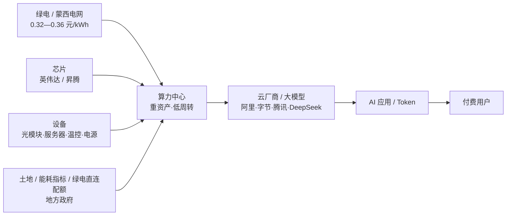

# 乌兰察布算力中心（研究报告）

> **一句话结论**：乌兰察布把"便宜的电"变成了"便宜的算力"，但没有变成"赚钱的生意"——电价优势是**全行业共享**的，最终通过租金下行让渡给客户。A 股这条链上，符合"好生意＋好价格"的标的接近于零；能找到的是三类**有条件的机会**，而不是一个"乌兰察布概念"。

| 项 | 内容 |
|----|------|
| 报告编号 | 04 |
| 版本 | v1.0 |
| 完成日期 | 2026-10-17 |
| 数据截止 | 行情 2026-10-16 收盘；产业数据截至 2026-08（另有标注者从其标注） |
| 研究缘起 | 2026-10-16 习近平总书记考察乌兰察布绿色算力产业 |
| 方法 | 事件核实 → 产业单位经济 → 上市公司敞口分级 → 估值与资本回报筛 → 反方与证伪 |
| 结论强度 | 中。产业层面证据充分；公司层面部分数据未取得，已在附录 C 显式标注 |
| 声明 | **不构成投资建议**。作者不持有文中任何标的。行情数据来自公开接口，可能存在延迟或口径差异 |

> **说明注**：本报告是本轮对话的研究产出。按本子项目《报告纪律》，每轮对话只在对话内作答，收口时经用户指令整理为"对话记录＋研究报告"两份同号文件；本轮用户点名要"一份研究报告"，故只落本报告一份，未另立对话记录。

## 目录

- [摘要](#摘要)
- [第一部分 · 事件：总书记看了什么，说了什么](#第一部分--事件总书记看了什么说了什么)
- [第二部分 · 产业：乌兰察布到底是什么生意](#第二部分--产业乌兰察布到底是什么生意)
- [第三部分 · 映射：上市公司的真实敞口分级](#第三部分--映射上市公司的真实敞口分级)
- [第四部分 · 估值：市场已经付了什么价](#第四部分--估值市场已经付了什么价)
- [第五部分 · 筛选：用价值投资的四把尺子](#第五部分--筛选用价值投资的四把尺子)
- [第六部分 · 四条路：如果一定要参与](#第六部分--四条路如果一定要参与)
- [第七部分 · 反方与风险](#第七部分--反方与风险)
- [第八部分 · 跟踪与证伪清单](#第八部分--跟踪与证伪清单)
- [第九部分 · 结语](#第九部分--结语)
- [附录 A · 数据来源](#附录-a--数据来源)
- [附录 B · 术语](#附录-b--术语)
- [附录 C · 未取得与待核数据](#附录-c--未取得与待核数据)
- [附录 D · 关键推算过程](#附录-d--关键推算过程)

---

## 摘要

**五个判断**

1. **这是一次"方向确认"，不是"业绩拐点"。** 19 万 P、109 个签约项目是 2024—2026 年已经发生的事实；考察不改变今年任何一家公司的现金流。真正的增量信息藏在措辞里：从"建"转向"用"和"造"——"积极延伸产业链，不断把算力优势转化为发展优势"。
2. **乌兰察布的优势是"成本洼地"，而成本洼地的利润不属于洼地。** 全生命周期电费比东部低 30%—40%，但便宜电对所有玩家开放，于是它变成租金的下限，而不是利润的来源。当地政府自己说算力产业"还在赔钱"，2024 年全产业税收仅近亿元。
3. **供给已经阶段性过剩，但过剩是结构性的。** 全国智算 GPU 平均利用率约 30%，通用机柜出租率不足 40%，H100 月租由 1.3 万元降至 6000 元。乌兰察布上架率高，恰恰因为它是"带订单建设"——这证明核心壁垒是**客户关系**，不是电。
4. **利润池不在运营环节。** 芯片最厚（不在 A 股）、光模块次之（在 A 股但已贵）、服务器最薄（净利率约 3.5%）、IDC 运营重资产低回报、地方财政只收到建设期的税。
5. **A 股几乎没有"乌兰察布本地股"，也没有"被考察的公司"。** 考察对象是展示厅，不是企业。所有"乌兰察布概念"都是二级推导，证据强度必须分级。

**三个不要**

- 不要因为"总书记去了"而买——2023 年 6 月考察呼和浩特中环产业园之后，光伏进入下行周期，TCL 中环 2026 年上半年仍亏损 32.04 亿元。
- 不要因为"PB 低"而买重资产 IDC——机房和机电设备的经济寿命短、专用性强，低 PB 不等于安全边际。
- 不要把"乌兰察布"当成一个板块——它不是板块，是一个**成本洼地**；洼地里谁赚钱，取决于谁有客户，而不是谁离电近。

---

## 第一部分 · 事件：总书记看了什么，说了什么

### 1.1 时间线

| 时间 | 事件 | 来源 |
|------|------|------|
| 2026-10-16 下午 | 习近平在内蒙古乌兰察布市考察，前往**察哈尔高新技术开发区**，参观**乌兰察布绿色算力产业发展展示厅**，了解内蒙古推进"东数西算"枢纽节点建设和绿色算力产业发展情况 | [央广网](https://news.cnr.cn/native/gd/sz/20261016/t20261016_527844086.shtml)、[新华社](https://m.gmw.cn/2026-10/17/content_39051525.htm) |
| 2026-10-16 19:43 | 央广网首发报道 | 同上 |
| 2026-10-17 | 新华社《第一观察》《新闻多一点》解读稿发布 | [新华社](https://m.gmw.cn/2026-10/17/content_39051525.htm)、[中国网](http://news.china.com.cn/2026-10/17/content_118737222.shtml) |

**一个必须说清楚的事实**：考察对象是**展示厅**，不是某一家企业的机房。因此不存在"被考察的上市公司"这一层映射；所有股票映射都要经过产业逻辑推导，天然比"考察某公司"弱一档。

**时点**：10 月 16 日是周五，A 股 15:00 收盘，消息 19:43 发布。**周五收盘价尚未包含这条消息**，下一个交易日是 10 月 19 日（周一）。

### 1.2 讲话里的三个关键词

| 关键词 | 原话（新华社口径） | 政策含义 | 对投资的指向 |
|--------|-------------------|----------|--------------|
| **延伸产业链** | "积极延伸产业链，不断把算力优势转化为发展优势" | 现有模式（卖电＋盖机房）不够，要向上下游走 | 上游装备制造、下游应用与 token 交易 |
| **算电协同 / 算水协同** | "认真落实高效、绿色、安全的要求，注重'算电协同'、'算水协同'" | 算力与电力、水资源统筹，绿电直连获背书 | 绿电、电网、温控（节水） |
| **高效、绿色、安全** | 同上 | 从"规模扩张"转向"质量与效率" | 利空低端重复建设，利好高上架率资产 |

另有两条判断句值得记下："算力产业正处在加速发展阶段，前景广阔"；"实施'东数西算'工程、构建全国一体化算力网，是党中央一项重要部署"。

### 1.3 政策坐标

- **"东数西算"**：2021 年 5 月方案、2022 年 2 月全面启动，8 个国家算力枢纽、10 个国家数据中心集群。
- **"六张网"**：2026 年 4 月中央政治局会议部署加强算力网、新型电网等"六张网"规划建设（[新华社](https://m.gmw.cn/2026-10/17/content_39051525.htm)）。
- **"算电协同"首次写入政府工作报告**：2026 年，"十五五"开局之年（同上）。
- **投资量级**：国家数据局称，"十五五"时期算力网建设将新增直接投资超过 4 万亿元；截至 2026 年 7 月底，全国智算总规模 245 万 PFLOPS（FP16），八大枢纽与三个算电协同发展区已建成智算规模占全国 85% 以上（[中国经营报](http://app.cb.com.cn/share/article/309922)）。
- **金融配套**：中国银行"十五五"期间将提供不少于 3000 亿元综合金融支持，覆盖 100 个重点智算中心项目（[证券时报](https://stcn.com/article/detail/4201678.html)）。

### 1.4 这次考察的"信息增量"评估

| 维度 | 判断 | 理由 |
|------|------|------|
| 对今年现金流 | **无影响** | 考察不产生订单、不改变电价、不改变租约 |
| 对产业方向 | **强确认** | "算电协同""六张网""4 万亿"已在 2026 年密集落地，考察是最高层背书 |
| 对增量政策 | **弱** | 没有宣布新政策、新资金、新牌照；地方配套政策此前已出台 |
| 对估值 | **情绪面正向，基本面中性** | 事件会带来交易性机会，但不改变内在价值 |

**我的判断**：这是一次**确认性考察**，不是**转折性考察**。把它当成"买入信号"，是把政策关注误读为业绩兑现。真正值得研究的是讲话里"延伸产业链"这五个字——它说明最高层也认为"只盖机房、只卖电"的模式不够，这才是产业下一阶段的主线。

---

## 第二部分 · 产业：乌兰察布到底是什么生意

### 2.1 乌兰察布凭什么

| 要素 | 数据 | 说明 |
|------|------|------|
| **电** | 蒙西电网代理购电 0.3234 元/kWh（2026-08）；算力中心到户约 0.358 元/kWh；阿里云口径 0.32—0.35 元/kWh | 电费占运营成本约 60%—70%；全生命周期电费比东部沿海低 30%—40%（[经济观察报](https://m.eeo.com.cn/2026/0816/1000065.shtml)） |
| **冷** | 年均气温 4.3℃，夏季平均 18.8℃，每年近 10 个月可用自然冷源 | 同等技术条件下节能约 30%；PUE 优于 1.2（[经济观察报](https://m.eeo.com.cn/2026/0816/1000065.shtml)、[新华网内蒙古](http://www.neimenggu.xinhua.org/20251109/26e78e57cb2243fe9f8accd1ad8d2db2/c.html)） |
| **时延** | 至北京双向 4.2 毫秒、单向实测 2.1 毫秒 | 2017 年起建两条 144 芯点对点光缆，2021 年双向运营（同上） |
| **地** | 地质稳定、花岗岩地基；土地指标已成扩张的现实约束 | 2026 年部分签约项目因土地指标未落地（[经济观察报](https://m.eeo.com.cn/2026/0816/1000065.shtml)） |
| **绿电** | 清洁能源装机 1940.2 万千瓦，占电力总装机 65.9%（2025-11） | 中金数据源网荷储项目 2025-07 并网，全国首个数据中心绿电直连；世纪互联近零碳项目 PUE<1.2、绿电 100%（[新华网内蒙古](http://www.neimenggu.xinhua.org/20251109/26e78e57cb2243fe9f8accd1ad8d2db2/c.html)） |

**这几样东西有一个共同点：它们都不是某家公司的专有资产。** 电是电网的、冷是天气的、时延是公共光缆的、地是政府的。任何企业来投资，拿到的条件大同小异。这就是后面所有分析的起点。

### 2.2 五个口径：数字不能混着用

产业报道里最常见的错误，是把"签约"当成"收入"。必须分开：

| 口径 | 含义 | 乌兰察布的数字 | 能否当收入看 |
|------|------|----------------|--------------|
| **签约** | 签了协议、意向 | 109 个项目（2026-10）；2024 年底 36 个 → 2026 年 6 月 89 个 | 不能 |
| **开工** | 动土、进场 | 部分是；不少项目签约后未落地 | 不能 |
| **建成** | 机房完工 | 部分 | 不能 |
| **运行/上架** | 机柜通电、客户入驻 | 19 万 P（2026-08，新华社口径） | 接近，但仍非计费 |
| **计费** | 按合约收钱 | 2026 年 1—8 月营收 56.8 亿元，同比 +40.3% | 能 |

**三个数字口径的差异**（同一座城市、同一年）：

- 2025-11：算力**运营**规模 10.87 万 P，签约机架超 200 万架，总投资超 2600 亿元（[内蒙古日报](http://www.neimenggu.xinhua.org/20251109/26e78e57cb2243fe9f8accd1ad8d2db2/c.html)）
- 2026-06：算力**运行**规模 16.5 万 P，占全国 8.7%（副市长公开讲话，[经济观察报](https://m.eeo.com.cn/2026/0816/1000065.shtml)）
- 2026-08：算力**规模** 19 万 P（[新华社](http://news.china.com.cn/2026-10/17/content_118737222.shtml)）

**一个尚未对齐的数字**：央广网称 2026 年 1—8 月全市算力产业营收 56.8 亿元、同比 +40.3%；新华财经称 2026 年上半年算力产业营收同比 +12%。两者统计范围可能不同（是否含建设期收入、是否含非算力业务）。本报告只取"在增长"这一方向，**不把具体增速当作预测依据**。

趋势一致（一年多翻倍），但**绝对数不可直接跨口径比较**。另外，"P"本身也有口径问题：国家数据局 2026 年 8 月明确用 **FP16** 口径（245 万 P），而不同厂商、不同城市的宣传口径未必统一；FP16 与 FP32 可以差 2—4 倍。**跨城市比较"算力规模"时，先问一句：什么精度？**

### 2.3 单位经济：一笔账算清楚

**电价差的价值**

- 假设：乌兰察布到户电价 0.358 元/kWh，东部沿海工业电价按 0.65 元/kWh 估算（**估算值，待核**，各省目录电价不同）。
- 价差约 0.29 元/kWh。
- 一座 100 MW 的数据中心，年用电约 8.76 亿 kWh（按满载 8760 小时计），年省电费约 **2.5 亿元**。

**这 2.5 亿元归谁？** 这是全报告最关键的一问。

- 如果算力供不应求，运营商可以按"东部电价"定价，把价差留在自己口袋里 → 归运营商。
- 如果算力供过于求，客户会要求按"西部成本"定价 → 价差让给客户。
- 2026 年的现实是后者：H100 月租从 1.3 万元降到 6000 元，A800 全年租金下滑超 30%（[财闻](https://m.sohu.com/a/1041969204_122014422)）。

**公司自己的可行性报告，给出了最硬的证据。** 优刻得 2026 年 7 月回复交易所问询时披露，拟用 15 亿元定增建设的乌兰察布智算中心项目：

| 指标 | 公司测算 |
|------|----------|
| 年均毛利率 | 39.46% |
| 税后财务内部收益率（IRR） | **8.49%** |
| 税后投资回收期 | **8.30 年** |

（[证券之星](https://wap.stockstar.com/detail/IG2026090300022558)）

**8.49% 是什么概念？** 一家高波动、曾连续亏损、体量偏小的科技公司，其股权资本成本大概率在 10% 以上。也就是说，**这个项目在资本成本附近，甚至以下**。扩产不创造价值，只扩大规模。而 2026 年 9 月 2 日，这笔 15 亿元定增被终止——公司给出的理由是"宏观经济环境、资本市场环境变化及公司实际情况"，但结果是一样的：**这个项目没有拿到钱。**

### 2.4 利润池：谁拿走了钱

| 环节 | 代表 | 利润池位置 | 定价权来源 | A 股可投性 |
|------|------|-----------|------------|------------|
| 芯片 | 英伟达、华为昇腾、寒武纪 | **最厚** | 技术＋生态（CUDA） | 弱：龙头不在 A 股 |
| 光模块 | 中际旭创、新易盛 | **厚** | 客户认证＋规模 | 强，但估值已高 |
| 服务器 | 浪潮信息、紫光股份 | **薄** | 规模＋供应链 | 强，但净利率约 3%—5% |
| 温控/电源 | 英维克、科华数据 | 中 | 技术＋客户 | 中 |
| 电力 | 华能蒙电、三峡能源 | 中 | 资源＋牌照 | 强，但受电价管制 |
| IDC 运营 | 润泽、万国、世纪互联、优刻得 | **中薄** | 土地＋指标＋客户长约 | 中，资本回报低 |
| 云与模型 | 阿里、字节、腾讯、DeepSeek | **最厚** | 生态＋数据 | 弱：多在境外或未上市 |

**结论**：乌兰察布这条链上，**最赚钱的环节在 A 股买不到，买得到的地方不赚钱**。A 股投资者能买到的是"包工头"（设备、施工）和"二房东"（IDC 运营），而不是"地主"（芯片、云、土地）。

### 2.5 供需：过剩是真的吗

**是，但是结构性的。**

| 指标 | 数值 | 来源 |
|------|------|------|
| 全国智算 GPU 平均利用率 | 约 30%（2026Q1） | 浪潮人工智能研究院，[证券时报](https://stcn.com/article/detail/4201678.html) |
| 2025 年智能算力使用率 | 36.8%（供应 38 亿卡时，实际使用 14 亿卡时） | 中国信通院，同上 |
| 通用算力机柜平均出租率 | 不足 40% | [财闻](https://m.sohu.com/a/1041969204_122014422) |
| 三四线城市空置率 | 超 70% | 同上 |
| H100 月租 | 1.3 万元 → 6000 元 | 同上 |
| 海外 B200 单小时租金 | 三周下跌 31% | 同上 |
| 全国在用智算中心 | 超 500 个；在建及规划近 400 个 | 国家数据局，[证券时报](https://stcn.com/article/detail/4201678.html) |

**但乌兰察布是例外，而且例外的原因很重要。**

新京报 2026 年 9 月实地探访后写道："今天没有一张卡是空闲的"（阿里云全球数据中心总经理王朝阳语）；优刻得乌兰察布机柜利用率 2024 年底 86.11%、2025 年底 **93.19%**（[证券之星](https://wap.stockstar.com/detail/RB2026061800024920)）；当地模式是"定制化生产"——**在数据中心建设之前，订单就已经拿到**（[新京报](https://www.bjnews.com.cn/detail-1788266563129301.html)）。

这说明：**过剩的不是"算力"，是"没有客户的算力"。** 乌兰察布的上架率高，不是因为它有便宜电，而是因为它有客户。便宜电只是让它在抢客户时多一张牌。**真正的壁垒是客户关系与交付能力，不是电价。**

一个反证：优刻得的青浦数据中心（一期）机柜利用率仅约 65%，项目已延期至 2028 年（[证券之星](https://wap.stockstar.com/detail/IG2026090300022558)）。同一个公司、同样的建设能力，在上海就上不满——公司解释是"AI 行业快速发展导致下游客户需求结构变化，主动审慎调整投建节奏"。**同样是机房，客户结构不同，上架率就不同。**

### 2.6 地方账本：为什么"还在赔钱"

| 事实 | 数据 | 含义 |
|------|------|------|
| 算力产业税收 | 2024 年近亿元 | 相对 2025-11 口径的 2600 亿元签约投资，几乎可忽略 |
| 当地官员表态 | "还在赔钱" | 产业仍处投入期（[经济观察报](https://m.eeo.com.cn/2026/0816/1000065.shtml)） |
| 税源结构 | 数据业务多由企业总部销售，留在当地的税源主要是土地、房产和员工个税 | **收入与利润不落在当地** |
| 用电结构 | 2026 年 1—7 月数据中心占全市用电 7.3%，铁合金占 54.4% | 算力对本地经济的拉动仍小于传统高耗能产业 |
| 营收 | 2026 年 1—8 月 56.8 亿元 | 年化约 85 亿元；与 2025-11 口径的 2600 亿元签约投资相比，资产周转率极低（**两者时点不同，只看量级**） |

**这一节对投资的含义**：不要用"地方营收/税收"去推算上市公司的业绩。乌兰察布的 56.8 亿元营收里，大部分是本地注册主体的收入；而利润和税，往往在总部。**地方数据只能证明"产业在长"，不能证明"公司赚钱"。**

---

## 第三部分 · 映射：上市公司的真实敞口分级

### 3.1 分级标准

| 级别 | 定义 | 证据要求 |
|------|------|----------|
| **A 级** | 在乌兰察布有已投产/在建的实体资产，或有可核实的合同 | 公司公告、政府公示、实地报道 |
| **B 级** | 为算力中心提供设备/服务，间接受益 | 产品与客户可对应，但无乌兰察布专项披露 |
| **C 级** | 只有"拟合作""框架协议"或名称沾边 | 无收入贡献证据 |

### 3.2 A 级：有实体资产

| 公司 | 代码 | 乌兰察布敞口（证据） | 备注 |
|------|------|---------------------|------|
| **优刻得** | 688158.SH | 内蒙古乌兰察布数据中心 A/B/C 栋，机柜利用率 93.19%（2025 年底）；第五栋在建；服务 1—5 MW 中腰部客户 | A 股最直接的敞口 |
| **万国数据** | 9698.HK / GDS | 2025 年 11 月官方名单列名；巴音片区有拟选址项目 | 港股/美股 |
| **世纪互联** | VNET | "算力—电力协同近零碳数据中心示范项目"入选国家发改委绿色低碳先进技术示范项目清单；PUE<1.2、绿电 100% | 美股 |
| **润泽科技** | 300442.SZ | 乌兰察布市政府与润泽智算科技集团董事长座谈（2026）；**未见项目公告** | 意向级，证据弱于前三家 |
| **中国电信 / 中国联通** | 601728 / 600050 | 联通在集宁物流园区有项目；电信"十五五"在内蒙古算力领域投入超 100 亿元，推进和林格尔、乌兰察布双园区协同 | 算力占其收入比例小 |
| **中国移动** | 600941 | 未见乌兰察布数据中心项目的专项披露；仅将乌兰察布升级为互联网省级交换节点城市 | 敞口待核 |
| **快手** | 1024.HK | 快手智能云数据中心、快手星河数据中心（在建） | 港股 |
| **亚信科技** | 1675.HK | 亚信数据港、亚信二期 | 港股 |
| **苹果** | AAPL | iCloud 中国北方数据中心 | 美股，敞口可忽略 |

> **口径提示**：2025 年 11 月《内蒙古日报》列出的 55 家企业中，包含华为、阿里巴巴、苹果、快手、中联、万国、世纪互联、中金数据等。这是"签约/落地企业"名单，不等于"已投产"。

### 3.3 B 级：卖铲子

| 环节 | 代表公司 | 与乌兰察布的关系 | 投资含义 |
|------|----------|------------------|----------|
| 光模块 | 中际旭创、新易盛 | 所有智算中心都需要 800G/1.6T 光模块 | 弹性最大、估值最高 |
| 服务器 | 浪潮信息、紫光股份 | 智算集群的整机与网络 | 净利率薄，靠周转 |
| 温控/液冷 | 英维克、申菱环境 | PUE<1.2 需要高效冷却 | 技术溢价，但估值贵 |
| 电源/UPS | 科华数据、科士达 | 数据中心供配电 | 相对合理的"卖铲子" |
| 电力设备 | 思源电气、国电南瑞、特变电工 | 220 kV 专线、变电站、增量配电网 | 订单确定，周期性弱 |
| 机柜/结构件 | 通润装备等 | 当地提出"向上游发展机柜、电力装备" | 弹性小，需个案核 |

### 3.4 C 级：要回避的"沾边"

- 公告"拟合作""签署框架协议"但无收入的公司；
- 名称含"算力""数据"但主业无关的公司；
- 通过基金间接持股、穿透后权益极小的公司；
- 地方国资平台"先建后找需求"的智算中心——这类资产是行业里空置率最高的一类（[证券时报](https://stcn.com/article/detail/4201678.html)）。

### 3.5 一个反直觉的发现

**乌兰察布几乎没有本地上市公司。** 截至公开资料，全市注册的 A 股公司仅 1 家——福瑞股份（300049.SZ，肝病医疗，总部在北京），与算力无关；另有一批企业仍在"自治区上市后备库"里（乌兰察布市财政局，2025 年第一批 10 家）。这座城市的算力产业，资本形态是"外地企业的分部"＋"地方国资的平台"＋"非上市的数据中心运营商"。所以：

> "乌兰察布算力"在 A 股不是一个可以直接买的资产，而是一组**间接映射**。映射链条越长，噪声越大。

---

## 第四部分 · 估值：市场已经付了什么价

> 以下行情数据取自公开行情接口，**2026-10-16 收盘**。ROE 为 2026 年中报口径（未年化）；"PE 动"为动态市盈率，"PE TTM"为滚动市盈率。不同数据源口径可能有差异。

### 4.1 运营商：低估值、高确定、低弹性

| 公司 | 市值（亿元） | PE 动 / TTM | PB | ROE（中报） | 2026H1 归母净利（亿元） | 同比 |
|------|------------|-------------|----|------------|------------------------|------|
| 中国移动 | 21,999.6 | 13.94 / 16.69 | 1.55 | 5.6% | 789.3 | -6.3% |
| 中国电信 | 6,268.2 | 16.00 / 21.07 | 1.37 | 4.2% | 195.9 | -14.9% |
| 中国联通 | 1,369.4 | 16.54 / 19.80 | **0.80** | 2.4% | 41.4 | -34.8% |

### 4.2 IDC / AIDC：高估值、低回报

| 公司 | 市值（亿元） | PE（动） | PB | ROE（中报） | 2026H1 归母净利（亿元） | 同比 |
|------|------------|---------|----|------------|------------------------|------|
| 润泽科技 | 894.5 | 37.17 | 6.49 | 8.47% | 12.03 | +36.4% |
| 奥飞数据 | 172.7 | 43.93 | 4.71 | 5.04% | 1.97 | +123.6% |
| 数据港 | 174.7 | 101.73 | 5.17 | 2.55% | 0.86 | +1.1% |
| 光环新网 | 175.8 | 144.44 | 1.48 | 0.51% | 0.61 | -47.1% |
| 优刻得 | 120.3 | 744.62 | 4.89 | 0.33% | 0.081 | +150.8% |

### 4.3 设备与供应链：低 PE、高 ROE、强周期

| 公司 | 市值（亿元） | PE 动 / TTM | PB | ROE（中报） | 2026H1 归母净利（亿元） | 同比 |
|------|------------|-------------|----|------------|------------------------|------|
| 中际旭创 | 7,892.0 | 28.91 / 38.59 | 20.52 | 37.62% | 136.5 | +241.7% |
| 新易盛 | 4,280.6 | 28.43 / 32.63 | 17.61 | 34.86% | 75.3 | +91.0% |
| 浪潮信息 | 830.1 | 14.06 / 18.18 | 3.38 | 12.74% | 29.5 | +269.6% |
| 紫光股份 | 724.2 | 16.71 / — | 4.05 | 13.32% | 21.7 | +108.2% |
| 英维克 | 571.6 | 154.69 / 116.41 | 15.60 | 5.19% | 1.85 | -14.3% |
| 科华数据 | 190.8 | 24.08 / 33.43 | 2.83 | 6.03% | 3.96 | +62.7% |
| 思源电气 | 923.7 | 31.55 / — | 5.61 | 9.01% | 14.6 | +13.2% |
| 国电南瑞 | 1,825.6 | 29.71 / — | 3.59 | 5.73% | 30.7 | +4.1% |
| 特变电工 | 866.0 | 16.96 / — | 1.22 | 3.58% | 25.5 | -19.8% |

### 4.4 电力与绿电：便宜，但要看电价

| 公司 | 市值（亿元） | PE 动 / TTM | PB | ROE（中报） | 2026H1 归母净利（亿元） | 同比 |
|------|------------|-------------|----|------------|------------------------|------|
| 华能蒙电 | 402.7 | 13.51 / 19.50 | 2.02 | 7.49% | 14.9 | -22.3% |
| 三峡能源 | 983.4 | 40.34 / — | 1.11 | 1.36% | 12.2 | -68.0% |
| 金开新能 | 104.9 | 65.07 / — | 1.20 | 0.89% | 0.81 | -81.7% |

> **读表提示**：同比增速含一次性因素，运营商与部分设备公司不宜直接横向比较。表中未列股息率，因各公司分红方案与除权日不同，**待核**（见附录 C）。

### 4.5 隐含预期倒推

**例一：优刻得（120 亿元）**

- 2026H1 归母净利 807.72 万元，扣非仍亏 1,685.71 万元。
- 年化归母净利约 0.16 亿元 → 当前市值对应约 **750 倍**。
- 即使净利率提升到 10%、营收翻三倍到 60 亿元，净利约 6 亿元 → 对应 20 倍。
- **市场当前价格隐含的是"营收翻三倍＋净利率提升到 10%"**。这是一个可能的未来，但不是"安全边际"。

**例二：数据港（175 亿元）**

- 2026H1 归母净利 0.86 亿元，ROE 2.55%，PE 约 102 倍。
- 一个 ROE 2.55% 的重资产生意，市场给 5.17 倍 PB。
- **除非租金大幅上行或资产被 REIT 化重估，否则这个估值缺乏基本面支撑。**

**例三：中际旭创（7,892 亿元）**

- 2026H1 归母净利 136.5 亿元，同比 +241.7%，ROE 37.62%。
- 动态 PE 28.9 倍。若 2027 年净利再增 30%， forward PE 约 22 倍。
- **这不贵——前提是"AI 资本开支不降温"。** 问题不在估值公式，在周期判断。

**例四：中国联通（1,369 亿元，PB 0.80）**

- PB 0.80、ROE 2.4%，是"便宜"还是"价值陷阱"？
- 关键在：2.4% 的 ROE 是周期底部还是结构性低回报？如果算力业务能把 ROE 拉到 6%—8%，0.8 倍 PB 是便宜的；如果拉不上去，0.8 倍 PB 只是"资产不值钱"的反映。

### 4.6 事件定价状态：周五收盘还没反应

考察消息 10 月 16 日 19:43 发布，A 股已收盘。从 10 月 16 日收盘看：

| 标的 | 当日涨跌 | 观察 |
|------|----------|------|
| 光环新网 | -0.81% | IDC 二线偏弱 |
| 数据港 | -2.12% | 跌幅居前 |
| 奥飞数据 | -0.74% | 偏弱 |
| 优刻得 | -2.03% | 偏弱 |
| 科华数据 | -1.75% | 偏弱 |
| 中际旭创 | +1.99% | 光模块走强 |
| 新易盛 | +0.29% | 微涨 |

**没有明显抢跑。** 这不构成"周一必涨"的理由，只说明周一的价格会是**情绪价**：政策事件的第一个交易日，涨幅往往由资金和情绪决定，而不是由基本面决定。对价值投资者，这不是买点，是观察点。

---

## 第五部分 · 筛选：用价值投资的四把尺子

### 5.1 四把尺子

| 尺子 | 问题 | 通过标准 |
|------|------|----------|
| **可预测性** | 五年后的现金流能不能大致算出来？ | 有长约、客户分散、价格机制稳定 |
| **护城河** | 五年后它凭什么还在赚钱？ | 成本优势可持续、转换成本高、牌照/配额独占 |
| **资本回报** | 投进去的钱能不能赚回超过资本成本？ | ROIC > WACC，且不靠加杠杆 |
| **安全边际** | 现在价格有没有留出犯错空间？ | 隐含预期低于合理情景 |

### 5.2 逐类打分

| 类别 | 可预测性 | 护城河 | 资本回报 | 安全边际 | 综合 |
|------|----------|--------|----------|----------|------|
| 运营商 | 高 | 中（牌照＋网络） | 中低（ROE 2%—6%） | 中（PB 0.8—1.55） | **接近合格** |
| IDC 运营（一线） | 中高（长约） | 中（土地＋指标＋客户） | 低（ROE 5%—8%） | 低（PE 37—144） | **不合格（价格）** |
| IDC 运营（二线） | 低 | 低 | 很低（ROE<3%） | 表面低（PB 低） | **价值陷阱** |
| 光模块 | 中（周期） | 高（认证＋规模） | 高（ROE 35%+） | 低（PB 17—21） | **好生意，贵** |
| 服务器 | 中 | 低（组装） | 中（ROE 13%） | 中（PE 14—17） | **一般生意，价格合理** |
| 温控/电源 | 中 | 中 | 中 | 低（英维克 PE 155） | **看个股** |
| 电力 | 高 | 中（牌照） | 低（ROE 3%—7%） | 中（PE 13—65） | **防御，不是成长** |
| 概念股 | 低 | 无 | 低 | 无 | **回避** |

### 5.3 三个价值陷阱

**陷阱一：低 PB 的重资产 IDC**

光环新网 PB 1.48、ROE 0.51%。看起来"跌破净资产"，但机房与机电设备的经济寿命短、专用性强、二手价值低。**账面净资产不等于清算价值，更不等于盈利能力。** 低 PB 只有在资产能产生现金流时才是安全边际。

**陷阱二：把"算力规模"当"收入"**

109 个项目（2026-10）、200 万架签约机架、2600 亿元总投资（后两者为 2025-11 口径）——这些是"意向/签约"，不是"投产/计费"。**用签约数除以市值，会得出荒谬的便宜。** 真正要跟踪的是"上架率"和"计费收入"。

**陷阱三：把"政策关怀"当"业绩兑现"**

2023 年 6 月，习近平总书记考察呼和浩特中环产业园。此后光伏行业进入产能过剩周期，TCL 中环 2026 年上半年仍亏损 32.04 亿元（[证券时报](https://stcn.com/article/detail/4131565.html)），当前市值 378.8 亿元、PB 2.06。**政策方向对，行业周期错，股价照样跌。** 乌兰察布的算力产业，正处在产能集中释放期，而不是起点。

### 5.4 筛选结论

> **直接机会：0 个。**
> **条件机会：3 个**（运营商、IDC REITs、设备寡头，各有硬伤与价格条件）。
> **防御型配置：1 个**（电力，弹性小，不能当"算力成长"买）。
> **明确回避：二线 IDC、概念股、"先建后找需求"的地方国资项目。**

这个结论不是"看空算力"。恰恰相反——**算力需求是真的，只是利润不在 A 股能买到的环节里。** 价值投资的任务不是参与每一个真实的故事，而是只在"故事变成现金流、且价格合理"时出手。

---

## 第六部分 · 四条路：如果一定要参与

### 6.1 路 A：运营商——确定性与股息

**逻辑**：三大运营商是真正的 IDC 巨头，拥有网络、土地、客户和低成本资金；算力是它们的"期权"，不是"主业"。当前 PE 14—16 倍、PB 0.8—1.55 倍，估值处于历史中低位。

**数据**：中国移动市值 2.2 万亿元、PE 13.9、PB 1.55；中国电信 PE 16.0、PB 1.37；中国联通 PE 16.5、PB 0.80。

**硬伤**：
- 算力收入占比小，业绩弹性低；
- 2026 年中报净利普遍下滑（移动 -6.3%、电信 -14.9%、联通 -34.8%），传统业务承压；
- 资本开支若向算力倾斜，自由现金流可能受压。

**什么价格才看**：股息率显著高于十年期国债收益率（例如 2 倍以上），或 PB 明显低于 1（联通已满足，但需确认 ROE 能否修复）。

**风险**：分红政策变化、5G/算力资本开支超预期、国企考核指标调整。

### 6.2 路 B：IDC REITs——现金流与估值锚

**这是本报告认为最接近"价值投资"形态的工具。**

| 项目 | 南方润泽科技数据中心 REIT | 南方万国数据中心 REIT |
|------|--------------------------|----------------------|
| 代码 | 180901 | 508060 |
| 上市 | 2025-08-08 | 2025-08-08 |
| 底层资产 | 润泽（廊坊）国际信息港 A-18 | 昆山国金云计算数据中心 |
| 2026Q2 收入 | 1.42 亿元 | 0.50 亿元 |
| 2026Q2 可供分配 | 7,771 万元 | 3,382 万元 |
| 上架率 | **99.35%** | **97.95%** |
| 收缴率 | 100% | 100% |
| 加权平均剩余租期 | **约 8.5 年** | 约 3 年 |
| 单价 | 1,139.53 元/kW/月 | 570 元/kW/月 |
| 扩募 | 拟收购 A-7、A-8，新增超 1.1 万个机柜 | 已启动扩募研究 |

（[新华财经](https://m.cnfin.com/zs-lb//zixun/20260831/4463063_1.html)）

**为什么它更接近价值投资**：
- **强制分红**：可供分配金额的绝大部分要分掉，现金流可验证；
- **估值有锚**：底层资产是不动产，可以用资本化率、分派率定价；
- **租约锁定**：8.5 年剩余租期，短期空置风险低；
- **信息透明**：季度披露上架率、收缴率、单价。

**硬伤**：
- 资产不在乌兰察布（廊坊、昆山），与本次考察无直接关系；
- 客户集中度高（云厂商/互联网头部）；
- 2026 年 8 月战略配售份额解禁，二级价格承压；
- 利率敏感：长端利率上行会压制估值；
- 新增供给可能压制未来租金。

**什么价格才看**：分派率相对十年期国债的利差足够厚（新华财经援引银河证券：截至 2026-07-31，产权类 REITs 股息率比中证红利均值高 92BP）。**具体分派率需按实时价格计算，本报告未取得，见附录 C。**

### 6.3 路 C：设备寡头——质量与价格

**逻辑**：不管哪家云厂商赢，都要买光模块、服务器、温控、电源。这是"卖铲子"逻辑，确定性高于"挖金子"。

**数据**：中际旭创 PE 28.9、ROE 37.6%；新易盛 PE 28.4、ROE 34.9%；浪潮信息 PE 14.1、ROE 12.7%；科华数据 PE 24.1、ROE 6.0%；英维克 PE 154.7、ROE 5.2%。

**硬伤**：
- 强周期：AI 资本开支一旦放缓，估值与业绩双杀；
- 光模块的"认证壁垒"正在被产能扩张侵蚀；
- 英维克等温控龙头的估值已透支多年增长。

**什么价格才看**：PE 低于 20 倍且订单能见度超过 2 年；或股价回调 30% 以上而基本面未变。

### 6.4 路 D：电力——区域用电增长与绿电直连的双刃剑

**逻辑**：数据中心是用电大户，乌兰察布数据中心用电已占全市 7.3%（2026 年 1—7 月），且仍在上升。蒙西电网内的发电企业受益于本地消纳。

**数据**：华能蒙电市值 402.7 亿元、PE 13.5、PB 2.02、ROE 7.49%。

**硬伤**：
- 数据中心只占全市用电 7.3%，弹性有限；
- **绿电直连是"去电网化"**：发电企业直接卖给数据中心，可能提升利用小时，也可能压低上网电价；
- 电价受管制，成本波动（煤价）无法完全传导。

**结论**：电力是"防御型"配置，不是"算力成长"标的。把华能蒙电当"乌兰察布算力概念"买，是错配。

### 6.5 排序（仅按"符合价值投资标准的程度"，不是推荐）

| 排序 | 类别 | 理由 | 主要风险 |
|------|------|------|----------|
| 1 | IDC REITs | 现金流可分配、估值有锚、租约锁定 | 利率、解禁、新增供给 |
| 2 | 运营商 | 低估值、高确定、算力期权 | 成长慢、资本开支 |
| 3 | 设备寡头 | 好生意，但价格贵 | 周期见顶 |
| 4 | 电力 | 便宜，但弹性小 | 电价管制、绿电直连 |
| 5 | 二线 IDC | 估值与回报不匹配 | 价值陷阱 |
| — | 概念股 | 无实质敞口 | 纯情绪 |

---

## 第七部分 · 反方与风险

### 7.1 看多者最强的论据

1. **算力是国家级长期资本开支**："十五五"新增直接投资超 4 万亿元，不是一年的事，是五到十年的事。
2. **供给出清后龙头受益**：现在 30% 的利用率会淘汰低端产能，活下来的运营商议价能力上升。
3. **REITs 化改善资本循环**：IDC 把成熟资产卖给 REITs，回收资金再投新项目，ROE 和现金流都会改善（润泽、万国已在做，奥飞在筹备）。
4. **乌兰察布的"带订单建设"模式已被验证**：93% 的上架率不是运气，是模式。
5. **政策背书降低融资成本**：央企、国企、REITs 的资金成本低，能承受 8% 的项目回报。

### 7.2 看空者最强的论据

1. **过剩仍在扩大**：在建及规划近 400 个项目，相当于现有存量再翻近一倍。
2. **租金下行没有止住**：H100 月租腰斩、B200 三周跌 31%，价格战才刚开始。
3. **芯片代际贬值**：2026 年前采购的非头部算力卡，"或难以实现投资回本"（证券时报引述业内人士）。
4. **政策租金可被收回**：电价、绿电直连、能耗指标都是政策变量，不是永久护城河。
5. **地方财政模式不可持续**："还在赔钱"、税收仅亿元，补贴退坡是时间问题。

### 7.3 我可能错在哪

| 我的判断 | 可能错的方式 | 如果错了，会看到什么 |
|----------|--------------|---------------------|
| 成本优势会传导给客户 | 算力重新供不应求，运营商重新获得定价权 | 租金止跌回升、上架率维持 90%+ |
| IDC 运营回报低 | REITs 化＋低资金成本把 ROE 拉到 12%+ | 头部 IDC 的 ROE 连续两年上行 |
| 二线 IDC 是价值陷阱 | 资产被 REIT 重估，或客户结构改善 | 光环/数据港拿到大厂长约 |
| 设备已贵 | AI 资本开支超预期，2027 年继续高增长 | 光模块订单能见度延长到 2028 年 |
| 事件不改变基本面 | 后续出台超预期补贴/电价政策 | 算力券、绿电直连配额大幅扩容 |

### 7.4 事件交易的陷阱

- **周一可能高开**：10 月 19 日开盘有情绪冲高的可能，但"高开低走"是政策事件的常见形态；
- **概念扩散**：真正有敞口的公司涨幅可能小于"名字沾边"的公司，这是 A 股事件驱动的常态；
- **持续期**：政策考察行情的持续期通常是数日到数周，之后回归基本面；
- **周五收盘未定价**：这意味着周一的价格是"情绪价"，不是"价值价"。

**价值投资者不应该在周一开盘买入，因为你买的是别人的情绪，不是公司的现金流。**

---

## 第八部分 · 跟踪与证伪清单

### 8.1 产业指标（月度/季度）

| 指标 | 当前值 | 看什么 | 数据来源 |
|------|--------|--------|----------|
| 乌兰察布算力规模 | 19 万 P（2026-08） | 增速是否放缓 | 新华社/地方政府 |
| 签约项目数 | 109 个（2026-10） | 从签约到开工的转化率 | 地方政府 |
| 算力产业营收 | 56.8 亿元（2026 年 1—8 月） | 是否持续增长（增速口径见 §2.2） | 地方政府 |
| 全国 GPU 平均利用率 | 约 30% | 是否止跌回升 | 信通院/浪潮 |
| 机柜出租率 | <40% | 是否回升到 60%+ | 行业调研 |
| H100/A800 租金 | H100 6000 元/月 | 是否止跌 | 渠道调研 |
| 数据中心占全市用电 | 7.3%（2026 年 1—7 月） | 是否持续上升 | 地方政府 |

### 8.2 公司指标

| 公司 | 看什么 | 阈值 |
|------|--------|------|
| 优刻得 | 扣非净利、经营现金流、乌兰察布第五栋上架率 | 扣非转正且连续两季 |
| 润泽科技 | 上架率、单 kW 收入、REITs 扩募进度 | 上架率 >90% |
| 光环新网 | 上架率、REITs 进展 | 有无实质公告 |
| 数据港 | 大客户续约、新增订单 | 租约剩余年限 |
| 中际旭创/新易盛 | 订单能见度、毛利率 | 毛利率不再上行即为预警 |
| 中国移动/电信/联通 | 分红率、算力收入增速 | 股息率 vs 国债 |

### 8.3 政策指标

- 绿电直连项目批复数量与比例；
- 能耗指标（能评）松紧；
- 算力券、token 交易平台落地；
- 电力市场化改革（电价浮动范围）；
- "十五五"算力网 4 万亿元的年度落地节奏。

### 8.4 证伪信号（出现任一，本报告结论需修正）

1. 乌兰察布上架率连续两个季度 >90%，且租金止跌回升；
2. 全国 GPU 平均利用率从 30% 回升到 50% 以上；
3. 头部 IDC 的 ROE 连续两年 >12%，且不靠加杠杆；
4. 绿电直连占数据中心用电比例 >50%，且电价锁定 10 年以上；
5. 出现一家 A 股公司，其乌兰察布资产贡献营收占比 >30% 且扣非为正。

---

## 第九部分 · 结语

乌兰察布的故事，本质是**把一种过剩的资源（弃风弃光）转换成一种稀缺的资源（算力），再用稀缺资源去换产业**。这个故事是真的，而且很聪明。

但投资的道理是：**当一个地方把成本优势当成招商筹码时，成本优势就不属于任何一家公司。** 它属于客户，属于地方政府，属于时代，唯独不属于股东。

所以，关于"股市上有没有价值投资机会"，我的回答是：

- **没有"乌兰察布概念"式的机会。** 那是一个成本洼地，不是一个利润池。
- **有三类"有条件的机会"**：IDC REITs（现金流）、运营商（确定性）、设备寡头（质量）。三者都需要价格条件，当前都不便宜。
- **最好的动作可能是"不动作"**：把它放进观察名单，等租金止跌、等上架率验证、等价格回到有安全边际的位置。

价值投资不需要抓住每一个真实的故事。它只需要在少数几个时刻，用便宜的价格买入好生意。乌兰察布值得被理解，但不一定值得被买入。

---

## 附录 A · 数据来源

**事件与政策**

1. 新华社《第一观察丨总书记考察绿色算力产业 指引因地制宜发展新质生产力》，2026-10-17，[链接](https://m.gmw.cn/2026-10/17/content_39051525.htm)
2. 新华社《新闻多一点丨乌兰察布这样打好绿色算力产业牌》，2026-10-17，[链接](http://news.china.com.cn/2026-10/17/content_118737222.shtml)
3. 央广网《习近平乌兰察布行丨绿电赋能 算力聚势》，2026-10-16，[链接](https://news.cnr.cn/native/gd/sz/20261016/t20261016_527844086.shtml)
4. 央广网《时政微观察丨内蒙古之行，总书记考察算力产业有何深意？》，2026-10-17，[链接](https://news.cnr.cn/native/gd/sz/20261017/t20261017_527845087.shtml)

**产业数据**

5. 经济观察报《算力热土乌兰察布》，2026-08-16，[链接](https://m.eeo.com.cn/2026/0816/1000065.shtml)
6. 新华财经《呼和浩特与乌兰察布协同共筑内蒙古算力高地》，2026-08-24，[链接](https://www.cnfin.com/cmjj-lb/detail/20260824/4459613_1.html)
7. 新华网内蒙古《乌兰察布市算力产业实现"4个领先"》，2025-11-09，[链接](http://www.neimenggu.xinhua.org/20251109/26e78e57cb2243fe9f8accd1ad8d2db2/c.html)
8. 新京报《时延4毫秒、电价三毛五：AI的"大脑"为什么长在草原上？》，2026-09-01，[链接](https://www.bjnews.com.cn/detail-1788266563129301.html)
9. 中国经营报《全国智算总规模达245万P "十五五"算力网建设将新增直接投资超4万亿元》，2026-08-29，[链接](http://app.cb.com.cn/share/article/309922)

**供需与租金**

10. 证券时报《智算中心"满载"与"闲置"并存 冷热不均倒逼机制重构》，2026-09-29，[链接](https://stcn.com/article/detail/4201678.html)
11. 财闻《算力租金雪崩、机柜大面积空置相关概念下挫》，2026-06-26，[链接](https://m.sohu.com/a/1041969204_122014422)

**公司层面**

12. 证券之星《历时半年15亿定增戛然而止 优刻得乌兰察布智算中心梦碎》，2026-09-03，[链接](https://wap.stockstar.com/detail/IG2026090300022558)
13. 证券之星《优刻得：乌兰察布数据中心机柜利用率为93.19%》，2026-06-18，[链接](https://wap.stockstar.com/detail/RB2026061800024920)
14. 证券时报《TCL中环：上半年亏损32.04亿元》，2026，[链接](https://stcn.com/article/detail/4131565.html)
15. 新华财经《业绩韧性凸显 IDC公募REITs迎来扩容新周期》，2026-08-31，[链接](https://m.cnfin.com/zs-lb//zixun/20260831/4463063_1.html)
16. 中国基金报《首批数据中心公募REITs上市 双双上演"30%涨停秀"》，2025-08-08，[链接](https://www.chnfund.com/article/AR6cf23fb5-05e2-d213-34bc-3a1b9b26392a)

**行情数据**

17. 东方财富行情接口、腾讯行情接口，取数时间 2026-10-16 收盘。字段口径：PE 动＝动态市盈率，PE TTM＝滚动市盈率，ROE＝2026 年中报（未年化）。

---

## 附录 B · 术语

| 术语 | 含义 |
|------|------|
| **P（PFLOPS）** | 每秒千万亿次浮点运算。同一数字在不同精度（FP16/FP32）下可差 2—4 倍，跨主体比较需先统一口径 |
| **PUE** | 电源使用效率＝数据中心总耗电/IT 设备耗电，越接近 1 越好 |
| **上架率** | 已通电并交付客户的机柜数/总机柜数，是 IDC 最核心的运营指标 |
| **绿电直连** | 风电、光伏通过专用线路直接送到用户，不经过公共电网；核心是"以荷定源" |
| **源网荷储一体化** | 电源、电网、负荷、储能协同规划，解决新能源波动性 |
| **IDC REITs** | 以数据中心为底层资产的公募不动产投资信托基金，强制分配可供分配金额 |
| **批发型 IDC** | 面向云厂商/大客户，整栋或整层出租，租约长、单价低、上架率高 |
| **零售型 IDC** | 面向中小客户，按机柜/按功率出租，单价高、客户分散、上架率波动大 |
| **token（词元）** | 大模型处理文本的基本单位，正在成为算力服务的计价单位 |

---

## 附录 C · 未取得与待核数据

本报告遵循"数值未取得者不写进正文"的原则。以下数据未取得或未能交叉验证，正文中要么不使用，要么已显式标注为估算：

| 项目 | 状态 | 说明 |
|------|------|------|
| 三大运营商股息率 | 未取得 | 分红方案与除权日不同，需按最新公告与实时股价计算 |
| 华能蒙电股息率与装机结构 | 未取得 | 需查 2025 年年报与 2026 年中报 |
| 两只 IDC REITs 的实时分派率 | 未取得 | 需按实时价格与最新可供分配金额计算；本报告只引用运营数据与利差 |
| 润泽科技乌兰察布项目的具体规模 | 待核 | 仅有市政府"座谈"报道，未见项目公告与备案信息 |
| 万国数据乌兰察布项目进度 | 待核 | 经济观察报称为"拟选址" |
| 东部沿海工业电价 | 估算 | 正文按 0.65 元/kWh 估算，各省目录电价不同，需按具体省份核 |
| 中联数据、中金数据、大唐数据等 | 未上市/身份待核 | 不影响结论，但影响"敞口清单"的完整性 |
| 乌兰察布"十大数据中心集群"表述 | 口径并存 | 新华社称其为"十大数据中心集群中的一员"；内蒙古枢纽的官方起步集群为和林格尔。两种表述并存，本报告按"内蒙古枢纽重要组成部分"处理 |
| "机架规模超 700 万架" | 口径存疑 | 央广网 2026-10-16 称全市"机架规模超 700 万架"，而 2025-11 内蒙古日报为"超 200 万架"，11 个月增 3.5 倍，短期内不太可能，疑为口径差异或笔误。本报告不采用该数字 |
| 乌兰察布本地上市公司家数 | 快照 | 采用华西证券地区股页面（2023-11-13 快照）"全市 1 家"的说法；2026 年是否新增未逐家核 |
| 2027—2028 年算力供需预测 | 未取得 | 无权威第三方预测，正文只做情景分析，不给点估计 |

---

## 附录 D · 关键推算过程

**D1 电价差年节省额**

- 假设：100 MW 满载，年运行 8,760 小时 → 年用电 8.76 亿 kWh。
- 价差：0.65 − 0.358 = 0.292 元/kWh（东部电价为估算）。
- 年节省：8.76 亿 × 0.292 ≈ **2.56 亿元**。

**D2 算力规模与收入的关系**

- 2026 年 1—8 月营收 56.8 亿元 → 年化约 85.2 亿元。
- 对应 19 万 P → 约 **4.48 万元/P/年**。
- 注意：这是"本地注册主体营收/本地算力规模"的粗略比值，受总部结算、口径差异影响，**只能看量级，不能当估值依据**。

**D3 优刻得隐含预期**

- 2026H1 归母净利 0.081 亿元 → 年化 0.162 亿元。
- 市值 120.3 亿元 → PE ≈ **743 倍**（与行情接口的 744.62 一致）。
- 若净利达到 6 亿元，对应 PE 20 倍；即需要净利增长约 **37 倍**。

**D4 资本回报的粗略判断**

- 优刻得项目 IRR 8.49%（公司测算）。若股权资本成本按 10% 计，项目经济利润为负。
- 数据港 ROE 2.55%（2026 中报，未年化），PB 5.17 → 隐含市场要求的回报率远高于当前 ROE。

---

*本报告完。数据与判断均截至 2026-10-17；不构成投资建议。*
