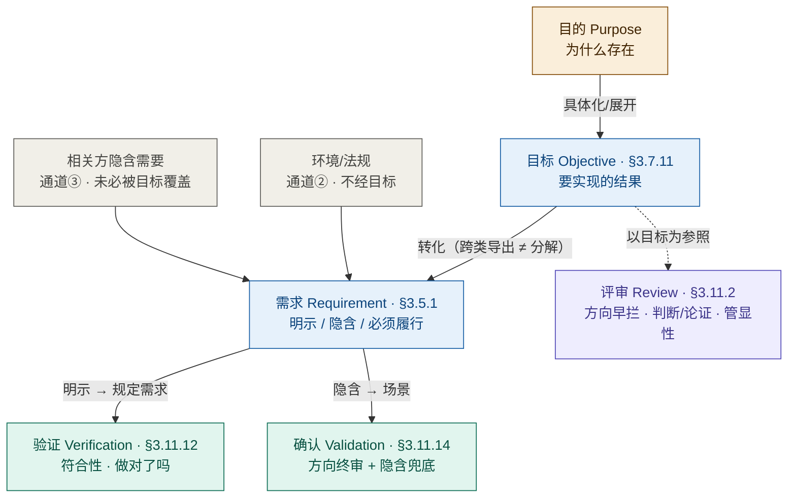

# 架构基本概念与方法
**Architecture Fundamentals: Concepts and Methods**

**文档版本**：v5.15 → v5.16 → **v5.17（2026-11-02·随 46 号 v3.3 全篇对齐：7 节重构、A 级 5 条四段齐全、附录 C 结论台账 70 条、9 处硬冲突改正、号形补名 15 处）** → **v5.18（2026-11-06 依 48 号 v3.25 对齐：22 处「三把尺」改按「一支填句三槽（三种填法）」表述）** → **v5.19（2026-11-11 按 42020:2019 §6.1 改：§11 架构治理定义与目的句撤「宗旨」；§11.4 治理侧口径与 RACI 冲突改正）** → **v5.20（2026-11-11 随 46 号（新）《架构视图名称研究报告》对齐命名口径：§1.5 两套维度改三套并新增维度 3 方面体与主题（功能架构移出粒度轴）、四词连读链改正、判据三改四、K25 三改四；§1.5 末补信息架构三支与 46 号十二类槽指针）** → **v5.21（2026-11-11 随 46 号 v2.6「八条主结论」严格对齐：§1.5 开篇「同一架构的不同描述」括注由「呈现粒度」一套改按呈现粒度／方面体／主题三路；§1.5「框架 vs 架构」试金石旧三标准指针改指走样检验；改动 2 处）** → **v5.22（2026-11-11 随 46 号 v2.6 重新对齐（19 号批次第 1 件）：撞点三处落净——46 号 §7.1 三套名字、§5.4 描述里装什么、§4.3 细化 vs 粗细相推；另同一性三分改写、号形 1 处；改动 35 处＝必改 10＋建议改 21＋裁后 4，另 11 处为改后复读的回修【同错连改】，文件层 hunk 见 git）** → **v6.0（2026-11-11 按主要结论清单重构：原十一章重排为十章＝§一 走法＋§二~§十 九条各一章；原第八章整章移入附录 D；新增摘要九条与附录 F 新旧节号对照；台账加「归主线」列、K 号与条数未动；自引改号 251 处、裸章号 25 处）**
**创建日期**：2026-08-11
**修订日期**：2026-11-11
**历史**：
- 2026-11-11 v5.22→**v6.0 第二十四轮·按主要结论清单重构（19 号规程阶段二 · 批一第 1 件）**（用户令「重构 06 号（按 19 号）」→ 交候选清单九条＋依赖图＋建议章序＋落选理由＋重构代价 → 用户裁「认」→「按照你的建议方案继续」）。**结构**：原十一章按九条重排为**十章**（§一 走法＋§二~§十 九条各一章）；**原第八章业务架构实践整章移入附录 D**（一字未删）；**原 §2 六条原理、原 §3 五层意义解散随条带走**（它们是各条的"为什么"，见 §5.2~§5.9 与 §2.5、§2.6、§3.2、§8.2）；**原 §1.5 拆三处**（概念模型＋四概念表→§2.3，三套命名依据→§3.1，两个无号子目→§2.7、§2.8）；**新增**：摘要九条（原无摘要，原阅读指引按新章号重排并入 §1.7）、§一 走法五节（原问／取证口径与号形／九条的位次含清单表与依赖／摘要与正文对照／节号全改提示）、附录 F 新旧节号对照、附录 E（原「准入速查」由 §十 与 §十一 之间归位）、台账「归主线」列（70 条一条未减，20/3/2/6/4/9/7/9/5＋5＝70）。**改号**：全文自引 **251 处**按映射表批量换算；**他件链 243 处、标准条款 333 处**一律豁免（另有 59 处标准条款本不在本件号内，原样保留）——逐条判定留痕见 `.ai-agent/work/重构-06/build.log`，旧号对照见**附录 F**；**裸章号 30 处**（"§五 章首""§5 设计链"一类）按映射表定点改（原「§8 配置管理」是旧稿的一处错号，应为配置章，随改）；**导语自指随结构改 11 处**（原"第N章""本章"改按新章号或"几节"）＋**附录 D 内"本章"两处改"本附录"**；**成套件随改 6 处**（原"第五章／第六章／第四章"三处章号引、附录 A 一处、两处"（第五章）"）——**内容一字未删**，被删的只有原 §1.5 与新节题重复的一行粗体引导句（已并入节题）。**未改**：K 号与条数（70 条，A 5／B 28／C 37）、A 级五条四段、案例事实与数字、四本正本引法、规范／资料性档位、〔读法〕标记、术语速查表（附录 B）、K70 关系声明、全部历史修订记录（历史不改写）。**读数**：汉字 101,343（重构前 92,942）；章 15→16 件（正文 10＋附录 6）；节 76→84；表 114→117；旧号残影 0。
- 2026-11-11 v5.21→v5.22 第二十三轮·**随 46 号 v2.6 重新对齐（19 号批次 · 第 1 件 · 层一）**（用户令「对齐 06 号（按 19 号）」；规程走五步：三路只读扫描（甲段 17／乙段 17／丙段 18 处）→ 主笔四档定稿 → **③ 定稿回读**（三位扫描者回读挑错，纠出主笔六处错与四类新伤）→ 落笔；判据只取 46 号 v2.6 转引的四本正本）。**必改 10 处**：① §1.3.5 总图与详图不再"呼应架构与详细设计的分界"——详略差是同一份东西往实现走的细化，架构与设计之分是**种类**（46 号 §4.3、§3.3；撞点③）；② §1.5「四种都属同一实体的架构描述」总起句与结句同改（四类名字装的东西不同；**领域那一支本身是术语误用**）；③ §1.5 架构「不留白——决策总和的全部」改「占满它的是**基本的那几条**，不是全量」；④ §1.9 图「由多个视图组成／所有视图合在一起＝完整的架构描述」改「视图＋视角规格＋对应关系＋决策与理由」，并补号形说明与 §1.5 关系名辨析第三行（撞点②）；⑤ §2.5「架构的经济学**本质**是识别不可逆决策」删「本质」位（与本节改题说明相抵）；⑥ §3.1 主语改「架构描述」并加本节用词约定；⑦ §5.2「架构不是回答 How 吗」按四道分工改写（46 号 §4.1、§4.4）；⑧ §5.2.3「系统的『外部架构』」改 **EoI 切换**（46 号 §5.1、§5.5）；⑨ §6.1 框架表 42010 行改「不规定张数与清单——规范的是**描述里装什么**」，补表下号形与范围注；⑩ §7.3「4A 是纵向切——把架构描述按管理归属分类」**两半同改**并加界分句「矩阵只标标注位置，不是切成四块」。**建议改 21 处**：三套名字界分（§1.4 两处同句＋§1.2「架构要解决的核心问题正是关系的秩序」＋§5.1 承接限定块）、号形 1 处（§1.4.1 ★更正条改「随 48 号（旧 46 号）v3.0」）、§1.5「三套命名依据」补「按轴归并的读法」与被折掉的**实体槽**、§1.5 功能架构／功能视图改**三处三身份**（不连写）、§1.5 组织架构举例加限定、§2.1「架构视角与呈现粒度」改按本号三套写法、§2.4 补「视图完备≠描述完备」、§3.3「定义句**末**」改「定义句中」＋补标准名＋「学习系统」标比方、§3.6 补全「基本概念或属性＋管控原则」、§5.1「方案才有架构」改 EoI 说法、**§5.6 节首加界分块（不动节题与锚点）**、§6.3「七个视角」改「七张候选视图、各由恰一个视角治理」与「不完整」补 42010 §6.7 c) 限定（明标与「视图身份四问」两个轴）、§6.5 视图数经验值标「不作判据」、§7.2「不是架构描述」改「装的是**设计件**，不是架构内容」、§7.4 需求病灶留＋补指针、§7.7.1 反证段改 42010 §6.7 a)~d) 并保住「体现概念属性」作**旁证**。**待裁 1 项经用户裁后落笔**：§1.4.1 第 3 层「同一性由目的裁」改**三分**——**参照＝实体之意／测法＝走样检验／目的变没变由治理裁**（46 号 §7.2、§8.5①、§8.6；48 号 §6.17），同批改「同一性跟着**实体之意**走」、§1.5 试金石补「参照与测法不可互换」、§11.1 加「实体之意 ≠ 用途」界分、**K19 结论一字不改**只在依据栏补三分。**判留 20 处**（理由见 `claude-memory/progress-对齐06-46.md`）。**⑤ 改后复读（19 号 施工第⑤步首用）**：三路回读**改完的字**（不是读计划），纠出主笔新错 **17 处，已全部回修**——① §3.1 用词约定由"被看到／心智模型"扩到**全节**（压缩信息、入门材料一类）并改号形（§5.1→§3.6）；② **§5.6 界分块与"这就是 PA 层的架构决策"拉齐**——立在架构侧的是**划分的判据与原则**，划分结果与规格归设计（原写法会把本节五条决策大半划成设计，自相矛盾）；③ §2.5〔按〕从原理陈述句中间移出成独立块（00-doc-conventions §8.9）；④ §3.3「学习系统」句去悬空（原写"只作比方用"而比方已删）；⑤ §3.7 表「好的架构」改「好的架构描述」并指 §3.1 约定；⑥ §5.1 加**「方案／描述」同字不同物**界分（46 号 §2.2 的"方案"与本号"设计产出"不同物）；⑦ §7.4 题名「需求**视图**」→「需求**这一块**」；⑧ §7.3 引导句「切」→「标注」、原两句压成一个过渡句（去八成重复）；⑨ §7.7.1「也过不了 c)、d) 两关」→「**b) 一不过，c)、d) 便无从成立**」；⑩ §2.1 写清"管理归属不是标注——装设计件即领域设计方案"（原句把刚改净的结论抹回去）；⑪ §1.5「五种六处」配名对齐（四种＋主题＝五种；六行含实体与关切），判槽补"都不是则落 §6.3 第 7~12 类非标准槽"；⑫ §1.4 界分块「上句」→「**本段第三句**」、三处标准名补年份；⑬ §1.4.1 ★更正条括号嵌套改〔〕；⑭ §1.3.5 同一 bullet 的「架构设计」拆为「架构与详细设计」；⑮ §1.5 架构 vs 框架图「本质属性（决策之和）」改定义句两样；⑯ §1.9 图续行对齐、§1.5 概念图「上两条」→「上三条」；⑰ **K19 依据栏与实际改法同步**——「目的变没变由治理裁」→「**目的变了走治理的变更控制**」（46 号 §8.5① 只说该变、未裁谁判变没变；本号 §11.4 定目的定义权在业务方）。**未动**：章序号、节号、表格行列数、案例事实与数字、K 号与条数（70 条／A 级 5 条）、其余各节；历史修订记录中的旧措辞一律不改（历史不改写）。
- 2026-11-11 v5.20→v5.21 第二十二轮·**随 46 号 v2.6（八条主结论）严格对齐**（判据只取 46 号 v2.6 转引的四本正本；改动 2 处，均为句子级）：① **§1.5 开篇括注改正**——原「同一架构，按不同呈现粒度写成多份描述」把功能架构／信息架构一并压进**呈现粒度**一轴，与本号 §1.5 维度 3（方面体与主题）自相矛盾，改「按不同的呈现粒度、方面体或主题写成多份描述」（46 号 §6.2、§6.3）；② **§1.5「框架 vs 架构」试金石括注改正**——原指「§1.4 的不可再分／不可缺失／不可替代三标准」（该组已在 §1.4.1 与附录 B「不变量判据」行判**已废**），改指**走样检验**（46 号 §7.2）。**未动**：章序号、节号、表格行列、案例事实与数字、K 号与条数、其余各节；历史修订记录中的旧措辞一律不改（历史不改写）。
- 2026-11-06 v5.17→v5.18 第二十轮之二·依 48 号 v3.25 对齐：22 处「三把尺」改按「一支填句三槽（三种填法）」表述（**本表此前漏登，2026-11-11 补记**）。
- 2026-11-11 v5.19→v5.20 第二十一轮·**随 46 号（新）《架构视图名称研究报告》对齐命名口径**（用户令「之前的研究报告内容必须与本研究报告（46）严格对齐」；判据只取四本正本经 46 号转引）：① **§1.5 两套维度改三套**——「按内容／按管理归属／按呈现粒度」三套命名依据，另点明架构风格／框架／时点三样不是命名依据也不是视图前缀（46 号 §3.5 十二类槽）；② **新增「维度 3：方面体与主题」**（功能架构移出粒度轴、信息架构三支、安全／可靠性／韧性按主题）；**维度 2 表删「功能架构」行**，需求架构行补"所关注实体切换"、逻辑架构行补 42020 §E.4.2.5 的"表示方式显式推迟"；③ **四词连读链改正**（原「需求架构→功能架构→逻辑架构→物理架构＝四个描述层次」→ 三根轴拼的，不是四个层次；46 号 §5.1、附录 D 第 4 项）；④ **判据行三改四**（领域／方面体／呈现粒度／架构模式）；⑤ **K25 三改四**并补条款位与 46 号指针；⑥ 补"前缀是检索键不是类别、名字可叠而治理唯一"两条口径（46 号 §3.6）。**未动**：章序号、案例事实与数字、其余各节；历史修订记录中的旧措辞一律不改（历史不改写）。
- 2026-11-02 v5.16→v5.17 第二十轮·随 **46 号 v3.3** 全篇对齐（用户令「严格对齐，包括范例」「能重构的就重构」；判据 D1~D9＋B1~B23；标准正本依 42010:2022、42020:2019、15288:2023、42030:2019 与 **ISO 9000:2026**（库内英文版／中英对照版已回核，其 NOTE 与附录标资料性））：① **七节重构**——§1.4.1 三把尺收拢为唯一主处（余 7 处降指针，§五 章首与 §11.1 各留现场三问）、§1.4 入门直觉四问表删净（替以三把尺一句＋旧名存史一句）、§1.4.1 第 3 层节题与首句改正（同一性不是「基本」的判据）、§6.3 七候选视图按范例体例重排（声明行＋六步走法表＋逐例互指＋三问反向验）、§9.3 补 9.3.2 与 46 号三对象的接驳表、§1.5 与 §7.7 重复收拢（§7.7 只留 SoS 定性与三推论）、§11.1 前后对调（首段断言＋指针，增量前置，运行目标升为独立小节）；② **A 级 5 条四段齐全**（§1.8.1 规定需求≡明示需求；§5.2.5 需求方案的架构；§7.7.1 4A 四域非四架构；§9.3.1 三参照不可互换；§9.5.1 确认不可被验证替代），正文〔论证〕节由 0 增至 5；③ **新增附录 C 结论台账 70 条**（A 5／B 28／C 37），阅读指引加指针；④ **9 处硬冲突逐处改**（H1×2、H2×4、H3、H4、H5）；⑤ **号形**：散文补标准名 15 处、图下表下加号形说明 2 处（组连接符沿用上轮）；⑥ **舍弃 6 项**（过程自述块、入门直觉表、§2.4 推导路径图、§2.1 判据整段降指针、同义句降指针、L570 孤立 `**`）；⑦ 附录 B 补术语档位 9 行＋「目的」两义行，并新增准入速查五张单（与 48 号 §2.11 同一套）。**未动**：案例事实与数字、术语学层与符号学层、设计链章、4A 章实体内容、BA 章、质量验证章、配置基线章、治理章，以及全部历史修订记录中的旧措辞（历史不改写）。
- 2026-10-31 v5.15→v5.16 第十九轮·随 **46 号 v3.0** 对齐「基本」判据（用户令「以 46 号为基准对齐，把『由目的裁』一族改净」；依 42010:2022 附录 A.2、§3.7、§6.7、§6.10.1、42020:2019 §3.3 注 1／§10.2 d)／§10.4.3 e)、15288:2023 §6.4.4.1、42030:2019 §3.1 注 5／§3.4；**结构、结论、章序号、案例事实与数字一处未动**）：**四节整节重铸**——① **§1.4.1** 六层改四层（语法／三把尺／同一性／粒度）：原第 2／3／6 层（IEV Note 2 判据／不变量问句／去除测试三重过滤）是同一把尺的三种化装，合并为**三把尺表**（概念＝共同陈述，属性＝42010 附录 A.2 四量**任一**实质动，原则＝管控力与可检），补「实质＝越线或改选」、两种「成本／时间」分开、权责三分、★更正条；原第 6 层的「层级层面」一关另立「判定在哪一级实体上进行」，节题改「语法、三把尺、同一性、粒度」；② **§五 章首块** 本体由「目的必要性」改「**内容侧三把尺**」，两问切分／四处正当位置／两类失真实例保留；③ **§11.1** 节题改「**用途设定与参照链**」，目的退回**用途**义（42010:2022 §3.8 注 2；42020:2019 §10.4.3 e)），五行出处表「证明什么」列全改用途／参照义；④ **§11.3** 删「按 15288／42020 归为六类」的归属断言（15288:2023 §6.4.4.1 输入清单**无 purpose**，已核），职能列改**用途设定／内容来源／选项空间**三值，删位次·裁决者·否决权三段。**就地改 22 处硬冲突 ＋ 4 处表述不一致**：§1.4 两处（「对目的不必要的一切细节都可去」句、四标准合裁句与表降为入门直觉）、§1.4.2 L3／L4 合并为「L3 内容层」并把 L1~L5 改 L1~L4、§1.5 四处（骨骼比喻、物理架构行、判据行②、架构决策与架构本体之辨）、§1.6 两处（〔按〕与三标志引语）、§2.1 判据行、§2.5 两处、§3.3「演化的原则」改定义句末 governing principles、§3.6「必须被体现」改「要靠架构描述表达」（42020 §3.3 注 1 就地标资料性）、§4.1 代理限定、§6.2 原则 2（视图条数改「没有上限，只有下限」＋三条收敛判据）、§6.3 两处（「收敛到七个」改候选、视图身份三件装置）、§6.7「七张互不相关的图」、§6.8 视图＝描述里的信息部件、§10.7 ★更正条、§11.2 两处（用途设定、用途方向不可逆）、§11.4「理解」职责、附录 B 三行（架构决策／不可逆性改「准入判据＝三把尺」，不变量判据标「本库旧名，已废」）。**判留不动**：术语学层（§1.1.4／§1.1.6 四词逐条款定位）、两哲学块、information part／work product 三分、11 类 AD 元素归属、§7.7「企业架构＝企业运营体系架构」、评审三参照、配置五活动、§5.2「需求方案的架构」、§6.3 逐视图可省略性、§6.2 五类利益相关方——一条未删。**历史不改写**：本行以前各版修订记录中的旧措辞一律保留，§1.4.1 三把尺表下加「★ 更正」条统读。
- 2026-10-16 v5.14→v5.15 承 v5.14 续改（用户令「凡与正本相抵者一律改净，旧措辞留『★ 更正』条存史」；依库内正本与教材第 15 章新正文 `03-架构师是个怎样的物种/15-第15章-配置管理-让架构判断受控、可复现.md`，就地改 5 处，**结构、结论、节号与表格行数一处未动**）：① **§10.4 基线定义块**——ISO 10007:2017 引文补「**库外来源·不可核**」，并补**两条库内正本依据**（**配置基线**＝ISO 9000:2026 **§3.10.12** 条名 `configuration baseline`／15288:2023 **§6.3.5.2 b)**；**产品基线**＝15288:2023 **§6.3.5.3 e) 4)**＋**注 22** 的 FCA／PCA）。② **§10.4 三类基线表**——引导句由「按产品诞生顺序逐级建立三种基线」改「**行业惯例**按产品诞生顺序列出三种基线；三者的来源状态并不一样」，表后加「★ 更正」条（功能基线／分配基线四份正本零命中、属**库外来源·不可核**；产品基线有库内依据；两名所指那一步按正本读作**配置基线**）。③ **§10.7 表下**——「配置管理本身是**四大执行性活动**的持续循环」及其四行表改齐为 **15288:2023 §6.3.5.3 a)~e) 五项活动**（准备／配置标识／更改管理／配置状态记帐／验证与审核），并加「★ 更正」条保留 ISO 10007:2017 的四大之名与出处（库外·不可核）；该更正条另加一句覆盖句——本报告 §六（设计链）出现的「功能基线／分配基线」一律按该条读。④ **两处随改的旧活动名**——§10.3 类别边界条的「由『状态记录』活动管理」与 §10.8 省钱条「报废费（状态记录避免…）」，一并改「**配置状态记帐**」（旧名随五活动换代后的指针随改）。**目录无需改**——§10.7 在目录中的条目是节题「配置管理与架构决策」，本轮未动节题。**未改**：第十章的其余行文与图表、其余各章、附录 A／B，以及全部历史修订记录中的旧措辞（历史不改写）。
- 2026-10-16 v5.13→v5.14 随第 15 章重写就地改（依库内正本与教材第 15 章新正文 `03-架构师是个怎样的物种/15-第15章-配置管理-让架构判断受控、可复现.md` 的 `15.4.8` 对照表，就地改 2 处，**结构、结论、节号、表格行数与 mermaid 图结构一处未动**）：① **§10.7 四组对照表**——原第二行「**不可逆决策的显式识别（§4.1）↔ 基线（被批准冻结，不可随意改）**」属已废止的说法（**不可逆性只是识别架构决策的操作代理**，准入判据是对**目的**必要性），改齐为「**关键决策的冻结 ↔ 基线的正式化**」；第一行架构侧「决策记录（背景/选项/选择/影响/不可逆性）」改按 **42010:2022 §6.10／§6.10.1** 的架构决策与理据记录要求、配置侧补「记录本身就是纳入受控范围的候选物之一」；第三行架构侧「推迟决策 / 保留选择权」改「**未决议题与显式推迟**」；第四行配置侧「变更控制（申请→评估→批准→实施）」改「**更改管理**（15288:2023 §6.3.5.3 c)）；影响分析接的是下游约束那一层」。表后加「★ 更正」条。② **§10.6 画面词改直说**——「变更控制是基线的**守护者**」改「变更控制管的是基线的**入口**——改动要进来，必须先过它」（依 41 号报告定名纪律：不用"守护者／保险丝／看门人／那只手"一类自造名与画面词）。**未改**：第十章其余行文与图表、其余各章、附录 A／B，以及全部历史修订记录中的旧措辞（历史不改写）。
- 2026-10-12 v5.11→v5.12 第十八轮·依用户裁定改「4A」定性：**四个领域各自的设计方案，不是四个视图**（就地改 12 处，**结构、结论、节号、表格行数、mermaid 图结构与判据条数一处未动**）：**§7.7 核心定性推翻**——原「**四域 = 同一企业架构的四个视图（的惯用简称）**」改为「**四域 = 企业四个领域（业务／数据／应用／技术）各自的设计方案**」。**理由**：TOGAF 那四块的内容（业务战略、治理、组织与关键业务流程／数据的逻辑与物理结构／应用系统及其交互的蓝图／支撑部署的软硬件能力）**落在设计那一侧**，且 TOGAF 自报的「架构」两义停在「计划／结构」层、自报依 ISO/IEC 42010:**2007** 并「**采纳但不严格遵守**」其术语——故**用「架构」给它们命名属于术语误用**。**连带 12 处**：① §1.5 判据块「4A 是**架构视角**之别」→「**领域**之别（四个领域各自的设计方案）」；② §1.5 三种说法表 4A 行「同一个架构的四个**架构视图**」→「企业**四个领域各自的设计方案**」，并**订正原引「24 号 §5.8」为「§7.7」**（24 号 §5.8 是「AOS 落地物」，与该内容无关）；③ 原理 2.x 陈述补「或是某一**领域的设计方案**」；④ §7.2 尾补「**4A 各域产出的是那一领域的设计方案，不是架构描述**」；⑤ §7.7 推论 1 依据改为「四域同属**一个企业**」；⑥ 推论 2／推论 3 与「各域聚焦对象」表的「企业架构的业务视图／数据视图／应用视图／技术视图」→「某领域的**设计方案**」。**与 §7.1（按管理对象分类）／§7.2（4A 就是四个管理地盘，与架构视图服务不同目的）／§7.3（4A × 七视图 两个独立维度）原有口径一致**——本轮消除的是 §7.7 与这三节的自相矛盾。
- 2026-10-12 v5.10→v5.11 第十七轮·「以 35 号为基准的全库对齐」轮·**不可还原涵义族补齐**（就地改 1 处）：**§1.5 符号学对应表「涵义（Sinn）｜架构」行**原只写「系统的不可还原本质——去掉就不再是这个系统的概念和属性」，**只覆盖 42010:2022 §3.2 定义句的 X 块**（`fundamental concepts or properties`），丢掉 AND 并列的 **Z 块**（`governing principles for the realization and evolution`）——已补 Z 块并回指 §1.4；**理由**：只写 X 块会把覆盖面退回 2011 口径（2011 的 `principles of its design and evolution` 是后置短语、未升格为 governing），与 **35 号 §二「架构是两样内容」**相抵，也与本报告 §1.4／§1.6／附录 B 已写全两块的自有口径不一致。**同时确认合法保留**（逐处读过）：§1.1.1／§1.1.2／附录 B 的「不可还原」是**「概念」**的架构语境义（并已与 ISO 1087:2019 §3.2.7 明确分语境）；§附录 B「康威定律：系统结构是组织沟通结构的副本」是引他人定律，非架构称谓。**未改**：第 1～11 章其余行文与图表、附录 A／B 其余词条、全部版本行与修订记录中的旧措辞（历史不改写）。
- 2026-10-11 v5.9→v5.10 第十六轮·依用户裁定清除 2011 版「设计准则／演进准则」二分（就地改 9 处＝正文 8 ＋ 版本行 1，**结构、结论、节号、表格行数、mermaid 图结构与判据条数一处未动**）：① **§1.4 对照表重铸**——原两行「设计准则（Design Principles）／演进准则（Evolution Principles）」改「**约束实现那一面（realization）／约束演化那一面（evolution）**」，表头「准则类型」改「方向（同一条原则）」，两行的实质内容（怎么造／怎么变）一字未改；② §1.4 导语与表下〔口径〕补「**管控原则只有一条**（42010:2022 §3.2 的 governing principles），同时约束实现与演化两个方向；本书早期稿件曾按 2011 句拆成两条，已废弃」；③ **附录 B 术语表**「设计准则 / 演进准则」行改「**管控原则**」（governing principles for the realization and evolution；2011 为历史对照）；④ 行文 4 处随改（§1.2 生存周期段「架构的演化原则」、§1.4 微服务段「设计准则／演进准则」、§1.4.1 第 3 层「演进准则规定的边界」、§8.1 推论 2「演化原则」）。**未改**：§1.4 两行以外全部正文与图表、内部链与判据条数；全部历史修订记录中的旧措辞一律保留（历史不改写）。
- 2026-10-11 v5.8→v5.9 第十五轮·依用户裁定清除 2011 版"元素与关系"痕迹（就地改 12 处，**结构、结论、节号、表格行数、mermaid 图结构与判据条数一处未动**）：① **§1.4 元素与关系段**去"基本概念的体现载体"框法，改"架构可以关乎的对象"并补"规格归设计定义过程"（42010:2022 §5.2.2；15288:2023 §3.13）；② §1.6 原则段"升格为架构组成"改"立为与基本概念或属性并列的第二样内容"；③ §2.x 层级表"架构粒度"改"分界是种类不是粒度"；④ **§6 框架章三处**（"架构是「这一个」的组织本质""架构属于系统""架构 = 骨架 + 决策"）改 2022 口径（实体／两样内容）；⑤ §3.4 节题与 §3.x 组织行改"康威定律：互为副本"；⑥ §1.1 与 §5.x 两处"体现载体／只有 elements"改口径；⑦ **§5.3／§5.5／§5.6 三处节题**的"组织方式／怎么组织"改"这一层的架构（两样内容）"
- 2026-09-24 v5.7→v5.8 第十二轮·依库内标准正本结清挂账（依 `90-治理登记/02-标准条款号核对表.md` §五 G-10／G-11／G-22／G-27／G-32／G-33／G-35 与库内 15288:2023、42010:2022 正本，就地改 9 处，**结构、结论、节号、表格行数、mermaid 图结构与判据条数一处未动**）：① **G-27 §1.2 系统定义句与附录 B「系统」行换正本逐字**——原引「一组相互关联、相互作用的元素，为达成某个共同目的而构成的整体」挂 15288:2023 名下，系 **2015 版措辞**（正本全文检索 `organized to achieve` **零命中**）；改引 **15288:2023 §3.46** *arrangement of parts or elements that together exhibit a stated behaviour or meaning that the individual constituents do not*（若干部分或元素的排列，其整体表现出各构成部分单独不具备的既定行为或意义），并撤「该处 2015 版号 §4.1.46，未随版核对」。② **G-33 §1.4.1 第 4 层「15288 界定系统是 man-made」改正**——正本全文 `man-made` 仅 1 命中且在 **§3.21 life cycle** 的 *human-made entity*，**不在 system 定义里**；改按「人造实体（*human-made entity*）」并注明出处为 §3.21、同时写明 §3.46 未作人造物限定。③ **G-32／G-11 §1.5 概念表与附录 B「架构视图」行**的英文括注 `information item` 改为 **`information part`**（42010:2022 §3.7／§3.14；`information item` 是 15288:2023 §3.18 的术语，引 15288／42020 原文处照原文不改）。④ **G-10 §1.5 概念表、§1.5 关系名注②、§1.5 ADF「一处不能省」、附录 B「架构视角」行共 4 处撤回「架构视角的属概念＝工作产品」**——42010:2022 **§3.8 定义句是裸名词短语**、**句中无 work product**；引文换成正本逐字「用于创建、解释和使用*架构视图*以框定一项或多项*关切*的一组惯例」，删「属概念：工作产品」括注与「不可省」的附注；**保留**标准明写的两条：架构描述 AD ＝ work product（§3.3）、架构视图 ＝ **information part**（§3.7）；「一处不能省」的理由改挂**架构视角自有规格要求（42010:2022 §8.1）**。⑤ **G-22 术语位**：§1.5 维度 1 与 §6.1 的通用义「架构框架」改「**架构描述框架（ADF）**」（TOGAF／DoDAF 专名与《目标架构框架》保留）；§6.1 DoDAF 表内「全视点」改「**全架构视角**」；**H1 标题「架构基础概念与方法」改「架构基本概念与方法」**。⑥ **G-21 ISO 9001 版本标注**：§9.6（8.3.4 e/f 款）、§9.7 交付物表、§8 示例三处裸写 `ISO 9001` 一律补作 `ISO 9001:2015` 并标「**库外来源·不可核**」。⑦ **结清「未核」**：42010 concern 英文逐字已由正本结清（§3.10 ＝ *matter of relevance or importance to a stakeholder*），本文原有指向该挂账的表述随撤。**未改**：第 1～11 章其余行文与图表、附录 A、以及**全部版本行与修订记录中的旧条款号**（历史不改写）。
- 2026-09-21 v5.6→v5.7 第十一轮·依 22 号对齐（用户令「以 22 号研究报告为依据，对齐其前报告」）：以 **22 号《架构、概念、属性研究报告——术语权威定义与对照分析》**（v1.7）为准核本报告的**术语学层与定义句层**，得两处冲突、多处缺位——① **§1.1.4 整节重构**（**冲突：指针失效 ＋ 自相矛盾**）：原题「「概念」一词的三种语境」而其表实为**哲学／架构设计／产品开发**的**词义宽窄谱**，与 §1.1.1 语境说明所许诺的「ISO 1087 术语学 vs 架构语境」**不是一回事**（**42010 §3 未定义 concept／property** 一句全文无处落）；今改为**两张语境谱**——谱一（词义宽窄，原表保留）＋ **谱二（标准与条款：ISO 1087:2019 §3.2.7 ／ 42010:2022 §3.2**（§3 无此条，按"普遍接受的含义"用）**／ ISO/IEC 2382-31:2001）**，并补 ISO 1087 §3.2.7 注 2 的同名异义自警与"逐一定位、不混用"判定原则；② **§1.1.6 新增「「属性」的四个语境」**（**缺位**）：补 `property` **ISO 1087:2019 §3.1.3**（对象的特征，**无限定**）／`characteristic` **§3.2.1**（属性的抽象）／`attribute` **ISO/IEC 2382-17:1999 §17.02.12**（实体的命名属性）／ISO 9000:2026 **§3.10.1** 四处对照 ＋ **三层抽象链**，并写明 **42010 的 `properties` 不得以 ISO 9000 的 `inherent`／`assigned` 回读**（D10）；③ **§1.4 补「两种哲学」块**（**缺位**）：`concepts **or** properties` 系为**不带偏见**兼容 **Conception／Perception** 两哲学而选（配套页 verbatim ＋ 中译；*Under either philosophy, an architecture is abstract — not an artifact*），并补**构思／感知／描述三动词**与「2022 的 §3.18 与两哲学**同源而不同物**」；④ **§1.4 定义句补 X 块／Z 块**（缺位）＋【历史对照】补 **embodied-in 的去向**（**搬家＋降调**至 **42020:2019 §3.3 Note 1**，措辞改 components／环境关系、「是」降为「**通常意指**」、**注释级无术语地位**，D14）＋ 时间线补 **1996 Hilliard** 一站，§1.4.1 第 1 层的「历史脉络」加【历史对照】标；⑤ **§1.4.2 新增「「基本概念＋属性清单」的合法位置」**（缺位）：清单化是 **architecting（42010:2022 §3.1）七步之 `defining` 一环**的产物、按 **aspect §3.9**（*part of an entity's character or nature*）分块、住 **L3**（附 L1~L5 表）——**"abstract" 不能读成 "list"**；⑥ **§1.4 用词校正**：「设计原则／演进原则」→「**设计准则／演进准则**」（与 10 号 §11.2 对齐，避免与标准唯一术语位「管控原则」撞名），并补"标准只有一个表述 ＋ 2011→2022 是**覆盖面扩张**"的口径（D20／D11／D12）；⑦ **§1.5 归属改正**（**冲突**）：「2022 新增的**四类 AD 元素**」→「四项要素」——**架构决策与理据不属 42010:2022 §3.4 Note 1 的 11 类 AD 元素**（22 号 §6.2／§7.2、30 号 §2.5），附录 B 同条随改；⑧ **§1.5／附录 B 的「方面体」释义改正**：「实体**特性**的客观切面（结构、行为、**实现**）」→ **§3.9** *part of an entity's **character or nature***（实体**性格／性质**的一部分），示例改标准 EXAMPLE **functional／structural／informational**，并补与关切**多对多**（D16／D24）；⑨ **§1.6 架构决策定义句正位**（**冲突：同文自相矛盾，且第七轮修订记录已声明而正文未落地**）：由「选错了后来要花很大代价才能改对」改为「**一经选定即不得由设计擅自变更**的选择」（24 号 §3.8.2、§2.2.4），并补代理限定与两类失真、三标志表头注明**均为代理指标**；⑩ **§1.5 两处以 42010 定义句为准改写**：架构＝「一组基本决策及其衍生的约束关系」／「基本决策的总和」→「**基本概念或属性 ＋ 实现与演化的管控原则**」（D11），架构决策降为**识别抓手**；⑪ **§1.1.1 语境说明、§11.6 术语纪律**各补 22 号指针（§11.6 补**术语锁定三问**，主家为 00 号 §6.4）；⑫ **头部「概念依据」行**补术语学层指针（D31）。**未改**：§1.2～§1.3、§1.7～§1.10、§2～§11 的行文与结论（除上列各点）、判据条数、mermaid 图结构；节号一处未动，表格行数仅 §1.1.6／§1.5／§1.4.2 按新增块增行；逐字引文一字未改。
- 2026-09-21 v5.5→v5.6 第十轮·依 23 号对齐（用户令「以 23 号研究报告，对齐其前的文档」）：以 **23 号《判据体系研究报告——从验证确认到治理的判据阶梯》**（v1.9）为准核本报告涉判据侧的接口，得两处冲突两处缺位——① **§1.8 的「规定需求」定义改正**（**冲突，且与本文自身矛盾**）：原写「被明示的、**以成文信息形式记录**的需求」并立「『规定』⊂『明示』」，与附录 B「被明示的需求」（v5.5 已改）及 23 号 §3.2（**`specified ≡ stated`**，注中的"例如在成文信息中阐明"是**举例**）相左——改为「**被明示的需求**」，删包含论、改「同外延」，并把"写成可对照的形式"正位为 ③可引用性／④可判定性这一对**代理**的投影、**成文属可采条件**；同节「注 2 只说了『明示＋成文』」改「只说了『明示』」，对照表增设「是规定需求吗」一行（口头明示**是**规定需求、但**不可采**）；② **「规定目标」→「为客体确立的目标」5 处**（§9.2 定义引文、§9.3 对照表、§11.1 标准出处表与精确化段、§11.1 目标定义出处、附录 B）：`established objectives` 与 `specified` 在中文里都被译"规定"，是 23 号 §7.2 列为评审判据的第一处翻译陷阱——出处表就地加「**不是** specified objectives」注；③ **§9.1 补 review 外延界分表**（缺位）：IEEE 1028 的 review 是**属概念、含 audit**，ISO 9000:2026 §3.11.2 的 review 是**单活动、不含 audit**（§3.12.1 独立词条）——23 号 §10.5 的第四处术语陷阱，本文此前同章并用两义而未标；④ **§11.1 补 §3.7.11 注 3 界分**（缺位）：objective 可表述为 a purpose，**「目标」与「目的」在 ISO 语言里不是互斥层级**——本文的「目的→目标→需求」三级链是 AOS 语境读法，非标准分层（23 号 §7.1）。**未改**：§9.3～§9.7 的三角对照结论（评审不要求客观证据、评审可对"系统未建成"的制品下判定）、§4 不可逆性机制、§5～§8、§10、§11 的治理与配置口径、附录 A；节号、表格行数（§9.1 与 §11.1 各新增一块，§1.8 未增删行）、mermaid 图结构与判据条数一律未动。
- 2026-09-21 v5.4→v5.5 第七轮·用户裁定第 3 条「**不可逆性整体降格为代理**」（先深入分析、再落地）：① **§五 章首新增「不可逆性的正位」块**（核心增量）——「两个问题」对照表（问题一 够不够格进架构层＝目的必要性＋可违反性／问题二 怎么排·何时定·谁能改＝不可逆性）；「影子与本体」论证（不可逆性**部分地由目的必要性导出**——难改者多因对目的承重，故它是判据在现场投下的影子，可观测但会失真）；**两类失真**（漏判：不贵但承重，如"日志须可被外部审计员独立读取"；误纳：很贵但与目的无关，如框架版本）；**四处正当位置**（排审查次序＝24 号 §3.8.1 的用法／定决策时机＝§2.5 期权价值／配治理强度＝24 号 §2.2.1 关系 6 与 29 号 §6.4／做代理失真的回代检查）；收口句「目的必要性判『是不是』，不可逆性判『先不先、何时定、谁来批』」；② **§1.6 架构决策定义句正位**——由「修改成本极高、不可逆」改为「**一经选定即不得由设计擅自变更**的选择」（24 号 §3.8.2 判定口径，变更权不在设计侧＝24 号 §2.2.4），不可逆性降为操作代理并列出两类失真；③ **§2.5 补定位句**——本条答**问题二**（投资时机），不答成员资格；④ §4.1 节题加限定「（问题二的操作尺）」；⑤ 附录 B 术语表两行随改——「不可逆性」补代理限定与四处正当位置、「规定需求」改「**被明示的需求**」（specified ≡ stated；"如：在成文信息中阐明"是**举例**不是定义条件，成文属**可采**条件——24 号 §5.6／§6.10.2）。**未改**：§4.2～§4.3 的操作机制（六问格式、标注、分级审查、推迟决策）与 §5 各层的不可逆性标注**全部保留**——它们正是"问题二"的正当用法；节号、表格行数、mermaid 图结构与判据条数一律未动。**同轮附带（用户裁定第 4 条·15288 版本锚定）**：§2.1 引文出处行由 `ISO/IEC/IEEE 15288:2015, §4.1.46` 改「`ISO/IEC/IEEE 15288`（**现行版 2023**；该处 2015 版号 §4.1.46，**未随版核对**）」。
- 2026-09-21 v5.3→v5.4 第六轮·依 24 号对齐（用户令「以 24 号研究报告为依据，把 24 号之前的报告与之对齐」，依《24 号研究报告对齐基线》C1~C12／S1~S7）：① **§1.4 补「基本」判据的正位**——「不可逆性」只是识别架构决策的操作代理，**准入判据是目的相关性**（fundamental，对目的必要且充分），见 §1.4.1 第 2 层；② **§1.6 不可逆性句补代理限定**——「不可逆性是代理指标，不是判据本身」（24 号 §2.8、§2.5.5、§2.7）；③ **§1.5 概念模型图「架构描述 ── governs ──→ 架构视角」改正为「包含 ──→ 架构视角」并补判据行**——架构视角 governs 的是**架构视图**，不是架构描述（24 号 S1／§15.4）；④ **§1.5「维度 2：抽象层次」与 §2.1 原理陈述补判据行**——架构的「XX 架构」之分属**架构视角**与**呈现粒度**之别，**不是架构与设计之别、也不是「高层级设计」**（24 号 C12／§14.2～§14.3、§15.4）；⑤ **§1.5 三种说法辨析表首行「关注域视角」改「架构视图」**（24 号 §3.6 表、§7.7）；⑥ **§1.5 骨骼比喻、框架节「风格/模式→框架→架构」链的「不可复用」补限定**——不可复用指架构视图（项目级产物），架构视角集可复用（24 号 S2／§15.4）；⑦ **§1.5「第三类混淆——架构风格/架构模式」补判据行**（24 号 C12／§14.3）；⑧ **§5.2 属性限定的「需求架构／需求方案的架构」补 EoI 切换判据**（24 号 §2.10.2、§6.10.1；06 号 §7.7 推论 3 已立此解）；⑨ **§11.4 一条界线补治理侧口径**——目的定义权在治理机构而非架构师，架构师对目的只有质询权与守护责（24 号 §2.10.3、§7.5）。**术语**：§1.5「从某个视角」改「从某个架构视角」、§6.2 同（24 号 §7.1.2）；「关切」5 处改「**关切**」（§5.4／§5.5／§11.3，24 号附录 A `concern` 行）；§11.6「粗粒度」改「概略粒度」（避免与「详细设计」的粒度读法撞车，24 号 C12）。**未改**：24 号未涉及的段落一律不动，节号、表格行数、mermaid 图结构、判据条数未动；§1.4.1 第 5 层「基本与粗细正交」、§1.4 定义句、§5～§11 的治理与配置口径**无待改**；DoDAF 官方分类名「全视点」、ISO 10007 引文「全生命周期」、IPD 阶段名「生命周期管理」及历史记录中的旧措辞均保留
- 2026-09-21 v5.2→v5.3 第五轮：术语纠错——「interested party 与 stakeholder 不是同一个英文词」的断言失实（stakeholder 是 ISO 9000 中 interested party 的许用术语，2015 §3.2.3／2026 §3.1.4 两版皆然），按仓库《ISO 9000:2026 中英文对照版·译注 1》口径统一改写；命名政策不变。头部「架构描述语境声明」那一句随改（原写「另一个词」失实），**其余不动**
- 2026-09-21 v5.1→v5.2 第四轮：依 27 号《ISO 9000:2026 相对 2015 版差异研究报告》对齐 ISO 9000 版本迁移——①全文 ISO 9000 引用迁 2026 版条款号（requirement §3.6.4→§3.5.1、design and development §3.4.8→§3.3.11、verification §3.8.12→§3.11.12、validation §3.8.13→§3.11.14、objective §3.7.1→§3.7.11、objective evidence §3.8.3→§3.8.6、system §3.5.1→§3.4.1、review §3.11.2 与 determination §3.11.1 原号未变），版本标注统一写「ISO 9000:2026 §x.y.z」；②§9.4「评审与验证为何不重复」的论据由「分组」（2015 评审在 §3.11、验证/确认在 §3.8）下沉为「定义的动作词」（评审建立在 determination §3.11.1 之上，验证/确认用 confirmation 配客观证据 §3.8.6），结论不变；③§11.1 目标定义按 2026 §3.7.11 注 2 新字面改写（"可针对整个组织，也可针对某项目/产品/服务/过程"）；④§11.1 标准出处表 objective 条款号由 §3.7.2 正为 §3.7.11（原号误挂 quality objective），链条语义段的依据句由 GB/T 19000-2016/ISO 9000:2015 改 ISO 9000:2026。**未改**：第三～第八章、第十章与附录 A 的其余内容
- 2026-09-21 v5.0→v5.1 治理侧术语按 28 号统一（用户指令第 1 条「29 号亦须对齐」的余波）：§11.5 的**架构治理工作定义句**与「一句话核心判据」同步 29 号 v1.3 新字面——三职能作「指导、监督、**担责**」（原「问责」；依 28 号 §2.3.3 的 accountability 三槽分用：担责＝术语位与职能位、问责＝动词位）。三职能与宗旨口径同步 08／13／29 号。**其余不动**
- 2026-09-21 v4.9→v5.0 依 29 号《架构治理研究报告》对齐架构治理口径（用户令「以 29 号研究报告为依据，将之前有关的研究报告与之对齐」）：① §11.5 补「概念依据」声明——架构治理的定义、目的、对象、输入与输出、责任主体与机制一律以 29 号为准；② §11.5 补入 **29 号 §2.1 的架构治理工作定义**（四要素：主体／对象／手段／目的，缺一即不成立）；③ §11.5 补 **29 号 §2.2 的三条逐段定性判据**（层级／对象／**不可自裁**——第三条为本节原缺项）与四层治理对象同构声明，并给「治理的对象是组织」加口径限定（该条只对组织治理成立；领域治理的对象是该领域对象，两层方向相反见 29 号 §2.3）；④ §11.5「怎么治」的四套机制表补「对应 29 号 §7 六机制」一列并补口径对齐说明——四套是按治理动作归并、29 号六件是按治理意图落点，缺项「**度量与报告**」显式点出。**未改**：第十一章其余内容、§11.6 术语纪律、附录与其余各章一律不动（30 号已对齐的四概念内容属上一轮，不在本轮范围）
- 2026-09-21 v4.8→v4.9 第二轮收口（用户裁定：fundamental 保留「基本」，其余术语按 GB/T 45630-2025 修订）：① governing principles 撤销上一轮的分流政策，自撰正文一律改「**管控原则**」（定义句、§1.4「实现与演化的管控原则」分节标题、§1.5 概念表、§1.4【历史对照】收束句、附录B「架构」条目，共 6 处），§1.4 译名注重写为统一管控口径并保留「governing ≠ architecture governance」的风险提示（「治理」仅保留给概念模型的 governs 关系名）；② life cycle 扩大至自撰正文一律改「生存周期」（§10.4 释义、附录B「基线」条目）；③ stakeholder 扩大——全文 stakeholder 义「相关方」97 处改「**相关方**」（含 §1.7／§2.4／§6.2／§6.4／§8.5 章题与目录锚点、§6 视图表「目标相关方」、§1.10 STR 展开、§5～§7 正文、§11 追溯、附录B 词条名），「相关方」仅保留给 ISO 9000 的 interested party；④「规约力」改「约束力」
- 2026-09-21 v4.7→v4.8 对齐 30 号《架构描述核心概念研究报告》（四概念的规范依据）：§1.4 定义块补 GB/T 45630-2025, 3.2 与定义来源标注 42020:2019, 3.3，附录B「架构」条目由残句补全为全定义；§1.5 概念模型图「使用」改 governs（治理）、「有」改「被描述为」、补 frames 与 addresses 两条边、「模型类型」改「模型种类」，补 2022 新增四类 AD 元素（方面体／相关方角度／对应关系与对应方法／架构决策与理据）；§1.5 补架构描述＝工作产品、架构视角＝工作产品、架构视图＝信息部件三条属概念（30 号 §1.3/§2.3/§2.4/§7.1）；§1.7 补「关切不是需求」界分摘要并互参 30 号 §四；§1.4.1 去掉「充分性＝不可替代」的误挂（改 Irreplaceable，另立充分性＝闭包）；§11.3 输入表「判据」栏区分「目的」与「判据的操作化展开」；第十一章「干系人」13 处改「相关方」；「视点」4 处改「架构视角」；「被架对象／关注实体」改「所关注实体」；「生命周期」术语位改「生存周期」（IPD 阶段名与 ISO 10007 引文、历史记录保留）；§11.5 补 governs ≠ 架构治理提示；头部新增架构描述语境声明与「概念依据」互参行
- 2026-09-04 v4.6→v4.7 架构定义升格 ISO/IEC/IEEE 42010:2022（依 22 号报告「最新现行为主、旧版仅对照」原则）：§1.4 主定义改 2022（实体在其环境中的基本概念或属性 + 实现与演化的治理原则）并附英文 verbatim，2011 降格【历史对照】；§1.4 元素/关系、实现与演化治理原则两段定位句、§1.4.1 第 1/2/3 层句法引证、§3.6 本质句、附录B「架构」条目随 2022 措辞校正；§1.5 引证由「2011 架构描述框架（ADF）」改正为「42010 概念模型」（ADF 为 2022 对 architecture framework 的更名）；§6.1 对比表、§11.3 依据表两处 2011 引用升 2022；需求定义「需求或期望」→「需要或期望」（§1.8、附录B，对齐 need→需要 约定与 GB 原文）
- 2026-09-04 v4.5→v4.6 概念定义对齐 ISO 1087:2019：§1.1.1 概念定义句（"不可还原的涵义"）加"架构语境"限定 + 语境说明，区分符号学解读（Frege/Saussure）与 ISO 1087:2019 §3.2.7 术语学权威定义（知识单元），指向 §1.1.4 三种语境表；附录 B 术语速查"概念"词条随同对齐；与 00 号 v3.0 概念对齐同步
- 2026-08-31 v4.4→v4.5 目标定义注号修正："可针对整个组织或其过程/产品/服务"承 ISO 9000 §3.7.1 注2（可应用于组织/项目/产品/过程等不同层级），"注1/注3"→"注1/注2"（与教材书 ch3 v2.25、附录 v1.50 一致）
- 2026-08-31 v4.3→v4.4 目的定义补确立过程锚（ISO/IEC/IEEE 15288 §6.4.1 业务或任务分析——使命/目的在此定义、无 ISO 术语级定义；与教材书 ch3 v2.24 一致）
- 2026-08-31 v4.2→v4.3 目标定义对齐权威口径（ISO 9000 §3.7.1=所追求的结果，注1 战略/战术/运行、注3 可针对整个组织或其过程/产品/服务）：§1.8 三概念定稿·目标定义删「主语是系统」→「主语是所追求的结果、可落在组织/机队层，不必是系统自身属性」+ 白话锚点/纠错注主语口径同步（与教材书 ch3 v2.23 一致）
- 2026-08-26 v4.1→v4.2 内容补充：§1.4 追加「『基本』的再精读」（fundamental 的语法/判据/不变量/同一性/粒度正交/去除测试修正）；§2.1 补 ISO/IEC/IEEE 42010:2022 变化（EoI、多候选架构）；§7 新增 §7.7「四域的共同定语与跨域一致性」（含推论 3 流程层级落位、信息架构 vs 数据架构提醒）；新增第十一章「目的、治理与架构师职责」（目的在先与传导链、架构定义六类输入——判据侧"目的为纲"、架构师四职责与权责界线、《系统目的或任务理解确认单》、文档最小化与分级规则、架构治理（ISO 38500:2024 §6 四活动）、术语纪律与 mission 译名、大白话检验标准）；附录B 新增 7 个词条
- 2026-08-22 v4.0→v4.1 内容补充：§1.5 新增「第三类混淆的延伸——框架：模式的『物化』」（框架一般定义/三种本质特征/四种所指/框架 vs 架构对比/模式→框架→架构链/用框架≠有架构），附录B 新增「框架」词条
- 2026-08-18 v3.0→v4.0 内容扩充至十章+两附录：§1 重构为十节（新增概念/术语/符号学 §1.1、工程 §1.3、需求 §1.8，扩充系统类型与工程系统/技术系统 §1.2、Fundamental 与设计/演进双原则 §1.4、Frege 对应 §1.5、关切冲突 §1.7）；§2 新增原理「系统化不等于机械化」（§2.6）；§5 补契约链视角（§5.1）与需求三形态落位（§5.2.4，概念定义见 §1.8）；§6 补 C4/Zachman 与 4+1 胶水；新增第九章 质量验证——评审/验证/确认、第十章 配置/基线/变更控制；附录B 术语速查扩充
- 2026-08-11 v1.0→v3.0 从初版迭代形成八章+两附录完整结构：基本术语与设计链缩写（§1，含架构不可视见澄清）、五条基本原理（§2）、架构五层面目的与意义（§3，含系统理论+电商双理论案例）、三层不可逆性判断框架与决策记录六问格式（§4）、设计链四层决策全景（§5，含医学类比+逐层决策表+四层全景对比）、从相关方推导七候选视图（§6，含五类生命周期角色+物料供应方条件性纳入）、4A模型×七视图交叉矩阵（§7，含三问题/三原因/共存各司其职）、业务架构实践（§8，BA视图形态与颗粒度+能力描述方法+五层价值+相关方参与+能力成熟度提升循环）---

> **架构描述语境声明**：本文档在架构描述（AD）语境下使用的「系统」，一律读作**所关注实体**（entity of interest, EoI）——系统是所关注实体的一种（见 §2.2、§3.2）。架构描述语境下的 stakeholder 一律作**相关方**；「相关方」仅保留给 ISO 9000 的 interested party。〔按：ISO 9000 的优先术语是 interested party，stakeholder 是其**许用术语**（2015 §3.2.3 索引标 admitted term；2026 §3.1.4 两词平列同行），GB/T 19000 译「相关方」；ISO/IEC/IEEE 15288（GB/T 22032）与 42010（GB/T 45630）的优先术语是 stakeholder，译「相关方」。**英文同词、中文分译两名**——实据在两处定义不同（9000 取「能影响／受影响／自认受影响」，15288 取「拥有权利、份额、主张或利益」），**理由在定义上，不在英文词上**。故本文自撰正文一律作「相关方」，「相关方」仅出现在引 ISO 9000／9001 原文处。〕
>
> **概念依据**：架构、关切、架构视角、架构视图四概念的定义、关系、界分与译名，一律以 30 号《架构描述核心概念研究报告》为准（依 GB/T 45630-2025／ISO/IEC/IEEE 42010:2022）。**架构与设计的边界**（**架构与方案是两类内容、分界在种类不在粒度**〔**勘误（2026-10-12·全库对齐轮）**：原表述作"架构 govern 方案 realize"，**已废**——见 24 研 §5.2、§5.3 重铸声明与 15288:2023 §5.9〕、AD 与 DD 平级、合规对象是架构而非架构描述、元素三层、架构实体、明示化与凭据链），以 24 号《架构与设计边界研究报告》为准。**术语学层的跨标准定位**（`concept`／`property`／`characteristic`／`attribute` 四词各在哪部标准的哪个条款、42010 §3 未定义 `concept`／`property`、以及「管控原则」等译名分工），以 **22 号《架构、概念、属性研究报告——术语权威定义与对照分析》**为准（22 号 §3～§4、§9、§12；本报告 §1.1.4、§1.1.6）。

> **本报告与 48 号的分工**：判据（内容／视图／评估）以 **48 号**为准；本报告承担术语学层、设计链适用层、视图推导工具层与三块实践层（评审验证确认／配置基线／治理）。
>
> **正本与可核性**：本轮引用的正本为 **42010:2022／42020:2019／15288:2023／42030:2019／ISO 9000:2026** 五份，均已回库内正本逐条核过（ISO 9000:2026 所据为库内英文版与中英对照版）；其 NOTE、注与附录一律标**资料性**，`shall`／`should` 等要求语标**规范**。库内无正本的 ISO 1087:2019、ISO/IEC 2382、ISO/IEC 38500、ISO 10007、IEEE 1028、IEEE 610.12、INCOSE 手册，引文与条款号照录、逐处标「库外来源·不可核」。


## 摘要：九条

> **读法**：以下九条是本报告的主结论，与**正文九章**（§二~§十）和**附录 C 结论台账的「归主线」列**三处一一对应。台账七十条一条未删，**逐条挂在九条之下**（以 K 号标注、原编号未动），便于对账；另五条属章首的术语与关系声明（K08~K11、K70），不挂九条，见 §一 与附录 A。

1. **架构只有两样内容——基本概念或属性，加上管实现与演化的原则；它不是图，也不是文档。**

- **K01~K04**｜内容是"基本概念或属性＋管控原则"两样（42010 §3.2 逐字）；元素与关系**不是**架构的内容，是它"可以关乎"的对象（42010 §5.2.2）；管控原则**只有一条**，同时约束实现与演化两个方向；`concepts **or** properties` 的析取是为不带偏见兼容"构思／感知"两哲学（42010 附录 A.2，**资料性**）。
- **K05~K07**｜42010 §3 未定义 `concept`／`property`，故按通用语意使用；四词（`concept`／`property`／`characteristic`／`attribute`）须逐一定位、不混用〔读法〕；42010 的 `properties` 不得以 ISO 9000 的 inherent／assigned 回读。
- **K12~K16**｜「基本」修饰**概念或属性**，不修饰元素；判定**没有判定式，只有一支填句三槽**——概念看能否共同陈述／属性看四量有没有一条实质动／原则看管控力与可检性；"实质"＝越过一条**事前**立好的线，或翻转一个已记录的决策；四量是四条**通道**不是四个合取条件；**两种「成本／时间」要分开**（改架构的花费不算 A.2 的四量）。
- **K17~K21**｜基本性权责三分——相关方**提**、架构师**判**、治理**裁**并留痕；判定落在**当前所关注实体**这一级（EoI 分形）；**同一性不是「基本」的判据**（参照＝实体之意、测法＝走样检验、目的变了走治理的变更控制）；**「基本」与粗细正交**（basic ≠ high-level）；清单化住 L3（内容层），答不了 L1 的问题。
- **K23、K24、K27**｜架构／架构描述／架构视角／架构视图是四个东西，`governs` 的宾语是**视图**不是描述；「架构决策与理据」**不属** 42010 §3.4 注 1 的 11 类 AD 元素；架构不可视见，**只能靠架构描述表达**。

2. **一个所关注实体只有一处架构；那些「XX 架构」都是名字，分四类，不是多个架构。**

- **K22**｜一个所关注实体只有一个架构，同一架构可以有多份描述（42010 §3.2 单数主词；§5.2.2 *one or more distinct ADs*）。
- **K25**｜四类名字装的东西不同：**哪一摊**（领域／管理域）／**哪一面**（方面体）／**多细**（呈现粒度）／**哪套套路**（架构模式）。后三类都不是"架构 vs 设计"之别，也都不是"多个架构"。
- **K26**｜框架 ≠ 架构：架构描述框架（ADF）与架构视角是两样东西。

3. **企业四个领域——业务／数据／应用／技术——各自是一份设计方案，不是四个架构，也不是一个架构的四张视图。**

- **K49**（A 级，四段见 §4.7.1）｜42010 §3.2 把内容限死为两样，而 TOGAF 那四块装的是业务战略与流程、逻辑与物理数据结构、应用蓝图、软硬件能力——落在**设计**那一侧；用「架构」给它们命名属**术语误用**。反证：设四块是四张视图，须过 42010 §6.7 a)~d) 四样，而"业务战略""软硬件能力清单"**不受任何架构视角治理**（b) 不过），b) 一不过，c)、d) 便无从成立。
- **K50**｜"企业架构"在本库作「企业运营体系架构」的简称（一个系统的系统，42020 附录 E，**资料性**）。

4. **架构决策是「一经定了，设计不许自己改」的选择；判它够不够格看内容那三问，排先后、定时机、配权限才看难不难改。**

- **K28、K29**｜架构决策＝一经选定即**不得由设计擅自变更**的选择（变更权不在设计侧）；不可逆性是**经济属性**，是识别它的**代理**，不是准入判据——两类失真：**漏判**（不贵却动及四量，如"日志须可被外部审计员独立读取"）与**误纳**（很贵却对三槽都无贡献，如框架版本）。
- **K38、K39**｜三层不可逆性框架是"问题二"的操作尺（次序·时机·权限）；决策记录按六问格式（42010 §6.10.1 逐字）。
- **K36**｜架构投资投向「承重且难改」的决策（期权价值）。
- **K37**｜系统化不等于机械化——方法里含判断。

5. **设计链每一层换的是那个「被架构的东西」，不是把同一件事画粗画细——需求本身没有架构，需求方案才有。**

- **K40**（A 级，四段见 §6.2.5）｜不存在"需求的架构"，存在的是"需求方案"的架构——STR 这件产出本身可以作所关注实体（42010 §3.12 的 EXAMPLE 明列 process／data／application），**换了实体才换出这一处架构**。
- **K41~K43**｜STR 层决定设计链的起点（分类·粒度·冲突规则）；BP 层是「业务域→IPO」两级，末级以唯一输入起始、唯一输出终止；PA 层构件应满足三独立（独立分配·独立替换·独立验证）。

6. **目的定的是这次架构工作拿它做什么，不给「哪条算架构」的尺；改目的的权在业务方与治理，不在架构师。**

- **K68**｜目的的身份是**用途**，不是"基本"的尺（42010 §3.8 注 2；42020 §10.4.3 e)）；主家在 48 号 §3.6。
- **K56、K57**｜目标→需求是「转化」不是「分解」，目的→目标是具体化；"目的→目标→需求"三级链是**本库读法**，不是 ISO 的分层裁定（42010 §3.7.11 注 3）。
- **K58**｜运行目标＝目的在运行环境中的可度量投影；MOE／MOP／TPM 三层。
- **K59**｜架构定义输入六类；第 1 类（目的与任务）**不在** 15288 §6.4.4.1 的输入清单内（该清单逐字已核）。
- **K60**｜架构师对目的有**质询权与守护责，无改写权**。
- **K61、K62**｜架构治理＝治理机构对架构持续行使指导·监督·担责；治理 ≠ 管理（层级／对象／不可自裁三判据）。
- **K69**｜术语纪律：俗名优先＋先锁术语身份。

7. **视图要几张没有标准答案：覆盖得住关切就够——框架只下义务不给数目，得从自己的相关方推。**

- **K35**｜视图完备性由相关方与关切决定，没有标准数字（42010 §6.4 逐字；§6.7 每条关切至少一张视图应对）。
- **K44、K45**｜主流框架不规定视图数，应从自己的相关方重新推导；条数**没有上限，只有下限**。
- **K46、K47**｜七候选视图是**候选**不是清单（逐视图给可省略性）；视图 ≠ 文档，二者是 N:M，但 N:M 不改变视图身份。
- **K48**｜追溯是贯穿全部视图的连接组织，不独立成视图。
- **K30**｜关切不是需求（改写测试／换人测试／粒度检查）。

8. **评审对目标、验证对明示的规定需求、确认对预期用途——三个参照不能互换；只验证不确认，没写下来的需要就漏了。**

- **K32**（A 级，四段见 §9.1.1）｜**规定需求 ≡ 明示需求**；成文属**可采**条件，不属定义条件（ISO 9000:2026 §3.5.1 注 2：*A specified requirement is one that is stated*）。
- **K31、K33、K34**｜需求＝明示的、通常隐含的或必须履行的需要或期望；"规定需求可验证"是从验证定义推出来的**推论**，不是定义；需求与方案相对（同一份文档向上是方案、向下是需求）。
- **K51、K52**｜评审＝对客体实现所确立目标之适宜性·充分性·有效性的确定；**评审不要求客观证据**，验证与确认必须。
- **K53**（A 级，四段见 §9.4.1）｜三参照不可互换：评审对**目标**、验证对**规定需求**、确认对**预期用途**。
- **K54**｜`review` 的外延两标准不同：IEEE 1028 含 audit，ISO 9000 不含。
- **K55**（A 级，四段见 §9.6.1）｜只做验证不做确认，**未明示的需要系统性漏失**——确认不能被验证替代。

9. **配置把「变」与「不变」分开，基线把某一时点冻住当参照——让「应该是什么、实际是什么」随时说得清。**

- **K63**｜配置／配置项／配置信息三术语可用「实体」作共同锚点解耦〔读法〕。
- **K64、K65**｜基线＝经批准、确立某时点特性、作为生存周期参照的配置信息（ISO 9000:2026 §3.10.12 的条名即 `configuration baseline`）；"功能基线／分配基线"属**库外来源**，受控内容被批准固定这一步按正本读作**配置基线**。
- **K66、K67**｜配置管理＝15288 §6.3.5.3 a)~e) 五项活动的持续循环；变更控制＝申请→影响评估→批准→实施→建立新基线。

**目录**

- [一、走法：九条怎么排](#一走法九条怎么排)
  - [1.1 这份报告要回答什么](#11-这份报告要回答什么)
  - [1.2 取证口径与号形](#12-取证口径与号形)
  - [1.3 系统（System）](#13-系统system)
  - [1.4 工程（Engineering）](#14-工程engineering)
  - [1.5 术语关系总览](#15-术语关系总览)
  - [1.6 设计链中的常用缩写](#16-设计链中的常用缩写)
  - [1.7 九条的位次](#17-九条的位次)
  - [1.8 摘要与正文对照](#18-摘要与正文对照)
  - [1.9 一处提请注意：节号全改](#19-一处提请注意节号全改)
- [二、第一句：架构只有两样内容——不是图，也不是文档](#二第一句架构只有两样内容不是图也不是文档)
  - [2.1 概念、术语与符号学](#21-概念术语与符号学)
  - [2.2 架构（Architecture）](#22-架构architecture)
  - [2.3 架构、架构描述、架构视角与架构视图](#23-架构架构描述架构视角与架构视图)
  - [2.4 架构的本质——系统的基本概念](#24-架构的本质系统的基本概念)
  - [2.5 认知层面——架构是系统的心智模型](#25-认知层面架构是系统的心智模型)
  - [2.6 组织层面——架构与团队结构互相塑造（康威定律）](#26-组织层面架构与团队结构互相塑造康威定律)
  - [2.7 一个自然会问的问题：如果那些都是视图，架构本身长什么样](#27-一个自然会问的问题如果那些都是视图架构本身长什么样)
  - [2.8 符号学对应：系统 ≠ 架构 ≠ 架构描述](#28-符号学对应系统--架构--架构描述)
- [三、第二句：一个实体一处架构，「XX 架构」都是名字](#三第二句一个实体一处架构xx-架构都是名字)
  - [3.1 那些「XX 架构」都是名字——三套命名依据的叠加](#31-那些xx-架构都是名字三套命名依据的叠加)
  - [3.2 一个系统，一个架构](#32-一个系统一个架构)
- [四、第三句：企业四个领域，四份设计方案，不是四个架构](#四第三句企业四个领域四份设计方案不是四个架构)
  - [4.1 4A的起源——不是设计出来的，是长出来的](#41-4a的起源不是设计出来的是长出来的)
  - [4.2 4A就是四个管理地盘](#42-4a就是四个管理地盘)
  - [4.3 4A × 七视图——两个分类维度的交叉](#43-4a--七视图两个分类维度的交叉)
  - [4.4 4A模型的三个问题](#44-4a模型的三个问题)
  - [4.5 4A为什么这么流行](#45-4a为什么这么流行)
  - [4.6 4A与视图的共存——各司其职](#46-4a与视图的共存各司其职)
  - [4.7 四域的共同定语与跨域一致性](#47-四域的共同定语与跨域一致性)
- [五、第四句：架构决策是「一经定了，设计不许自己改」的选择](#五第四句架构决策是一经定了设计不许自己改的选择)
  - [5.1 架构决策（Architecture Decision）](#51-架构决策architecture-decision)
  - [5.2 架构决策是不可避免的](#52-架构决策是不可避免的)
  - [5.3 约束即解放](#53-约束即解放)
  - [5.4 架构投资：分析投向承重且难改的决策](#54-架构投资分析投向承重且难改的决策)
  - [5.5 系统化不等于机械化](#55-系统化不等于机械化)
  - [5.6 决策层面——架构划定解空间](#56-决策层面架构划定解空间)
  - [5.7 变更层面——架构是系统的免疫系统](#57-变更层面架构是系统的免疫系统)
  - [5.8 经济层面——架构是一种投资](#58-经济层面架构是一种投资)
  - [5.9 目的与意义总结](#59-目的与意义总结)
  - [5.10 不可逆性的三层判断框架（问题二的操作尺）](#510-不可逆性的三层判断框架问题二的操作尺)
  - [5.11 架构决策的记录格式](#511-架构决策的记录格式)
  - [5.12 不可逆性判断的操作化落地](#512-不可逆性判断的操作化落地)
- [六、第五句：设计链每层换的是那个「被架构的东西」](#六第五句设计链每层换的是那个被架构的东西)
  - [6.1 为什么每层的架构决策不同](#61-为什么每层的架构决策不同)
  - [6.2 需求有架构吗？——「需求方案」的架构](#62-需求有架构吗需求方案的架构)
  - [6.3 STR 层——「需求」这个实体的架构（两样内容）](#63-str-层需求这个实体的架构两样内容)
  - [6.4 BP 层——定义「业务流程及其业务行为单元」](#64-bp-层定义业务流程及其业务行为单元)
  - [6.5 SR 层——「系统功能」这一层的架构（两样内容）](#65-sr-层系统功能这一层的架构两样内容)
  - [6.6 PA 层——「构件」这一层的架构（两样内容；边界与契约的意图在内）](#66-pa-层构件这一层的架构两样内容边界与契约的意图在内)
  - [6.7 四层决策全景对比](#67-四层决策全景对比)
- [七、第六句：目的定用途，改目的的权不在架构师](#七第六句目的定用途改目的的权不在架构师)
  - [7.1 目的、目标与需求三者的位次](#71-目的目标与需求三者的位次)
  - [7.2 目的的传导链——从企业战略到系统架构](#72-目的的传导链从企业战略到系统架构)
  - [7.3 架构定义的输入——六类](#73-架构定义的输入六类)
  - [7.4 架构师对目的的权责——四职责与一条界线](#74-架构师对目的的权责四职责与一条界线)
  - [7.5 架构治理——治什么、为什么、怎么治](#75-架构治理治什么为什么怎么治)
  - [7.6 术语纪律——俗名优先](#76-术语纪律俗名优先)
- [八、第七句：视图要几张没有标准答案](#八第七句视图要几张没有标准答案)
  - [8.1 相关方与关切](#81-相关方与关切)
  - [8.2 视图完备性由相关方决定](#82-视图完备性由相关方决定)
  - [8.3 主流框架对比——为什么没有标准答案](#83-主流框架对比为什么没有标准答案)
  - [8.4 推导方法——从相关方到视图的三步法](#84-推导方法从相关方到视图的三步法)
  - [8.5 七候选视图](#85-七候选视图)
  - [8.6 相关方 × 视图对应关系](#86-相关方--视图对应关系)
  - [8.7 决定视图数量的三个因素](#87-决定视图数量的三个因素)
  - [8.8 完备性自检——不看数量看覆盖率](#88-完备性自检不看数量看覆盖率)
  - [8.9 追溯——贯穿全部视图的横切面](#89-追溯贯穿全部视图的横切面)
  - [8.10 视图 vs 文档——一个关键区分](#810-视图-vs-文档一个关键区分)
  - [8.11 视图与设计链的映射——以一个五层链为例](#811-视图与设计链的映射以一个五层链为例)
- [九、第八句：评审对目标、验证对需求、确认对用途](#九第八句评审对目标验证对需求确认对用途)
  - [9.1 需求（Requirement）](#91-需求requirement)
  - [9.2 评审是什么](#92-评审是什么)
  - [9.3 评审的权威定义与三问](#93-评审的权威定义与三问)
  - [9.4 评审 vs 验证 vs 确认](#94-评审-vs-验证-vs-确认)
  - [9.5 为什么评审以「目标」而非「需求」为参照](#95-为什么评审以目标而非需求为参照)
  - [9.6 需求三形态与隐含需求的确认](#96-需求三形态与隐含需求的确认)
  - [9.7 产品开发全流程的六类评审](#97-产品开发全流程的六类评审)
  - [9.8 与设计链的对应](#98-与设计链的对应)
- [十、第九句：配置把「变」与「不变」分开](#十第九句配置把变与不变分开)
  - [10.1 配置：变与不变的分离](#101-配置变与不变的分离)
  - [10.2 配置项、配置与配置信息](#102-配置项配置与配置信息)
  - [10.3 配置的本质与边界](#103-配置的本质与边界)
  - [10.4 基线：被批准冻结的参照](#104-基线被批准冻结的参照)
  - [10.5 版本、变体与基线](#105-版本变体与基线)
  - [10.6 变更控制](#106-变更控制)
  - [10.7 配置管理与架构决策](#107-配置管理与架构决策)
  - [10.8 配置管理的价值](#108-配置管理的价值)
- [附录 A：本文档与通用系统设计规范的关系](#附录-a本文档与通用系统设计规范的关系)
- [附录 B：术语速查](#附录-b术语速查)
- [附录 C：结论台账（一视同仁：每条结论凭什么）](#附录-c结论台账一视同仁每条结论凭什么)
- [附录 D：业务架构实践（做法可核，数值不可引）](#附录-d业务架构实践做法可核数值不可引)
- [附录 E：准入速查（五张单，与 48 号 §2.11 同一套）](#附录-e准入速查五张单与-48-号-211-同一套)
- [附录 F：新旧节号对照（v5.22 → v6.0）](#附录-f新旧节号对照v522--v60)

## 一、走法：九条怎么排

### 1.1 这份报告要回答什么

这份报告回答三个连在一起的问：**架构到底是什么**（它不是图、不是文档，那是什么）；**它在一整条设计链里站在哪一步**（每层的架构决策为什么不同）；**它怎么落地**（视图怎么推、质量怎么判、变更怎么管、目的与权责怎么摆）。

三问里最容易被绕过的是第一个。日常说法把"架构"当成图纸、当成文档、当成"高层级的设计"，三种说法各有各的用处，但**没有一种能回答"拿掉哪几条，它就不是它了"**。本报告的九条主结论（§1.7）就是这一问及其下游的答案。

**不做什么**：不重做 48 号已做全的（定义句、"基本"的一支填句三槽、建模实体、视图身份四问）；不重做 37 号已做全的（三词位置、七类视图逐条）；不重做 46 号已做全的（架构内容与架构描述的分工、十二类槽、称名处置）。本报告只做**术语的定位、设计链的适用、推导工具与三块实践**——这四件事在 46 号 §1.4「不做什么」的射程之外。

### 1.2 取证口径与号形

**取证只用库内五本正本**：ISO/IEC/IEEE 42010:2022、ISO/IEC/IEEE 42020:2019、ISO/IEC/IEEE 15288:2023、ISO/IEC/IEEE 42030:2019、ISO 9000:2026——逐字引文标条号，NOTE 与附录一律标**资料性**，`shall`／`should` 标**规范**。库内无正本的（ISO 1087:2019、ISO/IEC 2382、ISO/IEC 38500、ISO 10007、IEEE 1028、IEEE 610.12、INCOSE 手册），引文与条款号照录、逐处标「库外来源·不可核」。

**号形（本版重排后重订，一处也不许含混）**：

1. **本报告的节号不带标准名**：`§5.2` 指本报告 §5.2；
2. **标准条款一律冠标准名**：`42010 §5.2.2`、`42020 §10.4.4 e)`、`15288 §6.3.5.3`——**两套号在多处重合**（42010 有 §5.2.2、§6.7、§6.10，本报告也有 §5.2、§6.7、§6.10），凡见裸 `§x.y`，按**本报告**读；
3. **他件引用写全「N 号 §x.y」**：`46 号 §7.2`、`48 号 §2.3`、`24 号 §2.8`——后半的 `§` 承前面的「N 号」，不是本报告的节；
4. **附录号**：本报告的 `附录 A`~`附录 F`；标准的附录写 `42010 附录 A.2`、`42020 附录 E`，两者不混。

**判据的层级**：一条主张若只是"本报告的读法"，标〔读法〕并给所读条款与边界；若是条款直引可支持的，给条款即可（附录 C 的级 B）；若是承重且反直觉的，须四段齐全（结论／依据／推理／反证），见附录 C 的级 A 五条。

以下几节定义全文使用的核心术语。定义不引入任何方法论假设——只从概念本身出发，说清楚「是什么」。


### 1.3 系统（System）

> **系统** = 若干部分或元素的排列，其整体表现出各构成部分单独不具备的既定行为或意义。
>
> （综合自 ISO/IEC/IEEE 15288:2023, §3.46 [*arrangement of parts or elements that together exhibit a stated behaviour or meaning that the individual constituents do not*]、ISO 9000:2026, §3.4.1 [*interrelated or interacting elements*]，及一般系统论 [Bertalanffy, 1968; Ackoff, 1971] 中关于整体性与目的性的论述。四要素框架——元素/关系/边界/目的——为本文档基于上述来源提炼的分析框架。）

一个东西要被称为「系统」，四个要素缺一不可：

| 要素 | 含义 | 缺失的后果 |
|------|------|-----------|
| **元素** | 构成系统的组成部分——人、软件、硬件、流程、数据…… | 没有元素就没有载体 |
| **关系** | 元素之间的相互作用——数据流、控制流、依赖、协作协议 | 没有关系，元素只是堆在一起的零件 |
| **边界** | 系统与外界的区分——什么在系统内，什么在外部环境 | 没有边界就不知道设计范围 |
| **目的** | 系统存在的理由——它要解决什么问题、创造什么价值 | 没有目的，系统就是无意义的空转 |

三个重要推论：

**a) 系统是相对的。** 一个系统的元素本身可以是另一个子系统（subsystem），系统又存在于更大的超系统（supersystem）之中。系统的这种层级嵌套属性，决定了架构也需要分层描述。

**b) 企业本身就是一个系统。** 企业里的人、流程、信息、技术工具、规章制度都是元素，它们通过协作关系（审批流、汇报链、订单履约链……）连接在一起，以「创造和交付价值」为共同目的。

**c) 系统的核心挑战不是「有没有元素」，而是「元素之间的关系是否有序」。** 一堆无序元素不是系统，是混沌。**元素之间关系的有序，是设计在架构立下的那几条约束之内做成的事**；架构自己要管的，是「拿掉它，这个实体还是不是它」的那几条识别性内容〔本书工作名「识别」，46 号 §7.2〕——不是把组成接管过来（46 号 §7.1、§7.2；本号 §1.4.1）。

#### 1.3.1 系统的类型：工程系统与其它

不是所有系统都是同一类。按「是否被设计、是否有目的、是否与运行环境交互、是否受约束」，系统可分为四类：

| 系统类型 | 例子 | 是工程系统吗 |
|----------|------|-------------|
| 自然系统 | 山脉、天气、生态系统 | 否——自然演化，无设计者 |
| 社会系统 | 市场、语言、城市文化 | 否——集体行为涌现，非被设计 |
| 概念系统 | 数学理论、法律框架 | 否——纯信息，无运行环境 |
| **工程系统** | 汽车、电网、软件、机场 | 是——被设计、有目的、与环境交互、受约束 |

> **工程系统**（Engineered System）= 一个被**设计或改造**的、与**预期的运行环境**交互、以达成一个或多个**预期目的**、同时**遵守适用约束**的系统。（INCOSE 2019）

「被设计或改造」是分水岭——它把工程系统和其他所有系统区分开。

**工程系统 ≠ 技术系统。** 技术系统（Technical System）仅由人工技术组件（硬件、软件、机械、电气）构成，人只是外部使用者、不属于它；功能靠技术实现、性能可量化可测试。工程系统则可以由**人、产品、服务、信息、流程、甚至自然元素**组成。最典型的例子是**机场**——跑道和航站楼（物理）、雷达和行李分拣（技术）、塔台和地勤（人）、安检和调度（流程）、航班数据（信息）、气象条件（环境），合起来才产生「机场顺利运行」这个涌现行为。

> **软件系统是工程系统**：它虽看不见摸不着（属概念系统），但被设计出来、有明确目的、与运行环境交互（操作系统、网络、用户）、受约束（性能、安全、法规）——四条全中。**「软件 + 用户 + 业务流程 + 运维组织」才是工程系统**；说「构建了一个技术系统」说的是设备的集合，说「构建了一个工程系统」承诺的是整个社会技术系统能运转起来。

**把工程系统当成技术系统来管的教训**（系统工程史上最昂贵的教训之一）：20 世纪 70-80 年代，系统工程界发现大量项目失败——系统造出来了、性能达标，但**用不起来**。Ropohl 等学者提出，很多「系统」其实是**社会技术系统**（socio-technical system）：技术子系统 + 人的子系统 + 组织子系统耦合在一起，单独优化技术部分没有意义。最经典的翻车案例是 ERP——按技术系统视角，软件部署好了、服务器跑起来了、模块上线了，「系统成功」；按工程系统视角，采购流程没改、财务人员不会用、数据没清洗，「系统失败」。砸了几千万，最后发现系统根本没被用起来。这不是技术问题，是把技术系统误当成了工程系统来验收——忘了人、流程、组织也是这个系统的一部分。

**生存周期**：INCOSE 定义说工程系统要被「实现、使用、退役」——工程系统有生存周期，要为「退役」做设计（系统能安全关停、数据能迁移）。这与架构在演化方向上的管控原则（见 §2.2）直接相关。

### 1.4 工程（Engineering）

架构工作属于工程实践。理解「工程是什么」为理解架构提供了学科定位——架构是工程方法在「系统的基本概念或属性」上的应用。

#### 1.4.1 工程的定义：一个定义，四个要素

> **工程** = 在现实约束下，系统化地应用科学原理，创造有用的人造物。

| 要素 | 作用 | 要点 |
|------|------|------|
| **科学原理** | 地基 | 工程是应用原理而非发现原理；物理定律、数学模型、算法理论是依托 |
| **约束条件** | 精髓 | 成本、工期、资源、风险、法规、物理极限——工程是戴着镣铐跳舞 |
| **系统方法** | 过程 | 需求分析→架构→设计→实现→验证→运维（**架构与设计是两道，不并作「架构设计」**，46 号 §4.1），保证可计划、可度量、可复现 |
| **有用的人造物** | 目的 | 一切为了交付能用的东西；没有约束的「创造」不叫工程，叫发明或艺术 |

常被归于冯·卡门的那句话把工程与科学的分工说得很透：

> **"科学家研究现存的世界，工程师创造从未存在的世界。"**（Scientists study the world as it is; engineers create the world that never has been.）

系统工程、软件工程、硬件工程的差异只是**载体**不同——系统的层级结构、代码、物理器件——内核完全一致。

#### 1.4.2 工程的对立面：科学、手艺、艺术

「工程」没有单一对立面——它的对立面取决于维度：

| 维度 | 对立面 | 区别 |
|------|--------|------|
| 认识论 | 科学 | 科学问「世界是什么」，工程问「应该造出什么」；科学家的失败可贵（推翻假说），工程师的失败是灾难 |
| 方法论 | 手艺 | 手艺靠个人经验与灵感，结果依赖人；工程靠流程、标准、文档、评审、测试，换个人也能交付 |
| 目标 | 艺术 | 艺术为表达自我，功能约束让位于审美；工程为满足用户，一切决策向可用、可靠、可维护汇报 |

> **试金石**：换个团队、换个人，用同样的需求文档和约束，能不能交付质量相当的成果？能，是工程；不能，那是手艺——哪怕它碰巧也用了代码、图纸或电路。

#### 1.4.3 方法 < 方法论 < 工程

方法论是工程的心脏，但**工程 ≠ 方法论**。三个词三个层级：

| 概念 | 是什么 | 例子 |
|------|--------|------|
| 方法（method） | 一条具体做法 | 排序用快速排序 |
| 方法论（methodology） | 关于「怎么组织工作、怎么选方法」的系统学说 | 瀑布模型、敏捷、CMMI |
| 工程（engineering） | 比前两者都大的整体——方法论只是其中一层 | 见下 |

工程至少由四层构成：

```
工程 = 一个完整的人类实践，方法论只是其中一层
  ├─ 工程科学    依据什么：原理 / 模型 / 定律
  ├─ 方法论      怎么组织：需求 → 设计 → 实现 → 验证 → 维护
  ├─ 工具与实践  用什么做：CAD / 编译器 / 测试链
  └─ 价值与伦理  为了什么：安全 / 可靠 / 负责
```

为什么说方法论是心脏？**正是这一层把工程和手艺区分开**——方法论意味着「换个团队也能用同样的方式交付」。但工程绝不止方法论：工程科学不告诉「为什么这样能行」；方法论必须落地成工具和动作才产生价值；而价值与伦理层最容易被忽略——泰坦尼克号、挑战者号、波音 737 MAX……每次重大工程事故背后几乎都不是方法论出了问题，而是价值层失守——为成本、进度、利润牺牲安全。**只讲方法论不讲伦理，那不叫工程，叫「有组织的赌博」。**

> **常见误区**：「我们用敏捷，所以我们在做软件工程。」——不。敏捷只是方法论这一层的代表之一，而且常被用歪（只有仪式没有落地）。完整软件工程是知识 + 方法论 + 实践 + 价值四层同时在场。

#### 1.4.4 系统工程与软件工程：元工程与部件工程

**软件工程 = 构建软件系统的工程**。软件本身就是一个系统：模块、接口、数据流、运行时环境、版本演进——软件工程内部同样需要系统思维（架构、接口、集成测试）。

**系统工程 = 构建复杂系统的工程（元工程）**。这里的「系统」特指由多个异构部件（硬件 + 软件 + 人 + 流程 + 数据）组成的整体；系统工程的重心不在「造部件」，而在**整合**。

```
系统工程 = 构建复杂系统的工程（元工程）
  跨学科整合 · 接口管理 · 系统级验证
  ├── 软件工程   构建软件系统（部件工程）
  ├── 硬件工程   构建硬件系统（部件工程）
  └── 人因 · 流程 · 数据 —— 整体大于部分之和
```

关键区分：**系统工程不造任何部件，它负责「把部件整合成整体」**——把总需求分解分配给各部件工程、定义接口、在系统层面做集成与验证。单个部件都合格，不等于整体合格，这叫**涌现属性**（emergent property）：每个发动机都正常、每块机翼都达标，飞机未必能飞。涌现属性来自元素间的**关系**而非单个元素（呼应 §1.3 的「关系的秩序」）。

「系统」这个词是**递归的**：当软件足够大（操作系统、微服务集群），软件工程内部也会长出系统工程的子集——系统架构师、接口契约、集成测试、端到端验证，即「软件系统工程」。实践含义：服务级工程做得好 ≠ 系统级工程做得好。微服务每个单独健康，但调用链、数据一致性、超时熔断没人管，上线必出事——这些「灰色地带」就是系统工程的地盘。

#### 1.4.5 工程实践的组织：IPD 六阶段

作为工程实践组织方式的实例，IPD（Integrated Product Development，集成产品开发）将产品开发分为六个阶段，每个阶段有明确的目标和决策评审点：

| 阶段 | 核心问题 | 决策评审点 |
|------|---------|-----------|
| 概念阶段 | 做不做？ | CDCP（Concept Decision Checkpoint） |
| 计划阶段 | 怎么做？ | PDCP（Plan Decision Checkpoint） |
| 开发阶段 | 做出来 | ADCP（Availability Decision Checkpoint） |
| 验证阶段 | 对不对？（Verification + Validation） | — |
| 发布阶段 | 推出去 | — |
| 生命周期管理 | 持续运营 + 反馈 | LDCP（Lifecycle Decision Checkpoint） |

- **概念阶段**回答「做不做」——市场有没有需求、能不能做、能不能赚钱；从市场分析、技术可行性、商业论证、产品概念定义四个维度并行展开。IPD 概念阶段的「概念」用最宽的含义（§2.1.4）。
- **计划阶段**回答「怎么做」——需求分解、PRD、**架构与详细设计（两道，不并作「架构设计」）**、项目计划、资源配置、风险评估；PDCP 是最关键的关卡，过了就真金白银投人开发。计划阶段产出「总图」（框架级设计），开发阶段拿着总图画「施工详图」（实现级设计）——**总图与详图之差是详略之差**，是同一份东西往实现走的细化（46 号 §4.3）；**架构与详细设计之分不是详略、是种类之别**（本号 §2.2.1 第 4 层：基本与粗细正交），两件事不在一个轴上，可以同时成立。
- **开发阶段**回答「做出来」——详细设计、编码实现、单元测试、集成、构建打包、文档；由**偏差管理**贯穿全程（计划 vs 实际偏差超阈值走变更流程，见 §10.6）。
- **验证阶段**回答「对不对」——**Verification**（做的东西对不对，对照规格）与 **Validation**（做的东西有没有用，对照用户需求）缺一不可，两个都过才能发布。
- **发布阶段**回答「推出去」——市场、销售、服务、供应链、维护五条线并行就绪。
- **生命周期管理**形成**反馈环路**——客户反馈、运营数据、市场变化触发新一轮 IPD 循环；LDCP 决定继续运营、转型还是退市。

> **术语注**：上表的「生命周期管理」是 IPD 六阶段的阶段名（LDCP 所在阶段），不是 life cycle 的规范中译——本方法论中 life cycle 的规范译名为「生存周期」（见 §2.2）。

IPD 的验证阶段对应第九章的质量验证概念；各决策评审点的本质是评审（§9.2）。

#### 1.4.6 权威定义：80 年四个机构的收敛

「工程」有多个国际权威机构的正式定义，横跨 80 年、三个领域（通用工程、系统工程、软件工程），却收敛到同一组要素：

| 机构/标准 | 年份 | 定义要点 |
|-----------|------|---------|
| ECPD（ABET 前身） | 1941 | 创造性地应用科学原理，设计或开发结构、机器、装置、制造过程……着眼于预期功能、运行经济性以及对生命财产的安全 |
| ABET | 1979 | 将通过学习、经验和实践获得的数学与自然科学知识，运用判断力加以应用，以经济地利用自然的物质与力量，造福人类 |
| INCOSE | 2019 | 系统工程是一种跨学科、整合性的方法，使工程系统的成功实现、使用与退役成为可能 |
| IEEE 610.12 | 1990 | 将系统化的、规范的、可度量的方法应用于软件的开发、运行与维护 |

五个共同要素：**知识基础**（科学原理）、**判断与创造**（applied with judgment / creative）、**约束**（经济、安全）、**造福目的**、**系统方法**。注意：连 1941 年最早的工程定义里，就同时出现了「运行经济性」和「生命财产安全」——**约束从来不是工程的附加项，而是定义的组成部分**。

> **出处层级澄清（2026-08-19 补充）：** 上表中 IEEE 610.12 定义的对象是**软件工程（Software Engineering）**，不是工程（Engineering）本身。该标准全称《IEEE Standard Glossary of Software Engineering Terminology》（软件工程术语标准），其定义原文：
>
> > "(1) The application of a systematic, disciplined, quantifiable approach to the development, operation, and maintenance of software; that is, the application of engineering to software. (2) The study of approaches as in (1)."
> > 中文：(1) 将系统化的、规范的、可度量的方法应用于软件的开发、运行与维护——也就是把工程应用于软件；(2) 对(1)中所述方法的研究。
>
> 定义句 "the application of engineering to software" 把「工程」当作已知概念直接引用，**并未定义工程本身**。因此引用时须分清层级：
>
> - **工程是什么** → 看 ECPD / ABET / INCOSE（上表前三行：科学原理 × 判断创造，约束下，系统方法，造有用之物）；
> - **工程做起来是什么样** → 看 IEEE 610.12 的三个形容词 systematic / disciplined / quantifiable——工程应用于软件时的过程特征，是工程过程特征的**权威外显**，但不是"工程"的逐字定义。
>
> 引用规范：严谨表述应写「据 IEEE 610.12 对软件工程的定义，工程化的过程表现为……」，不宜将 IEEE 610.12 直接称为"工程的定义"。

### 1.5 术语关系总览

```
系统（System）
  └── 有 ──→ 架构（Architecture）── 通过 ──→ 架构描述（Architecture Description）── 来表达
                  │                                    │
                  │ 其决策与理由记录于架构描述（§6.10）    └── 分片成视图（不是全部）
                  ↓                                    ↓
              架构决策（Architecture Decisions）      架构视图（Architecture Views）
              ├─ 影响半径大                           ├─ 每个视图面向一类相关方
              ├─ 持续时间长                           ├─ 回答其核心关切
              └─ 修改成本高                           └─ 视图＋视角规格＋对应关系＋决策与理由
                                                    ＝完整的架构描述
```

> **号形说明**：本图内的 `§6.10` 为 **42010:2022** 条款，故图内只写 `§x.y`。**「分片成视图」不等于「描述只有视图」**：42010 §6.6（架构视角在描述之内）、§6.9（对应关系）、§6.10（决策与理由）三样也住在描述里（46 号 §5.4 末段）——判方案合格看**覆盖**，不看件数。

### 1.6 设计链中的常用缩写

本文档在讨论设计链时使用以下缩写。这些缩写描述的是设计链中各层的**产物类型**，不依赖任何特定方法论：

| 缩写 | 全称 | 一句话 |
|------|------|--------|
| **OR** | 原始需求（Original Requirements） | 零散的需求表述，未经结构化——「患者说的症状」 |
| **STR** | 相关方需求（Stakeholder Requirements） | 按相关方组织后的结构化需求体系——「医生分诊后的病历」 |
| **FR** | 功能需求（Functional Requirements） | 描述系统"做什么"的需求——行为、功能、业务能力。「FR/NFR 分轨」是设计链中 STR 层和 SR 层的顶层切分维度 |
| **NFR** | 非功能需求（Non-Functional Requirements） | 描述系统"做得怎么样"的需求——性能、安全、可用性、合规等质量属性。NFR 独立于功能需求分轨，保证质量关切不被功能分解淹没 |
| **STR-F** | 相关方需求—功能需求 | STR 的功能需求分支，按用户角色 × 触发组织 |
| **STR-NFR** | 相关方需求—非功能需求 | STR 的非功能需求分支，按角色 → 类目 → 分类组织 |
| **BP** | 业务流程（Business Process） | 将功能需求转译为业务行为单元（输入→处理→输出，IPO）——「症状拆成可诊断的单元」 |
| **SR** | 系统需求（System Requirements） | 将 BP 的业务行为单元转化为系统功能点和技术约束——「确诊并开检查单」 |
| **SR-F** | 系统需求—功能需求 | SR 的功能需求分支 |
| **SR-NFR** | 系统需求—非功能需求 | SR 的非功能需求分支，从按角色切换为按分类组织 |
| **PA** | 产品架构（Product Architecture） | 将系统功能归并到可实现的产品构件——「开药方」 |

> 这些缩写指代的是**设计链中的某一层产出**，不是某一个具体文档。完整的设计链为：**OR → STR → BP → SR → PA**，每一层都有自己独特的架构决策类型（详见第六章）。

---

### 1.7 九条的位次

九条按三档排：**本体**（它是什么）三条——只有两样内容、一个实体一处架构、四域是设计方案；**位置**（它在分工里站哪）三条——架构决策与排序代理、设计链逐层换实体、目的与权责；**器件与边界**（怎么落地、什么时候不成立）三条——视图要几张、三参照不可互换、变与不变分离。

**结论清单（本报告的九条，逐条落到章、级与依据）**

| # | 主要结论（一句话，可作章题） | 级 | 章 | 归 46 主线／或本件增量 | 须先同意 | v5.22 旧号落点 |
|---|---|---|---|---|---|---|
| 1 | 架构只有两样内容——基本概念或属性＋管控原则；不是图，也不是文档 | B | §二 | 主线四＋一 | — | §1.4、§1.4.1、§1.4.2、§1.5 概念表、§3.6、§3.1、§3.4 |
| 2 | 一个实体一处架构；「XX 架构」是四类名字，不是多个架构 | B | §三 | 主线五＋四 | 1 | §1.5、§2.1 |
| 3 | 业务／数据／应用／技术四域是四个领域各自的设计方案，不是四个架构 | **A** | §四 | 主线五（K14／K15，首出处在本号） | 1、2 | §7.1~§7.7.1、§1.5 判据块 |
| 4 | 架构决策是「一经定了设计不许自己改」的选择；判格看内容三问，排先后才看难不难改 | C | §五 | 主线三＋本件增量（问题二的操作尺） | 1 | §1.6、§2.2、§2.3、§2.5、§2.6、§3.2、§3.3、§3.5、§3.7、§4.1~§4.3 |
| 5 | 设计链每层换的是那个被架构的东西——需求本身没有架构，需求方案才有 | **A** | §六 | 主线四＋三 | 1、2、4 | §5.1~§5.7 |
| 6 | 目的定用途，不给"哪条算架构"的尺；改目的的权不在架构师 | B | §七 | 主线八＋本件增量；目的身份主家 48 号 §3.6 | 1 | §11.1~§11.6 |
| 7 | 视图要几张没有标准答案：覆盖得住关切就够，得从自己的相关方推 | B | §八 | 主线四＋本件增量（三步法／七候选） | 1、2 | §1.7、§2.4、§6.1~§6.9 |
| 8 | 评审对目标、验证对规定需求、确认对预期用途；只验证不确认就漏 | **A** | §九 | 本件增量（判据阶梯主家 23 号） | 6 | §1.8、§1.8.1、§9.1~§9.7 |
| 9 | 配置把「变」与「不变」分开，基线把某一时点冻住当参照 | B | §十 | 本件增量（配置主家 41 号） | 4 | §10.1~§10.8 |

**依赖（判据：读第 N 章是否必须先同意第 M 章某句）**：`1→2→3`；`1→4→5`、`2→5`（故 5 须 1、2、4）；`1→2→7`；`1→6→8`；`4→9`。

四处必须点名的依赖句：

1. **读 §九 必须先同意 §七 的位次句**（§7.1：目的→目标→需求是三级，目标不是需求）——否则"评审对目标"会被读成"评审对需求"，三参照立刻合成两参照。这是九条里唯一一处硬倒挂：原稿做这件事的节是旧 §9.4，判据在旧 §11.1，隔了八节（旧号见附录 F）。
2. **读 §六 必须先同意 §五 的"一经定了设计不许自己改"**（§5.1）——否则"每一层的架构决策不同"没有可比的单位。
3. **读 §四 必须先同意 §三 的"一个实体一处架构"**（§3.2）——否则"四域不是四个架构"无从说起。
4. **读 §十 必须先同意 §五 的"变更权不在设计侧"**（§5.1、§5.10）——否则基线只是文档管理，不是契约的冻结端。

**落选并写明理由**（三条曾抓上来、又放下）：**术语学四词定位**（`concept`／`property`／`characteristic`／`attribute`，K05~K07）——主家在 22 号（本报告头部的「概念依据」已如此声明），单独立条与 22 号撞车；改作 §2.1 的预备层并标指针。**「基本」的一支填句三槽**（K12~K20）——主家在 48 号 §2.3、§2.8（附录 C 的 K13~K17 已逐条自标"主家 48 号"）；作 §2.2.1 的判据行与 §5.1 的准入指针。**业务架构实践**（原第八章）——它那两句可判的话已分落第三、七条，其余属行业做法；整章降为**附录 D**，一字未删。

**怎么读这本报告**（原「阅读指引」按新章号重排）：

- 建立架构认知 → 第 1~3 条（§二~§四）：从"它是什么"到"那些名字各是什么"
- 学怎么做架构决策 → 第 4、5 条（§五、§六）：判格、排先后、逐层落
- 搞清楚需要几个视图 → 第 7 条（§八）
- 做业务架构实践 → 附录 D
- 学质量把关 → 第 8 条（§九）
- 学变与不变的治理 → 第 9 条（§十）
- 理解目的如何驱动架构、架构师权责与治理 → 第 6 条（§七）
- 查术语定义 → 附录 B；逐条依据与论证位置 → 附录 C；查旧节号 → 附录 F

### 1.8 摘要与正文对照

摘要按九条排，与正文九章一一对应（条第 N 条＝第 N＋1 章）；附录 C 台账的「归主线」列与两者同数。

| 摘要 | 正文 | 台账（归主线） |
|---|---|---|
| 第 1 条 | §二 | 20 条 |
| 第 2 条 | §三 | 3 条 |
| 第 3 条 | §四 | 2 条 |
| 第 4 条 | §五 | 6 条 |
| 第 5 条 | §六 | 4 条 |
| 第 6 条 | §七 | 9 条 |
| 第 7 条 | §八 | 7 条 |
| 第 8 条 | §九 | 9 条 |
| 第 9 条 | §十 | 5 条 |
| —（章首术语与关系声明） | §一、附录 A | 5 条 |
| 合计 | — | **70 条** |

### 1.9 一处提请注意：节号全改

本版节号与 v5.22 **全不相同**：原十一章按九条重排为十章（§一 走法＋§二~§十 九条各一章），原第八章整章移入**附录 D**，原名目**全部改号**。凡 2026-11-11 之前写"06 号 §x.y"的，一律按**附录 F**换算；旧号不作新号用，也不删——对照表就是存史。

**三条口径**：① 章号用汉字（§一~§十），节号用阿拉伯（§5.2）；② 子目沿用父节号（§2.2.1）；③ 附录用拉丁字母（附录 A~F），附录内的节作 `D.1`、子目作 `D.1.1`。

## 二、第一句：架构只有两样内容——不是图，也不是文档

> **这一章立一条**：架构是这个实体的**基本概念或属性**，加上管控其实现与演化的原则——不是图，也不是文档，那是它的**描述**。
>
> ISO/IEC/IEEE 42010:2022 §3.2（逐字·规范）：*fundamental concepts or properties of an entity in its environment and governing principles for the realization and evolution of this entity and its related life cycle processes*（中译：实体在其环境中的**基本概念或属性**，以及对该实体及其相关生存周期过程的实现与演进起管控作用的**原则**）。第二样是 2022 才升上来的：2011 作 `principles of its design and evolution`，是后置短语；2022 把它升为与概念并列的第二样内容，并冠以 governing。
>
> **本号的站位**：这一条在 46 号是主线四「架构、视图与那个名字」的前半（46 号 §5.1）；本号取"它是什么"，并把三样接在它下面——术语学层（概念／属性四词各住哪条）、四者关系（架构／描述／视角／视图）、以及"为什么值得投入"。准入判据的主家在 48 号 §2.3，本章只留本号独有的适用判断与案例。

### 2.1 概念、术语与符号学

理解架构，从理解「概念」开始。ISO/IEC/IEEE 42010 用 "fundamental concepts or properties" 定义架构——**概念**是理解这个定义的第一块地基。

#### 2.1.1 概念：捕捉事物本质的命名抽象

> **概念**（Concept）= 一个事物不可还原的涵义。它剥离实现细节，回答「是什么」而非「怎么做」。
>
> **语境说明**：此处取**架构语境**义——本文档用它解读 42010 架构定义里的 "fundamental concepts"（符号学解读见 §2.1.3）；ISO 1087:2019 §3.2.7 术语学中 concept 的权威定义是"由特性的独特组合而形成的知识单元"，两者是同一词在不同语境下的用法，不相混。**注意**：42010 的 §3 Terms and definitions 里**既没有 `concept` 也没有 `property`**——它的 "concepts" 是按"普遍接受的含义"使用的通用语（≈ idea／notion），**不是** ISO 1087 的严谨义（22 号 §3.6）。「概念」一词的**两张语境谱**（词义宽窄谱 ＋ 标准与条款谱）见 **§2.1.4**。

概念有三个核心特征：

| 特征 | 含义 | 说明 |
|------|------|------|
| **命名** | 给一类事物一个可引用的名字 | 让混沌的现实有一个可引用的锚点 |
| **抽象** | 从无限细节中提取可操作的本质 | 丢掉非本质的部分，只留本质 |
| **剥离** | 忽略非本质的实现方式 | 概念不绑定任何特定「怎么做」 |

概念解决四类问题：**命名**（给现实一个锚点）、**抽象**（提取本质）、**沟通**（让多人对同一事物形成共识）、**推理**（为逻辑推演提供基本单元）。

#### 2.1.2 术语 vs 概念：能指与所指

**术语**（Term）是能指——一个标签、一个名字。**概念**（Concept）是所指/涵义——事物不可还原的本质。同一个术语可以指向不同的概念（不同领域对「架构」有不同理解），同一个概念也可以有不同的术语（「微服务」和「微服务架构」指同一概念）。

把术语想象成名牌，概念是名牌背后的人。名牌可以换（同一个概念可以用不同术语表达），人没变；同名名牌可以挂在不同人身上（同一个术语在不同领域指向不同概念）。

#### 2.1.3 符号学模型：概念的位置

瑞士语言学家 Saussure 提出符号的二元结构：

> **符号**（Sign）= 能指（Signifier）+ 所指（Signified）

能指是符号的形式（声音形象、文字标记），所指是符号的内容（概念、心理印象）。在 Saussure 模型中，**概念 = 所指**。

德国哲学家 Frege 提出了更精细的三元结构，区分「涵义」和「指称」：

> **符号**（Zeichen）→ **涵义**（Sinn）→ **指称**（Bedeutung）

| 层 | 是什么 | 例子 |
|----|--------|------|
| 符号 | 标记本身 | 「晨星」这个词 |
| 涵义（Sinn） | 符号呈现对象的方式——概念、意义 | 晨星 = 清晨可见的星 |
| 指称（Bedeutung） | 符号指向的实际对象 | 金星这颗行星 |

Frege 的经典例子：「晨星」和「暮星」是不同符号、不同涵义（呈现方式不同），但指称相同（都是金星）。**涵义不等于指称**——同一个对象可以有多种呈现方式。这对理解「系统 ≠ 架构 ≠ 架构描述」至关重要（见 §2.3 符号学对应）。

| | Saussure | Frege |
|---|---|---|
| 结构 | 二元 | 三元 |
| 概念的位置 | 所指（Signified） | 涵义（Sinn） |
| 是否区分涵义与指称 | 否 | 是 |
| 核心贡献 | 符号 = 形式 + 内容 | 涵义 ≠ 指称 |

#### 2.1.4 「概念」一词的两张语境谱

同一个「概念」能指，在不同语境下指向不同涵义。**两张谱切的是不同的轴**，不可并读——谱一按**词义宽窄**排，谱二按**标准与条款**锁。

**谱一：词义宽窄**（本文档的使用定位）

| 语境 | 涵义 | 例子 |
|------|------|------|
| 哲学 | 最窄——纯粹本质，剥离一切经验的抽象 | 「椅子」的概念剥离所有具体的椅子，只留「可供坐的、有靠背的家具」 |
| 架构设计 | 中等——领域实体的本质定义 | 「订单」不是某张数据库表，而是「一次交易意图的记录」这个涵义 |
| 产品开发 | 最宽——产品想法的最早具象形态 | 「做一个能帮人管理日程的 AI 助手」是产品从无到有的第一步 |

本文档在架构语境下使用「概念」，指领域实体的本质定义。IPD 概念阶段的「概念」用最宽的含义（见 §1.4.5）。

**谱二：标准与条款**（术语锁定，依 22 号 §3.5；这是**同名异义**的检查表）

| 语境 | 标准与条款 | 定义 / 用法 | §3 里定义了吗 |
|------|-----------|------------|--------------|
| 术语学 | **ISO 1087:2019 §3.2.7** | *unit of knowledge created by a unique combination of characteristics*（由特性的独特组合而形成的知识单元）——定位在**知识层** | ✅ 严格定义 |
| **架构** | **ISO/IEC/IEEE 42010:2022 §3.2** | 定义句首词 *fundamental **concepts** or properties of an entity ...*——其中 `concepts` 是**按"普遍接受的含义"**使用的通用语（≈ **idea／notion**） | ❌ **§3 Terms and definitions 里没有 `concept` 这一条** |
| IT／AI | **ISO/IEC 2382-31:2001** | *abstract entity for determining category membership*（用于确定类别成员资格的抽象实体）——与机器学习同源 | ✅ 严格定义 |

> **关键（依 22 号 §3.6、§4.4）**：**42010 的 §3 Terms and definitions 里既没有 `concept`，也没有 `property`**——按 **ISO/IEC Directives Part 2** 的规则，标准中**未定义的术语按"普遍接受的含义"使用**。所以本文档引 42010 的 "fundamental concepts" 时，**不可回读**为 ISO 1087 §3.2.7 的"知识单元"，更**不可**用它给"概念"下权威定义——那是把通用语意当成了标准定义。
>
> **ISO 1087 自己立了自警**：§3.2.7 注 2 明写这是**术语学语境**的 concept，**与工业自动化、营销等领域的同名概念完全不同**（*It is a very different concept from that designated by other domains...*）。
>
> **锁定方法**：一个术语在多部标准出现时，**先确认每部标准是否在 §3 定义**；**只在一处定义时用该标准为锚**；**多处定义时逐一定位、不混用**（22 号 §3.9、§10.2）。`property`／`characteristic`／`attribute` 的同款对照见 **§2.1.6**；完整方法与陷阱清单见 **00 号 §6.4**。

#### 2.1.5 概念设计：从问题域提取概念模型

**概念设计**（Conceptual Design）是从混乱的问题域中提取结构化概念模型的活动。它不是画界面、不是写代码，而是在「怎么做」之前先搞清楚「是什么」。四步过程：

| 步骤 | 产出 | 说明 |
|------|------|------|
| 识别 | 概念清单 | 从问题域中找出关键实体 |
| 定义 | 概念词典 | 为每个概念给出精确涵义，消除歧义 |
| 关联 | 概念模型图 | 建立概念之间的关系 |
| 验证 | 自洽性检查 | 检查概念模型是否内部一致、有无遗漏或矛盾 |

概念设计遵循 **What before How** 原则——先定义「是什么」，再讨论「怎么做」。这与设计链「需求先于方案」的精神一脉相承（见 §6.2）。

#### 2.1.6 「属性」的四个语境——与「特性」「属性值」分清

架构定义的 X 块是「基本概念**或属性**」，故 `property` 与 `concept` 一样必须先锁语境。22 号 §4 给出四个语境，**含义逐层收敛**：

| 语境 | 标准与条款 | verbatim | 核心限定 |
|------|-----------|----------|---------|
| **术语学** | **ISO 1087:2019 §3.1.3** | *feature of an object*（对象的特征） | **无"固有"类限定**——property 是对象的**任何**特征，固有与赋值都在内 |
| **质量管理** | **ISO 9000:2026 §3.10.1**（术语作 `characteristic`；**两版同号**） | *distinguishing feature*（区别性特征） | inherent／assigned；qualitative／quantitative；另有 §3.10.2 `quality characteristic` |
| **信息技术-数据库** | **ISO/IEC 2382-17:1999 §17.02.12**（术语作 `attribute`） | *A named property of an entity*（实体的**命名**属性） | 必须**命名** ＋ 配 attribute value（如 color＝"blue"） |
| **架构** | **ISO/IEC/IEEE 42010:2022 §3.2** | **未定义**，按通用语意使用 | ＋ `fundamental` 限定 |

> **三层抽象链（ISO 1087 体系内自下而上，22 号 §4.5）**：
>
> ```
> property（对象层）        ── ISO 1087 §3.1.3  feature of an object
>         ↑ 抽象
> characteristic（抽象层）  ── ISO 1087 §3.2.1  abstraction of a property
>         ↑ 独特组合
> concept（知识层）         ── ISO 1087 §3.2.7  unit of knowledge ...
> ```
> `attribute`（ISO/IEC 2382-17 §17.02.12）是从 property 分出的**命名层**侧支；ISO 9000 的 `characteristic` 是**质量管理语境的特殊化**（多了"区别性"与 inherent／assigned 限定）。

> ⚠ **三处不可互读**：
>
> ① **42010 的 `properties` 不是 ISO 1087 严格意义的 property**——它是 *fundamental properties*：内涵上与 §3.1.3 重合（同为实体的客观特征），但**未进一步抽象成 characteristic**，且 **2022 定义未用 `inherent` 限定**。故**不得以 ISO 9000 的 `inherent`／`assigned` 回读**（22 号 §4.6、§4.4；§9.6 第 4 条的「场合错配」是**同型陷阱**——把一处的限定语搬到另一处）。本文档的**质量**口径用「固有特性」（ISO 9000 §3.5.2 ＋ §3.10.1），**架构**口径用「基本概念或属性」（42010 §3.2）——两处**不是同一把尺子**。
>
> ② **`properties` 译「属性」，`characteristic` 才译「特性」**——「性质／特性」**不作** property 的译名；二者不可互换（22 号 §9.5、D24）。
>
> ③ **`definition`（ISO 1087:2019 §3.3.1）** ＝ *representation of a concept by a descriptive phrase*（用描述性短语把该概念与相关概念区分开来）＝ **上位概念 ＋ 区分性特性**——它是**描述的精确形式**，**不是** AD 的元素类别（见 §2.3）〔按：`definition` 的**权威**在 ISO 1087 这部**词汇**标准；**ISO 704:2009** 是"术语工作——原则与方法"，即概念形成的**方法学**配套，不是词条定义的权威（22 号 §1.3、§12 第 3／4 行）〕。

### 2.2 架构（Architecture）

> **架构** = 一个实体在其环境中的基本概念或属性，以及该实体及其相关生存周期过程的实现和演化的管控原则（governing principles）。（ISO/IEC/IEEE 42010:2022, 3.2；定义来源标注 ISO/IEC/IEEE 42020:2019, 3.3；中文规范文本见 GB/T 45630-2025, 3.2）
>
> *architecture — fundamental concepts or properties of an entity in its environment and governing principles for the realization and evolution of this entity and its related life cycle processes*
>
> **译名注**：governing 在此作**定语**修饰 principles，定名「**管控原则**」——指具有约束力、可据以判定违规；它与 architecture governance（架构治理）**不是同一用法**（后者是组织治理职能，见 30 号 §5.5）。概念模型里连接架构视角与架构视图的**关系名是 `governs`**（`a viewpoint governs a view`），译「治理／管辖」——三处分工是**定语 governing／名词 governance／关系 governs**，不可串（见 §2.3、30 号 §5.1、§5.5、22 号 §9.4 打磨③）。
>
> **定义句的两块（依 22 号 §5.3）**：现行定义可拆为并列两块——**X 块（抽象本体）**＝ *fundamental concepts or properties of an entity in its environment*（架构**是什么**）；**Z 块（管控准则）**＝ *governing principles for the realization and evolution of this entity and its related life cycle processes*（架构**如何被管控**，2022 由并列项升格而来）。
>
> 【历史对照】2011 版（ISO/IEC/IEEE 42010:2011, 3.2）：架构 = 系统在其环境中的基本概念或属性，体现于其元素、关系以及设计和演化的原则之中。两版关键差异：① 主体 system → entity（entity of interest，所关注实体扩域）；② "embodied in its elements, relationships, and in the principles ..." 一句在 2022 被剥离（elements/relationships 从定义句删去，改作架构「**可以关乎**」的对象；它们落到描述上属视图组件与模型位，其规格归设计定义过程（15288:2023 §6.4.5））；③ principles 由并列项升格为 **governing principles**（管控角色）。系统是 EoI 的一种——把"实体"落回系统语境，即"系统的基本概念或属性及其实现与演化的管控原则"。
>
> 〔按：**上句 ② 的去向不是"删除"，而是"搬家 ＋ 降调"**——该层含义迁入 **ISO/IEC/IEEE 42020:2019 §3.3 Note 1**，措辞由 elements／relationships 改为 **components／组件间关系／实体与环境的关系**，强度由定义正文的「**是**」降为注释的「**通常意指**」（*usually intended to be embodied in*）；该处**注释级、无术语地位**，所在层是**架构层**（由架构描述表达），**不是**描述层的零件（24 号 §4.5.2；22 号 §5.2.2、§6.2A）。详见 §2.3 元素三层；三套同形的「元素与关系」见本节「元素与关系」段后的界分块。〕
>
> 〔按：**时间线再往前一站**——**1996 Hilliard** 作 *the highest level **conception** of a system in its environment*（偏主观"构想"）；**IEEE 1471:2000** 改作 *the fundamental **organization** of a system embodied in its **components***（保守化：把主观构思压成客观结构）；**42010:2011** 用 "concepts or properties" 重新打开（兼容两种哲学，见下）；**42010:2022** 进一步抽象化并扩域。这一站正是下文「Conception 派」一名的来源（22 号 §5.2）。〕

拆解这个定义的关键词：

**「基本的」（fundamental）**：架构不关心一切细节，只关心三种东西：**概念——缺了它，这个实体就说不成一套**；**属性——动它会让实体在其环境中的效用／成本／时间／风险实质改变**；**原则——它管得住实现与演化、违规看得出**。（不是「凡细节都非架构」：关键细节仍可是架构条目，见 §2.2.1 第 4 层。）这划清了架构和详细设计的边界——**架构决策**（现行判据：**一经选定即不得由设计擅自变更**的选择，24 号 §3.8.2；其变更权不在设计侧，24 号 §2.2.4。如选择微服务还是单体、数据所有权按什么域划分）；**详细设计决策**（可在局部范围内修改、不影响系统整体性质。如某个接口用 REST 还是 gRPC、某张表的索引怎么建）。〔按：**「修改成本／不可逆性」是识别架构决策的操作代理，不是准入判据**——准入判据是**内容侧的三把尺**（主家见 **§2.2.1 第 2 层**；24 号 §2.8、§2.5.5）。代理要有效，必须保留「内容 → 关切 → 实体」的追溯链（24 号 §2.10.3）：拿「改起来贵」当判据，会把不贵却动及四量或让概念说不成套的条目漏掉（如"日志须可被外部审计员独立读取"），也会把很贵却对四量、对共同陈述、对管控都无实质贡献的选择误纳（如框架版本）。**两类失真的完整分析与代理的四处正当位置，见 §五 章首「不可逆性的正位」。**〕

Fundamental 来自拉丁语 **fundamentum**（地基、基础），词根 fundus = 底部。地基隐喻：地基在建筑最底层承托一切；地基一旦改动，整栋建筑都要动；地基决定了建筑能盖多高、多稳。一个条目是否「fundamental」，**不能拿四个标准去合裁概念与属性**——概念、属性、原则各占一槽（一支填句的三种填法，见 §2.2.1 第 2 层填句三槽表）。**「基本」在概念／属性／原则三者上各填一槽，没有统一判定式**（48 号 §2.3）；本号的适用判断见 §1.4.1 第 2 层。旧稿的「不可再分／不可缺失／不可替代／充分性」四问，是把三把尺折成一把的结果，**已废**——与附录 B「不变量判据」行同读。

**一个翻译细节**：ISO 42010 原文用 "concepts **or** properties"（概念或属性），中文常见翻译用「概念**和**属性」（and）。「or」的含义更宽松——可以从「这个系统的核心概念是什么」切入，也可以从「这个系统的核心属性是什么」切入，两条路都能走到架构；「and」则暗示两者缺一不可。理解原文的「or」有助于避免把两种视角当成必须同时具备的两半。

> **那「两种视角」有名有姓（依 22 号 §5.4）**——这一析取式**不是随手的并列**，而是 **42010 工作组有意识的选择**，为的是**不带偏见地兼容两种哲学**（标准配套页 iso-architecture.org / "Defining architecture"，与 42010:2011 同步发布；2022 仍为有效解释）：
>
> > The disjunction, **concepts or properties**, was chosen to support **two different philosophies without prejudice**. These philosophies are:
> >
> > - **Architecture as Conception**: an architecture is a concept of a system in one's mind;
> > - **Architecture as Perception**: an architecture is a perception of the properties of a system.
> >
> > Under either philosophy, an architecture is **abstract — not an artifact**.
> >
> > The Standard uses another term, **architecture description**, to refer to artifacts used to express and document architectures.
>
> 中译：选用 "concepts or properties" 这一**析取式**，是为**不带偏见地兼容两种不同的哲学**——**架构作为构思（Conception）**：架构是存在于人脑中的系统概念（架构师中心，重 concepts）；**架构作为感知（Perception）**：架构是观察者对系统属性的感知（观察者中心，重 properties）。**无论哪一种哲学，架构都是抽象的——不是人工制品**；本标准另用 **architecture description** 指代用来表达与记录架构的工作产品。
>
> 三个动词随之各归其位（22 号 §8.1）：**构思（conceive）** → concepts（Conception 派）／**感知（perceive）** → properties（Perception 派）／**描述、记录（describe）** → **AD**（第三层，独立于前两派）。
>
> **与 2022 新增条款的关系**：2022 通过 **相关方角度**（stakeholder perspective，42010:2022 §3.18）把「按角色形成认知」立为 AD 元素——它是**关切的一个来源**（30 号 §3.5），与 Conception／Perception 两哲学**同源而不同物**；**2022 没有把两哲学条款化**，两哲学仍属解释性讨论（22 号 §5.4.2、§7.4）。

**「元素与关系」——架构"可以关乎"的对象，不是定义句法成员。** 元素 = 实体的组成部分（构件、模块、服务）；关系 = 元素之间的连接（接口、依赖、数据流、调用拓扑）。2011 版把两者并列写进架构定义（"embodied in its elements, relationships"），2022 版已将其从定义句**删去**——该层含义降为 **42020:2019 §3.3 Note 1**（"通常意指体现于……"，**注释级、无术语地位**）。**架构要产出的是两样内容（基本概念或属性 ＋ 管控原则）；元素与关系是架构"可以关乎"的对象（42010:2022 §5.2.2），其规格归设计定义过程（15288:2023 §6.4.5）。**一个常见的误区是只关注元素而忽略关系——系统的涌现属性（emergent properties）往往来自**关系**，而非单个元素。可靠性的瓶颈通常不在单个组件，而在组件之间的交互模式（超时重试风暴、级联故障）。

> **「元素与关系」有三套同形不同物，要说清是哪一套（46 号 §7.1）**：**架构侧实体与关系**——要建模的那批单位与关系，归**架构**（42020:2019 §10.4.4 e)）；**系统元素及其关系**——即**组成**：件、软件、人员、规程，归**设计**（15288:2023 §3.47、§3.13）；**描述元素**——描述里的构件，模型、视图组件，归**描述**（42010:2022 §3.19）。**本段第三句「其规格归设计定义过程」专指第二套**：把第一套也读成「组成」，就会把架构侧那一层（那几条基本概念或属性与原则）一并推给设计（本号 §2.3 概念表里的「要建模的实体与关系」是第一套，视图组件是第三套）。

**「实现与演化的管控原则」（governing principles）**：架构不仅是静态的快照，还包含**管控原则**——2022 定义用 governing 把它**立为与基本概念或属性并列的第二样内容**（定义句只给两样），约束该实体及其相关生存周期过程的实现（realization）与演化（evolution）。原则不是并列于元素/关系的"内容清单"，而是对"怎么造、怎么变"有约束力的规则。**管控原则只有一条**（42010:2022 §3.2 的 governing principles），同时约束实现与演化两个方向；本书早期稿件曾按 2011 句拆成「设计准则／演进准则」两条，已废弃。下面按这条原则同时约束的两个方向分列：

| 方向（同一条原则） | 管什么 | 内容 |
|---------|--------|------|
| **约束实现那一面**（realization） | 怎么造 | 约束系统从无到有的创建过程，定义「什么是对的」 |
| **约束演化那一面**（evolution） | 怎么变 | 约束系统随时间变化的过程，确保「变了之后还是对的」 |

> **口径（2026-10-11 去二分）**：上表两行是**同一条管控原则的两个方向**，不是两类原则——**管控原则只有一条**（42010:2022 §3.2 的 governing principles），同时约束实现与演化两个方向；本书早期稿件曾按 2011 句拆成「设计准则／演进准则」两条，已废弃。标准只有**一个**术语表述：`governing principles for the realization and evolution`（2011 作 `principles of its design and evolution`）。**两版不是同物异写，是覆盖面扩张**——由「设计」扩为**实现与演化**、并及于该实体与其相关生存周期过程，且升为 governing（24 号 §3.7 注；10 号 §11.2；22 号 §7.2）。术语位（`evolution`）一律作「**演化**」（22 号 §9.5）。

以微服务为例：约束实现那一面是「每个服务独立部署、服务间通过 API 通信、服务按业务能力划分」；约束演化那一面是「新增服务不能耦合已有服务的内部实现、服务拆分必须保持向后兼容、技术栈升级逐个服务进行」。两个方向缺一不可——只管实现不管演化，系统建出来是对的但一改就坏；只管演化不管实现，系统知道怎么变但建出来就不对。**两个方向合于同一条原则，架构才成为免疫系统**——既定义正确，又维护正确。缺了演化那一面，微服务会退化为「分布式单体」（Distributed Monolith）：服务越来越多、耦合越来越紧，最终变成分布在不同进程里的单体应用。

这也意味着架构不是一张图；**架构知识本身是一个持续积累的学习系统**——每次架构层面的变更失误都应沉淀为架构准则的更新。

#### 2.2.1 「基本」的再精读——语法、三把尺、同一性、粒度

「不可再分／不可缺失／不可替代／充分性」这一组旧问法是**入门直觉**，不是判定式（旧名存史见 §2.2）。围绕「基本」一词再往下钻四层，才能把它用成工程判据而非修辞。

**第 1 层：语法层——「基本」修饰「概念或属性」，不修饰元素。** 逐字读现行（2022）定义原文："fundamental concepts or properties of an entity in its environment and governing principles for the realization and evolution of this entity and its related life cycle processes"——「基本」管辖 concepts or properties，元素/关系/原则**不是**定义句法成员。2011 版曾在定义里并列 "embodied in its elements, relationships, and in the principles ..."，2022 版把这一句剥离（elements/relationships 从定义句**删去**、改作 AD 的内容对象；principles 升格为 governing）——架构作为**概念层本体**的定位在 2022 反而更纯粹，无需再从旧句法反推。历史脉络【历史对照】：**1996 Hilliard** 作 *the highest level **conception** of a system in its environment*（偏主观"构想"）；**IEEE 1471:2000** 说架构是 "fundamental **organization**"（根本的组织结构，把主观构思压成客观结构）；**42010:2011** 换成 "fundamental **concepts or properties**"（把架构从具体结构上提到概念层，并兼容两种哲学）；**2022** 进一步剥离去具象落点（22 号 §5.2 四版时间线）。两个推论不变：**同一架构可以换实现**（换一种语言重写系统，架构不变）；**同一堆元素可以属于不同架构**（换一种概念组织，就是另一个架构）。

**第 2 层：三种填法（俗名「三把尺」）——「基本」没有判定式；判据是一支填句三槽（48 号 §2.3），概念／属性／原则三类对象只是它的三种填法，且不可互换。**

| 对象 | 尺（问句） | 判「动」 | 依据 |
|---|---|---|---|
| **概念** | 去掉它，「这个实体是什么」的说法还成不成套？**相关方还能不能共同陈述？** | 说法说不成套，或相关方无法共同陈述 | ISO/IEC/IEEE 42010:2022 附录 A.2（*fundamental or essential to the understanding*，**资料性**） |
| **属性** | 去掉它，实体**在其环境中**的效用／成本／时间／风险有没有**一条实质动**？ | **四量是四条通道，不是四个合取条件**——任一实质动即算 | 42010:2022 附录 A.2（*contribute to its utility, cost, time and risk within its environment*，**资料性**） |
| **原则** | 去掉它，某种实现或演化会不会变成**被允许的**？**违规看不看得出**？ | 管控力与可检性缺一即非基本 | `governing principles for the realization and evolution`（42010:2022 §3.2）；42020:2019 §10.2 d) |

> 本题主家在 **48 号 §2.3、§2.8**；本节只留本号独有的「适用判断」（EoI 级判定、基本与粗细正交）与案例，概念层不再重述。

**「实质」＝越过一条事前立好的线，或翻转一个已记录的决策。** 线须**事前**立（42030:2019 §4.2 注 3，**NOTE，资料性**，原话 *could need to be*）；改选对着 42010:2022 §6.10.1 与 15288:2023 §6.4.4.2 c) 的记录看。两者都不成立＝微动。**两种「成本／时间」要分开**：附录 A.2 的四量属「实体在其环境中」，**不含改架构的工程花费**——后者对所有条目都成立，不具判别力。

> **为什么旧尺不成立（三处错，可压缩成一句）**：把**结果当构成**（目的成不成取决于实现、验证、运行与外部条件，架构阶段判不了）／把**贡献当必要**（附录 A.2 说 *contribute*，不说 necessary）／把**条当类**（"必须有一条，但不必是这一条"是常态）。

**判据的来源是治理，不是本条。** IEV 831-01-01 Note 2（IEC Electropedia，**基于 2011 版定义、二手派生、仅作外部佐证**）只说「fundamental 集合要针对系统目的提供必要且充分的信息」——这是**方向的旁证**，不是可运算的判据。同一段定时算法，在心脏起搏器里是基本的，在计算器 App 里只是实现细节——变的是**实体在其环境中的四量**，不是换了一把「目的」尺。

**权责三分**：相关方**提**（含架构师；42010:2022 附录 A.3）／架构师**判**（做贡献分析）／治理**裁**并留痕；裁定不是共识投票，法定与环境硬条件不可被否掉，沉默方由治理代持并记录（见 §7.4、§7.5）。

> **〔概念这一把尺的两面（依 42 号 §4.4）〕**概念尺问的不只是「我能不能说清」（成套），还有「**我们能不能用同一套话说清**」（共同陈述）——说不出「返工与返修有什么区别」，后两张清单即无处附着。两面都过，概念才算基本。

> **★ 更正（随 48 号〔旧 46 号〕v3.0；v4.0 复核）**：本报告 v5.15 及以前各版修订记录中的「目的必要性／承重测试／目的相关性（对目的必要且充分）」一族措辞，一律按上表读——「基本」没有判定式，只有一支填句三槽。

**判定在哪一级实体上进行（原第 6 层的「层级层面」一关，保留）**：三把尺施加在**当前所关注实体**这一级——**分界是种类，不是粒度**；判据是内容侧那一支填句三槽（三把尺＝三种填法）——「能不能被设计违反」只是**原则那一槽**的另一种说法，不另立一把（48 号 §2.3）；元素内部细节不参与本级判定。依据是 42010:2022 对架构判定的**分形**承认：2022 版把所关注实体从 system of interest 扩展为 entity of interest（EoI），并明确列举 enterprise、organization、solution、system、subsystem、**process**、business、data、application 等都可以作 EoI——流程不仅可以是架构视图的内容，流程本身还可以是所关注实体、拥有自己的架构。一个细节节点只在「流程」这个 EoI 下参与判定，在「系统」这个 EoI 下它从一开始就不在判定视野里。

**第 3 层：同一性——同一性不是「基本」的判据。** 问「还是不是它自己」的**参照**是**实体之意**（目的与其环境；本号行文用「实体之意」指"这个实体为什么存在"，**不作术语**，与 §7.1 的「用途」分开）；**测法**是**走样检验**——拿掉那一条，它还成不成立（46 号 §7.2；48 号 §6.17）；「目的变没变」的处置走**治理的变更控制**——变了要重审、要留痕（46 号 §8.5①、§8.6）。三件各在各的位置，不可互换；问「这条内容算不算基本」另由那一支填句定（第 2 层），跟前三件也不同轴。15288:2023 未在 system 定义句（§3.46）里作人造物限定；「人造实体」（*human-made entity*）一词出现在 **§3.21 life cycle** 的定义句中（*evolution of a system (3.46), product (3.32), service (3.42), project (3.33) or other **human-made entity** from conception through retirement (3.38)*）。人造物的同一性是**目的论的**，不是实体论的——忒修斯之船是最好的思想实验：木板一块块全换掉，它还是那条船（目的延续）；一块木板不换、拖进博物馆当展品，它反而不再是原来那条船（目的改变）。所以同一性跟着**实体之意**走（不跟着零件，也不跟着这一次的**用途**——两义之分见 §7.1）：意还在，架构就还是那个架构；意悄悄变了而架构没跟上，架构即失效（推理见 §7.2 命题 3）。目的变更 = 架构重审的强制触发器（详见 §7.5）。〔按：本层讲的是**同一性**，不是「基本」的判据——判据见本节第 2 层的三把尺。〕

**第 4 层：粒度层——「基本」与「粗细」正交。** fundamental 不是 high-level 的同义词，两个维度展开成四象限：

| | **基本（fundamental）** | **非基本** |
|---|---|---|
| **粗粒度** | 典型架构决策：分层划分、技术选型、能力地图 | 看似架构实则不是：随手画的模块框图、仅反映组织惯例的划分 |
| **细粒度** | 关键细节仍是架构：起搏器定时算法、数据主键策略、接口协议 | 实现细节：变量命名、控件布局、可自由替换的局部方案 |

架构分布在上面一行，与粗细无关；下面一行画得再高层级也不是架构。这也排除了一个常见误读：**基本 ≠ 简单**（basic/elementary）——共识算法很复杂但可以 fundamental，变量命名很简单但不是。

> **层次说明**：本节的「四层」是围绕**「基本」（fundamental）**一词的判据递进；30 号 §9.1 的「三层」是**「抽象」**一词的三种含义（含义层／本体层／粒度层）。两者词不同、对象不同，不可互相当作错版。

#### 2.2.2 「基本概念＋属性清单」的合法位置（依 22 号 §6.4、§7.3、§8.2）

工程上常问："能不能用一份**基本概念＋属性清单**来定义架构？"——**能，但有确定的位置**。这一问在 42010 体系内不是反命题，而住在下面三处：

**① 它是 `architecting` 七步动作中 `defining` 一环的产物。** 42010:2022 §3.1 **architecting** ＝ *conceiving, **defining**, expressing, documenting, communicating, certifying proper implementation of, maintaining and improving* an architecture ...（7 步）。清单化定义是其中 **`defining`** 这一步的产出；它不替代后四步，也不等于架构本身（22 号 §6.4）。

**② 它的官方分块方式是 `aspect`。** 42010:2022 §3.9 **aspect** ＝ *part of an entity's **character or nature***（实体**性格／性质**的一部分），标准示例 functional／structural／informational。按 aspect 分块（functional 清单 ＋ structural 清单 ＋ informational 清单 ＋ behavioral 清单）呈现 concepts／properties，是 **2022 明确承认并标准化**的清单化结构；aspect 与 concern 是**多对多**（22 号 §7.3）。

**③ 它住 L3——L1~L4 四层里的第三层。** 写作与评审时按层落笔，**不要把 "abstract" 读成 "list"**（22 号 §8.2）：

| 层 | 内容 | 能否清单化 | 出处 |
|---|---|---|---|
| **L1 抽象本体** | architecture 是什么（X 块 ＋ Z 块） | ❌ 不可 | 42010:2022 §3.2 |
| **L2 definition 集** | 概念词条 ＋ 区分性特性 | ⚠️ 半可（每个概念独立） | ISO 1087:2019 §3.3.1 |
| **L3 内容层** | 概念或属性 **＋** 管控原则（**两样，同一层并列**；按 aspect（42010:2022 §3.9）分块） | ✅ 可 | `defining` 一环；42010:2022 §3.2、§3.11 |
| **L4 AD** | 工作产品集合——**11 类 AD 元素**（含对应关系与对应方法，42010:2022 §3.4 Note 1） | ✅ 可 | 42010:2022 §3.3、§3.4 Note 1 |

> **一句话**：**清单化住 L3**；用 L3 的清单去回答 L1 的问题（"架构是什么"），就是 22 号 §10.3 陷阱②「把性质读成构件」的翻版。

### 2.3 架构、架构描述、架构视角与架构视图

这是消除概念混淆最关键的一组区分。

> **一个所关注实体只有一个架构（系统是其一种）——那些「业务架构」「应用架构」「数据架构」「技术架构」「需求架构」「功能架构」「逻辑架构」「物理架构」……都不是另一些架构**：或是对**同一个架构的不同描述**（同一架构，按不同的呈现粒度、方面体或主题写成多份描述；每份描述里的各视图由各自的架构视角治理——**视角治理的是视图，不是描述**，42010:2022 §5.2.7），或是**四个领域各自的设计方案**（业务／数据／应用／技术——装的是设计件，不是那两样内容，见 §4.7），或是**架构模式的套路**（架构风格）。就像一个人只有一副骨骼，但医生可以从正面拍 X 光、从侧面拍 X 光、从不同层面拍 CT 切片——这些都是同一副骨骼的影像，不是多副骨骼。

混乱的根源在于：**日常用语把「架构描述」简称为「架构」，把「架构视图」也简称为「架构」，久而久之，听起来就好像有多个架构了。**

ISO/IEC/IEEE 42010 的概念模型（conceptual model，2011/2022 两版同构）给出了精确的术语体系（2022 将术语 *architecture framework* 更名为 *architecture description framework，ADF*）：

```
        所关注实体（EoI）── 被描述为 ──→ 架构（Architecture）
         │                      │
         │           ┌──────────┘
         │           ↓
         │     架构描述（Architecture Description）
         │           │
         │           ├── 包含 ──→ 架构视角（Architecture Viewpoint）
         │           │               │
         │           │               └── 规定了关切、相关方、模型种类……
         │           │
         │           └── 包含 ──→ 架构视图（Architecture View）
         │                           │
         │                           └── 由之组成 ──→ 视图组件（View Component）
         │
         └── 存在于 ──→ 环境（Environment）

   关系名辨析（30 号 §5.1；上图为包含式素描，关系方向以本行为准）：
     ① 架构视角 ── governs（治理）──→ 架构视图  ← governs 的宾语是架构视图，不是架构描述
     ② 架构描述 ── 包含 ──→ 架构视角 ／ 架构视图  ← 两者都是架构描述的构成物，
        是构成关系；「描述 governs 视角」既非标准关系、也颠倒了治理的宾语（24 号 §7.3）
     ③ 描述里不止视图 —— 视角规格、对应关系、决策与理由同样住在描述之内
        （42010 §6.6、§6.9、§6.10；46 号 §5.4 末段）

   四个关系（不可互换；与上三条合读）：
     相关方 ── has（持有）──→ 关切        架构视角 ── frames（框定）──→ 关切
     架构视角   ── governs（治理）──→ 架构视图     架构视图 ── addresses（应对）──→ 关切
```

| 概念 | 是什么 | 数量 |
|------|--------|------|
| **架构**（Architecture） | 所关注实体在其环境中的基本概念或属性，以及该实体及其相关生存周期过程的实现和演化的管控原则（governing principles）——元素与关系是架构「可以关乎」的对象（42010:2022 §5.2.2 的 `can pertain to`），不是 AD 的内容；它们在描述里落到视图组件、在模型层落到「要建模的实体与关系」（42020:2019 §10.4.4 e)；2022 定义句已删去 embodied in，见 §2.2） | **一个所关注实体只有一个** |
| **架构描述**（Architecture Description） | 用于表达架构的**工作产品**（work product）；提供给相关方的信息的有形表示 | 一个所关注实体可以有一个架构描述，也可以没有（没有文档不意味着没有架构） |
| **架构视角**（Architecture Viewpoint） | 用于创建、解释和使用**架构视图**以框定一项或多项**关切**的一组惯例（**42010:2022 §3.8**） | 可以定义多个；一个架构视角可治理多张架构视图 |
| **架构视图**（Architecture View） | 组成架构描述的一部分的**信息部件**（**information part**，42010:2022 §3.7、§3.14） | 每个架构视图恰有一个治理它的架构视角（1:1） |

> **2022 新增的四项要素**（30 号 §3.7、§D.2）：**方面体**（aspect）——*part of an entity's **character or nature***（**42010:2022 §3.9**；实体**性格／性质**的一部分），标准示例为 **functional／structural／informational**，用于系统化覆盖关切（与关切是**多对多**）；**相关方角度**（stakeholder perspective）——依角色、经验、信念形成的思虑方式，是关切的一个来源；**对应关系／对应方法**（correspondence／correspondence method）——AD 元素之间的关系，以及为满足这些关系所规定的规则与手段；**架构决策与理据**（architecture decision and rationale）——架构决策及其理由的记录。
>
> ⚠ **归属必须分清（依 22 号 §6.2、§7.2）**：上列前**三**项（方面体／相关方角度／对应关系与对应方法）与相关方、关切、架构视角、架构视图、视图组件、模型种类、ADL、ADF 同属 **AD 元素**——即 **42010:2022 §3.4 Note 1 的 11 类**（30 号 §3.5）；**「架构决策与理据」不属这 11 类**——它以**架构决策**的形式出现在 AD 中（42010:2022 §5.2.12 ＋ §6.10 列为**强制记录内容**），**不是一个 AD element 类别**（22 号 §6.2 的 11 类清单、§7.2）。

### 2.4 架构的本质——系统的基本概念

回到 ISO 42010（2022）的定义中一个容易被忽略的关键词——「基本概念或属性」。它不是在说架构的**内容**里还有元素与关系（2011 曾把 elements、relationships 并列进定义，2022 已**删去**；它们**不是架构的内容**，是架构"**可以关乎**"的对象），而是在说架构的**本体**。**注意「原则」不在删去之列**——`governing principles` 是 2022 定义句保留的第二样内容，与"基本概念或属性"并列（§2.2）；被删的只有元素与关系。

> **架构不是你画的图、写的文档。架构是这个实体的「基本概念或属性」＋「管控其实现与演化的原则」——那几条决定它是什么、而非其他什么东西的内容（42010 §3.2；46 号 §7.3 的三样：概念划界／属性定线／原则禁许）。**（节题「架构的本质——系统的基本概念」取的是三样里的**第一样**；另两样是属性与原则，三样合起来才叫架构。）

图可以过时，文档可以过时，但如果架构决策本身是正确的（数据所有权按业务域划分、构件间通过明确接口通信、变更通过追溯链路评估影响），那么这些「基本概念」会持续发挥作用，不管当初画的那张图还有没有人维护。

软件思想家 Ralph Johnson（《设计模式》四位作者之一）有一个精辟的表述：

> Architecture is about the important stuff. Whatever that is.

这有一个深刻的隐含前提：**「什么是重要的」本身是需要判断的，而判断依据就是你对这个系统的理论。**

> **层次限定**：本节的「基本概念／本质属性」是**含义层**（内容层）的指称；架构在**本体层**是抽象对象——无时空位置、无因果力，因而**要靠架构描述表达**（42010:2022 §3.3 的 express；描述是规范义务）。42020:2019 §3.3 注 1 的「通常意指体现于组件与关系」（*usually intended to be embodied in*）是**资料性的体检提示**，不是「必须被体现」。三层含义（含义层／本体层／粒度层）不可混用（30 号 §9.1、§9.2）。

所谓「系统的理论」，是你对这个系统的核心运作逻辑的基本判断——它回答三个问题：这个系统靠什么成功？（定位核心价值驱动力）它会面临的最大压力在哪里？（识别关键约束点）什么东西做错了最致命？（区分轻重缓急）

举一个具体例子。同样是做一个电商平台：

| | 架构师 A 的理论 | 架构师 B 的理论 |
|---|---|---|
| **核心判断** | 这个平台靠订单吞吐量取胜——双十一峰值是日常的 50 倍，撑不住就没生意 | 这个平台靠商品发现取胜——用户不是因为没地方下单而流失，而是因为找不到想要的 |
| **"什么东西重要"完全不同** | 订单管道的水平扩展、数据库分片策略、消息队列的削峰能力 | 搜索索引的实时性、推荐管线的延迟、A/B 实验框架的灵活性 |
| **"什么东西可以推迟"完全不同** | 复杂的推荐算法可以先做一个简单的热榜凑合用 | 极致的吞吐量可以先靠加机器撑过去，优化的事以后再说 |

两个架构师面对的是同一个电商系统，但因为对"这个系统靠什么成功"的基本判断不同，他们画的架构图、做的架构决策、优先投入的资源方向完全不同。**这就是"理论"在起作用。**

一个没有理论支撑的架构就像没有物理学原理的工程——你可能碰巧做对，但不知道为什么对，下次换一个上下文就错。而一个好的架构师，不是那个能画出最漂亮架构图的人，而是那个**对自己系统的理论最清醒的人**——他知道自己的判断依据是什么，因此也知道在什么条件下这个判断会失效。

### 2.5 认知层面——架构是系统的心智模型

> **本节用词的约定**：本节凡说「架构」在**压缩信息**、被当成**心智模型**、被当作**入门材料**这一类「起作用」的话里，指的都是**那份架构描述**（42010 §3.3 的工作产品）——架构本身不是文件、不是图（§2.2、§2.4）。

一个人同时能有效处理的信息量是有限的（经典是 7±2 个组块）。一个真实的企业系统可能有几百个服务、几千张表、上万个接口——远超单个人的认知能力。

架构做的事情，本质上就是**压缩信息**：

```
原始复杂度：500 个服务 × 200 个接口 × 50 个数据对象 = 不可管理
架构压缩后： 12 个业务域 × 每域 5-8 个核心构件 × 域间 3-5 个接口 = 可管理
```

这不是丢失信息——丢失意味着你无法还原。架构压缩是**保真压缩**：

- 你不需要同时记住 500 个服务的调用拓扑，但你需要知道「订单域→库存域→物流域」这三个域之间的接口契约
- 当一个需求变更请求出现时，你不需要遍历所有 500 个服务，而是先定位域→定位构件→再深入细节

> **一个好的架构，让你在处理任何具体问题时只需要关心系统的一小部分，而不用把整个系统装进脑子。**

从组织层面看，一个没有架构描述的系统，每个人脑子里对系统的理解都不一样。**架构描述**提供了**共享心智模型**（shared mental model）：新成员加入时，它是最有效的入门材料；跨团队协作时，它划出各团队的责任边界（边界怎么落到件上，是设计在架构立下的约束里做的）；决策讨论时，它提供共同的语言。

在一条从需求到实现的设计链中，每一层都是对上一层信息的保真压缩——信息不丢失，但组织得更可管理：

| 层间过渡 | 压缩方式 |
|---------|---------|
| OR → STR | 相关方需求将零散的原始需求按角色归并，形成结构化的 What |
| STR → BP | BP 将需求转译为业务行为单元（输入→处理→输出），压缩掉实现细节 |
| BP → SR | SR 将 BP 的业务行为单元转化为系统功能点，从业务视角切换到系统职责视角 |
| SR → PA | PA 将系统功能点归并到可实现的构件，从逻辑设计压缩为物理设计 |

### 2.6 组织层面——架构与团队结构互相塑造（康威定律）

康威定律（Conway's Law）：

> 任何组织设计出来的系统，其结构都是该组织沟通结构的副本。

反过来也成立——**逆康威定律**：

> 如果你想让系统有某种结构，就先让团队有对应的组织结构。

架构在这里扮演的角色是**协调层**。具体来说，产品架构（PA）层的构件边界就是天然的团队边界：

- 如果 PA 定义「订单服务」和「库存服务」是两个独立的构件，它们可以由两个团队独立开发、独立测试、独立部署
- 如果订单和库存被定义为一个构件的两个子模块，那它们大概率在同一个团队里

这就是为什么 PA 构件应满足**三独立**——可独立分配、独立替换、独立验证。这三个「独立」不只是技术属性，也是**组织属性**：可独立分配 = 可以分配给不同团队；可独立替换 = A 团队重构订单服务不影响 B 团队。

### 2.7 一个自然会问的问题：如果那些都是视图，架构本身长什么样

答案是：**架构不长什么样。** "长什么样"是视觉范畴的问题，而架构是逻辑范畴的存在——它是**一组基本概念或属性，加上实现与演化的管控原则**（42010:2022 §3.2 定义句的两块；见 §2.2），真实存在但不可直接视见。〔按：此处**不以「一组基本决策」给架构下定义**——那是 §5.1 讨论的**架构决策**这一识别口径；架构决策是**识别架构的操作抓手**，不是架构的定义（其判据与代理之辨见 §2.2、§五 章首、22 号 §5.3）。〕

这听上去有点玄，但其实日常生活里到处都是这种东西。宪法长什么样？你看到的永远是宪法文本，宪法本身是一套治理规则。DNA 长什么样？你看到的是双螺旋结构图，DNA 本身是碱基序列中编码的生命信息。一个公司的组织架构长什么样？你看到的永远是组织架构图，真正的组织架构是汇报关系、决策权限、协作路径——这些东西真实存在，但没有"样子"。〔按：所举是**组织这一实体的设计与组成**，不是架构定义句里的那两样内容——46 号 §7.1、「组成归设计」专指系统元素及其关系。〕

架构也是同一类存在。你能画出来的永远是架构描述——从某个架构视角、回答某组关切的投影：

```
架构（不可视见——基本概念或属性 ＋ 实现与演化的管控原则）
  │
  │  不等于你能画出来的任何一张图
  │
  └── 通过架构描述（文档/图）来表达
        │
        ├── 系统上下文视图：画出来的是边界和外部交互
        ├── 功能/行为视图：画出来的是功能分解和动态协作
        ├── 构建/开发视图：画出来的是构件清单和接口契约
        └── ……

只有投影，没有"原图"。
```

> **有一处不可混（依 24 号）**：架构与架构描述都**不可复用**——一个实体一个架构，一份架构描述只描述那一个实体；**可复用的是架构视角**（写一次，用于多个系统；架构视角集是组织级资产）（24 号 S2、§15.4）。故上图的「投影」是架构视角对架构描述的**治理**（governs），不是把某个架构视角绑死在某一个系统上。

反过来说，如果有人问"给我看一下你们系统的架构"——他能得到的永远是一组视图（边界图、构件图、数据模型……），而不是一张叫"架构"的图。这不是因为你不肯给，而是因为**不存在这样一张图**。架构**经由架构决策而收敛成定形**——那些决策**记录在架构描述里**（42010:2022 §6.10、§6.10.1），是识别的抓手与追溯的锚；**架构本身仍是那两样内容，不是这组选择**——它没有视觉形态。〔按：「影响半径大、持续时间长、修改成本高」是识别架构决策的**代理指标**，**不是准入判据**——判据是**内容侧那一支填句三槽**（三把尺＝三种填法：概念共同陈述／属性四量实质／原则管控力，见 §2.2.1 第 2 层；24 号 §2.8、§2.9.2、§2.7；见 §五 章首「不可逆性的正位」）。〕

这个区分不是故弄玄虚，它有实际后果。如果把架构等同于某张图，那么图过时了，人就会觉得"架构过时了"——而实际上过时的只是那张图，架构决策本身（数据按域划分、构件间通过接口通信、变更通过追溯链路评估影响）可以持续有效。图可以烂掉，决策可以活着。

### 2.8 符号学对应：系统 ≠ 架构 ≠ 架构描述

§2.1.3 的 Frege 三元模型给出了理解「系统/架构/架构描述」三者关系的精确框架：

| 符号学（Frege） | ISO 42010 | 说什么 |
|----------------|-----------|--------|
| 指称（Bedeutung） | **系统**（System） | 实际存在的那个东西——运行中的代码、服务器、网络 |
| 涵义（Sinn） | **架构**（Architecture） | 系统的不可还原本质（X 块：概念和属性——去掉就不再是这个系统）**＋ 实现与演化的管控原则**（Z 块：与 X 块 AND 并列的 governing principles，见 §2.2） |
| 对涵义的表达 | **架构描述**（Architecture Description） | 把本质写下来给人看的文档、图、模型 |

三者不等同：同一架构可以有多种描述（不同框架、不同视图），同一系统可以有多种架构视角（不同相关方看到不同方面）。「架构不长什么样」的深层原因正在于此——架构是涵义，涵义没有视觉形态；能画出来的永远是描述（符号），不是涵义本身。

## 三、第二句：一个实体一处架构，「XX 架构」都是名字

> **这一章立一条**：一个所关注实体**只有一处架构**；日常听到的那些「XX 架构」都是**名字**，按四套依据取的名——**哪一摊**（领域／管理域）、**哪一面**（方面体）、**多细**（呈现粒度）、**哪套套路**（架构模式）。四类名字装的东西不同，不能排成一列，也都不是"多个架构"。
>
> 正本只给一句单数主词：*fundamental concepts or properties of **an entity***（一个实体的基本概念或属性，42010:2022 §3.2），同一条又允许 *one or more distinct ADs*（一份或多份不同的架构描述，§5.2.2）——**一处架构，多份描述**。
>
> **本号的站位**：这一条在 46 号是主线五「"xx"在两处各指什么」（46 号 §六，十二类槽与判据五问）。本号只做一件事：把**按轴归并的三套**摆出来，作为 46 号那十二类槽的**应用读法**，不另立判据。

### 3.1 那些「XX 架构」都是名字——三套命名依据的叠加

市面上各种「XX 架构」实际上来自**三套互不同轴的命名依据**，叠在一起就产生了混乱：**按内容（哪一面，即下文维度 3 方面体与主题）**、**按管理归属（哪一摊，即维度 1 关注域）**、**按呈现粒度（多细，即维度 2）**。此外还有三样常被误当前缀的（**架构风格／框架／时点**），它们不属命名依据、也不是视图前缀——十二类槽的完整清单见 **46 号 §6.3**；前缀是**检索键**不是类别，名字可叠而**治理唯一**（46 号 §6.4）。**「信息架构」三支是社群习惯的遗留**（46 号 §6.6.3），不在上述三套之内。

> **「三套」是本号按轴归并的读法，不是标准的依据清单（46 号 §6.2）**：标准承认的是**五种六处**——**五种**＝42020:2019 §E.4.1.1 注的四种（视角／方面体／抽象层级／角度）**加** §0.2 的**主题**；**六处**＝再把**被架构的实体**与**关切**一并排进去所得的那**六行**（同一批词在六行里各出现一次，**每次身份都不同**）。归并成三套只为便于记忆，**不替代条款位**。尤其注意：归并时被折掉的那一条正是**「被架构的实体」这一槽**——它是十二类槽里唯一的**定义性**依据（46 号 §6.3 第 1 类）。凡见「XX 架构」，先问一句：这个 XX 是**实体的名字**，还是主题／方面体／角度／抽象层级／关切？**都不是**，就落 46 号 §6.3 **第 7~12 类**那些非标准槽（管理域、社群习惯等）。

**维度 1：关注域（按「管哪一摊」切分，即按管理对象）**——TOGAF 等企业架构描述框架（ADF）的分类方式：

| 传统称呼 | 实际含义 | 关注的问题 |
|---------|---------|----------|
| 业务架构 | 从**业务视角**描述架构 | 业务能力是什么？业务流程是什么？组织怎么分配？ |
| 数据架构 | 从**数据视角**描述架构 | 数据资产有哪些？数据从哪来、归谁管、怎么用？ |
| 应用架构 | 从**应用视角**描述架构 | 有哪些应用系统？它们之间怎么交互？ |
| 技术架构 | 从**技术视角**描述架构 | 用什么技术平台？基础设施怎么部署？ |

**维度 2：呈现粒度（按「说得多细」切分）**——系统工程传统中的分层方式。**本维只收粒度词**；**功能不在这一维**（它按方面体命名，见维度 3）：

| 传统称呼 | 实际含义 | 关注的问题 |
|---------|---------|----------|
| 概念架构 / 需求架构 | 最抽象的一档（**需求架构另有一层**：所关注实体切换，需求方案自有其架构，见 §4.7 推论 3） | 系统要做什么？有哪些相关方？ |
| 逻辑架构 | 中间一档，**表示方式显式推迟**（42020:2019 §E.4.2.5） | 问题域里有哪些东西、怎么变？ |
| 物理架构 / 部署架构 | **部署这一关注面上的架构描述**（42030:2019 §3.1 注 5 举例列出 physical architecture 等名称；本库读作「按关注面命名」，**读法**，**资料性**） | 落到具体机位与实例数的那部分**已不是架构条目，是设计条目** |

**维度 3：方面体与主题（按「哪一面」切分）**——42010:2022 §3.9 的方面体示例是 functional／structural／informational；42020 §0.2 又允许"架构"前冠所关注的主题。**功能架构在这一维，不属粒度维**——把功能排在"逻辑之前"当粗细档，是中文最常见的误排（37 号 §3.2.2、46 号 §6.7.1）：

| 传统称呼 | 实际含义 | 关注的问题 |
|---------|---------|----------|
| 功能架构 / 功能视图 | **同一个词，三处三身份**（46 号 §6.1）：「功能架构」是那**一份描述的名字**或那**一项关切**；「功能视图」是由**功能视角**治理的那**一份信息部件**——两个名字**不连写** | 系统把抽象输入变成输出，靠哪些功能结构？ |
| 信息架构 | **三支撞名**：RM-ODP 的信息**视角**／企业架构的数据**域**／UX 的 IA（与架构描述无关；**三支全貌见 46 号 §6.6.3**，本号 §7.7 末只及 UX 那一支） | 是哪一支，先问清再说 |
| 安全架构 / 可靠性架构 / 韧性架构 | 按**主题**命名的那一份（42020 §0.2、42030 §3.1 注 5） | 在某一主题上，架构承诺了什么？ |

> **两条判据（依 24 号，不可省）**：① 这张表列的都是**架构描述**——**同一架构层**上的不同粒度写法，**不是「架构层 vs 设计层」之分**；「概念 / 逻辑 / 物理」是**呈现粒度轴**（说得多细），不是种类层（在哪一层），把它们读成「越往下越不是架构」就走回了 24 号否掉的「架构 = 高层级设计」（C12、§14.2～§14.3）。② 一个条目属不属于架构，由**内容侧那一支填句**判——概念能否共同陈述、属性四量有没有实质动、原则有没有管控力与可检性（48 号 §2.3；本号主处见 §1.4.1 第 2 层）；「能不能被设计『违反』」是原则那把尺的同义说法，不是并列的第四把；与该条目画在哪一层粒度、排得多靠前**无关**。据此，「物理架构 / 部署架构」若落到具体机位与实例数，那已不是架构条目而是设计条目；AD 该细的地方必须细，DD 该概的地方可以概（24 号 §2.6.7）。

这三个维度存在**重叠和交叉**。任何一个具体的架构视图都同时站在三个维度各自的一点上——**标签可以有多个，书只有一本**（46 号 §6.4）。下表只画前两维，第三维（方面体）折叠：同一格里的"业务流程图"，若按功能方面体读，就是"业务域的功能视图、逻辑粒度"。

```
关注域 \ 呈现粒度  │ 概念层          │ 逻辑层          │ 物理层
──────────────────┼────────────────┼────────────────┼────────────
业务              │ 业务能力图      │ 业务流程图      │ 业务组织图
数据              │ 概念数据模型    │ 逻辑数据模型    │ 物理数据模型
应用              │ 应用功能列表    │ 应用交互图      │ 应用部署图
技术              │ 技术选型原则    │ 技术平台架构    │ 网络拓扑图
```

**第三类混淆——架构风格/架构模式**：

> 「微服务架构」「事件驱动架构」「分层架构」「六边形架构」……这些**不是架构，是架构模式/架构风格——即架构决策的套路**。相当于建筑中的框架结构、剪力墙结构、钢结构——这些是结构体系的选择，不是建筑本身。

> **判据（依 24 号，并依 46 号扩为四类）**：**四类名字，装的东西不同，不能排成一列**——「业务 / 应用 / 数据 / 技术」是**领域**之别（管的是哪一摊；而四个领域**各自的设计方案**装的是设计件，用「架构」命名属术语误用，见 §4.7）；「功能 / 结构 / 信息」是**方面体**之别（哪一面，42010 §3.9）；「概念 / 逻辑 / 物理」是**呈现粒度**之别（说得多细，同属架构描述）；「微服务 / 事件驱动」是**架构模式**之别（用哪套决策套路；它不是视图前缀，46 号 §6.3 第 10 类）。**后三类都不是「架构 vs 设计」之别，也都不是"多个架构"；领域那一支还得多一步：它本身是术语误用**；架构与设计的差别是**种类（kind）不是粒度（granularity）**（24 号 §2.7；46 号 §6.3、§6.7.1）。

三种说法的辨析总结：

| 说法 | 实际含义 | 类比 |
|------|---------|------|
| 「业务架构 + 应用架构 + 数据架构 + 技术架构」 | 企业**四个领域各自的设计方案**（按管理对象切分：业务／数据／应用／技术；TOGAF 称之为 *architecture domains*，**用「架构」命名属于术语误用**——见 §4.7） | 四个领域各自的实施方案——不是一个架构的四张图 |
| 「需求架构 → 功能架构 → 逻辑架构 → 物理架构」 | **不是四个描述层次**——四词连读是**三根轴拼的**（46 号 §6.7.1）：需求架构＝**所关注实体切换**（需求方案自有其架构，见 §4.7 推论 3）、功能架构＝**按方面体命名**（维度 3）、概念／逻辑／物理＝**呈现粒度**（且只是读法，只覆盖这三词） | 把"谁家的""哪一面""多细"三件事叠成一条链：读起来顺，落下去对不上 |
| 「微服务架构 + 事件驱动架构 + 分层架构……」 | 架构模式/架构风格——架构决策的套路 | 框架结构、剪力墙结构、钢结构——结构体系选择 |

#### 第三类混淆的延伸——框架：模式的「物化」

与「架构」纠缠不清的还有另一个词——**框架**（Framework）。它和架构风格不是一回事，而是风格/模式再往下一层、被「具体化」之后的形态。先给定义：

> **框架** = 对**某一类**事物或活动，预先提供的「**骨架 + 位置 + 组织规则**」——它规定内容的结构、边界和相互关系，但本身不填充具体内容，留待使用者填入。

三个本质特征：

| 特征 | 含义 | 例子 |
|------|------|------|
| **骨架性**（结构先行） | 先定结构，不定血肉 | Spring 定了应用骨架；IPD 定了六阶段与决策门禁 |
| **留白性**（扩展点） | 刻意留出填白的位置 | 框架的扩展点/hook，业务代码在此填入 |
| **复用性**（一类多用） | 面向一类场景，不面向一个实例 | 一个框架被无数具体系统/项目反复实例化 |

产品研发领域里「框架」至少有四种所指，但共享同一个一般义——一个抽象的骨架，等着被实例化：

| 所指 | 骨架 | 使用者填什么 |
|------|------|-------------|
| 软件框架（Spring / Django） | 应用骨架 + 控制反转 | 业务代码 |
| 架构描述框架（ADF：4+1 / TOGAF / C4，见 §8.3） | 架构视角集合 + 视角与关切的对应关系 | 每个系统的架构描述 |
| 概念框架 | 概念体系 + 关系结构 | 具体领域的内容 |
| 流程框架（IPD，见 §1.4.5） | 阶段 + 决策门禁 | 具体项目的内容 |

> **一处不能省（依 24 号）**：ADF 与架构视角是**两样东西**——「一个架构视角」是**用于创建、解释和使用架构视图以框定关切的一组惯例**（42010:2022 §3.8），它有独立的规格要求（42010:2022 §8.1），本身是 42010 的**独立合规对象**；ADF 是**存放架构视角的那个框架**（42010:2022 §3.5）。所以 ADF 不是「架构视角」的同义词，而是「架构视角集合 + 架构视角与关切的对应关系」（24 号 §7.6.1）。

**框架 vs 架构——最根本的一条**：

> **架构是「这一个」实体在其环境中的基本概念或属性与管控原则，框架是「这一类」的组织方式。架构属于所关注实体（不必是系统），框架属于领域。** 一个所关注实体有且只有一个架构（原理 2.1）；框架是实体借来的、可换的、甚至可以完全不用自己发明的东西。

| 维度 | 架构（Architecture） | 框架（Framework） |
|------|---------------------|------------------|
| 指向 | 这一个实体的基本概念或属性与管控原则 | 这一类事物的预制组织方式 |
| 本质 | 属性（结果）——系统是什么 | 约定（工具）——这类事怎么搭 |
| 存在方式 | 依附于某个具体系统 | 独立于任何具体实例存在 |
| 可复用性 | 不可复用——一实体一架构（**架构视角可复用**：写一次可治理多个实体的架构视图，见 §2.3 与 24 号 §7.3） | 可复用——一框架服务无数实例 |
| 可替换性 | 不可——改架构即改本质 | 可——换框架，系统还是那个系统 |
| 留白 | 不留白——占满它的是**基本的那几条**，没有等人来填的格子（**不是全量，更不是「决策总和的全部」**） | 留白——专为内容填充而设 |

**试金石**：删掉它，系统还在吗？换掉框架——系统还在，对外功能和业务逻辑可以不变；改变架构的基本决策——系统就不是这个系统了（**走样检验**：拿掉它，这个实体就不再是这个实体，46 号 §7.2）。判断时**参照**是实体之意（这台系统为什么存在），**测法**才是走样检验——两件不可互换（本号 §2.2.1 第 3 层）。

**风格/模式 → 框架 → 架构——一条逐级具体化的链**：

```
架构风格/模式（Pattern）＝ 抽象的决策套路（微服务、事件驱动、分层）
      │  固化成可复用制品 / 规范
框架（Framework）＝ 套路的具体化
      ├─ 软件框架：套路变成代码骨架 + 控制反转（Spring Cloud ≈ 微服务的固化）
      └─ 架构描述框架：套路变成描述架构的规范（4+1、TOGAF、C4）
      │  应用到具体系统 + 叠加系统的独特决策
架构（Architecture）＝ 这一个实体的基本概念或属性 ＋ 管控原则（框架替你定的那部分不在内）
```

**用框架 ≠ 有架构**：

> 框架给你的是骨架，不是架构。把一个框架套到一个系统上，你得到的只是「被预制好的、可复用的那部分组织方式」。**架构 = 框架没替你定的那些基本概念或属性，加上你针对这个实体立起的管控原则**——框架提供的骨架是**描述与设计的一部分**，不在架构的定义之内。

```
按 TOGAF 画满一套架构描述 → 你有了架构描述，系统依然没有架构（架构本来就在）
用 Spring Cloud 搭微服务   → 你有了微服务工具，服务边界/数据归属/契约仍是你的决策
```

框架把「这一类」的组织方式给了你；「这一个」是什么，框架永远回答不了，只有架构决策能回答——这正是「架构决策不可避免」（原理 2.2）的另一种表述。

### 3.2 一个系统，一个架构

**原理陈述**：一个所关注实体只有一个架构（系统是其一种）。市面上所有的「XX 架构」，或是同一个架构从不同视角、以不同呈现粒度写出的**描述**，或是某一**领域的设计方案**（业务／数据／应用／技术），或是决策的套路（架构风格）——**都不是多个独立的架构**。详见 §2.3 与 §4.7。

> **判据行（依 48 号）**：**本题主家在 48 号 §2.11 第 1 条与 §2.6**；本节只留「多候选架构」一段（42010 Foreword）。判据是 **fundamental（基本）**，按**内容侧那一支填句**判（三把尺＝三种填法）——概念能否共同陈述、属性四量有没有实质动、原则有没有管控力与可检性（48 号 §2.3；本号主处见 §1.4.1 第 2 层）。本原理的支撑是「架构是**种类**层的东西」——「XX 架构」之名按本号 §2.3 的三套写法读：**内容（方面体与主题）**与**呈现粒度**两支是同一份描述上的**标注**；**管理归属**那一支要看它装的是什么——装设计件，就是四个领域各自的**设计方案**（用「架构」命名属术语误用，见 §4.7），不是标注。**三支都不是架构与设计之别**，也不能读成「架构 = 高层级设计」（24 号 C6／C12、§14.1～§14.3、§15.4；46 号 §6.2、§6.3）。

**为什么这条原理重要**：如果以为系统有多个架构，设计工作就会变成「每个架构画一张图，各画各的」——结果是一个系统有多套互不连通的描述，重要的东西可能在所有「架构」的缝隙中漏掉。正确的认知是：**你只有一套架构，你需要的是从不同角度把它描述清楚。**

**ISO/IEC/IEEE 42010:2022 补丁**：2022 版（2022-11 发布，取代 2011 版）对本原理有两处影响——① 所关注实体从 system of interest 改为 **entity of interest**（EoI），实体不再限于「系统」：企业、组织、产品、产品族、服务、**流程**、数据、应用等都可以是所关注实体，原理因此应读作「一个**实体**，一个架构」；② 2022 版用不定冠词承认同一实体可以有**多个候选架构**（各由一个或多个架构描述表达，用于权衡分析）。精确版表述：**一个实体在采纳决策时收敛到一个架构；多架构并存只存在于分析与决策阶段，不作为运行态并存。**

## 四、第三句：企业四个领域，四份设计方案，不是四个架构

> **这一章立一条**：业务／数据／应用／技术这四块，装的是**那一领域的设计方案**，不是四个架构，也不是一个架构的四张视图。用「架构」给它们命名，属**术语误用**。
>
> 判法不出定义句：42010:2022 §3.2 把架构的内容限死为两样（基本概念或属性＋管控原则）；§3.3 说架构描述是**工作产品**；§3.7 说视图是描述里的**信息部件**；§6.7 c) 要求每个视图的组件**应对其治理视角框定的全部关切**。TOGAF 那四块装的是业务战略与流程、逻辑与物理数据结构、应用蓝图、软硬件能力——落在**设计**那一侧。
>
> **本号的站位**：这一条的正确定性最早由本号 §4.7 给出（46 号台账 K14 的依据栏把首出处记在本号），46 号 §六 照转并把它接到"十二类槽的第 7~12 类"。本号仍是这一定性的**论证主家**（A 级四段见 §4.7.1），重构后地位不变。

有了前面几章的基础，本章专门回答一个困扰很多人的问题：**为什么企业架构（EA）翻来覆去就是「业务架构、应用架构、数据架构、技术架构」这四个？它们和架构视图是什么关系？**


### 4.1 4A的起源——不是设计出来的，是长出来的

TOGAF 的 4A（BDAT）可以追溯到 1987 年 John Zachman 的框架，后来被 TOGAF 吸收并固化。它的形成逻辑不是「相关方需要什么视图」，而是「企业里有什么东西需要被管理」：

```
企业有什么？ ──→ 有业务流程和业务能力 ──→ 叫「业务架构」
             ──→ 有应用系统           ──→ 叫「应用架构」
             ──→ 有数据               ──→ 叫「数据架构」
             ──→ 有技术基础设施       ──→ 叫「技术架构」
```

**这是按管理对象分类，不是按相关方关切分类。**（三种说法的辨析与判据集中在 §2.3 判据块）

### 4.2 4A就是四个管理地盘

从 1987 年到现在，这四分类几乎没变过——因为它刚好映射到大型企业的组织架构：

| EA 域 | 对应组织中哪个部门 | 谁在管 |
|--------|-----------------|--------|
| 业务架构 | 业务部门、流程管理部 | 业务负责人 |
| 应用架构 | IT 应用管理部 | 应用架构师 |
| 数据架构 | 数据管理部 | 数据架构师 |
| 技术架构 | IT 基础设施部 | 基础设施架构师 |

**4A 就是四个管理地盘。** 4A模型本质上是一个**资产管理框架**——它回答「企业有哪些 IT 资产、每个资产归谁管」。而架构视图回答的是「这个系统的架构怎么让所有重要相关方理解」。两者服务于不同的目的。**4A 各域产出的是那一领域的设计方案——装的是设计件，不是架构内容（概念或属性＋管控原则）**——TOGAF 用「架构」给它们命名，是**术语误用**（三说法的判据与辨析见 §2.3 判据块；本号的适用定性见 §4.7、§4.7.1）。

### 4.3 4A × 七视图——两个分类维度的交叉

4A（按**管什么**标注）和七视图（按**给谁看**标注）是两个独立的标注维度，可以叠在一张表上看：

```
                 业务域        应用域        数据域        技术域
系统上下文视图   ✅ 边界定义   ✅ 系统交互    —             —
用户操作视图     ✅ 核心覆盖   ✅ 用户交互    —             —
功能/行为视图    ✅ 核心覆盖   ✅ 应用功能    ✅ 业务数据流  —
信息/数据视图    —            ✅ 数据模型    ✅ 核心覆盖    —
构建/开发视图    —            ✅ 核心覆盖    ✅ 物理存储    ✅ 技术选型
部署/运行视图    —            ✅ 应用部署    ✅ 数据部署    ✅ 核心覆盖
质量/约束视图    ✅ 业务SLA    ✅ 应用性能    ✅ 数据质量    ✅ 技术SLA
```

**两维可叠**：见下表；两种读法与"切块"的界线见 §4.7。

> **矩阵只标「标注位置」，不是「切成四块」**：✅ 表示这张视图在那一域上**有话要说**（多域可叠），不表示那格内容归那一域所有、也不表示描述被切开——**多标签、一个治理**（46 号 §6.4；42010:2022 §6.7）。四域若装设计件，就是四个领域各自的设计方案；装那两样内容并受视角治理，才是同一份描述里按关注域组织出的四块（§4.7、§4.7.1）。

### 4.4 4A模型的三个问题

单独使用4A作为架构描述框架，存在三个结构性缺陷：

**问题 1：需求这一块被「业务架构」吞掉了。** 在 TOGAF 里，需求管理是一个中心圆环放在 4A 的中间，但需求这一块**没人当成独立受控的一份来管**。这导致需求只在项目初期被认真对待，然后就变成了一堆散落的文档，没有人持续维护它们和下游设计的关联。（术语上要说清：需求不属架构描述的**内容**——**有架构的是它的方案**，见 §6.2、K40；本条说的是"没人把它当成一份受控的东西来管"这件事。）

**问题 2：质量/NFR 散落在 4A 里，没人对它负责。** 安全性在哪？在技术架构里（安全基础设施），也在应用架构里（应用安全），也在数据架构里（数据脱敏、权限），也在业务架构里（合规流程）。结果：安全性被 4A 各分类瓜分，没有一个视图能让相关方一次性看到「这个系统在安全上到底做了什么承诺」。质量要求需要一个独立的一等视图——不是 4A 各分类各自带一点。

**问题 3：4A 各分类之间的动态关系丢失了。** 4A 各分类各自是静态的快照。但架构中真正重要的东西——需求的变迁如何影响设计、业务场景如何转化为系统功能、一个构件的修改如何波及上下游——这些跨分类的动态关系在 4A 模型中没有被显式表达。

### 4.5 4A为什么这么流行

尽管有上述缺陷，4A模型依然占据统治地位。三个原因：

**原因 1：TOGAF 认证体系锁定了话语权。** 全球几十万 TOGAF 认证者，教材怎么写他们就怎么讲，考试怎么考他们就怎么信。

**原因 2：它确实够用——在特定场景下。** 当你问「公司有多少个应用系统？它们用哪些数据库？跑在什么服务器上？」——4A模型完胜。它是一个优秀的 IT 资产管理工具。但当你问「这个系统的架构是什么」——需要让业务方、需求方、设计者、开发者、运维者都理解系统——4A模型捉襟见肘。

**原因 3：简化的力量。** 四个概念，一张 PPT 放得下。业务/应用/数据/技术——谁都觉得自己能理解，不需要额外学习。你讲「七视图」需要解释每个是什么，你讲「4A」对方点头说懂了（虽然大概率理解不一致）。

### 4.6 4A与视图的共存——各司其职

| | 4A（BDAT） | 七候选视图 |
|---|---|---|
| **目的** | 企业级 IT 资产的**管理和治理** | 一个系统架构的**理解和沟通** |
| **组织逻辑** | 按管理对象分类（谁管这个） | 按相关方关切分类（谁关心这个） |
| **粒度** | 企业级（覆盖所有系统） | 系统级（聚焦一个系统） |
| **适用场景** | IT 资产管理、技术路线规划、跨系统整合 | 系统设计、实现、部署、运维 |
| **谁在用** | EA 团队、CIO、IT 治理委员会 | 系统设计者、开发团队、业务相关方 |

> **4A是「管资产」的框架。七视图是「描述系统」的框架。一个企业可能有 200 个系统——4A帮你说清楚这 200 个系统的资产分布。但当你聚焦其中 1 个系统做设计时，七视图帮你说清楚这个系统的架构让所有人理解。**

### 4.7 四域的共同定语与跨域一致性

回到 42010 的概念框架，可以给 4A 一个更严格的定性（与 §2.3、§3.2 呼应）：

**四域的共同定语是「企业运营体系」。** 按 42010，任何架构都是某个所关注实体（EoI）的架构。**本书把「企业架构」用作「企业运营体系架构」的简称**——依据是 42020:2019 §E.4.1.2 的**第二种读法**：企业架构「或者是一个企业的架构，**或者是从企业角度考察的某个实体的架构**」；那个实体就是**企业运营体系**（一个**系统的系统**，42020 §E.4.1.10）。**业务流程体系、企业应用系统、业务数据体系、信息基础设施**是它的**四个子系统**，**各有自己的架构与各自的多种架构视图**，**各自承接企业在这个领域的子战略**；而**企业运营体系的架构承接企业战略**。〔**2026-10-12 第十八轮之二·依用户裁定重铸**：原表述作「共同定语是『企业』，不是『企业运营系统』（后者在标准里不存在）」——**该口径已废**：用户裁定「**企业架构是企业运营体系架构的简称**，企业运营体系是一个系统的系统，有自己的架构，该架构承接企业战略；四个子系统各有自己的架构与多种视图，各自承接该领域的子战略」。〕

**四域 = 企业四个领域（业务／数据／应用／技术）各自的设计方案，不是四个架构、也不是一个架构的四张视图**——依据、推理、反证与边界见 **§4.7.1**；本节只留本号独有的定性（企业运营体系这一个 SoS、它的四域各承接什么、三推论）。此处只补一句事实：TOGAF 自称 architecture **domains**（域），「域」提示它切的是**管理对象**（§4.1、§4.2），不是「一个架构被切成四块」；且它自报依 ISO/IEC 42010:**2007** 并「**采纳但不严格遵守**」该标准术语——**用它给设计方案命名属术语误用**。日常说「做业务架构设计」，精确含义是「产出**业务这一领域的设计方案**」。

**两种读法要分清（分界在装的是什么内容，不在名字）**：作为**一个系统（例如企业运营体系）的架构按关注域组织出的四块**，它们是**正当的架构视图**——42010:2022 §3.7 的视图＝架构描述的一部分信息部件，§5.2.7 注 1 说关切、相关方角度与方面体正是视角的组织基础，而 42010:2022 引言的实体示例里本就有 process／business／data／application／information technology。

**但 TOGAF 那四块装的不是架构内容**（那两样），而是业务战略与流程、逻辑与物理数据结构、应用蓝图、软硬件能力——落在**设计**那一侧。**同一套四个名字，装设计件就是设计方案，装「基本概念或属性＋管控原则」才是架构视图。**

**推论 1：跨域一致性管理是必答题。** 正因为四域同属**一个企业**（而不是四个互不相干的组织），它们之间必须做**跨域一致性管理**——如果真是四个无关领域各自的方案，就根本不存在「对齐」问题。4A 实践中大量的对齐工作（业务-应用映射、数据-应用映射），恰恰是「四个领域同属一个企业」这一定性的实证。

**推论 2：业务领域方案 ≠ 能力清单。** 能力清单是业务领域方案中一种重要的模型种类（model kind），但清单只有 elements——按定义三锚点，清单 + 能力间关系 + 到价值流/组织/应用的映射 + 管控原则（哪些能力新建/强化/外包），才构成业务领域方案里的能力模型（详见 §D.1 能力地图的完整形态）。「清单」和「架构」之间差的，是**管控原则**（以及架构"**可以关乎**"的关系）——只有元素，构不成架构。实践中的惯用组合（TOGAF III 能力规划、BIZBOK）：**能力地图作骨架**（横向稳定锚点，组织怎么调都不动），**价值流作血肉**（纵向价值交付过程），两者交叉映射（哪个价值流阶段由哪些能力支撑），再向下挂应用架构做差距分析与投资规划（能力热度图）。

**推论 3：流程的层级落位——细化 ≠ 退出架构，EoI 切换才是边界。** TOGAF 对业务架构范围的原文表述含 "key business processes"——关键词在 *key*：EA 层只保留关键业务流程，更准确的对应物是 BIZBOK 的**价值流**（端到端、高层级、慢变量）。细化到 BPMN 级的活动/泳道/业务规则，就离开了企业架构的业务这一领域——但越界的原因不是「流程不属于架构」，而是**所关注实体切换 + 抽象层级下沉**（§2.2.1「判定在哪一级实体上进行」）。活证：Kruchten 4+1 里的 **process view**——流程在系统层级本身就是合法的架构视图；同一「流程」概念，在企业层是业务领域方案的内容（价值流形态），在系统层是 process view 的内容（并发/交互形态），在实现层才退化为不受架构视角治理的详细设计制品（BPMN、SOP）。

**术语提醒：信息架构 vs 数据架构。** TOGAF 用的是 **Data Architecture（数据架构）**；「信息架构（Information Architecture）」更多是 UX/内容管理领域的用法——混用时留意语境，四域中的那一域是数据域。

**各域聚焦对象的差异**（同属**企业运营体系**这一个 SoS，各自聚焦的子对象不同）：

| 惯用名 | 42010 框架下的实质 | 聚焦的子对象 |
|--------|------------------|-------------|
| 业务架构 | 业务这一领域的**设计方案** | 企业本身（战略、治理、组织、业务流程） |
| 数据架构 | 数据这一领域的**设计方案** | 企业的数据资产与信息结构 |
| 应用架构 | 应用这一领域的**设计方案** | 应用系统组合（信息系统） |
| 技术架构 | 技术这一领域的**设计方案** | IT 基础设施与技术平台 |

业务域「范围最大」由此可解：它的聚焦对象就是企业整体，其他三域聚焦企业中的 IT 相关部分。

#### 4.7.1 为什么 4A 四域不是四个架构〔论证〕

**结论**：业务／数据／应用／技术四域的产物是**四个领域各自的设计方案**，不是四个架构，也不是一个架构的四张视图——用"架构"给它们命名属术语误用。

**依据**：42010:2022 §3.2（逐字·规范）*fundamental concepts or properties of an entity in its environment and governing principles for the realization and evolution …*（中译：实体在其环境中的基本概念或属性，以及……实现与演化的管控原则）——**内容只有两样**；§3.3（逐字·规范）*work product used to express an architecture*（中译：用于表达架构的工作产品）；§3.7（逐字·规范）*information part comprising portion of an architecture description*（中译：构成架构描述之一部分的信息部件）；§6.7 c)（逐字·规范）组件须 *address all of the concerns framed by its governing architecture viewpoint*（中译：应对其治理视角所框定的全部关切）；42020:2019 §E.4.1.2（**资料性**，附录 E）*An enterprise architecture is either the architecture of an enterprise or the architecture of an entity from an enterprise point of view*（中译：企业架构或是一个企业的架构，或是从企业角度考察的某个实体的架构）。

**推理**：① 架构的**内容**被定义句限死为"概念或属性＋管控原则"两样；② TOGAF 那四块装的是业务战略与流程、逻辑与物理数据结构、应用蓝图、软硬件能力——**落在设计那一侧**（设计元素，不是那两样内容）；③ 若四域各是一个架构，则同一个所关注实体（企业）会有四个架构，与定义句的单数主词相悖，也与 **42010 §3.3、§3.7** 的"描述表达架构、视图是描述的一部分"三层结构不符；④ 故正确定性是"四个领域系统各自的设计方案"——各有自己的所关注实体，各有自己的架构，各有自己的多种视图。

**反证**：设四域是一个架构的四张视图。那么四块必须过 **42010:2022 §6.7 a)~d) 四样**（a) 标识与补充信息／b) 受某一份视角治理／c) 覆盖该视角框定的**全部**关切／d) 记已知问题）；而"业务战略""软硬件能力清单"既**不受某个架构视角治理**（b) 不过），而 **b) 一不过，c)、d) 便无从成立**（"框定关切的全部"与"已知问题"都以"有一份治理它的视角"为前提）；另有一项**旁证不在 a)~d) 之内**——它们不体现"企业"这一实体的基本概念或属性（42020:2019 §3.3 注 1 的"通常意指体现于"是**资料性**的体检提示）——而是设计规定。**四样一测过不了**，故不是视图。再设一次：若四域是四个架构，TOGAF 的对齐工作（业务—应用映射、数据—应用映射）将变成四个互不相干实体之间的协调，而实践中它恰恰是同一实体的内部取舍。

**边界**：本节**不否认**四块**可以是**正当的架构视图——当它们装的是那两样内容、在同一份架构描述里受视角治理时（§4.7 已列"两种读法"），此时"四块"是按关注域组织出的视图，不是四域方案；也不评价 TOGAF 的实用性（作为 IT 资产管理框架它有效，§4.5 已述）。

---

## 五、第四句：架构决策是「一经定了，设计不许自己改」的选择

> **这一章立一条**：架构决策是「**一经定了，设计不许自己改**」的选择。判一条内容**够不够格**进架构，走内容侧那支填句（概念能否共同陈述／属性四量有没有实质动／原则有没有管控力与可检性）；判它**先不先、何时定、谁来批**，才用不可逆性。**两者各答一问，不可互换。**
>
> 42010:2022 §6.10.1 把决策与理由列为**强制记录内容**（逐字·规范）；42020:2019 把"架构集合的目标由治理确立"写在 §6.4.3——**变更权不在设计侧**，是这一条的落点。
>
> **本号的站位**：准入判据的主家在 48 号 §2.3、§3.4；不可逆性降为"代理"的定案在 24 号 §2.8。本号自有的只有**"问题二"的三件器物**——三层判断框架、六问记录格式、按期分级与"显式推迟"（§5.10~§5.12）。

§5.1 定义了架构决策是什么，§5.2~§5.9 说了它为什么重要。本章其余几节展开两个操作性问题：**怎样判断一个具体决策的不可逆性？** 以及 **怎样记录架构决策？**

> **不可逆性的正位（依 24 号，2026-09-21 补）**
>
> 本章与本报告 §5.1、§5.4 大量使用「不可逆性」。它在**架构层内部的排序、时机与权限配置**上是好尺子，但**不是「这条内容算不算架构」的判据**——两者各答一问，不可互换（24 号 §2.8、§2.10.3、§2.5.5）：
>
> | | 问题一：够不够格进架构层 | 问题二：进了之后怎么排、何时定、谁能改 |
> |---|---|---|
> | 判据 | **内容侧一支填句三槽**（三把尺＝三种填法：概念共同陈述／属性四量实质／原则管控力与可检；48 号 §2.3） | **不可逆性**（变更影响半径） |
> | 答案形态 | 是／否（**成员资格**） | 程度（**次序、深度、时机、权限**） |
> | 出处 | 24 号 §2.9.2、§3.6；42010:2022 附录 A.2（**资料性**） | 24 号 §3.8.1、§2.2.4、§2.2.1 关系 6 |
>
> **为什么"拿影子当判据"手感很好**：一条约束之所以难改，往往正因为它**对内容承重**——它是多处下游结构的共同依赖点。也就是说，不可逆性**部分地由内容侧判据导出**：那一支填句判出来的是架构条目，变更影响半径是它在工程现场投下的**影子**（可观测、可度量，但会失真）。典型系统里两者高度相关，所以这把尺子好用；失真只落在两类少数情形上，而这两类恰恰是评审最容易翻车的地方：
>
> - **漏判**（影子小、本体大）：对内容承重、但改动不贵的条目——例：*"日志须可被外部审计员独立读取"*（24 号 §6.8 反例）。它不贵、可逆，却动及合规审计这一目的下的**属性四量**（或其概念说不成套）→ **是架构条目**；用不可逆性去筛会把它漏掉。
> - **误纳**（影子大、本体小）：很贵、却**对四量、对共同陈述、对管控都无实质贡献**的选择——例：一次性选定的框架版本、由组织惯例形成的统一技术栈。改起来很贵，但三槽一槽都过不了 → **不是架构条目**，只是一个昂贵的技术决策。
>
> **不可逆性的四处正当位置（本章与全报告照此使用）**：① **排审查次序**——24 号 §3.8.1 自己就这么用（原则与决策 → 实体 → 接口 → 特性，按变更影响半径递减）；② **定决策时机**——§5.4 的期权价值：不可逆者早做、可逆者留待信息充分；③ **配治理强度**——越难逆的决策，其变更权越应上收，与 24 号 §2.2.1 关系 6（改架构的独占权在架构定义侧，且架构自身的变更属治理对象）同向；④ **做代理失真的回代检查**——凡以不可逆性作出的取舍，回代做一次**填句三槽复检**（共同陈述成不成套／四量动不动／违例看不看得出），上面两类失真即被筛出。
>
> **一句话**：**那一支填句判「是不是」，不可逆性判「先不先、何时定、谁来批」。**
>
> **现场三问（本号只留这三问，主处见 §2.2.1 第 2 层）**：概念——去掉它还能不能共同陈述？属性——四量有没有一条实质动？原则——违例看不看得出？**准入判据主家在 48 号 §2.3**；本节只答「问题二」（排序·时机·权限），并留两类失真的现场判别。

### 5.1 架构决策（Architecture Decision）

> **架构决策** = 你在设计系统时做出的某个选择——**一经选定即不得由设计擅自变更**的选择（现行判据，24 号 §3.8.2；其变更权不在设计侧，24 号 §2.2.4）。

反过来，如果你做了一个选择，后来发现错了，改一下只要几分钟——这不叫架构决策，这就是普通的实现选择。

> 〔按：**「改起来贵不贵」是识别架构决策的操作代理，不是准入判据**——准入判据是**内容侧那一支填句三槽**（三把尺＝三种填法：概念能否共同陈述／属性四量有没有实质动／原则有没有管控力与可检性；§2.2、§2.2.1 第 2 层；24 号 §2.8、§2.5.5）。拿「修改成本高」当判据会出**两类失真**：**漏判**——不贵却动及四量或让概念说不成套的条目（如"日志须可被外部审计员独立读取"）；**误纳**——很贵却对四量、对共同陈述、对管控都无实质贡献的选择（如框架版本）。代理的**四处正当位置**（排审查次序／定决策时机／配治理强度／做失真回代检查）与两类失真的完整分析见 **§五 章首「不可逆性的正位」**。下文的三标志与五个例子是**代理的正当用法**，读时须带上这一限定。〕

**三个让人立刻有感觉的例子**：

**例子 1：书架怎么分类。** 1000 本书，按颜色、按作者首字母、还是按主题？选了按颜色——以后每次找「Python 相关的书」都要把所有颜色层翻一遍。选了按主题——「计算机」那一层秒找到。选了之后再想从按颜色改成按主题，500 本书全部重新摆——这就是修改成本。「书架按什么规则分类」就是一个架构决策。

**例子 2：厨房的布局。** 商用厨房里，灶台和冰箱之间的距离。灶台紧挨冰箱 = 效率高但散热互相影响；灶台和冰箱在对角线 = 各自独立但每次拿食材走 8 步。不管选哪个，一旦灶台接好燃气、冰箱接好水电，再想挪位置就得拆墙重铺管线停工几天——这就是不可逆。

**例子 3：软件系统中订单服务的边界。** 「库存扣减」放在订单服务里还是库存服务里？放在订单服务 = 前期开发快，但三年后采购入库、盘点调整都要改订单服务，订单服务开始管库存的事，职责膨胀。放在库存服务 = 多一次远程调用，但库存的所有操作（扣减、入库、盘点、调拨）都在一个地方，职责干净。**「库存扣减放在哪个服务里」就是一个架构决策。**

架构决策有三个标志（**均为代理指标**——判「够不够格进架构层」仍须**回代内容侧做判**：概念看能否共同陈述，属性看四量有没有实质动，原则看管控力与可检性；见上〔按〕与 §五 章首）：

| 标志 | 含义 | 反面（非架构决策） |
|------|------|------------------|
| **影响半径大** | 改了它，不止改一处，要联动改很多东西 | 改它只影响一个文件、一个函数、一个模块内部 |
| **持续时间长** | 一旦选定，后续无数个其他决策都建立在这个决策之上 | 今天做了，下周就可以换掉，不影响其他东西 |
| **修改成本高** | 选错了要改对，代价大到你会选择「算了，就忍着吧」 | 选错了，改对只需要一次 commit |

用这三个标志套一下常见决策：

| 决策 | 影响半径 | 持续时间 | 修改成本 | 是不是架构决策？ |
|------|---------|---------|---------|----------------|
| 系统拆几个服务，每个服务管什么 | 大（所有后续开发都在这个框里做） | 系统整个生存周期 | 极高（数据迁移+团队重组+接口重定） | ✅ 是 |
| 订单服务的数据库选 MySQL 还是 PostgreSQL | 中（影响一个服务的 schema 设计+运维） | 系统生存周期（迁移成本高） | 中-高 | ✅ 是 |
| 订单服务的内部代码用哪个 ORM 框架 | 小（只影响订单服务内部实现） | 中（换框架要重写 DAO 层但接口不变） | 中（机械劳动，风险可控） | ⚠️ 边界 |
| 订单列表的排序逻辑用冒泡还是快排 | 极小（只影响一个查询的性能） | 短（随时可以优化） | 极低（换算法一次 commit） | ❌ 不是 |
| 变量名叫 `orderList` 还是 `orders` | 极小 | 中（命名规范一旦确立会持续使用） | 低（全局替换即可） | ❌ 不是 |

从经济学的角度看：

> **不可逆性不是技术属性，是经济属性。一个决策是否可逆，取决于修改它需要多少人、多少时间、冒多大风险。** 「不可逆」不等于「技术上无法修改」——几乎任何软件决策理论上都可以修改。它的真正含义是：修改成本已经高到一个临界点，以至于理性的决策者会选择「忍受现有架构的不完美」而不是「掏出修改成本」。

这几节从基本术语出发，建立关于架构的几条基本原理。这些原理回答「为什么架构重要」「架构在做什么」「怎么判断架构做对了」。


### 5.2 架构决策是不可避免的

**原理陈述**：架构决策不是「做不做」的问题，而是「什么时候做」的问题。你只有两个选择——在成本低的时候主动做，或在成本高的时候被动做。

用一个思想实验来说明。假设你要盖一栋 30 层的办公楼：

- **做法 A**：找几个施工队直接开工。地基挖到一半发现下面是软土层，得加深——返工。墙砌到 5 层发现电梯井位置和管线打架——拆墙重来。封顶后发现消防通道宽度不达标——改不了。
- **做法 B**：先出结构图、管线图、消防图，各专业对图协调，确认无误后按图施工。

做法 A 并不是「没有架构」——它只是把架构决策**推迟到了施工过程中**。地基要多深、承重墙在哪、管线怎么走、电梯井位置在哪——这些决策一个也跑不掉，终究要做。做法 A 的问题不是没有架构，而是**架构决策发生得太晚**——晚到修改成本已经爆炸。

映射回软件/企业系统：

| 盖楼 | 做系统 |
|------|--------|
| 地基 | 数据模型——改一张核心表的字段类型，成本可能波及几十个服务 |
| 承重结构 | 服务边界——拆分或合并服务，比改内部逻辑贵一个数量级 |
| 管线 | 接口契约——改了上游接口，所有下游全得适配 |
| 消防规范 | 安全合规——事后改造安全模型，往往意味着架构级推翻重做 |

修改成本曲线说明了这一点：

```
修改成本
  │                                       ╱
  │                                   ╱╱
  │                               ╱╱
  │                           ╱╱
  │                       ╱╱
  │                   ╱╱          ← 不做架构设计：前期零成本，后期修改成本爆炸
  │               ╱╱
  │           ╱╱
  │       ╱╱
  │   ╱╱
  │ ╱  ← 做架构设计：前期投资，后期修改成本可控
  └──────────────────────────────────────────→ 时间
     OR    STR    BP    SR    PA    开发    运维
```

**为什么这条原理重要**：它把架构从「要不要」变成了「怎么做好」——消除了「我们不需要架构」这个伪选项。不画架构图不等于没有架构决策。数据存在哪个库、功能拆成几个服务、接口怎么定义——这些决策在写第一行代码时就在发生，只是做这些决策的人可能没意识到它们的不可逆性。

### 5.3 约束即解放

**原理陈述**：架构约束不是限制，而是**回收积极自由**。通过消除低价值的决策空间，架构把注意力集中到真正需要创造力的地方。

区分两种自由：

- **消极自由**（freedom from）：不受约束——「我想怎么做都行」
- **积极自由**（freedom to）：有能力高效完成——「我知道怎么做是对的」

没有架构的时候你拥有消极自由（可以随便加服务、随便定义接口、随便放数据），但你丧失了积极自由——每个决策都需要重新推演上下文，永远在「要不要拆服务」「数据放哪个库」「接口怎么定义」这类问题上消耗精力。

**架构通过约束来回收积极自由**：

```
架构决策前：
  "这个功能的数据应该放哪个库？" → 需要评估 7 个数据库 × 3 种访问模式 = 21 种可能

架构决策后（"订单域的数据全部归属订单服务自有数据库"）：
  "这个功能的数据应该放哪个库？" → 订单服务自有库。下一个问题。
```

**为什么这条原理重要**：它解释了为什么好的架构不是「管得最多」，而是「管得最准」——只约束那些不改会造成灾难的东西，剩下的留给执行者发挥。架构师的核心能力不是「做出正确的决策」，而是「识别哪些决策如果不正确后果很严重」——对不重要的事情不决策，本身就是一种好的架构决策。

### 5.4 架构投资：分析投向承重且难改的决策

> **〔改题说明（2026-10-12·全库对齐轮）〕**：本节原题「**架构是对不可逆决策的提前投资**」——**已改**。旧题把**不可逆性这个代理**写进了**架构的定义位**（"架构**是**……"），与本报告 §五 章首「**不可逆性的正位**」（不可逆性只是**排序·时机·权限配置**的操作尺，**准入判据是内容侧那一支填句**，见 §2.2.1）**同报告自相矛盾**，亦与 35 号 §10.2 第 1 条（不把架构说成"不可逆性一类"的东西）相抵。**新题把代理放回它的正当位置**：本节讲的是**投资分配**（把分析资源投在**承重且难改**的决策上），不是"架构是什么"。

**原理陈述**：**架构投资**的经济学账是——识别哪些决策不可逆（早做，多投入），哪些决策可逆（晚做，保留选择权）。好的架构不是「决定一切」，而是「保留在信息充分时再做决定的自由」。这里的关键经济学概念是**期权的价值**：一个决策如果现在信息不够，推迟它本身就是一种价值——等到信息充分时再做，比现在瞎猜然后返工要便宜得多。

> **〔按〕**：本条讲的是**投资分配**，不给架构下定义；「不可逆性」是识别架构决策的**代理**，准入判据是内容侧那一支填句（§2.2.1 第 2 层；24 号 §2.8）。

> **定位（依 24 号，2026-09-21 补）**：本条回答的是**问题二**——「已经属于架构层的内容，**何时定、投多少分析**」；它**不回答**「这条内容算不算架构」（那是**「基本」三把尺**的活，见 §2.2.1）。不可逆决策之所以值得提前投资，是因为其**变更权不在设计侧**（24 号 §2.2.4）且多数情形下**对内容承重**（动它即动四量、或让概念说不成套）；判据的正位与两类失真见 §五 章首。

| 决策类型 | 特征 | 操作 |
|---------|------|------|
| 高不可逆 | 影响半径大 + 信息成本高 + 修改风险高 | 早做，充分分析，多人审查 |
| 中不可逆 | 影响半径中等 | 做初步分析，预留调整空间 |
| 低不可逆 | 修改成本低，可随时改对 | 快速决定，错了再改 |

**为什么这条原理重要**：它提供了架构投资的决策准则——不是所有架构决策都值得深度分析。把分析资源集中在真正不可逆的决策上，而不是均匀撒在每一个选择上。提前决定服务边界（因为改这个很贵）；推迟具体缓存策略的选择（因为现在信息不够，改这个也不贵）；决定数据所有权归哪个域（因为一旦错了数据迁移成本极高）——三类决策，三种投入。

### 5.5 系统化不等于机械化

**原理陈述**：设计工作靠「有章法的判断」，不靠「机械的算法执行」。「系统化」不是「算法化」——工程方法有结构、有方法、可重复、全覆盖，且受控、可验证（六个方面，见下），但每一步都留有人做判断的空间。

先区分三个常被混用的词（中文都译成「系统的」）：

| 词 | 含义 | 回答的问题 |
|----|------|-----------|
| **systematic（系统化）** | 过程有条理——步骤清晰、方法规范、可检查可复现 | 怎么做事 |
| **systemic / systems thinking（系统性 / 系统思维）** | 视角看整体——关注部分间关系、涌现行为、与环境交互 | 怎么看问题 |
| **algorithmic（算法化）** | 确定性执行——输入相同、输出必相同，无需判断 | 能否自动执行 |

**systematic 是「做事有章法」，systemic 是「看问题有全局」。** 好的工程两者都要——用系统思维发现问题，用系统化方法解决问题。

系统化的四个可操作特征：

| 特征 | 系统化 | 即兴发挥（ad hoc） |
|------|--------|------------------|
| 有结构 | 分解为清晰步骤与阶段 | 步骤随意、临场发挥 |
| 有章法 | 每步有标准与检查点 | 怎么做全凭个人感觉 |
| 可重复 | 换人执行结果仍稳定 | 同一问题每次不同 |
| 全覆盖 | 从需求到维护不遗漏 | 关键环节常被遗漏 |

**完整工程化的六个方面**：IEEE 610.12 对软件工程的定义给出了三个形容词——systematic（展开为上面四个特征）、disciplined、quantifiable。因此工程化的完整过程特征为**六个方面**：

| # | 方面 | 出处 | 架构语境 |
|---|------|------|---------|
| 1 | 有结构 | systematic 的展开 | 架构分层、视图划分（§2.2 / §五） |
| 2 | 有方法（含判断） | systematic 的展开 | 架构决策靠判断而非机械执行（§5.4） |
| 3 | 可重复 | systematic 的展开 | 同一方法换团队结果稳定 |
| 4 | 全覆盖 | systematic 的展开 | 从需求到退役无遗漏（§六 设计链） |
| 5 | 受控（有纪律） | disciplined | 架构基线、变更控制（§十 配置管理） |
| 6 | 可验证（可度量） | quantifiable | 架构评审、符合性分析、可度量性（§九） |

> 出处说明：IEEE 610.12-1990 定义的对象是软件工程（"a systematic, disciplined, quantifiable approach"）；因其定义"软件工程 = 把工程应用于软件"，三个形容词可视为工程过程特征的权威外显。出处层级详见 §1.4.6。

**但「有算法」是错的，必须换成「有方法（含判断）」。** 算法是确定性的——给定相同输入，必定产生相同输出，中间不需要任何人做判断；排序算法不会因为「今天心情不好」就排乱。工程方法不是这样：它是有章法的（有步骤、有标准、有检查点），但每一步都留有人做判断的空间——材料公差、需求变化、成本权衡、风险取舍，没有唯一正确答案，要靠工程师的判断。ABET 的工程定义用词正是 **"applied with judgment"**（运用判断力加以应用）。

```
机械化执行（算法化）：不需要思考，可以被自动化——流水线、编译器干的事
系统化工程（方法 + 判断）：有流程但不失判断，有章法但能应变
```

**精辟的类比是乐队，不是机器**：每个乐手按总谱演奏，指挥根据现场情况调整节奏——这是系统性，不是机械性。系统化的目的不是消灭不确定性，而是把不确定性纳入可控范围。软件行业最典型的例子是敏捷：它有完整的流程，但每一步都依赖人的判断——**高度系统化，但一点都谈不上「算法化」。**

**为什么这条原理重要**：它决定了设计链工作的性质。设计链各层的分解、分配、符合性分析（第六章）是系统化的方法——有结构、有检查点、可追溯、可验证——但它们不是机械流程：每一层的颗粒度判断、分类维度选择、冲突裁决都依赖设计者的专业判断。这也是为什么 AI 在设计链中承担的是「按指令执行自动化任务」的角色，而非全自动替代判断。

---

架构是什么、架构决策是什么、几条基本原理已在前文给出。以下几节追问一个更深层的问题：**架构到底有什么用？为什么值得投入？** 从认知、决策、变更、组织、经济五个层面展开。


### 5.6 决策层面——架构划定解空间

架构的作用不是给出所有答案，而是**划定解空间**——哪些方案是可以接受的，哪些不是。

```
无架构：解空间 = 无穷大 → 选择瘫痪
有架构：解空间 = 架构约束下的有限空间 → 可管理的设计决策
```

举例：如果在 PA 层定了「订单处理」是一个独立服务（架构决策），那么后续所有关于订单的详细设计都在这个框里做——你不需要在每次加订单功能时重新争论要不要拆服务。**架构削减的不是工作量，而是决策量。**

这直接关联到 §5.3（约束即解放）和 §5.4（不可逆决策提前投资）——架构约束消除了低价值的决策空间，让你把注意力集中到真正需要创造力的地方。

### 5.7 变更层面——架构是系统的免疫系统

系统不会静止。需求变、业务变、技术栈变、人员变。**架构不是为静态世界设计的，而是为持续变化设计的。**

架构在变更管理上的作用从三个时间维度来看：

**a) 事前——预判变更的影响范围。** 你在一条需求上改了两个字：「订单确认后**同步**通知仓库」→「订单确认后**异步**通知仓库」。没有架构：需要翻遍代码找到所有通知仓库的地方，漏一个就是一个线上事故。有架构：追溯矩阵告诉你 OR-042 → STR-F-012 → BP-节点 → SR-F-031 → PA-订单服务 + PA-消息中间件。立刻知道要改哪两个构件，以及变更影响波及到哪些下游节点。

**b) 事中——吸收变更而不崩溃。** 不是所有变更都应该触发级联重设计。架构应该定义变更的刚性边界 vs 柔性区域：

| 变更类型 | 影响范围 | 架构应该提供的支持 |
|---------|---------|------------------|
| 添加新的需求条目 | 新增整条映射链路 | 架构应支持插拔式新增，不破坏现有结构 |
| 修改现有需求指标值 | 仅影响层级链中承接该指标的节点 | 指标分解的可追踪链路 |
| 新增一个业务域 | 可能影响顶层分类和多个下游节点 | 域间松耦合，新域不破坏旧域 |
| 更换底层技术组件 | PA 构件内部实现变更，不影响上层 | PA 构件的封装性——内部可替换而不改变接口契约 |

**c) 事后——从变更中学习。** 每次架构层面的变更失误都应该沉淀为架构知识的更新——「为什么这个接口契约的设计没有预见到这种使用场景？」→ 下次设计类似接口时，这个教训成为架构原则的一部分。这就是 **42010 §3.2 定义句中的 *governing principles for the realization and evolution***（实现与演化的**管控原则**——X 块之外的第二样内容）的真正含义——该词在定义句的**中段**，句末止于 *its related life cycle processes*（46 号 §8.2）。**别把架构叫成「一个学习系统」**：能积累、能更新的是**原则与知识**，不是架构这件东西本身（旧稿此处用过一个「学习系统」的比方，已撤）。

### 5.8 经济层面——架构是一种投资

架构决策的修改成本不是线性的。这里有两个关键经济学概念：

**概念 1：不可逆决策的提前锁定。** 有些决策一旦做了，修改成本随时间指数增长——数据所有权归属、服务边界、对外 API 契约。这些需要在信息最充分的时候做，并投入足够的分析。

**概念 2：期权的价值。** 有些决策可以推迟——等到信息更充分时再做，比现在瞎猜然后返工要便宜得多。好的架构师知道哪些决策需要现在锁死、哪些可以留给未来。

```
提前决定：服务边界（因为改这个很贵）
推迟决定：具体缓存策略（因为现在信息不够，改这个也不贵）
必须早做：数据所有权归哪个域（因为一旦错了，数据迁移成本极高）
```

### 5.9 目的与意义总结

| 维度 | 架构的作用 |
|------|-----------|
| **认知** | 压缩信息，提供共享心智模型——好的**架构描述**让你每次只需关心系统的一小部分（本节「架构」的这个用法见 §2.5 约定） |
| **决策** | 约束解空间，消除低价值选择——架构削减的不是工作量，而是决策量 |
| **变更** | 预判影响、吸收变更、从变更中学习——架构是系统在时间维度上的免疫系统 |
| **组织** | 定义团队边界和协作接口——**系统结构与组织沟通结构互为副本（康威定律）**，不是"架构＝组织原则" |
| **经济** | 用前期分析成本换取后期返工减少，保留可推迟决策的期权价值 |

一句话收束：

> **架构投资：分析投向承重且难改的决策，目的是在系统生存周期中最大化每个决策的认知质量，同时最小化每个决策的修改成本。**〔**勘误（2026-10-12）**：原句题作"**架构是对不可逆决策的提前投资**"——**已改**，理由同 §5.4 改题说明：不可逆性是**排序代理**，不占架构的定义位。〕

---

### 5.10 不可逆性的三层判断框架（问题二的操作尺）

「不可逆」不等于「技术上无法修改」。几乎任何软件决策理论上都可以修改。**「不可逆」的真正含义是：修改成本已经高到一个临界点，以至于理性的决策者会选择「忍受现有架构的不完美」而不是「掏出修改成本」。**

判断一个架构决策的不可逆性，从三个维度分别评估：

#### 第一层：修改的影响半径

改这个决策，需要联动修改多少东西？影响半径决定了修改成本的下限。

| 维度 | 低耦合（易修改） | 高耦合（难修改） |
|------|----------------|----------------|
| **结构耦合度** | 数据归属明确，改一个域不影响其他域；内部接口，单一消费者 | 数据跨多个服务共享，改所有权涉及数据迁移；公开 API，几十个外部消费者 |
| **时间耦合度** | 可渐进式迁移——v1 接口保留 3 个月，下游逐步迁移到 v2 | 必须一次性同步上线——如数据库 schema 变更，所有读写方必须同步升级 |
| **组织耦合度** | 修改只需一个团队内部协调 | 修改需要跨团队对齐、同步排期。技术上的耦合可以通过工具解决，组织上的耦合需要开会 |

#### 第二层：修改的信息成本

有些决策修改的成本不在「动手改」，而在「重新搞清楚应该改成什么样」。

**决策的知识深度**：当初这个决策是靠一条长推演链做出来的——跨多层、多域分析权衡后才得出的结论。修改它意味着需要**重走一遍推演链**，重新确认所有下游依赖仍然成立。追溯链路越长，修改的信息成本越高。

**决策的隐含上下文**：当初做决策的背景信息没有被记录下来，只在当事人的脑子里。当这些人离开、忘记或转岗后：

> **修改一个决策的真正成本 = 重新发现当初为什么做这个决策的成本 + 实际修改的成本**

决策记录（§5.11）的价值正在于此——降低未来的信息恢复成本。

#### 第三层：修改的风险

有些决策不是不能改，而是一旦改错了后果严重到无法接受。

**爆炸半径**：被修改的东西是否处于业务关键路径、数据关键路径、安全关键路径的交汇点？

```
修改内部管理后台的 UI 颜色 → 错了 → 难看，不急
修改核心支付流程的状态机 → 错了 → 资金损失，紧急
修改用户认证的鉴权模型 → 错了 → 安全漏洞，灾难
```

**数据完整性风险**：涉及历史数据迁移的修改自动升级一个风险等级：

```
修改新写入数据的 schema → 低风险（新的按新结构写）
修改已有历史数据的 schema → 中风险（迁移脚本可能出错、可能丢数据）
修改多服务共享的核心数据所有权 → 极高风险（数据迁移 + 多服务同步上线 + 回滚策略复杂）
```

这就是为什么**数据所有权的划分**几乎是架构中最不可逆的决策——一旦数据被多个服务依赖，修改所有权就像在飞行中给飞机换引擎。

> **代理限定（依 24 号）**：本章三层框架判的是「**改动有多贵**」，而「改动有多贵」是**代理指标（proxy）**，不是架构的准入判据——判据是**内容侧那一支填句三槽**（三把尺＝三种填法：概念共同陈述／属性四量实质／原则管控力，§2.2.1 第 2 层）。两者不是一回事：不贵的条目若**动它会让四量之一实质改变、或让概念说不成套**，仍是架构条目；很贵的条目若**对四量、对共同陈述、对管控都无实质贡献**，就不是（24 号 §2.8、§2.5.5、§2.7；42010:2022 附录 A.2，**资料性**）。本框架的用处是**排审查次序**——线性顺序按「变更影响半径递减」排（24 号 §3.8.1），不是给架构划边界。

#### 综合判断矩阵

| 决策示例 | 影响半径 | 信息成本 | 修改风险 | 综合判定 |
|---------|---------|---------|---------|---------|
| 服务边界划分 | 大（影响团队组织+接口契约） | 高（涉及业务域理解） | 高（数据迁移） | **高不可逆** |
| 对外 API 接口契约 | 大（外部消费者不可控） | 中 | 高（破坏外部集成） | **高不可逆** |
| 数据所有权归属 | 大 | 高 | 极高（数据迁移） | **极高不可逆** |
| 架构模式（微服务 vs 单体） | 极大 | 高 | 极大 | **几乎不可逆** |
| 数据库选型 | 大 | 中 | 中（有迁移工具但成本高） | **中-高不可逆** |
| 编程语言选择 | 大（全代码库） | 低（社区标准明确） | 中（重写成本高但可渐进） | **中不可逆** |
| 内部工具库选型 | 中 | 低 | 低（可逐步替换） | **低不可逆** |
| 日志格式 | 小 | 低 | 低 | **高度可逆** |

### 5.11 架构决策的记录格式

一个架构决策的完整记录，回答六个问题。下面用一个真实例子来演示——某个 EOS 流水线项目中关于系统设计子线按四种场景模式组织的决策：

（企业名与数值均为**示意**，凡未定者标〈待定〉。做法可核，数值不可引。）

```
决策名称：系统设计子线按四种场景模式（瀑布/敏捷/逆向/DevOps）组织，而非统一流程

背景：EOS 流水线的系统设计子线需要覆盖不同的设计场景——
  有的是全新系统（需求明确），有的是迭代开发（需求渐进），
  有的是补文档（已有系统），有的是小变更（快速交付）。
  一种流程无法同时满足四种场景的效率要求。

选项：
  A. 单一流程，通过参数/配置来适配不同场景
     好处：简单，一套文档规范
     代价：对 DevOps 场景太重（几小时的活走 30 天流程不合理），
           对瀑布场景又太弱（缺少足够的分析深度）
  B. 四种独立模式，各自有独立的任务定义和操作流程 ← 选了它
     好处：每种场景匹配最合适的分析深度和周期
     代价：需要维护四套任务定义，四种模式之间的切换需要显式决策

选择：B。因为场景之间的效率差异太大（几小时 vs 30天），
  一套流程无法兼顾——用错了流程的代价 > 维护四套的代价。

影响：系统设计子线下有了四个独立子目录（瀑布/逆向/敏捷/DevOps），
  每个 Skill 需要定义四种模式的变体或注明适用模式。
  后续新增设计场景时，需要判断是归入现有模式还是新增模式。

不可逆性：高。因为所有下游 Skill 的任务定义都建立在四模式分类之上，
  如果要改成三模式或五模式，需要重写所有 Skill 的操作流程。
```

这个六问格式——决策名称、背景、选项、选择、影响、不可逆性——适用于任何架构决策，无论它发生在需求组织层（STR）、业务流程层（BP）、系统功能层（SR）还是产品构件层（PA）。

**三问反向验（这一条记录实例化过没有）**：① 这个决策**凭什么算**不可逆（影响半径、信息成本、修改风险三条各有实据吗）？② 换个人来读，**凭什么还认**这是"高不可逆"而不是"中"（档位判定写死在记录里了吗）？③ "几小时 vs 30 天"这类**修改代价的数字谁给的**（信息源在哪）？——三问都答得出，才叫记录过；有一问答不出，说明这六问还是"填上去的"。

### 5.12 不可逆性判断的操作化落地

不可逆性判断不只是理论——它可以嵌入到设计过程中，转化为具体的操作机制。

#### 5.12.1 不可逆性标注

在架构末级节点上标注其不可逆性，使后续维护者能一眼识别修改风险：

```
PA-订单服务：
  不可逆性：高
  理由：数据所有权归订单域，涉及订单→库存、订单→支付的接口契约
  修改代价：影响 3 个域 × 5 个服务 × 2 个外部系统集成
```

标注的价值不在当前设计者——当前设计者知道为什么这么选。价值在**一年后换了一个人接手**：他看到「不可逆性：高」就知道不要轻易动这个决策，看到「理由」就知道动了会波及什么。

#### 5.12.2 按不可逆性分级的审查深度

不是所有架构决策都值得同样深度的审查。按不可逆性调整审查投入：

| 不可逆性 | 最低审查深度 | 审查参与者 |
|---------|------------|----------|
| 极高 | 语义+指标完整审查 | 多人交叉审查 |
| 高 | 语义+指标完整审查 | 至少一人独立审查 |
| 中 | 语义符合性 | 自查 + 同行确认 |
| 低 | 快速自检 | 自查即可 |

这个分级审查机制确保**把有限的审查资源集中在真正不可逆的决策上**——而不是均匀撒在所有决策上。

#### 5.12.3 「推迟决策」作为一种显式架构操作

不是所有决策都需要立即做出。当一个决策的不可逆性高但当前信息不充分时，**「明确决定推迟」本身就是一个有效的架构操作**。

这在快速迭代场景中尤其重要。例如 DevOps 模式通常倾向于快速决策，但并非所有变更都是低不可逆的：

```
DevOps 模式标准流：
  收到小变更 → 快速分析 → 实施

嵌入不可逆性预判后：
  收到小变更 → 不可逆性预判（30 秒）→
    低不可逆 → 快速实施
    高不可逆 → 标记为「需完整设计推演」→ 升级到更重的分析路径
```

> **架构师的核心能力不是「做出正确的决策」，而是「识别哪些决策如果不正确后果很严重」——对不重要的事情不决策，对信息不足的高风险决策主动推迟，本身就是好的架构决策。**

---

## 六、第五句：设计链每层换的是那个「被架构的东西」

> **这一章立一条**：设计链每往下一层，换的不是"粗细"，是**那个被架构的东西**。需求本身**没有架构**；有架构的是"需求方案"（STR 这件产出）——它本身可以作所关注实体。
>
> 42010:2022 §3.12 的 EXAMPLE 明列 process／business／data／application 都可作所关注实体（entity of interest，EoI，所关注实体）；15288:2023 §5.9 的注补一句：架构**永远归某个实体**。**换了实体，才换出这一处架构**；同一个实体不会多出第二个架构。
>
> **本号的站位**：这一条在 46 号是主线四「一个实体一处」（46 号 §5.1、§5.5）与主线三「不是一条粗细梯子」（§4.3）的合读；本号把它落到一条具体的五层链上，逐层给"这一层的架构决策在决定什么"。

上一章讨论了架构决策的通用框架——如何判断不可逆性、如何记录决策、如何按不可逆性分级审查。本章将这套框架应用到一条具体的设计链上，逐层分析：在从需求到实现的设计链中，每一层做的架构决策有什么不同？为什么不同？

以下以一条从原始需求（OR）→ 相关方需求（STR）→ 业务流程（BP）→ 系统需求（SR）→ 产品架构（PA）的五层链为例，逐层分析。注意：OR 是纯需求，无架构决策。架构决策从 STR 开始——因为 **STR 这件产出本身可以作所关注实体**（EoI 切换：42010:2022 §3.12 示例明列流程、数据、应用皆可作 EoI），**换了实体才换出这一处架构**，不是同一个实体多出一个架构（§6.2 机制注；46 号 §5.1、§5.5）。


### 6.1 为什么每层的架构决策不同

设计的本质是对需求的持续分解、分配和符合性分析，直至产出可实现的方案。在这个过程中，每一层面对的需求抽象层次不同、向下传递的目标对象不同，因此每层做的架构决策天然不同。

可以用一个医学类比来理解：

| 层 | 类比 | 在做什么决策 |
|----|------|------------|
| OR | 患者说「我头疼、吃不下饭、睡不好」 | 不决策，只是表述 |
| STR | 医生分诊：头痛→神经内科，吃不下饭→消化内科，睡不好→两个科室都会诊 | 把散乱的自述归类到科室 |
| BP | 神经内科医生：偏头痛还是紧张性头痛？什么时候发作？持续多久？ | 把笼统主诉拆成可诊断的症状单元 |
| SR | 确诊并开检查单：偏头痛，做脑电图+MRI | 把症状转化为可检验的医学判断 |
| PA | 开药方：普萘洛尔 40mg bid + 布洛芬按需 | 把判断转化为可执行的处方 |

每一层都在**承上启下**——把上一层的输出转译为下一层能理解和操作的语言。转译过程中必然要做决策。

但有一个贯穿各层的共性：**每一层的架构决策，本质上都在回答「这部分需求，由谁来承接、以什么形式承接、和其他承接者是什么关系？」** 只不过每一层的「承接者」不同——STR 层的承接者是需求分类节点，BP 层的承接者是业务行为单元（IPO），SR 层的承接者是系统功能点，PA 层的承接者是产品构件。

> **限定（依 46 号 §2.4、§3.7、§7.1）**：这里的「承接」指**这一条归哪一处守**（位给主语；42020 §10.4.4 e) 的分配宾语是"要建模的实体与关系"），**不是**「由哪个件来实现」；下文各层的「承接者」是各层的节点种类，其中 PA 层的产品构件**已属系统元素**（15288 §3.47）——**落到件的那一步归设计**。

还有一个贯穿各层的结构视角——**契约链**（chain of contracts）：

> 设计链上每一对相邻环节，都是一组局部的「甲方-乙方」（要求-兑现）关系。上游是甲方：把要求冻结为**基线**，交给下游；下游是乙方：按基线开发，产出的**版本**交付给上游验收。每一环的乙方，就是下一环的甲方。

```
需求（甲方）──冻结基线① 功能要求──→ 设计/方案（乙方）──按基线开发→ 版本交付验收
                                                ↓ 下一环的甲方：向实现方案冻结要求（分配基线）
实现方案（甲方）──冻结基线② 分配约束──→ 代码实现（乙方）
```

要求逐级冻结为基线，兑现逐级交付为版本——**基线是每一级契约的「冻结端」，版本是每一级契约的「交付端」**。二者都不是某一级专属，而是每一级都重复出现的通用机制。分配基线的深层含义正在于此：功能基线（需求）分配给子系统，每个子系统拿到自己的「小需求」（它是乙方），实现再交付回来（它是甲方）。

> **边界**：开发链内部的「甲乙方」是**技术契约**（要求-兑现，管「对不对得上」）；完整的外部甲乙方还多一层**商务契约**（法律合同、付款、责任，管「赔不赔得起」）。机制同构，勿混为一谈。基线、版本、契约链的完整概念见 §十。

### 6.2 需求有架构吗？——「需求方案」的架构

这是一个经常引起困惑的问题：「需求架构」这个词听起来像个矛盾——需求不是回答 What 吗？架构不是回答 How 吗？那需求的架构是什么东西？（按四道工序的分工：需求答「该不该」、架构答「还是不是」、**设计才答「怎么造」**——把架构读成 How，正是这条误读的来源，46 号 §4.1、§4.4；本节只答「需求这一侧到底有没有架构」这一问。）

#### 6.2.1 答案：需求本身没有架构，但需求的方案有架构

OR（原始需求）是设计链的起点——它是一堆零散的、可能互相重叠甚至矛盾的需求表述。OR 没有架构定义子文档，没有详细定义子文档，只有条目清单。**纯需求没有架构，也不需要架构。**

但当你面对这堆零散需求，要把它们组织成一套结构化的、可验证的、可向下传递的需求体系时（STR），这个组织工作本身就是一次设计——它的输出是**需求的方案**，而方案就需要架构。

> **〔按·同字不同物〕**：这里的「方案」指**设计产出**（STR 这套体系的作品）；46 号 §2.2 说「描述是方案」的那个「方案」是另一件事。本节（含 §6.2 全节与本节图内「这是方案，有架构」）一律取前者。

> **不存在「需求的架构」。存在的是「需求方案的架构」——即如何将零散的原始需求组织成结构化需求体系的架构。**

> **机制注（依 24 号）**：这里的机关是**所关注实体（EoI）切换**，不是「同一实体多出一个架构」——架构永远归属于**某个**实体；本节的「架构」其 EoI 是 **STR 这套需求体系本身**，而不是它所描述的那个系统。同一份材料在不同 EoI 下各有自己的架构，这在前文已立此解：**「细化 ≠ 退出架构，EoI 切换才是边界」**（§2.2.1「判定在哪一级实体上进行」；§4.7 推论 3——42010:2022 明确列举流程、数据、应用等皆可作 EoI，24 号 §2.10.2、§6.10.1）。

```
                    ┌─────────────────────────────────────┐
                    │  需求的方案层面（STR）                │
                    │  ├─ 架构定义子文档                   │
                    │  │   ├─ 根分类：FR vs NFR            │
                    │  │   ├─ STR-F 树：角色×触发          │
                    │  │   └─ STR-NFR 树：角色→类目→分类    │
                    │  └─ 详细定义子文档                   │
                    │      ├─ 每条需求的完整描述            │
                    │      └─ 指标定义 + 验收标准          │
                    │                                     │
                    │  ↑ 这是方案，有架构                  │
                    │                                     │
────────────────────┼──────────────────────────────────────
                    │
                    │  需求的纯需求层面（OR）
                    │  ├─ 零散的需求表述
                    │  ├─ 可能重叠、矛盾、模糊
                    │  └─ 无架构、无分类、无结构
                    │
                    │  ↑ 这是纯需求，没有架构
```

OR 没有架构定义子文档，STR 有——这不是偶然的。**OR 是设计链的起点，它必须先存在，才有后面的事；STR 是第一个「方案」——它是「如何组织需求」这个设计问题的答案，而答案需要架构。**

#### 6.2.2 为什么这个区分重要

这澄清了一个深层的概念混淆。日常说「需求架构」时，实际指的是 STR 层的架构——即需求方案（STR）的架构，而非需求本身的架构。STR 层的架构决策（按什么维度分类、按什么颗粒度组织、冲突怎么处理）**不决定「系统怎么做」，但决定了「系统设计从哪里出发、按什么逻辑组织、怎么验证完备性」**。这些决策的影响贯穿整个设计链，不可逆性极高。

这一点和通用系统设计规范 §2.1 中「需求/方案相对」的定义形成呼应：同一份文档在不同层位上兼具不同身份——STR 向上是 OR 的方案，向下是 BP/SR 的需求。这种双重身份正是「需求方案也需要架构」的机制基础。**STR 之所以既有架构定义子文档又有详细定义子文档，正是因为它在设计链中扮演着双重角色——作为方案需要架构来组织，作为需求需要详细定义来传递。**

#### 6.2.3 STR 层的架构决策——一个更深的认识

STR 层的架构决策虽然不涉及任何系统实现细节，但它定义了**系统的概念边界**——系统要解决谁的问题（用户角色）、解决什么问题（需求内容）、做到什么程度算成功（指标）。它不是**系统内部**的架构，但也不是系统的第二个架构——**它的所关注实体是 STR 这套需求体系本身**（EoI 切换），这份架构管的是系统与它的环境（用户、相关方、约束条件）之间的关系结构（§6.2 机制注；46 号 §5.1、§5.5 压扁②）。

这回到了 §1.3 中「系统」定义的四个要素之一——**边界**。STR 层做的架构决策，本质上就是在定义系统的边界：什么东西在系统里（需要被后续层设计）、什么东西在系统外（是需求来源、是约束条件、是不需要系统管的）、系统和外界的交互点在哪。从这个意义上说，**STR 层是整个五层链中唯一同时面对「系统内」和「系统外」的层——它既承接了外部相关方的需求输入，又为后续层的内部设计划定了起跑线。**

#### 6.2.4 需求的三形态与规定需求

§9.1 给出了需求的完整形态（需要/期望 × 明示/隐含/强制）与规定需求的定义。本节回答一个设计链特有的问题：**这些形态在 OR → STR 的转变中如何落位？**

OR 是隐含的、零散的原始表述——远不都是「明示的」，更远不都是「规定的」。STR 的架构决策（§6.3）本质上就是在回答「隐含需求如何被显性化、零散表述如何被规定化」：

```
识别 → 显性化 → 传递
（评审、访谈、观察）  （写进文档/DoD/原型/合规清单）  （下游开发方接收）
```

**规定需求是质量体系的枢纽**——让验证有参照、评审有对象、传递有载体、变更可追溯、交付有依据（展开见 §9.6）。从「识别」到「传递」，每一环都依赖 STR 层的组织决策——这正是「需求方案需要架构」的原因（§6.2.1）。

#### 6.2.5 为什么"需求"本身没有架构〔论证〕

**结论**：不存在"需求的架构"；存在的是**"需求方案"的架构**——即"如何把零散的原始需求组织成结构化需求体系"这一设计问题的答案的架构。

**依据**：42010:2022 §3.12（逐字·规范）EoI＝*subject of an architecture description*（中译：架构描述的主词），其 EXAMPLE 列举 enterprise／organization／solution／system／subsystem／**process**／business／data／application 等；§3.2 定义句的主词是 **an entity**（某个实体）——架构**永远归某个实体**；15288:2023 §5.9 的注（逐字·规范）*an architecture entity … and a system element … represent **two different notions***（中译：架构实体与系统元素是两种不同的概念）。

**推理**：① 架构的归属单位是实体——问"X 有没有架构"，先要问"X 是不是这一次架构工作的所关注实体"；② OR 只是一堆表述，既未构成"某套需求体系"这个实体，也没有被任何架构描述所描述，故它不是 EoI，谈不上架构；③ 一旦把 OR 组织成 STR，产出的是**一套需求体系**这个东西；这套体系本身可以作 EoI（§3.12 的 EXAMPLE 含 process／data／application，即非系统物亦可作 EoI），于是它**有**架构；④ 所以这一段里"架构"的主体不是"需求"，而是"需求方案"——这是 **EoI 切换**，不是"同一实体多出一个架构"。

**反证**：设"需求"本身有架构。那么 OR 也应当有——可 OR 连分类维度都没有，定义句的两样内容一样也填不出。反向设一次：若"需求方案"没有架构，则"按谁提的分类还是按功能与非功能分类""每条写到什么粒度""冲突怎么组织呈现"这三类决策就失去判定好坏的依据，而它们恰恰决定整条设计链从哪里出发。两种设定各导向一个说不通的结果，正解在中间。

**边界**：本节不主张"凡带方案二字都有架构"，也不主张所有"XX 架构"都能靠 EoI 切换救回来——能不能算仍要过定义句的准入（48 号 §2.6 第 ① 条）与那一支填句（48 号 §2.3）；EoI 切换只解释**归属**，不担保**成立**。

### 6.3 STR 层——「需求」这个实体的架构（两样内容）

**这一层在解决什么设计问题**：一堆零散的、可能重叠或矛盾的原始需求表述（OR），需要被组织成一套结构化的、可验证的、可向下传递的需求体系。

用一个具体例子来理解——假设你做了需求调研，带回来 100 张便签纸：

> "订单提交后要能实时看到状态"、"系统不能太慢"、"财务那边要能导出报表"、"审批流程要支持多级"、"数据要安全"、"操作界面要简洁"、"要支持手机端操作"、"库存不足时要能自动提醒"……（还有 92 条）

你现在要做的就是把它们变成一套可以往下传递的需求文档。你立刻面临一系列决策：

**决策 A——按什么维度分类？** 按「谁提的」（采购部/销售部/财务部）？还是按「功能 vs 非功能」？还是按「业务流程阶段」？如果你选了按提需求的人分类，同一条端到端流程会被拆到三个部门的需求堆里——采购员提了「下单要快」、审批者提了「审批要有超时提醒」、仓库提了「发货要能扫码」——这三条其实串在同一条流程上，但按部门分类让你看不出来。

**决策 B——每条需求写到什么粒度？** 「系统不能太慢」是一条还是多条？拆成「订单列表页加载 < 2s」「订单提交接口 < 500ms」「审批流转 < 1s」——太粗了下游不知道要优化哪里，太细了需求决策者验证不了（「我怎么知道审批流转是不是 1 秒？我自己用起来不慢就行了」）。

**决策 C——冲突的需求怎么组织呈现？** 采购部说「审批要严格，至少三级」，销售部说「审批要快，最好一级过」。两条都保留标注冲突等待裁决？还是预先合并为「审批支持灵活配置 1-3 级」？前者保持了需求原样但给下游增加了处理负担，后者简化了下游但提前做了设计决策（这可能不在需求阶段的权限范围内）。

这三个决策——分类维度、粒度约定、冲突处理规则——**它们都是架构决策，虽然不决定系统怎么做，但决定了整条设计链从哪里出发。**

STR 层的形式化架构决策：

| 决策 | 内容 | 备选方案 | 为什么架构决策 |
|------|------|---------|-------------|
| 顶层按什么切分 | FR/NFR 分轨 | FR 和 NFR 混在一棵树上 | NFR 独立分轨可以独立验证完备性，混在一起容易在功能需求中淹没非功能关切（已兑现为 SR-NFR 条目） |
| STR-F 按什么组织 | 用户角色 × 触发 | 按业务流程阶段 / 按业务模块 / 按需求来源部门 | 角色穷举 = 完备性可验证；其他方式做不到 |
| STR-NFR 按什么组织 | 角色 → 一级类目 → 二级分类 | 只按分类不按角色 / 只按角色不按分类 | 角色保证相关方可验证，分类保证技术完备性——两面缺一不可 |
| 末级节点指代什么 | STR-F：一个场景业务（端到端业务闭环），即一个完整的「某角色在某触发下做某事的端到端旅程」；STR-NFR：一个非功能特性维度 | 功能操作 / 业务模块 | 太细了下游 BP 的 N:1 合并爆炸，太粗了撑不起需求分配。判定标准：业务人员能否描述出一个完整的工作闭环？ |
| 冲突需求怎么处理 | 保留原样，标注冲突，等待裁决 | 预先合并 / 直接丢弃 | STR 层不越界做方案设计决策；冲突裁决是相关方的权利 |

**这一层的独特特征**：STR 是设计链中第一个「方案」层——它向上承接 OR（N:1 全覆盖映射，可追溯验证），向下产出可传递的结构化需求体系。STR 的完备性由两条腿保证：向上追溯 OR 是否全覆盖（可追溯验证），向下靠角色集穷举（方法论保证——OR 本身可能没说全）。**STR 的每一个架构决策，本质上都在回答：「我们怎么知道需求说全了？」**

**不可逆性**：极高。不是因为改文档的成本高，而是因为它是整条链的根——根歪了，整棵树歪。

### 6.4 BP 层——定义「业务流程及其业务行为单元」

**这一层在解决什么设计问题**：将功能需求从「用户要做什么」（STR-F）转译为「产品如何支撑该业务——通过哪些输入→处理→输出的业务行为单元（IPO）」。BP 层定义的是业务流程的结构——按什么逻辑组织流程、每个流程节点对应一个什么样的业务行为单元。BP 不创造新的需求内容——全部输入来自 STR-F 的详细定义。它做的是转译：把用户要做什么（STR-F）转译为企业通过什么流程、产出什么业务行为单元。转译的质量取决于流程颗粒度和业务行为单元（IPO）颗粒度的判断。

**BP 层最关键的决策——流程拆到什么颗粒度、每个节点是不是一个完整的 IPO**：

流程颗粒度和 IPO 颗粒度是同一枚硬币的两面：一段流程对应一个「输入→处理→输出」的业务行为单元，流程拆多粗、IPO 就有多粗。以下用同一组例子展示两种视角的对应关系：

```
太粗了：
  流程侧：「采购管理」——一个笼统的业务领域，没有具体的流程边界
  IPO 侧：没有可识别的输入单元和输出单元
  → 这等于没分解。下游 SR 面对一个黑箱，不知道要支撑什么功能。

太细了：
  流程侧：「填写供应商名称」——这不是一段独立流程，只是创建采购订单流程中的一个步骤
  IPO 侧：没有独立的输入起点和输出终点，只是订单中的一个字段
  → 业务上没有人会说「我今天的工作是填写供应商名称」，它只是更大的业务行为中的一个动作。
  → STR 的端到端业务有 30 个，拆成 300 个步骤级节点会让 SR 层的 N:1 合并量爆炸。

刚好：
  流程侧：「创建采购订单」——一段完整的、可独立被业务人员讨论的业务活动
  IPO 侧：输入（收到请购需求）→ 处理（选定供应商、组装订单）→ 输出（下达采购订单）
  → 业务人员可以指着这段流程说：「对，我这一步就是创建采购订单，收到请购需求、产出采购订单。」
  → 其内部步骤（如填写供应商名称）属于处理（P）内部的详细展开，不在此层的架构决策范围内。
```

**颗粒度的判定标准**——遵循通用规范对 BP 的定义：**每个 IPO 必然以一个输入单元起始、以一个输出单元终止**——没有输出则不可记录、不可追溯，不构成工程意义上的业务行为：

- 能否识别出明确的**输入**（某类外部角色向产品提交了什么）？
- 能否识别出明确的**输出**（产品向用户角色交付了什么，且得到其确认）？

能 → 刚好。输入/输出模糊、一个节点覆盖多段不同输入输出的流程 → 太粗。只是某个 IPO 处理内部的一步、缺少独立的输入起点和输出终点 → 太细。

BP 层的形式化架构决策：

| 决策 | 内容 | 备选方案 | 为什么架构决策 |
|------|------|---------|-------------|
| 顶层按什么组织 | **业务域 → IPO 两级**（业务域按业务职能领域划分——采购、生产、销售、售后……，每个业务域下直接聚合其所属的 IPO，无需中间分类层级） | 按职能部门组织（需求来源视角）/ 按系统模块组织（技术实现视角） | 业务域是企业业务流程的自然聚类——业务流程跨部门运转，按域组织才能保持端到端流程的完整性。固定两级保证从业务全景到可承接系统功能点的直接收敛 |
| 末级节点指代什么 | **业务行为单元（IPO）**——某类外部角色向产品提交一类输入，产品经处理（可含人的专业工作）向用户角色产出满足其期望并得到确认的输出 | 停在端到端业务（太粗——SR 层无法确定要为哪些行为单元设计哪些功能）/ 拆到处理步骤（太细——SR 层 N:1 合并爆炸，几十个步骤级节点才对应一个系统功能点） | 颗粒度决定 SR 层承接效率。判定标准：每个节点是否以唯一输入起始、以唯一输出终止 |
| 流程结构怎么推导 | 用户角色架构锚定法（锚点在角色集） | 按现有业务流程文档梳理（依赖现状，无法保证完备性——你只能整理出已经有人写下来的流程）/ 按组织架构图推导（混淆了管理归属和业务逻辑——同一个流程可能跨三个部门） | 锚点决定完备性保证方式。角色穷举保证覆盖所有使用者视角 |
| 要不要详细定义 | BP 无独立详细定义子文档；每个 IPO 节点以通用四要素承载定义（定义、所映射的上层需求、符合性分析、节点关系），其中输入（I）、处理（P）、输出（O）在此层定义 | 像 STR 一样设独立详细定义子文档 | BP 是桥——把功能需求转化为业务行为单元后直接交给 SR 做视角转换。处理（P）内部的详细步骤不在此层的架构决策范围内 |

> **流水线类产品（如 EOS）的特化**：BP 的两级结构在流水线类产品中可特化为多级——业务域下增加「项目类型」（按输出产品类型切分）、「端到端业务」、「WBS（可选）」等中间层级；软件类产品的 IPO 输出形态常表现为「输出文档」；流程推导可用输出产品架构锚定法（锚点在输出产品 PA 节点类型）。该特化以产品级规范为准（见 EOS 产品规范），不属于通用方法论强制结构。

**这一层的独特特征**：BP 不创造新内容，它做的是**转译**——把「用户要做什么」转译为「产品通过什么业务行为单元（输入→处理→输出）支撑该业务」。转译的质量取决于 IPO 颗粒度的判断，而颗粒度判断严重依赖领域知识。

**不可逆性**：中-高。修改成本在文档层面，但 IPO 颗粒度决定了 SR 层桥接重组的起点——颗粒度错了，SR 层的功能分解就失去了正确的输入粒度。

### 6.5 SR 层——「系统功能」这一层的架构（两样内容）

**这一层在解决什么设计问题**：将 BP 层的业务行为单元（IPO）转化为系统功能需求（SR-F），将分散的非功能关切（已兑现为 SR-NFR 条目）归并为统一的技术约束（SR-NFR）。这是设计链中**第一次出现「系统内部」概念**的层——在此之前，STR 和 BP 都在描述「系统外面有什么、业务上要产出什么业务行为」。SR 第一次问：「支撑这些业务行为单元的生成和管理，系统内部需要提供什么功能、满足什么约束？」

**SR-F 的核心架构决策**：

| 决策 | 内容 | 为什么架构决策 |
|------|------|-------------|
| 功能分类按什么组织 | 系统职责视角——功能按系统内部职责聚类，而非按业务部门聚类 | 决定了开发者看到的系统功能组织结构 |
| 末级节点指代什么 | 一个系统职责视角下的功能需求单元——可独立分配、独立验证的系统能力单元 | 决定了 PA 层构件划分的输入颗粒度 |
| BP→SR 的映射方式 | 桥接重组（视角转换 + 分类重组），不是 1:1 分配 | BP 的业务行为单元与 SR 的功能点可以是同一个东西的两种视角描述 |
| 功能归并规则 | 按系统能力域归并——同一个业务行为单元（及其输出）衍生的多个系统功能归入同一能力域节点；不同能力域的功能不共享节点 | 决定了系统功能的凝聚度和内聚性 |

> **流水线类产品（如 EOS）的特化**：在 EOS 产品中，SR-F 末级具体化为功能表单/配置页面（biz 路径为功能表单/窗口标签页，eng 路径为配置页面——见 EOS 91 规范），本文不展开该特化。

**视角转换示例**：

```
BP 产出：一个业务行为单元（IPO）——输入「请购需求」，输出「采购订单」，业务人员定义其构成与规则
SR 产出：「订单管理功能」——支持表单录入、数据校验、库存预占、审批流驱动
         （以系统职责和能力为中心，描述系统要提供什么功能来支撑这个业务行为单元的整个生存周期）
```

这两个可以是同一个东西的两种视角：BP 的描述是给业务人员看的（「我这一步产出的是一张采购订单，里面有这些字段、这些规则」），SR 的描述是给系统设计者和开发者看的（「系统需要提供订单管理的这些能力」）。

**SR-NFR 的核心架构决策**：

| 决策 | 内容 | 为什么架构决策 |
|------|------|-------------|
| STR-NFR → SR-NFR 的归并规则 | 同一二级分类下、不同角色来源的关切合并为一个 SR-NFR 节点 | 从「按角色」切换到「按分类」——相关方验证视图 → 工程师实施视图 |
| 指标冲突的裁决规则 | 同一维度多个角色提了不同指标值 → 取最严格者 | 满足最严格的自动满足所有更宽松的 |
| 分类视图切换 | 按角色组织 → 按一级类目组织、按二级分类归并 | NFR 路径的关键视角转换——保证相关方可验证的同时工程师可查全量约束 |

**这一层的独特特征**：SR 层是设计链中第一次出现「系统内部」概念。STR 和 BP 都在描述系统外面有什么、业务上产出什么文档；SR 第一次描述系统内部要提供什么能力来支撑这些文档的整个生存周期。

**不可逆性**：中。修改成本在文档层面，但 SR 的功能分类结构直接决定 PA 的构件划分起点。

### 6.6 PA 层——「构件」这一层的架构（两样内容；边界与契约的意图在内）

> **一处界分（依 46 号 §7.1、§7.3；15288 §3.47、§3.13）**：本节标题里的「构件」是**系统元素**（组成），不在架构侧。立在架构一侧的是**划分的判据与原则**——三独立原则与接口的管控原则（概念划界与禁许）；**据此定下的划分结果、构件规格与接口细化，归设计**。所以下文说「PA 层的架构决策」时，判的是**这几分法为什么成立**（三独立），不是「这十二个构件怎么造」。

**这一层在解决什么设计问题**：将系统功能分配和归并到可实现的产品构件中，定义构件之间的接口契约。PA 层不做新的功能设计——所有功能在 SR 层已经定义清楚。PA 层做的是**分配和归并**：100 个功能点，归并到 12 个构件里。决定功能点 A 和功能点 B 放在同一个构件还是不同构件——这类决定**由上述原则约束**，是这个意义上 PA 层的架构决策（划分结果本身归设计，见上）。

这个决定有三个维度的约束：
- **技术合理性**：A 和 B 共享数据吗？操作同一个数据实体 → 倾向合并
- **组织可行性**：A 和 B 可以由同一个团队维护吗？需要不同技能 → 倾向拆分
- **演化独立性**：A 和 B 会以同样的节奏变更吗？A 频繁变、B 稳定 → 倾向拆分

PA 层的形式化架构决策：

| 决策 | 内容 | 为什么架构决策 |
|------|------|-------------|
| 构件怎么划分 | 三独立原则——可独立分配、独立替换、独立验证 | 构件边界是整个设计链中最不可逆的架构决策 |
| 构件边界划在哪 | 信息处理模式硬边界 + 业务域边界 + 数据所有权边界三者取交集 | 边界划错了 → 数据迁移 + 接口重定义 + 团队重组 |
| 构件之间怎么交互 | 接口契约——同步/异步、数据格式、超时/重试/降级策略 | 接口契约是构件之间的法律——一旦对外发布，修改就是破坏性变更 |
| 构件从哪来 | 资产优先——复用→改进（扩展/拆分/合并）→新增 | 决定了架构决策的知识积累方式 |
| NFR 怎么作用到构件 | NFR 不分配到特定构件，作为 PA 整体约束 | 质量视图独立于功能分配，保证质量要求不被功能分解碎片化 |

**PA 层最关键的一个决策——构件边界**。为什么它是最不可逆的？

```
改了 STR 的分类维度 → 下游四层重做。但 STR 本身不改代码，改的是文档。
改了 IPO 的颗粒度 → SR 重新桥接。改的是文档。
改了 SR 的功能分类 → PA 重新映射。改的是文档。

改了 PA 的构件边界 → 不是改文档。
  数据库要拆 → 数据迁移、双写过渡、历史数据兼容。
  接口要重新定义 → 所有下游服务适配。
  团队要重新划分 → 人员调动、知识交接、沟通链路重建。
```

**不可逆性**：极高。前三层的修改成本在文档层面，PA 层的修改成本在代码 + 数据 + 组织层面——这是量级的差异。

### 6.7 四层决策全景对比

```
               STR                  BP                   SR                  PA
               ───                  ──                   ──                  ──
解决什么问题   需求怎么组织？        业务流程如何组织、      系统功能和约束？    谁来干？
                                       产出什么业务行为？
核心操作      分类 + 完备性保证     流程分解 + IPO 定义  视角转换 + 归并     归并 + 分配
末级节点      端到端业务闭环        业务行为单元（IPO）          系统功能点          产品构件
新增了什么？  组织维度 + 完备性判据  流程组织维度 +         系统内部能力定义    构件边界 + 接口契约
                                   IPO 颗粒度判断
修改成本      文档级               文档级               文档级              代码/数据/组织级
核心相关方 需求决策者           业务相关方        系统设计者          开发实施者
决策失误后果  整条链偏             流程结构不合理/       功能混乱/NFR遗漏    系统无法稳定演化
                                   IPO 划分失当
不可逆性      极高                 中-高                 中                 极高
```

> **注**：上表 BP 列为通用基线（业务域 → IPO 两级）。流水线类产品（如 EOS）将其特化为多级（项目类型/端到端业务/WBS/输出文档），见 §6.4 注。

一个关键规律：

```
STR ←──────────────────────────────────────→ PA
 ↑                                            ↑
 不可逆性极高                                 不可逆性极高
（整条链从这里出发）                          （这是最终落地处）
 │                                            │
 └────────────────────────────────────────────┘
  这是为什么前面三层需要足够多的分析和推演——
  它们的价值就是在 PA 层动刀之前，把问题在文档层面充分暴露和解决。
```

链的两端承受最高风险——STR 层的决策错了，后面四层全错；PA 层的决策错了，前面三层的设计在落地时需要返工。**中间两层（BP、SR）的决策修改成本在文档层面，它们的作用正是缓冲和吸收不确定性——在文档层面把问题充分暴露，避免带到代码层面。**

---

## 七、第六句：目的定用途，改目的的权不在架构师

> **这一章立一条**：目的定的是**这次架构工作拿它做什么**（用途），它**不给**"哪条算架构"的尺；而改目的的权在**业务方与治理**，不在架构师。
>
> 正本分得很清：42010:2022 §3.8 注 2 说 AD 的目的"与所关注实体的目的**不同**"；42020:2019 §10.4.3 e) 把 purpose 放回**用途**位；§6.2 f) 要求架构集合的目的在关键相关方之间保持一致认同，§6.4.3 把架构集合目标的**确立权**交给治理。
>
> **本号的站位**：这一条里"目的的身份是用途"的主家在 48 号 §3.6；治理的定义与三判据主家在 29 号。本号自有的只有**位次与权责**这一层——目的→目标→需求三级怎么排、架构师手里有哪几种权（质询权与守护责，无改写权）。

前面几章回答「架构是什么、怎么决策、怎么表达、怎么验证、怎么管变更」。本章回答一组更上游的问题：**架构的用途与参照从哪来（目的）、谁对目的负责（权责）、如何让架构持续符合目的（治理）、以及支撑这一切的术语纪律。** 本章是 §2.2「基本」判据在用途侧与治理侧的程序性展开。


### 7.1 目的、目标与需求三者的位次

**目的的身份是用途，不是「基本」的尺**——主家在 **48 号 §3.6、§附录 C「目的」行**。判「是不是基本」仍走那三问（**概念——去掉它还能不能共同陈述？属性——四量有没有一条实质动？原则——违例看不看得出**），主处见 **§2.2.1 第 2 层**；本节只答位次与运行目标，概念层不再重述。由此直接推出一条程序性结论：

> **定义系统架构之前，必须先说清系统的目的（连同其环境）——它是这次架构工作的用途。没有目的，就说不清这份描述／这张视图／这次评估拿它做什么。**

> **两义要分开（§2.2.1 第 3 层用的是另一义）**：**实体之意**——这个实体为什么存在，它是判「拿掉这一条，还是不是它」的**参照**；**用途**——这次架构工作拿它做什么（48 号 §3.6 的义），判「基本」时它**不给尺**。本节讲的是后者；两者混读会得出「换一种用法，它就变成另一个实体」的错误结论——用法变了，东西没变。

ISO/IEC/IEEE 15288 的技术流程链正是把这条结论制度化：

```
使命与目的（为什么）
   ↓
业务或任务分析（问题空间）        ←──────┐
   ↓                                  │
相关方需要与需求定义（做什么）        │ 迭代回写：架构权衡
   ↓                                  │ 可反哺目的与需求
系统需求定义                         │（非瀑布）
   ↓                                  │
架构定义（根本概念与属性） ──────────┘
   ↓
设计定义与实现（怎么做）
```

两个防误读边界：

- **逻辑在先 ≠ 瀑布先行。** 架构权衡（可行性、成本、技术约束）会反向修正目的与需求；目的可以分层、可以粗化先行（先有使命级目的和关键关切即可启动架构），在迭代中同步精化。42010:2022 也承认所关注实体的识别可以从相关方关切分析中**涌现**，不要求预先完备。
- **完整前置是「目的 + 环境」。** 定义原文是 "in its **environment**"——同一目的在不同环境（法规、市场、技术生态、组织约束）下，被那一支填句判为基本的那批内容完全不同。目的回答「为什么」，环境回答「在什么约束下」——两者共同决定**哪些内容值得写进这份描述**，判定仍走那一支填句。

**三者位次怎么读：一条链、两种动作、两条旁路——「需求是目标的分解」对吗？**（2026-08-27 补，依据 ISO 9000:2026 原文；主家 48 号 §3.6）

方向对、措辞不准、覆盖不全。三个概念的范畴先摆正（ISO 9000:2026 §3.7.11：目标 = **要实现的结果**；ISO 9000:2026 §3.5.1：需求 = **需要或期望**，三形态）——目标是「结果状态」，需求是「满足条件」，范畴不同，因此：

**① 目标 → 需求是「转化」不是「分解」。** 分解 = 同类拆分、语义守恒（整体 = 部分之和），链条上真正的分解只有两处：目标 → 子目标、需求 → 子需求（15288/29148 的分解与分配）。目标 → 需求是跨类导出：从「要实现的结果」导出「判定结果达成的条件」——一对多且需判断（阈值是权衡出来的，不是分出来的）；语义不守恒（需求集合是目标的「判据覆盖」，不是「部分之和」）；标准用词习惯也是同类说分解、跨类说转化（§3.3.11：将需求**转化**为更详细的需求）。同理，目的 → 目标是**具体化/展开**（why 落到 what）。

> **白话锚点（目标 vs 需求，到底差在哪，2026-08-27 收束）**：两者都是数，但**对着系统的不同侧面**——目标是「系统预期达成的可度量结果」（主语是所追求的结果、可落组织/机队层），需求是「系统必须满足的条件」（系统自身的规格）。一句话：**目标是瞄准的靶心，需求是枪的规格；靶心靠满足规格来命中，同一靶心可换不同规格的枪**。例：目标"考上 985"（学生这"系统"预期达成的可度量结果）；需求"高考 ≥ 650、体检合格、志愿填对"（学生必须满足的硬条件）。同一目标可走不同省份/科目（需求集可换），目标稳、需求活。判别口诀：说"the system shall…"的是需求，说"the system is to achieve…（系统要达成）"的是目标；**目标靠满足需求来达成，一个目标能靠多套需求实现**。
>
> **纠错注（2026-08-27 立，2026-08-31 修订主语口径）**：此前把目标写成「系统外部成效」不严谨——目标不是系统之外的东西，它就是对系统提的预期成果要求（主语是"所追求的结果"，可落在组织/机队层，但仍是系统预期达成的成果、非系统自身属性）。「运行环境」说的是**度量场所**（成果在环境里显现、故验收时读 MOE），不是目标的**归属**。正确对照轴是「产出结果 vs 自身规格」，不是「外部 vs 内部」。

**② 目标只是需求三个上游通道之一**（§3.5.1 三形态的直接推论）：

```
目的（why）──具体化──→ 目标 ──转化──→ 需求 ── 通道①：目标转化（主流，明示）
环境/法规 ────────────────────→ 需求 ── 通道②：必须履行的（obligatory，不经组织目标）
相关方隐含需要 ────────────→ 需求 ── 通道③：通常隐含的（implied，未必被目标覆盖）
```

精确表述：**需求 ⊋ 目标转化的结果**。目标的完备性靠评审的**充分性**把关（目标有没有被需求覆盖全），两个旁路通道靠需求工程兜底（29148 相关方需要收集）。

**③ 六概念闭环——三检验各守一段链**：



*图 CL-01｜六概念闭环：目的-目标-需求 × 评审/验证/确认——评审守目标段（方向早拦）、验证守规定需求段（符合性）、确认守用途段（方向终审+隐含兜底），三段的接缝恰好是需求三形态的分叉口。*

> **号形说明**：本图各节点内的条款号均为 **ISO 9000:2026** 条款，故节点内只写 `§x.y`。

#### 7.1.1 运行目标与 MOE

**定义与获得**（2026-08-27 补；**术语 2026-10-28 改定**——原名"操作目标"，operational＝运行，与教材书 `20-后记.md` 及附录 A T-148 统一）：

定位：分层链正中间——**目的**（为什么存在）→ **运行目标**（运行中怎样算成功）→ **系统需求**（必须满足什么）。运行目标 = 目的在**运行环境**中的可度量投影：系统投入使用后、真实场景里「算成功」的可观测状态与阈值。三个本质特征：① 在运行环境中度量（非开发/实验室环境）；② 以运营/用户视角表述（「订单履约 ≤ 2 小时」，而非「数据库响应 ≤ 50ms」——后者是技术层指标）；③ 有阈值、有时限、可判成败。

标准出处：ISO 9000:2026 **§3.7.11**（objective 注 1：目标可分战略的/战术的/操作的）；INCOSE 系统工程手册 **MOE/MOP/TPM** 三层度量——**MOE**（效能度量）= 与任务/运行目标直接相关、在运行环境中度量的成功指标（运行目标 ≈ MOE 层）；MOP（性能度量）= 系统级；TPM = 关键部件级。

获得路径：① **目的分解**——把目的拆成「运行成功的定义」（目标树）；② **运行场景提取**——从 ConOps/峰值/故障/降级场景中找「成败时刻」（QAS 六要素）；③ **期望值量化**——把相关方的「快、稳、省」翻译成数字阈值（SMART + 既有系统/竞品基线对标）；收口 = 形成 MOE 清单（目标 + 阈值 + 度量方法 + 数据源），业务方/运营方确认。

到位判据：① **可观测**（运行环境有真实数据源，测不了的是愿望不是目标）；② **可归因**（系统行为能影响它，外部主导的不配作系统目标）；③ **可追溯**（向上挂回目的、向下拆出 MOP/TPM 与规定需求）。衔接第九章：**MOE 是运行层确认的显性判分线，但不是确认参照的全部**——确认（ISO 9000:2026 §3.11.14）的参照「预期用途要求」按 ISO 9000:2026 §3.5.1 含隐含形态：MOE 达标只是确认的**必要条件**，未明示的使用需要与期望靠场景确认兜住（§9.6 路径 B）；MOE 全绿 ≠ 确认通过。

> **三概念定稿定义（2026-08-27 收束，经多轮压力测试定稿）**
> - **目的（purpose）** = 系统为什么被研制的理由。落在价值侧（why），可虚不量化；是目标与需求的祖先、参照链最上游。确立过程锚 ISO/IEC/IEEE 15288 §6.4.1 业务或任务分析（使命/目的在此定义、无 ISO 术语级定义）；另见 42010:2022（EoI）。**目的在此的身份是用途，不是「基本」的尺**——尺见 §2.2.1 第 2 层的填句三槽表。
> - **目标（objective）** = 所追求的结果（ISO 9000:2026 §3.7.11），系统语境即系统预期达成的可度量结果；是目的的可度量投影（结果侧，必量化）。主语是"所追求的结果"、可落在战略/战术/运行层面（§3.7.11 注 1）、可针对整个组织，也可针对某项目/产品/服务/过程（§3.7.11 注 2），不必是系统自身属性；验收归**确认**（intended use）+ 运行期读 MOE。出处：ISO 9000:2026 §3.7.11（所追求的结果）、§3.11.2（为客体确立的目标；established objectives，**勿与** specified 混）。
> - **需求（requirement）** = 系统自身的可验证规格。落在系统自身（规格侧，可验证）；三形态（明示/隐含/必须履行，§3.5.1）；验收归**验证**（规定需求符合性）。出处：ISO 9000:2026 §3.5.1。
>
> **一处必读的界分（ISO 9000:2026 §3.7.11 注 3）**：objective 在 ISO 语言里**可以表述为 a purpose**（也可表述为 intended result / aim / goal / target）——**「目标」与「目的」在 ISO 语言里不是互斥的两个层级，是同一物的不同表述**。故上列「目的 → 目标 → 需求」三级链是**本项目在 AOS 系统语境下的读法**（为了把"为什么研制"与"要拿到什么结果"分开说），不是 ISO 的层级裁定；引用标准时不得把该读法当成标准自身的分层（23 号 §7.1 同口径）。
>
> **对照轴**：目的=存在理由 / 目标=预期达成的可度量结果（产出结果侧）/ 需求=自身可验证规格（构造规格侧）。三者都是关于系统的陈述，区别在**侧面**不在「内外」。链条：目的 →（展开）目标 →（转化）需求；需求另有法规（obligatory）与隐含（implied）两旁路。
>
> **措辞取舍注**：① 目标不用「系统外部成效」——目标归系统（系统的产出目标），「运行环境」只是度量场所；② 目标不用「期望」——该词是需求定义词（需要或期望，ISO 9000:2026 §3.5.1），目标用「预期达成/要达到」（ISO 9000:2026 §3.7.11 result to be achieved、ISO 9000:2026 §3.11.2 established objectives）；③ 目标不用「产出」单字——易读成系统输出物（归 MOP/验证），目标是系统达成的成效（MOE/确认）。

**什么是系统的目的，怎么得到（2026-08-27 补）**：

目的是系统存在的理由——在其**环境中**、为**相关方**、解决什么问题或抓住什么机会、创造什么价值。两个界定：① 目的在环境侧不在系统侧——功能是「系统做什么」（向内看），目的是「系统为世界做什么」（向外看），同一功能可服务不同目的；② 目的分层——**目的**（为什么存在）→ **目标**（达成什么可度量状态，ISO 9000 objective）→ **需求**（必须满足什么可验证条款），目的是目标与需求的祖先，评审/确认沿链向上追溯到它。

> **白话锚点（目标到底是什么，2026-08-27 收束）**：目标 = 给「目的」装上的几个**能盯着看的数**——目的说"我要干成啥事"，目标说"我拿哪几个读数证明它真干成了"。例：目的"活得更健康" → 目标"3 个月 BMI 降到 24、每周动 4 次"（这就是"健康"的仪表读数） → 需求"热量 < 1800、办健身卡"。目的太虚判不了成败，目标把它变成能打卡的数字：**没有目标，目的是口号；没有目的，目标是无根数字**。目标两条铁律：① **必须可度量**（"提升体验"不是目标，"NPS ≥ 60"才是）；② **是"结果的读数"不是"手段/功能"**（"加消息推送"是手段，"日活 +15%"才是目标）。目的→目标 = 同一件事换精度（还为了原目的，故叫展开不是分解）；目标→需求 = 跨类转化（结果状态→达成条件）。

获得路径（三条来路 + 一个收口）：

| 环节 | 内容 | 出处/方法 |
|------|------|----------|
| 来路 1：战略承接 | 企业战略 → 业务架构 → 产品战略 → 系统目的（实例化投影） | §7.2 传导链；保证正当性（有所承） |
| 来路 2：业务或任务分析 | 定义问题空间（痛点/机会/约束）→ 刻画任务/业务需求 → 目的与任务陈述 | 15288 业务或任务分析流程；相关方分析 → 需要与期望 → ConOps |
| 来路 3：关切反推 | 关键相关方关切聚类提炼，反推「系统必须为世界做什么」 | 42010:2022（EoI 可从关切分析中涌现）；作校验与补漏 |
| 收口：确认 | 落到《系统目的或任务理解确认清单》：原文引用 + 复述 + 业务方签字 | §7.4；签字前只是草稿，不能作为参照依据 |

到位判据（得到的目的够不够用）：① **可作参照**——能化成评估目标与准则、能指认哪些关切该由谁判（「成为行业领先」这类化不成的还需精化）；② **可分解**——能向下拆出目标与需求；③ **可追溯**——能向上指回战略/业务任务。

**「目的 = 评估与评审的参照（不是「基本」的判据）」的标准出处（2026-08-27 补）**：

| 出处 | 原文要点 | 证明什么 |
|------|---------|---------|
| ISO/IEC/IEEE **42030:2019**（架构评估框架） | 评估目的含 *assess the quality of architectures with respect to their **intended purpose***、*determine whether architecture entities **address their intended purpose*** | **最权威、最直接**——42010 家族中唯一专司架构评估的标准（42010 管描述、42020 管过程、42030 管评估）。它给的是评估工作的**用途锚与参照**：须化成评估目标、因子与准则才可判（42030:2019 §3.4），**不判成员资格** |
| ISO 9000:2026 **§3.11.2**（评审） | 对客体实现**为客体确立的目标**（established objectives，**不是** specified objectives）的适宜性、充分性、有效性的确定 | 评审的参照 = 为客体确立的目标（§9.5 的标准根基） |
| ISO 9000:2026 **§3.11.14**（确认） | 对**预期用途或应用**要求已满足的认定 | 以目的为参照的检验 = 确认 |
| IEV **831-01-01 Note 2**（源自 42010:2011 §3.2；**二手派生，仅作外部佐证**） | fundamental 集合应**针对系统目的**提供必要且充分信息 | **方向的旁证**——「基本」要对着目的说；**不构成可运算的判据**（判仍走那一支填句，§2.2.1） |
| 42010 概念模型（2022；2011 Fig.1 作历史对照） | Purpose → Concern | 目的**经关切**进入架构描述与评估的概念链——它定「写什么、判什么」的用途，不直接裁条目 |

精确化（呼应第九章三参照）：「以目的检验架构」要三分——**确认**参照「预期用途要求」、**评审**参照「为客体确立的目标」，**两者都只是参照**：要判，须先把它们**化成评估目标、因子与准则**（42030:2019 §3.4；42020:2019 §9.4.3），否则只是一句方向；**验证**的参照是规定需求，不以目的直接为参照。三者构成「目的 → 规定需求 → 实现」的参照链，各站各位。方法层佐证：ATAM 评估第一步即呈现 business drivers，效用树从业务目标长出——目的是评估树的根。

### 7.2 目的的传导链——从企业战略到系统架构

目的不是孤立存在的：不同层级的所关注实体**各有自己的目的**，上层的目的是下层**「这份描述拿它做什么」的用途设定**，不是被逐层下传的同一句话（42 号 §4.7）。

```
企业战略（企业目的）
   ↓ 实例化
业务架构（能力/价值流）
   ↓
产品战略（产品目的：为谁、创造什么价值、凭什么赢）
   ↓
产品架构（功能结构/模块/接口的根本概念）
   ↓
系统目的（具体系统的目的）
   ↓
系统架构（§二~§八 的全部内容）
   ↓
设计实现
```

**每一层的目的都是下一层「这份描述要拿它做什么」的用途设定。** 由此得到三个命题：

**命题 1：企业架构承接企业战略，才可理解、可落地。** 可理解 = 每个架构决策能沿「能力 ← 战略目标 ← 使命」链回答「这对战略何干」（评审从口味之争变成判据之争）；可落地 = 战略指出哪些能力要新建/强化/退出，经能力地图翻译成投资与项目排布。没有战略锚点的 EA 退化为资产盘点——只剩元素与关系（架构"**可以关乎**"的对象），丢失了 **purpose**，这正是大量 EA 项目「图很漂亮、没人用」的根因。

**命题 2：产品架构承接产品目的。** 产品目的是企业战略在特定市场/用户群上的实例化——同一企业战略下不同产品目的不同，判据逐产品独立行使。产品层特有的不变量形态是**平台**：平台架构 = 产品族演化与变体衍生中守住的概念内核，变体 = 允许变化的部分（产品线工程的整个方法论就建立在这个不变量/变体切分上）。而这套不变量的持久化载体，正是作为研发组织核心资产的**产品数据**（产品结构、配置项、接口定义）——产品数据之所以是核心资产，因为它是产品架构这个不变量集合的表达。

**命题 3：目的漂移是各层共同的失效源。** 企业战略漂移使 EA 过期、产品定位漂移（如从「专业工具」滑向「大众应用」）使产品架构的根本概念从资产变负债、系统目的漂移使系统架构失效——同一规律在每一层复发。**用途方向不可逆：目的定用途，架构内容由那一支填句判**（§2.2.1）。

### 7.3 架构定义的输入——六类

架构定义的输入，是**这次判定要拿哪些材料**的问题。下表六类不是标准的分类，是**本库归纳**的取料清单；其中第 1 类来自上游的业务或任务分析过程，**不在 15288:2023 §6.4.4.1 的输入清单内**（该清单逐字已核）。

| # | 输入 | 内容 | 上游/出处 | 职能 |
|---|------|------|----------|------|
| 1 | 目的与任务 | 使命、业务目标、商业论证、问题空间 | 15288 业务或任务分析（**该流程的输出，不在 15288:2023 §6.4.4.1 的输入清单内**） | **用途设定** |
| 2 | 相关方需要与关切 | 各相关方的 needs、concerns（含对抗性关切） | 相关方需要定义；42010 concern 驱动 | **内容来源** |
| 3 | 系统需求（规定需求） | 功能需求、质量属性、已基线化的需求规格 | 15288 系统需求定义 | **内容来源** |
| 4 | 系统上下文 | 系统边界、外部环境、外部实体与接口、运行场景（ConOps） | 业务/任务分析与需求流程副产物 | **选项空间** |
| 5 | 约束 | 法规标准、组织政策、技术政策、预算进度、生存周期约束 | 组织与项目层 | **选项空间** |
| 6 | 既有架构资产 | 参考架构、架构模式、平台/产品族架构、遗留系统架构、可复用元素 | 企业架构与产品数据资产库 | **选项空间** |

三类职能的分工是「**拿什么材料／定什么用途／圈多大范围**」：第 1 类定**用途**（这次描述、这张视图要拿它做什么），第 2、3 类供**内容**（可判的概念与属性从哪来），第 4~6 类圈**选项空间**（上下文定舞台、约束砍候选、资产提供已验证的概念内核）。

**六类都只回答「拿什么材料判」**——判据是那一支填句（§2.2.1 第 2 层）。目的与任务在这一堆材料里确实特殊，但它的特殊在**用途侧**：它定这次描述／这张视图要拿做什么，故**目的变更会触发架构重审**（§7.5）；关切与需求在**内容侧**——它们摆出可选内容、给出判据指向，不自行裁决归属。

> **归属不由这些输入决定**：关切只管「这次写哪些、写多细、给谁看」（取舍与呈现），需求属规格说明一侧、不在 AD 之内（§2.3、§D.1）；归属走那一支填句（§2.2.1 第 2 层）。

两个操作提醒：

1. **输入不完备是常态，回溯是职责。** 42020 单列「架构概念化」过程处理所关注实体不清、关切冲突、目的模糊的情况——发现材料缺失时向上游回溯澄清，而不是带着模糊目的硬架；
2. **「目的」不可由架构师自行改写。** 需求、约束、资产都可以权衡，唯有目的的定义权在业务方与治理机构——**用途方向不可逆**在输入层面的体现（§7.4、§7.5）。

> 「基本」判据主家在 **48 号 §2.3**；本节只留「六类输入三类职能」的取料判断。

### 7.4 架构师对目的的权责——四职责与一条界线

**一条界线**：系统目的与任务的**定义权和问责在业务方**（赞助人/企业/产品管理——15288 把「定义目的」放在业务或任务分析流程，执行主体是组织层）；架构师对「**架构忠于目的**」负责，不对目的本身负责。用 RACI 说：目的定义，A 在业务方，R 在业务分析/产品团队，架构师是 C；架构定义，A/R 在架构师，业务方是 C。

> **治理侧口径限定（依 42020:2019）**：组织目的归业务方／组织层（与本条上文的 RACI 一致）；**架构集合的目的、目标与具体目标，在关键相关方之间保持一致认同**（§6.2 f)）；**架构集合目标由治理确立**（§6.4.3）。架构师对方向只有**质询权与守护责**（24 号 §2.10.3、§7.5，权威表述见 29 号 §3.1）。本节的 RACI 划的是**项目/管理侧**的角色分工（谁写、谁签字）；治理管的是这一批架构的目标与方向是否对得上，不替业务方定义组织目的。

**四个职责**（不负责定义，但绝不被动）：

| 职责 | 干什么 | 说明 |
|------|--------|------|
| **理解** | 把目的与任务吃透到可判定粒度，并**定性为本次架构工作的用途** | 架构工作的输入总开关 |
| **澄清** | 目的模糊时向上游回溯，推动业务方把目的表达到可判定粒度 | 「成为行业领先」这种话有职责打回去要求精化（42020 架构概念化） |
| **质疑** | 用可行性、成本、一致性检验目的，架构权衡反哺目的修正 | 修改的**决定权**仍在业务方——架构师有质询权，没有改写权 |
| **守护** | 全程监控目的漂移，目的变更时触发架构重审 | 治理闭环的总开关（见 §7.5） |

**角色分离 ≠ 人员分离**：小团队同一人可兼戴「产品负责人」和「架构师」两顶帽子，但做每个决定时要意识到自己戴的是哪顶——目的和架构在脑子里互相即兴迁就，是 Cowboy Coding 式架构的常见病因。

**「理解」职责的产品数据（极简定型）**：

| 项 | 内容 |
|----|------|
| 文档名 | **《系统目的或任务理解确认单》** |
| 三要素 | ① 目的或任务原文引用（业务方原话，只引不改）② 架构师复述理解（自己的话）③ 确认记录（业务方意见及偏差修正版） |
| 生效条件 | 业务方签字 |
| 性质 | 「理解」职责的**唯一**产品数据；纯理解、零架构——复述中不出现架构语言（不谈元素、方案、需求） |

命名注意：是「目的**或**任务」，不是「目的和任务」——对齐 15288 "Business **or** Mission Analysis"：系统要么活在业务语境（目的），要么活在任务语境（任务），两种语境取其一（译名辨析见 §7.6）。

**为什么清单只有一份**：目的确认是架构定义的入场券，其余文档（拍板记录、架构描述、追溯矩阵）都是架构定义**过程中**自然生长的产物，不是「理解」职责的前置产出。文档跟着工作走，不是工作跟着文档走。

**文档最小化与分级规则**（防文档膨胀的操作原则）：四职责的逻辑全集可以有十几份文档，但那是**逻辑全集**，不是每个项目都要开的文件数。落地按三级走：

| 规模 | 活文档 | 说明 |
|------|--------|------|
| 小项目 | 1~2 份 | 《系统目的或任务理解确认单》+《架构说明书》（目标、思路、要求、原则、术语、前提全作章节）；对照表当附录 |
| 中型 | 3 份 | 确认单 + 架构说明书 + 架构决策记录（每条决策自带方案比选理由，比选不单独成文） |
| 大型/多团队/强合规 | 按需拆分 | 章节长到需要**单独基线、单独评审、单独变更控制**了，才升级成独立文档 |

治理类文档（合规评审报告、豁免登记、评估报告）不是架构师的日常写作负担——它们是评审与治理事件的**产物**，发生才产生。拆分判据一句话：**文档是为受控服务的，不是为体系感服务的。**

### 7.5 架构治理——治什么、为什么、怎么治

> **术语分野**：此处的 architecture governance（架构治理）是**组织治理职能**——管理与控制架构及其相关工作，有裁量者（架构委员会、架构师角色），违反走例外程序。它**不是**概念模型里架构视角与架构视图之间的 governs 关系（中文也译「治理」）——那是「约定—产物」的可判定符合性，无裁量者。两者只共用「治理」二字（分野表见 30 号 §5.5）。
>
> **概念依据**：架构治理的定义、目的、对象、输入与输出、责任主体与机制，一律以 **29 号《架构治理研究报告——从标准依据到责任主体》**为准（**领域定义取 42020:2019 附录 G.1（资料性）、过程正本为第 6 章**，治理语义取 ISO/IEC 38500，TOGAF 为行业参考）。本节是 29 号在本报告语境下的浓缩。

**是什么**：把治理的通用语义与架构的专业语义拼合，得到本项目采用的**架构治理工作定义**（29 号 §2.1）：

> **架构治理是治理机构对「架构」这一领域对象持续行使指导、监督、担责的职能——通过明确决策权、设定规则、检查符合性、处置例外、监视架构状态，使架构集合中的架构与企业目标、方针和战略以及相关架构保持一致。**

> **通俗解释**：见 29 号 §2.1「通俗说」——一句话，让这一批系统一直跟公司方向对得上、彼此也对得上，不是对一次。

四要素缺一不可：**主体**（治理机构及其授权的架构委员会——无主体则无人担责）／**对象**（架构决策、决策遵从、架构演化、架构资产——无对象则治理变成泛泛管理）／**手段**（规则、评审、契约、例外、监视——无手段则只剩口号）／**方向**（保持架构与企业目标、方针和战略以及相关架构的一致——无方向则退化为流程合规）。

**治什么**：不是治「文档」，是治「**架构与组织方向的一致**」——治理机构把它保持在组织方向上（42020:2019 §6.1）。治理对象四层（与 29 号 §4.1 同构）：

| 治理对象 | 具体内容 |
|---------|---------|
| 架构决策 | fundamental 的概念与属性是否仍与目的一致（决策对不对） |
| 决策遵从 | 实现/设计是否偏离已确立的元素、关系、原则（有没有被执行） |
| 架构演化 | 变更是否受控、不变量是否被守住、变体是否在允许范围内（怎么变） |
| 架构资产 | 架构描述、原则库、架构视角、可追溯链是否完整可信（决策的载体） |

治理 ≠ 管理：管理负责「做出和执行架构决策」，治理负责「确保决策在正确的层级、由正确的角色、按正确的原则做出并被遵从」。

> **一句话核心判据（治理 vs 管理的本质分界，与 08 号 §九 一致）**：治理 = 治理机构对组织行使指导（定方向和规矩）、监督（查执行）、担责三职能——在管理层之上定组织方向与框架；管理 = 在治理定下的框架内执行、达成运行目标。对象不同层级（治理的对象是组织，不是管理本身），管理不能取代治理。〔口径限定：「治理的对象是组织」这条**只对组织治理成立**——领域治理的对象是该**领域对象**：架构治理的对象是架构决策、决策遵从、架构演化、架构资产四层（29 号 §4.1），其裁量基准是**企业目标、方针和战略**（42020:2019 §6.1；29 号 §3.1）。两层并不矛盾：组织层治理在管理之上，领域层管理是伞、治理是其中一个领域（29 号 §2.3）。〕

> **逐段定性的三条判据（架构域的操作版，取 29 号 §2.2）**：一条不成立即不属治理——① **层级**：在管理层之上定方向与框架；② **对象**：治的是目的、原则、基线、例外、问责关系，不是方案、模型、代码、配置、部署；③ **不可自裁**：判据本身的变化只能由治理裁决，框架内的取舍由管理自行决定。判据按**逐段定性**用：「目的漂移后调整架构」这条链上，评估、追认或拉回、根本集合重审与原则基线批准属治理，架构调整与实施迁移属管理。

**为什么治**：架构与企业目标、方针和战略的一致不会自己保持（42020:2019 §6.1）——① **战略调整**（企业目标、方针和战略随环境调整，原架构或不再合格）；② **日常局部决策悄悄带偏**（更隐蔽、更需监督）；③ **决策不可逆放大错误成本**（架构错误不可逆，落地后改代价巨大，治理须前置）。

**怎么治**：通用骨架借 ISO/IEC 38500:2024 §6 模型——治理机构持续运用四活动（相关方参与、评估、指导、监督）循环，落地四套机制：

| 机制 | 内容 | 对应 29 号 §7 六机制 |
|------|------|------|
| 组织机制 | 架构评审委员会（ARB）；决策权分层（企业/产品/系统架构师各管哪层）；治理对「决策被遵从」负责 | 主体侧；对应「度量与报告」的呈报对象 |
| 流程机制 | 架构合规评审（挂阶段门禁，如 IPD 的 TR/DCP）；**豁免流程**（dispensation：有期限、有补救计划的偏离——没有豁免通道的治理会逼出隐瞒） | **符合性评审** ＋ **例外与豁免** |
| 资产机制 | 架构原则库（治理的「法条」）；参考架构与标准清单；架构契约（可检查的承诺） | **架构原则与标准** ＋ **架构契约** |
| 变更机制 | 与配置管理集成（第十章）：架构描述基线化、变更走 CCB、影响分析沿追溯链回溯到目的 | **基线与变更控制** |

> **口径对齐（29 号 §7）**：29 号的机制表是六件——**架构原则与标准／符合性评审／架构契约／例外与豁免／基线与变更控制／度量与报告**（各机制的设计要点与失效条件见其 §7）。本节的四套是**按治理动作归并**的说法（组织／流程／资产／变更），两者是同一批机制的两种切法，不是两套机制；缺项是「**度量与报告**」（合规率、例外账龄、架构债趋势、决策周期，报告直达上层治理）——第六套机制不落在动作上而落在**反馈**上，见 29 号 §7.1 的指标与阈值。

**总开关：目的变更 → 架构重审 → 原则与基线更新**，闭环回到治理起点（治理评估持续进行，发现偏差即调整指导，ISO/IEC 38500:2024 §6）。

### 7.6 术语纪律——俗名优先

术语的第一职责是**划界**，不是**抬价**。好术语让人少问一个问题，坏术语让人多吵一次架。架构圈存在普遍的**术语通胀**——把朴素的事情包进唬人的名词里。三条命名规则：

1. **主语不丢**：谁的理解、谁的愿景、谁的架构，名字里看得见才准用；
2. **后缀即文档类型**：记录 = 过程证据，清单 = 受控枚举，报告 = 评审结论，原则 = 规则法条，描述 = 正式表达，登记 = 持续状态，矩阵 = 关系映射——看名字就知道它是什么形态的产品数据；
3. **括号对标标准**：俗名对内，标准术语对外，一处对应，永不混用。

**大白话检验标准**：把文档名拍在桌上，不用解释，对方就知道里面是什么、什么时候该找它——过了这条才算合格命名；需要解释才能懂的名字，本身就是术语通胀的症状。

**案例 1：「架构愿景」的祛魅。** TOGAF 的 Architecture Vision 容易误导为「架构师拥有的愿景」——愿景首先是**系统的**（业务方定义），轮不到架构来「有」。它的完整读法是 "vision **of** the (target) architecture"——**目标架构的愿景化表达**：架构师对系统愿景的回应粗稿（关键能力增量、元素关系骨架、变革范围、预期价值），用 42010 语言定性就是一份**概略粒度的初版架构描述**。落进文档体系时正名为**《目标架构框架》**，并在模板里分栏：上栏引用系统愿景（业务方原文，只引不改），下栏写架构回应（架构师产出）——主语一分开，「谁的愿景」再也不会混。

**案例 2：mission 的译名分家。** mission 源自拉丁语 *missio*（派遣），但现代汉语里两个候选译名已分层：

| 语境 | 译名 | 例 |
|------|------|-----|
| 企业战略层 | **使命** | mission statement、企业使命与愿景——抽象、宏远 |
| 工程流程层 | **任务** | 15288 business or mission analysis、mission requirements、mission engineering——具体、有完成判据 |

规则一条：**「使命」只出现在战略层，「任务」只出现在工程层，两层永不混用。** 若工程层也译「使命」，会与战略层的「企业使命」撞车，同一体系内术语即告失效。

**三条命名规则之前还有一步：先锁术语身份。** 本节管的是"给新东西取名"，而取名之前得先确认**手上这个词在标准里有没有定义、定义在哪一条**——问三件事：① 这是**哪部标准的哪个条款**？② 该标准的 **§3 Terms and definitions 里有没有定义这个词**？③ 如果没定义，是按**"通用语意"**使用吗？**判定原则**：一个术语在多部标准都出现时，先确认每部是否在 §3 定义；只在一处定义时用该标准为锚；多处定义时**逐一定位、不混用**。完整的三问与九类陷阱谱（含同形异义、动名词混用、限定词错位、主语代换等）见 **00 号 §6.4**；四术语（`concept`／`property`／`characteristic`／`attribute`）的逐条款对照见 **22 号 §3～§4**、本报告 **§1.1.4、§1.1.6**。

---

## 八、第七句：视图要几张没有标准答案

> **这一章立一条**：一份架构描述要几张视图，**没有标准答案**。完备性的判据不是张数，是**覆盖**——每条被框定的关切至少有一张视图应对。所以做法不是"挑一个框架的清单来用"，是从**自己的相关方**重新推导。
>
> 42010:2022 §6.7（逐字·规范）：*Each concern … shall be addressed by at least one view*（每条关切须由至少一张视图应对）——**只有下限，没有上限**；§6.6 把视角规格留在视角里，不规定张数；§3.7 说视图是描述里的一份**信息部件**，所以"一张表"完全可以是视图，"一张图"也可能不是。
>
> **本号的站位**：七类视图的主家在 37 号；"视图身份四问"的主家在 48 号 §9.25。本号自有的只有**工具**：三步推导法、七张候选视图（逐张给可省略性）、以及"完备性是覆盖率不是张数"的自检。

本章从 §8.2（原理：视图完备性由相关方决定）出发，展开讨论如何系统性地推导一个系统需要哪些架构视图。


### 8.1 相关方与关切

| 术语 | 定义 |
|------|------|
| **相关方**（Stakeholder） | 与所关注实体有利益关系的个人、团队或组织。相关方是架构视图的出发点和归宿——视图因相关方的需要而存在 |
| **关切**（Concern） | 与一个或多个相关方相关的、就该所关注实体而言的重要事项（利害）。一个相关方可以有多个关切，一个关切可能被多个相关方共享 |

**关切天然冲突。** ISO 42010 的原文是：

> *"The concerns of stakeholders are frequently broad, varied, and conflicting."*（相关方的关切通常是宽泛的、多样的、且相互冲突的。）

安全性要求更多加密会拖慢性能，业务方要求快速上线会积累技术债，运维方要求可部署性、开发方要求可维护性——不同相关方的关切相互拉扯。**关切冲突不可消除，只能权衡。** 权衡的前提是能看到每个方面——这引出架构视图（见第八章）：一张图不可能同时满足所有人的关切，需要用多个视图分别呈现，再在架构决策中权衡取舍。

> **关切不是需求**（界分与判据详见 30 号 §七）：关切属于**人**——立场、利害，主观、方向性、常常还没有解；需求属于**系统**——可验证的条件或能力，成文、有基线、有变更控制。两者多对多，且关切可以不兑现为需求，而兑现为架构原则、架构视角或架构决策。三条判据：**改写测试**（能问出通过／不通过、需要指标与验证方法 → 需求）、**换人测试**（换个相关方它还在 → 关切）、**粒度检查**（刚好足以挑出架构视角）。混同会同时污染需求基线与架构描述。

### 8.2 视图完备性由相关方决定

**原理陈述**：架构需要哪些视图，不由方法论规定，而由相关方及其关切决定。视图的数量和内容，取决于哪些人需要理解系统、每个人关心什么。

推导方法见 §8.4 三步法（识别相关方与关切 → 聚类为视图 → 检查完备性）。

没有标准数字。3 个也好、7 个也好、12 个也好——只要你知道每一个视图存在的理由（「这个视图在回答谁的什么问题」），且没有重要相关方的核心关切被遗漏，就是完备的。

> **一处界线**：这里说的是**视图集**的完备性——「视图完备」**不等于**「描述完备」：描述里还须有**视角规格**、**对应关系**、**决策与理由**（42010 §6.6、§6.9、§6.10；46 号 §5.4 末段）。

**为什么这条原理重要**：它把「我们需要几个架构视图」这个永远吵不清楚的问题，转化成了「我们的相关方是谁、他们关心什么」这个可以具体讨论的问题。前者是方法论之争，后者是项目分析。

### 8.3 主流框架对比——为什么没有标准答案

历史上几乎所有架构描述框架（ADF）都试图回答「需要几个视图」，它们的答案各不相同：

| 框架 | 几个视图 | 是哪几个 | 面向什么场景 |
|------|---------|---------|------------|
| Kruchten 4+1（1995） | 5 | 逻辑 + 进程 + 开发 + 物理 + 场景（+1） | 单个软件系统 |
| C4 Model | 4 | 上下文 + 容器 + 组件 + 代码 | 单个软件系统（4 层缩放，简洁实用） |
| Rozanski & Woods（2005） | 7 | 上下文 + 功能 + 信息 + 并发 + 开发 + 部署 + 运维 | 单个软件系统（比 4+1 更细致） |
| TOGAF（最新版） | 4A | 业务 + 应用 + 数据 + 技术 | 企业级 IT 资产管理 |
| DoDAF（美国国防部） | 8 类 52 个 | 全架构视角 / 能力 / 数据与信息 / 作战 / 项目 / 服务 / 标准 / 系统 | 巨型系统体系（武器+指挥+后勤……） |
| Zachman（1987） | 6×6 矩阵 | 6 个疑问 × 6 个转化层次 | 企业分类法（非流程） |
| ISO 42010（2022） | **不定** | 不规定张数与清单——规范的是**描述里装什么** | 通用 |

> **号形与范围**：上表 42010 一行为 **2022 版**；它给的是**内容与合格要求**（架构视角在描述之内 §6.6、对应关系 §8.11、决策与理由 §6.10、一份视图要有的四样 §6.7 a)~d)），**不给视图张数**（46 号 §5.4 末段、§5.7）。"描述须齐十项"那一层的主家在 **48 号**，本号不展开。

**每个框架的数字不一样，而且跨度极大（4 到 52），但没有一个框架说「6 个」或者「8 个」是标准答案。** 这不是因为某个框架对、某个框架错，而是因为每个框架面向不同类型的系统、不同类型的企业、不同类型的相关方。DoDAF 有 52 个视图是因为它面对的是美国国防部的相关方离散度——国会（出资方）、各军种（使用者）、承包商（构建者）、测试评估机构（鉴证者）、盟军（集成方）——每一方都需要用自己能理解的语言看到关心的内容。

正确的思维方式不是「挑一个框架的视图清单来用」，而是**从自己的相关方出发重新推导**。

Kruchten 4+1 的 **+1 场景**不是「第五个视图」，而是**胶水**——用真实场景穿过其余四个视图验证它们的一致性：「用户下单」这个场景，能否从逻辑（哪些类参与）→ 进程（哪些线程跑）→ 开发（哪些模块实现）→ 物理（哪些节点部署）一路走通？走不通，说明四个视图之间有矛盾。

### 8.4 推导方法——从相关方到视图的三步法

#### 第一步：识别相关方及其关切

这是绝对不能跳过的一步。相关方是谁，不是方法论告诉你的——是你通过分析具体项目得出来的。

但有五类相关方由「系统从概念到运行（含退役处置）的完整生存周期」决定——退役阶段的相关方关切归入运维者（退役执行）和鉴证者（退役合规验证），不单独设立相关方类别。这五类相关方**几乎必然出现**——不是因为方法论规定了它们，而是因为系统存在的逻辑本身就隐含了这些相关方：

| 相关方类别 | 为什么必然存在 | 核心关切 |
|-----------|-------------|----------|
| **采办者**（Acquirer）| 有人出钱/出资源让系统存在 | 系统能解决我的问题吗？花多少钱、多少时间？ |
| **使用者**（User）| 系统存在的唯一目的是被使用 | 我怎么用？能帮我做什么？好用吗？ |
| **构建者**（Builder）| 抽象设计不会自己变成运行的系统 | 我要做什么？边界在哪？依赖什么？ |
| **运维者**（Operator）| 任何系统运行就需要被运维 | 怎么部署？怎么监控？故障如何恢复？容量够不够？ |
| **鉴证者**（Assurer）| 系统存在于一个有约束的环境中（法规/标准/合规/安全） | 安全吗？合规吗？审计能过吗？违反法规谁担责？ |

> **关于"鉴证者"**——"鉴证"= 先**鉴**（独立审视系统是否满足外部标准），后**证**（给出认定结论）。这个角色不建造、不运维、不使用——只做检查和认定。消防检查官就是典型的鉴证者。

这五类相关方不是「选择的」，是「识别出来的」。你可能在某些项目里两类合并成一个人（比如构建者也运维），但关切本身不会消失。

> **为什么没有"物料供应方"？**
>
> 五类的划分逻辑是**生存周期角色**——每个角色对应系统从概念到退役的一个必然阶段：被采办（采办者）→ 被设计/建造（构建者）→ 被使用（使用者）→ 被运维（运维者）→ 被鉴证（鉴证者）。物料供应方不在这条生存周期链上——它在**供应链**上，是构建者的上游，对所关注实体的关切是"我的产品被正确使用"而非"这个系统的架构是否合理"。
>
> 但物料供应方作为一个**条件性相关方**是成立的：当系统严重依赖某个特定外部组件——专有协议、独家硬件、特定云服务——且该组件的演进方向会制约架构选择时，供应方应纳入相关方分析。关键在于：不是"所有供应商都算"，而是"供应商的决策会影响你的架构决策时，才算"。

#### 第二步：将关切聚类为视图

每个相关方有一堆关切。但**不是每个关切都需要一个独立的视图**——那样视图数量会爆炸。需要按两个原则聚类：

**原则 1**：同一视图内的关切，可以用同一套语言、同一种表达方式来回答。比如使用者的「我怎么做采购下单？」和采办者的「系统支持了哪些业务流程？」——都可以用业务场景叙事来回答，可以放在同一个视图里。但使用者的「我怎么做采购下单？」和运维者的「数据库怎么备份？」——需要完全不同的语言，必须放在不同视图里。

**原则 2**：视图的**条数没有上限，只有下限**：每条被框定的关切至少要有一页答（42010:2022 §6.7 c)）。**工程上确实要收敛**——收敛的判据是「**下游要不要拿它判**」，不是人脑容量：① 这页要给谁判？② 我们多久判一次？③ 判的人是否不止一批？三条都弱，就合并或后置（42020:2019 §5.4：视图集不必完整，最小集可能足以；与 §6.6 完备性自检并读）。经验值 3~8 可留作**提示**，不作判据。

#### 第三步：检查完备性

聚类之后，用两个问题自检：

```
1. 有没有重要相关方的核心关切，在任何一个视图中都找不到答案？
   → 如果有，缺视图，需要增加或扩展现有视图。

2. 有没有视图的内容，不被任何重要相关方需要？
   → 如果有，这个视图是多余的，删掉或合并。
```

### 8.5 七候选视图

（企业名与数值均为**示意**，凡未定者标〈待定〉。做法可核，数值不可引。）

用三步法完整走一遍，**以下七个是候选，不是清单**——每个都给出「可省略性」，按项目取舍；条数由相关方与关切、以及预期用途定（§8.2）。

为便于理解，以下 7 个候选视图以同一系统——**质量管理业务系统**（QMS）——为例（贯穿场景：一批来料检验 → 发现不合格 → 不合格品评审处置 → 反馈供应商 → 质量分析）。同一个系统、**七张候选视图，每张由恰一个视角治理**（42010 §3.7、§3.8、§6.7），正呼应 §2.3 的骨骼比喻——同一副骨骼，从不同角度拍的片子：

> 视图身份四问主家在 **48 号 §9.25**；本节只留七候选视图的可省略性与走法。

**视角（Viewpoint）与视图（View）的关系可以用相机来理解**：被拍的对象是系统，**视角**是拍摄规则（角度、镜头、滤镜），**视图**是**某一份架构描述里**的一份信息部件（42010:2022 §3.7、§6.7 a)~d)、§6.8）——它的**形态**可以是图、表、清单或模型，但**身份**由**四问**判：在一份描述里吗／受某个视角治理吗／每个组件标明模型种类或给了图例吗／**它里头有没有东西体现着这个实体的概念、属性，或它与环境的关系**（42010:2022 §6.7、§6.8、§3.3 的 express）。**三问过、第四问不过 → 那是一张图，不是这个架构的视图。****形态是清单，不等于它是清单**：写成清单而答不出视角、覆盖与已知问题的，是内容清单，不是视图。同一个建筑，正面拍与俯拍是两份不同的视图，用什么镜头、什么角度是视角的规则——一套规则可以出很多份视图。每个视图都是**刻意的「不完整」**：逻辑视图不展示部署，物理视图不展示类关系——这不是缺陷，而是设计目的，剥离掉不关心的部分，只保留本质（§2.1.1 的「抽象」与「剥离」）。**一条限定**：对**它所框定的那组关切**，视图必须**全数应对**（42010:2022 §6.7 c)）——「不完整」只对其他关切成立，不是漏答自己那组的借口。**别与「视图身份四问」混读**：四问答「这是不是这个架构的视图」（主家 48 号 §9.25），§6.7 c) 答「该答的答全了没有」——两个轴。

#### 候选 1：系统上下文视图（Context View）

| 维度 | 内容 |
|------|------|
| **回答什么** | 系统在哪？边界在哪？和外界是什么关系？ |
| **目标相关方** | 所有相关方（这是理解系统的起点） |
| **核心表达** | 系统边界图 + 外部实体清单（用户、外部系统、环境）+ 交互关系 |
| **可省略性** | 几乎总是需要。没有边界就没有系统 |

**示例**：画一张「系统边界图」——中间是系统，外面是与它交互的人和系统，箭头标出交互，图外一句话圈定范围：

```
                 ┌──────────────┐
  质检员 ──────→ │              │ ←──── 供应商（质量反馈/8D索赔）
  生产部 ──────→ │ 质量管理系统 │ ←──→ 生产部（放行/拦截）
   质量主管 ────→ │              │ ────→ MES/ERP（同步工单/批次）
                 └──────────────┘

边界声明：系统只管「检验 → 判定 → 不合格品处置 → 质量分析」；
         生产排产、库存、供应商送货由 MES/ERP/供应商门户负责。
```

一张图同时回答「谁在外面、怎么连的、什么不管」。这一例示范的是 §8.8 完备性自检的第一问：完全不懂技术的人能不能看懂系统的边界和目的。

#### 候选 2：用户操作视图（User Operational View）

| 维度 | 内容 |
|------|------|
| **回答什么** | 用户怎么使用系统来完成他们的工作？哪些角色、在什么场景、执行什么操作？ |
| **目标相关方** | 使用者、采办者 |
| **核心表达** | 用户角色与职责 + 操作场景（用户故事/用例）+ 用户端到端工作流 + 用户与系统的交互序列 |
| **可省略性** | 几乎总是需要。采办者通过它验证「系统能不能支撑业务」，使用者通过它确认「我的工作怎么做」 |

> **为什么需要一个独立视图？** 系统上下文视图说清了「谁在外面、怎么连着」，但不回答「外面的这些人具体怎么用系统做他们的事」；功能/行为视图的主语是系统（系统提供什么、系统内部怎么协作），不回答用户的操作流程。用户操作视图填补了这个空白——主语是**用户**，描述的是运行概念（Operational Concept）：用户按照什么流程、在什么场景下操作系统来达成自己的工作目标。

**示例**：列「角色 × 场景」的操作概念结构——主语是用户（角色），描述每个角色在什么场景、按什么端到端流程操作：

```
角色 × 场景（操作概念的结构，不是某一天的流水账）：
  质检员   × 来料检验   ：取任务 → 抽样 → 录入读数 → 判定（放行/拦截）
  质量主管 × 不合格处置 ：接 NC 评审单 → 会签评审 → 处置（让步/返工/退货/报废）
  供应商   × 质量反馈   ：收整改要求 → 提交整改 → 关闭

以「来料检验」为例的端到端流程结构：
  报检 → 抽样方案匹配 → 检验记录 → 判定 → 合格放行 / 不合格转 NC 评审
```

采办者用这个视图验证「系统能不能支撑质检业务」，质检员用这个视图确认「我的工作怎么做」。这一例示范的是 §8.2 的「视图由相关方及其关切决定」：两拨人用同一页答两个问题，是因为他们用同一套语言。

#### 候选 3：功能/行为视图（Functional/Behavioral View）

| 维度 | 内容 |
|------|------|
| **回答什么** | 系统提供哪些功能？这些功能之间如何动态协作？ |
| **目标相关方** | 构建者、使用者 |
| **核心表达** | 功能分解（功能树/功能分类）+ 功能间的动态交互（顺序、状态、活动）+ 功能与需求的映射 |
| **可省略性** | 几乎总是需要。系统对绝大多数相关方来说首先是「能做什么」 |

> **为什么不是"用户怎么使用它"？** "用户怎么使用"的主语是用户，描述的是用户的操作流程——那属于运行概念，应在用户操作视图中描述（见候选 2）。功能/行为的主语是**系统**——功能 = 系统的静态能力分解（系统有什么能力），行为 = 系统的动态协作模式（这些能力之间怎么一起工作）。

**示例**：画两样东西——一张功能分解树（静态：系统有什么能力）+ 一条状态机/协作序列（动态：这些能力怎么一起干活）：

```
功能分解（静态）：
  质量管理系统
  ├── 检验管理     （来料 IQC / 过程 IPQC / 成品 FQC，抽样方案配置）
  ├── 不合格品管理 （NC 单、评审会签、处置执行）
  ├── 供应商质量   （质量反馈/8D、供应商绩效评分）
  └── 质量分析     （SPC 控制图、帕累托、批次合格率报表）

不合格品单状态机（动态）：
  待评审 ─提交→ 评审中 ─会签通过→ 已处置（让步接收 / 返工 / 退货 / 报废）
                  └─退回→ 待补充资料（重新提交）
  处置「退货」 → 触发供应商质量反馈单；处置「返工」 → 通知生产部开返工工单
```

**走法表（六步，以「不合格品单状态机」这一半为例）**：

| 步 | 这一例怎么走 |
|---|---|
| **① 词汇** | 功能/行为视图只允许两类构造——「功能分解」与「状态机」；流程图、组织图一概不进 |
| **② 选种类** | 静态那一半选**功能分解**，动态那一半选**状态机**；两块都不选「流程图」（流程图没有状态与守卫的概念，答不出"能不能回退"） |
| **③ 定单位** | 功能分解的单位是"一项可对外的能力"（检验管理／不合格品管理／供应商质量／质量分析）；状态机的单位是"一个状态"（待评审／评审中／已处置／待补充资料） |
| **④ 命名** | 功能用「动宾＋范围」（检验管理：来料 IQC／过程 IPQC／成品 FQC）；状态用业务人员口里那个词（「待评审」，不写 S1／S2） |
| **⑤ 挂内容** | 每条迁移挂"守卫＋动作"（会签通过 → 已处置；退回 → 待补充资料）；处置结果挂去向（退货 → 供应商质量反馈单；返工 → 生产部返工工单） |
| **⑥ 连关系** | 功能之间连"支撑"（不合格品管理支撑质量分析的批次合格率）；状态之间连"迁移"；两条线只在「处置」这一处对应 |

**最容易跳过第 ③ 步**：不写"单位是状态还是步骤"，状态机就会画成流程图——而"不合格品单能不能回退"恰恰是这张视图要答的那个关切。**这就是"一行有没有生成"的分界。**

这一例示范的就是 §8.4 原则 2 的「下限」：每条被框定的关切至少有一页答——「能不能回退」有状态机答，「谁在做哪一步」有别处答。

与候选 2 的差异：这里主语换成了系统——「不合格品服务支持评审流转」，而不是「主管去评审」。

#### 候选 4：信息/数据视图（Information/Data View）

| 维度 | 内容 |
|------|------|
| **回答什么** | 系统管理什么数据？数据怎么组织、归谁管、怎么流动？ |
| **目标相关方** | 构建者、鉴证者（数据合规） |
| **核心表达** | 领域数据模型 + 数据所有权 + 数据流 |
| **可省略性** | 系统的数据很简单、不共享、不需要建模时可合并到其他视图 |

**示例**：列核心数据对象 + 数据所有权 + 一条关键数据流——停在概念层，不落到表结构与基数：

```
核心数据对象：检验批次、检验记录、物料（主数据）、不合格品单（NC）、处置记录、供应商质量档案

数据所有权：检验/NC/质量分析数据归「质量域」自有库；
           物料主数据归「主数据域」；批次/工单溯源归 MES，域间仅经接口取数。

数据流（概念）：检验判不合格 → 生成 NC 单 → 评审会签 → 处置结果回写批次 → 触发供应商反馈/生产放行
```

「数据归谁管、谁在用、怎么流动」三问，一张图全有。这一例示范的正是 §8.11 缺口 1 所点的那件事：数据视角原本分散在多层，这里给它一个独立聚合点。

#### 候选 5：构建/开发视图（Construction/Development View）

| 维度 | 内容 |
|------|------|
| **回答什么** | 系统由哪些构件组成？构件之间怎么交互？ |
| **目标相关方** | 构建者（开发者） |
| **核心表达** | 构件清单 + 构件定义 + 构件接口契约 + 构件依赖拓扑 |
| **可省略性** | 几乎总是需要。这是开发者唯一能看到「自己该做什么」的视图 |

**示例**：列构件清单 + 构件间契约（语义层）+ 依赖拓扑——契约只到「职责 + 同步/异步 + 跨边界传什么」，不落到 HTTP 语法：

```
构件清单：
  检验服务     （检验任务、抽样、检验记录）
  不合格品服务 （NC 单、评审流、处置）
  质量分析服务 （SPC、帕累托、报表）
  质检工作台   （前端，含平板端）

构件间契约（语义层）：
  检验服务 ─同步→ 不合格品服务      传递「批次号 + 不合格项 + 判定依据」，发起 NC 评审
  不合格品服务 ─异步→ 检验服务      处置结果回写检验批次状态
  不合格品服务 ─异步→ 供应商（外部） 处置为「退货」时触发质量反馈/8D 单
  （契约约束：跨构件调用须定义同步/异步与传递的数据语义；对外契约变更属破坏性变更）

依赖拓扑：质检工作台 → 检验服务 → 不合格品服务 / 质量分析服务
```

构件边界 + 职责契约 = 开发拆活干活的依据，也是 §6.6「构件边界是最不可逆决策」的落点。这一例示范的是 §8.11 缺口 2：构件间关系（契约与依赖拓扑）复杂到一定程度，就应当从附属说明提升为视图里的独立部分。

#### 候选 6：部署/运行视图（Deployment/Runtime View）

| 维度 | 内容 |
|------|------|
| **回答什么** | 系统跑在什么环境上？怎么部署、监控和维护？ |
| **目标相关方** | 运维者、构建者 |
| **核心表达** | 部署拓扑 + 基础设施需求 + 运行时依赖 + 监控/告警策略 |
| **可省略性** | 单机简单系统可合并到构建视图；分布式/云原生系统必须独立 |

**示例**：画部署形态 + 监控维度 + 架构约束——物理层只到「部署在哪里、什么形态」，容量实例（几副本、几主几从）与告警阈值不属于架构视图：

```
部署形态（物理层）：
  质检工作台       → 云端 CDN（车间平板/浏览器访问）
  检验/不合格品服务 → 内网集群（产线门禁：低延迟、可独立扩容）
  质量分析服务     → 独立部署（批处理出日报/月报）
  数据库           → 主从 + 每日备份（检验记录须留存）

监控维度：待检批次积压、检验服务可用性、NC 单处理时长（均为产线门禁指标）

架构约束：① 独立部署/独立扩容 ② 产线时段可用性目标（停机即停线）③ 检验记录可追溯留存
```

与候选 5 的区别：候选 5 关心「有哪几个构件」，这里关心「构件跑在什么环境、怎么保证不挡产线」。这一例示范的是 §8.11 缺口 1：部署运维对架构的约束必须在设计阶段提出来，否则到集成阶段再发现就是架构返工。

#### 候选 7：质量/约束视图（Quality/Constraint View）

| 维度 | 内容 |
|------|------|
| **回答什么** | 系统要满足什么非功能约束？有哪些合规要求？ |
| **目标相关方** | 鉴证者、运维者、采办者 |
| **核心表达** | NFR 分类清单 + 质量指标 + 合规要求 + 技术约束 |
| **可省略性** | 至少需要嵌入到其他视图中；质量要求复杂的系统（安全/性能/可用性/合规各自有独立相关方）必须独立 |

**示例**：列一张 NFR 承诺清单——鉴证者在这里一次性看到全部非功能承诺：

```
性能      ：检验记录提交 p95 < 1s；扫码取批响应 < 300ms（车间平板）
可用性    ：产线运行时段可用性 ≥ 99.9%——质检是放行门禁，停机即停产
安全      ：检验记录防篡改、全程留痕；质检员不可改判定规则与抽样方案（按角色授权）
合规      ：检验记录保留 3 年且可追溯；符合 ISO 9001:2015（库外来源·不可核）；计量器具校准记录留档
可维护性  ：抽样方案/判定规则可配置（改规则不动代码）；构件独立部署、独立替换
```

审计者不必翻遍功能文档找质量承诺——这张图就是「系统在质量上承诺了什么」的单一事实源。这一例示范的是 §4.4 问题 2：质量要求需要一个独立的一等视图，不是各域各自带一点。

**三问反向验（这七张视图实例化过没有）**：① 这一张视图**凭什么算**（事实依据在哪）？② 换个人来读，**凭什么还认**它是这个实体的视图（视角与模型种类写死了吗）？③ 里头那些**值谁给的**（信息源在哪）？——**三问都答得出，才叫实例化过；有一问答不出，说明某处还是"画上去的"。**

### 8.6 相关方 × 视图对应关系

一个相关方通常需要不止一个视图：

| 相关方 | 主要视图 | 辅助视图 | 备注 |
|--------|---------|---------|------|
| 采办者 | 系统上下文 + 用户操作 | 功能/行为 + 质量/约束 | 采办者需要知道「系统能支撑哪些业务操作」和「系统边界在哪」 |
| 使用者 | 用户操作 | 系统上下文 + 功能/行为 | 使用者首要关心「我的工作怎么做」，其次才是系统能做哪些事 |
| 构建者 | 构建/开发 + 信息/数据 | 部署/运行 + 功能/行为 | — |
| 运维者 | 部署/运行 + 质量/约束 | 构建/开发 | — |
| 鉴证者 | 质量/约束 | 系统上下文 + 信息/数据 | 鉴证者需要一个地方一次性看到全部 NFR 承诺 |

### 8.7 决定视图数量的三个因素

| 因素 | 对视图数量的影响 |
|------|-----------------|
| **系统复杂度** | **经验提示、不作判据**：简单系统（单机工具、静态网站）3-4 个视图、中等系统（企业应用、SaaS）5-6 个、复杂系统（分布式平台）7 个且某些视图需细分——部署可能拆为运行时进程视图和物理部署视图，数据可能拆为概念数据模型和物理数据存储，质量必须独立。**张数仍由关切台账反推**（每张视图由哪条关切推出），见 §8.4 原则 2 |
| **相关方离散度** | 所有相关方同属一个组织 → 视图可少，一门语言沟通；跨部门 → 每个部门至少需要一个看得懂的视图；跨公司（甲乙方、多方集成）→ 每个外部相关方可能需要独立视图 |
| **生存周期阶段** | 概念阶段：上下文 + 功能（粗粒度）即可；设计阶段：需要全部但各视图详细程度不同；构建阶段：构建+部署最详细；运维阶段：部署+质量最活跃 |

### 8.8 完备性自检——不看数量看覆盖率

| 自检问题 | 对应视图 |
|---------|---------|
| 一个完全不懂技术的人，能不能看懂系统的边界和目的？ | 系统上下文视图 |
| 一个业务用户，能不能搞清楚自己在系统里的工作流程和操作场景？ | 用户操作视图 |
| 一个开发者，能不能搞清楚系统提供哪些功能、功能之间如何分类和协作？ | 功能/行为视图 |
| 一个新加入的开发者，能不能搞清楚系统有哪些构件、每个构件管什么、构件之间怎么交互？ | 构建/开发视图 |
| 系统管理和使用了哪些核心数据？数据归谁管、谁在用？ | 信息/数据视图 |
| 一个运维工程师，能不能知道系统跑在哪里、怎么部署、怎么监控？ | 部署/运行视图 |
| 一个安全审计者，能不能一次性看到系统的全部 NFR 承诺和合规要求？ | 质量/约束视图 |

如果上面某个问题的答案是「不能」——你的视图不够，不管你现在有几个。

### 8.9 追溯——贯穿全部视图的横切面

严格来说它不是第八个视图，而是贯穿全部七个视图的一条线——**可追溯性**。

> **任何一个相关方在任何一个视图中看到任何一个元素，都应该能回答：「这个东西是从哪里来的？它要满足谁的需求？」**

追溯的目标相关方是**所有相关方**：业务相关方看到业务操作上的性能指标 → 追溯到需求来源 → 确认「这确实是我提的」；开发实施者看到构件上的接口定义 → 追溯到功能需求 → 确认「这个接口是为了满足那个功能」；系统设计者收到需求变更 → 追溯变更影响的全部构件 → 评估变更规模。

追溯不独立成为一个视图，但它是**所有视图之间的连接组织**——没有它，这几张视图就是互不相干的几页。

### 8.10 视图 vs 文档——一个关键区分

> **视图 ≠ 文档。一个视图可能由多个文档承载，一个文档也可能服务于多个视图。**

**视图是架构描述里的一份信息部件**（42010:2022 §3.7）；**视角**才是那组「怎么造、怎么读」的惯例（42010:2022 §3.8），「谁看什么」是视角与关切的事。文档是承载**描述**的文件，与视图是 N:M——**但 N:M 不改变视图的身份：它仍是描述里的部件**：

- 系统上下文视图可能由「系统概述」一个文档承载，也可能由「相关方需求」「系统边界定义」「外部接口规范」三个文档共同承载
- 一个「产品架构文档」可能同时服务于构建视图（构件清单部分）和部署视图（部署拓扑部分）

混乱的根源往往是：**把物理文档的数量当成了逻辑视图的数量，或者反过来，要求每个逻辑视图都对应一个独立文档。**

### 8.11 视图与设计链的映射——以一个五层链为例

把七候选视图映射到一个具体的五层设计链（OR → STR → BP → SR → PA），可以看到每层产出对应了哪些视图：

| 七视图 | 对应的设计链产出 | 覆盖状态 |
|--------|----------------|---------|
| 系统上下文视图 | OR + STR（系统边界、角色集、外部交互） | ✅ 覆盖 |
| 用户操作视图 | STR（用户角色）+ BP（业务场景、端到端工作流） | ✅ 覆盖——用户视角的操作流程贯穿 STR 角色定义和 BP 业务场景 |
| 功能/行为视图 | STR-F + BP + SR-F（需求→业务行为单元→系统功能） | ✅ 覆盖，但分散在三层 |
| 信息/数据视图 | BP（业务数据流）+ SR/PA（逻辑/物理数据模型） | ⚠️ 部分覆盖——数据架构的视角分散在多层，无独立聚合点 |
| 构建/开发视图 | PA（构件清单 + 构件定义 + 接口契约） | ⚠️ 大部分覆盖——构件关系（接口契约、依赖拓扑）的显性化程度不统一 |
| 部署/运行视图 | — | ❌ 未显式覆盖——部署拓扑、基础设施需求、运行时约束在设计链中不在设计范围内 |
| 质量/约束视图 | STR-NFR + SR-NFR（NFR 分类 + 指标） | ✅ 覆盖——NFR 有独立平行路径，不与功能混淆 |
| （追溯） | 追溯矩阵 | ✅ 覆盖——贯穿全部视图的连接组织 |

两个值得关注的缺口：

**缺口 1：部署运维视图的缺失。** 设计链止于 PA 层，部署属于集成阶段，运维属于运维阶段。这本身没有问题——部署和运维的详细内容确实不属于「系统设计」。但系统设计阶段需要知道**部署运维对架构的约束**——比如「这个构件必须能独立部署」「这个数据必须支持跨数据中心同步」——这些约束如果不在系统设计阶段提出来，到了集成/运维阶段再发现就会变成架构返工。建议在设计终点（PA 层）增加一个轻量的「部署运维架构约束」章节——不是完整部署手册，只需要回答：系统设计中有哪些决策是因为部署/运维约束而做出的。

**缺口 2：构件关系的显性化程度。** 构件之间的关系（接口契约、调用拓扑、数据流）往往比单个构件的定义更重要——因为系统的复杂性不在构件内部，而在构件之间。当构件间关系足够复杂时，可以将其从附属说明提升为架构定义的一个独立部分，如「构件关系视图」（包含接口契约矩阵 + 构件依赖拓扑）。

---

## 九、第八句：评审对目标、验证对需求、确认对用途

> **这一章立一条**：**评审对目标、验证对规定需求、确认对预期用途**——三个参照不能互换；而**只做验证不做确认，没被写下来的需要就系统性漏掉了**。
>
> ISO 9000:2026 四条并读（逐字·规范）：§3.11.2 评审＝对客体实现**为其确立的目标**的适宜性·充分性或有效性的确定；§3.11.12 验证＝通过客观证据对**规定需求**已满足的认定；§3.11.14 确认＝通过客观证据对**预期用途或应用要求**已满足的认定；§3.5.1 注 2 定 **`specified ≡ stated`**（"例如在成文信息中阐明"是举例，不是定义条件）。
>
> **本号的站位**：判据阶梯的本体在 23 号（§3.6 硬推论、§10 三定义）；本号自有的只有**对照与落点**——三参照并排一张表、六类评审与设计链的对应、以及三条 A 级论证（§9.1.1、§9.4.1、§9.6.1）。

前面几章讨论架构是什么、架构决策怎么做、架构视图怎么表达。本章讨论质量把关的动作集合——**评审、验证与确认**。这三个动作贯穿设计链的每个环节：设计链各层的符合性分析（语义+指标）是它们的实例化，追溯矩阵是它们的连接组织。本章基于 ISO 9000:2026、ISO 9001:2015、ISO/IEC/IEEE 12207:2017 与 IEEE 1028-2008。


### 9.1 需求（Requirement）

需求是整个设计链最基础的输入——架构要解决的最终问题都来自需求。ISO 9000:2026 §3.5.1 给出了权威定义：

> **需求** = 明示的、通常隐含的或必须履行的需要或期望。（ISO 9000:2026, 3.5.1）

需求由「内容」与「呈现方式」两个维度交叉构成：

| 维度 | 分类 | 含义 | 例子 |
|------|------|------|------|
| 内容 | **需要**（need） | 硬性诉求，缺了会痛 | 能支付、能保存 |
| 内容 | **期望**（expectation） | 软性诉求，缺了会失望 | 要快、要好用 |
| 呈现 | **明示的**（stated） | 说出来了（口头/成文） | 口头或书面提出的需求 |
| 呈现 | **通常隐含的**（generally implied） | 惯例默认，不言而喻 | 组织与相关方的惯例做法 |
| 呈现 | **必须履行的**（obligatory） | 法规强制，无条件满足 | 安全、合规要求 |

一个 need 可以是明示的也可以是隐含的；一个 expectation 可以是隐含的也可以是明示的——**内容与呈现方式是正交的两个维度**。

**只有「规定需求」能直接进入工程**：

> **规定需求**（specified requirement）= **被明示的需求**。（ISO 9000:2026 §3.5.1 注 2：*A specified requirement is one that is **stated***）

**注 2 给的是一个等号，不是一道更高的门槛**——`specified ≡ stated`，注中的"例如在成文信息中阐明"（*e.g. in documented information*）是**举例**，不是"必须成文"的定义条件。故「规定需求」与「明示需求」**同外延**，两者不是包含关系。「明示」解决「说了吗」；至于「说得够不够清楚到能当参照」，「写成可对照的形式」是 ③可引用性／④可判定性这一对**代理**的投影，**成文属可采条件**（24 号 §5.6、§6.10.2）：

| | 口头明示 | 成文的规定需求 |
|---|---|---|
| 例子 | 「页面要快一点」 | 「首页加载 ≤ 2 秒（4G 网络）」 |
| 是规定需求吗 | **是**（明示即规定，specified ≡ stated） | 是 |
| 能当验证参照吗 | **不可采**——「快」是多快？无判定方法 | 可采——可测、可验收 |
| 能传递吗 | 转述容易走样 | 白纸黑字不漂移 |
| 能追溯吗 | 无版本 | 有版本可查 |

**「规定需求可验证」是推论而非定义**：ISO 9000:2026 §3.5.1 注 2 只说了「**明示**」（成文只是注中的举例）；「可验证」是从验证定义（§3.11.12，对照规定需求提供客观证据）推出来的——作为验证参照的规定需求，必须能提供客观证据。

#### 9.1.1 为什么"规定需求"不等于"成文需求"〔论证〕

**结论**：**规定需求 ≡ 明示需求**；"写在成文信息里"是**举例**，不是定义条件。成文属于**可采条件**，不属"是不是规定需求"的判据。

**依据**：ISO 9000:2026 §3.5.1（逐字·规范）*need or expectation that is stated, generally implied or obligatory*（中译：明示的、通常隐含的或必须履行的需要或期望）；同条**注 2**（注，非条款正文）*A specified requirement is one that is **stated**, e.g. in documented information*（中译：规定需求即**被明示**的需求，**例如**在成文信息中阐明）；并读 ISO 9000:2026 §3.11.12（逐字·规范）*confirmation … that **specified requirements** have been fulfilled*（中译：对规定需求已得到满足的认定）——该条只说"规定需求"，**未把成文列为前提**。

**推理**：① 注 2 的句式是"X is one that is stated, **e.g.** …"——`stated`（明示）是定义项，`e.g. in documented information`（例如在成文信息中）是举例，删去不影响定义成立；② 若成文是定义条件，则注 2 无须举例，"例如"一词将无所指；③ 定义句的三种形态（明示／通常隐含／必须履行）没有一种以"成文"为要件；④ 故"规定"与"明示"**同外延**，二者不是包含关系。

**反证**：设成文为定义条件。那么口头明确说出的需求就不是规定需求、不能作验证参照；而 §3.11.12 的验证只认"规定需求"、未提成文——两条并读将得出"口头明示的需求永远无法被验证"这一与工程实践相反的结论。再设"规定 ⊂ 明示"一次：若如此，注 2 应写作 *a specified requirement is a stated requirement that is documented*（中译：规定需求是已写入文件的那种明示需求），标准并不如此措辞。

**边界**：本节只主张"是不是规定需求"与"成文"无关，**不主张**口头需求可直接当验证与合规的参照——能不能当参照是**可采性**另一问（可引用·可判定·可传递·可追溯），成文是其中最省事的一条路径。可采性的判据不在本条（24 号 §5.6、§6.10.2）。

**需求与方案相对**：同一份文档在不同设计层位上兼具「需求」与「方案」双重身份——向上是方案（满足上层需求），向下是需求（驱动下层设计）。这是设计链跨层衔接的基础（通用设计规范 §2.1，展开见 §6.2）。

**隐含需求怎么进入设计链**：识别 → 显性化 → 传递，三步缺一不可。这正是 OR → STR 转变的本质——OR 是隐含的、零散的原始表述；STR 是把它们显性化、规定化后形成的结构化需求体系（§6.2.4）。规定需求是质量体系的枢纽——让验证有参照、评审有对象、传递有载体、变更可追溯、交付有依据（§9.6）。

### 9.2 评审是什么

**评审**（Review）：在开发流程的关键节点，把阶段性产出物（需求文档、设计方案、代码、测试结果）摆出来，由相关方进行系统性检查并给出明确结论的活动。

三个本质特征：

1. **评审是「把关」，不是「汇报」**：汇报展示成果，评审的职责是主动暴露问题——评审是「专门用来挑毛病」的环节。
2. **评审是「再看一遍」**：词源 re-（再）+ view（看），第一遍是「做」，第二遍是「看」——评审人应独立于被评方。
3. **评审是「系统性」活动**：IEEE 1028 要求系统性评审必须满足三个属性——**团队参与、评审结果文档化、评审过程文档化**。没记录的评审不算评审，最多算聊天。

评审的五大目的：

| 目的 | 说明 |
|------|------|
| 质量把关 | 多双眼睛盯同一份产出，把缺陷拦在「上线之前」而不是「出事之后」 |
| 风险识别 | 评审不仅是看「对不对」，更是看「会不会出事」——给项目做体检 |
| 对齐共识 | 把「每个按钮放哪里」的想象差异摆上桌面当场敲定，避免各干各的拼不起来 |
| 决策推进 | 给出明确结论：通过 / 有条件通过 / 不通过，不是开完会没下文 |
| 经验沉淀 | 新人学习团队标准和坑，老手梳理思路，比文档更高效的知识传递 |

评审不是自封的。IEEE 1028 定义了五种评审/审计类型：

| 类型 | 特点 |
|------|------|
| 管理评审（Management Review） | 评估项目状态，支持管理层决策 |
| 技术评审（Technical Review） | 对照规格要求，识别技术偏差 |
| 检查（Inspection） | 最正式，逐行检测，缺陷检出率最高 |
| 走查（Walk-through） | 作者引导讲解，同行熟悉产品 |
| 审计（Audit） | 独立于开发方，核实符合合同与标准 |

> ⚠️ **说「评审」前先问是哪本标准的评审**——两本标准里 `review` 的**外延不一样**（23 号 §10.5「术语陷阱的第四处」）：

| 标准 | review 的外延 |
|---|---|
| **IEEE 1028** | **属概念（umbrella）**，**包含 audit**——上表五类都在其下 |
| **ISO 9000:2026 §3.11.2** | **单个活动**，**不含 audit**（audit 是独立词条 §3.12.1，对象＝组织/体系、判据＝审核准则 §3.12.14） |

> 本节上表的「审计」是 **IEEE 1028 的 audit**（属概念之下的一型，对象是软件工作产品/过程）；§9.3～§9.5 的评审定义取 **ISO 9000 §3.11.2**（不含 audit）。两者不可互相顶替——ISO 语义下，**审核判的是体系（跨级准则集），评审判的是客体（为客体确立的目标）**（23 号 §5.1、§5.4）。

### 9.3 评审的权威定义与三问

ISO 9000:2026 §3.11.2 给出了评审的权威定义：

> **评审** = 对客体实现**为客体确立的目标**的**适宜性、充分性或有效性**的确定。
>
> （determination of the suitability, adequacy or effectiveness of an object to achieve established objectives.）

拆解这个定义：

- **「确定」（determination）**：评审是一项查明事实的活动，要得出结论，不是开个会随便聊聊。
- **参照是「目标」，不是「需求」**：评审的尺子是目标（方向），验证的尺子才是需求（规格）——这也是两者分野的根本原因：评审用「确定」（determination，ISO 9000:2026 §3.11.1）定义，验证/确认用「认定」（confirmation）配客观证据（见 §9.4）。
- **目标分层次**：战略、战术、操作——同一客体挂不同目标，结论可能完全不同。
- **评审不要求客观证据，验证/确认必须**：这是「判断」与「证明」的本质差别。

评审三问层层递进：

| 维度 | 英文 | 问什么 | 通俗解释 |
|------|------|--------|---------|
| 适宜性 | Suitability | 对症吗？ | 方案与目标是否相称、方向对不对 |
| 充分性 | Adequacy | 够全吗？ | 范围与深度是否足够、有无遗漏 |
| 有效性 | Effectiveness | 管用吗？ | 实际结果是否达成目标 |

```
适宜性（开始前）→ 充分性（过程中）→ 有效性（结束后）
对症吗？            够全吗？          管用吗？
```

完整评审 = 三问都过：方向不对，做得再全也是白费；覆盖不全，方向对了也会翻车；前两个都过，还要看结果说话。ISO 9000 注：评审还可包括确定「效率」——不只是管不管用，还要看投入产出比值不值。

### 9.4 评审 vs 验证 vs 确认

评审、验证、确认经常被混用，但 ISO 9000 给了三个严格区分的定义：

| | 评审（3.11.2） | 验证（3.11.12） | 确认（3.11.14） |
|---|---|---|---|
| 定义 | 对客体实现为客体确立的目标（established objectives）的适宜性、充分性或有效性的确定 | 通过提供客观证据，对规定需求已得到满足的认定 | 通过提供客观证据，对特定的预期用途或应用要求已得到满足的认定 |
| **参照** | 目标 | 规定需求 | 预期用途 / 应用 |
| 动作 | 确定（判断） | 认定（证明） | 认定（证明） |
| 证据 | 不要求客观证据 | 必须有客观证据 | 必须有客观证据 |
| 问什么 | 方向对不对？ | 做对了吗？（built it right） | 做对的东西了吗？（built the right thing） |
| 时机 | 事前/事中做判断 | 对结果做证实 | 在真实/模拟场景中做证实 |

逐词辨析：

1. **动作不同：确定 vs 认定**——评审是主动调查（从无结论到有结论），验证/确认是证实状态（结果已有了，去证实它）。
2. **基准不同**——评审对准「**为客体确立的目标**」（能力评估），验证对准「**规定需求**」（**符合性**检查），确认对准「**为特定预期用途或应用的需求**」（**符合性**证明）。
3. **证据不同**——验证/确认定义里都带着「通过提供客观证据」，评审没有；「测试通过了」是验证的证据，不是评审本身。
4. **动作词不同**——2026 版三词同属 ISO 9000:2026 §3.11「有关确定的术语」组；分野在动作词：评审建立在「确定」（determination，ISO 9000:2026 §3.11.1）之上，验证/确认用「认定」（confirmation）配客观证据。它们不是同一类动作，只是中文翻译凑巧都带「评/验/认」。

> **一句话记忆：评审对目标，验证对需求，确认对用途——方向对不对、做对了吗、真实场景好用吗。**

#### 9.4.1 为什么三个动作的参照不能互换〔论证〕

**结论**：**评审对目标、验证对规定需求、确认对预期用途**——三个参照词是标准刻意的分工，互换即三者同时失效。

**依据**：ISO 9000:2026 §3.11.2（逐字·规范）*determination of the suitability, adequacy or effectiveness of an object to achieve **established objectives***（中译：对客体实现**为客体确立的目标**的适宜性、充分性或有效性的**确定**）；§3.11.12（逐字·规范）*confirmation, through the provision of **objective evidence**, that **specified requirements** have been fulfilled*（中译：通过提供**客观证据**，对**规定需求**已得到满足的**认定**）；§3.11.14（逐字·规范）*confirmation … that the requirements for a **specific intended use or application** have been fulfilled*（中译：对**特定预期用途或应用**的要求已得到满足的认定）；§3.11.1（逐字·规范）*determination: activity to find out one or more characteristics and their characteristic values*（中译：确定——查明一个或多个特性及其特性值的活动）。

**推理**：① **宾语不同**——`established objectives`（为客体确立的目标，§3.7.11）／`specified requirements`（规定需求，§3.5.1）／`requirements for a specific intended use`（特定预期用途的要求），三个名词在标准里各有词条，不是同义词；② **动作不同**——确定是"查明并下结论"，认定是"就已实现者提供证据予以确认"，故评审可以只给结论而不附证据，验证与确认**定义句里就带着证据**；③ **形态不同**——目标是"结果状态"（§3.7.11 *result to be achieved*，中译：所追求的结果），规定需求是"被明示的需要或期望"，预期用途是"使用情境"；④ 三者若互换，必出现"以证据要求评审"（评审退化为验证）或"以目标要求验证"（验证判不出"是不是"）。

**反证**：设评审也以需求为参照。那么评审与验证在宾语、动作、证据三处完全重合，ISO 9000 为二者分设 §3.11.2 与 §3.11.12 就失去理由；更要紧的是"需求本身错了"这一类失效将无处拦截——用需求审需求，永远审不出需求的问题。反向再设一次：设确认也以规定需求为参照，则"没被写下来的需要"永远得不到检验，而 §3.5.1 明写需要或期望**可以是通常隐含的**。

**边界**：本节只钉"参照不可互换"，不主张评审优于确认或反之；也**不覆盖**"目标本身对不对"——那要拿上层目的再审一次（参照系是递归的，§9.5 已述）。三个参照词属 ISO 9000 术语位，15288 侧的同名动作异源，本文不混用其条款号。

#### 9.4.2 与 48 号三对象的接驳

48 号 §11.4 分的是「评谁」，本节分的是「用什么参照评」——两问正交，不是两套单：

| 动作 | 48 号 §11.4 的对应对象 | 两者的差 |
|---|---|---|
| 评审 | 架构 | 评的是那两样内容本身（概念说不说得成套、原则管不管得住、属性四量动不动），纸面即可，系统未建成也能做；参照是「为客体确立的目标」 |
| 验证 | 架构描述 | 评的是一份描述写全了没有（每条被框定关切有视图答、组件有治理者、对应关系记了成立或违反）；参照是规定需求 |
| 确认 | 架构实体 | 评的是落到实际那个事物上（真实或仿真运行中好不好用）；参照是特定预期用途 |

> 三对象三套依据主家在 **48 号 §11.4**（本库 A 级 K62）；本节只答「用什么参照评」。

**收口一句**：48 号 §11.4 分的是「评谁」，本节分的是「用什么参照评」，两问正交，不是两套。

### 9.5 为什么评审以「目标」而非「需求」为参照

验证已经「以需求为参照、确认符合性」。评审若也以需求为参照，就与验证重复了。评审之所以必须以**目标**为参照，有三个原因：

| 原因 | 说明 |
|------|------|
| 需求可能本身就是错的 | 需求是人写的，可能理解错、互相矛盾、不完整。如果评审拿「需求」当尺子，就默认「需求一定对」——那谁来审需求本身？需求评审的本质就是审「需求」对「业务目标」是否适宜/充分/有效 |
| 否则评审和验证就重复了 | 验证已经是「以需求为参照、确认符合性」。评审若也以需求为参照，两个术语就变成同一件事——标准给两者留的分野（评审建立在「确定」（determination，ISO 9000:2026 §3.11.1）之上，验证用「认定」（confirmation，ISO 9000:2026 §3.8.6）配客观证据）就塌了 |
| 满足所有需求 ≠ 达成目标 | 需求全做完，但做出来的是没人要的东西——目标错了，需求再对也是白做。评审是唯一「抬头看目标」的环节 |

> **需求是「路」，目标是「目的地」。评审的价值就在于低头检查路况之外，还要抬头看看目的地对不对。** 最失败的评审不是没查出问题，而是把评审做成了验证：只核对「满足需求没有」，却从不问「这需求本身对吗」。

**目标究竟是评审的依据还是确认的依据？（2026-08-27 补）**——字面裁决：按定义原文，**目标是评审的依据**（ISO 9000:2026 §3.11.2：客体实现**所确立目标**的适宜/充分/有效）；**确认的依据是「特定预期用途或应用的要求」**（ISO 9000:2026 §3.11.14）——确认字面上拿的不是「目标」，是「用途要求」。两个参照词不同是标准刻意的分工，但两者同源：

```
目的 → 所确立目标 → 预期用途要求 → 规定需求
         ↑              ↑              ↑
       评审参照       确认参照       验证参照
```

「预期用途要求」与运行目标的关系要精确（2026-08-27 经 Mickey 纠正）：ISO 9000:2026 §3.11.14 用的是 **requirement**——按 ISO 9000:2026 §3.5.1，requirement = 明示的、通常隐含的、必须履行的需要或期望，**隐含形态天然在内**；而运行目标必须明示、有阈值、可度量。因此：

```
预期用途要求（确认的参照）
  ├─ 明示部分：运行目标（MOE）——运行层确认的显性判分线
  └─ 隐含部分：未明示的使用需要与期望——靠场景确认兜住（§9.6 路径 B）
```

运行目标**不是**预期用途要求的全部，只是其**显性子集**：它作「所确立目标」进评审是全身进入，进确认时只是参照的一部分。两个推论：① **MOE 全绿 ≠ 确认通过**——MOE 达标是确认的**必要条件而非充分条件**，指标全绿但隐含使用需要未满足（用户用起来不顺手），确认照样失败；② 确认的独特价值恰恰在于兜住运行目标**没有覆盖**的隐含要求——这正是 §9.6「验证靠文档、确认靠场景」的深层根据。

真正的分界不在参照词，在**检验方式**：评审 = 判断/论证（对任何制品，纸面即可，系统未建成也能做）；确认 = 使用（对产品/系统本身，真实或仿真运行，客观证据）。**递归提醒**：参照系是递归的——目标既能当参照（拿它评审方案），也能当客体（拿上层目的评审下层目标的适宜性）。

**方向把关的两道闸（2026-08-27 补）**：评审「管方向」的定位不变，但方向把关不是一道闸，是两道——

| | 评审（第一道·早拦） | 确认（第二道·终审） |
|---|---|---|
| 时机 | 事前/事中，系统未建成 | 事后，系统投入使用 |
| 方式 | **预测性把关**：判断与论证推演「方向应该对」 | **实证性把关**：真实/仿真使用证实「方向确实对」 |
| 对象 | 纸面制品（目标、需求、架构、方案） | 系统本身 |
| 覆盖 | 显性部分（写在目标里、可逐条论证的） | 连**隐含部分**一起兜（真实使用暴露一切） |

评审通过只代表「基于当时信息的最佳判断」，其判断可以被确认推翻——确认是方向问题的终审判决。两道缺一不可：只靠评审，隐含需要无法被论证覆盖（评审对隐性盲区无能为力）；只靠确认，方向把关全推到建成之后，纠偏成本爆炸。**分工的根据正在于：评审参照只有明示目标，确认参照含隐含形态（ISO 9000:2026 §3.5.1）——评审管方向的显性部分，确认管方向的终审与隐含部分。** 验证在这条线上完全不沾方向（需求本身错了它照样放行），「抬头看方向」的只有评审和确认两双眼睛。

### 9.6 需求三形态与隐含需求的确认

§6.2.4 已定义需求的三形态（明示/通常隐含/必须履行）与规定需求。本节回答一个后续问题：**没有被明示的需求，怎么被确认？**

答案：**验证靠文档，确认靠场景。** 没有被明示的需求，恰恰是「确认」（validation）的主场：

```
没有被明示的需求（通常隐含的 · 必须履行的）
  ├─ 路径 A：先显性化，再验证
  │    需求评审挖掘 → 写成文档/DoD → 变成规定需求 → 走正常验证流程
  └─ 路径 B：直接场景确认
       原型测试 / UAT / Beta / 灰度 / 可用性测试 —— 真实使用结果就是证据，无需先写文档
```

为什么确认能兜住隐含需求，而验证不能——答案藏在参照里：

- **验证**对照**规定需求**——「规定」要求它必须是明示的。没文档 = 没参照 = 无法验证。
- **确认**对照**特定的预期用途或应用要求**——「预期用途」不是一份文档，而是一种**真实使用情境**。把产品放进情境里，好用不好用是自然显现的事实。

| | 验证（Verification） | 确认（Validation） |
|---|---|---|
| 参照 | 规定需求（**文档**） | 预期用途（**场景**） |
| 对非明示需求 | 射程之外——没进文档，没参照可对照 | 射程之内——放进真实场景，好用与否自然显现 |
| 前提 | 必须先显性化 | 无需先写文档 |

**因果链（本节最硬核的推论）**：

> **只做验证不做确认 → 隐含需求系统性漏失 → 这就是「测试全过、上线没人用」的根源。**
>
> 反过来：**确认的存在价值恰恰建立在非明示需求上——如果所有需求都能写下来被验证，确认这个活动就不需要存在了。**

#### 9.6.1 为什么确认不能被验证替代〔论证〕

**结论**：只做验证不做确认，未被明示的需要会**系统性**漏失——"测试全过、上线没人用"不是执行不力，是参照选错。

**依据**：ISO 9000:2026 §3.11.12（逐字·规范）的参照是 **specified requirements**（规定需求）；§3.5.1 注 2 定 `specified ≡ stated`（明示即规定）；同条定义句写明需要或期望可以是 **generally implied**（通常隐含的）或 **obligatory**（必须履行的）；§3.11.14（逐字·规范）的参照是 **requirements for a specific intended use or application**（特定预期用途或应用的要求）——此处用 `requirements` **全称**，含通常隐含形态。

**推理**：① 验证的射程由"规定"划死——没被明示的就没有可对照的参照物，验证在原则上够不着它；② 确认的射程由"预期用途"划开——把产品放进真实或模拟情境，好用不好用**由情境显现**，不依赖是否成文；③ 两类参照的差集（通常隐含的＋必须履行而未尽写明的）恰好就是"隐性需求"这个集合；④ 若只做验证，这个差集在流程上无任何环节承接——漏失不是概率事件，是**必然**。

**反证**：设确认可以被验证替代。那么 §3.11.14 与 §3.11.12 在参照上将无区别，标准无须为"预期用途"单立一条；而"指标全绿、用户不用"这类事故（ERP 上线后流程未改、人员不会用，§1.3.1）将无任何条款可解释。反向再验一次：**若所有需要都能写下来被验证，确认这一活动本来就不必存在**——它之所以存在，正因有一部分需要写不下来。

**边界**：本节不主张确认可以替代验证——两者是**接续**不是替代（缺验证，做对的东西可能没做对）；也不覆盖"哪些隐含需要值得显性化"的取舍（那是需求工程的成本判断）。另有一处不主张：确认通过**不等于**目标达成，目标段的终审仍在评审一侧（§9.5 两道闸）。

### 9.7 产品开发全流程的六类评审

产品开发流程上有六个评审节点：五个在流程链条上把关（问题越早发现，修复成本越低），复盘绕回起点驱动改进。

| 评审 | 目标陈述 | 结论 |
|------|---------|------|
| ① 需求评审 | 需求达到「可开发」状态 | 通过 / 有条件 / 打回 |
| ② 设计评审 | 方案可行且满足全部需求 | 通过 / 有条件 / 打回 |
| ③ 代码评审 | 代码正确、可维护、无缺陷 | approve / changes |
| ④ 测试评审 | 质量达到准出（release-ready） | 准出 / 条件准出 / 不准出 |
| ⑤ 发布评审 | 可安全上线、风险可控 | 放行 / 条件放行 / 暂缓 |
| ⑥ 复盘 | 经验沉淀 + 流程改进 | 改进项进入下一轮 |

IEEE 1028 五类在流程中的落点：

| IEEE 1028 分类 | 流程落点 |
|----------------|---------|
| 技术评审（Technical Review） | 需求评审、设计评审、发布评审 |
| 检查（Inspection） | 代码评审（最正式时） |
| 走查（Walk-through） | 代码评审（非正式时） |
| 管理评审（Management Review） | 项目级定期评审（进度/风险/资源） |
| 审计（Audit） | 阶段性独立核查（上线前安全审计） |

**可落地的评审目标 = 评审通过标准 = 一组可勾选的硬条件**（会前定好，会后逐条打勾）。三个操作要点：

1. **通过标准要在会前定**：随评审邀请一起发出（「本评审通过标准：……，全部打勾 = 通过；任一不满足 = 打回修改」），不是开会时现想。
2. **用「数字 + 动作」替代形容词**：「需求要清晰」→「每条需求有唯一 ID + 验收标准」；「代码质量要好」→「P0/P1 = 0，CI 全绿」。
3. **结论 + 记录 + 跟进**：有条件通过必须写明条件 + 复核人 + 期限（对应 **ISO 9001:2015 §8.3.4 e/f** 款：问题必须采取必要措施 + 保留成文信息；〔按：ISO 9001 **库外来源·不可核**，仅作条款指针〕）。

### 9.8 与设计链的对应

评审/验证/确认三个动作，在设计链上有明确的落点：

| 质量动作 | 参照 | 设计链落点 |
|---------|------|-----------|
| 评审 | 目标 | 设计链各层产出物的评审（需求评审、设计评审等）——审「这层方案对业务目标是否适宜/充分/有效」 |
| 验证 | 规定需求 | 符合性分析（通用设计规范 §5.7）——语义符合性（方案是否满足所承接需求的全部语义）+ 指标符合性（方案指标不低于需求指标） |
| 确认 | 预期用途 | 产品在真实使用情境下是否满足用户需求（UAT、试运行） |
| 追溯 | 贯穿所有参照 | 追溯矩阵（设计链 08 文档）——§8.9 的「连接组织」落地：任何一个元素都能回答「从哪来、满足谁」 |

设计链的**验证报告**（09 文档）是验证动作的汇总；**符合性分析**是验证在设计链各层的实例化。两者的区别在于措辞体系：质量术语（评审/验证/确认）来自 ISO 9000，设计链术语（符合性分析/追溯矩阵）来自通用系统设计规范——同一组动作的两种表达。

> **复盘不在 IEEE 1028 的五类评审里**——复盘（Retrospective）是事后回顾、沉淀经验、驱动下一轮，属于敏捷实践与组织过程改进；评审是过程关卡、事前把关。一个管「把关」，一个管「改进」，不冲突，但别混为一谈。

---

## 十、第九句：配置把「变」与「不变」分开

> **这一章立一条**：配置是**把"变"与"不变"分开**的那套机制；基线是把某一时点**冻住**、此后当参照的那一份；变更控制管的是**基线的入口**——改动要进来，先过它。一句话：让「应该是什么、实际是什么、怎么变成这样」在任何时刻都说得清。
>
> ISO 9000:2026 §3.10.12 的条名即 `configuration baseline`（逐字·规范）；15288:2023 §6.3.5.3 a)~e) 给出五项活动的持续循环（准备／配置标识／更改管理／配置状态记帐／验证与审核）。
>
> **本号的站位**：配置管理的主家在 41 号。本号自有的只有**解耦这一手**——用「实体」作不依赖任何配置术语的锚点，把 ISO 10007 那三个互相循环定义的术语拆开（§10.2），以及"架构决策 ↔ 基线 ↔ 更改管理"三者的对位（§10.7）。

业务架构实践（附录 D）与质量验证（上一章）回答了「企业能做什么、怎么保证做对」。本章回答另一个贯穿工程全生存周期的问题：**一个一直在变的产品，如何让「它应该是什么、实际是什么、怎么变成这样」在任何时刻都被准确说出来。** 本章基于 ISO 10007:2017，从「解耦」视角重构配置管理概念体系。


### 10.1 配置：变与不变的分离

**配置**（configuration）在产品开发中，是把「一套产品核心资产」和「怎么用、在哪儿用、给谁用」这些可变信息分离开来的一套机制。**核心思想：变的东西不写死在不变的东西里。**

- **产品核心（不变）**：代码、逻辑、功能资产——只写一遍；
- **配置（可变）**：参数、开关、选项、环境——变化的部分外置。

同一核心 × 不同配置 = 多形态交付（开发版、测试版、生产版、客户定制变体）。配置的目的归结为五条：

| 目的 | 说明 |
|------|------|
| 分离变与不变 | 核心资产只写一遍，变化的部分外置，避免「改一个参数就要改代码、重编译、重发布」 |
| 一套产品，多形态交付 | 同一核心跑出多环境、多客户、多变体（功能开关、选配表皆属此列） |
| 降低变更成本与风险 | 环境切换、灰度、回滚，改配置即可，不动核心 |
| 可复现、可审计 | 「哪个版本 + 哪套配置 = 哪个产物」永远说得清 |
| 支撑规模化协作 | 版本基线（baseline）让多人、多团队有共同参照物 |

> 一句话：**配置是「被记录的样子」，配置管理是「让这个记录永远可信、永远不被改乱」的那套机制——一个管「是什么」，一个管「永远说得清是什么」。**

### 10.2 配置项、配置与配置信息

ISO 10007 的原文是循环定义的——「配置」用「配置信息」定义（3.1），「配置项」用「配置」定义（3.3），「配置信息」又指「描述配置项所需的资料」。三个术语互相引用，形成闭环。**解耦方法**：引入一个不依赖任何配置术语的天然锚点——**实体**（entity），让三个术语全部锚定在它上面：

> **实体** = 任何可被识别和区分的一个具体存在：实物（设备、板卡、部件）或信息制品（文档、代码、模型）。

| 术语 | 回答什么 | 解耦版定义 | 依赖 |
|------|---------|-----------|------|
| **配置项**（Configuration Item） | 管哪些 | 被组织**选定、纳入配置管理范围**的那个实体 | 实体 |
| **配置**（Configuration） | 它是什么样 | 实体的特性中，**已被记录在配置信息里、且相互关联**的功能特性和物理特性 | 实体、特性、配置信息（单向） |
| **配置信息**（Configuration Information） | 拿什么核对 | 用于**记录实体的功能与物理特性**的资料：规格书、图纸、代码、数据库条目、变更记录 | 实体、特性、记录（独立成立） |

> **记忆钩子**：配置项是「人」，配置是「这个人的身高体重」，配置信息是「他的体检档案」。三者围绕同一个产品，但一个是对象、一个是属性、一个是记录——不是同一层的东西。

**最大的坑**：文档既是「配置信息」（描述产品），又可以是「配置项」（自身被管理、管版本）——两个层面，不冲突。

### 10.3 配置的本质与边界

拆字与词源高度一致——**配置的本质是「组合成形」**：

| 语言 | 词根 | 含义 | 合义 |
|------|------|------|------|
| 中文 | 配 + 置 | 配合/匹配 + 放置/安设 | 搭配并安置成形 |
| 英文 | con- + figurare | 共同/一起 + 塑造/成形 | 共同塑成的形态 |

若干部分（组件、特性）经「配」（配合、匹配）与「置」（安置、定位），共同塑成**整体形态**。常见误解：configuration 的本质不是「参数文件」（那是配置信息），而是「这堆参数组合在一起所塑成的那个样子」——配置文件只是记录「形」的图纸，形本身才是配置。

标准定义里有三个「隐形过滤器」，把「实体的全部特性」和「配置」区分开：

| 边界 | 内容 |
|------|------|
| 类别边界 | 只认**功能特性 + 物理特性**。成本、责任人、生产批次、库存状态等管理属性不属于配置（由「**配置状态记帐**」活动管理） |
| 记录边界 | 只有**被配置信息规定/记录下来的**特性才算配置。未文档化的客观属性不构成配置 |
| 关联边界 | 是**相互关联**的特性整体（interrelated），不是零散清单 |

> **一句话**：特性客观存在，配置是「被管理起来的那部分特性」。设计规定的（as-designed）和实际实现的（as-built）都算配置，前提是都被认定并记录下来。

### 10.4 基线：被批准冻结的参照

> **基线**（baseline）= 经批准、确立了产品在某一时点的特性、并作为全生命周期各项活动参照的配置信息。（ISO 10007:2017，**库外来源·不可核**——库内无该标准正本，引文与条款号照录不核证）
>
> **库内正本依据两条**：**配置基线**（configuration baseline）＝*approved configuration information that establishes the characteristics of a product or service at a point in time that serves as reference for activities throughout the life cycle*（中译：经批准的配置信息，它确定产品或服务在某一时间点上的特性，并作为该产品或服务生存周期内各项活动的参照；**ISO 9000:2026 §3.10.12** 的条名即 `configuration baseline`，亦即上句的**库内替代锚**；**15288:2023 §6.3.5.2 b)** 作预期结果"配置基线（包括已批准的配置）得到维护"）；**产品基线**（product baseline）＝"执行配置及配置管理验证活动与审核，以建立产品基线"（**15288:2023 §6.3.5.3 e) 4)**，同条**注 22** 点出**功能配置审核** FCA／**物理配置审核** PCA）。

**一句话：基线是「时间轴上被正式批准、冻结的配置快照」。** 三个特征：

| 特征 | 含义 |
|------|------|
| **被批准**（approved） | 不是自动生成，是组织正式批准、盖章确认——从「流动状态」升级为「受控状态」 |
| **被冻结**（frozen） | 基线一旦建立，任何人都不能随意改——配置管理里少数「神圣不可侵犯」的东西 |
| **作参照**（reference） | 它是全生存周期活动的基准——后续的变更评估、验证、验收、审计，全部拿它对照 |

**为什么需要基线**：没有基线，变化就没有参照系。

> **从基线出发，一切变更都可描述**（从基线 A 变到基线 B）；**离开基线，一切变化都不可言说**。

基线给了变化一个「出发的原点」，把「哪个形态、哪个版本」钉死在某一个时间点，这个点从此成为全项目的共同记忆。行业惯例按产品诞生顺序列出三种基线；三者的来源状态并不一样，见表后更正条：

| 基线 | 对应配置 | 什么时候建立 |
|------|---------|------------|
| **功能基线**（Functional Baseline） | 需求配置 | 需求被批准时——「要做什么」定了 |
| **分配基线**（Allocated Baseline） | 设计配置 | 功能分配到硬件/软件/人时——「由谁实现」定了 |
| **产品基线**（Product Baseline） | 实物配置 | 产品定型/交付时——「实际是什么」定了 |

> **★ 更正（2026-10-16·随第 15 章重写）**——上表这套三分法**并非本库正本里的说法**，三名的来源状态须逐条分清：**产品基线**有库内正本依据（15288:2023 **§6.3.5.3 e) 4)** 与**注 22** 的 FCA／PCA）；**功能基线**（functional baseline）与**分配基线**（allocated baseline）属行业惯例——本库四份正本（15288:2023、ISO 9000:2026、42010:2022、42020:2019）检索「功能基线」「分配基线」**零命中**，其出处如 ISO 10007、EIA-649、MIL-STD-973，**库内均无正本**，属**库外来源·不可核**；两名所指的"受控内容被批准固定下来"这一步，按正本读作**配置基线**（ISO 9000:2026 §3.10.12；15288:2023 §6.3.5.2 b)）。**本报告 §六（设计链）与本节出现的「功能基线／分配基线」，一律按本条读。**

### 10.5 版本、变体与基线

与配置、基线紧密相关的两个概念是**版本**与**变体**：

| 概念 | 回答的问题 | 维度 |
|------|-----------|------|
| **变体**（variant） | 有几种形态？ | 空间（并存差异） |
| **版本**（version） | 走到哪一步？ | 时间（先后因果） |
| **修订**（revision） | 内部改了几次？ | 时间（更细粒度） |
| **基线**（baseline） | 哪一个被盖章冻结？ | 被批准的版本 |
| **发布**（release） | 哪一代交付给用户？ | 交付动作 |

版本号遵循语义化版本（SemVer）：主版本 major（不兼容的变更）、次版本 minor（向后兼容的新功能）、修订 patch（bug 修复）。工程图纸的 Rev A/B/C（修订）是同一思想的另一种叫法——修订偏「改了几次」（内部变更记录），版本偏「发布到第几代」（对外整体编号）。

三者的关系——**配置提供「内容」，版本提供「位置」，批准提供「资格」**：

```
变体（形态轴：豪华版/标准版/运动版）─┐
                                    ├─→ 基线 = 变体 × 版本的交叉点「盖章」
版本（时间轴：v1.0/v1.1/v2.0）────┘      （就是这个，谁也别动）
```

- **配置 × 版本**：正交。一个配置可以有很多版本（豪华版 v1.0、v2.1）；一个版本下可以有多个配置（v2.1 的豪华版/标准版/运动版）。
- **配置 × 基线**：基线的「内容」是配置——未经批准的配置只是候选，被批准冻结才升级为基线。
- **版本 × 基线**：基线的「刻度」是版本——未经批准的一版只是演进状态。

> 判断口诀：问「有几种形态」→ 变体；问「改到第几版」→ 版本；问「这个版本的这个形态」→ 基线。

一个贯穿性的视角区分（呼应 §6.1 的契约链）：**基线 = 冻结的参照**（批准后不许动，谁干活都得拿它对照）；**版本 = 流动的交付**（谁产出、交付给谁验收，它是传递物）。在「按基线开发，提交版本」的说法中，基线是甲方批准、流向乙方的参照；版本是乙方产出、回流甲方验收的交付物——这组关系在设计链每一级都重复出现。

### 10.6 变更控制

基线建立**之前**是开发流，自由演进；基线建立**之后**，任何变化都是「对基线的偏离」——必须走变更控制：

```
变更控制循环：申请 → 影响评估 → CCB 批准 → 实施 → 建立新基线
```

- **CCB**（变更控制委员会，Change Control Board）：审批变更的决策机构——评估变更影响、决定批准或拒绝。
- 配置管理就是「**冻结 → 变更 → 再冻结**」的循环，基线是每次循环的支点。
- **基线是变更控制的前提；变更控制管的是基线的入口——改动要进来，必须先过它**——没有基线就谈不上变更控制（无从判断偏离），没有变更控制基线就形同虚设。

### 10.7 配置管理与架构决策

配置管理的概念与架构决策（第五章）高度同构——**决策记录就是决策的「基线化」**：

| 架构决策（§五） | 配置管理 |
|---------------|---------|
| 决策记录的内容项：架构决策与理据（architecture decision and rationale）的记录要求（42010:2022 §6.10、§6.10.1） | 配置信息；决策记录本身就是纳入受控范围的候选物之一 |
| 关键决策的冻结（「一经选定即不得由设计擅自变更」，§5.1） | 基线的正式化：把某一版选定并固定下来，注明它是哪一版 |
| 未决议题与显式推迟（§5.4） | 变与不变的分离：可变部分外置，留出调整空间 |
| 变更影响分析（§5.12 操作化落地） | 更改管理；影响分析接的是下游约束那一层 |

> **★ 更正（2026-10-16·随第 15 章重写）**：上表原第二行作「**不可逆决策的显式识别（§5.10）↔ 基线（被批准冻结，不可随意改）**」，属已废止的说法——**不可逆性只是识别架构决策的操作代理**，**准入判据是内容侧那一支填句三槽**（三把尺＝三种填法：概念共同陈述／属性四量实质／原则管控力，见 §2.2.1 第 2 层与 §五 章首「不可逆性的正位」），它不占架构决策的定义位，也不是配置管理那一侧的对位项。今按库内正本与教材第 15 章新正文 `03-架构师是个怎样的物种/15-第15章-配置管理-让架构判断受控、可复现.md` 的 `15.4.8` 对照表改齐：架构决策一侧改用 **42010:2022 §6.10、§6.10.1** 的架构决策与理据记录要求，配置管理一侧改用**配置信息**、**基线的正式化**（15288:2023 §6.3.5.3 b) 4) 注 8：「在某一时点予以正式化」）、**未决议题与显式推迟**、**更改管理**（15288:2023 §6.3.5.3 c)）。两章各管判断的一面，不是一回事、也不互为下一步。

配置管理本身是库内正本 **15288:2023 §6.3.5.3 a)~e)** 五项活动的持续循环（准备／配置标识／更改管理／配置状态记帐／验证与审核）：

```
准备（角色·职责·问责·职权；哪些要立基线；存哪儿；何时启动控制）
  → 配置标识（选配置项 · 标识 · 描述）
  → 更改管理（更改请求与偏离请求：识别 → 评估 → 处置）
  → 配置状态记帐（记录并报告配置信息与更改状态）
  → 验证与审核（验证 · 监视已批准更改的纳入 · 执行审核以建立产品基线）
  → 回到准备
```

| 活动 | 解决的问题 | 典型产出 |
|------|-----------|---------|
| 准备 | 规则、门与责任人没人定 | 角色·职责·问责·职权，基线清单，存储位置与条件，启动配置控制的准则或事件 |
| 配置标识 | 说不清「产品是什么」 | 配置项清单、标识与描述、基线定义 |
| 更改管理 | 变更失控、改了没人知道 | 更改请求与偏离请求记录、受控版本演进 |
| 配置状态记帐 | 设计与实物对不上账 | 状态报告、版本台账 |
| 验证与审核 | 复现不了、责任推诿 | 验证结果、功能配置审核（FCA）／物理配置审核（PCA）报告、产品基线的建立 |

> **★ 更正（2026-10-16·随第 15 章重写）**——本节原印「配置管理本身是**四大执行性活动**的持续循环」，四名作**配置标识／配置控制／状态记录／配置审计**。那是本报告据 **ISO 10007:2017** 归纳的说法（该标准原文列五项：配置管理规划、配置标识、变更控制、状态记录、配置审计；本报告把「规划」归入组织级策划后，列四大执行性活动）——**ISO 10007:2017 属库外来源·不可核**（库内无正本，引文与条款号照录不核证）。今按库内正本改齐为 **15288:2023 §6.3.5.3 a)~e) 五项活动**。原四大之名与 ISO 10007:2017 的出处**照录存史**，不抹去（改法同 04 号报告 §12）。

### 10.8 配置管理的价值

配置管理的核心目的：**在产品持续变化的过程中，始终保证它的配置是已知的、受控的、与需求一致的、可追溯的。** 随时能回答三个问题：它应该是什么（as-designed）、实际是什么（as-built）、怎么变成这样的（变更历史）。

为什么必须有这个目的——三条铁律：

| 铁律 | 说明 |
|------|------|
| 产品开发是协作 | 协作需要共同事实：多团队各说各话 = 灾难 |
| 产品开发是长周期 | 长周期需要组织记忆：知识不随人员流动而消失 |
| 产品要担责 | 责任需要可答的账：安全、合规、合同是必答题 |

四个价值维度：

| 维度 | 内容 |
|------|------|
| 质量 | 做对（实物=设计=需求）· 测准（有明确测试对象）· 修快（快速定位缺陷来源） |
| 效率 | 少返工 · 少扯皮 · 快交付（多版本并行不打架） |
| 合规 | 可追溯 · 可追责 · 过审计（ISO 9001:2015 / 航空 / 军工 / 医疗硬性要求；〔按：ISO 9001 库外来源·不可核〕） |
| 信任 | 客户可复现 · 可修复 · 敢用 |

经济价值——「便于管理」是手段，不是价值；**价值 = 消除的浪费 + 解锁的机会**：

| 方向 | 内容 |
|------|------|
| **省钱（消除浪费）** | 返工费（缺陷发现越晚修复越贵，约 1:10:100:1000，配置管理把缺陷憋在早期暴露）；报废费（**配置状态记帐**避免「造了没人要的、造了重复的」）；召回费（可追溯 = 精确召回，只召回受影响批次，vs 全量召回差一个数量级） |
| **赚钱（解锁机会）** | 多变体 = 多收入（配置管理是产品线增长的安全带）；资质 = 订单（航空/军工等行业的市场准入门票）；交付速度 = 赢单（不违约、不丢单） |
| **保钱（兜住风险）** | 事故责任清晰（哪次变更、谁批的、影响哪些产品）；知识资产不流失（配置信息是组织唯一带不走的资产） |

---

## 附录 A：本文档与通用系统设计规范的关系


本文档（`07-generalspec-architecture-fundamentals.md`）与通用系统设计规范（`01-generalspec-sysdev.md`）是互补关系：

| | 架构基础概念与方法 | 通用系统设计规范 |
|---|---|---|
| **定位** | 概念入门和原理阐述 | 方法论操作规范和规则 |
| **内容** | 系统/架构/工程/架构决策/架构视图/质量验证/配置与基线的定义和原理 | 五层设计链的操作步骤、文档结构、验收标准 |
| **读者** | 任何需要建立架构认知的人 | 使用本方法论的从业者 |
| **依赖** | 不依赖任何方法论 | 其基本概念（§2.1）可引用本文档作为扩展阅读 |

本文档中涉及五层链的讨论（第六章）以通用系统设计规范中的定义为准，本文档仅为说明原理而引用，不代表对五层链定义的修改。第九章（评审/验证/确认）与第十章（配置/基线/变更控制）引用的标准（ISO 9000、IEEE 1028、ISO 10007）独立于本方法论——它们是工程通用概念；设计链的符合性分析、追溯、验证报告是这些概念在本方法论中的实例化。

**来源**：本文档 v4.0 扩充内容整理自以下概念研习笔记：
- [从概念到架构-ISO42010架构定义深度解析](07-架构概念研究报告-从概念设计到架构.md)
- [工程概念精讲：从定义到系统思维](05-工程概念研究报告-从定义到系统思维.md)
- [评审概念体系精讲：从 Review 定义到需求管理](03-评审概念研究报告-从评审定义到需求管理.md)
- [配置管理核心概念精讲：从配置定义到商业价值](04-配置管理概念研究报告-从配置定义到商业价值.md)

---

## 附录 B：术语速查


| 术语 | 英文 | 一句话定义 |
|------|------|----------|
| 系统 | System | 若干部分或元素的排列，其整体表现出各构成部分单独不具备的既定行为或意义（ISO/IEC/IEEE 15288:2023 §3.46；综合 ISO 9000:2026 §3.4.1 / 一般系统论） |
| 架构 | Architecture | 实体在其环境中的基本概念或属性，以及该实体及其相关生存周期过程的实现和演化的**管控原则**（本方法论定名；ISO/IEC/IEEE 42010:2022, 3.2，定义来源 42020:2019, 3.3）。逐字引 GB/T 45630-2025, 3.2 作「实体在其环境中的**基础**概念或属性，以及该实体及其相关生存周期过程的实现和演化的管控原则」——fundamental 是唯一例外（本方法论定名「基本」，引国标照抄「基础」）；【历史对照】2011 曾作「系统的基本概念或属性，体现于元素、关系及原则」 |
| 架构描述 | Architecture Description | 用于表达架构的**工作产品**（work product）——由过程产生的人工制品；提供给相关方的信息的有形表示 |
| 架构视角 | Architecture Viewpoint | 用于创建、解释和使用架构视图以框定一项或多项关切的一组惯例（ISO/IEC/IEEE 42010:2022 §3.8 逐字） |
| 架构视图 | Architecture View | 组成架构描述的一部分的**信息部件**（**information part**；42010:2022 §3.7 明写属概念） |
| 架构决策 | Architecture Decision | 一经选定即不得由设计擅自变更的选择（**准入判据＝一支填句三槽（三把尺＝三种填法）**：概念共同陈述／属性四量实质／原则管控力，见 §2.2.1；"改起来贵／不可逆"只是识别它的代理，见 §五 章首与本表下行） |
| 架构风格/模式 | Architecture Style/Pattern | 架构决策的套路（如微服务、事件驱动、分层），不是架构本身 |
| 框架 | Framework | 对某一类事物/活动预制的「骨架+位置+组织规则」，内容后填——模式的具体化（软件框架/架构描述框架/流程框架），不是架构本身 |
| 不可逆性 | Irreversibility | 修改成本高到理性决策者会选择忍受不完美的程度（经济属性）；**识别架构决策的代理指标，不是准入判据**（准入判据＝一支填句三槽（三把尺＝三种填法），见 §2.2.1；24 号 §2.8、§2.9.2）；正当位置＝排审查次序／定决策时机／配治理强度／做代理失真检查，见 §五 章首 |
| 相关方 | Stakeholder | 与所关注实体有利益关系的个人、团队或组织（国标定名；引 ISO 9000／9001 原文处作「相关方」——该条 interested party 的**许用术语即 stakeholder**，两词之别在定义不在词） |
| 关切 | Concern | 与一个或多个相关方相关的、就该所关注实体而言的重要事项（利害） |
| 涌现属性 | Emergent Property | 来自元素间关系而非单个元素的系统属性（如可靠性、可扩展性） |
| 康威定律 | Conway's Law | 系统结构是组织沟通结构的副本 |
| 概念 | Concept | 架构语境：一个事物不可还原的涵义——剥离实现细节，回答「是什么」（符号学解读，见 §2.1）；术语学权威定义 ISO 1087:2019 §3.2.7（知识单元） |
| 术语 | Term | 能指——一个标签、一个名字 |
| 能指 / 所指 | Signifier / Signified | 符号的形式 / 符号的内容（Saussure 二元模型） |
| 涵义 / 指称 | Sinn / Bedeutung | 符号呈现对象的方式 / 符号指向的实际对象（Frege 三元模型） |
| 工程 | Engineering | 在现实约束下，系统化地应用科学原理，创造有用的人造物 |
| 系统工程 | Systems Engineering | 构建复杂系统的元工程——跨学科整合、接口管理、系统级验证 |
| 软件工程 | Software Engineering | 将系统化、规范化、可度量的方法应用于软件的开发、运行与维护（IEEE 610.12） |
| 工程系统 | Engineered System | 被设计或改造的、与环境交互、有明确目的、受约束的系统（INCOSE 2019） |
| 技术系统 | Technical System | 仅由人工技术组件构成的系统，人只是使用者 |
| 系统化 | Systematic | 做事有章法——步骤清晰、方法规范、可检查可复现 |
| 系统性 / 系统思维 | Systemic / Systems Thinking | 看问题有全局——关注部分间关系、涌现行为、与环境交互 |
| 管控原则 | governing principles for the realization and evolution | **42010:2022 §3.2 定义句中的 Z 块**（与 §2.2 的 X 块并列；GB/T 45630-2025 定名）；**一条**，同时约束实现与演化两个方向——约束「怎么造」与约束「怎么变」合为架构的免疫系统。【历史对照】2011 曾作 `principles of its design and evolution`（设计的原则／演化的原则，**两条**），2022 是**同一句** governing principles |
| 评审 | Review | 对客体实现为客体确立的目标的适宜性、充分性或有效性的确定（ISO 9000:2026 §3.11.2） |
| 验证 | Verification | 通过客观证据，对规定需求已得到满足的认定（ISO 9000:2026 §3.11.12） |
| 确认 | Validation | 通过客观证据，对预期用途或应用要求已得到满足的认定（ISO 9000:2026 §3.11.14） |
| 适宜性 / 充分性 / 有效性 | Suitability / Adequacy / Effectiveness | 评审三问——方向对不对 / 够不够全 / 管不管用 |
| 需求 | Requirement | 明示的、通常隐含的或必须履行的需要或期望（ISO 9000:2026 §3.5.1） |
| 需要 / 期望 | Need / Expectation | 需求的两种内容构成——硬性诉求 / 软性诉求 |
| 需求/方案相对 | Requirement-Solution Relativity | 同一文档在设计链中向上是方案、向下是需求（通用设计规范 §2.1） |
| 规定需求 | Specified Requirement | **被明示的需求**（specified ≡ stated，ISO 9000:2026 §3.5.1 注 2）——注中的"例如在成文信息中阐明"是**举例**，不是"必须成文"的定义条件；**成文是可采条件**（要当验证与合规的参照，还须满足可判定四件套／可采性四条件，24 号 §5.6、§6.10.2） |
| 配置 | Configuration | 实体被记录的、相互关联的功能与物理特性 |
| 配置项 | Configuration Item | 被组织选定、纳入配置管理范围的实体 |
| 配置信息 | Configuration Information | 记录实体功能与物理特性的资料 |
| 基线 | Baseline | 经批准、确立产品某一时点特性、作为全生存周期参照的配置信息 |
| 版本 | Version | 配置项的初始发布或其后重新发布——时间轴上的演进刻度 |
| 变体 | Variant | 同一产品族中并存的形态——空间维度的形态差异 |
| 变更控制 | Change Control | 变更申请→影响评估→批准→实施→建立新基线的受控机制 |
| 契约链 | Chain of Contracts | 设计链每一对相邻环节的「甲方-乙方」（要求-兑现）关系 |
| 所关注实体 | Entity of Interest (EoI) | 其架构被描述的实体——42010:2022 由 system of interest 扩展而来（企业/产品/流程/数据等皆可）；系统是其中一种 |
| 不变量判据 | Invariance Test | 〔**本库旧名，已废**〕曾作 fundamental 的操作化判据（演化与重实现中必须守住、否则系统沦为另一个系统的概念与属性）；今按那一支填句分判：概念看能否共同陈述、属性看四量有没有实质动、原则看管控力与可检性（§2.2.1 第 2 层） |
| 目的 | Purpose（两义） | ① **实体之意**——为何存在（ISO/IEC/IEEE 15288:2023 §6.4.1、§6.4.2）；② **作品之意**——这份描述／这张视图／这次评估拿它做什么（42010:2022 §3.8 注 2；42020:2019 §10.4.3 e)）。**两义不可混**：② 是用途位，不是「基本」的尺 |
| 目的漂移 | Purpose Drift | 系统目的悄然变化而架构未跟随——架构失效的第一病因；目的变更 = 架构重审强制触发器 |
| 架构治理 | Architecture Governance | 治理机构对架构行使指导/监督/担责、把它保持在组织方向上（42020:2019 §6.1；ISO 38500:2024 §6 四活动 + 组织/流程/资产/变更四套机制） |
| 系统目的或任务理解确认单 | — | 架构师「理解」职责的唯一产品数据：原文引用+复述理解+确认记录，业务方签字生效（§7.4） |
| 目标架构框架 | Architecture Vision（TOGAF） | 目标架构的愿景化表达——概略粒度的初版架构描述；愿景是系统的，架构师只有对愿景的回应（§7.6） |
| 任务 / 使命 | Mission | 工程层译任务（mission analysis，15288）；战略层译使命（mission statement）——分语境不混用（§7.6） |
| 视图组件 | View Component | 架构视图的可分离构成部分；可为模型（受模型种类约束），或由图例治理的非模型片段 |
| 模型种类 | Model Kind | 模型的类别，由其基本特征、条件与建模约定界定 |
| 方面体 | Aspect | **part of an entity's character or nature**（实体**性格／性质**的一部分；**42010:2022 §3.9**），标准示例 functional／structural／informational，用于系统化覆盖关切（与关切多对多） |
| 相关方角度 | Stakeholder Perspective | 依角色、经验、信念形成的思虑方式，是关切的一个来源 |
| 对应关系／对应方法 | Correspondence / Correspondence Method | AD 元素之间的关系，以及为满足这些关系所规定的规则与手段 |
| 要建模的实体与关系 | Entities and Relationships to be Modeled | 模型层那些离散单位及其相互性——**不是**架构实体，也**不是**架构的内容（由 42020:2019 §10.4.4 b) 注 1、e) 合读）；**关系不是"建模实体"**，统称可作「模型单位」（48 号 §9.31） |
| 架构实体 | Architecture Entity | **被架构的那个事物**，不占四层任何一层（42020:2019 §3.6；42030:2019 §3.3） |
| 架构侧实体 | Architectural Entities | 要被转换进设计的那批单位；**不是上一行**（15288:2023 §6.4.5.3 b) 2) 与注 5） |
| 建模实体 | Modeled Entity | 必须有人承担的那个单位：可指认·可承担·可替换·离散；在②模型层与④设计层都成立；**关系不称实体**（48 号 §9.31、§附录 C）〔读法〕 |
| 体现 | Embody | 概念与属性"体现于"组件与关系（42020:2019 §3.3 注 1，**资料性**；42010:2022 §3.2 的 [SOURCE] 另记"条内注已删除"） |
| 实质 | Substantive | 越过一条事前立好的线，或翻转一个已记录的决策〔读法〕，标准无此词 |
| 架构意图 | Architectural Intent | 下游必须理解、且改动即改变架构的那部分约定与理由〔读法〕，标准无定义 |
| 同解 | Shared Reading | 不同的人、不同时间读出同一个意思（36 号 §3.1，本库立名，正本无此词） |
| 架构决策与理据 | Architecture Decision and Rationale | 架构决策及其理由的记录（2022 新增**要素**；⚠ **不属** 42010:2022 §3.4 Note 1 的 **11 类 AD 元素**——它以架构决策形式出现在 AD 中，42010:2022 §5.2.12 ＋ §6.10 列为强制记录内容；22 号 §6.2、§7.2） |
| 架构描述框架 | ADF | 在特定应用域或相关方群体中建立的描述架构的约定、原则和实践（2022 前作 architecture framework） |
| 生存周期 | Life Cycle | 与 GB/T 45630-2025、GB/T 22032、GB/T 8566 体系一致的规范译名；「生命周期」为通用写法，本方法论规范文本统一用「生存周期」 |

> **号形说明与主家**：本表各行的标准名与年号在该行内一次写全，行内其余条款号承该行标准名（D4-5）。其中**「架构决策」「不可逆性」「不变量判据」三行**的准入判据主家在 **48 号 §2.3**，本表只记本号用法。

---

## 附录 C：结论台账（一视同仁：每条结论凭什么）


**读法**：级 A＝承重／反直觉（四段齐全）；级 B＝条款直引可支持（给条款即可）；级 C＝本报告读法或方法（标〔读法〕＋所读条款＋边界）。「论证」列给的是四段所在节；写「节内表」者，该节的表本身即依据＋反证的逐行展开。

| # | 结论（一句） | 级 | 归主线 | 依据 | 论证 |
|---|---|---|---|---|---|
| K01 | 架构的内容只有两样：基本概念或属性＋管控原则 | B | 1 | 42010 §3.2（逐字·规范）；42020 §3.3；15288 §3.5 | §2.2 |
| K02 | 元素与关系不是架构的内容，是架构「可以关乎」的对象 | B | 1 | 42010 §5.2.2（`can pertain to`，逐字·规范）；42020 §10.4.4 e) | §2.2 |
| K03 | 管控原则只有一条，同时约束实现与演化两个方向 | B | 1 | 42010 §3.2（逐字·规范）；GB/T 45630-2025, 3.2 | §2.2 |
| K04 | `concepts or properties` 的析取是为不带偏见兼容两哲学 | B | 1 | 42010 附录 A.2（**资料性**）；标准配套页 | §2.2 两哲学块 |
| K05 | 42010 §3 未定义 `concept`／`property`，故按通用语意使用 | B | 1 | 42010 §3.1~§3.19 条表（回核无此二条） | §2.1.4 |
| K06 | 四词（concept／property／characteristic／attribute）须逐一定位、不混用 | C〔读法〕 | 1 | ISO 1087:2019 §3.1.3、§3.2.1、§3.2.7、§3.3.1（**库外·不可核**）；ISO 9000:2026 §3.10.1；ISO/IEC 2382-17:1999 §17.02.12（**库外·不可核**） | §2.1.4、§2.1.6 |
| K07 | 42010 的 `properties` 不得以 ISO 9000 的 inherent／assigned 回读 | B | 1 | 42010 §3.2 未用 `inherent`（回核逐字） | §2.1.6 |
| K08 | 系统＝若干部分或元素的排列，整体表现出构成部分不具备的行为或意义 | B | 走 | 15288:2023 §3.46（逐字·规范）；ISO 9000:2026 §3.4.1 | §1.3 |
| K09 | 系统四要素（元素·关系·边界·目的）是本报告提炼的分析框架 | C〔读法〕 | 走 | 15288 §3.46；一般系统论 | §1.3 |
| K10 | 工程系统≠技术系统 | C〔读法〕 | 走 | INCOSE 2019（**库外·不可核**） | §1.3.1 |
| K11 | IEEE 610.12 定义的对象是软件工程，不是工程本身 | B | 走 | IEEE 610.12-1990（**库外·不可核**） | §1.4.6 |
| K12 | 「基本」修饰概念或属性，不修饰元素 | B | 1 | 42010 §3.2 语法（逐字·规范） | §2.2.1 第 1 层 |
| K13 | 概念／属性／原则各有一把尺，三把不可互换 | B | 1 | 42010 附录 A.2（**资料性**）；42010 §3.2；42020 §10.2 d) | §2.2.1 第 2 层｜**主家 48 号 §2.3** |
| K14 | 「实质」＝越过一条事前立好的线，或翻转一个已记录的决策 | C〔读法〕 | 1 | 42030 §4.2 注 3（**NOTE·资料性**，*could need to be*）；42010 §6.10.1；15288 §6.4.4.2 c) | §2.2.1｜**主家 48 号 §3.4** |
| K15 | 四量是四条通道，任一实质动即算基本 | B | 1 | 42010 附录 A.2（**资料性**，并列式） | §2.2.1 填句三槽表｜**主家 48 号 §3.4** |
| K16 | 两种「成本／时间」必须分开（改架构的花费不算 A.2 的四量） | B | 1 | 42010 附录 A.2 主词 *its … within its environment*（**资料性**） | §2.2.1｜**主家 48 号 §3.4** |
| K17 | 基本性权责三分：相关方提／架构师判／治理裁，须留痕 | C〔读法〕 | 1 | 42010 §6.2（「被认为」不写谁）；附录 A.3（**资料性**）；§6.10 | §2.2.1｜**主家 48 号 §2.8** |
| K18 | 基本性判定落在「当前所关注实体」这一级（EoI 分形） | B | 1 | 42010 §3.12 EXAMPLE（enterprise／process／business／data／application…） | §2.2.1 |
| K19 | 同一性不是「基本」的判据；它由目的（实体之意）定 | C〔读法〕 | 1 | 15288 §3.21（`human-made entity`）；42010 §3.2；**参照＝实体之意、测法＝走样检验（46 号 §7.2、48 号 §6.17）、目的变了走治理的变更控制（46 号 §8.5①、§8.6）** | §2.2.1 第 3 层 |
| K20 | 「基本」与粗细正交（basic ≠ high-level） | C〔读法〕 | 1 | 42010 §3.2 | §2.2.1 第 4 层 |
| K21 | 清单化住 L3（内容层），不可回答 L1 的问题 | C〔读法〕 | 1 | 42010 §3.1（`defining` 一环）、§3.9（aspect）；ISO 1087 §3.3.1（**库外**） | §2.2.2 |
| K22 | 一个所关注实体只有一个架构（同一架构可有多份描述） | B | 2 | 42010 §3.2；§5.2.2（*one or more distinct ADs*） | §2.3、§3.2 |
| K23 | 架构／架构描述／架构视角／架构视图四者关系（含 governs 宾语） | B | 1 | 42010 §3.2、§3.3、§3.8、§3.7、§5.2.7（逐字·规范） | §2.3 |
| K24 | 「架构决策与理据」不属 42010 §3.4 注 1 的 AD 元素类别 | B | 1 | 42010 §3.4 注 1（条表无此项）；§5.2.12；§6.10 | §2.3 |
| K25 | **四种**「XX 架构」辨析：领域／方面体／呈现粒度／架构模式——都不是「架构 vs 设计」之别，也都不是「多个架构」 | C〔读法〕 | 2 | 42030 §3.1 注 5（**资料性**，example 列 physical architecture）；42010 §3.9；42020 §0.2、§E.4.1.1 注；46 号 §6.3、§6.7.1 | §2.3 |
| K26 | 框架≠架构（ADF 与架构视角是两样东西） | C〔读法〕 | 2 | 42010 §3.5（ADF）、§3.8、§8.1 | §2.3 |
| K27 | 架构不可视见，只能靠架构描述表达 | C〔读法〕 | 1 | 42010 引言（**资料性**）；§3.3 | §2.3 |
| K28 | 架构决策＝一经选定即不得由设计擅自变更的选择 | C〔读法〕 | 4 | 24 号 §3.8.2、§2.2.4 | §5.1 |
| K29 | 不可逆性是经济属性，是识别架构决策的代理而非准入判据 | C〔读法〕 | 4 | 42010 附录 A.2（**资料性**） | §5.1、§五 章首 |
| K30 | 关切不是需求（三条判据：改写测试／换人测试／粒度检查） | C〔读法〕 | 7 | 42010 §3.10（逐字·规范） | §8.1 |
| K31 | 需求＝明示的、通常隐含的或必须履行的需要或期望 | B | 8 | ISO 9000:2026 §3.5.1（逐字·规范） | §9.1 |
| **K32** | **规定需求 ≡ 明示需求；成文属可采条件，不属定义条件** | **A** | 8 | ISO 9000:2026 §3.5.1 注 2（注）；§3.11.12 | **§9.1.1（新增）** |
| K33 | 「规定需求可验证」是推论而非定义 | C〔读法〕 | 8 | ISO 9000:2026 §3.5.1 注 2、§3.11.12 | §9.1 |
| K34 | 需求与方案相对（同一份文档向上是方案、向下是需求） | C〔读法〕 | 8 | 通用设计规范 §2.1 | §9.1 |
| K35 | 视图完备性由相关方与关切决定，没有标准数字 | B | 7 | 42010 §6.4（逐字·规范）；§6.7（每条关切至少一张视图应对） | §8.2 |
| K36 | 架构投资投向「承重且难改」的决策（期权价值） | C〔读法〕 | 4 | 24 号 §3.8.1；42010 §6.10.1 | §5.4 |
| K37 | 系统化不等于机械化（方法含判断） | C〔读法〕 | 4 | IEEE 610.12（**库外**） | §5.5 |
| K38 | 三层不可逆性框架是「问题二」的操作尺（次序·时机·权限） | C〔读法〕 | 4 | 24 号 §3.8.1、§2.2.4；42010 §6.10.1 | §5.10 |
| K39 | 架构决策记录六问格式 | C〔读法〕 | 4 | 42010 §6.10.1（逐字·规范） | §5.11 |
| **K40** | **不存在「需求的架构」，存在的是「需求方案」的架构（EoI 切换）** | **A** | 5 | 42010 §3.12 EXAMPLE；§3.2；15288 §5.9 注 | **§6.2.5（新增）** |
| K41 | STR 层的架构决策决定设计链的起点（分类·粒度·冲突规则） | C〔读法〕 | 5 | 15288 §6.4.3 | §6.3 |
| K42 | BP 层为「业务域→IPO」两级，末级以唯一输入起始、唯一输出终止 | C〔读法〕 | 5 | 15288 §6.4.5 | §6.4 |
| K43 | PA 层构件应满足三独立（独立分配·独立替换·独立验证） | C〔读法〕 | 5 | 24 号；42020 §5.6（`notional`） | §6.6 |
| K44 | 主流框架不规定视图数，应从自己的相关方重新推导 | B | 7 | 42010 §6.6、§6.7（只下义务，不给数目） | §8.3~§8.4 |
| K45 | 视图条数没有上限只有下限（每条被框定的关切至少一页答） | B | 7 | 42010 §6.7（*Each concern … shall be addressed by at least one view*，逐字·规范）；42020 §5.4 | §8.4 原则 2 |
| K46 | 七候选视图是候选不是清单（逐视图给可省略性） | C〔读法〕 | 7 | 42010 §6.7 注 3（**NOTE·资料性**，不必覆盖全部） | §8.5 |
| K47 | 视图≠文档，二者是 N:M，但 N:M 不改变视图身份 | B | 7 | 42010 §3.7、§3.14（逐字·规范） | §8.10 |
| K48 | 追溯是贯穿全部视图的连接组织，不独立成视图 | C〔读法〕 | 7 | 42010 §6.9（对应关系）；§5.2.11 EXAMPLE 1 | §8.9 |
| **K49** | **4A 四域是四个领域各自的设计方案，不是四个架构、也不是四张视图** | **A** | 3 | 42010 §3.2、§3.3、§3.7、§6.7 c)（逐字·规范）；42020 §E.4.1.2（**资料性**） | **§4.7.1（新增）** |
| K50 | 「企业架构」在本库作「企业运营体系架构」的简称（SoS） | C〔读法〕 | 3 | 42020 §E.4.1.2、§E.4.1.10（**资料性**） | §4.7 |
| K51 | 评审＝对客体实现所确立目标的适宜性、充分性或有效性的确定 | B | 8 | ISO 9000:2026 §3.11.2（逐字·规范） | §9.3 |
| K52 | 评审不要求客观证据，验证与确认必须 | B | 8 | ISO 9000:2026 §3.11.2（无 evidence）对照 §3.11.12、§3.11.14（有 evidence） | §9.3、§9.4 |
| **K53** | **评审对目标、验证对规定需求、确认对预期用途——三参照不可互换** | **A** | 8 | ISO 9000:2026 §3.11.1、§3.11.2、§3.11.12、§3.11.14 | **§9.4.1（新增）** |
| K54 | `review` 外延两标准不同：IEEE 1028 含 audit／ISO 9000 不含 | B | 8 | ISO 9000:2026 §3.11.2、§3.12.1；IEEE 1028-2008（**库外**） | §9.2 |
| **K55** | **只做验证不做确认，未明示的需要系统性漏失（确认不可被替代）** | **A** | 8 | ISO 9000:2026 §3.5.1、§3.11.12、§3.11.14 | **§9.6.1（新增）** |
| K56 | 目标→需求是「转化」不是「分解」；目的→目标是具体化 | C〔读法〕 | 6 | ISO 9000:2026 §3.7.11、§3.5.1、§3.3.11 | §7.1 |
| K57 | 「目的→目标→需求」三级链是本库读法，不是 ISO 的分层裁定 | C〔读法〕 | 6 | ISO 9000:2026 §3.7.11 注 3（注） | §7.1 |
| K58 | 运行目标＝目的在运行环境中的可度量投影；MOE/MOP/TPM 三层 | C〔读法〕 | 6 | ISO 9000:2026 §3.7.11 注 1；INCOSE 手册（**库外**） | §7.1.1 |
| K59 | 架构定义输入六类；第 1 类（目的与任务）不在 15288 §6.4.4.1 输入清单内 | C〔读法〕 | 6 | 15288:2023 §6.4.4.1（回核：输入清单无 purpose） | §7.3 |
| K60 | 架构师对目的有质询权与守护责，无改写权 | C〔读法〕 | 6 | 29 号 §3.1；24 号 §2.10.3 | §7.4 |
| K61 | 架构治理＝治理机构对架构持续行使指导·监督·担责 | C〔读法〕 | 6 | 42020 附录 G.1（**资料性**）、第 6 章；ISO 38500:2024 §6（**库外**）；29 号 §2.1 | §7.5 |
| K62 | 治理≠管理三判据（层级／对象／不可自裁） | C〔读法〕 | 6 | 29 号 §2.2 | §7.5 |
| K63 | 配置／配置项／配置信息三术语可用「实体」作共同锚点解耦 | C〔读法〕 | 9 | ISO 10007:2017（**库外·不可核**）；ISO 9000:2026 §3.10.10、§3.10.12 | §10.2 |
| K64 | 基线＝经批准、确立某时点特性、作为生存周期参照的配置信息 | B | 9 | ISO 9000:2026 §3.10.12（逐字·规范，条名即 `configuration baseline`）；ISO 10007:2017（**库外**） | §10.4 |
| K65 | 「功能基线／分配基线」属库外来源；受控内容被批准固定这一步按正本读作配置基线 | B | 9 | 15288 §6.3.5.3 e) 4)＋注 22（回核：*establish product baselines*、FCA/PCA）；ISO 9000:2026 §3.10.12 | §10.4 ★更正条 |
| K66 | 配置管理＝15288 §6.3.5.3 a)~e) 五项活动的持续循环 | B | 9 | 15288:2023 §6.3.5.3 a)~e)（回核：准备／配置标识／更改管理／配置状态记帐／验证与审核） | §10.7 |
| K67 | 变更控制＝申请→影响评估→批准→实施→建立新基线 | C〔读法〕 | 9 | 15288 §6.3.5.3 c) | §10.6 |
| K68 | 目的的身份是用途，不是「基本」的尺 | B | 6 | 42010 §3.8 注 2（**注**）；42020 §10.4.3 e)；42010 §5.2.2（AD 的目的异于实体的目的） | §7.1｜**主家 48 号 §3.6** |
| K69 | 术语纪律：俗名优先＋先锁术语身份 | C〔读法〕 | 6 | ISO/IEC Directives Part 2（**库外**） | §7.6 |
| K70 | 本文档与通用系统设计规范互补，不修改其五层链定义 | C〔读法〕 | 走 | —（关系声明） | 附录 A |

**A 级共 5 条**（K32、K40、K49、K53、K55），**全部四段齐全，无「待补」**。

**归主线统计**（九条＋章首）：1 **20**／2 **3**／3 **2**／4 **6**／5 **4**／6 **9**／7 **7**／8 **9**／9 **5**，另章首术语与关系声明 **5** 条（K08~K11、K70），合计 **70 条**——与 §1.7 的清单九条、摘要九条三处同数。

**分级结构**：A **5** ／ B **28** ／ C〔读法〕**37**，合计 **70 条**。B 级为 K01~K05、K07、K08、K11~K13、K15、K16、K18、K22~K24、K31、K35、K44、K45、K47、K51、K52、K54、K64~K66、K68，余为 C。

**复算**：正文 `〔论证〕` 节 **5 处**（§9.1.1、§6.2.5、§4.7.1、§9.4.1、§9.6.1），不少于 A 级条数；五条 A 级均可在正文 `grep` 到节题。**台账只导出、不发明**：每条结论在正文都有落点（「论证」列即其位置）。

## 附录 D：业务架构实践（做法可核，数值不可引）

前面几章讨论的是架构是什么、架构决策怎么做、设计链中各层的架构决策有何不同——都是从**方法论和概念**的角度展开。这一附录换一个视角：从**企业实践**的角度，讨论业务架构（BA）长什么样、怎么描述、有什么价值、怎么让相关方认可、以及如何用它系统性提升业务能力成熟度。

（企业名与数值均为**示意**，凡未定者标〈待定〉。做法可核，数值不可引。）


### D.1 业务架构视图的形态

BA 视图在行业实践中最常见的形态是**分层的能力地图**（capability map）。它不是流程图、不是组织架构图、不是系统功能清单——它是一个企业"能做什么"的结构化目录。

> **称谓说明**：本附录描述行业 BA 的能力地图实践。能力地图的多级称谓（能力组/项目类型/端到端业务/输出文档）取自行业实践与流水线类产品（如 EOS）的 BP 特化；通用方法论的 BP 为「业务域 → IPO」两级（§6.4）。本附录为说明原理沿用多级称谓，通用口径以 §6.4 为准。

#### D.1.1 基本结构

```
业务域 (L1)           ← 业务能力的最高层分组
  └── 能力组 (L2)     ← 一组紧密关联的能力  ◆ 对应方法论（流水线类特化）「项目类型」
        └── 能力 (L3) ← 叶子：可独立产生业务结果  ◆ 对应方法论「端到端业务」（STR-F 末级节点）
```

以保险公司理赔域为例。注意 L2 是按输出产品类型切分的**项目类型**（车险理赔 / 人身险理赔 / 财险理赔）——项目类型由该项目所输出产品的构件类型决定，不是理赔的生存周期阶段（报案→查勘→理算→赔付，后者是流程，不是类型）：

```
理赔管理                                    ← L1 业务域
├── 车险理赔                                ← L2 项目类型
│   ├── 报案登记                             ← L3 端到端业务（产出：报案记录单）
│   ├── 现场查勘                             ← L3 端到端业务（产出：查勘报告）
│   ├── 定损计算                             ← L3 端到端业务（产出：定损单）
│   └── 赔付结算                             ← L3 端到端业务（产出：赔付通知书）
├── 人身险理赔                              ← L2 项目类型
│   ├── 报案登记                             ← L3 端到端业务（产出：报案记录单）
│   ├── 健康调查                             ← L3 端到端业务（产出：调查报告）
│   ├── 伤残鉴定                             ← L3 端到端业务（产出：伤残鉴定书）
│   └── 赔付结算                             ← L3 端到端业务（产出：赔付通知书）
└── 财险理赔                                ← L2 项目类型
    ├── 报案登记                             ← L3 端到端业务（产出：报案记录单）
    ├── 现场查勘                             ← L3 端到端业务（产出：查勘报告）
    └── 赔付结算                             ← L3 端到端业务（产出：赔付通知书）
```

同一个端到端业务（如"报案登记""赔付结算"）可以复现在不同项目类型下——这是因为不同险种的报案流程和赔付规则不同，它们是**同名但不同的构件类型**，各自有独立的输出文档和业务规则。

表达上通常是三层、最多四层。超过四层要么是混入了流程细节，要么是把不同视角的东西塞进了同一棵树。

以采购域为例，展示 L2 和 L3 的展开：

```
采购管理
├── 物资采购                                ← L2
│   ├── 请购与审批                           ← L3
│   ├── 订单与合同                           ← L3
│   └── 收货与验收                           ← L3
├── 服务采购                                ← L2
└── 固定资产采购                             ← L2
```

一个完整企业的 BA 顶层视图（零售银行举例）：

```
客户与账户管理  ├── 客户信息管理  ├── 账户开立与维护  └── 客户分级与画像
存款业务       ├── 活期/定期存款  ├── 大额存单      └── 存款产品定价
信贷业务       ├── 个人住房贷款  ├── 消费信贷      └── 信用卡管理
支付与结算     ├── 行内转账      ├── 跨行清算      ├── 代收代付      └── 跨境支付
渠道管理       ├── 柜面服务      ├── 网上银行      ├── 手机银行      └── 第三方渠道接入
风险与合规     ├── 反洗钱监控    ├── 操作风险管控  └── 监管报告
```

一家中型银行大概〈示意〉6-8 个 L1 业务域，每域 3-8 个 L2，每 L2 再拆 3-8 个 L3 端到端业务——加起来大几百个端到端业务。这张图的价值不在于"画对了没有"，而在于它成了全企业的**共同语言原点**：业务部门用它描述自己要什么，IT 部门用它定位系统支撑范围，合规部门用它划定管控边界，管理层用它评估能力差距和投资优先级。

#### D.1.2 什么不是业务架构视图

三种常见的混淆：

| 混淆对象 | 为什么不是 BA | 示例 |
|---------|-------------|------|
| **流程图** | 描述的是"先做什么后做什么"，BA 描述的是"能做什么" | "接报案→派工→查勘→定损→核赔→赔付"——这是流程，不是能力 |
| **系统功能清单** | 主语是系统（系统能做什么），BA 的主语是企业（企业能做什么） | "OCR识别查勘单"——这是系统功能，它支撑了"现场查勘"这个业务能力，但它本身不是业务能力 |
| **组织架构图** | 描述的是"谁在管"，BA 描述的是"管什么" | "理赔一部负责车险理赔"——这是组织归属，不是能力定义 |

判定标准很简单：**如果明天换了一套系统、调整了组织结构，这个东西还在吗？** 在的——是业务能力。不在了——是流程步骤、系统功能或组织单元。

### D.2 业务能力的颗粒度

#### D.2.1 停在"能独立产生业务结果"这一层

行业共识（BIZBOK、TOGAF 业务架构实践）中，BA 的叶子止于 L3（对应本方法论的"端到端业务"），不继续往下拆：

| 层 | 叫什么 | 例子 | 判定标准 |
|----|--------|------|---------|
| L1 | 业务域 | 理赔管理 | 业务能力的最高层分组 |
| L2 | **项目类型** | 车险理赔 | 一组紧密关联的端到端业务 |
| **L3** | **端到端业务**（对应本方法论 STR-F 末级节点） | **定损计算** | **能独立产生一个业务上可识别、可讨论、可度量的结果** |
| L4+ | WBS/流程步骤 | 零件工时计算 | ❌ 不放在 BA 里——属于流程设计的范畴 |

核心判断就一条：**业务人员能否指着这个节点说「对，这件事是我们业务的一部分，它有明确的产出、可以独立讨论和改进」？**

- "定损计算" → 能。输入是查勘信息，输出是定损金额。业务人员可以独立讨论"定损规则对不对""定损时效达不达标"。
- "零件工时计算" → 不能。它只是定损计算的一个中间步骤，不独立产生业务结果。把它放在 BA 里，BA 就会膨胀成一本流程手册。

#### D.2.2 层级混乱的典型表现

把流程步骤和端到端业务平级放置，是最常见的错误：

```
❌
├── 车险理赔
├── 查勘调度
├── 现场查勘
├── 照片上传          ← 这是"现场查勘"的信息采集步骤，不是端到端业务
├── 定损计算
└── 核价              ← 这是"定损计算"的一个环节，不是端到端业务
```

修正后：

```
✅
车险理赔                          ← L2 项目类型
├── 查勘调度                      ← L3 端到端业务：可独立产生"查勘任务分配结果"
├── 现场查勘                      ← L3 端到端业务：可独立产生"查勘报告"
└── 定损计算                      ← L3 端到端业务：可独立产生"定损金额"
```

#### D.2.3 行业颗粒度与本方法论设计链的关系

将行业 BA 的三层能力地图，与本方法论设计链（通用规范 §4.4）放在一起对照，可以看到行业实践与本方法论的汇合点与分叉点：

```
行业 BA 三层能力地图               本方法论设计链（通用基线）

L1 业务域 ←────────────────→  BP 层：业务域
L2 能力组（项目类型*）       →   （流水线类产品特化：项目类型等中间层）
L3 能力/端到端业务 ←─汇合─→   STR-F 末级：端到端业务（"能独立产生业务结果"）
    ▲ 行业 BA 到此为止
    │
    └── 本方法论 BP 继续下钻 ──→  BP 末级：业务行为单元（IPO）
                                   输入 → 处理 → 输出（供 SR 层做系统设计）

* 项目类型、输出文档等称谓为流水线类产品（如 EOS）对 BP 的特化表达（§6.4 注）。
```

行业实践和本方法论在**端到端业务**处汇合——"能独立产生业务结果"这个判定标准，映射到本方法论中就是 STR-F 末级节点：一个完整的业务闭环，有明确的输入和输出。

但本方法论没有停在这里。行业 BA 到此为止，本方法论的 **BP 继续下钻一级**——抵达业务行为单元（IPO）。为什么？

因为本方法论的 BP 不止是给管理层看的"能力全景图"——它还要给 SR 层（系统需求）做输入。SR 层需要知道的不只是"企业能做定损计算"，而是"定损计算这个端到端业务由哪些业务行为单元（IPO）构成，每个单元的输入是什么、输出是什么"。SR 层要支撑的不是一个笼统的"定损能力"，而是一个个具体的业务行为单元（输入→处理→输出）所要求的系统能力。

以"订单与合同"（STR-F 端到端业务）为例，本方法论 BP 将其展开为业务行为单元：

```
STR-F 端到端业务：订单与合同
  │
  ├── BP IPO：创建采购订单  （输入：请购需求 → 输出：采购订单）  → SR 支撑：订单创建、审批、下达、变更
  ├── BP IPO：起草采购合同  （输入：订单信息 → 输出：采购合同）  → SR 支撑：合同起草、审批、归档
  ├── BP IPO：发起询价      （输入：询价需求 → 输出：询价单）    → SR 支撑：询价发布、报价收集、比价
  └── BP IPO：比价与推荐    （输入：报价列表 → 输出：报价对比表）→ SR 支撑：报价录入、自动比价、中标推荐
```

这一个例子示范的是 §6.4 的 IPO 颗粒度判据——每个 IPO 以唯一输入起始、唯一输出终止。

每一个 BP IPO 在 SR 层都会衍生出一组系统功能。如果 BP 停在端到端业务，SR 就无法确定到底要为哪些业务行为单元设计哪些功能——"订单与合同"太粗，SR 设计者不知道该设计几个功能模块、几个接口。

这就是本方法论 BP 比行业 BA 多下钻一级的原因：**行业 BA 的消费者是管理层（做投资决策），本方法论 BP 的消费者是 SR 层（做系统设计）。消费者不同，颗粒度自然不同。**

两者不矛盾——可以这样理解它们的关系：

```
                    STR-F 末级：端到端业务  ←── 行业 BA 与本方法论在此汇合
                       /    ╲
                      /      ╲
        行业 BA 往上走          本方法论 BP 往下走
        （聚合，给管理层         （分解，给 SR 层
         看能力全景）：          做系统设计）：
         这个端到端业务           这个端到端业务
         成熟度如何？             分解为哪些业务行为单元（IPO）？
         要不要投资？             每个 IPO 的输入输出是什么？
         和哪些能力有依赖？       每个 IPO 要求系统提供什么功能？
```

**同一个端到端业务锚点，两个方向。** 行业 BA 从端到端业务往上聚合——管理层用它回答"我们企业的业务能力强不强、短板在哪、钱应该投在哪"。本方法论 BP 从端到端业务往下分解——SR 层用它回答"这个端到端业务由哪些业务行为单元构成、每个单元需要系统提供什么功能来支撑"。往上走的是能力热力图，往下走的是业务行为单元树。同一棵树的同一个分叉点，一个向上看树冠，一个向下看根系。

> **流水线类产品（如 EOS）的进一步特化**：本方法论的 BP 通用基线为「业务域 → IPO」两级。流水线类产品可在业务域与端到端业务之间增加「项目类型」「WBS」等中间层级，并将软件类产品的 IPO 输出形态表述为「输出文档」——该特化以产品级规范为准（§6.4 注、EOS 产品规范）。

### D.3 业务能力的描述

#### D.3.1 核心字段

描述一个 L3 叶子能力，行业实践中通常用一组固定字段——比"名称+一句话"更结构化，但也不至于膨胀到一页纸：

| 字段 | 是什么 | 例子（定损计算） |
|------|--------|-----------------|
| **能力名称** | 动词+名词，业务语言 | 定损计算 |
| **ID** | 唯一标识，层级编码 | CLM-03-04 |
| **所属域** | 在能力地图中的父节点 | 理赔管理 > 查勘定损 |
| **定义** | 一句话说清这个能力做什么 | 基于查勘采集信息，按维修标准和配件价格数据库，计算出事故车辆的维修费用 |
| **业务结果** | 这个能力产出什么 | 定损金额及定损明细（工时+配件+辅料） |
| **输入** | 触发和前置依赖 | 查勘报告、车辆损伤照片、维修价格库 |
| **关键业务规则** | 业务约束，不是技术规则 | 定损金额=工时费+配件费+辅料费；配件价格以厂家指导价为上限；超过车价70%推定全损 |
| **能力所有者** | 谁对这个能力的水平负责 | 理赔运营部 |
| **成熟度** | 当前水平 | 部分自动化——定损计算已规则化，但配件价格仍需人工核对 |

这不是数据库设计——不关心数据类型、不关心接口、不关心系统实现。只回答：这是什么能力、它做什么、产出什么、谁负责、水平怎么样。其中 **ID 和所属域是位置派生字段**——由能力在能力树中的位置决定，不手工填写；真正需要填写的内容字段共七个：能力名称、定义、业务结果、输入、关键业务规则、能力所有者、成熟度。

#### D.3.2 不同场景用不同颗粒度

不是所有场景都需要全部字段。建能力地图时，第一轮只填名称+定义+所有者三个字段立起骨架即可；**成熟度、业务规则等字段在对应使用场景到来时再补**——比如管理层要看能力总览，成熟度就得先填上：

| 场景 | 需要的字段 | 不需要的字段 |
|------|---------|------------|
| 能力地图总览（管理层） | 名称、定义、所有者、成熟度 | 输入、业务规则 |
| 能力差距分析（预算决策） | 名称、成熟度、目标成熟度、差距 | 业务规则细节 |
| 系统覆盖分析（IT 规划） | 名称、定义、支撑系统、覆盖程度 | 业务规则 |
| 变更影响分析 | 名称、依赖关系（输入来自哪些能力、输出流向哪些能力） | 成熟度 |
| 新建能力（立项） | 全量七字段 + 业务目标 + 成功标准 | — |

> 表格中的目标成熟度、差距、支撑系统、覆盖程度、业务目标、成功标准等为具体分析场景的**衍生字段**，不属能力定义的核心字段；「全量七字段」即 §D.3.1 扣除 ID、所属域两个位置派生字段后的七个内容字段。

**一次要求全部填满是 BA 推不下去的首要原因。** 谁用、用来做什么、就补什么字段。

#### D.3.3 能力描述容易犯的三个错误

**错误一：把"怎么做"写进了能力定义。**

> ❌ "定损计算：查勘员在移动端上传照片，系统自动识别受损部件，调用配件价格库匹配价格……"

这是在描述流程和技术实现。能力的定义不应该绑定任何特定的"怎么做"——明天不用移动端了、用无人机拍照了，定损计算这个能力本身还在。

> ✅ "定损计算：基于损伤信息和价格标准，计算维修费用的能力。"

能力定义要稳定。流程会变、技术会变、组织会变——能力本身（企业需要能做这件事）不变。

**错误二：把系统功能当成了业务能力。**

> ❌ "OCR识别查勘单""自动匹配配件编码""GPS定位查勘员位置"

这些都是系统功能——主语是系统。业务能力的主语是企业。判定标准：**如果明天换了一套系统，这个东西还在吗？** 定损计算——还在。OCR识别——可能换成了规则引擎或人工录入。前者是 BA 该描述的，后者不是。

**错误三：层级混乱（见 §D.2.2）。**

### D.4 业务架构的五层价值

BA 的价值从近到远有五层，每一层解决一类不同的问题。

#### 第一层：统一语义

同一个词，在不同部门含义不同。"客户"对市场部是"潜在购买者"，对风控部是"信用评分主体"，对财务部是"应收账款对象"，对 IT 部是 `customer` 表里的一条记录。四拨人天天开会，各自以为在说同一件事。

BA 做的第一件事不是画图，是**定名字**——把所有业务概念和能力统一命名并给出唯一定义，形成企业的业务语义公约。**这套公约要过的关不是措辞规范，而是缺了它、各部门还能不能对"这块业务是什么、有哪些能力"达成一致**（概念是共同陈述的条件，42 号 §4.4）；过了这一关，跨部门沟通的摩擦成本才会明显下降。

#### 第二层：能力差距分析

没有 BA 时，预算讨论长这样：

> "明年的 IT 预算，销售部说要升级 CRM，运营部说要建数据中台，财务部说要换 ERP——各自报价，抓总的人判断不了轻重。"

有 BA 时，预算讨论变成：

> "当前能力地图上有〈示意〉247 项能力，其中 38 项不足、12 项缺失。这三个项目分别覆盖了哪些能力缺口？有没有三个项目都在补同一个缺口的情况？有没有哪个核心缺口完全没人提？"

BA 把散落的需求提案对齐到一张公共地图上，预算决策就有了结构——不是 BA 替你决策，是 BA 提供了决策的坐标系。

#### 第三层：变更影响分析

一个业务规则变更——比如"客户分级从四级改成五级"——受影响的是客户信息管理（模型变了）、产品定价（新级别对应新价格策略）、风控规则（新级别风险敞口不同）、监管报告（分级口径变了）、前端界面（展示要调）。

没有 BA 时，这个分析靠开会——叫上各部门负责人，各自回去翻文档、问人，漏一个是一个。有 BA 时，从"客户分级"这个能力节点出发，沿依赖关系追踪，十几分钟出清单。不是 BA 替你判定了影响，是 BA 提供了不遗漏的检查起点。

#### 第四层：去重

大型企业里，同一个业务能力被多个部门各自建设极其常见：客户身份验证——柜面有一套、网银有一套、信用卡中心还有一套；地址标准化——物流在做、风控在做、营销也在做。

BA 把能力地图拉出来，显性化这种重复——不强制合并，但至少让你看见"这个能力有三拨人在做"，然后做出知情决策。

#### 第五层：战略到执行的翻译

管理层说"提升客户体验"——这对 IT 没有任何可操作性。BA 的翻译：客户体验涉及 14 项业务能力，其中 6 项成熟度低、3 项存在数据断点、2 项完全缺失。每项能力对应哪些系统、哪些团队、改造工作量多大。BA 把管理层的模糊意图翻译成能力级别的选项清单。

五层价值总结：

| 层次 | 价值 | 解决什么问题 |
|------|------|------------|
| 语义 | 统一命名 | "我们在说的是同一件事吗？" |
| 差距 | 结构化评估 | "钱应该投在哪里？" |
| 变更 | 影响分析 | "改了这里会波及什么？" |
| 去重 | 显性化冗余 | "有多少拨人在做同一件事？" |
| 翻译 | 战略→执行 | "管理层的这句话到底意味着什么？" |

### D.5 业务架构与相关方

业务相关方不关心架构方法论。他们关心的是：**这个东西能不能帮我解决我的问题？搞这个会不会给我添麻烦？** 让 BA 被业务方认可，以下几条是实践中反复验证有效的做法。

#### D.5.1 别让他们看到"架构"两个字

业务方不需要知道这叫"业务架构"。和他们讨论时，不要用"业务能力""架构视图""BA 建模"这些词。用他们的话："咱们先捋一下，你们业务上到底要管哪些事？每件事的产出是什么？哪些地方现在最难受？"

把他们的回答整理成能力图/文档后，再拿回去确认："上次聊的，我整理了一下，你看这是不是你们业务的全貌？有没有漏的？"——他们点头了，BA 就准了。你用什么方法论做的，不重要。

#### D.5.2 从痛点入手，不要从"全貌"入手

最让业务方反感的是："我们要做一个完整的企业业务架构，需要你们配合梳理全部业务能力。"——他们只觉得又多了一份填表任务。

从一个小切面入手。"你们最近最头疼的是什么？某个流程卡在哪？某个数据老出错？"顺着痛点倒推，整理出这块业务的能力结构，让他们看到——"哦，原来我们这块业务长这样，难怪那个地方老出问题。"**先解决一个具体问题，他们信了，再扩大范围。**

#### D.5.3 把 BA 变成他们的工具，不是 IT 的工具

BA 最大的失败模式是：IT 部门做了一套漂亮的业务架构，业务方看了一眼说"哦，挺好的"——然后继续用他们自己的 Excel 管理业务。

让业务方把 BA 用起来的关键：**BA 要能回答业务方自己的问题。** 业务负责人想做组织调整："我如果把 A 部门和 B 部门合并，哪些业务能力会受影响？"业务规划做明年计划："扩展线上渠道，现有能力哪些能复用、哪些要新建？"合规部门准备检查："监管要求的 X、Y、Z，我们当前覆盖情况怎么样？"如果 BA 能快速回答这些问题，业务方自然会用。

#### D.5.4 用他们的语言，用他们的节奏

- **不要让他们学 UML/BPMN/ArchiMate。** 你能用，他们不需要会。他们看懂的是表格、列表、简单的树形图。
- **不要追求完美。** 一张 80% 准确的能力地图，现在就能用。一张 100% 准确但三个月后才能出的，没用——三个月后业务已经变了。
- **更新要快。** 业务方提了一个变更，你当天或隔天就能同步到 BA 视图上。如果每次更新都要走评审流程、等两周，BA 就会变成又一个"档案"。

#### D.5.5 让他们有"拥有感"

最成功的 BA 不是 IT 部门"交付"给业务方的，而是业务方觉得自己"参与构建"的。实操差异：

> ❌ "我们是架构团队，需要你们配合做业务能力梳理，请安排人参加为期三天的 workshop。"
>
> ✅ "你们上次说业务扩张后流程越来越乱，我整理了一套方法可以帮你们把业务结构理清楚。我们先花一小时试试，如果没用就算了。"

第一种是**他们帮你做事**，第二种是**你帮他们解决问题**。同一件事，完全不同的感受。

### D.6 用业务架构提升能力成熟度

BA 提升能力成熟度，不是一次性的"做完架构然后去提升"，而是一个持续循环：**评估 → 定位 → 投入 → 度量 → 重评估**。BA 的角色是让这个循环有结构、有优先级、可度量。

#### D.6.1 能力成熟度模型

行业实践中常用五级：

| 级别 | 叫什么 | 含义 | 标志性问题 |
|------|--------|------|-----------|
| 1 | 初始/临时 | 靠人撑着，没有标准做法，换人就断档 | "这事只有老王会" |
| 2 | 标准化 | 有明确流程、有岗位定义、可重复执行 | "换个人培训两周能上手" |
| 3 | 流程化 | 流程被定义、被遵守、被度量 | "我能说出这个能力的效率数字" |
| 4 | 自动化 | 大部分操作由系统完成，人做异常处理 | "系统自动完成，人只看异常" |
| 5 | 优化驱动 | 能力本身在持续自我改进 | "能力水平在主动提升" |

**不是所有能力都需要到 5 级。** 一个支持性能力（如"档案管理"）到 3 级就够；一个差异化能力（如保险公司的"定损计算"）可能需要到 4 级、甚至 5 级。BA 的价值不是推所有能力往高级别冲，而是识别**哪些能力值得高成熟度**。

#### D.6.2 循环一：评估——全量成熟度扫描

第一轮，对所有 L3 叶子能力做快速自评。不需要精确，三级精度足够，做完全量大概几个工作日。产出物是一张**能力成熟度热力图**：

```
                    成熟度低      成熟度中      成熟度高
差异化能力          ← 定损计算    核赔          ——
（决定竞争力）

核心运营能力        保单校验      ——           报案受理
（不出事的前提）

支持性能力          追偿          ——           档案管理
（必要但不区分）
```

这张图本身就是沟通工具——最决定竞争力的能力恰好成熟度最低，而支持性能力倒是挺高。这不合理。但没这张图之前，这个不合理是隐形的。

#### D.6.3 循环二：定位——区分三种差距

评估完之后最常见的错误是：把所有低分能力列出来，从低到高排序，逐个推。这是把复杂度问题当成排序问题。实际上有三种完全不同性质的差距：

| 差距类型 | 特征 | 应对策略 | 节奏 |
|---------|------|---------|------|
| **A：关键能力薄弱** | 差异化/竞争力能力，成熟度 ≤ 2 | 集中资源，单点突破 | 重点项目，季度见效 |
| **B：核心能力有断点** | 各自 ≥ 3 级，但上下游交接断裂 | 打通接口和数据 | 端到端优化 |
| **C：大量低成熟度** | 初创/野蛮生长期常态 | 先建标准化框架，批量提升 | 制度化推进，年度见效 |

**区分差距类型是 BA 提供的核心判断框架。** 类型 A 需要投资，类型 B 需要协同，类型 C 需要制度——应对逻辑完全不同。

#### D.6.4 循环三：投入——预算请求映射到能力节点

业务部门提预算请求时，BA 强制一个动作：**每个预算请求必须映射到具体的能力节点。**

以前：
> 销售部："我们要升级 CRM，预算 500 万。"
> ——这句话没法判断值不值。

现在：
> BA 对照能力地图："CRM 升级主要影响三项能力——客户信息管理（L2→L3）、销售线索管理（L2→L3）、客户分级与画像（L1→L3）。"
> 决策者："客户分级与画像是战略重点，但客户信息管理从 L2 到 L3 值得花这个钱吗？"

BA 把模糊的"升级系统"翻译成了具体的能力改造选项，让决策者能在同一语义框架下比较：这个投资提升了什么能力、从什么水平到目标什么水平、值得吗。

#### D.6.5 循环四：度量——用业务指标，不用架构指标

BA 项目最常问的指标是错的——"架构覆盖率""能力模型完整度"。业务方不关心这些。应该度量的是**能力本身的业务指标**：

| 能力 | 当前指标 | 目标 | 度量方式 |
|------|---------|------|---------|
| 定损计算 | 定损周期 2.3 天，差错率 8% | 周期 < 1 天，差错率 < 2% | 系统记录，月度统计 |
| 报案受理 | 自动登记率 60% | 自动登记率 > 90% | 系统日志 |
| 追偿处理 | 成功率 12%，平均回款 14 个月 | 成功率 > 25%，回款 < 9 个月 | 财务数据 |

**业务方不看"成熟度从 2 级提到了 3 级"，他们看"定损周期从 2.3 天降到了 1 天"。** 成熟度是给架构师用的管理工具，业务指标是给业务方看的成果。两者必须对应。

#### D.6.6 循环五：重评估——闭环与学习

一个周期（通常半年到一年）后，重新评估全量能力。两个关键动作：

**检查投入产出。** 年初投了三个能力改造项目，年底成熟度实际提升了多少？业务指标改善了没有？哪些投入见效、哪些打了水漂？这个复盘直接决定下一轮资源分配的优先级。

**校准目标。** 外部环境变了——去年"定损计算 L4"是合理目标，今年 AI 技术进步、行业标准提高了，目标可能需要重新设定。BA 的循环机制保证了目标不会锁定在去年的判断上。

**最被低估的环节是重评估。** 大部分 BA 项目在第一轮热力图做完后就停滞了。但真正让 BA 发挥持续价值的不是第一张图，而是第三年的第六张图——它告诉你哪些投入有效、哪些是浪费、能力的自然衰减速度是多少。这个学习积累才是企业最稀缺的架构知识。

#### D.6.7 三类提升的具体路径

不同性质的能力，提升路径完全不同：

| 阶段 | 典型问题 | BA 的作用 | 常见阻力 |
|------|---------|---------|---------|
| **标准化（1→2）** | 同一个能力在不同团队做法完全不同 | 定义统一的能力标准和业务规则，建立能力所有者的问责 | "我一直这么做的，不也挺好"——标准化不是否定经验，是把经验提炼成可传递的知识 |
| **流程化（2→3）** | 有标准流程但不知道执行质量 | 为每个能力定义 2-3 个关键业务指标 | "我们的工作没法量化"——总有办法量化，挑一个最敏感的指标先开始 |
| **自动化与优化（3→4→5）** | 效率瓶颈在人力 | 确保自动化改造不破坏能力的业务边界；跨能力共享不应耦合业务逻辑 | — |

---

## 附录 E：准入速查（五张单，与 48 号 §2.11 同一套）


| # | 判什么 | 问句 |
|---|---|---|
| 1 | **清单准入** | 这条内容是不是基本？（概念：能否共同陈述；属性：四量是否实质动；原则：管控与可检） |
| 2 | **需求去留** | 现有内容答得出吗？→ 覆盖／变换／转交 |
| 3 | **视图准入** | 在描述里吗／受视角治理吗／组件标明模型种类或给了图例吗／**它里头有没有东西体现着这个实体的概念、属性或与环境的关系** |
| 4 | **组件准入** | 可分离吗／有治理者吗／服务框定关切吗／可复用与可对应吗 |
| 5 | **实体准入** | 离散可指认吗／有来路吗／边界一句话吗／担了内容或关系吗 |

（本表照 48 号 §2.11 逐条转录；本号正文单轨用「关切」——`concern` 译名已于 2026-11-06 裁定，见 48 号 §15.4 第 12 项。）

**三句定式**：清单管「一条不少」、视图管「一问一答」、描述管「签收与对账」；元素服务关切、条目要求落点、实体由设计填人；内容 → 实体 → 填者，关切 → 视角 → 视图。

**一条通用判法**：**凡解释「为什么还需要某件东西」，必须能说出它与已有东西不在同一根轴上。** 说成「另一个抽屉」，就永远答不出「为什么还需要它」。

---

## 附录 F：新旧节号对照（v5.22 → v6.0）

| 旧号（v5.22） | 旧题 | 新号（v6.0） | 新题 |
|---|---|---|---|
| §1.1 | 概念、术语与符号学 | §2.1 | 概念、术语与符号学 |
| §1.2 | 系统（System） | §1.3 | 系统（System） |
| §1.3 | 工程（Engineering） | §1.4 | 工程（Engineering） |
| §1.4 | 架构（Architecture） | §2.2 | 架构（Architecture） |
| §1.5〔拆三处〕 | 架构描述、架构视角与架构视图 | §2.3／§3.1／§2.7／§2.8 | 拆见各节（§2.3 概念模型与四概念表／§3.1 三套命名依据／§2.7、§2.8 两个无号子目升节） |
| §1.6 | 架构决策（Architecture Decision） | §5.1 | 架构决策（Architecture Decision） |
| §1.7 | 相关方与关切 | §8.1 | 相关方与关切 |
| §1.8 | 需求（Requirement） | §9.1 | 需求（Requirement） |
| §1.9 | 术语关系总览 | §1.5 | 术语关系总览 |
| §1.10 | 设计链中的常用缩写 | §1.6 | 设计链中的常用缩写 |
| §2.1 | 一个系统，一个架构 | §3.2 | 一个系统，一个架构 |
| §2.2 | 架构决策是不可避免的 | §5.2 | 架构决策是不可避免的 |
| §2.3 | 约束即解放 | §5.3 | 约束即解放 |
| §2.4 | 视图完备性由相关方决定 | §8.2 | 视图完备性由相关方决定 |
| §2.5 | 架构投资：分析投向承重且难改的决策 | §5.4 | 架构投资：分析投向承重且难改的决策 |
| §2.6 | 系统化不等于机械化 | §5.5 | 系统化不等于机械化 |
| §3.1 | 认知层面——架构是系统的心智模型 | §2.5 | 认知层面——架构是系统的心智模型 |
| §3.2 | 决策层面——架构划定解空间 | §5.6 | 决策层面——架构划定解空间 |
| §3.3 | 变更层面——架构是系统的免疫系统 | §5.7 | 变更层面——架构是系统的免疫系统 |
| §3.4 | 组织层面——架构与团队结构互相塑造（康威定律） | §2.6 | 组织层面——架构与团队结构互相塑造（康威定律） |
| §3.5 | 经济层面——架构是一种投资 | §5.8 | 经济层面——架构是一种投资 |
| §3.6 | 架构的本质——系统的基本概念 | §2.4 | 架构的本质——系统的基本概念 |
| §3.7 | 目的与意义总结 | §5.9 | 目的与意义总结 |
| §4.1 | 不可逆性的三层判断框架（问题二的操作尺） | §5.10 | 不可逆性的三层判断框架（问题二的操作尺） |
| §4.2 | 架构决策的记录格式 | §5.11 | 架构决策的记录格式 |
| §4.3 | 不可逆性判断的操作化落地 | §5.12 | 不可逆性判断的操作化落地 |
| §5.1 | 为什么每层的架构决策不同 | §6.1 | 为什么每层的架构决策不同 |
| §5.2 | 需求有架构吗？——「需求方案」的架构 | §6.2 | 需求有架构吗？——「需求方案」的架构 |
| §5.3 | STR 层——「需求」这个实体的架构（两样内容） | §6.3 | STR 层——「需求」这个实体的架构（两样内容） |
| §5.4 | BP 层——定义「业务流程及其业务行为单元」 | §6.4 | BP 层——定义「业务流程及其业务行为单元」 |
| §5.5 | SR 层——「系统功能」这一层的架构（两样内容） | §6.5 | SR 层——「系统功能」这一层的架构（两样内容） |
| §5.6 | PA 层——「构件」这一层的架构（两样内容；边界与契约的意图在内） | §6.6 | PA 层——「构件」这一层的架构（两样内容；边界与契约的意图在内） |
| §5.7 | 四层决策全景对比 | §6.7 | 四层决策全景对比 |
| §6.1 | 主流框架对比——为什么没有标准答案 | §8.3 | 主流框架对比——为什么没有标准答案 |
| §6.2 | 推导方法——从相关方到视图的三步法 | §8.4 | 推导方法——从相关方到视图的三步法 |
| §6.3 | 七候选视图 | §8.5 | 七候选视图 |
| §6.4 | 相关方 × 视图对应关系 | §8.6 | 相关方 × 视图对应关系 |
| §6.5 | 决定视图数量的三个因素 | §8.7 | 决定视图数量的三个因素 |
| §6.6 | 完备性自检——不看数量看覆盖率 | §8.8 | 完备性自检——不看数量看覆盖率 |
| §6.7 | 追溯——贯穿全部视图的横切面 | §8.9 | 追溯——贯穿全部视图的横切面 |
| §6.8 | 视图 vs 文档——一个关键区分 | §8.10 | 视图 vs 文档——一个关键区分 |
| §6.9 | 视图与设计链的映射——以一个五层链为例 | §8.11 | 视图与设计链的映射——以一个五层链为例 |
| §7.1 | 4A的起源——不是设计出来的，是长出来的 | §4.1 | 4A的起源——不是设计出来的，是长出来的 |
| §7.2 | 4A就是四个管理地盘 | §4.2 | 4A就是四个管理地盘 |
| §7.3 | 4A × 七视图——两个分类维度的交叉 | §4.3 | 4A × 七视图——两个分类维度的交叉 |
| §7.4 | 4A模型的三个问题 | §4.4 | 4A模型的三个问题 |
| §7.5 | 4A为什么这么流行 | §4.5 | 4A为什么这么流行 |
| §7.6 | 4A与视图的共存——各司其职 | §4.6 | 4A与视图的共存——各司其职 |
| §7.7 | 四域的共同定语与跨域一致性 | §4.7 | 四域的共同定语与跨域一致性 |
| §8.1 | 业务架构视图的形态 | D.1 | 业务架构视图的形态 |
| §8.2 | 业务能力的颗粒度 | D.2 | 业务能力的颗粒度 |
| §8.3 | 业务能力的描述 | D.3 | 业务能力的描述 |
| §8.4 | 业务架构的五层价值 | D.4 | 业务架构的五层价值 |
| §8.5 | 业务架构与相关方 | D.5 | 业务架构与相关方 |
| §8.6 | 用业务架构提升能力成熟度 | D.6 | 用业务架构提升能力成熟度 |
| §9.1 | 评审是什么 | §9.2 | 评审是什么 |
| §9.2 | 评审的权威定义与三问 | §9.3 | 评审的权威定义与三问 |
| §9.3 | 评审 vs 验证 vs 确认 | §9.4 | 评审 vs 验证 vs 确认 |
| §9.4 | 为什么评审以「目标」而非「需求」为参照 | §9.5 | 为什么评审以「目标」而非「需求」为参照 |
| §9.5 | 需求三形态与隐含需求的确认 | §9.6 | 需求三形态与隐含需求的确认 |
| §9.6 | 产品开发全流程的六类评审 | §9.7 | 产品开发全流程的六类评审 |
| §9.7 | 与设计链的对应 | §9.8 | 与设计链的对应 |
| §10.1 | 配置：变与不变的分离 | §10.1 | 配置：变与不变的分离 |
| §10.2 | 配置项、配置与配置信息 | §10.2 | 配置项、配置与配置信息 |
| §10.3 | 配置的本质与边界 | §10.3 | 配置的本质与边界 |
| §10.4 | 基线：被批准冻结的参照 | §10.4 | 基线：被批准冻结的参照 |
| §10.5 | 版本、变体与基线 | §10.5 | 版本、变体与基线 |
| §10.6 | 变更控制 | §10.6 | 变更控制 |
| §10.7 | 配置管理与架构决策 | §10.7 | 配置管理与架构决策 |
| §10.8 | 配置管理的价值 | §10.8 | 配置管理的价值 |
| §11.1 | 目的、目标与需求三者的位次 | §7.1 | 目的、目标与需求三者的位次 |
| §11.2 | 目的的传导链——从企业战略到系统架构 | §7.2 | 目的的传导链——从企业战略到系统架构 |
| §11.3 | 架构定义的输入——六类 | §7.3 | 架构定义的输入——六类 |
| §11.4 | 架构师对目的的权责——四职责与一条界线 | §7.4 | 架构师对目的的权责——四职责与一条界线 |
| §11.5 | 架构治理——治什么、为什么、怎么治 | §7.5 | 架构治理——治什么、为什么、怎么治 |
| §11.6 | 术语纪律——俗名优先 | §7.6 | 术语纪律——俗名优先 |

**章级**：原 §一~§十一 → 新 §一~§十（原 §八 整章移入附录 D）。原「准入速查」（夹在 §十 与 §十一 之间、无节号）→ 附录 E。原附录 A／B／C 号未变：A、B 一字未动；C 只加「归主线」列、K 号与条数未变。

**子目随父换**：原 §1.1.1~§1.1.6 → §2.1.1~§2.1.6；§1.2.1 → §1.3.1；§1.3.1~§1.3.6 → §1.4.1~§1.4.6；§1.4.1／§1.4.2 → §2.2.1／§2.2.2；§1.8.1 → §9.1.1；§4.3.1~§4.3.3 → §5.12.1~§5.12.3；§5.2.1~§5.2.5 → §6.2.1~§6.2.5；§7.7.1 → §4.7.1；§8.x.y → 附录 D.x.y；§9.3.1／§9.3.2 → §9.4.1／§9.4.2；§9.5.1 → §9.6.1；§11.1.1 → §7.1.1。**无号子目**（原 §1.5 的三个 ####、§4.1 的四层、§6.2 的三步、§6.3 的候选 1~7、§8.4 的五层）随父走，号未变。

**拆号**：原 §1.5 拆为 §2.3（概念模型与四概念表）／§3.1（三套命名依据）／§2.7、§2.8（两个无号子目升为节）。**并号**：零处。**号未变而位置变者**：原 §10.1~§10.8（原第十章整体成为新 §十，节号一字未变）。

**他件未换者（两处，均登记在 `90-治理登记/17-46号v2.6全库严格对齐-任务单与总账.md` §十二）**：① **46 号正文 3 处**（§1.5 一处、§7.7 两处，含其台账 K14 依据栏）按「不动 46 号与 48 号正文」这条令**未换**——查那三处时按本表换算；② **33 号 3 处**引「06 号 §7.1.1」，而本件**从无此节**（旧稿 §7.1 下无子节），属存量待核，未猜。
