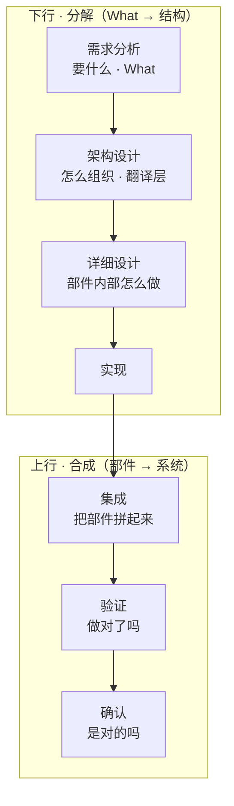
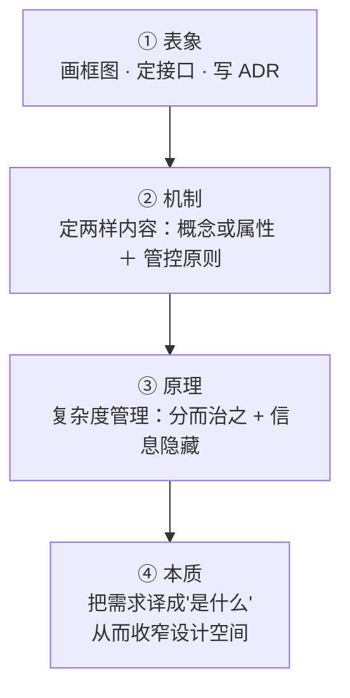
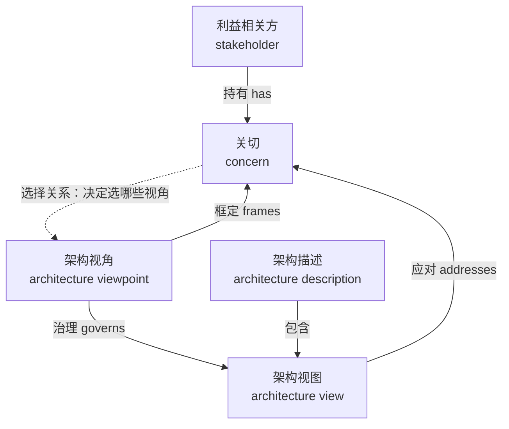
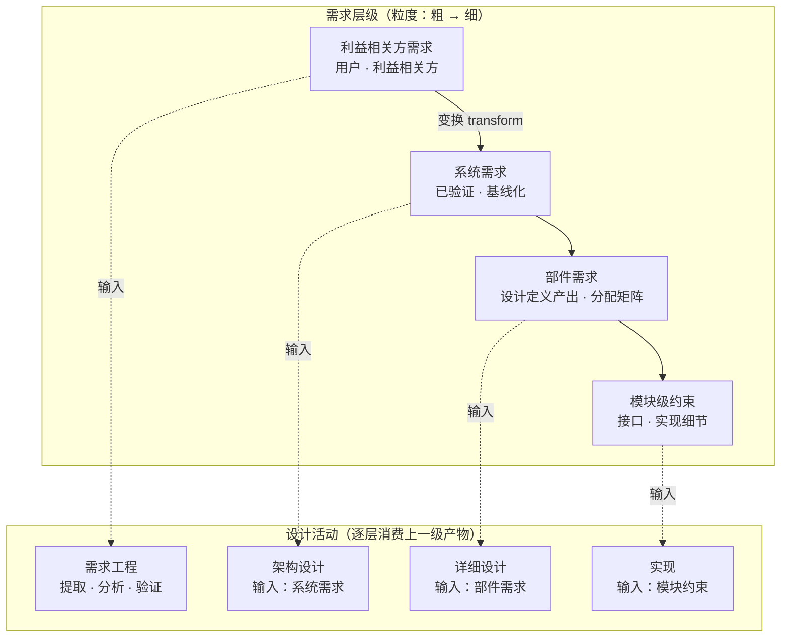
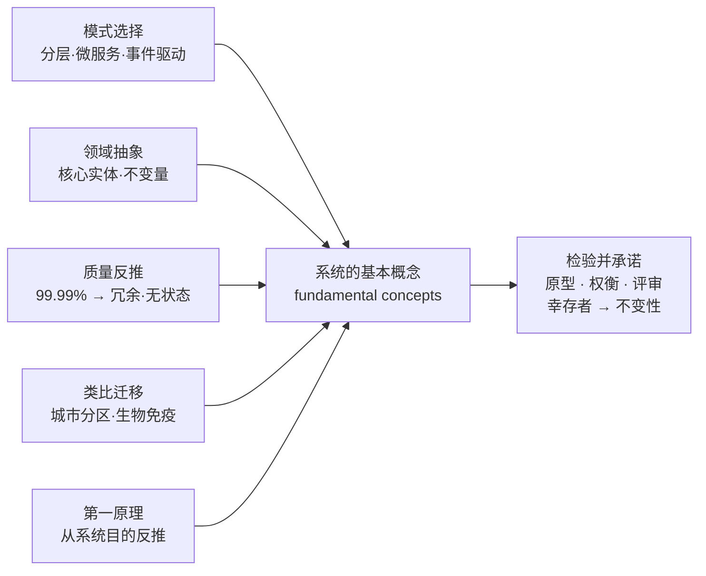
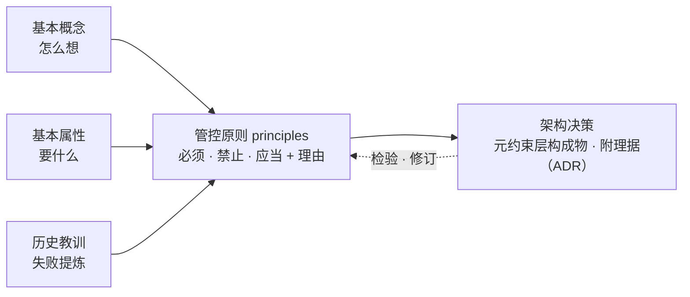

# 架构设计方法论全景 —— 从 ISO/IEC/IEEE 42010 定义到两样内容的设计方法

> **文档说明**：本文档整理自 2026-08-21 概念探索对话（当日补充：①"定义 vs 设计"元概念辨析；②"关切（concern）"完整展开与识别方法论），系统性回答"产品开发领域的架构设计"这一主题。
> 主线：**标准定义（42010）→ 本质 → 输入与工作（含关切识别）→ 需求层级 → 两样内容的设计方法（概念／属性／管控原则的实现侧与演化侧）→ 向下游设计的分流（元素与关系：架构"可以关乎"的对象，不在架构内容之内）→ 输入整合**。
> **标题口径（2026-09-21 加限定；2026-10-11 随框架改口；本轮撤下"一层边界"）**：「**两样内容**」是**工作内容视角**的切分——回答"架构工作要做出哪几样东西"（本文 §1.2 接驳块）；它与「规」的**约束层级视角**（元约束层支配对象约束层，24 号 §5.2）对象不同、不可互相替代，并读时以后者为准。**标题不再写"一层边界"**：元素与关系**不是架构的内容**（2022 定义句已无该分句；该层含义降为 42020:2019 §3.3 Note 1，注释级、无术语地位），架构对它们只能"**可以关乎**"（42010:2022 §5.2.2），故本文把它们从标题与 §10 章题上撤下，章内讲到处一律标"**向下游设计的输入**"（§1.2 该条、§9 章题）。旧称"五块"已废止（其第五块"元素与关系"不在架构内容之内，见 §1.2 与 §9）。
> 配套标准：**GB/T 45630-2025**（等同采用 ISO/IEC/IEEE 42010:2022，2025-11-01 实施；中文术语定名的依据）、ISO/IEC/IEEE 42010:2022（2011 为历史对照）、42020:2019、ISO/IEC/IEEE **15288:2023**（现行版；2015 为前版）、ISO/IEC/IEEE 25010、ISO/IEC/IEEE 29148、**ISO 1087:2019（术语工作——术语学词汇；concept §3.2.7／property §3.1.3／characteristic §3.2.1／definition §3.3.1）**、ISO 704:2009（术语工作——原则与方法；概念形成的**方法学**配套）、**ISO/IEC 2382-17:1999（信息技术词汇·数据库；attribute §17.02.12）**、ISO 9000:2026（质量管理术语）。
> **文档版本**：v1.0（2026-08-21 初稿）→ v1.1（2026-08-26 补充）→ v1.2（2026-09-04 架构定义升格 2022）→ v1.3（2026-09-21 依 30 号对齐四概念）→ v1.4（2026-09-21 第二轮收口：全面按 GB/T 45630-2025 定名）→ v1.5（2026-09-21 依 29 号对齐架构治理口径）→ v1.6（2026-09-21 依 27 号对齐 ISO 9000:2026 条款号）→ **v1.7（2026-09-21 第六轮·依 24 号对齐：五块与「规」两层结构的接驳、架构决策补出、代理判据校正）** → **v1.8（2026-09-21 第七轮·用户裁定第 1、2 条：标题加限定 ＋ 全文去 2011 化）** → **v1.9（2026-09-21 第九轮·15288:2023 过程号结清）** → **v2.0（2026-09-21 第十轮·依 23 号对齐：review／verification／validation 的判据定位、工作六步第 6 步正名、规定需求定译）** → **v2.1（2026-09-21 第十一轮·依 22 号对齐）** → **v2.2（2026-09-24 第十二轮·依库内标准正本结清挂账：G-10 属概念撤回、G-31 架构综合改挂 §8、G-34 AD 元素清单、G-35 属概念方向、G-36 派名）** → **v2.5（2026-10-12「以 35 号为基准的全库对齐」轮·§1.6 表「典型产出」行口径改正：原把「架构视图、蓝图、详细特性、规范」列入设计侧——架构视图是 AD 的信息部件（42010:2022 §3.7）、AD 是工作产品（§3.3），归架构；「蓝图」不作架构称谓（35 号 §十五 第 5 条）；改「设计方案（系统元素及其关系的规格）、详细设计描述、图纸、接口规格」并补口径注，引 15288:2023 §6.4.4.1、§5.9、§6.4.5.1 NOTE 1；结构、节号、表格行数与图结构一处未动）** → **v2.4（2026-10-11 依用户裁定清除 2011 版「设计准则／演进准则」二分（共 29 处＝正文 28 ＋ 版本行 1）：第 7、8 两章重铸为「管控原则（约束实现那一面）／（约束演化那一面）的设计」并补两章并读口径；目录两条与锚点、§1.2 骨架条目与接驳块、§7.1 收口句、§7.2 与 §10.1 图节点、§8 各行文与三张表、§9.1 一句、§10.2、§10.3、§11.2 术语表随改；"五块"容器残句「其余四块」「后面四块」改「其余各项／后面各项」；生成源与条目内容一字未改）** → **v2.3（2026-10-11 依用户裁定清除 2011 版"元素与关系"痕迹：§1.1 一句话定位改 2022 口径；§1.2「五块」改「两样内容＋一层边界」；§1.4 架构/详细设计分界由粒度轴改**种类轴**（15288:2023 §5.9）；§1.6 架构定义行改两样内容；§6.1 去"你设计的是结构"；**§9 整节重铸**为"架构可以关乎的对象（下游设计）"；§10.2 表与 §10.3 链同步；§11.2 废止「架构构成物」；**第二遍同族清扫**：H1／主线行／标题口径／目录第 10 项、§10 标题与导语、§10.2 节题、§1.5 与 §11.2 两处"五块设计总纲"、§7.4 末"两个并列的架构构成物"）** → **v2.6（2026-11-02 · 46 号对齐轮·判据换尺：§2.4「判据的主从」重写为三把尺，§1.5、§3.1、§3.2、§5.4、§6.4、§7.3、§11.2、§11.3、§11.4 同步；接口与需求分配撤出架构交付物、§3.3 步 5 改"分配与需求去向登记"；§9 重排、§10 整节重构；逐条见 §11.6）** → **v2.7（2026-11-02 · 46 号对齐第二轮·体例层：4 节重排、A 级 4 条四段、立 49 条台账、补冷链范例、文首沿革搬家、号形补名 3 处；逐条见 §11.6）** → **v2.8（2026-11-06 依 48 号 v3.25 对齐：十七处「三把尺」改按「一支填句三槽（三种填法）」表述；文首分工行错指 48 号 §5 改正；逐条见 §11.6）**。
> **概念依据**：架构、关切、架构视角、架构视图四概念的定义、关系、界分与译名，一律以 30 号《架构描述核心概念研究报告》为准（依 GB/T 45630-2025／ISO/IEC/IEEE 42010:2022）；**架构治理**（architecture governance）的定义、目的、对象、输入与输出、责任主体与机制，一律以 29 号《架构治理研究报告——从标准依据到责任主体》为准。
> **用语约定（2026-09-21 第二轮收口）**：术语一律按 GB/T 45630-2025 定名——viewpoint/view 作「架构视角／架构视图」，stakeholder 作「利益相关方」，life cycle 作「生存周期」（正文一律，不再从俗），governing principles 作「管控原则」（此处 governing 是**定语**，指具有约束力、可据以判定违规，与 architecture governance（架构治理）不是同一用法），specification 作「规格」；**唯一例外**：fundamental 自译作「基本」，逐字引 GB/T 45630-2025 时照抄「基础」。行文中的「关切」为「关切」的同义语，术语位一律作「关切」。本文档的「系统」在架构描述语境下均读作所关注实体（entity of interest）。
>
> **术语约定**（本系列统一）：
> - requirement → **需求**（need → 需要；expectation → 期望，三者不混用）
> - specified requirement → **规定需求**（验证的参照 = 规定需求，即被明示的需求）
> - ISO 9000:2026 §3.5.1：requirement = 明示的、通常隐含的或必须履行的需要或期望
>
> **当前口径**（现行结论摘引，逐条给出处）：
> - 架构定义只有**两样内容**：实体的基本概念或属性 ＋ 管控实现与演化的原则（42010:2022 §3.2；§1.2）；**元素与关系的规格不在其中**，归设计定义过程（15288:2023 §6.4.5.3 b) 2)）。
> - **"基本"没有判定式；判据是一支填句三槽（48 号 §2.3）**——概念看共同陈述、属性看四量实质动、原则看管控力，三种填法不可互换（§2.4.1）。
> - **改动代价是代理，不是准入**：准入关在一支填句三槽（三把尺＝三种填法），代价只在准入裁出的集合之内管排序与时机（§2.4.5）。
> - **质量属性是涌现属性**：不能分，只能译（§4.2.1）。
> - **工作六步**：第 4 步拆 4a 评估／4b 决策，第 5 步为"内容→实体的分配与需求去向登记"，第 6 步为评审与基线化（§3.3）。
>
> **与 48 号的分工**：**概念层**（内容只有两样、"基本"的一支填句三槽、清单≠描述、四层两道界与建模实体、视图四问、评估三对象与决策）主家在 **48 号 §2.3、§6.9、§7.2、§8.1、§9.24~§9.25、§11.4、§11.10**（术语档位见附录 C），本报告只引不重述；本报告承担的是**方法层**——概念从哪几条路径生成、属性怎么走四步流水线、管控原则怎么起句与校验、输入如何在内部成链、下游关系设计怎么定强弱（§5~§10）。**两轴不互替**：48 号管"是什么、凭什么算"，本报告管"怎么做出"。
>
> **逐条依据与论证位置见 §11.5「结论台账」**；旧版沿革见 §11.6，已废止口径见 §11.7。

---

## 目录

1. [架构设计是什么（定义与定位）](#1-架构设计是什么定义与定位)
2. [架构设计的本质](#2-架构设计的本质)
3. [架构设计的输入与具体工作](#3-架构设计的输入与具体工作)
4. [需求层级：架构设计与详细设计的输入差异](#4-需求层级架构设计与详细设计的输入差异)
5. [基本概念（fundamental concepts）的设计](#5-基本概念fundamental-concepts的设计)
6. [基本属性（fundamental properties）的设计](#6-基本属性fundamental-properties的设计)
7. [管控原则（约束实现那一面）的设计](#7-管控原则约束实现那一面的设计)
8. [管控原则（约束演化那一面）的设计](#8-管控原则约束演化那一面的设计)
9. [向下游设计的输入：元素与关系（架构可以关乎的对象）](#9-向下游设计的输入元素与关系架构可以关乎的对象)
10. [输入整合：两样内容的内部链与向下游的分流](#10-输入整合两样内容的内部链与向下游的分流)
11. [附录](#11-附录)

---

## 1. 架构设计是什么（定义与定位）

### 1.1 一句话定位

**架构设计是"把需求翻译成'架构'"的活动**——它产出的是**实体的基本概念或属性**（本质）与**管控原则**（管住该实体及其相关生存周期过程怎么实现、怎么演化）这两样，再经**架构描述**表达给各方。它不是"画个框图"，也**不是**"决定系统由哪些部分组成、部分之间怎么连接"——后者（**元素及其关系的规格**）归下游的**设计定义过程**（15288:2023 §3.13）；架构对它们的作用方式是"**可以关乎**"（42010:2022 §5.2.2）。它仍是产品开发中**最难以撤销的那两样内容**——但**"不可逆"只是代理判据，管排序与时机，不管准入**（24 号 §6）。

### 1.2 标准定义

**ISO/IEC/IEEE 42010:2022 §3.2**（"架构"的现行权威定义，架构设计就是产生它的活动）：

> **architecture** — fundamental concepts or properties of an entity in its environment and governing principles for the realization and evolution of this entity and its related life cycle processes

> **架构** = 实体在其环境中的**基本**概念或属性，以及该实体及其相关生存周期过程的实现和演化的**管控原则**（governing principles）。

（fundamental 自译作「基本」；逐字引 GB/T 45630-2025, 3.2 时照抄国标字面「基础概念或属性……管控原则……生存周期过程」。）
>
> **出处**：GB/T 45630-2025, 3.2 ／ ISO/IEC/IEEE 42010:2022, 3.2（定义源自 ISO/IEC/IEEE 42020:2019, 3.3）。

> **【历史对照】** 2011 版（42010:2011 §3.2）：fundamental concepts or properties of a *system* in its environment *embodied in* its elements, relationships, and in the principles of its design and evolution——即"系统在其环境中体现的基本概念或属性，落实在它的要素、要素间关系、以及设计与演进的原则之中"。两版差异：① 主体 system → entity（entity of interest，所关注实体扩域）；② "embodied in elements/relationships/principles" 在 2022 **删去**（不再以元素与关系界定架构；elements/relationships 改作**架构可以关乎的对象**（**42010:2022 §5.2.2**）——升格分句已删，它们**不是**描述层的 AD 元素）；③ principles 升格为 **governing principles**（管控原则，定语位 governing），并把 design 换为 realization、同时及于该实体与其相关生存周期过程。系统是 EoI 的一种——本文档的"系统"均可读作 EoI。

2022 定义句的构成只有两项：基本概念或属性 ＋ 管控实现与演化的原则。本方法论从**工作内容**视角把它拆为**两样内容**（本文档第 5~8 章逐一展开），并单列"架构对下游提什么要求"（第 9 章）与输入整合（第 10 章）：
- **基本概念**（fundamental concepts）——系统"怎么想"
- **基本属性**（fundamental properties）——系统"具备什么**属性**"
- **管控原则**（2022 定义正文只有**一个**表述：governing principles for the realization and evolution；2011 作 principles of its design and evolution——**两版不是同物异写，是覆盖面扩张**：由"设计"扩为实现与演化、并及于该实体与其相关生存周期过程，且升为 governing，24 号 §5.2 注）——**一条**，同时约束"怎么设计对"与"怎么变而不破坏对"**两个方向**（本文第 7、8 两章分别写这两个方向，不是两个并列的内容项）；标准并无"设计准则／演进准则"两个对应术语
- **一层边界（非定义项）：要素与关系**（elements & relationships）——**它们不是架构的构成物**。elements/relationships 在 2011 定义句里与 concepts/properties 并列，2022 定义句已**删去**该分句；该层含义降为 42020:2019 §3.3 Note 1（"通常意指体现于实体的组件、组件间关系、实体与环境的关系"），**注释级、无术语地位**。架构对它们的作用方式是"**可以关乎**"（42010:2022 §5.2.2）；它们的**规格**归设计定义过程（15288:2023 §3.13）。故 **§9 讲的是"架构对下游关系设计提什么要求"，不是"架构工作的第五块内容"**。**也不要把它叫「AD 元素」**：AD element 指**描述本身的零件**（共 11 类，42010:2022 **§3.4 Note 1**；**架构决策与理据不在其中**——含该两项的清单在 **§5.2.9**），两者隔着描述层与实体侧（24 号 §12.1、§12.5）。

#### 1.2.1 为什么元素与关系不在架构的内容里〔论证〕

**结论**：架构设计这门活动产出的全部内容是**实体的基本概念或属性**与**管控实现与演化的原则**两样；元素及其关系的**规格**不在这两样之内，它归下游的设计定义过程。

**依据**：
- **42010:2022 §3.2**（逐字·规范）：*fundamental concepts or properties of an entity in its environment and governing principles for the realization and evolution of this entity and its related life cycle processes*（中译：实体在其环境中的基本概念或属性，以及该实体及其相关生存周期过程的实现和演化的管控原则）。
- **42010:2022 §5.2.2**（逐字·规范）：架构 *can pertain to* 五类，其中含 *constituent elements*、*interactions or interrelationships among its elements*（中译：**可以关乎**构成元素、元素之间的交互或相互性）。
- **15288:2023 §6.4.5.3 b) 2)**（逐字·规范）：*Transform architectural entities and relationships into design elements*（中译：把架构侧实体与关系**转换**为设计元素）——转换发生在设计定义过程，不在架构定义过程。
- **42020:2019 §3.3 注 1**（**资料性**）：*usually intended to be embodied in* the entity's components …（中译：通常意在体现于该实体的组件……）——句带 *usually intended to be*，是 NOTE。

**推理**：① 定义句的谓语只有两项（概念或属性／原则），主语只有一个（这个实体）；元素与关系不在句中任何位置。② 标准要表达"架构与元素、关系有干系"时用的是 *can pertain to*（可以关乎）——**射程模态**，不是 *comprises*（构成）模态；同一节里两个模态并存，正说明这是两件事。③ 若元素与关系属架构内容，则 15288:2023 §6.4.5.3 b) 2) 那句"转换为设计元素"无事可做：能被转换的，正是还没成为设计元素的东西。

**反证**：设元素与关系的规格属架构内容。那么 42020:2019 §10.4.4 e) 的分配就有两个落点（"要建模的实体与关系"／"架构内容里的元素与关系"），而该条逐字只写 *to the entities and relationships to be modeled*（中译：分配到**要建模的**实体与关系）——标准不会在 e) 里只写一个落点。同时 15288:2023 §5.9 那句"架构侧实体与系统元素代表**两种不同的概念**"也失去意义：两者既同属架构内容，就无须分辨。

**边界**：本节**不主张**架构与元素、关系无关——主张的是关系方式为"可以关乎"，不是"构成"。也**不主张**架构不该提元素：15288:2023 §6.4.4.2 g) 把"系统元素及其接口被定义"列为架构定义过程的**成果**之一，那是过程成果，且只定到传达架构意图的程度（15288:2023 §6.4.5.3 注 10）。**哪一半本报告不能定**：架构意图要写到多深——那是 42020:2019 §5.6 的裁量，定义句判不了。

> 〔按："两样"是定义句的两项；落到产出仍是**三张清单**——概念、构成性属性、许可性原则，**有序且依赖**（42 号 §5.4、§5.5）〕

> **〔接驳·依 24 号 §5.2（2026-09-21 补；2026-10-11 随"五块→两样内容＋一层边界"改口）〕「两样内容＋一层边界」与「两层」是两把不同的尺子，对象不同、不可互相替代。** **两样内容**（基本概念／基本属性；管控原则——**一条**，同时约束实现与演化两个方向）**＋一层边界**（要素与关系——**不在架构内容之内**）是**工作内容视角**的切分——回答"架构工作要做出哪几样东西"；24 号 §5.2 的「元约束层／对象约束层」是**"规"的约束层级视角**的切分——回答"哪些内容构成**由架构转化而来、可据以判定设计违规的规定需求**"，其合法性来自"选定 + 基线化"（24 号 §4.2）。两者不是同一张清单的两种排法：**并读时以 24 号 §5.2 的两层结构为准**——**元约束层（架构原则 · 架构决策 · 演进承诺）支配对象约束层（架构实体 · 接口约定 · 特性分配）**。落到本文：第 7、8 两章写的是**同一条管控原则的两个方向**，合起来对应元约束层的**架构原则**与**演进承诺**两项（"规"里没有把它们拆成两件东西）；**架构决策**是 24 号 §5.2、§5.4 单列的第三项元约束构成物——2022 版由概念模型元素升为**强制记录内容**（42010:2022 §5.2.12 + §6.10），本文的落点见 §1.5（ADR 交付物）与 §3.3 第 4b 步；第 5、6 章的内容落在对象约束层一侧；**第 9 章的要素与关系不在架构内容之内**——它们是架构"可以关乎"的对象，其规格归设计定义过程。

> **〔两哲学注（2026-09-21 依 22 号对齐；本条按正本派名校正）〕** 定义句里 `concepts **or** properties` 这一**析取式**不是随手并列，而是为**不带偏见地**兼容两种哲学而选（工作组表态 *without prejudice*）：**Architecture as concept**（架构是**人脑中**的实体概念，架构师中心，重 concepts）；**Architecture as property**（架构是**所关注实体**的属性或特质，观察者中心，重 properties）——两派派名逐字见 **42010:2022 附录 A.2**（全文检索 `Perception` **零命中**；「Conception 派／Perception 派」系 **2011 口径的二手转述派名、库外不可核**）。**两派之下架构都是抽象的、不是人工制品**（*Under either philosophy, an architecture is abstract — not an artifact*——**42010:2011 口径，库内无 2011 全文故不可核**，不得以现行版身份引用），故 §1.5 的交付物只能是**表达架构的工作产品**，不能把架构本身当制品。2022 的同源落点是 **42010:2022 §3.18 stakeholder perspective**（关切的一个来源）——**同源而不同物**，2022 并未把两哲学条款化（22 号 §5.4、§5.6）。

### 1.3 在开发流程中的位置（V 模型）

架构设计位于**需求分析之后、详细设计之前**，是 V 模型下行分解的第二个环节、上行合成的"成败决定者"——需求没分对、接口定错了，集成阶段必然爆雷。



关键点：**架构设计是唯一一个"既管下行、又决定上行成败"的环节**。业界因此称架构决策为"延迟成本最高"的决策。

### 1.4 架构设计 vs 详细设计：分界在**种类**，不在粒度

| 维度 | 架构设计（Architectural design） | 详细设计（Detailed design） |
|---|---|---|
| 作用面（**种类**） | 实体在其环境中的**基本概念或属性**与**管控原则** | **元素及其关系的规格**（足够完整到足以支撑对架构的一次合规实现） |
| 分界判据 | **这份内容能不能被设计违反**（24 号 §14.1） | —— |
| 核心问题 | 这个实体**什么是基本的**、它必须**怎么造、怎么变** | 各元素与接口**做成什么样** |
| 决策内容 | **概念、属性、管控原则**（边界与接口的意图在其中） | 算法、数据结构、逻辑流程 |
| 变更代价 | 高——牵一发动全身 | 相对低，局限在部件内 |
| 发生时机 | 概念/方案阶段（IPD 概念→计划） | 开发阶段 |
| 典型产出 | 架构描述、架构视图、ADR | 详细设计说明书、类图、伪码 |
| 检验方式 | 架构评审 | 设计走查 / 代码评审 |

**一句话记法（经验启发式，不是分界判据）**：架构设计回答"这栋楼是什么、必须守什么"；详细设计回答"每个房间怎么装修"。前者错了要拆楼，后者错了重刷一遍就行。

**横竖分工（同样是启发式）**：习惯上架构设计偏"横向"（先定边界与原则），详细设计偏"纵向"（再往每块里面挖）。但**分界不在粗细**——2022 的判据是**种类**。15288:2023 **§5.9 逐字**："架构管的是**适宜性、存续性与合意性**；设计管的是与技术及其他设计元素的**兼容性**，以及**构建与集成的可行性**。**有效的架构尽可能不依赖于设计。**"

### 1.5 交付物（work products）

| 交付物 | 内容 | 说明 |
|---|---|---|
| **系统目的或任务理解确认单**（2026-08-26 补） | 目的或任务原文引用 + 架构师复述理解 + 业务方确认签字 | **架构设计的入场券**——目的与目标的锚点凭证（它是判据的**方向来源**，**不是尺**——尺见 §2.4）；签字之前，后续一切交付物都失去参照（纯理解、零架构，见 §3.2 论断 3） |
| **系统基本概念和基本属性清单**（2026-08-26 补） | fundamental 成员资格登记表：每条注明 ① 概念/属性的定义 ② 论证（**属性**写"四量实质动"——对实体**在其环境中**效用／成本／时间／风险的**实质贡献**，42010 附录 A.2，资料性；**原则**写"管控力与可检"——违规看不看得出、能不能变成评审检查项；**概念**写"缺了它、相关方还能不能对『这个系统是什么』达成一致"，见 §2.4、§5.4 与 42 号 §5.6）③ 到目的/需求的追溯链 | **成员资格裁定的产物**——两样内容（第 5~8 章）的总纲、架构评审的第一张核对单。清单本身基线化，条目增删走变更控制（命名取"清单"后缀 = 受控枚举，见 **06 号 §11.6「术语纪律——俗名优先」**）。〔清单的合法位置（2026-09-21 依 22 号对齐）：该清单**不是 42010 的反命题**，而是 **architecting（42010:2022 §3.1）七步动作集**——conceiving, **defining**, expressing, documenting, communicating, certifying proper implementation of, maintaining and improving——中 **`defining` 一环的产物**；呈现上**按 aspect（§3.9）分块**（标准 EXAMPLE：functional／structural／informational），即 functional 清单 ＋ structural 清单 ＋ informational 清单……是 2022 官方承认并标准化的清单化结构。在 L1~L5 五层框架中，清单住 **L3**（L1 抽象本体不可清单化／L2 definition 集半可／**L3 概念＋属性清单**／L4 关系与原则／L5 AD）——**"abstract" 不能读成 "list"**，抽象本体与清单化产物是两层（22 号 §6.4、§7.3、§8.2；本报告 §1.2 定义句的 X 块是 L1，不是 L3）。〕 |
| **架构描述 AD**（Architecture Description） | **一组架构视图**（architecture views）；每张视图标明**治理它的**架构视角 | 同一座系统，不同利益相关方看到不同"图"：每个**架构视角**规定一类人关心的问题集及表达约定，每个**架构视图**是对该架构视角的具体表达。**架构描述（AD）不是一张框图，而是一组按架构视角组织的架构视图**（每张视图标明其治理视角，42010:2022 §6.7 b)）；**架构本身是抽象对象（30 号 §6.2），只能由 AD 表达** |
| **架构决策 ADR** | 取舍、备选方案、后果 | 记录"为什么这么选"——补上决策的理由，防止后人（包括三个月后的自己）对决策一脸懵。**2022 版已把「架构决策与理据」由概念模型元素升为强制记录内容**（42010:2022 §5.2.12 + §6.10），且它是"规"的**元约束层**构成物之一（24 号 §5.2）——**架构决策最易漏审，因为它常以"背景说明"的形态出现**（24 号 §5.4） |

**下游交付物（不属于架构交付物）**：**接口规格书、需求分配矩阵**——两项都归**设计定义过程**（15288:2023 §3.13、§6.4.5）；架构侧只把接口定到"**足以传达架构意图**"（42020:2019 §5.6），并对每条需求登记**去向**（变换／覆盖／转交，15288:2023 §6.4.4.2 e)；见 §3.3 第 5 步）。

> 上表四样正是**架构评审（architecture review）**逐条核查的对象；下游两项评审只核其**接口意图**与**需求去向**是否留痕。

> 〔**属概念注（2026-09-21 依 22 号对齐；本条按正本重写）**〕本表凡指 **AD 自身**，属概念写**工作产品（work product）**（42010:2022 §3.3：AD ＝ work product used to express an architecture）——**不写 artifact／制品**；**架构视角不写属概念**——42010:2022 **§3.8 定义句是裸名词短语**（*set of conventions for the creation, interpretation and use of an architecture view (3.7) to frame one or more concerns (3.10)*），**句中无 work product**；凡标准明写属概念者不可省，明写的只有两条：**AD ＝ work product（§3.3）**、**架构视图 ＝ information part（§3.7）**。`artefact` 与 `work product` **互为属概念、方向相反**——15288:2023 §3.6 artefact＝*work product that is produced and used during a project to capture and convey information*（15288 侧 artefact ⊆ work product），42010:2022 §3.3 Note 1＝*A work product is an artifact produced by a process*（42010 侧 work product ⊆ artifact）；本项目仍作**分流译名**——指 15288 侧写「人工制品」、指 42010 侧写「工作产品」，**理由是所属标准不同、属概念层级不同**。本节标题与下表 AD 行的"交付物"即此义：AD 是工作产品，架构本身是抽象对象（不能交割、不能签收）。

工作产品一行的档位见 **48 号 §附录 C**；22 号的属概念引证见其 §12 第 34 行。

分工一句话：**确认单锚定方向（目的与目标进场），概念属性清单裁定"什么是根本的"（一支填句三槽：属性＝四量实质动、概念＝共同陈述、原则＝管控力，见 §2.4、§5.4），AD 表达"根本的长什么样"（视图集合），ADR 记录"为什么这么定"（权衡留痕）；接口与需求分配不属于这四样**——它归下游的设计定义过程（15288:2023 §3.13），架构只留接口意图与需求去向。确认单是锚，概念属性清单是纲，AD 与 ADR 是目——锚不定则纲不举、目不张：没有方向锚点，成员资格裁定无从谈起；没有清单，AD 的视图取舍、ADR 的决策边界都没有参照，评审只能就图论图。

### 1.6 定义 vs 设计：先分清两个词

架构领域有三个天天混用的词——需求定义、架构定义、设计定义。先厘清"定义（definition）"与"设计（design）"这对元概念，才能看懂 15288 的命名逻辑。

| 维度 | 定义 Definition | 设计 Design |
|---|---|---|
| 回答的问题 | 它是什么（what it is） | 怎么做 / 怎么造（how） |
| 语言性质 | 陈述性 descriptive（描述事实） | 规范性 prescriptive（给出方案） |
| 评价判据 | 求真：准确、无歧义、可验证 | 求优：满足需求、权衡取舍、可实现 |
| 典型产出 | 术语表、需求规格、边界、接口 | 设计方案（系统元素及其关系的规格）、详细设计描述、图纸、接口规格〔**口径注（2026-10-12 依 35 号基准）**：原列作「**架构视图、蓝图、详细特性、规范**」——**架构视图不属设计侧**：它是**架构描述（AD）的信息部件**（42010:2022 **§3.7**）而 AD 是**工作产品**（§3.3），归**架构**。本表是「定义 vs 设计」二分，**架构不与二者同列**（架构由需求被 *transforms* 出来，设计又须与架构相容：15288 **§6.4.4.1**／**§5.9**；见 35 号 §二）。「**蓝图**」不作架构的称谓（35 号 §十五 第 5 条），此处亦不再用作设计产出名——正本作 *drawings and **detailed design descriptions***（15288 **§6.4.5.1 NOTE 1**）。〕 |
| 代表出处 | ISO 704（术语工作方法学；定义的权威见 §11.2）＋ 15288 需求定义过程 | ISO 9000:2026 §3.3.11、15288 设计定义过程 |
| 生存周期位置 | 前端，框定**问题空间** | 中段，在**解空间**里创造 |

**词源定盘**：define ← 拉丁语 **de-finis**——de（彻底地）+ finis（界限）→ **"划出边界"**。定义 = **划界 + 陈述**：先确定它覆盖什么、不含什么，再写成精确的描述。（同源家族：concern 来自 concernere = con + cernere"筛取"→"被牵涉进来的"，见 3.5。）

**ISO 9000:2026 §3.3.11**（设计的标准定义）：
> 设计和开发（design and development）——将客体的需求转换为对其**更详细的需求**的一组过程。
>
> （注 3：限定词可用以指明被设计开发对象的性质，如产品／服务／**过程**设计和开发。该注两版均有，2026 仅措辞微调。）

注意动词：设计是**转化（transform）**——输入是已定义好的需求，输出是解决方案的特性描述。它不负责说"系统是什么"，负责说"系统怎么兑现承诺"。

**四层"定义"是同一个动作**（划界 + 陈述）在不同对象上的重复：

| 定义过程 | 划什么界 | 陈述成什么 |
|---|---|---|
| 术语定义 | 与相邻概念区分 | 一句精确的陈述（ISO 1087:2019 §3.3.1；见 §11.2） |
| 需求定义 | 系统范围与边界 | 可验证的需求条目 |
| 架构定义 | 基本概念或属性 · 管控原则 | 架构描述与架构视图（42010:2022 §3.2、§3.3） |
| 设计定义 | 各元素的规格 · 接口 | 设计特性与详细规范 |

**关键洞察**：设计本质上也是"定义"的一种——只是定义的对象从"问题/术语"换成了"解决方案"。15288 里只有"架构定义过程""设计定义过程"，没有"架构设计过程"，因为**过程以产出物命名，而产物必须被定义**（构思无法评审，描述才能评审、验证、基线化）。一句话：**设计是动词（构思），定义是它的完成时（定形）。**

---

## 2. 架构设计的本质

### 2.1 一句话本质

**架构设计是把需求译成"这个实体是什么"的机制——产出实体的基本概念或属性与管控原则，从而在动手之前收窄下游的设计空间。**

（注意区分：第 1 章回答"它做什么"（功能定位），本章回答"它为什么存在"（本质）。）

> "去掉它还能不能成就目的"这一问**不成立**（见 **48 号 §2.3**）；本章的判据见 §2.4（一支填句三槽，三把尺＝三种填法；主家 48 号 §2.3）。

### 2.2 论证：两个事实的矛盾

| 事实 | 内容 | 后果 |
|---|---|---|
| **信息随时间递增** | 需求永远不可能一开始就完全清楚——隐含需求、未来需求、技术变化全在之后浮现 | 决策时信息总是不足的 |
| **改动代价随时间爆炸** | 结构定下后，部件间潜在交互是 n² 量级；越晚改，要重新理解、重新验证的越多，代价指数上升 | 决策后反悔成本越来越高 |

**矛盾**：最难改的决策（切分、接口、原则），偏偏必须在信息最少的时候做（**这是时机问题，不是准入问题**——§2.4.5）。
**架构设计的本质**＝**把需求译成"这个实体是什么"**（基本概念或属性＋管控原则），从而收窄下游的设计空间（§2.1）。"把难改的决策尽量提前、把易改的决策尽量推迟"是它在**时间与优先级**上的操作推论（**从属的经济校验**，§2.4.5），**不是本质**：它管排序与时机，不管准入。

### 2.3 四层拆解（表象 → 本质）

| 层级 | 内容 | 说明 |
|---|---|---|
| ① 表象 | 画框图、定接口、写 ADR | 外人看到的"架构工作长什么样"，不是它为什么存在。注意"定接口"不是架构的产出——元素及其关系的**规格**归**设计定义过程**（15288:2023 §3.13）；架构侧只把接口定到"**足以传达架构意图**"（42020:2019 §5.6），并对每条需求登记**去向**（变换／覆盖／转交，见 §3.3 第 5 步）。 |
| ② 机制 | **把需求译成"是什么"：定出基本概念或属性、立管控原则**＋权衡 | 架构的产出是**概念或属性 ＋ 管控原则**（42010:2022 §3.2）；**架构的"约束"是管控原则，不是对元素切分与连接的规定**——切分与连接是**设计定义过程**的活（对元素及其关系的规格）。 |
| ③ 原理 | **复杂度管理**：分而治之 + 信息隐藏 | 系统规模一大，部件间潜在交互 n² 级，单个头脑装不下；用 Parnas 1972 的模块划分判据把复杂度**局部化**——部件内部可以复杂，部件之间的复杂度被接口锁死 |
| ④ 本质 | **把需求译成"这个实体是什么"，从而收窄下游的设计空间** | 架构设计＝把需求译成实体的**基本概念或属性与管控原则**，从而收窄下游的设计空间（42020:2019 **E.2.1** 第七隐喻 *architecture as constraint*）；**复杂度管理与不可逆性都是它在现场投下的影子与后果，不是它本身**（不可逆性只是排序·时机·权限的操作尺，见 §2.4）。旧口径见 §11.7。 |



### 2.4 判据：什么算"架构"


> **"Architecture is about the important stuff. Whatever that is."**

> —— Ralph Johnson（GoF 作者之一）

>

> 架构是关于"重要的事"的——管它是什么。


这句话把定义推到了极限：什么算"重要"？**通行读法**是"改了它，代价有多大"；本报告把它降为**代理**（理由见 §2.4.5）——**准入由那一支填句裁，代价管排序**。把"难改的"当成架构，等于拿变更影响半径去顶定义位；该句作为反面引文收在 §11.7。


> **"基本"没有判定式，判据是一支填句三槽**（三把尺＝三种填法；48 号 §2.3、§3.4；旧尺见 §11.7）：

> - **概念**——理解上的不可省：去掉它，"这个实体是什么"还成不成套？相关方能共同陈述吗？（42010:2022 附录 A.2 *fundamental or essential to the **understanding***，**资料性**）

> - **属性**——对实体**在其环境中**效用／成本／时间／风险的**实质贡献**（42010:2022 附录 A.2，**资料性**）；四量**任一实质动即判基本**。

> - **原则**——管控力：管得住实现与演化，违规看不看得出（42020:2019 §10.2 d)）。

>

> **三槽不可互换**：拿"去掉它目的不成"裁概念＝把概念当属性；拿"有没有约束力"裁概念＝把它当原则。


#### 2.4.1 为什么"基本"没有判定式〔论证〕


**结论**：三份正本都不给"基本"的判定式；判"基本"要按对象分用三种填法（俗名"三把尺"）——概念看理解上的不可省，属性看实体在其环境中四量的实质贡献，原则看管控力；三槽不可互换。


**依据**：

- **42010:2022 §3.2**／**42020:2019 §3.3**／**15288:2023 §3.5**（三份均逐字·规范）：定义句一律作 *fundamental concepts or properties*，**无相对从句**（没有"相对于什么而言基本"）。

- **42010:2022 §6.2**（规范）：识别"其关切**被认为对架构是基本的**"相关方——原话 *considered fundamental*，**不写由谁 considered**。

- **42010:2022 附录 A.2**（**资料性**）：两句分列——*fundamental or essential to the **understanding***（中译：对**理解**是基本的）与 *contribute to its utility, cost, time and risk **within its environment***（中译：贡献于**它在其环境中**的效用·成本·时间·风险）。

- **42020:2019 §10.2 d)**（规范，已核）：架构视图与模型须充分表达"指导被架构实体**开发与演化**的原则与准则"（*principles and precepts*）——这是原则那一侧在正本里的落点。


**推理**：① 该写而不写，只能读作"有意留给判断"——42010 对需要判据的地方写得极细（§6.7 的覆盖四项、§6.4 的识别、§8.1 的七项），唯独"基本"只给一个形容词。② 三个名词的语义角色不同：概念是"用什么说"、属性是"它有什么"、原则是"不许怎样"——**同一条尺不可能同时量这三件事**。③ 附录 A.2 把两句分列，正是把这个区别写出来了；分列不是修辞，是给三个对象各配一把尺。


**反证**：设存在统一判定式，例如"去掉它，目的成不成"。它在**概念**上立即失效：去掉一个用于共同陈述的区分，目的未必落空（换个词照样谈），但**这个实体就说不成一套了**——一条尺子同时给出"非基本"与"基本"两个答案，等于没有尺。一条尺子在多数场合给出错答案，与"标准要对一切使用者成立"的体例相悖。


**边界**：本节只否认"标准给了判定式"，**不否认工程上可以有**——那一支填句就是补法（〔读法〕，非标准规定）。也不覆盖阈值、裁定人与公式：标准三样都不给；线画在哪，见 §2.4.2 与 §2.4.3。


> 五张准入（清单·需求去留·视图·组件·建模实体）见 **48 号 §2.11**；本节只给第 1 张单的那一支填句；其条款逐条见 **48 号 §2.3、§2.8**。


#### 2.4.2 "实质"＝越线或改选


**"实质"＝越线或改选**：越过一条**事前**立好的线（42030:2019 §4.2 注 3 *prior*，**NOTE，资料性**，原话 *could need to be*）／翻转一个已记录的决策或"架构上重要的需求"（42010:2022 §6.10.1；15288:2023 §6.4.4.2 c)）。两者皆不成立＝**微动**。


**两种"成本／时间"要分开**：42010:2022 附录 A.2 的四量属"实体在其环境中"，**不含"改架构的工程花费"**（后者对所有条目都成立，不具判别力）。


**边界由那一支填句分对象裁，不由"不可逆程度"单独裁**：不同系统"架构"的边界不同（微服务里 API 契约是架构，单机脚本里连数据库 schema 都不算）——属性侧看四量任一**实质**动、概念侧看相关方还能不能**共同陈述**、原则侧看违规看不看得出。"不可逆程度"是从属的经济校验，只做时间与优先级排序（24 号 §6.1、§6.3）。


#### 2.4.3 目的不是尺：它给的是线的来源与方向


目的**不是尺**，它给的是**线的来源与方向**——"这个实体为什么存在"决定哪些线是硬线；按标准的主要用法，`purpose` 指**这份描述／这张视图／这次评估工作拿它做什么**（42010:2022 §3.8 注 2；42020:2019 §10.4.3 e)）。**故"目的单独裁决"越位，且那一问在架构阶段判不了**——目的成不成就取决于实现、验证、运行与外部条件。


#### 2.4.4 权责三分：提·判·裁，判定须留痕


**"基本"的判定不是架构师一个人的事**：相关方**提**（含架构师）／架构师**判**（贡献分析）／治理**裁**（裁定记录）；裁定不是共识投票，法定与环境硬条件不可被否掉，判定须留痕，沉默方由治理**代持**（§3.1、§5.4；48 号 §2.8）。


操作化为**不变量判据**：在演化与重实现中必须守住、否则系统就说不到同一套话、也守不住同一组量的那些**内容**。判别问句按对象分用、**不得互换**：**属性侧**——「这个东西变了，对实体在其环境中的效用／成本／时间／风险，有没有一条**实质**动？」（四量任一实质动即判基本）；**概念侧**——「去掉它，相关方还能不能对这个实体是什么共同陈述？」（§5.4）；**原则侧**——「去掉它，某种实现或演化会不会变成被允许的？违规看不看得出？」。"系统就不再是它自己"是**概念侧**的直觉表述，不能拿去裁属性。


#### 2.4.5 为什么改动代价只能是代理〔论证〕


**结论**：Ralph Johnson 那句"架构是关于重要的事"的通行读法（**难改的就是架构**）只是一条**代理**；准入由那一支填句裁，改动代价只在准入裁出的集合**之内**做优先级与时机排序。


**依据**：

- **42010:2022 附录 A.2**（**资料性**）：四量属"实体**在其环境中**"，主语是 *its* utility, cost, time and risk *within its environment*——不含"改架构这件工作"的花费。

- **42010:2022 §6.10.1**（规范）：选"要记录的决策"时确列"对变更高度敏感""改动代价大"两项——**这是决策记录的选取标准，不是内容准入标准**。

- **42030:2019 §4.2 注 3**（**NOTE，资料性**）：*Pass/fail criteria could need to be established prior to performing the evaluation*（中译：可能需要在实施评估之前建立合格／不合格准则）——"可能需要"的指南，不是义务。

- **42020:2019 §10.2 d)**（规范）：原则须可检。


**推理**：① **一个对所有条目都成立的量，不能区分基本与非基本**——任何内容改起来都花工时，这是判据的最低要求。② 附录 A.2 的主语写明四量属"实体在其环境中"，属运行侧；"改架构的工程花费"属项目侧，两者混用即换了主语。③ 若以代价作准入，会同时放过两类错判：难改但无关紧要的被判进架构（刻在石头上的装饰），易改但一改就伤效用的被判出去。


**反证**：设代价即准入。那么同一批内容在"文档写得详细"与"文档写得简略"两种情形下会得出两种基本性结论——判据随文档厚度变，**判定不可复核**；而 42010:2022 §6.10 要求决策记理由，恰恰为了可复核。


**边界**：不否认代价判据有用——它是**从属的经济校验**，管"哪些要提前锁死、锁到什么程度、哪些保留自由度"，也管评审与时机排序。也不否认它在**决策记录**层面的合法性（§6.10.1 认这一条）。**哪一半本报告不能定**：锁死的程度——那是项目治理的裁量。


**代价判据是从属的经济校验**：在准入判据裁出的根本集合**之内**，决定"哪些要提前锁死、锁到什么程度、哪些保留自由度"——它不产生新的架构成员，只做优先级与时机的排序。


**顺序不可颠倒**：先过**准入关**（是不是根本的，那一支填句），再过**代价关**（值不值得现在定死）。两种错位都是病——用代价判据越过准入判据：把难改但无关紧要的东西误当架构；跳过代价校验：把根本的东西不分轻重全部锁死，演化窒息。


### 2.5 类比：围棋开局

开局时你对对手的意图了解最少，但开局落子决定了整盘格局，中盘几乎无法推翻——所以高手开局求"厚"、落子留余地。架构里对应"**保持选择权**"：好架构不是把路都铺好，而是把改不动的定死、把能改的留活。最烂的架构是"开局就把自己下死"。

---

## 3. 架构设计的输入与具体工作

### 3.1 输入六类

| 类别 | 具体内容 | 典型例子 |
|---|---|---|
| **目的与任务** ⭐（2026-08-26 补） | 系统为什么存在（why）——使命、业务目标、商业论证、问题空间 | 企业战略目标、产品定位陈述、任务书（上游：15288 业务或任务分析流程）〔按：本列的"企业战略目标"属**战略**（选择，会变），与实体**目的**（存在理由，相对稳定）分开（42 号 §5.2）；本行是**上游参照**——它**不在** 15288:2023 **§6.4.4.1** 的输入清单里（该清单只有五类：相关架构／方针与指令／生存周期概念与约束／相关方关切与需求／系统需求与约束），真正进到架构设计里的是由它派生的**目标与需求**（48 号 §3.6）〕 |
| **需求·功能** | 系统要做什么（what） | 用例、功能规格 |
| **需求·非功能** ⭐ | 做到什么程度（质量属性） | "3 秒内响应"、"99.99% 可用"、"支持 10 倍扩容" |
| **约束** | 不可谈判的限制 | 指定技术栈、法规合规、成本上限、工期 |
| **环境** | 系统所处的上下文（42010 的 environment） | 部署在边缘设备、必须对接遗留系统、团队能力 |
| **关切** | 利益相关方关心的（concerns） | 老板关心成本、运维关心可观测性、安全官关心隔离（完整展开 + 识别方法论见 [3.5](#35-关切concern架构设计的起点)） |
| **资产** | 可复用的输入 | 参考架构、既有代码、行业标准 |

**六类的两组职能（2026-08-26 补）**：判据侧与空间侧分开——**约束、环境、资产**圈定**选项空间**（约束砍候选、环境定舞台、资产提供可继承的不变量）；**目的与任务、关切、需求**（功能+非功能）供给**判据**。判据侧内部**不是"一个居首的裁决者"，而是三把按对象分工的尺**（§2.4；48 号 §2.3、§3.4）：**属性**看对实体在其环境中效用／成本／时间／风险的**实质贡献**（42010 附录 A.2，资料性；四量**任一实质动即判基本**）；**概念**看**共同陈述**（缺了它，相关方还能不能对"这个系统是什么"达成一致，42 号 §5.6；见 §5.4）；**原则**看**管控力**（管不管得住实现与演化、违规看不看得出，42020:2019 §10.2 d)）。**目的与任务在这一侧给的是方向与线位，不是尺**——它决定哪些线是硬线（§2.4）；关切与需求是它的操作化展开——关切源于利益相关方对目的的利益关切，规定需求是它的可验证表达。**但三者层级并不齐平：关切不参与 fundamental 裁定，它给的是"识别位与合法性来源"——谁必须在场、哪些事必须被问**（42010:2022 §6.2、§6.4；30 号 §5.4），**只决定"这次写哪些、写多细、给谁看"；需求属规格一侧、不在架构描述之内（30 号 §4.7）**——与目的、与判定结论相冲突的需求要么被澄清、要么被拒绝，没有平级谈判的位置。判的也不是架构师一个人：相关方**提**（含架构师）／架构师**判**（贡献分析）／治理**裁**（裁定记录，§2.4）。两组职能对应工作六步的前两步与后两步：先用判据理解与对齐，再在空间内设计与权衡。

### 3.2 三个必须记住的论断

1. **非功能需求（质量属性）才是架构的主要驱动**（Bass / Clements / Kazman，*Software Architecture in Practice*）。功能需求告诉你"做什么"，质量属性告诉你"做到什么程度"，而**"做到什么程度"才真正决定结构形态**：要 99.99% 可用 → 冗余与故障域设计；要 10 倍扩容 → 无状态与分片；要快速上市 → 最少部件数。功能相同的系统，质量属性不同，架构可以完全不同。
2. **输入必须是稳定的需求基线**——架构设计的输入应当是**规定需求（specified requirements）**级别的产物：经过评审、被明示、可追溯的需求。在流沙上画架构图，等于开局自损一目。〔按 24 号 §7.3、§10.2：**明示化是分水岭**——ISO 9000:2026 §3.5.1 Note 2 定 *specified ≡ stated*；停留在 generally implied 的需求不可作验证或合规依据，闸门顺序＝筛选 → 明示 → 追溯 → 冻结。〕
3. **目的不在架构过程的输入清单里，但它定方向（2026-08-26 补；本轮换尺）**——15288:2023 §6.4.4.1 的输入清单只有五类（相关架构／方针与指令／生存周期概念与约束／相关方关切与需求／系统需求与约束），**其中没有 `purpose`**；目的经**目标与需求**进来，并在 §2.4 的那一支填句里决定"哪些线是硬线"。**它不是尺、不投否决票**；但"不能由架构师自行改写"仍成立——目的与目标的定义权与问责在业务方（赞助人/产品管理），架构师对它们只有质询权与守护责。两个操作要点：① **入场券**——架构设计开工前，先产出《系统目的或任务理解确认单》（目的或任务原文引用 + 架构师复述理解 + 业务方确认签字；纯理解、零架构）；② **回溯义务**——发现判据缺失（目的模糊、关切冲突）时向上游回溯澄清（42020 的架构概念化过程），而不是带着模糊目的硬架。

> **治理的本质分界（与 08 号 §九 一句话核心判据一致）**：治理 = 治理机构对组织行使指导（定方向和规矩）、监督（查执行）、问责（担责）三职能——在管理层之上定组织方向与框架；管理 = 在治理定下的框架内执行、达成运行目标。上条「目的归治理机构、架构师不定义目的」正是该分界在「目的」上的具体化——**目的与目标的定义权不在架构侧，而是治理层对目的归属的职责**；至于"哪条内容够格算基本"，由那一支填句判、由治理裁定并留痕（§2.4），**不是管理层的一次权衡**。〔落到架构这一领域对象上，治理与管理按三条判据逐段定性，一条不成立即不属治理：**层级**（在管理层之上定方向与框架）／**对象**（目的、原则、基线、例外、问责关系，而非方案、模型、代码、配置、部署）／**不可自裁**（判据本身的变化只能由治理裁决，框架内的取舍由管理自行决定）。架构治理的定义、目的、对象、输入输出与责任主体一律以 **29 号《架构治理研究报告》**为准（分界判据见其 §2.2，四层治理对象见其 §4.1）。〕

### 3.3 工作三阶段六步（迭代而非严格串行）

| 步骤 | 做什么 | 判据（对哪把尺／哪条条款） | 产物 |
|---|---|---|---|
| 1 | **识别利益相关方与关切**——搞清楚"谁在乎什么"（方法论见 [3.5](#35-关切concern架构设计的起点)） | 关切五条判据：有主·有界·可权衡·可追溯·完备（§3.5；42010:2022 §6.2、§6.4） | 关切清单 |
| 2 | **选定架构视角、规划架构视图**（如 4+1：逻辑/开发/进程/物理/场景） | 架构视角框定关切（42010:2022 §3.8）；**一个架构视图只受一个架构视角治理**（42010:2022 §6.7 b)） | 架构视图规划 |
| 3 | **生成候选架构**——至少 2~3 个，不许只做一个就开工 | 候选数 ≥2（本报告方法〔读法〕）：**唯一解＝未审视的解** | 候选架构集 |
| 4a | **评估**——用 ATAM / CBAM 之类方法，就**被指明的评估目标**比较候选，给出判断与建议 | **评估只判断不处置**（42030:2019 §3.4 注 1）；判断对**被指明的评估目标**（42030:2019 §3.4）；只出发现与建议（42020:2019 §9.2 a)） | 评估报告（发现与建议） |
| 4b | **决策**——在评估结论之上作出选择与处置，把"为什么"写进 ADR | **决策与理由须记录**（42010:2022 §6.10）；"评估通过"从不等于"决定通过"；**对象分三档**——内容项／架构单元／整体候选架构，"选哪个具体技术实现"不是架构决策（48 号 §11.10） | ADR |
| 5 | **内容→实体的分配与需求去向登记**——把两样内容落到"要建模的实体与关系"上，并对每条需求记**去向**；**切分与定义接口不在本步**（归设计定义过程） | **分配**是过程任务、落点只写"**要建模的实体与关系**"（42020:2019 §10.4.4 e)）；**需求去向**＝变换／覆盖／转交（15288:2023 §6.4.4.2 e)）；切分与接口归 15288:2023 §3.13、§6.4.5 | 分配台账 + 需求去向登记 |
| 6 | **评审与基线化**——架构评审、关键技术原型（spike）、通过后基线化进入配置管理 | **评审**对为客体确立的目标、属**评审**级（ISO 9000:2026 §3.11.2）；**关键技术原型**对规定需求试验、属**验证**级（ISO 9000:2026 §3.11.12）——**两级不可互替**（23 号 §5.1、§10.2、§10.4） | 评审结论 + 架构基线 |


### 3.4 三个容易被误解的点

1. **架构工作的产物是内容（两样）；决策与理由记入架构描述。** 画图只是把内容摆出来的手段——架构评审查的不是图好不好看，而是**决策链**：每条需求 → 每个内容选择 → 每个权衡理由，能不能串起来（42010:2022 **§6.10** 要求决策与理据被记录）。
2. **最常被跳过的是第 4 步（4a 评估／4b 决策）和第 6 步（评审）。** 很多团队直接从 1 跳到 5，架构成了"画出来的"而不是"设计出来的"——没有候选比较、没有权衡记录、没有评审，架构就失去了它最值钱的部分：**可辩护性（defensibility）**。日后被问"为什么这么切"，拿不出 ADR，只能答"当时就是这么画的"。
3. **第 6 步的基线化直接接上配置管理**——架构基线（architecture baseline）一旦建立，后续变更就要走架构变更评审，这是 baseline 在配置管理里"冻结"语义的第一次实际应用。

### 3.5 关切（concern）：架构设计的起点

3.3 工作六步的第一步是"识别利益相关方与关切"——为什么排第一？因为 **concern 是 42010 概念链的起点，也是全部架构工作的"为什么"层**。

**标准定义**（GB/T 45630-2025，中文术语定名依据；**42010:2022 §3.10 英文逐字**：*matter of relevance or importance to a stakeholder (3.17)*）：
> **关切** = 与一个或多个利益相关方相关的、就该实体而言的重要事项（利害）。

**【2011 逐字·历史对照】**
> **concern** — interest in a system relevant to one or more of its stakeholders
> 关切 = 与系统的一个或多个利益相关方相关的、对系统的**兴趣**。（2022 版随所关注实体的引入而泛化，逐字改作 *matter of relevance or importance to a stakeholder*——**英文逐字已核，见上**；另注：42020:2019 §3.8 的措辞作 *matter of **interest** or importance to a stakeholder*，与 42010:2022 §3.10 **不同、不可互替**）

三个要素，缺一不可：**有主体**（必须挂在某个 stakeholder 名下——没有"谁在关心"，就没有 concern）、**有对象**（是对**所关注实体**的 interest，而非对团队/过程的）、**本质是 interest**（特意不用 requirement——concern 是"利益相关"，不是"可验证的陈述"）。

**概念链**（concern 如何驱动架构描述）：



这条链的关键在关系动词，**四个动词不可互换（30 号 §3.1）**：**架构视角框定（frames）关切**——不是关切框定视角，也不是视角去"应对"关切；**架构视角治理（governs）架构视图**，实质是可判定的符合性（30 号 §3.2），不是包含、也不是生成；**架构视图以内容应对（addresses）关切**；关切的取舍只决定"选哪些架构视角"（选择关系）。同一个系统，性能关切由性能架构视角框定（负载视图），安全关切由安全架构视角框定（威胁模型），架构还是那个架构，架构视图完全不同。（类比：同一座山，游客关心风景选观景台角度，登山者关心路线选地图角度——**关切决定取景方式，架构视图是拍出来的照片**。）

**辨析表**（concern 与四个邻居）：

| 概念 | 它是什么 | 与 concern 的关系 |
|---|---|---|
| stakeholder 利益相关方 | 对所关注实体有利害关系的主体 | 关切必须挂在它名下（主体） |
| **concern 关切** | 与一个或多个利益相关方相关的、就该实体而言的重要事项（GB/T 45630-2025） | —— |
| requirement 需求 | 明示/隐含/必须履行的需要（ISO 9000:2026 §3.5.1），**可验证** | 关切可同时兑现为需求条目、架构原则、架构视角与架构决策四类（30 号 §4.4）；需求只是其中一类 |
| architecture viewpoint 架构视角 | 用于创建、解释和使用**架构视图**以框定一项或多项**关切**的一组惯例（42010:2022 §3.8 逐字；**该条定义句不含属概念**） | 由架构视角框定关切（frames）；关切的取舍决定选哪些架构视角（选择关系） |
| architecture view 架构视图 | 组成架构描述的一部分的**信息部件**（**information part**，42010:2022 §3.7 明写属概念），由视图组件组成 | 架构视角 governs（治理）架构视图；架构视图以内容 addresses（应对）关切 |

**纠偏：concern 不是被"设计"出来的，而是被"识别"出来的。** 42010 从头到尾用的动词是 **identify（识别）**——concern 是 stakeholder 的**利益**，已存在于其头脑、组织和契约里；架构师的工作是发现、提取、陈述，而不是发明。一个"设计"出来的、没有 stakeholder 真正关心的 concern，不是架构洞察，是自嗨。识别 concern 本身就是一次"定义"（划界 + 陈述，呼应 1.6）——对象是"利益空间"。

**识别五步**：


| 步骤 | 工作 | 工具 / 要点 |
|---|---|---|
| **① 识别利益相关方** | 谁在关心 | 业务组织图、合同协议、监管机构、用户群体、开发/运维团队；洋葱模型（内核=系统角色 → 中层=直接交互方 → 外层=监管/社会环境）。**漏掉一个 stakeholder，就是漏掉一整类 concern** |
| **② 提取关切** | 关心什么 | 访谈/工作坊、既有文档（业务计划、需求、契约）、场景分析、**遗留系统教训复盘**（上一代系统在哪翻的车，就是最真实的 concern）；防漏检查清单：ISO/IEC 25010 质量模型 + 42010 附录 A 的 concern 示例 + 法规合规检索。**合规 concern 是被"查"出来的，不是被"问"出来的** |
| **③ 划界与陈述** | 写成条目（= 定义） | 合并重叠的兴趣、区分含糊的表述，确定边界；一句话写清，**挂到 stakeholder 名下**。产出：concern 清单（catalogue） |
| **④ 组织编排** | 结构化 | stakeholder × concern 矩阵（谁关心什么）；相关 concern 分组 → 为选 viewpoint 铺路；**标记冲突组 = 权衡点（trade-off），是架构决策的主战场**——没有冲突的清单多半抽象到失去意义 |
| **⑤ 验证完备性** | 别漏 | 正向追溯（每个架构视图/决策都能追到 concern 吗？）；反向追溯（有 concern 没被任何架构视图应对吗？）；**清单是活的**——设计过程中不断浮现新 concern（性能不达标、合规变化、组织政治），需迭代更新 |

**好 concern 五判据**：**有主**（挂 stakeholder）· **有界**（一句话说清覆盖范围）· **可权衡**（能与别的 concern 形成取舍）· **可追溯**（驱动架构视图/决策）· **完备**（矩阵无空行空列）。

**这不是内容准入**——内容准入见 **48 号 §2.11** 第 1 行；这五条判的是**关切本身写没写清楚**。

**三个作用**（评审架构文档时的标尺）：
1. **驱动架构视角的选择**——架构描述的章节结构（架构视图集）由关切清单推出；缺了清单，架构视图集失去正当性。
2. **承载权衡**——架构设计本质是 concern 之间的取舍（性能 vs 成本、安全 vs 易用）；显式的 concern 列表 = 权衡的棋盘，缺一个棋子，决策就可能是盲的。
3. **提供架构理由（rationale）**——每个"为什么"最终都要能追溯到某个 stakeholder 的某个 concern；没有 concern，rationale 是无源之水。

**检验三问**（判断一个东西是不是 concern）：①它挂在哪个 stakeholder 名下？②它是"兴趣"而不是可验证的陈述？③它能影响架构视角的选择或架构决策？三条都答"是"，才是。

---

## 4. 需求层级：架构设计与详细设计的输入差异

### 4.1 核心答案

**都不是"全部需求"，而是需求树上不同层级的果子。**

- **架构设计**的输入 = 系统级需求**整体**（系统粒度、已验证基线），但不是需求原文的全部；**而"进得来"不等于"都要变换"**——**变换只及与架构相关的那批关键需求**（15288:2023 §6.4.4.2 e) *key architecturally-relevant*；§6.4.5.3 注 4 *some … to the extent necessary*；42020:2019 §10.4.4 首段 *limited to those*），其余走**覆盖**或**转交**（"关键"的判据＝**改了它，架构会不会变**，见 48 号 §2.2）；**去向一条都不能少**（15288:2023 注 23 的双向追溯；48 号 §5.3、§5.8）。它吃的是需求工程提炼后的**系统需求**（即规定需求在系统层的形态），且吃的是"尚未分配到部件"的需求。**分配要分两种、须点名是哪一种**：**内容→实体**归架构侧（42020:2019 §10.4.4 e)，落点是"要建模的实体与关系"）；**需求→设计元素／系统元素**归设计定义过程（15288:2023 §6.4.5.3 b) 2)），架构侧对它只登记**去向**（变换／覆盖／转交，见 §3.3 第 5 步）。
- **详细设计**的输入 = **分配矩阵中指向该部件的需求子集 + 部件间接口契约**。它不需要全局视野。
- 机制：**需求分配（allocation）+ 可追溯性（traceability）**——"详细设计的输入 = 架构设计输出的一角"，设计链是**接力**关系。



### 4.2 质量属性的特殊性：涌现属性（emergent property）

功能需求可以逐条分配，但**质量属性是涌现属性**——"可用性 99.99%"是**整个系统**的属性，没法切碎了分给某个部件。它只能被架构**机制**满足（冗余、故障转移、隔离），再**翻译成部件级的设计约束**：

> 系统级："可用性 ≥ 99.99%"（架构输入）
> 部件级："本模块必须无状态，状态存外部存储"（架构翻译后的详细设计输入）

**质量属性不能"分"，只能"译"。** 这也是非功能需求必须在架构阶段由架构师亲自解读的原因。

#### 4.2.1 为什么质量属性不能分、只能译〔论证〕

**结论**：可用性、性能这类质量属性属于**实体整体**，不能像功能需求那样逐条切给部件；架构只能通过机制让它在整体上涌现，再把它**翻译**成部件级的设计约束。

**依据**：
- **42010:2022 附录 A.2**（**资料性**）：属性是 *contribute to **its** utility, cost, time and risk **within its environment***（中译：贡献于**它**在其环境中……）——主语是实体，不是部件。
- **42010:2022 §5.2.2**（逐字·规范）：五类"可以关乎"里，*behaviour and structure*（行为与结构）与构成元素、元素间关系**并列**——整体性性质与构成同列，不是构成之和。
- **15288:2023 §6.4.4.1**（逐字·规范）：变换的输出是 *the fundamental concepts and properties of the system*（中译：**该系统**的基本概念或属性）——主格是"系统"。
- **42020:2019 §10.4.4 e)**（规范）：分配的对象是 *concepts, properties, characteristics, behaviors, functions, features or constraints*——被分配的是**内容项**，不是"整体属性本身"。

**推理**：① 一条"对实体成立"的四量贡献，只能在实体层判：改动是否实质影响效用／成本／时间／风险，部件层既无法单独判、也无法加总合成。② 若属性可切分，则整机属性应等于各部件属性之和——冗余、故障域、时基一致性这类机制恰恰证明它不等。③ 属性只能"译"：把系统级语句译成对部件的**规定**（"本模块必须无状态，状态存外部存储"），译出来的已经是设计约束，不是属性。

**反证**：设属性可切分。则"可用性 99.99%"应能按部件数均分，而每个部件的可用率都高于整机目标（否则整机更低）——均分后整机反而更高，与可靠性乘积律相反。两种结果不能同时成立。

**边界**：不否认部件属性存在（部件有自己的指标）；不主张质量属性无法度量——度量在验证与运行侧（§6.2 第 4 步、§3.3 第 6 步），不在架构侧。**哪一半本报告不能定**：属性之间如何取舍的阈值与权重——那是评估的活（48 号 §11）。

### 4.3 标准支撑

**ISO/IEC/IEEE 15288** 干脆把两个过程分开定义：
- **架构定义过程（6.4.4）**：输入 = 系统需求
- **设计定义过程（6.4.5）**：输入 = 架构定义过程的输出

标准层面就承认了："下一层吃的，是上一层产出的。"〔按 24 号 §1.3-3、§8.2：这里说的是**输入依赖**，不是**阶段先后**——架构定义（15288:2023 §6.4.4）与设计定义（§6.4.5）是**两个过程、不是两个阶段**，**15288:2023** §5 允许二者迭代与并发；§1.3 的 V 模型只表依赖方向，不表串行时序。〕

**命名玄机**：15288 用"定义"而不是"设计"命名这两个过程（没有"架构设计过程"），因为**过程以产出物命名，而产物必须被定义**——架构定义/设计定义的交付物是**工作产品**（架构描述、设计特性），构思无法评审，描述才能评审、验证、基线化（进入配置管理）。呼应 1.6：设计是动词（构思），定义是完成时（定形）；设计本质上就是"对解决方案的定义"。

### 4.4 与配置管理的呼应

这套"层级 + 分配 + 追溯"结构，正是**配置项（configuration item）划分和基线管理**的底层逻辑——每个层级的产物都是独立的配置项，各自基线化、各自受控。

---

## 5. 基本概念（fundamental concepts）的设计

> **〔术语定位（2026-09-21 依 22 号对齐）〕** 本条的「概念」**不是** 42010 定义的术语——42010:2022 §3 Terms and definitions 里**既没有 `concept` 也没有 `property`**，§3.2 定义句用 `concepts or properties` 是按 ISO/IEC Directives Part 2 规则以**"普遍接受的含义"**使用（中文作"基本概念／基本属性"即此义，见 §11.2 表该行）。严谨义的 `concept` 另有其锚：**ISO 1087:2019 §3.2.7** — *unit of knowledge created by a unique combination of characteristics*（由**特性**的独特组合而形成的知识单元），定位在**知识层**；其构造件是 `characteristic`（ISO 1087:2019 §3.2.1，*abstraction of a property*，即**属性**的抽象）。故凡涉 concept／property／characteristic／attribute 四处之一，须**标明标准与条款号**（22 号 §3.1、§3.6、§3.9）。**完整的三层抽象链（property → characteristic → concept）与 attribute 命名化侧支见 §6 章首与 §11.2 术语表。**

### 5.1 破预设

**"基本概念"不是凭空"设计"出来的，而是"选出来 + 逼出来 + 幸存下来"的。**
90% 的情况下，架构师做的不是发明概念，而是**从已验证的概念库中选择**；剩下的 10%，是需求和质量属性**逼**着生成的。生成出来的只是"候选"，要经过检验活下来，才配叫"基本概念"。

### 5.2 四副面孔

| 面孔 | 是什么 | 例子 |
|---|---|---|
| **组织范式**（organizing paradigm） | 系统在根本上是"一种什么形态" | 分层栈、管道、事件驱动、微服务 |
| **核心抽象**（central abstractions） | 领域里"永恒"的实体与关系 | ERP 的订单-物料-库存；银行的钱-账户-流水 |
| **根本机制**（governing mechanism） | 系统赖以工作的基本机理 | 消息传递、事件溯源、状态机、共享内存 |
| **根隐喻**（root metaphor） | 用"什么眼光"看这个系统 | 城市（分区/市政）、有机体（免疫）、机器（管线） |

它们共同回答："**这个系统在概念层面，到底是什么、怎么想？**"

### 5.3 五条生成路径



| 路径 | 方法 | 说明 |
|---|---|---|
| **① 模式选择**（最常见） | 从架构模式库/参考架构"选" | 分层、管道-过滤器、事件驱动、微内核、微服务、六边形……先识别"我的问题属于哪一类"，再去货架选。选型本身就是设计——选哪个概念、为什么选它，就是第一条 ADR |
| **② 领域抽象** | 从需求中"提" | 问"剥掉所有实现细节，这个领域里什么永远成立？"——答案就是核心抽象（如"钱不能凭空多出来"是不变量 → 账务必须走流水）。DDD 的 bounded context、aggregate 干的就是这件事 |
| **③ 质量属性反推** | 约束"逼" | "99.99% 可用"→ 冗余+故障域；"10 倍扩容"→ 无状态+分片；"不可篡改"→ 只追加日志/链式结构。质量属性驱动架构的"驱动"机制就在这里 |
| **④ 类比迁移** | 从成熟领域"借" | 操作系统给了微服务"进程/调度/隔离"；城市给了模块化"分区/市政"；生物给了安全"免疫/纵深防御"。借来的概念最成熟，因为已在原领域被检验几十年 |
| **⑤ 第一原理**（兜底） | 从系统目的"推" | 当货架没有、领域太新、类比失效时，回到系统存在的**目的**：它最根本要保证什么？（如比特币从"互不信任双方无需第三方即可交易"推出"去中心化账本+共识"） |

### 5.4 深层本质：幸存者逻辑

**基本概念 = 对"不变性"的承诺。** 它之所以"基本"，只有**一把尺**：**缺了它、相关方对"这个系统是什么"就说不到同一套话**（概念侧的判据：**共同陈述**，42 号 §5.6——不是"我能不能说清"，而是"我们能不能用同一套话说清"）。**不能拿"对目的必要"来裁概念**——那是属性尺（四量实质动），两把尺不可互换（§2.4；48 号 §2.3、§3.4）。正因为过了这一关，它通常落在全部内容里最难改的那一层（呼应第 2 章的"难改的"）。

诞生过程是**假设-检验循环**，不是一次"设计"就完成：
1. **提出**：按五条路径生成**候选**概念（这是"设计"）；
2. **检验**：用原型（spike）、权衡分析（ATAM）、架构评审去检验候选；
3. **淘汰/幸存**：大多数候选会死掉，活下来的才升级为"基本概念"，被**命名**、被写进架构描述、成为后续所有决策的锚。

> 所以严格说：**基本概念不是"设计"出来的，是"幸存"下来的**——设计只负责把候选摆上桌，检验负责决定谁配得上"基本"二字。

**标志性现象**：概念设计完成的标志，是它有了名字——"事件溯源""六边形架构""双写分离"。一旦结构被命名，它就从想法变成了**可共享、可讨论、可传承**的概念。**命名就是概念化的完成仪式。**

### 5.5 标准分工

- **ISO/IEC/IEEE 42010** 负责**"怎么说"**——怎么描述基本概念（架构视图、架构视角、视图组件与模型种类都是表达工具）；
- **ISO/IEC/IEEE 42020（架构过程，2019）** 负责**"怎么想"**——把架构定义过程展开，其中"生成候选架构概念"的环节落在 **§8 架构概念化过程**（Architecture Conceptualization process）名下（42020 §3 术语表无 *architecture synthesis* 一条），后面接 §9 评估、§10 细化。

一句话：**42010 是语法书，42020 是创作手册。**

---

## 6. 基本属性（fundamental properties）的设计

> **〔术语定位（2026-09-21 依 22 号对齐）〕** 本条的「属性」**不是** 42010 定义的术语（§3 无 `property` 条，见 §5 章首注）；严谨义的 `property` 锚在 **ISO 1087:2019 §3.1.3** — *feature of an object*（**对象**的特征，**无限定**：固有的与赋值的都在内）。四语境的**三层抽象链**自下而上是：**property（对象层，§3.1.3）→ 抽象 → characteristic（抽象层，§3.2.1 *abstraction of a property*）→ 独特组合 → concept（知识层，§3.2.7）**；**`attribute` 是从 property 分出的"命名层"侧支**（ISO/IEC 2382-17:1999 §17.02.12 — *A named property of an entity*，每个 attribute 配一个 attribute value，如 "color"／"blue"）。**译名随之分工**：`properties` 译「**属性**」（不译"性质"），`characteristic` 才译「**特性**」，`aspect` 译「**方面体**」（*part of an entity's character or nature*，其中 character or nature 译「性格／性质」）——三者不可互换（22 号 §4.5、§9.5；D24）。

### 6.1 关键辨析：概念 vs 属性

- **概念** = "系统是什么"（骨架、范式、抽象）——可以**切**、可以**选**；
- **属性** = "系统具备什么本质特征"（可观察、可度量的表现）——**不是"设计"出来的，是"涌现"出来的**。

> **你设计的是"让结构具备某种性质"的那套机制；属性是它运转之后的宏观效果。** 所以"设计属性"的正确姿势是**逆向工程**：先定目标属性（来自需求与关切），再设计机制让属性涌现，最后验证它真的涌出来了。

类比（材料科学）：钢铁的强度、韧性、导热性是宏观属性，由微观晶格结构决定——**不能直接设计强度，只能设计微观结构让强度涌现**。架构同理：**不能直接设计"可用性"，只能设计冗余机制让可用性涌现**。属性的"设计"，本质是**使结构具备该性质的设计 + 涌现的验证**。

### 6.2 四步流水线


| 步骤 | 内容 | 说明 |
|---|---|---|
| **① 场景化（QAS）** | 属性从"形容词"变"可测指标" | 刺激（Stimulus）→ 环境（Environment）→ 响应（Response）→ 度量（Measure）。例："交易模块进程崩溃时（刺激），正常负载下（环境），30 秒内自动切换备用实例（响应），P99 恢复时间 ≤ 30 秒（度量）"。场景化之后的属性才是能进入设计的输入与可判定的度量；**逐项验收标准另立，不属架构**（42 号 §5.8）。这是 SEI 属性驱动设计（ADD）的起点 |
| **② 战术选择（tactics）** | 从战术库挑战术并组合 | 战术是属性的"实现单元"，模式是战术的编排 |
| **③ 结构落位（placement）** | 机制放对位置 | 属性是涌现的，**不能"切"给部件，只能"放"进结构**。同一个战术，放的位置不同，效果天差地别。属性和概念在这里第一次握手：战术要落到**概念所划定的边界之内** |
| **④ 验证度量** | 属性必须可测 | 负载测试验性能、故障注入验可用性、渗透测试验安全。**没度量过的属性承诺等于没有**。这正是 verification（验证："实现对不对"）的主场 |

**贯穿四步的是权衡**：属性之间天然冲突——性能 vs 安全、可用性 vs 成本、一致性 vs 延迟。**"基本属性"的设计实质就是排优先级**（ATAM 的活：把属性冲突摆到桌面上，逼出取舍）。

### 6.3 战术库示例

| 属性 | 常用战术 |
|---|---|
| 性能 | 缓存、并发、资源池化、异步、调度 |
| 可用性 | 冗余、心跳、故障转移、隔离、状态检查 |
| 安全性 | 认证、授权、加密、审计、纵深防御 |
| 可维护性 | 模块化、抽象层、标准接口、自描述 |

### 6.4 两个必须想明白的点

- **属性 vs 概念：概念定上限，属性定验收线。** 选了单体概念，横向可扩展性上限被锁死；选了微服务概念，延迟和一致性天然受限。两者互相逼迫、迭代收敛。
- **"基本"由什么定：那一支填句里的属性那一槽；识别手段是关键性分析（criticality analysis）。** 基本属性 = **生命线属性**：系统可以平庸但不能没有的那些。飞机的安全、银行的账务准确是生命线；界面的美观不是。识别生命线属性决定权衡时的优先级与资源投向。〔按 24 号 §6.1、§6.3 与 §2.4：**"基本"没有判定式**——属性看对实体**在其环境中**效用／成本／时间／风险的**实质贡献**（42010 附录 A.2，资料性；四量**任一实质动即判基本**）；"生命线"是它的直觉表述；关键性分析是**识别手段**，不是判据本身。〕

### 6.5 标准台账

- **ISO/IEC/IEEE 25010（SQuaRE 质量模型）**：八大质量特性——功能适用性、性能效率、兼容性、易用性、可靠性、安全性、可维护性、可移植性（属性清单有标准可查）；
- **SEI 属性驱动设计（ADD）**：从 QAS 出发、选战术、放结构元素。

---

## 7. 管控原则（约束实现那一面）的设计

> **〔口径·第 7、8 两章并读（2026-10-11 去二分）〕管控原则只有一条**（42010:2022 §3.2 的 governing principles），同时约束**实现与演化两个方向**；本书早期稿件曾按 2011 句拆成「设计准则／演进准则」两条，已废弃。**第 7、8 两章是这同一条原则的两个方向，不是两个并列的内容项**——分成两章只为写起来方便（两个方向各有各的生成源与句法），落回"规"仍是同一条：元约束层的**架构原则**与**演进承诺**两项（24 号 §5.2）。2011 句尾是**两条**（principles of its design／of its evolution），2022 是**同一句** `governing principles`，这是实质差别、不是措辞差异。

### 7.1 澄清：原则是"决策的决策"（meta-decision）

| | 来源 | 性质 | 例子 |
|---|---|---|---|
| **约束**（constraints） | 外部强加 | 不可谈判，**接受** | 法规、指定技术栈、成本上限 |
| **决策**（decisions） | 架构师选择 | 具体结构选择 | "缓存放在哪一层"（写成"缓存用 Redis"就落到具体实现，属设计定义过程） |
| **原则**（principles） | 架构师**自加** | 指导决策的规则 | "状态必须外置"、"禁止循环依赖" |

关键区别：约束是被迫的，原则是**自愿的自我限制**——架构师主动给自己上的纪律（因为踩过坑、或预见会踩坑）。现行定义写的是 governing principles for the **realization** and evolution：架构原则是 2022 定义正文中**唯一被保留的约束性构成物**，其**覆盖面由 2011 的 principles of its design 扩为 governing principles for the realization and evolution**（24 号 §5.2 注）——即同一条原则既管当下怎么兑现，也管未来怎么演进（第 8 章）。**故第 7、8 两章是同一条管控原则的两个方向，不是两个并列的内容项**；"规"里的对应项见 24 号 §5.2（架构原则 · 演进承诺）与本文 §1.2 的接驳。

### 7.2 三个生成源



| 生成源 | 机制 | 示例 |
|---|---|---|
| **概念 → 执行细则** | 概念回答"怎么想"，原则把它落地成可判定的规矩 | 概念"无状态" → 原则"任何服务不得在本地保存会话状态（必须外置）" |
| **属性 → 必须句式** | 属性回答"要什么"，原则翻译成"因此必须怎么做" | 属性"可用性 99.99%" → 原则"任何单点故障不得导致整体不可用（禁止单点）" |
| **教训 → 禁止句式** | 失败的反向提炼；**原则的典型句式是"禁止"，因为大部分原则是禁止重蹈覆辙** | 循环依赖拖垮过项目 → 原则"模块间只允许单向依赖（禁止循环依赖）" |

（第四条源：成熟实践借鉴——SOLID、12-Factor App 这类被验证过的原则集。）

### 7.3 句式与有效性判据

**标准句式：`必须/禁止/应当 + 规则` + `理由（rationale）`**。理由不可省——没有理由的原则是教条，有理由的原则是纪律。

四条有效性判据：
1. **可判定（decidable）**：能对一个具体决策判定"它违反了吗"。"使用标准接口"可以判定，"追求优雅"不可判定——后者不配当原则。
2. **有理由（rationale）**：每条都能答出"为什么"。答不出，删掉。
3. **少而精（few）**：一般 **5~15 条**。原则太多等于没有原则。
4. **可入评审（enforceable）**：能变成架构评审的检查项（compliance check）。**原则写出来不是给人看的，是给评审用的。**

**与 48 号 §2.11 第 1 行"原则：管控力与可检"同一套**，本表只是它的逐条操作化，不另立一单。

〔按 24 号 §5.1、§6.6：判定"这条规矩够不够格进'规'"的**唯一筛选判据**是「**该内容能否被设计"违反"**」；判据栈的位次为 ① **"基本"的一支填句三槽**（概念／属性／原则各一槽，§2.4；48 号 §2.3、§3.4）→ ② **可违反性（prescriptive）** → ③ 可引用性 → ④ **可判定性（decidable）**——上列第 1 条只居第 ④ 位，是**代理**判据，顺序不可颠倒。〕

### 7.4 设计方法论：两条路径对撞

- **回顾式提炼（bottom-up）**：先做了一批决策，然后问"这些好决策背后共同的规矩是什么？"——原则是好决策的**公约数**。
- **前瞻式预设（top-down）**：从概念和属性出发，**先立规矩再让决策遵守**。

实践里两者必须对撞：先预设一批（来自概念/属性），再在决策实践中提炼修订（来自教训），最终沉淀出少量真正站得住的。原则是**宪法 + 判例的互驯**：宪法（原则）指导判例（决策），判例反过来修宪。**僵死的原则和没有原则一样有害**（如"禁止用 NoSQL"在数据模型根本变化后就该重写）。

### 7.5 一个必须守住的分寸

原则是**自加的约束**，所以它永远面对一个诱惑：**用原则代替思考**。正确的用法是——每个决策先过原则（快检），原则没覆盖的地方才进入完整权衡（慢想）。**原则负责"不需要重新想的事"，权衡负责"必须重新想的事"**。如果一条原则让团队不再权衡，它就已经从纪律退化成教条了。

---

## 8. 管控原则（约束演化那一面）的设计

### 8.1 本质

**本章写的是同一条管控原则的时间方向。** 管控原则管"怎么设计对"，也管"**怎么变而不破坏对**"——一条原则同时罩住当下与未来，本章按后一个方向把它展开。〔按 24 号 §5.2、§4.4：「**演进承诺**」在"规"里是**元约束层的独立构成物**（升格依据＝定义句的 "realization **and evolution**"），不是实现侧条目的派生项；它的可判定形态是——**架构承诺的可替换性 / 扩展点有没有被设计焊死**，属四类可判定条目之外的**第五类，也最难发现**。〕

### 8.2 为什么必须有：架构的熵增

架构在无人管束时必然退化：

- **架构漂移（architectural drift）**：实现一点点偏离设计意图（往往是"这次赶时间"累积的）；
- **架构侵蚀（architectural erosion）**：结构性问题累积，依赖纠缠、边界模糊，直到"没人敢改"；
- **技术债（technical debt）**：捷径欠的债不断滚利息。

这一方向就是给"变"上的制度保险——**系统不是不变，而是变的方式受约束**。

### 8.3 演化方向管什么

| 准则类别 | 示例句式 | 防的是什么 |
|---|---|---|
| **兼容性** | 接口变更必须向后兼容或走版本化 | 变，但不能打断已存在的东西 |
| **可替换性** | 部件必须可独立替换 | 变，但不要牵一发动全身 |
| **渐进性** | 变更必须小步、可独立发布 | 变，但不要大爆炸式豪赌 |
| **可逆性** | 关键变更必须留回退路径 | 变，错了要能回来 |
| **受控性** | 一切变更必须走配置管理 | 变，但不能失控 |
| **审查关口** | 超规模的变更必须走架构评审 | 变，但不能悄悄侵蚀 |
| **留痕** | 变更后 ADR 与架构描述必须同步 | 变，但不能让架构失忆 |
| **技术债** | 走捷径必须记债、定还期 | 变，但不能债滚债 |

**判别一条规矩落在哪个方向的最快方法**：这条规矩是关于"怎么建"的，还是关于"怎么改"的？（主语全是"变"的，落在演化方向）

### 8.4 四个生成源

| 生成源 | 机制 | 示例 |
|---|---|---|
| **① 实现侧条目的"时间维化"**（最直接） | 拿每条实现侧条目问一句"这条规矩在变更时怎么执行？" | "禁止循环依赖" → "新增依赖必须先检查依赖方向"；"状态外置" → "新增状态必须先设计存储方案"。**演化方向条目 = 实现方向条目 × 时间轴**（同一条原则的两个方向） |
| **② 质量属性反推** | 属性里有一类天然面向未来：可维护性、可扩展性、可移植性——"演进的属性" | 属性"可扩展" → 准则"新功能不得要求重写既有模块" |
| **③ 历史教训** | 演进教训杀伤力更大，因为代价在线上 | 不兼容升级搞挂过生产 → "接口变更必须双版本并行期"；大爆炸重构失败过 → "重构必须增量、可回滚" |
| **④ 配置管理纪律的翻译** | 把配置管理纪律翻译成架构语言 | 见 8.6 对照表 |

### 8.5 演进循环


**演化方向总纲：让『变』受控 · 小步 · 可逆 · 留痕。**

### 8.6 与配置管理的勾连

**约束演化那一面 = 架构层的配置管理承诺**——两者不是两套东西，是同一套制度的两层皮：配置管理管"物"（configuration item 怎么受控），这一面管"形"（架构怎么在受控下变形）。

| 配置管理概念 | 翻译成约束演化那一面 |
|---|---|
| 变更管理（change management） | 一切变更受控，先请求后执行 |
| 基线（baseline） | 变更是从基线出发、到新基线为止的受控旅程（**基线是演进的地板**） |
| 版本（version） | 每次演进必须有版本足迹，可追溯（**版本是演进的足迹**） |
| 配置审计（audit） | 变更后必须核对架构描述与实际实现一致 |

### 8.7 两个分寸

1. **渐变优于突变（evolution over revolution），但要留"例外通道"。** 架构重写（renaissance）也是演进的一种——技术断代、业务剧变时走更重的流程（独立立项 + 更高级别评审）。**好准则会给自己留一条"宪法修正案"通道**，否则准则会逼出地下变更。
2. **演化方向最难的不是设计，是执行。** 违反这一方向的代价是"现在就能上线"，所以落地不靠自觉，靠**评审关口 + 工具检查**（架构符合性检查 architectural conformance checking、依赖扫描、CI 里的架构守护）。

---

## 9. 向下游设计的输入：元素与关系（架构可以关乎的对象）

> **本节定位（2026-10-11 依用户裁定改写）**：**元素与关系不是架构的内容**——2022 定义句只给两样（基本概念或属性 ＋ 管控原则），2011 的 embodied-in 分句已删，该层含义降为 42020:2019 §3.3 Note 1（注释级、无术语地位）。**本节讲的不是"架构的第五块怎么设计"，而是"架构对下游关系设计提什么要求"**：元素与关系的**规格**是设计定义过程的产出（15288:2023 §3.13），本节的方法是**下游设计的方法**；架构在其中扮演**约束与原则的提供者**（例：依赖无环、接口契约化——它们应当被立成**管控原则**）。

### 9.1 核心洞察：关系是成本

n 个要素如果全互联，是 n² 条关系——**每一条关系，都是未来变更时的一处牵动**。所以关系设计的第一原则是"**克制**"：能没有的关系就不要有。好的架构往往是**关系稀疏**的架构——关系少，独立性才强，可演进性才高（呼应管控原则在演化方向上的"可替换性"）。〔术语：本节的"要素／关系"指**实体侧的 components 与 relationships**——架构"**可以关乎**"的对象、**不是架构的内容**（42020:2019 §3.3 Note 1，注释级、无术语地位），**也不是** system element（实现层，15288:2023 §3.47）；两者是"槽位与填料"的多对多映射，别把它们当成同一张清单上的两栏（24 号 §12.3、§12.5）。**此处"槽位"只指实体**——**关系不是槽位**：关系是模型单位之一，但它没有承担者；要有人对某条关系负责，须另立一个实体（48 号 §9.31）。〕

### 9.2 关系类型学（设计关系的第一步是"定性"）

| 类型 | 例子 | 典型强度 |
|---|---|---|
| **结构关系** | 包含（part-of）、聚合、泛化（is-a）、依赖 | 强（编译期绑死） |
| **行为关系** | 调用、消息传递、事件、数据流、控制流 | 中 |
| **接口关系** | 提供/消费（provide/require）、契约 | 契约本身弱，但承载强交互 |
| **部署关系** | 逻辑要素 → 物理资源（allocation） | 视场景而定 |
| **时序关系** | 顺序、并发、同步/异步 | 中 |

（UML/SysML 的关系语汇——association、dependency、realization……就是这个分类的标准化版本。）

### 9.3 耦合光谱：关系设计的本质动作

**关系的"强度"是设计的自由变量**——同一对要素之间，可以选择强关系（同步调用、共享状态）或弱关系（事件、消息、契约）。关系设计的艺术，就是**在满足需求的前提下，把每条关系往弱的方向推**：

| 光谱位置 | 关系类型 | 代价/收益 |
|---|---|---|
| **强** | 同步调用 · 共享状态 · 编译期依赖 | 变更牵动整片 |
| **中** | 消息 · 事件 · 异步 | 解耦但保持连接 |
| **弱** | 契约 · 运行时发现 · 事件总线 | 可替换性最高 |

### 9.4 架构对关系的约束（不是"具身化"）

**关系不是架构的"具身化"**——架构只有两样内容；关系设计在下游，架构对它提供的是**约束与原则**：
- 概念"管道" → 下游关系"数据流沿管道流动"；概念"分层" → 下游关系"层间单向依赖"；
- 属性"可用性 99.99%" → 下游关系"主备切换 + 心跳"；属性"性能" → 下游关系"缓存调用路径"。

**概念与属性定"这个实体根本上是什么、具备什么性质"，管控原则管住"实现与演化必须怎么走"；关系怎么连，是下游设计在满足这些约束下的选择。**

> 立实体五步见 **48 号 §7.5**，组件生成见 **48 号 §8.13**；本节只说"架构对关系给什么"，实体的生成不在本节。

**类比（布线）**：元件（要素）放好了，线（关系）怎么走决定机器的可维护性——线越少、越直、越有规矩（走线槽、分颜色、单向走），机器越好修。乱拉线（穿越、交叉、隐式搭接）的机器，谁都不敢碰。

> 〔本章分工（本轮重排）：**§9.1~§9.4 是架构侧，本章到此收口**——它们讲"架构对下游关系设计提什么要求"。**§9.5~§9.6 起是设计定义过程的方法**（15288:2023 §3.13），写在这里只为让架构的要求有处可落；它们**不属架构内容**，也不是架构工作的第三个产出项（§1.2、§10）。〕

### 9.5 六步动作

1. **识别必要关系**——从行为流、数据流、控制流需求里提取"必须存在的连接"（谁调用谁、谁消费谁、数据从哪里来）。每记一条都问一句："真的必须吗？"
2. **分类定性**——标出每条关系的类型（结构/行为/部署/时序）。
3. **定方向**——**依赖方向是关系设计的头号决策**。健康的依赖图必须无环（DAG）：允许 A→B，就不允许 B→A。循环依赖是架构腐蚀的头号元凶，要配**环检测**。
4. **降耦合（核心动作）**——强关系降级为弱关系：同步调用 → 异步消息；直接调用 → 事件发布/订阅；共享状态 → 消息传递。每降一级，变更的牵动范围就小一圈。
5. **契约化**——把剩下的关系写成**显式契约**：接口规格、协议、时序约束、错误语义。关系必须"白纸黑字"，否则就是隐式耦合（实现之间悄悄握手）。
6. **检查**——环检测、扇入扇出（fan-in/fan-out）检查、层次合规检查、架构评审。关系的健康度是架构健康度的直接指标。

### 9.6 五条判据

- **有方向**：依赖无环（DAG），方向即权力——被依赖的一方负责稳定，依赖方负责变化；
- **够稀疏**：关系少而必要（邓巴数式的直觉：**一个部件能稳定维护的关系数量有限**，关系过多，维护成本爆表）；
- **尽量弱**：能异步不同步、能事件不调用、能契约不共享；
- **要显式**：依赖抽象，不依赖实现（依赖倒置 DIP）——关系要建立在"接口"上，而不是"具体类"上；
- **不穿越**：迪米特法则（Law of Demeter）——"**talk to your friends, not strangers**"：只与直接关联者说话，不要隔着一层关系去够另一个要素。穿越关系是隐式耦合的重灾区。

---

## 10. 输入整合：两样内容的内部链与向下游的分流

### 10.1 元结构：外部原始输入 + 内部级联

**这些内容的输入不是并列的**，分两个来源：
- **外部原始输入**：需求（功能/非功能）、约束、关切、环境、资产——从外部进入架构活动；
- **内部派生输入**：前面层的输出——形成一条**内部输入链**。

> **只有"基本概念"直接面对外部原始输入；越往后的项，输入里"内部成分"占比越高。**
>
> 〔并读口径：「两样内容」是**工作内容视角**的切分（元素与关系**不在其中**，它们只是架构"可以关乎"的对象），与 24 号 §5.2「规」的**约束层级视角**（元约束层支配对象约束层）对象不同，不可互相替代——见 §1.2 的接驳。〕


> **图外一条箭头**：**概念 + 属性 → 下游的元素与关系设计**（15288:2023 §3.13）。它**不画进图里**——那不是本章的输入项，而是**分流**：架构对下游只给约束与原则，规格由下游自己定（§10.2 末「另册」）。

### 10.2 输入清单（加粗 = 内部派生输入）

| 内容项 | 外部原始输入 | 内部派生输入 | 一句话说明 |
|---|---|---|---|
| **基本概念** | 功能需求、质量属性需求、约束/法规、关切、环境、资产/参考架构、系统目的（**上游参照**）、领域知识 | —（最底层） | **唯一直接面对原始世界的层**，其余各项都吃它的输出 |
| **基本属性** | 非功能需求、法规合规、业务目标、关切 | **概念**（限幅） | 属性受概念约束：概念定上限，属性定验收线 |
| **管控原则·实现侧** | 历史教训、组织信条、行业最佳实践 | **概念 + 属性**（执行细则） | 准则是概念/属性的"必须·禁止·应当"句式化 |
| **管控原则·演化侧** | 生存周期预期、配置管理规范、运维现实、组织变更能力、市场趋势 | **实现侧条目**（时间维化） | 演化侧 = 实现侧 × 时间轴 + CM 纪律翻译 |

**另册：向下游设计的输入**（**不是**两样内容之一；架构只给约束与原则，规格归下游）

| 输入项 | 外部原始来源 | 架构侧给什么 | 来源 |
|---|---|---|---|
| 行为／数据流需求 | 功能需求、关切 | 概念与属性给出的**约束**（如"数据流沿管道流动"），不加工需求原文 | 42020:2019 §10.4.4；15288:2023 §6.4.5 |
| 部署环境 | 环境、约束、运维现实 | 概念与属性给出的**约束**（如"无状态"） | 42020:2019 §10.4.4；15288:2023 §6.4.5 |
| 接口／协议标准 | 资产、行业标准、法规 | **管控原则**（如"依赖无环""接口契约化"）；接口**规格**归设计定义过程（15288:2023 §3.13） | 42020:2019 §10.4.4；15288:2023 §6.4.5 |

> 〔按（本轮重构）：原表末行「（边界）元素与关系」已移出——它是**射程**不是内容项（42010:2022 §5.2.2 的"可以关乎"）；`embodied in` 只是 42020:2019 §3.3 的**资料性注**，不成第三样。〕

> 三处限量词与需求去向登记见 **48 号 §2.2、§5.3**；本表只列"另册"三项的架构侧给法。

### 10.3 内部链总结

```
概念 →(限幅) 属性 →(细则) 管控原则·实现侧 →(时间化) 管控原则·演化侧
概念 + 属性 →(约束) 下游的元素与关系设计
```

### 10.4 推论

1. **只有概念是"翻译"，其余是"翻译的翻译"。** 概念直接接触需求原文、约束、市场；属性已把概念当成"已知前提"；原则和关系吃的是提炼物。**概念设计错了，后面各项全部跟着错，而且错得越来越远**——概念阶段值得最重的人力。
2. **内部链是一条"失信放大器"。** 每一层的输出质量 = 上一层输入质量 × 本层加工质量。**输入链断裂的症状**：实现侧的管控原则不是从概念/属性提炼的，而是抄来的——于是准则和架构互相矛盾（概念说"无状态"，准则却是抄来的"共享缓存"）。评审时发现准则跟概念对不上，基本可以断定链断过。
3. **反向校验是免费的架构体检。** 因为输入有内部依赖，可以**从后往前核查**：逐条问"这条关系服务于哪个属性？这个属性被哪个概念限幅？这个原则从哪个概念/教训提炼？"——答不出来的，就是架构里的"无源之水"。**ADR 的价值在此再次显现：它是这条输入链的书面凭证。**
4. **与需求层级的呼应**：不仅需求有层级，**设计输入也有层级**——外部输入是"原材料"，内部输入是"半成品"，每一层设计消费的是上一层的产物（ISO/IEC/IEEE 15288 正是这样设计的）。

---

## 11. 附录

### 11.1 类比集锦

> 〔按：建筑类比的"结构体系"只是借喻；**架构≠结构**，合法句只有"架构可以关乎结构"（42 号 §2.3其三、§8.5）〕

| 类比 | 用途 | 要点 |
|---|---|---|
| **建筑** | 架构 vs 详细设计 | 架构 ≈ 总平面 + 结构体系；详细设计 ≈ 施工图、钢筋表。墙砌错了拆楼，装修错了重刷 |
| **乐队** | 架构 vs 详细设计 | 架构 ≈ 编制与曲式结构；详细设计 ≈ 指法弓法 |
| **围棋开局** | 架构本质 | 信息最少时落子，求"厚"、保持选择权；好架构把改不动的定死、把能改的留活 |
| **材料科学** | 属性设计 | 钢铁强度是宏观属性，由微观晶格结构决定——设计微观结构让强度涌现 |
| **宪法 vs 判例** | 原则设计 | 原则指导决策，决策实践反过来修订原则（宪法修正案式，慎重但不僵死） |
| **家训** | 原则设计 | 写下来那几条"禁止"，来自踩过的坑 |
| **布线** | 关系设计 | 线越少、越直、越有规矩，机器越好修；乱拉线的机器谁都不敢碰 |
| **邓巴数** | 关系设计 | 一个部件能稳定维护的关系数量有限，关系过多维护成本爆表 |
| **军队** | 需求层级 | 司令部吃全部战略目标，师长只吃分配的任务 |
| **翻译** | 输入层级 | 概念是"整本书目录级摘要的翻译"，详细设计是"分配到章节的提纲的翻译" |
| **身份证 vs 施工图** | 定义 vs 设计 | 定义像给系统办身份证（姓名/边界/对世界承诺什么，判据=描述得准不准）；设计像画施工图（结构/材料/管线怎么走，判据=能不能兑现承诺） |
| **相机取景** | 关切→架构视角→架构视图 | 同一座山：游客关心风景用观景台角度，登山者关心路线用地图角度——关切决定取景，架构视图是按该视角取出的那份 see——可为表、清单、模型或图，山还是那座山 |

> 〔按：家规在 42 号 §8.2 归**制度与流程**，不是架构，故此处不用家规〕

### 11.2 术语表（中英对照）

| 中文 | English | 出处/说明 |
|---|---|---|
| 架构 | architecture | 实体在其环境中的**基本**概念或属性，以及该实体及其相关生存周期过程的实现和演化的**管控原则**（governing principles；fundamental 自译作「基本」）｜GB/T 45630-2025, 3.2／ISO/IEC/IEEE 42010:2022, 3.2（源自 42020:2019, 3.3）；2011 为历史对照 |
| 架构描述 | architecture description (AD) | 42010:2022 §3.3——**work product used to express an architecture**；属概念：**工作产品**（不写 artifact／制品；`artefact` 与 `work product` **互为属概念、方向相反**——15288:2023 §3.6 artefact ⊆ work product，42010:2022 §3.3 Note 1 work product ⊆ artifact；本报告作**分流译名**：指 15288 侧写「人工制品」、指 42010 侧写「工作产品」，理由是**所属标准不同、属概念层级不同**） |
| 定义 | definition | **ISO 1087:2019 §3.3.1**——*representation of a concept by a descriptive phrase*（用描述性短语把该概念与相关概念区分开来）＝**上位概念 ＋ 区分性特性**；词源：拉丁语 de-finis = 划界 + 陈述（22 号 §6.3、§12 第 4 行） |
| 概念 | concept | **ISO 1087:2019 §3.2.7**——*unit of knowledge created by a unique combination of characteristics*（由特性的独特组合而形成的知识单元）；术语学语境的 concept，定位**知识层**，定义句**无限定**（22 号 §3.1、§12 第 1 行） |
| 属性 | property | **ISO 1087:2019 §3.1.3**——*feature of an object*（**对象**的特征）；此处**没有** "inherent" 类限定——固有与赋值的都在内（22 号 §4.1、§12 第 2 行） |
| 特性 | characteristic | **ISO 1087:2019 §3.2.1**——*abstraction of a property*（**属性**的抽象），居抽象层；与 `property` 的译名分工见本行与上两行，二者不可互换（22 号 §3.2、§4.5、§9.5） |
| 命名属性 | attribute | **ISO/IEC 2382-17:1999 §17.02.12**——*A named property of an entity*（实体的**命名**属性），每个 attribute 配一个 attribute value（如 "color"／"blue"）；是 property 的**命名化侧支**（22 号 §4.3、§4.5） |
| 设计 / 设计和开发 | design / design and development | ISO 9000:2026 §3.3.11（将客体的需求转换为对其更详细的需求的一组过程；注 3：限定词可指明设计开发对象的性质，如产品／服务／过程设计和开发） |
| 关切 | concern | 与一个或多个利益相关方相关的、就该实体而言的重要事项（GB/T 45630-2025 定名）；**42010:2022 §3.10 逐字**：*matter of relevance or importance to a stakeholder*；【2011 逐字·历史对照】interest in a system relevant to one or more of its stakeholders |
| 架构视角 / 架构视图 | architecture viewpoint / architecture view | 架构视角＝用于创建、解释和使用架构视图以框定一项或多项关切的一组惯例（42010:2022 §3.8 逐字，**无属概念**）；架构视图＝组成架构描述的一部分的信息部件（属概念：**信息部件 information part**，42010:2022 §3.7），由视图组件组成 |
| 视图组件 | view component | 视图的可分离构成部分；可为模型，或由图例治理的非模型片段（表格、清单、决策记录） |
| 模型种类 | model kind | 模型的类别，由其基本特征、条件与建模约定界定（2022 取代 2011「视图由架构模型组成」的口径） |
| 方面体 | aspect | **42010:2022 §3.9**——*part of an entity's **character or nature***（实体**性格／性质**的一部分）；standard EXAMPLE = **functional／structural／informational**；用于 "analyse, address and structure concerns"，与 concern 是**多对多**（§3.9 注 2）。**不取**「实体特性的客观切面」这一旧写法——「特性」留给 `characteristic`（22 号 §7.3、§9.5；D16／D24） |
| 利益相关方角度 | stakeholder perspective | 依角色、经验、信念形成的思虑方式，是关切的一个来源 |
| 对应关系 / 对应方法 | correspondence / correspondence method | AD 元素之间的关系，以及为满足这些关系所规定的规则与手段 |
| 架构决策与理据 | architecture decision and rationale | 2022 版新增概念，并经 **42010:2022 §5.2.12 + §6.10** 升为**强制记录内容**；ADR 是其记录形态；属"规"的**元约束层**构成物（24 号 §5.2、§5.4） |
| 架构决策记录 | architecture decision record (ADR) | 实践术语 |
| ~~架构构成物~~（要素与关系）→ **实体侧的 components／relationships** | components / relationships | **旧工作名"架构构成物"自 2026-10-11 起废止**；现行术语位＝**注释级、无术语地位**（架构对它们只能"**可以关乎**"，42010:2022 §5.2.2；其**规格**归设计定义过程，15288:2023 §3.13）；**不可与 `AD element`（描述层零件）混用**。沿革与条款出处见 §11.7 |
| 管控原则 | governing principles for the realization and evolution | **42010:2022 §3.2 定义句末半句**（GB/T 45630-2025 定名）；**一条**，同时约束**实现与演化两个方向**——本文第 7、8 两章分别写这两个方向。标准只有**一个**术语表述（2011 作 principles of its design and evolution，**两条**；2022 由"设计"扩为实现与演化，覆盖面扩张而非同物异写——24 号 §5.2 注）；此处 governing 是**定语**，指具有约束力、可据以判定违规，与 architecture governance（架构治理）不是同一用法 |
| 基本概念 / 基本属性 | fundamental concepts / properties | **42010:2022 §3.2 定义句用词**（`concepts or properties`）——⚠ **42010:2022 §3 未定义 `concept`／`property`**，是按 **ISO/IEC Directives Part 2** 规则以"**普遍接受的含义**"使用；故不可说这是"42010:2022 定义的"术语。严谨义见本表 `概念`／`属性` 两行（ISO 1087:2019 §3.2.7、§3.1.3），42010 的 `properties` 是 *fundamental properties* ≈ 实体的客观特征、**未进一步抽象为 characteristic**，且**未用 inherent 限定**——勿以 ISO 9000 的限定语回读（22 号 §3.6、§4.6、§5.4；D8／D10） |
| 质量属性（非功能需求） | quality attribute / non-functional requirement | Bass et al. |
| 涌现属性 | emergent property | 系统整体属性，不可分配只能翻译 |
| 需求分配 / 可追溯性 | requirements allocation / traceability | 15288 |
| 利益相关方 | stakeholder | 42010（持有 concern 的主体） |
| 架构综合 | architecture synthesis | 名称非 42020:2019 §3 术语；该环节的标准位是 **§8 架构概念化过程**（Architecture Conceptualization process） |
| 权衡分析方法 | ATAM（Architecture Tradeoff Analysis Method） | SEI |
| 属性驱动设计 | ADD（Attribute-Driven Design） | SEI |
| 战术 | tactics | ADD |
| 质量属性场景 | quality attribute scenario (QAS) | ADD |
| 规定需求 | specified requirement | **＝被明示的需求**（`specified ≡ stated`，ISO 9000:2026 §3.5.1 注2；23 号附录 A）；按本项目术语约定（验证的参照） |
| 需求 / 需要 / 期望 | requirement / need / expectation | ISO 9000:2026 §3.5.1 |
| 架构漂移 / 侵蚀 | architectural drift / erosion | 演进退化 |
| 技术债 | technical debt | — |
| 配置项 / 基线 / 版本 | configuration item / baseline / version | 配置管理 |
| 所关注实体 | entity of interest (EoI) | 42010:2022（由 system of interest 扩展；企业/产品/流程/数据等皆可被架） |
| 不变量判据 | invariance test | fundamental 的操作化：演化与重实现中必须守住、否则概念上说不成同一套话、效用上守不住同一组量的那些内容；问句按对象分用、**不可互换**（属性＝四量实质动／概念＝共同陈述／原则＝管控力，§2.4）（2026-08-26 补；本轮换尺） |
| 目的漂移 | purpose drift | 目的悄然变化而架构未跟随——架构失效的第一病因；目的变更 = 架构重审强制触发器（2026-08-26 补） |
| 系统目的或任务理解确认单 | — | 架构设计的入场券：原文引用+复述理解+业务方签字，纯理解零架构（2026-08-26 补，见 §3.2 论断 3） |
| 系统基本概念和基本属性清单 | — | fundamental 成员资格登记表：定义＋论证（**属性侧**记"四量实质动"——对实体在其环境中效用／成本／时间／风险的实质贡献；**概念侧**记"缺了它、相关方还能不能对『这个系统是什么』达成一致"；**原则侧**记"管控力与可检"；见 §2.4、§5.4／42 号 §5.6）＋追溯链；**成员资格裁定的产物**（属性由四量裁、概念由共同陈述裁、原则由管控力裁）、两样内容总纲（2026-08-26 补，见 §1.5）。**合法位置＝architecting（42010:2022 §3.1）七步动作集中 `defining` 一环的产物，按 aspect（§3.9）分块呈现，住 L1~L5 的 L3**——"abstract" 不能读成 "list"（2026-09-21 第十一轮依 22 号补；22 号 §6.4、§7.3、§8.2） |
| 要建模的实体与关系（**建模实体**，简称**实体**；关系另计） | entities and relationships to be modeled | 分配的落点（§3.3 第 5 步）；档位：由 42020:2019 §10.4.4 b) 注 1、e) 合读；实体与关系合称**模型单位**（48 号 §9.31） |
| ~~位（位置）~~ → **建模实体** | modeled entity | **正式名＝建模实体**（`modeled entity`），**正文口语简称「位」**（48 号文首术语纪律）——「位」不是废止的旧称，只降为口语简称；「角色位」是八类位之第 7 类「角色／组织位」的简称（48 号 §7.10）；「关系」本身不称位、背内容升格时才称「关系位」（48 号 §9.31）；与**关系**合称**模型单位**；实体↔AD 元素是**出现**（1:N）、实体↔模型是**代表**（1:N）（48 号 §9.31、§9.30）；沿革见 §11.7 |
| 实质 | material | §2.4 全节（"四量实质动"）；档位〔读法〕：越过一条事前立好的线，或翻转一个已记录的决策 |
| 架构意图 | architecture intent | §1.5、§10.2 两处（"足以传达架构意图"）；档位〔读法〕：标准无定义；下游必须理解、且改动即改变架构的那部分约定与理由 |
| 体现／embody | embody | §9.4、§10.2（"不是具身化"）；档位：42020:2019 §3.3 注 1（**资料性**）；42010:2022 §3.2 的 [SOURCE] 记"条内注已删除" |

### 11.3 标准索引

| 标准 | 主题 | 本系列中的角色 |
|---|---|---|
| GB/T 45630-2025 | 系统与软件工程 架构描述（等同采用 ISO/IEC/IEEE 42010:2022，2025-11-01 实施） | 中文术语定名的依据；架构定义的中文规范文本（3.2） |
| ISO/IEC/IEEE 42010:2022 | 架构描述（architecture description，现行第 2 版） | 架构定义的权威来源（§3.2，源自 42020:2019 3.3）；管"怎么说" |
| ISO/IEC/IEEE 42010:2011 | 架构描述（第 1 版，已由 2022 取代） | 历史对照——架构定义旧版措辞；concern 英文逐字出处（**2022 英文逐字已核：§3.10 ＝ *matter of relevance or importance to a stakeholder*，见 §3.3**） |
| IEV 831-01-01 | 电工词汇·智慧城市基础概念 | architecture 词条及其 Note 2 的「必要且充分」表述——**二手派生来源（基于 2011 版定义），仅作外部佐证**；现行定义锚点取 GB/T 45630-2025 3.2／42010:2022 3.2；**判据见 48 号 §2.3、§3.4；30 号 §5.3 只留"尺不能是关切"那一半**（2026-08-26 补，2026-09-21 校；本轮改向） |
| ISO/IEC/IEEE 42020:2019 | 架构过程（architecture processes） | 管"怎么想"——"生成候选架构概念"落 **§8 架构概念化过程**（42020 §3 无 *architecture synthesis* 条）；§10.4.4 e) 是**内容到位的分配**（本文 §3.3 第 5 步的依据） |
| ISO/IEC/IEEE 42030:2019 | 架构评估（architecture evaluation） | 评估＝就**被指明的评估目标**对一个或多个架构所作的**判断**（§3.4），**只判断不处置**（§3.4 注 1）；本文 §3.3 第 4a／4b 步的分工依据，本文不展开评估方法（库内件为 CSA 2020 采标本，文件名作 2020） |
| ISO/IEC/IEEE 15288 | 系统生存周期过程 | 架构定义过程（6.4.4）vs 设计定义过程（6.4.5）；需求分配与追溯；"定义"命名逻辑（过程以产物命名） |
| ISO/IEC/IEEE 25010 | 系统与软件质量模型（SQuaRE） | 八大质量特性清单（concern 提取的防漏检查清单） |
| ISO/IEC/IEEE 29148 | 需求工程 | 需求层级与规格 |
| ISO 1087:2019 | 术语工作——术语学词汇 | **概念构造件的权威来源**：concept §3.2.7、property §3.1.3、characteristic §3.2.1、definition §3.3.1；**定义（definition）的权威在本标准，不在 ISO 704**（2026-09-21 第十一轮依 22 号补） |
| ISO/IEC 2382-17:1999 | 信息技术词汇·数据库 | attribute §17.02.12（*A named property of an entity*）——property 的**命名化侧支**（2026-09-21 第十一轮依 22 号补） |
| ISO 704:2009 | 术语工作——原则与方法 | **术语工作方法学**——概念形成的原则与方法（**配套**，非词条定义的权威；definition 的权威见上行 ISO 1087:2019 §3.3.1；22 号 §1.3、§12 第 4 行） |
| ISO 9000:2026 | 质量管理术语 | requirement 定义（§3.5.1）；design and development 定义（§3.3.11） |

### 11.4 关键引文

1. **ISO/IEC/IEEE 42010:2022 §3.2**（架构定义，现行）：
   > fundamental concepts or properties of an entity in its environment and governing principles for the realization and evolution of this entity and its related life cycle processes

   2011 版（历史对照）：fundamental concepts or properties of a system in its environment embodied in its elements, relationships, and in the principles of its design and evolution

2. **Ralph Johnson（GoF）**（架构 = 重要的事）：
   > "Architecture is about the important stuff. Whatever that is."

3. **一句话钉死**（本质）：
   > 架构 = **定出这个实体的基本概念或属性与管控原则**；架构设计 = **把需求译成'是什么'，从而收窄下游的设计空间**。

4. **迪米特法则**（关系设计）：
   > "talk to your friends, not strangers"——只与直接关联者说话。

5. **材料科学类比**（属性设计）：
   > 不能直接设计强度，只能设计微观结构让强度涌现；架构同理，不能直接设计"可用性"，只能设计冗余机制让可用性涌现。

6. **ISO/IEC/IEEE 42010:2011**（关切定义）：
   > concern — interest in a system relevant to one or more of its stakeholders

7. **ISO 9000:2026 §3.3.11**（设计定义）：
   > 设计和开发——将客体的需求转换为对其更详细的需求的一组过程。

8. **一句话钉死**（定义 vs 设计）：
   > define ← de-finis（划出边界）；定义 = 划界 + 陈述。设计是动词（构思），定义是它的完成时（定形）。

### 11.5 结论台账（一视同仁：每条结论凭什么）

**读法**：级 A＝承重／反直觉（四段齐全）；级 B＝条款直引可支持（给条款即可）；级 C＝本报告读法或方法（标〔读法〕＋所读条款＋边界）。"论证"列给的是四段所在节；写"节内表"者，该节的表本身即依据＋反证的逐行展开。

| # | 结论（一句） | 级 | 依据 | 论证 |
|---|---|---|---|---|
| K01 | 架构定义只有两样内容：概念或属性＋管控原则 | B | 42010:2022 §3.2；42020:2019 §3.3；15288:2023 §3.5 | §1.2 |
| K02 | 元素与关系的规格不在架构内容之内，架构对它们只能"可以关乎" | **A** | 42010:2022 §3.2、§5.2.2；15288:2023 §6.4.5.3 b) 2)；42020:2019 §3.3 注 1（资料性） | **§1.2.1** |
| K03 | 2011 的 embodied-in 分句已删，该层含义降为 42020:2019 §3.3 注 1（注释级、无术语地位） | B | 42010:2022 §3.2 及其 [SOURCE] 行；42020:2019 §3.3 注 1（资料性） | §1.2【历史对照】 |
| K04 | 架构设计与详细设计的分界在**种类**，不在粒度 | B | 15288:2023 §5.9（逐字）；§3.13 | §1.4 |
| K05 | 交付物四样：确认单／概念属性清单／AD／ADR；接口规格与需求分配矩阵不属之 | C | 42010:2022 §3.3、§6.7 b)、§5.2.12、§6.10；15288:2023 §3.13 | §1.5 节内表 |
| K06 | 定义＝划界＋陈述；设计是动词，定义是它的完成时 | C | ISO 1087:2019 §3.3.1（已核）；ISO 9000:2026 §3.3.11（已核） | §1.6 |
| K07 | 架构设计＝把需求译成"这个实体是什么"，从而收窄下游设计空间 | C | 42020:2019 E.2.1；42010:2022 §3.2 | §2.1 |
| K08 | 信息随时间递增、改动代价随时间上升——这对张力是架构工作的起点 | C | 方法（标准无此论） | §2.2 |
| K09 | 复杂度管理与不可逆性不是本质，是本质在现场投下的影子 | C | 42020:2019 E.2.1；42010:2022 §3.2 | §2.3 |
| K10 | "基本"没有判定式，只有一支填句三槽，且三槽不可互换 | **A** | 42010:2022 §3.2／42020:2019 §3.3／15288:2023 §3.5（无参照物）；§6.2；附录 A.2（资料性） | **§2.4.1** |
| K11 | 改动代价是代理判据，不是准入判据；准入关在代价关之前 | **A** | 42010:2022 附录 A.2（资料性）；§6.10.1；42030:2019 §4.2 注 3（NOTE） | **§2.4.5** |
| K12 | "实质"＝越过一条**事前**立好的线，或翻转一个已记录的决策 | C | 42030:2019 §4.2 注 3（NOTE，资料性）；42010:2022 §6.10.1 | §2.4.2 |
| K13 | 四量任一实质动即判基本（不是四个都动） | B | 42010:2022 附录 A.2（资料性）并列式 | §2.4.2 |
| K14 | 两种"成本／时间"必须分开：A.2 的四量不含改架构的工程花费 | C | 42010:2022 附录 A.2 主语 *its … within its environment* | §2.4.2 |
| K15 | 目的不是尺：它给的是线的来源与方向；`purpose` 在标准里多指作品之意 | C | 42010:2022 §3.8 注 2；42020:2019 §10.4.3 e)；15288:2023 §6.4.4.1（输入清单无 purpose） | §2.4.3 |
| K16 | 基本性的权责三分：相关方提、架构师判、治理裁；判定须留痕 | C | 42010:2022 §6.2（不写由谁 considered）；附录 A.3；§6.10 | §2.4.4 |
| K17 | 不变量判据的判别问句按对象分用、不得互换 | C | 48 号 §2.3 那一支填句的落法〔读法〕 | §2.4.4 末 |
| K18 | 输入六类、两组职能：约束·环境·资产圈选项空间，目的·关切·需求供判据 | C | 方法；15288:2023 §6.4.4.1 输入清单 | §3.1 节内表 |
| K19 | 目的不在 15288:2023 §6.4.4.1 的输入清单里，经目标与需求进来 | B | 15288:2023 §6.4.4.1（逐字：五类输入，无 purpose） | §3.2 论断 3 |
| K20 | 输入必须是规定需求级别的稳定基线（明示化是分水岭） | B | ISO 9000:2026 §3.5.1 注 2（已核：*specified ≡ stated*） | §3.2 论断 2 |
| K21 | 工作六步；第 4 步拆 4a 评估／4b 决策；第 6 步为评审与基线化 | C | 42030:2019 §3.4 及其注 1；42020:2019 §9.2 a)；42010:2022 §6.10；ISO 9000:2026 §3.11.2（已核） | §3.3 节内表 |
| K22 | 第 5 步＝内容→实体的分配＋需求去向登记；切分与定义接口不在本步 | B | 42020:2019 §10.4.4 e)（逐字 *to be modeled*）；15288:2023 §6.4.4.2 e)、§3.13 | §3.3 |
| K23 | 关切是架构工作的起点；has／frames／governs／addresses 四动词不可互换 | B | 42010:2022 §3.8、§3.10、§6.6、§6.7 | §3.5 |
| K24 | 关切五步识别与五条判据（有主·有界·可权衡·可追溯·完备） | C | 42010:2022 §6.2、§6.4 的落法 | §3.5 节内表 |
| K25 | 架构输入是系统级需求整体，但**变换**只及关键那批，去向一条不少 | B | 15288:2023 §6.4.4.2 e)；§6.4.5.3 注 4；42020:2019 §10.4.4 首段；注 23 | §4.1 |
| K26 | 质量属性是涌现属性：不能分，只能译 | **A** | 42010:2022 附录 A.2；§5.2.2；15288:2023 §6.4.4.1；42020:2019 §10.4.4 e) | **§4.2.1** |
| K27 | 架构定义与设计定义是两个过程，不是两个阶段 | B | 15288:2023 §6.4.4、§6.4.5、§5；§6.4.5.3 注 2 | §4.3 |
| K28 | 基本概念不是"设计"出来的，是"选出来＋逼出来＋幸存下来"的 | C | 本报告读法；42020:2019 §8 概念化过程 | §5.1、§5.4 |
| K29 | 概念四副面孔：组织范式／核心抽象／根本机制／根隐喻 | C | 本报告分类 | §5.2 节内表 |
| K30 | 概念五条生成路径（模式·抽象·反推·类比·第一原理） | C | 方法 | §5.3 节内表 |
| K31 | 概念侧的尺是共同陈述；拿属性尺裁概念＝把概念当属性 | B | 42010:2022 附录 A.2；§3.2 的 `concepts or properties` 析取式 | §5.4 |
| K32 | 命名是概念化的完成仪式 | C | 本报告读法 | §5.4 |
| K33 | 42010 管"怎么说"，42020 §8 管"怎么想" | B | 42010:2022 全书；42020:2019 §8（过程名已核） | §5.5 |
| K34 | 属性"设计"＝使结构具备该性质的设计＋涌现的验证 | C | 本报告读法 | §6.1 |
| K35 | 属性四步流水线：QAS 场景化→战术选择→结构落位→验证度量 | C | SEI ADD（库内无正本，仅作实践来源）；42010:2022 §5.2.2 | §6.2 节内表 |
| K36 | 基本属性的识别手段是关键性分析；"生命线"是它的直觉表述 | C | 48 号 §2.3 属性尺的落法 | §6.4 |
| K37 | 管控原则只有一条，同时约束实现与演化两个方向 | B | 42010:2022 §3.2；42020:2019 §10.2 d) | §7 章首、§8.1 |
| K38 | 原则＝架构师自加的约束；与外部约束、具体决策三分 | C | 本报告分类；42020:2019 §10.4.4 f) | §7.1 节内表 |
| K39 | 原则句式＝必须/禁止/应当＋规则＋理由 | C | 方法；42020:2019 §10.2 d) | §7.2、§7.3 |
| K40 | 原则四判据：可判定·有理由·少而精·可入评审；"可判定"只居判据栈第 ④ 位 | C | 24 号 §6.6（本库）；42020:2019 §10.2 d) | §7.3 |
| K41 | 演化方向管八类（兼容·可替换·渐进·可逆·受控·审查·留痕·技术债） | C | 方法 | §8.3 节内表 |
| K42 | 演化方向条目＝实现方向条目×时间轴 | C | 本报告读法 | §8.4 节内表 |
| K43 | 关系是成本：关系稀疏才可演进 | C | 本报告读法 | §9.1 |
| K44 | 关系类型学五类、耦合光谱三档 | C | UML／SysML 语汇（库内无正本）；本报告归纳 | §9.2、§9.3 节内表 |
| K45 | 架构对关系只给约束与原则，关系怎么连是下游的选择 | B | 42010:2022 §5.2.2；15288:2023 §3.13 | §9.4 |
| K46 | 关系设计六步与五条判据（有方向·够稀疏·尽量弱·要显式·不穿越） | C | 本报告方法 | §9.5、§9.6 |
| K47 | 只有概念直接面对外部原始输入，其余是"翻译的翻译" | C | 本报告读法 | §10.1、§10.4 |
| K48 | 内部输入链是失信放大器；反向校验是免费体检 | C | 本报告读法 | §10.4 |
| K49 | 下游"另册"三行：架构只给约束与原则，规格归下游 | B | 42020:2019 §10.4.4；15288:2023 §6.4.5 | §10.2 节内表 |

**A 级共 4 条**（K02、K10、K11、K26），**全部四段齐全，无"待补"**。

**可复算**：正文〔论证〕节 4 个（§1.2.1、§2.4.1、§2.4.5、§4.2.1）≥ 台账 A 级 4 条；四个节题均可 `grep`。
**一处如实标**：K35、K44 的实践来源（SEI ADD／ADD 战术库、UML-SysML）**库内无正本**，故不作条款依据，只标"实践来源"。

### 11.6 沿革（旧版记录，不改写）

> 以下为 v1.0~v2.6 的补充记录与修订记录原文，按"历史不改写"整体移入本节；正文只写"现在是什么"。

> **补充记录（2026-08-26）**：§1.2 补 42010:2022 注；§2.4 补「判据的主从」（**目的判据居首位、起决定作用**，代价判据为从属经济校验；先过目的关、再过代价关）；§3.1 输入五类→六类（补「目的与任务」首类 + 判据/选项空间职能分组，判据侧"目的为纲、关切与需求为目"——2026-09-21 修正：关切不参与 fundamental 成员资格裁决，该层级表述不再使用，见 §3.1 与 30 号 §5.3、§5.4）；§3.2 新增论断 3（目的居判据首位、有否决权 + 《系统目的或任务理解确认单》入场券）；§1.5 交付物新增《系统基本概念和基本属性清单》（目的判据的裁决产物，四样交付物之纲）；§11.2/§11.3 术语表与标准索引同步。
>
> **补充记录（2026-09-04）**：架构定义升格 ISO/IEC/IEEE 42010:2022（依 22 号报告「最新现行为主、旧版仅对照」，与 06 号 v4.7 / 07 号同步）——§1.2 主定义改 2022、2011 降【历史对照】；「拆解为五块」随 2022 骨架改写并补 elements/relationships 处置注；§2.4 IEV 判据注改「源自 2011、2022 语境不变」；§11.2 术语表「架构」等行、§11.3 标准索引顺序、§11.4 关键引文 #1 随迁 2022 主 + 2011 历史对照。
>
> **补充记录（2026-09-21）**：依 30 号《架构描述核心概念研究报告》对齐四概念——§1.2 定义句重写并挂 GB/T 45630-2025, 3.2 出处，「定义骨架五块」改「两项定义项 ＋ 内容对象」；§2.4 删重复段、补承重测试与判据来源（30 号 §5.2、§5.3、§5.4）；§3.5 概念链 frames 方向纠正为「架构视角框定关切」、补 governs／addresses，标准定义升 2022／国标口径；§7.1 引文由 design and evolution 改 governing principles for the realization and evolution；术语切换：视点→架构视角、视图（术语位）→架构视图、干系人→利益相关方、被架对象→所关注实体、术语位生命周期→生存周期；§11.2 术语表补 2022 新增概念六行，§11.3 补 GB/T 45630-2025 行并改 IEV 挂法；§1.5 勘误（这三样→这五样）。
>
> **补充记录（2026-09-21 第二轮收口）**：用户新裁定——fundamental 用「基本」，**其余术语一律按 GB/T 45630-2025 修订**，上一轮「治理原则分流」政策作废。本版：① governing principles 自撰处一律作「管控原则」（含定义句与术语表「设计准则／演进准则」行）；② life cycle 正文一律作「生存周期」（不再限于术语位，含表头与图标签）；③ stakeholder 一律作「利益相关方」；④ specification 作「规格」。定义句更新为 canonical 版：「实体在其环境中的**基本**概念或属性，以及该实体及其相关生存周期过程的实现和演化的**管控原则**（governing principles）」。
>
> **补充记录（2026-09-21 依 29 号对齐）**：用户令「以 29 号研究报告为依据，将之前有关的研究报告与之对齐」——本文档是架构设计方法论，治理只在两处出现（§2.4、§3.2 的判据侧与 §1.5 交付物侧），故按 29 号《架构治理研究报告》补接驳：①头部「概念依据」补**架构治理以 29 号为单一权威**；②§2.4「治理的本质分界」补 29 号 §2.2 的**三条逐段定性判据**（层级／对象／不可自裁）与 29 号指针。**未改**：全文方法论骨架（定义 → 本质 → 输入与工作 → 需求层级 → 设计方法 → 输入整合）与 30 号已对齐的四概念内容，一律不动。
>
> **补充记录（2026-09-21 第四轮·依 27 号对齐 ISO 9000 版本迁移）**：用户令「以 27 号研究报告为依据，将之前有关的研究报告与之对齐」。本报告涉及 ISO 9000 的引用点共九处，按 27 号《ISO 9000:2026 相对 2015 版差异研究报告》全量迁移——①头部配套标准行、头部术语约定行、§1.6 代表出处行与标准定义块、§3.5 辨析表 requirement 行、§11.2 术语表两行、§11.3 标准索引行、§11.4 关键引文第 7 条的条款号迁 2026（requirement §3.6.4→**§3.5.1**，design and development §3.4.8→**§3.3.11**）；②§1.6 与 §11.4 的 design and development 引文由 2005 版旧句（"转化为产品、服务或系统的详细特性或规范"）改为两版共有的定义句原文（"将客体的需求转换为对其更详细的需求的一组过程"），并补该条**注 3**（限定词可指明被设计开发对象的性质，如产品／服务／**过程**设计和开发——**该注 2015 版即有，非 2026 新增**，2026 仅措辞微调：例中连接词 `or` 改逗号、示例引用号随迁）；③§11.2 术语表设计行同步该引文。**未改**：全文方法论骨架、§2～§10 的行文与图表、附录其余内容。
>
> **补充记录（2026-09-21 第六轮·依 24 号对齐）**：用户令「以 24 号研究报告为依据，把 24 号之前的报告与之对齐」——依 24 号《架构与设计边界研究报告》（v1.5）。本报告是架构**设计方法论**，与 24 号相交于两处：**结构**（本文「五块」是**工作内容视角**的切分，24 号 §5.2「元约束层／对象约束层」是**"规"的约束层级视角**的切分）与**判据**（本文的"改动代价／关键性分析"与 24 号 §6 的目的必要性／充分性）。本轮改动：①**§1.2 补接驳块**——说明两者对象不同、不可互相替代，**并读时以 24 号 §5.2 的两层结构为准**（元约束层：架构原则 · 架构决策 · 演进承诺 **支配** 对象约束层：架构实体 · 接口约定 · 特性分配），§10.1 加一句并读口径；②**校正 2011→2022 的措辞**（§1.2、§7.1、§8.1、§11.2）——由"曾写作／改称"改为**覆盖面扩张**（principles of its design → governing principles for the realization and evolution，24 号 §5.2 注），并写明"设计准则／演进准则"是本文按工作内容作的二分读法、标准只有一个术语表述；③**补出「架构决策」**——2022 版由概念模型元素升为**强制记录内容**（42010:2022 §5.2.12 + §6.10），属"规"的元约束层、**最易漏审**（§1.5 ADR 行、§11.2 术语表；24 号 §5.2、§5.4）；④**校正"代理判据当判据"**（§2.4 两处、§5.4、§6.4）——改动代价／不可逆程度是**代理**，准入判据是**目的**的必要性／充分性（24 号 §6.1、§6.3、§6.6）；⑤**纠正 `AD element` 的误用**（§1.2、§11.2，§9.1 补术语夹注）——要素与关系是**架构构成物**（注释级、无术语地位，24 号 §12.1 读法 B），不是描述层零件；⑥**补互参**——§3.2 论断 2（明示化是分水岭：筛选 → 明示 → 追溯 → 冻结，24 号 §7.3、§10.2）、§4.3（输入依赖 ≠ 阶段先后，24 号 §1.3-3、§8.2）、§7.3（判据栈位次：可违反性在可判定性之前，24 号 §5.1、§6.6）；⑦**术语**：术语位「视图」改「**架构视图**」7 处（§1.4、§1.6、§3.3 表与图、§3.5 三处）、「关切」改「**关切**」1 处（§3.1 的「利益关切」为普通用语，非术语位，未动）。**未改**：全文方法论骨架、五块章序与标题、§2～§10 的表格行数、mermaid 图结构与判据条数一律未动；标题中「五块设计方法」是否需限定为"工作内容视角"**列入存疑**，交用户裁决。
>
> **补充记录（2026-09-21 第七轮·用户裁定第 1、2 条）**：用户对上轮存疑两条分别裁定「**加限定**」「**去 2011 化**」，本轮就地落地——①**标题加限定**：H1 由「…到五块设计方法」改为「…到**五块工作内容**的设计方法」，并补一行**标题口径**（五块＝工作内容视角；与「规」的约束层级视角对象不同、并读以后者为准，24 号 §5.2）；②**去 2011 化**：§7、§8 章标题的 2011 英文括注（`principles of design`／`principles of evolution`）删除，改标本文自己的视角名（**兑现侧／演化侧**），目录锚点同步；§7.2 生成源图节点 `架构决策 elements · relationships`（2011 元素/关系骨架）改为「架构决策 · 元约束层构成物 · 附理据（ADR）」；§11.2 术语表「要素 / 关系 / 原则」行改以**现行术语位**为词条名（**架构构成物（要素与关系）**，components／relationships，注释级无术语地位），2011 三件套降为行内【历史对照】；§10 全章「设计原则／演进原则」统一为「**设计准则／演进准则**」（与本报告章题、§11.2 术语表一致，消除同物异名）；主线行与 §10.2、§10.3 表图同步。**未改**：§1.2【历史对照】块与 §11.4 版本对照图内的 2011 原文（它们**本就是历史对照位**，删去即失去对照功能）；五块骨架、章序、表格行数、mermaid 图结构与判据条数一律未动。**同轮附带（用户裁定第 4 条·15288 版本锚定）**：文档说明的「配套标准」行由 `ISO/IEC/IEEE 15288` 补写为 `ISO/IEC/IEEE **15288:2023**（现行版；2015 为前版）`；条款号核对状态：已核 §3.5、§3.6、§3.13、§3.46、§5、§6.4.1、§6.4.4、§6.4.5、§6.4.6（24 号实测）；**§6.4.7–§6.4.14 段各过程号亦已核**（据 INCOSE SEH 5.0 中文版 2023-07 所印 15288:2023 条款号，p132–p186）；**仍未核**的是 2015 版术语号的 2023 对应号。

> **2026-09-21 第十轮·依 23 号对齐**：用户令「以 23 号研究报告为依据，把 23 号之前的报告与之对齐」。依《23-判据体系研究报告——从验证确认到治理的判据阶梯》（v1.9）核本报告，就地修 3 处——①**§3.3 工作六步第 6 步正名**：原名「**验证与基线化**」与其内容错位——**架构评审**判"该不该往下走"（对**为客体确立的目标**，ISO 9000:2026 §3.11.2，属**评审**级），**关键技术原型（spike）** 才属**验证**级（§3.11.12，对规定需求）；故表内步骤名与 §3.3 图节点同改为「**评审与基线化**」，表下补〔按〕说明两级不可互替（23 号 §5.1、§10.2、§10.4）；②**§11.2 术语表「规定需求」行补定译口径**——**＝被明示的需求**（`specified ≡ stated`，ISO 9000:2026 §3.5.1 注2；23 号附录 A），与头部「术语约定」行一致；③**文末「后续可扩展方向」②结清**——「review vs verification vs validation 对比（在案欠项）」改为**已由 23 号第 10 章交付**（锚定 ISO 9000:2026 §3.11.12、§3.11.14、§3.11.2 ＋ IEEE 1028-2008），本书只引不重做（23 号 §10、附录 D）。**未改**：全文方法论骨架、五块章序与标题、§1～§2、§4～§10 的行文与图表、表格行数、mermaid 图结构与判据条数一律未动（§3.3 与术语表仅改字面，未增删行）。

> **2026-09-21 第十一轮·依 22 号对齐**：用户令「以 22 号研究报告为依据，把 22 号之前的报告与之对齐」。依《22-架构、概念、属性研究报告——术语权威定义与对照分析》（v1.7）核本报告，就地修 6 组——①**清单化的合法位置补出**（**D15／D16／D18**）：§1.5「系统基本概念和基本属性清单」行补明该清单是 **architecting（42010:2022 §3.1）七步动作集中 `defining` 一环的产物**、**按 aspect（§3.9）分块**（functional／structural／informational）、住 **L1~L5 的 L3**，并写明 **"abstract" 不能读成 "list"**（22 号 §6.4、§7.3、§8.2）；同行原「见**术语纪律**」补全为指针「**06 号 §11.6「术语纪律——俗名优先」**」（该节只存在于 06 号）；§11.2 术语表「系统基本概念和基本属性清单」行同步，§5、§6 章首各补一句指向本落点；②**术语学权威层补入**（**D1／D2／D3／D6**）：头部配套标准行补 **ISO 1087:2019**（并明其条款分工：concept §3.2.7／property §3.1.3／characteristic §3.2.1／definition §3.3.1）与 **ISO/IEC 2382-17:1999**（attribute §17.02.12），ISO 704 由「术语工作」改标 ISO 704:2009「概念形成的**方法学**配套」；§11.2 术语表**新增 4 行**（`概念`／`属性`／`特性`／`命名属性`，条款号与译文见各行）；§6 章首补**三层抽象链 property → characteristic → concept**、**attribute＝property 的命名化侧支**与 `properties`／`characteristic`／`aspect` 的**译名分工**，§5 章首补 `concept` 的严谨锚与 42010 未定义之事实（22 号 §4、§9.5）；③**出处失准校正**（**D8**）：§11.2「基本概念 / 基本属性」行原标「42010:2022 定义」改作「**42010:2022 §3.2 定义句用词**——**§3 未定义 `concept`／`property`**，按 **ISO/IEC Directives Part 2** 以"普遍接受的含义"使用」，并写明 42010 的 `properties` 是 *fundamental properties*、未抽象为 characteristic、未用 inherent 限定（勿以 ISO 9000 限定语回读）；§5 章首同步一句；④**依据错挂归位**（**D3**）：§11.2「定义 definition」行由「ISO 704（术语工作）」改挂 **ISO 1087:2019 §3.3.1**（*representation of a concept by a descriptive phrase* ＝ 上位概念 ＋ 区分性特性，**保留** de-finis 词源「划界 + 陈述」）；§11.3 标准索引「ISO 704」行改标**术语工作方法学**（非定义权威）并**补 ISO 1087:2019 与 ISO/IEC 2382-17:1999 两行**；§1.6「四层定义」表的「术语定义」行出处同步改挂 ISO 1087:2019 §3.3.1、其「代表出处」行 ISO 704 补标"术语工作**方法学**"（**此二行不在原发现清单内，属同一权威错挂的同源落点，一并归位并在此登记**）；⑤**译名与属概念**（**D28**）：§1.5 标题「交付物（Artifacts）」改「交付物（**work products**）」，§4.3「描述**制品**」改「**工作产品**」，§1.5 表下补**属概念注**（凡指 AD 与架构视角自身一律写**工作产品**；`artefact`（15288:2023 §3.6）与 `work product` 是**两个词、不可互译**——22 号 §12 第 34 行、§8.2）；§11.2「架构描述」行补「属概念：**工作产品**」（42010:2022 §3.3 原句）；⑥**定义失准＋译名**（**D16／D24**）：§11.2「方面体 aspect」行原「实体**特性**的客观切面（结构、行为、**实现**等）」改按 **42010:2022 §3.9** *part of an entity's **character or nature***（实体**性格／性质**的一部分），standard EXAMPLE 改 **functional／structural／informational**（删「实现」），补**与 concern 多对多**（§3.9 注 2）；§1.2 五块「基本属性」条「系统"具备什么**性质**"」改「**属性**」；⑦**两哲学补注**（**D9**，原发现清单第七项）：§1.2 补〔两哲学注〕——`concepts or properties` 的**析取式**是为**不带偏见地**兼容 **Conception 派**（架构是人脑中的系统概念）与 **Perception 派**（架构是观察者对系统属性的感知），工作组表态 *without prejudice*，**两派之下架构都是抽象的、不是人工制品**，2022 的同源落点是 **stakeholder perspective §3.18**（**同源而不同物**、未条款化）。**未改**：全文方法论骨架、五块章序与标题、§2～§10 的行文与图表、mermaid 图结构与判据条数一律未动（§1.2、§1.5、§5、§6 章首、§11.2、§11.3 仅就地补注与改字面；术语表与标准索引**按本清单要求增行** 4＋2 行）；「演进准则／设计准则」措辞一处未动（前轮已定，不在本轮范围）。

> **修订记录（2026-09-24 · v2.1 → v2.2｜依库内标准正本结清挂账）**：依 `90-治理登记/02-标准条款号核对表.md` §五（G-10／G-31／G-34／G-35／G-36）与库内 42010:2022、42020:2019、15288:2023 正本，就地改 8 处，**结构、结论、章序、节号、表格行数与 mermaid 图结构一处未动**——①**§1.5 属概念注、§3.3 概念表、§11.2 术语表撤回「架构视角的属概念＝工作产品」（G-10）**：42010:2022 **§3.8 定义句是裸名词短语**、**句中无 work product**；引文换成正本逐字 *set of conventions for the creation, interpretation and use of an architecture view (3.7) to frame one or more concerns (3.10)*，删「（属概念：工作产品）」括注与对应的「一处不能省」式论证；**保留**标准明写的两条：架构描述 AD ＝ work product（§3.3）、架构视图 ＝ **information part**（§3.7）；纪律口径改为「**凡标准明写属概念者不可省**」。②**G-35 `artefact`／`work product` 纪律改按正本**：§1.5 属概念注与 §11.2「架构描述」行删「两个词、**不可互译**」，改为「两册**互为属概念、方向相反**——15288:2023 §3.6 artefact＝*work product that is produced and used during a project to capture and convey information*（15288 侧 artefact ⊆ work product）；42010:2022 §3.3 Note 1＝*A work product is an artifact produced by a process*（42010 侧 work product ⊆ artifact）」，并写明本项目**分流译名**（指 15288 侧写「人工制品」、指 42010 侧写「工作产品」）的**理由是所属标准不同、属概念层级不同**。③**G-31 §5.5 与 §11.3 的「架构综合（architecture synthesis）」改挂 42020:2019 §8 架构概念化过程**——42020 §3 术语表**无此条**（§3.1–§3.26 已逐条核），规范过程名为 **§8 Architecture Conceptualization process**。④**G-34 §1.2「不要把它们叫『AD 元素』」段的条款依据改正**——原把 `architecture decision／rationale` 一并挂 §3.4 不成立（§3.4 Note 1 的 **11 类 AD 元素不含该两项**），改挂「**§3.4 Note 1 ＋ §5.2.9**」并写全 11 类。⑤**G-36 §1.2 两哲学注按正本派名校正**：「Conception 派／Perception 派」改按 **42010:2022 附录 A.2** 逐字派名 **"Architecture as concept"／"Architecture as property"**（全文检索 `Perception` 零命中；旧派名括注标「2011 口径的二手转述派名」）；所引 *Under either philosophy, an architecture is abstract — not an artifact* 明标「**42010:2011 口径，库内无 2011 全文故不可核**」、并注明其在 42010:**2022** 零命中。⑥**结清「未核」**：§3.3 与 §11.4 的「2022 英文逐字未逐字确认」结清为 **42010:2022 §3.10** 逐字 *matter of relevance or importance to a stakeholder*（并就地标出 42020:2019 §3.8 作 *matter of interest or importance* 的**措辞差异、不可互替**）。⑦**ISO 9001（G-21）**：本文**无 ISO 9001 引用**，无须改。**未改**：全文方法论骨架、五块章序与标题、§1.1、§1.3～§4、§5.1～§5.4、§6～§10、附录其余内容；全部修订记录中的旧条款号与旧表述一律保留原样（历史不改写）。

> **修订记录（2026-11-02 · 46 号对齐轮｜判据换尺 ＋ 内容加项撤出 ＋ §9、§10 重构）**：依 `00-判据表`（B1~B23，含 ★「由目的裁」已废）与 `C-42号与10号` 的 10 号审查结果就地执行——**方法与步骤未删**，只换判据、撤内容项、重排两章。①**判据换尺**（B7／B8／B9／B10）：§2.4「判据的主从」重写为**三把尺 ＋ "实质"＝越线或改选 ＋ 目的的位置 ＋ 权责三分**，旧「目的判据居首位／承重测试／必要性·充分性双判据」整段撤下；连带改 §1.5 论证列、§2.1 勘误、§2.4 三处勘误与不变量判据句、§3.1 判据侧、§3.2 论断 3 与其下治理按语、§3.3 图、§5.4、§6.4、§7.3 判据栈、§11.2（不变量判据行、清单行）、§11.3（判据指针改向 48 号 §2.3、§3.4）、§11.4 第 3 条。②**内容加项撤出**（B1）：§1.5「接口与需求分配」移出架构交付物、改标"下游"（接口规格归 15288:2023 §3.13）；§3.3 第 5 步改"内容→位的分配与需求去向登记"，图内 W2／O3 两节点同步——与 §2.3 的 2026-10-12 勘误对齐（该勘误已判"定接口不是架构产出"，此前 §3.3 未跟上）。③**§9 重排**：章题改「向下游设计的输入：元素与关系（架构可以关乎的对象）」；原 §9.6「架构对关系的约束」**前置为 §9.4 作本章收口**，原 9.4／9.5 顺延为 9.5／9.6，并在其前加一句"以下是设计定义过程的方法"；目录同步。④**§10 整节重构**：章题去"一层边界"、改「两样内容的内部链与向下游的分流」；§10.1 图撤 REL 节点、改**图外箭头注**；§10.2 删末行、另立「另册：向下游设计的输入」三行小表（来源栏挂 42020:2019 §10.4.4 与 15288:2023 §6.4.5）；§10.3 两句与 §10.4 四条**未动**。⑤**其余口径**：标题与目录去"一层边界"；§3.3 第 4 步拆 **4a 评估／4b 决策**（B20：评估只判断不处置，42030:2019 §3.4 注 1）；§3.4 第 1 点改「产物是内容（两样）；决策与理由记入架构描述」；§1.5 AD 行改「一组架构视图，每张标明**治理它的**架构视角」（42010:2022 §6.7 b)）；§11.2 补标准名（**42010:2022 §5.2.12 + §6.10**，号形分家）；§11.3 补 **42030:2019** 行。**判留（未动）**：全部版本与补充记录原文（历史不改写）、§5.2~§5.3 概念四副面孔与五条路径、§5.4 幸存者逻辑、§6.2~§6.3 QAS 四步与战术库、§7.3 原则四判据、§8.3 演化八类、ISO 1087 三层抽象链与 `attribute` 侧支、§9.2~§9.3 关系类型学与耦合光谱、§10.3~§10.4、§11.1 类比 12 项。**未改**：§4 需求层级整节、§5.1、§5.2、§5.3、§5.5、§6.1~§6.3、§6.5、§7 与 §8 全章其余、§11.4 其余引文。

> **修订记录（2026-11-02 · v2.6 → v2.7｜46 号对齐第二轮·体例层）**：依 `.work-46align2` 判决与裁定单（裁 9／10／24／27／28），本版只办体例，**结论层不动**——① **4 节重排**：§2.4「判据的主从」重写为 **§2.4 判据：什么算"架构"＋§2.4.1~§2.4.5**（三把尺／"实质"＝越线或改选／目的不是尺／权责三分／代价是代理），6 个〔勘误〕块与 2 条反面引文移入 §11.7；§3.3 六步表改**四列**（新增"判据（对哪把尺／哪条条款）"列），表下两条〔按〕的判断并入该列、按语删除；**文首 38 行缩为「当前口径 5 条 ＋ 与 46 号分工 ＋ 台账指针」**；§11 增 4 节。② **A 级 4 条**（均四段齐全）：§1.2.1 元素与关系不在架构的内容里、§2.4.1"基本"没有判定式、§2.4.5 改动代价只能是代理、§4.2.1 质量属性不能分、只能译。③ **台账 49 条**（A 4／B 15／C 30）立 §11.5，统计行「A 级共 4 条（K02、K10、K11、K26）」。④ **范例 1 处**：§11.8 冷链（声明行＋走法表五步＋三问反向验＋与 46 号同案同数）。⑤ **号形补名 3 处**（§1.2 两处、§4.3 一处），余量登记 `.work-46align2/号形余量-10.md`。⑥ **舍弃 3 项**：文末"后续可扩展方向"整行、§11.2「架构构成物」行瘦身（细节移 §11.7）、§11.4 第 3 条的〔改句〕块迁 §11.7。⑦ **文首沿革搬家**：12 个补充记录／修订记录块 ＋ §1.2「2022 版演进回顾」整块，**原文一字未改**移入本节（合计约 **1.15 万字**）。**未改**：独有资产（五路径／属性四步／原则两面／关系类型学／内部链）、§8 全章"准则"字面、案例事实与数字。

> **修订记录（2026-11-06 · v2.7 → v2.8｜依 48 号 v3.25 对齐·表述与指针层）**：本版只办表述与一处错指，**结论与结构不动**——① **十七处「三把尺」改按 48 号现口径表述**：判据本体是**一支填句三槽**，概念／属性／原则只是三种填法（涉及文首「当前口径」2 条、§1.5 分工句、§2.4 三处、§2.4.1 收口、§2.4.2 边界、§2.4.5 两处、§3.1、§5.4、§9.3、台账 K10／K17、§11.7 勘误两行）；② **文首「与 48 号的分工」行改正**——原记「概念层主家在 48 号 §5、§附录 C」，**§5 是需求分流与变换**，概念层实际在 §2.3（基本判据）、§6.9（两样）、§7.2（建模实体）、§8.1（四层两道界）、§9.24~§9.25（清单·描述·视图）、§11.4／§11.10（评估与决策），术语档位在附录 C。**未改**：节号与目录锚点、独有资产（五路径／属性四步／原则两面／关系类型学／内部链）、台账统计行、案例事实；修订记录内「三把尺」为存史。

> **2022 版演进回顾（2026-08-26 注，2026-09-04 随主定义升格）**：ISO/IEC/IEEE 42010:2022（2022-11 发布，取代 2011 版）将所关注实体从 system of interest 扩展为 **entity of interest**（EoI）——企业、产品、产品族、流程、数据等皆可被架，本文档的"系统"均可读作 EoI；同时承认同一实体可有多个候选架构（供权衡分析，采纳时收敛）。定义的骨架与本文档主线不受影响。

### 11.7 已废止口径对照表

> 正文只写"现在是什么"；下表收本报告历次判据换尺中被废止的原句与理由，留痕不改写。

| 旧口径 | 为什么废止（条款／依据） | 现口径或指针 |
|---|---|---|
| §2.1 旧本质句：「架构设计是产品开发对抗'不可逆性'的机制——在信息最不完整的时候，做最难撤销的决策」 | "对抗不可逆性"不是本质：不可逆性只是**排序·时机·权限**的操作尺，准入判据是一支填句三槽（48 号 §2.3、§3.4；42020:2019 E.2.1） | 本质＝把需求译成"这个实体是什么"，从而收窄下游的设计空间（§2.1；K07） |
| §2.2 旧本质句：「架构设计的本质 = 优化"决策的时间分布"——把"难改的决策"尽量提前、把"易改的决策"尽量推迟」 | 把**时机／优先级**放在"本质"位上——与本报告 §2.1、§2.3④ 与 48 号 §2.3 三处相反 | 它是本质在时间与优先级上的操作推论（从属的经济校验，§2.4.5；K11） |
| §2.3① 把"定接口"读作架构的产出 | 元素及其关系的**规格**归设计定义过程（15288:2023 §3.13）；架构侧只把接口定到"足以传达架构意图"（42020:2019 §5.6） | "定接口"只是外人看到的形迹，不是产出；架构侧另有"需求去向"登记（§3.3 第 5 步） |
| §2.3② 旧机制：「切分 · 连接 · 约束」 | 那是**设计定义过程**对元素及其关系规格的活（15288:2023 §6.4.5）；架构的"约束"是**管控原则**（42010:2022 §3.2） | 机制＝把需求译成"是什么"：定出基本概念或属性、立管控原则（§2.3②） |
| §2.3④ 旧本质：「对抗复杂度、管理不可逆性」 | "管理不可逆性"与"做对切分"都不是本质（切分归设计定义过程），属代理占定义位 | ④ 本质＝把需求译成"这个实体是什么"，从而收窄下游的设计空间（§2.3④；42020:2019 E.2.1） |
| §2.4 旧尺：「承重测试：拿掉它目的还成不成」「目的必要性／充分性」 | 三份正本都不给"基本"的判定式；目的不是尺（42010:2022 附录 A.2 两句分列；48 号 §2.3） | 一支填句三槽（三把尺＝三种填法）——概念看共同陈述、属性看四量实质动、原则看管控力（§2.4.1；K10） |
| §2.4 反面引文：「架构 = 把'难改的'提前定义好；架构设计 = 决定哪些东西应该变成'难改的'」 | 把**代理当定义**："难改的"＝变更影响半径；附录 A.2 的主语是实体在其环境中的四量，不含"改架构的工程花费" | 架构＝定出基本概念或属性＋管控原则；"难改"只是这些内容在工程现场的常见影子（§2.4、§2.4.5；K11） |
| §2.4 旧推论：「复杂度没有到达不可逆的程度，就不构成架构决策」 | 把代理放在了准入判据位；准入判据是一支填句三槽、三槽不可互换 | 边界由那一支填句分对象裁；"不可逆程度"只做时间与优先级排序（§2.4.2） |
| §2.4 旧操作句：「朴素的'去除测试'（去掉就变 = 基本）……三重过滤」 | "去掉就变"会把所有细节判进架构；过滤的对象口径以三把尺（一支填句的三种填法）为准（42010:2022 附录 A.2） | 判别问句按对象分用、不得互换（§2.4.4；K17） |
| §11.4 第 3 条旧句：「架构 = 把'难改的'提前定义好；架构设计 = 决定哪些东西应该变成'难改的'」 | 同上（代理占定义位；与 §2.4 现行口径自相矛盾） | 架构＝定出这个实体的基本概念或属性与管控原则；架构设计＝把需求译成"是什么"，从而收窄下游的设计空间（§11.4 第 3 条） |
| 术语三辨（正式名／简称／关系） | 48 号文首术语纪律：正式名「**建模实体**」（`modeled entity`），行文简称「**位**」——**不是废止**，只降为口语简称；指 42020:2019 §3.6 的 `architecture entity` 写全「**架构实体**」、不裸写「实体」；「角色位」＝八类位第 7 类「角色／组织位」的简称（§7.10）；「关系」本身不称位、背内容升格才称「关系位」（§9.31） | 现名＝**建模实体**（`modeled entity`，简称**位**），与**关系**合称**模型单位**；实体↔AD 元素＝**出现**（1:N，48 号 §9.31）、实体↔模型＝**代表**（1:N，§9.30）；指 42020 §3.6 时写全**架构实体**，不裸写实体 |

### 11.8 范例：一条需求走完五条路径与属性四步（冷链）

（企业名与数值均为**示意**，凡未定者标〈待定〉。做法可核，数值不可引。）

| 步 | 道 | 几问（走法，不是结论） |
|---|---|---|
| ① 拿一句需求 | **变换的对象**：`断电保温 ≥72 h`（冷链，箱号 M3-0417） | 这句能不能直接落位？（不能——它还是要求，不是内容） |
| ② 走五条路径 | **⑤ 第一原理**（本报告 §5.3）：剥掉实现，"断电期间不升温"最根本要保证什么？→ 要保证的是"封闭保温单元 ＋ 蓄冷余量" | 这一条是"选来的"（①模式）还是"逼出来的"（③反推）？（本例是③反推＋⑤第一原理各半） |
| ③ 命概念 | 定出"**封闭保温单元**"这个类别，并区分"**断电事件**"与"**保温余量**"（§5.4 幸存者逻辑：候选→检验→留下） | 换个词还能不能共同陈述？（能→说明它还不是概念的区分） |
| ④ 走属性四步 | 场景化：断电事件（刺激）＋疫苗运输 2~8℃／−20℃（环境）→ 到站活性 ≥95%〈示意〉（响应）→ 保温余量 ≥72 h（度量）；战术选择：相变蓄冷 ＋ 低导热壁；结构落位：保温功能实体与电源管理接口；验证度量：断电 72 h 实测 | 这条属性有没有一条四量实质动？（有→基本） |
| ⑤ 收一句原则 | 「任何升级或变体**不得缩短**保温余量」——管"演进"，管得住且违规看得出（42020:2019 §10.2 d)） | 违规看不看得出？（看不出→重写句式） |

**三问反向验**：① 这条"≥72 h"凭什么算——**依据在哪**？② 换成另一个人来走，还认这套区分吗——**读法写死了吗**？③ 活性 ≥95% 这个值**谁给的**？
**三问都答得出，才叫范式走通过；有一问答不出，说明某处还是"画上去的"。**
**共用事实与 48 号 §5.7、§8.12 同案同数，一位数字不得另写**：温控偏差 ≤±0.5℃、断链 **30 s** 内告警（实据「持续 40 秒 → 断链告警」）、断电保温 **≥72 h**、箱号 **M3-0417**、承运方**甲 → 乙，箱号不变**。
**与 48 号的分工**：48 号 §5.7 示范"一条要求散成四样"（从内容侧）；本节示范"四样从哪来"（从需求侧），两节方向相反、互不重复。

---

*本文档结束。*
