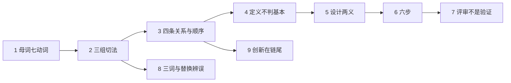
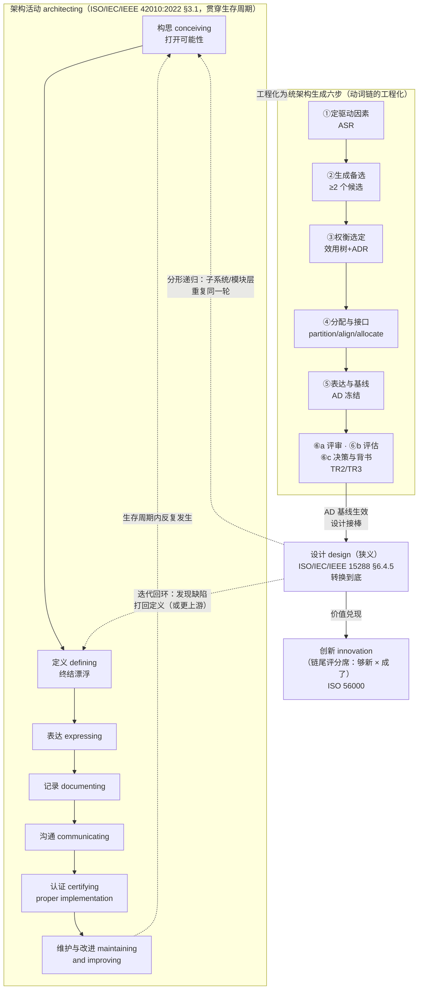
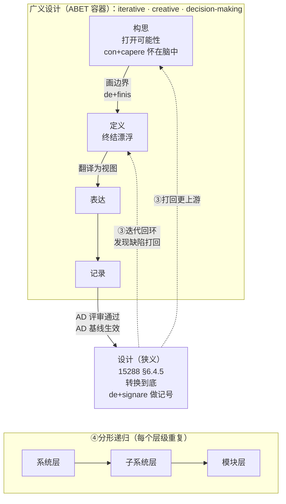
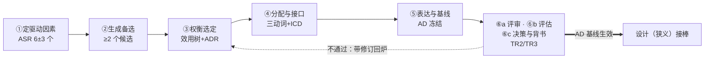

# 16-构思定义设计关系及架构活动精讲

> **文档编号**：16-构思定义设计关系及架构活动精讲
> **文档版本**：v2.8（2026-11-02｜沿革见 §14） → **v2.9（2026-11-06 依 48 号 v3.25 对齐：1 处「三把尺」改按「一支填句三槽（三种填法）」表述）** → **v3.0（2026-11-11 随 46 号 v2.6（八条主结论）严格对齐：改 6 处）** → **v3.1（2026-11-14 按《19 号规程》§一 六步第二轮对齐：落笔 79 处，详见文末修订记录）** → **v4.0（2026-11-14 按九条清单重构，《19 号规程》§9.4 六步）** → **v4.1（2026-11-16 按《19 号规程》§二批六：三把尺严口径收口，改 5 处；见文末修订记录）** → **v4.2（2026-11-16 按用户裁「改」：§八 章题改题，见文末修订记录）** → **v4.3（2026-11-16 按《19 号规程》§二「另加批十」：依据字面校准，改 1 处；见文末修订记录）**
> **概念依据**：架构、关切、架构视角、架构视图四概念的定义、关系、界分与译名，一律以 30 号《架构描述核心概念研究报告》为准（依 GB/T 45630-2025／ISO/IEC/IEEE 42010:2022）。
> **概念依据（架构治理）**：架构治理（architecture governance）的定义、目的、对象、输入与输出、责任主体与机制，一律以 29 号《架构治理研究报告——从标准依据到责任主体》为准。本报告出现的「治理」有两处来源：定语位的 governing principles 取国标定名「管控原则」（**不是**治理职能），动词位的 governs（架构视角—架构视图的关系名）虽译「治理」但**无裁量者**——二者与架构治理只共用「治理」二字（30 号 §5.5）。
> **用语约定（2026-09-21 第二轮收口）**：术语一律按 GB/T 45630-2025 定名——viewpoint/view 作「架构视角／架构视图」，stakeholder 作「相关方」，concern 作「关切」（国标定名「关注点」；2026-11-06 裁用「关切」），life cycle 作「生存周期」（正文一律），governing principles 作「管控原则」（此处 governing 是**定语**，指具有约束力、可据以判定违规，与 architecture governance（架构治理）不是同一用法），specification 作「规格」；**标准用语上的例外只此一条**：fundamental 自译作「基本」，逐字引国标时照抄「基础」。**另有三处经裁改、不属国标定名**：concern 国标作「关注点」（2026-11-06 裁用「关切」）、stakeholder 国标作「利益相关方」（一律作「相关方」）、`architecting` 国标作「架构工作」（本报告取「架构活动」，13 号 §9 既定；其七个动词的中译亦与国标逐词译本略异——构想／定义／表达／编制文档／沟通／证实其正确实施／维护和改进）。〔**取证**：GB/T 45630-2025 正本库内无；上列国标字面见库内《ISO/IEC/IEEE 42010:2022 中英文对照版》§3.1，该译本自述以 GB/T 45630-2025 为先。〕本文档的「系统」在架构描述语境下均读作所关注实体（entity of interest）。
> **来源**：AOS 概念框架建设讨论（2026-08-25，十二轮压问式精炼整理）
> **适用范围**：产品开发 / 系统工程 / 配置管理 / 架构方法论 / 创新管理
> **配套文档**：00-概念学习方法论、05-工程概念精讲、06/07-架构概念精讲、10-架构设计方法论全景、11/12/13-工程师能力与角色谱系精讲
> **术语约定**：requirement→需求；need→需要；expectation→期望；specified requirement→规定需求（参照 **ISO 9000:2026 §3.5.1**「requirement」术语定义，条款号已核对；specified requirement 见该条**注 2**："A specified requirement is one that is **stated**, e.g. in documented information"。ISO 9000:2015 同位术语为 §3.6.4）
>
> **逐条依据与论证位置见**附录 C「结论台账」**；旧版沿革见**附录 D**。

---

## 摘要：九条

1. **七动词是架构活动的母词**——构思·定义·表达·记录·沟通·认证恰当实现·维护与改进（42010:2022 §3.1），贯穿生存周期、不是串行阶段；其中没有「评估」与「决策」。
2. **三组切法不可并成一张表**——动作面（七动词）／传递面（48 号十节点）／工序面（46 号四道工序），各有主家、不互译。
3. **构思—定义—设计四条关系**（接力／容器／迭代回环／分形递归）＋**顺序是逻辑蕴含、日历只是投影**；容器是「包含」，不是「设计更细」。
4. **「定义」不判「基本」**——「基本」是内容侧谓词，判据是一支填句三槽（按对象三种填法），权责提／判／裁三分。
5. **设计一词两义**——广义是容器、狭义止于「足够完整到足以支撑一次合规实现」；**合规承担者是实现，受控可交付的是 AD**。
6. **六步是工程化借代**，不是标准次序；与七动词只在一处同义（⑤）；**⑥ 是三站、不是一个关口**（评审／评估／决策与背书）。
7. **评审不是验证**——工作产品侧只能评审、结论条件性合规；架构描述可评审、可验证、**做不了确认**。
8. **构架立骨架、架构定决策、框架给半成品**；「架构生成」不能替换成「架构构思＋架构定义＋架构设计」（三处事故）。
9. **创新在链尾**——它是结果属性、不是动词链上的一环；可工程化的是流程·方法·组织·组合，单点结果不可承诺。

## 目录

- [摘要：九条](#摘要九条)
- [一、走法：九条怎么排](#一走法九条怎么排)
- [二、母词与七个动词](#二母词与七个动词)
- [三、三组切法：动作面、传递面、工序面](#三三组切法动作面传递面工序面)
- [四、构思·定义·设计：四条关系与顺序](#四构思定义设计四条关系与顺序)
- [五、定义不判基本：判据在内容侧](#五定义不判基本判据在内容侧)
- [六、设计两义与「足以支撑」](#六设计两义与足以支撑)
- [七、系统架构生成六步](#七系统架构生成六步)
- [八、评审·验证·确认：三处判定不同](#八评审验证确认三处判定不同)
- [九、构架／架构／框架与替换辨误](#九构架架构框架与替换辨误)
- [十、创新：链尾的评分席](#十创新链尾的评分席)
- [十一、体例、结论与未决](#十一体例结论与未决)
- [附录 A：术语表](#附录-a术语表)
- [附录 B：标准与文献出处清单](#附录-b标准与文献出处清单)
- [附录 C：结论台账（一视同仁：每条结论凭什么）](#附录-c结论台账一视同仁每条结论凭什么)
- [附录 D：沿革（旧版记录，不改写）](#附录-d沿革旧版记录不改写)
- [附录 E：新旧节号对照](#附录-e新旧节号对照)

## 一、走法：九条怎么排

> **本件立了九条主要结论**（用户裁「依照你的建议方案」，2026-11-14）。章序不按原章目搬，按依赖重排：先立母词与七个动词，再立三组切法（以见本件在分工里的位置），然后是这条链（四条关系与顺序）与它的三个关节（定义不判基本／设计两义／六步），再是两处判据（评审不是验证）与两处边界（三词之辨、创新），最后是体例与账。

### 1.1 九条清单

| # | 主要结论（可作章题） | 级 | 归 46 主线 | 须先同意 | 本章 |
|---|---|---|---|---|---|
| 1 | 七动词是架构活动的母词——构思·定义·表达·记录·沟通·认证恰当实现·维护与改进，贯穿生存周期、不是串行阶段 | B | 本件增量（46 号零涉） | — | §二 |
| 2 | 三组切法不可并成一张表——动作面（七动词）／传递面（48 号十节点）／工序面（46 号四道工序），各有主家、不互译 | C〔读法〕 | 三（工序侧作指针） | 1 | §三 |
| 3 | 构思—定义—设计四条关系（接力·容器·迭代回环·分形递归）＋顺序是逻辑蕴含、日历只是投影；容器是「包含」不是「设计更细」 | C | 本件增量 | 1 | §四 |
| 4 | 「定义」不判「基本」——判据在内容侧（一支填句三槽、按对象三种填法），权责提／判／裁三分 | **A** | 本件增量 | 1 | §五 |
| 5 | 设计一词两义；狭义止于「足够完整到足以支撑」，合规承担者是实现，受控可交付的是 AD | B | 三、二 | 4 | §六 |
| 6 | 六步是工程化借代，不是标准次序；与七动词只在一处同义（⑤）；⑥ 是三站不是一个关口 | B／C | 三、四 | 3 | §七 |
| 7 | 评审不是验证——工作产品侧只能评审、结论条件性合规；架构描述可评审可验证、不可确认 | **A** | 本件增量 | 1 | §八 |
| 8 | 构架／架构／框架三词分工＋「架构生成」的替换辨误三事故（口径漂移·位置错位·表达缺位） | C | 四、六 | 2、3 | §九 |
| 9 | 创新是链尾追认，不在动词链上；可工程化的是流程·方法·组织·组合，单点结果不可承诺 | C | 本件增量 | 3、5 | §十 |

### 1.2 依赖链

判据是「读第 N 章是否必须先同意第 M 章某句」：C2 不立，C3 的接力链会被当成四道工序的粗细梯子；C4 不立，C5 的「设计答不了拿掉还是不是它」无所依；C7 不立，C6 的 ⑥ 会被缩成一个关口。

### 1.3 没立的三种排法

- **按「构思→定义→设计→六步」顺排（＝原章序）**：壳子最省事，但首章要读者先吞七动词、末章才交代它与四道工序的关系，全书的「本件在分工里站哪」一直悬着——本版把它上提到 §三。
- **把创新提到 §四 之后**：创新确实用构思·定义·设计三个动作，但它判的是**结果**（新×成），不是链上的动作；提前会造出「创新是第四段」的误读。
- **把体例（引用四档／结论三级）并进 §一 走法**：体例是**记账法**、不是走法的一步；它在末章与附录之间作过渡，独立成节更稳。

### 1.4 节号怎么读

本版**节号全改**（旧号→新号见[附录 E](#附录-e新旧节号对照)）。三条读法：① **章用中文序数、节用阿拉伯**；② 不带标准名的「§x.y」指**本件自己的节**，指他件时一律写「46 号 §x.y」「48 号 §x.y」；③ 引标准条款一律带标准名（42010:2022 §3.1）。

### 1.5 一句话总纲与全景

**一句话总纲**：构思打开可能性，定义终结漂浮，设计转换到底——三者构成「接力＋容器＋迭代回环＋分形递归」的关系网；顺序是逻辑蕴含，日历只是投影；这条动词链工程化为「生成六步」，而创新不在链上，它坐在链尾的评分席。

**全景**（原总览图，一字未改）：

---

---

## 二、母词与七个动词

> **第一条**：架构师相对工程师的能力增量，母词是 **architecting（架构活动）**——42010:2022 §3.1 给的七个动词：构思·定义·表达·记录·沟通·认证恰当实现·维护与改进。七个动词**贯穿生存周期反复发生**，不是串行阶段；其中**没有「评估」与「决策」**，二者各有另外的户口。

### 1.1 六块增量的母词

架构师相对工程师的六块能力增量——**架构决策、关切管理、质量权衡、抽象建模、技术领导、演化对齐**——其母词是 **architecting（架构活动）**。

> **ISO/IEC/IEEE 42010:2022 §3.1**（现行；2011 为历史对照）：
> *architecting — **conceiving, defining, expressing, documenting, communicating, certifying proper implementation of, maintaining and improving** an architecture throughout the life cycle of an entity of interest.*
>
> 译：在所关注实体的整个生存周期内，构思、定义、表达、记录、沟通、认证恰当实现、维护与改进架构。
>
> 〔按：**定义句只列七个动作**——正本并无 *the process of* 一语；「……的过程」这一读法出自 42010:2022 **附录 E.2（资料性）**（*The process of architecting involves…*），不在 §5.1 定义句之内。〕
>
> 【历史对照】2011 版尾句为 *an architecture throughout a system's life cycle*（"系统生命周期"）；主体由 system 扩为 entity of interest（所关注实体可为企业/产品/流程/数据等）。〔**库外·二手·核不到**：42010:2011 全文库内无正本；42020:2019 §3.2 的 [SOURCE] 行可作旁证——该版以 2011 版 §5.1 为源、把 system 改为 architecture entity。〕

映射关系（动词 → 能力增量）：

| 42010 动词 | 对应能力增量 |
|---|---|
| conceiving（构思） | 关切管理（从关切中挑出值得架构的问题并生成候选） |
| defining（＋本报告补的「选择」，非 42010 动词） | 架构决策 + 质量权衡 |
| expressing + documenting（表达 + 记录） | 抽象建模 |
| communicating + certifying（沟通 + 认证） | 技术领导 |
| maintaining and improving（维护与改进） | 演化对齐 |

**排除项**：
- **架构设计（architectural design）**——**15288:2023** §6.4.4 的规范过程名是 **System architecture definition process**（系统架构定义过程），**该标准全文无 `architectural design`**（该词见 42010:2022 **Annex C.5** 对 12207／15288 用词更窄的讨论；C.4 亦有一处），覆盖面不足；〔**勘误（2026-10-12·全库对齐轮）**：本行原印「**附录 E**」——**引错**：42010:2022 全文检索 `architectural design` **在附录 E 零命中**，实见 **Annex C.5**（正本 L1775）与 C.4；台账 `90-治理登记/02` G-39① 已立此更正。〕
- **架构师（architect）**——42010 未给此词立词条，标准只认活动不认头衔。

**中译**：采用"架构活动"（**13 号 §9** 术语表既定译法；**非国标定名**——GB/T 45630-2025, 3.1 作「架构工作」（字面见库内《42010 中英文对照版》§3.1；该标准正本库内无）），拒绝"架构设计"。

### 2.2 七项动词一览

| 动词 | 中文名 | 一句话 | 主要产品数据 |
|---|---|---|---|
| conceiving | 构思 | 从关切出发生成候选架构概念 | 候选概念清单 |
| defining | 定义 | 画边界、做选择，收敛为确定方案 | 选定架构 + ADR |
| expressing | 表达 | 把架构翻译为一组各有其主的视图 | 架构视图 |
| documenting | 记录 | 把视图与决策固化为 AD（架构描述） | AD 文档 |
| communicating | 沟通 | 让各相关方理解并达成共识 | 评审陈述、培训 |
| certifying proper implementation | 认证恰当实现 | 架构**符合性检查**（实现符合架构的举证） | **验证记录（对实现物，逐条对架构与规定要求）＋ 偏离清单** |
| maintaining and improving | 维护与改进 | 对抗架构腐化（drift / erosion） | 基线变更、ADR 更新 |

关键性质（42010 **2022 版已重编号至 §3.1 architecting 与附录 E.2；已核**；原引 2011 §6.2 系 2011 版条序；2011 版全文**库外·二手·核不到**）：七项动词**贯穿生存周期反复发生**，不是串行阶段（「贯穿生存周期」据 §5.1 定义句；「反复发生」据**附录 E.2（资料性）**）。

**七动词不含"评估"与"决策"两个动作**——42010:2022 §3.1 只管架构的描述与实现符合性：`certifying proper implementation` 的客体是**实现物**（尺子是**验证**），**不是**对工作产品的评审，也**不是**对被指明评估目标的架构评估；评估与决策的户口在 **42020:2019 §9**（评估，只出建议）与 **42010:2022 §6.10**（决策与理由的记录）。故七动词**不能**用来顶 ⑥ 的三站（见 §3.3）。

### 2.3 为什么七动词里没有"评估"与"决策"〔论证〕

**结论**：42010:2022 §3.1 的七动词（构思·定义·表达·记录·沟通·认证恰当实现·维护与改进）不覆盖"评估架构"与"作决策"两件事；二者各有另外的户口，故七动词不能顶 ⑥ 的三站。

**依据**：
- **42010:2022 §3.1**（逐字·规范）：*conceiving, defining, expressing, documenting, communicating, certifying proper implementation of, maintaining and improving an architecture throughout the life cycle of an entity of interest*（中译：在所关注实体的整个生存周期内，构思、定义、表达、记录、沟通、认证恰当实现、维护与改进架构）——七个词里**没有 evaluate，也没有 decide**。
- **42020:2019 §9**（规范）：架构评估过程（Architecture Evaluation）；§10.2 a) 该过程的成果是**发现与建议**（findings 与 recommendations），不是选择。
- **42010:2022 §6.10.1**（规范）：架构决策与理由**须记录**；决策在这里是"被记录的内容"，不是动词链上的一环。
- **42010:2022 §3.1**（同条）：`certifying proper implementation of` 的宾语是 **implementation**（中译：认证"恰当的**实现**"），不是工作产品。

**推理**：① **看宾语**——`certifying proper implementation of` 的宾语是实现物，其尺子是验证（ISO 9000:2026 §3.11.12：*confirmation, through the provision of objective evidence*）；不是对工作产品的评审，也不是对被指明评估目标的架构评估。② **看成果**——评估的成果是 findings 与 recommendations（42020:2019 §9.2 a)）；建议不等于选择，"评估通过"从不等于"决定通过"。③ **看记录**——决策在 42010 里是描述里要记的一类内容（§6.10），而"记录"本身是七动词的 `documenting`；决策发生在记录之**前**，不是记录的一部分。

**反证**：设七动词足以覆盖全链。那么每一轮架构工作都必有一个"评估"动词与一个"决策"动词——但 42010:2022 §3.1 的动词串里两个词都没有，而 42020 另立 §9 评估过程、42010 另立 §6.10 记录要求；若七动词已覆盖，这两处立法就是重复。更硬的一处：`certifying` 若已含"评审工作产品"，则 42020:2019 §9.3 d)（评估对象是架构、不是描述）与该条会互相取消。

**边界**：本节**不主张**七动词不完备——它主张的是**分工**：七动词管动作面，评估与决策的判据与产物归 42020:2019 §9 与 42010:2022 §6.10（48 号 §11 那一站）。也**不主张**七动词与六步一一对应：六步是工程化借代（§7.2 术语诚实声明），二者**只在一处同义**（⑤＝expressing＋documenting）。**哪一半本报告不能定**：某次评审／评估／决策的效力归谁签——那是治理（42020:2019 §6.2 c)），不是本标准能判的。

### 2.4 架构师 vs 工程师：五维度能力差异（12 号 §3 详版）

| 维度 | 工程师 | 架构师 | 锚点 |
|---|---|---|---|
| **决策域** | 局部、可逆 | 全局、**难逆** | SWEBOK |
| **认知对象** | 规定需求（specified requirement） | **关切（concern）** | 42010:2022 §3.10 |
| **判定／把关方式** | 测试（对规定需求，属**验证**） | **评审**——工作产品层的判定，不要求客观证据 | IEEE 1028 |
| **时间尺度** | 当下（本版本交付） | 跨版本**演化** | 42010:2022 附录 E（资料性）·演化 |
| **能力灵魂** | 契约与证据 | **决策与理由（rationale）** | 12 号 §3.5 |

> **本表"锚点"列的 SWEBOK、IEEE 1028 库内无正本（库外·二手·核不到）**，只作实践来源，不作条款依据（§11.1 第四档）。

其中"认知对象"与"判定／把关方式"是**12 号 §3.5「三个更锋利的差异」里的前两个**（第三个「判据锚点」不在本表五维度内，见 48 号 §2.3）——它们是六块增量的锋利投影：requirement→concern 对应关切管理与抽象建模；测试→评审对应架构决策与演化对齐的证据形态。

### 2.5 分界线与分工落点

**分界线**：architecture 定义的构成——**基本概念或属性**，以及该实体及其相关生存周期过程的实现和演化的**管控原则**（此处 governing 是定语，指具有约束力、可据以判定违规）（GB/T 45630-2025, 3.2／42010:2022 §3.2）。**2022 定义句已删去 embodied in its elements, relationships，不再以元素与关系界定架构**；该层含义**并非消失，而是搬家 ＋ 降调**——迁入 **42020:2019 §3.3 Note 1**：措辞由 elements／relationships 改为 **components／组件间关系／实体与环境的关系**，强度由定义正文的"**是**"降为注释的"**通常意指**"（*usually intended to be embodied in*），**注释级、无术语地位**（22 号 §5.2.2、§7.2；24 号 §4.5.2）。〔按：**时序不可倒置**——42010:2022 §3.2 的 SOURCE 行写明其采用 **42020:2019 §3.3（modified）**，即 **42020 在前、42010 在后**；该层含义是**由 42020 承接**（在该册 §3.3 Note 1 给出），不是 42010 先有而后被搬走。〕2011 定义句的 elements／relationships 是**实体侧的 components 与 relationships**（**架构"可以关乎"的对象**，**不在架构的内容之内**；按 46 号 §7.1 的三套分辨，它是**第二套「系统元素及其关系」**，第一套「要建模的实体与关系」仍归架构），**不是 AD element**（**描述层**，42010:2022 §3.4 的 11 类）——**要素与关系不在定义句内，也不要叫它们 AD 元素**（22 号 §6.2A、§8.2；24 号 §4.1）。

**分工落点**：工程师与架构师的分野**不在"谁管元素、谁管关系"**——元素及其关系的**规格**是**设计定义过程**的产出（15288:2023 §3.13）；架构侧负责的是**立住并守住两样内容**（基本概念或属性 ＋ 管控原则），分工依据是"**谁拥有对该层规定需求的变更权**"（24 号 §2.2.4）。

**核心结论**：**工具不变，棋盘变大**——判断、权衡、沟通、担责这些工具，工程师和架构师用的是同一套；变的是**决策对象的层级**（从"把部件做对"到"把架构立住并守住"）。**"棋盘变大"不等于"从元素换到关系"**：元素及其关系的**规格**归设计定义过程（15288:2023 §3.13），架构侧的分工依据是"**谁拥有对该层规定需求的变更权**"（24 号 §2.2.4）。产品数据上对应"上半棵/下半棵"：架构师做**两样内容及其表达**（**基本概念或属性清单＋管控原则清单**，架构描述、决策记录；接口契约的意图在内），工程师做叶子（12 号 §3.6、13 号 §7）。〔按：架构侧的接口约定与实现层的系统元素（system element）之间是**多对多映射**，不是 1:1——一个架构槽位可落到多个系统元素，一个系统元素也可承载多条架构约束（24 号 §4.3）；此处"搬入点"指承接关系的**位置**，不是数量对应。〕

---

---

## 三、三组切法：动作面、传递面、工序面

> **第二条**：本件讲**动作面**（谁做什么动词）；48 号的十节点主线讲**判据与产物的传递面**（什么算什么、凭哪条条款）；46 号 §4.1 的四道工序讲**工序面**（四类物、四把判据）。**三组不可并成一张表，也不互译。**

### 3.1 动作面与传递面：七动词 vs 十节点主线
**与"十节点主线"的关系〔读法〕**：七动词链是**动作面**——在所关注实体的生存周期内**谁做什么动词**；十节点主线（**48 号 §1.5**：目的→目标→需求→关切→内容→位→视角→视图→评估→决策）是**判据与产物的传递面**——每一步**什么算什么**、**凭哪条条款**、**到下一步用什么动词**。**两轴不同，不互为错版**：七动词不看上游（目的·目标·需求·关切四格无对应词），十节点没有 communicating／certifying／maintaining and improving 三词；**交集只有"表达／记录"一段**。故二者**并存，不可互译，也不可合并**——十六号这一侧只承担动作面，判据与产物那面归 48 号。
**边界**：这条"两轴"**不是标准规定**——42010:2022 §3.1 只给七个动词，既无"十节点"，也无"两轴"之说；本节主张的只是**分工**（谁归谁写），不主张两轴穷尽了架构工作的全部面向，也不主张十节点的顺序是日历顺序（十节点的次序问题见 48 号 §11.8）。

### 3.2 工序面与动作面：七动词 vs 四道工序
> **与 48 号的分工**：本报告只承担**动作面**——构思、定义、表达、记录、沟通、认证、维护与改进这七个动词各自"谁做、做什么、在哪一步断"，以及六步工程化怎么走；**判据与产物的传递面**（每一步什么算什么、凭哪条条款、产物怎么交接）主家在 **48 号 §1.5、§5、§附录 C（速查）**，本报告只引不重述。两轴**并存、不互译、不合并**：七动词不看上游四格，十节点没有后三词，交集只有"表达／记录"一段。

> **与 46 号 §4.1 的分工（另一组切法：工序＝物、动作＝事）**：这一组是**第三组**对照：上一对（动作面／传递面）的两造是"谁做"与"算什么"（传递面主家在 **48 号 §1.5**），这一对的两造是**四道工序**与**七个动词**（工序主家在 **46 号 §4.1**）；两组**不可并读成一张表**。46 号 §4.1 切**四道工序，各带一把判据**（需求"该不该"、架构"还是不是"、设计"怎么造"、实现"做出来没有"；一把尺量四道，只量出"齐不齐"）；本报告切**动作与动词**（谁在什么时候做什么）。两套**不可互译**：四道按**物**切、不给动作序列；七个动词按**动作**切、不划工序边界。七个动词的动作对象只有一处——**架构及其实现**（`certifying proper implementation` 判的是**实现与架构的符合性**，不是"做实现"那一道）。**位置关系**：本报告 §6 的六步（⑥ 拆 a／b／c，共八格）**整条落在架构层**（内容侧 ①~④、方案侧 ⑤、出口 ⑥；46 号 §2.1）；48 号的十节点则跨两道——目的·目标·需求三格在**需求侧**（条款分落 15288:2023 §6.4.1、§6.4.2、§6.4.3.1 与 42020:2019 §9.1、42030:2019 §1 f)），「关切」一格是两道共用的入口，自「内容」起才进架构侧。故 46 号 §4.2 那句"架构交的是『它是什么』那几条，以及驻守它们的位——它**不给做法**"按**工序**算；本报告六步按**动作**算：①~③ 收出那几条内容（① 只做**问题的抽选**、不作内容准入；② 打开备选；③ 取舍定内容）、④ 把内容落到**要建模的实体与关系**上（产出**接口的识别与意图**、派生需求回流；完整规格归设计定义）、⑤ 交**架构描述**——它是 46 号 §2 所说的**方案**，不是"架构交内容"的反例（两跳：内容→描述→设计，46 号 §2.5）；⑥ 三站（评审／评估／决策与背书）跨在**这道出口**上，**不是一个关口**——评审的尺子是 ISO 9000:2026 §3.11.2（不要求客观证据），评估与决策的产物与记录归 42020:2019 §9 与 42010:2022 §5.2.12／§6.10.1，**48 号 §11 是评估与决策那一站的正文**（评审的尺子不在那里，见前）。

### 3.3 六步与动词链只在一处同义

> **口径声明（先立）**：六步是**工程化借代**（C 级〔读法〕，见 §7.2 术语诚实声明），**不是 42010:2022 §3.1 的动作次序**；它与七动词**只在一处同义**——⑤＝`expressing` ＋ `documenting`；`communicating` 与 `maintaining and improving` 在六步里**没有对应格**——六步排的是"把架构做出来"这一侧，沟通与维护改进发生在它的外面。**七动词里没有"评估"与"决策"两个动作**（`certifying proper implementation` 的客体是**实现物**，不是工作产品，见 §2.2），故 ⑥ 一格按**三对象三套依据**拆为 ⑥a／⑥b／⑥c（23 号 §10.2；48 号 §11.4）。

| 六步 | 对应 42010 动词链 | 对应构思/定义/表达/认证 | 判据与依据（三对象三套依据，不可混） |
|---|---|---|---|
| ① 定驱动因素 | conceiving（从关切里挑出值得架构的问题） | 构思的瞄准 | ASR 三标准（SEI ATAM，抽选启发式，非准入判据，见 §7.3①） |
| ② 生成备选 | conceiving（打开可能性） | 构思的主体 | — |
| ③ 权衡选定 | defining（画边界、终结漂浮） | 定义的核心动作 | 效用树＋场景走查＋ADR（含复审条件） |
| ④ 分配与接口 | defining（把两样内容的边界落到元素与契约的**意图**上；完整规格归设计定义） | 定义的深水区 | partition／align／allocate ＋ 派生需求回流 |
| ⑤ 表达与基线 | expressing + documenting | 表达 | 视角规格写到模型种类；AD 纳入配置管理 |
| ⑥a 评审 | **无对应词**（§5.1 七动词无 review／determination） | — | **评审**：ISO 9000:2026 §3.11.2 *determination of the suitability, adequacy or effectiveness*（中译：对适宜性、充分性或有效性的确定；**不要求客观证据**） |
| ⑥b 评估 | **无对应词**（§5.1 无 evaluate） | — | **评估**：42030:2019 §3.4 就**被指明的评估目标**对**架构**作判断（*judgment about one or more architectures with respect to the specified evaluation objectives*，中译：就被指明的评估目标对一个或多个架构所作的判断）——**与评审不同客体**；42020:2019 §9.2 a) 评估只出建议 |
| ⑥c 决策与背书 | **无对应词**（`certifying proper implementation` 的客体是**实现物**） | —（背书） | **决策**：42010:2022 §5.2.12 *a collection of choices*（中译：一组选择），须记理由；**背书＝治理给效力**（42020:2019 §6.2 c)；48 号 §2.8） |

> **三对象三套依据的全文见 48 号 §11.4、§11.9~§11.10**（评估与决策的分界）；本表第四列只是它的逐行落法。表中「认证」一词（§9.1 同）指**治理背书**，不是 §5.1 的 `certifying proper implementation`。

**一句读法**：⑥ 不是一个关口，是**三个动作、三个对象、三套依据**——评审判工作产品、评估判架构、决策与背书定"算不算数"。**"评审与背书"顶不住评估与决策两站**：那样 42030:2019 全标准与 42010:2022 §6.10.1 在本报告里就没有位置。

---

## 四、构思·定义·设计：四条关系与顺序

> **第三条**：构思打开可能性、定义终结漂浮、设计转换到底——三者有四条关系（接力／容器／迭代回环／分形递归）；**顺序是逻辑蕴含，日历只是投影**；「容器」是**包含**，不是「设计更细」。

### 4.1 一句话

> **构思打开可能性，定义终结漂浮，设计转换到底。**

### 4.2 四条关系

| # | 关系 | 内容 | 一句话 |
|---|---|---|---|
| ① | **接力** | 构思 → 定义 → 表达 →（**AD 基线**生效）→ 设计（狭义） | 可能性先于选择，选择先于展开 |
| ② | **容器** | 广义设计 ⊃ 构思 + 定义（+ 表达） | 三者并列时，"设计"必须降为狭义下游义 |
| ③ | **迭代回环** | 设计发现架构缺陷 → 打回定义、甚至打回构思 | 不是瀑布，是回环 |
| ④ | **分形递归** | 系统 → 子系统 → 模块，每个层级重复同一轮"构思-定义-设计" | 15288：流程按系统层级递归应用；ISO 9000:2026 §3.3.11「需求→更详细需求」可逐层套用 |

**容器关系的细化**（构思与设计的关系，第 6 轮定型）：构思是广义设计的 **creative 半场**——ABET 的 engineering design 定义明写 iterative、creative、open-ended，构思正是其中"打开可能性"的发散部分，设计（过程整体）负责把它收敛、转换到底。所以"构思 vs 设计"不是两个流程的对比，而是**同一个容器内发散段与全段的对比**。

### 4.3 顺序声明（最终版）

> **同一层级、同一轮循环内，顺序唯一且不可倒置**（构思→定义→表达/记录→**设计（狭义）**）；但这个顺序是**逻辑蕴含**（生成→选择→展开），**日历只是投影**——宏观上三者交错反复，是因为你在看多个层级的循环叠在一起。

三尺度对照：

| 尺度 | 形态 | 说明 |
|---|---|---|
| 微观（单次决策） | **直线** | 生成→选择→展开，一次走完 |
| 中观（单层级项目） | **回环** | 设计打回定义、评审回炉，反复迭代 |
| 宏观（跨层级、跨版本） | **层级交错** | 系统层、子系统层、模块层的循环并行重叠 |

**设计（狭义）是下一棒**：在门外等着，**AD 基线**一生效就接手。

〔按：以上"接力／下一棒／在门外"是**同一层级、同一轮循环内**的逻辑顺序（§4.3 首段：顺序是逻辑蕴含，日历只是投影），**不可读成 15288 架构定义（§6.4.4）与设计定义（§6.4.5）两个过程成阶段**——两过程**不是阶段**：15288 §5 允许迭代与并发，"先架构定义后设计定义"是瀑布式误读；真实形态是**同一时刻在相邻两个种类层上的两类工作**（24 号 §2.2.2）。**亦不可读成由粗到细的梯子**——46 号 §4.3 否的是四道工序之间那一条，这里是构思→定义→设计三档，是同型的第二个误读（46 号 §4.3 的理路同构，原条款不辖这三档）。两者且**交替递归**（上一层设计定义的输出 = 下一层架构定义的输入对象）与**同构**（同一套活动族，同一种工作做两遍）（24 号 §2.2.1 关系 1、2）。本文各图（§0 总览、§5.2、§6.1）中"**AD 基线**生效 → 设计接棒"的画法同受此限。〕

---

### 4.4 构思：定义（定型版）

> **构思**：从相关方关切出发，生成多个候选架构概念的**发散性概念活动**——产物是"可能是什么"，不是"决定是什么"。

〔哲学定位：在 42010 配套页的两哲学里，构思即 **Conception 派**（**架构作为构思**——架构是存在于人脑中的系统概念）的动作；与之并列的是**感知（perceive）→ properties**（**Perception 派**——二手转述派名；42010:2022 附录 A.2 的正本派名作 **"Architecture as property"**，与 **"Architecture as concept"** 并列，全文无 `Perception` 一词——架构是观察者对系统属性的感知）与**描述（describe）→ AD**（**第三层，独立于前两派**）。"concepts **or** properties" 这一析取式正是为**不带偏见地兼容两种哲学**（*without prejudice*）而选；**无论哪一派，架构都是抽象的——不是人工制品**，表达与记录架构的是 AD（22 号 §5.4.1、**§8.1** 三个动词表；详见 §2.4）。〕

### 4.5 构思三特征

| 特征 | 含义 | 反面（不是构思） |
|---|---|---|
| **发散** | 不止一个候选 | 直接给唯一解 |
| **概念** | 停在骨架层，不下沉到实现细节 | 写伪代码 |
| **有方法** | 模式库、参考架构、第一性原理 | 等灵感 |

第三特征"有方法"是创新可工程化的核心证据（见 §10.3）。

### 4.6 定义的三重身份（必须随身携带）

| 身份 | 词性 | 出处 | 含义 | 覆盖范围 |
|---|---|---|---|---|
| **动作义** | 动词（defining） | 42010:2022 §3.1 动词链 | 画边界、做选择 | 狭——收敛这一个动作 |
| **流程义** | 流程名（architecture definition process） | 15288:2023 §6.4.4 架构定义流程 | 完整技术流程 | 广——**内部第一件事就是构思，还包含表达与文档化** |
| **概念框架义** | 名词（definition） | ISO 1087:2019 §3.3.1（术语工作标准） | 界定一个概念的表述文本本身（如术语表里的词条） | 中——产出物，不是过程 |

**悖论揭示**：架构定义流程的第一件事是构思——流程义的"定义"包住了动作义的"定义"的上游。三重身份共存是这个词最大的口径事故源：同一句"架构定义"，可以指动作（画边界）、流程（15288 技术流程）、或产出（界定表述）——进文档前必须先声明取哪一义（§7 详述）。

**动／名之辨与 AD 的关系（依 22 号 §6.3、§8.4；K16）**：`defining`（**动**）≠ `definition`（**名**）——后者是前者**产物之一**（`definition ⊆ description`，**AD ⊇ definition**）。概念框架义的那份"表述文本"与 **AD（架构描述，42010:2022 §3.3 *work product used to express an architecture*）** 的关系是**包含**：**AD ⊋ definition**——AD 是 42010:2022 §3.4 Note 1 的 **至少 11 类 AD elements**（该注 *include* 非穷举，**资料性**）的集合（相关方／关切／相关方角度／方面体／ADL／ADF／对应关系／架构视图／视图组件／架构视角／模型种类），**`definition` 根本不在其中**，只作为相关方／关切／方面体内部的**文本片段**出现（22 号 §6.2、§6.3、§8.4）。故"AD 是一份对架构的 definition"与"AD = definition"都是精度事故——**包含，不是等同**。

〔过程模型中的归位：架构定义流程在 42020:2019 §5 的**三组**分类里**属核心过程组**——**§5.4 架构概念化、评估与细化**过程（**三个核心过程**），**与「治理＋管理」组（42020:2019 §5.3）、「使能」过程（§5.5）并列**，不是治理的下属步骤——治理在管理层之上定方向与框架，架构定义流程则在框架内产出架构（15288:2023 §6.4.4.3 Note 1 所称 *three core processes* 即此三个；六过程写全为 **42020:2019 §6 治理、§7 管理、§8 概念化、§9 评估、§10 细化、§11 使能**；29 号 §4.1、§5.2）。〕

### 4.7 词源（三词各一则）

**构思（concipere）**

拉丁 **concipere** = con（收进来）+ capere（拿、握取）——"怀在脑中"，如同受孕。它的基因是**孕育可能性**，不是做决定。

**定义（definire）**

拉丁 **definire** = de（往下、直到）+ finis（边界、终点）——"划到边界为止"。同根词：finish、final。定义的本质动作是**终结漂浮**。

跨域印证（**第四档·库外·二手·核不到**）：ISO 1087:2019（术语工作国际标准，§3.3.1；库内无正本）对 definition 的定义是"**用以把一个概念与相关概念区分开来**的表述"——区分即画边界。注意：这是术语学定义，非工程学定义，本文用作跨域印证。

**设计（designare）**

拉丁 **designare** = de（出来）+ signare（做记号）——"做记号标出来"。设计基因里的动作是**把意图标记成可传递的形式**。

### 4.8 权威来源（三词各一表）

**构思**

- **第一档（标准逐字）**：42010:2022 §3.1 architecting 动词链**第一词**。⚠️ 关键诚实点：标准**用了**这个词，但**没有给它立词条定义**。
- **第二档（标准可支持的读法）**：
  - 15288 §6.4.4 架构定义流程任务清单里有"生成可行候选架构（candidate architectures）"——标准层面对构思最接近的操作化；
  - 42010 的 architecture 定义首词是 **fundamental concepts**——构思的产物类型被架构定义预设（**42010 §3 Terms and definitions 未定义 `concept`／`property`**——2011 §5.1～§3.10 与 2022 §3 均无此两条，二者按 ISO/IEC Directives Part 2 以**普遍接受的含义**使用，此处 `concepts` ≈ **idea／notion**，勿读作 ISO 1087:2019 §3.2.7 严谨义的"知识单元"；22 号 §3.6、K02、K03、K22）；
  - 42010 **2011 版配套页**（iso-architecture.org"Defining architecture"；**库外·二手·核不到**）的两哲学定位——**构思即 Conception 派**（架构作为构思：架构是人脑中的系统概念）的动作；与之**并列**的是**感知（perceive）→ properties**（**Perception 派**：二手转述派名，正本作 **"Architecture as property"**；架构是观察者对系统属性的感知）与**描述（describe）→ AD**（**第三层，独立于前两派**）。"concepts **or** properties" 这一析取式是为**不带偏见地兼容两种哲学**（*without prejudice*）而选；**无论哪一派，架构都是抽象的——不是人工制品**（*Under either philosophy, an architecture is abstract — not an artifact*），表达与记录架构的是 AD（22 号 §5.4.1、**§8.1** 三个动词表、§5.6；**K10、K23**）。
- **第四档（库外·二手·核不到）**：词源 con + capere——只作学术来源。
- **C 级〔读法〕**：三特征（发散 / 概念 / 有方法）。

---

**定义**

- **第一档**：42010:2022 §3.1 动词链（动作义）；15288:2023 §6.4.4、§6.4.5（流程名义）。
- **第四档（库外·二手·核不到）**：ISO 1087:2019 §3.3.1"区分概念"（跨域印证"画边界"）。
- **（同档·库外）学术来源**：词源 de + finis——只作词源学来源，不作条款依据。
- **C 级〔读法〕**："终结漂浮"的三字概括。

〔归属限定（治理侧）：动作义"定义"收敛的是**方案**，不是**目的**——目的的定义权归治理机构（治理裁的是**架构（集合）目标**及其与企业目标·方针·战略的一致性；后三者不属治理的定义任务），架构师只有质询权与守护责，"定义"到架构为止，止于治理给定的目的与框架之内（29 号 §4.2 前提一、§5.2 判据三）。〕

〔清单化的合法位置（依 22 号 §6.4、§7.3、§8.2；K17~K19）：「用**基本概念＋属性清单**定义架构」不是 42010 的反命题，而是 **architecting（42010:2022 §3.1）七步动作集中 `defining` 一环**的产物；该清单按 **aspect（§3.9）**分块呈现（functional／structural／informational 等），住 **L3（概念＋属性清单）**——L1 抽象本体**不可**清单化、L2 definition 集**半可**、L4 关系与原则、L5 AD。**"abstract" 不能读成 "list"**：抽象的是 L1 的本体，可列的是 L3 的清单。〕

---

**设计**

- **第一档**：上表四条腿（**ABET** 与 **ISO/IEC/IEEE 24765** 库内无正本，**库外·二手·核不到**；ISO 9000:2026 §3.3.11、15288:2023 §3.13 已核）。
- **第二档**：42010:2022 现行架构定义里嵌着 governing principles for the realization and **evolution**（2011 写作 principles of its design and evolution）——"实现/演化（**realization/evolution**）"嵌于 architecture 定义内部。
- **第四档（库外·二手·核不到）**：词源 de + signare——只作学术来源。
- **C 级〔读法〕**："转换到底"的三字概括。

---

---

## 五、定义不判基本：判据在内容侧

> **第四条**：`defining`（画边界、做选择）**不提供**「基本」的判据；「基本」是**内容侧**谓词，判据是一支填句三槽（按对象三种填法）；权责是**提／判／裁**三分。

### 5.1 定义（定型版）＋「定义这一步不判基本」

> **定义**：在候选之间**画边界**，使选定方案从"多义"变为"单义"、从"漂浮"变为"确定"的活动——把可能性收敛为一个被承诺的架构。

> **★「定义」这一步不判「基本」——它不可能判，也不该判（本节结论，立此为准）**：
> 1. **七动词链里 `defining` 的定义句不含任何准入语**——42010:2022 §3.1 只把 `defining` 列进动词串，**没给它的判据**；42010 与 42020 **都不把"基本"的判定挂在 `defining` 这个动作上**。
> 2. **"基本"是内容侧的谓词，不是动作侧的谓词**——42010:2022 §3.2 的 `fundamental` 修饰的是 *concepts or properties*（内容）；§7.3 把这条修饰挂在**关切**上，附录 A.2 挂在**理解与四量**上。**判据在内容侧，动作侧只能"执行判断"，不能"提供判据"**。
> 3. **内容侧的判据是一支填句三槽，且不可互换**（槽一＝准则编号或五类射程；槽二＝分类／度量／许可；槽三＝具体那一句、那个因子）——**概念·属性·原则不是三个槽，是同一支填句的三种填法**（48 号 §2.3）：**概念**——去掉它，相关方还能不能对"这个实体是什么"说到同一套话（共同陈述）；**属性**——去掉它，实体**在其环境中**的效用／成本／时间／风险有没有一条**实质**动；**原则**——去掉它，某种实现或演化会不会变成被允许的。**"目的"不是尺子**——它在标准里是描述／视图／评估工作的用途（42010:2022 §3.8 注 2；42020:2019 §10.4.3 e)、§9.4.1 b)）。
> 4. **权责三分**："基本"由**相关方提**（含架构师）／**架构师判**（贡献分析：动哪个量、往哪动、越没越线）／**治理裁**并留痕（裁定记录：结论·理由·裁定人·日期）；判定须留痕，法定与环境硬条件不可被否掉（48 号 §2.8、§2.9）。

### 5.2 为什么"定义"这一步不判"基本"〔论证〕

**结论**：`defining`（画边界、做选择）不提供"基本"的判据；"基本"是**内容侧**谓词，判据是那一支填句三槽（三种填法），权责是"提／判／裁"三分。

**依据**：
- **42010:2022 §3.1**（逐字·规范）：`defining` 只在动词串里，**该条不给它任何判据**。
- **42010:2022 §3.2**（逐字·规范）：`fundamental` 修饰的是 *concepts or properties*（内容），不是动作。
- **42010:2022 §6.2**（规范）：识别"其关切**被认为对架构是基本的**"相关方——原话 *considered fundamental*，**不写由谁 considered**。
- **42010:2022 附录 A.2**（**资料性**）："对**理解**是基本的"与"**贡献于**它在其环境中的效用·成本·时间·风险"**同段相隔两句**。
- **42020:2019 §10.2 d)**（规范，已核）：架构视图与模型须充分表达"指导被架构实体开发与演化的**原则与准则**"（*principles and precepts*）——原则那一侧在正本里的落点。

**推理**：① **该写而不写**——42010 对需要判据的地方写得极细（42010:2022 §6.7 的覆盖四项、§6.4 的识别、§8.1 的七项），唯独"基本"只给一个形容词；这是把判断留给使用者的写法，不是遗漏。② **谓词的位置决定谁能判**：`fundamental` 若修饰动作，"定义得基不基本"就是可判的；它修饰内容，则只有内容侧的对照物（理解／四量／管控力）能判。③ **判据与权责必须分开**：判据在内容侧，动作侧只能"执行判断"、不能"提供判据"；裁定另有治理（42010:2022 §6.2 那句"被认为"把这一格留给组织）。

**反证**：设 `defining` 自带判据。那么同一次定义的产物，不同的人按各自的定义习惯会得出不同的"基本"集合，且都"有据"——而这一格恰恰是 42010:2022 §6.2 用"被认为"留给治理的；两个答案都成立就互相取消，判定不可复核，而 §6.10 要求决策记理由正是为了可复核。

**边界**：本节**不否认** `defining` 影响基本性——收敛时选哪个概念，决定了后续哪些内容有落点。也**不主张**那一支填句三槽是标准规定（〔读法〕，见 §5.1 第 3 条；主家 48 号 §2.3、§2.8）。**哪一半本报告不能定**：那一支填句的具体阈值与线——标准三样（阈值·裁定人·公式）都不给。

> 那一支填句的条款逐条见 **48 号 §2.3、§2.8**；本节只给"定义不判基本"这一条。

### 5.3 本条与准入判据的分工

本条只说「定义这一步判不了基本」，**不说「过了那一支填句就能进架构」**。两件事要分开：**够格当内容**（那一支填句三槽，48 号 §2.3）与**进不进架构**（走样检验，46 号 §7.2；48 号 §6.17）。本件 §7.3① 的 ★ 段讲的是「ASR 三标准是**问题的抽选**、不是内容的准入」，与本节同向。

---

## 六、设计两义与「足以支撑」

> **第五条**：设计一词两义——**广义**是 ABET 的容器（构思与定义都在里面），**狭义**是以已冻结的 AD 为输入、产出系统元素及其关系的规格，职责止于「足够完整到足以支撑一次合规实现」；**合规的承担者是实现，受控可交付的是 AD**。

### 6.1 定义（定型版，一词两义必须分开说）

> **广义**：为满足相关方需要（desired needs）而对系统、部件或流程进行**迭代决策与创造的容器过程**（ABET）——构思与定义都是它的子活动；**容器是「包含」不是「设计更细」**——狭义设计答得了「这一版怎么造」，答不了「拿掉它还是不是它」（46 号 §4.3）。
>
> **狭义**：以**已批准并冻结的架构描述（AD，含模型与视图）**为输入，产出**系统元素及其关系的规格**、**完整到足以支撑对架构的一次合规实现**的过程（design，15288:2023 §3.13；过程名见 §6.4.5 设计定义）。其职责止于"**足够完整到足以支撑**"（*sufficiently complete to support*，15288:2023 §3.13）——**合规的承担者是实现（implementation），不是设计描述**（24 号 §2.1.2、§2.1.4、§6.7）。〔**宾语纪律**：受控、可交付、可声明符合的是**架构描述 AD**（42010:2022 §3.3 *work product used to express an architecture*，中译：用于表达架构的工作产品）；42020:2019 §10.2 e) 要求的也是 *Architecture description is under configuration control*（中译：**架构描述**处于配置控制之下）。**`baseline architecture`（基线架构）是"给定时间点所定义的架构"（42020:2019 附录 E.4.1.6），是一个架构时点，不是那件工作产品。**〕42020:2019 §10.2 e) 要求的是 AD 处于配置控制之下；工作产品的术语档位见 **48 号 §附录 C**。

### 6.2 四条标准腿

| 来源 | 定义要点 | 贡献 |
|---|---|---|
| **ABET**（工程教育认证；**库外·二手·核不到**） | engineering design = devising a system/component/process to meet desired needs，**iterative decision-making** 过程，creative、open-ended | "容器"说法来源 |
| **ISO 9000:2026 §3.3.11** | 设计和开发 = 把对象的需求**转换为该对象更详细的需求**的过程集 | 需求→更详细需求，可逐层套用（递归性显式锚点在 15288：流程按系统层级递归应用）；注 3（两版均有，2026 措辞微调）：限定词可指明设计开发对象的性质（如产品／服务／**过程**设计和开发） |
| **ISO/IEC/IEEE 24765**（SEVOCAB；**库外·二手·核不到**） | design 双义：既是过程，也是该过程的结果 | 过程与结果双义 |
| **ISO/IEC/IEEE 15288 §6.4.5、§3.13** | 设计定义流程；design ＝系统元素及其关系的**规格**，完整到足以支撑对架构的一次**合规实现** | 狭义"下游细化"来源；职责止于 *sufficiently complete to support*（**足够完整到足以支撑**，15288:2023 §3.13；原记 `sufficient to enable` 系库外措辞、正本零命中）（24 号 §2.1.2、§6.7） |

---

## 七、系统架构生成六步

> **第六条**：六步是把这条动词链**工程化**的借代（C 级〔读法〕），不是标准次序、也不是 42010:2022 §3.1 的动作次序；它与七动词**只在一处同义**（⑤＝表达＋记录）；**⑥ 不是一个关口，是三个动作、三个对象、三套依据**。

### 7.1 节首口径（先立，防误读）

> **节首口径（先立，防误读）**：本章六步是**工程化借代**（C 级〔读法〕），**不可当标准次序**——§1.5 与 §7.2 两张图的箭头是**逻辑蕴含**，**不是日历，也不是 42010:2022 §3.1 的动作次序**（§5.3「顺序是逻辑蕴含、日历只是投影」已立此口径）。**六步不另立"评估"与"决策"两站**：二者已在 ⑥ 内与评审拆为三格（⑥a／⑥b／⑥c，§7.3、§3.3），其判据与依据的主场在 **42020:2019 §9**（评估过程）、**42030:2019 §1 a)~i) 与 §3.4**（评估用途与概念）与 42010:2022 §5.2.12／§6.10.1（决策与记录），本章的六步只给**动作位**、不给判据；六步整条落在**架构层**（46 号 §2.1 的内容侧与方案侧；分工见 §1.2）。

### 7.2 六步总览

> ⚠️ **术语诚实声明**：15288 §6.4.4 里 generate 严格说只是第②步的任务动词（生成**候选架构**）；把六步全过程叫"架构生成"是本文的〔读法〕借代用法（§9.1、§10）。

### 7.3 逐步详解

#### ① 定架构驱动因素（ASR）

- **目的**：从关切中挑出值得架构的问题——架构驱动因素（Architecturally Significant Requirements）。
- **筛选三标准**：影响面广、难逆转、约束硬。
- **★ 本条是"问题的抽选"，不是"架构清单（内容）的准入"（2026-10-12·全库对齐轮补）**：三标准出自 **SEI ATAM**，管的是"**从关切里挑出哪些值得架构去处理**"（**ASR 的筛选**）；而"**什么算架构清单（内容）**"的**够格判据**是**一支填句三槽**（按对象三种填法；42010:2022 附录 A.2；48 号 §2.3）：**概念**——相关方还能不能共同陈述；**属性**——实体**在其环境中**的效用·成本·时间·风险有无一条**实质**动；**原则**——去掉它，某种实现或演化会不会变成被允许的；违规看不看得出（管控力）。**它不叫"目的必要性"：目的在标准里是描述／视图／评估工作的用途，不是尺子**（48 号 §3.6）。**「难逆转」在两条不同的问题上恰是两回事**：作为 **ASR 三标准**之一，它是**行业实践的抽选启发式**；作为**架构清单（内容）的准入判据**，它只是**代理**（管排序·时机·权限，不管准入）。**故本行不得读作"哪些内容够格进架构，看难不难逆转"——够格之后进不进架构另走走样检验**（46 号 §7.2；48 号 §6.17）。**
- **纪律**：6±3 个——太多等于没有优先级，太少说明没筛。
- **锚点**：SEI ATAM（架构权衡分析法；**库外·二手·核不到**——限于 H/M/L 打分法与 SEI 原始报告；效用树另见 **42030:2019 附录 D.2（资料性）**）。

#### ② 生成备选

- **目的**：打开可能性——呼应构思的"发散"特征。
- **纪律**：**≥2 个候选**，否则没有权衡可言（唯一解 = 未审视的解）。
- **三来源**：模式映射（architecture pattern × 战术）、参考架构、第一性原理。
- **陷阱**：稻草人备选——造一个注定输的陪跑方案，让预定方案"胜出"。

#### ③ 权衡选定

- **目的**：终结漂浮——定义动作义的核心。
- **怎么做**：效用树（utility tree，ATAM 方法：质量属性→场景，按重要性×难度 H/M/L 打分）→ 场景走查 → 敏感性分析 → 落 ADR（架构决策记录，含**复审条件**）。
- **拍板权按事分**：技术方案的选定由 SE 主持（**本库实践**，L4 拍板权/理由权，13 号 §5）；**"这条内容算不算基本"由治理裁**（48 号 §2.8）；**"这个架构算不算数"由治理给效力**（42020:2019 §6.2 c)）。架构师提供判断与理由（42010:2022 §6.10 记理由）。

#### ④ 分配与接口

- **目的**：把选定的架构（基本概念或属性 ＋ 管控原则）落到元素与契约的**意图**上——定义动作义的深水区。（元素及其关系的**完整规格**归下游设计定义过程，15288:2023 §3.13。）
- **SEBoK 三动词**（**库外·二手·核不到**，实践来源）：
  - **partition**（分割）：按"会一起变的"分组——Parnas 信息隐藏原则；
  - **align**（对齐）：每条驱动因素有承接者；
  - **allocate**（分配）：分两种，**须点名是哪一种**——① **内容→实体**：把概念·属性·特征·行为·功能·特性·约束分配到**要建模的实体与关系**（42020:2019 §10.4.4 e)；48 号 §2.6 ②第 5 行）；② **需求→元素**：把系统需求分配到**系统元素**（15288:2023 §6.4.5.3 **b) 1)**；注 4：部分分配常在架构定义过程发生，本任务只是补足）。② 起于架构侧、**完成**于设计定义过程；架构实体与关系**变换为设计元素**是同条 **b) 2)**，也是设计侧的活。
- **产出**：**接口的识别与意图**（ICD 是它的记录形态；其**完整规格**归设计定义过程）＋**派生需求回流**（架构决策派生出对下游的新需求，必须回流需求基线）。
- **这是架构师真正"做产品数据"的地方**（上半棵产品数据：**两样内容及其表达**；接口契约 = 工程师下半棵的搬入点——**映射为多对多，不是 1:1**，见 §2.4 按语；24 号 §4.3）。

#### ⑤ 表达与基线

- **目的**：把选定架构写成**一份架构描述**（须含或引用架构视角、对应关系、架构决策及理由）并冻结为受变更控制的基线——expressing + documenting 的落地（46 号 §5.4 末段；42010:2022 §6.6／§6.9.2／§6.10.1）。
- **42010 概念链**：相关方 —**has**→ 关切；**架构视角** —**frames**→ 关切、—**governs**→ **架构视图**（由视图组件组成）；架构视图 —**addresses**→ 关切；**架构描述 AD（属概念：工作产品）** 包含架构视图 → 纳入基线。**四动词不可互换（30 号 §5.1）；governs 是概念模型中的元素关系，与架构治理不是同一用法（30 号 §5.5）。**

> 概念链的完整展开见 **30 号 §3.6、§5.1**；本号只用到"⑤＝expressing＋documenting"这一处同义（§3.3）。
- **现成架构视角集**：4+1（逻辑/过程/开发/物理+场景）、C4（上下文/容器/组件/代码）。
- **"刚好够"纪律**：视图数量刚好覆盖本视角框定的关切；**视图与关切并非一一对应**（30 号 §7.2），**一个架构视图只受一个架构视角治理**，需同时交代两类关切时**拆视图或拆视角**（30 号 §5.3）〔**性质标记**：42010:2022 §6.7 b) 逐字 *identification of **its** governing architecture viewpoint*（中译：**它的**治理架构视角的标识；**单数**）——**此为规范要求，非本库立名**；30 号 §5.3 只是它的落法〕。多一张是浪费，少一张是失职。地铁图原则：删掉一切不服务于本视图关切的东西。
- **冻结**：AD + ADR 一起纳入配置管理（ISO 10007，**库外·二手·核不到**），评审通过后定格，改动走基线变更流程。
- **陷阱**：上帝视图（一张图回答所有关切）；为画图而画图（说不出"这张图回应谁的什么关切"）；模型腐化（代码改图不改：drift 漂移累积成 erosion 架构腐蚀——对应动词链最后两项的失守）。

#### ⑥a 评审（工作产品层判定）

- **目的／性质**：**两件事各在各处**——工作产品层的判定是**评审**（`review`，ISO 9000:2026 §3.11.2；属概念 `determination` 见 §3.11.1，**不要求客观证据**）；`certifying proper implementation` 的客体是**实现物**，尺子是**验证**。二者**不是同一动作的宽窄两版**。（工作产品层判定的结论为**条件性合规**，**确认的现场在使用态**，见 §2.4 总口径；23 号 §10.3、§10.6，24 号 §6.7）
- **怎么做**：
  - 架构师主笔评审包（AD 视图 + ADR + 权衡记录）并当陈述方——理由只活在架构师脑子里和 ADR 里，这步不能外包；
  - SE 主持，评审员**有资质且覆盖关切面**（性能关切没有性能专家在场，那张视图等于没审）；
  - **对质三问**：回应了谁的关切？决策的理由是什么（ADR）？被否掉的备选死因是什么？
  - **评审四看**（检验架构评审材料是否齐全的口诀）：**①概念陈述**（那套**共同陈述**的话摆出来了吗——相关方能不能照着同一套词与区分，对"这个系统是什么"说到同一套话；42 号 §4.4）**②选定+ADR**（为什么是它、备选死在哪）**③视图/基线**（AD 冻结受控了吗）**④回炉痕迹**（上一轮异常闭环了吗）——四看缺一，材料就是半成品；
  - 产出落档：异常清单 + 行动项逐条闭环（IEEE 1028 的评审产出就这两样）。
- **陷阱**：评审变汇报（只有陈述没有对质）；评审员无资质（背书变背锅）；只看图不看理由；异常不闭环。

#### ⑥b 评估（对被指明的评估目标，判架构）

- **目的／性质**：**评的是架构，不是工作产品**——42030:2019 §3.4 的评估是 *judgment about one or more architectures with respect to the specified evaluation objectives*（中译：就被指明的评估目标对一个或多个架构所作的判断）；42030:2019 **§1 范围的注**明写它针对**架构的评估**，而非**架构描述适宜性**的评估（后者归 42020 的概念化与细化）。**与 ⑥a 是不同客体、不同尺子。**
- **怎么做**：评估目标**事前写明**（42030:2019 §1 Scope a)~i) 九条用途择定）→ 评估因子挂**关切**（a／c）→ 准则与通过线定死 → 结果**可追溯**到目标与关切。42020:2019 §9.2 a) 只要求评估**给出建议**，不授权它作决定。
- **陷阱**：把评估做成评审（改判工作产品）；评估目标事后补（结论不可复核）；拿建议当决定。
- **指针**：评估的定义·依据·次序·决策见 **48 号 §11**（本号只给动作位）。

#### ⑥c 决策与背书（记理由 ＋ 治理给效力）

- **目的／性质**：**决策＝一组选择并承担处置**——42010:2022 §5.2.12 *a collection of choices*（中译：一组选择），**决策记录为 shall 级要求**，须记**理由**；**背书＝治理给效力**——42020:2019 §6.2 c) 要求「有理由支撑的决策由具有适当职权者作出并传达」（48 号 §2.8 权责三分）。**没有背书的架构，只是架构师的个人意见。**
- **怎么做**：落 ADR（决策＋理由＋被否备选死因＋复审条件）→ 治理机构裁定**效力**并留痕（结论·理由·裁定人·日期）→ TR2/TR3（IPD 技术评审点）通过 → **AD 基线**正式生效 → 放行进入下游。
- **陷阱**：把 ⑥a 的评审结论当**决策**（评审不出选择）；把 ⑥b 的建议当决定；背书无痕迹（事后说不清谁批的）。

### 7.4 范例：一条需求走完六步（冷链）

（企业名与数值均为**示意**，凡未定者标〈待定〉。做法可核，数值不可引。）

| 步 | 道 | 几问（走法，不是结论） |
|---|---|---|
| ① 定驱动因素 | **抽选**：从关切台账里收三条（判得准／追得到／升级不破坏）→ 按"影响面广·难逆转·约束硬"抽，得 6±3 个 ASR；本例收 `断电保温 ≥72 h`、`断链 30 s 内告警`、`温控偏差 ≤±0.5℃` 三条 | 这条是不是"问题的抽选"？（是→不进内容准入；内容准入见 48 号 §2.3） |
| ② 生成备选 | **发散**：三来源各出一案（参考架构／模式映射／第一原理），至少 2 案；本例出"单箱自持"与"车端集中蓄冷"两案 | 有没有第二个候选？（没有＝没审视） |
| ③ 权衡选定 | **效用树**：质量属性→场景，按重要性×难度 H/M/L 打分 → 场景走查 → 敏感性分析 → 落 ADR（含复审条件） | 被否掉的备选死因写下来了吗？ |
| ④ 分配与接口 | **三动词**：partition 按"会一起变的"切（保温段／判定段／上报段）；align 每条 ASR 有承接者；allocate 点名是"内容→实体"（`≥72 h` 落到"保温"那处实体上）还是"需求→元素"（后者归下游） | 这条 ASR 的承接者在哪？（写不出＝align 没做完） |
| ⑤ 表达与基线 | **一张视图恰一个视角**（**一视角可管多张**，42010:2022 §6.7 示例 1）：由 48 号 §14.1 的**视角2 信息视角**治理的那张视图是「温度时间序列＋符号表」（它是**模型种类**，视图的组件受它约束），对应方法写"温度记录按箱号挂装箱单；**换承运方，箱号不变、记录不断**"；视图＋ADR 一并进配置管理 | 这张视图答谁的哪条关切？（答不出＝为画图而画图） |
| ⑥a 评审 | **对质三问**＋**评审四看**：概念陈述／选定＋ADR／视图·基线／回炉痕迹 | 四个材料齐吗？（缺一即半成品） |
| ⑥b 评估 | 评估目标问句化 → 因子挂关切 → 准则与通过线定死 → 结果可追溯 | 评估目标是不是**事前**写的？ |
| ⑥c 决策与背书 | ADR（决策＋理由＋被否备选死因＋复审条件）→ 治理裁**效力**并留痕 → **AD 基线**生效 → 放行 | 效力留痕了吗（结论·理由·裁定人·日期）？ |

**三问反向验**：① 这条"30 s 内告警"凭什么算——**依据在哪**（实据「持续 40 秒 → 断链告警」）？② 换个人接手，还认这套判定口径吗——**读法写死了吗**？③ `±0.5℃` 这个值**谁给的**？
**三问都答得出，才叫六步走通过；有一问答不出，说明某处还是"画上去的"。**
**共用事实照 48 号 §14.1、§8.12、§2.3，一位数字不得另写**：温控偏差 ≤±0.5℃；断链 **30 s** 内告警（实据「持续 40 秒 → 断链告警」）；断电保温 **≥72 h**；箱号 **M3-0417**；承运方**甲 → 乙，箱号不变**。
**一处须写明的分工**：本范例示范"六步怎么走"（动作侧）；"功能分解表的**行**怎么生成""追溯视图怎么从一页规格到四行数据"见 **48 号 §9.20、§8.12**，不在此重复。

### 7.5 三纪律与口诀

**三条纪律（生成 ≠ 画图）**：
1. **驱动因素先于视图**——没有 ASR 就开始画图的架构活动是装饰；
2. **决策先于视图**——**视图是这份描述里按视角取出的那一片**，ADR 与它并列、不派生它（46 号 §2.5、§5.4）；
3. **视图（表达）先于基线**——〔**勘误（2026-10-12·全库对齐轮）**：原句作"**不受变更控制的 AD 不是架构，是草图堆**"，**已废**——**架构与架构描述不是一回事**（42010:2022 §3.2、§3.3；Introduction L177：*an architecture is intangible and abstract*，可交付、可冻结的是**架构描述 AD**）：**受不受变更控制**是 **AD 这份工作产品的配置状态**，**不改变"架构之为架构"**；把二者绑死，等于用描述的受控状态去定义架构的存在。**正确的纪律**：**先有决策与理据、再有表达，最后把它送进配置管理**——视图与 ADR 是描述里**并列的两样成分**（视图按视角取出其一片、ADR 记决策与理由），彼此不派生，而**基线化是 AD 的合格条件之一，不是架构的成立条件**（对比正本 15288:2023 §6.4.4.2 e) 的可追溯与 42010:2022 §6.10 的决策记录，二者都是**描述侧要求**）。〕

〔**口径**〕三条纪律里的"**视图**"指**架构描述里的信息部件**（42010:2022 §3.7），**不是画出来的图**——它可以是一张模型、一张表或一段叙述（46 号 §5.6）；下文"画图""草图堆"一律指**动作**（照着画），不指视图。

**口诀**：**驱动选准、备选成对、权衡留证、接口立宪、视图刚好、评审对质。**

> 〔⑥ 一格三站：评审对质·评估有据·决策留痕，见 §7.3⑥a~⑥c。〕

六步里最容易被跳过的是②③（直接从需求跳到"唯一解"画图——Cowboy Coding 在架构层的翻版）；工作量最容易被低估的是④（partition/align/allocate 加 ICD，才是架构师真正"做产品数据"的地方）。

---

---

## 八、评审·验证·确认：三处判定不同

> **第七条**：工作产品层的判定是**评审**（`review`，不要求客观证据），结论只能是**条件性合规**；验证与确认必须「经由提供客观证据」。故架构描述**可评审、可验证、做不了确认**。

### 8.1 为什么评审不是验证〔论证〕

**结论**：工作产品层的判定是**评审**（`review`，ISO 9000:2026 §3.11.2；属概念 `determination`＝§3.11.1，不要求客观证据）；验证与确认必须"经由提供客观证据"，二者不可互替。故架构描述可评审、可验证，**做不了确认**，结论只能是**条件性合规**。

**依据**：
- **ISO 9000:2026 §3.11.2**（逐字·规范，已核）：review＝*determination of the suitability, adequacy or effectiveness of an object to achieve established objectives*（中译：为达成既定目标，对客体的适宜性、充分性或有效性所作的**确定**）——定义句里**不出现** objective evidence。
- **ISO 9000:2026 §3.11.12**（逐字·规范，已核）：verification＝*confirmation, through the provision of objective evidence, that specified requirements have been fulfilled*（中译：**通过提供客观证据**证实规定的要求已得到满足）；**注 1**（已核）：客观证据可以是评审文件（*reviewing documents*）的结果。
- **ISO 9000:2026 §3.11.14**（逐字·规范，已核）：validation＝…*requirements for a specific intended use or application*；**注 3**（已核）：*The use conditions for validation can be real or simulated*（中译：确认的使用条件可以是真实的，也可以是模拟的）。
- **15288:2023 §6.4.9**（规范）：验证对象含 artefact（工作产品）；**42020:2019 §9.3 d)**（规范）：评架构不评描述——描述那一侧另有其判定。

**推理**：① **看情态与宾语**——评审只"确定"（determination），验证与确认必须"经由提供客观证据证实"（confirmation through the provision of objective evidence）：两把不同的尺。② **看证据来源**——评审不要求证据，但**评审文件可以作为验证的客观证据**（§3.11.12 注 1）；所以"评审"在验证里是**证据形态**，不是验证本身。③ **看能不能确认**——确认要求在使用态（真实或模拟）兑现，架构描述没有使用态，故做不了确认。

**反证**：设评审＝验证。那么一次没有客观证据的设计评审就构成"验证通过"，而 ISO 9000:2026 §3.11.12 的定义句要求**必须**提供客观证据——同一动作既"必须提供"又"不必提供"，那条定义句自废。且若评审即验证，架构描述无须任何实测或原型即可宣称满足规定要求，15288:2023 §6.4.9 与 §6.4.11 的两级也合为一级。

**边界**：**不否认**评审是有效判定——它是工作产品层唯一可用的判定，且其文件可作验证证据；**不主张**架构描述不能验证（可验证，见 §8.2）。**哪一半本报告不能定**：某次评审够不够、结论算不算条件性合规，取决于组织自己的评审准则与评审员资质（IEEE 1028 的落法，**库外·二手·核不到**），不在本标准内。

### 8.2 架构侧的判定做到哪一步

架构描述（AD）是**工作产品**：**可评审**（对目标，不要求客观证据）、**可验证**（15288:2023 §6.4.9 的验证对象含 artefact；证据可为评审文件，ISO 9000:2026 §3.11.12 注 1）；**做不了的是确认**（ISO 9000:2026 §3.11.14 注 3：确认的使用条件可以是真实的，也可以是模拟的）。标准另给工作产品层一个**替代判定**（technical review），它只是"实现之前的**可判定代理**"，**合规的承担者是 implementation**，故结论只能是**条件性合规**（若实现如承诺则合规）（23 号 §10.3、§10.6 冲突 1；IEEE 1028 的评审类型与产出**库外·二手·核不到**）。

**合规举证在实现侧**：上表的"测试"属验证（对实现出的客体提供客观证据）；架构侧产出的是**符合性检查的依据**，不是"验证证据"（24 号 §3.3、§6.7；15288:2023 §6.4.9）。

---

## 九、构架／架构／框架与替换辨误

> **第八条**：构架立骨架、架构定决策、框架给半成品；「架构生成」不能替换成「架构构思＋架构定义＋架构设计」——三处事故：**口径漂移、位置错位、表达缺位**。

### 9.1 架构生成的替换辨误

#### 事故一：定义口径漂移

三词并列要求"定义"取动作义（画边界 = ③④）。但"架构定义"作为标准术语是 15288:2023 §6.4.4 的**流程名**——流程义的定义本身包含候选生成、评估选定、视图表达、文档化。并列使用等于强迫读者把"定义"读窄——**三重身份（§4.6）被压成一义**，口径当场漂移。

#### 事故二：设计位置错位

设计定义（15288:2023 §6.4.5）的输入是**已批准并冻结的架构描述（AD）**（42010:2022 §3.3 *work product used to express an architecture*，中译：用于表达架构的工作产品；`baseline architecture`＝基线架构是**架构时点**，不是那件工作产品，见 §6.1）——在六步里，设计接棒的位置在⑥背书生效**之后**。把设计画进生成过程，等于把回环的出口画进了入口。而若取 ABET 容器广义，"构思"和"定义"本来就在设计容器**里面**——三者是**包含关系，不是并列关系**。两头都堵死。

〔按："接棒位置在⑥之后"仍是**同一轮内的逻辑位置**，不是把 **15288:2023 §6.4.4、§6.4.5** 读成先后阶段——**两过程不是阶段**（24 号 §2.2.2）。设计定义对架构定义的关系，按 24 号 §2.2.1 为：**产物约束**（§3.13 合规实现，关系 5）＋ **权威不对等**（改架构的独占权在架构定义侧，设计定义只能发起 ACR 或要求重做权衡，关系 6）。〕

#### 事故三：表达缺位

生成过程的直接产出是 AD（架构描述）——第⑤步表达与基线。三个候选词里没有"表达"，架构就永远停在脑子里，产品数据上什么都没落。这恰恰是动词链 expressing + documenting 的位置，是"上半棵产品数据"真正的落笔处。

#### 正确替换

| 想说的事 | 正确说法 |
|---|---|
| 生成过程的分段 | 构思（①②）→ 定义·动作义（③④）→ 表达（⑤） |
| 生成的完整闭环 | 构思 + 定义 + 表达 + **认证**（＝**⑥c 决策与背书**） |
| 设计是什么 | 生成的**下一棒**：**AD 基线**生效后 §7.5.5 才接手 |

**口诀**：生成三段——构思、定义、表达；**⑥** 补上才是完整闭环；设计在门外，等 **AD 基线**生效再进。

**口语公道话**：日常说"架构构思、架构定义、架构设计"无伤大雅；但进文档、进评审、进产品数据，必须按上述口径切干净——"架构定义"锁定动作义（或锁定流程义并说明它覆盖全程），"架构设计"永远排在 **AD 基线**生效之后。

---

**命题**：架构生成，可以替换成"架构构思 + 架构定义 + 架构设计"吗？

**裁决**：**不能。** 三个事故：

### 9.2 "把 XX 构架出来"里的构架

**一行结论**：构架是**名词的动词化**——本义"搭建承重骨架"，指把事物的主干结构从无到有立起来；口语里它干的事，恰好是六步①～⑤的工程动作（构思→定义→表达），是"架构生成"的民间说法。

**拆字**：
- **构（構）**：《说文》"盖也，从木"（《说文解字》；**库外·二手·核不到**）——用木料架屋，基因就是"搭建"这个动作（结构、构造、构思都是它的后代）；
- **架**：支撑东西的骨架、格架；
- **构架**合成后本义是**建筑物的承重骨架**（木构架、钢构架，建筑领域今天还在这么用）。

语素结构是**"动+名"（构·架）**，类比"砌墙""搭桥"——这种词天然容易被整体当动词用，所以"把 XX 构架出来"语法上毫不别扭。而"架构"是定型名词，硬当动词用会硌牙——英语同理：architecture 当动词被批，才另立 **architecting**——它是**七动词链的总名**（§2.1、§2.2），不是 architecture 的动词变形（这段语言史属**库外·二手·核不到**）；中文口语干脆把动词的活儿甩给了"构架"。

### 9.3 三词分工

| | 构架 | 架构 | 框架 |
|---|---|---|---|
| 英文对译 | skeleton / 骨架（历史上也曾译 architecture） | **architecture**（主流定型，国标术语） | framework（现主流） |
| 本义 | 承重骨架（木构架） | 间架结构（古汉语指房屋构造） | 框子、约束边界 |
| 现代分工 | 偏**物理骨架**、结构意象 | **无形而抽象**（*intangible and abstract*，42010:2022 Introduction）＋ **基本概念或属性与管控原则**（42010:2022 §3.2）；2011 定义句的 elements/relationships 已删出，含义降为 **42020:2019 §3.3 注 1**（**资料性**、注释级、无术语地位）。分界线与时序详见 §2.5 | 可复用半成品（软件框架，如 Spring） |
| 动词化 | 自由："构架出来" | 生硬——所以才需要 architecting | 少见 |

**历史注**：〔读法〕本报告据此名史**不主张任何结论**——构架在 RUP 时代曾作 architecture 的中文竞争译名（当时材料多写"软件构架"），后来"架构"胜出定为主流（国标与业界通用），构架退回"骨架"本义阵地。

### 9.4 锋利的那一刀

"构架出来"自带一个陷阱：它的默认验收标准是**骨架可见**——图上有了框、有了线，就算"构架出来了"。但 architecture 定型的灵魂是**基本概念或属性与管控原则**（42010:2022 §3.2，**摘引**；中译：实体在其环境中的基本概念或属性，以及……实现和演化的管控原则）。**2011 定义句曾以 elements／relationships／principles of design and evolution 三件并列，2022 已删去该分句**，该层含义**由 42020:2019 §3.3 注 1 承接**（**资料性**、注释级、无术语地位；时序：42020 在前、42010:2022 在后。见 §1.3.3）。

用"构架思维"做架构，最容易产出那种——图很漂亮、框很齐，但问"为什么这么分、被否掉的备选死在哪"没人答得上的东西。**骨架立起来了，理由还悬在空中**——这正是"画图匠"和"架构师"的分界线，在口语里的投影。

口语"构架出来"≈ 六步①～⑤的工程动作投影，**默认不含⑥评审背书与 ADR 沉淀**。

**收束**：构架立骨架、架构定决策、框架给半成品。

〔界分：§8 讲的是汉语三个词**各指什么**，不是「X 架构／X 视图」的连写问题——哪个前缀挂架构、哪个挂视图，主家在 **46 号 §6.9~§6.10**（三档判＋写名字四纪律）。〕

---

---

## 十、创新：链尾的评分席

> **第九条**：创新是**名词（结果属性）**，不在动词链上——它坐在链尾的评分席：够新 × 成了，才被追认。可工程化的是流程·方法·组织·组合，**单点结果不可承诺**。

### 10.1 命题裁决：「创新的主要动作是构思而非设计」——只对四分之一

**三家口径一致：创新 = 新 × 成**（三家**库外·二手·核不到**，只作学术与实践来源，不作条款依据）。

- **ISO 56000:2020**（创新管理体系·词汇；**库外·二手·核不到**）：创新 = 创造或重新分配价值的**新对象或变更对象**——落点在"价值被创造出来"，不在"想法很新"；
- **奥斯陆手册**（OECD；**库外·二手·核不到**）：创新必须"已被提供给潜在用户或投入使用"——没落地的改进不叫创新；
- **熊彼特**（1912《经济发展理论》；**库外·二手·核不到**）：创新 = **执行**生产要素的新组合——发明是新想法的诞生，创新是新组合的**兑现**。

构思只供给"新"这个因子；"成"的因子，大头在定义（收敛、选择）和设计（转换到底、兑现价值）。创业圈那句糙话是这个原理的口语版：**idea 一文不值，execution 才是一切**。

### 10.2 四类创新，四张主战场（Henderson & Clark 1990 四分型）

| 创新类型 | 换什么 | 主导动作 | 例子 |
|---|---|---|---|
| **突破式**（radical） | 概念与连接全换 | **构思主导**（定义·设计同在全链上） | 从功能机到 iPhone |
| **架构式**（architectural） | 元件不动、**连接重排**〔Henderson & Clark 的外来术语，指产品构件的**连接方式**重排——是构件层的话，不是"架构＝关系"〕 | **定义**（重新画边界、重新 partition） | 电动车滑板底盘：电池电机都成熟，重新分块 |
| **模块式**（modular） | 元件换新、连接不动 | 构思（元件概念）+ 设计 | 换个新传感器，接口不变 |
| **渐进式**（incremental） | 元件微调、连接不动 | **设计**（下半棵叶子的活） | 工艺改良、Kaizen |

第二行是"创新主要靠构思"最锋利的反例：**架构式创新的主导动作恰恰是"定义"**——一个概念都不用新造，只要把边界重新画、把构件的**连接方式**重新分组（Henderson & Clark 意义上的 architectural innovation，发生在构件层，不是"架构＝关系"），就能颠覆一个行业。

另：对立本身不成立——ABET 的设计定义明写 creative、open-ended；TRIZ（创造性问题解决理论）就长在设计过程内部。把设计矮化成执行，解释不了为什么绝大多数工程创新诞生在设计阶段。

**定型**：**构思管"有没有"，定义管"活不活"，设计管"成不成"——主导动作随创新类型在三者间滑动；只有突破式创新才是构思主导。**

### 10.3 创新可以被工程化吗？——可以，但精确到对象

**一行结论**：创新的**流程、方法、组织、组合**可以被工程化（ISO 56001 就是可认证的证据）；**不可工程化的是单点结果的确定性**。工程化管漏斗的形状和流量，不管哪一滴水通过。

| 对象 | 手段 | 锚点 | 能承诺什么 |
|---|---|---|---|
| 流程 | Stage-Gate 门径、出口条件 | Cooper；ISO 56002 | 每步有判定、有证据 |
| 方法 | TRIZ、设计思维、模式库 | Altshuller | 构思不靠等灵感 |
| 组织 | 创新管理体系 | **ISO 56001:2024（可认证，与 9001 同构）** | 资源、角色、度量制度化 |
| 组合 | 漏斗、portfolio 下注 | ISO 56005/56007 | 吞吐量与期望值可控 |
| **单点结果** | —— | 青霉素、便利贴 | **无——命中不可承诺** |

- ISO 56000 家族：56000（词汇）、56001（要求）、56002（指南）、56003（创新伙伴关系）、56005（知识产权管理）、56006（战略情报）、56007（创意管理）——**全部库外·二手·核不到**，只作命名与实践来源，不作条款依据。
- 它承诺的是 **repeatable**（创新持续、制度性地发生），不是某一次创新成功。
- 偶然性真实存在（青霉素=弗莱明的度假失误、便利贴=失败的胶水）。巴斯德"机会偏爱有准备的头脑"的工程化解读：**准备可以被工程化，机会本身不能**。
- 六步生成本身就是"架构创新工程化"的模板：ASR 管瞄准、模式库管发散、效用树+ADR 管选择、接口基线背书管兑现。
- 工程化不消灭创造力，是给创造力修跑道：灵感出现时（1）不被流程闷死，（2）有足够多的入场券，（3）死也死得有证据（ADR）。

**口诀**：体系管重复，方法管发散，组合管概率；**单点交给运气，漏斗交给工程**。

### 10.4 四者关系（定型版）

**一行结论**：构思、定义、设计是动词，创新是名词（结果属性）——**创新不在这条动词链上，它坐在链尾的评分席**。

**先纠一个范畴错误**："我们去创新吧"——和"我们去成功吧"是同一类语病。你能**做**的是构思、定义、设计、开发；**创新**是对动作结果的**追认**。ISO 56000:2020 里 innovation 定义为"创造或重新分配价值的**新对象或变更对象**"——名词，是 object（对象），不是 activity（活动）。

**口径说明**：熊彼特（1912）的"创新=执行新组合"取**活动义**——那一步的"做"；ISO 56000:2020 取**结果义**——被创造出来的新实体。本文统一取结果义："创新"是对动作结果的追认；熊彼特的活动义对应的是链上的构思/定义/设计动作本身。两家不冲突，冲突的是把"创新"一词混用。

| # | 关系 | 内容 |
|---|---|---|
| ① | **判定关系** | 创新评判链的产出：够新吗（新颖性）×成了吗（价值兑现）。缺一归零：只有新没成 = 点子/发明；只有成没有新 = 优化/复现 |
| ② | **入口关系** | 新颖性从链上哪一段进入，取决于创新类型：突破式从**构思**进，架构式从**定义**进，**模块式从构思进**（新元件概念、接口不动），渐进式从**设计**进 |
| ③ | **兑现关系** | 创新的成立条件钉在链尾：价值必须经设计、实现、上市才兑现——设计不是创新的配角，而是创新的**收银台** |

| 维度 | 创新 | 构思 / 定义 / 设计 |
|---|---|---|
| 范畴 | 结果属性、价值判定 | 过程动作、工序 |
| 学科出身 | 经济学/管理学（熊彼特、ISO 56000） | 工程/系统科学（ISO/IEC/IEEE 42010:2022、15288:2023） |
| 时态 | 事后追认（价值兑现后才能盖印） | 事中执行（动词链上反复发生） |
| 工程化对象 | 组合期望（漏斗、portfolio） | 流程与方法（Stage-Gate、TRIZ） |

**口诀**：**链上的活干完了，够新又成了，才被追认为创新。**

---

---

## 十一、体例、结论与未决

> 本章是记账法：引用怎么分档、结论怎么分级、旧称怎么对照、核对到哪一步；末尾收九条与未决三处（第三处已办）。

### 11.1 引用的四档 ＋ 性质标记

| 档 | 什么依据 | 能不能作条款依据 | 标记 |
|---|---|---|---|
| **第一档：标准逐字** | 库内正本的原文句 | 能——逐字引用即可支持 | 带标准名与年号＋条款号；标（逐字·规范）或（**资料性**） |
| **第二档：标准可支持的读法** | 把条款逐字转成中文即成立，或两家标准拼接可得的读法 | 能——须交代"拼接的是哪两条" | 带条款号；标（规范）或（资料性） |
| **第三档：按定义句的举例** | 标准 EXAMPLE、附录举例 | 只能举例，不能反推规定 | 标（**资料性**／EXAMPLE） |
| **第四档：库外·二手·核不到** | 库内无正本者（见 §11.4 标「库外·二手·核不到」各行，现第六、七、八行） | **不能**——只作实践／学术来源与命名出处 | 就地标「**库外·二手·核不到**」 |

**性质标记只有两类，`can` 不占其中**：**规范**（shall／should）与**资料性**（NOTE／附录）。引正文 `can` 句时标（规范·can 表述）——"can"是标准的模态，不是性质标记。

### 11.2 结论的三级

结论分三级（A／B／C），口径与全库同一套，主家在 **48 号 §0.5**：**A**＝承重／反直觉，四段齐全（依据·推理·反证·边界）；**B**＝条款直引可支持；**C**＝本报告读法或方法（标〔读法〕＋所读条款＋边界）。

本报告 **A 级 3 条**，四段见 **§2.3**（七动词不含评估与决策）、**§8.1**（评审不是验证）、**§5.2**（定义不判基本）；其余结论的级与依据逐条见 **附录 C 结论台账**。

### 11.3 旧称与新称对照（含已废止口径）

> 旧版用 A/B/C/D 四层"证据强度"，与全库三级字母**同形义反**（旧 A＝"可直接引用、硬"，新 A＝"承重／反直觉"）。改称后旧称不再使用；下表同收各章废止口径。

| 旧口径 | 为什么废止（条款／依据） | 现口径或指针 |
|---|---|---|
| 原 A 层（标准原文，可直接引用） | 与三级论证的 A 级同字母而义相反（一级一名） | **第一档：标准逐字**；若该条同时承重，结论升 **B／A 级**（§11.1、§11.2） |
| 原 B 层（标准间交叉印证） | 同上；"交叉印证"本身不说明强度 | **第二档**，结论按是否承重分 **B／A 级**（§11.1、§11.2） |
| 原 C 层（词源与学术传统） | 词源与学术传统不是条款依据，占"分级位"会与三级混读 | **第四档：库外·二手·核不到**（不占分级位，§11.1） |
| 原 D 层（本文综合） | "本文综合"即读法，不是另一种证据强度 | **C 级〔读法〕**：标〔读法〕＋所读条款＋边界（§11.2） |
| §2.4 旧称"验证方式：测试｜评审" | 评审（`review`）用属概念 `determination`（不要求客观证据），验证／确认用 `confirmation` 且必须提供客观证据——两把尺不可并列成一格（ISO 9000:2026 §3.11.2、§3.11.12） | 维度名改"**判定／把关方式**"（§2.4 表、§8.1） |
| §2.4 旧称"工程师的棋盘是元素，架构师的棋盘是元素+关系+演化" | 元素及其关系的**规格**归设计定义过程（15288:2023 §3.13），该框法与"架构＝关系"同病 | 分工依据改"**谁拥有对该层规定需求的变更权**"（§2.5；24 号 §2.2.4） |
| 旧"核对声明"末句：建议区分"A 层（已核对原文）／A 层（凭记忆，待核对）" | 一个字母三义并存，读者无法把它与台账对齐 | 核对状态逐条见 §11.4，不再用字母分层 |

**原「D 层综合」清单**（无单一标准原文支撑，可挑战；本报告〔读法〕汇总，所读条款见各条，逐条进附录 C 台账）：

- 构思三特征（发散/概念/有方法）；三字概括（打开可能性/终结漂浮/转换到底）；
- 四关系（接力/容器/迭代回环/分形递归）；
- "顺序是逻辑蕴含、日历只是投影"三尺度（微观直线/中观回环/宏观交错）；
- 六步工程化（定驱动→生成备选→权衡选定→分配与接口→表达与基线→评审／评估／决策与背书）及三纪律、口诀族（六步口诀、评审四看、对质三问、创新工程化口诀）；
- "架构生成"作为全过程之名的借代用法声明；
- 创新滑动定理（主导动作随创新类型在构思/定义/设计间滑动）与"链尾评分席"结构。

### 11.4 核对状态

| 项 | 状态 |
|---|---|
| 42010:2022 §3.1 七动词、§3.2 定义句及 [SOURCE]、§3.8 与 §3.8 注 2、§6.6、§6.7 b)、§6.9.2、§4.2.12、§6.10.1 | **已按库内正本核**（逐字见 §2.1、§7.3⑤、附录 A；§4.7 本件为**摘引**） |
| 42020:2019 §5.3~§5.5 三组过程、§3.3 注 1（资料性）、§6.2 c)、§10.2 a)、§10.3 d)、§10.4.1 b)、§11.4.3 e)、§11.4.4 e) | **已核** |
| 15288:2023 §3.13、§6.4.4、§6.4.5、§6.4.5.3 b) 1) 及注 4、b) 2) | **已核** |
| 42030:2019 §3.4；§1 Scope 的注；附录 D.2（资料性） | **已核** |
| ISO 9000:2026 §3.11.2、§3.11.12 及注 1、§3.11.14 及注 3、§3.5.1、§4.6.11 | **已核** |
| ISO 1087:2019 §3.2.7、§3.3.1 | **库外·二手·核不到**（库内无正本） |
| ISO 56000:2020、ISO 56001:2024、ISO 56002/56003/56005/56006/56007、ISO/IEC/IEEE 24765、ISO 10007 | **库外·二手·核不到**——不作条款依据，只标实践／学术来源 |
| ABET、IEEE 1028、SEBoK、SEI ATAM、SWEBOK、INCOSE、Henderson & Clark 1990、熊彼特、奥斯陆手册、Perry & Wolf、Cooper、Altshuller、Parnas 1972、《说文解字》、IPD | **库外·二手·核不到**——同上 |
| 2015 版术语条款号在 2023 版的对应号 | **本报告不主张**（不以旧号反推现行号） |
| Henderson-Clark 四分型各类型"主导动作"的映射 | **本报告综合**（四分型本身为 H&C 原文，**库外·二手·核不到**），可再学术对质 |

---

### 11.5 结论与未决

**九条收官**：七动词是母词（§二）｜三组切法不并表（§三）｜四条关系与顺序（§四）｜定义不判基本（§五）｜设计两义与「足以支撑」（§六）｜六步是借代、⑥ 是三站（§七）｜评审不是验证（§八）｜三词之辨与替换辨误（§九）｜创新在链尾（§十）。**A 级三条**：§4.5（七动词不含评估与决策）、§9.2（评审不是验证）、§4.2（定义不判基本）。

**未决三处**（承旧 §15 的待办，均为他件侧；第三处已办）：① 冷链断链的**门槛与告警时延**两处口径（是两个量）——由 48 号侧定，见 48 号 §14.1；② 案例里「箱号／运单号」并用——根在 48 号 §8.12 自身，已挂账；③〔已办〕「三把尺」这个名字——全库同形，已按 19 号规程批六统一（现行口径见 48 号 §2.3）。

---

## 附录 A：术语表

| 术语 | 英文 | 本文定型说法 | 锚点 |
|---|---|---|---|
| 架构活动 | architecting | 在所关注实体的整个生存周期内构思、定义、表达、记录、沟通、认证恰当实现、维护与改进架构的过程；六块能力增量的母词 | ISO/IEC/IEEE 42010:2022 §3.1（2011 历史对照） |
| 构思 | conceiving | 从相关方关切出发，生成多个候选架构概念的发散性概念活动；产物是"可能是什么"。两哲学中的 **Conception 派**（架构作为构思＝人脑中的系统概念），与**感知（perceive）→ properties**（Perception 派；二手转述派名，正本作 **"Architecture as property"**）、**描述（describe）→ AD**（第三层）并列；"concepts **or** properties" 即两哲学兼容的析取式 | 42010:2022 §3.1 动词链第一词（未单独定义）＋15288:2023 §6.4.4 交叉印证＋42010:2022 附录 A.2（资料性）两哲学（22 号 §5.4.1、§8.1；K10、K23） |
| 定义 | defining | 在候选之间画边界，使方案从多义变单义、从漂浮变确定；**三重身份**（§4.6）：动作义（画边界，defining）／流程义（15288 §6.4.4，内部第一件事是构思）／概念框架义（名词 definition——界定一个概念的表述文本本身，如术语表里的词条；`defining` 的**产物之一**，与 AD 的关系是**包含**：AD ⊋ definition） | 42010:2022 §3.3、§3.4 Note 1 ＋ 15288:2023 §6.4.4 ＋ ISO 1087:2019 §3.3.1（**库外·不可核**；22 号 §6.3、§8.4；K16） |
| 设计 | design | 一词两义：广义 = ABET 容器（迭代决策与创造的容器过程）；狭义 = 产出**系统元素及其关系的规格**、完整到足以支撑对架构的一次合规实现的过程（职责止于**足够完整到足以支撑** *sufficiently complete to support*，15288:2023 §3.13；**合规承担者是实现**） | ABET + ISO 9000:2026 §3.3.11 + 24765 + 15288:2023 §3.13、§6.4.5（24 号 §2.1.2、§6.7） |
| 架构 | architecture | 实体在其环境中的**基本**概念或属性，以及该实体及其相关生存周期过程的实现和演化的**管控原则**（governing principles；此处 governing 是**定语**，指具有约束力、可据以判定违规，与 architecture governance（架构治理）不是同一用法）；系统只是所关注实体的一例；2011 曾作"系统的基本概念与属性，体现为元素、关系及设计与演化原则"【历史对照】 | fundamental 自译作"基本"；逐字引 GB/T 45630-2025, 3.2 照抄"基础概念或属性……管控原则……生存周期过程"；ISO/IEC/IEEE 42010:2022, 3.2（源自 42020:2019, 3.3） |
| 管控原则 | governing principles | 42010:2022 的定义用语（2011 曾写作 principles of design / of evolution）；此处 governing 是**定语**，指具有约束力、可据以判定违规，与 architecture governance（架构治理）不是同一用法。治理侧接驳：它即治理六机制之首「架构原则与标准」，**变更只能由治理裁决**（29 号 §9、§2.2 判据三） | ISO/IEC/IEEE 42010:2022, 3.2；29 号《架构治理研究报告》§7 |
| 构架 | （skeleton） | 名词动用，本义"搭建承重骨架"；口语"把 XX 构架出来"≈ 六步①～⑤的投影 | 《说文》构="盖也"；**库外·二手·核不到** |
| 框架 | framework | 可复用半成品（软件框架）；三词分工：构架立骨架、架构定决策、框架给半成品 | 业界通用 |
| 架构生成 | （本文〔读法〕借代） | 构思（①②）→ 定义·动作义（③④）→ 表达（⑤），补 **⑥（评审·评估·决策与背书）**成完整闭环；15288 里 generate 严格说只是②的任务动词 | 本文综合 |
| 架构驱动因素 | ASR (Architecturally Significant Requirements) | 从关切中筛出的值得架构的问题；筛选三标准：影响面广、难逆转、约束硬；6±3 个〔**口径注（2026-10-12）**：三标准出自 SEI ATAM，是**"问题的抽选"**（选 ASR），**不是"架构清单（内容）的准入判据"**——后者对**属性**是四量实质贡献、对**原则**是管控力、对**概念**是共同陈述（缺了它，相关方还能不能对"这个系统是什么"达成一致，42 号 §4.4；42010:2022 附录 A.2；48 号 §2.3）；「难逆转」在两处含义不同，见 §6.2 ①〕 | SEI ATAM |
| 效用树 | utility tree | 质量属性→场景，按重要性×难度（H/M/L）打分的权衡工具 | SEI ATAM |
| 架构决策记录 | ADR (Architecture Decision Record) | 记录决策+理由+被否备选死因+复审条件的档案；架构文档的灵魂 | 业界实践（L. Bass 等） |
| 接口控制文档 | ICD (Interface Control Document) | 模块间宪法；接口契约 = 工程师下半棵产品数据的搬入点（映射为**多对多**，不是 1:1——24 号 §4.3） | 15288 / ISO 10007 |
| 架构描述 | AD (Architecture Description) | 用于表达架构的**工作产品**（**属概念 `work product` 由 42010:2022 §3.3 明写**），提供给相关方的信息的有形表示；内容以架构视图（含视图组件）为主，可含对应关系与架构决策及理据〔2026-09-24 依正本按：**架构视角**§3.8 无属概念（见 §2.4 与 22 号引证表第 24 行），本行指 AD，§3.3 明写，保留〕 | GB/T 45630-2025, 3.3／ISO/IEC/IEEE 42010:2022（30 号 §2.5） |
| 关切 | concern | 与一个或多个相关方相关的、就该实体而言的重要事项（GB/T 45630-2025 定名）；由架构视角框定（frames），不是"视角的驱动源"；2011 逐字 interest in a system…见 30 号 §2.2【历史对照】 | GB/T 45630-2025／ISO/IEC/IEEE 42010:2022 |
| 架构视角 | architecture viewpoint | **用于创建、解释和使用架构视图以框定一项或多项关切的一组惯例**（*set of conventions for the creation, interpretation and use of an architecture view (3.7) to frame one or more concerns (3.10)*；**定义句无属概念**） | **42010:2022 §3.8**（逐字·已核）／GB/T 45630-2025 3.8——*set of conventions for the creation, interpretation and use of an architecture view (3.7) to frame one or more concerns (3.10)*（中译：用于创建、解释和使用架构视图以框定一项或多项关切的一组惯例；**定义句无属概念**） |
| 架构视图 | architecture view | 组成架构描述的一部分的**信息部件**（属概念：信息部件），由视图组件组成（组件可为受模型种类约束的模型，或表格／清单／决策记录等非模型片段）；2011 曾作 work product expressing…【历史对照】 | GB/T 45630-2025, 3.7／ISO/IEC/IEEE 42010:2022 |
| 视图组件 | view component | 视图的可分离构成部分；可为模型，或由图例治理的非模型片段 | ISO/IEC/IEEE 42010:2022 |
| 模型种类 | model kind | **模型的类别，由其关键特性（key characteristics）与建模约定相区分**——*category of model distinguished by its **key characteristics** and modelling conventions*（**42010:2022 §3.15 逐字**）〔**勘误（2026-10-12·全库对齐周）**：本行原印「由其**基本特征、条件**与建模约定界定」——**两处不准**：正本作 **key characteristics**（关键特性，不是"基本特征"），且**无"条件"一词**；30 号 §2.5 已按正本改，本表随改。〕 | ISO/IEC/IEEE 42010:2022 **§3.15** |
| 方面体 | aspect | **实体性格／性质（character or nature）的一部分**——*part of an entity's character or nature*；标准 EXAMPLE 为 **functional／structural／informational**；用于 analyse, address and structure concerns，与关切（concern）是**多对多**关系（§3.9 注 2） | ISO/IEC/IEEE 42010:2022 **§3.9**（**2022 立为词条**——2011 版即已引入，见正本**前言 Foreword**；22 号 §7.3、§12 第 13 行——`character` 译「性格／性质」，**不取「特性」**，特性留给 `characteristic`） |
| 相关方角度 | stakeholder perspective | 依角色、经验、信念形成的思虑方式，是关切的一个来源 | ISO/IEC/IEEE 42010:2022 §3.18（2011 即已引入，2022 立为词条） |
| 对应关系 / 对应方法 | correspondence / correspondence method | AD 元素之间的关系，以及为满足这些关系所规定的规则与手段 | ISO/IEC/IEEE 42010:2022 §3.11；`correspondence method` **未立术语条**（§6.9.3 用其名） |
| 架构决策与理据 | architecture decision and rationale | 架构决策及其理由；ADR 是其记录形态 | ISO/IEC/IEEE 42010:2022 §5.2.12（定义）、§6.10.1（须记录） |
| 所关注实体 | entity of interest (EoI) | 架构描述的主题（企业/组织/系统/过程/数据等皆可） | ISO/IEC/IEEE 42010:2022 §3.12 |
| 相关方 | stakeholder | 对所关注实体有兴趣的个人、团队、组织或其类别 | GB/T 45630-2025 定名；42010:2022 §3.17 |
| 生存周期 | life cycle | 规范译名（GB/T 45630-2025／22032／8566 体系）；正文一律用「生存周期」（【历史对照】段与逐字引文按原文保留） | — |
| 创新 | innovation | 创造或重新分配价值的新对象或变更对象；新×成，缺一归零；链尾的追认，不在动词链上 | ISO 56000:2020 |
| 架构式创新 | architectural innovation | 元件不动、连接重排；主导动作是"定义"（重新画边界）——创新主靠构思的最锋利反例 | Henderson & Clark 1990 |
| 架构腐蚀 | erosion / drift | 代码改图不改：drift 漂移累积成 erosion 腐蚀；动词链最后两项（维护与改进）失守的结果 | Perry & Wolf / 学术传统 |
| 信息隐藏 | information hiding | partition 按"会一起变的"分组 | Parnas 1972 |
| 要建模的实体与关系 | entities and relationships to be modeled | ②模型层的离散单位及其相互性；④"内容→实体"分配的落点（§7.3④） | 由 42020:2019 §10.4.4 b) 注 1、e) 合读 |
| 位置（承接关系的位置） | — | **本义：承接关系里的那处落点**，不指实体上的物理位置（§7.3④）；**本件不用「位」这一称呼**——涉 46 号 §三那一物，一律写「架构位（常设位）／建模实体」。两者所指的落点相近，差别在**物**（架构描述的构成单位 vs 关系里的落点）与**称呼** | 〔读法〕 |
| 实质 | material | 越过一条**事前**立好的线，或翻转一个已记录的决策（§5.1 第 3 条、§7.3①） | 〔读法〕 |
| 架构意图 | architecture intent | 下游必须理解、且改动即改变架构的那部分约定与理由（§6.1，引 42020:2019 §5.6） | 〔读法〕标准无定义 |

**本表"锚点"列凡引《说文解字》、SEI ATAM、Henderson & Clark 1990、Perry & Wolf、Parnas 1972、IEEE 1028、SWEBOK、ISO 10007、ABET、ISO 1087:2019、ISO/IEC/IEEE 24765、ISO 56000 家族者，一律为「库外·二手·核不到」**——只作实践／学术来源，不作条款依据（§11.1 第四档）。

---

---

## 附录 B：标准与文献出处清单

### B.1 国际标准（第一、二档；标「库外·二手·核不到」者不属此两档）

| 编号 | 名称 | 本文引用点 |
|---|---|---|
| GB/T 45630-2025 | 系统与软件工程——架构描述（等同采用 ISO/IEC/IEEE 42010:2022，2025-11-01 实施） | 中文术语定名的依据；架构（3.2）、架构视图（3.7）等中文规范文本 |
| ISO/IEC/IEEE 42010:2022（2011 历史对照） | 系统与软件工程——架构描述 | §3.1 architecting 动词链（conceiving/defining/expressing/documenting/communicating/certifying/maintaining）；architecture 定义（fundamental concepts or properties + governing principles for realization & evolution；2011 曾作 fundamental concepts / elements / relationships / principles of design and evolution）；贯穿生存周期反复发生；概念链四关系 has／frames／governs／addresses（30 号 §2.6），视图由视图组件组成、组件受模型种类约束 |
| ISO/IEC/IEEE 15288（**现行版 2023**；2015 为前版） | 系统与软件工程——系统生存周期流程 | §7.5.4 架构定义流程（含"生成候选架构"任务——构思的操作化；流程义"定义"）；§7.5.5 设计定义流程（狭义"设计"）；现行版 design 定义句见 **§3.13**（24 号 §2.1.2） |
| ISO/IEC/IEEE 42020:2019 | 系统与软件工程——架构过程 | 三组过程（§5.3~§5.5）与六过程（§6~§11）；§4.6 注 1（资料性）；§7.3 c) 决策的效力；§9 评估过程；§10.4.1 b) 评估的用途；§11.4.3 e)、§11.4.4 e) 分配；§11.4.5 d) partition／align／allocate |
| ISO/IEC/IEEE 42030:2019 | 系统与软件工程——架构评估框架 | §1 Scope 的注（评架构、不评描述的适宜性）；§4.8 评估的定义；附录 D.2（资料性）效用树 |
| ISO 9000:2026 | 质量管理体系——基础和术语（GB/T 19000—2016 为 ISO 9000:2015 的等同采用；新国标修订版等同采用 2026 版，尚在起草、未发布） | §4.6.11 设计和开发（需求→更详细需求，可逐层套用；递归性显式锚点在 15288；注 3 限定词指明设计开发对象性质）；§3.5.1 requirement（specified requirement 见注 2；2015 同位分别为 §4.8.8、§3.6.4） |
| ISO/IEC/IEEE 24765:2017 | 系统和软件工程——词汇（SEVOCAB） | design 双义（过程与结果）；systems engineering 定义 |
| ISO 1087:2019（**库外·二手·核不到**） | 术语工作与术语科学——词汇（取代旧版 ISO 1087-1:2000） | definition = 用以把一个概念与相关概念区分开来的表述（§4.6.1；"画边界"的跨域印证）。注：concept 权威定义亦在此标准，见 §4.7.7 |
| ISO 10007:2017 | 质量管理——技术状态（配置）管理指南 | 基线与变更控制（⑤ AD 冻结） |
| ISO 56000:2020 | 创新管理——基础和术语 | innovation = 创造或重新分配价值的新对象或变更对象 |
| ISO 56001:2024 | 创新管理体系——要求 | 可认证的创新管理体系（与 9001 同构） |
| ISO 56002:2019 / 56003:2019 / 56005:2020 / 56006:2021 / 56007:2021 | 创新管理家族 | 56002 指南、56003 伙伴关系、56005 知识产权、56006 战略情报、56007 创意管理 |

**本表性质说明**：GB/T 45630-2025、42010:2022、15288:2023、42020:2019、42030:2019、ISO 9000:2026 为库内正本（第一档）；**ISO 1087:2019、ISO/IEC/IEEE 24765、ISO 10007、ISO 56000 家族库内无正本，一律「库外·二手·核不到」**，只标实践来源，不作条款依据（§11.1 第四档）。

### B.2 机构定义与文献（第四档：库外·二手·核不到）

| 来源 | 本文引用点 |
|---|---|
| ABET（工程与技术认证委员会） | engineering 定义（profession/judgment/economically）；engineering design 定义（iterative decision-making、creative、open-ended——"容器"来源） |
| IEEE 1028 | 评审类型与产出（异常清单+行动项） |
| INCOSE | 系统工程定义（跨学科/超学科） |
| SWEBOK（软件工程知识体系，IEEE Computer Society） | 工程师/架构师决策域对比（局部可逆 vs 全局难逆）的锚点 |
| SEI（卡内基梅隆软件工程研究所） | ATAM 架构权衡分析法（ASR、效用树）；Bass 等架构文档实践 |
| SEBoK（系统工程知识体系） | 架构定义活动；partition/align/allocate 三动词 |
| Parnas (1972) | 信息隐藏原则（partition 按"会一起变的"分组） |
| Henderson & Clark (1990) | 创新四分型（突破式/架构式/模块式/渐进式）——《架构创新》，Administrative Science Quarterly（行政科学季刊）35(1) |
| 熊彼特（1912） | 《经济发展理论》：创新=执行新组合；发明≠创新 |
| 奥斯陆手册（OECD） | 创新须"已被提供给潜在用户或投入使用" |
| Perry & Wolf | 架构腐蚀（erosion/drift）学术传统 |
| Cooper | Stage-Gate 门径管理 |
| Altshuller | TRIZ（矛盾矩阵、40 条发明原理、ARIZ） |
| 《说文解字》 | 构（構）："盖也，从木" |
| IPD（集成产品开发） | TR2/TR3 技术评审点 |

**本表性质说明**：全表均属**第四档（库外·二手·核不到）**——只作实践／学术来源与命名出处，**不作条款依据**；ISO 9000:2026 的评审／验证／确认三条已核（见 §10.4），本表机构文献只作其落法的旁证。

### B.3 本报告〔读法〕汇总（C 级；所读条款见各条）

- 构思三特征（发散/概念/有方法）；三字概括（打开可能性/终结漂浮/转换到底）；
- 四关系（接力/容器/迭代回环/分形递归）；
- "顺序是逻辑蕴含、日历只是投影"三尺度（微观直线/中观回环/宏观交错）；
- 六步工程化（定驱动→生成备选→权衡选定→分配与接口→表达与基线→评审／评估／决策与背书）及三纪律、口诀族（六步口诀、评审四看、对质三问、创新工程化口诀）；
- "架构生成"作为全过程之名的借代用法声明；
- 创新滑动定理（主导动作随创新类型在构思/定义/设计间滑动）与"链尾评分席"结构。

---

---

## 附录 C：结论台账（一视同仁：每条结论凭什么）

**读法**：级 A＝承重／反直觉（四段齐全）；级 B＝条款直引可支持（给条款即可）；级 C＝本报告读法或方法（标〔读法〕＋所读条款＋边界）。"论证"列给的是四段所在节；写"节内表"者，该节的表本身即依据＋反证的逐行展开。

| # | 结论（一句） | 级 | 依据 | 论证 | 归主线 |
|---|---|---|---|---|---|
| K01 | architecting 的七动词为构思·定义·表达·记录·沟通·认证恰当实现·维护与改进 | B | 42010:2022 §3.1（已核） | §2.1、§2.2 节内表 | 1 |
| K02 | 十节点主线与七动词链是两条轴（动作面 vs 判据·产物传递面），并存、不可互译、不可合并 | C〔读法〕 | 48 号 §1.5；42010:2022 §3.1（"两轴"标准无原话） | §2.2 | 2 |
| K03 | 七动词不含评估与决策 | **A** | 42010:2022 §3.1；42020:2019 §9.2 a)；42010:2022 §6.10.1 | **§2.3** | 2 |
| K04 | "架构设计"不作本报告的活动名：15288:2023 §6.4.4 的规范过程名是 System architecture definition process | B | 15288:2023 §6.4.4（已核）；42010:2022 附录 C.4／C.5 | §2.1 | 1 |
| K05 | 架构师与工程师的分野在"谁拥有对该层规定需求的变更权"，不在元素/关系分工 | B | 24 号 §2.2.4；15288:2023 §3.13 | §2.5 | — |
| K06 | 评审不是验证；工作产品侧只能评审，结论为条件性合规 | **A** | ISO 9000:2026 §3.11.2、§3.11.12 及注 1、§3.11.14 及注 3（均已核）；15288:2023 §6.4.9 | **§8.1** | 7 |
| K07 | 架构描述可评审、可验证、不可确认 | B | 15288:2023 §6.4.9、§6.4.11；ISO 9000:2026 §3.11.14 注 3（已核） | §8.2 | 7 |
| K08 | 构思是发散性概念活动，产物是"可能是什么" | C | 42010:2022 §3.1（有词无条）；15288:2023 §6.4.4 任务清单 | §4.4 | 3 |
| K09 | 构思三特征：发散·概念·有方法 | C〔读法〕 | 本报告综合 | §4.5 节内表 | 3 |
| K10 | 标准用了 conceiving 但没给它立词条 | B | 42010:2022 §3（已核：无 conceiving 条） | §4.8 | 1 |
| K11 | concepts or properties 按普遍接受的含义使用，不是 ISO 1087 的严谨义 | B | 42010:2022 §3（无 concept／property 条）；ISO/IEC Directives Part 2 | §4.8、§5 章首 | 1 |
| K12 | 两哲学：Architecture as concept／as property；两派之下架构都是抽象的 | B | 42010:2022 附录 A.2（"Conception／Perception 派"为二手转述派名，**库外·二手·核不到**） | §4.8、§4.8 | 1 |
| K13 | "定义"有三重身份：动作义／流程义／概念框架义 | C | 42010:2022 §3.1；15288:2023 §6.4.4；ISO 1087:2019 §3.3.1（**库外·不可核**） | §4.6 节内表 | — |
| K14 | defining ≠ definition；AD ⊋ definition | C | 42010:2022 §3.3、§3.4 注 1；ISO 1087:2019 §3.3.1（库外·不可核） | §4.6 | — |
| K15 | "定义"这一步不判"基本" | **A** | 42010:2022 §3.1、§3.2、§6.2；附录 A.2（资料性） | **§4.2** | 4 |
| K16 | 架构定义流程属 42020 核心过程组（§5.4），与"治理＋管理"组、使能组并列 | B | 42020:2019 §5.3~§5.5、§6~§11（已核） | §4.6 | — |
| K17 | 清单化的合法位置＝architecting 中 defining 一环的产物，按 aspect 分块、住 L3 | C | 42010:2022 §3.1、§3.9；22 号 §6.4、§7.3 | §4.8 | 4 |
| K18 | 设计一词两义：广义 ABET 容器／狭义 15288:2023 §3.13 的规格 | B | 15288:2023 §3.13（已核）；ISO 9000:2026 §3.3.11（已核）；ABET（**库外·二手·核不到**） | §7.2、§7.3 节内表 | 5 |
| K19 | 设计的职责止于"足够完整到足以支撑"；合规的承担者是实现 | B | 15288:2023 §3.13（已核：*sufficiently complete to support*）；24 号 §2.1.4 | §6.1 | 5 |
| K20 | 受控可交付的是架构描述；baseline architecture 是架构时点 | B | 42010:2022 §3.3；42020:2019 §10.2 e) | §6.1 | 5 |
| K21 | 三者关系四条：接力·容器·迭代回环·分形递归 | C〔读法〕 | 本报告综合；15288:2023 §5 允许迭代并发 | §4.2 节内表 | 3 |
| K22 | 顺序是逻辑蕴含，日历只是投影（微观直线／中观回环／宏观交错） | C〔读法〕 | 本报告综合 | §6.2 节内表 | 3 |
| K23 | 六步是工程化借代，不可当标准次序 | C | 本报告〔读法〕；42010:2022 §3.1 | §6 节首、§7.2 | 6 |
| K24 | ASR 三标准是"问题的抽选"，不是"内容准入判据" | B | SEI ATAM（**库外·二手·核不到**，作实践来源）；42010:2022 附录 A.2；48 号 §2.3 | §7.3① | 4 |
| K25 | 分配有两种：内容→实体（架构侧）／需求→元素（设计定义侧） | B | 42020:2019 §10.4.4 e)（已核）；15288:2023 §6.4.5.3 b) 2)（已核） | §7.3④ | 5 |
| K26 | 一个架构视图只受一个架构视角治理（规范要求，非本库立名） | B | 42010:2022 §6.7 b)（已核：*identification of its governing architecture viewpoint*） | §9.1.3⑤ | 6 |
| K27 | 六步与七动词只在一处同义（⑤＝expressing＋documenting） | C | 42010:2022 §3.1 | §3.3 节内表 | 2 |
| K28 | ⑥ 不是一个关口，是三个动作、三个对象、三套依据 | B | 42030:2019 §3.4；ISO 9000:2026 §3.11.2（已核）；42010:2022 §6.10；42020:2019 §6.2 c)（已核） | §3.3 节内表 | 6 |
| K29 | 决策＝一组选择，须记理由；背书＝治理给效力 | B | 42010:2022 §5.2.12（一组选择）／§6.10.1（须记录）；42020:2019 §6.2 c)（已核） | §7.3⑥c | 6 |
| K30 | 基线化是 AD 的合格条件，不是架构的成立条件 | C | 42010:2022 §3.2、§3.3；15288:2023 §6.4.4.2 e) | §7.5 | 5 |
| K31 | 替换辨误三事故：口径漂移·位置错位·表达缺位 | C〔读法〕 | 本报告论证 | §10.1 事故一~事故三 | 8 |
| K32 | 构架立骨架、架构定决策、框架给半成品 | C〔读法〕 | 本报告词源与分工（见 §9.2 历史注） | §10.4 | 8 |
| K33 | 创新＝新×成，是结果属性、链尾追认，不在动词链上 | C〔读法〕（**库外·二手·核不到**） | ISO 56000:2020（**库外·二手·核不到**） | §10.1、§10.4 | 9 |
| K34 | 四类创新与"主导动作"的映射 | C | Henderson & Clark 1990（**库外·二手·核不到**；映射属本报告综合） | §11.2 节内表 | 9 |
| K35 | 创新可工程化的是流程·方法·组织·组合，不可工程化的是单点结果 | C〔读法〕 | 本报告综合；ISO 56001（**库外·二手·核不到**） | §11.3 节内表 | 9 |
| K36 | 架构师与工程师五维度差异（决策域／认知对象／判定方式／时间尺度／能力灵魂） | C | SWEBOK、IEEE 1028（**库外·二手·核不到**）；42010:2022（**第一档正本**） | §2.4 节内表 | — |
| K37 | 引用四档＋性质标记；结论三级（原 A/B/C/D 四层改称，见 §10） | C | 48 号 §0.5；90-治理登记/09 号 §九 B23（引用纪律） | §10 | — |
| K38 | 术语表 34 行 | C | 各行锚点（详见 §11） | §11 节内表 | — |
| K39 | 标准与文献出处清单 | B | 各标准（详见 §12） | §12 节内表 | — |

**A 级共 3 条**（K03、K06、K15），**全部四段齐全，无"待补"**。

**可复算**：正文〔论证〕节 3 个（§2.3、§8.1、§5.2）≥ 台账 A 级 3 条；三个节题均可 `grep`。
**一处如实标**：K18（ABET）、K24（SEI ATAM）、K33~K35（ISO 56000 家族、H&C）、K36（SWEBOK／IEEE 1028）**库内无正本**，只作实践／学术来源，**不得作条款依据**（§10.1 第四档）。

---

## 附录 D：沿革（旧版记录，不改写）

> 以下为 v1.3~v2.7 的补充记录与修订记录原文，按"历史不改写"整体移入本节；正文只写"现在是什么"。

> **日期**：2026-08-25（v1.2）｜修订 2026-09-04（v1.3→v1.4）｜修订 2026-09-21（v1.4→v1.5）｜修订 2026-09-21（v1.5→v1.6 第二轮收口）｜修订 2026-09-21（v1.6→v1.7 依 29 号对齐架构治理口径）｜修订 2026-09-21（v1.7→v1.8 第四轮·依 27 号对齐 ISO 9000:2026）｜修订 2026-09-21（v1.8→v1.9 第六轮·依 24 号对齐架构与设计边界）｜修订 2026-09-21（v1.9→v2.0 第七轮·15288 版本锚定现行版 2023）｜修订 2026-09-21（v2.0→v2.1 第九轮·15288:2023 过程号结清）｜修订 2026-09-21（v2.1→v2.2 第十轮·依 23 号对齐判据口径）｜修订 2026-09-21（v2.2→v2.3 第十一轮·依 22 号对齐术语学权威层）｜修订 2026-09-24（v2.3→v2.4 第十三轮·依五份标准正本结清条款号）｜修订 2026-10-11（v2.4→v2.5 第十四轮·依用户裁定清除 2011 版「设计准则／演进准则」二分，就地改 1 处：「architecture 定型的灵魂是决策与演化原则」改「基本概念或属性与管控原则」，与书稿 ch10 §11.4.5 同口径；§11 术语表「架构」行内的 2011 中译属【历史对照】，按不改条保留）｜修订（v2.6→**v2.7** 与 46 号 v3.0 基准对齐轮：撤「由目的裁」换三把尺、⑥ 拆评审／评估／决策与背书三节、AD 作受控宾语、七动词与十节点两轴口径）
> **2026-09-21 第十一轮·依 22 号对齐**（用户令「以 22 号研究报告，对齐其前的文档」；本版 **v2.2 → v2.3**）：以 **22 号《架构、概念、属性研究报告——术语权威定义与对照分析》**（v1.7）为准核本报告的术语权威层与清单化口径，得**一处内部自相矛盾、四处缺位**——① **"定义"的身份数统一为「三重身份」**（**冲突**，D17）：§11 术语表「定义」行原作「双重身份：动作义／流程义」，与 §4.6 标题「三重身份（必须随身携带）」及行内"三重身份共存是这个词最大的口径事故源"**自相矛盾**，且同一行仍以 ISO 1087:2019 §3.3.1 为锚——改回**三重身份**（动作义 defining／流程义 15288 §6.4.4／概念框架义 名词 definition，ISO 1087:2019 §3.3.1），并同步 §7 事故一的「一词两义」措辞（改"三重身份被压成一义"）；② **§4.6 补动／名产物关系与 AD ⊋ definition**（**缺位**）：`defining`（动）≠ `definition`（名）——后者是前者的**产物之一**（`definition ⊆ description`）；概念框架义那份表述文本与 **AD** 的关系是**包含**——**AD ⊋ definition**，AD 是 42010:2022 §3.4 Note 1 的 **11 类 AD elements** 的集合，**`definition` 不在其中**，只作为利益相关方／关切／方面体内部的**文本片段**出现（22 号 §6.2、§6.3、§8.4）；③ **§1.3、§8.2 补 embodied-in 句的"去向"**（**缺位**，D14）：原两处只写「2022 定义句已删去 embodied in its elements, relationships」，未给出该层含义的着落——补明其**搬家 ＋ 降调**至 **42020:2019 §3.3 Note 1**（措辞改 components／组件间关系／实体与环境的关系，强度由「是」降为注释的「通常意指」，**注释级、无术语地位**），并**改正「（AD 元素）」这一误读**：2011 定义句的 elements／relationships ＝ **架构构成物**（架构层），**不是** AD element（描述层）——「要素与关系是架构构成物，不要叫它们 AD 元素」（22 号 §5.2.2、§6.2A、§8.2；24 号 §12.1、§13.2）；④ **§2.1、§2.4 补构思的哲学根据**（**缺位**，D9）：构思即 **Conception 派**（架构作为构思）的动作，与之并列的是**感知（perceive）→ properties**（Perception 派）与**描述（describe）→ AD**（第三层，独立于前两派）；"concepts **or** properties" 是为**不带偏见地兼容两种哲学**（*without prejudice*）而选的析取式，**两派之下架构都是抽象的——不是人工制品**（22 号 §5.4.1、§8.2）；⑤ **§2.4 补 42010 §3 未定义 concept／property 的夹注**（**缺位**，D8）＋ **§11「方面体」行释义改正**（**冲突**，D16／D24）：原「实体**特性**的客观切面（结构、行为、**实现**等）」改为 **aspect §3.9** *part of an entity's **character or nature***（实体**性格／性质**的一部分），标准 EXAMPLE 为 **functional／structural／informational**，并补 aspect 与 concern **多对多**；⑥ **§4.8 末补清单化的合法位置**（**缺位**，D15／D18）：「用基本概念＋属性清单定义架构」的合法位置是 **architecting（42010:2022 §3.1）七步动作集中 `defining` 一环**的产物，按 **aspect §3.9** 分块、住 **L3**——**"abstract" 不能读成 "list"**。**依据**：22 号 §3.6、§5.2.2、§5.4.1、§6.2、§6.3、§6.4、§7.3、§9.3、§8.4；基线 **D8、D9、D14、D15～D18、D24**。**未改**：§0～§4.5、§5.1～§4.7、§4～§6、§9.2、§9.4、§9～§10、§12～§13 的行文与结论；节号、表格行数、mermaid 图结构与清单条数一律未动（**本报告无 §9.1.4，本轮不新增节**；§2.4、§9.3 两处均为原地改写夹注）。
> **2026-09-24 第十三轮·依五份标准正本结清条款号（本版 v2.3 → v2.4）**：用户令依库内 ISO/IEC/IEEE 42010:2022／42020:2019／15288:2023 正本核本报告的条款号与逐字引文，得**六项改正**——① §1.1 排除项「架构设计（architectural design）」原挂 15288 §6.4.4 不成立：正本 §6.4.4 的规范过程名是 **System architecture definition process**，**全文无 `architectural design`**（该词见 42010:2022 附录 E），改按正本过程名并标该词出处（**G-39**）；② §2.2 关键性质原标「42010 **2011** §4.3；2022 已重编号，待核」→ **撤「待核」**：正本 42010:2022 **第 4 章只有 Conformance**，该内容在 **§5.1 architecting 与附录 E.2**（**G-17**）；③ §4.6 过程归位原称「与**管理、治理并列**」与正本分组矛盾：42020:2019 §5 的分组是**三分**——**§5.3 架构治理**与**管理**过程（治理与管理**同组**）／**§5.4 架构概念化、评估与细化**过程（**三个核心过程**）／**§5.5 架构使能**过程；改正为「属**核心过程组**（§5.4），**与「治理＋管理」组（§4.3）、「使能」过程（§5.5）并列**」，并**写全六过程**（§6 治理、§9.1 管理、§8 概念化、§9 评估、§10 细化／**§11 使能**），同步头部 v1.7 记录该句（**G-19／G-26**）；④ §2.4、§9.3 两处 embodied-in「搬家 ＋ 降调」补**时序按语**：**42020 在前、42010 在后**——42010:2022 §3.2 的 SOURCE 行写明其采用 **42020:2019 §3.3（modified）**，该层含义**由 42020 承接**，不是 42010 先有而后被搬走（**G-39** 后半）；⑤ **「Conception 派／Perception 派」加二手限定**（§4.4、§4.8、§11 术语表共三处，含 §4.4 释语一处）：正本 42010:2022 **附录 A.2** 逐字作 **"Architecture as concept"／"Architecture as property"**，全文检索 `Perception` **零命中**，故一律标注「二手转述派名」并附正本派名（**G-36**）；⑥ **`sufficient to enable` 换正本逐字**（**G-41**，G-6 的扩散面）：该串在 **15288:2023 全文零命中**，正本 §3.13 逐字为 *specification of system elements and their relationships, that is **sufficiently complete to support** a compliant implementation of the architecture*——§6.1 设计定义段、§6.2 标准腿表、§11 术语表「设计」行三处英文串改 *sufficiently complete to support*、中文定名作「**足够完整到足以支撑**」；同处「完整到足以支撑对架构的一次合规实现」的中译**是对的，保留不动**。**依据**：库内正本 42010:2022 §3.1、§3.2 SOURCE 行／附录 A.2、42020:2019 §5.3–§5.5、§6–§11、15288:2023 §3.13、§6.4.4／第 4 章；台账 02 号 §五 G-17／G-19／G-26／G-36／G-39／G-41。**未改**：节号、表格行数、mermaid 图结构与清单条数，一律未动。
> **v1.3 修订**：ISO 1087 引用全链升格现行版 ISO 1087:2019（definition 条款 §3.3.1，取代旧版 ISO 1087-1:2000；L169/177/184/514/515/521/531/562 及待办同步）；修正 L562"ISO 1087-1:2019"版本笔误；concept 权威定义标注 ISO 1087:2019 §3.2.7
> **v1.4 修订（2026-09-04）**：ISO/IEC/IEEE 42010 引用升格现行版——architecting（§3.1）/ architecture（§4.7）定义改 2022（entity、governing principles；2011 历史对照）；"三分法（elements/relationships/principles）"改述为内容对象注（2022 已剥离于定义句）；§0/§2.1/§2.4/§4.8/§9.4/§10/§11 术语表/§12.1 随迁。
> **v1.5 修订（2026-09-21）**：依 30 号对齐四概念——§11 术语表「架构」「关切」「视点」「视图」「架构描述」五行重写（补属概念与 GB/T 45630-2025 出处），新增 2022 新增概念六行；§6.2⑤ 概念链按 30 号 §2.6 改为 has／frames／governs／addresses 四关系；§2.4「落在 elements、relationships 上」改除 2011 语义（2022 已删去该分句）；§2.2/§2.4 译文 被架实体→所关注实体；术语位 视点→架构视角、生命周期→生存周期；§12.1 补 GB/T 45630-2025 行并改述 42010 概念链条目。
> **v1.6 修订（2026-09-21 第二轮收口）**：用户新裁定——fundamental 用「基本」，其余术语一律按 GB/T 45630-2025；上一轮「治理原则分流」作废。本版：① governing principles 一律作「管控原则」（§2.4 分界线、§11 术语表「架构」行，并新增「管控原则」术语行）；② life cycle 正文一律作「生存周期」（§0 图标签、§2.2 图与关键性质句；【历史对照】段按原文保留）；③ 定义句更新为 canonical 版；④「规格」口径（不用「规约」）。
> **v1.7 修订（2026-09-21 依 29 号对齐）**：用户令「以 29 号研究报告为依据，将之前有关的研究报告与之对齐」。本报告以架构活动（architecting）动词链为主体，与治理的接驳点集中在四处，按 29 号《架构治理研究报告》就地增补——①头部补「概念依据（架构治理）」行：架构治理的定义、目的、对象、输入输出、责任主体与机制一律以 29 号为准；并写明本报告用到的 governs 是概念模型的关系名，与架构治理不是同一用法（30 号 §3.7）；②§3.3 补架构定义流程在 42020 过程模型中的归位——属**核心过程组**（42020 §5.4 概念化／评估／细化），**与「治理＋管理」组（§5.3）、「使能」过程（§5.5）并列**（六过程：§6 治理｜§9.1 管理｜§8 概念化｜§9 评估｜§10 细化｜§11 使能），不是治理的下属步骤（29 号 §4.1）；③§3.4 补目的定义权的归属——「定义」动作在架构侧收敛方案，但**目的的定义权归治理机构**，架构师只有质询权与守护责（29 号 §4.2 前提一）；④§11 术语表「管控原则」行补治理侧接驳（该原则是 29 号 §9 六机制之首「架构原则与标准」，其变更只能由治理裁决，见 29 号 §5.2 判据三）。**未改**：§1～§2、§4～§10、§12、§13 的行文与全部图表结构、节号、表格行数，一处未动。〔2026-09-24 按：本行②所记旧表述「与治理过程并列（42020 §6 治理｜§7 管理）」与正本三组分组不合，已由第十三轮改为「属核心过程组（§5.4），与『治理＋管理』组（§4.3）、『使能』过程（§5.5）并列」；**本行其余文字为历史记录，不改写**（见 **G-19／G-26**）。〕
> **v1.8 修订（2026-09-21 第四轮·依 27 号对齐）**：用户令「以 27 号研究报告为依据，将之前有关的研究报告与之对齐」。本报告涉及 ISO 9000 的引用点共八处，按 27 号《ISO 9000:2026 相对 2015 版差异研究报告》全量迁移——①头部「术语约定」行的「条款号待核对」结清：requirement 2015 §3.6.4→**2026 §3.5.1**，specified requirement 在 **§3.5.1 注 2**；②§6.2、§4.2 四条标准腿与分形递归的 design and development 条款号 2015 §4.8.8→**2026 §4.6.11**（定义句逐字未变），并补注 3（限定词可指明设计开发对象的性质，如产品／服务／过程设计和开发；注 3 两版均有，2026 措辞微调）；③§10 核对声明、§11 术语表「设计」行、§12.1 出处清单、§13 待核清单第 1 项同步。**未改**：§1～§3、§6.1～§4.7、§4.8、§5～§9、§12.2～§12.3 的行文与全部图表结构、节号、表格行数。
> **2026-09-21 第六轮·依 24 号对齐**：用户令「以 24 号研究报告为依据，把 24 号之前的报告与之对齐」（本版 v1.8→v1.9）。本报告涉「架构与设计边界」的点按 24 号《架构与设计边界研究报告——从定义辨析到架构视角与架构视图》就地补正——①§4.1 狭义「设计」补 24 号 §1.2 的 design 定义（15288:2023 §3.13：系统元素及其关系的规格，**完整到足以支撑对架构的一次合规实现**）与「足以支撑／**合规的承担者是实现**」（24 号 §1.4、§10.7），§4.3 标准腿表、§11 术语表「设计」行、§12.1 出处清单同步；②§4.3 补夹注——「接力／下一棒／在门外」是**同一轮内的逻辑顺序**，**不是 15288 架构定义（§6.4.4）与设计定义（§6.4.5）两过程成阶段**（24 号 §8.2：两过程不是阶段，§5 允许迭代与并发，真实形态是同一时刻在相邻两个种类层上的两类工作；§9.2 关系 1、2 交替递归与同构），§9.1 事故二同此；③§9.3 三词分工表「架构」行改除 2011 语义（24 号 §1.2、§12.1：2022 定义句已删去 embodied in its elements, relationships，元素与关系改作架构描述的内容对象）；④§2.4、§7.3④、§11 术语表「接口控制文档」行「接口契约 = 工程师下半棵的 1:1 搬入点」补按——架构侧条目与实现层 system element 是**多对多映射**，不是 1:1（24 号 §12.3）。**未改**：§0～§3、§4.2、§4.4、§5.1～§5.2、§7.2、§7.3①～③、§3.3～§7.5、§9.1 的分段与结论、§9.2、§9.4、§9～§10、§12.2～§12.3、§13 的行文与全部图表结构、节号、表格行数。
> **2026-09-21 第七轮·15288 版本锚定**（本版 v1.9→v2.0）：15288 版本口径随第七轮统一锚定**现行版 2023**（2023-05 发布，替代 2015 版），号序未核对者不冒充现行号——§12.1 出处表 15288 行改以现行版为主的写法「ISO/IEC/IEEE 15288（**现行版 2023**；2015 为前版）」。**条款号核对状态**：**已核** 15288:2023 的 §3.13 design、§5、§6.4.1、§6.4.4、§7.5.4.1、§7.5.5、§7.5.5.1、§7.5.6（据 24 号 §1.2、§1.3、§12.4／附录 B）；**§6.4.7–§6.4.14 段各过程号已核**（据 INCOSE SEH 5.0 中文版 2023-07 所印 15288:2023 条款号，p132–p186）；**仍未核**的是 2015 版术语条款号在 2023 版的对应号，引用前以现行版原文复核。**未改**：§0～§11、§13 的行文与全部图表结构、节号、表格行数。
> **2026-09-21 第十轮·依 23 号对齐**（用户令「以 23 号研究报告，对齐其前的文档」；本版 **v2.1 → v2.2**）：以 **23 号《判据体系研究报告——从验证确认到治理的判据阶梯》**（v1.9）为准核本报告涉判据侧的断言，得一处冲突一处缺位——① **"评审＝架构的验证方式／验证关口"四处改正**（**冲突**）：§2.4 五维度表「**验证方式**｜测试｜评审」、§7.3⑥「架构的**验证关口**（架构靠评审验证，不靠测试）」、§3.3 表「认证（**验证关**）」、§2.2 七项动词表 certifying proper implementation「**验证**实现与架构一致｜评审异常清单」——按 23 号 §10.2 三处硬差别（review 用 `determination`、定义中**不出现 objective evidence**、判适宜性·充分性·有效性；verification／validation 用 `confirmation`、**必须** *through the provision of objective evidence*、判符合性）与 §11.3、§10.6 冲突 1：维度名改「**判定／把关方式**」，⑥ 处改"工作产品层的**替代判定**（technical review），结论为**条件性合规**"，"验证实现与架构一致"改「**架构符合性检查**（实现符合架构的举证）」；② **补一句总口径**（**缺位**）：§2.4 原文只说"合规的承担者是实现"、§7.3⑥ 又把评审当"验证关口"，各说一半——在 §2.4 表后补总口径「**工作产品侧只能评审、结论为条件性合规；真正的验证／确认在实现侧**」，§7.3⑥ 补互参。**依据**：23 号 §10.1、§10.2、§10.3、§10.6、§10.7；24 号 §4.3、§10.7。**未改**：§0、§1.1、§2～§5、§6.1、§7.3①～⑤、§7.5、§9.1～§13 的行文与结论；节号、表格行数、mermaid 图结构与清单条数一律未动（§2.4 表仍为五维度、§3.3 表仍为六行）。
> **与 46 号 v3.0 基准对齐轮（本版 v2.6 → v2.7）**：**六组改动**——① **撤「由目的裁」，换三把尺**：§7.3①「什么算架构清单（内容）的准入判据」由「目的必要性／充分性」改**三把尺**（概念／属性／原则，按对象分工不可互换；42010:2022 附录 A.2；48 号 §2.3）、§11 术语表「架构驱动因素」行同改（属性→四量实质贡献、原则→管控力、概念→共同陈述）；② **补本节结论（H 件判断）**：§5.1 新增「**「定义」这一步不判「基本」——它不可能判，也不该判**」四条（`defining` 无判据／"基本"是内容侧谓词／三把尺／权责三分）；③ **§7.3⑥ 拆三节**：⑥a 评审（工作产品层，`determination`，不要求客观证据）／⑥b **评估**（42030:2019 §3.4，对被指明的评估目标判**架构**）／⑥c **决策与背书**（42010:2022 §6.10 `a collection of choices` 记理由；背书＝治理给效力，42020:2019 §6.2 c)）；`certifying proper implementation` 的客体归位**实现物**（§2.2 表末格改「验证记录＋偏离清单」，「两件事各在各处」写进 ⑥a 目的句）；④ **§3.3 对接表改四列并拆行**：⑥a／⑥b／⑥c 三行，第四列写「判据与依据（三对象三套依据）」；节首加**口径声明**「六步是工程化借代，不是 §5.1 的动作次序，与七动词只在一处同义（⑤＝expressing＋documenting）」，§6 节首同立；⑤ **两条轴的口径写进 §2.2**：「七动词链（**动作面**）与十节点主线（**判据与产物的传递面**）**两轴不同，不互为错版**，并存、不可互译、不可合并」，并明写「**七动词不含评估与决策**」；⑥ **主语归一与表述收窄**：§6.1 狭义设计的输入改「**已批准并冻结的架构描述（AD，含模型与视图）**」并加**宾语纪律**（受控交付的是 AD；`baseline architecture`＝基线架构是架构时点）、§0 图内「基线生效」改「**AD 基线生效**」、§7.3③ 拍板权改**按事分**（技术选定＝本库实践；算不算基本＝治理裁；算不算数＝治理给效力）、§7.3④ `allocate` 分**内容→位／需求→元素**两义、§7.3⑤ 视图单视角治理标「**规范要求，非本库立名**」、§0、§7.2 两图 ⑥ 标签改「⑥a 评审 · ⑥b 评估 · ⑥c 决策与背书」、全篇「架构内容」六处改「架构清单（内容）／架构的内容」。**未改**：节号、表列数（§2.4 仍五维度）、§9 创新、§8 三词分工的行文与结论、案例事实。
> **修订记录（2026-11-02 · v2.7 → v2.8｜46 号对齐第二轮·体例层）**：依 `.work-46align2` 判决与裁定单（裁 9／10／25／27／28），本版只办体例，**结论层与动作面不动**——① **4 节重排**：§10「权威来源四层证据」整节重写为 **§10 引用与论证体例**（10.1 引用四档＋性质标记／10.2 结论三级／10.3 旧称与新称对照含废止口径／10.4 核对状态），正文 **29 处**"A／B／C／D 层"逐处改称；§2.4 拆 **§8.1~§2.5**（评审不是验证／架构侧的判定做到哪一步／分界线与分工落点），5 条按语转正为小节；§0 阅读地图随 §10、§13 改名同步；**§13「待办／欠项」整表删除**，真欠项并入 §11.4。② **A 级 3 条**（均四段齐全）：§2.3 七动词里没有"评估"与"决策"、§8.1 评审不是验证、§5.2"定义"这一步不判"基本"；"两轴并存"按裁留 **C 级**并标〔读法〕＋边界。③ **台账 39 条**（A 3／B 18／C 18）立 §13，统计行「A 级共 3 条（K03、K06、K15）」。④ **范例 1 处**：§7.4 冷链六步（声明行＋走法表＋三问反向验＋与 46 号同案同数）。⑤ **号形补名 9 处**（含 6 处 `NN-§` 前缀、2 处承错标准归 ISO 9000:2026），余量登记 `.work-46align2/号形余量-16.md`。⑥ **库外件 36 处**标「库外·二手·核不到」，**不作条款依据、未借调正本**。⑦ **舍弃 4 项**：§13 整表、§10 的"D 层声明"与核对声明末句（并入 10.3／10.4）、§9.2 历史注"待核对"、§9.3 三百字括注瘦身为一句＋指针。⑧ **文首沿革搬家**：日期行＋11 个补充记录／修订记录块＋2 块，共 **14 块**（审查件记 13，实测 14），**原文一字未改**移入本节（§14，合计约 **1.09 万字**）；文首只留「文档版本 v2.8（沿革见 §14）」＋台账指针。**未改**：独有资产（动词链语义学／四关系／六步／创新侧）、§7.3 逐步详解的四行式重排（审查 R3，判"宜"未办，判留）、案例事实与数字。

> **修订记录（2026-11-11 · v2.9 → v3.0｜随 46 号 v2.6（八条主结论）严格对齐）**：以 **46 号《架构内容与架构描述研究报告》v2.6**（节号全改，按 17 号 §三 换算）为**唯一口径出处**，依 17 号 §一 八张卡逐段复核本号，**改动 6 处**（口径 5／称名纠偏 1），**指针 0 处**（本号无指 46 号的旧节号，无须换算），**另号形补名 2 处**（§6.4 纪律 3 勘误内：15288→**15288:2023**、42010→**42010:2022**，因该句本批已动，按 17 号 §四④ 同批补齐）——① **§6.5 走法表 ⑤ 行**（卡四）：「一视角一视图」把 42010:2022 §6.7 的规范方向**读反了**——该条要求的是"**每张视图恰一个治理视角**"，反向是 1:N（**一视角可管多张**，§6.7 示例 1 即"功能视角之下可有功能链、功能树若干张"）；本号 §7.3⑤ 自身已写"一个架构视图只受一个架构视角治理"，两处须同向，故改「一张视图恰一个视角（一视角可管多张）」并就地补标准名与示例；② **§7.5 纪律 2**（卡一、卡四）：「视图只是 ADR 的投影」**错的不是"投影"二字，是派生方向**——视图是架构经**描述**表达时的**全体投影**，ADR 与视图**同属描述内成分、彼此不派生**；改「视图是这份描述里按视角取出的那一片，ADR 与它并列、不派生它」（46 号 §2.5、§5.4）；③ **§6.4 纪律 1、3**（卡四，**本组计 2 处**）：「驱动因素先于图」改「驱动因素先于视图」、「基线先于图」改「基线先于视图」——视图是**信息部件**（42010:2022 §3.7），可以是模型、表或叙述，**不是"图"**（46 号 §5.6），三条纪律由此同向；④ **§6.4 补一条〔口径〕**：三条纪律里的"视图"指描述里的信息部件、不是画出来的图，下文"画图""草图堆"一律指**动作**——本号 §7.5 标题「生成 ≠ 画图」、§7.3⑤ 陷阱里的"画图""代码改图不改"、§9.4「图上有了框」均按此读，故不改（判留）；⑤ **§11 术语表"位（位置）"行**（卡二·称名纠偏）：补明本行取**"位置"义**（承接关系里的逻辑位置），**与 46 号 §三（位那一章）的"架构位（常设位／建模实体）"不是同一物**（后者是架构描述的构成单位、一体两面），免同名两义互串。**未改**：章节结构与节号、各表列数（§3.3 仍四列、§7.4 仍三列、§11 仍四列）、K01~K39 与条数、案例事实与数字（箱号 M3-0417／断链 30 s 内告警／实据"持续 40 秒"／断电保温 ≥72 h／温控偏差 ≤±0.5℃）、§14 各条旧记录措辞。

> **2026-10-08 第十四轮·依 15288:2023 §6.4.9 与产品数据口径对齐**（v2.4 → **v2.5**）→ **v2.6（2026-10-11 依用户裁定清除 2011 版"元素与关系"痕迹：§2.4 分界线去「架构构成物」并**废止"工程师的棋盘是元素／架构师的棋盘是元素+关系+演化"一句**（改按"谁拥有对该层规定需求的变更权"分工，24 号 §8.5）；六步④的目的/产出/表行与 §1.3 两处补"完整规格归设计定义过程"；§4.2 与证据表 B 行的 design/evolution 改 realization/evolution；§9 架构式创新两处加"构件层外来术语"限定；**第二遍同族清扫**：§4.8 现代分工行与 §2.4 后"核心结论"行去「架构构成物」、"棋盘变大"补界限）**：用户令「验证和确认都不只是针对实现，是针对产品数据的」＋「实现也可以被验证、确认」。本报告两处按新口径改宽——**§2.4 总口径**首句改「工作产品侧可评审、也可验证；确认的现场在使用态；结论为条件性合规」，②层改「架构侧的判定」（AD 可评审、可验证；做不了确认）；**§7.3⑥ 目的句**「真正的验证／确认在实现侧」改「确认的现场在使用态」。**「替代判定（technical review）＝条件性合规、合规的承担者是实现」保留**。**依据**：库内正本 15288:2023 §6.4.9／ISO 9000:2026 §3.11.12 注 1·§3.11.14 注 3。**未改**：其余行文与结论、节号、表格行数、图结构。

> **修订记录（2026-11-14 · v3.0 → v3.1｜按《19 号规程》§一 六步第二轮对齐 46 号 v2.6）**：五路只读扫描 **124 条**回执 → 定稿四档（**必改 21／建议改 47／判留 49／待裁 3**，另驳回 1、与他条合并 3）→ **两遍回读**（定稿回读＋改后复读）→ **落笔 79 处＋改后复读回修 73 处＝152 处**。分七类：① **引底本 6 处**：42010:2022 §3.1 定义句删去正本所无的 *the process of*（中译同改；〔按〕指明该语出自**附录 E.2（资料性）**）；`a collection of choices` 两处正文＋台账 K29 一处改指 **§4.2.12**（§6.10.1 是「须记录」）；15288:2023 §6.4.5.3 的「需求→系统元素」改指 **b) 1)**，并区分 b) 2) 的「架构实体→设计元素」；§3.9「2022 新增」改「2022 立为词条」（2011 版即已引入，见正本**前言 Foreword**）。② **档位 7 处**：ISO 1087:2019 全件由「第二档／库内正本／已核」改「**第四档·库外·不可核**」（§4.8、§4.8、§12.1 表与说明、§11.4 表、K13／K14 依据、术语表「定义」行）。③ **跨件指针 14 处**：48 号十节点 §0.1→**§1.5**（三处，并「清单」→「内容」）；29 号 §2.2→**§5.2**（三处）、§9 与锚点 §7→**§9.1**（两处）；22 号 **D8／D9／D17／D15~D18 → K02+K03+K22／K10+K23／K16／K17~K19**（八处）、**§9.3→§9.2**（两处）；K31 论证列幻影号→「**§9.1 事故一~事故三**」；K37 依据→「90-治理登记/09 号 §九 B23」。④ **相抵 6 处**：术语表「架构描述」行「可含对应关系与架构决策及理据」改三条 **shall 级**要求并补「**架构视角**」（42010:2022 §6.6／§6.9.2／§6.10.1）；§6.2⑤ 产出改「一份架构描述（须含或引用架构视角、对应关系、架构决策及理由）」；§3.3 ⑥c 行第三列「认证」改「—（背书）」并加一句界分；§7.5 纪律 3 改「**视图（表达）先于基线**」；§2.5「两样内容」补「**管控原则清单**」；§7.3① 「准入判据」改「**够格判据**」并指走样检验（46 号 §7.2、48 号 §6.17）。⑤ **分工与限定 15 处**：**§1.2 新增「与 46 号 §4.1 的分工」一段**（第三组对照：工序＝物／动作＝事；六步整条落在**架构层**，48 号十节点跨两道；③④⑤⑥ 各有归属）；§5.3 按语补「不可读成由粗到细的梯子」；§9.4 补与 46 号 §6.9~§6.10 的界分；其余为同族术语表述（三槽写实、原则槽补「许可／禁许」、构思三档、治理权限收窄、术语表「位置」行改词头）。⑥ **体例 12 处**：§10.4 两表之间补空行（表头不再被吃）；三处「基线生效」补宾语 **AD**（§4.2、§4.3 与 §9.1 三行）；「细化」改「设计（狭义）」；§11.4 表逐行订正（补 §4.6 注 1／§10.4.1 b)／§11.4.3 e)／§6.6／§6.9.2／附录 D.2，删 §4.2.2 与 15288 §5.9 注，补 Parnas 1972、《说文解字》、IPD 三件）；§12.1 说明删 ISO 1087 并补 42020／42030 两行、标题加档位注；术语表五行补条款号、「对应方法」标无术语条；ISO 56000 家族补年号；六处 C 级行补〔读法〕；号形若干（42010:2022／15288:2023／42030:2019 带年号）。⑦ **台账 6 处**：K02 依据、K31 论证列、**K33 级 B→C**、K36 依据拆档、K29 依据、K13／K14 依据；K03 依据补 §6.10.1。**判留 49 条**（存史 5 处不动；「三把尺」名字 3 处留批六统一；§7.5／§7.4 节序不动；案例数字一处未动）。**未动**：章节结构与节号、K 号与条数（K01~K39，含 K39）、案例事实与数字、§14 各条旧记录措辞。**一处存史不回改**：K33 由 B 降 C 后现为 **A 3／B 17／C 19**，§14 旧修订记录里「A 3／B 18／C 18」按存史不动。**读数**：行 886→**899**、汉字 24,983→**27,354**；三关全过（硬违规 0／悬空 0／用途退出码 0）。

> **修订记录（2026-11-14 · v3.1 → v4.0｜按九条清单重构）**：用户裁「依照你的建议方案」。**结构**：旧 §0~§14（15 个二级标题）→ **§一~§十一＋附录 A~E**；**新增**摘要九条、§一 走法（1.1 九条清单表／1.2 依赖链／1.3 没立的三种排法／1.4 节号怎么读／1.5 一句话总纲＋全景图）、§5.3「与准入判据的分工」、§11.5「结论与未决」、**附录 E 新旧节号对照**；**合并**三则词源→§4.7、三则权威来源→§4.8；**上提**三组切法（旧 §1.2 的三段分工＋旧 §6.3）成 §三。**节号全改**（旧 45 节级 → 新 46 节级＋5 附录）；台账 39 行**不重编**，加「归主线」列（1:5／2:3／3:4／4:3／5:5／6:4／7:2／8:2／9:3／—:8＝39）；摘要九条（原无摘要，内容一律取自原章，未删条）。**库外换算**：全库指「16 号 §x」的活指针 6 处（02 号 1／17 号 1／10 号 2／35 号 1／13 号 2）按附录 E 换算；19 号台账与记忆各 1 处追注。**未动**：K 号与条数（K01~K39）、案例事实与数字、附录 D 各条旧记录措辞、四本正本引法。**读数**：行 899→**1078**、汉字 27,354→**30,363**（只增）；三关全过（旧号 0／K 39／表 ok／锚点 0；48 号关悬空 0；用途关 0）。

> **修订记录（2026-11-16 · v4.1 → v4.2｜按用户裁「改」：§八 章题改题）**：原章题「八、评审·验证·确认：三把尺不同」里的「三把尺」是**异指**（指评审／验证／确认三处判定各不相同），不属 48 号 §2.3 那一族，批六判留；但章内推理① 实作「两把不同的尺」（评审 vs 验证／确认），题「三」与文「二」本不自洽，且旧名全库收口后易被误读。故改题 **「八、评审·验证·确认：三处判定不同」**——只换冒号后那半句；目录题面与 `#锚点` 同步（已核：库内零外部引用该题／锚点）。**未动**：节号「八」与 §8.1／§8.2、章内正文与结论、K 号与条数、案例数字、48 号与 46 号正文。

> **修订记录（2026-11-16 · v4.0 → v4.1｜按《19 号规程》§二「另加批六」：三把尺严口径收口）**：口径源＝48 号 §2.3 逐字「判据还是开头那一支填句；三类对象只是它的三种填法（不是三支判据，也不是三把尺）」＋§2.10；判据＝「三把尺」只许出现在否定句里。**改 5 处**＝名字阳性 4（§5.2「不主张三把尺（＝一支填句的三种填法）是标准规定」→「不主张那一支填句三槽是标准规定」、「三把尺的具体阈值与线」→「那一支填句的具体阈值与线」；§5.2 指针句「三把尺的条款逐条见 48 号 §2.3、§2.8」→「那一支填句的条款…」；§7.3① 括注「（三把尺＝三种填法；…）」→「（按对象三种填法；…）」）＋元记载 1（§结论与未决第③项「『三把尺』这个名字——全库同形，按 19 号规程批六统一」改「已按 19 号规程批六统一（现行口径见 48 号 §2.3）」；并同批把 §十一 章引语「末尾收九条与三处未决」改「未决三处（第三处已办）」）。**判留 3 处（异指）**：§八 章题「评审·验证·确认：三把尺不同」与目录题面、锚点——所指是评审／验证／确认三处判定各不相同（同 00 号「需求根三把尺」），不是概念／属性／原则三种填法，不属本族。**存史 6 处**照留。**挂账 1**：§八 正文推理① 作「两把不同的尺」，与章题「三」本不自洽，留待另件。**未动**：K 号与结论条数、案例数字、章节结构与节号、48 号与 46 号正文。
> **修订记录（2026-11-16 · v4.2 → v4.3｜按《19 号规程》§二「另加批十」：依据字面校准）**：判据（用户「认」，取甲）＝转述与正本字面只在两处对不上才算冲突——**位置**（同段还是分列、隔几句）与**有无**（有无参照物、有无相对从句、有无 `shall`／`should` 这类规范语）；改只换字面，不动论证、不动结论与级。**改 1 处**：§5.2 依据「附录 A.2 …**两句分列**」→「**同段相隔两句**」（A.2 同一段，贡献句第 4 句、理解句第 7 句，中间隔第 5、6 句）。**待核 1 处（未动）**：§5.1 第 2 条「§7.3 把这条修饰挂在关切上」——42010:2022 第 7 章只有 §7.1、§7.2，库内正本无 §7.3，疑指 §6.2，号形另案。**性质标记未动**：凡无 `shall`／`should` 的条款（定义条、Outcomes、任务项、概念基础条）标「规范」者，全库同形（约 120 处／20 余件），属口径问题不属本批字面，一律不落、报待裁。**未动**：四段论证、九条结论、节号、案例数字。

---

*本文是"构思→定义→设计"概念链十二轮压问式精炼的定型沉淀。上游：12/13 号笔记（能力与角色）；下游：待续的架构活动方法论展开。*

---

## 附录 E：新旧节号对照

**读法**：左列是 v3.1（重构前）的节号，右列是本版（v4.0）。旧号**不作新号用、也不删**——本表就是换算入口。章级改名：旧 §0 导读＋§1~§14 → 新 §一~§十一＋附录 A~E。

| 旧号（v3.1） | 内容 | 新号（v4.0） |
|---|---|---|
| 2.1 | 一.1 六块增量的母词 | 2.1 |
| 2.2 | 一.2 七项动词一览 | 2.2 |
| 2.3 | 一.2.1 七动词里没有评估与决策 | 2.3 |
| 2.4 | 一.3 五维度能力差异 | 2.4 |
| 2.5 | 一.3.3 分界线与分工落点 | 2.5 |
| 3.1 | 一.2（十节点段） | 3.1 |
| 3.2 | 一.2（与 48／46 号分工段） | 3.2 |
| 3.3 | 六.3 六步与动词链对接 | 3.3 |
| 4.1 | 五.1 一句话 | 4.1 |
| 4.2 | 五.2 四条关系 | 4.2 |
| 4.3 | 五.3 顺序声明 | 4.3 |
| 4.4 | 二.1 构思定义 | 4.4 |
| 4.5 | 二.3 三特征 | 4.5 |
| 4.6 | 三.3 三重身份 | 4.6 |
| 4.7 | 二.2／三.2／四.2 词源三则 | 4.7 |
| 4.8 | 二.4／三.4／四.4 权威来源三则 | 4.8 |
| 5.1 | 三.1 定义（定型版） | 5.1 |
| 5.2 | 三.1.1 定义不判基本（论证） | 5.2 |
| 5.3 | 新增：与准入判据的分工 | 5.3 |
| 6.1 | 四.1 定义（一词两义） | 6.1 |
| 6.2 | 四.3 四条标准腿 | 6.2 |
| 7.1 | 六 节首口径 | 7.1 |
| 7.2 | 六.1 六步总览 | 7.2 |
| 7.3 | 六.2 逐步详解 | 7.3 |
| 7.4 | 六.5 冷链范例 | 7.4 |
| 7.5 | 六.4 三纪律与口诀 | 7.5 |
| 8.1 | 一.3.1 评审不是验证 | 8.1 |
| 8.2 | 一.3.2 架构侧的判定 | 8.2 |
| 9.1 | 七 替换辨误 | 9.1 |
| 9.2 | 八.1 构架 | 9.2 |
| 9.3 | 八.2 三词分工 | 9.3 |
| 9.4 | 八.3 锋利的那一刀 | 9.4 |
| 10.1 | 九.1 命题裁决 | 10.1 |
| 10.2 | 九.2 四类创新 | 10.2 |
| 10.3 | 九.3 创新可工程化 | 10.3 |
| 10.4 | 九.4 四者关系 | 10.4 |
| 11.1 | 十.1 引用四档 | 11.1 |
| 11.2 | 十.2 三级 | 11.2 |
| 11.3 | 十.3 旧称对照 | 11.3 |
| 11.4 | 十.4 核对状态 | 11.4 |
| 11.5 | 新增：结论与未决 | 11.5 |
| 11 术语表 | 十一 术语表 | 附录A |
| 12 出处 | 十二 出处清单 | 附录B |
| 13 台账 | 十三 台账 | 附录C |
| 14 沿革 | 十四 沿革 | 附录D |
| — | — | **附录 E（本表）为新增**；§1.1~§1.5 走法、摘要九条为新增 |
