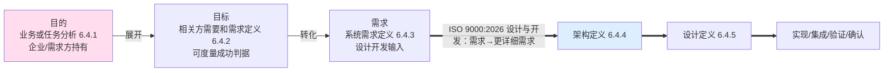
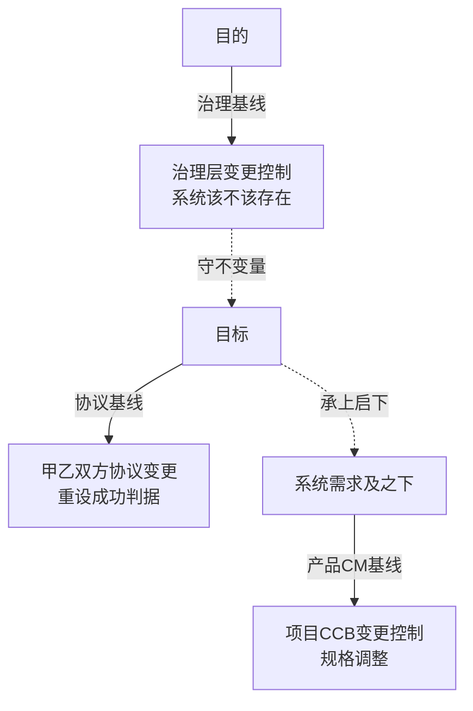

# 17 - 设计与开发边界及三层基线治理 对照卡

> 本卡整理自一轮对话线（起点："理解设计与开发的定义，目的→目标的定义过程是否属于设计与开发范围"），顺次覆盖：
> 设计与开发定义 → 目的/目标/需求 是否属设计与开发 → 需求定义责任方 → 目的/目标是否纳入配置管理 → 治理基线/协议基线定义 → 两概念的权威出处说明。
> **版本**：v1.13（2026-09-24）；逐版变更见文末「修订记录」。

---

## 〇、标准锚点（全程引用）

| 概念 | 标准出处 | 关键原文/位置 |
|---|---|---|
| 设计与开发 | ISO 9000:2026 §3.3.11 | 将对客体的**要求**转换为对其**更详细的要求**的一组过程（输入=要求，输出=更详细特性/规格）；注 3：限定词可指明设计开发对象的性质（产品／服务／过程设计和开发） |
| 系统生存周期技术流程 | ISO/IEC/IEEE 15288（现行版 2023；本行过程号**已核**——**6.4.1–6.4.14 全段依库内正本直核**，各过程标题逐条对上） | 6.4.1 业务或任务分析 → 6.4.2 相关方需要和需求定义 → 6.4.3 系统需求定义 → 6.4.4 架构定义（正本过程名 **System architecture definition process**） → 6.4.5 设计定义 → 6.4.7 实现 |
| 架构 | GB/T 45630-2025, **3.2**《系统与软件工程 架构描述》（等同采用 ISO/IEC/IEEE 42010:2022，2025-11-01 实施）——中文术语定名的依据 | **架构**＝实体在其环境中的**基本**概念或属性，以及该实体及其相关生存周期过程的实现和演化的**管控原则**（governing principles）（3.2；「基本」系**自译**——国标字面作「**基础**」，场合分流见下〔按〕） |
| 架构描述 | GB/T 45630-2025, **3.3**／ISO/IEC/IEEE 42010:2022 §3.3 | **用于表达架构的工作产品**（AD）——「架构描述」是**描述层**零件，其集合为 42010:2022 §3.4 Note 1 的 **11 类 AD elements**（相关方／关切／相关方角度／方面体／ADL／ADF／对应关系／架构视图／视图组件／架构视角／模型种类），**`definition` 不在其中**（22 号 §6.1～§6.3） |
| 目的 | **ISO/IEC/IEEE 42030:2019 `intended purpose`** / 15288 6.4.1 | 系统为什么被研制的理由（价值侧，可虚）——⚠ **42010:2011 §3.1～§3.10 与 2022 §3 均无 `purpose` 条**，勿挂 42010（22 号 §3.6、§6.2） |
| 目标 | ISO 9000:2026 §3.7.11 + §3.11.2 | objective = 要实现的结果（result to be achieved）；评审参照 = established objectives（**为客体确立的目标**——`established` 与 `specified` 在中文里都被译"规定"，英文不是一个词，23 号 §7.2 陷阱①） |
| 需求 | ISO 9000:2026 §3.5.1 | requirement = 需要或期望（明示/隐含/必须履行三形态） |
| 基线 | ISO 10007:2017 §3.2〔**库外来源·不可核**〕 | **经批准、确立了产品在某一时点的特性、并作为生存周期各项活动参照的配置信息**〔译文与 04 号 §8 定义块／§15 关键术语表同为一版；**库内替代锚**＝ISO 9000:2026 **§3.10.12 configuration baseline**／15288:2023 **§3.8 baseline**〕 |
| 治理／架构治理 | ISO/IEC 38500:2024（治理语义）；**ISO/IEC/IEEE 42020:2019 第 6 章（架构治理过程正本）＋附录 G.1（资料性，逐字定义）**；TOGAF 为行业参考 | 架构治理的定义、目的、对象、输入与输出、责任主体与机制一律以 **29 号《架构治理研究报告》**为准——「基线与变更控制」是其 §7 六机制之一，「基线类」是其 §5.1 七类输入之一；本卡「治理基线」是该机制在本框架中的落名。〔**勘误（2026-10-12·全库对齐轮）**：本格原印「TOGAF（**架构治理领域定义**）」——**已废**：架构治理的**术语定义**在 **42020:2019 附录 G.1（资料性）**（*the practice and orientation by which architectures are managed and controlled at an organization-wide level*，含 a)~d) 与 Design Authority），**第 3 章术语表无该词条、第 6 章为过程正本**；附录 G 是**资料性**、位阶不同于规范术语条，引用须写全。TOGAF 降为**行业参考**（其定义句与 G.1 几近相同）。见 29 号 §2.1 v1.5。〕 |
| 协议 | 15288 §3.4 | agreement = 工作关系的相互确认（如合同/谅解备忘录）；用于获取方与供应方之间 |
| 配置管理 | ISO 10007:2017 | 标识、变更控制、状态记录、审核 |

> 〔按：stakeholder 国标定名「相关方」（30 号 §8.2）；15288 过程名 6.4.2 依国标 GB/T 22032 作「**相关方需要和需求定义**」，本卡同此。〕

> 〔按：**分工指针（依 22 号 D31）**——**架构四概念**（架构／关切／架构视角／架构视图）以 **30 号**为准；**架构与设计边界、元素三层**（AD element／实体构成／system element）以 **24 号**为准；**concept／property／architecture／AD** 四术语的逐条款考证与译名分工以 **22 号**为准。另：**42010 §3 Terms and definitions 里既没有 `concept` 也没有 `property`**（2011 §3.1～§3.10 与 2022 §3 均无此两条）——二者按 ISO/IEC Directives Part 2 以**普遍接受的含义**使用（`concepts` ≈ idea／notion），**不是** ISO 1087:2019 §3.2.7 严谨义的「知识单元／对象的特征」（22 号 §3.6；D8）。〕

> 〔按：**译名场合（依 22 号 §9.5／§9.6 陷阱第 4 条；D21）**——本表「架构」行的「**基本**概念或属性」是**自译**；**逐字引 GB/T 45630-2025 时必须照抄国标字面「基础概念或属性」**。两者**不是错译，是分流**：自译自用取「基本」，引国标照抄「基础」，场合错配即陷阱第 4 条（本报告他处引国标文字处一律照抄国标字面）。〕

---

## 一、设计与开发的准确定义

**ISO 9000:2026 §3.3.11（设计与开发）**：
> 将对客体的**要求**转换为对其**更详细的要求**的一组过程。
> （注 1：构成设计和开发**输入的要求**通常是研究的结果；这些要求通常从**特性**方面来规定。）
> （**注 3（两版均有，2026 措辞微调）**：限定词可用以指明被设计开发对象的性质，如产品／服务／**过程**设计和开发。）

**刀锋所在**：设计与开发的**起点是"要求（需求）"**，它把需求转成更详细的特性/规格。故**"需求"是设计与开发的输入，不是设计与开发本身**。

---

## 二、目的 → 目标 → 需求 是否属于设计与开发

**结论**：目的→目标→需求 的定义过程，**不属于（供方视角的）设计与开发**，它是设计与开发的**输入端与触发前提**（问题空间/需要定义），而非解空间/方案设计。

### 标准落点表（15288 技术流程）

| 概念 | 15288 落点 | 属于"设计与开发"吗 |
|---|---|---|
| **目的**（为什么被研制） | 业务或任务分析 **6.4.1**（问题空间，企业/需求方持有） | ❌ 上游、输入端 |
| **目标**（预期达成的可度量结果） | 相关方需要和需求定义 **6.4.2**（可度量成功判据） | ❌ 需要/需求定义阶段，仍在上游 |
| **需求**（自身可验证规格） | 系统需求定义 **6.4.3**（设计开发输入） | ❌ 输入，尚未进入 |
| 架构 / 详细设计 | 架构定义 **6.4.4**〔正本过程名 **System architecture definition process**〕 / 设计定义 **6.4.5** | ⚠️ **同属设计开发阶段，但分界在"种类"不在粒度**——见下注 |

### 三层结论
1. **严格（ISO 9000:2026 §3.3.11）**：设计与开发 = 需求→更详细特性。目的→目标→需求 是"**产生这些需求**"的上游过程，在设计与开发**之外（上游）**。与"定义架构前必先定义目的"完全自洽。
2. **广义（15288 全生存周期）**：目的→目标 属"开发"生存周期最前端的**需要/需求定义技术流程**（6.4.1–6.4.2），但须与"架构定义(6.4.4)/详细设计(6.4.5)"分开——前者是**问题空间/需要定义**，后者是**解空间/方案设计**。〔**勘误（2026-10-12·全库对齐轮）**：**"架构定义属设计与开发核心"与"架构与设计的分界在种类"是两回事，不可并读成一句**。正本口径：**15288 §5.9**——*Architecture focuses on **suitability, viability, and desirability**, whereas design focuses on **compatibility with technologies** and other design elements and on **feasibility of construction and integration***；而 **ISO 9000:2026 §3.3.11** 的"设计和开发"是**跨过程的一族活动**（*transform requirements for an object into more detailed requirements for that object*），本表两列分处"层级不同、名字不同"：**层级**＝本表说的是产品开发阶段的归属，**名字**＝15288 的过程名是 **System architecture definition process**（"架构定义"是 42010 §3.1 *architecting* 一族的**概念名**，不是过程名）。故本行读作：**架构定义与设计定义同属设计开发阶段的两类工作**——**种类不同**（概念·属性＋管控原则 vs 元素及其关系的规格），**不是粗细两档，也不是支配关系**。〕
3. **责任归属（呼应"架构师不拥有目的"）**：目的由企业/需求方（治理、战略）持有；目标是供需双方就"成功判据"达成的协议（6.4.2 产出书面协议）；供方设计与开发从（系统）需求起算。架构师对目的的职责是"理解/确认/使架构承接"，**不是定义目的**。

### 收束图

（粉=问题空间/需要定义，上游、非设计与开发；蓝=解空间/设计与开发核心。**注**：蓝区内的 **A（架构定义 6.4.4）与 D（设计定义 6.4.5）同属设计开发阶段，但分界在"种类"不在粒度**——15288 §5.9；且过程正名是 **System architecture definition process**。）

> 〔按：图中 **A ==> D** 段表达的是**规定需求逐级下达**——"每个过程的输出，对下游过程而言都是规定需求"（24 号《架构与设计边界研究报告》§8.3），**不是两个先后阶段**。**架构定义（6.4.4）与设计定义（6.4.5）是两个过程，不是两个阶段**：15288 §5 允许**迭代与并发**，"先架构定义后设计定义"是瀑布式误读；真实形态是**同一时刻在相邻两个种类层上的两类工作**（24 号 §2.2.2）。二者另有两条关系可并读：**交替递归**（上一层设计定义的输出 = 下一层架构定义的输入对象）与**同构**（同一套活动族，同一种工作做两遍）（24 号 §2.2.1 关系 1、2）。同一口径亦适用于 §〇 标准锚点表内 6.4.4 → 6.4.5 的流程清单排列——那是标准的流程清单与条款号顺序，不是日历上的先后。〕

> 〔按：**"不属设计与开发"不止上游一种，还须分链上步型**（依 20 号报告 v2.0 §2.4、§6.4）。上表与上图从"**过程位置**"判归属，只判出第一种；把它们放在**产品数据链**上看，同一个判断还有第二种落法——**链上三类步**：**分配步**（两侧的叶不是同一批节点，须按映射定落点）／**整段搬入步**（两侧的叶是同一批节点，叶由上游直接给出，不做映射）／**形态轴步**（同一份产品数据在两个形态之间）。**只有分配步是一次 Y=F(X) 求值，即一次设计与开发**；**整段搬入步虽然在设计线上执行、却不是设计与开发**——它的活是长干枝并逐级判定落位，产出是下一份产品数据的结构，不是"把需求转为更详细需求"。据此本卡的边界可写细一档：**设计与开发的核心区 ＝ 分配步**；**上游端 ＝ 目的／目标／需求的产生过程**（本报告 §二 三层结论第 1、2 条）；**链上非设计开发步 ＝ 整段搬入步与形态轴步**。链尾另有一处换手——设计线交付**框架态**即止，其枝梢节点的分解移交开发线执行（20 号 §6.4），故 §二 收束图末的"实现/集成/验证/确认"不是同一条链的自然延伸，而是**换手之后的另一条线**。〕

---

## 三、需求定义由谁负责

**责任分两端——需方持有"需要侧"，供方负责"技术侧"：**

| 概念 | 定义责任方 | 标准落点 | 角色 |
|---|---|---|---|
| **目的** | 企业 / 治理层（需方） | 6.4.1 业务或任务分析 | 持有、战略侧；架构师只**确认/承接**，不定义 |
| **目标** | 需方主导 + 供方协议 | 6.4.2 相关方需要和需求定义（书面协议） | 成功判据，双方共识 |
| **相关方需求** | 需方 | 6.4.2 | 需要侧 |
| **系统需求** | 供方（系统工程师 / 架构师桥梁） | 6.4.3 系统需求定义 | 设计开发输入，技术侧 |

一句话：**目的企业持有，目标供需共签，系统需求供方落地**。架构师以**应答与对应**两条关系，把目的与目标转写为系统需求，对可落地下技术责任，但不拥有目的。

---

## 四、目标、目的要不要纳入配置管理

**结论**：都要"受控"，但**机制分级**——目的走治理级变更控制，目标走协议/需求基线受控，需求走经典产品 CM。**三者不是都作为"产品配置项"同等管理。**

**理由**：
- **ISO/IEC/IEEE 42030:2019**（库内为 CSA 2020 采标件，等同采用 2019）以 intended purpose 为架构**评估**依据 → 目的/目标一变，架构有效性随之动摇 → **必须受控变更**。
- CM 本质（ISO 10007）：对"变更会影响产品符合性的对象"做标识+变更控制。凡变了动摇架构的，就该受控。
- 但**目的不是产品本身**，是产品须 conform to 的上位 invariant → 故目的作为**治理基线**受控，而非作为产品配置项受 CM 日常管控（与需求的本质差别）。

### 分级受控表

| 概念 | 是否纳入 CM | 受控机制 | 变更触发 |
|---|---|---|---|
| **目的** | 治理基线受控（非产品 CI 日常管控） | 治理级变更控制（企业） | 目的漂移 = 系统该不该存在的危机（判例 AG-01） |
| **目标** | 协议 / 需求基线受控 | 变更控制（供需协议） | 评审/确认参照变化，重设成功判据 |
| **需求** | 经典 CM | 配置标识 + 基线 + 变更控制 | 规格调整 |

**落点（呼应"产品数据"）**：三层各有所载，**其中只有最下面一层是产品数据**——《系统目的或任务理解确认清单》（目的）载治理基线；《**实体在其环境中的基本概念或属性清单**》＋ 目标载协议基线；**需求基线**才进产品数据链，载产品 CM 基线。三层**分级管控，但都受控可追**。

> 〔按：**目的与目标不上产品数据链，与"要受控"不矛盾**（依 20 号报告 v2.0 §1.1、§1.3、§2.1~§2.3、§七）。"产品数据"在链上取**成树**的形态——可条目化、可树形化、可由需求设计方案按 N:1 分配（20 号 §2.1~§2.3），并按定义到多深取**框架／概要／定义**三形态（20 号 §1.3）；**目的与目标不具这三条性质，故不进产品数据链**——它们与 §五 已写的**方针**、**确认的判据**同列，是本卡的**链外之物**。两句各管一件事、互不决定：**在不在链上**管的是它能否参与"需求→方案"的逐对生成；**受不受控**管的是它变了要不要走变更控制。〕

> 〔按：该清单住 **L3（概念＋属性清单）**、按 **aspect（42010:2022 §3.9）**分块呈现（functional／structural／informational），**"abstract" 不能读成 "list"**（22 号 §8.2、§7.3；D18）。定名依 22 号 §8.3 V2 与 §9.4 打磨①——`fundamental` 在原文**只出现一次**、修饰 "concepts **or** properties" 整个短语，故不写「和基本属性」而写「**或属性**」；主体是**所关注实体（EoI）**不是 system，故「系统的」改「实体在其环境中的」。**「系统的基本概念和基本属性清单」是 22 号 §8.3 判为 ⚠ 的 V0 措辞**（**2011 口径的 system 主体**，且 fundamental 被读成两次修饰）；严格成立的是 **V2「实体-环境关系中的 fundamental concepts/properties 清单 ＋ governing principles 清单」**（L3＋L4 完整版）——本清单名取 V2 的主体与环境限定，只承载其 X 块（22 号 §8.3、§9.4 打磨①；D18）。〕

---

## 五、治理基线 / 协议基线 定义

### 基线（baseline）是标准术语
ISO 10007:2017 §3.2〔**库外来源·不可核**〕：基线 = **经批准、确立了产品在某一时点的特性、并作为生存周期各项活动参照的配置信息**〔译文与 04 号一致；库内替代锚见 §七 表〕。需求基线、设计基线皆此意。

### 治理基线（本框架复合词）
"治理基线" = 基线的一个切片——把"变了就是系统该不该存在/什么绝不能动"的项目单独拎出，交给**治理层（企业/战略）**而非项目管理来管。
- **装什么（被守护的 invariant）**：① 系统目的（即《系统目的或任务理解确认清单》）② 架构原则与关切清单——**不作基线项**；基线只登记"哪些偏离须经治理批准、谁批、留什么痕" ③ 治理红线（合规/法规/安全等 obligatory 硬杠）
- **不在本项下的一项**：**方针（policy）不在派生链上**——它与派生关系**异构**（是**承诺 ＋ 框架**关系，非 derivation），判据＝组织的目的与环境（**ISO 9001:2015 §5.2.1 a**〔库外来源·不可核——库内无 ISO 9001 正本〕），定期复评走 **§9.3 管理评审**（23 号 §5.5、§9.1）。故方针不装在治理基线的三项里，另有所属；同理，**确认的判据（预期用途／使用情境）也不在本卡三层之列**——它与派生链异构，构成需求基线之上的参照层（23 号 §9.1、§9.2）。
- **谁能动**：只有治理层。项目管理层（管理）无权改——对应"治理在管理层之上定组织方向与框架（指导、监督、担责）、管理在框架内执行"（ISO/IEC 38500:2024 口径；第三成分 accountability 按 28 号 §2.3.3 作「担责」）。**理由在判据族里**：治理基线装的是**判据本身**（目的、原则、红线＝规则与基线），而「判据本身的变化只能由治理裁决」正是 29 号 §5.2 三条分界判据的**第三条（不可自裁）**——本条不是权限分布的习惯，是判据的推论。〔与另一条分开用：「跨出单管理层权限，就要治理介入」是**介入门槛**（判该不该上治理），不是分类判据；判「算不算治理」用三条判据（29 号 §5.2）。〕
- **存在理由**：目的归治理机构、不在执行者手里，委托后目的可能**无声漂移**（AG-01 即目的漂移处置链，见 08 号）；治理机构须对组织持续行使指导、监督、担责，把架构保持在目的上。故须把"目的+原则+红线"**正式冻结成治理基线**——既是架构**评估**参照（ISO/IEC/IEEE 42030:2019 以 intended purpose 为依据），又是评估漂移的基准。
- **在治理结构中的位置（依 29 号）**：治理基线＝29 号 §9 六机制中「**基线与变更控制**」机制的具体化（该机制的设计要点是：架构描述基线化、变更经审批、历史可回溯；架构的生命与架构描述的生命不同步时按 GB/T 45630-2025 附录 E 处置），同时也是 §5.1 七类输入中「**基线类**」的来源。此外两处与 29 号同向：①**治理对象四层**中第三层「架构演化」的判据是「变更是否受控、不变量是否守住、变体是否在允许范围内」，本卡的治理基线正是「不变量」的载体；②29 号 §7.5 的**例外权上收**与本卡「谁能动」同源——偏离治理基线只能由治理机构放行，且须登记、限期、到期复审。

### 协议基线（本框架复合词）
"协议基线" = 由**需方与供方正式约定**后冻结的那组"成功判据"，主要是**目标（objectives）**及双方确认的相关方需求。绑定来源不是治理权威，而是**甲乙双方协议**。
- **装什么**：① 目标 / 成功判据（operational objectives，MOE 源头）② 双方约定的相关方需求
- **谁能动**：需方 + 供方共同——走**获取协议（acquisition agreement）变更流程**，非项目管理单边改、非治理层独断。
- **存在理由**：评审参照 = **为客体确立的目标**（`established objectives`，ISO 9000:2026 §3.11.2）；确认参照 = **为预期用途或应用的需求**（§3.11.14）。**目标是最显性的一类成功判据，但不是确认的尺子**（详见 §六 表下〔按〕；23 号 §5.1 五级表、§4.3 与 specified use 的分野）。若目标不冻成协议基线，供方可随意拉低"成功"，需方失抓手。故目标须**双方约定冻结**。
- **注意**：从此向下转化的**系统需求**不在此层，进**产品 CM 基线**（供方技术侧）。协议基线管"甲乙双方约定层"，产品 CM 基线管"供方实现层"。

---

## 六、三层基线对照（含与目的→目标→需求 映射）

| 基线 | 装什么 | 变更权威 | 变更意味 | 标准落点 |
|---|---|---|---|---|
| **治理基线** | 目的 + 原则 + 红线 | 治理层（企业/战略） | 系统该不该存在的危机（判例 AG-01） | ISO/IEC/IEEE 42030:2019 intended purpose 为**评估**依据 |
| **协议基线** | 目标 + 约定的相关方需求 | 需方 + 供方协议 | 重设成功判据 / 重谈承诺 | 15288 §3.4 agreement（术语条；原记 6.4.2 系号错——6.4.2 是"相关方需要和需求定义"过程） |
| **产品 CM 基线** | 系统需求 + 设计 + 实现 | 项目 CM 变更控制（CCB） | 规格调整，正常工程动作 | ISO 10007 baseline〔**库外来源·不可核**——库内无 ISO 10007 正本；库内替代锚＝15288:2023 **§3.8 baseline** ／ ISO 9000:2026 **§3.10.12 configuration baseline**〕 |

> 〔按：本卡三切片与 **23 号判据阶梯（五级）** 是两条**不同切法**——本卡按**变更权威**切（谁有权改，决定它落在哪条基线），五级阶梯按**判定活动各自对着什么尺子**切（23 号 §5.1）。二者接口在**目的—目标—需求**三族的归属：§五 的两处判据在五级表中的归级为——**评审＝第 3 级**（判据「为客体确立的目标」，出处 §3.11.2）、**确认＝第 2 级**（判据「为预期用途或应用的需求」，出处 §3.11.14）；本卡全文只在这两处用到阶梯的级，故特此点明两轴关系（23 号 §5.1／§5.3）。〕

---

## 七、⚠️ 权威性声明（务必区分"真标准"与"本框架复合词"）

**「治理基线」「协议基线」不是 ISO 里的现成固定术语**（ISO 10007 / 15288 / 42010 主线上查不到这两个词组）。它们是把"基线"按**变更权威 + 内容**切出的**本框架复合词**。组成它们的每个零件都有真出处：

| 词 | 是否标准术语 | 出处 |
|---|---|---|
| **基线**（configuration baseline） | ✅ 真标准 | **库内替代锚**：ISO 9000:2026 **§3.10.12 configuration baseline**（*approved configuration information that establishes the characteristics of a product or service at a point in time that serves as reference for activities throughout the life cycle of the product or service*）；15288:2023 **§3.8 baseline**（*formally approved version of a configuration item, regardless of media, formally designated and fixed at a specific time during the configuration item's life cycle*，SOURCE: IEEE Std 828-2012）。〔原记「15288 §4.7」**该号不存在**——15288:2023 第 4 章只有 **§4.1 Intended usage／§4.2 Full conformance（§4.2.1／§4.2.2）／§4.3 Tailored conformance**；原并引 ISO 10007:2017 §3.2 定义文字，**库外来源·不可核**，见台账 02 号 §三〕 |
| **协议**（agreement） | ✅ 真标准 | 15288 §3.4（合同/谅解备忘录等） |
| **治理**（governance） | ✅ 概念有出处 | ISO/IEC 38500:2024（§3.3 定义三职能、§4 目的、§6 执行四活动）；"治理基线"按"**治理机构定方向与框架、管理在框架内执行**"的本框架提炼（08 号）。**架构域的展开以 29 号《架构治理研究报告》为准** |
| **治理基线** | ❌ 本框架复合词 | = 基线 + 治理层变更权威（无 ISO 原词） |
| **协议基线** | ❌ 本框架复合词 | = 基线 + 获取方/供应方协议变更权威（无 ISO 原词） |

**⚠️ 别把本卡"治理/协议/产品 CM 基线"与标准的"功能/分配/产品基线"混淆**——那是按**定义成熟度/生存周期阶段**切的，不是按变更权威切的：
- **功能基线 functional baseline** = 系统性能/功能/接口特征 + 验证要求
- **分配基线 allocated baseline** = 分配到产品/子系统/组件的要求
- **产品基线 product baseline** = 特定时点详细设计（生产/部署/运维）
（出处：**库外来源·不可核**——15288 / **ISO/IEC/IEEE 24748-7** / EIA-649 / MIL-STD-973；其中 **24748-7 库内无正本**。15288:2023 侧的库内替代锚为 **§3.8 baseline**，见上表「基线」行）
本卡三切片是**变更权威轴**，与 functional/allocated/product 的**成熟度轴**正交，非一回事。

**引用建议**：
- 可放心写：**"基线（ISO 10007:2017）""协议（agreement, 15288）""目的（ISO/IEC/IEEE 42030:2019 intended purpose——**42010 §3 无 `purpose` 条，勿挂 42010**）／目标、需求（ISO 9000:2026 §3.7.11／§3.5.1）"**。
- 勿写：**"治理基线（ISO 10007）"**——应标注"治理基线（本框架复合词：基线 + 治理层变更权威）"。

> 〔按：**边界判据指针**——判"某一项工作算不算设计与开发"时，判据引 [20 号报告 v2.0](20-设计与开发落地方法研究报告—需求与方案结对开发.md) §2.1~§2.4（三条理论依据 ＋ 链上三类步）与 §6.4（链尾移交）；判"某个概念属不属于产品数据"时，同引 20 号 §1.3（框架／概要／定义三形态）。**本卡的职责是边界与基线归属的结论，不是判据本体**——判据不在此重述。〕

---

## 八、收束（一句话总收）

**设计与开发 = 需求→更详细需求（ISO 9000:2026 §3.3.11）；目的→目标→需求 是产生需求的上游/输入端，不属设计与开发本身。** 三者责任分端（目的企业持、目标供需签、系统需求供方落），且**都要受控**——按"谁有权改、改了意味什么"切为三层基线：**目的落治理基线（治理层决）、目标落协议基线（甲乙双方协定）、系统需求及之下落产品 CM 基线（项目 CCB）**。"治理基线/协议基线"为本框架复合词（基线+变更权威），非 ISO 术语，引用时须标注。

---

---

## 修订记录

**v1.13（2026-09-24）·第十四轮·ISO 10007 引文统一**（v1.12 → v1.13）：§〇 表「基线」行与 §五 正文所引 ISO 10007:2017 §3.2 译文改与 04 号 v2.6 同一译法，两处同标库外来源并指库内替代锚。改因：同一引文全库须同译、可核到库里。

**v1.12（2026-09-24）·第十三轮·依五份标准正本结清条款号**（v1.11 → v1.12）：依 15288:2023 与 ISO 9000:2026 正本改正六处——基线术语条由不存在的 §4.7 改 §3.8、库外来源改标并指替代锚、ISO 9001 补版本、架构评价改架构评估、过程号改按正本直核、42030 补年号。改因：条款号与引文须对得上正本。

**v1.11（2026-09-21）·第十二轮·依 20 号报告 v2.0 对齐**（v1.10 → v1.11）：§二 收束图补一条按语（不属设计与开发的不止上游，还有整段搬入步与形态轴步）、§四 落点句改三层各有所载且只有最下层是产品数据、§七 补边界判据指针。改因：20 号 v2.0 出了判据，本卡原只按过程位置判。

更早版本见 git。
