# 22-架构、概念、属性研究报告—术语权威定义与对照分析

> **范围**：以 ISO/IEC/IEEE 42010（架构）为骨架，串联 ISO 1087（术语学）、ISO 9000（质量管理）、ISO/IEC 2382（信息技术）三大词法基准，对 **concept / property / architecture / architecture description** 四个术语进行**逐条款verbatim考证**+**跨标准语境对照**+**精度分层辨析**，沉淀一份可纳入 AOS 知识体系的研究型笔记。
>
> **方法**：① verbatim 引证 → ② 关键差异点解读 → ③ 跨标准语境对照表 → ④ 多视角 Mermaid 图 → ⑤ 可移植辨析模板。
>
> **适用**：术语锁定、跨标准引证、综述撰写、评审答辩。
>
> **文档版本**：v1.3（创建 2026-09-04；v1.2 对齐 30 号；v1.3 按用户 2026-09-21 裁定统一术语）→ v1.4（2026-09-21 依 29 号对齐架构治理口径）→ v1.5（2026-09-21 依 27 号对齐 ISO 9000 版本依据）→ **v1.6（2026-09-21 第六轮·依 24 号对齐元素三层与凭据链术语）** → **v1.7（2026-09-21 第十轮·依 23 号对齐：充分性辨异指针 ＋ 判据侧术语指针行 ＋ 三处「对照未交付」欠项结清）** → **v1.8（2026-09-24 依库内标准正本核改 `system element` 号与引文、「artefact 不可互译」断言撤销）** → **v1.9（2026-10-11 依用户裁定清除 2011 版"元素与关系"痕迹）** → **v1.10（2026-10-12「以 35 号为基准的全库对齐」轮：治理论口径行定义权改正（TOGAF→42020 附录 G.1）；§2.1 架构行「没有形态、交不出去」→「无形而抽象」）** → **v1.11（2026-10-12·第10章轮次：补「架构域／关注域／领域架构」三词分界与译名，附「架构种类≠架构视图」与 §E.4.1.1 注）** → **v1.12（2026-10-12·层级图定案：补「企业架构＝企业运营体系架构」简称与 SoS 两层级）** → **v1.13（2026-11-01「以 46 号 v3.0 为基准的全库对齐」轮：**① §5.5 修订表逐行对 42010:2022 **Foreword** 重铸（12 行），aspect／stakeholder perspective 由"2022 新增"改为"**2022 立为词条、2011 已有其概念**"（连带 6 处）；② §6.2 节题与正文补 **Note 1 的资料性标记与"非穷举"**，并补 §5.2.9 另列的 legend／architecture decision／architecture rationale；③ §8.2 的 **L4 拆为 L4a 原则／L4b 对应关系**，表内直书"三张清单且有序"，加层轴声明；④ §5.1 互参行改**三把尺**（概念／属性／原则），撤「承重测试」与「必要性／充分性双判据」作判据名；⑤ §5.2.2 embodied-in **整节重写**（标资料性、补三反例、弱读依据改指 42020 §10.4.4 e) 与 15288 §6.4.5.3、结论改"只作体检提示"）；⑥ §12 引证表加**〔档位纪律〕**与四档／性质标记，8 类库外基准标"库外·不可核"；⑦ **15288 §6.4.5.1 → §5.9**；⑧ §7.2「管控层」改为"定义句第二块"并标〔读法〕）** → **v1.14（2026-10-31「以 46 号 v3.3（三级论证体例＋结论台账＋号形细则）为基准」的体例对齐轮：新立摘要与附录 A 结论台账（24 行）、三条 A 级四段（§3.6.1、§5.2.2.1、§5.5.1）、§5.4 两哲学换正本派名、§7 章题改正、§3.6 证据一换 2022 十九条、§6.2 与 §8.2 收拢、§5.5 补第 13 行「架构视角的更新」，另补 §10.4 范例、§9.5A 术语档位、§10.2 划界句与 5 处指针；逐条见 §14 修订记录表 v1.14 行）** → **v1.15（2026-11-06 依 48 号 v3.25 对齐：「三把尺」四处改按「一支填句三槽（三把尺＝三种填法）」表述，结论不动）** → **v1.16（2026-11-11 随 46 号（新）对齐命名口径：§7.1 EoI 扩域表补边界注（数据架构两读），并把两段夹注移出表体、表结构修复）** → **v1.17（2026-11-11 随 46 号 v2.6（八条主结论）严格对齐：卡一描述是方案／卡二位与设计元素不得同名／卡四四名容器归属／卡六识别不是组成，共十处，逐条见 §14 修订记录表 v1.17 行）**

> **补充记录（2026-10-12·第10章轮次）——三个「域」字词的分界与译名**：「**架构域**」「**关注域**」「**领域架构**」三者各有所指，混用即失效：
>
> | 词 | 所指 | 来路 | 边界 |
> |---|---|---|---|
> | **架构域** | **架构领域**——以架构为专业的那一个领域（与「数据域」「流程域」「管理域」并列） | 本书与报告库既有的中文用法（14 号章／18 号章／06／08／13／17／21／22／23／24／26／28 号十余处） | **正本族无此词**（42010／42020／42030／15288／9000 中英对照版逐份核过，零命中）；**与 TOGAF 的「架构域」同名不同义** |
> | **关注域** | 业务／数据／应用／技术**四个域** | 本书第10章 §10.4.4（TOGAF 原文作 *architecture domains*） | **TOGAF 官方中文版把 *architecture domain* 也译作「架构域」（第 4.12 条）**——故引 TOGAF 那一义时，本书一律写「关注域」 |
> | **领域架构**（*domain architecture*） | 「领域中各系统的一种通用的组织性结构或设计」 | **42020:2019 §E.4.1.5**（属**参考架构**那一族） | **是正本术语**，与上两者都不是一回事 |
>
> **两条配套口径**：① **42020:2019 把「架构种类」（§E.4.1，**十一种**——§E.4.1.2~§E.4.1.12；§E.4.1.1 为总则）与「架构视图」（§E.4.2，如语境视图）分成两份清单**——**种类不是视图**；② §E.4.1.1 总则的注（**NOTE，资料性**）说得直白：「用于表达某个视角、某个方面体、某个抽象层级或某个角度的**描述**，有时称为架构种类」——**"XX 架构"这类名字，多半只是一份描述的命名**。
>
> **概念依据**：架构、关切、架构视角、架构视图四概念的定义、关系、界分与译名，一律以 30 号《架构描述核心概念研究报告》为准（依 GB/T 45630-2025／ISO/IEC/IEEE 42010:2022）。
>
> **治理口径（2026-09-21 依 29 号补；2026-10-12 依库内正本更正定义权）**：治理**本体**见 28 号《治理概念研究报告——从 ISO 37000 定义到域治理实例》；**架构治理**（architecture governance）的定义、目的、对象、输入与输出、责任主体与机制，一律以 **29 号《架构治理研究报告——从标准依据到责任主体》**为准（**领域定义取 42020:2019 附录 G.1（资料性）、过程正本为第 6 章**，治理语义取 ISO/IEC 38500，TOGAF 为行业参考）〔原印「领域定义取 TOGAF」——**已废**，见 29 号 §1.1 的更正记录〕。本报告是术语权威对照报告，只处置 `governing`（定语位）、`governance`（名词位）与 `governs`（关系位）三者的**译名分工**，不为架构治理立定义——本报告凡出现 `architecture governance` 处，其定义与展开均见 29 号。
>
> **补充记录（2026-09-21 依 29 号对齐）**：用户令「以 29 号研究报告为依据，将之前有关的研究报告与之对齐」。本报告的全部术语对照结论**不重做**，只补指针——①头部补「治理口径」行（治理本体在 28 号、架构域专门展开在 29 号）；②§5.1 互参行补明「基本」的判据来源即架构治理（29 号）；③涉 `architecture governance` 的五处译名对照（§6.5 三条边界之③、§9.4 打磨③结论 3、§9.5 精度对照表的 `governing principles` 与 `governance`（名词）两行、§9.6 陷阱清单第 3 条）各补 29 号指针。**未改**：§0～§14 的术语对照结论、译名取舍（管控原则／治理／governs 的分工）、打磨轨迹与历史记录、引证表与逐轮摘要，以及全部节号、表格行数与图结构，一处未动。
>
> **2026-09-21 第六轮·依 24 号对齐**：用户令「以 24 号研究报告为依据，把 24 号之前的报告与之对齐」。本报告是**术语权威对照报告**，已有辨析结论**一律不重做**，本轮为**补全与校正**——①**§6.2A 新增**：补入 24 号 §12 的**元素三层**（AD element 描述层／架构构成物 架构层／system element 实现层）一表与"⚠ 易误读"三条，并声明 §6.2 的 11 类全属**描述层**、与 **24 号 §12.1 读法 A** 一致；②**embodied-in 的去向就地校正**：其并非删除而是**搬家＋降调**（迁入 **42020:2019 §3.3 Note 1**，elements/relationships → components／relationships／环境关系，"是"→"通常意指"），依 **24 号 §13.2**，在 §5.2.2 就地补夹注、§7.2 补互参；③**§12 引证表补 8 行**（27~34 号行）：架构构成物、架构实体、system element、compliant implementation、specified requirement、solution space／solution classes、sufficient to enable／implement-to level、artefact，各随 24 号出处与"⚠ 易误读"提示；④§6.4 补**凭据链**两步指针（DD 只能出具条件性合规——24 号 §10.7；两个"合规"必须分开——24 号 §11.5）。**未改**：§0～§11 的术语对照与辨析结论、译名取舍、§8 的 4 个切片结构与 L1-L5 框架、Mermaid 图结构、打磨轨迹与历史记录，以及全部节号；24 号未涉及处一律未动，逐字引文一字未改。
>
> **2026-09-21 第十轮·依 23 号对齐**（用户令「以 23 号研究报告，对齐其前的文档」）：以 **23 号《判据体系研究报告——从验证确认到治理的判据阶梯》**（v1.9）为准核本报告，**零冲突、两处缺位**——① **§5.1 互参行补「充分性」辨异指针**（缺位，且指针链不落底）：原文全文唯一出现"充分性"处只写「见 **30 号 §5**」，而 30 号 §5.2 自写"沿用 24 号，不重推"——按 23 号附录 A 的 `adequacy` 行补上 **24 号 §6.3**：必要性＝**membership**（管入会）／充分性＝**closure**（管闭包），且充分性**不是数学意义的充要条件**（架构不构成目的达成的充分条件，达成还需实现／验证／运行）；② **§12 引证表下补"判据侧术语指针行"**（缺位）：23 号附录 A 已定译的判据侧术语（本轮点名 `auditee`／`inspection` 两条，并附其 ISO 条款号、引文与"⚠ 易误读"）在本报告正文**零出现**，故按本报告"引证表只收正文实际引用并使用的条款"这一体例，**不逐行并入**（并入会使该表收入本报告从未使用的词条、且与 23 号重复而失同步），改以指针行指向 23 号附录 A 并就地写明两条的出处与陷阱。**依据**：23 号 §5.7、§6.4、§10.6、附录 A。**未改**：§0～§11 的术语对照与辨析结论、译名取舍（管控原则／治理／governs 的分工）、§8 的 4 个切片结构与 L1-L5 框架、§13 逐轮摘要、§14 依据清单，以及全部节号；引证表 1~34 行一字未动（表下新增一处指针注，未增删表格行），逐字引文一字未改。

---

## 摘要

本报告是**术语上游件**：全库凡涉 `concept`／`property`／`characteristic`／`attribute`／`architecture`／`architecture description` 及其构件术语，**词怎么定、条款在哪、库内可核否**一律以本报告为准。

**骨架与体例**：以 ISO/IEC/IEEE 42010:2022 为骨架，串联 ISO 1087:2019（术语学）、ISO 9000:2026（质量管理）、ISO/IEC 2382（信息技术）三大词法基准；每条引证逐字录，并标**性质**（规范／资料性）与**断言档**（档① 标准逐字／档② 可支持的读法／档③ 举例／档④ 本报告定性）；库内无正本者一律标**库外·不可核**，只作词义对照。

**主要结论（六条）**：① 42010:2022 §3 的十九条词条中**没有** `concept`、也没有 `property`，§3.2 的 `concepts or properties` 按"普遍接受的含义"使用，与 ISO 1087:2019 §3.2.7、§3.1.3 的同名术语不在同一术语位；② 两哲学的正本派名是 **Architecture as concept**、**Architecture as property**（42010:2022 附录 A.2，**资料性**），`Conception`／`Perception` 属 2011 口径二手派名；③ `aspect`（42010:2022 §3.9）与 `stakeholder perspective`（§3.18）**在 2011 版即已引入**，2022 只是把它们定义并加以描述（立为词条），不得写作"2022 新增"；④ `embodied in` 在 2022 定义句中删去，其含义迁入 42020:2019 §3.3 **Note 1（资料性）**，只作体检提示，不作定义句推论；⑤ AD 是工作产品（42010:2022 §3.3），其元素按 42010:2022 §3.4 **Note 1（资料性，原文作 *include*）** 至少 11 类，§5.2.9 另列 legend／architecture decision／architecture rationale；⑥ 译名三槽不可串：定语位 `governing principles`＝**管控原则**、名词位 `governance`＝**治理**、关系位 `governs`＝治理·管辖。

**不做什么**：本报告只登记词义与条款位置，**不立判据**（"基本"的判据见 48 号 §2.3）、**不为架构治理立定义**（见 29 号）、**不重做** 07 号的过渡过程与实例。

**逐条依据与论证位置见附录 A「结论台账」**。

---

## ★ 标准版本原则（贯穿全文）

> **本报告所有主体分析一律以"最新现行 ISO/IEEE 标准"为依据**；旧版标准仅作为**对照分析之用**，不参与主体结论的支撑。

| 术语域 | 最新现行（★ 主体依据） | 历史对照（仅作演进说明） |
|---|---|---|
| **architecture / AD / architecting** | **ISO/IEC/IEEE 42010:2022**（§3.1 / §3.2 / §3.3 / §3.4 / §3.9 / §3.12 / §3.18） | ISO/IEC/IEEE 42010:2011、IEEE 1471:2000、Hilliard 1996 学术前身 |
| **concept / property / characteristic / definition** | **ISO 1087:2019**（§3.1.3 / §3.2.1 / §3.2.7 / §3.3.1） | ISO 1087-1:2000（已废止，定义文字未变） |
| **characteristic / quality characteristic** | **ISO 9000:2026**（§3.10.1 / §3.10.2，**与 2015 同号**） | ISO 9000:2015、ISO 9000:2005（均已废止） |
| **governance（组织治理）** | **ISO/IEC 38500:2024 §3.3**；治理**本体**见 ISO 37000:2021（28 号），**架构治理**见 29 号 | ISO/IEC 38500:2015。**`governance` 不是 ISO 9000 的术语**——2015 与 2026 的 §3 分组中均无（2026 全文仅 2 处散文用词：§4.5.1.3、§4.5.1.4），故不得挂在 ISO 9000 名下 |
| **attribute（IT/数据库）** | **ISO/IEC 2382-17:1999**（§17.02.12） | — |
| **concept（AI 部分）** | **ISO/IEC 2382-31:2001** | — |

**配套解读页**：iso-architecture.org / "Defining architecture"（Hilliard 维护，与标准同步发布）——虽非标准正文但与 42010:2022 哲学立场一致，作为**配套说明**列入引证表第 20 项。

> **凡引用 42010:2011 / 1471:2000 / 1996 等旧版时**，正文中均标注【历史对照】前缀；Mermaid 图中旧版节点以**灰化 + 虚线**样式呈现，最新现行节点以**紫色加粗**突出。

> **本原则的执行与更正（2026-09-21 第四轮，依 27 号）**：本条原则要求"锚最新现行版"，而 ISO 9000:2015 已于 **2026-05-27** 被 **ISO 9000:2026**（第 5 版）取代——**原表把 `characteristic / governance` 一并挂在 ISO 9000:2015（§3.5.1 / §3.10.1）上，是一处双重失实**：① `characteristic` 应锚 **2026 §3.10.1**（两版同号）；② **`governance` 根本不是 ISO 9000 的术语**（2015 与 2026 的 §3 分组中均无；2026 全文 `governance` 仅 2 处散文用词），其权威在 **ISO/IEC 38500:2024 §3.3**（治理本体在 ISO 37000:2021，架构治理见 29 号）。本轮已就地更正。**结论不受影响**：`characteristic` 的定义句与条款号两版皆未动，故 §4.2、§4.4、§4.6 的对照结论一字未改。

---

## 0. 一行结论（TL;DR）

| 术语 | 一句话定位 |
|---|---|
| **concept（概念）** | 知识层术语，定义在 **ISO 1087:2019 §3.2.7**：**unit of knowledge created by a unique combination of characteristics**（由特性的独特组合而形成的知识单元）。但 42010 §3 **没有**定义 concept，是按"通用语意"使用的——与 ISO 1087 严谨含义**不等同**。 |
| **property（属性）** | 对象层术语，定义在 **ISO 1087:2019 §3.1.3**：**feature of an object**（对象的特征）。ISO 9000 把它抽象为 **characteristic**（区别性特征），ISO/IEC 2382 把它**命名化**为 **attribute**；42010 §3 同样**未定义** property，是按通用语意使用并以 **fundamental** 加以限定。 |
| **architecture（架构）** | **无形而抽象**（*intangible and abstract*，42010:2022 **Introduction L177**），**须经由其概念、属性与原则被理解**；它是**概念或属性**，不是形态，故不表现为"图纸／结构"——**不是文件、不是图**（表达它的是工作产品，42010:2022 §3.3），且**一个实体一处架构**（42010:2022 §3.2；46 号 §5.1）；定义在 **ISO/IEC/IEEE 42010:2022 §3.2**：**fundamental concepts or properties of an entity in its environment and governing principles for the realization and evolution of this entity and its related life cycle processes**；可交付的是**架构描述（AD）**。 |
| **architecture description（架构描述，AD）** | 工作产品（work product），定义在 **42010:2022 §3.3 / GB/T 45630-2025, 3.3**：**work product used to express an architecture**，其中可识别出**至少 11 类架构描述元素**（42010:2022 §3.4 Note 1，**资料性**；原文作 *include*，**非穷举**——§5.2.9 另列 legend／architecture decision／architecture rationale）。AD ⊋ definition，definition 只是 AD 内部相关方 / 关切 / 方面体的描述性短语。**本质上是方案**——架构内容是架构描述须满足的要求，架构描述是满足这些要求的方案（46 号 §二，**本书读法 C**；标准侧只到 42010:2022 §3.3 工作产品 ＋ §3.2 内容）。 |

**核心洞察**：
1. **同名异义陷阱**——concept、property 在多个 ISO 标准出现，但只有 ISO 1087 / ISO 9000 / ISO/IEC 2382 在 §3 给出严格定义。**42010 §3 没有定义 concept 和 property**，是按"普遍接受的含义"使用。
2. **抽象与具象分层**——architecture（abstract）≠ AD（work product）≠ definition（划界短语）≠ concepts/properties 清单（中间产物）。**L1-L5 五层框架**显式建模了从抽象命题到工程清单的下沉路径——但**层轴是"能不能列成清单"，不是粗细**：内容→描述这一跳是把散的要求编成"一处一处有人守"，**不是同一件东西的两档详细**（46 号 §2.5；本报告 §8.2 层轴声明）。
3. **措辞演变揭示编辑哲学**——1996 Hilliard "conception" → 1471:2000 "organization" → 42010:2011 "concepts or properties" → 42010:2022 "entity + governing principles"。每一次修订背后都有**清晰的兼容动机**（"concepts or properties" 同时容纳 Conception / Perception 两哲学），不是随手改词。
4. **清单化定义的合法位置**——"用基本概念+属性清单定义架构"不是 42010 的反命题，而是 **architecting 动作集中的 "defining" 一环**的产物（42010:2022 §3.1）。42010:2022 §3.9 把 **aspect**（*part of an entity's character or nature*，中译：实体性格或性质的一部分）**立为词条**（该概念 2011 版即已引入，本版只是定义并加以描述——见 §5.5 表 Foreword 逐字），使"按 aspect 分块的清单化定义"有了正式术语。
5. **〔档位纪律预告〕** 本报告通篇只作术语对照，不立判据；凡涉"基本／fundamental"处只登记词义，其尺子见 48 号 §2.3（§5.1 互参行）。

---

## 1. 研究背景与问题缘起

### 1.1 问题起源

笔者在迭代《00-概念学习方法论》期间，针对"架构"这一核心概念反复追问其**权威定义**——具体而言：

1. "概念"这一术语，其 ISO 标准的权威定义是什么？（术语学锁定）
2. 42010 §3.2 中 "fundamental concepts or properties" 的 "concept"，与 ISO 1087 "概念" 是否一致？（跨标准比对）
3. "概念是脑子里的，属性是描述出来的"——这种简化是否成立？（精度辨析）
4. "架构可以被基本概念+属性清单定义"——这个命题在 42010 框架下有何种实际意义？（概念的工程落地）
5. "系统的基本概念+属性清单是对该系统架构的定义吗"—— system 与 architecture 的限定词边界？（限定词辨析）
6. 42010 最新版（2022）如何修订框架，对前述命题链产生哪些新的官方支撑？（版本演进）
7. 权威译本对 42010:2022 架构定义的中文翻译精度如何辨析？（本地化精度）

### 1.2 研究方法

每一轮追问都遵循**三步法**：

1. **verbatim 考证**——直接引用 ISO/IEC/IEEE 标准原文条款号与正文；
2. **上下文切片**——区分条款层（clause）、附注层（note）、示例层（example）、伴随页层（companion page）；
3. **跨标准锚定**——每条命题都对齐到至少一部 ISO / IEEE 标准的具体条款，避免"普遍说法"漂移。

### 1.3 主要参考文献清单

| 标准号 | 名称 | 状态 | 在本研究中的作用 |
|---|---|---|---|
| **ISO 1087:2019** | Terminology work and terminology science — Vocabulary | 现行（取代 1087-1:2000） | concept §3.2.7、characteristic §3.2.1、property §3.1.3 的严谨锚 |
| **ISO 1087-1:2000** | 同上（旧版） | 已废止但文献引用最广 | 历史脉络 |
| **ISO 704:2009** | Terminology work — Principles and methods | 现行 | 概念形成的术语工作方法学 |
| **ISO 9000:2026** | Quality management — Fundamentals and vocabulary | 现行（第 5 版，2026-05-27 发布，取代 2015） | characteristic §3.10.1、quality characteristic §3.10.2 的锚 |
| **ISO 9000:2015** | Quality management systems — Fundamentals and vocabulary | 已被 2026 取代 | 历史对照 |
| **ISO/IEC 2382-17:1999** | Information technology — Vocabulary — Part 17: Databases | 现行 | attribute §17.02.12 的锚 |
| **ISO/IEC/IEEE 42010:2011** | Systems and software engineering — Architectural description | 已废止，由 2022 取代 | architecture 定义的来源、措辞演变的关键版本 |
| **ISO/IEC/IEEE 42010:2022** | Software, systems and enterprise architecture description | 现行 | architecture 定义最新版、aspect／stakeholder perspective 立为 §3.9、§3.18 词条（2011 已有其概念）、AD elements 清单（§3.4 Note 1，资料性、非穷举） |
| **GB/T 45630-2025** | 《系统与软件工程 架构描述》（等同采用 ISO/IEC/IEEE 42010:2022） | 等同采用（IDT）；2025-04-25 发布、2025-11-01 实施 | **architecture 中文术语定名依据**（3.2 架构、3.3 架构描述） |
| **IEEE 1471:2000** | Recommended Practice for Architectural Description | 已废止 | 措辞演变时间线的关键中间版本 |
| **iso-architecture.org companion pages** | "Defining architecture" / "Conceptual Model of AD"（Hilliard 维护） | 与标准同步发布 | 修订动机的"非官方但权威"补充 |
| **LEAD Project D4.7** | LEAD Document | 公开 | 转引 iso-architecture.org 立场 |

> **〔库外·不可核 清单（48 号文首三条纪律·档位纪律）〕** 下列基准**库内无正本**，本报告所引逐字系按通行文本录，**一律标"库外·不可核"**：**ISO 1087:2019**（§3.1.3、§3.2.1、§3.2.7、§3.3.1，本报告半壁）、**ISO/IEC 2382-17:1999**（§17.02.12）、**ISO/IEC 2382-31:2001**、**ISO/IEC 38500:2024**（§3.3）、**GB/T 45630-2025**（3.2／3.3／3.4 注 1）、**ISO 704:2009**、**ISO 10241-1:2011**、**ISO 20246:2017**、**GB/T 15237.1-2000**、**GB/T 10112**。这些条款**只可作词义对照，不得作合规判据**；引作定名依据前须以正式文本复核。库内**可核**的正本为 42010:2022、42020:2019、42030:2019（库内件为 CSA 2020 采标本，国际标准号为 42030:2019）、15288:2023、ISO 9000:2026 五份。

---

## 2. 术语对照总览

### 2.1 跨标准术语关系图

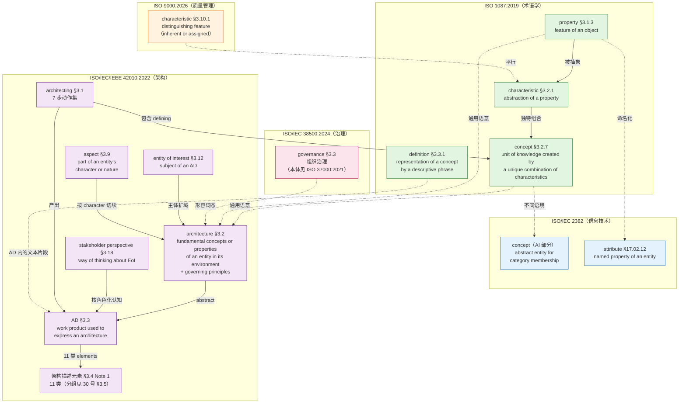

### 2.2 标准引用树（引用频度）

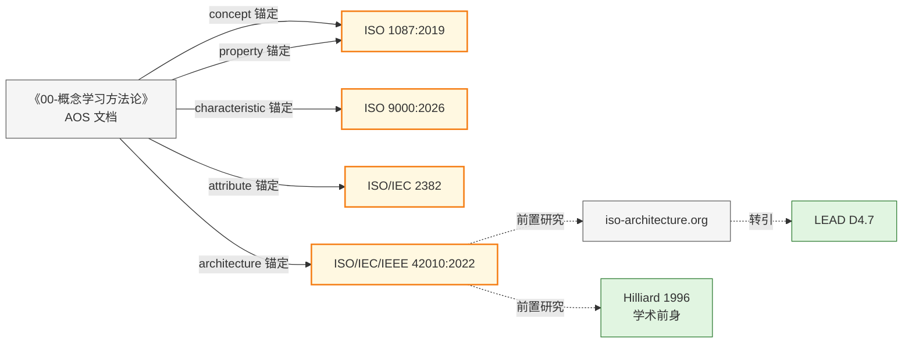

---

## 3. concept（概念）的权威定义

### 3.1 ISO 1087:2019 §3.2.7（现行版）核心定义

**verbatim**：

> **concept** — unit of knowledge created by a unique combination of characteristics
>
> Note 1: Concepts are not necessarily bound to particular natural languages. They are, however, influenced by the social or cultural background which often leads to different categorizations.
>
> Note 2: This is the concept 'concept' as used and designated by the term "concept" in terminology work. **It is a very different concept from that designated by other domains such as industrial automation or marketing.**

中文表述（对应国标译文惯例）：

> **概念** —— 由特性的独特组合而形成的知识单元。
>
> 注1：概念不必然绑定特定自然语言，但会受到社会或文化背景的影响。
> 注2：这是术语学语境下"concept"这一概念，与工业自动化、营销等领域使用的同名概念**完全不同**。

> **关键自警**：ISO 1087 自己已在 Note 2 中明示——这是术语学语境的 concept，与工业自动化、营销领域的 concept 不是同一个认知对象。

### 3.2 解读定义的三个关键点

#### (1) 知识单元（unit of knowledge）

- **认知层定位**：概念被定位在**知识层**而非**语言层**——这是术语学的"符号学三角形"基础：
  - 对象（object） — 概念（concept） — 指称（designation）
- **与语言解耦**：Note 1 明示——概念不绑定特定自然语言（同一概念可用中文、英文、法文术语指称）
- **关键推论**：concept ≠ 术语（term）——后者是语言的指称单位

#### (2) 特性（characteristic, ISO 1087 §3.2.1）

- **定义**：characteristic = **abstraction of a property**（属性的抽象）
- **构成材料**：concept 的原料是 characteristic，unique combination 后形成 concept
- **术语学层级**：property（对象层） → characteristic（抽象层） → concept（知识层）

#### (3) 独特组合（unique combination）

- **边界判定**：用于区分相关概念的那部分 characteristic 叫**区分性特性（delimiting characteristic, ISO 1087:2019 §3.2.5）**
- **下定义机制**：definition（ISO 1087:2019 §3.3.1）= 上位概念（superordinate concept） + 区分性特性
- **可校验性**：unique combination 决定了 concept 的边界——同一组 characteristic 不能同时形成两个不同的 concept

### 3.3 概念结构的可视化模型（Mermaid 图）

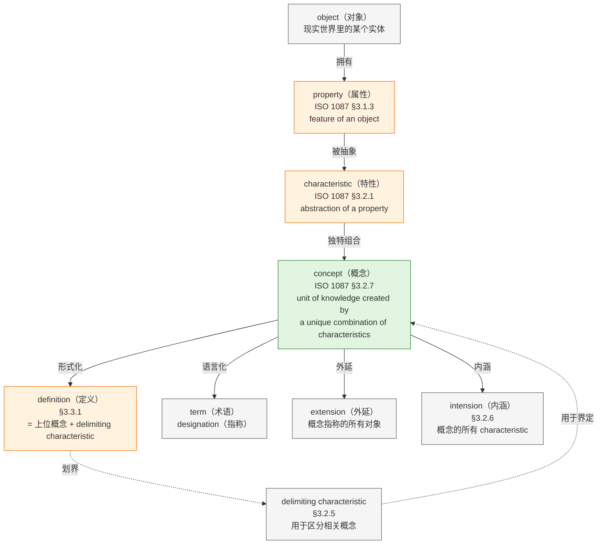

### 3.4 concept 版本谱系

| 标准 | 条款 | 定义文本 | 状态 |
|---|---|---|---|
| **ISO 1087:2019** | §3.2.7 | unit of knowledge created by a unique combination of characteristics | **现行**，取代 1087-1 |
| **ISO 1087-1:2000** | §3.2.1 | 同上（承认同义词 notion） | 已废止，但文献引用最广 |
| **ISO 10241-1:2011**（标准化术语条目编写规范） | §3.2.1 | 直接引用 1087-1:2000 §3.2.1 | 现行 |
| **ISO 704:2009**（术语工作原则与方法） | — | 补充立场：概念"不仅应视为思想单元，也应视为知识单元" | 现行 |
| **GB/T 15237.1-2000** | — | 等效采用 ISO 1087-1：由特征的独特组合而形成的知识单元 | 国标对应 |
| **GB/T 10112** | — | 术语工作原则 | 国标对应 |

> **版本号细节**：2019 版只是**条款号**从 §3.2.1 → §3.2.7，**定义文本一字未改**——所以老文献引用 1087-1:2000 §3.2.1 的定义依然有效，只需换条款号。

### 3.5 concept 三语境对照（跨标准语境辨析）

这是本次研究中**最核心的精度发现之一**——同名异义。

| 维度 | ISO 1087:2019 §3.2.7（术语学） | **★ 现行** 42010:2022 §3.2（架构） | 【历史对照】42010:2011 §3.2（架构） | ISO/IEC 2382（IT/AI） |
|---|---|---|---|---|
| **原文 verbatim** | unit of knowledge created by a unique combination of characteristics | fundamental concepts or properties of an entity in its environment and governing principles for the realization and evolution of this entity and its related life cycle processes | fundamental concepts or properties of a system in its environment embodied in its elements, relationships, and in the principles of its design and evolution | abstract entity for determining category membership |
| **是否在 §3 中定义** | ✅ §3.2.7 严格定义 | ❌ 42010:2022 §3 Terms and definitions 中**没有** concept 这一条 | ❌ 同上 | ✅ ISO/IEC 2382-31:2001 §31.01.05 定义 |
| **认知层定位** | 知识层（unit of *knowledge*） | 理念层（idea / notion，通用语意） | 理念层（同左） | 分类层（abstract entity for category membership） |
| **与语言的关系** | 概念不绑定特定语言（Note 1） | 通用词，标准未表态 | 通用词，标准未表态 | 抽象实体，与语言无关 |
| **构成机制** | property abstract → characteristic → unique combination → concept | 无机制——是实体本质的抽象 | 无机制——是系统本质的抽象 | 与"确定类别成员资格"的能力绑定 |
| **对应动作** | 定义（definition）、术语指称（designation） | 由架构描述（AD）表达其 concepts 与 properties | 体现（embody）于元素、关系、原则【历史对照】——2022 不再以元素与关系界定架构 | 用于类化、聚类（concept learning, conceptual clustering） |
| **是否需文档化** | 不要求 | 可不必写出（修订理由明文） | 可不必写出（2011 修订理由明文） | 抽象实体，与文档化无关 |
| **典型用例** | 概念体系构建、术语工作 | 架构定义 | 架构定义（旧版） | 机器学习、知识图谱 |

> **号形说明**：本表各列的条款号均为该列表头所标标准之条款（术语学列＝ISO 1087:2019、★ 现行列＝42010:2022、【历史对照】列＝42010:2011、IT/AI 列＝ISO/IEC 2382），故列内只写 `§x.y`。

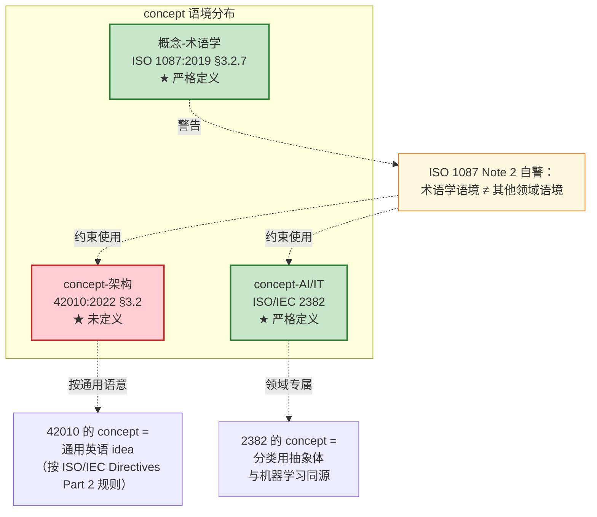

### 3.6 关键发现：42010 §3.2 中的 "concept" 不是 ISO 1087 严谨意义上的"概念"

#### 证据一（正本）：§3 Terms and definitions 全十九条（42010:2022）

| 条款 | 术语 | 条款 | 术语 |
|---|---|---|---|
| 3.1 | architecting | 3.11 | correspondence |
| 3.2 | architecture | 3.12 | entity of interest (EoI) |
| 3.3 | architecture description (AD) | 3.13 | environment |
| 3.4 | architecture description element (AD element) | 3.14 | information part |
| 3.5 | architecture description framework (ADF) | 3.15 | model kind |
| 3.6 | architecture description language (ADL) | 3.16 | specification |
| 3.7 | architecture view | 3.17 | stakeholder |
| 3.8 | architecture viewpoint | 3.18 | stakeholder perspective |
| 3.9 | aspect | 3.19 | view component |
| 3.10 | concern | — | — |

> **注意：这十九条里没有 "concept"，也没有 "property"。**（库内 42010:2022 正本 §3.1~§3.19 逐条可查。）

#### 证据一附【历史对照·库外不可核】：§3 Terms and definitions 列表（42010:2011 十行条录）

| 条款 | 术语 |
|---|---|
| 3.1 | architecting |
| **3.2** | **architecture**: *fundamental concepts or properties of a system in its environment embodied in its elements, relationships, and in the principles of its design and evolution* |
| 3.3 | architecture description (AD) |
| 3.4 | architecture framework |
| 3.5 | architecture view |
| 3.6 | architecture viewpoint |
| 3.7 | concern |
| 3.8 | environment |
| 3.9 | model kind |
| 3.10 | stakeholder |

> **注意：没有 "concept"。** 也没有 "property"。**2011 全文库内无正本**——此十行条录只作历史对照，**不作证据主件**。

#### 证据二：ISO/IEC Directives Part 2 规则

> 标准条款中未定义的术语，按"普遍接受的含义"使用。

所以 42010 §3.2 中 "concepts" = **日常英语 / 通用语意** ≈ **idea / notion / 抽象理念**——不是 ISO 1087 意义上的"知识单元"。

#### 3.6.1 为什么 42010 的 concepts／properties 不是 ISO 1087 的同名术语〔论证〕

**结论**：42010:2022 §3.2 的 `concepts or properties` 是按"普遍接受的含义"使用的**通用语意词**，不是 ISO 1087:2019 §3.2.7、§3.1.3 那两个严格定义；两者同名同形，不在同一术语位。

**依据**：① 42010:2022 §3.1~§3.19 共十九条词条中**没有 `concept`，也没有 `property`**（正本条录逐条可查）；② 42010:2022 §3.2 定义句用的是 *fundamental* 限定，**不含任何术语学限定**；③ ISO 1087:2019 §3.2.7 作 *unit of knowledge created by a unique combination of characteristics*（知识单元）、§3.1.3 作 *feature of an object*（对象特征）——**【库外·不可核】**，只可作词义对照；④ ISO/IEC Directives Part 2：标准条款中未定义的术语，按"普遍接受的含义"使用。

**推理**：① 一条术语的**定义位置**决定它的用法约束——标准只管它自己在 §3 定义过的词；② 未在 §3 定义的词，其用法不受该标准的术语约束，因此**不能**把另一部标准的定义塞进来当约束；③ 反推：若 42010 的 concepts 就是术语学的"知识单元"，则 §3.2 立刻背上"每个 concept 必须由独特组合的特性构成"这项义务——而 42010 从未提出这项义务，也从不需要它。

**反证**：若两者同一，本报告 §4.6 的结论（42010 的 properties 与 ISO 1087 §3.1.3 在内涵上重合、但**没有**进一步抽象为 characteristic）将自相矛盾——既然同一，`properties` 就应当能被 §3.2.1 的 characteristic 替换使用，而 42010 全篇不这样用。

**边界**：本节只否证"同名即同物"，**不否证**两者在内涵上有重合（§4.6 正是在说这一点）；也不主张 42010 用词失当——它选择"概念或属性"这一表述是有意的（附录 A.2，**资料性**）。

### 3.7 为什么 42010 写 "concepts or properties"？

这不是随手的并列，而是 2011 版相对 IEEE 1471:2000 的一次**有意识修订**。

> **1471:2000 原文**：the fundamental **organization** of a system embodied in its **components**, their relationships to each other, and to the environment, and the principles guiding its design and evolution
>
> **42010:2011 修订后**：fundamental **concepts or properties** of a system in its environment embodied in its **elements**, relationships, and in the principles of its design and evolution

| 修订项 | 1471:2000 | 42010:2011 | 修订意图 |
|---|---|---|---|
| 主词 | organization | **concepts or properties** | 兼容"主观构思"和"客观感知"两哲学 |
| 主体词 | components | **elements** | 泛化（不只软件组件） |
| environment | 含在 relationships 里 | **单列** | 强调环境是独立维度 |

### 3.8 "concepts or properties" 背后的修订动机（verbatim 引述）

> **Hilliard 维护的 iso-architecture.org / "Defining architecture" 页面**（与 42010:2011 同步发布，相当于标准的"非正式但权威"伴随页）：
>
> > The definition was chosen **(1) to accommodate the broad range of things listed above under System: the architecture of X is what is fundamental to X (whether X is an enterprise, system, system of systems, or some other entity); and (2) to emphasize (via the phrase "concepts or properties") that a system can have an architecture even if that architecture is not written down**.

中文翻译：
> 选择这一定义：(1) 兼容上文 System 下列出的广泛实体类型——X 的架构 = X 的 fundamental，无论 X 是企业、系统、系统之系统还是其他实体；(2) 强调（通过 "concepts or properties" 这一短语）即使架构没被写出，系统也拥有架构。

#### "concepts" 与 "properties" 在这里的真正分工

- **concepts** = 架构尚未被文档化的、抽象层面的"理念 / 思路"——idea 层（架构师脑中、对话里）
- **properties** = 系统的可观测特征、客观属性——characteristic 层（**可被观察、可被度量**；元素与关系只在"架构**可以关乎**"的意义上相关〔42010:2022 §5.2.2〕，不是它的定义要素）
- 两者合起来：无论架构是否落成文档，**系统本身就有架构**

### 3.9 对方法论的启示

这一组对比正好是个**反面教材**：同形异义词（homonym）在跨标准语境里会造成系统性误读。在《00-概念学习方法论》里坚持"先锚定语境再讨论"是对的——讨论前必须回答三个问题：

1. 这是哪部标准的哪个条款？
2. 该标准的 §3 Terms and definitions 里**有没有**定义这个词？
3. 如果没定义，是按"通用语意"使用吗？还是有隐含的领域定义？

**判定原则**：如果术语在多部标准都出现，先确认每部标准是否在 §3 定义；只在一处定义时用该标准为锚；多处定义时**逐一定位、不混用**。

---

## 4. property（属性）的权威定义

### 4.1 ISO 1087:2019 §3.1.3 核心定义（对象层基础锚）

**verbatim**：

> **property** — feature of an object (3.1.1)
>
> EXAMPLE 1 'Being made of wood' as a property of a given 'table'.
> EXAMPLE 2 'Belonging to person A' as a property of a given 'pet'.
> EXAMPLE 3 'Having been formulated by Einstein' as a property of a given 'E=mc²'.
> EXAMPLE 4 'Being compassionate' as a property of a given 'person'.
> EXAMPLE 5 'Having a given cable' as a property of a given 'computer mouse'.
>
> Note 1: One or more objects can have the same property.

中文表述：

> **属性** —— 对象的特征。
>
> 例1：'由木料制成'是某'桌子'的属性。
> 例2：'属于 A 这个人'是某'宠物'的属性。
> 例3：'由爱因斯坦提出'是'公式 E=mc²'的属性。
> 例4：'有同情心'是某'人'的属性。
> 例5：'装有一根给定的线缆'是某'计算机鼠标'的属性。
>
> 注1：一个或多个对象可以具有相同的属性。

> **关键观察**：ISO 1087 这里**没有用 "inherent" 限定**——property 是**对象的任何特征**（feature），包括固有的和赋值的。这是与 ISO 9000 的关键区别。

### 4.2 ISO 9000:2026 §3.10.1 characteristic（质量管理语境）

> **版本说明（2026-09-21）**：本术语**两版同号**（2015 §3.10.1 = 2026 §3.10.1），迁移只需换版本标注，不必换号。下列 verbatim 取自 **ISO 9000:2015**（2026 侧定义句与注 1、注 2 逐字未变）。

**verbatim**：

> **characteristic** — distinguishing feature
>
> Note 1: A characteristic can be **inherent or assigned**.
>
> Note 2: A characteristic can be **qualitative or quantitative**.
>
> Note 3: There are various classes of characteristic, such as the following:
> a) **physical** (e.g. mechanical, electrical, chemical or biological characteristics);
> b) **sensory** (e.g. related to smell, touch, taste, sight, hearing);
> c) **behavioural** (e.g. courtesy, honesty, veracity);
> d) **temporal** (e.g. punctuality, reliability, availability, continuity);
> e) **ergonomic** (e.g. physiological characteristic, or related to human safety);
> f) **functional** (e.g. maximum speed of an aircraft).

> ⚠️ **注 3 的 a)~f) 列表在 2026 转换件中缺失**（只剩引导句"There are various classes of characteristic, such as the following:"）。27 号附 D 判为**疑转换丢失**，并明确**不得据此判定为"删除"**——本报告此处照录 2015 原文，正版在手时优先核这一处。

中文表述：

> **特性** —— 区别性特征。
>
> 注1：特性可以是固有的或赋予的。
>
> 注2：特性可以是定性的或定量的。
>
> 注3：特性有多种类别，如下列类别：
> a) 物理的（如机械、电气、化学或生物特性）；
> b) 感官的（如与气味、触觉、味觉、视觉、听觉相关的特性）；
> c) 行为的（如礼貌、诚实、真实）；
> d) 时间的（如准时性、可靠性、可用性、连续性）；
> e) 工效学的（如生理特性，或与人的安全性相关的特性）；
> f) 功能的（如飞机的最大速度）。

#### 关键差异：ISO 9000 characteristic vs ISO 1087 property

| 维度 | ISO 1087 characteristic（§3.2.1） | ISO 9000 characteristic（**2026** §3.10.1） |
|---|---|---|
| 性质 | abstraction of a property | distinguishing feature |
| 限定 | 无（继承 property 的所有特征） | inherent or assigned；qualitative or quantitative |
| 目的 | 用于概念构造 | 用于"区别"——区别性是隐含限定 |
| 范畴 | 术语学上下文 | 质量管理上下文 |

> **关系**：ISO 1087 的 characteristic 是抽象层；ISO 9000 的 characteristic 是质量管理语境的特殊化版本，强调"区别"——即 delimiting characteristic（§3.2.5）的同义概念。

### 4.3 ISO/IEC 2382-17:1999 §17.02.12 attribute（IT/数据库语境）

**verbatim**：

> **attribute** — A named property of an entity.
>
> Example: "Blue" is an attribute value for the attribute "color".

中文表述：

> **属性 / 属性值** —— 实体的命名属性。
>
> 例：'蓝色' 是属性 '颜色' 的属性值。

#### 关键解读

- **attribute 是 property 的"命名化"** —— 每个 attribute 都对应一个 attribute value
- **例**：attribute = "color"，attribute value = "blue"
- **数据库语义**：数据库表的"列"在术语层 = attribute = (attribute name + attribute value) 组合

### 4.4 property 四语境对照（跨标准语境辨析）

| 语境 | 标准 | 条款 | verbatim 定义 | 核心限定 |
|---|---|---|---|---|
| **术语学** | ISO 1087:2019 | §3.1.3 | feature of an object | 无限定——任何特征 |
| **质量管理** | ISO 9000:**2026** | §3.10.1（characteristic，**与 2015 同号**） | distinguishing feature | inherent / assigned；qualitative / quantitative |
| **信息技术-数据库** | ISO/IEC 2382-17:1999 | §17.02.12（attribute） | A named property of an entity | 必须命名 + 配 attribute value |
| **架构** | ISO/IEC/IEEE 42010 | §3.2 | 未定义（按通用语意）| + fundamental 限定 |

> **号形说明**：本表「条款」列各条号均为其上一列「标准」所标标准之条款，故列内只写 `§x.y`。

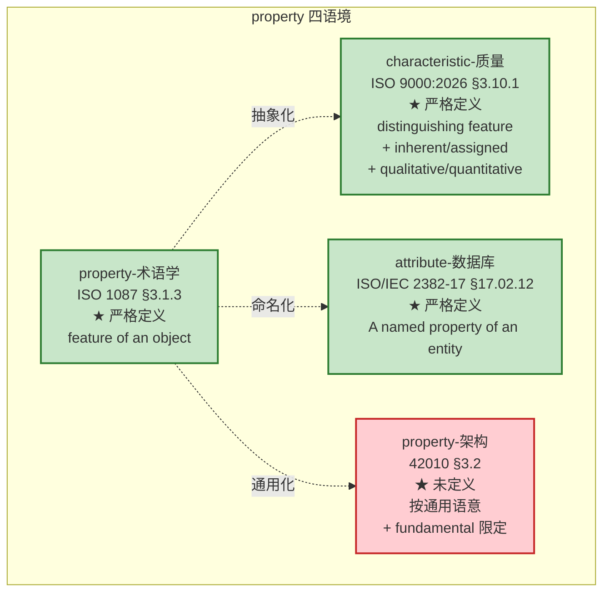

> **核心洞察**：四个标准给的 property 含义**逐层收敛**——
>
> `ISO 1087（任何特征）→ ISO 9000（特征 + 区别性）→ ISO/IEC 2382（命名属性）→ 42010（fundamental + 通用语意）`

### 4.5 三层抽象链：property → characteristic → concept

这是这次研究最精密的输出——ISO 1087 体系内**自下而上**的认知抽象链：

```
property（对象特征）        ── ISO 1087 §3.1.3
        ↑ 抽象
characteristic（特性的抽象）  ── ISO 1087 §3.2.1
        ↑ 独特组合
concept（知识单元）         ── ISO 1087 §3.2.7
```

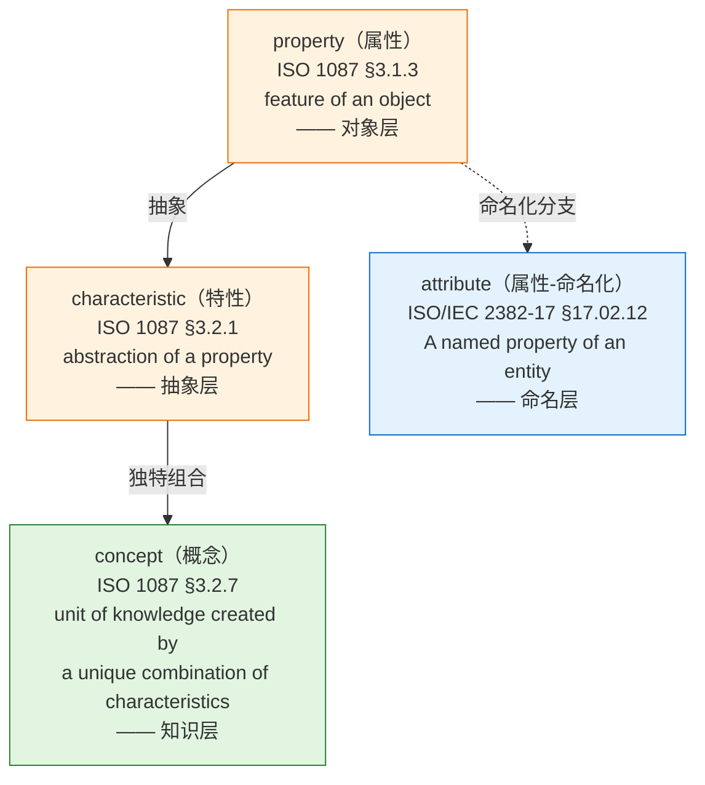

### 4.6 42010 §3.2 中 "fundamental properties" 的回推

42010 §3.2 中的 properties **不是 ISO 1087 严格意义上的** property——但**高度相关**。理由有三：

| 维度 | 解读 |
|---|---|
| **同源性** | "fundamental properties" 中的 properties 是 system/entity 的客观特征——与 ISO 1087 §3.1.3 property 在内涵上重合 |
| **抽象度** | 42010 没把 property 进一步抽象成 characteristic——直接说 property（feature of system） |
| **限定符 fundamental** | 42010 加了 fundamental 限定，与 ISO 9000:2026 §3.10.2 "quality characteristic" 的逻辑类似（quality characteristic = **inherent** characteristic related to a requirement） |
| **版本** | ISO 9000 一侧的 characteristic 与 quality characteristic 两版条款号均未动（2015 §3.10.1、§3.10.2 ＝ 2026 §3.10.1、§3.10.2），故本节的对照结论**不随版本迁移而变** |

所以 42010:2022 的 properties = **fundamental properties** ≈ **对实体在其环境中效用·成本·时间·风险有实质贡献的本质特征**（42010:2022 附录 A.2，**资料性**——*contribute to its utility, cost, time and risk within its environment*，中译：对它在环境中的效用、成本、时间与风险作出贡献；注：A.2 属 *Annex A (informative)*，**不作定义句推论**；逐字引文与两哲学派名见 07 号 §2.2）。**这是 ISO 9000:2026 §3.10.2 quality characteristic 在架构语境的精炼版**——但 2022 定义未用 inherent 限定，勿以 ISO 9000 的限定语回读。

---

## 5. architecture（架构）的权威定义

> **本章节定位**：以 **ISO/IEC/IEEE 42010:2022** 为最新权威依据展开分析；42010:2011、IEEE 1471:2000、Hilliard 1996 学术前身仅作为**历史对照**置于"§5.2 历史对照"小节，用于说明措辞演变的来龙去脉，不参与主体分析。**所有"架构"的定义引用与分析都以 2022 版为准。**

### 5.1 主线定义：42010:2022 §3.2 / GB/T 45630-2025, 3.2 verbatim

> **architecture** — fundamental concepts or properties of an entity in its environment and governing principles for the realization and evolution of this entity and its related life cycle processes
>
> （ISO/IEC/IEEE 42010:2022, 3.2；来源标注 ISO/IEC/IEEE 42020:2019, 3.3）
>
> **架构（canonical 句式）** —— 实体在其环境中的**基本**概念或属性，以及该实体及其相关**生存周期**过程的实现和演化的**管控原则**（governing principles）。
>
> 〔历史记录〕2026-09-04 用户 V3 精炼译文作"……以及用于该实体及其相关生存周期过程的实现和演化的治理原则"；2026-09-21 用户定：除 fundamental 取「基本」外，其余术语一律按 GB/T 45630-2025 修订，故「治理原则」自本轮起改为「管控原则」，"用于"不再保留（原句见 §9.4 打磨②、③）。
>
> **架构（GB/T 45630-2025, 3.2 逐字字面）** —— 实体在其环境中的基础概念或属性，以及该实体及其相关生存周期过程的实现和演化的管控原则。
>
> 〔按：`fundamental` 取「基本」（用户 2026-09-21 定，不随国标「基础」；逐字引 GB/T 45630-2025 时照抄国标字面「基础」）；`governing principles` 自撰正文一律取「**管控原则**」（与国标 3.2 定名一致；2026-09-21 第二轮收口，原「治理原则」口径已撤）。「**治理**」留给 governance（名词）与 governs（关系名）。〕

**逐块拆解**：

| 块 | 内容 | 句法角色 |
|---|---|---|
| **X 块（抽象本体）** | fundamental concepts or properties of an entity in its environment | 架构**是什么** |
| **Z 块（管控准则）** | and governing principles for the realization and evolution of this entity and its related life cycle processes | 架构**如何被管控**（2022 升格） |

> **关键事实**（42010:2022）：原 2011 版中 "embodied in its elements, relationships, and in the principles of its design and evolution" 的**具象化三块**已被**删去**——elements/relationships 不再见于 architecture 定义句，2022 **不再以元素与关系界定架构**；定义第二块改由 *governing principles for the realization and evolution of this entity and its related life cycle processes* 承担，principles 升格为 **governing** 角色。详见 §7。
>
> **〔识别·随 46 号 v2.6 补〕** 由此落一句定性：**架构定义的不是"它由什么组成"，是"它凭什么还是它"**——拿掉它就不是它了的那几条，判据是**走样检验**（把这一条拿掉，这个实体还是不是这个实体）；"是什么"由**概念**（分）＋**属性**（度）＋**原则**（允许）三样合起来给（46 号 §七，**本书工作名与本书读法 C**）。标准侧的落点只有一句：42010:2022 §3.2 的宾语是 *concepts or properties* ＋ *governing principles*，**不是系统元素**；组成随处境变，由设计定义（15288:2023 §3.13）。

> **互参**：「基本」没有判定式，只有一支填句三槽（三把尺＝三种填法）——概念＝**理解上的不可省（相关方能否共同陈述）**／属性＝**对实体在其环境中效用·成本·时间·风险的实质贡献**／原则＝**管控力（违规看不看得出）**（48 号 §2.3；依据 42010 附录 A.2，**资料性**；42020:2019 §10.2 d)）。"去掉它还能不能成就目的"这个问法**不成立**（把结果当构成／把贡献当必要／把条当类，48 号 §2.3）。**其裁定归治理（29 号），尺子本身见 48 号 §2.3**；本报告不立判据，只登记词义。那一支填句落到过程上怎么走，见 **07 号 §6.4**。
>
> **〔术语登记·实质〕** 实质＝**越过一条事前立好的线，或翻转一个已记录的决策**；线须**事前**立——42030:2019 §4.2 **NOTE 3（资料性）** 逐字：*Pass/fail criteria could need to be established prior to performing the evaluation.*（情态是 *could need to be*，**不是** shall／should）；四量任一实质动即算。（本报告只登记词义；判法见 48 号 §2.3，裁定归治理，见 29 号。）
>
> 另注两处**不同题**的辨异（不是"基本"的判据）：必要性＝**membership**（管入会：什么必须进）／充分性＝**closure**（管闭包：架构到哪停），且充分性**不是数学意义的充要条件**（架构不构成目的达成的充分条件，达成还需实现／验证／运行）——**24 号 §2.9.2**，23 号附录 A 的 `adequacy` 行同。架构治理本身的定义与展开见 **29 号**（「基本」一词的**裁定**归治理，不归本报告）。

### 5.2 历史对照：措辞演变时间线（1996 → 2000 → 2011 → 2022）

> **本节作为历史对照阅读**——仅供理解"为什么 2022 这么定义"，分析锚点仍以 **42010:2022** 为准。

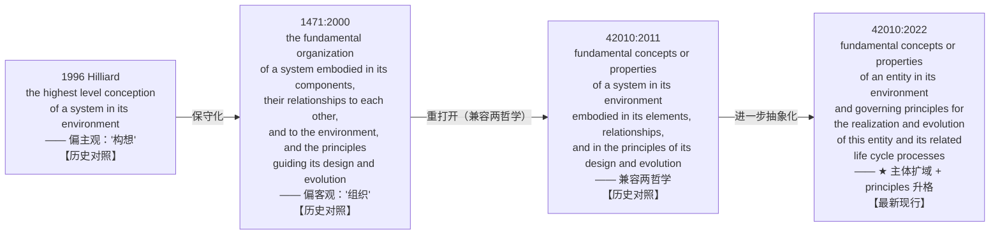

**逐版 verbatim（历史对照）**：

#### 5.2.1 【历史对照】IEEE 1471:2000

> **architecture** — the fundamental **organization** of a system embodied in its **components**, their **relationships to each other, and to the environment**, and the **principles** guiding its design and evolution

#### 5.2.2 【历史对照】ISO/IEC/IEEE 42010:2011 §3.2

> **architecture** — fundamental **concepts or properties** of a **system** in its **environment** embodied in its **elements, relationships**, and in the **principles** of its design and evolution

> **〔embodied-in 的去向 · 依 24 号 §4.5.2〕** 上句的 embodied 句并非"消失"，而是**搬家 ＋ 降调**——迁入 **ISO/IEC/IEEE 42020:2019 §3.3 Note 1（**NOTE，资料性**）**：*The fundamental concepts or properties of the architecture entity are usually intended to be embodied in the entity's components, the relationships between components, and the relationships between the entity and its environment.*（中译：架构实体的基本概念或属性，**通常意指**体现在该实体的组件、组件之间的关系，以及实体与环境的关系之中。）
>
> **〔读法〕** "措辞由 elements/relationships 改为 components／relationships／环境关系、强度由定义正文的『是』降为注释的『通常意指』"这一判断属**本库归纳**；该注是 **NOTE、资料性**，**不作定义句推论用**。
>
> **强读（"概念存在于组件中"）的三处反例**：① **to-be 架构**还没有组件可"存"；② **实现无关性**恰恰靠"组件里不出现"体现——同一架构可有两个实现；③ 组件里大量**非基本**的东西（部署路径、库版本）并不进入架构。
>
> **弱读的着落在过程条款，不在这条注**：**42020:2019 §10.4.4 e)** 逐字 *Allocate relevant concepts, properties, characteristics, behaviors, functions, features or constraints to the entities and relationships to be modeled.*（中译：把相关的概念、属性、特性、行为、功能、特征或约束**分配**给要建模的实体与关系）；**15288:2023 §6.4.5.3 注 5** 逐字 *each architectural entity … and relationship is mapped into the appropriate system design elements*（中译：每个架构侧实体及其关系被**映射到适当的系统设计元素**）。
>
> 故 2022 定义句删去该块（§5.5 第 2 项）**不等于**这一层含义在标准体系中已无着落；但**它只作体检提示**——一条内容若连"去掉它有无实质变化"都答不出，多半写虚了；**它不判"基本与否"**（"基本"的判据见 §5.1 互参行、48 号 §2.3）。展开见 24 号《架构与设计边界研究报告》§13.2。

##### 5.2.2.1 为什么体现只是一条惯例说明〔论证〕

**结论**：42020:2019 §3.3 Note 1 的 *usually intended to be embodied in* 是**资料性**的惯例说明，**不能**当作"概念存在于组件之中"的推论依据；弱读的着落在**过程条款**，不在这一条注。

**依据**：① 42020:2019 §3.3 **Note 1**（**NOTE，资料性**）逐字：*The fundamental concepts or properties of the architecture entity are usually intended to be embodied in the entity's components, the relationships between components, and the relationships between the entity and its environment.*（中译：……**通常意指**体现在该实体的组件、组件之间的关系，以及实体与环境的关系之中。）② 42010:2022 §3.2 词条下 **[SOURCE]** 逐字：*ISO/IEC/IEEE 42020:2019, 3.3, modified — The notes to entry have been removed.*（中译：来源 42020:2019 第 3.3 条，有修改——**条内注已删除**。）③ 弱读的过程条款：42020:2019 §10.4.4 e) 逐字 *Allocate relevant concepts, properties, characteristics, behaviors, functions, features or constraints to the entities and relationships to be modeled.*（中译：把相关的概念、属性、特性、行为、功能、特征或约束**分配**给要建模的实体与关系）；15288:2023 §6.4.5.3 注 5（架构侧实体与关系 *mapped into the appropriate system design elements*；中译：每个架构侧实体及其关系被**映射到适当的系统设计元素**）。

**推理**：① 42010 从 42020 派生定义句时**刻意删注**，是"这条注不随定义走"的官方表态；② 该句动词是 *usually intended to be*（通常意指），不是 *shall* 也不是 *is*；③ 强读在三处立不住：to-be 架构还没有组件可"存"、实现无关性恰恰靠"组件里不出现"体现、组件里大量非基本物并不进入架构——三处都不需要"存在于"这一层意思。

**反证**：若把它当定义句的推论，则 to-be 架构（组件尚未存在）将因"无处体现"被判为**没有架构**——这与 §3.2 定义句（架构是概念或属性，与实现无关）直接相抵，也与本报告 §5.2.3 的"2022 定义句只给两样"相抵。

**边界**：本节不否认"体现"有用——它只作**体检提示**（一条内容若在元素与关系上找不到落点，多半写虚了）；它**不判**"基本与否"（判据见 48 号 §2.3），也**不判**"哪个组件的实现对不对"（那是验证）。

#### 5.2.3 【★ 最新现行】ISO/IEC/IEEE 42010:2022 §3.2

> **architecture** — fundamental concepts or properties of an **entity** in its environment **and governing principles** for the **realization and evolution** of this entity and its related **life cycle processes**

### 5.3 逐块拆解（结构层）—— X 块 / Z 块

**42010:2022 拆解**（**2022 句法**：X 块 + Z 块并列；elements/relationships 不再并列）：

> 〔按：**X／Z 只作记号**——两者是同一句定义的两个并列成分，不是可拼装的"块"，也不是架构的两层（42 号 §2.7、附录 D；48 号 §9.24）。下方两张图同样只作记号。〕

```
 ┌────────────────────────────────────────────────────────────────────────────┐
 │              architecture（§3.2 一句话，长定语 + 主句并列）                  │
 └─────────────────────────────────┬───────────────────────────────────────────┘
                                 │
                ┌────────────────┴─────────────────┐
                ▼                                  ▼
      X 块（抽象本体）                            Z 块（管控准则）
      fundamental concepts                  governing principles
      or properties                          for the realization
      of an entity                          and evolution of this
      in its environment                    entity and its related
                                             life cycle processes
            │                                   │
      ┌─────┴─────┐                       ┌─────┴─────┐
      ▼           ▼                       ▼           ▼
   concepts  properties               realization  evolution
   (idea)    (perception)             life cycle processes
                                            │
                                            ▼
                                 (2011 版 embodied-in 三块
                                  elements + relationships
                                  在 2022 定义句中被删去
                                  —— 历史对照)
```

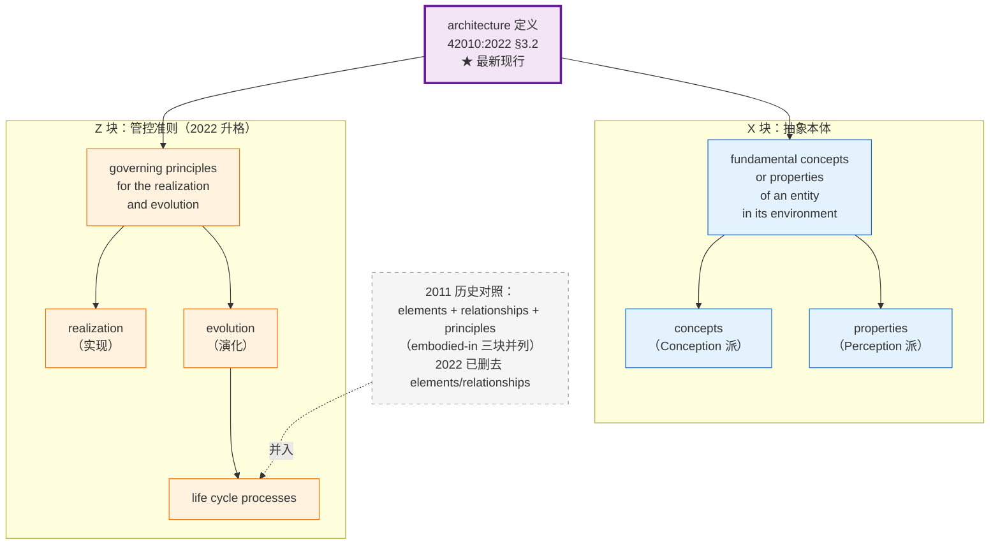

### 5.4 定义背后的两哲学：Architecture as concept / Architecture as property（42010:2022 附录 A.2；2011 口径二手派名 Conception／Perception）

#### 5.4.1 正本：42010:2022 附录 A.2（**资料性**）逐字

> 42010:2022 附录 A.2（**资料性**）逐字——*Architecture as concept*：*wherein architecture is a conception of an entity in one's mind*（架构作为概念：架构是人脑中对某个实体的一种构思）；*Architecture as property*：*wherein architecture is a property or attribute of an entity of interest*（架构作为属性：架构是所关注实体的一项属性或特质）。〔2011 口径二手派名 Conception／Perception，见配套页；42010:2022 全文 `Perception` 零命中〕
>
> 原句连其立场一并录下（同一节，紧接上引）：
>
> > The phrase "concepts or properties" is used in the definition of architecture (3.2) to allow two differing philosophies to use this document without prejudice. These two philosophies are:
> >
> > - Architecture as concept: wherein architecture is a conception of an entity in one's mind;
> > - Architecture as property: wherein architecture is a property or attribute of an entity of interest.
>
> 中文（库内中英对照本 A.2 逐字）：架构(3.2)的定义中使用"概念或属性"这一表述，是为了让两种不同的哲学观点都能不抱偏见地使用本文件。这两种哲学观点是：**作为概念的架构**——其中架构是人心中对某一实体的一种构想；**作为属性的架构**——其中架构是所关注实体的一种属性或特性。

**性质标记**：附录 A 作 *Annex A (informative)*（**资料性**）——这两条派名是**命名依据**，**不作定义句推论**；`concepts or properties` 的规范依据在 **§3.2** 定义句本身。

#### 5.4.2 【历史对照·配套说明·库外不可核】2011 口径：iso-architecture.org 配套页 ＋ 42010:2011 §4.2.1 脚注

**（一）iso-architecture.org / "Defining architecture"（42010:2011 配套发布；2022 仍为有效解释）**——该页用的派名是 **2011 口径二手派名 Conception／Perception**：

> The disjunction, **concepts or properties**, was chosen to support **two different philosophies without prejudice**. These philosophies are:
>
> - **Architecture as Conception**: an architecture is a concept of a system in one's mind;
> - **Architecture as Perception**: an architecture is a perception of the properties of a system.
>
> Under either philosophy, an architecture is **abstract — not an artifact**.
>
> The Standard uses another term, **architecture description**, to refer to artifacts used to express and document architectures.

中文翻译：

> 选用 "concepts or properties" 这一**析取式**短语，是为了**不带偏见地兼容两种不同的哲学**：
>
> - **架构作为构思（Conception）**：架构是某个存在于人脑中的系统概念；
> - **架构作为感知（Perception）**：架构是观察者对系统属性（properties）的感知。
>
> 无论哪一种哲学，**架构都是抽象的——不是人工制品（not an artifact）**。
>
> 本标准使用另一术语——**架构描述（architecture description）**——来指代用于表达和记录架构的工作产品。

**（二）42010:2011 §4.2.1 自带脚注**

> This International Standard distinguishes an architecture of a system from an architecture description. Architecture descriptions, not architectures, are the subject of this International Standard. Whereas an architecture description is a work product, **an architecture is abstract, consisting of concepts and properties**.

中文：

> 本标准区分"系统的架构"与"架构描述"。本标准规范的是后者（**架构描述**），不是前者（架构）。架构描述是工作产品；**架构是抽象的，由 concepts 和 properties 构成**。

> **注**：以上 2011 脚注虽属历史对照，**但其哲学立场（architecture = abstract，由 concepts 与 properties 构成）**与 42010:2022 仍然一致——2022 把"concepts or properties"保留在 X 块，并把 stakeholder perspective（§3.18）**立为词条**（该概念 2011 版即已引入，Foreword 逐字见 §5.5 表），与 Conception/Perception 两哲学**同源而不同物**（它是关切的一个来源，见 30 号 §2.5）。

#### 5.4.3 两点边界

① **`without prejudice`（标准不站队）**：42010:2022 用 `concepts or properties` 这一**析取式**，让两种哲学都能不抱偏见地使用本标准——**标准不选边**（A.2 逐字见 §5.4.1）。故本报告凡写"架构是……"处，只登记两派并存的表述，不主张其中一派为正解。

② **两哲学未被条款化**：两条派名只出现在附录 A.2（**资料性**），**不是 §3 词条**；它们在 2022 的同源落点是 **§3.18 stakeholder perspective**（"按角色形成认知"的切块，是关切的一个来源，见 30 号 §3.5）——**同源而不同物**：AD 必须识别的是 stakeholder perspective，两哲学仍是哲学讨论。

#### 5.4.4 两哲学可视化

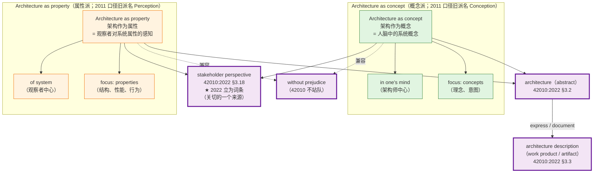

### 5.5 42010:2022 architecture 定义的修订细节（相对 2011，Foreword verbatim 节选）

> **本节为"最新版相对前一版的修订说明"**——以 42010:2022 为锚点，逐行对 **42010:2022 Foreword 的 *main changes*** 与正本条款，便于掌握 2022 的精确语义。
>
> **〔档位纪律〕** 本表末列标两样：**性质**（规范／资料性）与**断言档**（**档①＝标准逐字**／**档④＝本报告读法**）。凡 Foreword **未**列为版次变更而本报告认为重要者，一律降为**〔本报告读法〕**并写理由——不得以标准规定口气行文。

#### 5.5.1 为什么 aspect 与 stakeholder perspective 不是"2022 新增"〔论证〕

**结论**：这两个概念**在 2011 版即已引入**；2022 变的是它们的**条款身份**——2022 才把它们"定义并加以描述"，即立为 §3.9、§3.18 词条。故本报告一律写"2022 **立为词条**"，不写"2022 新增"。

**依据**：① 42010:2022 **Foreword** 逐字：*Aspect and stakeholder perspective concepts ―already introduced in the 2011 edition (See 3.5, note 1 of 5.6, Annex A and B) — are defined and described to accommodate current practice where these ideas are prevalent.*（中译：aspect 与 stakeholder perspective 两个概念**在 2011 版即已引入**（见 3.5、5.6 注 1、附录 A 与 B），本版把它们**定义并加以描述**，以适应当前实践。）② 42010:2022 §3.9（aspect）：*part of an entity's character or nature*；§3.18（stakeholder perspective）：*way of thinking about an entity of interest, especially as it relates to concerns*。③ 42010:2022 §3.4 **Note 1（资料性）**：*AD elements **include** … stakeholder perspectives (3.18), and aspects (3.9) …*（AD 元素**包括**……相关方角度、方面体……）。

**推理**：① Foreword 同一句里把 **introduced** 归给 2011 版、把 **defined and described** 归给本版——两个动词分派两个版次，这不是措辞细节，是版本归属的判定；② 若为概念增设，Foreword 的 *main changes* 会与"AD element 立为 §3.4 词条"一条同型表述为"新增"，而它写的是"2011 已引入、本版定义"；③ 因此本报告能断言的只能是**条款身份**（§3 里有没有这一条），不能断言**概念的存在与否**——后者的证据在 2011 全文，而 2011 全文**库外·不可核**。

**反证**：若写成"2022 新增 aspect"，则与本报告 §5.5 表第 4 行**同一行内**左边引 *already introduced in the 2011 edition*、右边说"新增"相抵——同一张表里的两句话，按哪句都不成立；而这句话恰恰是本报告"术语权威"身份的承重点。

**边界**：本节不主张这两个概念在 2022 **没有变化**——变化有三：有了一条 §3 词条、被 §3.4 Note 1 与 §5.2.9 列入 AD 元素、stakeholder perspective 另获 §6.3 的识别义务（*An AD shall identify stakeholder perspectives considered relevant…*）。"概念何年出现"的史料判定，本节只据 Foreword 一句，不越出该句。

| 序号 | 修订项 | 2011 → **2022（现行）** | 修订意图与依据档位 |
|---|---|---|---|
| 1 | **主体扩域** | system of interest → **entity of interest (EoI)** | 档① Foreword 逐字：*The term used to refer to the subject of an architecture description is changed from "system of interest" to "entity of interest" (EoI) to be compatible with ISO/IEC/IEEE 42020 and ISO/IEC/IEEE 42030 standards and to allow for its application in non-system architecture situations.*（中译：架构描述主体一词由"所关注的系统"改为"所关注的实体"，以与 42020／42030 相容，并允许用于非系统架构场合。）扩到数据、过程、业务、任务、服务等非系统实体 |
| 2 | **定义句删 embodied-in 三块** | embodied in elements, relationships, and principles | 档① 42010:2022 §3.2 定义句逐字（2011 句见 §5.2.2【历史对照】）：elements / relationships **删去**（2022 不再以元素与关系界定架构）；定义第二块改由 *governing principles for the realization and evolution of this entity and its related life cycle processes* 承担 |
| 3 | **governing principles（措辞与句法）** | principles of its design and evolution → governing principles for the realization and evolution of this entity and its related life cycle processes | 档① 措辞逐字见 §3.2；"由与 elements／relationships 并列的成分**升为定义句第二块**"属**〔本报告读法〕**（Foreword 未单列此条为版次变更）。⚠ 它是**同一句定义里的并列成分**，**不是"层"**（判据表 B2） |
| 4 | **aspect 的定义化** | 2011 已在 42010:2011 §3.5、§5.6 注 1、附录 A、B 出现，未立 42010:2011 §3 词条 → **2022 立为 42010:2022 §3.9 词条** | 档① Foreword 逐字：*Aspect and stakeholder perspective concepts ―already introduced in the 2011 edition (See 3.5, note 1 of 5.6, Annex A and B) — are defined and described to accommodate current practice where these ideas are prevalent.*（中译：方面体与相关方角度两个概念**在 2011 版即已引入**（见 3.5、5.6 注 1、附录 A 与 B），本版把它们**定义并加以描述**，以适应当前实践。） |
| 5 | **stakeholder perspective 的定义化** | 同上 → **2022 立为 §3.18 词条** | 档① 同 Foreword 那一句（第 4 行）；修订意图：把「按角色形成认知」标准化，是**关切的一个来源**（与 Conception/Perception 两哲学同源，非其条款化表述） |
| 6 | **AD element 的定义化** | 2011 在 42010:2011 §4.2.6、§5.7、A.6 已有 AD 元素之说，未立定义 → **2022 给 AD element 立 42010:2022 §3.4 词条**（*identified or named part of an architecture description*，中译：架构描述中被识别或命名的部分） | 档① Foreword 逐字：*Architecture description element, introduced in the 2011 edition (see ISO/IEC/IEEE 42010:2011, 4.2.6, 5.7 and A.6) is now defined in Clause 3 …* |
| 7 | **correspondence 补注 1** | 定义句不变，2022 加注 1：为对应关系之目的，**AD 可视为另一份 AD 的 AD 元素** | 档① Foreword 逐字 ＋ 42010:2022 §3.11 Note 1 逐字：*For the purpose of correspondences (3.11), an AD (3.3) can be considered as an AD element in another AD (3.3).*（中译：为对应关系之目的，一个架构描述可视为另一份架构描述中的 AD 元素。）**资料性**（NOTE） |
| 8 | **ADF 改名** | Architecture Framework → **Architecture Description Framework (ADF)** | 档① Foreword 逐字：*The term "architecture description framework" (ADF) replaces "architecture framework" … to differentiate ADFs from other kinds of architecting frameworks like architecture evaluation frameworks specified in ISO/IEC/IEEE 42030.*（中译：……以区分于 42030 中的评估框架） |
| 9 | **Architecture View Component** | Architecture Model → **Architecture View Component** | 档① Foreword 逐字：*a separable portion of one or more architecture views, replacing "architecture model" … to account for the fact that some parts of a view are model-based while others may not be.*（中译：一段视图可能含非模型化部分） |
| 10 | **model kind 扩义** | 2011 的定义 → 扩展至含 ADF（如 UAF）所用各类模型；并**立为新的符合性情形** | 档① Foreword 逐字：*The definition of "model kind" given by the 2011 edition is extended to include categories of models as used by ADF like UAF.* ＋ *Model kinds are identified as a new conformance case…* |
| 11 | **图记法从 UML 类图改为非正式 ER 图** | UML class diagrams → informal entity-relationship diagram notation | 档① Foreword 逐字：*The figures use an informal entity-relationship diagram notation replacing UML class diagrams in the 2011 edition…*；意图：降低非 UML 用户理解门槛 |
| 12 | **架构决策与理据入 §5.2.9 的 AD 元素清单** | — → 与 legend 等**并列为 AD 元素**（42010:2022 §5.2.9 逐字：*The AD elements include occurrences of the following architectural concepts: … legend, architecture view component, architecture decision, architecture rationale …*，中译：……图例、视图组件、架构决策、架构理由……） | 档① §5.2.9 逐字。〔**存疑**：Foreword 的 *main changes* **未**列此项为版次变更，2011 全文**库外·不可核**——故**撤去"2022 新增"的说法**，只记"§5.2.9 明列为 AD 元素"〕（另见 30 号 §3.7、§D.2） |
| 13 | **架构视角的更新** | 视角与视图的关系表述——2022 明写一个视角可治理**一张或多张**视图 | 档① Foreword 逐字：*The concept of architecture viewpoint is updated to accommodate current practice where a viewpoint governs one or more architecture views within an AD.*（中译：架构视角的概念已更新，以适应当前实践中一个视角治理某份 AD 内的一张或多张视图。） |

### 5.6 "concepts or properties" 的兼容性是哲学折中——

| | Architecture as concept 派（2011 口径二手派名 Conception） | Architecture as property 派（2011 口径二手派名 Perception） |
|---|---|---|
| 立场 | 架构是**主观构思** | 架构是**客观感知** |
| 视角 | 架构师/设计者中心 | 观察者/使用者中心 |
| 重点 | concepts（脑中的概念） | properties（系统的属性） |
| 典型领域 | 软件架构、企业架构（强目的性） | 系统架构（关注结构/性能等属性） |
| 文档化前提 | 需要被构想出来 | 需要被感知到 |
| **2022 对应条款** | stakeholder perspective §3.18（关切的一个来源） | stakeholder perspective §3.18（同上） |

> **关键哲学决策**：42010 工作组明确表态 "**without prejudice**"（不带偏见）——它不站队，所以用 "concepts or properties" 让两种立场都能找到对应的"证据"。
>
> **历史脉络对照**：1996 年 Hilliard 那版用的是 "conception"（构思）；1471:2000 改成 "organization"（组织）——这是个保守化，把"主观构思"压成了"客观结构"；2011 重新把它打开，用 "concepts or properties" 兼容了"主观"与"客观"两端；**2022 又把 embodiment（具象化落点）剥离，让架构更纯抽象**。这四个版本是逐层递进抽象化的过程。

---

## 6. architecture description（AD，架构描述）的权威定义

> **本章节定位**：以 **ISO/IEC/IEEE 42010:2022** 为最新权威依据；2011 版 verbatim 仅作为"历史对照"参考，不参与主体分析。

### 6.1 ★ 最新现行：42010:2022 §3.3 / GB/T 45630-2025, 3.3 verbatim

> **architecture description; AD** — work product used to express an architecture
>
> Note 1: A work product is an artifact produced by a process (see ISO/IEC 20246:2017, 3.18).
>
> Note 2: An AD is a **tangible representation of information** provided to the stakeholders. An AD is considered an information part.

关键词：work product / artifact / tangible / information part。**AD 是物质化的、可触的工作产品**——不是"一段定义文字"。

**它是方案，不是要求。** 架构内容（概念划界／属性定线／原则禁许）是**架构描述须满足的要求**，架构描述是按处编制、满足这些要求的**方案**——方向不许反：描述服务于内容（46 号 §二，**本书读法 C**；标准侧只到 42010:2022 §3.3 工作产品与 §3.2 内容）。

> 〔按：**AD 自身的属概念是工作产品（work product）**；**信息部件（information part）是架构视图与视图组件的属概念**，两者不可互串（30 号 §4.1）。`artifact` → **人工制品**，是 work product 的**上位**表述（work product = 由过程产生的人工制品，见本条 Note 1）——凡指 AD、架构视角自身，属概念一律写**工作产品**，不写 artifact／制品。本条 Note 2 的英文 **`information part`** 与国标「**信息部件**」同指（§3.14；与 15288 的 `information item`／信息项不是同一条，不可混用）。〕

#### 【历史对照】42010:2011 §3.3

> **architecture description (AD)** — work product used to express an architecture

> **对比说明**：2022 版相对 2011 版**核心定义文字一字未改**——但新增了 Note 1（指向 ISO/IEC 20246:2017 的 work product 定义）和 Note 2（"tangible representation of information" 显式标定 AD 性质）。**所有 AD 的引用以 2022 版为准**。

### 6.2 42010:2022 §3.4 Note 1（**资料性**）所列 11 类 AD elements 清单（verbatim；**原文作 *include*，非穷举**）

> AD elements include **stakeholders** (3.17), **concerns** (3.10), **stakeholder perspectives** (3.18), and **aspects** (3.9) identified in an AD, **ADLs** (3.6), **ADFs** (3.5) and **correspondences** (3.11) and correspondence methods used in an AD, and **architecture views** (3.7), **view components** (3.19), **architecture viewpoints** (3.8), and **model kinds** (3.15) included in an AD.

数一下——**11 类架构描述元素**（分组依 GB/T 45630-2025, 3.4 注 1／30 号 §3.5）。**读这一列须并记三件事**：

- ① 该条是 **NOTE、资料性**，原文作 *AD elements **include** …*（中译：AD 元素**包括**……）——**不是闭集**；
- ② **42010:2022 §5.2.9** 明列 *The AD elements include occurrences of the following architectural concepts: stakeholder, concern, aspect, stakeholder perspective, architecture viewpoint, architecture view, model kind, legend, architecture view component, architecture decision, architecture rationale and any correspondence and correspondence method specified on those constructs.*（中译：AD 元素包括下列架构概念的实例：相关方、关切、方面体、相关方角度、架构视角、架构视图、模型种类、**图例**、视图组件、**架构决策**、**架构理由**，以及就这些构造所指定的任何对应关系与对应方法）——比 Note 1 **多出 legend／architecture decision／architecture rationale**；
- ③ 42010:2022 §3.4 **Note 2** 又补：为对应关系之目的，**AD 自身可作另一份 AD 的 AD 元素**。故 `AD` 的属概念是**工作产品**（§3.3），"11 类"只是**至少**这 11 类；视角、模型种类与图例一经引用，还会**引入更多 AD 元素**（§5.2.9 末段）。

1. **stakeholders**（相关方）§3.17
2. **concerns**（关切）§3.10
3. **stakeholder perspectives**（相关方角度）§3.18（2022 **立为词条**；2011 已有其概念，见 §5.5 表 Foreword 逐字）
4. **aspects**（方面体）§3.9（2022 **立为词条**；同上）
5. **ADLs**（架构描述语言）§3.6
6. **ADFs**（架构描述框架）§3.5（★ 改名：Architecture Framework → ADF）
7. **correspondences / correspondence methods**（对应关系／对应方法）§3.11（对应方法为 ★ 2022 明化）
8. **architecture views**（架构视图）§3.7
9. **view components**（视图组件）§3.19（★ 改名：Architecture Model → View Component）
10. **architecture viewpoints**（架构视角）§3.8
11. **model kinds**（模型种类）§3.15

> **关键观察**：**"definition" 根本没单列**——它可能以 stakeholders/concerns/aspects 的描述形式出现（词条层），但**作为元素类别它不独立**。

> **读法定位（依 24 号 §4.1 读法 A）**：以上 11 类**全属描述层零件（AD element，42010:2022 §3.4）**——它们**不是**系统的元素，也**不是**架构的构成物。三层区分见 **§6.2A**；与 **24 号 §4.1 读法 A** 一致。

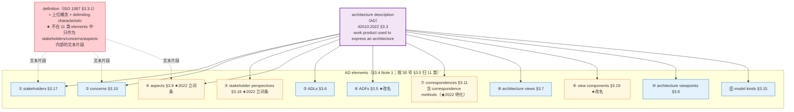

> **一句防误读**：这 11 类最容易被读成"清单即描述"——**清单是内容的全集，描述是读取的装置**，两件事的分工见 **48 号 §9.25**。

### 6.2A 三处"元素"必须分清：AD element／实体侧的 components 与 relationships／system element

（依 **24 号 §四**；本小节为 24 号对齐补入，**不改 §6.2 的 11 类清单与上图结构**）

§6.2 的 11 类全称 **AD element（架构描述元素）**，出自 **42010:2022 §3.4**，即 *identified or named part of an architecture description*——它是**描述本身的零件**。凡称"架构描述中的元素"，在现行标准下**只有一个术语所指，就是读法 A（AD element）**（24 号 §4.1 读法 A）；把"描述中的元素"直接读成"系统的部件"，是范畴错误（24 号 §2.5.1）。

| 术语 | 出处 | 所在层 | 是什么 |
|---|---|---|---|
| **AD element**（架构描述元素） | **42010:2022 §3.4** | **描述层** | 架构描述的零件——即 §6.2 的 11 类（相关方 / 关切 / 相关方角度 / 方面体 / 架构视角 / 架构视图 / 视图组件 / 模型种类 / ADL / ADF / 对应关系） |
| **entities' components / relationships**（构成元素与关系） | **42020:2019 §3.3 Note 1** | **实体侧**（**架构可以关乎**的对象；**不在定义句内**） | 所关注实体的组成元素及其相互关系（含与环境的关系）；⚠ **注释级，无术语地位**（24 号 §4.1 读法 B、§13.2）。**本书早期工作名"架构构成物"自 2026-10-11 起废止**——该词是 2011 版 embodied-in 的换词存活，易被读成"架构由它构成" |
| **system element**（系统元素） | **15288:2023 §3.47** | **实现层** | 可被实现 / 采购 / 编码的**离散部件**（*discrete part of a system that can be implemented to fulfil specified requirements*） |

> ⚠ **易误读（三处）**：
> ① **AD element ≠ system element**——两者**自下而上隔着②模型层与③设计层两道界**：`represent` 的两端是"模型里的元素 ↔ 实体"（48 号 §9.30），`express` 的两端是"架构 → 描述／视图"（42010:2022 §3.3），两者都不是"AD 元素 ↔ 系统元素"；"画了架构视图＝定了部件"不成立（24 号 §4.2、§4.6）。
> ② **实体侧的 components／relationships ≠ system element**——是**槽位与填料**的关系，**多对多**，由设计定义填充；方向单向（前者是规定需求的一方，system element 是被约束的一方）（24 号 §4.3）。
> ③ **不要把实体侧的 components／relationships 称作"架构实体"**——**architecture entity** 指"**被架构的那个事物**"（42020:2019 §3.6，≈ 42010:2022 的 EoI），它是**容器**而非成员（24 号 §4.1 提醒、§13.1）。

> **互参**：§6.2 的 11 类 AD elements 即本表第一行的清单（**42010:2022 §3.4 Note 1，资料性、原文作 *include* 故非穷举**；§5.2.9 另列 legend／architecture decision／architecture rationale），与 **24 号 §4.1 读法 A** 一致；术语定译表见 **24 号附录 A**。
>
> **〔称名纠偏·随 46 号 v2.6 补〕** 本小节的"三层"是**描述层／实体侧／实现层**（24 号 §四 口径），与 **46 号 §3.3** 的**位／设计元素／系统元素**三层**不同轴，两套不可并读**（46 号那三层是**种类**之别，不是粒度之别）：**位**（＝**架构位**＝**常设位**＝**建模实体**）答"这里**必须守什么**"，是**架构描述（方案）的构成单位**、也是架构的表达元素；**设计元素**答"这里**做成什么样**"（判据：完整到足以支撑**一次合规实现**——15288:2023 §3.13 `design`）；**系统元素**答"这里是**哪一个**"（15288:2023 §3.47 `system element`）。故一条禁令：**位不得称"设计元素"**——*design element* 专指系统元素及其关系的规格，同名会把三层塌成两层（46 号 §3.1、§3.3、§3.5）。

### 6.3 AD vs definition 精度辨析

| 术语 | 标准定义 | 关键性质 |
|---|---|---|
| **description**（描述） | 用文字/图/模型/表/代码等**任何 artifact** 表达某物 | 通用动词，可指任何形式的刻画 |
| **definition**（定义） | ISO 1087 §3.3.1：representation of a concept by a descriptive phrase which serves to differentiate it from related concepts —— 用**描述性短语**划界 | 描述的**特殊形式**：简短、精确、只用于概念划界 |
| **AD（架构描述）** | 42010:2022 §3.3：work product used to express an architecture | 42010 专有术语，是 description 这个动作的产物 |

关系是**包含**：**description ⊃ definition**，AD ⊃ definition。AD 是 42010 语境下的 description 产物。

#### 常见误用

| 误用 | 你以为的"定义" | 实际定位 |
|---|---|---|
| M1. "AD 是一份对架构的 definition" | 单个 definition 文本 | 漏掉 11 类 elements |
| M2. "AD 是 architecting 的 definition（动）动作的产物" | 准确 | ✓ |
| M3. "AD 包含若干 definition" | 准确 | ✓ |
| M4. 把 ADF / ADL / viewpoints 混为一谈 | 不同元素类 | 需区分 |

### 6.4 architecting（42010:2022 §3.1）的 7 步动作集（verbatim）

> **architecting** — conceiving, **defining**, expressing, documenting, communicating, certifying proper implementation of, maintaining and improving an architecture throughout the life cycle of an entity of interest

7 步动作：
1. **conceiving**（构思）—— Conception 派
2. **defining**（定义）—— 用 concept+property 清单定义架构；地产物 = definition 文本集
3. **expressing**（表达）—— 形式化为 AD
4. **documenting**（记录）—— 落**人工制品**（artifact）→ AD 的属概念是**工作产品**（work product；42010:2022 §3.3 Note 1，**资料性**：*A work product is an artifact produced by a process*，中译：工作产品是由过程产生的人工制品）
5. **communicating**（传递）—— 给 stakeholders
6. **certifying proper implementation**（认证实现）—— 验证符合
7. **maintaining and improving**（维护改进）—— life cycle 持续

> **关键观察**：**"defining"**（动词）是 architecting 的七步动作之一——这一步的产物就是"用概念+属性清单定义架构"。所以 **42010 体系内 architecting 的合法动作包含 "基本概念+属性清单定义架构"**（清单是**内容的全集**，不是描述；描述是读取的装置——48 号 §9.25）——这与本研究第 8 章精度辨析相呼应。

> **互参（凭据链 · 依 24 号 §6.7、§6.11.1）**：第 6 步 "certifying proper implementation" 的**合规对象是 architecture，不是 AD**——① **DD 只能出具"条件性合规"**：design 的职责止于 *sufficient to enable*，合规的承担者是 implementation（24 号 §3.3、§6.7）；② **两个"合规"必须分开**——42010:2022 §4 Conformance 判"这份 AD 合不合 42010 的要求"，15288:2023 §3.13 判"实现是否合规于架构"，用前者判后者即退化为文档格式检查（24 号 §3.1、§6.11.1）。凭据链四段（架构 → AD → 约束条目集 → 判定输出）见 24 号 §6.10.1。

### 6.5 AD 概念模型的四个关系动词（不可互换）

（依 **30 号 §5.1**；本节补本报告前版未列的 AD 概念模型骨架）

| 关系 | 英文 | 说明 |
|------|------|------|
| 相关方 → 关切 | **has** | 谁在乎什么 |
| 架构视角 → 关切 | **frames** | 视角**框定**关切，不是解决、也不是应对 |
| 架构视角 → 架构视图 | **governs** | 规矩管产物（中文作「治理」／「管辖」） |
| 架构视图 → 关切 | **addresses** | 真正对关切作出交代的是视图的内容 |

> **三条边界**：① `governs ≠ 包含 ≠ 生成`；② 把视角写成「应对关切」是常见错误——应对是 `addresses`；③ `governs` 与 architecture governance **只共用「治理」二字**，不是同一用法（30 号 §5.2、§5.3、§5.5）；后者是**组织治理职能**（有裁量者，违反走例外／豁免），其定义与展开见 **29 号《架构治理研究报告》**（四要素工作定义见其 §2.1）——本节只处置 `governs` 的译名，不涉其内容。
>
> **〔容器归属·随 46 号 v2.6 补〕** 四个名字各在什么容器里，一句话分完：**架构**不是文件、不是图（42010:2022 §3.2、§3.3），**一个实体一处架构**；**架构描述**是表达架构的工作产品；**视图**是架构描述里的**信息部件**（42010:2022 §3.7、§3.14），由**恰一个**视角治理（42010:2022 §6.7，**规范**），是**全体的投影、不是系统的一块**，也不是"图"（42010:2022 §3.19、§6.8）；**视角**是一组惯例（42010:2022 §3.8）。故"几张视图拼起来＝系统"不成立（46 号 §5.2、§5.4）。**"xx 架构"是一个名字，不是容器**——只有四种身份（描述的命名／架构前冠的主题／一项关切／一句 *can be said to be*），没有"治理者"这一问（46 号 §5.3）。

---

## 7. 42010:2022 的三处结构性修订（EoI／governing principles／两项词条化）

### 7.1 system → entity of interest (EoI) §3.12

**verbatim**：

> **entity of interest; EoI** — subject of an architecture description
>
> EXAMPLE: Enterprise, organization, solution, system (including software systems), subsystem, process, business, **data (as a data item or data structure)**, application, **information technology (as a collection)**, mission, product, service, software item, hardware item, product line, family of systems, system of systems, collection of systems, collection of applications.

| 维度 | 解读 |
|---|---|
| **EoI 是什么** | AD 的主体——可包括 enterprise、business、data、process、mission、product、service 等 |
| **与 system 的关系** | **扩域**——data 架构、企业架构、过程架构都合法（**前提**：那里的名词充当**被架构实体**，如 data (as a data item or data structure)；若"数据架构"指 TOGAF 四域里那一摊**设计方案**，则属术语误用——见下注） |
| **EXAMPLE 范围** | 不止传统系统——这是 2022 的关键扩域 |

> **边界注（依 46 号 §6.6.4，2026-11-11 加）**：EoI 扩域成立，但它打开的是"**可以拿数据、应用、过程当被架构实体**"，**不是**"一个系统可以同时有数据架构与应用架构"。同一个实体仍只有一处架构（42010 §3.2）；"数据架构"两读的分界在**它指的那个实体存不存在**：以数据条目／结构为 EoI → 合法；作 TOGAF 四域那一摊设计方案的名字 → 误用（06 号 §4.7、46 号 §6.6.4；28 号 §6.3 同注）。

> **补充（2026-10-12·层级图定案）**：**企业架构＝「企业运营体系架构」的简称**——依 **42020:2019 §E.4.1.2 的第二种读法**（企业架构「或者是一个企业的架构，**或者是从企业角度考察的某个实体的架构**」），那个实体即**企业运营体系**；它是一个**系统的系统**（42020 §E.4.1.10），**有它自己的一个架构**，**该架构承接企业战略**。**业务流程体系、企业应用系统、业务数据体系、信息基础设施**是它的四个**子系统**，**各有自己的架构与各自的多种视图**，**各自承接企业在该领域的子战略**。TOGAF 的 4A（业务／数据／应用／技术架构）**对应的就是这四个子系统**（见 06 号 §4.7）。

#### 对命题链的反推

| 用户之前命题 | 2011 视角 | 2022 视角 |
|---|---|---|
| "**系统**的基本概念和基本属性清单" | system-only | EoI = system ∪ enterprise ∪ data ∪ process ∪ business ∪ mission ∪ ... |
| 架构能不能用于"非系统实体"？ | 仅 system 限定 | EoI 打开——**数据架构、企业架构、过程架构都合法** |

### 7.2 principles → governing principles

| 维度 | 2011 | 2022 |
|---|---|---|
| 句法位置 | 与 elements、relationships 并列 | **升为 governing**——是**定义句第二块**（与 X 块并列，**不是一层**）〔本报告读法：Foreword 未单列此条为版次变更〕 |
| 文本措辞 | principles of its design and evolution | governing principles **for the realization and evolution** of this entity **and its related life cycle processes** |
| 性质 | 【历史对照】与 elements/relationships 并列（embodied-in 三块之一） | 〔本报告读法〕2022 **升为定义句第二块**（与 fundamental concepts or properties 并列），并带规约力——见 30 号 §2.1、§7.3 |
| 在 AD 中的位置 | 与 views/stakeholders 并列 | 原则以**架构决策与理据**等形式出现在 AD 中；不在 42010:2022 §3.4 **Note 1（资料性）** 所列的 11 类清单内——但那 11 类本身是 ***include*、非穷举**，**42010:2022 §5.2.9 明列 architecture decision／architecture rationale 为 AD 元素**（分组见 30 号 §3.5；与本报告 §6.2 的补注一致） |

> **〔口径·governing principles 一条两向〕** 42010:2022 §3.2 只有**一条** `governing principles for the realization and evolution`，同时约束**实现与演化**两个方向；2011 的"设计准则／演化准则"二分不成立（【历史对照·库外不可核】）。

> **〔承 §5.2.2 互参〕** 2011 版 definition 句中与 principles 并列的 **elements / relationships**，在 2022 定义句中删去后，其含义**并非删除而是迁入 ISO/IEC/IEEE 42020:2019 §3.3 Note 1**（措辞改为 components／relationships／环境关系；强度「是」→「通常意指」之变属〔读法〕，且该处是 **NOTE、资料性**，**不作定义句推论用**——弱读的过程条款依据见 §5.2.2）。故阅读本节时须注意：**本节表格的"删去"只针对 2022 定义句的句法构成，不表示该层含义在标准体系中已无出处**——出处见 24 号 §4.5.2，其元素分层见本报告 §6.2A。

> **关键含义**：principles 现在不只是"描述性清单"——是**有约束力的原则**（可据以判定违规）。"governing" 暗示它们**有约束力**（约束后续 realization 和 evolution）；但这不使它成为架构的"组成部分"，也不是 `governs` 关系的所指（30 号 §5.2、§5.3）。

### 7.3 §3.9 aspect 的定义化（2011 已有其概念，见 §5.5 表 Foreword 逐字）—— 直接呼应"基本概念+属性清单"

**verbatim**：

> **aspect** — part of an entity's **character or nature**
>
> EXAMPLE Functional, structural and informational aspects of an entity.
>
> Note 1: A particular aspect can be used for capturing the relevant features of the entity of interest as a refinement of one or more concerns under examination with respect to some part of its character, e.g. the structural character, functional character or informational character of the entity.
>
> Note 2: Aspects enable the architect to analyse, address and structure concerns. In general, there is a **many-to-many relation between aspects and concerns**.

| 维度 | 解读 |
|---|---|
| **aspect 是什么** | 实体 character or nature 的**部分**——按"性格/性质"切块 |
| **典型 aspect** | functional / structural / informational / behavioral（标准示例给的） |
| **aspect 与 concern 关系** | 多对多——一个 aspect 可被多个 concern 引用，一个 concern 可跨多个 aspect |
| **aspect 有什么用** | 让架构师 "analyse, address and structure concerns"——**结构化关切** |
| **与本研究主张的关系** | "基本概念+属性清单"按 aspect 分块 = functional 清单 + structural 清单 + informational 清单 + behavioral 清单——**官方版本** |

> **核心洞察**：用户前几轮主张的"基本概念+属性清单定义架构"，**42010:2022 通过 aspect 这一概念直接承认并标准化了**（aspect 在 2011 已有其概念，2022 立为 §3.9 词条）。architecture 的 concepts/properties 按 aspect 分块呈现，是 2022 推荐的 AD 内部结构。

### 7.4 §3.18 stakeholder perspective 的定义化（2011 已有其概念，见 §5.5 表 Foreword 逐字）—— 把「按角色形成认知」立为 AD 元素

**verbatim**：

> **stakeholder perspective** — way of thinking about an entity of interest, especially as it relates to concerns
>
> EXAMPLE: The labels given to the middle three rows (i.e. owner, designer and builder) of the Zachman framework correspond to stakeholder perspectives. The rows in the Unified Architecture Framework and NATO Architecture Framework grids correspond to stakeholder perspectives (although they are called "domains" and "subjects of concerns," respectively in those frameworks).

| 维度 | 解读 |
|---|---|
| **是什么** | "思考 EoI 的方式"——**认知层级**的切块 |
| **典型 perspective** | owner / builder / designer / operator / developer / maintainer / certifier / regulator（Zachman 框架示例） |
| **与 conception/perception 关系** | conception 偏主观、perception 偏客观、perspective 偏**角色化认知**——三个视角并存 |

> **核心洞察**：本研究第 5 章讨论的 "Architecture as Conception / Perception"（来自 iso-architecture.org 配套页）——**2022 把 stakeholder perspective 立为 42010:2022 §3.18 词条，并在 §5.2.9 列为 AD 元素**。它是**关切的一个来源**（30 号 §3.5），与两哲学同源，但不是两哲学的条款化表述；Conception/Perception 仍属哲学讨论，AD 必须识别的是相关方角度。

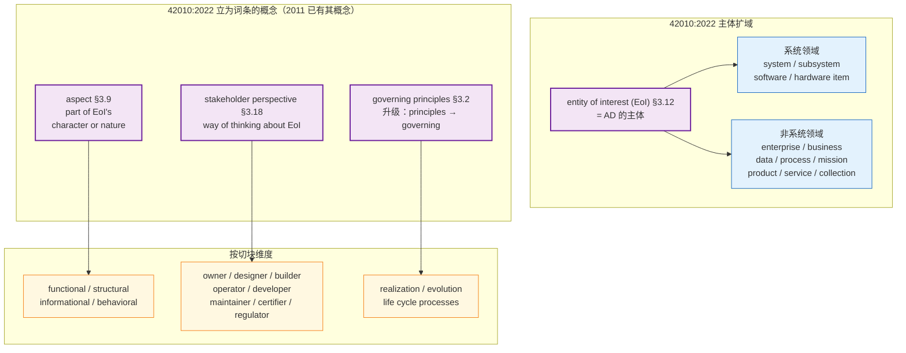

---

## 8. 精度辨析的多层切片框架

> 本章总结本研究中**反复出现的精度辨析模式**——以 4 个具体切片为案例，建立 L1-L5 五层框架与三组限定词辨析模板。

### 8.1 切片 1：concepts vs property × abstract vs artifact（2×2 矩阵）

|  | **Concept 侧**（Architecture as concept 派；2011 口径二手派名 Conception） | **Property 侧**（Architecture as property 派；2011 口径二手派名 Perception） |
|---|---|---|
| **Architecture（abstract）** | 架构师脑中的 concepts：理念、思路、意图 | 观察者感知到的 properties：系统的客观特征 |
| **AD（work product）** | 描述/记录出来的 concepts：术语表、定义文档、原则说明 | 描述/记录出来的 properties：视图、模型、规格表、数据字典 |
| **进入架构的动作** | 构思（conceive） | 感知（perceive） |
| **形成 AD 的动作** | 描述/记录 | 描述/记录 |

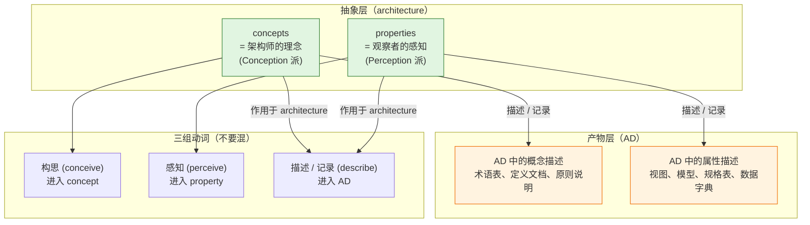

#### 三个动词区分

| 动作 | 主体 | 客体 | 产出 | 标准术语 |
|---|---|---|---|---|
| **构思 (conceive)** | 架构师 | 脑中的概念 | concepts（抽象） | 属 Conception 派 |
| **感知 (perceive)** | 观察者 | 系统的特征 | properties（被识别的抽象） | 属 Perception 派 |
| **描述 / 记录 (describe)** | 任何人 | architecture（整体） | **AD（工作产品）** | 第三层，独立于前两派 |

### 8.2 切片 2：三层精度（抽象本体 vs 具象载体 vs 产物）

> **互参**：本节三层精度与 **30 号 §9.4** 的**内容层／载体层双指称**为**同一结构**，可互参。注意两套"三层"**不同轴**：本节按"指称物是什么"分为**抽象本体／具象载体／产物**；30 号 §9.1 按"『抽象』一词的三种用法"分为**含义层／本体层／粒度层**——不可并读。
>
> **对照列（30 号 §9.3 三条可检验判据）**：**可交割性**（系统能交付、AD 能签收、架构不能）／**同一性**（架构能多载体一内容：同一架构、两个实现）／**因果力**（架构不导致任何事）。

> **〔读法·层轴声明〕本表的层轴是"能不能列成清单"的程度，不是"架构内容"的分类**——42010:2022 §3.2 的内容只有**两样**（concepts or properties ＋ governing principles），故 **L4a 是内容、L4b 是描述层元件**，两者不可并作一"层"；层名只表"能不能列成清单"，**不表架构占一个层位**（42 号 A4）。

| 层 | 内容 | 是否可清单化 | 标准出处 |
|---|---|---|---|
| **L1 抽象本体** | architecture 是什么 | ❌ 不可 | 42010 §3.2 |
| **L2 definition 集** | 概念词条 + 区分性特性 | ⚠️ 半可（每个概念独立） | ISO 1087 §3.3.1 |
| **L3 概念+属性清单** | 用清单定义一个架构 → 落到产出＝**三张清单且有序**：概念 → 构成性属性 → 许可性原则 | ✅ 可 | architecting / 架构风格实践 |
| **L4a 原则**（架构内容第二样） | governing principles（有约束力的原则）→ 即第三张"许可性原则清单" | ✅ 可 | 42010:2022 §3.2；30 号 §3.5 |
| **L4b 对应关系**（**描述层元件**，42010 §3.11）**不是架构内容**，与 L5 同层 | correspondences（对应关系）／correspondence methods（对应方法） | ✅ 可 | 42010:2022 §3.11；【历史对照】2011 版 embodied-in 三块 |
| **L5 AD** | 工作产品（work product）；其元素即 **AD element**（11 类清单见 §6.2） | ✅ 可 | 42010:2022 §3.3、§3.4 |

> **〔三层区分 · 依 24 号 §4.4.1〕** 本表 **L4a／L4b／L5 三行**内各有一处**同名陷阱**，须与 **§6.2A** 并读：
> - **L4b 的 `correspondences` 与 L4a 的 `governing principles`**（本表现行值）**不含** elements／relationships；若见【历史对照】的 2011 版 embodied-in 三块（elements＋relationships＋principles），它指的是**实体侧的 components 与 relationships**（42020:2019 §3.3 Note 1，**NOTE、资料性、无术语地位**）——**不是** L5 的"11 类架构描述元素"（**AD element**，描述层，42010:2022 §3.4），也**不是** system element（实现层，15288:2023 **§3.47**）。
> - **L5 的元素即 AD element**（11 类清单见 §6.2）——**描述层零件**；把它当"系统的部件"是 24 号 §2.5 否掉的那处**位置词偷换**（"架构描述中的元素是系统的高层级元素"）。
> - 三层各自的术语、出处与"⚠ 易误读"见 **§6.2A**；四个术语并排表见 **24 号 §4.4.1**。
>
> **〔术语提示 · 依 24 号 §2.4.1、附录 A〕** 本表 L5 行与上文的"**产物**／**载体**"是 22 号原有的分层用语（指称物是什么），**不等于** 15288:2023 §3.6 的 **artefact（人工制品）**——后者是 AD 与 DD **平级并列**的属概念线，与 42010 的 **work product（工作产品）**〔2026-09-24 依库内正本更正：**两册是互为属概念的关系、方向相反**——15288 §3.6 的 artefact 以 work product 为属概念（*work product that is produced and used during a project*），42010:2022 §3.3 Note 1 的 work product 又以 artifact 为属概念（*A work product is an artifact produced by a process*）。故原句「是两个词，**不可互译**」**不成立**；本报告的分流译名照旧，**理由改为「所属标准不同、属概念层级不同」**（引证行见 §12 第 34 行）〕。本报告凡指 AD 与架构视角自身，属概念一律写**工作产品**。

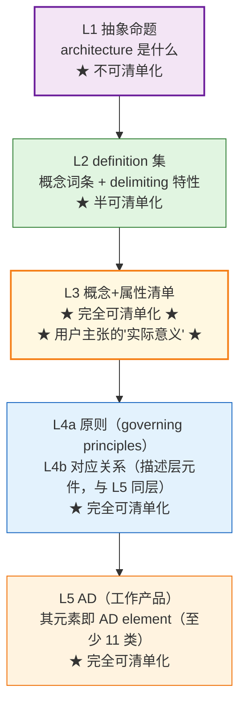

#### 三个澄清问题的升级版

1. 这东西是**性质（nature）**还是**构件（component）**还是**产物（product）**？
   - concepts/properties = 性质
   - concepts/properties + governing principles ＝**架构的两样内容**（同一句定义的两个并列成分，不是可拼装的"承重件"）〔**2022 定义句只给这两样**；【历史对照】2011 版作 elements/relationships/principles＝"构件"，该口径已删——实体侧的 components／relationships 见 §6.2A〕
   - AD = 产物
2. 它位于**抽象层（architecture）**还是**载体层**还是**产物层（AD）**？
3. **能不能列成清单？**——抽象本体不能列（concepts/properties 是 nature，不是 list）；两样内容能列（**基本概念或属性 ＋ 管控原则**；【历史对照】2011 口径作 elements／relationships／principles）；产物里也能列（AD 内的 views / concerns / stakeholders——此即 **AD element**，描述层 11 类，42010:2022 §3.4）。

> **〔按（依 42 号 §4.2~§5.6）〕** 上表 L3／L4a 是"**能否清单化**"的层，不是"架构内容"的分类。落到架构工作的产出，是**三张清单且有序**：**概念清单 → 构成性属性清单 → 许可性原则清单**（概念是**共同陈述的条件**——它解决的不是"我能不能说清"，而是"我们能不能用同一套话说清"；属性划定候选集；原则在候选集内再筛）。故 L3 实含前两张、L4a 的原则即第三张；**L4b 的 `correspondences`（对应关系）不属这三张**——它是架构描述一侧的元件关系，归 L5。

> **一句防误读**：本表把"能不能列成清单"当作层轴（L1~L5），**不等于"架构内容"的分类**——清单侧（L3／L4a）与描述侧（L4b／L5）**是两批内容，交叠并非相等**：视图里可以出现非基本内容与表达层构造，判别见 **48 号 §9.24**。

### 8.3 切片 3：system 限定 vs architecture 限定

| 限定 | 含义 | 落点 |
|---|---|---|
| **entity 的** | 主语限定——主体是**所关注实体**（42010:2022 已由 system 扩为 entity；system 只是实体的一种） | 但范围是实体的子集，不是全部 |
| **in its environment** | 关系限定——必须在 system 与 environment 的关系中 | **环境的属性**也算 |
| **fundamental** | 范围限定——只保留最本质的 | 不包括非本质属性 |

architecture 的 concepts/properties 是 **entity ∩ environment ∩ fundamental** 的三交集。

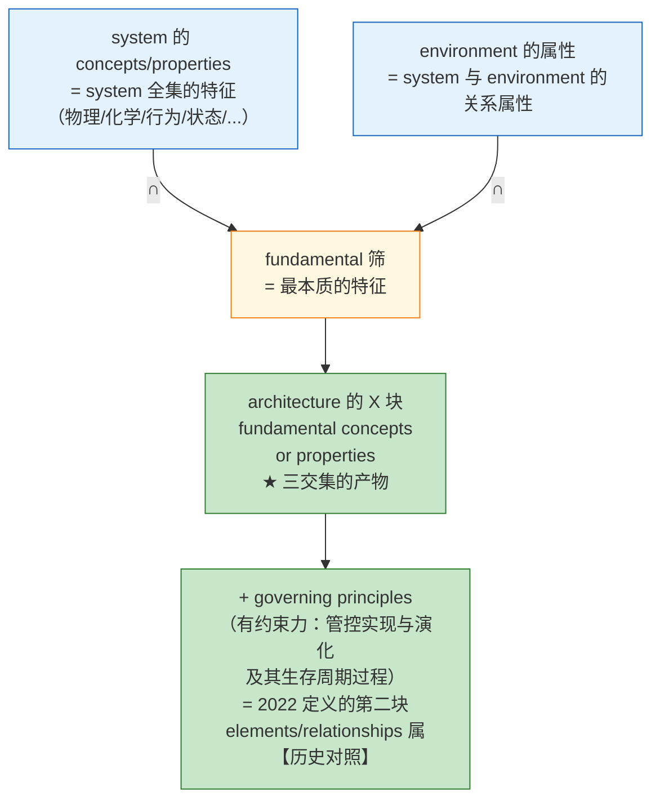

#### 严格化版本（修正原始命题）

| 修正版 | 措辞 | 是否成立 |
|---|---|---|
| V0（用户原始） | "系统的基本概念和基本属性清单" | ⚠️ 主体是 system（2011 口径）；2022 已泛化为**所关注实体**（EoI），且是主体不是 architecture |
| V1（去掉"系统的"） | "基本概念和基本属性清单" | ⚠️ 缺 environment + governing principles——半套 |
| V2（精确化） | "**实体-环境关系中**的 **fundamental concepts/properties** 清单 + **governing principles** 清单" | ✅ 严格成立——即 L3+L4a 完整版 |
| V3（最完整） | V2 + "**视图组件与对应关系**" 清单 | ✅ 完全——即 L3+L4a+L4b+L5 综合版（elements/relationships 属【历史对照】） |

### 8.4 切片 4：definition vs description（AD 内的精度）

| 维度 | 严格定位 |
|---|---|
| **definition ⊆ description** | description 是泛指（任何 artifact 的表达）；definition 是 description 的精确形式（划界短语） |
| **AD ⊇ definition** | **AD 是工作产品（42010 §3.3）；其元素（AD element）按 §3.4 Note 1（资料性、非穷举）至少含 11 类，§5.2.9 另含 legend／architecture decision／architecture rationale 及视角与模型种类引入的构造**；definition 只是其中 stakeholders/concerns/aspects 的文本片段 |
| **动/名词区分** | defining（动）≠ definition（名）；defining 是 architecting 的一步动作，definition 是其产物之一 |

### 8.5 三问升级版（含限定词）

1. **主体在哪层？** EoI（含 system/enterprise/data/process/business...）vs architecture vs AD——主体不同，定义不同。
2. **处于哪个 aspect？** functional / structural / informational / behavioral——按 character 切块。
3. **站在哪个 perspective？** owner / designer / builder / operator / developer——按 stakeholder perspective 分组。
4. **遵循哪个 governing principle？** realization / evolution / life cycle processes——principles 是**有约束力的原则**，不只是描述清单。

### 8.6 切片全图——本研究的精度辨析轨迹

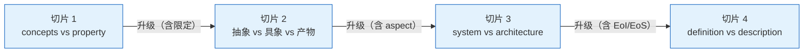

---

## 9. 翻译精度辨析（42010:2022 中文译本）

> **本章节定位**：以 **ISO/IEC/IEEE 42010:2022** 为最新权威依据；2011 版仅作为"历史对照"参考。**所有译文精炼工作都以 2022 版为锚**。

### 9.1 标准原文 verbatim

#### 【★ 最新现行】2022 版（§3.2）／ GB/T 45630-2025, 3.2

> architecture — fundamental concepts or properties of an entity in its environment and governing principles for the realization and evolution of this entity and its related life cycle processes

#### 【历史对照】2011 版（§3.2）

> architecture — fundamental concepts or properties of a system in its environment embodied in its elements, relationships, and in the principles of its design and evolution

> **对比要点**（仅作历史对照参考）：2011 主体是 system、含 embodied-in 三块；**2022 主体是 entity、剥离 embodied-in、principles 升格 governing**——这些差异对译文的句法和术语都有影响（见 §9.4-9.5）。

### 9.2 ★ 2022 版标准译文（canonical 句式；2026-09-21 收口）

> **架构：实体在其环境中的基本概念或属性，以及该实体及其相关生存周期过程的实现和演化的管控原则（governing principles）。**
>
> 出处：ISO/IEC/IEEE 42010:2022, 3.2（源自 ISO/IEC/IEEE 42020:2019, 3.3）；中文术语定名依 GB/T 45630-2025。
>
> 〔历史记录〕2026-09-04 用户 V3 精炼译文作"一个实体在其环境中的基本概念或属性，以及**用于**该实体及其相关生存周期过程的实现和演化的**治理原则**"；2026-09-21 用户裁定其他术语一律按 GB/T 45630-2025 修订，故"治理原则"→"**管控原则**"、"用于"不再保留（V3 原文与打磨轨迹见 §9.3、§9.4）。
>
> **GB/T 45630-2025, 3.2 逐字字面**：实体在其环境中的基础概念或属性，以及该实体及其相关生存周期过程的实现和演化的管控原则。

### 9.3 中文社区权威译本横向对比（**以 2022 版 ＋ GB/T 45630-2025 采标本为锚**）

| 来源 | 译文 | 评注 |
|---|---|---|
| **★ 用户 V3（精炼版，针对 2022；2026-09-04 定版，2026-09-21 收口）** | 架构：实体在其环境中的基本概念或属性，以及该实体及其相关生存周期过程的实现和演化的**管控原则**（governing principles）〔2026-09-04 原译作"……**用于**……的**治理原则**"；2026-09-21 按 GB/T 45630-2025 改「管控原则」、去「用于」〕 | **精度最高**——句法最贴 2022 原文；逐字对齐 entity / governing / life cycle processes。**逐字引国标时照抄 GB/T 45630-2025, 3.2 字面**：基础概念或属性…管控原则…生存周期过程 |
| pkuair（CSDN，2024-03，针对 2022） | 一个实体在其环境中的基本概念或属性，以及管控此实体及其相关生命周期过程之实现与演化的基本原则 | "管控"与国标定名一致；"之"字结构稍文；其余精度齐 |
| tonydeng（EA-practices，【历史对照】译 2011 版） | 一个系统在其所处环境中所具备的各种基本概念和属性，具体体现为其所包含的各个元素、它们之间的关系，以及架构的设计和演进原则 | **2011 版译文**——主体是 system 不是 entity；体现 embodied-in 三块 |
| 沃尔沃架构论文（【历史对照】） | 一个系统的环境中的基本概念或属性体现在它的元素、关系、以及其设计和演变的原则中 | 最短——丢了介词 |
| Leo_wl（博客园 DDD，【历史对照】译 2011 版） | 一个系统在其所处环境中所具备的各种基本概念和属性，具体体现为其所包含的各个元素、他们之间的关系以及架构的设计和演进原则之中 | 加了"所具备"、"所包含"——口语化 |
| EA 之家韩老师（【历史对照】） | 一个系统在其所处环境中的（系统的）基础概念或属性，其内容包括它的元素、关系和它的设计和演进的原则 | 【历史对照】2011 版转译；用"基础"——与 GB/T 45630-2025 定名一致（自撰正文取"基本"，引文照抄"基础"） |
| 百度百科 / 维基百科 | 沿用 ISO 42010 译文，但简化为"软件整体结构与组件的抽象描述" | 损失了 42010 的精度 |

> **〔档位纪律〕** 上列各条中，**pkuair／tonydeng／Leo_wl／沃尔沃架构论文／EA 之家韩老师／百科诸条皆为网络二手，不可作引证依据**；本表只作译法对照，**不得据以主张标准的官方中文定名**（官方定名见 GB/T 45630-2025，且该件**库外·不可核**——见 §1.3 表下清单）。

### 9.4 打磨迭代 V0 → V3

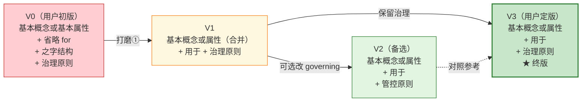

> 〔2026-09-21 收口〕上图记录 **2026-09-04** 的打磨轨迹（V0→V3）及当时以「治理原则」定版的 V3；本轮用户裁定**除 fundamental 取「基本」外其余术语一律按 GB/T 45630-2025 修订**，故 **V3 中的「治理原则」自本轮起改为「管控原则」**（图中 V2 的「管控原则」即现行口径）。**轨迹原文保留，不回溯改写**，改写理由见打磨③。

#### 三个打磨点详解

**打磨 ①**：fundamental 的位置和"基本"的出现次数

原文 fundamental **只出现一次**，修饰的是 "concepts or properties" 这个**整体短语**。两种解读：

| 解读 | 译法 | 含义 |
|---|---|---|
| **A. 原文对**（一次修饰整个名词短语） | 基本概念或属性 | "fundamental" 是 concepts or properties 的共同属性 |
| **B. 直译对**（各自修饰） | 基本概念或基本属性 | "fundamental concepts" 与 "fundamental properties" 各自分别 fundamental |

V0 用 B，V3 用 A，**A 更贴合原文**。

**打磨 ②**：丢了 "for" 介词——句法松了一档

原文中 "governing principles **for** the realization and evolution" ——for 把 governing principles 和 realization/evolution 之间的关系钉成"原则**用以指导**实现/演化"。

V0 省略 for；V3 改 "用于" 显化 for，避免误读为"原则 = 实现 + 演化"。

> 〔2026-09-21 补〕仓库统一句式已改为镜像 GB/T 45630-2025 3.2 国标字面的"…以及该实体及其相关生存周期过程的实现和演化的**管控原则**（governing principles）"，不再加"用于"；"用于"仍是对 *for* 的合法译法，仅保留作本节译法辨析的说明。

**打磨 ③**："governing" 译法（管控 vs 治理 vs 主导）——**按国标定名，取「管控原则」**

| 译法 | 含义 | 评 |
|---|---|---|
| **管控原则**（**现行口径**，自撰正文与引国标统一） | governing（定语）／具有规约力、可据以判定违规 | GB/T 45630-2025, 3.2 定名即"管控原则"；自撰正文一律照此 |
| 治理原则（2026-09-04 至 2026-09-21 的旧口径，**已弃用**） | 与 architecture governance 的中文撞名 | 退出正文；"治理"改留给 governance（名词）与 governs（关系名） |
| **主导原则**（部分译） | leading / 主导 | 失去规约力含义，不可用 |

**结论（2026-09-21 用户裁定：除 fundamental 取「基本」外，其余术语一律按 GB/T 45630-2025 修订）**：

1. **`governing` 在此作定语**修饰 principles，表"具有规约力、可据以判定违规"；**GB/T 45630-2025, 3.2 定名为「管控原则」**，故自撰正文一律写「管控原则」，不再区分"引国标／自译自用"两种写法。
2. **「治理」留给 governance 与 governs**——名词 governance（如 ISO 37000 的组织治理、**ISO/IEC 38500:2024 §3.3**）译「治理」；关系名 `a viewpoint governs a view` 译「治理／管辖」。这与 **30 号 §5.5「`governs` ≠ architecture governance」**是同一分工：定语位的东西（有规约力的原则）用「管控」，名词位与关系位的东西用「治理」。
3. **风险注解（保留）**：此处 governing 是**定语**，指具有规约力、可据以判定违规，**与 architecture governance（架构治理）不是同一用法**；凡与组织治理／架构治理同页出现处，仍须加所指界分（30 号 §5.5、§8.8）。架构治理的**定义与展开**不在本报告，一律以 **29 号《架构治理研究报告——从标准依据到责任主体》**为准（其与 governance 本体的分工见 28 号；本报告只处置译名分工，不改其结论）。

> 〔历史记录 · 2026-09-04 的论证原文保留〕当时主张"用户选『治理』是对的"，三条理由为：① 42010:2022 全文语境偏治理（aspect / stakeholder perspective / view / correspondence / ADF / ADL 都是治理层词汇）；② ISO 9000:2015 §3.5.1 governance 统一译"治理"；③"管控"在中文带行政味，与 ISO 治理的"制度约束"不完全重合。
>
> 〔2026-09-21 用户定〕其他术语一律按 GB/T 45630-2025 修订，故本报告 2026-09-04 的「治理原则」口径自本轮起改为「**管控原则**」；上列三条理由作为当时论证保留于此（其中②的推论已不成立——名词 governance 的译法不能决定定语 governing 的译法）。

### 9.5 关键术语精度对照表

| 术语 | 严格译法 | 替代译法 | 取舍理由 |
|---|---|---|---|
| **fundamental** | 自译自用：**基本** | 逐字引 GB/T 45630-2025：**基础**（国标定名） | 政策见 30 号 §10.2——引国标照抄字面，自译自用取"基本"并括注英文 |
| **concepts** | 概念 | 观念 / 思想 | ISO 1087 术语学译法统一用"概念" |
| **properties** | 属性 | 性质 / 特性 | ISO 1087 §3.1.3 译"属性"（property，客观）；§3.2.1 characteristic译"特性" |
| **embodied in** | 体现于 / 具体体现为 | 具象化于 / 落地于 | **【历史对照】仅见于 2011 版定义句**；2022 定义句无此语，勿据本行回译 2022 |
| **elements** | 元素 | 构件 / 部件 | 2011 改 elements 替代 components 是为了**泛化** |
| **principles** | 原则 | 准则 / 法则 | ISO 9000 译"原则"——一致 |
| **governing principles** | **管控原则**（自撰正文与引国标统一；括注 governing） | 治理原则（2026-09-04 至 2026-09-21 旧口径，**已弃用**） | GB/T 45630-2025, 3.2 定名「管控原则」；「治理」留给 governance（名词）与 governs（关系名）——见 §9.4 打磨③与 30 号 §3.7。本行只管**定语位**译名：architecture governance（架构治理）的定义与展开见 **29 号** |
| **in its environment** | 在其环境中的 | 在其所处环境中的 | 用户 V3 选前者 |
| **realization** | 实现（读作兑现、落实） | 落地 / 实施 | ISO/IEC/IEEE 15288 译"实现"；30 号 §10.4 |
| **evolution** | 演化 | 演进 / 演变 | ISO/IEC/IEEE 12207 译"维护"；42010 evolution 译"演化" |
| **life cycle processes** | **生存周期过程** | 生命周期过程（2026-09-21 前旧写法，已弃用） | GB/T 45630-2025 与 GB/T 22032、GB/T 8566 体系一致（30 号 §7.4） |
| **system / entity of interest** | 系统 / **所关注实体** | 主体 / 对象 | 2022 用 entity 比 system 更广义，译"所关注实体"打开主体边界；**此"实体"不是 48 号的"建模实体（简称位）"**（附录 C 纪律②） |
| **governance**（名词） | **治理** | 管辖 | **ISO/IEC 38500:2024 §3.3**（`governance` **本非 ISO 9000 术语**——两版 §3 分组均无，2026 全文仅 2 处散文用词）；**「管控」留给定语位** governing principles（§9.4 打磨③）。本行只管译名：治理本体见 28 号，架构域的专门展开（architecture governance）见 **29 号** |

### 9.5A 术语档位（与 48 号 §附录 C 同口径）

> **说明**：本表**逐字取 48 号 §附录 C 的档位**（该表现行二十余行，本报告只收正文实际使用的**六行**，故不写死行数；**末五行**为 2026-11-11 随 46 号 v2.6 补入，见表下）；只收**本报告正文实际使用**的词（不做批量回填）；同一张单不许两套答案，两处冲突时以 48 号 §附录 C 为准。**补入的五行为**（建模实体／位、位·设计元素·系统元素三层、识别、常设、内容＝要求·描述＝方案）：48 号 §附录 C 未收这五条，故不构成两套答案；其档位取 46 号对应节，**凡本书工作名或本书读法一律照 46 号的标法标**（本书工作名／本书读法 C），**不因并入本表而升为标准规定**。

| 词 | 本号用法 | 档位（48 号 §附录 C；末五行为 46 号对应节） |
|---|---|---|
| **架构实体**（`architecture entity`） | 被架构的那个事物，不占四层任何一层 | 42020 §3.6；42030 §3.3 |
| **要建模的实体与关系** | 模型层那些离散单位及其相互性（**模型的单位**，不是"系统的部件"）；其中实体那一半即**建模实体（位）** | 由 42020 §10.4.4 b) 注 1、e) 合读；48 号附录 C〔读法〕 |
| **工作产品**（`work product`） | AD 的属概念 | 42010 §3.3、§5.2.2 |
| **体现／embody** | 概念与属性"体现于"组件与关系 | 42020 §3.3 注 1（**资料性**）；42010 §3.2 [SOURCE] 记"条内注已删除" |
| **实质** | 越过一条事前立好的线，或翻转一个已记录的决策 | 〔读法〕 |
| **目的**（`purpose`，两义） | ① 实体之意；② 作品之意 | ①15288 §6.4.1、§6.4.2；②42010 §3.8 注 2、42020 §10.4.3 e) |
| **建模实体（位）** | 一处四名：**架构位**（按层位命名）／**位**（简称）／**常设位**（按性质命名）／**建模实体**（*modeled entity*，模型侧身份）。它是**架构描述（方案）的构成单位**，也是架构的表达元素——**一体两面**（本体面在实体上：这一处必须守哪几条；表达面在描述里：那一个可指认的单位）。**凡位必常设**，不常设的是**一次安排** | 48 号附录 C（〔读法〕；42020 §10.4.4 b) 注 1 的 *particular and discrete units*）；46 号 §3.1、§3.9〔本书工作名〕 |
| **位／设计元素／系统元素**（三层分辨） | 位＝**必须守什么**／设计元素＝**做成什么样**／系统元素＝**是哪一个**；三层是**种类**不是粒度；判据分别＝说得出担什么、不担什么／完整到足以支撑**一次合规实现**／符合规格、经**验证**。**位不得称"设计元素"** | 15288:2023 §3.13 `design`（完整到足以支撑一次合规实现）、§3.47 `system element`；42020 §10.4.4 b) 注 1；46 号 §3.3、§3.5〔本书读法 C〕 |
| **识别**（46 号口径） | 架构定义的不是"它由什么组成"，是"**它凭什么还是它**"——拿掉它就不是它了的那几条，判据＝**走样检验**；"是什么"＝概念（分）＋属性（度）＋原则（允许） | 42010:2022 §3.2（宾语是 *concepts or properties* ＋ *governing principles*）；46 号 §七〔本书工作名〕 |
| **常设**（46 号口径） | 换做法／换版本／换阶段都还成立（三换）；"不必变"不是"不许变"——换环境或目的该变、走变更；**凡位必常设**，**常设 ≠ 永久** | 42010:2022 §3.2 六词（*fundamental*／*of an entity*／*in its environment*／*realization*／*evolution*／*life cycle processes*）；46 号 §八〔本书工作名〕 |
| **内容＝要求·描述＝方案** | **架构内容是架构描述须满足的要求，架构描述是满足这些要求的方案**；方向不许反（描述服务于内容）；两跳不是一个跳的粗细；同一架构可有多份描述＝同要求、多方案 | 42010:2022 §3.2、§3.3；46 号 §二〔本书读法 C〕 |

> **号形说明**：本表「档位」列各条款号均为该行所写标准之条款（42020＝ISO/IEC/IEEE 42020:2019、42030＝42030:2019、42010＝42010:2022、15288＝15288:2023），故列内只写 `§x.y`；**末五行**并引 46 号与 48 号报告，标准名不省略。

**本号独有、48 号附录 C 表里没有的档位**（不进 48 号、也不回填）：`concept`（ISO 1087:2019 §3.2.7，库外·不可核）、`property`（§3.1.3，库外）、`characteristic`（ISO 9000:2026 §3.10.1，规范）、`attribute`（ISO/IEC 2382-17:1999 §17.02.12，库外）、`definition`（ISO 1087:2019 §3.3.1，库外）、`aspect`（42010:2022 §3.9，规范）、`stakeholder perspective`（42010:2022 §3.18，规范）、`information part`（42010:2022 §3.14，规范）。

### 9.6 翻译陷阱清单（6 条）

| 陷阱 | 错误译法 | 正确译法 |
|---|---|---|
| 1. 丢失 "system" 译"系统"后丢失 2022 entity 的广义性 | 仍译"系统" | 译"所关注实体"——打开非系统主体（数据/业务/企业……）|
| 2. 把 "embodied in" 译成"包含"（**仅适用于 2011 版文本**；2022 定义句无此语，勿据本表回译 2022） | "架构包含元素、关系和原则" | 译"体现于"或"具体体现在……中"——避免误读为构件清单 |
| 3. 把 "governing principles" 译成"指导原则" | 失去规约力（governing ≠ guiding） | 译"**管控原则**"（GB/T 45630-2025, 3.2 定名）；"治理"一词专留给 governance（名词）与 governs（关系名）——见 §9.4 打磨③。**架构治理**（architecture governance）作为组织治理职能，其定义与展开见 29 号（本行只处置定语位译名，不涉其内容） |
| 4. **场合错配**：逐字引 GB/T 45630-2025 与自译自用混用了 fundamental 的两种译名 | 引国标时写"基本概念或属性"（应照抄"基础概念或属性"）；自译自用时写"基础"（应作"基本"并括注 fundamental） | 两者**不是错译，是分流**：引文照抄国标字面，自译自用取"基本"——政策见 30 号 §10.2 |
| 5. 把 "in its environment" 译成"包含环境" | "系统包含其环境" | 译"在其环境中"——environment 是**外部**关系 |
| 6. 把 "life cycle processes" 译成"生命周期管理" | 译宽了 | 译"**生存周期过程**"——对应 15288 的 life cycle model；旧写法"生命周期过程／生命周期管理"已弃用 |

### 9.7 翻译精度辨析的标准动作（5-6 步循环）

| 步骤 | 动作 | 本研究实例 |
|---|---|---|
| ① | 拿到原文 + 已有译文 | 用户拿出 V0 + 我给的三个打磨点 |
| ② | 列出每个打磨点 | fundamental 合一次 / 补 for / 改"之" |
| ③ | 选定译法 | 用户定 V3，当时保留"治理"（2026-09-21 收口改"管控原则"）、采纳"用于"（2026-09-21 收口不再保留）、采纳 fundamental 合一次 |
| ④ | 给出打磨后版本 | 用户的 V3 |
| ⑤ | 验证 vs 原文逐字对照 | 我做的——确认打磨是否到位 |
| ⑥ | 终版确认 | V3 终版 |

---

## 10. 概念辨析的可移植模板

> 本章总结本研究中沉淀的、可纳入《00-概念学习方法论》的**通用辨析模板**。

### 10.1 术语精度辨析通用流程

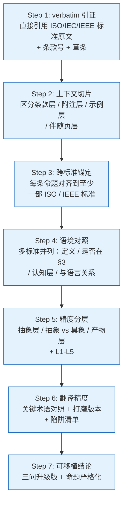

### 10.2 三问升级版（写作 / 评审通用）

#### 三问基础版（v1）

1. 这是哪部标准的哪个条款？
2. 该标准的 §3 Terms and definitions 里**有没有**定义这个词？
3. 如果没定义，是按"通用语意"使用吗？还是有隐含的领域定义？

#### 三问限定版（v2）

1. 这东西是 **system 的**、**architecture 的**、还是 **environment 的**？（限定词）
2. 这东西处于**抽象 / 具象 / 产物**哪一层？（层级）
3. 这东西**与设计/演化相关**吗？**是 fundamental 的吗**？（筛选条件）

#### 三问精度版（v3）

1. 这东西是**性质（nature）**还是**构件（component）**还是**产物（product）**？
2. 它位于**抽象层（architecture）**还是**载体层**还是**产物层（AD）**？
3. **能不能列成清单？**（决定写作时是命题、定义文本还是 AD 集合）

#### 三问升级版（v4，本研究终版）

1. **主体在哪层？** EoI（含 system/enterprise/data/process/business...）vs architecture vs AD
2. **处于哪个 aspect？** functional / structural / informational / behavioral
3. **站在哪个 perspective？** owner / designer / builder / operator / developer
4. **遵循哪个 governing principle？** realization / evolution / life cycle processes

> **〔划界〕** 本节三问／四问只定位**词**（哪部标准、§3 有无定义、哪一层、哪个 aspect／perspective）；判**件**（清单准入／需求去留／视图准入／组件准入／实体准入）的五张准入**主家在 48 号 §2.11**——**本报告只作术语对照，不另立一套**，两处不可互相替代。

### 10.3 精度辨析的常见陷阱谱

| 陷阱类型 | 实例 | 反模式 |
|---|---|---|
| **同形异义（homonym）** | concept、property 在 4 个 ISO 标准 | 不引条款号就讨论 → 必然撞语义混淆 |
| **抽象 vs 具象** | "架构定义"是清单 | 把"性质"读成"构件" |
| **动名词混用** | defining（动）vs definition（名） | "对架构的定义"歧义大 |
| **限定词错位** | "系统 vs 架构" | "**系统的**基本概念"被读成"**架构的**基本概念" |
| **包含 vs 等同** | AD = definition | AD ⊇ definition，但 AD ≠ definition |
| **概念 vs 动作** | concept vs perceiving | 把"被感知"压成"被描述" |
| **时代化版本漂移** | 仅看 2022 不看 2011 | "concepts or properties" 哲学内涵消失 |
| **翻译精度陷阱** | governing 译成"指导" | 失去 governance 含义 |
| **主语代换不察觉** | system → entity（2022 修订） | 还在用"system 架构"措辞，数据 / 业务架构找不到锚 |

### 10.4 示范：一个词怎么走完四档定位

> （企业名与数值均为**示意**，凡未定者标〈待定〉。做法可核，数值不可引。）

**取 `aspect` 一词走一遍**——它既是本报告"立为词条"的样板（§7.3），也是"有词条／无词条"这条判法最干净的一例（§3.6.1）。下表示范的是**这一步怎么走**，不是这一步的结论：

| 步 | 走（本报告已有的路） | 落点 |
|---|---|---|
| ① 哪部标准的哪一条 | 42010:2022 §3.9（**正本可核**，库内正本 L299~L309） | §7.3 |
| ② 该标准 §3 有没有定义 | **有**——§3.9 就是词条，故此处**不能**说"按通用语意用" | §3.9 与 §3.6 判据对比 |
| ③ 断言档 | **档① 标准逐字**（`part of an entity's character or nature`） | §7.3 verbatim |
| ④ 性质标记 | **规范**（§3 词条属规范性条款）；其 Note 1／Note 2 为**资料性** | §7.3 Note 1／2 |
| ⑤ 跨标准对照 | 与 `concern`（§3.10）**多对多**；与 `characteristic`（ISO 9000 §3.10.1）**不同词**，不可互译 | §7.3 表、§9.5 译名表 |

> **三问反向验**（48 号 §8.12 原式：三问都答得出，才叫实例化过；有一问答不出，说明某处还是"画上去的"）：
> ① **凭什么算**——事实依据在 42010:2022 §3.9，**库内正本逐字可核**（`ISO_IEC_IEEE 42010 2023.md` L299~L309），不是二手转引；
> ② **换个人凭什么还认**——断言档（档① 标准逐字）与性质（§3 词条＝**规范**；其 Note 1／Note 2＝**资料性**）都已写在表里，换一个人照表读，读出的仍是同一个意思；
> ③ **值谁给的**——`part of an entity's character or nature` 出自 **ISO/IEC/IEEE 42010:2022**（不是 2011、更不是配套页）；2011 口径的旧派名只作历史对照（§5.4.2）。

> **与结论互指**：这一张表走完，"同名不等于同物"就不再是口号——`aspect` 有 §3 词条、`concept` 没有（§3.6 正本条录十九条），这正是 **§3.6.1**（A 级）与台账 **K22** 所断的那件事。

---

## 11. 主要发现与启示

### 11.1 主要发现（10 条）

1. **"概念"的权威 ISO 定义锁定在 ISO 1087:2019 §3.2.7**——"unit of knowledge created by a unique combination of characteristics"。这是术语学严谨定义；跨标准使用时是同形异义。

2. **"属性"的权威 ISO 定义锁定在 ISO 1087:2019 §3.1.3**——"feature of an object"。但跨标准有四语境：术语学（ISO 1087）/ 质量（ISO 9000 characteristic）/ IT 数据库（ISO/IEC 2382 attribute）/ 架构（42010 fundamental property）。

3. **42010 §3 没有定义 "concept" 和 "property"**——按 ISO/IEC Directives Part 2 规则，以"普遍接受含义"使用。在 §3.2 中 "concepts" ≈ idea / notion（通用英语），"properties" ≈ system's objective features。

4. **"concepts or properties" 是哲学兼容设计**——同时容纳 Conception 派（主观构思）与 Perception 派（客观感知），"without prejudice" 工作组表态。这是 2011 版相对 1471:2000 的关键修订。

5. **architecture 措辞演变时间线**：1996 Hilliard "conception" → 1471:2000 "organization"（保守化）→ 42010:2011 "concepts or properties"（重打开）→ 42010:2022 "entity + governing principles"（进一步抽象化 + 主体扩域）。

6. **42010:2022 三处关键修订**：① system → entity (EoI) §3.12 主体扩域；② principles → governing principles 措辞与句法改（"升为定义句第二块"属〔读法〕）；③ **aspect §3.9 与 stakeholder perspective §3.18 立为词条**（两个概念 **2011 版即已引入**，本版只是定义并加以描述——Foreword 逐字见 §5.5 表，**不是"2022 新增"**）。

7. **aspect（§3.9）直接呼应"基本概念+属性清单"**——architecture 的 concepts/properties 按 aspect 分块呈现（functional / structural / informational / behavioral），是 2022 推荐的清单化定义结构。

8. **stakeholder perspective（§3.18）立为 AD 元素**——把「按角色形成认知」转为 AD 必须识别的元素之一，是**关切的一个来源**（30 号 §3.5）。

9. **AD 是工作产品（42010:2022 §3.3）；其元素（AD element）按 42010:2022 §3.4 Note 1（资料性、原文作 *include* 故非穷举）至少含 11 类**，§5.2.9 另含 legend／architecture decision／architecture rationale 及视角与模型种类引入的构造——definition 不在其中，单单作为 stakeholders/concerns/aspects 文本片段出现。AD ⊋ definition。

10. **用户的"V3 译本"是当前中文社区精度最高的 42010:2022 译文**——保留 entity、governing、life cycle processes 等关键术语的 ISO 体系一致译法。

### 11.2 对 AOS 项目的方法论启示

#### (1) 术语锁定

AOS 文档凡涉及 concept / property / architecture / AD 四个术语，必须：
- 标明 ISO 标准条款号
- 区分 ISO 1087（术语学）vs 42010（架构）vs ISO 9000（质量）vs ISO/IEC 2382（IT）
- 不能跨标准混用

#### (2) 架构定义的可清单化

AOS 写"X 的架构定义"时按 L1-L5 五层框架：

| 层 | 写作规范 |
|---|---|
| L1 抽象命题 | 一句话（参考 V3 译本，不超 30 词） |
| L2 definition 集 | ISO 1087 §3.3.1 风格——上位概念 + delimiting characteristic |
| L3 概念+属性清单 | 按**方面体**（aspect）分块（functional / structural / informational / behavioral） |
| L4a 原则 | governing principles（有约束力的原则）——即第三张"许可性原则清单" |
| L4b 对应关系 | correspondences（对应关系）／correspondence methods（对应方法）——**描述层元件，不是架构内容** |
| L5 AD | 工作产品（42010:2022 §3.3）；其元素按 **42010:2022 §3.4 Note 1（资料性，非穷举）** 至少 11 类，§5.2.9 另列 legend／decision／rationale——显式覆盖 stakeholders / concerns / stakeholder perspectives / aspects / architecture viewpoints / model kinds / correspondences |

#### (3) 学术评审与文档写作共用同一精度模板

- **评审**：用三问升级版检查术语是否锁定到 ISO 条款；
- **写作**：用五层框架组织材料，避免混淆"抽象命题 / 定义文本 / 清单 / AD"；
- **翻译**：用 5-6 步循环打磨关键术语。

#### (4) 评审待办

- review vs verification vs validation 的三角对照**已交付**——见 **23 号《判据体系研究报告——从验证确认到治理的判据阶梯》第 10 章**（锚定 ISO 9000:2026 §3.11.12、§3.11.14、§3.11.2 ＋ IEEE 1028-2008，给出三处硬差别：`determination` vs `confirmation`／不要求客观证据 vs 必须客观证据／判适宜性·充分性·有效性 vs 判符合性）。本研究为其提供了**精度辨析通用模板**——可直接套用。

---

## 12. 引用标准清单（完整 verbatim 引证表）

> **本表标注"本报告地位"列**——明确区分 ★ 最新现行 / 【历史对照】/ 【配套说明】，便于使用者快速定位哪些是主分析依据、哪些是辅助对照。
>
> **核心原则**：报告全部主体分析以带 ★ 的最新现行标准为依据；带【历史对照】标签的仅用于说明措辞演变；带【配套说明】的为标准配套解读页，不是标准正文但同等权威。
>
> **〔档位纪律（48 号文首三条纪律；对齐清单 B23）〕** 本表的「★ 最新现行／【历史对照】／【配套说明】」三档**只管标准的新旧，不管断言的性质**——它**不是**引用档位。凡引用另须两标：① **性质**——该条是**规范**（`shall`／`should`）还是**资料性**（`NOTE`／附录／*Informative Annex*）；② **断言档**——**档① 标准逐字**／**档② 标准可支持的读法**／**档③ 按定义句作的举例**／**档④ 本报告定性**。凡标〔本报告读法〕处，**不得以标准规定口气行文**；凡拿资料性原话当合规判据，即为错。标"**库外·不可核**"者，库内无正本（清单见 §1.3 表下），只可作词义对照。
>
> **2026-09-21 第六轮补行说明（依 24 号附录 A）**：本轮按 22 号表体例**补入第 27~34 行**，所补皆为 24 号《架构与设计边界研究报告》**附录 A 术语定译表**已收、而本报告前版未收的词条（元素三层、架构实体、合规实现、规定需求、解空间／解类、sufficient to enable／implement-to level、artefact）——**原 1~26 行未改动，仅第 26 行说明行随改**。补行一律写明出处与"⚠ 易误读"提示；其中 42020:2019 §3.3 Note 1 一行标注为**注释级、无术语地位**。

| 序号 | 标准号 | 引用条款 | verbatim 引证（中文 / 英文） | 本报告使用章节 | **本报告地位** |
|---|---|---|---|---|---|
| 1 | ISO 1087:2019 §3.2.7 | concept | "unit of knowledge created by a unique combination of characteristics / 由特性的独特组合而形成的知识单元" | 3.1 | **★ 最新现行·库外不可核**（术语学语境 concept 定义；库内无 1087 正本，只可作词义对照） |
| 2 | ISO 1087:2019 §3.1.3 | property | "feature of an object / 对象的特征" | 4.1 | **★ 最新现行·库外不可核**（术语学语境 property 定义） |
| 3 | ISO 1087:2019 §3.2.1 | characteristic | "abstraction of a property / 属性的抽象" | 3.2(3), 4.5 | **★ 最新现行·库外不可核**（property→characteristic→concept 抽象链） |
| 4 | ISO 1087:2019 §3.3.1 | definition | "representation of a concept by a descriptive phrase" | 6.3, 8.4 | **★ 最新现行·库外不可核**（definition 严格定义） |
| 5 | ISO 9000:**2026** §3.10.1 | characteristic | "distinguishing feature / 区别性特征" | 4.2 | **★ 最新现行**（质量管理语境 characteristic；**两版同号**） |
| 6 | **ISO/IEC 38500:2024 §3.3** | governance | 「治理」 | 7.2 | **★ 最新现行·库外不可核**（**governance 名词**译法锚定；库内无 38500 正本。**2026-09-21 更正**——原挂 ISO 9000:2015 §3.5.1 双重失实：`governance` 本非 ISO 9000 术语，§3.5.1 实为 system。定语位 governing 见「管控原则」） |
| 7 | ISO/IEC 2382-17:1999 §17.02.12 | attribute | "A named property of an entity / 实体的命名属性" | 4.3 | **★ 现行·库外不可核**（IT/数据库 attribute 定义） |
| 8 | ISO/IEC 2382-31:2001 | concept（AI 部分） | "abstract entity for determining category membership" | 3.5 | **★ 现行·库外不可核**（AI 语境 concept 定义） |
| 9 | ISO/IEC/IEEE 42010:**2022** §3.2 | architecture | "fundamental concepts or properties of an entity in its environment and governing principles for the realization and evolution of this entity and its related life cycle processes" | 5.1, 5.2.3, 5.3, 5.4, 5.5, 9.1, 9.2 | **★ 最新现行**（主体分析锚点） |
| 10 | ISO/IEC/IEEE 42010:**2022** §3.3 | AD | "work product used to express an architecture" + Note 1, Note 2 | 6.1, 6.2 | **★ 最新现行**（AD 定义主体） |
| 11 | ISO/IEC/IEEE 42010:**2022** §3.4 **Note 1** | AD elements（**资料性**；非穷举） | *AD elements* **include** *stakeholders, concerns, …*（中译：AD 元素**包括**相关方、关切……） | 6.2 | **★ 现行·资料性注**（档①逐字／性质：NOTE；§5.2.9 另有 legend、architecture decision、architecture rationale 等，故**不得**读作闭集） |
| 12 | ISO/IEC/IEEE 42010:**2022** §3.1 | architecting | "conceiving, defining, expressing, documenting, communicating, certifying proper implementation of, maintaining and improving an architecture…" | 6.4 | **★ 最新现行**（architecting 7 步动作） |
| 13 | ISO/IEC/IEEE 42010:**2022** §3.9 | aspect | "part of an entity's character or nature" | 7.3 | **★ 最新现行**（清单化切块工具） |
| 14 | ISO/IEC/IEEE 42010:**2022** §3.12 | entity of interest | "subject of an architecture description" | 7.1 | **★ 最新现行**（EoI 主体扩域） |
| 15 | ISO/IEC/IEEE 42010:**2022** §3.18 | stakeholder perspective | "way of thinking about an entity of interest, especially as it relates to concerns" | 7.4 | **★ 最新现行**（立为 AD 元素；关切的一个来源） |
| 16 | ISO/IEC/IEEE 42010:2011 §3.2 | architecture | "fundamental concepts or properties of a system in its environment embodied in its elements, relationships, and in the principles of its design and evolution" | 5.2.2, 9.1（对照） | **【历史对照】**（仅用于措辞演变对照） |
| 17 | ISO/IEC/IEEE 42010:2011 §3.3 | AD | "work product used to express an architecture" | 6.1（对照） | **【历史对照】**（2022 已加 Note 1, Note 2） |
| 18 | ISO/IEC/IEEE 42010:2011 §4.2.1 | footnote | "Architecture descriptions, not architectures, are the subject of this International Standard… an architecture is abstract, consisting of concepts and properties." | 5.4.2 | **【历史对照】**（哲学立场与 2022 一致，作为 Conception/Perception 出处） |
| 19 | IEEE 1471:2000 | architecture | "the fundamental organization of a system embodied in its components…" | 5.2.1 | **【历史对照】**（仅用于措辞演变对照） |
| 20 | iso-architecture.org / "Defining architecture" | Companion page | "The disjunction, concepts or properties, was chosen to support two different philosophies without prejudice…" | 5.4.2 | **【配套说明】**（标准配套解读页，Hilliard 维护；哲学立场与 2022 一致） |
| 21 | Hilliard 1996 | 学术前身 | "the highest level conception of a system in its environment" | 5.1 | **【历史对照】**（仅用于措辞演变对照） |
| 22 | **GB/T 45630-2025, 3.2** | architecture | "实体在其环境中的基础概念或属性，以及该实体及其相关生存周期过程的实现和演化的管控原则" | 5.1, 9.1, 9.2 | **★ 最新现行·库外不可核**（中文术语定名依据；等同采用 IDT；库内无国标正本，字面待以正式文本复核） |
| 23 | **GB/T 45630-2025, 3.3** | architecture description | "用于表达架构的工作产品"（中文字面待以正式文本复核） | 6.1 | **★ 最新现行·库外不可核**（中文定名依据；库内无国标正本） |
| 24 | ISO/IEC/IEEE 42010:**2022** §3.8 | architecture viewpoint | *set of conventions for the creation, interpretation and use of an architecture view (3.7) to frame one or more concerns (3.10)*／用于创建、解释和使用架构视图以框定一项或多项关切的一组惯例〔2026-09-24 依正本更正：**定义句无属概念**——原印「（属概念：工作产品）」**撤销**；该标准凡需属概念必明写（§3.3、§3.7）〕 | 5.5, 6.2 | **★ 最新现行**（架构视角定名依据） |
| 25 | ISO/IEC/IEEE 42010:**2022** **§5.2.9** | architecture decision／architecture rationale | *The AD elements include occurrences of the following architectural concepts: … legend, architecture view component, architecture decision, architecture rationale …*（中译：AD 元素包括下列架构概念的实例：……图例、视图组件、架构决策、架构理由……） | 5.5, 6.2, 7.2 | **★ 最新现行**（§5.2.9 明列为 AD 元素；与 §3.4 Note 1 的 *include* 清单相容）〔**存疑**：Foreword 的 *main changes* **未**列此项为版次变更，2011 全文**库外·不可核**——**勿写"2022 新增"**；另见 30 号 §3.7、§D.2〕 |
| 26 | **本报告 canonical 句式**（自撰正文） | architecture | "实体在其环境中的**基本**概念或属性，以及该实体及其相关**生存周期**过程的实现和演化的**管控原则**（governing principles）" | 5.1, 9.2 | **★ 现行口径**（用户 2026-09-21 定：除 fundamental 取「基本」外，其余术语一律按 GB/T 45630-2025） |
| 27 | ISO/IEC/IEEE 42020:2019 §3.3 Note 1 | 实体侧的 components／relationships（**架构可以关乎**的对象；旧工作名"架构构成物"已废止） | "the fundamental concepts or properties of the architecture entity are **usually intended to be embodied in** the entity's **components**, the **relationships between components**, and the **relationships between the entity and its environment**" | 5.2.2, 6.2A, 7.2, 8.2 | **★ 现行**（**架构层**所指；⚠ **注释级，无术语地位**，不得升为术语；即 2011 定义句 embodied-in 句的**搬家＋降调**——依 24 号 §4.5.2） |
| 28 | ISO/IEC/IEEE 42020:2019 §3.6 | architecture entity（架构实体） | "the thing being considered, described, discussed or otherwise addressed during the architecting effort" | 6.2A | **★ 现行**（⚠ **＝"被架构的那个事物"**，≈ 42010:2022 的 entity of interest；**不是**"架构的构成物"——依 24 号 §4.5.1、§4.4.2。42020:2019 已于 2026-01-08 进入 stage 90.92 修订，措辞待核——依 24 号 §13.5、附录 D 第 2 项） |
| 29 | ISO/IEC/IEEE 15288:2023 **§3.47** | system element | *discrete part of a system (3.46) that can be implemented to fulfil specified requirements (3.36)* | 6.2A, 8.2 | **★ 现行**（**实现层**离散部件；与 AD element **隔着两层**，只有"表达关系"——依 24 号 §4.1、§4.4.1、§4.6）〔2026-09-24 依库内正本更正：**条款号由 §3.46 改 §3.47**（正本 §3.46 是 `system`；2023 版新增 quality assurance 一条，其后条目整体后移一位）；**原引句 *member of a set of elements that constitutes a system* 在正本全文零命中，系 2015 版措辞**。另补一条正本依据：**15288:2023 §5.9 *Concept and system definition* 末段**明写 *Note that an architecture entity (an entity being architected or one subject to the system architecture definition process) and a system element (a discrete part of a system that fulfils specified requirements) represent two different notions.*（中译：注意，架构实体与系统元素代表两个不同的概念；库内正本 §5.9）。本行原附「`artefact` 与 `work product` 两个词、不可互译」的联动说明**已按正本更正**，见下行第 34 行〕 |
| 30 | ISO/IEC/IEEE 15288:2023 §3.13 | compliant implementation（合规实现） | 合规对象是 **architecture**（*compliant implementation **of the architecture***），**不是** architecture description | 6.4 | **★ 现行**（⚠ **两个"合规"必须分开**：本行判"实现是否合规于架构"；**42010:2022 §4 Conformance** 判"这份 AD 合不合 42010 的要求"——用后者判前者即退化为文档格式检查，依 24 号 §3.1、§6.11.1） |
| 31 | ISO 9000:2026 §3.5.1 Note 2 | specified requirement（规定需求） | *specified ≡ stated*（"规定"与"明示"同义） | 6.4, 7.2 | **★ 最新现行**（明示化是合规依据的分水岭：停留在 generally implied 的架构约束**不可作合规依据**——依 24 号 §5.3；requirement 三支之**架构基线走 obligatory、架构原则走 generally implied**——依 24 号 §3.2、附录 B） |
| 32 | ISO/IEC/IEEE 15288:2023 §6.4.1（BMA） | solution space／solution classes | 解空间／**解类** | 6.4 | **★ 现行**（⚠ **替代"系统方案"这一非规范术语**——依 24 号 §2.3.2、附录 A） |
| 33 | ISO/IEC/IEEE 15288:2023 **§3.13**；SEBoK | **sufficiently complete to support**／implement-to level | "**足够完整到足以支撑**"（*sufficiently complete to support*）／"实现级"（implement-to level） | 6.4 | **★ 现行**（⚠ **design 的职责止于 *sufficiently complete to support***，**合规的承担者是 implementation**；设计描述（DD）只是"**实现之前的可判定代理**"，故 **DD 只能出具"条件性合规"**——依 24 号 §3.3、§6.7、附录 B）〔2026-09-24 依库内正本更正：**原印的 `sufficient to enable` 在 15288:2023 全文零命中**，正本 §3.13 作 *…that is **sufficiently complete to support** a compliant implementation of the architecture*；`implement-to level` 见 **§6.4.5.1 Note 1**〕 |
| 34 | ISO/IEC/IEEE 15288:2023 §3.6 | artefact（人工制品） | *work **product** (3.32) that is produced and used during a project to capture and convey information*（AD 与 DD 在同一 EXAMPLE 中并列） | 8.4 | **★ 现行**（⚠ **两册的属概念关系须按正本读**：**15288 侧 artefact ⊆ work product**（artefact 的定义句即以 work product 为属概念）；**42010 侧 work product ⊆ artifact**（42010:2022 §3.3 Note 1 逐字：*A work product is an **artifact** produced by a process*）——**两册互为属概念、方向相反**。故「两个词、**不可互译**」的旧断言**无据**，2026-09-24 依库内正本更正。**项目口径仍作分流译名**（指 15288 侧写「人工制品」、指 42010 侧写「工作产品」），但**理由改为「所属标准不同、属概念层级不同」**） |

> **判据侧术语见 [23 号](23-判据体系研究报告-从验证确认到治理的判据阶梯.md) 附录 A（2026-09-21 第十轮·依 23 号对齐）**：本表第 1~34 行皆为本报告正文**实际引用并使用**的条款，故 23 号附录 A 已定译的**判据侧术语不逐行并入**（并入会使本表收入本报告从未使用的词条，且与 23 号重复、易失同步）。读者若需这些词，以 23 号为准，其中两条尤须防误读：
> - `auditee`｜**受审核方**｜ISO 9000:2026 **§3.12.5**，引文是 *organization being audited*（已核，2026 中英对照版 §3.12.5）——⚠️ **旧稿所引 "as a whole or parts thereof" 系 ISO 19011 的措辞，不是 §3.12.5 的原文**（23 号附录 A、§6.4）。〔2026-09-24 更正：定名「受审核方」，非「被审核方」；同族两项——**`inspection` 作「检验」**（§3.11.11，2015 §3.11.7），**`confirmation` 作「证实」**（「确认」专供 validation），`3.11` 组名作「**与确定有关的术语**」〕
> - `inspection`｜**检查／审查**｜ISO 9000:2026 **§3.11.11** *determination of conformity to specified requirements*（其注 1：检验结果表明合格时可作 verification 的客观证据）——⚠️ 与 **IEEE 1028 的 inspection**（软件工作产品的**可视化检查**）**同名异义**，参照与对象都不同、外延不重合（23 号 §10.6）。
>
> 〔若后续轮次本报告正文需正面使用这两个词（如判"架构的检验／审核"），则按 23 号译名在本表补行。〕

> **号形说明**：本表「引用条款」列各条款号均为其「标准号」列所标标准之条款，故列内只写 `§x.y`；「verbatim 引证」列中英文与中译之间用「／」分隔（**不是条款连接符**），故不改作「、§」。

---

## 附录 A 结论台账（一视同仁：每条结论凭什么）

**读法**：级 A＝承重／反直觉（四段齐全）；级 B＝条款直引可支持（给条款即可）；级 C＝本报告读法或方法（标〔读法〕＋所读条款＋边界）。"论证"列给的是四段所在节；写"节内表"者，该节的表本身即依据＋反证的逐行展开。

| # | 结论（一句） | 级 | 依据 | 论证 |
|---|---|---|---|---|
| K01 | concept 的权威定义锚在 ISO 1087:2019 §3.2.7（知识单元）——**库外·不可核**，只作词义对照 | B | ISO 1087:2019 §3.2.7（库外） | §3.1、§3.4 |
| K02 | 42010:2022 §3 既无 `concept` 也无 `property` 条 | B | 42010:2022 §3.1~§3.19（正本条录） | §3.6（正本条录十九条） |
| K03 | 未在 §3 定义的词按"普遍接受的含义"使用，故不得回读为其他标准的严格定义 | C | ISO/IEC Directives Part 2；〔读法〕 | §3.6、§3.9 |
| K04 | concept 在术语学／架构／IT-AI 三语境同名异义，须逐一定位 | C | 22 号 §3.5 节内表（四语境对照） | §3.5、§3.9 |
| K05 | property＝ISO 1087:2019 §3.1.3 *feature of an object*，**无 inherent 限定** | B | ISO 1087:2019 §3.1.3（库外） | §4.1 |
| K06 | ISO 9000:2026 §3.10.1 的 characteristic 是质量管理语境的特殊化 | B | ISO 9000:2026 §3.10.1（库内可核） | §4.2、§4.4 |
| K07 | attribute＝ISO/IEC 2382-17:1999 §17.02.12，是 property 的"命名化"侧支 | B | 2382-17:1999 §17.02.12（库外） | §4.3、§4.5 |
| K08 | 三层抽象链：property→characteristic→concept | C | ISO 1087:2019 §3.1.3、§3.2.1、§3.2.7（库外）；〔读法〕链条归拢 | §4.5 |
| K09 | 42010 的 `properties` 不得以 ISO 9000 的 `inherent` 限定回读 | C | 42010:2022 §3.2（未用该限定）；附录 A.2（资料性） | §4.6 |
| K10 | "concepts or properties" 是**哲学兼容设计**（*without prejudice*），两哲学并列不选边 | B | 42010:2022 附录 A.2（**资料性**）逐字 L1297~1301；正本派名 *Architecture as concept／as property* | §5.4、§5.6 |
| K11 | **embodied-in 只是一条资料性惯例说明，不作定义句推论；弱读依据在过程条款** | **A** | 42020:2019 §3.3 Note 1（NOTE）；42010:2022 §3.2 [SOURCE]（note 已删）；42020:2019 §10.4.4 e)；15288:2023 §6.4.5.3 注 5 | **§5.2.2.1** |
| K12 | architecture 的 2022 定义＝实体在其环境中的基本概念或属性 ＋ 实现与演化的管控原则 | B | 42010:2022 §3.2；42020:2019 §3.3（来源标注） | §5.1、§9.2 |
| K13 | **aspect 与 stakeholder perspective 是"2022 立为词条"，不是"2022 新增概念"** | **A** | 42010:2022 Foreword 逐字（*already introduced in the 2011 edition*）；§3.9；§3.18；§3.4 Note 1（资料性） | **§5.5.1** |
| K14 | AD＝工作产品；其元素按 **§3.4 Note 1（资料性、*include* 非穷举）** 至少 11 类，§5.2.9 另列 legend／decision／rationale | B | 42010:2022 §3.3、§3.4 Note 1~2、§5.2.9 | §6.2 |
| K15 | AD element／实体侧 components 与 relationships／system element 三层不可串 | B | 42010:2022 §3.4；42020:2019 §3.3 Note 1、§3.6；15288:2023 §3.47、§5.9 | §6.2A 节内表 |
| K16 | AD ⊇ definition；definition 不是 AD 的元素类别 | C | 42010:2022 §3.3、§3.4 Note 1；ISO 1087:2019 §3.3.1（库外） | §6.3、§8.4 |
| K17 | architecting（§3.1）是正式词条，`defining` 是七步之一 → "用清单定义架构"有标准内的合法落点 | B | 42010:2022 §3.1 逐字 | §6.4 |
| K18 | L1~L5 的层轴是"能不能列成清单"，**不是**架构内容的分类，也不表架构占一个层位 | C | 42010:2022 §3.2（内容只两样）；42 号 A4；〔读法〕 | §8.2 层轴声明 |
| K19 | 落到产出是**三张清单且有序**：概念 → 构成性属性 → 许可性原则 | C | 〔读法〕42 号 §4.2~§5.6；42010:2022 §3.2 | §8.2 按语、§11.2(2) |
| K20 | 译名分工：定语 `governing`＝管控原则／名词 `governance`＝治理／关系 `governs`＝治理·管辖，三槽不可串 | C | GB/T 45630-2025, 3.2（库外）；42010:2022 §3.2；30 号 §5.5；29 号 | §9.4 打磨③、§9.5 |
| K21 | 同一术语在多部标准出现时须**逐一定位、不混用**（先确认 §3 有无定义） | C | 〔读法〕 | §9.1 判定原则、§11.2(1) |
| K22 | **42010 的 concepts／properties 不是 ISO 1087 的同名术语（同名同形、不同术语位）** | **A** | 42010:2022 §3.1~§3.19（无此两条）；ISO 1087 §3.2.7、§3.1.3（库外）；ISO/IEC Directives Part 2 | **§3.6.1** |
| K23 | 两哲学派名以 42010:2022 附录 A.2 为正本；Conception／Perception 属 2011 口径二手派名 | B | 42010:2022 附录 A.2 逐字；iso-architecture.org 配套页（【配套说明·库外】） | §5.4 |
| K24 | 引用纪律：本表"最新现行／历史对照／配套说明"三档只管新旧，另须标**性质**（规范／资料性）与**断言档**（逐字／读法／举例／定性） | C | 48 号**文首「三条纪律」**；对齐清单 B23 | §12 表前〔档位纪律〕 |

**A 级共 3 条**（K11、K13、K22），**全部四段齐全，无"待补"**。

---

## 13. 附录：逐轮要点摘要

| 轮次 | 用户问 | 本研究核心回答 | 命中章节 |
|---|---|---|---|
| **轮 1** | concept 的 ISO 权威定义 | ISO 1087:2019 §3.2.7 unit of knowledge created by a unique combination of characteristics；附版本谱系 + 三关键点解读 | 3 |
| **轮 2** | 42010 §3.2 中的"概念"是哪个 | 42010 §3 没定义 concept；按通用语意使用，不是 ISO 1087 严谨意义 | 3.5-3.7 |
| **轮 3** | 42010 concept vs ISO/IEC 2382 concept | 不一致；conception 偏 idea、2382 偏 class-membership 抽象体；附 ISO 1087 自警 Note 2 | 3.5 |
| **轮 4** | 42010 修订动机 / LEAD 引文 | 出处 = iso-architecture.org 配套页（LEAD D4.7 文末引用）；verbatim "to accommodate the broad range of things…" | 3.8 |
| **轮 5** | "概念在脑中、属性被描述" | 对一半；是 2×2 矩阵错了位；property 被"感知"才进入架构，"描述"是 AD 动作 | 8.1 |
| **轮 6** | AD 是对架构的具体定义吗 | 不能等同；AD ⊋ definition（AD 是 11 类 elements 集合）；附 definition ⊆ description、AD vs definition 精度辨析 | 6.3, 8.4 |
| **轮 7** | 架构定义是基本概念+属性清单吗 | 架构是抽象本体（命题），清单化可在 L3 层（按 aspect 分块）；不能把"abstract"读成"list" | 5.3, 8.2 |
| **轮 8** | 清单化有实际意义吗 | 有；用户命题住 L3 层；附 L1-L5 五层框架 | 8.2, 8.3 |
| **轮 9** | 系统的基本概念+属性清单是 system 架构的定义吗 | 不完全成立；system vs architecture 限定词差异；附漏斗图、严格化版本 V0-V3 | 8.3 |
| **轮 10** | 用 42010:2022 再分析 | 三个结构性变化：system→entity、principles 升格、aspect + stakeholder perspective 新增；aspect 直接呼应清单化 | 7 |
| **轮 11** | 翻译 42010 定义 | 给出三版本译文对比；pkuair 版本最规范；本研究 V3 是精炼版 | 9.3 |
| **轮 12** | 用户译文 V0 | 给出三个打磨点：fundamental 合并、补 for 介词、之→用于 | 9.4 |
| **轮 13** | 用户译文 V3 | V3 把上轮三处打磨全接住；governing 仍选"治理"——与 ISO 9000:2015 governance 译法一致〔2026-09-21 收口：改「管控原则」，「治理」留给 governance／governs；另：`governance` 本非 ISO 9000 术语——2026 全文仅 2 处散文用词，其权威在 **ISO/IEC 38500:2024 §3.3**〕 | 9.4 |
| **轮 14** | property 的权威定义 | 四语境：ISO 1087 §3.1.3 / ISO 9000 §3.10.1 characteristic / ISO/IEC 2382-17 attribute / 42010 §3（未定义） | 4 |
| **轮 15** | property → characteristic → concept | 三层抽象链；附 Mermaid 图 | 4.5 |
| **轮 16** | 42010 properties 严格定位 | ≈ ISO 9000 quality characteristic 在架构语境的精炼版 | 4.6 |
| **轮 17** | 整合研究报告（22 号） | 即本文件 | 全文 |

---

## 14. 报告元数据

- **标题**：架构、概念、属性研究报告—术语权威定义与对照分析
- **编号**：22
- **汇编日期**：2026-09-04
- **文档版本**：v1.7（创建 2026-09-04；v1.2 对齐 30 号；v1.3 按用户裁定统一术语，2026-09-21；v1.4 依 29 号对齐架构治理口径，2026-09-21；v1.5 依 27 号对齐 ISO 9000 版本依据，2026-09-21；v1.6 第六轮·依 24 号对齐元素三层与凭据链术语，2026-09-21；**v1.7 第十轮·依 23 号对齐——§5.1 互参补充分性辨异指针、§12 表下补判据侧术语指针行、三处「review vs verification vs validation 对照未交付」欠项结清，2026-09-21**）→ **v1.8（2026-09-24 依库内五份标准正本核改 `system element` 号（§3.46→§3.47）与引文、「artefact 不可互译」断言撤销）** → **v1.9（2026-10-11 依用户裁定清除 2011 版"元素与关系"痕迹：全库废止工作名「架构构成物」；properties 行去 embodied-in 读法；§8.2 L4 槽位与 Mermaid 对齐"关系与原则"；澄清问题与引证表 27 行同步；system→entity 两处。依据 42010:2022 §3.2 与 §5.2.2）** → **v1.10（2026-10-12「以 35 号为基准的全库对齐」轮：治理论口径行定义权改正（TOGAF→**42020:2019 附录 G.1 资料性＋第 6 章**）；§2.1 架构行「没有形态、交不出去」→「**无形而抽象**」）**〔**勘误（2026-10-12）**：本条此前把 **2026-10-11 那一轮也记作 v1.8**，与头部版本行／修订记录表的「v1.8＝2026-09-24 正本核改」**撞号**——今按"一轮一号"重排：**v1.9＝2026-10-11、v1.10＝2026-10-12 本轮**。〕 → **v1.13（2026-11-01「以 46 号 v3.0 为基准的全库对齐」轮，八处改动见下修订记录表；〔存疑留痕〕v1.11／v1.12 两轮仅记于头部版本行，§14 本条与本修订记录表缺记，本轮未补其内容）** → **v1.14（2026-10-31「以 46 号 v3.3 为基准」的体例对齐轮，改动见下修订记录表 v1.14 行）** → **v1.15（2026-11-06 依 48 号 v3.25 对齐，改动见下修订记录表 v1.15 行）** → **v1.17（2026-11-11 随 46 号 v2.6（八条主结论）严格对齐，十处改动见下修订记录表 v1.17 行；v1.16 的改动见头部版本行与 §7.1 边界注）**
- **架构治理依据**：治理本体以 28 号为准，架构治理（architecture governance）的定义、目的、对象、输入与输出、责任主体与机制一律以 **29 号《架构治理研究报告——从标准依据到责任主体》**为准（见开篇「治理口径」行）
- **关联 AOS 文档**：
  - `00-generalspec/`（仓库通用规范区）
  - `00-系统工程相关研究报告/00-概念学习方法论研究报告-从压缩学习到知识掌握.md`（主线）
- **修订记录**：

| 版本 | 日期 | 说明 |
|---|---|---|
| **v1.17** | **2026-11-11** | **随 46 号 v2.6（八条主结论）严格对齐**（依据：46 号 §二、§2.5、§3.1、§3.3、§3.5、§3.9、§5.1~§5.4、§七、§八；42010:2022 §3.2、§3.3、§3.7、§3.8、§3.14、§3.19、§6.7、§6.8；15288:2023 §3.13、§3.47；42020:2019 §10.4.4 b) 注 1、§5.6）：**十处**——① **§0 `architecture` 行**补「**不是文件、不是图**」与「**一个实体一处架构**」（卡四）；② **§0 `architecture description` 行**补「**本质上是方案**」（内容＝要求·描述＝方案，46 号 §二，本书读法 C；卡一）；③ **§0 洞察 2** 补层轴护栏——L1~L5 的层轴是"能不能列成清单"，**不是粗细**（46 号 §2.5；卡一）；④ **§5.1 关键事实后**补〔识别〕段：架构定义的不是"它由什么组成"，是"它凭什么还是它"（走样检验；46 号 §七〔本书工作名〕；卡六）；⑤ **§6.1** 补「**它是方案，不是要求**」一段（卡一）；⑥ **§6.2A 末互参**补〔称名纠偏〕：本节三层（描述层／实体侧／实现层）与 46 号 §3.3 的位／设计元素／系统元素**不同轴**，**位不得称"设计元素"**（卡二）；⑦ **§6.5** 补〔容器归属〕段：架构／描述／视图／视角四个名字各在什么容器（视图＝信息部件、恰一视角治理、全体的投影不是系统的一块、不是图；"xx 架构"是名字不是容器）（卡四）；⑧ **§9.5A 说明／表头／号形说明**随补改（五行来源与"本书读法不因并入而升格为标准规定"的纪律、表头标注"末五行为 46 号对应节"、号形说明记"末五行标准名不省略"）；⑨ **§9.5A「要建模的实体与关系」行**改明其为**模型的单位**、其中实体那一半即**建模实体（位）**（卡二）；⑩ **§9.5A 补五行**：建模实体（位）／位·设计元素·系统元素三层／识别／常设／内容＝要求·描述＝方案（术语条与档位为主战场）。**未改**：全部节号与章节结构、术语对照结论、译名取舍、案例与数字、台账 K 号与条数（K01~K24 未动）、引证表 1~34 行、既有修订记录各行。 |
| **v1.15** | **2026-11-06** | **依 48 号 v3.25 对齐（表述层，结论不动）**：本号四处「三把尺」改按 48 号 §2.3 现口径表述——判据本体是**一支填句三槽**，概念／属性／原则只是它的**三种填法**（三把尺＝三种填法）；涉及 §〇 不做什么、§5.1 互参行、§5.2.2 体检提示两处。**未改**：全部节号、术语对照结论、引证表、台账；修订记录内「三把尺」为存史。 |
| **v1.14** | **2026-10-31** | **第二轮「以 46 号 v3.3（三级论证体例／结论台账／号形细则）为基准」的体例对齐轮**（依据：48 号 §0.5、附录 C、§3.2~§3.9、§12.1、§12.3；42010:2022 Foreword、附录 A.2（**资料性**）L1297~1301、§3.1~§3.19 条录、§3.4 Note 1~2、§3.9、§3.12、§3.18、§5.2.2、§5.2.9；42020:2019 §3.3 Note 1、§4.2 **NOTE 3**、§10.2 d)、§10.4.4 e)；15288:2023 §6.4.5.3 注 5）：**十四处**——① **新立「## 摘要」**（前言之后、第一章之前；末附台账指针行）；② **新立「## 附录 A 结论台账」**（K01~K24：**A 3／B 11／C 10**，读法行与统计行照 D2；不占节号、不动既有小节）；③ **补三条 A 级四段**：新增 **§3.6.1**（concepts／properties 非 ISO 1087 同名术语）、**§5.2.2.1**（体现只是一条惯例说明）、**§5.5.1**（aspect 与 stakeholder perspective 不是"2022 新增"）；④ **§5.4 换骨**为四小节（正本＝附录 A.2（**资料性**）逐字／历史对照＝2011 配套页＋2011 §4.2.1 脚注【配套说明·库外不可核】／两点边界／可视化），节题与 **§5.6 表栏名、§8.1 矩阵栏名**改用正本派名 *Architecture as concept／Architecture as property*，2011 口径派名 Conception／Perception 降括注；⑤ **§7 章题**「三处关键修订与**新概念引入**」→「的**三处结构性修订**（EoI／governing principles／两项词条化）」，§7.3、§7.4 节题补"（2011 已有其概念，见 §5.5 表 Foreword 逐字）"；⑥ **§3.6 证据一换正本**：改列 **42010:2022 §3.1~§3.19 十九条**（无 concept、无 property），原 2011 十行条录降为**证据一附【历史对照·库外不可核】**；⑦ **§0 architecture 行**去「没有形态、交不出去」（与同行「无形而抽象」相抵），改为「架构**无形而抽象**……**须经由其概念、属性与原则被理解**；它是**概念或属性**，不是形态」；⑧ **§6.2 与 §8.2 收拢**：correspondences 与 correspondence methods 合为第 ⑦ 类、Mermaid 同步并为 `COR` 一个节点，§8.2 的 11 类改一句指针"见 §6.2"；⑨ **§5.5 补第 13 行「架构视角的更新」**（一个视角治理一张或多张视图，Foreword 逐字）；⑩ **§5.1 三把尺**按 48 号 §2.3 逐字重写并补**「实质」术语登记**（42030:2019 §4.2 NOTE 3）、**§7.2** 补 governing principles 一条两向的口径行并按 **42010:2022 §3.4 Note 1** 改正 11 类出处；⑪ **新增 §10.4 范例**（示意声明行＋`aspect` 走法表五步＋三问反向验＋与结论互指，照 D3）；⑫ **§10.2 补划界句**（五张准入主家在 48 号 §2.11，本报告只作术语对照、不另立一套）；⑬ **新增 §9.5A 术语档位**（逐字取 48 号 §附录 C 的六行＋本号独有档位清单）；⑭ **A3 依据 ③ 两条英文引文补中译**；另补 **5 处指针**（§5.1→07 号 §8.4.1、§6.2→48 号 §9.25、§8.13→48 号 §9.24、§11.2→46 号 §12.1、§9.5A→48 号 §附录 C）。**号形**：正文补标准名 **10 处**，§3.5、§4.4、§12 三表下加**「号形说明」**，正文条款连接符已统一为「、§」。**未改**：既有全部节号（§3.6.1、§5.2.2.1、§5.5.1、§5.4.4 与附录 A 均为**新增号位**）、术语对照结论、四基准并摆的表格结构与列数、`关切`／`关切` 的译名取舍（裁 5：本轮只登记、不改词）、案例与数字、§5.3 与 §7.2 的 X／Z 记号、§5.4 旧派名的历史留痕。 |
| **v1.13** | **2026-11-01** | **「以 46 号（v3.0）为基准的全库对齐」轮**（依据：46 号 §3.2~§3.9、§4.1、§4.5、§12.3、§18；42010:2022 Foreword、§3.2、§3.3、§3.4 Note 1~2、§3.11、§5.2.9；42020:2019 §3.3 Note 1、§10.2 d)、§10.4.4 e)、§E.4.1；15288:2023 §5.9、§6.4.5.3；42030:2019 §4.2 注 3）：**八处**——① **§5.5 修订表整表重铸**（9 行 → 12 行）：逐行对 42010:2022 **Foreword 的 *main changes***，补入 AD element 定义化／correspondence 补注 1／model kind 扩义三行，正式立"aspect 与 stakeholder perspective 在 **2011 版即已引入**、2022 只是定义并描述"（Foreword 逐字），架构决策与理据一行撤去"新增"改标〔存疑〕；② **连带 6 处 "★ 2022 新增"**改为"2022 立为词条"（§5.5 两行、§6.2 第 3／4 项、§7.3、§7.4 节题、§11.1 发现 6），另有 §0 洞察 4、§1.3 表、§5.4 节题与注、§6.2 图、§7.3 洞察、§7.4 洞察与图共 7 处同源表述随改；③ **§6.2**：节题去"完整"、加 **资料性** 与"*include* 非穷举"，补 §5.2.9 三样另列与 §3.4 Note 2；§8.4、§11.1-9、§6.2A 互参同步；④ **§8.2**：**L4 拆 L4a（原则，架构内容第二样）／L4b（对应关系，描述层元件，非架构内容）**，表内直书"三张清单且有序"，并加**层轴声明**（清单化程度≠架构内容分类、不表层位）；§8.3 的 V2／V3、§11.2(2) 随改；⑤ **§5.1 互参行**：撤「承重测试／必要性充分性双判据」，改**三把尺**（概念＝共同陈述／属性＝四环境实质贡献／原则＝管控力），补"目的问法不成立"的三处错，裁定归治理；⑥ **§5.2.2 embodied-in 整节重写**：标 **NOTE 资料性**、标〔读法〕非定义句推论、补三反例、弱读依据改指 **42020 §10.4.4 e)** 与 **15288 §6.4.5.3 注 5**、结论改"**只作体检提示**"；§7.2 互参同步；⑦ **§12 引证表**加〔**档位纪律**〕（三档只管新旧、另须标性质与断言档），第 11 行按样板重写，第 25 行改引 **§5.2.9** 并标〔存疑〕，**8 类库外基准**（1087／2382-17／2382-31／38500／GB/T 45630-2025／704／20246／GB/T 15237.1，含 10241-1、10112）在 §1.3 表下设清单并逐行标"**库外·不可核**"，§9.3 社区译本标"网络二手，不可作引证依据"；⑧ **号形分家两处**：15288 *represent two different notions* 由 **§6.4.5.1 → §5.9**（正文引证表与 v1.8 修订记录），§7.2「**管控层**」改为"**定义句第二块**（与 X 块并列，不是一层）"并标〔本报告读法〕。**判留**：§5.3、§7.2 的 X／Z 记号（只补一句按）、§5.4、§7.1.1 的 Conception／Perception 旧派名、§E.4.1.1 注与 L456 注 3 缺失存疑、L1202"承重件"否定句、"治理原则"15 处历史留痕——共 8 类。**未改**：全部节号、术语对照结论、译名取舍（管控原则／治理／governs 分工）、`关注点` 19 处用词、四基准并摆的表格结构与列数、案例与数字。 |
| **v1.10** | **2026-10-12** | **「以 35 号为基准的全库对齐」轮·三处**：① **头部「治理口径」行的定义权改正**——原印「领域定义取 TOGAF」**已废**，改为「**领域定义取 42020:2019 附录 G.1（资料性）、过程正本为第 6 章**；治理语义取 ISO/IEC 38500；TOGAF 为行业参考」；② **§2.1 术语表 `architecture（架构）` 行**「没有形态、交不出去」→ **无形而抽象**（*intangible and abstract*，42010:2022 **Introduction L177**）；③ **版本号撞号纠正**——2026-10-11 那一轮原与 2026-09-24 同记 **v1.8**，现按"一轮一号"重排为 **v1.9**，本轮为 **v1.10**（头部行、§14 元数据、本表三处同步）。**未改**：§0～§14 的术语对照结论、译名取舍、打磨轨迹、引证表与全部节号。 |
| **v1.9** | **2026-10-11** | **依用户裁定清除 2011 版"元素与关系"痕迹**：全库废止工作名「架构构成物」；properties 行去 embodied-in 读法；§8.2 L4 槽位与 Mermaid 对齐"关系与原则"；澄清问题与引证表 27 行同步；system→entity 两处。依据 42010:2022 §3.2 与 §5.2.2。**（本轮号原误记 v1.8——与 2026-09-24 那轮撞号，2026-10-12 重排时纠正）** |
| **v1.8** | **2026-09-24** | **依库内五份标准正本核改条款号与逐字引文**（依据：`90-治理登记/02-标准条款号核对表.md` §三之二与 §五 G-5／G-35）：**两处实质更正**——① **`system element` 条款号由 §3.46 改 §3.47**（正本 §3.46 是 `system`；2023 版新增 quality assurance 一条，其后条目整体后移一位）——正文 §6.2A、§8.2 两处互参、引证表第 29 行的**号与逐字引文双改**（原引 *member of a set of elements that constitutes a system* 在正本全文零命中，系 2015 版措辞；正本作 *discrete part of a system (3.46) that can be implemented to fulfil specified requirements (3.36)*），并补正本依据 §5.9「architecture entity 与 system element *represent two different notions*」（原印 §6.4.5.1 无此句，2026-11-01 更正）；② **引证表第 34 行与 §8.2 术语提示的「`artefact` 与 `work product` 是两个词、不可互译」断言撤销**——正本两条互为反证（15288 §3.6：artefact ＝ *work product that is produced and used during a project*；42010:2022 §3.3 Note 1：*A work product is an artifact produced by a process*），**两册互为属概念、方向相反**；**分流译名照旧，理由改为「所属标准不同、属概念层级不同」**。**未改**：§0～§11 的术语对照与辨析结论、译名取舍（管控原则／治理／governs 的分工）、§8 的 4 个切片结构与 L1-L5 框架、全部节号与表格行数。 |
| v1.7 | 2026-09-21 | **2026-09-21 第十轮·依 23 号对齐**（依据：23 号 §5.7、§6.4、§10.6、附录 A）：以 **23 号《判据体系研究报告——从验证确认到治理的判据阶梯》**（v1.9）为准核本报告，**零冲突、三处缺位**——①**§5.1 互参行补「充分性」辨异指针**：原文此处只写「见 30 号 §5」，而 30 号 §5.2 自写"沿用 24 号，不重推"，指针链不落底——按 23 号附录 A 的 `adequacy` 行补 **24 号 §6.3**（必要性＝membership 管入会／充分性＝closure 管闭包；充分性**不是数学意义的充要条件**）；②**§12 引证表下补"判据侧术语指针行"**：23 号附录 A 已定译的判据侧术语（`auditee` 被审核方 §3.12.5——⚠️ 旧稿所引 "as a whole or parts thereof" 系 ISO 19011 措辞；`inspection` 检查／审查 §3.11.11——⚠️ 与 IEEE 1028 的 inspection 同名异义）在本报告正文零出现，按本表"只收正文实际引用并使用的条款"体例**不逐行并入**，改以指针行指向 23 号附录 A 并就地写明出处与陷阱；③**三处「对照未交付」欠项结清**（本项为主线程复核补入）：§11(4)「评审待办」、末节「关联章节」与「下一步·第 3 项长期欠项」原均记 review vs verification vs validation 对照**未交付**——而 23 号第 10 章已交付该对照，故一并改为**已结清**并指向 23 号第 10 章（第 3 项以删除线留痕）。**未改**：§0～§11 的术语对照与辨析结论、译名取舍、§8 的 4 个切片结构与 L1-L5 框架、§13 逐轮摘要、§14 依据清单、全部节号；引证表 1~34 行一字未动（表下新增指针注，未增删表格行），逐字引文一字未改。 |
| v1.6 | 2026-09-21 | **2026-09-21 第六轮·依 24 号对齐**（依据：24 号 §12.1、§12.2、§12.4、§12.5、§13.1、§13.2、§13.3、§13.5、§14.1、§4.1、§4.2、§4.3、§7.3、§10.7、§11.5、§2.2、§3.1、附录 A、附录 B、附录 D）：本报告是术语权威对照报告，**已有辨析结论一律不重做**，本轮只做**补全与校正**——①**§6.2A 新增**（补入 24 号 §12 的**元素三层区分**：AD element／架构构成物／system element 一表 + ⚠ 易误读三条，声明 §6.2 的 11 类全属**描述层**、与 24 号 §12.1 **读法 A** 一致）；②§6.2 补"读法定位"互参行，§8.2 L4／L5 两行后补"三层区分"夹注，§8.2「三个澄清问题」中 `elements/relationships/principles = 构件` 一句补【历史对照】标注（＝架构构成物，非 system element）；③**embodied-in 的去向就地校正**——§5.2.2 补「搬家＋降调」夹注（迁入 **42020:2019 §3.3 Note 1**，elements/relationships → components／relationships／环境关系，强度由「是」降为「通常意指」，依 24 号 §13.2）；§7.2 补承 §5.2.2 的互参（2022 定义句的"删去"不表示该层含义无出处）；④**§12 引证表补 8 行**（27~34：42020:2019 §3.3 Note 1 架构构成物、42020:2019 §3.6 架构实体、15288:2023 §3.46 system element、§3.13 compliant implementation、ISO 9000:2026 §3.5.1 Note 2 specified requirement、15288:2023 §6.4.1 solution space／solution classes、sufficient to enable／implement-to level、15288:2023 §3.6 artefact），各随 24 号出处与"⚠ 易误读"提示；⑤§6.4 的"认证实现"一步补**凭据链两步**指针（DD 只能出具条件性合规——24 号 §10.7；两个"合规"必须分开——24 号 §11.5）。**未改**：§0～§11 的全部术语对照与辨析结论、译名取舍（管控原则／治理／governs 的分工）、§8 的 4 个切片结构与 L1-L5 框架、各表的表格行数（引证表按补行处理除外）、Mermaid 图结构、打磨轨迹与历史记录，以及全部节号。**规则**：24 号未涉及处一律不动；逐字引文一字未改。 |
| v1.5 | 2026-09-21 | **依 27 号对齐 ISO 9000 版本依据**（依据：27 号 §7.1 §7.2；26 号 §9.4 的 P4／P5）：**表 1 双重失实就地更正**——① `characteristic / governance` 一行**拆为两行**：characteristic 锚 **ISO 9000:2026 §3.10.1**（两版同号）、governance 改锚 **ISO/IEC 38500:2024 §3.3** 并注明它**本非 ISO 9000 术语**；②§1.3 参考文献表补 2026 行、2015 降历史；③§2.1 关系图把 `governance §3.5.1` 节点移出 ISO 9000 子图、另立 ISO/IEC 38500 子图，子图名与引用树节点改 2026；④§4.2 章题与 §4.4、§4.6、§12 引证表、§13 逐轮摘要、§14 依据清单随改；⑤**补一条 27 号附 D 的存疑**：characteristic §3.10.1 注 3 的 a)~f) 六类列表在 2026 转换件中缺失，**不得判为删除**。**未改**：§4～§14 的术语对照结论、`governing`／`governance`／`governs` 译名分工、打磨轨迹与历史记录、全部节号与图结构 |
| v1.4 | 2026-09-21 | **依 29 号对齐架构治理口径**（依据：29 号 §1.1、§2.1；分野见 30 号 §3.7）：本报告是术语权威对照报告，**结论不重做、只补指针**——①头部补「治理口径」行（治理本体在 28 号、架构域专门展开在 29 号；本报告只处置 `governing`／`governance`／`governs` 的译名分工）；②§5.1 互参行补 29 号（「基本」的判据来源即架构治理）；③涉 `architecture governance` 的五处译名对照（§6.5 三条边界之③、§9.4 打磨③结论 3、§9.5 精度对照表 `governing principles` 与 `governance` 两行、§9.6 陷阱清单第 3 条）各补 29 号指针。**未改**：§0～§14 的术语对照结论、译名取舍、打磨轨迹与历史记录、引证表与逐轮摘要，以及全部节号、表格行数与图结构 |
| v1.3 | 2026-09-21 | **第二轮收口（用户裁定：fundamental 取「基本」，其余术语一律按 GB/T 45630-2025 修订）**：①**撤销 §9.4–§9.6 的分流政策**，`governing principles` 自撰正文与引国标**统一作「管控原则」**（"治理"留给 governance 名词与 governs 关系名）；②§5.1、§9.2 定义句换 canonical 句式；③§5.1、§9.2、§9.3 的 V3「治理原则」原文**作为历史记录保留**并加 2026-09-21 时间戳说明；④§9.4 打磨③旧三条理由作为当时论证保留；⑤§9.5、§9.6、§5.5、§7.2、§12 引证表、§13 逐轮摘要随改；⑥Z 块标签改「管控准则」 |
| v1.2 | 2026-09-21 | 对齐 30 号：①§5.1、§9.2 定义句补 GB/T 45630-2025, 3.2 出处与国标字面；②§6.2 架构描述元素表按 30 号 §2.5 改定名（利益相关方／利益相关方角度／方面体／对应关系／架构视角／模型种类）并补「架构决策与理据」；③§8.2、§8.3、§11.2 中 embodied-in 全部改标【历史对照】；④§9.4–§9.6 governing 按 30 号 §7.2、§7.3 改分流政策（**v1.3 已撤销**）；⑤§5.1 末、§8.2 表首增判据与本体互参；⑥§1.3 增 GB/T 45630-2025 依据行；⑦§6.5 新增「AD 概念模型的四个关系动词」；⑧§12 增国标、架构视角、架构决策引证行；⑨§14 关联路径改相对路径 |
| v1.1 | 2026-09-04 | 确立"最新现行为主、旧版对照"原则（详见开篇"★ 标准版本原则"） |
- **★ 最新现行主体依据**：
  - ISO 1087:2019（concept / property / characteristic / definition）
  - ISO 9000:**2026**（characteristic §3.10.1、quality characteristic §3.10.2）／**ISO/IEC 38500:2024**（governance §3.3）
  - ISO/IEC 2382-17:1999（attribute）/ ISO/IEC 2382-31:2001（concept AI 部分）
  - **ISO/IEC/IEEE 42010:2022**（architecture / AD / architecting / EoI / aspect / stakeholder perspective / AD elements）
- **【历史对照】**（仅作措辞演变说明）：
  - ISO/IEC/IEEE 42010:2011
  - IEEE 1471:2000
  - Hilliard 1996 学术前身
- **【配套说明】**：
  - iso-architecture.org / "Defining architecture"（Hilliard 维护，2022 哲学立场一致）
- **关联章节**：本研究的精度辨析模板（本报告 §10 三问升级版）已为 review vs verification vs validation 对照所用——该对照**已由 23 号第 10 章交付**。
- **下一步**：
  1. 等待用户对 V3 译本定版校对；
  2. 后续可独立输出 15-concept-三语境对照 / 17-architecture-精度辨析总集 / 19-architecture-定义翻译精度 / 20-property-四语境对照四篇笔记（本次报告已涵盖其全部要点）；
  3. ~~长期欠项：review vs verification vs validation 对照梳理~~——**已结清**（23 号第 10 章；本报告只引不重做）。
