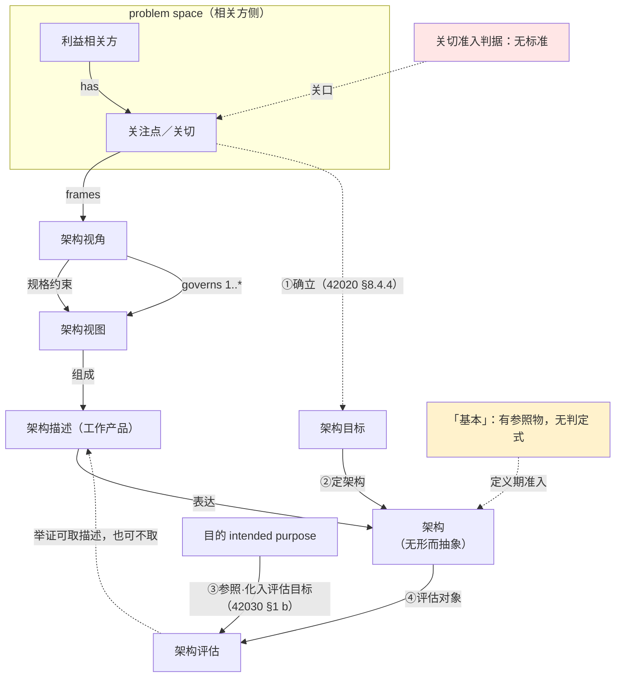
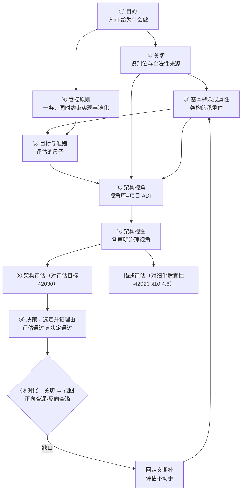

# 架构视角与关切判据研究报告

## —— 从视角集到关切裁决

**Architecture Viewpoints and the Adjudication of Concerns: A Research Report**

> **编号**：32（研究报告稿）
> **日期**：2026-09-23
> **主题**：三领域（实物产品／企业运营体系／作战任务）架构师应掌握的架构视角集；架构承重件的「基本（fundamental）」准入判据；无领域视角标准时的视角规格路径；架构评估的依据；以及贯穿全链的关键接缝——关切（关注点）的裁决机制
> **权威来源**：ISO/IEC/IEEE 42010:2011／2022 与 GB/T 45630-2025（等同采用）；ISO/IEC/IEEE 42020:2019（架构过程）；ISO/IEC/IEEE 42030:2019（架构评估框架）；ISO/TS 14812:2022（ITS 词汇，四条明文视角）；DoDAF 2.02；NAF v4.1；OMG UAF 1.3 DMM；MODAF 1.2（已撤销）；The Open Group TOGAF 9.x 与 ArchiMate 3.1 XSD；RM-ODP（ISO/IEC 10746／ITU-T X.901）
> **相关报告**：24 号《架构与设计边界研究报告》已立「基本」的目的必要性／充分性双判据与不可逆性降为代理（该双判据中「目的必要性」一支已由 48 号 §2.3、§2.8 换为三把尺）；30 号《架构描述核心概念研究报告》已立四定义、四关系与译名政策；29 号《架构治理研究报告》已立治理的裁量、责任主体与例外机制。**本报告是四问的递进收束**——回答「用哪些视角看」「什么够格进架构」「没有视角标准怎么写视角」「拿什么评」，并收口于「关切凭什么被裁决」
> **用语与定名政策**（依 GB/T 45630-2025 与仓库既定）：fundamental——仓库口径取「**基本**」，逐字引国标时照抄国标字面「**基础**」（引文不替人改字）；viewpoint——**架构视角**（旧稿「视点」已退役）；view——**架构视图**；concern——**关注点**（沿 42020 行文时作「关切」，本报告两词并用，指同一概念）；stakeholder——**利益相关方**；purpose——**目的**；objective——**目标**；governing principles——**管控原则**（动词位 governs 作「治理／管辖」）
> **术语并存（现状）**：concern 的「**关注点**」与「**关切**」两词在本报告内**并存**——国标 GB/T 45630-2025 定名为「关注点」，「关切」无正本出处；两词的统一属全库一次裁（48 号 §15.4 挂账 #12 已登记），本件保留并存原状（「关切」163 处、「关注点」24 处），裁后只需改这一行声明＋全件扫换，别处不必逐条改
> **引文纪律**（2026-09-23 用户裁定，已立为记忆 `feedback-quote-original-and-chinese`）：凡引外文，**原文与中译并列**，并按**四档**标引证性质：①标准逐字②标准可支持的读法③按定义句作的举例④本库定性〔读法〕；另加**性质标记**：规范（shall／should）／资料性（NOTE／附录）；**取证来路**（一手／二手／未核）单列一维，不与档位混用。见不到条款文本写「未核」，取不到逐字写「未取得逐字」，不补号、不补句
> **版本**：v1.12（2026-11-02；依 46 号 v3.3 对齐）
> **约定**：英文术语首次出现附中文对照；本报告的归拢性与操作性结论一律标〔读法〕，不得写成标准规定

---

## 目录

- [一、依据与标准版图](#一依据与标准版图)
- [二、第一问：三领域架构师应掌握的视角集](#二第一问三领域架构师应掌握的视角集)
- [三、第二问与第三问：「基本」准入的适用判断，与没有领域视角标准时的视角规格](#三第二问与第三问基本准入的适用判断与没有领域视角标准时的视角规格)
  - [§3 第二问：「基本」准入的适用判断（主家 48 号 §2.3、§3.4）](#31-三把尺现场三问)
  - [§4 第三问：没有领域视角标准时，视角怎么写（本号主家，§4.1~§4.6）](#41-缺的不是视角标准是视角规格)
- [四、第四问：架构评估的效力——评架构，不评描述](#四第四问架构评估的效力评架构不评描述)
- [五、收口：关切凭什么是可裁决的](#五收口关切凭什么是可裁决的)
- [六、三处接缝与六步补法（原十二步归并）](#六三处接缝与六步补法原十二步归并)
- [七、给三类使用者的动作建议](#七给三类使用者的动作建议)
- [附录 A：权威来源 URL 清单](#附录-a权威来源-url-清单)
- [附录 B：术语对照（本报告新增与易撞项）](#附录-b术语对照本报告新增与易撞项)
- [附录 C：全链示例（产品 A 机载防撞设备／产品 C 企业运营体系信息化平台）](#附录-c全链示例产品-a-机载防撞设备产品-c-企业运营体系信息化平台)
- [附录 D 结论台账（一视同仁：每条结论凭什么）](#附录-d-结论台账一视同仁每条结论凭什么)

> **章号说明**：本册共**七章＋四附录**。**章三含两组节**——§3（第二问的适用判断，§3.1~§3.6）与 §4（第三问的视角规格，§4.1~§4.6），两组各有独立的节号前缀，故**章号与节号前缀不一一对应**；其余各章章号与节号前缀相同（章四＝§5、章五＝§6、章六＝§7、章七＝§8）。

---

## 摘要：八条核心结论

1. **视角不是可选项，是成立条件。** **每张架构视图恰由一个架构视角治理；一个视角可治理多张视图**（42010:2022 §6.7 首句：*one or more architecture views for each architecture viewpoint used*，中译：对每个被使用的架构视角，架构描述应包含一张或多张架构视图；注 1（**资料性**）：*When a viewpoint governs more than one view in a particular AD, they are describing one architecture*，中译：当一个视角治理同一份描述里的多张视图时，它们在描述的是同一个架构）。不声明支配视角、或内容不守其约定的产物，在标准意义上不构成架构视图；另须过**体现检验**（第四问，§C.1.7）——**三问都过、第四问不过的，只是一张图**。
2. **三个领域各有一套框架目录，但「列」高度通用。** 差别在「行」（谁的事）：实物产品是功能→物理，企业是业务→数据→应用→技术，作战是能力→作战（逻辑）→服务／系统→资源；而 NAF 的**七列**（关注方面）与 UAF 的**十一个方面**高度重合（〔读法〕C 级，见 §2.3、§2.4）。
3. **实物产品领域没有现成的权威视角目录。** INCOSE SEH 5.0 只给过程、不给视角清单；ISO/TS 14812 明文命名了四个视角（功能／物理／通信／企业），是唯一能取到逐字定义句的落点（且其抽象结构即 RM-ODP 在实物产品语境的落法）。
4. **可用蓝本有四份，不是零。** RM-ODP 五视角、ISO/TS 14812 四视角、GERAM／ISO 15704 四视图、UAF／NAF 的 P 行（Resource）。
5. **缺的不是视角标准，是视角规格。** 42010:2022 只规定「视角该有什么」（§8.1＋附录 B）与「框架该有什么」（§7.1），把「用哪几个视角」下放给领域框架（ADF）——**领域没有 ADF，就自己建一个**，这是标准设计的正规路径（四段见 §4.1.1）。
6. **关切不是目的的投影，而是架构目标的原料。** **架构目标**由治理机构在关切基础上确立（42020:2019 §6.4.3、§8.4.4，逐字 *Establish architecture objectives and critical success criteria*，中译：确立架构目标与关键成功准则）；**目的不由这两条确立**。确立与被确立是两回事：**「关切 → 目的」这条推导线不存在，「关切 → 架构目标」这条线标准点名（establish）**——而架构目标要回追目的、并进评估当尺子。
7. **评估的依据是四组十五项（§5.3），目标侧的入口是评估目标与准则；目的只给方向。** 42030:2019 **§1 b)** 把预期目的摆在判据位，**主语是架构**；**d)** 的主语是**架构实体**——两处不可并成一把。**且评估的对象是架构，不是架构描述**——后者归 42020:2019 的概念化与细化过程（四段见 §5.2.1）。
8. **整条链的命门是关切的裁决机制，而它整块没有标准。** 裁决靠的不是原则，是三样可检查的东西：**预置的准入条件（来源与后果可指认）、不可自证的举证责任（三件套前置）、以及标准里真有据可依的裁决主体（42020:2019 §6.4.4 架构治理决策）**。

> **概念层结论本报告不再重述**：「基本」没有判定式、判据是一支填句三槽（三把尺＝三种填法）；关切不是判据；目的与目标都不是视图的判据——这三条的主家在 **48 号 §2.3**，本报告只留 §3.1~§3.6 的适用判断。

**逐条依据与论证位置见附录 D「结论台账」**

---

## 一、依据与标准版图

### 1.1 三标准的管辖分工

本报告全程围绕三个标准展开。它们分工清楚，混线即出漏洞：

| 标准 | 现行状态 | 管什么 | 关键条款 | 与「目的／关切」的关系 |
|---|---|---|---|---|
| **ISO/IEC/IEEE 42010:2022**（＋ GB/T 45630-2025 等同采用） | 2022-11 第 2 版；国标 2025-04-25 发布、2025-11-01 实施 | 架构描述的**结构、表达与符合性**；视角与模型种类的规格要求 | §4 符合性；**§6.1 标识与概览（含预期目的声明）**；§6 架构描述的规格；§6.10 决策与理据的记录；**§7.1 ADF 规格**；**§8.1 视角规格**；**附录 B 视角规格指南** | 要求**声明**预期目的的条款是 **42010:2022 §6.1**（逐字：*An AD shall include a statement of its intended purpose.*；同节另两条：AD 应标识所关注实体及其预期环境、应含标识信息与补充信息） |
| **ISO/IEC/IEEE 42020:2019** | 现行 | 架构**过程**：治理、管理、概念化、评估、细化、使能（六类） | §6.4.3 确立架构集合目标；**§6.4.4 作出架构治理决策**；§8.4.4 确立架构目标与关键成功准则；§9.4.3 确定评估目标与准则；§9.4.7 评估相关方价值；§10.4.3 识别或开发视角；§10.4.6 评估架构细化 | **裁决权的出处**；也是 42010:2022 架构定义句的引用源（42020 §3.3） |
| **ISO/IEC/IEEE 42030:2019** | 现行；**AWI 修订在研**（ISO 号 93814） | 架构**评估框架** | 三层：评估综合（§4.3.1、§6.1）、价值评估（§4.3.2、§6.2）、架构分析（§4.3.3、§6.3）；§8 两个工作产品（评估计划／评估报告）；附录 A 价值与质量（**A.3** 价值／**A.4** 质量）；附录 D 具名方法（**D.2** ATAM／**D.3** Method Framework＋QUASAR／**D.4** AoA）——**库内正本·条款标题逐字** | **评估依据的出处**：*"assess the quality of architectures with respect to their **intended purpose**"* |

### 1.2 三标准的交界处，正是本报告的问题所在

**一处标红（关切准入确无门槛条款）、一处标黄（「基本」有参照物而无判定式）与四处接缝，构成本报告 §3~§7 的全部内容。**

### 1.3 取证边界（诚实交代）

**四份正本已于 2026-10-11 入库并逐条核过**（42010:2022／42020:2019／42030:2019／15288:2023）。本表「未取到」一栏只指**仍未入库**的类别，逐项列在表后。

| 标准／框架 | 我取到什么 | 未取到什么 |
|---|---|---|
| ISO/IEC/IEEE 42010:2022 | **全文征本（2026-10-11 入库）**——§3 术语、§4~§8 正文与附录 B 齐备；另存 Foreword 与 Introduction 逐字（ISO 官方预览）、1.1–1.3 与 2.x 变更说明 | — |
| ISO/IEC/IEEE 42010:2011 | §3.2／3.4／3.5／3.6／3.7／3.9／3.10 定义句（经 ISO/TC 204 官方词汇站逐字转引） | 原件正文 |
| GB/T 45630-2025 | 范围、前言（编辑性改动清单）、引言、3.1~3.7 术语 | 3.8 及以后逐字 |
| ISO/IEC/IEEE 42020:2019 | **全文征本（2026-10-11 入库）**——§4 符合性~§11 使能过程与附录 A~E 齐备（含 **E.5 架构动机模型**）；另存 §3.1~3.45 术语逐字（SIS 官方预览 19 页） | — |
| ISO/IEC/IEEE 42030:**2019**（库内件为 CSA 2020 采标本，等同采用 ISO/IEC/IEEE 42030:2019；引用一律写 2019） | **全文征本（2026-10-11 入库）**——**§3.1~§3.10 术语**与**附录 A 价值与质量概念**齐备；§1 Scope 逐字经库内正本复核一致 | — |
| ISO/IEC/IEEE 15288:2023 | **全文征本（2026-10-11 入库）**——§4 符合性、§5 关键概念、§6 生存周期过程齐备 | — |
| ISO/TS 14812:2022 | 元层九条＋四条视角定义句与条款号（ISO/TC 204 官方词汇站） | 标准本体 |
| NAF v4.1 | **官方 PDF 全文**（208 页） | — |
| DoDAF 2.02 | **官方 PDF 全文**（289 页，`dowcio.war.gov`） | 分册 Vol I/II/III 章节号 |
| OMG UAF 1.3 DMM | **正式文档 dtc/2024-11-03 全文**（295 页） | 正式发布件 formal/25-10-01 |
| MODAF 1.2 | **官方下载件全文**（250 页） | — |
| TOGAF | 9.x 在线全文（Definitions、Architectural Artifacts、Stakeholder Management、Security Architecture and the ADM） | **TOGAF 10 全文**（pubs.opengroup.org 401） |
| ArchiMate | 3.1 Model Exchange File Format XSD 与 HTML schema 文档 | **3.2 规范正文**（401；3.2 路径 XSD 为 404） |
| INCOSE SEH 5.0 | 中译本 PDF 全文（413 页） | 英文原版 |

**仍未核的六项**（原因即上表「未取到什么」那一栏）：

| # | 未核事项 | 原因 |
|---|---|---|
| 1 | TOGAF Standard 10th Edition 全部原文 | pubs.opengroup.org 401 |
| 2 | ArchiMate 3.2 规范正文与 42010 符合性自述 | 401；3.2 路径 XSD 404 |
| 3 | ISO 19439 四视图名称、ISO 15704／19440 条款号 | 仅得 Scope 逐字（官方目录页） |
| 4 | 中国军标（GJB/Z 156 等）作战侧视角集 | 无官方公开正文，仅商业转售站（二手） |
| 5 | DoDAF 2.02 分册章节号 | 分册 PDF 未取得；定义句取自官方 site-wide PDF |
| 6 | NAF v4.1 的 AC/323 文件号 | 官方 PDF 封面未载 |

**另**：15288:2023 全文在库；ARP4754B／DO-178C／DO-254／ISO 26262／AUTOSAR **仍零获取**，一律不编号。

**凡上表"未取到"栏所涉内容，本报告一律不引其正文句；凡引条款号者必注明取自「官方目录」（条款标题级证据）还是「正文逐字」。**

**〔读法〕清单（本报告归拢或操作化所得，标准无对应条款，不得写成标准规定）**：三把关与四条裁决依据、关切四类分流、举证三件套、留痕三对账、三处接缝与六步补法（原十二步归并）、四级映射表、两个闸门、「关切不是尺子，是识别位与合法性来源／目的不是尺子，是方向／三把尺之外没有第四把」三句定式、「关切是发现物、目标是裁量物」之分、三把尺的落纸办法、四量贡献分析表、替换测试与走样检验的归属。

**一处不得再写（旧概括已撤）**：删去「目的是从关切点里裁出来的」这条概括——**关切 → 架构目标**由治理**确立**（42020:2019 §8.4.4）；**「关切 → 目的」这条推导线不存在**（摘要 6、§6.0）。

---

## 二、第一问：三领域架构师应掌握的视角集

### 2.1 实物产品的系统设计

**A 组·标准明文命名并有逐字定义句（ISO/TS 14812:2022）**

| 视角 | 英文原文（逐字） | 中译 | 条款 |
|---|---|---|---|
| 功能视角 | *"architecture viewpoint used to frame concerns related to the definition of processes that perform surface transport functions and data flows shared between these processes"* | 用于框定与「执行地面运输功能的过程之定义、以及这些过程之间共享的数据流」相关的关注点的架构视角 | 3.1.4.6 |
| 物理视角 | *"architecture viewpoint used to frame concerns related to the assignment of functionality to physical objects and the interfaces among these physical objects"* | 用于框定与「功能到物理对象的分配、以及这些物理对象之间的接口」相关的关注点的架构视角 | 3.1.4.8 |
| 通信视角 | *"architecture viewpoint used to frame concerns related to all layers of the Open Systems Interconnection (OSI) stack and related management and security issues"* | 用于框定与「开放系统互连（OSI）各层及相关管理与安全问题」相关的关注点的架构视角 | 3.1.4.2 |
| 企业视角 | *"architecture viewpoint used to frame the policies, funding incentives, working arrangements and jurisdictional structure that support the technical layers of the architecture"* | 用于框定「支撑架构各技术层的政策、资金激励、工作安排与管辖结构」的架构视角 | 3.1.4.4 |

四条的页内关系字段为 `governs some …View`／`subClassOf architectureViewpoint`（治理某个视图／是架构视角的子类），与 42010 概念模型一致。

**边界**：定义句中的 "surface transport" 是 ITS 领域限定词；**其抽象结构（功能→物理→接口→企业）可迁移到任意实物产品，但逐字引用时必须保留 ITS 语境**，不可当作通用产品标准原句。

**B 组·框架命名（见 §2.3 作战侧，对应 P 行）**：NAF v4.1 的 P 行九格为实物产品设计的主用行——资源分类、资源结构、资源交互、资源功能、资源状态、资源路线图、数据模型（P7 Data Model）、资源约束。

**C 组·标准支撑但未以 viewpoint 命名的关注面（提炼）**：安全（ARP4754B／ARP4761A、ISO 26262、IEC 61508）、开发保障（DAL／IDAL；FAA AC 20-115D／20-152A）、验证与确认（15288 技术过程）、环境适应性与合格鉴定（RTCA DO-160）、制造与装配、保障与维修（ISO 26262-7 的 production, operation, service and decommissioning）、信息安全（ISO/SAE 21434、DO-326／DO-356）。**这七条必须写成"以某某标准为权威支撑的提炼视角"，不得写成"标准规定的视角"。**

**一处负面发现（重要）**：**INCOSE SEH 5.0 没有给出视角清单**。其正文用「视点」处无一处在给清单，只给过程与定义引述。**故实物产品领域不存在一份现成的权威视角目录**——这与另两个领域根本不同，也是 §4「自建 ADF」在该领域格外必要的原因（〔读法〕C 级：这是检索结论，不是标准条文；依据 INCOSE SEH 5.0 中译本与 ISO/TS 14812 的四条视角）。

### 2.2 企业运营体系设计

> **补充（2026-10-12·层级图定案）**：**企业架构＝「企业运营体系架构」的简称**——依 **42020:2019 §E.4.1.2 的第二种读法**（企业架构「或者是一个企业的架构，**或者是从企业角度考察的某个实体的架构**」），那个实体即**企业运营体系**；它是一个**系统的系统**（42020 §E.4.1.10），**有它自己的一个架构**，**该架构承接企业战略**。**业务流程体系、企业应用系统、业务数据体系、信息基础设施**是它的四个**子系统**，**各有自己的架构与各自的多种视图**，**各自承接企业在该领域的子战略**。TOGAF 的 4A（业务／数据／应用／技术架构）**对应的就是这四个子系统**（见 06 号 §7.7）。〔按：「承接」是**纵向借喻**，实质是**应答、对应、实现**三条关系，不是逐层传递（42 号 §6.3、§7.2）。〕

**框架目录**：TOGAF 四域 ＋ ArchiMate 视角机制。

**TOGAF 的两处原文自相矛盾**，引用时必须交代：

- 定义句是范围语义：*"The architectural area being considered. There are four architecture domains within TOGAF: business, data, application, and technology."* → **架构域**：正在被考虑的**架构区域**。TOGAF 中有四个架构域：业务、数据、应用与技术。句中无 conventions、无 concerns、无 stakeholders，**不满足 42010 视角定义的三要件**。
- 同一标准另一处却断言：*"The TOGAF architecture domains are themselves viewpoints that can be used to group the foundational catalogs, matrices, and diagrams"* → TOGAF 的架构域**本身就是视角**，可用于归组基础性的目录、矩阵与图。
- 同章又自限：*"These TOGAF sections on viewpoints should be considered as guides for the development and treatment of a view, not as a full definition of a viewpoint."* → 这些关于视角的章节应被视为**视图开发与处理的指南**，而非视角的完整定义；并称 *"This is not intended as an exhaustive set of viewpoints, but simply as a starting point."* → 这**并非一份穷尽的视角集合**，而只是一个起点。

**结论**：四域同时承担"分区"与"框架自述的视角"两职，按 42010 定义句它们**不是完整视点规格**。**这是 TOGAF 的框架内自述，不是 ISO 的要求。**

**可执行的约定在 ArchiMate**：其官方 XSD 把 Viewpoint 做成一等类型，字段为 `concern`（内含 `stakeholders`）／`viewpointPurpose`（Designing｜Deciding｜Informing）／`viewpointContent`（Details｜Coherence｜Overview）／`allowedElementType`／`allowedRelationshipType`／`modelingNote`，并枚举 32 个命名视角。**中译**：关注点／视角用途（设计·决策·告知）／视角内容（细节·一致性·概览）／允许的元素类型／允许的关系类型／建模说明。

**边界**：所用 XSD 版本号为 **3.1**（Status: Preliminary），覆盖 3.1/3.2 语言，但 **3.2 规范正文未取得**（401），3.2 路径的 XSD 返回 404——**不得声称「ArchiMate 规范自述符合 42010」**。

**四域的逐字服务对象**（TOGAF 9.x，可用于确定视角服务谁）：

| 域 | 英文原文（逐字） | 中译 |
|---|---|---|
| Data | *"The Data Architecture domain addresses the needs of database designers, database administrators, and system engineers."* | 数据架构域面向数据库设计者、数据库管理员与系统工程师的需要 |
| Application | *"The Application Architecture domain addresses the needs of system and software engineers."* | 应用架构域面向系统与软件工程师的需要 |
| Technology | *"The Technology Architecture domain addresses the needs of acquirers, operators, administrators, and managers."* | 技术架构域面向采办者、操作者、管理员与管理者 |
| Business | *"The Business Architecture domain addresses the needs of users, planners, and business management."* | 业务架构域面向用户、规划者与业务管理 |

**TOGAF 的术语分层**：安全／可管理性／标准合规在 TOGAF 里是 **View 不是 Viewpoint**——*"The Enterprise Security view is concerned with the security aspects of the system."* → 企业安全视图关注系统的安全方面。

### 2.3 作战任务系统设计

**四框架的现行性与视角集**

| 框架 | 版本 | 现行性 | 顶层集合 |
|---|---|---|---|
| **DoDAF** | 2.02（2010-08） | **现行**（官方逐字：*"This is the official and current version for the Department of Defense Architecture Framework."* → 这是国防部架构框架的官方现行版本） | **8 个 Viewpoint** |
| **NAF** | v4.1（Document Version 2026.03） | **现行** | **网格：行 5 × 列 7**，每一格即一个视角 |
| **UAF** | 1.3（同时是 ISO/IEC 19540-1/-2:2022） | 现行 | **11 视角 × 11 方面** |
| **MODAF** | 1.2.004 | **已撤销**（GOV.UK 逐字：*"MODAF has been replaced with the NATO Architecture Framework (NAF) V4."* → MODAF 已被北约架构框架（NAF）V4 取代） | 7 类（存量文档仍在用） |

**DoDAF 2.02 八视角**（官方 PDF 逐字）：

| 视角 | 英文原文（逐字） | 中译 |
|---|---|---|
| All (AV) | *"The All Viewpoint describes the overarching aspects of architecture context that relate to all viewpoints."* | 全景视角描述与所有视角都相关的架构上下文的总体方面 |
| Capability (CV) | *"The Capability Viewpoint articulates the capability requirements, the delivery timing, and the deployed capability."* | 能力视角阐明能力需求、交付时间与已部署的能力 |
| Operational (OV) | *"The Operational Viewpoint includes the operational scenarios, activities, and requirements that support capabilities."* | 作战视角包含支撑能力的作战场景、活动与需求 |
| Services (SvcV) | *"The Services Viewpoint is the design for solutions articulating the Performers, Activities, Services, and their Exchanges, providing for or supporting operational and capability functions."* | 服务视角是解决方案的设计，阐明执行者、活动、服务及其交换，用以提供或支撑作战与能力功能 |
| Systems (SV) | *"The Systems Viewpoint, for Legacy support, is the design for solutions articulating the systems, their composition, interconnectivity, and context…"* | 系统视角（**用于遗留支撑**）是解决方案的设计，阐明各系统及其组成、互连与上下文…… |
| Data and Information (DIV) | *"The Data and Information Viewpoint articulates the data relationships and alignment structures in the architecture content for the capability and operational requirements, system engineering processes, and systems and services."* | 数据与信息视角阐明架构内容中面向能力与作战需求、系统工程过程、系统与服务的**数据关系与对齐结构** |
| Standards (StdV) | *"The Standards Viewpoint can articulate the applicable policy, standards, guidance, constraints, and forecasts…"* | 标准视角可阐明适用的政策、标准、指南、约束与预测…… |
| Project (PV) | *"The Project Viewpoint describes the relationships between operational and capability requirements and the various projects being implemented."* | 项目视角描述作战与能力需求同各实施项目之间的关系 |

**注意 OV 一行里的 "Legacy support"**：**系统视角在 DoDAF 里已被标为遗留支撑**，新工作走服务视角——这一条对设计决策有直接影响。

**DoDAF 的裁剪纪律**（逐字）：*"DoDAF V2.0 does not prescribe any models – instead, it concentrates on data as the essential ingredients of any architecture development. It seeks to make architectural descriptions 'Fit-for-Purpose', based on decision-maker needs."* → DoDAF V2.0 **不规定任何模型**，而是聚焦于数据，力求使架构描述「**适合用途**」，以决策者的需要为准；*"All the DoDAF-described Models do not have to be created."* → **并非所有 DoDAF 所述模型都必须创建。**

**NAF v4.1 网格**（官方逐字）：

- 行＝**Subject of Concern**（关注主题）：Concepts (C)／Service (S)／Logical (L)／Physical Resource (P)／Architecture Foundation (A)
- 列＝**Aspect of Concern**（关注方面）：Taxonomy／Structure／Connectivity／Behaviour／Information／Constraints／Roadmap
- *"Each cell at the intersection of the rows and columns is a Viewpoint."* → 行与列相交处的**每一格就是一个视角**。
- NAFv3 到 v4 的行映射（逐字）：Capability (NCV)→Concepts、Service-Oriented (NSOV)→Service、Operational (NOV)→Logical、Systems (NSV)→Physical Resource、All Views (NAV)→Architecture Foundation

**NAF 的两句关键定义**（逐字）：*"A View is what you see. A Viewpoint is where you are looking from."* → **视图是你看到的东西；视角是你从何处看。** *"A Viewpoint frames one or more concerns. A concern can be framed by more than one Viewpoint."* → 一个视角**框定**一个或多个关注点；一个关注点**可被多个视角框定**。

**NAF 的裁剪纪律**（逐字）：*"NAF neither mandates the use of all standardized Viewpoints, nor does it exclude the usage of additional Viewpoints, if required, to address stakeholder concerns."* → NAF **既不强制使用全部标准化视角，也不排除**在需要时使用额外视角；*"the selection of Viewpoints must be tailored to the specific architecture effort…"* → 视角的选择**必须针对具体架构工作进行裁剪**。

**UAF 1.3 的 11 视角**（DMM Table 7:1 逐字，摘要引四条）：

| 视角 | 英文原文（逐字） | 中译 |
|---|---|---|
| Strategic (St) | *"Capability management process. Describes the capability taxonomy, composition, dependencies, and evolution."* | 能力管理过程。描述能力的分类、组成、依赖与演化 |
| Operational (Op) | *"Illustrates the Logical Architecture of the enterprise. Describes the requirements, operational behavior, structure, and exchanges required to support (exhibit) capabilities. Defines all operational elements in an implementation/solution independent manner."* | 刻画企业的逻辑架构。描述支撑（展现）能力所需的需求、作战行为、结构与交换。以**不依赖实现／方案**的方式定义全部作战要素 |
| Services (Sv) | *"The Service-Orientated View (SOV) is a description of services needed to directly support the operational domain…"* | 面向服务的视图是对直接支撑作战域所需服务的描述…… |
| Resources (Rs) | *"Captures a solution architecture consisting of resources, e.g., organizational, software, artifacts, capability configurations, and natural resources that implement the operational requirements."* | 捕获由资源构成的解决方案架构，例如实现作战需求的组织、软件、制品、能力配置与自然资源 |
| Security (Sc) | *"Security assets and security enclaves. Defines the hierarchy of security assets and asset owners, security constraints (policy, laws, and guidance) and details where they are located (security enclaves)."* | 安全资产与安全域。定义安全资产与资产所有者的层级、安全约束（政策、法律与指南），并详述其所在（安全域） |
| Personnel (Ps) | *"Defines and explores organizational resource types…"* | 定义并探究组织资源类型…… |
| Projects (Pj) | *"Describes projects and project milestones, how those projects deliver capabilities, the organizations contributing to the projects and dependencies between projects."* | 描述项目与项目里程碑、这些项目如何交付能力、参与项目的组织以及项目之间的依赖 |
| Standards (Sd) | *"…the set of rules governing the arrangement, interaction, and interdependence of solution parts or elements."* | ……治理方案各部分或各元素之安排、交互与相互依赖的规则集合 |
| Actual Resources (Ar) | *"The analysis, e.g., evaluation of different alternatives, what-if, trade-offs, V&V on the actual resource configurations."* | 对实际资源构型的分析，例如不同备选方案的评估、假设推演、权衡与验证确认 |
| Architecture Management (Am) | *"Identifies the metadata and views required to develop a suitable architecture that is fit for its purpose."* | 识别开发一个**适合其目的**的架构所需的元数据与视图 |

**UAF 的方面（Aspect）不是视角**——Table 7:2 定义 11 个方面（Motivation／Taxonomy／Structure／Connectivity／Processes／States／Sequences／Information／Constraints／Roadmap／Traceability），其中三条逐字：Motivation *"Captures motivational elements e.g., challenges, opportunities, and concerns…"* → 动机：捕获挑战、机遇与**关注点**等动机要素……；Roadmap *"Addresses how elements in the architecture change over time."* → 路线图：处理架构中各元素**随时间如何变化**；Traceability *"Describes the mapping between elements in the architecture."* → 可追溯性：描述架构中各元素之间的映射。

**UAF 自述其视角命名遵循 42010**（逐字）：*"the term viewpoint is in the context of ISO 42010 where a viewpoint is the specification of a view"* → 此处 viewpoint 取 ISO 42010 的语境，即视角是视图的**规格**；*"The grid is a way of showing how the various view specifications (cells) correspond to viewpoints"* → 网格是显示各**视图规格（单元格）**如何对应到视角的方式。

### 2.4 三域合看：差异在「行」，共性在「列」

| | 实物产品 | 企业运营体系 | 作战任务系统 |
|---|---|---|---|
| **权威框架** | ISO/TS 14812（四条）＋**无统一视角目录** | TOGAF 四域（视角／分区两义）＋ArchiMate | DoDAF 8／NAF 网格／UAF 11×11／MODAF（已撤销）7 |
| **主干「行」** | 功能→物理→通信→企业 | 业务→数据→应用→技术 | 能力→作战（逻辑）→服务／系统→资源 |
| **「列」轴** | 复用 NAF／UAF 的七／十一个方面 | ArchiMate 的 purpose×content 两轴 | NAF 七列／UAF 十一列 |
| **各框架都不点名、必须自建** | 安全、环境鉴定、制造装配、保障维修、信息安全 | 安全、可管理性、标准合规（术语是 View） | 试验鉴定、训练、后勤（**四框架均未命名**） |

**结论（C 级〔读法〕）**：三域的差别在「行」（谁的事），「列」高度通用。**任一领域自建视角，都在往这两个轴上落**——这是本问最具迁移价值的一条。

**边界（不可省）**：上表的"行／列"归纳是本报告归拢，不是任何标准的原话；其依据是 42010:2022 §8.1 a)~g) 的规格项、NAF v4.1 的行列网格（"每格即一个视角"）与 UAF 1.3 DMM Table 7:2 的十一个方面。**本表只说明"往哪两个轴上落"，不主张任一领域可照抄另一领域的行，也不主张七列／十一列可互换。**

---

## 三、第二问与第三问：「基本」准入的适用判断，与没有领域视角标准时的视角规格

本章两组节：**§3 第二问的适用判断**（谁够格进架构，§3.1~§3.6）与 **§4 第三问的主家**（没有领域视角标准时，视角怎么写，§4.1~§4.6）。**「基本」判据的概念层主家在 48 号 §2.3**，本章只留落到本号对象上的判断与案例；**视角规格是本号独有的规格层**。

**第二问·「基本」准入的适用判断（主家 48 号 §2.3）**

> 本节概念层见 **48 号 §2.3、§2.10**；本号只保留落到本号对象上的适用判断与案例（三件可留检验的户口、两个假判据、本号留痕表、权责三分的产出栏）。

### 3.1 三把尺（现场三问）

| 对象 | 现场问句 |
|---|---|
| **概念** | 去掉它，"这个实体是什么"的说法还成不成套？**相关方能共同陈述吗？** |
| **属性** | 去掉它，对实体**在其环境中**的效用／成本／时间／风险**有没有一条实质动**？ |
| **原则** | 去掉它，某种实现或演化会不会变成被允许的？违规看不看得出？ |

**三种填法不可互换（俗名"三把尺"）**：拿"去掉它目的不成"裁概念＝把概念当属性；拿"有没有约束力"裁概念＝把它当原则。**"承重／承重件／承重测试"三名一律撤出判据位**：它们只作叙述用语（如"这份架构的承重件是哪些"），**不得当判据名、不得进术语表、不得做自检表项名**。

**「去掉它，还能不能成就目的」这条问法不成立**——它把**结果**当**构成**、把**贡献**当**必要**、把**条**当**类**（三种错各撞哪条原文，逐行见 48 号 §2.3 表）：目的成不成就，取决于实现、验证、运行与外部条件，**架构阶段判不了**；42010:2022 附录 A.2（**资料性**）说 *contribute*，不说 necessary；现实常见"必须有一条、但不必是这一条"。

**关切不是尺子，是识别位与合法性来源。** 标准把"基本"挂在关切上（42010:2022 §6.2），意思是"谁的在意让这条内容有资格被摆上桌"，**不是"谁在意就算基本"**——关切可主观、可冲突、可无对应需求（42010:2022 §5.2.4）。**判据不对关切点量**：那是**识别位**，不是计量。这半句旧文是对的，且它正是"关切不是尺"那一半——**关切互相冲突，而治理存在的理由恰恰是仲裁冲突**。

**目的不是尺子，是方向。**（两义见附录 B「intended purpose」行；目的≠评估目标，见 §5.1。）

### 3.2 「实质」＝越线或改选（含写法模板）

| 形态 | 判法 |
|---|---|
| **越线** | 变化是否使既有阈值／限值／准则的判定翻转；且线**宜**事前立——42030:2019 §4.2 **注 3（NOTE，资料性）**：*Pass/fail criteria could need to be established prior to performing the evaluation.*（中译：通过／不通过准则可能需要在实施评估**之前**确立）——这是"可能需要"的指南，**不是 shall／should 的义务**；工程上仍宜事前立线，理由在"事后设线必向着结论靠"（本报告定性） |
| **改选** | 变化是否使某个**已记录的决策**或"架构上重要的需求"的取舍翻转（42010:2022 §6.10.1；15288:2023 §6.4.4.2 c)） |

**两者都不成立＝微动，不算实质。**

**四量是四条通道，不是四个合取**：任一实质动即判基本——只动风险的、动时间＋风险的、只动成本的，三类实例见 48 号 §3.4 表。**两种「成本／时间」必须分开**：42010:2022 附录 A.2 的四量属"**实体在其环境中**"，**不含"改架构的工程花费"**；"时间"亦有架构工作进度（项目侧）与实体响应／周期（运行侧）两义（48 号 §3.4）。**判"动"要有线**（预算容差、工期节点、量级差）；立不出线，这两个量只作备注——经验上"基本"的判断绝大多数落在**效用与风险**上。

**判定要写成一个可核的句子**（本号独有：三把尺的落纸办法）：

> 去掉【这条属性】→ 在【环境条件】下，【效用／成本／时间／风险】从【有它时】变为【去掉后】；故判【基本／非基本】，理由【一句】。

**写成"影响很大"就等于没说。**

### 3.3 三件可留的检验（各归各的户口，**都不当准入判据**）

| 检验 | 它其实是什么 | 户口 |
|---|---|---|
| **替换测试**（换个实现，这个概念／属性还在不在） | **实现无关检验**：挡掉"把当前技术选型当架构"（附录 C 两例的替换测试段原样保留） | 〔读法〕与 48 号 §10.12「走样」同族；**不作准入判据** |
| **共同陈述**（缺了它，相关方能对"这个实体是什么"达成一致吗） | **概念那把尺本身**（§3.1 概念行） | 概念侧；**不是**"我能不能说清" |
| **原「充分性（closure）」** | 不是准入判据，是"**写到哪儿停**" | 改挂**架构意图**——*a level of detail **necessary to convey the architectural intent***（中译：为传达架构意图所必需的详细程度）（42020:2019 §5.6）；48 号 §10.12 三条检验；标明〔读法〕 |

**一处限定（不可省）**：原"充分性"若继续写成"目的所要求的内容已被完整表达"，就是把两个问压进一句——"内容全不全"是**覆盖**问题（由关切—内容对账判，48 号 §11.8 ②），"写到哪儿停"是**深浅**问题（由预期用途与架构意图判，42020:2019 §5.6）。**二者都不判"基本"。**

### 3.4 两个假判据

| 假判据 | 为什么会冒充判据 | 两类失真 |
|---|---|---|
| **不可逆性** | 可观测、直观、易沟通 | **漏判**：不贵但承重（如"日志须可被外部审计员独立读取"）；**误纳**：很贵但与四量无关（框架版本、组织惯例技术栈） |
| **可判定性／可引用性／高层级／概要** | 都是"看起来像判据"的代理 | 同一形状的错误换了外衣——**代理冒充真判据** |

**一条补充**：**"改起来贵"不是判据，但它仍是"要记录的决策"的选取标准**（42010:2022 §6.10.1 列有"对变更高度敏感""改动代价大"）——**两件事，别混**。

### 3.5 留痕表（本号三例）

| 条目 | 对应关切（持有者） | 贡献分析（量／线） | 裁定 | 裁定人·日期 |
|---|---|---|---|---|
| 断链告警 ≤30 秒（A 例同类属性） | 及时看到冲突（飞行机组） | 时间＋风险动；越"可接受反应时间"线 | 基本 | 〈治理〉·〈日期〉 |
| 审计留存 10 年（C 例同类属性） | 可追溯（审计部门·沉默，治理代持） | 风险动：不达法定最低期限 | 基本 | 同上 |
| 界面配色（示意） | 工艺（产线） | 无一条越线 | 非基本；另立"人机语义可读" | 同上 |

### 3.6 谁定：相关方提、架构师判、治理裁

> 概念层主家在 **48 号 §2.8**；本节只留"产出"一列落到本号的三件制品上（关切台账／贡献分析／裁定记录）。

| 动作 | 谁做 | 产出 |
|---|---|---|
| **提** | 相关方（**含架构师**；42010:2022 附录 A.3：*Stakeholders, **including the architect** … hold these concerns*，中译：相关方，**包括架构师**，持有这些关切） | 关切台账：谁在意什么；本条目对应哪条关切 |
| **判** | 架构师／架构团队 | **贡献分析**：动哪个量、往哪动、越没越线 |
| **裁** | 治理／有权的那一处 | 裁定记录：结论、理由、裁定人、日期 |

**三点补充**：① **裁定不是共识投票**——关切常带主观性且可互相冲突（42010:2022 §5.2.4），冲突需要仲裁动作；② **法定与环境硬条件不可被否掉**——相关方可确认、解释，但不能判它"不基本"；③ **判定必须留痕**，否则事后无法复核（42010:2022 §6.10）。
**两种失效与挡法**：**把重要当基本**（挡：必须附贡献分析，不接受"很重要"）；**沉默方缺席**（挡：每类条目点名可能沉默的持有者；无代表的由治理**代持**并记录）。

**一条界分（防复发）**：42020:2019 §6.4.3、§8.4.4 确立的是 `architecture objectives`（架构目标）——*Establish architecture collection objectives*（中译：确立架构集合目标）／*Establish architecture objectives and critical success criteria*（中译：确立架构目标与关键成功准则），**不是 purpose**；写成 purpose，就把目标与目的压成一层。

---

**第三问·没有领域视角标准时，视角怎么写（本号主家）**

### 4.1 缺的不是视角标准，是视角规格

42010:2022 的条款结构（**库内正本逐字**；原据 DIN 官方目录，2026-09-24 已回正本核过）：

| 条款 | 标题（英文原文） | 中译 | 管什么 |
|---|---|---|---|
| §3.8 | architecture viewpoint | 架构视角 | **视角是什么**（定义句） |
| §5.2.7 | Architecture views and architecture viewpoints | 架构视图与架构视角 | 概念模型 |
| §6 | Specification of an architecture description | 架构描述的规格 | **AD 该有哪些成分** |
| §7.1 | Specification of an architecture description framework | 架构描述框架的规格 | **框架（＝视角集）该有什么** |
| §8.1 | Specification of an architecture viewpoint | 架构视角的规格 | **单个视角该有什么** |
| 附录 B | Guidelines to specification of architecture viewpoints | 架构视角规格指南 | 视角规格指南（p.40，**存在性已结清**） |

> **号形说明**：本表「条款」列各条款号均为 **42010:2022** 条款，故列内只写 §x.y。

**§6 的成分清单**（42010:2022 §6.2~§6.10，逐条即「架构定义该产出什么」的骨架）：6.2 识别相关方 → 6.3 识别相关方角度 → 6.4 识别关注点 → 6.5 识别方面体 → 6.6 纳入架构视角 → 6.7 纳入架构视图 → 6.8 纳入视图组件 → 6.9 记录对应关系（一致性／对应／对应方法）→ 6.10 记录架构决策与理据。

**把这张清单倒过来读，就是架构定义的操作步骤。**

#### 4.1.1 为什么"没有领域视角标准"不是缺口〔论证〕

**结论**：42010 不给视角清单，只给"一个视角该写成什么样"；领域没有 ADF，按规格自建一个，是标准设计的正规路径，不是应急变通。

**依据**：42010:2022 §3.5（逐字·规范，ADF 定义句：*conventions, principles and practices for the description of architectures established within a specific domain of application or community of stakeholders*，中译：在特定应用领域或相关方共同体内确立的、用于描述架构的约定、原则与实践）；42010:2022 §6.6 NOTE 1（**资料性**，*This document does not require the use of any particular architecture viewpoints*，中译：本文件不要求使用任何特定的架构视角）；42010:2022 §7.1（ADF 规格，逐字·规范）；42010:2022 §8.1 a)~g)（视角规格七项 shall，逐字·规范）；42010:2022 Foreword（ISO 官方预览逐字，ADF 改名理由：*in order to differentiate ADFs from other kinds of architecting frameworks like architecture evaluation frameworks*，中译：为把 ADF 与其他种类的架构化框架（如评估框架）区分开）。

**推理**：① 标准若要规定视角集，必在 §7.1（框架）或 §8.1（单个视角）给出名单或选择规则——两处都只给"规格项"，**名单零命中**；② §3.5 定义句把"确立者"写在状语里（*established within a specific domain of application or community of stakeholders*），即定名单的机构是**领域**，不是标准；③ 故缺的是**规格**而不是标准：有标准无规格，仍产不出可判的视图；有规格无标准，视图仍无法声明符合性；④ 三域实证支持这个读法——作战侧四框架、企业侧 TOGAF 都有目录可借，而实物产品领域连一份现成的权威视角目录都没有（INCOSE SEH 5.0 只给过程），若"没有领域标准就不能开工"，该领域将无人能动。

**反证**：若照抄一本框架的视角集即可满足 42010，则 §7.1 与 §8.1 两处规格要求都成了多余条款——它们存在的唯一理由恰是"视角集不能照抄，必须按规格写出来"。反过来，若"标准没给视角集"真属标准缺陷，则 §6.6 NOTE 1 那句"本文件不要求使用任何特定视角"就不该是 NOTE 而是必写项——标准把它放在 NOTE，说明这是它**有意留出的空位**。

**边界**：不主张"自建 ADF 总是划算"——自建成本高，先穷尽复用（INCOSE SEH 5.0 逐字提示）；也不主张"任意自建都合格"——合格由 §8.1 a)~g) 七项 shall 判，不由"我们写了一份"判。哪些视角该进、谁批，属治理裁量，标准不管。

### 4.2 标准给了解法：ADF（架构描述框架）

**ADF 定义**（ISO/IEC/IEEE 42010:2022 §3.5 逐字，库内正本）：

> *"conventions, principles and practices for the description of architectures established within a specific domain of application or community of stakeholders"*
> **中译**：在特定应用领域或相关方共同体内确立的、用于描述架构的**约定、原则与实践**。

**改版理由**（ISO 官方预览 Foreword 逐字）：

> *"The term 'architecture description framework' (ADF) replaces 'architecture framework' in the previous edition. It is defined in order to differentiate ADFs from other kinds of architecting frameworks like architecture evaluation frameworks specified in ISO/IEC/IEEE 42030."*
> **中译**：术语「架构描述框架（ADF）」取代了上一版的「架构框架」。它被定义出来，是为了把 ADF 与其他种类的架构化框架（如 ISO/IEC/IEEE 42030 规定的架构评估框架）区分开。

**这条定义就是「标准把视角集下放给领域」的机制本身**——它不说有哪些视角，它说「某领域内确立的约定」。**领域没有 ADF，就自己建一个，这是标准设计的正规路径。**

### 4.3 实物产品的四份蓝本

| 蓝本 | 视角集 | 出处与状态 |
|---|---|---|
| **RM-ODP** | enterprise／information／computational／engineering／technology（五视角） | ISO/IEC 10746 系列；ITU-T X.901 目录逐字给出五视角章（§6~§9 与 technology），并带附录 A 企业视角规格模板 |
| **ISO/TS 14812** | functional／physical／communications／enterprise（四视角） | 见 §2.1；**其抽象结构即 RM-ODP 在实物产品语境的落法**——企业视角定义中的「支撑技术层」正对应 RM-ODP 的 enterprise／engineering／technology 三视角分工 |
| **GERAM／ISO 15704** | Function／Information／Resource／Organization（四视图） | ISO 19439:2006 Scope 逐字：*"In ISO 19439:2006, four enterprise model views are defined in this framework. Additional views for particular user concerns can be generated but these additional views are not part of this International Standard."* → ISO 19439:2006 在本框架中定义了**四个企业模型视图**；针对特定用户关注点的附加视图可以生成，但这些附加视图不属于本国际标准。**（视图名称与条款号未核）** |
| **UAF／NAF 的 P 行** | 资源分类／结构／交互／功能／状态／路线图／数据模型／约束（九格） | 见 §2.3 |

**这四份可以混用**，且有据：42010 的符合性允许一份 AD 声明符合多个 ADF，也允许定义项目自有 ADF。**唯一不能省的是：你用的视角必须写出规格，视图必须声明受哪个视角治理。**

### 4.4 视角规格必须写明的内容（42010:2022 §8.1 ＋ 附录 B）

**42010:2022 §8.1 的 shall 清单（逐字节录，a)~g) 七项）**：

| # | 原文（逐字） | 中译 |
|---|---|---|
| a) | *any stakeholder perspectives associated with this viewpoint (per 6.3)* | 与本视角相关的**利益相关方角度** |
| b) | *one or more concerns (per 6.4) framed by this architecture viewpoint* | 本视角所**框定**的一个或多个**关注点** |
| c) | *one or more aspects related to those concerns (per 6.5)* | 与那些关注点相关的一个或多个**方面体** |
| d) | *known typical stakeholders (per 6.2) holding those concerns which are framed by this architecture viewpoint* | 持有本视角所框定关注点的**已知典型相关方** |
| e) | *model kinds (per 8.2) and legends for use when constructing views* | **模型种类**与构视图所用的**图例**（含记号与建模约定）。模型种类定义句逐字：*"category of model distinguished by its key characteristics and modelling conventions"* → 依其关键特征与建模约定而区分的一类模型（**42010:2022 §3.15**，库内正本），其关系为 `governs → architecture model` |
| f) | *correspondence methods capturing relations within resulting views and their view components (per 6.8)* | **对应方法**——本视角与其他视角怎么挂钩 |
| g) | *references to any sources of information about this viewpoint* | 本视角**信息来源的引用** |

**一项 should（不是 shall）**：**视图方法**——建造类／解读类／分析类，保证他人能按同一套方法复现、读懂、检查（42010:2022 §8.1 第二段：*A specification of an architecture viewpoint should identify view methods (per 8.3) used to create, interpret or analyse views…*；另见 42010:2022 §8.3）。

**一项系推得（附录 B 模板，不是 §8.1 的 shall 项）**：**名称、出处（来自哪个 ADF）、版本**——依附录 B 模板 **B.2.2 名称／B.2.3 概述／B.2.13 来源**；视图据此声明受谁治理。

> **本书归并口径（原第 6 项的去处）**：原稿第 6 项「必需的模型、元素、关系、约束与属性，以及视图组件、对应关系、一致性规则」**不在 §8.1 的 shall 清单内**——它是把「模型种类＋图例」（正本 e)）与**视图组件、对应关系、一致性规则**（正本 42010:2022 §6.8、§6.9 的 AD 成分）归并成一条的本书读法；其中**元素与关系属描述层**（视图组件，42010:2022 §3.4 **AD element**），**不是架构的定义要素**。

### 4.5 实物产品的架构定义流程（八步）

| 步 | 动作 | 产出 | 依据 |
|---|---|---|---|
| 1 | 定目的，锚定所关注实体（EoI） | 目的声明书（治理机构批） | 见 §5、§6 |
| 2 | 列相关方与角度（含沉默方：监管、运维、退役、自然环境） | 相关方×角度表 | 42010 §6.2／6.3 |
| 3 | 关切点台账并分流 | 关切点台账 | 42010 §6.4；见 §6 |
| 4 | **按 §8.1 建视角库**：能复用四蓝本的就复用，缺的才自建 | **项目 ADF（视角规格集）** | 42010 §7.1、§8.1；42020 §10.4.3 |
| 5 | 按视角产视图，视图声明治理它的视角 | 视图与视图组件 | 42010 §6.7／6.8 |
| 6 | 跨视角对应关系与一致性规则 | 对应关系 | 42010 §6.9 |
| 7 | 识别基本概念或属性 | 基本概念或属性清单 | 见 48 号 §2.3 与本号 §3；〔读法〕 |
| 8 | 决策与理据入档，纳入基线 | ADR ＋ 架构描述 | 42010 §6.10 |

**第 4 步是全部关键**——它是「没有视角标准」的唯一正解：**视角不是挑的，是按规格写出来的。** 写规格这件事一次投入、长期复用。

**三条边界**：

- **自建 ADF 有成本，不能随便建**。INCOSE SEH 5.0 讲 42010 时逐字提示（中译）：*"开发项目特定的视点规范需要有合理理由，因为它们涉及架构描述、评估、管理和使用成果产出的额外工作。"* 先穷尽复用，再自建。
- **视角是资产，视图是产物**。视角可入库、可版本化、可跨项目复用；视图是逐项目产物。**每次项目都重新发明视角，正是"多套话术、零件互换性归零"的病根。**
- **符合性有明确对象**。42010 §4 的符合性是对 AD／ADF／ADL／视角／模型种类**分别**做的——「我们的架构描述符合 42010」这句话要落到「符合哪些条款、哪些视角规格齐备」。

### 4.6 组件准入与实体准入（引 48 号 §2.11，本号不另立）

**组件准入四问**（48 号 §2.11 第 4 张单）：**可分离吗**（能独立命名、独立改动吗）／**有治理者吗**（谁定它的边界）／**服务框定关切吗**（它承接哪个视角所框定的关切）／**可复用与可对应吗**（能不能跨项目复用、与别的组件对得上）。本号把它挂在 **§4.5 第 5~6 步**上：视图组件由视角的**模型种类**定（42010:2022 §8.1 e)），跨视图对应关系由**对应方法**定（42010:2022 §8.1 f)）——**组件不是"图上的块"，是有治理者、可复用的单位**。

**实体准入四问**（48 号 §2.11 第 5 张单，四性质见 48 号 §7.5）：**离散可指认吗**／**有来路吗**／**边界一句话说得清吗**／**担了内容或关系吗**。本号在 **§4.5 第 7 步**用它：识别基本概念或属性时，**能落到"实体"上才算落纸**——实体是承担内容的那一半单位（〔读法〕），与"组件"不是同一层。

> 这两张单的答案只有一份，在 **48 号 §2.11**；本节只把"它们挂在本号流程的哪一步"说清，不重述问句的判法。

---

## 四、第四问：架构评估的效力——评架构，不评描述

### 5.1 评估是什么、评什么、能不能不看成文描述

> 本节概念层见 **48 号 §11.1、§11.9**；本号只保留效力层的两项判断（范围界碑的推论、依据的排序口径）与工具层的一项增量（42030:2019 附录 A／D 的具名方法条款位）。

**定义**（42030:2019 §3.4 逐字·规范）：*judgment about one or more architectures with respect to the specified evaluation objectives*（中译：就**被指明的评估目标**对一个或多个**架构**所作的**判断**）。

| 要件 | 内容 |
|---|---|
| 客体 | **一个或多个架构** |
| 判据 | **被指明的评估目标**（事前写明） |
| 动作 | **判断**——不是决定、不是批准、不是认证 |
| 锚点 | 目标落到因子与准则上；结果可追溯 |

**三条边界**（三条各有条款位，不可合并）：

1. **只判断、不处置**——42030:2019 §3.4 注 1（**资料性**）：处置是决策者的事。
2. **评架构、不评描述**——42030:2019 §1 Scope 的 NOTE（**资料性**）与 42020:2019 §9.3 d)；描述侧的评估归 42020 的概念化与细化过程（§10.4.6）。界碑见 **§5.2**。
3. **评估不要求成文描述存在**——42030:2019 §3.2 注 1（**资料性**）；42020:2019 §9.3 d)（**逐字**）：*The evaluation could use an AD as the basis for **getting information about the architecture** but this is not the only way.*（中译：评估可以以一份架构描述作为**获取该架构信息**的基础，但这不是唯一的做法）。**故"举证只能读描述"不成立——举证可取描述，也可不取。**

**目的、架构目标、评估目标：三个词分开。** **目的**只给方向；**架构目标**由治理**确立**（42020:2019 §6.4.3、§8.4.4），每条带关键成功准则；**评估目标**是这一次评估判到什么算成（42030:2019 §3.4；42020:2019 §9.4.3 明许"评估目标可不同于概念化时的目标"），**事前定**（闸门乙，§7.4）。**依据不是单一的"目的"**——48 号把"单一目的"明列在"不算依据的四样"里（48 号 §11.5）：**目的给方向，评估目标与准则给尺子**。两层的两种崩法：目标齐全但追不到目的 → **无据扩张**；目的清楚但目标缺项 → **架构缺失**。

**与「架构评审」不是一回事**：**架构评审**在本仓库已有主——23 号《判据体系研究报告》的判据阶梯（验证／确认／评审／审核／治理），评审的尺子是 ISO 9000 族的**适宜／充分／有效**；**架构评估**（architecture evaluation，42030:2019 §3.4）是 42030 的正业——**判断不等于处置**（42030:2019 §3.4 注 1），处置是决策者的事。**引用时中译分开——评审 vs 评估**，否则两套尺子会串。

### 5.2 范围界碑：评估的是架构，不是架构描述（本号的关键判断）

**42030:2019 §1 Scope 的 NOTE 逐字**（库内正本·**资料性**；引其前两句）：

> *"This document addresses the evaluation of an architecture and not an evaluation of the architecture description's suitability. Matters concerning the evaluation of the architecture description fall within the scope of the architecture conceptualization and architecture elaboration processes as defined in ISO/IEC/IEEE 42020."*
> **中译**：本文件针对的是**架构**的评估，而非**架构描述适宜性**的评估。有关架构描述评估的事项，属于 ISO/IEC/IEEE 42020 所定义的**架构概念化**与**架构细化**过程的范围。

**推论三条**：

- **「以预期目的为参照评估架构」成立**——42030 的正业，但须化成评估目标与准则才可判（§5.1）；
- **「审视架构视图是否支持系统目的」不成立**——视图是架构描述的构成部分，**评视图的适宜性是 42020 概念化与细化过程的活**（细化过程 §10.4.6 *Assess the architecture elaboration*，中译：评估架构细化）；
- **评估不要求成文描述存在**——举证可取自描述，也可不取（42030:2019 §3.2 注 1；42020:2019 §9.3 d)，逐字见 §5.1 边界 3）。

#### 5.2.1 为什么"审视视图是否支持系统目的"不是评估〔论证〕

**结论**：42030 的评估对象是**架构本身**；"拿架构视图去对系统目的"不是评估，那是细化过程的活，标准明确把它划给 42020。

**依据**：42030:2019 §1 Scope NOTE（**资料性**，逐字：*This document addresses the evaluation of an architecture and not an evaluation of the architecture description's suitability. Matters concerning the evaluation of the architecture description fall within the scope of the architecture conceptualization and architecture elaboration processes as defined in ISO/IEC/IEEE 42020.*，中译：本文件针对的是架构的评估，而非架构描述适宜性的评估；有关架构描述评估的事项，属于 42020 所定义的架构概念化与架构细化过程的范围）；42030:2019 §3.4（逐字·规范：*judgment about one or more architectures with respect to the specified evaluation objectives*，中译：就**被指明的评估目标**对一个或多个**架构**所作的判断）；42020:2019 §9.3 d)（逐字：*This process is for evaluating one or more architectures … rather than just evaluation of an architecture description (AD) (e.g. views and models)*，中译：本过程评的是一个或多个架构……而不只是评它们的架构描述（如视图与模型））；42020:2019 §10.4.6（*Assess the architecture elaboration*，逐字·规范，中译：评估架构细化）。

**推理**：① 评估的判据位是"被指明的评估目标"，而评估目标锚在架构目标与关键成功准则上（42030:2019 §1 f)），与视图的完备性不是同一个量；② 视图是架构描述的信息部件（42010:2022 §3.7：*information part comprising portion of an architecture description*，中译：构成架构描述一部分的信息部件），描述适宜性的判据是"是否满足预期使用者需要、可理解、一致完整正确、忠实反映架构概念"（42020:2019 §10.4.6 c)），这一整套判据在 42030 里无处安放；③ 故"这张视图没画好"不能出现在评估结论里——它判的不是同一对象；④ 还有一条反面佐证：评估**反而不要求**描述存在（42030:2019 §3.2 注 1，**资料性**），若描述是评估的必需品，这条注就写不出来。

**反证**：若"视图是否支持系统目的"算评估，则同一架构在两种描述形态下（视图多／视图少）会得到两个相反的评估结论——而 §3.4 定义里客体是"架构"、判据是"评估目标"，两者都不随描述变。若硬把描述纳入评估，42020:2019 §10.4.6 与 42030:2019 §1 Scope NOTE 的划界便无存在理由——两条条款将重复规定同一件事，与标准的体例相悖。

**边界**：不否认二者会并行发生（42030:2019 §1 Scope NOTE 末句自认"有时描述与架构被同时评估"）。本节只管一件事：**判据不能串**——评架构用评估目标与准则，评描述用 42020:2019 §10.4.6 的适宜性条款，两本账分开记。

### 5.3 依据：四组十五项（＋不算依据的四样）

> 三个对象、三套依据（架构／描述／架构实体）的主家在 **48 号 §11.4**；本节只留落到本报告对象上的那一句：42030:2019 §1 **b)** 判**架构**、**d)** 判**架构实体**——两处主语不同，不可并成一把。验证判 *solution is built right*（中译：把解决方案建对）；确认判 *right solution is built*（中译：把对的解决方案建出来）。

| 组 | 项 |
|---|---|
| **A. 上位（2）** | ① **评估的目的与范围**（评估计划记明；目标须与其相容）；② **被评对象声明**（42030:2019 §3.4；42020:2019 §9.3 d)） |
| **B. 对象侧（5）** | ③ **架构目标**（42030:2019 §1 f)；可化为问题）；④ **相关方关切**（42030:2019 §1 a)；评估因子由其建立；§4.2）；⑤ **相关需求**（42020:2019 §9.1）；⑥ **预期目的**（42030:2019 §1 **b)** 判**架构**／**d)** 判**架构实体**——**两处主语不同，不可并成一把**）；⑦ **架构原则**（42030:2019 §4.2） |
| **C. 评价者侧（4）** | ⑧ **评估目标**（42030:2019 §3.4；§6.1.2）；⑨ **评估因子**（依关切建立，对应一条或多条目标）；⑩ **准则与通过线**（宜事前定，见 §7.4 闸门乙）；⑪ **价值模型**（可选用） |
| **D. 程序侧（4）** | ⑫ **评估方法**；⑬ **可追溯性**；⑭ **工作产品与入库**（42020:2019 §9.3）；⑮ **评估者的职业判断**（42030:2019 §4.3.1 注 1，**资料性**） |

**不算依据的四样**：**架构描述**（可不存在，见 §5.1 边界 3）／**单一"目的"**（给方向不给尺度）／**事后设定的通过线**／**未登记的偏好**。

**这不是拒收，是排序**：四组之外的东西仍可进评估的**输入**，只是不能当"判据"用——判据须**被指明、可比、可追溯**。

### 5.4 具名方法的条款位（42030:2019 附录 A／D，本号工具增量）

| 层 | 具名方法（库内正本·条款标题逐字） |
|---|---|
| **价值评估** | **A.3.3** Keeney 价值聚焦思维／**A.3.5** Ring 价值模型／**A.3.7** 价值表述框架／**A.3.6** 相关方价值→质量→度量；质量侧接 **A.4.5** ISO/IEC 25000 族 |
| **架构分析** | **D.2** ATAM／**D.3** Method Framework ＋ QUASAR／**D.4** AoA（方案分析） |

**这一块是本号独有的工具层**：48 号 §11.5 只写"价值模型（可选用）"，未落到条款位；本节给的是可复用的条款索引，评估时可直接按它取方法。

### 5.5 三层、十项活动与两套册子

| 层 | 条款 | 管什么 |
|---|---|---|
| **评估综合** Evaluation synthesis | §4.3.1、§6.1 | 评估本身怎么组织 |
| **价值评估** Value assessment | §4.3.2、§6.2 | 对被评估实体**相关方**的价值 |
| **架构分析** Architectural analysis | §4.3.3、§6.3 | 架构本身的技术分析 |

> **号形说明**：本表「条款」列各条款号均为 **42030:2019** 条款，故列内只写 §x.y。

**每层都是「目标—方法—因素—结果」四件套**（42030:2019 §6.1.2~6.1.5、§6.2.2~6.2.5、§6.3.2~6.3.5），这四件就是评估的落地模板；另有 42030:2019 §4.7 与 §7 定制化架构评估框架、§4.8 裁剪。

**十项活动**（42020:2019 §9.4，逐条即评估的操作序）：§9.4.1 准备与计划（**由待支持的决策倒推要作什么判断**）→ §9.4.2 监控、评估与控制 → §9.4.3 确定评估目标与准则 → §9.4.4 定方法并与目标准则整合 → §9.4.5 建立测量技术、方法与工具 → §9.4.6 收集与评审评估信息 → §9.4.7 分析架构概念与属性、评估相关方价值 → §9.4.8 依评估结果刻画架构 → §9.4.9 形成发现与建议 → §9.4.10 捕获与沟通结果。**顺序纪律：评估不是从"架构好不好"开始，是从"这次要支持什么决策"开始。**

**输出两套册子，不可混**：42030:2019 §8 两件工作产品（**架构评估计划**／**架构评估报告**，各分 requirements／recommendations／permissions 三档）；42020:2019 §9.5 另要求四件（*shall be produced*）：评估计划／评估报告／**价值评估结果**／**架构分析结果**，另三样须留存：结果的可追溯记录、计划的批准与资源记录、入库。**两册两套，引用时按"谁的"分开。**

> 十项活动的逐条展开见 **48 号 §11.6**；本号只留两套册子的分家与案例侧的取用（§C.1.8、§C.3.8）。

---

## 五、收口：关切凭什么是可裁决的

四问的最终落点在这里，也在这里出现**第二处无标准的缺口**。

### 6.0 关切有六处用处、两条出口（先分清，再谈裁决）

> 六处用处的主家在 **48 号 §2.6**；本节只留一张把六处用处逐条指到本报告落点的索引。

| 用 | 条款 | 本报告哪里 |
|---|---|---|
| ① **识别**（多对多） | 42010:2022 §6.2、§6.4 | 本报告 §4.1 的 §6 成分清单、§7.3 步① |
| ② **框定** | 42010:2022 §6.6 | 本报告 §1.2 图、§4.4 b)、§C.1.6 视角表的"框定关切"列 |
| ③ **应对**（须应对其视角框定的**全部**关切） | 42010:2022 §6.7 c) 逐字 *one or more view components that address **all of the concerns** framed by its governing architecture viewpoint*（中译：一个或多个视图组件，应对其治理视角所框定的**全部**关切） | 本报告 §C.1.9、§C.3.9 的正向覆盖查漏 |
| ④ **取舍**（视角与要建模种类的选择，**不是**给内容发准入证） | 42020:2019 §10.4.4 b)／d) | 本报告 §6.3 的关切四类分流〔读法〕 |
| ⑤ **评估因子来源** | 42030:2019 附录 A **A.3.6**（*stakeholder values → qualities → measures*，中译：相关方价值 → 质量 → 度量） | 本报告 §6.2 末、§C.1.8、§C.3.8 |
| ⑥ **对账** | 42010:2022 **§5.2.11** EXAMPLE 1（视图内元素 ↔ 它所应对的关切） | 本报告 §C.1.9、§C.3.9 |

**两条出口**（缺一条，链就断）：

- **出口一（经需求开发）**：关切 → 需求开发（15288:2023 §6.4.2 → §6.4.3）→ 由**变换**成为内容（15288:2023 §6.4.4.1；变换是判断，不是推导）。
- **出口二（经视角）**：关切 → 架构视角框定（42010:2022 §6.6）→ 架构视图。

**「关切 → 目标」不是第三条出口**——它是治理**确立架构目标**时的输入（42020:2019 §8.4.4）；**目标本身要回追目的**，再进评估当尺子（42030:2019 §1 f 条）。

〔读法〕：§6.3 的四类分流、§6.4 的四关口、§6.2 的四条依据与举证三件套，是本库操作化，标准无对应条款、亦不与之冲突。

### 6.1 标准给了什么、没给什么

**给了三件：**

| 依据 | 英文原文（逐字） | 中译 | 出处 |
|---|---|---|---|
| 关切定义①（旧版） | *interest in a system relevant to one or more of its stakeholders* | 与系统的一个或多个相关方相关的**利害** | 42010:2011 §3.7（经 ISO/TC 204 转引） |
| 关切定义② | *matter of interest or importance to a stakeholder* | 对相关方而言具有**利害或重要性的事项** | 42020:2019 §3.8 |
| 关切定义③（现行 42010） | *matter of relevance or importance to a stakeholder* | 对相关方而言**相关或重要**的事项 | 42010:2022 §3.10 |

**两册措辞不同，来自修订而非两个概念**：42010:2022 §3.10 条末 [SOURCE] 逐字 *[SOURCE: ISO/IEC/IEEE 42020:2019, 3.8, Notes have been modified]*（中译：来源 42020:2019 第 3.8 条，**注文有修改**）——两册定义句共用一条源；42020:2019 §3.8 **只有 EXAMPLE、无 Note 1**，故"影响来源"无注可引。

**没给三件**：**准入门槛**（两条定义都是"利害／重要性"，**没有任何过滤器**）；**判决程序**（42010:2022 §6.2~§6.5 只给四个 *identification* 活动，不说怎么定去留）；**判决责任人**（**「关切该不该进架构」这句话，标准里没有主语**）。**故标准级的门槛与裁定人不写；本报告给的是程序性判据（来源·后果·出路），不是价值裁判——整块标〔读法〕。**

#### 6.1.1 为什么"关切准入"整块没有标准〔论证〕

**结论**：标准给了关切的定义、识别活动与**裁定主体**，但不给门槛、不给判决程序、不给判决责任人——所以"这条关切能不能进架构"必须由本库立程序，不能声称有标准依据。

**依据**：42020:2019 §3.8（逐字·规范：*matter of interest or importance to a stakeholder*，中译：对相关方而言具有利害或重要性的事项；该条**只有 EXAMPLE、无 Note 1**）；42010:2022 §3.10（逐字·规范：*matter of relevance or importance to a stakeholder*，中译：对相关方而言相关或重要的事项；[SOURCE] 记 *Notes have been modified*，即两册注文并不同）；42010:2022 §6.2~§6.5（四个 identification 活动，逐字·规范）；42020:2019 §6.4.4（逐字·规范：*Make architecture governance decisions*，中译：作出架构治理决策）。

**推理**：① 两条定义都只写"利害／重要性"，**没有任何过滤条件**——"任何人对任何事的在意"都落在这两个词里；② 42010:2022 §6.2~§6.5 的动词一律是 identify（识别），识别只解决"看见了没有"，不解决"收不收"；③ 标准在该写主语处一律不写（§6.2 的"被认为基本"不写由谁认为），说明"收不收"被有意留给组织与治理；④ 故"整块无标准"不是作者没找到，而是标准的体例决定的——它把这一块交给治理裁量，再用 §6.4.4 给它一个动作名。

**反证**：若标准里真有门槛，那么"相关方可以随意说这是他的关切"这句就该被某条 shall 否掉；而 42010:2022 附录 A.3（**资料性**）反过来说 *Stakeholders, including the architect … hold these concerns*（中译：相关方，包括架构师，持有这些关切），一句否定也没有。门槛若存在，必在 §6.4（识别关切）或 §6.2 现身——两处零命中，故门槛不在标准里。

**边界**：不主张"无标准即无约束"——约束来自治理决策的留痕义务（42010:2022 §6.10）与本库程序（四关口、四条可指认依据、举证三件套）。也不主张本库程序可以替代治理权：程序的产出只是"退回补件／立案／转交"，**立案与否仍归治理**。

**但裁决主体有据**——架构治理过程（42020:2019 §6）：

| 英文原文（逐字） | 中译 | 条款 |
|---|---|---|
| *Establish architecture collection objectives* | 确立架构集合目标 | §6.4.3 |
| *Make architecture governance decisions* | 作出架构治理决策 | §6.4.4 |
| *Establish architecture objectives and critical success criteria* | 确立架构目标与关键成功准则 | §8.4.4 |

> **号形说明**：本表「条款」列各条款号均为 **42020:2019** 条款，故列内只写 §x.y。

**「确立目标」与「作决策」是治理过程名下的动作，不是架构师名下的。**

### 6.2 裁决的对象：能不能往下走

**四条依据，全是可指认的事实，没有一条是原则**：

| 依据 | 为什么可判 | 拒绝时的措辞 |
|---|---|---|
| **来源可指认** | "谁在乎"是事实问题，可核实 | — |
| **后果可指认且可度量** | **最硬的分水岭**：能写出期望值与可接受区间的，是关切；写不出的，是愿望 | **愿望不立案，理由不是"不重要"，是"无法判定，因而无法承接"**——程序性理由，经得起复议 |
| **可归位** | 落在结构／行为／信息／约束哪一面？归不进的，说明它还不成其为架构级关切 | 退回需求侧或运营侧 |
| **有出路** | 四类之一，不许悬空（§6.3） | 走治理裁量并留痕 |

**防「随意说」最有效的一招：举证责任前置。** 主张者随附**来源／后果／度量**三样，**不齐退回补件，而不是驳回**。这一招把「随口说」变成「要举证」——**整个机制不需要任何人做价值裁判。**

**它同时是评估依据正确性的保障**：42030:2019 附录 A（**A.3.6** Stakeholder values, qualities and measures）的结构是 *stakeholder values → qualities → measures*（中译：相关方价值 → 质量 → 度量）——**关切只有走到「可测」这一步，才有资格参与架构评估**。不设这道关，评估依据就是流沙。

#### 6.2.1 为什么裁决的对象是"能不能往下走"，不是"关切真不真"〔论证〕

**结论**：关切的成立不设真假检验；裁决只判它有没有出路。举证责任前置（来源／后果／度量三样）不是驳回机制，是**补件**机制。

**依据**：42010:2022 §3.10 与 42020:2019 §3.8（定义句无任何过滤器，逐字·规范）；42010:2022 §5.2.4（**资料性**语境：*Concerns are based on current interests and influences of the stakeholders and are often subjective in nature*，中译：关切基于相关方当下的利害与影响，且常带主观性）；42030:2019 附录 A A.3.6（*Stakeholder values, qualities and measures*，**资料性**，中译：相关方价值、质量与度量）；42010:2022 §6.7 c)（逐字·规范：组件须 *address all of the concerns framed by its governing architecture viewpoint*，中译：应对其治理视角所框定的**全部**关切）。

**推理**：① 关切是相关方侧的利害，其真伪不是架构师能判的事实（§5.2.4 明说其常带主观性）；② 但"往下走"有客观条件——来源能否指认、后果能否度量、能不能归位、有没有出路，四条都是事实问题；③ 故检验点应放在"能不能承接"上：接不住的退补件，接得住的分流；④ 若把检验点放在真伪上，等于要求架构师做价值裁判，而那正是治理存在的技术理由（与 48 号 §2.10 同一论证方向）。

**反证**：若以"关切真不真"为裁决对象，每次驳回都要给出一句"你其实不在乎这件事"——没有任何条款授权这句话，且它无法复核（§6.10 要求留理由，"理由是无法判定的主张"就无法留痕）。反之，以"能不能往下走"为对象，驳回理由可写成"无法判定，因而无法承接"，这是可留痕、可复议的**程序性**理由。

**边界**：不主张"关切一律立案"——四类出口里"悬空"不是选项；也不主张本程序能替治理下结论。它只保证两件事：**进来的是有据的，出去的有一句话。**

**关键认识（本节断语）**：「相关方可以随意说这是他的关切」——**这句话其实没错，应该允许**。只要是他的利害就成立，没有任何标准授权你否定「你在乎这件事」。**所以裁决的对象不是"关切真不真"，是"关切能不能往下走"。**

### 6.3 判据：四类出口（台账里每条关切必须四选一）〔读法〕

| 类型 | 判别 | 出路 |
|---|---|---|
| **承重型** | 不满足，实体在其环境中的效用／成本／时间／风险**有一条实质变差** | **转交需求开发**（出口一，见 §6.0），由**变换**判它是否成内容；成了内容的，再按三把尺（§3.1）裁"基本" |
| **约束型** | 不产生概念与属性，只限可行域 | 转成边界条件，挂到相关承重件上 |
| **偏好型** | 只影响方案品味 | 下沉设计／运维 |
| **交付型** | 影响成本、进度、组织接口 | 进项目基线 |

**「悬空」不是选项**——空着的就是漏项，治理要查。

**两条边界（不可省）**：① 这四类分流是本库读法，标准无对应条款（42020:2019 §10.4.4 b)／d) 只规定"取舍视角与要建模的种类"，**不给关切发准入证**）；② 它只管**关切**的去向，**不管需求去留**——需求去留用 48 号 §5.8 的三去向差分卡，两者不是同一张单。

### 6.4 过程：四个关口与责任人〔读法〕

| 关口 | 裁什么 | 判据（程序性） | 责任人 |
|---|---|---|---|
| **立案** | 能不能进台账 | ①来源可指认（谁在乎）②后果可指认（不满足会怎样，要求量化） | **架构师** |
| **进架构** | 能不能转化为架构目标 | ③与目标可对应 ④类型定性 ⑤出路非空 | **治理机构** |
| **排序** | 排不排得上、何时做 | 资源与优先级 | **治理机构** |
| **复核** | 目的变更后重审 | 目的声明书 ↔ 关切点台账 ↔ 四级映射表逐行对上 | **治理机构** |

**边界**：四个关口与责任人是本库程序，标准只给裁定主体（42020:2019 §6.4.4），**不给关口、不给责任人**；关口产出只是"退回补件／立案／转交"，裁定仍归治理。

**三个交叉判据**（区分关切与需求，防止偏好包装成关切）：

| 判据 | 问句 | 结论 |
|---|---|---|
| **换人测试** | 换个相关方它还在不在？ | 在→关切；不在→需求 |
| **改写测试** | 能问出通过／不通过吗？需要指标与验证方法吗？ | 需要→需求 |
| **粒度检查** | 停在「安全」「成本可控」太抽象挑不出视角；写到「用 AES-256」越界进设计 | 合适粒度＝**刚好足以挑出视角** |

### 6.5 真正会随意的不是关切，是目标

- 关切是**发现物**——谁在乎有事实可查，编不出来多少；
- 目标是**裁量物**——立哪几条、定多严的成功准则，**权力在此**。

**要防的是三处对账失败**：

| 失败 | 症状 | 属于 |
|---|---|---|
| 目标追不到目的 | 无据扩张 | over-specification |
| 目标追不到关切 | 拍脑袋目标 | 程序缺失 |
| 承重关切无目标承接 | 架构缺失 | under-specification |

**留痕要留的正是这三条**：哪条目的、来自哪条关切、舍了哪条、谁批的（42010:2022 §6.10 记录架构决策与理据）。

#### 6.5.1 为什么防"拍脑袋"要防在目标侧〔论证〕

**结论**：关切的随意度被事实约束（谁在乎有据可查），目标的随意度高得多（立哪几条、定多严，全在裁量里）——所以防"拍脑袋"的重点应放在目标侧，不在关切侧。

**依据**：42020:2019 §8.4.4（逐字·规范：*Establish architecture objectives and critical success criteria*，中译：确立架构目标与关键成功准则）；42020:2019 §6.4.3（逐字·规范：*Establish architecture collection objectives*，中译：确立架构集合目标）；42030:2019 §1 f)（逐字·规范：*assess progress towards achieving architecture objectives*，中译：评估朝着架构目标的推进程度）；42010:2022 §6.10（逐字·规范，决策与理由须记录）与 §6.10.1（选取"要记录的决策"的标准：对变更高度敏感／需大量投入／影响关键相关方）。

**推理**：① 关切是**发现物**：来源可具名、后果可度量，编造的成本高；② 目标是**裁量物**：条数、松紧、关键成功准则的取值都由治理定，标准只要求"确立"与"记录"，不要求"与某条关切一一对应"；③ 故真正的风险是三处对账失败——目标追不到目的（无据扩张）／目标追不到关切（拍脑袋目标）／承重关切无目标承接（架构缺失）；④ 三处都由同一条对账线管住：目的—目标—关切—内容四层逐行对上（§7.2）。

**反证**：若把防"随意"的重点放在关切侧（设准入门槛、要求证明"这真是你的关切"），则"目标追不到关切"这一类失败反而检不出来——因为检的对象错了：失控发生在**被授权**的那一侧，不在**被记录**的那一侧。而 42010:2022 §6.10.1 把"要记录的决策"标准写成变更敏感／投入大／影响关键相关方，正是把留痕压力放在裁量侧。

**边界**：不主张关切无需程序（准入仍有，见 §6.3、§6.4）；也不主张目标可由评估方改——目标的立与改在治理，评估只判达成度。

### 6.6 五张准入速查（引 48 号 §2.11，本号不另立）

| # | 48 号 §2.11 那张 | 本报告用什么 |
|---|---|---|
| 1 清单准入 | 概念：能否共同陈述／属性：四量是否实质动／原则：管控与可检 | 本报告 §3.1 三把尺的现场问句（问法一致） |
| 2 需求去留 | 现有内容答得出吗？→ 覆盖／变换／约束／转交／未挂接 | **用 48 号 §5.8 的三去向差分卡**；本报告 §6.3 的四类出口管的是**关切**，两者不是同一张单 |
| 3 视图准入 | 在描述里吗／受视角治理吗／标明模型种类或图例吗／体现检验 | 本报告 §C.1.7 四条准入（第四问依据：42010:2022 §3.3 的 *express* 与 §6.7 c)；42020:2019 §3.3 注 1 只作体检提示） |
| 4 组件准入 | 可分离吗／有治理者吗／服务框定关切吗／可复用与可对应吗 | 本报告 §4.6（引 48 号 §2.11，不重写） |
| 5 实体准入 | 离散可指认吗／有来路吗／边界一句话吗／担了内容或关系吗 | 本报告 §4.6（同上，并引 48 号 §7.5） |

**本号独有的那张单**——关切准入（四个关口＋四条可指认依据＋举证三件套）标〔读法〕、**标准无对应条款**；它不是上表五张里的一张，见 §6.2~§6.4。

---

## 六、三处接缝与六步补法（原十二步归并）

### 7.1 三处接缝

| 接缝 | 病 | 严重度 |
|---|---|---|
| **一·关切 ↔ 架构目标 ↔ 目的** | 三级尺度不同（部门级关切／实体级目标／实体之意）；转换靠治理**确立架构目标**（42020:2019 §8.4.4）并**回追目的**，这一段无标准程序 | 空焊（需治理补） |
| **二·架构 ↔ 架构描述** | 把「评架构」与「评视图」合成一句 | **错焊（真漏洞）** |
| **三·「基本」的时点** | 把定义期的准入判据塞进评估期 | 空焊（需闸门补） |

### 7.2 补法骨架：三张对账表各管一条链

| 链 | 上游 → 下游 | 对账表 |
|---|---|---|
| **内容链** | 关切 →（经**需求开发**）→ 内容（基本概念或属性／管控原则） | **关切—内容覆盖对账表** |
| **描述链** | 架构 → 视角 → 视图 | **视角库 ＋ 描述符合性检查表** |
| **过程链** | 概念化 → 细化 → 评估 | **阶段闸门清单** |

**表一·关切—内容覆盖对账**（48 号 §11.8 ②）：每条关切 → 有无内容／原则应答；**有问无答＝空位**；空位回定义期补，不带到评估现场。

| 关切 | 由哪条内容／原则应答 | 结论 |
|---|---|---|
| （示例）疾控要能交出全链温度数据 | 温度记录带断电保持（属性 P·K1 支承） | 有答 |
| （示例）断链要能定位到环节 | ——空—— | **空位** |

**表一的三条规则**：①每条关切至少一处应答（概念／属性／原则任一种皆可）；②**空位就是缺口**，不是"以后再说"；③应答要能**指到具体条目**，指不到＝没答。

**表二·四级映射表**（整块拼图的承重环节）〔本库台账，**不替代表一**〕：

| 关切点 | 架构目标 | 关键成功准则 | 基本概念或属性 | 视图落点 | 依据决策（ADR） |
|---|---|---|---|---|---|
| （示例）疾控要能交出全链温度数据 | 数据可被第三方独立验证 | 断链定位到环节级 | 温度记录带断电保持 | 信息视图·追溯矩阵 | ADR-07 |

**表二的规则三条**：①每一行必须打通（任一格空着＝这一行还没成立）；②每个承重件至少一行（没有行的＝无据扩张）；③每行至少一条 ADR（没有的说明不是"决定的"，是"惯例滑进来的"）。

**两表分工（一处易混）**：表一判「**有没有答**」——覆盖问题；表二判「**答到哪一步、谁批的**」——追溯问题。**把两表压成一表，就会用"列得齐"冒充"答得上"。**

### 7.3 六步最小可执行序列（动作与产物见 48 号 §11.8 ④）

**六步序列与产物次序见 48 号 §11.8 ④；本号只留两处增量**——⑤ 步里的描述侧那一评（归 42020:2019 §10.4.6，不并进 ③ 步的评估），以及原十二步→六步的归并对照。

| 本号增量 | 内容 |
|---|---|
| **⑤ 步的描述侧那一评** | 建视角库（42010:2022 §8.1 a)~g) 七项＋视图方法一项 should）、出视图并声明治理视角、出对应关系之后，作**描述符合性与适宜性检查**（42020:2019 §10.4.6，**属描述侧**），**不并进 ③ 步的架构评估**——两者对象不同、判据不同（§5.1 边界 2） |
| **原十二步 → 六步** | ①（原 1／2／3）立台账与草案｜②（原 8／11）覆盖对账｜③（原 4／10）评估｜④（原 7／12）决策｜⑤（原 5／6／9）细化｜⑥ 成件（进配置控制，此后改而不重出） |
| **三条触发** | **判的人不止一批**／**要留据被审计**／**候选要放一张桌子上比**——任一成立就把最小视图集提前到决策前，哪怕只一张（48 号 §11.8 ⑥） |

**为什么视图排到决策之后**：先出的是**内容**（清单级），后出的是**同一批内容按关切的排法**——**视图不是清单的升级版**（48 号 §11.8 ②）。视图出在评估之前，既会把"分片"错成"成败"，也会把描述评估错塞进架构评估（§5.1 边界 2）；描述侧那一评归 ⑤ 收口、挂 42020:2019 §10.4.6。

### 7.4 两个闸门（守住的是尺子，不是结论）

- **闸门甲（定义完成·冻结内容清单）**：**不许再砍目标**——目标砍了，关切就断供；要砍得走治理重审，并回改目的声明书。
- **闸门乙（评估启动·事前定线）**：**本轮评估目标与准则必须事前定**（42030:2019 §4.2 注 3，**资料性**；原话是 *could need to be*，中译：可能需要在实施评估之前建立合格／不合格准则——是"可能需要"的指南，不是 shall／should 的义务。工程上仍宜事前立线，理由在"事后设线必向着结论靠"，此句为本报告定性）。**旧版「不许再改目的——评估基准一变，整轮评估作废重来」作废**：**决策层仍可因评估未考虑的因素改变取舍**（42030:2019 §3.4 注 1）；要改须**重立评估目标并留痕**（42020:2019 §9.4.3 明许"评估目标可不同于概念化时的目标"）。

**这两条一立，那个自由裁量区就被两侧闸门夹住了**——裁量只允许在定义期发生、且必须留痕。

### 7.5 两句元规则

> **判定靠三把尺，关切点管不漏，取舍要留痕。**
> **标准闭不上的缝，只能由责任来闭。**

---

## 七、给三类使用者的动作建议

**给架构师**：把力气放在 ①、⑤、② 步——**收全关切、写好视角规格、打通映射表**。取舍不是你的活，但举证与对账是。

**给治理机构**：接手 ①、③、④ 步的裁决与批准。**关切漫天飞从来不是相关方的错，是治理缺席的表征**——如果没人拿这个权，「随意」的来源就不在相关方。

**给评审／评估方**：先分清你在评什么。**评架构对目的（42030）；评描述对细化（42020 §10.4.6）**。评估报告里出现「这张图没画好」这类结论，就是串尺子了。

---

## 附录 A：权威来源 URL 清单

**标准机构（一手）**

| 来源 | URL | 本次取得 |
|---|---|---|
| DIN（ISO/IEC/IEEE 42010:2022 目录） | https://www.din.de/de/mitwirken/normenausschuesse/nia/veroeffentlichungen/wdc-beuth:din21:361506868/toc-3400447/download | 目录 |
| DIN（ISO/IEC/IEEE 42020:2019 目录） | https://www.din.de/de/mitwirken/normenausschuesse/nia/veroeffentlichungen/wdc-beuth:din21:311944607/toc-3094876/download | 目录 |
| DIN（ISO/IEC/IEEE 42030:2019 目录） | https://www.din.de/de/mitwirken/normenausschuesse/nia/veroeffentlichungen/wdc-beuth:din21:311945031/toc-3094906/download | 目录 |
| SIS（42020:2019 官方预览，含 §3 术语） | https://www.sis.se/api/document/preview/80042966/ | §3.1~3.45 逐字 |
| Standard Norge（42030:2019 官方条目，含摘要） | https://online.standard.no/en/isoiecieee-42030-2019-3 | 摘要逐字 |
| ILNAS（42010:2022 官方预览） | https://ilnas.services-publics.lu/ecnor/downloadPreview.action?documentReference=279860 | Foreword／Introduction |
| ISO/TC 204 官方词汇站（ISO 14812） | https://isotc204.org/iso14812/latest/ | 元层九条＋四视角逐字 |
| DoD CIO（DoDAF 2.02 官方） | https://dowcio.war.gov/Portals/0/Documents/DODAF/DoDAF_v2-02_web.pdf | 全文（289 页） |
| NATO（NAF v4.1 官方） | https://www.nato.int/content/dam/nato/webready/documents/publications-and-reports/NATO-Architecture-Framework-v4-1-en.pdf | 全文（208 页） |
| OMG（UAF 1.3 DMM） | https://www.omg.org/cgi-bin/doc?dtc/24-11-03.pdf | 全文（295 页） |
| GOV.UK（MODAF 官方件与撤销声明） | https://assets.publishing.service.gov.uk/media/6001a918d3bf7f33b88fcbb5/MODAF_website_download.pdf ／ https://www.gov.uk/guidance/mod-architecture-framework | 全文（250 页）＋撤销声明 |
| OMG 议题库（42010 概念模型引述） | https://issues.omg.org/issues/UAF14-37 ／ https://issues.omg.org/issues/UAF13-39 ／ https://issues.omg.org/issues/UAF13-172 | 关系名、重数、定义句 |
| The Open Group（TOGAF 9.x 在线全文） | https://www.opengroup.org/architecture/doc-review/protected-sanity/htmlclean/chap03.html ／ chap24.html ／ protected-d3/htmlclean/chap34.html | 定义句与视角分类 |
| The Open Group（ArchiMate 3.1 XSD） | https://www.opengroup.org/xsd/archimate/3.1/archimate3_View.xsd | Viewpoint 字段与枚举 |

**取证路径备注**：DoD CIO 官网已由 `dodcio.defense.gov` 迁至 **`dowcio.war.gov`**——旧域名对本网络全程 403，**旧域名 403 不代表内容不可达**，此路径建议登记入 `90-治理登记/02-标准条款号核对表.md`。

## 附录 B：术语对照（本报告新增与易撞项）

> **性质标记**：42010:2022 的附录 B 为 **Annex B (informative)**（资料性）；本表凡写 NOTE／附录者，一律**资料性**，不作规范引用。

| 英文 | 中文 | 易撞项／档位 |
|---|---|---|
| architecture viewpoint | 架构视角 | **利益相关方角度**（stakeholder perspective）、**方面体**（aspect）——三者各占国标一条 |
| concern | 关注点／关切 | 需求（requirement）：前者属人、后者属系统，用换人／改写／粒度三测区分 |
| intended purpose | 目的（预期目的） | **两义**：①**实体之意**（实体为何存在；15288:2023 §6.4.1、§6.4.2）／②**作品之意**（这份描述／这张视图／这次评估拿它做什么；42010:2022 §3.8 注 2、42020:2019 §10.4.3 e)）；并与 **process purpose**（过程目的，**15288:2023 §3.29**）分开——中文都会写成「目的」 |
| architecture objectives | 架构目标 | 由治理**确立**（42020:2019 §8.4.4，逐字 *Establish architecture objectives and critical success criteria*），可判定、带关键成功准则；**目的给方向、评估目标与准则给尺子**——目的不是"准绳"（本报告 §5.1） |
| fundamental | 基本 | 逐字引 GB/T 45630-2025 时作「**基础**」 |
| architecture description (AD) | 架构描述 | **架构**（architecture，**无形而抽象**：*intangible and abstract*，42010:2022 **Introduction L177**） |
| architecture evaluation | 架构评估（**42030:2019 §3.4**） | **架构评审**（review，ISO 9000 族尺子：适宜／充分／有效） |
| governing principles | 管控原则 | 动词位 governs 作「治理／管辖」 |
| subject of concern／aspect of concern | 关注主题／关注方面 | NAF 网格的行／列 |
| 空位／越界 | —— | 清单有视图无＝空位；视图有清单无＝越界（44 号 §3.5 第 1 条、§9 第 4 条） |
| 体现／embody | —— | 概念与属性「体现于」组件与关系；**强读不成立**（42020:2019 §3.3 注 1，**资料性**；42010:2022 §3.2 的 [SOURCE] 记"条内注已删除"） |
| 架构意图 | —— | 下游必须理解、且改动即改变架构的那部分约定与理由（〔读法〕，标准无定义；48 号 §10.12） |
| 架构实体（architecture entity） | —— | **被架构的那个事物**，不占四层任何一层（42020:2019 §3.6；42030:2019 §3.3） |
| 实质 | —— | 越过一条事前立好的线，或翻转一个已记录的决策（〔读法〕，非标准词） |

## 附录 C：全链示例（产品 A 机载防撞设备／产品 C 企业运营体系信息化平台）

> （企业名与数值均为**示意**，凡未定者标〈待定〉。做法可核，数值不可引。）

> **性质**：**示例构造**，非任何真实型号或真实平台。机型类别、参数符号（〈待定〉）、标准版本与规章引用均为**占位**。
> **用途**：把本报告的四问（视角集／基本判据／视角规格／评估依据）与收口章（关切裁决）串成可走的实例；可直接作培训单元或书稿实例底稿。
> **两例的分工**：A 为**设备类**（承重件偏**属性**），C 为**平台类**（承重件偏**概念与准则**）——用以检验同一套判据在不同物类上是否仍立得住。每例各有一处**走法表**（示范"这一步怎么走"）与**反向验三问**（凭什么算／换人凭什么还认／值谁给的）。
> **共用的边界**：ISO/TS 14812 的四条视角定义句带 ITS 领域限定词，两例均为**结构性迁移**（保留「功能→物理→接口→企业」四段结构），非逐字引用；「安全／环境／制造／保障／人因／数据治理／配置与版本／安全与合规／AI 治理／运维／集成与扩展」等为**自建视角**，其权威支撑是行业标准与实践要求，**不是标准命名的 viewpoint**；**管控原则只有一条**（42010:2022 §3.2 的 governing principles），标准只说「管控原则」管控实现与演化；本稿按这条原则同时约束的两个方向分列条目，不构成两类原则。

---

### C.0 两例共用的链条顺序与理由

**为什么这个顺序更顺**——它把「判据」与「被判者」分开摆：

| 位置 | 内容 | 作用 |
|---|---|---|
| ① | 目的 | **方向**——给"为什么做"，不给"哪条算基本"；评估里化成评估目标与准则后才可判 |
| ② | 关切 | **识别位与合法性来源**——标准把"基本"也挂在关切上（42010:2022 §6.2），那是资格，不是计量 |
| **③④** | **基本概念或属性 ＋ 管控原则** | **架构定义句的全部承载物**——「架构是什么」在此一次写完 |
| ⑤ | 目标与准则 | **评估的尺子**——目的拆成可判的若干条，每条带关键成功准则（42030 **§1** f 条） |
| ⑥⑦ | 关切 → 视角 → 视图 | **表达链**——关切框定视角、视角治理视图；**关切不在内容下游** |
| ⑧ | 架构评估 | 评架构**对评估目标**（42030 §3.4） |
| （无号） | 描述评估 | 评描述**对细化适宜性**（42020 §10.4.6）——与 ⑧ 分属两个对象、两套依据 |
| ⑨ | 决策 | **评估通过 ≠ 决定通过**（42030 §3.4 注 1）：决策与理由入架构描述，评估工作产品入库 |
| ⑩ | 对账 | 关切与视图的双向覆盖，缺口回定义期 |

**③④紧随①②的三个好处**：**第一**，目的与关切之后随即看到「这份架构的承重件是哪些」，避免把目的与目标混为一谈；**第二**，基本概念／属性一旦列出，⑤的目标、⑥的视角都可以**对着它**检查是否越界或漏项；**第三**，管控原则与概念属性并列展示，读者能一眼看出「**哪些是承重物、哪些是约束**」——这两者混在一张表里，是最常见的重复计数来源。

**一处叙述顺序的说明**：两例各节的实际排列是**内容（§C.x.2、§C.x.3）→ 目标（§C.x.4）→ 关切（§C.x.5）**——那是**叙述顺序**（先把承重件写出来，再把台账逐条登进去）；**链条给的是逻辑先后**（关切在前，目标与准则在内容之后才成尺子）。两者不必同一：**判先后按链条，找材料按节号。**

**两条边界先立**：

- **概念与属性会产生承载元素；准则不产生**——准则约束的是「别人怎么做」。把准则拿去追关切，会得出「准则无据」的错误结论。
- **约束型关切（适航、环境、人因类要求）不产生概念与属性**，只以**边界条件**挂在既有承重件上。

---

## C.1 产品 A（机载防撞设备）

### C.1.1 目的

> **产品 A 的目的**：在机载环境下，通过主动询问与监听，为机组提供**可信的邻近航空器交通态势与冲突告警**，使其在**不依赖地面管制指令**的条件下仍有足够时间做出避让决断，从而降低空中相撞风险；并在装备生命周期内，使这一能力**不因机型改型、总线升级或软件迭代而失效**。

| 项 | 内容 |
|---|---|
| 锚定的所关注实体（EoI） | **产品 A 这一设备**（不是飞机、不是航空公司） |
| 舍掉了什么关切 | 不做机载自主避让决断（不接管操纵）；不做地面航迹的完整重建；不做防撞以外的空域管理职能 |
| 为什么舍 | 接管操纵会使产品从「告警设备」变成「飞行控制链路的一环」，适航审定等级与责任主体随之改变——**不是技术做不到，是目的没这么定** |
| 重审条件 | 适航规章对自主避让提出新要求时；监视体制整体换代导致原理性改变时 |

**同层锚定检查**：A 的目的是**设备级**的。「提高签派可靠率」是运营级，「扩大空域容量」是空域级——**两者只能作约束或环境条件进场**，不能当 A 的架构目标来源。

---

### C.1.2 基本概念或属性

#### C.1.2.1 基本概念（4 条）

> **〔概念侧的尺（两套示例同此）〕**本表（C.1.2.1／C.3.2.1）"去掉／不共享会怎样"答的是**概念**那一问：**缺了它，相关方还能不能对"这个系统是什么"达成一致**（概念是**共同陈述的条件**，42 号 §5.6）。**属性表**（C.1.2.2 起的 P 列）"去掉会怎样"才是**四量贡献分析**（本报告 §3.1 属性行）。**三把尺不可互换。**

| # | 概念 | 一句话说明 | 去掉／不共享会怎样（概念侧） | 承哪条目的 |
|---|---|---|---|---|
| **K1** | **空中自主获取的交通态势** | 目标态势来自本机主动询问与监听，地面是协同方、不是前提 | **变形**——退化为显示终端，目的里「不依赖地面」整段落空 | 「不依赖地面管制指令」 |
| **K2** | **机组可见的冲突告警** | 产出的是**给机组看的告警与决断提示**，不是给飞控的指令 | **跨**——越界成飞控链路一环，审定等级与责任主体全变 | 「为机组提供……告警」 |
| **K3** | **独立性** | 告警能力不依赖于它正在监视的那套系统；降级是**能力分级的连续谱**，不是「有／无」 | **变形**——告警依赖被监视对象，「可信」不成立 | 「可信的」 |
| **K4** | **跨代接口契约** | 与在役各代机型的交联由**被冻结的契约**保证，界面语义不随设备迭代漂移 | **变形**——从「可换装设备」变成「必须整机改造的项目」 | 「不因机型改型、总线升级而失效」 |

#### C.1.2.2 基本属性（8 条）

| # | 属性 | 四量贡献（动哪个量·越没越线） | 转换自 | 承载元素（举例） |
|---|---|---|---|---|
| **P1** | **测量精度** | 精度不足则告警门限失去意义 | K1 | 天线、接收链路、测量算法、标校 |
| **P2** | **端到端时延** | 超出反应窗口则告警无用 | K2 | 捕获、处理、告警生成、显示刷新各段预算 |
| **P3** | **误警率／漏警率** | 误警致机组抑制告警，漏警致防护失效——**两侧都致命** | K3 | 门限逻辑、跟踪滤波、去重与抑制策略 |
| **P4** | **降级输出能力** | 「降级但不消失」 | K3 | 双通道划分、电源域、通道隔离、降级策略 |
| **P5** | **接口向后兼容** | 兼容一破，换装价值归零 | K4 | 冻结字表、追加式扩展规则、未知字忽略策略 |
| **P6** | **安全等级可追溯** | 等级划分须有危害评估支撑 | K3 | 危害评估、故障树、安全需求分配 |
| **P7** | **人机语义可读** | 符号与优先级不符既有习惯，机组会误读或漏读 | K2 | 符号定义、告警优先级、语义映射 |
| **P8** | **环境适应性**（边界条件） | 包线外工作即失效 | K1 | 环境包线、结构与环境设计约束 |

**三条纪律**：**P3 是双向的**——误警与漏警是一对，单侧优化必牺牲另一侧，这条属性的写法本身就是权衡记录；**P8 标明为边界条件**（约束型），不产生新概念，只限定 K1~K4 的取值边界；**替换测试**——换一套监视体制，P1~P8 依然成立，而天线阵面、芯片、算法全部不成立，后者是**体现**。

---

### C.1.3 管控原则

> **口径（2026-10-11 去二分）**：**管控原则只有一条**（42010:2022 §3.2 的 governing principles），同时约束实现与演化两个方向；本书早期稿件曾按 2011 句拆成「设计准则／演进准则」两条，已废弃。下面按这条原则**同时约束的两个方向**分列条目——D1~D6 与 E1~E5 **同属一条管控原则**，不是两类原则。

#### C.1.3.1 约束实现那一面（6 条）

| # | 准则 | 管住什么 | 违反会出什么事 |
|---|---|---|---|
| **D1** | **危害先于设计** | 功能危害评估与等级划分未定，不得进入元素选型与详细设计 | 等级事后追认，过程证据链断裂 |
| **D2** | **失效状态显式处置** | 每种已识别失效须给出「检测—告警—降级—处置」四段，不得留「待定」 | 隐蔽失效在运行中变成不可恢复的能力丧失 |
| **D3** | **接口契约冻结** | 既有数据字字义与更新率不得变更；扩展只许追加，旧设备须能忽略未知字 | 跨代兼容单方面破坏 |
| **D4** | **约束不产生新承重件** | 适航、环境、人因等约束型要求一律挂边界条件 | 架构被审定要求撑胖 |
| **D5** | **可追溯三向闭合** | 概念／属性 → 目标 → 关切三向可追，断任一环即无据 | 无据扩张或架构缺失不可被发现 |
| **D6** | **不越控制器边界** | 任何设计不得使本设备获得对飞行操纵的直接影响 | 产品性质改变，须重新审定与重新定义目的 |

#### C.1.3.2 约束演化那一面（5 条）

| # | 准则 | 管住什么 | 违反会出什么事 |
|---|---|---|---|
| **E1** | **演进承诺显式化** | 明写未来版本中**不得改变**的判定（本例：告警语义、接口契约、降级定义） | 每次迭代都在悄悄重定义「什么算告警」 |
| **E2** | **决策权归位** | 数据字定义、通道划分、告警语义属**架构层**；器件与算法实现属**设计层** | 该稳的稳不住、该动的动不了 |
| **E3** | **例外留痕** | 偏离准则走例外程序，记理由·范围·期限·批准人，不得默认续期 | 例外变惯例 |
| **E4** | **目的变更触发重审** | 目的声明书一变，目标、概念属性清单、演进承诺同一轮全部重审 | 目的漂移而架构不动 |
| **E5** | **兼容优先于优化** | 新能力与既有兼容承诺冲突时默认保兼容；破兼容须升格为目的变更事项 | 「小优化」累积成不兼容 |

#### C.1.3.3 管控层级（「谁定」）

| 层级 | 决定什么 | 主体 |
|---|---|---|
| **架构层（元约束）** | 概念／属性清单、准则本身、告警语义、接口契约、通道划分、例外批准 | 架构治理（架构委员会＋适航接口人） |
| **设计层（对象约束）** | 器件选型、算法实现、结构与环境设计的实现方式 | 设计团队，准则内自主 |
| **合规层** | 是否符合准则、证据是否齐备 | 独立于设计方的评审与审定接口 |

> **分界就是「可违反性」**——能被设计违反的才是元约束；设计层怎么选都不违反的，才叫实现自由。
>
> **边界注**：本表的"架构层／设计层"是**管控层级**（元约束／对象约束），不是四层（描述层／模型层／设计层／实现层）两道界的那组坐标（见 48 号 §8.1）。接口契约与通道划分属架构"**可以关乎**"的对象（42010:2022 §5.2.2），其**规格**归下游设计定义过程（15288:2023 §3.13）。

#### C.1.3.4 定义句（②③合并陈述）

> **产品 A 的架构** ＝ 在机载环境下，围绕**空中自主获取的交通态势（K1）**、**机组可见的冲突告警（K2）**、**独立性（K3）**、**跨代接口契约（K4）**四个基本概念，由**测量精度、端到端时延、误警与漏警率、降级输出能力、接口向后兼容、安全等级可追溯、人机语义可读、环境适应性**八项基本属性刻画，并由**一条管控原则**管控其实现与演化——约束实现那一面 D1~D6、约束演化那一面 E1~E5。

**自检**：句中**没有一处技术选型**——出现具体型号、协议版本、芯片名，即说明**体现混进了本质**。

---

### C.1.4 架构目标（带关键成功准则）

| # | 目标 | 关键成功准则 | 上承目的哪一段 | 由哪条概念／属性支承 |
|---|---|---|---|---|
| **G1** | 测量精度满足告警判定需要，最低可用信号环境下不失效 | 最大作用距离上距离误差 ≤ 〈待定〉；单周期内方位误差 ≤ 〈待定〉 | 「可信的……态势」 | K1／P1 |
| **G2** | 捕获到告警的端到端时延落在可用反应窗口内 | 端到端时延 ≤ 〈待定〉毫秒 | 「足够时间做出避让决断」 | K2／P2 |
| **G3** | 误警率可控、漏警率有界 | 规定场景集上误警率与漏警率各 ≤ 〈待定〉 | 「可信」「降低相撞风险」 | K3／P3 |
| **G4** | 供电瞬断与单通道故障下维持交通显示与告警输出 | 瞬断恢复后 ≤ 〈待定〉秒恢复；单通道故障下保持交通显示与基本告警 | 「可信」＋「不依赖地面」 | K3／P4 |
| **G5** | 多代机型接口向后兼容，升级不破坏既有链路 | 各在役接口版本下握手与字义保持兼容；新增字不改既有字义 | 「不因机型改型、总线升级而失效」 | K4／P5 |
| **G6** | 软硬件设计保障等级与失效后果匹配，可追溯可审定 | 各功能等级划分有危害评估支撑；各等级过程目标符合性矩阵齐备 | 「机载环境」＋适航前提 | K3／P6 |

**两条纪律**：**每条目标都能回追目的，追不到的删**（如「统计设备使用率」追不到任何一句目的，删或下沉运营系统）；**目标不能被架构师单方面砍**（闸门甲）。

---

### C.1.5 相关方关切（台账，四类分流）

| # | 关切点 | 来源（谁在乎·具名角色） | 后果（可度量） | 分流 | 出路 |
|---|---|---|---|---|---|
| C1 | 终端区高密度交通下仍能及时看到冲突 | 飞行机组 | 可用反应时间 < 规定值 | **承重型** | G1／G2 |
| C2 | 告警不能频繁误报，否则机组会忽略 | 飞行机组／航空运营人 | 误警率超标 → 机组抑制告警 → 等效无告警 | **承重型** | G3 |
| C3 | 设备失效不能导致交通态势完全消失 | 航空运营人／适航审定方 | 单点故障即失去防撞能力 | **承重型** | G4 |
| C4 | 装得上、接得通、不要求大规模改线 | 航空运营人（工程与维修） | 每架次改装工时与停场天数 | **交付型** | 进项目基线（约束 G5） |
| C5 | 换装后原有交通显示功能不能失效 | 航空运营人／飞行机组 | 升级期能力回退 | **承重型** | G5 |
| C6 | 满足适航规章对设备与机载软硬件的要求 | 适航审定方 | 取不到型号合格证 | **约束型** | 挂边界条件（P6） |
| C7 | 温度、高度、振动、雷电、电源等环境下功能不降级 | 适航审定方／供应商 | 环境试验不通过即无法交付 | **约束型** | 挂边界条件（P8） |
| C8 | 显示符号与告警语义符合机组既有习惯与训练体系 | 飞行机组／训练机构 | 追加训练小时数；误读风险 | **承重型（弱）** | G3 的显示与语义约束（P7） |
| C9 | 采购与全寿命成本可控、供应链稳定 | 航空运营人（采购）／供应商 | 总拥有成本 | **交付型** | 进项目基线 |
| C10 | 可维修、可测试、故障可定位 | 航空运营人（维修）／维修单位 | 平均排故工时 | **承重型** | 自建「保障与维修视角」下的元素 |
| C11 | 制造可重复、装配可检验、构型可管理 | 制造方（工艺与质量） | 生产一致性不达标即批次报废 | **约束型** | 挂边界条件 |
| C12 | 不因新增设备显著增加机组工作负荷 | 适航审定方（人因）／航空运营人 | 新增操作动作数超限 | **承重型（弱）** | 显示与告警语义约束（P7） |

**硬要求**：每行「后果」可度量（**写不出的就是愿望，退回补件，不是驳回**）；每行「出路」不许空。

#### C.1.5.1 一条关切是怎么走完全程的（四道走 C10）

> 本节示范**走法**，不复述结论：拿台账里最容易漏的一条（C10 可维修，来源是**沉默方**），把它从关切走到概念／属性／视图。

| 道 | 走什么 | 产品 A 上怎么走（实词） |
|---|---|---|
| **第一道·关切 → 分流** | 四类出口四选一（§6.3），悬空不是选项 | C10「可维修、可测试、故障可定位」→ **承重型**：不满足则平均排故工时上升，实体在其环境中的**时间与风险实质变差** |
| **第二道·分流 → 目标** | 由治理**确立**架构目标（42020:2019 §8.4.4），目标要回追目的 | **这一步走不动**：G1~G6 无一追到"排故工时"，C10 没有目标承接——**这就是缺口二的一半**，不许拿"它很重要"带过 |
| **第三道·目标缺失 → 概念／属性** | 概念＝共同陈述的条件；属性＝四量实质贡献；三把尺不可互换（§3.1） | 回推：可维修**不改**"这个设备是什么"的共同陈述（不是概念）；它动的是时间与风险（是**属性**）→ 落到 P4 降级输出能力与 P6 安全等级可追溯的交界，写成"降级态可辨、故障可定位" |
| **第四道·属性 → 视角／视图** | 视图须声明治理视角（42010:2022 §6.7）；视角规格须按 42010:2022 §8.1 a)~g) 七项写全 | 先补**「保障与维修视角」的规格**，再产 **V8 维修与自检视图**；**规格不齐不得先画图**（§C.1.6 末注） |

**这一步的示范点**：C10 的来源是维修单位——**沉默方**，不主动提需求。所以走法上多一道动作：**每类条目点名可能沉默的持有者，无代表的由治理代持并记录**（§3.6）。**四道走完，"可维修"从一句愿望变成一条有视图承接的属性；走不动的那一道，就是缺口所在（本题走不动在第二道）。**

---

### C.1.6 架构视角（视角库＝项目 ADF）

**规格齐备的判据**（42010:2022 §8.1 shall 清单 a)~g) 七项 ＋ 视图方法一项 should；见本报告 §4.4）：相关方角度／框定的关注点／相关方面体／典型相关方／模型种类与图例／对应方法／信息来源引用；另加**名称·出处·版本**（附录 B 模板推得）与**视图方法**（should）。

| 视角 | 出处 | 框定关切 | 模型种类 | 视图方法 |
|---|---|---|---|---|
| **功能视角** functional viewpoint | ISO/TS 14812 §3.1.4.6 | C1／C2／C8／C12 | 功能流图、活动图、时序图 | 建造：按功能分解；解读：看过程与数据流；分析：查覆盖与死循环 |
| **物理视角** physical viewpoint | ISO/TS 14812 §3.1.4.8 | C3／C4／C7／C11 | 物理架构图、接口框图（N²） | 建造：分配功能到物理件（**可参照 SBS**——那是一份规划台账，不是视图成分）；解读：看安装与接口；分析：查单点与接口冲突 |
| **通信视角** communications viewpoint | ISO/TS 14812 §3.1.4.2 | C5／C7 | 分层协议栈图、数据字定义表、时序图 | 建造：定字与率；解读：看链路与时序；分析：查带宽与中断行为 |
| **企业视角** enterprise viewpoint | ISO/TS 14812 §3.1.4.4 | C6／C9／C10 | 职责与接口图、审定与采办路线图 | 建造：定管辖与职责；解读：看谁对谁负责；分析：查管辖缺口 |
| **安全视角**（自建） | ARP4754B／ARP4761A、DO-178C／DO-254 | C3／C6 | 危害评估表、故障树、安全需求分解表 | **〈待定〉**（须按 42010:2022 §8.1 a)~g) 七项写全） |
| **环境适应性视角**（自建） | RTCA DO-160 系列 | C7 | 环境试验矩阵、环境包线图 | **〈待定〉**（同上） |
| **制造与装配视角**（自建） | 工艺与构型管理要求 | C11 | 装配顺序图、工艺流程卡、生产分解结构 | **〈待定〉**（同上） |
| **保障与维修视角**（自建） | 持续适航与维修大纲要求 | C10 | 维修任务分析、机内自检与故障隔离图 | **〈待定〉**（同上） |
| **人因视角**（自建） | 适航人因要求与机组训练体系 | C8／C12 | 显示符号定义、告警语义表、工作负荷评估 | **〈待定〉**（同上） |

> **五条自建视角必须写全 42010:2022 §8.1 a)~g) 七项规格**（＋视图方法一项 should）——尤其**对应方法**（如「安全视角的失效状态如何与物理视角的通道划分挂钩」）与**视图方法**。**规格不全的视角，产出的东西不构成架构视图。**

---

### C.1.7 架构视图

| # | 视图 | 治理视角（声明） | 视图组件 | 承接关切 |
|---|---|---|---|---|
| V1 | 功能分解与数据流视图 | 功能视角 | 功能分解树、数据流图、运行场景时序 | C1／C2／C8／C12 |
| V2 | 物理分解与安装视图 | 物理视角 | LRU 划分、安装与接口框图 | C3／C4 |
| V3 | 接口与总线视图 | 通信视角 | 总线拓扑、数据字定义表、时序与更新率 | C5 |
| V4 | 职责与审定路径视图 | 企业视角 | 职责分派表、主审当局与审定基线、构型更改权属 | C6／C9 |
| V5 | 失效与安全视图 | 安全视角 | 功能危害评估、故障树、安全需求分配矩阵 | C3／C6 |
| V6 | 环境包线与试验视图 | 环境适应性视角 | 环境包线图、试验项目矩阵 | C7 |
| V7 | 工艺与构型视图 | 制造与装配视角 | 装配顺序、关键工艺清单、构型项清单 | C11 |
| V8 | 维修与自检视图 | 保障与维修视角 | 维修任务分析、机内自检与隔离逻辑 | C10 |
| V9 | 显示与告警语义视图 | 人因视角 | 符号定义、告警优先级表、语义映射 | C8／C12 |

**四条准入**：**声明支配视角**（名称·出处·版本）；**模型种类落在该视角规格内**；**跨视图对应关系可判定**（V2 的通道划分须与 V5 的失效状态、V3 的总线分区对得上）；**视图里有没有东西，体现着这个实体的概念、属性，或它与环境的关系**（**42010:2022 §3.3 的 *express***：架构**表达**于其描述；**42010:2022 §6.7 c) 的覆盖**——须应对其治理视角所框定的**全部**关切；42020:2019 §3.3 注 1 的 *embodied in* 是**资料性注**，**只作体检提示，不作准入依据**，见 48 号 §9.25 第四问与 48 号 §9.23）。**一个视图恰有一个支配视角，一个视角可治理多张视图**（42010:2022 §6.7）；**前三问过、第四问不过的，只是一张图，不是这个架构的视图。**

**★ 2026-10-15 更正（随教材书第14章定稿同批）**：本节两表原把「**产品分解结构**」列为物理视角的模型种类（§C.1.6）与 V2 的视图组件（§C.1.7）——**该名非标准术语**（库内正本检索 `product breakdown structure` 零命中）；它属**项目规划过程**的**规划台账**（系统分解结构 SBS；15288:2023 §6.3.1.3 任务 4)＋注 4），**不是架构描述的成分**。两处已删（模型种类改为「物理架构图、接口框图（N²）」，V2 组件删该栏）；画物理视图时它可作**取材与对账的参照**，但不是视图成分。

---

### C.1.8 架构评估（两把尺子）

**评架构（对目的／对目标，42030）**

| 目标 | 评估问题 | 证据取自 |
|---|---|---|
| G1 精度 | 最差信号环境下精度链是否仍满足判定需要？ | V3＋V5 |
| G2 时延 | 端到端时延是否落在反应窗口内？哪段吃掉预算？ | V1＋V3＋V9 |
| G3 误警／漏警 | 门限与逻辑是否把两侧都压在界内？ | V1＋V5 |
| G4 降级 | 瞬断与单通道故障下是否「降级但不消失」？ | V2＋V5 |
| G5 兼容 | 各在役接口版本下既有字义是否未变？ | V3 |
| G6 保障等级 | 等级划分是否有危害评估支撑、证据是否齐备？ | V5 |

**三层组织**：**评估综合**（目标·路径·边界）／**价值评估**（对运营人、机组、审定方的价值，取 42030 附录 A **A.3.6**「相关方价值 → 质量 → 度量」链）／**架构分析**（场景走查、方案分析）。

**评描述（对细化适宜性，42020 §10.4.6）**：视角规格是否齐备、视图是否声明治理视角、模型种类是否合规、对应关系是否可判定。**此项归 42020，不归 42030。**

---

### C.1.9 视图是否满足关切的对账

**正向覆盖（关切 → 视图）查漏**

| 关切 | 承接视图 | 结论 |
|---|---|---|
| C1／C2／C3 | V1／V1＋V5／V2＋V5 | 满足 |
| C4／C6／C7 | V2／V4＋V5／V6 | 满足 |
| C5 升级不破坏既有显示 | V3 | **⚠ 缺口一** |
| C8／C9／C11／C12 | V9／V4／V7／V9 | 满足 |
| C10 可维修 | 无视图承接 | **⚠ 缺口二** |

**反向覆盖（视图 → 关切）查滥**——三种形态：**技术选型越界**（V2 锁定器件型号，应下沉设计层）；**惯例滑入**（把组织习惯的总线版本写成架构约束）；**交付关切升格**（把采购价上限写成架构承重件）。

**缺口一·C5「升级不破坏既有显示」在 V3 里没有真正承接。**
V3 定义了数据字与更新率，但**没有定义「既有字义不可变」这条不变量，也没有定义新增数据字的兼容规则**——目的是「不因总线升级而失效」那一段**被判空**。

> **补法**：V3 增补两件视图组件——**既有数据字的冻结清单**（字义与更新率不可变）与**新增字的兼容规则**（只许追加、不许改义，旧设备须能忽略未知字）。两件均为**承重件**（去掉之一，G5 落空）。
> **归属**：属**定义期**修补（回头补视角与视图），**不经评估方动手**。

**缺口二·C10「可维修」整条关切没有视图承接。**
它登记了、也分流为承重型，但视角库里**「保障与维修视角」的规格缺失**。按既定口径：**承重关切没有目标或视图承接＝架构缺失（under-specification）**——且这是**最容易漏的一类**：C10 的来源是维修单位（**沉默方**，不主动提需求）。

> **补法**：先补视角规格（自建「保障与维修视角」），再产 V8；须在**闸门甲（定义完成）之前**补，否则冻结后只能走变更。

**正向覆盖与反向覆盖都过完之后，收口要反向验三问（本例）**：① **凭什么算**——C10「可维修」凭什么算一条承重关切而不是偏好？（答：后果可度量（平均排故工时），且不满足时实体在其环境中的**时间与风险实质变差**，不是口味）② **换个人凭什么还认**——换一位维修单位的代表来，他还认这条台账的写法吗？（答：认，因为来源·后果·出路三栏都指到具名角色与可测后果；换人只换署名，判法不变）③ **值谁给的**——「排故工时」的目标值谁给的？（答：航空运营人（维修）与维修单位，署名在 §C.1.5 的 C10 行；架构师只把它写成可判的形式）。**三问都答得出，才叫实例化过；有一问答不出，说明某处还是"画上去的"。**

**互指一句**：看 C10 那条"无视图承接"，就懂 **§6.3 的四类出口里"悬空不是选项"**——它分流为承重型却无目标、无视图承接，正是**架构缺失（under-specification）**的标准形态。

---

## C.3 产品 C：可配置、可嵌入 AI 的企业运营体系信息化平台（平台类）

### C.3.1 目的

> **产品 C 的目的**：为企业提供**一个**承载其运营体系的信息化平台，使业务过程、数据与规则**在同一定义体系内**被表达、配置、运行与演进——从而使企业**不必在多个系统之间搬运与对账**；同时使 AI 能力**作为平台的内生构成**参与业务过程，而非外挂的旁路工具。

| 项 | 内容 |
|---|---|
| 锚定的所关注实体（EoI） | **产品 C 这一平台**（不是某一家企业的运营体系，也不是平台上的某个业务应用） |
| 舍掉了什么关切 | 不做单一业务域的最优（不追求某域的极致深度）；不做企业外部协同网络的全覆盖（只到与外部系统的受控接口）；**不做「无需配置即开箱可用」**——本平台承认配置是必要工作量 |
| 为什么舍 | 「某域最优」与「全体系一体化」在取舍上互斥：前者要求域内自定语言与结构，后者要求全体系共用一套语言；**本平台选后者**——这也解释了为什么它在单一域深度上通常打不过专业系统 |
| 重审条件 | 企业边界或组织形态发生根本变化（如并购、事业部制改造）；AI 参与决策的授权范围发生法规级变化 |

**同层锚定检查**：「降低某部门人力成本」是部门级目标，「提高集团合规水平」是集团级目标——**两者只能作约束或环境条件进场**，不能当 C 的架构目标来源。C 的目标只能从「平台」这一层的由目的转换而来。

---

### C.3.2 基本概念或属性

#### C.3.2.1 基本概念（5 条）

| # | 概念 | 说明 | 去掉／不共享会怎样（概念侧） | 承哪条目的 |
|---|---|---|---|---|
| **K1** | **可配置性** | 业务过程、数据对象、规则、界面与权限由**配置**定义，而非由代码写死；「配置」是平台的一等公民 | **跨**——平台退化为定制开发项目，每个业务域都要写代码，配置资产归零 | 「使业务过程、数据与规则被表达、配置、运行」 |
| **K2** | **单一业务定义体系** | 全平台的业务对象、术语与规则注册在**同一套定义体系**内，同一对象只有一个权威定义与一个归属 | **跨**——退化为「多个系统的集成」，孤岛与碎片化回归 | 「在同一定义体系内」＋「不必在多个系统之间搬运与对账」 |
| **K3** | **数据归属唯一** | 每个业务对象有且仅有一个**权威责任方**；他方通过引用与事件获得，不得自立副本 | **变形**——数据可读但不可信，对账成本回归 | 同上 |
| **K4** | **AI 在回路** | AI 能力以**平台内生的参与者**身份出现：读取平台定义的数据、产出可被业务过程消费的结果、其行为受同一套权限与追溯约束 | **跨**——AI 退化为外部旁路工具，「作为内生构成参与业务过程」落空 | 「使 AI 能力作为平台的内生构成参与业务过程」 |
| **K5** | **配置可演进** | 配置资产本身可版本化、可迁移、可回滚、可审计；平台升级不要求配置重做 | **变形**——配置成为一次性投入，第二次升级即需重构 | 「被……演进」 |

> **K1 与 K3 是同一枚硬币的两面**：**可配置是自由度，数据归属唯一是对自由度的约束**。只有 K1 没有 K3，平台会以最快速度长出孤岛——**因为配置的自由度恰好允许每个业务域「自己定义一份」**。这是平台类产品与设备类产品在概念层最大的差异：**它的第一条概念自带一个必须先立的反面约束。**

#### C.3.2.2 基本属性（8 条）

| # | 属性 | 四量贡献（动哪个量·越没越线） | 转换自 | 承载元素（举例） |
|---|---|---|---|---|
| **P1** | **配置覆盖度** | 业务需求的落地方式中，「零代码可配」的比例；低于阈值即退化为开发平台 | K1 | 配置模型、可配项清单、配置校验与发布链 |
| **P2** | **部署期不改码** | 交付给新业务域时，核心代码变更量不超过〈待定〉 | K1 | 扩展点机制、插件边界、平台与配置的隔离层 |
| **P3** | **数据归属原子性** | 同一业务对象的权威源**唯一**，可被机器检查（不允许第二个写入方） | K3 | 对象注册表、写入权矩阵、引用与事件同步机制 |
| **P4** | **语义一致性** | 全平台术语注册唯一；同义异名与同名异义可被检出 | K2 | 术语注册表、对象与字段字典、语义校验规则 |
| **P5** | **过程贯通性** | 一条跨域业务过程可端到端跑通，中途不出现「导出—再导入」的断点 | K2 | 过程编排、事件总线、状态机与追溯链 |
| **P6** | **AI 可管性** | AI 输出的采纳/驳回/豁免可记录、可追溯；决策权归属显式定义 | K4 | AI 服务注册、决策权矩阵、结果留痕与回溯 |
| **P7** | **配置可治理性** | 配置可版本化、可灰度、可回滚；有变更审批与审计轨迹 | K5 | 配置版本库、发布流水、审批与审计链 |
| **P8** | **平台与配置解耦** | 平台升级不破坏既有配置；配置不依赖平台内部实现细节 | K5 | 版本兼容规则、废弃策略、扩展点稳定性承诺 |

**替换测试**：换掉底层技术栈、换掉流程引擎、换掉 AI 模型——**K1~K5 与 P1~P8 全部依然成立**，而具体引擎、模型、技术栈均不成立。**这就是「平台」这一物的本质所在：它承诺的是能力形态，不是实现手段。**

#### C.3.2.3 五条概念是怎么走出来的（六步走 K1~K5）

> 本节示范**走法**，不复述结论：同一条业务诉求，从"现有内容答得出吗"一路走到"落到哪个实体"。

| 步 | 走什么 | 产品 C 上怎么走（实词） |
|---|---|---|
| ① **取一条真实诉求** | 用业务侧的原话，不用架构词 | 「业务变化时业务部门自己改流程与表单，不必等开发排期」（台账 C1） |
| ② **问现有内容答得出吗** | 三去向差分：覆盖／变换／约束／转交／未挂接（48 号 §5.8） | 答不出——现有内容里没有"谁来改、改到什么程度不算开发"这一层 |
| ③ **定性它是概念还是属性** | 概念＝共同陈述的条件；属性＝四量实质贡献（§3.1） | 它测不出效用／成本／时间／风险任一条的线（不是属性）；去掉它，「这个平台是什么」说不成（是**概念**）→ **K1 可配置性** |
| ④ **同批立它的反面约束** | 只立正面概念必长出孤岛：**自由度必须有对偶的约束** | 可配置的自由度恰好允许每个业务域"自己定义一份" → 逼出 **K3 数据归属唯一**（同一对象恰一个权威写入方，他方只能引用或收事件） |
| ⑤ **把概念压成可判的属性** | 每条概念至少一条可判属性，写清动哪个量 | K1 → **P1 配置覆盖度**（"零代码可配"占比）、**P2 部署期不改码**（核心代码变更量）；K3 → **P3 数据归属原子性**（权威写入方唯一，可被机器检查） |
| ⑥ **落到位并验身份** | 落地要能指认：视图须声明治理视角（42010:2022 §6.7）；位须离散可指认 | P1／P2 落**功能视角 V1**（配置可变过程）；P3 落**企业视角 V4**（数据归属矩阵）与**数据治理视角 V5**（写入权矩阵）——V4／V5／V6 的互指即本例的死点（§C.3.7） |

**这一步的示范点只有一个**：**K1 与 K3 是互为反面的两条概念**（§C.3.2.1 的注已点出）——**可配置是自由度，数据归属唯一是对自由度的约束**。所以平台类的概念清单不能只由正面诉求推出来，必须由"自由度＋对偶约束"成对推出来：只立 K1 不立 K3，孤岛是**结构上**迟早要长的。

---

### C.3.3 管控原则

#### C.3.3.1 约束实现那一面（6 条）

| # | 准则 | 管住什么 | 违反会出什么事 |
|---|---|---|---|
| **D1** | **可配置优先** | 新业务需求先评估可否以配置实现；仅当配置不可达时才扩展平台能力，才改核心代码 | 配置能力被绕过，平台逐项目退化为定制开发 |
| **D2** | **配置不得越界** | 配置只许使用平台暴露的可配项与扩展点；不得借配置绕过平台能力、权限或留痕机制 | 配置层成为第二个（不可治理的）实现层 |
| **D3** | **归属唯一不可破** | 任何模块不得复制他方权威数据自立副本；跨域取数一律走引用或事件 | **孤岛以「配置出来的副本」形态回归**——这是本平台的头号失效模式 |
| **D4** | **语义先注册后使用** | 业务对象与术语须先在平台注册，方可在配置中使用；禁止同义异名与同名异义 | 语义漂移，跨域对账重启 |
| **D5** | **AI 在回路内** | AI 的输入取自平台定义的数据、输出进入业务流程、决策权归属显式声明 | AI 成为旁路，数据与决策两套体系并存 |
| **D6** | **一切留痕** | 业务状态变化与配置变更均留可追溯记录，含 AI 参与环节 | 过程与决策不可复盘，审计与合规失效 |

#### C.3.3.2 约束演化那一面（6 条）

| # | 准则 | 管住什么 | 违反会出什么事 |
|---|---|---|---|
| **E1** | **配置平滑迁移承诺** | 平台版本升级须保证既有配置可迁移或不迁移亦可用；废弃项须给过渡期与迁移工具 | 每次升级都要求业务侧重做配置，平台价值随版本递减 |
| **E2** | **扩展点稳定性承诺** | 对外扩展点的语义变更属破坏性变更，须走版本与兼容程序 | 生态与二次开发成果随升级失效 |
| **E3** | **归属与语义不因演进而变** | 数据归属方与术语定义不得因平台演进被「顺手」调整 | 演进成为孤岛复归的通道 |
| **E4** | **配置灰度与回滚** | 配置发布须支持灰度与回滚；不得「一键全量」 | 一次错误配置影响全企业，且无法快速回退 |
| **E5** | **决策权归位** | 平台能力边界、扩展点语义、AI 决策权归属属**平台架构层**；业务配置与参数属**业务配置层** | 该稳的稳不住（平台被业务牵着改），该动的动不了（业务改个参数要走架构变更） |
| **E6** | **例外留痕** | 偏离准则走例外程序，记理由·范围·期限·批准人，不得默认续期 | 例外累积成事实上的新架构 |

#### C.3.3.3 管控层级（「谁定」）

| 层级 | 决定什么 | 主体 |
|---|---|---|
| **平台架构层（元约束）** | 能力边界、可配项清单、扩展点语义、数据归属规则、术语注册规则、AI 决策权框架、例外批准 | 平台架构治理 |
| **业务配置层（对象约束）** | 具体业务流程、表单、规则、权限、报表、AI 参与点与阈值 | 业务配置团队，在准则内自主 |
| **运行与合规层** | 是否符合准则、配置是否越界、留痕是否完整 | 平台运营＋数据治理＋审计，独立于配置方 |

> **平台类产品的分界尤其容易糊**：一条业务规则写在配置里还是写进代码，表面是技术选择，实际是**层级归属**——写进代码就把它提到了平台架构层，从此全企业共担其变更成本。**D1 与 E5 联合管的就是这件事。**
>
> **边界注**：本表的"平台架构层／业务配置层"是**管控层级**（元约束／对象约束），不是四层（描述层／模型层／设计层／实现层）两道界的那组坐标（见 48 号 §8.1）。扩展点语义与数据归属规则属架构"**可以关乎**"的对象（42010:2022 §5.2.2），其**规格**归下游设计定义过程（15288:2023 §3.13）。

#### C.3.3.4 定义句（②③合并陈述）

> **产品 C 的架构** ＝ 在企业运营环境下，围绕**可配置性（K1）**、**单一业务定义体系（K2）**、**数据归属唯一（K3）**、**AI 在回路（K4）**、**配置可演进（K5）**五个基本概念，由**配置覆盖度、部署期不改码、数据归属原子性、语义一致性、过程贯通性、AI 可管性、配置可治理性、平台与配置解耦**八项基本属性刻画，并由**一条管控原则**管控其实现与演化——约束实现那一面 D1~D6、约束演化那一面 E1~E6。

**自检**：句中**没有一处技术选型**——出现具体技术栈、流程引擎、模型名或厂商名，即说明**体现混进了本质**。**平台的本质是承诺，不是零件。**

---

### C.3.4 架构目标（带关键成功准则）

| # | 目标 | 关键成功准则 | 上承目的 | 由哪条概念／属性支承 |
|---|---|---|---|---|
| **G1** | 业务需求的落地以配置为主，零代码可配覆盖主流需求 | 需求落地方式中「零代码可配」占比 ≥ 〈待定〉；单需求平均配置工时 ≤ 〈待定〉 | 「被表达、配置、运行」 | K1／P1 |
| **G2** | 新增业务域交付期不改动核心代码或改动在界内 | 核心代码变更行数 ≤ 〈待定〉／新域 | 「一个平台承载运营体系」 | K1／P2 |
| **G3** | 数据归属唯一在机制上可检查、不可绕过 | 每个业务对象恰有一个权威写入方；违反可被自动检出 | 「不必在多个系统之间搬运与对账」 | K3／P3 |
| **G4** | 跨域业务过程端到端贯通，无导出—导入式断点 | 关键端到端过程全程在平台内完成，断点数＝0 | 「在同一定义体系内」 | K2／P5 |
| **G5** | 全平台语义一致，同义异名与同名异义可检出 | 术语与对象注册覆盖率 100%；语义冲突检出率 ≥ 〈待定〉 | 同上 | K2／P4 |
| **G6** | AI 参与业务过程且全程可管、可追溯 | AI 决策权归属逐项声明；AI 输出采纳/驳回/豁免记录覆盖率 100% | 「AI 作为内生构成参与业务过程」 | K4／P6 |
| **G7** | 平台演进不破坏既有配置与扩展 | 升级后既有配置无需重做即可运行；扩展点破坏性变更走版本程序 | 「被……演进」 | K5／P7／P8 |

---

### C.3.5 相关方关切（台账，四类分流）

| # | 关切点 | 来源（谁在乎·具名角色） | 后果（可度量） | 分流 | 出路 |
|---|---|---|---|---|---|
| C1 | 业务变化时能自己改流程与表单，不必等开发排期 | 业务部门（过程负责人） | 需求平均交付周期（天）；可量化为「提出→上线」时长 | **承重型** | G1 |
| C2 | 新业务域上线不能大动平台、不能长期停业务 | 信息化部门（平台建设方） | 新域交付期与核心代码变更量 | **承重型** | G2 |
| C3 | 同一份数据只能有一个来源，不能各存一份 | 数据治理岗／审计部门 | 同一对象多源写入点数；**多源写入点＝0 为达标** | **承重型** | G3 |
| C4 | 一条业务从发起到完成不能中途换系统 | 过程负责人／业务部门 | 端到端过程中的断点数；跨系统搬运次数 | **承重型** | G4 |
| C5 | 同一个词在全企业只能有一个意思 | 数据治理岗／业务部门 | 术语冲突项数；同名异义检出数 | **承重型** | G5 |
| C6 | AI 参与业务后，责任归属要说得清 | 审计部门／业务负责人／法务与合规 | 决策权归属声明的覆盖率；不可追溯的 AI 决策数 | **承重型** | G6 |
| C7 | 监管与内控要求的留痕必须完整、可按对象追溯 | 审计部门／监管机构 | 留痕覆盖率；审计取证所需时间 | **约束型** | 挂边界条件（D6／P7） |
| C8 | AI 输出不得违反合规与伦理底线 | 法务与合规 | 违规输出事件数 | **约束型** | 挂边界条件（K4 的边界） |
| C9 | 平台升级不能要求业务侧重做配置 | 信息化部门／业务部门 | 升级后需重做的配置比例 | **承重型** | G7 |
| C10 | 配置变更要能回滚，不能一键全量 | 平台运营岗 | 平均恢复时间；灰度和回滚能力覆盖度 | **承重型** | E4（准则层）＋P7 |
| C11 | 权限、脱敏、留存要按角色与法规执行 | 数据治理岗／法务与合规 | 越权访问事件数 | **约束型** | 挂边界条件 |
| C12 | 平台运维可诊断、故障可定位 | 平台运营岗／信息化部门 | 平均排故工时 | **承重型** | 运维视角下的元素 |
| C13 | 二次开发与集成有稳定的扩展边界 | 二次开发方与生态伙伴 | 扩展点在升级后的失效率 | **承重型** | G7（E2） |
| C14 | 采购与全寿命成本、许可与规模化经济性 | 企业高层／采购 | 单用户年成本；总拥有成本 | **交付型** | 进项目基线 |
| C15 | 满足等级保护与商用密码等合规要求 | 合规与安全部门 | 测评不通过即无法上线 | **约束型** | 挂边界条件（安全视角） |

**平台类产品的台账特征（与 A 不同）**：**「数据治理岗」「审计部门」「法务与合规」「二次开发方」四个来源是设备类产品里没有的**，而它们几乎全是**沉默方**——不主动提需求，但后果可度量且极重（C3／C5／C6／C7／C11）。**平台项目若只按业务部门的诉求建台账，这五条会整体缺席**，而这五条恰好是「避免数据孤岛」这一承诺的实际承重者。

---

### C.3.6 架构视角（视角库）

#### C.3.6.1 复用：ISO/TS 14812 四视角在平台上的迁移

| 视角 | 在 C 上主要框定 | 模型种类 | **迁移的注意点** |
|---|---|---|---|
| **功能视角** functional viewpoint | 平台功能分解、业务过程编排、事件流与数据流 | 功能流图、过程编排图、时序图 | **「过程」在这里是配置出来的**，不是设计出来的——视图要区分「平台固定能力」与「配置可变过程」 |
| **物理视角** physical viewpoint | 部署形态、服务与存储划分、多租户与隔离结构、节点与网络 | 部署图、服务划分图、隔离边界图 | **「物理对象」在平台上主要指部署单元与隔离域**，不是硬件零件；隔离边界是「一体化」与「合规」的接口 |
| **通信视角** communications viewpoint | 接口与协议栈、集成通道、事件总线语义与保障级别 | 接口清单、协议栈图、消息与事件语义表 | **平台的主要通信面在「与外部系统的受控接口」与「内部事件语义」**；事件语义要按 K2 的注册规则管理 |
| **企业视角** enterprise viewpoint | 职责分派（谁有权改配置、谁有权改平台）、**数据归属矩阵**、术语注册权属、许可与成本结构 | 职责与权属图、归属矩阵、语义注册流程 | **这是 C 的第一承重视角**——「数据归属唯一」与「语义唯一」本质上是**管辖结构**，不是技术属性 |

> **迁移判断**：「企业视角」在 A 里是配合视角（定管辖、管采办），**在 C 里升为第一承重视角**——因为平台的孤岛风险恰恰是**管辖失守**造成的，而管辖失守又恰好不表现在任何一张技术图上。

#### C.3.6.2 自建视角（按 42010 §8.1 写规格）

| 视角 | 权威支撑（非 viewpoint 命名） | 框定关切 | 模型种类 |
|---|---|---|---|
| **数据治理视角** | 数据管理知识体系与数据质量要求 | C3／C5／C11 | 对象注册表、归属矩阵、**写入权矩阵**、数据质量规则 |
| **配置与版本视角** | 配置管理与变更控制要求（ISO 10007 体系） | C9／C10 | **配置项模型**、版本与基线树、灰度与回滚流程 |
| **安全与合规视角** | 等级保护与商用密码等要求 | C7／C8／C11／C15 | 安全域划分、权限矩阵、审计留痕设计 |
| **AI 治理视角** | AI 治理与风险管理通行框架 | C6／C8 | **决策权矩阵**、AI 服务注册表、输出留痕与回溯设计 |
| **运维视角** | 服务运维与可观测性要求 | C12 | 监控与告警拓扑、故障隔离与诊断路径 |
| **集成与扩展视角** | 接口与扩展点管理要求 | C13 | 扩展点清单、兼容性承诺表、集成通道图 |

> **六条自建视角里，与「避免孤岛」直接相关的是前两条**（数据治理、配置与版本）。**若项目只建功能与物理视角，孤岛风险在这套视角库里根本没有落点**——这正是平台项目最常见的视角库缺陷。

#### C.3.6.3 TOGAF／ArchiMate 的边界（一处必须交代的术语问题）

企业架构侧常被引为「视角」的东西，术语上要分清：

| 说法 | 英文原文（逐字） | 中译 | 是否 42010 意义上的视角 |
|---|---|---|---|
| 四域 | *"The architectural area being considered. There are four architecture domains within TOGAF: business, data, application, and technology."* | **架构域**：正在被考虑的架构区域。TOGAF 中有四个架构域：业务、数据、应用与技术 | **不是**——定义句是范围语义，无「约定」「关注点」「相关方」三要件。**但 TOGAF 另一处又自述**：*"The TOGAF architecture domains are themselves viewpoints that can be used to group the foundational catalogs, matrices, and diagrams"* → TOGAF 的架构域本身就是视角，可用于归组基础性的目录、矩阵与图。**这是框架内自述，且同章自限**：*"not as a full definition of a viewpoint"* → 并非视角的完整定义 |
| ArchiMate 视角 | Viewpoint 为 schema 一等类型，字段 `concern`／`viewpointPurpose`（Designing｜Deciding｜Informing）／`viewpointContent`（Details｜Coherence｜Overview）／`allowedElementType`／`allowedRelationshipType`／`modelingNote` | 关注点／视角用途（设计·决策·告知）／视角内容（细节·一致性·概览）／允许的元素类型／允许的关系类型／建模说明 | **结构上同构于 42010 的「约定」**（可执行形态），但**其规范正文自述与 42010 的符合性关系未取得逐字**（pubs.opengroup.org 401），不得声称 |

**落地建议**：C 的视角库**以 42010 §8.1 规格为准**，TOGAF 四域可作**分类参考**（用于组织视角与制品），ArchiMate 可作**建模语言与视角机制的实现载体**——但**「四域＝四个视角」这句话在正式文档里不要写**。

> **补充（2026-10-12·第10章轮次）——「四域」到底是什么，三句话说完**：
> ① **定名**：TOGAF 官方中文版把它定名为「**架构域**」（第 4.12 条）；但 06 号与教材所用的「**架构域**」另有所指——**架构领域**（以架构为专业的那一个领域，与数据域／流程域并列）。**两处同名不同义，引用时按「谁的」分开。**
> ② **内容定性**：四域装的是业务战略与流程、逻辑与物理数据结构、应用蓝图、软硬件能力——**落在设计那一侧，是四个领域系统各自的设计方案**，不是四种架构；TOGAF 用「架构」给设计方案命名，属**术语误用**（它自报的「架构」两义停在「计划／结构」层，自报依 ISO/IEC 42010:**2007** 并「采纳但不严格遵守」其术语）。
> ③ **与「视角／视图」的关系**：作为**一个系统的架构按关注域组织出的四块**，它们是**正当的架构视图**（42010:2022 §3.7 视图＝架构描述的信息部件；§5.2.7 注 1 说关注点、利益相关方角度与方面体正是视角的组织基础）——**分界在装的是什么内容，不在名字**。故本节落地建议继续有效，并**加一句：「四域＝四个视图」同样不要写**。

---

### C.3.7 架构视图

| # | 视图 | 治理视角 | 视图组件 | 承接关切 |
|---|---|---|---|---|
| V1 | 平台功能与过程编排视图 | 功能视角 | 固定能力分解、配置可变过程、事件与数据流 | C1／C4 |
| V2 | 部署与隔离视图 | 物理视角 | 部署单元、服务划分、多租户与隔离边界 | C11／C12 |
| V3 | 接口与事件语义视图 | 通信视角 | 外部接口清单、协议栈、事件语义与保障级别 | C13 |
| V4 | **权属与归属视图** | 企业视角 | **数据归属矩阵**、配置与平台的权属分派、术语注册权属 | C3／C5／C9 |
| V5 | **术语与对象注册视图** | 数据治理视角 | 对象注册表、字段字典、**写入权矩阵**、语义校验规则 | C3／C5／C11 |
| V6 | **配置项与版本视图** | 配置与版本视角 | 配置项模型、版本与基线树、灰度与回滚流程 | C9／C10 |
| V7 | 安全与合规视图 | 安全与合规视角 | 安全域、权限矩阵、审计留痕设计 | C7／C11／C15 |
| V8 | **AI 决策权与留痕视图** | AI 治理视角 | 决策权矩阵、AI 服务注册、输出留痕与回溯 | C6／C8 |
| V9 | 运维与可观测视图 | 运维视角 | 监控告警拓扑、故障隔离、诊断路径 | C12 |
| V10 | 扩展点与兼容性视图 | 集成与扩展视角 | 扩展点清单、兼容性承诺表、集成通道 | C13 |

**对应关系的死点（与 A 不同的地方）**：C 的**关键对应关系不在技术视图之间，而在「权属视图」与其余视图之间**——

> **V4（权属与归属）↔ V5（对象注册与写入权）↔ V6（配置项）三者必须互指且一致**：V4 说谁对哪个对象负责，V5 就必须只允许该方写入；V6 里任何一条配置若引入新的数据副本，必须能在 V5 的写入权矩阵中留下痕迹。
>
> **这三张图对不上，「一体化」就是一句口号**——因为孤岛正是从「配置里悄悄多了一个副本」开始的。

---

### C.3.8 架构评估（两把尺子）

**评架构（对目的／对目标，42030）**

| 目标 | 评估问题 | 证据取自 |
|---|---|---|
| G1 配置覆盖度 | 主流需求中多少可零代码落地？配置工时是否可控？ | V1＋V6 |
| G2 部署期不改码 | 新域交付的核心代码变更量是否在界内？ | V1＋V10 |
| G3 归属唯一 | 每个对象是否恰有一个权威写入方？能否自动检出违规？ | V4＋V5 |
| G4 过程贯通 | 关键端到端过程是否无断点？ | V1＋V3 |
| G5 语义一致 | 术语与对象注册是否全覆盖？冲突能否检出？ | V5 |
| G6 AI 可管 | 决策权是否逐项声明？AI 输出是否全程留痕？ | V8 |
| G7 演进不破坏配置 | 升级后既有配置是否无需重做？扩展点破坏性变更是否走版本程序？ | V6＋V10 |

**三层组织**：**评估综合**（目标·路径·边界）／**价值评估**（对企业高层、业务部门、治理与审计、二次开发方的价值，取 42030 附录 A **A.3.6**「相关方价值 → 质量 → 度量」链）／**架构分析**（场景走查：**取一条真实端到端业务，横穿 V1→V3→V4→V5，看它是否全程不换体系**——这一步在平台类产品上最有效）。

**评描述（对细化适宜性，42020 §10.4.6）**：视角规格是否齐备（**尤查六条自建**）、视图是否声明治理视角、**V4↔V5↔V6 的对应关系是否可判定**。

---

### C.3.9 视图是否满足关切的对账

**正向覆盖（关切 → 视图）查漏**

| 关切 | 承接视图 | 结论 |
|---|---|---|
| C1／C2 | V1／V1＋V10 | 满足 |
| C3 归属唯一 | V4＋V5 | 满足（**须查自动检出能力**） |
| C4 过程贯通 | V1＋V3 | 满足 |
| C5 语义一致 | V5 | 满足 |
| C6 AI 责任 | V8 | **⚠ 缺口一** |
| C7 留痕（约束） | V7（挂边界） | 满足 |
| C8 AI 合规底线（约束） | V8 边界 | **⚠ 需补边界声明** |
| C9 升级不重做配置 | V6＋V10 | 满足 |
| C10 灰度与回滚 | V6 | 满足 |
| C11 权限与脱敏（约束） | V5＋V7 | 满足 |
| C12 可诊断 | V9 | 满足 |
| C13 扩展边界稳定 | V10 | **⚠ 缺口二** |
| C14 成本 | V4 | 部分（交付型） |
| C15 等保与密评（约束） | V7 | 满足 |

**反向覆盖（视图 → 关切）查滥**——平台类产品特有的三种形态：

- **把技术选型当概念**：V2 里锁定某个流程引擎或数据库产品——追不到任何承重关切（那是**体现**），应下沉设计层；
- **把交付关切升格**：把「许可成本上限」写进架构承重件——属交付型，应进项目基线；
- **⚠ 平台特有的第三形态·把「配置自由度」当架构资产**：V1 里出现大量「可配置项」，但它们**追不到任何承重关切**，只是「让用户能改」——**这是平台类项目最常见的无据扩张**：可配项本身不是架构价值，**能让业务在不破坏归属与语义的前提下自行演进**才是。

#### C.3.9.3 本例刻意留下的两个缺口

**缺口一·C6「AI 责任归属」缺决策权矩阵的完备性判据。**
V8 定义了决策权矩阵与留痕，但**没有定义「哪些业务环节必须声明 AI 参与」的完备性规则**。后果：某个环节悄悄引入 AI 建议而未被声明，**责任归属出现空白**——出了问题无法判定是人的决定还是模型的影响。

> **补法**：V8 增补**参与声明完备性规则**（凡 AI 输出可影响业务状态变化者，必须在该环节的配置项中声明参与方式与决策权归属；未声明的 AI 输出不得进入流程），并与 V6 的配置项模型互指。
> **归属**：属**定义期**修补（补 AI 治理视角的规格与视图组件），**不由评估方动手**。

**缺口二·C13「扩展点稳定」只有承诺、没有可判定的边界。**
V10 列出了扩展点与兼容性承诺表，但**没有定义「什么算破坏性变更」的判据**——于是 E2 那条管控原则（约束演化那一面）在实操中无法判定违反，扩展点的稳定性承诺变成口头承诺。

> **补法**：为 V10 增补**破坏性变更判据**（凡使既有扩展实现失效、或使其语义改变者即属破坏性），并规定其变更程序与过渡期；将该判据**上溯到 E2**，使准则可判定。
> **这是「准则必须可判定违反」在平台上的具体形态**——与产品 A 的缺口性质不同：A 缺的是不变量清单，**C 缺的是「判据本身」**。

---

### C.3.10 产品 C 的定义句与清单（汇总）

**基本概念**：K1 可配置性／K2 单一业务定义体系／K3 数据归属唯一／K4 AI 在回路／K5 配置可演进。
**基本属性**：P1 配置覆盖度／P2 部署期不改码／P3 数据归属原子性／P4 语义一致性／P5 过程贯通性／P6 AI 可管性／P7 配置可治理性／P8 平台与配置解耦。
**管控原则（约束实现那一面）**：D1 可配置优先／D2 配置不得越界／D3 归属唯一不可破／D4 语义先注册后使用／D5 AI 在回路内／D6 一切留痕。
**管控原则（约束演化那一面）**：E1 配置平滑迁移承诺／E2 扩展点稳定性承诺／E3 归属与语义不因演进而变／E4 配置灰度与回滚／E5 决策权归位／E6 例外留痕。
**管控层级**：平台架构层（元约束）／业务配置层（对象约束）／运行与合规层。

**定义句**：见 **§C.3.3.4**。

---

### C.3.11 首要失效模式：「配置出来的孤岛」

题目说「业务全在一个平台，天生就避免了数据孤岛和业务碎片化」。**架构上要把它说准**：

| 说法 | 准确表述 |
|---|---|
| 天生避免孤岛 | **平台在结构上消除了「多系统集成」这一类孤岛**——因为不再有系统边界；但**它不能消除「同平台内的多源副本」这一类孤岛** |
| 天然一体化 | **一体化是承诺，不是结果**——兑现它靠 K2／K3 两条概念、D3／D4 两条实现侧条目与 E3 一条演化侧条目**同时守住** |

**三条复归通道**（平台类产品真正的风险）：

1. **配置复制**——某业务域为图方便，在配置里自建一份他方权威数据的副本 → 破坏 K3／P3；
2. **语义自立**——某域在配置中引入平台未注册的术语或字段 → 破坏 K2／P4；
3. **演进漂移**——平台升级时为兼容旧配置，默许了本应废弃的重复定义 → 破坏 E3。

**三条通道的共同点**：**它们都发生在配置层，都不出现在技术图里，也都不是恶意的**——每一条单独看都是"为了把事办成"。**这正是「一切留痕」与「写入权矩阵」这两件制品存在的理由**：它们把不可见的漂移变成可检出的记录。

> **对题目那句话的最终表述建议**：**「业务全在一个平台上，因而在结构上不产生系统级孤岛；平台内的孤岛风险由数据归属唯一与语义注册两条约束守住。」**——把卖点写成承诺＋约束，比写成「天生」更经得起架构评审，也更经得起审计追问。

---

### C.3.12 两例对照（A／C）

| 面向 | A 防撞设备 | **C 企业运营平台** |
|---|---|---|
| 物的类别 | 设备 | **平台／产品线** |
| 第一条基本概念 | 空中自主获取的交通态势 | **可配置性** |
| 命门概念 | 独立性（K3） | **数据归属唯一（K3）＋语义唯一（K2）** |
| 最危险失效 | 漏警 | **配置出来的孤岛（多源副本）** |
| 承重自建视角 | 安全＋保障 | **数据治理＋配置与版本**（其次 AI 治理） |
| 演进承诺的重心 | 接口契约 | **配置迁移与扩展点稳定** |
| 评估的关键目标 | 误警／漏警率 | **归属唯一性与语义一致性** |
| 缺口补法的性质 | 补「兼容不变量」 | 补「**判据本身**」（可判定性） |
| 对应关系死点 | 物理↔安全↔通信（通道对齐） | **权属↔注册↔配置（归属与写入权）** |
| 最易漏的关切来源 | 维修单位 | **数据治理、审计、法务、二次开发方** |
| 第二条链条（线外） | — | **配置链：配置项→版本→灰度→回滚** |

**一句话对照**：**A 是「测得准、说得清」，C 是「改得动、守得住、散不开」。**

**两例共同的结论**：**同一句定义句（基本概念或属性 ＋ 管控原则），在设备类产品上承重件偏「属性」，在平台类产品上偏「概念与准则」。** 这印证了本报告的一条判断——**清单不能照抄，只能按各自的目的推**。

**互指一句**：看 §C.3.9 那几条缺口（C6 责任归属、C13 扩展边界），就懂 **§6.3 的四类出口为什么必须「不许悬空」**——缺口不是"写得不够好"，是某条出口没走完。

**反向验三问（本例）**：① **凭什么算**——「归属唯一」凭什么算一条**概念**而不是一条属性？（答：去掉它，平台就不再是**一个**定义体系，"同一对象只有一个权威定义与一个归属"这条共同陈述塌掉；它不测任何四量，故不落属性——三把尺不可互换，见 §3.1）② **换个人凭什么还认**——换一个业务域的人来，他还认 K1~K5 吗？（答：认，因为 K1~K5 都不含技术选型，替换测试下依然成立；换的是引擎、模型与技术栈）③ **值谁给的**——P3「数据归属原子性」里的写入权值谁给的？（答：数据治理岗与审计部门，署名在 §C.3.5 的 C3 行，不由平台架构师自填）。**三问都答得出，才叫实例化过；有一问答不出，说明某处还是"画上去的"。**

---

## C.4 两例共通的纪律与自检

### C.4.1 两例共通的四条纪律

1. **目的与目标同层锚定**——设备级目的不接运营级目标；否则拿 A 尺子量 B 东西。
2. **约束型关切不产生承重件，只挂边界**——适航、环境、人因类要求若被当承重型处理，架构会被审定要求撑胖；若当它不存在，产品取不到证。
3. **准则不追关切**——概念与属性必须逐条追到关切与目标；**准则不产生承载物，只约束实现**，拿去追关切会得出「准则无据」的错误结论。
4. **评估只出结论，不动手**——缺口一律回定义期补，并经闸门重审；**把补图放进评估现场，就把两个过程搅在一起了**。

### C.4.2 自检清单（可直接用于真实项目）

| # | 自检项 | 判据 |
|---|---|---|
| 1 | 目的声明书是否写明**舍掉了什么** | 读不出「舍了什么」＝没写 |
| 2 | 目的与架构目标是否**同层** | 逐条问「两者是同一个 EoI 吗」 |
| 3 | 基本概念是否通过**替换测试** | 换个实现它还在不在 |
| 4 | 基本属性是否附**四量贡献分析** | 去掉它，效用／成本／时间／风险**有一条实质动吗** |
| 5 | 准则是否**可判定违反** | 写成「应当追求卓越」的不是准则 |
| 6 | 每条目标是否**双向可追** | 追得到目的、追得到关切 |
| 7 | 每条关切是否**有出路** | 四类之一，悬空即漏 |
| 8 | 每个视角是否**42010:2022 §8.1 a)~g) 七项规格齐备**（＋视图方法一项 should） | 尤查「对应方法」与「视图方法」 |
| 9 | 每张视图是否**声明治理视角** | 一个视图恰一个支配视角 |
| 9b | 视图里是否**有东西体现着这个实体的概念、属性或与环境的关系** | 只有图形、没有实体＝一张图，不是**这个架构的**视图 |
| 10 | 跨视图对应关系是否**可判定** | 对不上＝架构不成立，不是图不好 |
| 11 | 评估是否**只对评估目标与准则**（目的只给方向） | 出现「这张图没画好」＝串尺子；把"目的"当尺＝串依据 |
| 12 | 缺口是否**回定义期**并过闸门 | 评估现场补图＝过程混淆 |

---

**边界交代**：本附件为**示例构造**，两例的机型类别与平台形态、参数符号（〈待定〉）、标准版本与规章引用均为**占位**；ISO/TS 14812 的四条视角定义句带 ITS 领域限定词，本处为**结构性迁移**（保留「功能→物理→接口→企业」四段结构），非逐字引用；「安全／环境／制造／保障／人因」五条为**自建视角**，其权威支撑是行业标准与适航要求，**不是标准命名的 viewpoint**；**准则分层与写法要求属〔读法〕**，标准未给。

---

**边界交代**：本稿为**示例构造**，非任何真实平台；参数以〈待定〉占位；ISO/TS 14812 的四视角定义句带 ITS 领域限定词，此处为**结构性迁移**，非逐字引用；数据治理／配置与版本／安全与合规／AI 治理／运维／集成与扩展六条为**自建视角**，其权威支撑是相关领域标准与实践要求，**不是标准命名的 viewpoint**；**管控原则只有一条**，标准只说「管控原则」管控实现与演化；本稿按它同时约束的两个方向分列条目，不构成两类原则。TOGAF 四域与 ArchiMate 视角的术语边界已在 **§C.3.6.3** 逐字交代，**正式文档中不应写成「四域＝四个视角」**。

---

## 附录 D 结论台账（一视同仁：每条结论凭什么）

**读法**：级 A＝承重／反直觉（四段齐全）；级 B＝条款直引可支持（给条款即可）；级 C＝本报告读法或方法（标〔读法〕＋所读条款＋边界）。"论证"列给的是四段所在节；写"节内表"者，该节的表本身即依据＋反证的逐行展开。

| # | 结论（一句） | 级 | 依据 | 论证 |
|---|---|---|---|---|
| K01 | 一视角可治多视图，每张视图恰由一个治理视角管 | B | 42010:2022 §6.7 首句与注 1 | §1.2、摘要 1 |
| K02 | 三领域框架目录差别在「行」、共性在「列」 | C〔读法〕 | 42010:2022 §8.1 a)~g)；NAF v4.1 网格；UAF 1.3 DMM Table 7:2 | §2.4 |
| K03 | 实物产品领域没有现成的权威视角目录 | C〔读法〕 | INCOSE SEH 5.0（中译本）；ISO/TS 14812 四条 | §2.1 |
| K04 | 可用蓝本四份（RM-ODP／14812／ISO 15704／UAF-NAF P 行） | C〔读法〕 | 各蓝本条款位见 §4.3 | §4.3 |
| K05 | **缺的不是视角标准，是视角规格** | **A** | 42010:2022 §3.5、§6.6 注 1（资料性）、§7.1、§8.1；Foreword | **§4.1.1** |
| K06 | 视角规格三档：七项 shall／视图方法一项 should／名称出处版本系附录 B 推得 | B | 42010:2022 §8.1、§8.3、附录 B（**资料性**） | §4.4 |
| K07 | 自建 ADF 有成本，先穷尽复用 | B | INCOSE SEH 5.0 逐字（中译） | §4.5 |
| K08 | 「基本」没有判定式，只有三把不同的尺 | B | 42010:2022 §3.2；42020:2019 §3.3；15288:2023 §3.5；42010:2022 §6.2、附录 A.2（资料性） | §3.1（主家 48 号 §2.3） |
| K09 | 「去掉它还能不能成就目的」不成立（把结果当构成／把贡献当必要／把条当类） | B | 42010:2022 附录 A.2（资料性）*contribute*；42010:2022 §5.2.4 | §3.1（主家 48 号 §2.3） |
| K10 | 实质＝越线或改选；线宜事前立（工程要求，非标准义务） | C〔读法〕 | 42030:2019 §4.2 注 3（**NOTE，资料性**）；42010:2022 §6.10.1 | §3.2 |
| K11 | 四量是四条通道，任一实质动即判基本 | B | 42010:2022 附录 A.2（资料性） | §3.2（主家 48 号 §3.4） |
| K12 | 两种「成本／时间」必须分开（A.2 的四量属实体在其环境中） | B | 42010:2022 附录 A.2 主语 *its … within its environment* | §3.2（主家 48 号 §3.4） |
| K13 | 三件可留检验各归户口，都不当准入判据 | C〔读法〕 | 42020:2019 §5.6；42010:2022 §6.7 c)；本报告 §3.3 | §3.3 |
| K14 | 关切不是判据，是识别位与合法性来源；**判据不对关切点量** | B | 42010:2022 §6.2（"被认为"无主语）；§5.2.4 | §3.1（主家 48 号 §2.10） |
| K15 | 基本性权责三分（提／判／裁）＋判定须留痕 | C〔读法〕 | 42010:2022 §6.2、附录 A.3、§6.10 | §3.6 |
| K16 | 不可逆性与可判定性是两个假判据（代理冒充真判据） | C〔读法〕 | 42010:2022 §6.10.1（变更敏感／代价大是记录标准，不是基本性判据） | §3.4 |
| K17 | 评估＝就指定评估目标对架构所作的判断；三条边界 | B | 42030:2019 §3.4、注 1；§1 Scope NOTE（资料性）；§3.2 注 1；42020:2019 §9.3 d) | §5.1 |
| K18 | 目的给方向，架构目标与评估目标给尺子；单一「目的」不算依据 | B | 42030:2019 §1 f)、§3.4；42020:2019 §9.1 | §5.1（主家 48 号 §3.6、§11.5） |
| K19 | 三个对象、三套依据（架构／描述／架构实体） | B | 42030:2019 §1 b)、d)；42010:2022 §4；42020:2019 §10.4.6 c)；15288:2023 §6.4.9.1、§6.4.11.1 | §5.3（主家 48 号 §11.4） |
| K20 | 依据四组十五项；四样不算依据；**这不是拒收，是排序** | C〔读法〕 | 42030:2019 §3.4、§4.2、§4.3.1 注 1；42020:2019 §9.3 | §5.3 |
| K21 | **评估的是架构，不是架构描述；「审视视图是否支持系统目的」不成立** | **A** | 42030:2019 §1 Scope NOTE（资料性）、§3.4；42020:2019 §9.3 d)、§10.4.6 | **§5.2.1** |
| K22 | 三层（综合／价值／分析）与十项活动；两套册子不可混 | B | 42030:2019 §4.3、§8；42020:2019 §9.4、§9.5 | §5.5 |
| K23 | 42030 附录 A／D 具名方法的条款位 | B | 42030:2019 A.3.3、A.3.5、A.3.6、A.3.7、A.4.5、D.2、D.3、D.4 | §5.4 |
| K24 | 架构评审 ≠ 架构评估（两套尺子） | C〔读法〕 | 42030:2019 §3.4；23 号 §…（评审判据阶梯） | §5.1 |
| K25 | 关切六处用处、两条出口；「关切→目标」不是第三条出口 | B | 42010:2022 §6.2、§6.4、§6.6、§6.7 c)、§5.2.11 例 1；42020:2019 §10.4.4 b)、d)；42030:2019 A.3.6 | §6.0（主家 48 号 §2.6） |
| K26 | **关切准入整块没有标准；标准给的是裁定主体，不是门槛** | **A** | 42020:2019 §3.8（只有 EXAMPLE）；42010:2022 §3.10、§6.2~§6.5、附录 A.3；42020:2019 §6.4.4 | **§6.1.1** |
| K27 | 关切四类出口（承重／约束／偏好／交付），悬空不是选项 | C〔读法〕 | 无对应条款（本库读法） | §6.3 |
| K28 | 四个关口与责任人（立案／进架构／排序／复核） | C〔读法〕 | 无对应条款（本库读法） | §6.4 |
| K29 | **裁决的对象是「能不能往下走」，不是「关切真不真」；举证责任前置是补件机制** | **A** | 42010:2022 §3.10、§5.2.4、§6.7 c)；42020:2019 §3.8；42030:2019 A.3.6（资料性） | **§6.2.1** |
| K30 | **会随意的不是关切，是目标；三处对账失败是真风险** | **A** | 42020:2019 §8.4.4、§6.4.3；42030:2019 §1 f)；42010:2022 §6.10、§6.10.1 | **§6.5.1** |
| K31 | 三处接缝的定性（空焊／错焊／空焊） | C〔读法〕 | 无对应条款（本库读法） | §7.1 |
| K32 | 三张对账表各管一条链；表一判"有没有答"，表二判"答到哪一步、谁批的" | C〔读法〕 | 42010:2022 §6.7 c)、§6.10 | §7.2 |
| K33 | 六步序列；视图不是清单的升级版；三条触发可提前视图 | B | 42020:2019 §8.3 b)、e)（**NOTE，资料性**）、§10.4.6 b)；48 号 §11.8 | §7.3（主家 48 号 §11.8） |
| K34 | 闸门乙：评估目标与准则事前定（依据是 NOTE）；决策层仍可因未考虑的因素改取舍 | B | 42030:2019 §4.2 注 3（**NOTE**）、§3.4 注 1；42020:2019 §9.4.3 | §7.4 |
| K35 | 同一句定义句在设备类承重件偏「属性」、平台类偏「概念与准则」 | C〔读法〕 | 附录 C 两例 | §C.3.12 |
| K36 | 平台类最危险的失效是「配置出来的孤岛」 | C〔读法〕 | 附录 C.3.11 三条复归通道 | §C.3.11 |
| K37 | 「企业视角」在平台类产品上升为第一承重视角 | C〔读法〕 | 附录 C.3.6.1 | §C.3.6.1 |

**A 级共 5 条**（K05、K21、K26、K29、K30），**全部四段齐全，无"待补"**。

（可复算：正文〔论证〕节数 5 ≥ 台账 A 级 5 条；`grep "〔论证〕"` 得 A1~A5 五个节题。）

---

## 修订记录

| 版本 | 日期 | 变更说明 |
|---|---|---|
| **v1.12** | **2026-11-02** | **依 46 号（v3.3）对齐（第二轮）**：① **章序改「七章＋四附录」**——原 §9 未核清单并入 §1.3 取证边界；原 §3 与 §4 合为一章（第二问的适用判断与第三问的视角规格）；**附录 D 结论台账新立**；② **§3 减半（十子节 → 六子节）**：删与 48 号 §2.3 逐行同款的「三处错」表、与 48 号 §3.4 同例的「四量三例」段；原 §3.1、§3.2 的概念层与三处参照物表降指针 **48 号 §2.3、§3.4**；保留本号独有的三件可留检验、两个假判据、本号留痕表、权责三分的产出栏；节号由 §3.1~§3.10 并为 §3.1~§3.6；③ **§5 七节 → 五节**：范围界碑升为本章主节（§5.2），旧 §5.2、§5.3、§5.6、§5.7 降指针或并段，「评审≠评估」移作 §5.1 末段；④ **§6 重排**：四类出口、四关口、四条依据三处各补〔读法〕边界句；四类出口改 §6.3、四关口改 §6.4、四条依据改 §6.2，新增 §6.6 五张准入速查；⑤ **A 级五条四段落位**：§4.1.1（A1）、§5.2.1（A2）、§6.1.1（A3）、§6.2.1（A4）、§6.5.1（A5）——原拟 §5.5.1 与 §6.4.1 因 §5、§6 重排顺延为 §5.2.1 与 §6.2.1，改号见本行末；⑥ **附录 D 结论台账 37 行**（A 级 5、B 级 20、C 级 12）新立，摘要末加指针行；⑦ **附录 C 体例按三级论证与范例体例改**：章首换声明行定式句；产品 A 与产品 C 各补一处走法表（四道走 C10、六步走 K1~K5）、各补反向验三问与互指一句；**保留两例**（产品 C 与产品 A），产品 B 一例与重复的两例对照小结（原 §C.4.1）舍弃；⑧ **八处硬冲突逐条改毕**：㈠ 摘要 1 与 §1.2 图的「1:1」改「每张视图恰由一个视角治理、一个视角可治理多张视图」（42010:2022 §6.7 首句与注 1）；㈡ 42020:2019 §9.3 d) 的 *getting information about the architecture* 还原为逐字（原改写为 *the evaluation*）；㈢ 42030:2019 §4.2 注 3 标 NOTE·资料性、义务降为「宜」；㈣ 附录 B「目的作准绳」改「目的给方向、评估目标与准则给尺子」；㈤ 〔读法〕清单删「目的是从关切点里裁出来的」概括并换句；㈥ §7.1 接缝一改「关切 ↔ 架构目标 ↔ 目的」；㈦ §C.1.7 第四问依据改挂 42010:2022 §3.3 的 *express* 与 §6.7 c)，42020:2019 §3.3 注 1 退回体检提示；㈧ 引文纪律改「四档＋性质标记＋取证来路单列」；⑨ **号形**：全篇「形式化」改标〔读法〕；该条款号既属正本又与本报告节号同号者、节内首现者、段内跨标准并列者，逐处按「指向谁」补标准名或加「本报告」；三张表加表下号形说明；其余照旧（本报告自引用、组内已承名、修订记录与版本行）；⑩ **头部六段修订记录与超长版本链并入本表**——历史留痕内容不动、只是搬家（v1.9、v1.10 两版补入本表），头部只留一行版本号；⑪ 附录 C 自建视角的「形式化视角规格」占位语改〈待定〉；附录 B 补五行、改两行并加性质标记；⑫ 增 `## 目录`（章三之下两组各一行）＋章号说明；摘要条 2「七个关注面」改「七列（关注方面）」，退役自造词「关注面」并补 §2.3 为出处。**依据**：46 号 v3.3 §2.3、§3、§4.6、§8.6、§9.2、§9.3、§10.4、§10.5、§10.6、§10.8、§12.1、§12.2；42010:2022 §3.3、§6.7、§8.1；42020:2019 §3.8、§9.3 d)、§10.4.6；42030:2019 §1 Scope、§3.4、§4.2 注 3。**未动**：附录 C 两例的概念、属性、目标、关切、视角、视图、评估全部事实与数值；`concern` 译名（关切 163 处、关注点 24 处，只登记不改词）。**改号**：§3.3→§3.1、§3.5→§3.2、§3.6→§3.3、§3.10→§3.4、§3.9→§3.5、§3.8→§3.6、§3.7→§3.1（三句边界），§3.1、§3.2、§3.4 三节概念层改为 48 号 §2.3、§2.3；§5.2→§5.1（三个词并段）、§5.3→§5.3（三个对象降指针）、§5.4→§5.3（依据四组十五项）、§5.5→§5.2（范围界碑）、§5.6→§5.4 与 §5.5、§5.7→§5.1 末段；§6.2→§6.3、§6.3→§6.4、§6.4→§6.2。 |
| **v1.11** | **2026-11-02** | **依 46 号（v3.1）对齐**：① **§3 整节重铸**（十子节：三把尺／三处错／实质＝越线或改选／四量四条通道／两种成本时间分开／三件可留检验各归户口／三方关系／权责三分／留痕表／两个假判据）——旧「必要性（membership）＋充分性（closure）、参照系＝目的」整套撤下；**「只是变难 → 不进架构层」按 48 号 §2.3 翻转「仍是基本」**；「承重／承重件／承重测试」撤出判据位；「标准没给判定式＝权威缺口」改「标准给参照物、方向与留痕」。② **§5 重排七节**：定义与三条边界／三词分开（§1 Scope a)–i) 九条用途，只有 b)、d) 挂预期目的）／**三个对象、三套依据**（b) 判架构、d) 判架构实体并挂 15288 §6.4.11.1）／依据四组十五项／范围界碑／三层十项活动与两套册子／评审 vs 评估。③ **§6.0 新增**：关切六处用处（含 42010 §6.7 c) 的「全部关切」限量词）＋两条出口（经需求开发／经视角）；四类分流标〔读法〕，「承重型」出路改挂需求开发。④ **§7.2~§7.4 按六步重排**（原十二步动作一处未删，逐条标原步号）；**闸门乙改「评估目标与准则事前定」**，旧「不许再改目的、整轮作废」作废。⑤ **附录 C.0 链条顺序重排**（目的方向→关切→内容→目标与准则→视角→视图→评估→决策→对账）。⑥ **连带**：摘要 6／8／9、§1.2 图（举证可取自描述也可不取；「基本」框改「有参照物、无判定式」）、§1.3 取证边界表（42030 年份 2019 口径）、§6.1 关切准入门槛措辞、§C.1.2.1 概念侧注、三例属性表表头、§C.1.7 四条准入、§C.4.3 自检 4／8／9b／11、§9 形式化清单、头部版本行与头部术语双轨待裁注。**依据**：46 号 v3.1 §3.2~§3.9／§9.2／§10.1~§10.9；42010:2022 §3.2（含 [SOURCE] 行）／§6.7 c)／附录 A.2；42020:2019 §3.3 注 1／§9.3 d)／§10.4.4；42030:2019 §1 Scope（b、d、NOTE）／§3.2 注 1／§3.4／§4.2 注 3；15288:2023 §6.4.11.1。**未动**：判留 15 项与独有资产 9 项（附录 C 三例全链、42030 §1 NOTE 范围界碑推论、42020 §9.3 d) 的使用、§4.4 七项 shall＋should＋附录 B 推得项三档、关切准入四关口＋四条可指认依据＋举证责任前置、42020 §3.8／42010 §3.10 的 *interest*／*relevance* 差异）；修订记录内「结构条件」等历史留痕不回改；术语「关注点／关切」双轨只登记、不改词。 |
| **v1.10** | **2026-10-12** | **层级图定案**：§2.2 补「企业架构＝企业运营体系架构」简称与 SoS 两层级 |
| **v1.9** | **2026-10-12** | **第10章轮次**：§C.3.6.3 补「四域」三句定性——定名同名不同义／内容是设计方案非架构／与视角视图的分界在内容 |
| **v1.8** | **2026-10-11** | **承主笔裁定第五批·清除 2011 版「设计准则／演进准则」二分**：① **六个节题重铸**——§C.1.3.1／§C.2.3.1／§C.3.3.1「设计准则（…条）」→「**约束实现那一面（…条）**」，§C.1.3.2／§C.2.3.2／§C.3.3.2「演进准则（…条）」→「**约束演化那一面（…条）**」；§C.1.3 章首补〔口径〕块（管控原则只有一条，D／E 同属一条原则的两个方向，不是两类原则）；**D1~D6 与 E1~E5 的条目文字、条数、编号一处未动**。② **三例定义句随改**（§C.1.3.4／§C.2.3.3／§C.3.3.4）：「六条设计准则（D1~D6）与五条演进准则（E1~E5）」→「**一条管控原则**管控其实现与演化——约束实现那一面 D1~D6、约束演化那一面 E1~E5」。③ **随改 4 处**：§C.3.10 汇总两行、§C.3.11 对照表「E3 一条演进准则」、§C.3.9.3 缺口二「E2 那条演进准则」、§C.0 链条图节点「③ 管控原则／设计与演进准则」。④ **两处边界交代**（附录 C 章首与文末）由「『设计准则 vs 演进准则』的分层属形式化」改「**管控原则只有一条**…本稿按它同时约束的两个方向分列条目，不构成两类原则」。⑤ 版本行、头部修订记录行与本行同步升 **v1.7 → v1.8**。**依据**：42010:2022 §3.2（2011 是两条、2022 是同一句 governing principles）；本书正文 ch10 §10.2.2。**未动**：附录 C 三例其余内容、节号与 D／E 编号、标准逐字引文 |
| **v1.7** | **2026-10-11** | **承主笔裁定第四批·本件收口（弱档名对齐自述）**：§4.1「42010:2022 的条款结构（**DIN 官方目录逐字**）」→「（**库内正本逐字**；原据 DIN 官方目录，2026-09-24 已回正本核过）」——判据：不只"真而弱"，更因它与 v1.2 修订记录"另核无误（保留）：§4.1 条款结构表其余各行"**自相抵**；台账体例与 §1.3 取证边界表一致（来源与等级分开写）。对话记录侧同批：第 5 轮「条款结构（DIN 官方目录）」→「（**库内正本逐字**；原据目录）」。① 版本行、头部修订记录行与本行同步升 **v1.6 → v1.7** |
| **v1.6** | **2026-10-11** | **承主笔裁定第三批·收口轮（42030 证据等级升档：真而弱者亦改）**：① **§5.1 引文块与 §5.3 NOTE 的等级标签**：「**42030:2019 官方摘要逐字（Standard Norge 官方条目）**」→「**42030:2019 §1 Scope 逐字（库内正本·正文逐字）**」——a)–i) 九条与 NOTE 均在正本 `### 1 Scope` 内逐字命中；§5.2 表两行、摘要第 9 条、§6.4 前的三句定式表、§C.0 表共 **5 处回指**由「42030 摘要 b／d／f 条」改「**§1** b／d／f 条」。② **§5.4「评估的三层与方法」具名方法升档**：价值评估行原「附录 A：Keeney…；质量侧接 ISO/IEC 25000 族」补条款位 **A.3.3 Keeney 价值聚焦思维／A.3.5 Ring 价值模型／A.3.7 价值表述框架／A.3.6 相关方价值→质量→度量／A.4.5 ISO/IEC 25000 族**；架构分析行原「ATAM、Method Framework＋QUASAR、AoA」补 **附录 D.2／D.3／D.4**；均标「库内正本·条款标题逐字」。§4.7／§7 定制化、§4.8 裁剪、§8.2／§8.3 两工作产品与三档结构一并核毕。③ **§6.4 与附录 C 两处的「附录 A『相关方价值→质量→度量』链」补 A.3.6**（Stakeholder values, qualities and measures）。④ **「架构评估」补条款位**：§5.5 与附录 B 术语行各补 **42030:2019 §3.4** 及其逐字定义。⑤ 版本行、头部修订记录行与本行同步升 **v1.5 → v1.6** |
| **v1.5** | **2026-10-11** | **承主笔裁定第二批（事实错误与正本入库回填）**：① **交叉引用纠错 2 处**——§C.3.10 汇总「**定义句**：见 §3.4」→ **§C.3.3.4**（§3.4 是"两个必须避开的假判据"）；§C 边界交代「TOGAF 四域与 ArchiMate 视角的术语边界已在 **§6.3** 逐字交代」→ **§C.3.6.3**（§6.3 是"过程：四个关口与责任人"）。两处同因：附录 C 原为独立附件，并入正文时交叉引用未随编号改。② **§1.3 取证边界表**：42010:2022 行「§3 术语逐字、§5~§8 正文、附录 B 正文」、42020:2019 行「§6~§11 正文、附录 E.5」、42030:2019 行「§3 术语逐字、附录 A 细节」——原「未取到」栏全部改「**已结清**」，并在「我取到什么」栏补「**全文征本（2026-10-11 入库）**」。③ **§9 未核清单第 1、3、4、5 条改「✅ 已结清（2026-10-11）」**：第 1 条据库内 42010:2022 正本 §3 全部术语、第 3 条据正本附录 B（B.2.2~B.2.13 逐条核过）、第 4 条据 42020:2019 全文（§4~§11＋附录 A~E，含 E.5）、第 5 条据 42030:2019 正本（§3.1~§3.10＋附录 A）。④ **§9 未核清单第 11 条拆分**：其中 **ISO/IEC/IEEE 15288:2023 已结清**——库内 `ISO IEC IEEE 15288 2023.md` 为全文（§4／§5／§6 齐备），本报告 §5.2、§6.1 与对话记录已据它引 §3.29／§3.13／§3.10 Note 1，原记「零获取」作废；ARP4754B／DO-178C／DO-254／ISO 26262／AUTOSAR 五份仍零获取，一律不编号。⑤ 版本行、头部修订记录行与本行同步升 **v1.4 → v1.5** |
| **v1.4** | **2026-10-11** | **承主笔裁定补办六项（承接 v1.3 同一目标）**：① **C.1.3.3／C.3.3.3 两张管控层级表下各补「边界注」**——本报告的"架构层（元约束）／设计层（对象约束）"是**管控层级**（谁定），与 22 号元素三层表（描述层／实体侧／实现层）**不是同一坐标**，层级名不动；接口契约与通道划分（平台例：扩展点语义与数据归属规则）属架构"**可以关乎**"的对象（42010:2022 §5.2.2），其**规格**归下游设计定义过程（15288:2023 §3.13）；② **「抽象物」2 处**（§1.2 图节点、附录 B 术语对照）改「**没有形态、交不出去**」——依 ch10 §10.4.6 用词令（本书不用"抽象物"一词）；③ **版本口径 2 处换 2022 正本定义句**：§4.2 ADF 定义 2011 §3.4 → **2022 §3.5**（*and/or* → *or*）、§4.4 e) 模型种类定义句 2011 §3.9「conventions for a type of modelling」→ **2022 §3.15**「category of model distinguished by its key characteristics and modelling conventions」（**是换定义句，不是换条款号**）；④ 避撞两处：§7.2「整块拼图的**承重环节**」（原"承重件"是比喻，与术语撞词）、§C.0「这份架构的**承重件是哪些**」（原"由什么承重"易读成"由什么构成"）；⑤ 版本行、头部修订记录行与本行同步升 **v1.3 → v1.4**。**未动**：§3.6「清单…的骨架」与 §7.2 节题「补法骨架」（非架构或基本概念的代称，护栏内） |
| **v1.3** | **2026-10-11** | **清除 2011 版架构定义语义残留（依 42010:2022 §3.2 定义句与 §8.1 shall 清单一字对正本）**：① **§4.4「视角规格必须写明的内容」由六项改为 §8.1 a)~g) 七项 shall ＋ 视图方法一项 should**——删原第 6 项「必需的模型、元素、关系、约束与属性」（正本 §8.1 无此项；其中元素与关系属描述层 AD element §3.4），「名称·出处·版本」标明系附录 B 模板 B.2.2／B.2.3／B.2.13 推得、视图方法标明系 should，原第 6 项的去处落为「本书归并口径」注；② **§3.1 的架构定义句换 2022 正本、原 2011 定义句降为【历史对照】**（同批改摘要第 6 条、§3.1 缺口句、§3.3 两遍跑三处引据），并注明 2022 版删去 *embodied in its elements, relationships*、该层含义搬 42020:2019 §3.3 注 1（注释级）；③ **「基本元素」10 处**改「基本概念或属性」（§C.1.9 一处按上下文作「承重件」）、**「架构元素」4 处**改「架构承重件」；④ 连带改「六项规格」口径 4 处（§7.3 第 5 步、§C.1.6 行与末注、§C.4.3 第 8 项）；⑤ 同族改法 8 处：「不产生元素／挂到相关元素上」（§6.2、§C.1.3.1 D4、§C.2.3.1 D6、§C.4.2）、「每个元素至少一行」（§7.2）、「元素的资格问题」（§3.5）、§3.3 标题「落到单个元素」；⑥ **「目的所要求的结构条件」改「目的所要求的基本概念或属性与管控原则」**（§3.2）；⑦ 版本行、头部修订记录行与文末本行同步升 **v1.2 → v1.3**。**未动**（护栏内）：描述层的架构视角／架构视图／视角规格／对应关系／视图组件用法、附录 C 三例的视图与台账、标准逐字引文 |
| **v1.2** | **2026-09-24** | **依库内五份标准正本核改条款号与术语**：① 声明预期目的 → **42010:2022 §6.1**（原记 §5.4，且原引英文句 *the purposes for which the architecture description is being created* 在正本零命中）——未核清单第 2 条据此结清；② 关切定义 → **42020:2019 §3.8**（原记 §3.10，而 §3.10 是 `library`），并注明两册措辞不同（42020 用 *interest*／42010 §3.10 用 *relevance*）、该条**无 Note 1**；③ `process purpose` → **15288:2023 §3.29**（原记 42020 §3.29，而 42020 条款 3 止于 §3.26）；④ 自撰正文术语迁移：生命周期→**生存周期**、相关方→**利益相关方**、视点→**架构视角**。**保留项**（经正本复核无误）：42030 §1 a)–i) 与 §1 NOTE 逐字、42020 §6.4.3／§6.4.4／§8.4.4 逐字与号、附录 D 具名方法 |
| v1.1 | 2026-09-23 | **并入附录 C「全链示例」**——产品 A（机载防撞设备）、产品 B（机载平视显示器）、产品 C（可配置可嵌入 AI 的企业运营体系信息化平台）三例，按用户裁定的顺序「目的 → 基本概念或属性 → 管控原则 → 目标 → 关切 → 视角 → 视图 → 评估 → 对账」编排；**原两份独立附件稿随之退役**（`32-附-…`／`32-附C-…`，同一内容不两处并存）。|
| v1.0 | 2026-09-23 | 创建。四问递进（视角集 → 基本判据 → 视角规格 → 评估依据）＋收口章（关切裁决）；附三处接缝与十二步补法、未核清单、来源 URL、术语对照 |
