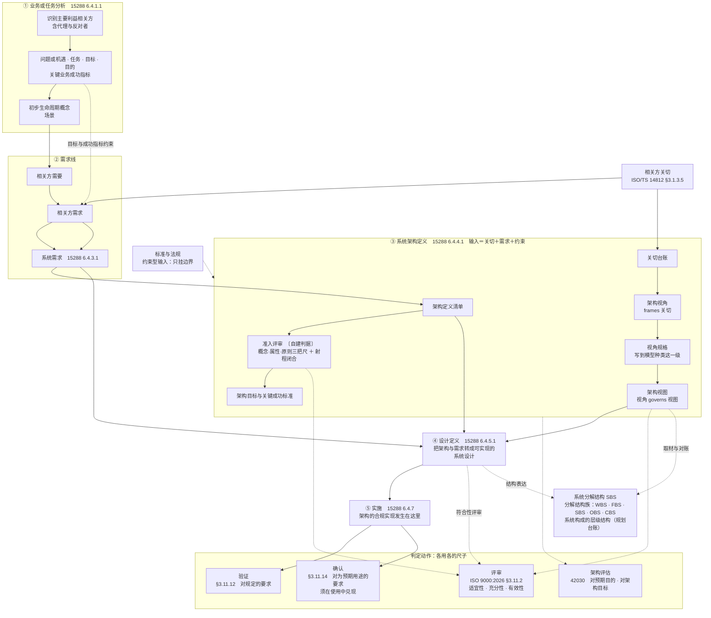
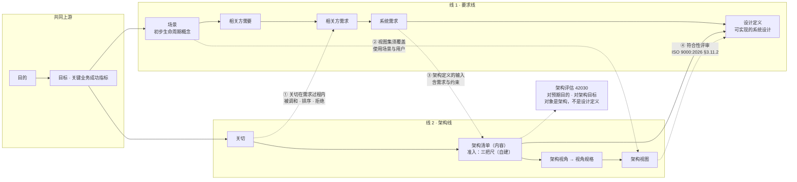

# 架构与设计过程模型研究报告

## —— 从术语定义到双线过程

**Architecture and Design Process Model: A Research Report**

> **编号**：34（研究报告稿）
> **日期**：2026-09-24
> **主题**：以标准为唯一依据，重新厘定架构定义与设计定义的分工、接口与产物；给出产品设计过程的两种视图（分层过程图／双线视图）；补正系统分解结构（SBS；旧名产品分解结构 PBS 非标准术语）、相关方关切、评审与评估的定位；补齐**从架构定义到设计定义的过程与方法**（含「合规实现」溯源、两条转化、递归换手点）与**八类可实现性关切在架构视角上的分配**
> **修订记录（2026-09-24 依库内五份标准正本核改；版本 v1.2 → v1.3）**：五份标准全文入库（42010:2022／42020:2019／42030:2019／15288:2023／ISO 9000:2026），本报告涉标准出处、条款号与逐字引文的部分**逐条对正本复核**。**四组更正**——① **★「合规实现」出处改挂一手**：原判为 ISO/IEC/IEEE 24765:2017（经 ISO/TS 14812 §3.1.15.1 转引），**正本一手在 15288:2023 §3.13**（*…sufficiently complete to support a compliant implementation of the architecture*）——§9.7 整节重写并补过程侧 §6.4.5.1 目的句、第二段三个对齐面与 Note 2 回退通道，24765／14812 降为术语学旁证；摘要第 12 条同步。② **★ 六处 SEH 转引实为 15288 §5.9 一手**（原标 SEH p148／p153／p155）：*The system architecture definition process focuses on defining an architecture that addresses the stakeholder concerns and is applied iteratively and concurrently with…*／*The design definition process … is driven by requirements that have been vetted through evaluation with the architecture and more detailed analyses of feasibility.*／*Architecture focuses on suitability, viability, and desirability, whereas design focuses on compatibility with technologies … and on feasibility of construction and integration. An effective architecture is as design-agnostic as possible…*——**「有效的架构尽可能不依赖于设计」的规范位即 §5.9**。③ **未核清单 9 项结清**（原第 1、2、3、4、5、9 项＋第 8 项部分）：42010 §3.2、§3.7、§3.8 逐字、15288 §3.13 与 §6.4.11.1 逐字、**42020 六过程名（原清单漏第六个「架构使能 §11」）**、42030 分层与附录条款、§8.1 视角规格 a)–g) 七项；④ **新增正本依据两处**：15288 **§6.4.4.3 Note 1**（架构定义活动的 b)~d) **对应 42020 的三个核心过程**，即「三核过程」接驳为**标准明写**）、**§6.4.5.1 内明写 architecture entity 与 system element *represent two different notions***。**未改**：§一～§八、§十、§十一 的骨架与结论、附录 C／D 的示例构造、全部节号与图表结构。
> **依据（只用标准与外部权威）**：ISO 9000:2026（**标准全文**，仓库存中英对照版）｜**ISO/IEC/IEEE 15288:2023（库内全文）**——过程条号、§5.9、§6.4.4.1、§6.4.4.3 Note 1、§6.4.5.1、§6.4.11.1 与 §3.13 均已由正本直核，INCOSE SEH 5.0 中文版（2023-07）退为**同版同年旁证**｜**ISO/IEC/IEEE 42010:2022（库内全文）**｜**ISO/IEC/IEEE 42020:2019（库内全文）**｜**ISO/IEC/IEEE 42030:2019（库内 CSA 2020 采标件全文）**｜ISO/TS 14812:2022（ISO/TC 204 官方词汇站，**术语学旁证**）｜OMG UAF 1.4 RTF 缺陷单 UAF14-152／UAF14-27
> **文档版本**：v1.0（2026-09-24 创建）→ v1.1（同日续）→ v1.2（同日两次续补）→ **v1.3（2026-09-24 依库内五份标准正本核改：合规实现出处改挂 15288 §3.13、六处 SEH 转引实为 §5.9、未核清单 9 项结清）** → **v1.4（2026-10-08 依 15288:2023 §6.4.9 与产品数据口径对齐）** → **v1.5（2026-10-11 术语基线换 42010:2022 正本、清除 2011 版"元素与关系"语义残留）** → **v1.6（2026-10-12「以 35 号为基准的全库对齐」轮·§9.6 表「产物」格原印「架构（没有形态、交不出去）」——改引正本 *intangible and abstract*（42010:2022 Introduction L177，非 §5.3）并加勘误；§2.7「架构实体 ≠ 系统元素」六处术语注经逐处复核＝**合法**（正本 §5.9 逐字 *two different notions*，与库内对照版中译「两种不同的概念」一致））** → **v1.7（与 46 号 v3.0 基准对齐轮：撤「由目的裁」换三把尺、B18 三套名字不可串、B23 §6.4.5.1 NOTE 2 更正与 §3.1 表 `entity` 归一）** → **v1.8（2026-11-01 与 46 号 v3.3 对齐轮：§0.5 三级论证体例＋附录 E 结论台账、三处四段论证、§一 依据表结构修、附录 D 范例体例、判定对象让位 46 号 §10.4）**
> **取证纪律**（本轮用户定）：**不引用本项目研究报告的结论**；引外文一律原文与中译并列；一手／二手／形式化三分；见不到条款文本写「未核」，不补号不补句
> **修订记录（与 46 号 v3.0 基准对齐轮；版本 v1.6 → v1.7）**：**四组改动**——① **撤「由目的裁」判定式，换三把尺**：摘要第 8 条、§3.1 三段结构表两格、§7.2、§7.3 两处图内文字、§7.5 末条整段（改「三把尺＋射程闭合」，并补「权责三分」：相关方提／架构师判／治理裁留痕）；② **B18 三套名字一次扫**：`architecture entity`（被架构的那个事物）／`architectural entities`（架构侧实体）／`elements in the model`（模型层）分界立于 **§2.2 末条**，§9.2② 注①注②、§9.3 注③、§11.3 注、§11.4 注④、§11.7 注⑤ 一律改指 §2.2 末条；③ **B23 引用号更正**：「同条见 §6.4.5.1 Note 1」四处改「§6.4.5.1 **NOTE 2**（仅含反馈句，不含 *two different notions* 句）」，该句归位 §5.9 的正文段；④ **其他表述归一**：§3.1 表 `of a system` 改 `of an entity`（42010:2022 §3.2 正本；v1.5 清残留漏网处）、§2.2 要点句把「一视图恰一治理视角是 2011 口径」收窄为「§6.7 b) 仍要求单数视角，只是不再标重数」、§7.4 补「描述符合性」一行、§一 42030 行档位改「库内正本全文」、摘要第 4 条与 §7.1 第 2 条补「清单是内容的全集」、§10.2 补「视角由本项目自建」、§10.3 表题标明 14812 四类只作示例、「承重关切／第一承重视角」改「主要关切／第一受理视角」。**未改**：§一～§十一 的骨架与结论、节号、表列数、附录 A~D 的示例构造与案例事实。
> **修订记录（与 46 号 v3.3 对齐轮；版本 v1.7 → v1.8）**：**六组改动**——① **立三级论证体例**：新增 **§0.5**（A／B／C 三级与四段定式）＋ **附录 E 结论台账**（27 条，逐条给级·依据·论证位置），摘要末加台账指针；补三处四段论证——**§5.2.1**（SBS 不是架构视图）、**§11.5.1**（「接口只细化不新增」不成立）、**§10.4.1**（八类可实现性关切不必各配一个视角）；② **判定对象让位**：§2.5 降为术语位、§7.4 改为承 46 号 §10.4 的动作落地表、§7.5 只留射程闭合与判据自建，概念层一律指 46 号 §3 与 §10.4；③ **§一 依据表结构修**：补齐行（补 42020:2019）、15288 等级改正本直核、一刀切声明与版本说明移出表体成为 §1.2；④ **范例体例**：附录 D 三例改「声明行 → 走法表 → 三问反向验 → 与结论互指」，新增 **§7.6 双线走一遍**（冷链）；⑤ **措辞与落位更正**：§5.9 的正文段（不在 §6.4.5.1 任何一条注里）正面直陈五处、§3.3「判据来自目的」判废、§6.3 按 46 号 §9.1 四词重排、§10.5 改「五处待确认项」、附录 D 页首标编号不同源；⑥ **号形**：正文条款就近补标准名，整列同标准的表加「号形说明」。**未改**：§九~§十一 的骨架与结论、附录 A~D 的案例事实与数值、既有节号（新增节除外）。
> **修订记录（2026-09-24 两次续补；版本 v1.1 → v1.2）**：① 新增 **§十一 设计定义：形态、表达与审核方法**（工作产品形态、表达手段三层、内容要件七件、信息项家族、合格判据、与架构描述的分工、九查审核法）；② 新增 **附录 D 三例设计定义与合规审核**（**案例底本取自 32 号附录 C**，判据只取标准）；③ 摘要补第 15~16 条；④ 附录 B 补两项未核。
> **修订记录（2026-09-24 续；版本 v1.0 → v1.1）**：① 新增 **§2.7 架构定义与设计定义**（两过程的目的句与描述、`design` 的宽窄两义）；② 新增 **§九 从架构定义到设计定义**（关系五条、并发·迭代·递归、四组过程活动、两条转化、五类方法、五条判据、回退通道、递归换手点、「合规实现」溯源）；③ 新增 **§十 可实现性关切与架构视角的分配**（八项关切的受理表与五件待裁）；④ 摘要在原十条后补第 11~14 条；⑤ 附录 A 补 ISO/IEC/IEEE 24765:2017 与 14812 §3.1.15.x 行、附录 B 补四项未核、附录 C 补术语十行。（v1.0＝2026-09-24 创建，覆盖第 1~25 轮）
> **修订记录（2026-10-08 依 15288:2023 §6.4.9 与产品数据口径对齐；版本 v1.3 → v1.4）**：用户令「验证和确认都不只是针对实现，是针对产品数据的」。本报告两处按新口径改宽——**§7.4 表**「验证／确认」两行的**对象**列由「实现物」改为「实现物，或人工制品」／「不限」（15288:2023 §6.4.9 逐字 *a system, system element, or artefact*；本表原已引该条却把对象写作实现物，属自相抵）；**§11.7 首段**「设计定义……只可评审，不可确认或验证」改「可评审，也可验证；做不了确认」。**九查与三档结论、以及「合规的承担者是实现」不变**。**未改**：其余行文与结论、节号、表格行数、图结构。
> **修订记录（2026-10-11 术语基线换 42010:2022 正本；版本 v1.4 → v1.5）**：用户令「清除 42010 **2011 版语义残留**（把架构定义成结构／元素与关系），术语基线换成 **2022 正本**」。**六组改动**——① **§2.2 术语基线整块换正本**：架构、关切、利益相关方、架构视角、架构视图五条定义句由 ISO/TS 14812（自标源 42010:2011）换为 **42010:2022 §3.2、§3.10、§3.17、§3.8、§3.7 逐字**；**要点句补 `model kind` 正本定义（2022 §3.15）**；**删去"2022 版删除了重数标注"所夹带的"一个视角治理至少一张视图（重数 1..*）"**——该重数系 2011 口径，正本 §6.7 只到"每个用了的视角至少一张视图"（*An AD shall include one or more architecture views for each architecture viewpoint used.*）。② **§一 表内降级并补出处**：ISO/IEC/IEEE 42010 行改列**库内正本全文**，并注 **15288:2023 §3.5** 以 system 替 entity 的同源定义；ISO/TS 14812 行标注**该侧六条架构术语系 2011 口径 → 只作【历史对照】**；**删去"2022 版的 `view`／`viewpoint`／`architecture` 逐字本轮未取得"整条版本说明**（正本在库，该说法已不成立）。③ **§3.1 随基线改锚**：定义句改引 42010:2022 §3.2，并显式点出三段结构含"泛指称实体（entity，2022 统称 `entity of interest`）"一段；**同节列出 2011 版定义句作为历史对照**（*embodied in its elements, relationships* 已在 2022 版删去，该层含义今只在 42020:2019 §3.3 注 1 *usually intended to be embodied in the entity's components, the relationships between components, and the relationships between the entity and its environment*——**注释级、无术语地位**）。④ **补「架构实体 ≠ 系统元素」限定七处**——**主裁定五处**（§9.2 ② 第一项后、§9.2 ② 第三项后、§9.3 两条转化行、§11.4 系统接口定义行、§11.7 第 1 行实体转化）＋**清单外经主笔裁定补办两处**（§3.2 第 4 条、§8.1 架构定义产物行）：**架构实体（被架构的实体，或经受系统架构定义过程的实体）与系统元素（系统中满足规定要求的离散部分）代表两种不同的概念**（15288:2023 §5.9 逐字）；正本无此限定即退化成 2011 口径。**§9.1 关系 4 与 §9.4 判据 3 是 SEH 转引，经裁定不改引文块。**⑤ **附录 A／C 随迁**：14812 行标注**历史对照**；附录 C 架构、架构视角、架构视图三行出处改挂 2022 正本，并补 2022 术语（`entity of interest`、`stakeholder perspective`）与**场景映射**（正本的架构类型不在 42010:2022 术语表内）。⑥ **一刀切声明**（附于 §一 表后）：**本报告凡引 ISO/TS 14812 的架构类术语（含物理／功能／通信／企业视角与架构类型），一律只作补充材料与【历史对照】，不作现行基线；现行基线是 42010:2022 正本**——故各"论证位"引用不再逐处挂牌。**另**：§十.2 第 3 条与对话记录第 32 轮各摘去 2011 口径括注"（重数 1..*）"（保留结论，注明 2022 正本不标重数）。**未改**：§一～§八、§十、§十一 的骨架与结论，附录 C／D 的示例构造，全部节号与图表结构，以及 §2.2 内 14812 自带视角分类（物理／功能／通信／企业）——**该四类不在 42010:2022 术语表内，作为 14812 的补充材料保留并标明来路**。

---

## 摘要：十六条

1. **上一版术语的落点**：ISO 9000:2026 里「目标」有定义句，「目的」没有——`purpose` 只作 mission 的释义、并作为 objective 的一种表述形式出现（§3.7.11 注 3）。把「目的 vs 目标」当两个互斥的筐，在标准上没有依据。
2. **架构定义的输入是两路**：关切与需求（SEH p148 逐字）。所以「关切线」与「需求线」不是两条平行流，而是**交叉的两条内容线**。
3. **关切是双入口的横切件**：既在需求过程里被调和、排序、拒绝（SEH p140），也在架构过程里决定视角与覆盖（ISO/TS 14812 §3.1.3.6）。
4. **「架构定义清单」不是标准件**；标准里对应的是**关切台账 ＋ 视角规格**，且规格必须写到**模型种类**这一级。**清单仍是内容的全集，但全集 ≠ 读取装置**——清单过不了 42010:2022 §6.7 的 b) c) d) 三项（展开见 §7.1 第 2 条）。
5. **SBS 不是架构视图**：它是「系统的划分」的结果，属分解结构族（WBS／FBS／SBS／OBS／CBS），与**物理视图**（physical view）不同族、不同尺子；其户口在**项目规划过程**（15288:2023 §6.3.1.3 任务 4)）。
6. **「合规实现」发生在实施侧**，不在 SBS、也不在设计定义；设计定义是把架构与需求转成可实施规格的中间环节（SEH p155）。
7. **判定动作四把尺子**：评审对工作产品（ISO 9000:2026 §3.11.2）、验证对规定要求（§3.11.12）、确认对「为特定预期用途或应用的要求」（§3.11.14）、架构评估对预期目的（42030:2019 §1 b)、d)）。串尺子是本轮反复出现的错型。
8. **准入评审**（三把尺各管一样）：标准给了动作位（评审定义含 *adequacy*／充分性）与参照物（42010:2022 §6.2 挂关切；附录 A.2 挂理解与四量），**不给阈值、裁定人与公式**——判据须自建并标注，且**概念／属性／原则三者不可共用一把尺**。
9. **支撑概念按角色分**：架构定义＝目的·关切·需求·治理（架构是产物）；设计定义＝架构·需求（输入）＋质量（判据侧）＋特性（载体）。
10. **三处口径更正**：① 分解结构曾被误称为「物理视角下的架构视图」；② 质量曾被误降为「事后量度」而划出支撑概念名单；③ 旧名「产品分解结构（PBS）」非标准术语，2026-10-15 起统一作 **SBS（系统分解结构）**。三处均在本报告改正。
11. **架构定义与设计定义是两类工作、两个过程，但不是两个阶段**——"**有效的架构尽可能不依赖于设计**"；两者之间是**并发、迭代、递归**，递归的形态是"上一层级的产出作为下一层级的输入（定义时往下，实现时往上）"。
12. **"合规实现"的出处是 ISO/IEC/IEEE 15288:2023 §3.13**（一手原文即在此；ISO/IEC/IEEE 24765:2017 经 ISO/TS 14812 §3.1.15.1 转引的同一句降为**术语学旁证**）：设计**足够完整到足以支撑**（*sufficiently complete to support*）对架构的一次合规实现——**合规的承担者是 `implementation`，不是设计／方案本身**。〔2026-09-24 出处更正〕
13. **从架构到方案有四组过程活动、两条转化、五类方法**；判据是完备·一致·可实施·可追溯·原子换手；并有三条回退通道。
14. **八类可实现性关切不必各配一个视角**——四类既有视角已能受理其中大多数；只有**需要独立模型种类且能独立判定**时，才为它新建视角。
15. **设计定义是一件有规定形态的工作产品**：**系统设计描述**——"对系统或元素的设计的描述"；用**方法、框架、图示形式、符号和其他模型形式**表达，并**开发为规范**，用于**采购或实现**。它要到"能拿去采购或实现"为止，**停在〈待定〉即未过出口**。
16. **审核设计定义的动作是评审**（ISO 9000:2026 §3.11.2），对象是工作产品；附录 D 三例的审核结果均为**条件性合规**，且缺口性质各不相同——A 缺**不变量清单**、B 缺**监控覆盖**、C 缺**判据本身**。

**逐条依据与论证位置见附录 E「结论台账」**

---

## 0.5 本报告的论证体例与结论台账

**一条规矩**（与 **46 号 §0.5** 同一套）：本报告不再"挑着论证"。**凡结论，一律进附录 E 的结论台账，按同一标准分三级；A 级必须四段齐全，缺一段即视为未论证。**

| 级 | 什么结论归此级 | 必须给什么 |
|---|---|---|
| **A 级（承重／反直觉）** | 与通行说法相反、或全篇靠它承重的结论 | **四段齐全**：依据（逐条引条款）｜推理（可逐句反驳）｜反证（结论不成立会出什么事，或对立说法撞上哪条原文）｜边界（不覆盖什么） |
| **B 级（条款直引可支持）** | 把条款逐字转成中文即成立的结论 | **条款直引＋性质标记**；不必写推理（推理就是翻译），但**须给出条款位置** |
| **C 级（本报告读法／方法）** | 标准无原话、由本报告归拢或操作的结论 | **标〔读法〕＋所读的条款＋边界**；不得写成标准规定 |

**本号的账**：A 级 **3 条**，四段见 **§5.2.1**（SBS 不是架构视图）、**§11.5.1**（「接口只细化不新增」不成立）、**§10.4.1**（八类可实现性关切不必各配一个视角）；B 级与 C 级共 24 条，见 **附录 E**。

**为什么"一视同仁"不等于"条条写长"**：若每条都铺四段，A 级的论证反而被稀释——读者分不出哪里是承重墙。**一视同仁的实质是"同一本账、同一个标准、每一格都填得出凭什么"。**

---

## 一、前提：本轮采信的标准与其证据等级

### 1.1 采信标准

| 标准 | 现行版 | 本轮取到的证据 | 等级 |
|---|---|---|---|
| ISO 9000 | **2026**（第 5 版） | 仓库存**标准全文**中英对照版，本轮逐条引用 ISO 9000:2026 §3.x、§4.3.x | **一手** |
| ISO/IEC/IEEE 15288 | **2023** | 过程 purpose 与活动，经 SEH 5.0 中文版逐条转引并冠以标准条号（[6.4.1.1]～[6.4.9.1]） | **一手（正本）**：§3.5、§3.13、§3.47、§5.9、§6.4.5.1、§6.4.5.3 已由库内正本直核；过程 purpose 句与活动清单仍取 SEH 5.0 中文版转引（二手，同版同年） |
| ISO/TS 14812 | **2022** | ISO/TC 204 官方词汇站，条款级（ISO/TS 14812:2022 §3.1.3.x、§3.1.4.x、§3.1.8.x）；**该侧六条架构术语自标来源 42010:2011**——**只作【历史对照】，不作现行基线** | **一手（委员会发布）** |
| ISO/IEC/IEEE 42010 | **2022**（中文等同采用本 GB/T 45630-2025） | **库内正本全文**——术语（§3.x）、要求（§6、§7、§8）与资料性附录（§A~§F）逐条直核；进程标准侧另有 **15288:2023 §3.5** 以 system 替 entity 的同源定义 | **一手（正本）** |
| ISO/IEC/IEEE **42020:2019** | **2019** | 库内正本全文——§3.6（架构实体）、§5.6（*initially notional* 与设计关系）、§8.4（概念化）、§9.4（评估）、§10.4.4 b) 注 1 与 e)（分配）、附录 E.2.1 逐条直核 | **一手（正本）** |
| ISO/IEC/IEEE **42030:2019**（库内件为 **CSA 2020 采标**，文件名 `ISO IEC IEEE 42030-2020.md`） | **2019** | 库内正本全文——§1 Scope 九条用途 a)~i) ＋ Introduction 六条 a)~f) ＋ NOTE 界碑 | **一手（正本）** |
| INCOSE SEH 5.0 中文版 | 2023-07 | 分解结构族机制（SBS）、各过程 purpose、关切调和、架构治理与管理、设计定义过程 | **二手（外部手册）** |
| OMG UAF 1.4 RTF 缺陷单 | 2022／2024 | 引 ISO/IEC/IEEE 42010 的关切定义、关系名与重数、选择次序 | 权威团体公开文件 |

### 1.2 14812 的口径（历史对照）

**一条版本说明**：本报告的架构术语**现行基线是库内 42010:2022 正本**（§2.2 逐字引，附录 B 第 1 条已结清）；**14812 那六条架构术语自标来源为 42010:2011**——凡引其措辞处，一律标**【历史对照】**，且须与 2022 正本对照后使用。（原「2022 版逐字本轮未取得」一说随正本入库作废。）

**一条一刀切声明**：**本报告凡引 ISO/TS 14812 的架构类术语（含物理／功能／通信／企业视角与架构类型），一律只作补充材料与【历史对照】，不作现行基线；现行基线是 42010:2022 正本。** 故下文各「论证位」（§2.2 物理视角条、§四、§六、§七图、§10.3、附录 A／C 等）引用 14812 时不再逐处挂牌。

**一条证据等级说明**：本报告对 **ISO/IEC/IEEE 15288:2023** 的采信等第为 **一手（正本）**——§3.5、§3.13、§3.47、§5.9、§6.4.5.1、§6.4.5.3 已由库内正本直核；仅**过程 purpose 句与活动清单**仍取 SEH 5.0 中文版逐条转引（二手，同版同年），引时按该处所标条号与页号核对。

---

## 二、术语基线

### 2.1 目的与目标

**目标（objective）**——**ISO 9000:2026 §3.7.11** 逐字：

> **result to be achieved** ／ 要实现的结果。

- 注 1：目标可以是**战略性的、战术性的或运行层面的**。
- 注 2：目标可以与不同领域有关；可以是组织范围的，也可以是针对某个项目、产品、服务或过程的。
- **注 3 逐字**：*An objective can be expressed in other ways, such as an intended result, **as a purpose**, as an operational criterion, as a quality objective or by the use of other words with similar meaning (e.g. **aim, goal, target**).*
  → 目标可以用其他方式表述，例如预期的结果、**目的**、运行准则、质量目标，或用 aim／goal／target 等近义词。

**目的（purpose）**——**不是 ISO 9000 的术语条**。它在本标准中以两处形态出现：

1. **ISO 9000:2026 §3.4.11 使命（mission）** 逐字：*organization's **purpose** for existing as expressed by top management* ／ 由最高管理者表述的组织存在的目的。
2. **ISO 9000:2026 §3.7.11 注 3**（见上）：目的可以是目标的一种表述形式。

**判定链上的归属**：

| 术语 | 条款 | 逐字要点 |
|---|---|---|
| 愿景 | §3.4.10 | 由最高管理者表述的、组织希望成为什么样子的愿望 |
| 使命 | §3.4.11 | 由最高管理者表述的组织存在的目的 |
| 方针 | §3.4.5 | 由最高管理者正式表述的组织的**意图和方向** |
| 战略 | §3.4.12 | 实现**长期目标或总体目标**的计划 |
| 目标 | §3.7.11 | 要实现的结果 |
| 质量目标 | §3.7.12 | 关于质量的目标；通常以**质量方针**为依据；通常针对相关**职能、层次和过程**分别规定 |
| 成功 | §3.7.13 | **实现目标**；注 1：组织的成功强调需要在组织的经济或财务利益与其**相关方的需求**之间取得平衡 |

**号形说明**：本表「条款」列各条号均为 **ISO 9000:2026** 条款，故列内只写 §3.x。

**要点**：**目的管方向与归属（表述权在最高管理者），目标管判定与分解**（success＝实现目标）。分开它们的不是词形，而是归属者、抽象层次与可否判定三件事。

在系统一侧，可挂的权威是 **42030:2019 官方摘要**的 *intended purpose*（b、d 条，作架构评估基准）；**42010 §3 无 purpose 条**。

### 2.2 架构、关切、利益相关方、架构视角、架构视图（**42010:2022 正本**）

**架构（architecture）**——**ISO/IEC/IEEE 42010:2022 §3.2** 逐字：

> fundamental concepts or properties of an entity in its environment and governing principles for the realization and evolution of this entity and its related life cycle processes
> 实体在其环境中的基本概念或属性，以及该实体及其相关生存周期过程的实现和演化的管控原则。

**〔历史对照〕2011 版同一条**（ISO/IEC/IEEE 42010:2011, 3.2，经 ISO/TS 14812 §3.1.3.1 转引；正本 42020:2019 §3.3 同句）：

> fundamental concepts or properties of a system in its environment **embodied in its elements, relationships** and in the principles of its design and evolution
> 系统的、体现在其元素与关系以及其设计与演化原则之中的基本概念或属性。

**两版之差**：2022 版**删去** *embodied in its elements, relationships*、主体由 `system` 泛化为 `entity`、`design` 改 `realization`——**定义只剩两样：①基本概念或属性 ②管控原则**。那一层含义今只在 **42020:2019 §3.3 注 1**：*The fundamental concepts or properties of the architecture entity are **usually intended to be embodied in** the entity's components, the relationships between components, and the relationships between the entity and its environment.*——**注释级、无术语地位**。

**关切（concern）**——**42010:2022 §3.10** 逐字：

> matter of relevance or importance to a stakeholder
> 对某个利益相关方而言具有相关性或重要性的事项。

注 2 逐字给出关切的受理面：*interest in an entity is intended to encompass interest in that entity's environment, life cycle, architecture, requirements, design, implementation and operation. Such interests are captured via aspects, concerns and stakeholder perspectives.*

OMG **UAF14-152**（2024-04）逐字引 2022 版口径："In ISO/IEC/IEEE 42010 it's **'matter of relevance or importance to a stakeholder'**"——与正本 §3.10 一致；同一单指出，把定义追加为"regarding an entity of interest"的写法**比标准更受限**，不可当标准定义。

**利益相关方（stakeholder）**——**42010:2022 §3.17** 逐字：*role, position, individual, organization, or classes thereof, having an interest, right, share, or claim, in an entity of interest*。

**架构视角（architecture viewpoint）**——**42010:2022 §3.8** 逐字：

> set of conventions for the creation, interpretation and use of an architecture view to frame one or more concerns

〔按：2022 版定义句为**裸名词短语**，"work product"那层属概念已删（2011 版作 *work product establishing the conventions…*，见 30 号 §1.3）。〕**注 3** 逐字：*The conventions of an architecture viewpoint are documented in a specification of that viewpoint.*——**惯例由该视角的规格记载**。

**架构视图（architecture view）**——**42010:2022 §3.7** 逐字：

> information part comprising portion of an architecture description

关系：`viewpoint governs view`——**42010:2022 §5.2.7** 逐字 *An architecture viewpoint governs one or more of these architecture views.*／**§6.7** 逐字 *An AD shall include one or more architecture views for each architecture viewpoint used.*（**正本不标重数**）。

**〔历史对照〕14812 六条架构术语的 2011 口径**：ISO/TS 14812 §3.1.3.x 六条自标来源均为 **42010:2011**，其定义句与关系名只作历史对照使用——

| 14812 条 | 2011 口径定义句要点 | 2022 正本对应 |
|---|---|---|
| §3.1.3.1 architecture | 含 *embodied in its elements, relationships* | **§3.2**（该句已删） |
| §3.1.3.5 concern | *interest in a system relevant to one or more of its stakeholders* | **§3.10** |
| §3.1.3.4 stakeholder | *having an interest in a system* | **§3.17** |
| §3.1.3.6 architecture viewpoint | **work product** establishing the conventions… | **§3.8**（去属概念） |
| §3.1.3.7 architecture view | **work product** expressing the architecture… | **§3.7**（改 information part） |
| §3.1.3.9 architecture model | **work product** representing one or more architecture views | 2022 改称 **model kind §3.15** |

**物理视角与物理视图**——**ISO/TS 14812:2022 §3.1.4.8** 逐字：*architecture viewpoint used to frame concerns related to **the assignment of functionality to physical objects and the interfaces among these physical objects***；关系 `governs some physicalView`。**§3.1.4.7** 逐字：*architecture view from the physical viewpoint*；关系 `aggregates physicalObject／informationTransfer／functionalObject`。

**模型种类（model kind）**——**42010:2022 §3.15** 逐字：*category of model distinguished by its key characteristics and modelling conventions*；自示例：functional／activity／structural／use case／geopolitical／analytic／economic models。〔按：2011／14812 的 *architecture model*（§3.1.3.9）在 2022 版已并入 `model kind`。〕**视图组件（view component）**——**42010:2022 §3.19** 逐字：*separable portion of one or more architecture views that is governed by the applicable model kind or legend*。

**架构框架（architecture framework）**——**42010:2022 §3.5** 逐字：*conventions, principles and practices for the description of architectures established within a specific domain of application or community of stakeholders*；自示例：GERAM〔ISO 15704〕、RM-ODP、UAF、NAF。

**要点**：视角是**一组惯例**（约定），视图是**信息部件**（AD 的一部分）；关系名取 `frames`（对关切）与 `governs`（对视图）。OMG UAF14-152 引标准："Architecture Viewpoints don't address concerns — they **frame** concerns"；且"**always frame at least one Concern — mandatory**"。**2022 版删除了术语条上的重数标注**（不再写 1..*）；但 §6.7 b) 仍要求每张视图标明 *its governing architecture viewpoint*（中译：**它的**治理架构视角的标识；**单数**）——故**视图受单视角治理**这一条在正本里仍成立，只是不再以重数形式表述。

**一条术语纪律**（本报告与过程标准合读时必带）：**架构实体与系统元素是两种不同的概念**——42010:2022 定义的是**实体**（entity，§3.12 `entity of interest`）的架构；15288:2023 §3.5 把同一定义句的 entity 换作 system，并在 **§5.9** 明写：*Note that an architecture entity (an entity being architected or one subject to the system architecture definition process) and a system element (a discrete part of a system that fulfils specified requirements) represent two different notions.*（架构实体——被架构的实体，或经受系统架构定义过程的实体——与系统元素——系统中满足规定要求的离散部分——**代表两种不同的概念**。）

**三套名字不可串**（本报告全文的用名分界，后文术语注一律指回本条）：`architecture entity`（42020:2019 §3.6；**被架构的那个事物**，不占四层任何一层）≠ `architectural entities`（15288:2023 §6.4.5.3；**架构侧实体**——要被转换进设计的**那批单位**，如战略目标、能力与效果、运行活动、资源功能）≠ `elements in the model`（42020:2019 §10.4.4 注 1；**模型层**的离散单位）。四层分工：①描述层 AD 元素／视图组件 → ②模型层**要建模的实体与关系** → ③设计层设计元素 → ④实现层系统元素；**本报告叙述一律用「要建模的实体与关系」指②模型层**。另：**该句在 15288:2023 §5.9 的正文段**（位于 §5.9 注 2 之前），**不在 §6.4.5.1 的任何一条注里**；§6.4.5.1 的**注 2** 讲的是本过程**向架构定义过程回馈**（*consolidate or confirm the allocation, partitioning, and alignment of architectural entities to system elements*），与「两种不同的概念」无关。

### 2.3 设计与开发、评审、验证、确认

**设计与开发（design and development）**——**ISO 9000:2026 §3.3.11** 逐字：

> **set of processes that transform requirements for an object into more detailed requirements for that object**
> 将某一客体的要求转换为该客体更详细要求的一组过程。

- 注 1：输入要求往往是研究成果，表述比输出要求更宽泛；**要求通常按特性来定义**；一个项目中可以有若干设计和开发阶段。
- 注 2：design、development 与 design and development 三者有时同义、有时分指不同阶段。
- 注 3：可加限定语表明对象（产品／服务／过程设计和开发）。

**评审（review）**——**ISO 9000:2026 §3.11.2** 逐字：

> **determination** of the **suitability, adequacy or effectiveness** of an object **to achieve established objectives**
> 为达成既定目标，对客体的适宜性、充分性或有效性所作的确定。

示例逐字含"设计和开发评审"；注 1：评审也可包括对**效率**的确定。

**验证（verification）**——**ISO 9000:2026 §3.11.12** 逐字：

> **confirmation, through the provision of objective evidence, that specified requirements have been fulfilled**
> 通过提供客观证据，证实规定的要求已得到满足。

**确认（validation）**——**ISO 9000:2026 §3.11.14** 逐字：

> **confirmation, through the provision of objective evidence, that the requirements for a specific intended use or application have been fulfilled**
> 通过提供客观证据，证实针对特定预期用途或应用的要求已得到满足。

注 3 逐字：**使用条件可以是真实的，也可以是模拟的**。

**三者的界分**：评审用 `determination`（定义中**不出现**客观证据）；验证与确认用 `confirmation`，**必须**通过提供客观证据。差别不在分组，在**尺子**：评审对"为客体确立的目标"，验证对"规定的要求"，确认对"为特定预期用途或应用的要求"。

### 2.4 预期用途与使用

两者均**不是术语条**，其规定散在定义句中：

| 出处 | 逐字 | 说明 |
|---|---|---|
| **§3.11.14** | requirements **for a specific intended use or application** | 确认的尺子 |
| **§3.11.13 试验** | determination according to requirements **for a specific intended use or application** | 同一短语 |
| **§3.11.7 计量确认** | requirements **for its intended use**；注 3：预期用途的要求包括**量程、分辨力和最大允许误差**等 | 预期用途产生要求 |
| **§3.5.14 缺陷** | nonconformity related to **an intended or specified use** | — |
| **§3.5.14 注 2** | **顾客所预期的用途**，可能受到供方所提供信息（例如**使用说明或维护说明**）性质的影响 | **预期用途的主语是顾客所预期的用途** |
| **§3.6.5 报废** | to preclude its **originally intended use**（原定用途） | — |
| **§3.6.7 返修** | to make it acceptable **for the intended use** | — |
| **§3.7.1 结果 注 1** | 结果可以表现为输出，也可以表现为**成效**（即**使用或应用**一项或多项输出所产生的后果） | 使用是输出变成效的环节 |

**号形说明**：本节上表「出处」列各条号均为 **ISO 9000:2026** 条款，故列内只写 §3.x。

**系统工程侧**：15288:2023 的确认过程条号为 **§6.4.11**（经 SEH 转引）；运行时须"在**预期的运行环境**中达成其预期用途"（该句本轮取自 2015 版逐字，2023 版逐字未取）。

**译名纪律**：`intended use or application` 作「**预期用途或应用**」；「预期的使用」是误导性译法（此处 use 取目的侧"用途"）。而"使用"另指 `use conditions`／`when in use`，两者并存不冲突。

### 2.5 架构评估（术语位）

> 本题主家在 **46 号 §10**（定义、三条边界、三对象三套依据）；本节只留术语章需要的一段——42030 的九条用途与 NOTE 界碑照抄，概念层不再重述。

**ISO/IEC/IEEE 42030:2019** 官方摘要逐字（用途九条）：

> a) validate that architectures **address the concerns of stakeholders**; b) assess the quality of architectures with respect to their **intended purpose**; c) assess the value of architectures to their stakeholders; d) determine whether architecture entities **address their intended purpose**; e) provide knowledge and information about architecture entities; f) assess progress towards achieving **architecture objectives**; g) clarify understanding of problem space and of stakeholder needs and expectations; h) identify risks and opportunities associated with architectures; i) support decision making where architectures are involved.

同摘要 NOTE 逐字（界碑）：

> **本文件针对的是架构的评估，而非架构描述适宜性的评估**；后者属 ISO/IEC/IEEE 42020 的架构概念化与细化过程。

**要点**：评估的**依据侧含预期目的**（42030:2019 §1 b) 判架构、§1 d) 判架构实体，**两处主语不同**），但预期目的只是**参照**，须化成评估目标与准则才可判（42030:2019 §3.4）；**判定靠目标**（§1 f)）。对象是**架构**，不是架构描述。`concern`（a、c）与 `architecture objectives`（f）在标准自己的清单里**分列**。

### 2.6 质量（补）

**ISO 9000:2026 §3.5.2 质量** 逐字：*degree to which a set of **inherent characteristics** of an object fulfils **requirements*** ／ 客体的一组**固有特性**满足**要求**的程度。注 2：「固有」与「赋予」相对，是指存在于客体之中的特性。

**ISO 9000:2026 §3.10.2 质量特性** 逐字：*inherent characteristic of an object **related to a requirement*** ／ 客体的与要求有关的固有特性。注 2 逐字：**赋予客体的特性（如某客体的价格）不是该客体的质量特性**。

**ISO 9000:2026 §3.10.1 特性** 逐字：可区分的特征；注 1：特性可以是**固有的**，也可以是**赋予的**；注 2：可以是定性的，也可以是定量的。

**ISO 9000:2026 §4.3.1 质量（概念段）** 逐字：组织产品和服务质量的高低，取决于它们**满足顾客需求和期望的程度**，以及它们对相关方**有意的和无预期的影响**；这种评价不仅取决于产品和服务**预期的功能和性能**，还取决于**顾客所感知的价值**以及给其他相关方带来的收益。

---

### 2.7 架构定义与设计定义（两个过程名）

**架构定义（System Architecture Definition）——15288:2023 §6.4.4**。目的句（SEH p148／书内 p133 逐字引 **[6.4.4.1]**）：

> 系统架构定义过程的目的是**生成系统架构的不同方案，选择一个或多个能够满足利益相关方关切和系统需求的方案，并以一致的视图和模型进行表达**。

过程描述逐字：

> ……将相关的架构（例如，战略架构、企业架构、参考架构和系统集群架构）、组织和项目的政策及指导、生命周期概念与约束、**利益相关方的关注点和需求以及系统需求与约束**，转化为**系统的基本属性和概念，以及指导系统及其相关生命周期过程演化的原则（系统架构的定义）**。该过程最终生成一个**系统架构描述**……

两条补充逐字：架构治理"将通过**发布架构治理指导**为系统架构定义过程**提供额外指导**"；"**系统架构描述应被视为一个动态工件**"。

**设计定义（Design Definition）——15288:2023 §6.4.5**。目的句（SEH p155／书内 p140 逐字引 **[6.4.5.1]**）：

> 设计定义过程的目的是**提供关于系统和其元素的足够详细的数据和信息，以便根据系统需求和架构实现解决方案**。
> 该过程由**经过架构和更详细的可行性分析审核的需求**驱动。

过程描述逐字：

> 设计定义过程将**架构和需求转化为可实现的系统设计**。该过程产生关于系统及其元素的足够详细的数据和信息，以便能够**根据模型和系统架构的视图中定义的架构实体进行实施**，并符合相关的系统需求……系统元素是在**系统架构定义过程中识别出的**……设计信息和数据将**定义分配给每个系统元素的预期属性和特征**，并支持**向其实现的过渡**。

**分立说明**（SEH p153／书内 p138 逐字）：

> 系统架构定义过程侧重于适用于系统解决方案的**基本概念、特性结构、行为和特性**……**设计定义过程则侧重于制定整体系统设计，确保其细节充分以便于后续的实现**。**有效的架构尽可能不依赖于设计，以便在设计的权衡空间中实现最大的灵活性。**

**`design` 的宽窄两义**（引用时必须标口径）：

| 口径 | design 指什么 | 出处 |
|---|---|---|
| **宽义** | 定义**架构**、系统元素、接口及其他特性的**过程或结果** | ISO/TS 14812 §3.1.15.1（页面自标源 ISO/IEC/IEEE 24765:2017） |
| **窄义** | 架构定义**之外**的那一段工作（本报告用此义） | ISO/IEC/IEEE 15288:2023 §6.4.5 |

"架构只是粗的设计"这一误读，术语学来源正在**宽义**处——它的定义句里就写着 define **the architecture**。

## 三、ISO 为什么引入架构

### 3.1 从定义句读出的三段结构

**42010:2022 §3.2** 的定义句可分三段，各答一个问题（第一段同时给出**泛指称实体**——`entity`，2022 统称 `entity of interest`，见 §3.12）：

| 段 | 答什么 | 解决什么 |
|---|---|---|
| `fundamental` concepts or properties | 什么算**基本**：**理解上的不可省**——没有它，这个实体就说不成一套（三把尺与「实质」的判据主家在 **46 号 §3.2~§3.7**，本表只给定义句的读法） | 实体千头万绪，须分出**构成与否**两层 |
| of an entity **in its environment**（中译：**实体**在其环境中） | 相对谁算本质 | 基本与否定在**实体在其环境中**的四量上（效用·成本·时间·风险），**不在目的上**，非绝对属性 |
| `governing principles` for the realization and evolution | 凭什么约束下游与时间 | 架构不只说"是什么"，还说"必须怎么做成、怎么改"（2022 版作 **realization**，2011 版作 design） |

### 3.2 它填的空白

1. **不可视见，因而不可交付**：42010:2022 官方摘要逐字：*"This document distinguishes the architecture of an entity of interest from an AD expressing that architecture. **Architectures are not the subject of this document.**"* → 不能直接管的东西，先管它**可判定的形态**。
2. **复杂度超出认知带宽**：架构提供压缩与共享心智模型。
3. **多方关切无法同时上桌**：标准用 `视角 frames 关切／视图 addresses 关切` 把"谁在乎什么"变成**可核查的覆盖问题**。
4. **"合规"需要落点**：SEH p155 逐字，设计定义是"以便能够**根据模型和系统架构的视图中定义的架构实体进行实施**"——**合规的对象是架构，承担者是实施**。（此处的**架构实体**＝被架构的实体，或经受系统架构定义过程的实体，**与系统元素是两种不同的概念**：*an architecture entity … and a system element (a discrete part of a system that fulfils specified requirements) represent two different notions.*——15288:2023 §5.9 逐字。）
5. **变更与演化没有锚**：定义句把 evolution 写进原则的作用面。
6. **评估没有靶子**：42030 的九条用途几乎全部以架构为对象。
7. **责任无法指认**：42020 把架构治理列为架构过程之一，并"通过发布架构治理指导为系统架构定义过程提供额外指导"（SEH p148）。
8. **跨组织不可采信**：42010:2022 摘要逐字，符合性是对 **AD、ADF、ADL、架构视角与模型种类分别**做的。

### 3.3 为什么由标准来做

42010:2022 的范围逐字写明它**不管**过程、方法、模型、符号、技术与工具，也不管记录格式与媒体。**它标准化接口，不标准化内容**——因为"什么是好架构"的判据**不由标准供给**：标准只给方向与参照物（42010:2022 §6.2 把"基本"挂在**关切**上；附录 A.2 挂**理解**与**效用·成本·时间·风险**四量），不给阈值、裁定人与公式。**"判据来自目的"不成立**——那正是 46 号 §3.3 判废的口径。

### 3.4 它不解决什么

- **不给"什么算基本（fundamental）"的判据**：定义句里只有 `fundamental` 一词，标准未给准入条件。
- **不评架构好坏**：那是 42030 的正业，且评的是架构而非描述。
- **不等于文档或图**：可交付、可签收的是架构描述。
- **`governs` 不是 architecture governance**：前者是概念模型里的关系名。
- **不能对工作产品做验证或确认**：工作产品只能评审。

---

## 四、架构视角存在的价值

**一句话**：把"看的方式"从个人手艺变成**公共约定**——关切是主观的、视图是具体的，二者都不能被复用、版本化、核查与追责，**只有规则可以**。

| # | 价值 | 依据 |
|---|---|---|
| 1 | **唯一占两条关系的元素**：`frames`（对关切）与 `governs`（对视图） | 14812 §3.1.3.6 关系表 |
| 2 | **关切的执行形态**：把"谁在乎什么"翻译成"按什么规矩看什么、谁来复现" | §3.1.3.6；OMG UAF14-152 的 mandatory 表述与选择次序 |
| 3 | **覆盖检查的判定单元**：关切至少被一个视角框定；启用的视角至少治理一张视图 | 关系表的 `some` 强制 |
| 4 | **合规有可判定对象**：视角规格即视图的验收条件 | §3.1.3.6、§3.1.3.9 |
| 5 | **抽象层级由复用性决定**：视角只规定到**模型种类**这一级 | 同上 |
| 6 | **组织资产**：视角可入库、可跨项目复用；ADF 可取自领域既有框架 | §3.1.3.3 及其两例 |
| 7 | **两把尺子分得开**：评架构对目的（42030）／评描述适宜性归 42020 | 42030 摘要 NOTE |

**号形说明**：本表「依据」列各条号均为 **ISO/TS 14812:2022** 条款（该侧自标源 42010:2011，只作【历史对照】），故列内只写 §x.y；标 OMG 者除外。

**它不是什么**：视角 ≠ 视图（规则 vs 产物）；视角 ≠ ADF（后者是约定集）；视角 ≠ 模型种类（视角聚合它）；`governs` ≠ architecture governance。

---

## 五、系统分解结构（SBS）的定位

### 5.1 SBS 是什么

正本（ISO/IEC/IEEE 15288:2023）：

- **§6.3.1.3 任务 4)** 逐字：*Establish appropriate breakdown structures.*（中译：建立适当的分解结构。）——它写在**项目规划过程**里。
- **§6.3.1.3 注 4** 逐字：*Typical breakdown structures include work breakdown structure, functional breakdown structure, system breakdown structure, and organizational breakdown structure.*（中译：典型的分解结构包括工作分解结构、功能分解结构、系统分解结构和组织分解结构。）
- **§5.2**：生存周期过程**递归**应用于所关注系统，直到结构分解到"可理解且可管理的系统元素可被实现（制造、购买或复用）"的程度；**系统结构本身不必是层级**。

二手手册（SEH 5.0 中文版，用名与正本不同，引文照原字）：

- **p103（书内 p88）** 逐字："功能树，也称为功能分解结构（FBS），是将所需系统的功能分解为逐级更低层次的**功能架构**……产品树，也称为**产品分解结构（PBS）**，是将系统分解为逐级更低层次的**物理架构细节**。"
- **p34** 逐字："这被称为**系统的划分**，最终的结果叫做产品分解结构（PBS）……**系统内的层级结构是使用划分关系对系统结构进行组织表示的一种方式**。"
- **p101（书内 p86）** 逐字：分解结构族＝WBS／FBS／**PBS**／OBS／CBS，"是**系统工程与项目管理的交叉活动**之一"（引 Forsberg 等，2005）。

**用名处置**：正本给的名字是 **system breakdown structure（SBS）**；SEH 用的「产品分解结构（PBS）」在库内四份正本检索 `product breakdown structure` **零命中**——**不是标准术语**，本报告与教材书一律不用，遇到它改说 **SBS**，或直接说"哪一份台账"。

### 5.2 SBS 不是架构视图

ISO/TS 14812 的术语体系里：

- 物理视角 `governs` 的是 **physical view**（§3.1.4.7、§3.1.4.8）；
- 物理视图 `aggregates` 的是 **physicalObject／informationTransfer／functionalObject**；
- 物理对象"在物理视图内被表示为**元素**并承担一个角色"（§3.1.8.1 注 1）；
- **整套架构术语中没有"分解结构"这一条**；分解结构的户口在**项目规划过程**（15288:2023 §6.3.1.3 任务 4)）。

**结论**：视图的资格来自"被某个视角治理"，不是来自"它长成一棵树"。**不写视角规格而宣称"某分解结构是架构视图"，属无据。** 唯一合法通道是自建 ADF 并写出治理它的视角规格。

#### 5.2.1 为什么 SBS 不是架构视图〔论证〕

**结论**：系统分解结构（SBS）不是架构视图，也不属于任何架构视图；它是项目规划过程产出的一份分解台账。

**依据**：
- 15288:2023 §6.3.1.3 任务 4)（逐字·规范）：*Establish appropriate breakdown structures.*
- 15288:2023 §6.3.1.3 注 4（资料性）：*Typical breakdown structures include work breakdown structure, functional breakdown structure, system breakdown structure, and organizational breakdown structure.*
- 15288:2023 §5.2（逐字·规范）：生存周期过程递归应用于所关注系统，直到系统元素可被实现（制造、购买或复用）；**系统结构本身不必是层级**。
- 42010:2022 §3.19（逐字·规范）：视图组件＝*separable portion of one or more architecture views that is governed by the applicable model kind or legend*。
- 42010:2022 §6.8（逐字·规范）：组件须标明**模型种类**，无则给**图例**。
- 42010:2022 §6.7（逐字·规范）：每张视图须含或引用 a)~d)，其中 b) 为**治理它的视角的标识**、c) 为**组件应对该视角框定的全部关切**。

**推理**：
① 视图的资格来自"**被某个视角（或模型种类、图例）治理**"，不来自形状——"长成一棵树"既不是必要条件也不是充分条件；
② SBS 的户口在**项目规划过程**（15288:2023 §6.3.1.3 任务 4)），其合格判据是划分纪律与配置／成本可用性，与视角规格无关；
③ 若 SBS 认作架构视图，它须承载 42010:2022 §3.2 的两样内容（概念或属性／管控原则）之一，而它承载的是"工作由哪些件承担、责任与进度如何组织"——两者不在同一根轴上。

**反证**：
设 SBS 就是物理视角下的一张视图，则它的每个节点都须是一个受模型种类管辖的视图组件，并能答"它应对了该视角框定的哪一条关切"。事实上 SBS 的节点答的是"谁负责、做到哪一步"，与关切—覆盖无关；且同一份 SBS 在成本口径与进度口径下会被重排，而视图的读法由视角写死、不随用途改。**两种性质不能同时成立。**
另一侧反证：若"树形"是视图的充分条件，则 WBS 与 OBS 一齐都成了架构视图，42010:2022 §6.7 的视角治理条款将无从适用。

**边界**：
本节不否认 SBS 与物理视图**同源**（同一批实物）——两者可互相参照，SBS 是画物理视图时的取材与对账底稿；也不否认工程上可把某棵树收进描述——**唯一合法通道是自建 ADF 并写出治理它的视角规格**（§5.2 末）。"长成一棵树不是视图资格"这一判断不覆盖"SBS 可以充当物理视图的取材来源"那一半。

### 5.3 SBS 与物理视图的关系与区别

| 维度 | **物理视图** physical view | **系统分解结构 SBS** |
|---|---|---|
| 是什么 | 从物理视角表达架构的**信息部件**（information part） | 一份**规划台账**：系统构成的层级结构 |
| 上位族 | 架构描述成分 | 分解结构族（WBS／FBS／SBS／OBS／CBS） |
| 户口 | 架构描述，受物理视角**治理**（视角＝约定） | **项目规划过程**（15288:2023 §6.3.1.3 任务 4)） |
| 回答什么 | 功能**分配**到哪些物理对象、这些对象之间的**接口**是什么 | 工作由**哪些件**承担、**责任与进度**如何组织 |
| 元素 | physicalObject／functionalObject／informationTransfer | 产品件（层级节点） |
| 形状 | 由 **model kind** 决定（可树、可矩阵、可分配表） | 通常是树——**那是"台账要好查"这个用途逼出来的，不是系统本来就长这样**（§5.2：系统结构本身不必是层级） |
| 服务 | 架构的表达与判定 | 组织工作、分派责任、管理进度；成本与工作包 |
| 尺子 | **视角规格** | **划分纪律** ＋ 配置／成本可用性 |

**关系**：**同源（同一批实物）、不同族（描述侧 vs 规划侧）、无上下位**。SBS 只覆盖物理视图三类构成物中的**一类**——功能与传递／接口在 SBS 上没有位置。**SBS 是画物理视图时的取材与对账底稿，不是那张视图，也不是它的一部分**（两者可以互相参照，但不是同一份东西：一份是架构的表达，一份是规划的台账）。

### 5.4 三处口径更正

1. **更正一**：曾把 32 号类报告的项目归位表述为"按最新标准，某分解结构是物理视角下的一张架构视图"。**标准从未如此说**——物理视角治理的是 physical view。
2. **更正二**：曾据 SEH p103"展开物理架构细节"一句支撑上述主张。**SEH 没有这么说**——它把分解结构归入分解结构族，并注明那是系统工程与项目管理的交叉活动。**"相关"被读成了"是"。**
3. **更正三（2026-10-15 随教材书第14章定稿同批）**：本报告旧版以「**产品分解结构（PBS）**」为活跃概念名。该名**非标准术语**（库内四份正本 `product breakdown structure` 零命中）；正本的名字是 **system breakdown structure（SBS）**，户口在**项目规划过程**（15288:2023 §6.3.1.3 任务 4)＋注 4）。本报告自此**一律用 SBS**：摘要第 5·6·10 条、§七、§十二 结论、附录 A 术语行与图内标签同步改；SEH 引文**照原字保留**（那是二手手册的用名）。

---

## 六、相关方关切的位置

### 6.1 为什么要开发关切（四个目的）

| # | 目的 | 依据逐字 |
|---|---|---|
| 1 | **给架构定义定"满足谁"** | SEH p148 引 15288 **[6.4.4.1]**："生成系统架构的不同方案，选择一个或多个能够**满足利益相关方关切和系统需求**的方案" |
| 2 | **给"看什么"定靶** | 14812 §3.1.3.6（视角 frames 关切）；OMG UAF14-152（mandatory；**先确立关切，再选视角**） |
| 3 | **给"漏没漏"定清单** | 42030 摘要 a)："validate that architectures **address the concerns of stakeholders**" |
| 4 | **给"来源"开口并带入两类人** | 15288 **[6.4.2.1]**（明确利益相关方需要与需求）；SEH p140（反对者"首先被考虑"；联系不到者"应确定其**代理**"）；ISO 9000 §3.5.1（要求三支，"通常隐含"那一支无文件来源） |

### 6.2 关切如何被判断

**没有一部标准给"关切合格性"的判据**；标准给的是**受理规则**：

1. **资格**（ISO/TS 14812:2022 §3.1.3.5、§3.1.3.4）：只问是否与某个利益相关方相关的利害，不问正当性与可行性。
2. **关系**（ISO/TS 14812:2022 §3.1.3.6 关系表）：唯一可机械检查的一层——`frames some concern`、`governs some architectureView`。
3. **处理**（SEH p140 逐字）：关切"可能存在冲突、不完整、模糊、不可行或无法在项目约束条件下集体满足"，故须有"**调和**"途径，"对竞争的关注点进行优先级排序"，甚至"**直接拒绝**某些利益相关方的关注"——**拒绝理由只有两条：与其他相关方的需要与需求不一致／缺乏可行性**。
4. **去向**（SEH p139／ISO 9000 §3.5.1）：关切转成需要与需求后才进判据体系；每条需求要带来源、理由、优先级。

### 6.3 关切、目的与目标的定位

三个词按 **46 号 §9.1** 的四词定位分开写；本号只留落到过程侧的那一面：

| 词 | 站哪一侧 | 本号的用法 | 条款位 |
|---|---|---|---|
| **关切** | 相关方侧 | 可主观、可冲突、可无对应需求；两处入口——需求过程内被调和·排序·拒绝，架构过程里框定视角与覆盖（六处用法见 **46 号 §9.2**） | 42010:2022 §3.10、§5.2.4；42030:2019 §1 a) |
| **目的** | 作品侧 | 这份描述／这张视图／这次评估**拿它做什么**；实体之意在 15288:2023 §6.4.1、§6.4.2 | 42010:2022 §3.8 注 2；42020:2019 §10.4.3 e) |
| **目标** | 评估侧 | 评估时的**尺子**——判进度与达成，不判内容 | 42030:2019 §1 f) |

**"目的是裁决关切的尺子"不成立**：关切互相冲突，冲突由**治理**仲裁（42010:2022 §5.2.4；**46 号 §3.10.1** 四步），不用其中任何一方当尺；42030 把 `concern`（a、c）与 `architecture objectives`（f）在标准自己的清单里**分列**，也没把两者设成上下位。**两者都不是确认的尺子**（ISO 9000:2026 §3.11.14）。

---

## 七、产品设计过程模型

> **过程层的分工**：**架构内容怎么来、怎么判、怎么落位**，主家在 **46 号 §1~§8**；本报告只写**过程怎么走**——两条内容线（要求线／架构线）在哪些点交换、判定动作各用哪把尺、从架构定义到设计定义怎样并发·迭代·递归。

### 7.1 过程次序与三个改正

**标准次序**（SEH 转引 15288 条号）：**[6.4.1.1]** 业务或任务分析 → **[6.4.2.1]** 利益相关方需要与需求定义 → **[6.4.3.1]** 系统需求定义 → **[6.4.4.1]** 系统架构定义 → **[6.4.5.1]** 设计定义 → **[6.4.7]** 实施 → **[6.4.9]** 验证／**[6.4.11]** 确认。

**三个改正**：

1. **不是两条平行支流**：架构定义在需求的**下游**；其输入同时含关切与需求（SEH p148）。
2. **「架构定义清单」不是标准件**：对应的是关切台账＋视角规格（须写到模型种类）。**但清单仍是内容的全集**——说的不是一件标准工作产品，而是"这个概念·属性·原则这条内容线"；**全集 ≠ 读取装置**，清单过不了 42010:2022 §6.7 的 b) c) d) 三项。
3. **SBS 不是架构的合规实现**：合规在实施侧；SBS 属分解结构族、户口在项目规划过程。

### 7.2 分层过程图

**号形说明**：本图节点内条号凡作「NNNNN x.y.z」者，前六位数字即标准号；只写 `§x.y` 或 x.y.z 者承同节点上文的 15288:2023。

### 7.3 双线视图与四个交叉点

**号形说明**：本图节点内「ISO 9000:2026 §3.11.2」已带标准名；「42030」即 42030:2019 的简写，其余条号承同节点上文。

| # | 方向 | 依据逐字 |
|---|---|---|
| ① | 关切 → 需求线 | SEH p140（在利益相关方需要与需求定义过程内）：对竞争的关注点进行**优先级排序**，甚至**直接拒绝**某些关注 |
| ② | 场景 → 架构线 | SEH p151：视图与模型的组合须能**充分覆盖架构描述的使用场景和用户** |
| ③ | 需求 → 架构线 | SEH p148：架构定义过程"将……**利益相关方的关注点和需求以及系统需求与约束**，转化为系统的基本属性和概念……" |
| ④ | 架构 → 设计定义 | SEH p155：**[6.4.5.1]** "设计定义过程将**架构和需求转化为可实现的系统设计**" |

**结论**：两条线作为**内容面**成立；作为**流程**不成立——它们在 ①③④ 三处互相穿过，并在**设计定义**处汇合。

### 7.4 判定动作的分工（承 46 号 §10.4 的动作落地表）

> **本题主家在 46 号 §10.4**（三对象三套依据：架构／架构描述／架构实体）；本表只把它落成本过程模型的**判定动作**，概念层不再重述。

| 动作 | 对象（按 46 号 §10.4 三对象归类） | 尺子 | 正本 |
|---|---|---|---|
| **评审** | 工作产品（清单、架构描述、设计定义）——描述侧 | 适宜性 · 充分性 · 有效性，为达成既定目标 | ISO 9000:2026 §3.11.2 |
| **验证** | **实现物，或人工制品**（*a system, system element, or artefact*）——实现侧 | 规定的要求（须客观证据） | ISO 9000:2026 §3.11.12；15288:2023 §6.4.9 |
| **确认** | **不限**（实现物，或载体为产品数据的人工制品；须在使用中兑现）——实现侧 | 为特定预期用途或应用的要求；使用条件可真实可模拟 | ISO 9000:2026 §3.11.14 及注 3；15288:2023 §6.4.11 |
| **架构评估** | **架构**（不是描述）——架构对象 | 预期目的；推进度对架构目标（三对象三套依据见 **46 号 §10.4**） | 42030:2019 §1 b)、d)、f) 及摘要 NOTE |
| **描述符合性** | 架构描述——描述对象 | 是否满足 42010:2022 第 6、7、8 章要求（**五处对象**：描述／ADF／ADL／视角／模型种类） | 42010:2022 §4 |
| **描述适宜性评估** | 架构描述——描述对象 | 细化过程的适宜性 | 42030:2019 摘要 NOTE（归 42020:2019） |

`架构视图 → 设计定义` 那条箭头是**符合性评审**：对象是工作产品、尺子是架构侧实体与接口、以及规定需求；**视图是举证载体，不是尺子本身**。

### 7.5 准入评审：标准给了动作与参照物，没给判据

> **本题主家在 46 号 §3**；本节只留落到本报告对象上的两条适用判断：① **射程闭合**——够格条目合起来是否已把 42010:2022 §5.2.2 的五类射程问到（**是射程，不是清单**）；② **判据须自建并标注**——标准不给阈值、裁定人与公式。三把尺的内容、**实质**＝越线或改选、权责三分与留痕，一律见 **46 号 §3.2~§3.9**。

- **动作位**：ISO 9000:2026 §3.11.2 的评审定义含 **adequacy（充分性）**；**"必要性"不在其中**。
- **参照物**：42010:2022 §6.2 把「基本」挂在**关切**上，附录 A.2 挂在**理解与四量**上；42030:2019 摘要 b／d 条以 **intended purpose** 为架构评估基准。
- **判据来源**：SEH p151 要求"**确定**价值评估和架构分析的**评估目标和标准**"，来源为使命和要求、利益相关方及其关注点、政策和标准、价值以及质量特性——**标准把标准本身留给项目定**。
- **最接近的借用**：SEH p139 的需求质量特征含"**必要**、独立、正确、无歧义、可行、适当层次、**完整**、符合要求和可确认"（对象是**需求**）。
- **〔自建〕射程闭合**：够格的条目合起来，是否已把 42010:2022 §5.2.2 那五类射程问到（**是射程，不是清单**）；上述各项均须与**关切台账**对账。
- **〔自建〕判据须标注**：三把尺按对象分工、不可互换（主家与定式见 46 号 §3.2~§3.7）；本号另立的两条判据（射程闭合、设计定义验收）均为自建，标准无原话，引用时须带本号节号。

**本节与 46 号 §12.1 五张是同一套**：第 1 张（清单准入）主家在 46 号；本号另有两张是**过程层专属**、46 号五张里没有——「**架构定义清单**准入」（内容线是否成形）与「**设计定义**验收」（能否开发为规范用于采购或实现）。

### 7.6 双线走一遍（冷链："断电保温 ≥72 h"）

（企业名与数值均为**示意**，凡未定者标〈待定〉。做法可核，数值不可引。）

| 步 | 要求线走到哪 | 架构线走到哪 | 两线在这一步交换了什么 |
|---|---|---|---|
| 一 目的与目标 | 目的：让疫苗一路不失活、安全送达；目标落成「全程可追溯、断链必告警」两条承诺 | 承重属性候选：温控偏差 ≤±0.5℃、断链 30 s 内告警、断电保温 ≥72 h | 目标是**共同上游**，两线在此分叉——要求线取"怎么做得到"，架构线取"凭什么守住" |
| 二 关切 → 需求 | 涉冷链的关切在需求过程内被调和·排序：承运方甲、疾控、收货方三方的关切互相冲突，取"可追溯＋必告警"为承重 | 关切进架构线：框成"温控偏差／断链检出／断电续航"三条覆盖点 | 同一批关切被**两次处理**——需求侧定优先级，架构侧定覆盖面；两者不是同一条流 |
| 三 需求 → 清单 | 系统需求成形：偏差 ≤±0.5℃、告警 ≤30 s（实据「持续 40 秒 → 断链告警」）、保温 ≥72 h | 架构定义取到的输入含**关切与需求**：清单条目＝这三条属性 ＋「数据归属唯一」一条原则 | 需求**穿过**架构线一次（交叉点③）：清单不是需求的副本——它多出一条原则，少掉若干规程性要求 |
| 四 视图 ↔ 设计定义 | 设计定义要给出**可实现的系统设计**：传感器选型与采样率、上传时序、断电续航的电源预算 | 视角规格写到模型种类这一级；视图给出告警口径与数据归属的**证据载体** | 交叉点④：视图是**举证载体**、设计定义是**实现规格**——箭头方向是"视图 → 设计定义对账"，不是"视图就是设计" |
| 五 判定的分尺 | 验证对规定要求（箱号 M3-0417 的四条读数 4.8／9.1／9.4／4.6 ℃ 与四个时点 09:12／09:42／09:52／11:30 是**证据**）；确认须在使用中兑现 | 架构评估对预期目的（42030:2019 §1 b)、d)），对象是**架构**、不是设计定义 | 两条线在"谁被判"上分开：实现物走验证／确认，架构走评估；尺子不可互换 |

**三问反向验**：① **凭什么算**——"≥72 h 是架构承诺、不是设计指标"这一条，凭的是它被写成承重属性并同时挂在告警口径与电源预算两侧（下游不得自行折价）；② **换个人凭什么还认**——上表每一步都指到线名与节点名（目的／目标／关切／需求／清单／视角规格／视图／设计定义），读法不依赖走的人；③ **值谁给的**——±0.5℃／30 s／72 h／箱号／四条读数与四个时点取自 **46 号 §11.3 已钉的冷链事实**（承运方甲→乙而箱号不变亦同），**未见登记者一律〈待定〉**。

**收口**：五步走完可以看到——两条线在 ①③④ 三处互相穿过、在**设计定义**处汇合，但它们各自**作为内容面**成立、**作为流程**不成立（见 §7.3 末句）。

---

## 八、支撑概念表

**分开两类**：过程的**对象（产物）**与**支撑它的依据与输入**。

### 8.1 架构定义

| 角色 | 概念 | 逐字锚点 |
|---|---|---|
| **产物** | 架构（**无形而抽象**，*intangible and abstract*——**42010:2022 Introduction L177**；是**概念·属性·原则**而非形态）＋架构描述 | ISO/TS 14812:2022 §3.1.3.1（【历史对照】）；**42010:2022 §3.2 为正**（架构）；42010:2022 摘要（架构与 AD 之分）。〔术语注〕**架构实体与系统元素是两种不同的概念**（*two different notions*；架构实体＝被架构的实体，或经受系统架构定义过程的实体；系统元素＝系统中满足规定要求的离散部分；15288:2023 §5.9 逐字；详见 §2.2 末条）。**此处"架构"取 42010:2022 §3.2 口径**（实体在其环境中的基本概念或属性＋管控原则）。〔**勘误（2026-10-12·全库对齐轮）**：本格原印「架构（**没有形态、交不出去**）」——该释义舍掉正本的"**无形**（intangible）"与"**经由概念·属性·原则被理解**"两个限定，且未标出处（**在 Introduction L177，不在 §5.3**）；已按正本改写。〕 |
| **依据（基准）** | **目的** | 42030 摘要 b／d（intended purpose）；SEH p148 [6.4.4.1] |
| **依据（范畴）** | **关切** | SEH p153 逐字："根据 ISO/IEC/IEEE 42010，**利益相关方的关注点**、架构方面和利益相关方的视角属于**架构考虑的范畴**" |
| **依据（输入）** | **需求** | SEH p148 逐字（关注点**和需求**以及系统需求与约束） |
| **依据（指导）** | **治理** | SEH p148 逐字："组织层面的**架构治理**活动将通过**发布架构治理指导**为系统架构定义过程**提供额外指导**"；p277 逐字："**架构管理，在项目合同的框架内执行治理指令**……并**向治理层报告**治理指令和协议的应用情况及其理由" |

### 8.2 设计定义

| 角色 | 概念 | 逐字锚点 |
|---|---|---|
| **产物** | 设计——"可实现的系统设计"（足够详细的数据与信息） | SEH p155 [6.4.5.1] |
| **输入（依据）** | **架构** · **需求** | SEH p155 逐字："将**架构和需求**转化为可实现的系统设计"；"由经过**架构**和更详细的可行性分析审核的需求驱动" |
| **输出的性质（判据侧）** | **质量** | §3.5.2（固有特性满足要求的程度）；§3.10.2 注 2（**赋予的特性如价格不算质量特性**） |
| **输出的载体** | **特性／质量特性** | §3.10.1、§3.10.2；SEH p155"将定义分配给每个系统元素的**预期属性和特征**" |
| **过程本身的 QMS 侧命名** | **设计与开发** | §3.3.11；注 1：要求通常按**特性**定义 |
| **评价的扩展面** | 需求与期望的满足 · 有意与无预期的影响 · 感知价值 | §4.3.1 逐字 |

**号形说明**：本表「逐字锚点」列凡裸写 §x.y 者（§3.5.2、§3.10.2、§3.10.1、§3.3.11、§4.3.1），均为 **ISO 9000:2026** 条款；标 SEH 者除外。

**两条标注**：① ISO 9000 的"设计与开发"**不区分架构与设计**（定义句只说"要求→更详细要求"），拆分只存在于系统工程侧；② ISO 9000 的质量在 §4.3.1 的对象是**产品和服务**，而设计定义的产物是**设计数据与信息**——同一件事的两侧表述，引用时标明对象。

---

## 九、从架构定义到设计定义

### 9.1 两者的关系（五条）

| # | 关系 | 逐字依据 |
|---|---|---|
| 1 | **上下游**：架构的产物是设计的输入之一，与需求并列 | SEH p155："将**架构和需求**转化为可实现的系统设计"；"系统元素是在**系统架构定义过程中识别出的**" |
| 2 | **作用面分工**：架构管"基本概念、结构、行为、涌现"；设计管"整体设计＋细节充分" | SEH p153："系统架构定义过程侧重于适用于系统解决方案的**基本概念、特性结构、行为和特性**……**设计定义过程则侧重于制定整体系统设计，确保其细节充分以便于后续的实现**。" |
| 3 | **一条质量要求**：**有效的架构尽可能不依赖于设计** | 同页逐字："**有效的架构尽可能不依赖于设计，以便在设计的权衡空间中实现最大的灵活性**。" |
| 4 | **合规方向朝上游** | SEH p155："以便能够**根据模型和系统架构的视图中定义的架构实体进行实施**" |
| 5 | **不是接力，而是并发、迭代、递归** | 见 9.1.1 |

**9.1.1 并发·迭代·递归（四条逐字）**

> ……它们之间存在迭代，逐步演化的系统需求通过识别的约束和功能及质量要求来**塑造架构**。例如，由于详细的电气建模显示某个系统元素的负载超过了其分配的功率预算，这可能需要**更改系统架构，从而迫使设计变更**……**设计定义过程也可能会识别出需要重新考虑系统需求定义或系统架构定义过程中的决策和权衡**。（SEH p72／书内 p57）

> **递归**指的是**在系统的不同层级上重复应用生命周期的过程**……在这个递归过程中，**上一层级的产出会作为下一层级的输入（在系统定义时往下，在系统实现时往上）**。（SEH p73／书内 p58）

> 所有系统生命周期过程在系统层级的**每个层次上都是同时进行和迭代的**，并且在每个层级上这些过程都是**递归应用**的。（SEH p65／书内 p50）

> 随着项目团队在**系统架构的层级中逐步推进**，技术过程更倾向于以**并发、迭代和递归**方式进行。因此，这个图**适用于系统架构中的每个系统元素**。（SEH p132／书内 p117）

**由此可得一条判断**：架构定义与设计定义**不是"同一类工作的粗细两版"**（目的句、作用面、独立性要求三处都不同），**但也不是两个阶段**（过程之间并发、迭代、递归）。

### 9.2 过程：15288 §6.4.5 的四组活动（SEH p155–157 逐字）

**① 为设计定义做准备**

> - 确定系统设计的**设计驱动因素**、适当的设计策略及适用方法……非功能性需求和设计约束也应被识别，因为它们同样可以作为设计驱动因素。
> - 确定设计中所需的**技术和系统特性的类别**……质量模型也应被确定，因为它们可以帮助分类系统特性。
> - **检查系统架构，以确定适用于系统设计的基本属性和概念，以及应指导设计及其演化的原则。**
> - 制定系统设计工作的实施方法。
> - 确保必要的系统设计支持元素、服务、资源和能力可用。

**入口动作是标准明写的**：从架构出发不是比喻——第三条即"检查系统架构，取出适用于设计的**基本属性和概念**，以及**指导设计及其演化的原则**"。

**② 开展系统设计**

> - 识别和评估设计方案……可以采用的技巧包括：修改现有的设计方案、将可用系统元素组合成设计方案、创造全新设计方案，或者采用上述方法的组合。
> - **将系统需求分配给系统元素**，以确保满足所有系统需求和**架构目标**。该任务包括**将架构实体和关系转化为设计元素，以及将架构特性转化为设计特性**。
>
> 〔术语注①〕本段上引的"**架构实体**"取 **`architectural entities`（架构侧实体：要被转换进设计的实体）**，即 15288:2023 §6.4.5.3 例示的那批单位（战略目标、能力与效果、运行活动、资源功能等**要建模的实体**）；**它不是 `architecture entity`（被架构的那个事物）**，也不是**系统元素**。`architecture entity` 与系统元素"两种不同的概念"（*two different notions*，15288:2023 §5.9 的正文段）那条分界、以及三套名字的完整分界见 **§2.2 末条**；**该句在 15288:2023 §5.9 的正文段**（在注 2 之前），**不在 §6.4.5.1 的任何一条注里**（§6.4.5.1 的注 2 仅讲本过程向架构定义过程回馈）。
> - 在必要时，通过**综合**技术构思一个现有系统之外的设计……可以通过头脑风暴、类比思维或使用形态学图表等方法进行构思。
> - 将**架构实体**（例如，企业或项目目标、能力和效果、操作活动、资源功能）及其关系**转化为设计元素**。同时，将**架构特性转换为设计特性**（例如，功能、行为、尺寸、形状、材料、关键质量特性、数据处理结构）。〔术语注②〕此处"设计元素"（`design elements`；15288:2023 §6.4.5.3 b)2) 逐字）**不是"系统元素"**——*a system element (a discrete part of a system that fulfils specified requirements)*；本行的"架构实体"同上条，取 **`architectural entities`（架构侧实体）**。三套名字的分界见 **§2.2 末条**（15288:2023 §5.9；该句在 15288:2023 §5.9 的正文段、不在 §6.4.5.1 的任何一条注里）。
> - 将**设计分析**作为设计创作活动的一部分……（1）**参数化设计**……（2）**权衡分析**……
> - **分析在系统架构中识别和定义的接口**，并根据设计特性要求和系统元素与外部实体之间的交互，**细化或进一步定义**这些接口。
> - **记录系统设计**……称为**系统设计描述**……**系统设计描述将开发为规范，以用于采购或实现**组成设计的系统元素。

**③ 评估系统设计**

> - 评估潜在设计方案的整体适用性和优劣……**设计应与主导架构描述保持一致。**
> - ……评估设计对各种利益相关方的价值或意义，以及可能产生的负面影响。
> - 将分析和评估综合为整体评估决策，该决策可作为**选择首选系统设计**的基础，并可作为**对系统架构定义过程的反馈**。此设计评估活动还可以为**验证过程**提供有用的信息。

**④ 管理设计定义的结果**

> - **维持系统设计的双向可追溯性**。跟踪对需求、限制和目标的满足情况，以及**设计特性与架构实体、接口和分析结果之间的关系**。
> - 记录、维护并管理在选择替代方案和设计决策中的**理由**及支持信息。维护设计配置，并与配置管理过程结合进行变更管理。
> - ……保持设计的完整性。通常会指定一个专门的职责（如**系统设计权威**）来处理此问题。
> - **进行设计评审**，以评估设计的进展、适宜性和质量。

### 9.3 方法：两条转化与五类可指名方法

| # | 方法 | 逐字要点 |
|---|---|---|
| 1 | **两条转化（核心）** | 架构实体／关系 → **设计元素**；架构特性 → **设计特性**（功能、行为、尺寸、形状、材料、关键质量特性、数据处理结构）。〔术语注③〕本行的"架构实体"取 **`architectural entities`（架构侧实体：要被转换进设计的实体）**，不是 `architecture entity`（被架构的那个事物）；与系统元素"两种不同的概念"的分界见 **§2.2 末条**（15288:2023 §5.9；该句在 15288:2023 §5.9 的正文段、不在 §6.4.5.1 的任何一条注里） |
| 2 | **分配** | "将系统需求分配给系统元素，以确保满足所有系统需求**和架构目标**" |
| 3 | **方案产生** | 改现有／组合可用元素／全新创造／组合；辅以综合技术（头脑风暴、类比思维、形态学图表） |
| 4 | **设计分析** | 参数化设计、权衡分析；接口的分析与细化 |
| 5 | **设计描述符法** | 设计描述符＝（1）**设计特性**和（2）**其可能的值**；由（1）**自上而下的分配和配置**与（2）**自下而上的选择和测量**相结合确定（p158） |

同页还给出**设计方法的四个来源**逐字：需求与约束／业务或任务分析确定的业务问题、机会与解决方案空间／**由系统架构定义过程所界定的系统架构**／设计策略（例如最大限度地重用）。

**术语表两侧对仗**（可直接引）：**系统架构理由**＝"对架构选择、技术/技术系统元素选择以及**系统需求和架构实体之间的分配**的理由"；**系统设计原理**＝"对设计选择、系统元素选择以及**系统需求与系统元素之间的分配**的理由"；**系统设计特征**（页面自标源 15288:2023）＝"与产品或服务的**可测量描述**相关的设计属性或特征"。

### 9.4 判据：怎么算做完、做对

| # | 判据 | 逐字／出处 |
|---|---|---|
| 1 | **完备** | "提供关于系统和其元素的**足够详细的数据和信息**，以便根据系统需求和架构实现解决方案"（[6.4.5.1]）；系统设计描述"将开发为**规范**，以用于**采购或实现**" |
| 2 | **一致** | "设计应与**主导架构描述**保持一致"（p156） |
| 3 | **可追溯** | "设计特性与**架构实体、接口和分析结果**之间的关系"（p157） |
| 4 | **描述符匹配** | "将系统元素及其特定的设计描述符与**整体系统的设计描述符相匹配**是系统设计的关键部分"（p158） |
| 5 | **接口只细化不新增** | 只对"在系统架构中识别和定义的接口"做"**细化或进一步定义**"（p156） |

> 〔**正本对表（2026-10-12·全库对齐轮）**：本行是 **SEH 的表述（二手）**，与正本**不完全一致**——**15288:2023 §6.4.5.3 末 NOTE 10** 逐字：*Interfaces are identified and defined in the system architecture definition process **to the level or extent needed for the architecture intent and understanding**. They are refined in design definition process based on the design characteristics…* **且** *It is possible that **additional interfaces need to be identified and defined that were not addressed** in the system architecture definition process.* ⇒ **正本口径**：架构侧只定到"足以传达架构意图"，**设计可以新增接口**，新增者须合于管控原则、与架构描述一致，并在显著改变"这个实体是什么"时**回流架构**。故本行读作"**只细化不新增**"的**便捷记法**，**不得作判据**（§11.7 第 4 格已按正本改正）。〕

**一处必须处理的缝**（p159 逐字）：

> **系统架构识别系统元素，尽管架构描述可能仅识别那些在架构上具有重要意义的元素，但随着更详细设计考虑的出现，其他元素也会逐渐显现。**

故"设计不得引入架构没有的东西"**过强**；须配回流规则（p30 逐字）："当这些衍生功能影响目标系统时，**相应的衍生需求应当纳入系统需求基线**"。

### 9.5 回退通道：不是单向流

| 通道 | 逐字 |
|---|---|
| 迭代反馈 | "可能需要**更改系统架构，从而迫使设计变更**"；"设计定义过程也可能会识别出需要**重新考虑系统需求定义或系统架构定义**过程中的决策和权衡"（p72） |
| 评估反馈 | 设计评估结论"可作为**对系统架构定义过程的反馈**"（p156） |
| 衍生需求回流 | "相应的**衍生需求应当纳入系统需求基线**"（p30） |
| 设计演化 | "**概念设计**关注……总体形式。**初步设计**（有时称为具体化）……**详细设计**通过规范推进……"；"**系统架构可以指定设计演化的原则**……应在设计中包含**适应变化的特性**"（p159） |

### 9.6 递归换手点

**判据（两条件）**（SEH p33 引 15288:2023 术语）：

> 如果一个系统元素**只需要用黑盒（也称为不透明箱）表示法来描述它的需求**，并**能够自信而明确地定义其在现实世界中的解决方案**，那么它可以被视为**原子元素**。在这种情况下，可以在不进一步详细说明元素的情况下，自信而明确地做出关于是**购买、制造还是重用**该元素的决策。

**位置**（p73 逐字）："直到在某一层级决定是制造、购买还是重用某个系统元素……上一层级的产出会作为下一层级的输入。"
**交出什么**（p156）：系统设计描述"将开发为**规范**，以用于**采购或实现**"。
**判据性质**：**信息充分性判据，不是深度／层级判据**——标准没有"分到第几层停"的规定。
**两条勿混的相邻规则**：层宽启发式 7 ± 2（p34，**可管理性**规则，非停止规则）；**横向集成**（深入研究之前的完整性）／**纵向集成**（各层级之间的一致性）（p73）。

### 9.7 「合规实现」的溯源与两处口径更正

> **★ 2026-09-24 依库内正本更正（出处与证据等级双改）**：本节原判「出处是 ISO/IEC/IEEE 24765:2017（经 ISO/TS 14812 §3.1.15.1 转引）」。**该句的一手原文就在 ISO/IEC/IEEE 15288:2023 §3.13**（库内全文实测），**不必绕道 24765／14812**——后者退为**术语学旁证**。

**一手出处（15288:2023 §3.13 `design, noun`）逐字**：

> specification of *system elements* (3.47) and their relationships, that is **sufficiently complete to support a compliant implementation of the *architecture* (3.5)**
> 系统元素及其关系的规定，其完整程度**足以支撑对架构的一次合规实现**。

**过程侧的另一手句（15288:2023 §6.4.5.1 Purpose）**：

> The purpose of the design definition process is to provide sufficient detailed data and information about the system and its elements to realise the solution in accordance with the system requirements and architecture.
> 设计定义过程的目的是提供关于系统及其元素的足够详细的数据和信息，**以按系统需求和架构实现解**。

同节第二段进一步给出合规的**三个对齐面**：*…to enable implementation **consistent with architectural entities defined in models and views of the system architecture**, in conformance with applicable system requirements, and in alignment with design guidelines and standards adopted by the organization or project.*；**Note 2** 给出回退通道：本过程**回馈**系统架构定义过程，以 *consolidate or confirm the allocation, partitioning, and alignment of architectural entities to system elements*。

**术语学旁证（二手，保留但降级）**：ISO/TS 14812 **§3.1.15.1 `design` 注 1**（页面自标 Source＝ISO/IEC/IEEE 24765:2017）逐字 *It is information including specification of system elements and their relationships, that is sufficiently complete to support a compliant implementation of the architecture*；同组 **§3.1.15.2 `implementation`**（把设计翻译为硬件部件、软件部件或两者的过程或其结果）、**§3.1.15.4 `realization`**（*implementation of a system concept*）。

三个要点：① 主语是**信息／规格**；② 关系词是 **support**，不是 be；③ 合规实现的承担者是 **implementation**——"把设计翻译为硬件部件、软件部件或两者的过程，或该过程的结果"（14812 §3.1.15.2 旁证）。

**链条**：concept → design（开发出规格）→ implementation（把设计翻译成部件）→ realization（系统概念实现）。**"合规"这个关系挂在 design 与 architecture 之间，落点在 implementation 上。**

**版本提醒**：这批术语的 History note 记 "Introduced in ISO/TS 14812:**2025**"，而 `architecture`／`concern`／`viewpoint` 等记 **2022**——词汇站含两批术语。

## 十、可实现性关切与架构视角的分配

### 10.1 问题

产品研发中的"可实现性"常被列成八项：**物料可采购性、可制造性、可测试性、可交付性、可部署性、可操作性、可服务性、可退役性**。若这八项各代表一类相关方、各有自己的关切，是否应当各配一个架构**视角**（乃至各出一张"XX 性架构视图"）？

### 10.2 判断口径（先立，再逐行填）

1. **视角的实质是"约定 ＋ 模型种类"，不是"一类人"**——ISO/TS 14812:2022 §3.1.3.6 关系表：`aggregates some modelKind`／`frames some concern`／`governs some architectureView`。**视角由本项目自建**（42010:2022 §3.8 的 *set of conventions for the creation, interpretation and use of an architecture view*，中译：为一架构视图的创建、解释与使用而设的一组惯例），14812 的四类只作**命名参照**。
2. **关系只有下界，没有独占**：视角框定**至少一个**关切；标准**没有**"一条关切只能被一个视角框定"。
3. **一个视角治理至少一张视图**→ **同一视角下可以有多张视图**，故"XX 性视图"未必需要"XX 性视角"。（原括注"重数 1..*"系 **2011 口径**，2022 正本不标该重数——见 §2.2 要点句。）
4. **选择的准则是"最贴近"**：OMG UAF14-152 逐字 "select the architecture viewpoints that **most closely frame** those concerns"。
5. **处置四条路，代价从低到高**〔判〕：① 并入既有视角 → ② 扩既有视角规格 → ③ 新建视角 → ④ 改用别的标准手段（架构类型／ADF）。
6. **最终出几张视图由覆盖论证决定**，不由相关方名单决定——SEH p151 逐字：视图与模型的组合须"充分覆盖架构描述的使用场景和用户"。

### 10.3 四类既有视角 —— **14812 的四类视角（2011 口径，只作示例；42010:2022 无此四条）**（定义句逐字，供对读）

| 视角 | 条款 | 定义句（frames concerns related to …） |
|---|---|---|
| **功能视角** | §3.1.4.6 | the definition of **processes** that perform surface transport functions and **data flows** shared between these processes |
| **物理视角** | §3.1.4.8 | the **assignment of functionality to physical objects** and the **interfaces among these physical objects** |
| **通信视角** | §3.1.4.2 | **all layers of the OSI stack** and related **management and security issues** |
| **企业视角** | §3.1.4.4 | the **policies, funding incentives, working arrangements and jurisdictional structure** that support the technical layers of the architecture |

**号形说明**：本表「条款」列各条号均为 **ISO/TS 14812:2022** 条款（该侧自标源 42010:2011，只作【历史对照】），故列内只写 §x.y。

### 10.4 八项关切受理表

| # | 关切 | 相关方（〈待确认〉） | 受理视角〔判〕 | 需要的模型种类〔判，〈待确认〉〕 | 处置建议〔判〕 |
|---|---|---|---|---|---|
| 1 | **物料可采购性** | 采购／供应链、供应商 | **企业视角**为主；物理视角次之 | 供应政策／合格目录／合同条款；件选型约束 | **并入既有视角** |
| 2 | **可制造性** | 制造／工艺、产线、工装 | **物理视角**为主；**功能视角**次之 | 工艺路线／工装／装配顺序／公差链 | **扩规格**；需独立判定则**新建** |
| 3 | **可测试性** | 测试／检验 | **物理视角**＋**通信视角**＋功能视角 | 测试点／激励—响应／诊断覆盖率 | **扩规格** |
| 4 | **可交付性** | 交付／物流、包装运输 | **企业视角**为主；物理视角次之 | 运输单元／包装／吊装接口；交付与验收条款 | **并入既有视角** |
| 5 | **可部署性** | 部署／安装（现场） | **物理视角** | 现场布局／外部接口／迁移与替换 | **并入既有视角**；口径待确认（见 §10.5 第 2 条） |
| 6 | **可操作性** | 运行／操作（用户、操作员） | **功能视角**为主；**通信视角**次之 | 运行模式／状态机／人机任务 | **并入既有视角** |
| 7 | **可服务性** | 维修／保障、备件、培训 | **物理＋功能＋企业**三视角 | 维修任务／可达性／备件与更换单元 | **新建视角候选** |
| 8 | **可退役性** | 处置／环保合规、回收 | **物理＋企业**两视角 | 拆解顺序／材料与回收路径／合规项 | **新建视角候选** |

**汇总**〔判〕：**并入既有视角 4 项**（可采购性、可交付性、可部署性、可操作性）／**扩规格 2 项**（可制造性、可测试性）／**新建视角候选 2 项**（可服务性、可退役性）。

**关键判据只有一条**：**是否真需要一套独立的模型种类，且能否独立判定**。需要 → 新建视角；只是同一套模型种类的内容侧重不同 → 那只是**同一视角下的另一张视图**。

#### 10.4.1 为什么八类关切不必各配一个视角〔论证〕

**结论**：物料可采购性、可制造性、可测试性、可交付性、可部署性、可操作性、可服务性、可退役性八类关切，**不构成新建八个架构视角的理由**；新建视角的判据只有一条——是否真需要一套独立的模型种类，且能否独立判定。

**依据**：
- 42010:2022 §3.8（逐字·规范）：视角＝*set of conventions for the creation, interpretation and use of an architecture view to frame one or more concerns*（**一条或多条**）。
- 42010:2022 §3.15（逐字·规范）：模型种类＝*category of model distinguished by its key characteristics and modelling conventions*。
- 42010:2022 §6.7（逐字·规范）：*Each concern identified by the AD … shall be addressed by at least one view in accordance with the view's governing viewpoint.*（要求是"被应对"，不是"被独占"）
- 42010:2022 §6.7 注 1（资料性）：一个视角可治理多张视图。
- 42030:2019 §1 a)（逐字）：*validate that architectures address the concerns of stakeholders*。

**推理**：
① 视角的实质是"约定＋模型种类"，不是"一类人"——八类中的每一类首先是一批相关方（采购、制造、测试……），而**相关方名单不能反过来决定视角集**；
② 一个视角可框定多条关切、同一视角可治理多张视图，故"某类关切有独立视图"不推出"须有独立视角"；
③ 硬要求不是"一关切一视角"，而是"每条被识别出来的关切至少被一张视图应对"——按此，八类关切只要各有受理口即合规。

**反证**：
设"一关切一视角"成立。那么功能、物理、通信、企业四类既有视角都须被拆散重配（每类都同时框定多条关切），而 42010:2022 §3.8 的定义句没有"一视角一关切"的限制，§6.7 也只要求"应对"、不要求"独占"。
另一侧：若按相关方名单建视角，则视角数随组织架构变动而变动，同一实体在不同组织里会得到不同的视角集——视角将失去"可复用、可入库"的组织资产性质（42010:2022 §3.8 的 *conventions* 之"可复用"面）。

**边界**：
本节不否认"某类关切确实可能需要一套独立的模型种类"——那正是新建视角的**唯一**合法理由；也不否认八类关切必须都有受理口（42010:2022 §6.7 的 shall）。§10.4 表内的视角归属、模型种类栏与相关方名单均为拟制、未经专业确认（§10.5 已列其状态），本节不为其主张正确性。

### 10.5 结论与五处待确认项

**结论**：八类可实现性关切**不应机械对应八个视角**。切视角的维度是"**看什么**"（关注面），不是"**谁在看**"（相关方名单）——14812 自己就是按过程／物理分配／通信栈／组织安排切的；而八类相关方的关切在四个视角上**重叠分布**（例如可服务性同时落功能〔维修过程〕、物理〔可达性〕、企业〔服务组织与合同〕）。**但八类相关方都必须有受理口**——这是硬要求（42030 摘要 a)："validate that architectures **address the concerns of stakeholders**"）。

**五处待确认项**（表内相应格标〈待确认〉）：

1. **相关方名单**：上表第二列系拟制，**未经确认**；名单一变，分配跟着变。
2. **"部署"的口径**：14812 把部署处理为**架构类型**（`deployment architecture`＝"a vision of a specific deployment of a system within a geographic area"），与 `planning architecture`、`reference architecture` 并列——**标准里"部署"不是视角，是另一种架构类型**。故"可部署性"有两条路：物理视角下多一张部署视图，或采用 deployment architecture 这一类型；**标准未给选择规则**。
3. **可服务性与可退役性**：新建视角，还是先在既有视角规格里扩模型种类？本报告倾向**先扩规格**（代价低）。
4. **模型种类栏最软**：全系拟制，需工艺／测试／服务／环安专业确认。
5. **"可实现性需求"的归类另做**：本章只处理"关切→视角"；这八项作为**要求**的归属（约束类要求／设计特性）是另一条线。

## 十一、设计定义：形态、表达与审核方法

### 11.1 它是一件工作产品：**系统设计描述**

SEH 术语表（附录 C）逐字：

> **系统设计说明**：**对系统或元素的设计的描述**。（根据 ISO/IEC/IEEE **24765:2017** 调整）

同表另一件更细、与它**分层配对**的：

> **系统元素说明**：**将系统架构描述应用于低级别的系统配置项和元素**。其**详细程度足以支持设计、实现和测试**。（改编自 ISO/IEC/IEEE **15289:2019**）

**译名口径**：SEH 中文把 *system design description* 译作「系统设计**说明**」；本目录惯用「系统设计**描述**」。同物异译，引用时标注。两者分层：**系统设计说明（系统级）↔ 系统元素说明（元素级）**。

### 11.2 表达方式（SEH p156 逐字）

> **记录系统设计，并以工作成果的形式表达，称为系统设计描述**，涵盖系统设计的组成、属性和特性。**通常，使用方法、框架、图示形式、符号和其他模型形式来表达这一工作成果。系统设计描述将开发为规范，以用于采购或实现组成设计的系统元素。**

| 层 | 内容 |
|---|---|
| **表达手段** | 方法 · 框架 · **图示形式** · **符号** · 其他**模型形式** |
| **工作成果** | **系统设计描述**——涵盖设计的**组成、属性和特性** |
| **出口形态** | 开发为**规范（specification）**，用于**采购或实现** |

### 11.3 内容要件（七件，逐条挂判据）

| # | 要件 | 逐字依据 |
|---|---|---|
| 1 | **设计元素及其关系** | "将**架构实体**（企业或项目目标、能力和效果、操作活动、资源功能）**及其关系转化为设计元素**"〔术语注〕此处的"架构实体"＝**`architectural entities`（架构侧实体：要被转换进设计的实体）**，不是 `architecture entity`（被架构的那个事物）；分界见 §2.2 末条 |
| 2 | **接口** | 对"在系统架构中识别和定义的接口"做"**细化或进一步定义**" |
| 3 | **设计特性 ＋ 设计描述符** | 设计描述符＝"一组（1）**设计特性和**（2）**其可能的值**"；"将**架构特性转换为设计特性**" |
| 4 | **分配** | "将**系统需求分配给系统元素**，以确保满足所有系统需求和**架构目标**" |
| 5 | **设计原理（理由）** | 术语表："**系统设计原理**：对设计选择、系统元素选择以及**系统需求与系统元素之间的分配**的理由。包括主要选择的实施选项和支持因素的理由。" |
| 6 | **可追溯性映射** | 术语表："记录开发过程中**两个或多个工件间的关系**"；过程活动："维持系统设计的**双向可追溯性**" |
| 7 | **设计评估报告** | 术语表："**系统设计评估报告**：提供系统设计评估的结果。**包括评估准则**。"（据 15289:2019 调整） |

### 11.4 周边信息项家族（15289 家族，经 SEH 术语表）

| 信息项 | 定义 |
|---|---|
| 系统设计说明 | 对系统或元素的设计的描述（据 24765:2017） |
| 系统元素说明 | 将系统架构描述应用于低级别的系统配置项和元素；详细程度足以支持设计、实现和测试（据 15289:2019） |
| 系统接口定义 | 系统与系统元素之间接口的描述（据 24765:2017）。〔术语注④〕本行"架构实体"一名若指描述侧，取 **`architectural entities`（架构侧实体）**、即 15288 注 11 括注的 *models, views, and viewpoints*；`architecture entity`（被架构的那个事物）与系统元素"两种不同的概念"的分界见 **§2.2 末条**（15288:2023 §5.9；该句在 15288:2023 §5.9 的正文段、不在 §6.4.5.1 的任何一条注里） |
| 系统设计特征 | 与产品或服务的**可测量描述**相关的设计属性或特征（**源 15288:2023**） |
| 系统设计原理／系统设计评估报告／可追溯性映射 | 见 11.3 第 5~7 项 |
| **设计定义记录/工件 · 设计定义报告 · 设计定义策略/方法** | 过程的三件记录、报告与策略（SEH 附录 C／E） |

### 11.5 合格判据（形式之外四条）

1. **完备**：足够详细，**以便根据系统需求和架构实现解决方案**；并能**开发为规范**用于采购或实现——**停在〈待定〉即未过出口**。
2. **一致**：**与主导架构描述保持一致**；并**与组织或项目采用的设计指南和标准保持一致**（SEH p155 逐字）。
3. **匹配**：**元素级设计描述符 ↔ 整体系统级设计描述符**必须匹配（p158 逐字）。
4. **接口**：架构中已识别者**须被细化**；设计的**新增接口**须**合于本实体的管控原则**并与架构描述**保持一致**，显著改变"这个实体是什么"时**回流架构**。〔**勘误（2026-10-12·全库对齐轮）**：本条原题作"**接口只细化不新增**"、正文作"只能'细化或进一步定义'架构中已识别者"，**已废**——**过严，与正本相抵**：**15288:2023 §6.4.5.3 末 NOTE 10** 逐字 *It is possible that **additional interfaces need to be identified and defined that were not addressed** in the system architecture definition process.*（同条并明写架构侧只定到 *the level or extent needed for the architecture intent and understanding*）。〕

#### 11.5.1 为什么"只细化不新增"不成立〔论证〕

**结论**：架构定义过程只把接口定到"足以传达架构意图"的程度，设计定义过程**可以新增接口**；"只细化不新增"过严，与正本相抵。

**依据**：
- 15288:2023 §6.4.5.3 末注 10（逐字·**资料性**）：*Interfaces are identified and defined in the system architecture definition process **to the level or extent needed for the architecture intent and understanding**. They are refined in design definition process based on the design characteristics… It is possible that **additional interfaces need to be identified and defined that were not addressed** in the system architecture definition process.*
- 15288:2023 §6.4.5.3 b) 2)（逐字·规范）：动词是 *Transform*（架构侧实体与关系 → 设计元素；架构特性 → 设计特性）。
- 42020:2019 §5.6（逐字）：元素 *initially notional*；接口 *could be further refined*。

**推理**：
① 正本对两段过程给的是**程度规定**（"到足以传达架构意图为止"），不是**清单规定**（"只准出现这些"）；
② 若设计不得新增接口，注 10 后半句"可能需要识别并定义架构过程未处理的附加接口"将无所指——标准不解释不存在的差异；
③ 新增接口本身不违规；违规的是新增之后**既不合本实体的管控原则、又不与架构描述一致、也不回流架构**。

**反证**：
设"只细化不新增"成立，则 15288:2023 §6.4.5.3 末注 10 的 *It is possible that additional interfaces need to be identified and defined* 一句须删去，且 42020:2019 §5.6 的 *initially notional* 无从落地——因为"名义"意味着填者未定，而接口的填者正是设计。两者不能同时成立。
另：本报告 §11.7 第 4 格原以此条为合格判据，若保留，则"不新增"会把**接口的合法发现过程判成不合格**，与 §9.6「原子元素判据是信息充分性」自相抵。

**边界**：
本节只否认"不得新增"这条**禁令**；不主张新增可以随意——新增接口仍须过三关（合本实体管控原则／与架构描述一致／显著改变"这个实体是什么"时回流架构）。"显著"的判定线是本报告读法，标准未给阈值，本节不主张其为标准规定。

### 11.6 与架构描述的分工（表达形态上的差别）

| | 架构描述（AD） | 系统设计描述（DD） |
|---|---|---|
| 说什么 | **是什么、凭什么**：基本概念或属性 ＋ 管控原则 | **做成什么、够细到能采购或实现**：元素、接口、特性与取值 |
| 形态 | 视角 ＋ 视图（每张视图声明治理它的视角） | 元素规格 ＋ 设计特性与描述符（声明其**主导架构描述**并与之一致） |
| 表达手段 | 视角规格规定的**模型种类** | 方法 · 框架 · 图示形式 · 符号 · 其他模型形式 |
| 出口 | 供项目、组织与各相关方使用 | 开发为**规范**，用于**采购或实现** |

**一句话**：**AD 交代"凭什么"，DD 交代"做成什么"——前者到"表达清楚"为止，后者要到"能拿去采购或实现"为止。**

### 11.7 审核方法：九查与三档结论

**动作名**：**评审**——"为达成既定目标，对客体的**适宜性、充分性或有效性**所作的确定"（ISO 9000:2026 §3.11.2）。设计定义是**工作产品**；**对它可做评审，也可做验证**——15288:2023 §6.4.9 的验证对象含**人工制品**（如系统需求、架构描述、设计描述），证据可为评审文件（§3.11.12 注 1）；**做不了确认**（§3.11.14 要求"为特定预期用途或应用的要求"且须在使用中兑现）。**本层结论形态仍是条件性合规**（合规的承担者是实现，24 号 §10.7）。

| # | 查什么 | 判据 | 不合格的形态 |
|---|---|---|---|
| 1 | **实体转化** | 架构实体与关系 → 设计元素 | **漏转化**（有架构实体无承担者）／**偏离无归**（新增元素或依赖**追不到架构依据、又未按衍生需求回流**）。〔术语注⑤〕本格"架构实体"取 **`architectural entities`（架构侧实体：要被转换进设计的实体）**，不是 `architecture entity`（被架构的那个事物）；与系统元素"两种不同的概念"的分界见 **§2.2 末条**（15288:2023 §5.9；该句在 15288:2023 §5.9 的正文段、不在 §6.4.5.1 的任何一条注里）。〔**勘误（2026-10-12·全库对齐轮）**：本格原写"／**加戏**（引入架构未授权的元素或依赖）"，**已废**——**15288 §6.4.5.3 b)2) 的动词是 *Transform*，正本明许设计**细化、引入并新增**（同条 NOTE 5 只说 *mapped into*，未限不得新增；42020:2019 §5.6 亦明写元素可 *initially **notional***、接口 *could be further refined*）。故"新元素"本身**不是不合格**；不合格的是**追不到架构依据、又不回流**——即"偏离无归"。〕 |
| 2 | **特性转化** | 架构特性 → 设计特性 | 属性无承担者；或出现追不到架构特性的"自设指标" |
| 3 | **分配** | 系统需求 → 系统元素，须满足**架构目标** | 目标找不到承担者；或元素无任何需求／目标挂靠 |
| 4 | **接口** | 架构中已识别者**须被细化**；设计的**新增接口**须**合于架构的管控原则**并与架构描述**保持一致** | **新增接口既不合原则、又与架构描述冲突**；或架构已识别的接口被**弃置不细化**。〔**勘误（2026-10-12）**：本格原合格判据作"**只细化架构中已识别者**"、不合格作"**新增架构未识别的接口**"，**已废**——该口径**过严且与本报告 §11.5 自述相抵**：正本 **15288 §6.4.5.3 末 NOTE 10** 逐字 *Interfaces are identified and defined in the system architecture definition process **to the level or extent needed for the architecture intent and understanding**. They are refined in design definition process…* **且** *It is possible that **additional interfaces need to be identified and defined that were not addressed** in the system architecture definition process.*〕 |
| 5 | **一致** | 设计应与**主导架构描述**保持一致 | 与某张视图冲突；或跨视图对应关系断裂 |
| 6 | **可追溯** | 设计特性 ↔ 架构实体·接口·分析结果，双向可追 | 追不到出处／追不到去向 |
| 7 | **完备** | 足够详细以便实现；可开发为规范 | 停在〈待定〉 |
| 8 | **准则守** | **本实体的管控原则**（42010:2022 §3.2 的 *governing principles*）逐条查违反 | 违反且未走例外留痕。〔**勘误（2026-10-12）**：本格原判据作"**管控原则（D／E）**逐条查违反"——**D／E 是 32 号附录 C 的自建条目、不是标准判据**，与本报告附录 D 页首"**判据只取标准**"的声明直接相抵，故改为"本实体的管控原则"；32 号的 D／E 只作**示例展开**引用、不作判据来源。〕 |
| 9 | **查滥** | 技术选型当概念／交付关切升格／把自由度当架构资产 | 三者均属"追不到**主要关切**" |

**结论三档**：**合规**／**条件性合规**（附补项、责任方、期限）／**不合规**（退回设计定义）。

## 十二、结论

1. **架构定义与设计定义是两类工作、两个过程**，不是同一物的粗细两版：架构定义针对"基本概念或属性＋实现与演化的管控原则"，设计定义提供"足够详细的数据和信息以便根据架构实施"。
2. **关切与需求是两条内容线上的两种东西**：关切属人（利害、可冲突、可拒绝），需求属规格（明示／通常隐含／必须履行）；两者**互相穿越**，并在架构定义与设计定义两处汇合。
3. **判定动作必须分尺子**：评审对工作产品、验证对规定要求、确认对为预期用途的要求、架构评估对预期目的。**用错尺子是本轮出现频率最高的错型。**
4. **两处曾被说错的地方**：分解结构不是架构视图（旧名「产品分解结构 PBS」非标准术语，现统一作 **SBS**）；质量是设计定义的支撑概念（判据侧），不是事后量度。
5. **标准的留缝**：`fundamental` 的准入判据、关切合格性判据、架构评估标准的制定，标准都不给——**须自建，并标注自建**。
6. **从架构到方案有一条入口动作、一条出口判据**：入口＝"**检查系统架构，以确定适用于系统设计的基本属性和概念，以及应指导设计及其演化的原则**"（SEH p156）；出口＝原子元素的"黑盒可定义"两条件，届时转为**购买／制造／重用**决策（SEH p33／p73）。中间是**两条转化 ＋ 分配**，判据五条（完备·一致·可追溯·描述符匹配·**接口须细化已识别者、新增者须合原则并一致**）。〔**勘误（2026-10-12）**：末条原作"**接口只细化不新增**"，**已废**——过严，且与 **15288 §6.4.5.3 末 NOTE 10** 相抵（该注明许 *additional interfaces need to be identified and defined*）。〕
7. **关切→视角是分配问题，不是命名问题**：先立关切台账，再选或建视角；能并入既有视角的不新建。**"XX 性视图"可以先有，"XX 性视角"须经论证**——判据只是"是否真需要一套独立的模型种类且能独立判定"。

---

## 附录 A 引文出处与证据等级（节选）

| 引文 | 出处 | 等级 |
|---|---|---|
| 目标／使命／方针／战略／质量／质量特性／特性／评审／验证／确认／结果 等定义句 | ISO 9000:2026 §3.x、§4.3.1 | 一手 |
| 架构／关切／利益相关方／视角／视图 定义句 | **ISO/IEC/IEEE 42010:2022 §3.2、§3.10、§3.17、§3.8、§3.7**（库内正本） | **一手（正本）** |
| 模型种类／视图组件／方面体／利益相关方角度／所关注实体 定义句 | **ISO/IEC/IEEE 42010:2022 §3.15、§3.19、§3.9、§3.18、§3.12**（库内正本） | **一手（正本）** |
| 物理视角／物理视图／物理对象 定义句与关系表 | ISO/TS 14812:2022 §3.1.4.7、§3.1.4.8、§3.1.8.x（**该侧自标源 42010:2011，只作【历史对照】；正本 42010:2022 无此三条**） | 一手（委员会发布）／**历史对照** |
| 架构与 AD 之分；符合性对象（AD／ADF／ADL／视角／模型种类） | ISO/IEC/IEEE 42010:2022 官方摘要 | 一手（摘要） |
| 评估九条用途与 NOTE 界碑 | ISO/IEC/IEEE 42030:2019 官方摘要 | 一手（摘要） |
| 各过程 purpose（[6.4.1.1]～[6.4.9.1]）、关切调和与拒绝、分解结构族、架构治理与管理、设计定义过程 | INCOSE SEH 5.0 中文版 p34／p101／p103／p110／p132／p134／p136／p139／p140／p148／p150／p151／p152／p153／p155／p277 | 二手（外部手册，与 15288:2023 同版同年） |
| 关切的 2022 版措辞、`frames`／`governs` 强制、2022 取消重数、选择次序 | OMG UAF14-152（2024）／UAF14-27（2022） | 权威团体公开文件 |
| `design` 注 1 "sufficiently complete to support **a compliant implementation of the architecture**"；`implementation`、`realization` 定义 | ISO/TS 14812 §3.1.15.1、§3.1.15.2、§3.1.15.4（页面自标源 **ISO/IEC/IEEE 24765:2017**） | 二手（转引标准，来源自标） |
| 四类视角的定义句与关系表 | ISO/TS 14812 §3.1.4.2、§3.1.4.4、§3.1.4.6、§3.1.4.8 | 一手（委员会发布） |
| 设计定义过程的四组活动、两条转化、设计描述符、原子元素判据、设计演化、系统设计特征 等 | INCOSE SEH 5.0 中文版 p30／p33／p34／p65／p72／p73／p132／p150／p153／p155–159 ＋ 附录 C 术语表 | 二手（外部手册，与 15288:2023 同版同年） |

## 附录 B 未核清单

1. ~~**ISO/IEC/IEEE 42010:2022 §3.2、§3.7、§3.8 的逐字定义**~~ → **✅ 已结清（2026-09-24）：正本在库**。§3.2 *fundamental concepts or properties of an entity in its environment and governing principles for the realization and evolution of this entity and its related life cycle processes*；§3.7 *information part comprising portion of an architecture description*；**§3.8 *set of conventions for the creation, interpretation and use of an architecture view to frame one or more concerns***（**句中无 work product 属概念**——原据 14812 转引的 2011 口径作 *work product establishing the conventions…*，**该口径对 2022 版不成立**）。
2. ~~**ISO/IEC/IEEE 15288:2023 §3.13（design）术语逐字**~~ → **✅ 已结清（2026-09-24）：正本在库**——*specification of system elements (3.47) and their relationships, that is sufficiently complete to support a compliant implementation of the architecture (3.5)*（见 §9.7）。
3. ~~**ISO/IEC/IEEE 15288:2023 §6.4.11 的逐字**~~ → **✅ 已结清（2026-09-24）：正本在库**——§6.4.11.1 Purpose 逐字：*The purpose of the validation process is to provide objective evidence that the system, when in use, fulfils its business or mission objectives and stakeholder needs and requirements, achieving its intended use in its intended operational environment.*（「when in use…intended operational environment」一句 **2023 版仍在**，原记「系 2015 版逐字」不确）。
4. ~~**ISO/IEC/IEEE 42020:2019 的六个架构过程其名**~~ → **✅ 已结清（2026-09-24）：正本在库**——**§6 Architecture Governance、§7 Architecture Management、§8 Architecture Conceptualization、§9 Architecture Evaluation、§10 Architecture Elaboration、§11 Architecture Enablement**（**第六个是「架构使能」，原清单漏列**）；分组见 **§5.3 治理**与**管理**（同组）／**§5.4 概念化、评估、细化**（三个核心过程）／**§5.5 使能**。
5. ~~**42030:2019 的分层结构与附录条款**~~ → **✅ 已结清（2026-09-24）：正本在库**——§4.3.1 Evaluation synthesis、§4.3.2 Value assessment、§4.3.3 Architectural analysis；§4.4 概念模型；**§4.5 assessment 与 analysis 之对照**；附录 A 价值与质量概念／B 与其他标准的关系／C AE 示例／D 示例 AE 框架（**D.2 ATAM／D.3 QUASAR／D.4 AoA**）。**版本名**：国际标准号 **42030:2019**，库内件为 **CSA 2020 采标件**。
6. **IEC 81346-1（function／product／location 三 aspect）**——SBS（系统分解结构）的标准级出处候选，本轮未见原文。
7. **ISO 37000:2021 §3.2.10 organizational purpose**——治理侧"目的"的定义与归属，未独立取得。
8. **ISO/IEC/IEEE 24765:2017 原文**——本轮仅有 14812 的转引（页面自标 Source）。〔**✅ 部分结清（2026-09-24）**：本报告唯一真正需要的 24765 关键句（design 的 *sufficiently complete to support a compliant implementation of the architecture*）**已由 15288:2023 §3.13 一手取得**，出处改挂 §3.13；24765 原文仅供术语学旁证，不再是缺口。〕
9. ~~**ISO/IEC/IEEE 42010:2022 §8.1 视角规格必写项**——未取得~~ → **✅ 已结清（2026-09-24）：正本在库**。§8.1 规定视角规格**应含或引用**：a) 相关的利益相关方角度（按 6.3）；b) 本视角所框定的一项或多项关注点（按 6.4）；c) 与这些关注点相关的一项或多项方面体（按 6.5）；d) 持有被框定关注点的已知典型利益相关方（按 6.2）；e) 建造视图所用的模型种类与图例（按 8.2）；f) 承载所得视图及其视图组件间关系的对应方法（按 6.8）；g) 该视角的资料来源引用。**宜**另识别视图方法（按 8.3）与一种或多种模型种类。**注**：正本列 **a)–g) 七项**（本报告他处若作「六项」系形式化归并，须标明）；附录 B.2.1 逐字：*An architecture viewpoint that is documented in this form meets the requirements of 8.1.*
10. **ISO/TS 14812 是否含 `stakeholder perspective` 与 `aspect`**——该路径返回 404，2022 版新增的这两类 AD 元素在 14812 中查不到条目，**外部不可核**。
11. **"架构类型"与"视角"之间的选择规则**——标准未给，属自建判断（§10.5 第 2 条）。
12. **ISO/IEC/IEEE 15289:2019 原文**——§11.4 数条自标"改编自／据 15289"，本轮未取原文。
13. **`system design description` 的规范中译**——SEH 作"系统设计说明"、本目录作"系统设计描述"，何者为规范名未核。
14. **附录 D 三例的设计元素与描述符取值**——均为示例构造，其中的量化值一律以〈待定〉占位；真实项目须由设计方与专业方确认。

## 附录 C 术语对照（本轮新增或须留意）

| 中文 | 英文 | 出处与备注 |
|---|---|---|
| 目的 | purpose | **非 ISO 9000 术语**；作 mission 的释义与 objective 的表述形式 |
| 目标 | objective | ISO 9000:2026 §3.7.11 |
| 架构 | architecture | **42010:2022 §3.2**（库内正本）；〔历史对照〕14812 §3.1.3.1＝42010:2011, 3.2 |
| 关切／关注点 | concern | **42010:2022 §3.10**（库内正本）：*matter of relevance or importance to a stakeholder*；〔历史对照〕14812 §3.1.3.5＝42010:2011, 3.7 |
| 架构视角 | architecture viewpoint | **42010:2022 §3.8**（库内正本）；〔历史对照〕14812 §3.1.3.6＝42010:2011, 3.6 |
| 架构视图 | architecture view | **42010:2022 §3.7**（库内正本）；〔历史对照〕14812 §3.1.3.7＝42010:2011, 3.5 |
| 物理视角／物理视图 | physical viewpoint／physical view | ISO/TS 14812:2022 §3.1.4.8、§3.1.4.7 |
| 模型种类 | model kind | **42010:2022 §3.15**（库内正本，定义句已取）；〔历史对照〕14812 §3.1.3.9 作 *architecture model* |
| 系统分解结构 | system breakdown structure（SBS） | **15288:2023 §6.3.1.3 任务 4)＋注 4**（户口＝项目规划过程）；〔旧名〕产品分解结构（PBS）＝SEH 5.0 用名，**非标准术语**，本书不用 |
| 预期用途 | intended use | 见于 ISO 9000:2026 §3.11.14、§3.11.13、§3.11.7 等定义句；**非术语条** |
| 使用条件 | use conditions | ISO 9000:2026 §3.11.14 注 3 |
| 质量特性 | quality characteristic | ISO 9000:2026 §3.10.2 |
| 架构定义（过程） | System Architecture Definition | ISO/IEC/IEEE 15288:2023 §6.4.4 |
| 设计定义（过程） | Design Definition | ISO/IEC/IEEE 15288:2023 §6.4.5 |
| 设计（宽义） | design | ISO/TS 14812:2022 §3.1.15.1（源 24765:2017）——含 define **the architecture** |
| 实现 | implementation | ISO/TS 14812:2022 §3.1.15.2 |
| 兑现·实现 | realization | ISO/TS 14812:2022 §3.1.15.4 |
| 系统设计描述 | system design description | SEH 附录 C（据 24765:2017 调整） |
| 系统设计特征 | system design characteristic | SEH 附录 C（页面自标源 15288:2023） |
| 功能视角／通信视角／企业视角 | functional／communications／enterprise viewpoint | ISO/TS 14812 §3.1.4.6、§3.1.4.2、§3.1.4.4 |
| 部署架构 | deployment architecture | ISO/TS 14812:2022——**架构类型，非视角** |
| 原子元素 | atomic system element | SEH p33（引 15288:2023） |

---

## 附录 D 三例设计定义与合规审核（示例）

> **案例底本**：32 号报告附录 C 的三例——**产品 A** 机载防撞设备／**产品 B** 机载平视显示器／**产品 C** 可配置可嵌入 AI 的企业运营体系信息化平台。**本附录使用该底本系用户 2026-09-24 指定**；三例均为**示例构造**，其中的**设计元素、设计特性与描述符亦为示例构造**，不得当作真实型号或真实平台的设计底稿。**判据只取标准**（§11.7 九查），32 号的结论不作判据。**本附录 K／P／G 编号自成一套，与 37／44 号 HUD 不是同一套编号，引用须带件名。**

### D.1 产品 A · 机载防撞设备（设备类）

**架构基线要点**：K1 空中自主获取的交通态势／K2 机组可见的冲突告警／K3 独立性／K4 跨代接口契约；P1–P8＝测量精度·端到端时延·误警率与漏警率·降级输出能力·接口向后兼容·安全等级可追溯·人机语义可读·环境适应性（边界条件）；D1–D6／E1–E5；G1–G6；视角＝四视角＋自建五条（安全·环境适应性·制造与装配·保障与维修·人因）；V1–V9，死点＝V2 通道划分 ↔ V3 总线分区 ↔ V5 失效状态。

**设计定义（示例）**

| 类 | 设计元素 | 承担架构实体 |
|---|---|---|
| 硬件 | A-1 天线阵面单元／A-2 收发机组件／A-3 测量与跟踪处理机／A-4 显示驱动与符号生成单元／A-5 总线接口与控制单元／A-6 电源与通道隔离单元 | K1／K1／K1·K3／K2／K4／K3 |
| 软件 | S-1 测量与标校／S-2 跟踪滤波与去重／S-3 告警门限与降级策略／S-4 符号与告警语义／S-5 总线字表与兼容层／S-6 机内自检与监控 | K1／K1·K3／K2·K3／K2／K4／K3 |
| 结构环境 | M-1 安装托架与减振／M-2 天线罩与结构界面 | P8／P8·K1 |

**接口细化**（逐条注明来源视图）：在役总线（既有数据字**冻结清单**＋追加规则）←V3；座舱显示（符号与告警优先级）←V9；电源与通道（双通道划分·瞬断恢复）←V2；维修接口（BIT·隔离码表）←V8。
**设计特性分配**：P1→A-1/A-2/S-1；P2→S-2/S-3/S-4/A-3；P3→S-3；P4→A-6/S-3；P5→A-5/S-5；P6→安全需求分配矩阵；P7→S-4；P8→M-1/M-2。

**走法表（挑三查示范"怎么走"，其余六查同法）**

| 查项 | 怎么查 | 这一例查到什么 |
|---|---|---|
| **实体转化** | 逐条把 K1~K4／P1~P8 指到设计元素；指不到即"漏转化"；新增的元素再问"追得到架构依据吗、追不到时走了衍生需求回流吗" | ⚠ **加戏一处**：若引入"与地面站协同链路"即未授权——目的明写"不依赖地面管制指令"（K→元素的对应见上表，无漏转化） |
| **接口** | 每条接口注来源视图；"新增数据字"先问"属细化还是新增"（§11.5 第 4 条） | ⚠ 需验：四条均源出 V2／V3／V8／V9；"新增数据字"属细化还是新增，须按 §11.5 第 4 条判 |
| **完备** | 问"能否开发为规范、用于采购或实现"（15288:2023 §3.13 的 *sufficiently complete*）；看描述符值是否仍停在〈待定〉 | ⚠ **描述符值 〈待定〉**——未达"可开发为规范用于采购或实现" |
| 其余六查 | 逐条按 §11.7 表走（特性转化·分配·一致·可追溯·准则守·查滥） | 特性转化 ✅（P1–P8 全落位；P8 保持边界条件，未派生新元素）／分配 ✅（G1–G6 均可指到元素）／可追溯 ✅ 双向／准则守 ✅（须显式声明"本设计不含对飞控的写权限"，D6）／查滥 ✅（未见器件型号进架构元素位）／一致 ⚠ 需验（V2↔V3↔V5 对应关系须逐条对账） |

**三问反向验**：① **凭什么算**"条件性合规"？——"完备"一查卡在描述符值〈待定〉，有据（15288:2023 §3.13 的 *sufficiently complete* 未达）；② **换个人凭什么还认**？——九查的每一查都指到条款或本实体的管控原则，读法写死，不依赖审者偏好；③ **值谁给的**？——P1~P8 的取值来自 32 号附录 C 的示例构造，**不是实测**，故只作做法示范。

**与结论互指**：看本例就走懂 §11.5 第 4 条——"新增接口须合原则并与架构描述一致"；"新增数据字"合规与否，取决于能否追到架构依据（台账 **K17**）。

**结论：条件性合规。** 补项三件——删"地面站协同链路"或升格为目的变更／补 V2↔V3↔V5 对账表／描述符取值补齐。**定义期修补，评估方不动手。**

### D.2 产品 B · 机载平视显示器（设备类）

**架构基线要点**：K1 实时配准的透视叠加／K2 眼动范围内的虚像／K3 远距虚像与外界共焦／K4 可监控的显示完整性／K5 符号集契约；P1–P8＝眼动范围·配准精度·虚像视距与共焦性·亮度与对比度·符号延迟·失效降级定义·光源寿命与衰减可控·跨座舱适配性；G1–G8（含 **G5 误导性显示**）；视角＝四视角＋自建五条（安全·**人因**·环境适应性·制造与装调·保障与维修）；V1–V9，死点＝**V2 光学布局 ↔ V6 符号位置与眼动范围 ↔ V5 完整性监控**。

**设计定义（示例）**：设计元素＝B-1 图像源单元（**光源体制不在此层锁定**）／B-2 中继光学组／B-3 组合玻璃·目视耦合件／B-4 符号生成与驱动单元／B-5 配准与标校单元／B-6 完整性监控单元／B-7 安装与座舱接口件；软件 S-1 符号生成／S-2 配准解算与标定／S-3 完整性监控与降级策略／S-4 符号集定义表与版本管理／S-5 总线接口与数据字。
**接口细化**：航电总线（数据字表·更新率·时序与丢失行为）←V3；**与主显示器（信息一致性规则：逐参数权威序位与冲突处置）←V6**；座舱安装（安装界面·视野遮挡包线）←V2；维修与标校←V9。

**走法表（挑三查示范"怎么走"，其余六查同法）**

| 查项 | 怎么查 | 这一例查到什么 |
|---|---|---|
| **分配** | 把每条目标（G1~G8）指到承担它的设计元素；指不到即"目标找不到承担者" | ⚠ **缺承担者**：G5 要求"监控覆盖率与检出时间"，而 P6 只写"降级态可辨"，**缺监控覆盖矩阵** |
| **一致** | 就本例的**死点**逐条列出对应项：三张视图的对账一行一行走，写不出对应行的即是断点 | ⚠ **死点须对账**：眼动范围边界（光学）·边界处可读性（人因）·边界外处置（监控）三者须逐条列出对应项 |
| **可追溯** | 反向走一遍——从每个符号回查"它被哪条监控路径覆盖" | ⚠ **反向缺口**：缺"每个符号至少一条监控路径"的闭合 |
| 其余六查 | 逐条按 §11.7 表走（实体转化·特性转化·接口·完备·准则守·查滥） | 实体转化 ✅（光源体制留在"实现选择"位，未写成架构元素）／特性转化 ✅（P1–P8 全落位）／接口 ✅（均源出 V2／V3／V6／V9，无新增）／完备 ⚠ **描述符值 〈待定〉**／准则守 ⚠ **D5 未落地**（信息一致性规则须由设计明确给出，否则 C8"与主显示器不矛盾"无落点）／查滥 ✅（未见主显示器页面被搬入；成本关切未升格） |

**三问反向验**：① **凭什么算**——"缺监控覆盖"这一条，凭的是 G5 要"覆盖率与检出时间"、而设计侧只有"降级态可辨"一句，两处指不到同一个东西；② **换个人凭什么还认**——三查的比对对象都是本例自己的 G、V、P 编号，读法写死，不随人改；③ **值谁给的**——P1~P8 与 G1~G8 取自 32 号附录 C 的示例构造（**非实测**），凡未登记者一律〈待定〉。

**与结论互指**：看本例就走懂 §11.7 第 3 查"分配"——G5 有要求、承担者缺位，"目标找不到承担者"正是这一查的不合格形态；与 §10.4.1 合读：可监控性若没有受理口，就会以"缺监控覆盖"的形态在分配这一查露出。

**结论：条件性合规。** 补项三件——补**监控覆盖矩阵**（接 G5）／补**信息一致性规则**（D5，V6 与 V5 互指）／补 V2↔V6↔V5 对账表。

### D.3 产品 C · 企业运营体系信息化平台（平台类）

**架构基线要点**：K1 可配置性／K2 单一业务定义体系／K3 数据归属唯一／K4 AI 在回路／K5 配置可演进；P1–P8＝配置覆盖度·部署期不改码·数据归属原子性·语义一致性·过程贯通性·AI 可管性·配置可治理性·平台与配置解耦；D1–D6／E1–E6；G1–G7；视角＝四视角＋自建六条（数据治理·配置与版本·安全与合规·AI 治理·运维·集成与扩展），**企业视角升为第一受理视角**；V1–V10，死点＝**V4 权属与归属 ↔ V5 对象注册与写入权 ↔ V6 配置项**。

**设计定义（示例）**：设计元素＝D-1 配置引擎／D-2 对象与术语注册中心／D-3 归属仲裁与写入权服务／D-4 过程编排与事件总线／D-5 AI 服务注册与决策留痕／D-6 权限脱敏与审计留痕／D-7 集成与扩展点网关／D-8 部署单元与隔离域／D-9 运维可观测组件。
**接口细化**：扩展点（清单＋兼容性承诺表＋**破坏性变更判据**）←V10（上溯 E2）；事件语义（注册后使用）←V3；外部受控接口←V3；配置与平台（升级兼容规则）←V6。

**走法表（挑三查示范"怎么走"，其余六查同法）**

| 查项 | 怎么查 | 这一例查到什么 |
|---|---|---|
| **分配** | 把每条目标指到承担者，再追问"承担者凭什么保证它"——承诺不算承担者 | ⚠ **缺完备性规则**：G6 要求"决策权逐项声明"，而设计中缺"**哪些环节必须声明 AI 参与**"的完备性规则 |
| **接口** | 把每条接口判据写成"能判真假"的一句话；判据缺失即"不可判定" | ⚠ **判据缺失**："什么算破坏性变更"未定义 → E2 不可判定 |
| **查滥** | 把"平台自带的自由度"逐条追到**主要关切**；追不到就是升格 | ⚠ **平台特有的第三形态**：**把"配置自由度"当架构资产**——可配项须逐条追到**主要关切** |
| 其余六查 | 逐条按 §11.7 表走（实体转化·特性转化·一致·可追溯·完备·准则守） | 实体转化 ✅（技术栈·流程引擎·模型名未进架构元素位）／特性转化 ✅（P1–P8 全落位）／可追溯 ✅（建议加"配置项 ↔ 对象注册 ↔ 归属矩阵"三向追溯）／完备 ⚠ **描述符值 〈待定〉**／准则守 ⚠ **D2／D3 须机制化**（不能只是承诺，须落到 D-3 的**自动检出**）／一致 ⚠ **死点须对账**（V4 说谁负责 → V5 只允许该方写入 → **V6 中任何引入新数据副本的配置必须在 V5 留下痕迹**） |

**三问反向验**：① **凭什么算**——"破坏性变更判据缺失"这一条，凭的是 E2 被要求"可判"、而判据文本不存在，属自证；② **换个人凭什么还认**——三查都对到本例自己的 E、V、D 编号与 §11.7 的表行，读法写死；③ **值谁给的**——P1~P8 与 E1~E6 取自 32 号附录 C 的示例构造（**非实测**），凡未登记者一律〈待定〉。

**与结论互指**：看本例就走懂 §十二 结论 7——"关切→视角是分配问题，不是命名问题"；"配置自由度"不是一条关切，追不到关切的可配项就是升格（台账 **K23**）。

**结论：条件性合规。** 补项四件——AI **参与声明完备性规则**／**破坏性变更判据**／**V4↔V5↔V6 对账表＋配置项三向追溯**／可配项逐条追关切。

### D.4 三例对照与三条共用结论

| 例 | 实体转化 | 特性转化 | 分配 | 接口 | 一致 | 可追溯 | 完备 | 准则守 | 结论 |
|---|---|---|---|---|---|---|---|---|---|
| **A 设备** | ⚠ 加戏一处 | ✅ | ✅ | ⚠ 需验 | ⚠ 需验 | ✅ | ⚠ 待定 | ✅ | **条件性合规** |
| **B 设备** | ✅ | ✅ | ⚠ 缺 G5 承担者 | ✅ | ⚠ 死点 | ⚠ 反向缺口 | ⚠ 待定 | ⚠ D5 | **条件性合规** |
| **C 平台** | ✅ | ✅ | ⚠ 缺 G6 完备性 | ⚠ 判据缺失 | ⚠ 死点 | ✅ | ⚠ 待定 | ⚠ D2／D3 | **条件性合规** |

1. **三例的缺口性质各不相同**——A 缺**不变量清单**（冻结与兼容规则），B 缺**监控覆盖**（哪些失效必须被监控），C 缺**判据本身**（什么算破坏性变更、哪些环节必须声明 AI 参与）。**同一条审核方法，三种补法。**
2. **"一致"这一查永远落在跨视图对应关系上**：A 是 V2↔V3↔V5，B 是 V2↔V6↔V5，C 是 V4↔V5↔V6。**架构描述内部的对应关系断了，不是"图不够好"，是架构描述不成立**——架构本身是否成立须另判（42010 §3.3：表达≠等同）。
3. **"完备"这一查全部卡在同一处——描述符值停在〈待定〉**。设计定义的出口判据是"足够详细以便根据系统需求和架构实现解决方案"并"开发为规范用于采购或实现"；停在待定的设计定义**尚未越过这道出口**。

**分寸**：本附录的审核是**评审**（ISO 9000:2026 §3.11.2），对象是设计定义这一**工作产品**；**不是确认、也不是验证**——真正的确认落在实现出的客体上，且须在使用条件下兑现（§3.11.14 及注 3）。

---

## 附录 E 结论台账（一视同仁：每条结论凭什么）

**读法**：级 A＝承重／反直觉（四段齐全）；级 B＝条款直引可支持（给条款即可）；级 C＝本报告读法或方法（标〔读法〕＋所读条款＋边界）。**"论证"列给的是四段所在节；写"节内表"者，该节的表本身即依据＋反证的逐行展开。**

| # | 结论（一句） | 级 | 依据 | 论证 |
|---|---|---|---|---|
| K01 | 「目的」不是 ISO 9000 术语条，只作 mission 释义与 objective 的表述形式 | B | ISO 9000:2026 §3.4.11、§3.7.11 注 3 | §2.1 |
| K02 | 把「目的 vs 目标」当两个互斥的筐，标准上没有依据 | B | ISO 9000:2026 §3.7.11 注 3 | 摘要 1 |
| K03 | 目的管方向与归属，目标管判定与分解；分开它们的是归属者、抽象层次、可否判定 | C〔读法〕 | ISO 9000:2026 §3.4.10~§3.4.12、§3.7.11~§3.7.13 | §2.1 要点 |
| K04 | 架构定义只剩两样：基本概念或属性＋管控原则；2011 版 `embodied in` 那层今只在 42020 注 1 | B | 42010:2022 §3.2；42020:2019 §3.3 注 1（资料性） | §2.2 |
| K05 | 关切是双入口的横切件：需求过程里被调和·排序·拒绝，架构过程里框定视角与覆盖 | C〔读法〕 | 42010:2022 §3.10、§6.6；42030:2019 §1 a) | 摘要 3、§六 |
| K06 | 评审用 determination，验证与确认用 confirmation 且须客观证据；差别在尺子不在分组 | B | ISO 9000:2026 §3.11.2、§3.11.12、§3.11.14 | §2.3 三者界分 |
| K07 | 判定对象与依据**分三套**，主家在 46 号 §10.4；本号只落动作侧 | B | 42010:2022 §4；42020:2019 §10.4.6 c)；15288:2023 §6.4.9.1、§6.4.11.1；42030:2019 §3.4、§1 b) d) | §7.4 ＋ **46 号 §10.4** |
| K08 | 评审的对象是工作产品、尺子是适宜性·充分性·有效性 | B | ISO 9000:2026 §3.11.2 | §7.4 |
| K09 | 设计定义是工作产品：可评审、也可验证，但做不了确认 | B | ISO 9000:2026 §3.11.2、§3.11.12 注 1、§3.11.14；15288:2023 §6.4.9 | §11.7 |
| K10 | 「架构定义清单」不是标准件；标准里对应的是关切台账＋视角规格 | C〔读法〕 | 42010:2022 §8.1 a)~g) | 摘要 4、§7.1 第 2 条 |
| K11 | 但清单仍是内容的全集；全集≠读取装置 | B | 42010:2022 §3.2；§6.7 a)~d) | 摘要 4、§7.1 第 2 条（主家 **46 号 §4.5**） |
| K12 | **SBS 不是架构视图，户口在项目规划过程** | **A** | 15288:2023 §6.3.1.3 任务 4)＋注 4、§5.2；42010:2022 §3.19、§6.7、§6.8 | **§5.2.1（新增）** |
| K13 | 「产品分解结构（PBS）」非标准术语（四份正本零命中），统一作 SBS | B | 四份正本 `product breakdown structure` 零命中；15288:2023 §6.3.1.3 注 4 | §5.4 更正三 |
| K14 | 「合规实现」的一手出处是 15288:2023 §3.13；承担者是 implementation | B | 15288:2023 §3.13 逐字 | §9.7 |
| K15 | 设计定义的入口动作是"检查系统架构，取出适用于设计的基本属性与原则" | B | 15288:2023 §6.4.5.3 b)（经 SEH p156 转引，二手） | §9.2 ① |
| K16 | 核心方法是两条转化＋分配（架构侧实体／关系→设计元素，架构特性→设计特性） | B | 15288:2023 §6.4.5.3 b) 2) 逐字 | §9.3 表 |
| K17 | **「接口只细化不新增」不成立；新增者须合原则·一致·显著时回流** | **A** | 15288:2023 §6.4.5.3 末注 10（资料性）；42020:2019 §5.6 | **§11.5.1（新增）** |
| K18 | 递归换手点是信息充分性判据，不是深度／层级判据 | C〔读法〕 | SEH p33 引 15288（二手）；SEH p73 | §9.6 |
| K19 | 架构定义与设计定义是两类工作、两个过程，但不是两个阶段（并发·迭代·递归） | B | 15288:2023 §5.9 的正文段 *as design-agnostic as possible*；§6.4.5.1 目的句 | §9.1 关系 3、§9.1.1 |
| K20 | 四条回退通道：迭代／评估反馈／衍生需求回流／设计演化 | B | SEH p72、p156、p30、p159（二手） | §9.5 |
| K21 | 设计定义的出口是"能开发为规范用于采购或实现"；停在〈待定〉即未过出口 | B | 15288:2023 §3.13；§6.4.5.1；§6.4.5.3 b) | §9.4 判据 1、§11.5-1 |
| K22 | 质量是设计定义的支撑概念（判据侧），不是事后量度 | C〔读法〕 | ISO 9000:2026 §3.5.2、§3.10.2 注 2、§4.3.1 | §8.2 |
| K23 | **八类可实现性关切不必各配一个视角；切视角的维度是"看什么"不是"谁在看"** | **A** | 42010:2022 §3.8、§3.15、§6.7；42030:2019 §1 a) | **§10.4.1（新增）** |
| K24 | 判据只有一条：是否真需要一套独立的模型种类且能独立判定 | C〔读法〕 | 42010:2022 §3.8、§3.15 | §10.4 末 |
| K25 | 「XX 性视图」可以先有，「XX 性视角」须经论证 | C〔读法〕 | 42010:2022 §3.8；§6.7 注 1 | §10.5、§十二-7 |
| K26 | 设计定义有规定形态：系统设计描述；以方法·框架·图示形式·符号·其他模型形式表达，并开发为规范 | B | 15288:2023 §6.4.5.3 b)（经 SEH p156 转引，二手） | §11.1~§11.2 |
| K27 | 三例审核结果均为条件性合规，且缺口性质各不相同（A 缺不变量／B 缺监控覆盖／C 缺判据本身） | C〔读法〕 | 本报告附录 D 三例（示例构造） | §D.4 |

**A 级共 3 条**（K12、K17、K23），**全部四段齐全，无"待补"**。

（说明：本号不另立"基本判据""判定对象""次序"三条的 A 级——那是 46 号 §3、§10.4、§8.4、§10.8 的主家，本号按 D7.2 降为指针，不重复论证。）

---

*文档版本：v1.7（2026-09-24 创建，同日 v1.1／v1.2／v1.3 三次续补：§2.7、§九、§十、§十一 ＋ 附录 A~D；2026-10-08 v1.4 依 15288:2023 §6.4.9 与产品数据口径对齐；2026-10-11 **v1.5 术语基线换 42010:2022 正本、清除 2011 版"元素与关系"语义残留**；2026-10-12 v1.6 §9.6 产物格勘误；**v1.7 与 46 号 v3.0 基准对齐轮**；**v1.8 与 46 号 v3.3 对齐轮（§0.5＋附录 E＋三处四段＋§一 表结构＋附录 D 体例＋判定对象让位）**）*
