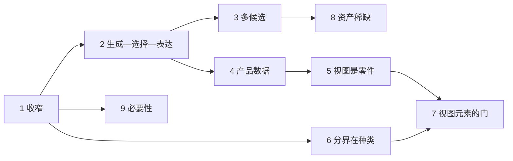
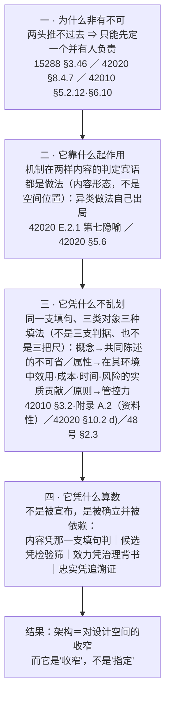
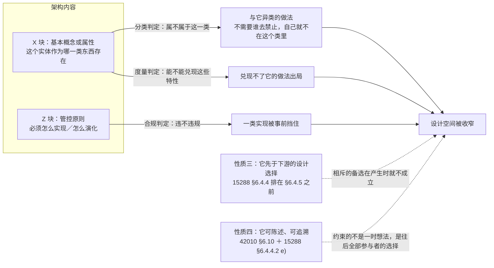
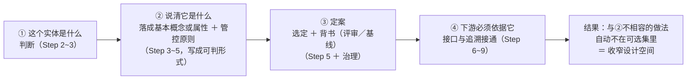
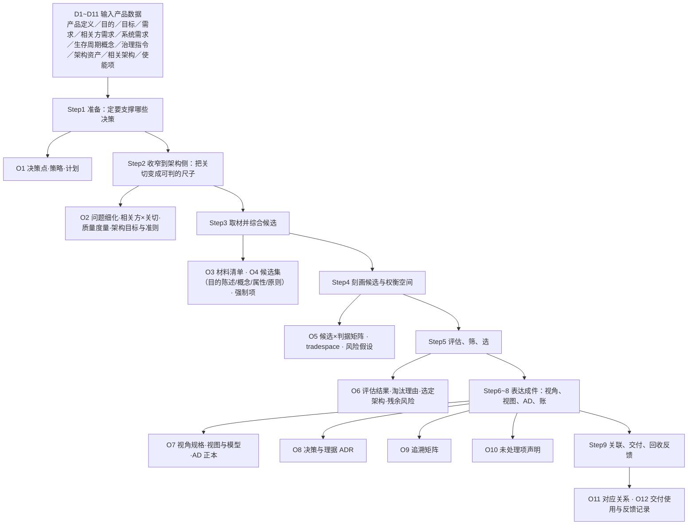
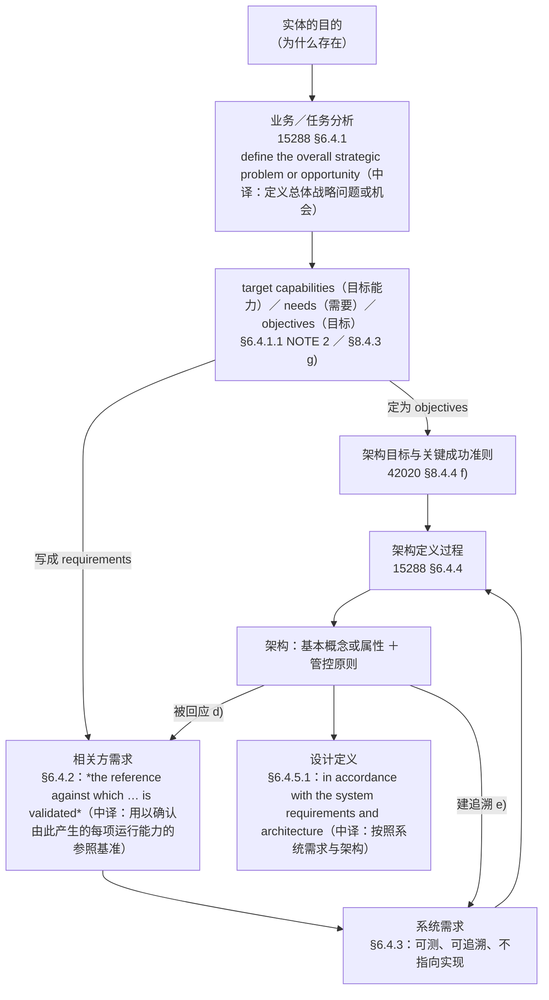
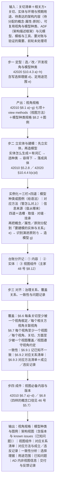
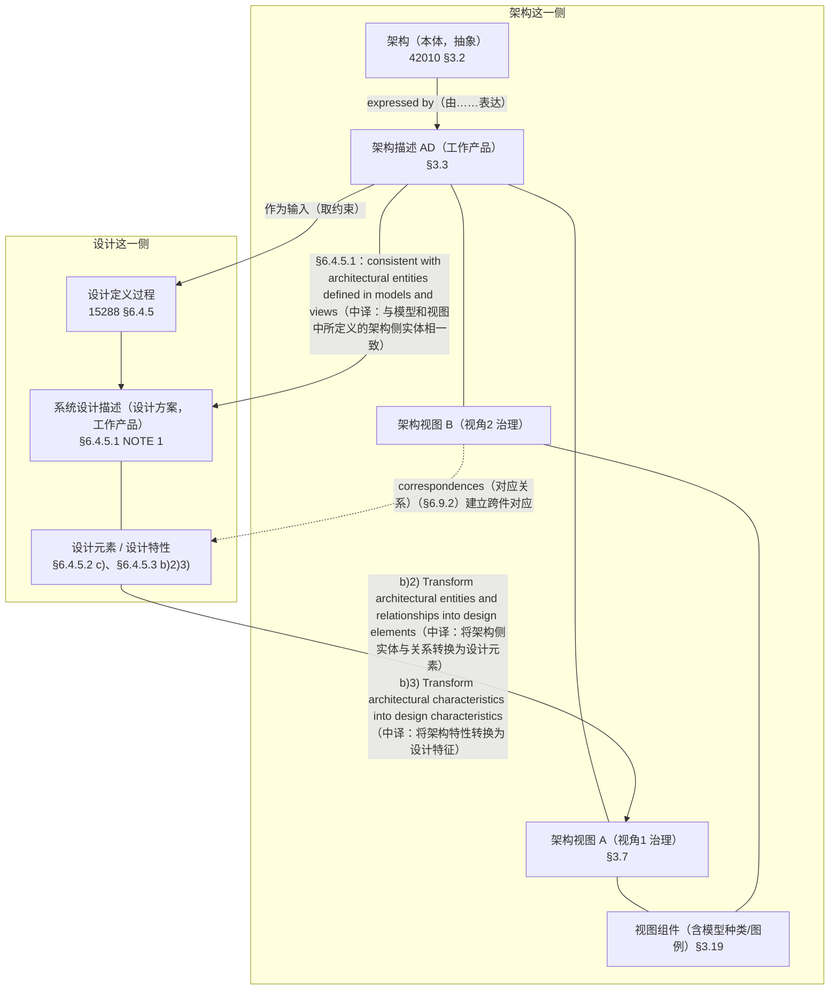
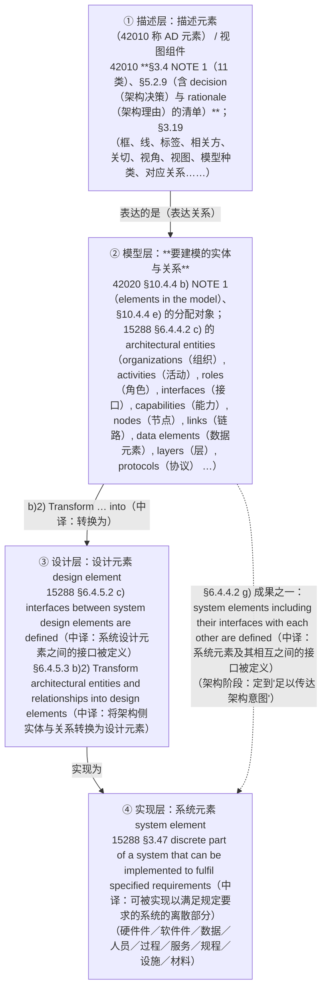
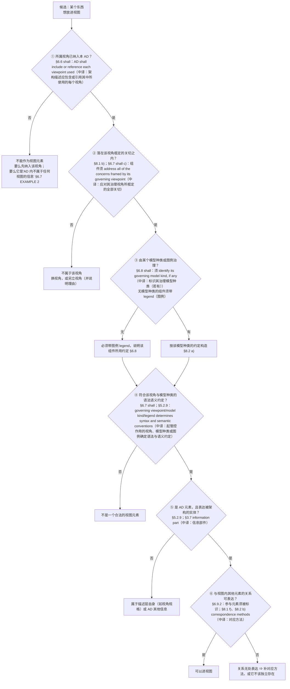

# 架构定义与视图设计研究报告

## —— 从意义目的到产品数据与四案例

**Architecture Definition and View Design: A Research Report**（中译：架构定义与视图设计：一份研究报告）

> **编号**：35（研究报告稿）
> **日期**：2026-10-12
> **主题**：以四份标准正本为唯一依据，回答架构的**意义与目的**、架构**凭什么能收窄设计空间**；厘定**架构定义过程及其输入／输出产品数据**（含相关方需求与系统需求的分工、定案机制、候选的来源与门槛）；给出**资产稀缺情形**下的适配；并给出**架构视图设计过程及其输入／输出产品数据**；全程以**四个案例**（M3 冷链温控箱／民用客机 HUD（平视显示器）／EOS（企业运营体系）信息化平台／恒信合同审批系统）填实到可落地粒度
> **依据（只用标准正本）**：**ISO/IEC/IEEE 42010:2022**（库内正本全文）｜**ISO/IEC/IEEE 42020:2019**（库内正本全文）｜**ISO/IEC/IEEE 15288:2023**（库内正本全文）｜**ISO/IEC/IEEE 42030:2019/2020**（旁证）｜ISO 9000:2026（术语补充，用于 requirement／data／documented information（中译：需求／数据／文件化信息）等）
> **取证纪律**：**架构定义与视图设计的判据只取标准**；本项目既有研究报告与教材**不作本报告的判据**，仅在涉及案例设定时作**取材**并标注；凡涉英文一律**中英并列**——逐字引文紧随「（中译：…）」，术语与短语写成「英文（中译）」，缩写首次出现处给出中文全称；**标准条款标签（NOTE／EXAMPLE／shall／should／may）、比较词 vs、标准文件号与本报告自编的编排标签（Step、D・O・V-I・V-O 各编号、mermaid 节点名）按原文保留**；另加**性质标记**——同一条原话是**规范（shall／should）**还是**资料性（NOTE／附录）**，引用处就地标出；本版实测「（中译：…）」**282 处**；**未见条款文本即写"未核"**，不补号不补句；案例中非取自案例设定的具体数值一律标〔示例〕
> **文档版本**：v1.0（2026-10-12 创建，覆盖同日本主题全部讨论）→ **v1.1（2026-10-12 补 §十七 视图·元素·设计：三道关与四条边界）** → **v1.2（2026-10-12 全库对齐轮·基准件自查回改 4 处：① 勘误——*an architecture is intangible and abstract*（中译：架构是无形的、抽象的）的出处由误标的"§5.3"改为正本 **Introduction L177**（§5.3 实为 *Architecture description in the life cycle*（中译：生存周期中的架构描述），正本 L699）；② 索引补"**架构视角（定义句无属概念）**"一条，记 42010:2022 **§3.8** 正本逐字（L289），并明记"不得写'架构视角＝工作产品'"）** → **v1.3（2026-10-12 全库对齐轮·基准件再回改 3 处：**勘误二——AD（架构描述）元素的**两张清单不可混**：42010:2022 **§3.4 NOTE 1 为 11 类**（不含 architecture decision／rationale，中译：架构决策／架构理由），**§5.2.9 为含该两项的清单**；§17.3 图注与 §17.4 表原只挂 §3.4 NOTE 1，已补 §5.2.9 并加"两处清单不可混"勘误注**）** → **v1.4（2026-10-12 自相矛盾自查回改 1 处：**§2.4 四步图第二步原写"它是一个定义，定义就是划界：说清'是什么'，界外自动出局"——而本报告 **§3.1、§十四之一／摘要第 6 条三处均已把该论列为首条坏论证**，图未随之改，**图与正文相抵**；已改为"机制在内容形态与站位：两样内容的判定宾语都是做法，异类做法自己出局"，出处由 `42020 E.2.1 第七隐喻` 扩为 `E.2.1 第七隐喻 ／ §5.6`（E.2.1 定**位置**：约束施加于可供设计定义过程使用的设计空间；§5.6 是**方式**：*guides the design activities … allows for maximum flexibility in the design tradespace*（中译：指导设计活动……使设计权衡空间具有最大的灵活性））**）** → **v1.5（2026-10-13 应"凡涉英文须中英并列"：全文英文补中译——逐字引文紧随「（中译：…）」、术语与缩写首次出现处并列、mermaid 节点与案例标签同此；实测新增中文 **7081 字**、「（中译：…）」**273 处**；并同批回改三处，见下条勘误记录**）** → **v1.6（2026-10-31 对齐 46 号基准：① 判据名"由目的裁／目的必要性"全撤，改为**三把尺**（概念／属性／原则各一把，不可互换）——§2.4 四步图两节点、§3.4、§15 第 3 条、§17.5.5 两处、§17.6 整表、摘要第 24 条，并在 §14 补第七条留痕；② ② 层改名——"架构实体"→**"要建模的实体与关系"**，§17.3 全节重铸＋摘要第 22 条、§17.6 第二道、§十六 索引同批；③ §13.2 补 13.2.1~13.2.4（位怎么生成四步／三栏×四道／三栏台账／立实体五步与四条性质与三辨）；④ §11.3 三问改**四问**（加"体现检验"）；⑤ §6.3 捕获项由"七样"更正为**六项**（42020 §8.4.8 g)~l)）；⑥ 编码与行尾不变（CRLF、无 BOM）；**第二轮 46 号对齐见本页修订记录**）** → **v1.8（2026-11-06 依 48 号 v3.25 对齐：8 处「三把尺」改按「一支填句三槽（三种填法）」表述）** → **v1.9（2026-11-11 随 46 号 v2.6（八条主结论）严格对齐：口径 4 处、号形 6 处；见下条修订记录）** → **v1.10（2026-11-13 随 46 号 v2.6 逐段对齐：实质改动 54 处——口径与界定 11／46 号指针 15／48 号指针与陈旧数 7／号形与数目 12／其余 9；见下条修订记录）** → **v2.0（2026-11-13 按九条主要结论重构：九条各立一章（原十六节→十二章）、摘要二十四条并为九条（原条降为要点·编号保留）、台账加「归主线」列、四案例合为一章四节、新增 §一 走法与 §十二 结论与未决、原 §十四 降附录 C、新增附录 D 新旧节号对照；汉字 37,401→41,380；见下条修订记录）**
> **勘误记录（2026-10-12，来自"35 号基准·全库对齐"轮：独立只读代理指正 → 主笔回正本复核 → 回改）**：出处误标一处，已改 4 处（摘要第 2 条、§2.1 边界二、§2.1 表、§十六 索引表）；另同轮补入 §3.8 视角定义句的"无属概念"要点——此为**下游三件（24 号研究报告正文与附录 A、16 号、24 号对话记录）的同一处承重错误**，本次仅在基准件立正，那三件待本对齐轮施工批处理。
> **勘误记录（2026-10-12，第10章收口批连带自查）**：本报告一处**图与正文相抵**——§2.4 四步图的第二步仍把"定义就是划界"当作收窄机制，而 §3.1（坏论证表第一行）、§十四之一（判错留痕）与摘要第 6 条**三处均已撤销该论证**；已按本报告自己的口径回改该图（见版本行 v1.4）。**同源下游**：`claude-memory/pending-ch11-revision.md` 曾把"定义就是划界"立为第11章"翻译为什么成立"一节的**四层地基之一**，同批更正。**本报告 PDF 停在 v1.0（未随 v1.1~v1.5 重建），登记备查。**
> **勘误记录（2026-10-13，"英文并列"轮连带查出并回改三处）**：① **引文动词形**——E.3.3.2 **参考架构**句本报告原四处写作 *instantiate and specialize*（动词原形），**正本（42020:2019 E.3.3.2，正本 L6480）作 *instantiated and specialized***（*They can be **instantiated and specialized** to yield potential architecture solutions.*（中译：能对其实例化并加以特化，以得出潜在的架构解决方案。）），已按正本回改（§6.4、§6.5、§7.4、§12.2、§十五）；② **两处出处误挂**——"现状也是候选之一"（*The **status quo** is sometimes one of the alternatives that could be considered.*（中译：现状有时是可供考虑的备选方案之一。））的**正本出处＝42020:2019 §9.4.7 NOTE 2**（正本 L4042），原 §6.4 表与 §12.2 两处误挂 §8.4.6 NOTE 3——该注讲的是 **harmonization（调和）**（正本 L3204），已回改；③ **摘要条数与标题不符**——标题原写"摘要：二十条"，实际条目 **24 条**（第 21~24 条系 v1.1 补 §十七时新增，标题未随之改），已改为"摘要：二十四条"。
> **修订记录（2026-10-31，第二轮 46 号对齐）**：① 补 5 段〔论证〕（§2.4.1、§2.6、§3.5、§16.2.3、§16.5.6）；② 新增**附录 A 结论台账**（K01~K26：A 级 5／B 级 11／C 级 10），摘要末加指针行；③ 四案例按范例体例补齐（声明行／走法表／反向验三问／与结论互指），合同审批事实改按 48 号 §11.11（"合同状态"唯一权威源、越权配置数 0、旧版本可回放）；④ §13.2.2~§13.2.4 三表压成一张"落点｜46 号主家｜本号增量"对照表，§17.3 四层表与 §5.1 概念层降指针；⑤ **§十七 → §十六**（原 §十六 → **附录 B**），删"节序说明"，牵动引用同批改；⑥ 六处架构决策条号勘误（§3.10、§3.11 → §5.2.12、§6.10.1、§6.10.2）、§3.11 EXAMPLE 1 → §5.2.11 EXAMPLE 1、② 层与 `architectural entities` 译名改正；⑦ 编码与行尾不变（无 BOM、CRLF）。
> **修订记录（2026-11-11，随 46 号 v2.6（八条主结论）严格对齐）**：改动 **10 处**——① **口径 4 处**（卡四：视图"由**恰一个**视角治理"补进 §13.1 视角行、§16.1 视图行与摘要第 19 条；卡一／卡六：§12.2 行三②"后续步骤的选项"由"架构**内容**的一部分"改为"架构**描述（方案）**的一部分"）；② **号形 6 处**（摘要第 19 条与 §8.3 的 42010 §8.1、§2.1 反向护栏与 §15 第 2 条的 42010 §5.2.2、§11.3 机制点②的 42010 §3.3／§6.7 c)、§16.4 三条入场路径的 42010 §8.3——各补标准名）；③ **未动**：案例事实与数字、结论台账 K 号与条数、章节结构与节号、46 号指针（本件正文零出现，取证纪律只取标准）；④ 编码与行尾不变（无 BOM、LF）。

> **修订记录（2026-11-13，随 46 号 v2.6 逐段对齐·第二轮；19 号规程阶段一）**：七段只读扫描 → 定稿回读 → 落笔 → 改后复读。**口径与界定 11 处**——「三把尺＝…三种填法」等同句三处（旧形，已废）（摘要第 24 条、§15 第 3 条、§16.6 第三关「三样各用各的尺」）与 §2.4 四步图第三节点「三槽各裁各的」，按 48 号 §2.3 逐字改为「一支填句三槽——三类对象只是三种填法，不是三支判据、也不是三把尺」；§16.6 表头「裁它的尺」改「裁它的判据（各填哪一槽）」；§16.5.3 与 §16.6 注补「关切是参照物不是判据」（48 号 §2.10）。**46 号指针 15 处**：文首身份（§1.3）｜摘要 2 与 §2.1（§2.2）｜§2.2 末（§5.1）｜§3.4 表下（§2.5）｜§4.3 表下（§4.1、§4.3）｜§13.1 表下（§5.4、§5.2）｜§13.2 步四、§13.4 V-O3、§13.6 末注（§5.7）｜§十六 头注、§16.2 轴二、§16.2.3 末、§16.3 表体句（§5.4／§5.7／§2.5／§4.3／§3.3）。**48 号指针与陈旧数 7 处**：48 号现行版核至 v3.37（原记 v3.1／2026-11-05，已陈旧）｜「最小集十四件」→十五件（注明十四件是内容七＋描述七的小计）｜§2.5「见 §8.11」→「层与名的分工见 §8.1、§8.11」｜§13.1「§6.3（三套名字）」→「§8.11」｜§14 第七处「§3.4（实质＝越线或改选）」→§2.3｜§11.2「§11.11 两例共同骨架的前六项」→「§11.11 所指的评估骨架（§14.1 第18张卡与 §14.2 收尾段）走一遍，本号归成六栏」。**号形与数目 12 处**：§2.4 图「§8.4.7」补 42020｜§五 开篇「五组逐字」改挂 15288:2023 §6.4.4.1｜§8.3、§9.3 各一处补 42010｜§10.3 两处补 42020｜§12.2 **六处**裸条号补 42020:2019｜§13.6 第 4 条版本 shall 落条号｜§16.3.1「两条补充边界」→三条。**其余 9 处**：§6.3 Step6~8 删本件不存在的「§零」（改指 48 号 §9.28）｜§6.4 第 2 条改「把关键特征奉为原则，并据此立概念与属性」｜§13.2 引子的 V-O 归属按同节图收正｜§13.2.1 标题「四步」→「三步（另加前置一步）」并补与 48 号 §7.5 五步的辨明｜§13.2.1 补四称与「凡位必常设」（48 号附录 C.2、§7.12）｜§13.4 V-O1 补版本标识（42010 §6.6）｜§16.3 ① 层并写「描述元素（42010 称 AD 元素）」｜附录 B「AD 元素」行拆明 §5.2.9 与 §3.4 NOTE 1。**未动**：四案例与全部案例数字、K01~K26 与 A 级 5 条、节号与章节结构、§十四 判错留痕的「原判」栏、三条勘误记录的存史措辞、编码与行尾（无 BOM、LF）。**读数**：汉字 **35,290 → 37,374**（+2,084）｜行 1,414 → 1,438｜「（中译：…）」280 → **282** 处｜`##` 20 节、`###` 58 节、K01~K26 与 A 级 5 条不变。**另经改后复读回修 49 处**（口径收口 14／号形 14／指向与新伤 12／记录层 9），逐条见 `claude-memory/progress-对齐35-46.md` §六。**判留 19 条**与**挂账 2 件**见 `claude-memory/progress-对齐35-46.md`。
> **修订记录（2026-11-13，按九条清单重构 v1.10 → v2.0；19 号规程阶段二）**：九条＝① 收窄 ② 生成—选择—表达 ③ 多候选是义务 ④ 产品数据（D／O） ⑤ 视图是描述的零件（V-I／V-O） ⑥ 分界在种类不在粒度 ⑦ 视图元素的门 ⑧ 资产稀缺 ⑨ 必要性是逻辑的；配比本品 3／位置 3／器件与边界 3。**结构**：原十六节→十二章（§二~§十 九条各一章、§十一 四案例、§十二 结论与未决），原 §一 前提降 §1.6、原 §2.6 独立成 §10.1、原 §十五 并入 §10.2、原 §十四 降附录 C。**两跳改号**：节号全改（旧号→新号见附录 D，88 条）；正文自引 12~16 区间机械换算、2~7 区间逐处判定后仅 6 处需改（其余为 42010 条款与〔主线〕引用，不动）；**撞号坑**：旧 §六 的 6.1~6.5 与 42010 第 6 章同号，故 2~7 区间一律不机械换。**未动**：四案例的事实与数字、K01~K26 与 A 级 5 条、正本引法、编校与行尾（无 BOM、LF）。**库外换算**：16 件 56 处「35 号 §x.y」同批换算。
> **★ 本报告的判错留痕**：正文采用的口径，是**经过七处自我纠正后**的口径；七处原判与纠正理由集中记于 [附录 C](#附录-c-判错留痕七处原判与纠正)，**不散在正文**，以免污染论证链
> **本报告在库内的身份**：**过程与案例基准**（架构定义九步与 D／O 编号、四案例全套、资产稀缺章、判错留痕体例）；**判据与落地的基准以 48 号为准**（`48-架构定义研究报告` 现行 **v3.37，2026-11-13**；概念与判据的主家随版本走，本号只搬不改）。凡"这条结论凭什么"看 48 号；凡"这件事怎么走、走到哪步吐什么件"看本报告；凡"它是什么、凭什么还是它"看 **46 号**（其 **§1.3 八条的位次**、**§七**"凭什么还是它"）。08 号登记中的七个落点（ch10／ch11／ch12／ch13／ch15／ch17／ch19）不变。

---

## 摘要：九条

> **读法**：本报告的主要结论就是下面九条，九条在 §二~§十 各立一章。**原二十四条摘要一条未删**，逐条降为对应条下的**要点**，「原 N」的编号保留——它与附录 D 的新旧节号对照互查，与附录 A 台账则**按节号**对（台账 K 号按结论编、摘要「原 N」按旧条目编，两套不一一对应）。

1. **架构是"两头推不过去"的那一次收窄**：上向：系统定义本身写着**涌现**（15288 §3.46）；下向：**分解是选择不是推导**（42020 §8.4.7、§8.4.5）。两头都断，只剩"先定一个、再做出来验"，而那个"先定的一个"必须有人负责。收窄的机制是**相容性**——两样内容的判定宾语都是"做法"；不是指挥、不是写得更细、也不是"标准授权它管"。
    - **原 1**：**架构的定义（唯一准绳）**：*fundamental concepts or properties of an entity in its environment and **governing principles** for the realization and evolution of this entity and its related life cycle processes*（中译：实体在其环境中的基本概念或属性，以及为实现和演化该实体及其相关生存周期过程的管控原则）（42010:2022 §3.2）。**只给两样**：X 块＝基本概念或属性；Z 块＝管控原则。
    - **原 2**：**两条必守边界**：**元素与关系不在定义句里**（2022 已删，降为 42020:2019 §3.3 注 1 的注释级表述）；**架构 ≠ 架构描述**（架构抽象无形，架构描述（AD）是工作产品，42010:2022 §3.3、**Introduction L177**）；内容与描述之间的方向口径——**内容是要求、描述是方案、描述服务于内容**——主家在 **46 号 §2.2**。
    - **原 3**：**意义**：架构是关于这个实体的**谓述**——它说这个实体根本上是什么（概念／属性），以及它被允许以什么方式实现与演进（原则）。标准给这件事起的名字是**架构即约束**——*The constraint is on the **design space available to the design definition process***（中译：该约束施加于可供设计定义过程使用的设计空间。）（42020:2019 E.2.1 第七隐喻；谓述而非层位，见 42 号 §2.1）。
    - **原 4**：**目的**：**两头都推不过去**——系统定义本身就写着涌现（15288:2023 §3.46 *that the individual constituents do not*（中译：单个构成部分所不具备的）），而分解从来不唯一（42020 §8.4.7 的 decompose／allocate（中译：分解／分配）是**选择**，不是推导）。所以中间那片设计空间必须被收窄，**承载这次收窄并对它负责的那份东西，就是架构**。
    - **原 5**：**"收窄"不靠指挥、靠排除**：下游的判据是**相容性**（*in accordance with*（中译：按照、依据）／*consistent with*（中译：与……一致），15288 §6.4.5.1），因此架构**可以不指定技术而仍然排掉东西**——这是 *as design-agnostic as possible*（中译：尽可能与设计无关）（15288 §5.9）能成立的唯一理由。
    - **原 6**：**"架构是定义所以能收窄"是坏论证**（见附录 C 之一）：多数定义（如"锤子""数字 7"）不落在"做法"上，**排除关系根本不成立**。
    - **原 7**：**"标准指派它有这项能力"也是坏论证**（见附录 C 之二）：指派是**授权**，能力须落在**内容形态**上。
    - **原 8**：**收窄的四条内生性质**：① 它说的是"这个实体作为哪一类东西存在"，**异类被它自己排掉**；② 它两样内容的判定**宾语都是做法**（分类／度量／合规）；③ 它**先于下游的设计选择**；④ 它**可陈述、可追溯**，所以约束的是这个实体往后全部参与者的选择。

2. **架构工作不是撰写，是"生成候选—选择—表达"**：四活动（Prepare／Conceptualise／Evaluate／Elaborate）＋三核心过程（42020 §8／§9／§10）＋两并行过程（§6／§7）；九步各吃吐什么件，这才是这件事的实质。
    - **原 9**：**关于"基本概念或属性"与"管控原则"的来历**：概念是**候选幸存**下来的，属性是**涌现**出来的，管控原则是**自加**的（**不是"设计"出来**的——见附录 C 之四）。*devise*（中译：构想、设计出）的取材机制是参考架构、模式、战术、启发式（42020 E.3.3）。
    - **原 14**：**架构定义过程的骨架**：四个活动（Prepare（准备）／Conceptualise（概念化）／Evaluate（评估）／Elaborate（细化），15288 §6.4.4.3）＋三个核心过程（42020 §8、§9、§10）＋两个并行过程（治理 §6、管理 §7）；实质是"**生成候选—选择—表达**"，不是"撰写"。
    - **原 15**：**架构师真正加进去的四件事**：给每个候选写**目的陈述**（§8.4.5 e)）；把手段**立成概念与原则**（§8.4.7 b)e)f)）；**适配与调和**（E.3.3.2 *instantiated and specialized*（中译：被实例化并加以特化））；把**"现状"也摆上桌**（§8.4.6 NOTE 3）。候选的正当性在于**可区分＋可追溯**（§9.4.8 NOTE 1；§8.4.5 b)c)6)＋§6.10）。

3. **多候选是义务，不是风格**：需求被明令不许指定实现（15288 §6.4.3.1）⇒ 多解空间客观存在；选定之前"合规"没有对象（§3.13）⇒ 必须先把几种"它是什么"摆出来。资产／知识／经验各有位置，**都不是最终根据**。
    - **原 16**：**"凭什么给出多个候选"**：不是凭权威、天赋或经验，而是——**需求被明令不许指定实现**（§6.4.3.1）⇒ 多解空间客观存在；**选定之前"合规"没有对象**（§3.13 *compliant implementation of the architecture*（中译：对架构的符合性实现））⇒ 必须先摆出几种"它是什么"。资产、知识、经验各有位置，**都不构成最终根据**。
    - **原 17**：**资产、知识、经验的位置**：**资产＝起点与素材**（须实例化与特化、须写适配理由，可能缺失或不该沿用）；**知识＝可复用的思考形式**（评价标准是能否交接给别人，42020 §8.4.8 f) NOTE 2）；**经验＝生成侧的启发**（E.3.3.5：*derived from experience*（中译：源自经验）、*Not all heuristics apply in all circumstances*（中译：并非所有启发式方法都适用于所有情形），**不充当选定判据**）。

4. **每步都吃吐可点名的产品数据（D／O 两套编号）**：输入五组、D1~D11、O1~O12 是**本号自编**的过程账；需求进架构有三条去向，每条都得在追溯里标明去向，不能消失。
    - **原 10**：**架构与三者的关系**：**目的＝根（准绳，不是一条输入）**；**关切＝可分流**（定为目标或写成需求，42020 §8.4.3 g)）；**系统需求＝可测且不许指向实现**（15288 §6.4.3.1）——**正因为需求不许说"怎么做"，架构才谈得上"什么算数"**（"位置"是借喻：架构是谓述，不占层位，42 号 §2.1）。
    - **原 11**：**关切的性质（纠正一处误读，见附录 C 之三）**：NOTE 7 说的是相关方**有两类关注对象**（架构本身／实体），*and vice versa*（中译：反之亦然）表示**互有交集**；**架构要回应的是相关方关切**（15288 §6.4.4.2 d)：*identified stakeholder concerns **are addressed by** the system architecture*（中译：已识别的相关方关切由系统架构予以应对）），**不是只有"针对架构自身的关切"才归它管**。
    - **原 12**：**两件输入被标准分派为一段"双向必要且充分"**（15288 §6.4.3.3 NOTE 18）：系统需求既是**对相关方需求的必要且充分响应**，又是**对架构与设计的必要且充分输入**。
    - **原 13**：**只有与架构相关的那部分需求落成架构内容**：*key architecturally-relevant*（中译：架构上关键的）（15288 §6.4.4.2 e)）；需求进架构有**三条去向**——落成架构内容／被既有覆盖／不在架构层承接。

5. **视图是描述的零件（V-I／V-O 两套编号）**：视图＝42010 §3.7 的**信息部件**，由**恰一个**视角（§3.8 的一组约定）治理（§6.7 b)）；过程四步＝定型（§8.1 七项）→建模（42020 §10.4.4）→对齐（§6.6、§6.7、§6.9）→成件（§6.7、§6.8，版本另有 shall）。
    - **原 19**：**视图设计**：**视图＝AD 的零件**（42010 §3.7：信息部件，是全体的一面投影、不是系统的一块），由**恰一个**视角（42010 §3.8 一组约定）治理（42010 §6.7 b)）；过程四步＝**定型（42010 §8.1 视角规格七项）→建模（42020 §10.4.4 分配）→对齐（42010 §6.6、§6.7 覆盖＋42010 §6.9 对应）→成件（42010 §6.7、§6.8 四件＋版本）**。**视角是"合同"，可以先订**（42010 §6.6 NOTE 3）。

6. **视图与设计的分界在种类，不在粒度**：四道工序不是一条由粗到细的梯子；两边判据不同轴（适宜·可行·可欲 对 兼容·可造·可集），动作是**转化**（transform）与**一致**（consistent with），不是"细化"。
    - **原 21**：**视图与设计方案的四条关系轴**（§六~八）：**规律与依从**（AD 是设计的约束来源：*in accordance with the system requirements and architecture*（中译：按照系统需求与架构）／*consistent with architectural entities defined in models and views*（中译：与模型和视图中所定义的**架构侧实体**相一致），15288 §6.4.5.1）｜**转化与追溯**（架构侧实体→设计元素、架构特征→设计特征，15288 §6.4.5.3 b)2)3)；双向追溯见 15288 §6.4.5.3 NOTE 19）｜**判定分离**（评审／评估 vs 验证；"合规"的基准是架构）。**分界在种类不在粒度**（15288 §5.9：适宜·可行·可欲 vs 兼容·可造·可集）。

7. **视图元素不必"基本"，但门一道不少**："基本"只修饰架构的**内容**（42010 §3.2），不修饰描述上的每个元素；元素须"为被框定的关切服务、在治理视角的约定内被解释"；描述关／实体关／内容关**不可互替**。
    - **原 22**：**视图上的元素与系统元素隔两道界**（§六~八）：**界一**——AD 元素是**描述本身的零件**（42010 §3.4 NOTE 1），不等于系统元素；**界二**——**架构实体与系统元素"代表两种不同的概念"**（15288 §5.9 末段注）。四层＝描述层（AD 元素／视图组件）→模型层（要建模的实体与关系＝建模实体）→设计层（设计元素）→实现层（系统元素）；② 层的位**不必是实物**（42020 §10.4.4 b) NOTE 1）、**可为名义的**（42020:2019 §5.6）。
    - **原 23**：**视图元素不必满足"基本"**（§六~八）：**"fundamental"（基本的）在 42010:2022 §3.2 里修饰的是 concepts or properties（概念或属性）**，界定"架构由什么内容构成"；**42010 §3.7 视图定义句与 §6.7、§6.8 构成要求里都没有"基本"这一项**。视图元素与"基本"是**表达关系**（42010 §5.2.9：由视角／模型种类／图例**引入**的构造）。**"基本"只经由"视角"这一环起作用**（哪些关切够格被框定），且**相对所关注实体**——同一条内容在上层是基本属性、在下层可能只是设计取值。**但"不必基本"≠"不必相关"**：须为被框定的关切服务、须在所治理视角的约定内被解释。
    - **原 24**：**三道关不可互相替代**（§六~八）：**描述关**（六项 shall（应，强制要求）＋"由谁引入"的追溯：42010 §6.6、§6.7、§6.8、§6.9.2、§5.2.9）｜**实体关**（它表达的是谁）｜**内容关**（一支填句三槽，展开见 §8.4；户口在 48 号 §2.3）。概念／属性／原则只是同一支填句的**三种填法**，不是三支判据、也不是三把尺。混起来就是两种典型错误：**用"基本"要求每一个图标**（图里塞满大词）／**用"画得出"当"够基本"**（把设计取值收进视图，架构变成"更粗的设计"）。

8. **资产稀缺改变取材方式与细化深浅，不改变有无**：标准有四个专名（新开发／产品线式启动／遗留系统革命式改造／增量式启动）；ADR 变厚、"后续步骤的选项"成为方案的一部分；**没资产不是不写架构的理由**。
    - **原 18**：**资产稀缺时**：标准有专名——**New development（新开发；"greenfield"，即"绿地"）**（E.3.1.2）；走 **Forward（前向）／Top-down（自顶向下）／Middle-out（中间向外）**；取材换来源（§8.4.5 c) 1)~6)：专家／技术扫描／模式扫描／自然隐喻／风险／模式战术启发式）；**ADR（架构决策记录）与未处理项声明变厚**；并为不确定性最大者备 **Incremental start（增量式启动）**：*develops both initial steps and **options for subsequent steps***（中译：既制定初始步骤，也针对后续步骤制定选项）（E.3.1.6）。缺资产改变**取材方式与细化深浅**，**不改变有无**。

9. **架构的必要性是逻辑的，不是文书的**：不成文的架构仍然存在（第一版方案替它办了这件事），只是没被评审、没被记录、没人对它负责；规模与可丢弃性决定它的**形式**，不决定**有无**。
    - **原 20**：**一句话总纲**：**架构工作＝把"这个实体是什么"从几种可能，立成一句可判的定案，写成可判的形式，接通下游的引用与追溯；收窄是这个动作的后果。** 判一份架构做没做出来，看两件事：**那句"是什么"说清了没有；它排掉了什么。**

> 逐条依据与论证位置见附录 A「结论台账」；旧号→新号见附录 D。

## 一、走法：九条怎么排

### 1.1 原问：这份报告回答什么

以**四本正本**（42010:2022／42020:2019／15288:2023／42030:2019-2020）为唯一依据，回答六问：① 架构的**意义与目的**；② 架构**凭什么能收窄设计空间**；③ 架构定义过程及其**输入／输出产品数据**（含相关方需求与系统需求的分工、定案机制、候选来源与门槛）；④ **资产稀缺**情形下怎么改；⑤ **架构视图设计过程**及其输入／输出产品数据；⑥ 以**四个案例**填实到可落地粒度。

**分工**：概念与身份的主家在 **46 号**（八条主线），概念与判据的落地正主在 **48 号**；本件是**过程与案例基准**——"它是什么、凭什么还是它"看 46 号，"这条结论凭什么"看 48 号，"这件事怎么走、走到哪步吐什么件"看本报告。

### 1.2 九条清单（本报告的主要结论）

| # | 结论（一句，即章题） | 级 | 章 | 归 46 号主线 | 须先同意 | 旧号落点 |
|---|---|---|---|---|---|---|
| 1 | 架构是"两头推不过去"的那一次收窄 | A | §二 | 三＋本件增量 | — | §二、§三 |
| 2 | 不是撰写，是"生成候选—选择—表达" | B | §三 | 三的过程侧（本件正主） | 1 | §六 |
| 3 | 多候选是义务 | C | §四 | 本件增量 | 1 | §七 |
| 4 | 每步都吃吐可点名的产品数据（D／O） | C | §五 | 本件增量（器物层） | 2 | §四、§五 |
| 5 | 视图是描述的零件（V-I／V-O） | B | §六 | 四的器件面（主家 46 号 §5.4、§5.7） | 4 | §十三、§16.1 |
| 6 | 分界在**种类**不在粒度 | A | §七 | 三「不是一条粗细梯子」 | 1 | §16.2 |
| 7 | 视图元素不必"基本"，但门一道不少 | A | §八 | 本件增量（48 号 §2.3、§2.11 主家） | 5、6 | §16.3~16.7 |
| 8 | 资产稀缺改取材与深浅，不改有无 | C | §九 | 九＋本件增量 | 3 | §十二 |
| 9 | 必要性是逻辑的，不是文书的 | A | §十 | 九 | 1 | §2.6、§十五 |

### 1.3 依赖与章序

**章序**：§一 走法 → §二~§十 九条各一章 → §十一 四案例（只作填实，不作论证依据）→ §十二 结论与未决；附录 A 结论台账／B 正本条号索引／C 判错留痕／D 新旧节号对照。

### 1.4 落选与处置（哪些没单独成章）

| 原内容 | 处置 | 理由 |
|---|---|---|
| 定义句两样内容与两条边界（原摘要 1、2；原 §2.1） | 并入第 1 章 | 它们是第 1 条的**前提**，不是另一条结论；主家在 46 号 §5.1、§2.2 |
| 架构即约束／谓述不是层位（原摘要 3；K03） | 并入第 1 章 | 主家在 42 号 §2.1；本件只留"约束施于哪片空间" |
| 概念／属性／原则的来历（原摘要 9；K08） | 并入第 2 章 | 它是"取材"那一环，随九步走 |
| 关切与需求的关系（原摘要 10~13；原 §四） | 并入第 4 章 | 它们是**输入的来路**，随产品数据讲 |
| 一句话总纲（原摘要 20） | 作第 9 条的收束要点 | 它是全书的收口句，不宜另立一章 |
| 四条关系轴（原摘要 21；K20） | 并入第 6 章 | 与"分界在种类"是同一断言的两个面 |

### 1.5 一处提请注意：节号全改

本版把原十六节按九条重排为十二章，**节号全改**。旧稿里的"§x.y"一律按附录 D 换算；读旧稿或旧引用时以那张表为准。

### 1.6 前提：本报告采信的标准与证据等级

| 标准 | 现行版 | 本轮取到的证据 | 等级 |
|---|---|---|---|
| **ISO/IEC/IEEE 42010** | **2022** | **库内正本全文**：术语 §3.x、要求 §6、§7、§8、资料性附录 §A~§F 逐条直核 | **一手（正本）** |
| **ISO/IEC/IEEE 42020** | **2019** | **库内正本全文**：过程 §6~§11、附录 E（架构类型、架构化策略与走法、可用机制）逐条直核 | **一手（正本）** |
| **ISO/IEC/IEEE 15288** | **2023** | **库内正本全文**：技术过程 §6.4.x、术语 §3.x、§5.9 概念与应用章逐条直核 | **一手（正本）** |
| **ISO/IEC/IEEE 42030** | **2019／2020（CSA，即加拿大标准协会，采标件）** | 架构评估的分层与用途 | **旁证** |
| **ISO 9000** | **2026** | 术语补充（需求（requirement）§3.5.1、数据（data）§3.8.1、文件化信息（documented information）§3.8.14 等） | **一手（正本）** |

**一条口径声明**：本报告凡涉"架构是什么／架构设计产出什么／算不算架构"的判断，**只以 42010:2022 §3.2 为尺**（连同 42020:2019 §3.3 注 1 的注释级表述、15288:2023 §3.13 的 design（设计）名词定义）；**不引本项目既有研究报告或教材作判据**。

**案例取材声明**：四个案例中的**案例设定**取自本项目案例资料（文中标〔案例〕）；**EOS 的产品定义、目的、端到端业务框架、三层工作层面、引擎清单、链到显示区域映射、交付目录、验收标准**取自本项目主线规范（文中标〔主线〕）；其余补足性构造标〔示例〕。**案例只作填实，不作论证依据。**

> 本报告的取证纪律与 48 号 同源；两册的分工见文首「本报告在库内的身份」。

---

## 二、第一句：架构是"两头推不过去"的那一次收窄

### 2.1 唯一准绳：定义句与两条边界

**42010:2022 §3.2 逐字**：

> *architecture*（架构）— **fundamental concepts or properties of an entity in its environment and governing principles for the realization and evolution of this entity and its related life cycle processes**（中译：实体在其环境中的基本概念或属性，以及为实现和演化该实体及其相关生存周期过程的管控原则）〔SOURCE（来源）: ISO/IEC/IEEE 42020:2019, 3.3, modified（修改）〕

| 分块 | 内容 | 它管什么 |
|---|---|---|
| **X 块** | 实体在其环境中的**基本概念或属性** | 它**是什么、具备什么** |
| **Z 块** | 管住该实体**及其相关生存周期过程**怎么**实现**、怎么**演化**的**管控原则** | 它**必须怎么造、怎么变** |

**边界一：元素与关系不在定义句里。** 2011 版的 *embodied in its elements, relationships*（中译：体现于其元素、关系） 已在 2022 删去，该层含义搬到 **42020:2019 §3.3 注 1**：*usually intended to be embodied in the entity's components, the relationships between components, and the relationships between the entity and its environment*（中译：通常意在体现于该实体的各组件、组件之间的关系，以及该实体与其环境之间的关系）——**注释级、无术语地位**。其**规格**是设计定义过程的产物（**15288:2023 §3.13** 名词 design（设计）：*specification of system elements and their relationships, that is sufficiently complete to support a compliant implementation of the architecture*（中译：系统元素及其关系的规定，其完整程度足以支撑对架构的符合性实现））。

**边界二：架构 ≠ 架构描述。** **42010:2022 Introduction L177** 逐字：*Whereas an AD is a tangible work product, **an architecture is intangible and abstract**, understood through its concepts, properties and principles.*（中译：架构描述是有形的工作产品，而架构是无形的、抽象的，需通过其概念、属性和原则来理解。）｜**§3.3**：*AD — work product used to express an architecture*（中译：架构描述——用于表达架构的工作产品）。
〔**勘误（2026-10-12，核正本后回改）**：本条原标该引文为"§5.3"，**系引错**——正本 §5.3 是 *Architecture description in the life cycle*（中译：生存周期中的架构描述）（正本 L699）；该引文在 **Introduction**（正本 L177）。同理正文与索引中凡以"§5.3"指该引文者，一律改标 **Introduction L177**。〕

**一条反向护栏**（防过度删改）：**"架构可以关乎结构"是 2022 合法句**——42010:2022 §5.2.2 逐字：*The architecture of an entity of interest **can pertain to** any or all of the entity's: constituent elements; interactions or interrelationships among its elements; interactions or interrelationships with its environment; behaviour and structure; principles governing its design, use, operation and evolution.*（中译：所关注实体的架构能涉及其下列各项中的任一者或全部：构成元素；其元素之间的交互或相互关系；与其环境的交互或相互关系；行为与结构；管控其设计、使用、运行与演化的原则）——说的是**外延**，不是**产出**。

### 2.2 意义：它凭什么能收窄设计空间

标准给这件事的正式名字是 **architecture as constraint（架构即约束）**（42020:2019 附录 E.2.1 逐字）：

> *A companion document, ISO/IEC/IEEE 42010, lists six overlapping applications of architecture … The present document adds a seventh metaphor: **architecture as constraint. The constraint is on the design space available to the design definition process.***（中译：配套文件 ISO/IEC/IEEE 42010 列出了架构的六种相互重叠的应用……本文件增加了第七种隐喻：架构即约束——该约束施加于可供设计定义过程使用的设计空间。）

**约束的对象是"设计定义过程可用的设计空间"**——不是实现者，不是产品。

而"收窄"的机制是**相容性**，所以它能做到标准同时要求的另一件事（**15288:2023 §5.9 逐字**）：

> *The system architecture definition process focuses on defining an architecture that **addresses the stakeholder concerns** and is applied iteratively and concurrently with the business or mission analysis, stakeholder needs and requirements definition, and system requirements definition processes…*（中译：系统架构定义过程聚焦于定义一种能够应对相关方关切的架构，并与业务或任务分析、相关方需要与需求定义、系统需求定义诸过程迭代且并行地应用……）
> *The design definition process, on the other hand, is **driven by requirements that have been vetted through evaluation with the architecture** and more detailed analyses of feasibility.*（中译：另一方面，设计定义过程由那些已通过结合架构的评估以及更详细的可行性分析得到审查的需求所驱动。）
> *Architecture focuses on **suitability, viability, and desirability**, whereas design focuses on **compatibility with technologies** and other design elements and on **feasibility of construction and integration**. **An effective architecture is as design-agnostic as possible** to allow for maximum flexibility in the **design trade space**.*（中译：架构聚焦于适宜性、可行性与合意性，而设计聚焦于与技术及其他设计元素的兼容性，以及构建与集成的可行性。有效的架构尽可能与设计无关，以便在设计权衡空间中获得最大灵活性。）

以及 **42020:2019 §5.6 逐字**：

> *An effective architecture **guides the design activities** in such a way that it allows for **maximum flexibility** in the design tradespace.*（中译：有效的架构指导设计活动，其方式使设计权衡空间具有最大的灵活性。）

**本节所引正本的身份口径**：**一个实体只有一处架构、架构不是文件也不是图**——主家在 **46 号 §5.1**；本节说的只是"约束施于哪片空间"这一个功效面。

### 2.3 目的：两头都推不过去

| 方向 | 正本事实 | 逐字 |
|---|---|---|
| **上向推不过去** | 系统定义本身就写着**涌现** | 15288:2023 **§3.46**：*arrangement of parts or elements that together exhibit a stated behaviour or meaning **that the individual constituents do not***（中译：各部分或各元素的安排，它们合在一起呈现出单个构成部分所不具备的既定行为或意义） |
| **下向推不过去** | 分解从来不唯一，**是选择不是推导** | 42020:2019 **§8.4.7** 的 *decompose … and allocate*（中译：分解……并分配） 是任务；**§8.4.5** 那一步名为 ***Synthesize** potential solution(s)*（中译：综合潜在解决方案） |

⇒ **不能靠计算跨过去，只能"先定一个，再做出来验"**；而那个"先定的一个"**必须有人负责**——否则它被默认了：**架构被默认了，却查无此人**（42010:2022 §6.10 要求决策与理据必录）。

### 2.4 目的的四步展开与四个正本名字

| 正本给这件事的四个名字 | 出处 | 意思 |
|---|---|---|
| **`architecture as constraint`（架构即约束）** | 42020 E.2.1 | 约束的对象是设计定义过程可用的设计空间 |
| **`compliant implementation of the architecture`（对架构的符合性实现）** | 15288 §3.13 | **"合规"的基准是架构，不是需求** |
| **`convey the architectural intent`（传达架构意图）** | 42020 §5.6 | 没有架构就没有意图可传达；接口只定到"足以传达架构意图" |
| **`as design-agnostic as possible`（尽可能与设计无关）** | 15288 §5.9 | 架构收窄空间、不指定答案 |

#### 2.4.1 为什么中间那片空间必须被收窄〔论证〕

**结论**：从上（系统定义）推不下来、从下（分解）推不唯一，所以设计空间必须被"先定一个"收窄；承载这次收窄并对它负责的那份东西，就是架构。

**依据**：15288 §3.46（*arrangement of parts or elements that together exhibit a stated behaviour or meaning that the individual constituents do not*，**规范**）；42020 §8.4.7（*decompose … and allocate* 为**任务**，**规范**）；42020 §8.4.5（该步名为 *Synthesize* potential solution(s)，**规范**）；42010 §6.10.1（决策与理由须记录，**规范**）；42010 §6.7 注 2（未决问题引出待做的决策，**资料性**）。

**推理**：① 上向：系统定义本身写着涌现，整体行为不属于任何单个构成部分，故不能由部件属性加总得到；② 下向：分解与分配是**任务**不是运算，同一条问题有多解，"综合"这一步就是选择；③ 两头都断，剩下唯一出路是"先定一个、再做出来验"，而"先定"必须有人、有据、有留痕——否则架构被默认了却查无此人；④ 收窄的判据不在这一步给（那是 §3 的事），这一步只回答"为什么非有不可"。

**反证**：若"先定一个"可以省略，则涌现与多解两件事都不构成问题——但 15288 §6.4.4.2 把"生成备选、选定、表达"写成过程成果，42020 §9.4.7 还允许评估者判定候选"数量、种类或跨度不足"要求再造；若选择可以在无人负责的情况下自动发生，§6.10.1 的记录义务将没有承担者。两种后果都与正本相反。

**边界**：本结论只证"必须有这一次收窄并有人负责"，**不**证"必须成文"（见 §10.1）、**不**证"收窄幅度"（见 §2.10 边界）、也**不**规定由谁来做（那是治理侧，48 号 §2.8）。

### 2.5 不补这一层的后果：三组落空

依 **15288:2023 §6.4.4.2 a)~h)** 八条成果逐条反读：

| 组 | 落空内容 |
|---|---|
| **判据落空** | 合规无对象／质量属性无判定通道／评审对不上目标 |
| **责任落空** | 重大概念·属性·约束没有分配到**要建模的实体与关系**上（即 ② 层的位；② 层＝要建模的实体与关系，即 48 号 §8.1 的 **② 模型层**；称名见 48 号 §8.11）／关切没被回应／接缝无出处 |
| **留痕落空** | 视图与模型不存在／可追溯性缺失／决策不被记录 |

**一条必须写下的边界**：**架构的必要性是逻辑的，不是文书的。** 不成文的架构仍然存在（第一版方案替它办了这件事），**只是没被评审、没被记录、没人对它负责**。规模与可丢弃性决定它的**形式**，**不决定有无**。

### 2.6 先撤两条坏论证

| 坏论证 | 为什么错 |
|---|---|
| "架构是一个**定义**，而定义就是**划界**（de-finis），所以它收窄空间" | **多数定义与设计空间无关**：*a tool for driving nails*（中译：一把钉钉子的工具）、数字 7 的定义、三角形的定义，都不落在"做法"这个集合上，**排除关系根本不成立**；"de-finis" 也不是标准语句 |
| "**标准指派**架构去约束设计空间，所以它能约束" | 指派是**授权**（准不准它管），不是**能力**（它凭什么管得住）；E.2.1 只说"约束施加于设计定义过程可用的设计空间"，那是**指位置** |
### 2.7 标准是"分别指派"的，不是从定义推出来的

| 规定 | 出处 | 逐字 |
|---|---|---|
| 约束谁 | 42020 E.2.1 | *The constraint is on the **design space available to the design definition process**.*（中译：该约束施加于可供设计定义过程使用的设计空间。） |
| 怎么起作用 | 42020 §5.6 | *An effective architecture **guides the design activities** in such a way that it allows for maximum flexibility in the design tradespace.*（中译：有效的架构指导设计活动，其方式使设计权衡空间具有最大的灵活性。） |
| 分界在哪 | 15288 §5.9 | *An effective architecture is **as design-agnostic as possible**…*（中译：有效的架构尽可能与设计无关……） |
### 2.8 四项内生性质（能力所在）

**关键对照（需求为何收不窄）**：需求**也**可判——15288 §6.4.3.1 逐字 *creates a set of **measurable** system requirements*（中译：创建一组可测量的系统需求）；但同一节紧接逐字：*As far as constraints permit, the requirements **should not imply any specific implementation**.*（中译：在约束允许的范围内，这些需求宜不暗示任何特定的实现。） ——**需求可判，判的却是"达标不达标"，落不到做法上**。一个东西再可判，**只要判定宾语不是做法，它就一个做法也排不掉**。

### 2.9 收窄的"是什么"与"不是什么"

| 收窄**不是** | 收窄**是** |
|---|---|
| 写得更详细（那是细化，42020 §8.4.8 只要求描述到 *suitable for its intended users*（中译：适合其预期使用者）） | 说清"它是什么"，让不相容的做法自己出局 |
| 规定更多"必须做"（那是把设计搬进架构） | 排除靠**相容性**，不靠指挥 |
| 写得更高层更抽象（"基本"与粒度正交） | 只划**不要它，这个实体就说不成套、或四量实质失守、或某种实现／演化变成被允许的**那几条界 |

**一处档位**：右列末行"四量实质失守"这一路的依据是 42010 附录 A.2（**资料性**）、判法属**〔读法〕**（与 48 号 §2.3 同）。

**一处口径**：本表第一行"收窄不是写得细"只管本件；"内容→描述→设计是**两跳**、不是一跳的粗细"的主家在 **46 号 §2.5**。

### 2.10 为什么收窄靠相容性、不靠指挥〔论证〕

**结论**：架构收窄设计空间的机制在**两样内容的判定宾语都是"做法"**——分类、度量、合规三种判定各自把不相容的做法排掉，不需要另立禁令，也不需要有人去禁止——**这三种判定不是三支判据、也不是三把尺，只是同一支填句的三种填法**（48 号 §2.3）。

**依据**：42010 §3.2（两样内容，**规范**）；42010 §5.2.2（*can pertain to*，**规范**；是射程不是内容）；42020 E.2.1（*architecture as constraint. The constraint is on the design space available to the design definition process*，**资料性**隐喻）；42020 §5.6（*guides the design activities … maximum flexibility in the design tradespace*，**规范**）；15288 §6.4.5.1（*in accordance with the system requirements and architecture*，**规范**）；15288 §6.4.3.1（*should not imply any specific implementation*，**宜（should）级**）。

**推理**：① 定义句里没有一个"禁止"动词——它说这个实体是哪一类、具备什么、允许怎么变；② 下游的合格判据是**相容性**（in accordance with／consistent with），那是可判的关系，不是禁令清单；③ 于是排除是自动的：与某概念异类的做法不在这一类里，兑现不了某属性的做法不合格，违反某原则的实现不成立——三条都不必另写一条禁令；④ 需求**也**可判（*measurable*），但它的判定宾语是"达标不达标"，落在数值兑不兑得上，不落在做法上，所以它一个做法也排不掉（§2.8 末段）。

**反证**：若收窄靠"写得更细"，则收窄与细化不可分——但 42020 §8.4.8 只要求描述到 *suitable for its intended users*、42010 §6.7 注 3 还允许视图只覆盖实体的一部分，**细化被标准封顶**，"更细即更收窄"当场失效；若收窄靠"标准授权"，则授权只能说明"准不准它管"，回答不了"它凭什么是管得住的那个东西"。两条退路都断，机制只能在内容形态上。

**边界**：本结论不主张架构总能收窄。异类做法若在实现侧根本不会被提出，收窄就是空的；标准也没承诺收窄幅度（E.2.1 反而写了与"最大化可用设计空间"的意愿相制衡）。它只说机制在哪，不保证机制生效。

---

## 三、第二句：不是撰写，是"生成—选择—表达"

### 3.1 脊柱：判断怎么变成构造事实

**骨架**（15288:2023 §6.4.4.1 目的句逐字）：

> *generate system architecture **alternatives**, **select** one or more alternative(s) that address stakeholder concerns and system requirements, and **express** this in consistent views and models.*（中译：生成系统架构备选方案，选择一个或多个应对相关方关切与系统需求的备选方案，并在一致的视图与模型中表达该架构。）

**四环缺一，收窄就不发生**：缺①→无可划；缺②→无法引用、无法评审、无法判定；缺③→只是"架构师的个人意见"；缺④→各做各的。

### 3.2 过程的骨架：四活动、三核心过程、两并行过程

| 层次 | 正本 | 内容 |
|---|---|---|
| **技术过程** | 15288:2023 §6.4.4 | 系统架构定义过程 |
| **四个活动** | 15288 §6.4.4.3 a)~d) | *Prepare*（准备）／*Conceptualise*（概念化）／*Evaluate*（评估）／*Elaborate*（细化） |
| **过程细化** | **15288:2023 §6.4.4.3 NOTE 1** | 架构概念化／架构评估／架构细化——**NOTE 1 逐字**：*Activities b) through d) … **correspond to the three core processes** in ISO/IEC/IEEE 42020*（中译：活动 b) 至 d)……对应于 ISO/IEC/IEEE 42020 中的三个核心过程）〔**勘误（2026-10-12·全库对齐轮）**：本格原把该 NOTE 的出处写作「42020:2019 §8、§9、§10」——**引错**：该句**不在 42020**（正本 42020 全文检索 *three core processes*（中译：三个核心过程） **零命中**），实在 **15288:2023 §6.4.4.3 NOTE 1**（正本 L3044）；它说的正是「（15288 的）架构定义活动的 b)~d) **对应 42020 的三个核心过程**」，故属 15288 侧的接驳注。16 号 §1.3 早已正确挂 §6.4.4.3。〕 |
| **并行的两个** | 42020 §6、§7 | 架构治理（*directives and guidance*（中译：指令与指导））、架构管理——15288 §6.4.4.3 a)3)：*Prepare for and plan the support to architecture governance and architecture management efforts*（中译：为支持架构治理与架构管理的工作做好准备并作出规划） |
### 3.3 九步（含每步的输入与输出）

#### 3.3.1 Step 1 准备：定"要支撑哪些决策"

- **输入**：D8 治理指令与评审门｜D7 生存周期概念｜D9 既有资产｜D11 使能项
- **动作**（15288 §6.4.4.3 a)1)~5)）：识别关键决策与里程碑、定架构定义策略、规划对治理与管理的支持、备使能项
- **输出**：O1-a 决策点清单｜O1-b 架构定义策略（走法＋细化程度）｜O1-c 治理／管理接口与使能项清单

#### 3.3.2 Step 2 收窄到架构侧：把收到的关切变成可判的尺子

- **输入**：**D2 目的**（准绳）｜D3 目标｜D5 相关方需求｜D6 系统需求｜D7 生存周期概念与约束
- **动作**：**不重做问题空间**（15288 §6.4.4.3 b)1) NOTE 3），只做架构侧细化：补与架构相关的关切 → 转成质量度量并排序（42020 §8.4.3 i)：*Identify and prioritize **quality measures** … **used as the basis for development and evaluation of the architecture***（中译：识别与这些关切相关的质量度量并确定其优先级，这些度量能用作架构开发和评估的基础））→ 定架构目标与关键成功准则（§8.4.4 f)~j)）
- **输出**：O2-a 问题空间细化记录｜O2-b 相关方×关切清单｜O2-c 质量度量表｜O2-d 架构目标与关键成功准则

#### 3.3.3 Step 3 取材并综合候选

- **输入**：D9 既有资产｜D10 相关架构｜D6 系统需求｜D8 强制项｜O2-d
- **动作**：在**偏好解类**里找候选（15288 §6.4.4.3 b)3) NOTE 4：*The business or mission analysis process establishes **preferred alternative solution classes** … Potential solutions **within** the preferred alternative solution classes are identified and analysed*（中译：业务或任务分析过程为解空间建立优选的备选解类……在优选的备选解类内识别并分析潜在解））；识别既有解、消解策略、模式／战术／启发式（42020 §8.4.5 b)c)6)）；**为每个候选写目的陈述**（§8.4.5 e)）；立概念、属性、原则草案（§8.4.7 b)e)f)h)）；做权衡（§8.4.7 c)）
- **输出**：O3 材料清单｜O4-a 候选集｜O4-b 概念·属性·原则清单｜O4-c 强制项清单

#### 3.3.4 Step 4 刻画候选与权衡空间

- **输入**：O2-c、O2-d、O4-a、D6、D8
- **动作**（§8.4.5 f)~j)、§8.4.6、§8.4.7 c)d)）：刻画 strengths（优势）／weaknesses（劣势）／tradeoffs（权衡取舍）、定 ends（目标性）／means（手段性）目标、识别 mandates and imperatives（强制项与要求）、定关键特征与边界、标风险与假设
- **输出**：O5-a 候选×判据矩阵｜O5-b tradespace（权衡空间）｜O5-c 关键特征｜O5-d 风险与假设

#### 3.3.5 Step 5 评估、筛、选

- **输入**：O5-a/b/d、O2-d、D8、D3
- **动作**（42020 §9.4.7、§9.4.8；15288 §6.4.4.3 c)5)）：定评估目标与准则 → 剔相似与不辨 → 建 screening（筛选）准则并筛 → 核强制项 → 汇总评估选定 → 必要时呈交决策者（§8.4.7 NOTE 7：*Sometimes the selection … is made through **decisions outside the scope of the architecture processes***（中译：有时，选择哪个架构继续推进，是通过架构过程范围之外的决策作出的））
- **三条硬规则**：
  - **§9.4.7 b)**：*Eliminate alternatives that are **similar** to each other and that **do not provide a discriminating case***（中译：剔除彼此相似、且就评估目标与准则而言不能提供区分性情形（case）的备选方案。）
  - **§9.4.8 NOTE 1**：*Alternatives that don't "highlight" the tradeoff criteria are screened. **Two alternatives that present the exact same tradeoffs are not examined.** A set of alternatives that "**span**" the tradespace is also examined.*（中译：未能“凸显”权衡准则的备选方案会被筛除；呈现完全相同权衡的两个备选方案不予考察；能“跨越”权衡空间的一组备选方案也会被考察。）
  - **§9.4.8 d) NOTE 4／NOTE 5**：强制项可议**减免**；且建议**早筛**不满足强制项者
- **输出**：O6-a 评估结果与筛选痕迹｜O6-b 淘汰理由表｜O6-c 选定架构｜O6-d 残余风险与未决项

#### 3.3.6 Step 6~8 表达成件

- **输入**：O6-c/a/d、D7、D9、D6、D5、D2/D3
- **动作**：定用者与深浅、关键方面、表达形式、备工具（42020 §8.4.8 a)~f)）→ 开发模型与视图（§8.4.8 l)）→ 记录决策与理据（42010 §6.10）→ 建追溯（15288 §6.4.4.2 e)）→ 写未处理项（42010 §6.2）→ 建一致性（42010 §6.9）。**视图**长成什么样才叫合格，见 46 号 §5.6／§5.7；**视图组件**的构成要件见 **§6.4 的 V-O4**（42010 §6.8）。
- **输出**：O7 视角规格／视图与模型／AD 正本｜O8 ADR｜O9 追溯矩阵｜O10 未处理项声明
- **★ AD 宜捕获的六项（42020 §8.4.8 g)~l)，正本为 6 条：决策与特征／概念·属性·理由·条件·约束·假设／指南·原则·规程·标准／组件与组成·互依·交互／过程·活动·任务／架构描述）**：g) *architecture **decisions** and architectural **characteristics***（中译：架构决策与架构特征）；h) *key architectural **concepts**, **properties** of interest, **rationales**, conditions, constraints and **assumptions***（中译：关键架构概念、所关注的属性、理由、条件、约束与假设）；i) *architectural **guidelines, principles, protocols and standards***（中译：架构指南、原则、规程与标准）；j) *components, their composition, interdependence and their interactions*（中译：组件、其组成、相互依赖与交互）；k) *processes, activities and tasks that aid in achievement of architecture and solution characteristics*（中译：有助于达成架构与解决方案特征的过程、活动与任务）；l) *Develop an **architecture description** consisting of relevant **viewpoints, views, models, model correspondences** … with a level of detail, correctness and completeness **suitable for their intended use***（中译：开发由相关架构视角、架构视图、模型与模型对应关系构成的架构描述……按适合其预期用途的详细程度、正确性与完备性表达）——**注意：这与"分配七样"（42020 §10.4.4 e) 词表：概念·属性·特征·行为·功能·特性·约束；全表见 48 号 §9.28）不是同一套，两套不可合并。**

#### 3.3.7 Step 9 关联、交付、回收反馈

- **输入**：O6-c／O7-c／O8／O9／O10、D10、受影响实体
- **动作**（42020 §8.4.9、§8.4.10 c)~g)、§10.4.4 f)~h)）：建对应关系 → 交付 → 监控使用 → 把反馈并入 AD
- **输出**：O11 对应关系｜O12-a 交付与使用记录｜O12-b 反馈项与回写记录

### 3.4 架构师真正"加"进去的四件事

| # | 加的 | 正本 |
|---|---|---|
| **1** | **给每个候选写"目的陈述"** | 42020 §8.4.5 e)；NOTE 5：*There might be a **different purpose statement for each solution***（中译：每个解决方案可能有不同的目的陈述） |
| **2** | **把关键特征奉为原则，并同立概念与属性** | E.3.3.4 *enshrine these characteristics in **architecture principles***（中译：把这些特征奉为架构原则）；42020 §8.4.7 b)e)f) |
| **3** | **适配与调和**（把既有做法特化到本实体） | 42020 E.3.3.2 *instantiated and specialized*（中译：被实例化并加以特化）；42020 §8.4.6 NOTE 3 *harmonization … properly applied to the situation at hand*（中译：调和……确保其被恰当地应用于当前情形） |
| **4** | **把"现状"也摆上桌** | 42020 §9.4.7 NOTE 2：*The **status quo** is sometimes one of the alternatives that could be considered*（中译：现状有时是可供考虑的备选方案之一） |
### 3.5 五条硬规矩

1. **架构及其概念、属性、原则不是"设计"出来的**——界在**过程归属**：它们是设计要遵守的对象（15288 §6.4.5.1 *consistent with architectural entities*（中译：与架构侧实体一致）），不是设计定义过程的产物（15288 §3.13）。
2. **候选不是一个**：15288 §6.4.4.1 是 *generate **alternatives***（中译：生成备选方案）（复数）；42020 §9.4.7 NOTE 3 允许评估时判定候选*insufficient number, variety or extent*（中译：数量、种类或跨度不足） 而**要求再造**。
3. **判据两端分明**：**ends objectives（目标性目标）**（问题侧，42020 §8.4.4 h) NOTE 2）与 **means objectives（手段性目标）**（解空间侧，42020 §8.4.6 h) NOTE 7）是两套尺子。
4. **先表达、再细化，可以分两次**：42020 §8.4.8 NOTE 1：*Elaboration could also occur only **after** several architecture alternatives have been examined … and they are **selected down to one or a few***（中译：细化也可以只发生在若干备选架构已经过考察……并从中选定一个或少数几个之后）。
5. **标准不规定一种走法**：42020 **E.3.2** 列 Forward（前向）／Bottom-up（自底向上）／Middle-out（中间向外）／Outer-in（由外向内）／Reverse（逆向）／Top-down（自顶向下）（另有 Zigzagging（之字形映射））；**附录 A.2.2（*Introduction to process ordering*（中译：过程排序导论））** 亦言过程顺序 *does not imply any prescriptive order*（中译：并不意味任何规定性的顺序）。〔**勘误（2026-10-12·全库对齐轮）**：本句原把该引文挂「**§3.25**」——**引错**：42020 §3.25 是 `viewpoint` 条；该句在正本 **L3180**，所属节为 **附录 A.2.2**（42020 全文仅此一命中）。〕

---

## 四、第三句：多候选是义务

### 4.1 动词不是"发明"

**15288:2023 §6.4.4.3 b)3)**：*Synthesize potential solution(s) in the solution space.*（中译：在解空间中综合潜在解决方案。）
**42020:2019 §8.4.5** 的动作清单：b) *Identify **existing or previous solutions***（中译：识别现有或以往的解决方案）；c) *Identify **problem mitigation strategies***（中译：识别问题缓解策略），6) *Identify relevant **architectural patterns, heuristics, and tactics***（中译：识别相关的架构模式、启发式方法与战术）；e) *Formulate **purpose statement(s)** for each potential solution*（中译：为每个潜在解决方案形成目的陈述）；NOTE 3：*Domain architectures, reference architectures, and architectural patterns can be used in forming potential solutions **or parts of solutions***（中译：领域架构、参考架构与架构模式可用于形成潜在解决方案或解决方案的组成部分）。

**动词是 synthesize（综合）／identify（识别）／formulate（表述），不是 invent（发明）。**

### 4.2 三个来源与"凭什么"的最终根据

| 来源 | 逐字 | 给的"权"是什么 |
|---|---|---|
| **① 上游给的偏好解类** | 15288 §6.4.4.3 b)3) NOTE 4 | **类的边界由业务／任务分析定**——架构师在类内找解 |
| **② 既往解与既有架构** | 42020 §8.4.5 b)、NOTE 1 | 已跑过的做法是天然候选（含"现状照旧"） |
| **③ 模式／战术／启发式／参考架构** | §8.4.5 c)6)、NOTE 3；E.3.3 | 组合规则与基本手段——**可实例化、可特化** |

**最终根据只有一条**：

> **需求被明令不许指定实现**（15288 §6.4.3.1）⇒ **多解空间客观存在**；
> **选定之前"合规"没有对象**（§3.13 *compliant implementation of the architecture*（中译：对架构的符合性实现））⇒ **必须先把几种"它是什么"摆出来**。

### 4.3 门槛：不成立的候选等于没给

- **辨得开**：§9.4.8 NOTE 1（tradeoff（权衡取舍）完全相同的两条**不予考察**）；§9.4.7 b)（相似且不提供区分者剔除）
- **够不够可判**：§9.4.7 NOTE 3（数量、种类、跨度**三者**）

### 4.4 凭组织资产／知识／经验吗

**三者都合法，但位置不同，且都不是最终根据。**

| 依据 | 标准里的名字 | 管什么 | 受什么约束 |
|---|---|---|---|
| **组织资产** | *related architectures*（中译：相关架构）、架构仓库／库／登记册、参考架构、模式、战术、既有解 | **起点与素材** | 须 **instantiated and specialized**（中译：实例化并加以特化）（42020 E.3.3.2）并写**适配理由**（42010 §6.10）；**可能缺失**（42020 E.3.1.2）或**不该沿用**（E.3.1.5 legacy revolution（遗留系统革命式改造）） |
| **知识** | **视角、模型种类、建模方法、模板、元模型、框架**（42020 §8.4.8 f) 的 *enablers*（中译：使能因素）） | **用什么形式想**（可复用性） | 评价标准是**能否交接**：§8.4.8 f) NOTE 2 *placed in the organization repository **for use by other architecture efforts***（中译：置入组织存储库，供其他架构工作使用） |
| **经验** | **启发式**（E.3.3.5：*guidelines for architecting. They are **derived from experience***（中译：用于架构工作的指南，它们源自经验）） | **生成与初筛的启发** | ① *Not all heuristics apply in all circumstances*（中译：并非所有启发式方法都适用于所有情形）（逐情裁剪，§8.4.6 NOTE 3 调和）② 与参考架构、模式、战术**平级**（E.3.3.1：*Various mechanisms … **Some commonly used mechanisms***（中译：能使用各种机制来构思系统架构……以下描述其中一些常用的机制））③ **不充当选定判据**（选定看评估目标、准则与强制项——关切供因子，不直接当判决书，42030:2019 §3.4） |

**★ 经验偏差正好发生在"选"那一环**——"我一直这么干"最容易把候选阶段的偏好，偷渡成选定阶段的理由。

### 4.5 四项检查：候选还是"想法"

| 检查 | 问 | 依据 |
|---|---|---|
| **有类可归** | 落在上游给的偏好解类里吗？ | 15288 §6.4.4.3 b)3) NOTE 4 |
| **有物可依** | 用了哪件既有解／参考架构／模式／战术？**适配理由写了吗**？ | §8.4.5 b)c)6)、E.3.3.2；42010 §6.10 |
| **有径可循** | 是既有做法的实例化与特化，还是"我以前都这么干"？ | E.3.3.2、E.3.3.5 |
| **有辨可评** | 与其他候选在权衡空间上辨得开吗？ | §9.4.8 NOTE 1；§9.4.7 b) |

**四项全过＝候选；任何一项不过，它就是一个"想法"。**

---

## 五、第四句：每步都吃吐可点名的产品数据（含"来路"：目的、关切、需求）

### 5.1 四样各居一个位置

| 概念 | 正本定义／规定 | 它回答的 |
|---|---|---|
| **实体的目的** | 42020:2019 §3.22 system（系统）：*combination of interacting elements **organized to achieve one or more stated purposes***（中译：为实现一个或多个既定目的而组织起来的、相互作用的元素的组合）；15288:2023 §6.4.1.1：*define the overall **strategic problem or opportunity***（中译：定义总体战略问题或机会）；NOTE 1：*the organizational strategy and concept of operations … establishes the **context***（中译：组织战略与运行概念……确立了语境） | **这个实体为什么存在** |
| **相关方关切** | 42010:2022 §3.10：*any topic of interest pertaining to the entity being architected **or to the architecture itself***（中译：与正在被架构的实体有关、或与架构本身有关的任何所关注的论题）；§6.4 要求 AD **shall**（应）识别相关方及其关切 | **谁的利益、关切是什么** |
| **系统需求** | 15288:2023 §6.4.3.1：*creates a set of **measurable** system requirements*（中译：创建一组可测量的系统需求）；*traceable to mission, business and stakeholder requirements*（中译：可追溯至任务、业务与相关方需求）；*should not imply any specific implementation*（中译：宜不暗示任何特定的实现） | **技术上要满足什么（可测）** |
| **架构** | 42010:2022 §3.2 | **这个实体是什么** |

**前三样在问题／判据那一侧，架构在构造那一侧**——不是同类项，不能用"包含"或"汇总"描述。

### 5.2 那条真正的链：需要 → 目标或需求

**42020:2019 §8.4.3 g) 逐字**：

> *In addition to requirements, another driver of the candidate architecture(s) could be **needs, wants and expectations identified during execution of the Business or Mission Analysis process** in ISO/IEC/IEEE 15288. **Needs can either be designated as objectives or stated as requirements.***（中译：除需求外，候选架构的另一个驱动因素可以是在执行 ISO/IEC/IEEE 15288 业务或任务分析过程期间所识别的需要、愿望与期望。需要既可以被指定为目标，也可以被表述为要求。）

**§6.4.1.1 NOTE 2 逐字**：*The identified problems or opportunities are often **translated into target capabilities**.*（中译：所识别的问题或机会往往转换为目标能力。） ——**目的是通过 target capabilities（目标能力）进场的**。

### 5.3 四条关系（都可回正本核）

| # | 关系 | 正本逐字 |
|---|---|---|
| 1 | **变换** | 15288 §6.4.4.1：*This process **transforms** … system requirements and constraints into the fundamental concepts and properties of the system and the governing principles…*（中译：本过程将……系统需求与约束转换为该系统的基本概念与属性以及管控原则……） |
| 2 | **回应** | 15288 §6.4.4.2 d)：*identified stakeholder concerns **are addressed by** the system architecture*（中译：已识别的相关方关切由系统架构予以应对） |
| 3 | **追溯** | 15288 §6.4.4.2 e)：*traceability of system architecture elements to **key architecturally-relevant** stakeholder and system requirements **is established***（中译：建立系统架构元素对架构上关键的相关方需求与系统需求的追溯性） |
| 4 | **互锁（回向）** | 15288 §5.9：*the design definition process … is **driven by requirements that have been vetted through evaluation with the architecture***（中译：设计定义过程……由那些已通过结合架构的评估得到审查的需求所驱动）；42020 §8.4.6 NOTE 5、§8.4.7 NOTE 5：某候选因**某条需求造成的约束**闭合不了时，可与相关方议**放宽或豁免**该需求 |

**四条关系的分工**：本节讲的是**需求与架构之间的四种关系**，它们**不是一条粗细梯子**——这一步的口径主家在 **46 号 §4.1、§4.3**；"变换"的机理见 **48 号 §5.7**，去向差分见其 **§5.8**（记账见 48 号 §5.5）。

**★ "key architecturally-relevant"（架构上关键的）这个词组很要紧**：标准没有把架构说成需求的投影——它**筛选**。

### 5.4 关切的性质："两类关注对象"，不是"两套责任范围"

**（一）本号独有：NOTE 7 说的是"两类关注对象"，不是"两套责任范围"**

**42020:2019 §8.4.3 NOTE 7 逐字（整句）**：

> *The stakeholders could be those concerned about **the architecture itself** or those concerned about **the systems or other entities the architecture is dealing with**. Therefore, architecture concerns can be different from entity concerns **and vice versa**.*（中译：相关方可以是关注架构本身者，也可以是关注该架构所处理的系统或其他实体者。因此，架构关切能不同于实体关切，反之亦然。）

| 项 | 内容 |
|---|---|
| **它说的** | 相关方**有两类关注对象**；因此两套关切**可以不同**（*and vice versa*（中译：反之亦然） 表示**互有交集**） |
| **它落在哪** | **§8.4.3「刻画问题空间」**——讲的是问题空间刻画时要看哪些关切，**与"谁负责回应"无关** |
| **它不能推出的** | **不能**推出"只有针对架构自身的关切才归架构回应" |
| **架构要回应谁** | **相关方关切**（连同系统需求）：15288 §6.4.4.1 目的句 *address stakeholder concerns and system requirements*（中译：应对相关方关切与系统需求）；§6.4.4.2 d)；§5.9；42020 Table 1（表 1；架构评估的目的含 *address stakeholder concerns*（中译：应对相关方关切））；42010 §6.4（AD 须识别关切） |

**"架构的关切"特殊在哪**：它是**关切的两个来源之一**，不是回应的范围。**实体侧**关切最终由运行中的系统兑现；**架构侧**的那些（可复用性、实现无关性、演化余地、权衡平衡、可理解性）**恰恰要由架构本身直接立起来**——42020 §8.4.4 的 EXAMPLE 给的正是这一类：*an objective to take advantage of an opportunity is for the architecture of interest to support **reuse of an entity across various technologies, protocols, platforms, operational venues, market segments***（中译：利用机会的一个目标是：所关注的架构支持某一实体在各种技术、协议、平台、运行场所、细分市场之间复用。）。

**（二）落到回应方式上：决定"能不能回应"的是回应方式，不是关切的名字**

| 关切的种类 | 架构用什么回应 |
|---|---|
| "这个实体是不是那一类东西" | **基本概念**——分类判定 |
| "必须具备什么、做到什么程度" | **基本属性**——度量判定（接 15288 §6.4.3.1 *measurable*（中译：可测量的）） |
| "以后别让它变坏／别走偏" | **管控原则**——合规判定 |

**可操作判据**：对每条关切问——**"它的答案，是在'这个实体是什么'里给出的，还是必须等实体造出来、用起来才知道的？"** 前者**架构以概念／属性／原则的形态回应**；后者**架构只为它设界，兑现与判定归别的过程**（如成本、进度、人力、运营）。

**一句界分**：本表讲的是**回应形态**（关切由哪种内容形态接住），**不是三类关切各配一把尺**；内容够不够格"基本"用的是**一支填句三槽**、三类对象三种填法（户口在 48 号 §2.3）。

> **（三）分工**：关切有六处用法，而"关切不是架构内容基本性的判据"——两件主家在 **48 号 §2.6、§2.10**；本节只留上面两件落到本号案例侧的东西：NOTE 7 的读法（一）与回应方式表（二）。

### 5.5 两件输入的分工：一段"双向必要且充分"

**15288:2023 §6.4.3.3 NOTE 18 逐字**：

> *Feedback helps ensure that the specified system requirements have been adequately captured and expressed. Confirmation is made that they are a **necessary and sufficient response to stakeholder requirements** and a **necessary and sufficient input to other processes, in particular architecture and design**.*（中译：反馈有助于确保所规定的系统需求已得到充分捕获和表达。确认这些需求是对相关方需求的必要且充分的响应，并且是其他过程（尤其是架构与设计）的必要且充分的输入。）

| 输入 | 作用 | 正本 |
|---|---|---|
| **相关方需求** | ① **合格判据本身**——*the reference against which each resulting operational capability is validated*（中译：用以确认由此产生的每项运行能力的参照基准）（§6.4.2.1）② 给出**预期用途与使用情境**（§6.4.2.2 b)）③ 带来相关方、约束与**优先序**（§6.4.2.1、§6.4.2.2 a)c)e)f)）④ 有**相关方确认**这道闸（§6.4.2.2 g)） | **决定架构"对不对"**（对着预期用途判） |
| **系统需求** | ① **燃料与素材**——架构由它被**变换**出来（§6.4.4.1）② **可行与否的标尺**——架构须 *satisfy, **as far as possible***（中译：尽可能满足） 它（§6.4.4.1）③ **追溯的锚点**（§6.4.4.2 e)） | **决定架构"能不能做、做没做到"**（对着可实现判） |

**两个"必要且充分"分别成立，也分别会失效**：

| 失效 | 后果 | 该回哪 |
|---|---|---|
| 系统需求**不是**对相关方需求的必要且充分响应 | 架构把系统做得对，但**做的不是该做的事** | 回需求侧（§6.4.2 ↔ §6.4.3） |
| 系统需求**不是**对架构的必要且充分输入 | 架构答不全 → 出现"设计里多出来的东西" | 回系统需求定义 |

**需求进入架构的三条去向**（对应 *key architecturally-relevant*（中译：架构上关键的） 的操作化）：

| 去向 | 含义 |
|---|---|
| **落成架构内容** | 变成基本概念／基本属性／管控原则 |
| **被既有架构覆盖** | 需求成立但无需新构造，只进追溯 |
| **不在架构层承接** | 归配置／管理／运行等其他过程 |

**判据**（主家 **48 号 §2.2**，本号只照着用）：**改了它，架构会不会变？**——会变、且能指到"变的是哪一条内容"，才走**变换**；不会变或指不到，走**覆盖**或**转交**（仍须在追溯矩阵里标明去向，不能消失）。本节原问句「是否只有在"这个实体是什么"定下来之后才能判」是同一判据的另一种说法，**不作独立判据**。

**反向也成立**：架构要满足需求，需求也要过架构的评估（§5.9 *vetted through evaluation with the architecture*（中译：已通过结合架构的评估得到审查））。

---
> **分工**：内容从需求来的那条链（需要 → 目标或需求 → 系统需求 → 架构）与三去向差分卡，主家 **48 号 §5**；本节只留落到本号过程层的那一节——输入五组怎么对到 D1~D11，以及 O 系列总账。五组**逐字见 15288:2023 §6.4.4.1**（§5.6 开头的块引即该处，本节不重列）；各组含义与"变换"的机理见 48 号 §5.7，三去向的记账（四张清单：关键·覆盖／关键·变换／**约束**／转交／未挂接）主家在 48 号 §5.5；**本号的"约束"不走这条去向线，走 O2 判据与 O4-c 强制项清单（Step 4 的 mandates and imperatives（中译：强制项与要求））**。
>
> **编号对账（2026-11-02 补）**：本号的 **D1~D11／O1~O12／V-I·V-O** 是**本号自编**，为过程与案例用；旧件的 **PD-01~PD-44**（四十四件产品数据）与 **T01~T13**（二十九条转换）曾是**全库统一编号**，该全集已撤——48 号只留**最小集十五件**（内容侧 1~7＋描述侧 8~14＋判据侧第 15 件「因子清单」；"十四件"是内容七件与描述七件的**小计**、不是另一套最小集，定义见 48 号 §9.1）与二十张卡。两套**不逐号相等**——对账时以**件名＋条款**为键，不以编号为键。

### 5.6 输入五组 → 本号 D1~D11 的对应

> **15288:2023 §6.4.4.1 逐字**：*This process transforms **related architectures** (e.g. strategic, enterprise, reference, and SoS architectures), **organizational and project policies and directives**, **life cycle concepts and constraints**, **stakeholder concerns and requirements**, and **system requirements and constraints** into the fundamental concepts and properties of the system and the governing principles…*（中译：本过程将相关架构（例如战略架构、企业架构、参考架构与 SoS（体系之体系）架构）、组织与项目的方针和指令、生存周期概念与约束、相关方关切与需求，以及系统需求与约束，转换为该系统的基本概念与属性以及管控原则……）

| 组（15288:2023 §6.4.4.1 逐字五组） | 本号 D 系列对应 | 以案例一（M3）为例：落到案例侧的样子 |
|---|---|---|
| ① **相关架构** | **D10** | 企业追溯域架构、TMS（运输管理系统）架构 |
| ② **组织与项目的方针与指令** | **D8** | 追溯域治理指令、TR2（技术评审 2）评审门、基线规则 |
| ③ **生存周期概念与约束** | **D7** | 运营概念、抛锚 2 小时应急、留档 |
| ④ **相关方关切与需求** | **D5** | 相关方需求文档（法律、法规、环境限制、伦理价值一并记） |
| ⑤ **系统需求与约束** | **D6**（＋D4 需求） | 系统需求规格与约束（须可追溯到任务／业务／相关方） |

**不在这五组里的三件**：**D1 产品定义**｜**D2 目的与 D3 目标**（准绳，入口见本节末 ★）｜**D9 组织资产与 D11 使能项**（取材与使能入口，15288 §6.4.4.3 a)4)5)）。

**★ 第五条与第四条的实际形态（产品数据长什么样）**：15288 §6.4.4.3 b)4) *Characterize solutions and the **trade space***（中译：刻画解决方案与权衡空间）；42020 §8.4.6 NOTE 3：*Tradespace is the **range and extent of parameters, properties and characteristics**…*（中译：权衡空间是……参数、性质与特征的范围与程度……）；42020 §8.4.7 NOTE 1／NOTE 2：域架构、参考架构、架构模式 *can be used in forming potential solutions*（中译：可用于形成潜在解决方案），参考架构可 *seed the candidate architectures*（中译：为候选架构提供种子）。

**★ 例外：目的与目标不在那五组里**，它们是**准绳**，走另外的入口：15288 §6.4.4.3 **b)1) Characterize the problem space**（中译：刻画问题空间）（*done in conjunction with the business or mission analysis process*（中译：与业务或任务分析过程协同完成））→ **b)2) Establish architecture objectives and critical success criteria**（中译：确立架构目标与关键成功准则）（**产物**）→ 42020 §8.4.4 f)：*architecture objectives … **with respect to** the stakeholder concerns, requirements or quality attributes*（中译：架构目标……在相关方关切、需求或质量属性方面……）。

### 5.7 正本给"产品数据"的术语口径

| 术语 | 正本 | 逐字 |
|---|---|---|
| **information item（信息项）** | 15288:2023 **§3.18** | *separately identifiable body of information that is **produced, stored, and delivered for human use***（中译：为供人使用而生成、存储和交付的、可单独识别的信息体） |
| **requirement（需求）** | ISO 9000:2026 **§3.5.1** | *need or expectation that is stated, generally implied or obligatory*（中译：明示的、通常隐含的或强制性的需要或期望）；**Note 2**：*A **specified** requirement is one that is **stated**, e.g. in **documented information***（中译：规定的要求是明示的要求，例如写在文件化信息中的要求） |
| **data（数据）** | ISO 9000:2026 **§3.8.1** | *facts about an object*（中译：关于对象的事实） |
| **documented information（文件化信息）** | ISO 9000:2026 **§3.8.14** | *information required to be controlled and maintained by an organization and the medium on which it is contained*（中译：组织需要控制和维护的信息及其所依附的媒介） |
### 5.8 输出产品数据（O 系列总账）

| 编号 | 产品数据 | 正本条号 |
|---|---|---|
| O1 | 架构定义策略与计划（含决策点清单） | 15288 §6.4.4.3 a) |
| O2 | **架构侧判据**：问题空间细化、相关方×关切、质量度量、架构目标与关键成功准则 | 42020 §8.4.3、§8.4.4 |
| O3 | 候选材料清单（每条注出处与适用理由） | 42020 §8.4.5 b)c)6)、E.3.3 |
| O4 | **候选集**：各带目的陈述＋概念·属性·原则草案＋强制项清单 | 42020 §8.4.5 e)、§8.4.7 b)e)f)h) |
| O5 | 候选×判据矩阵、tradespace（权衡空间）、关键特征、风险与假设 | 42020 §8.4.6、§8.4.7 c)d) |
| O6 | 评估结果、筛选与淘汰理由、选定架构、残余风险与未决项 | 15288 §6.4.4.3 c)、42020 §9.4.7、§9.4.8 |
| O7 | **架构描述 AD**：视角规格、视图与模型、一致性、对应关系 | 42020 §8.4.8、42010 §6 |
| O8 | **决策记录与理据（ADR，架构决策记录）** | 42010 §5.2.12（定义）、§6.10.1（记录）、§6.10.2（理由） |
| O9 | **追溯矩阵** | 15288 §6.4.4.2 e) |
| O10 | 未处理项声明（未回应相关方／关切、资源限制、不符合项及理据） | 42010 §6.2 |
| O11 | 与他架构／受影响实体的对应关系 | 42020 §8.4.9 |
| O12 | 交付与使用记录、反馈闭环记录 | 42020 §8.4.10 |

---

## 六、第五句：视图是描述的零件（视图设计怎么走、吐什么件）

### 6.1 定位：视图是"描述"的零件

> 本节概念层见 **48 号 §9.24（三句分工）、§8.11（三套名字）**；本号只保留落到视图设计过程上的四步与 V 系列台账（下两节）。

| 概念 | 正本定义 | 归属 |
|---|---|---|
| **architecture（架构）** | §3.2 | **无形、抽象**（**Introduction L177**） |
| **AD（架构描述）** | §3.3：*work product used to express an architecture*（中译：用于表达架构的工作产品） | **工作产品** |
| **architecture view（架构视图）** | §3.7：*information part comprising portion of an architecture description*（中译：构成架构描述之一部分的信息部件）〔旧版措辞 *…expressing the architecture of an entity from the perspective of a set of concerns* 属 2011 版，**不得再用**；2022 把"视角框定关切"移到 **§3.8 viewpoint** —— *to frame one or more concerns*〕 | **全体的一面投影，不是系统的一块**（42010 §3.7；46 号 §5.5 压扁 #3） |
| **architecture viewpoint（架构视角）** | §3.8：*set of **conventions** for the creation, interpretation and use of an architecture view to frame one or more concerns*（中译：为创建、解释与使用某个架构视图以框定一项或多项关切而设立的一组约定） | **一组约定**（*set of conventions*）——视图由它治理（*governs*）（中译：治理）；**一张视图恰有一个**（42010 §6.7 b)） |
| **view component（视图组件）** | §3.19 | 可跨视图复用 |
| **model kind（模型种类）／legend（图例）** | 42010 §3.15；图例的要求见 42010 §6.8（42010 §3.14 是 information part，不是图例） | 模型式组件的约定／非模型式组件的约定 |

**本节的定位与分工**：**视图是描述里的信息部件、由恰一个视角治理、该视角框定的一组关切由它**全部**承接、是全体的一面投影而不是系统的一块**——链与投影的主家在 **46 号 §5.4、§5.2**；本节只讲视图设计这一步怎么走。

### 6.2 过程四步

> 建模实体怎么生成、实例化四道、三栏台账、立实体五步——主家 **48 号 §8.12、§7.5**；本节只留它们在四步里挂在哪儿：步二吃 V-I1~V-I10，吐 **V-O4 与对缝所记的 V-O5／V-O6**（V-O1／V-O2 由步一定型时产生、V-O3 由步四成件定版、V-O7 由步三出，见上图）。

#### 6.2.1 步二·实体怎么生成（三步，前置一步）

**先钉一句**：**架构侧的元素不是"抽象的系统元素"，是"建模实体"**——必须有人承担的那个东西（〔读法〕，48 号附录 C 已登记；正文简称**位**；按层位称**架构位**、按性质称**常设位**，四称是同一个东西（见 48 号附录 C.2）；"凡位必常设"见 48 号 §7.12）。实体是**模型层**的东西，系统元素是**实现层**的东西（15288 §3.47：*discrete part of a system that can be implemented to fulfil specified requirements*（中译：可被实现以满足规定要求的系统的离散部分））。两者隔一道界（15288 §5.9 末段：*represent two different notions*（中译：代表两种不同的概念））。

| 步 | 做什么 | 正本 |
|---|---|---|
| **⓪ 有词汇**（前置） | 实体只能长在已有词汇里：**模型种类（或图例）给术语、记法、语法与语义**。没有词汇就先补词汇，不许直接画 | 42010:2022 §5.2.8：*These conventions include the intended uses, the terminology, the notations and their syntax and semantics and symbology*（中译：这些约定包括预期用途、术语、记法及其语法、语义与符号体系） |
| **① 选种类** | 按**关键关切与架构目标**选**要建模的实体种类与关系种类**——先定"这张视图允许出现哪几种东西" | 42020:2019 §10.4.4 b)：*identify the kinds of entities and their relationships to be modeled*（中译：识别要建模的实体种类及其关系） |
| **② 容得下** | 现有元模型／模板装不下，**先改元模型与视图模板**，再立实体 | 42020:2019 §10.4.4 c)：*Modify the metamodels and view templates … to ensure the relevant modeling elements and relationships can be accommodated*（中译：修改所选架构框架的元模型与视图模板，以确保相关建模元素与关系能被容纳） |
| **③ 落成具体** | 在种类下识别**具体的**实体与关系，实体才有名字、才能被引用 | 42020:2019 §10.4.4 d)：*Identify specific entities and relationships between these entities to be modeled*（中译：识别要建模的具体实体及这些实体之间的关系） |

**两种触发**（什么时候要新立实体）：**内容没有落点**（分配 e) 反推）／**下游回灌**（42020 附录 E.2.1：约束需求常由实现、验证、确认、运行发现，资料性）。

#### 6.2.2 三张表压成一张：落点｜48 号主家｜本号增量

**实体与实例的概念层主家在 48 号 §8.12；本号只留落到案例侧的那一列**——实例化四道（选槽／取值／对缝／挂承）、三栏台账（内容｜实体｜组件）、立实体五步（定种类／点名／定界／定来路／挂承载），逐条主家与出处见下表；写法一律照 48 号，本报告不另起一套。

| 落点 | 48 号主家（§8.12、§7.5、§7.7） | 本号增量 |
|---|---|---|
| **三栏台账**：内容｜实体｜组件，另加三问（它表达哪个单位／那个单位上分配了什么／它服务哪条被框定的关切） | **48 号 §8.12** | 补**正本栏**（42010 §6.7 c)＋42020 §10.4.4 e) 合读）；补**挂位**：三栏之③（视图组件）落 §6.4 的 **V-O4**，并与 V-O5／V-O6 对账，对 §6.6 第 6、7 条自检；「对应属描述层、承接属模型层」两层各记各的账（**42010 §5.2.11 EXAMPLE 1**；42020 §10.4.4 e)）——在本号案例里表现为"断链判定那一处实体／箱号那一处实体 ↔ 装箱单的关系／写入点关系"三处取名 |
| **实例化四道**：选槽｜取值｜对缝｜挂承 | **48 号 §8.12** | 补**正本栏**（模型种类或图例＝42010 §5.2.8、§6.8；对应方法＝§6.9.3、§8.1 f)；信息来源＝§8.1 g)、§8.3）；补**挂位**：选槽吃 V-I5、取值吃 V-I1~V-I3 与 V-I9、对缝吐 V-O5／V-O6、挂承对 §6.6 第 1~3 条 |
| **立实体五步**：定种类｜点名｜定界｜定来路｜挂承载 | **48 号 §7.5** | 补四条性质与三辨的**用途**：性质＝可指认／可承担／可替换／离散；三辨＝实体 vs 件（换个填充者，那个实体还在吗）／实体 vs 名（除名字外有东西挂上去吗）／实体 vs 规格（能不写多重多大吗）；这条判法接 §8.2 六项 shall 的实体侧 |

**本节只管一件事**：说明这三样东西在步二这个位置上**吃哪几件、吐哪几件**；判据与写法回到 **48 号 §8.12**。

**两套计数不换算**：§6.2.1 的**生成三步（另加前置一步）**说的是"实体怎么长出来"；48 号 §7.5 的**位怎么生成**是另一套五步（定轴／定单位／定来路／三规则收口／位与关系）。两套各归各家；**名字对照**：定轴↔定种类／定单位↔点名与定界／定来路↔定来路／三规则收口与位与关系↔挂承载（逐项对应待正核）。

### 6.3 输入产品数据（V-I）

| # | 输入 | 依据 |
|---|---|---|
| V-I1 | **关切清单**（＋相关方视角、方面） | §6.4、§6.3、§6.5 |
| V-I2 | 相关方清单与持有关系（**多对多**） | §6.2；§6.4 NOTE 1 |
| V-I3 | 实体与环境、**预期用途**、范围与深度 | §6.1；42020 §10.4.3 e) |
| V-I4 | **待表达的架构内容**：基本概念或属性、管控原则（**待分配**） | **42020 §10.4.4 e)f)**；42010 §3.2 |
| V-I5 | 可复用**视角**与模型种类、图例、view methods（视图方法） | §3.8、§8.1、§8.2、§8.3 |
| V-I6 | **架构框架 ADF（架构描述框架；含元模型）** | §3.5、§7.1；42020 §10.4.3 c) NOTE 5 |
| V-I7 | 建模模板、元模型规范、工具 | 42020 §10.4.3 g)h)、§10.4.4 c) |
| V-I8 | 要建模的**实体与关系的种类** | 42020 §10.4.4 b) NOTE 1 |
| V-I9 | 对账与验证的需要（谁看、看什么） | §6.7 EXAMPLE 2；42020 §10.4.3 b) |
| V-I10 | 前一轮遗留的未处理项与约束 | §6.2 |

> **号形说明**：本表「依据」列除已就地标出 **42020:2019** 的条款外，其余条款号均为 **42010:2022**，故列内只写 `§x.y`。

### 6.4 输出产品数据（V-O）

| # | 输出 | 正本条号 |
|---|---|---|
| V-O1 | **视角规格**（含 a)~g) 七项＋view methods（视图方法）＋**版本标识**） | **42010 §8.1**；版本标识另见 **42010 §6.6**（独立一句 shall） |
| V-O2 | **模型种类规格**与**图例** | §8.2；§6.8 |
| V-O3 | **架构视图**（含 a) 标识与辅助信息、b) 治理视角、c) 视图组件、d) known issues（已知问题）、**版本标识**） | **42010 §6.7**（版本标识见 42010 §6.7 内独立一句 shall） |
| V-O4 | **视图组件**（含版本、治理模型种类；可跨视图复用） | **§6.8** |
| V-O5 | **AD 元素对应关系清单** | §6.9.2 |
| V-O6 | **对应方法清单，及其"成立／违反"记录** | §6.9.3＋NOTE 1 |
| V-O7 | **一致性分析**与**已知不一致记录** | §6.9.1 |
| V-O8 | **视角／框架／模板的选择理据** | **42020 §10.4.3 d)** |
| V-O9 | 视图与模型的**用途、范围与深浅**定义 | §10.4.3 e) |
| V-O10 | **视图中的已知问题**（未决项、风险、例外、偏离） | §6.7 d)＋NOTE 2 |
| V-O11 | **AD 内不属于任何视图的其他信息**（总览、架构原则、模式与风格、引用基线与参考架构、视图间对应关系、架构理据） | §6.7 EXAMPLE 2 |
| V-O12 | **交付与使用记录、反馈回写** | 42020 §8.4.10、§10.4.4 e)~h) |

> **号形说明**：本表「正本条号」列除 V-O8、V-O9、V-O12 三条已就地标出 **42020:2019** 者外，其余条款号均为 **42010:2022**，故列内只写 `§x.y`。
> **跨件口径**：V-O3 的四样 a)~d) 与四条合格判据（外加"视图清单由关切台账反推"）见 **46 号 §5.7**；本表只记本号产它。

### 6.5 两个"设计"上的要害

1. **视角是"合同"，可以先订**——**§6.6 NOTE 3 逐字**：*An architecture viewpoint can serve as a **contract between architect and other stakeholders** … **This contract agreement can be made before any detailed architecting is undertaken** to reduce or avoid surprises.*（中译：架构视角能充当架构师与其他相关方之间的契约……此项契约约定能在开展任何详细架构工作之前达成，以减少或避免意外。）
2. **视图不是"一张图"**——**§6.8 NOTE 2 逐字**：*This document does not prescribe the level of formality of view components … **non-model-based view components can also be used effectively**.*（中译：本文件不规定视图组件的形式化程度……非基于模型的视图组件也能有效使用。）；**§6.7 NOTE 3** 还允许视图**只覆盖实体的一部分**。

### 6.6 视图评审自检（十一条）

| # | 问 | 判据 |
|---|---|---|
| 1 | 每条关切，有没有**至少一个视角框定它**？ | §6.6 shall |
| 2 | 每个相关方视角／每条关切／每个方面，有没有**至少一个视图覆盖**？ | §6.7 shall |
| 3 | 每个视角有没有**至少一个视图**？视图**是否遵守该视角的约定**？ | §6.7 shall |
| 4 | 每个视图**写明治理它的视角**了吗？**有版本标识**吗？ | 42010 §6.7 b)；版本标识是 42010 §6.7 内**独立的一句 shall**（先于 a)~d) 列出；视角与视图组件同款：42010 §6.6、§6.8） |
| 5 | 视图组件**写明治理它的模型种类**了吗？无模型的**带图例**了吗？ | §6.8 shall |
| 6 | **对应关系清单**在不在？每条**参与元素**写明了吗？ | §6.9.2 shall |
| 7 | **对应方法**列了吗？每条**是否成立**（或全部已知违反）记了吗？ | §6.9.3 shall＋NOTE 1 |
| 8 | **已知不一致**与视图内 **known issues（已知问题）**记了吗？ | §6.9.1、§6.7 d) |
| 9 | **视角／框架／模板的选择理据**记了吗？ | 42020 §10.4.3 d) |
| 10 | 视图的**用途、范围与深浅**写了吗？是否说明**有意只覆盖一部分**？ | §10.4.3 e)、§6.7 NOTE 3 |
| 11 | 未处理的关切与相关方，**有没有写明资源限制或约束**？ | §6.2 shall |

> **号形说明**：本表「判据」列除第 9、10 条为 **42020:2019** 外，其余条款号均为 **42010:2022**。
> **三家的分工**：**46 号 §5.7** 给概念口径（一份视图要有 a)~d) 四样与四条合格判据，视图清单由关切台账反推）；**48 号 §2.11「五张准入」** 判"这张视图算不算架构视图"（四问）与"这条内容算不算基本"（填句三槽）；**本节**判"这张视图的构成要件齐不齐"（42010 §6.6、§6.7、§6.8、§6.9 的 shall）。三套不可互替——构成齐不等于视图合格，视图合格也不等于内容基本。

---

### 6.7 先把四个东西分开（正本口径）

| 概念 | 正本 | 逐字 | 归属 |
|---|---|---|---|
| **架构视图 view** | 42010:2022 **§3.7** | *information part comprising portion of an **architecture description***（中译：构成架构描述之一部分的信息部件） | **AD 的零件**（全体的一面投影，不是系统的一块），由**恰一个**视角治理（42010 §6.7 b)） |
| **架构描述 AD** | **§3.3** | *work product used to express an architecture*（中译：用于表达架构的工作产品） | **工作产品** |
| **架构（本体）** | **§3.2** | *fundamental concepts or properties … and governing principles …*（中译：基本概念或属性……以及管控原则……） | **抽象对象**（**Introduction L177** *intangible and abstract*（中译：无形的、抽象的）） |
| **"设计方案"／设计描述** | 15288:2023 **§3.13** design（名词）；**§6.4.5.1 NOTE 1** | *specification of system elements and their relationships, that is sufficiently complete to support a **compliant implementation of the architecture***（中译：系统元素及其关系的规定，其完整程度足以支撑对架构的符合性实现）；*Design provides the "**implement-to**" level of the definition, such as drawings and **detailed design descriptions***（中译：设计提供“可实现级（implement-to）”的定义，例如图样与详细设计描述） | **另一类工作产品**（设计定义过程的产物） |

**一句话**：**架构视图是"架构描述"的零件；设计方案是"设计定义"的产物。两者不是同一棵树上的粗细两级，而是两棵树——后者必须以"与前者的相容性"为合格条件。**

## 七、第六句：分界在种类不在粒度

### 7.1 视图与设计：四条关系轴

#### 7.1.1 轴一 规律与依从：AD 是设计的**约束来源**

**15288:2023 §6.4.5.1 逐字**：

> *The purpose of the design definition process is to provide sufficient detailed data and information about the system and its elements **to realise the solution in accordance with the system requirements and architecture**.*（中译：设计定义过程的目的是提供关于系统及其元素的足够详细的数据与信息，以按照系统需求与架构实现解。）
> *This process results in sufficiently detailed data and information about the system and its elements to **enable implementation consistent with architectural entities defined in models and views of the system architecture**, in conformance with applicable system requirements, and **in alignment with design guidelines and standards** adopted by the organization or project.*（中译：本过程产生关于系统及其元素的足够详细的数据与信息，以使实现与系统架构的模型和视图中定义的架构侧实体相一致，与适用的系统需求相符，并与组织或项目采用的设计指南和标准保持一致。）

**§5.9 逐字**：*the design definition process … is **driven by requirements that have been vetted through evaluation with the architecture***（中译：设计定义过程……由那些已通过结合架构的评估得到审查的需求所驱动）

⇒ **架构视图是"约束"的载体，设计方案是"依从"的载体。**方案的合格条件不是"比视图更详细"，而是**与视图所表达的架构侧实体一致**。
**另有一条防过度归因**：AD 通常只作设计的**部分**输入——设计还受**适用的系统需求**与**组织或项目采用的设计准则与标准**约束（§6.4.5.1 明列三者）。**把设计的一切都追溯到架构描述，是过度归因。**

#### 7.1.2 轴二 转化与追溯：视图里的东西**被转化**，不是被细化

**§6.4.5.3 b) 逐字两条**：

> 2) *Transform **architectural entities and relationships** into **design elements**.*（中译：将架构侧实体与关系转换为设计元素。）（NOTE 5：*each architectural entity … and relationship is **mapped into** the appropriate system design elements*（中译：每个架构侧实体……与关系都被映射到适当的系统设计元素））
> 3) *Transform **architectural characteristics** into **design characteristics**.*（中译：将架构特性转换为设计特征。）

**§6.4.5.3 a) 3) NOTE 1 逐字**：

> *Examples of system characteristic categories, many of which are the result of an **architecture description***, include … affordability, agility, assurance, autonomy, availability, complexity, flexibility, interoperability, maintainability, modularity, reliability, resilience, security, and usability.（中译：系统特性类别的示例（其中许多是架构描述的结果）包括……可负担性、敏捷性、保障性、自主性、可用性、复杂性、灵活性、互操作性、可维护性、模块化、可靠性、韧性、安全性和易用性。）

⇒ **对应是"转化"，不是"细化"**：架构侧实体 → 设计元素；架构特征 → 设计特征。**架构描述是这些设计特性的来源之一。** 同宗口径（描述与设计是**两跳**、不是一跳的粗细）主家在 **46 号 §2.5**；"四道不是一条粗细梯子"见其 §4.3。

#### 7.1.3 轴三 判定分离：两边的"合格"用不同的尺

| | 架构视图／AD | 设计方案 |
|---|---|---|
| **判定动作** | **评审**（对目标）／**架构评估**（42030：对着**预期目的**判质量） | **验证**（对规定要求）／**评审** |
| **合格口径** | 视图是否**遵守其治理视角的约定**（§6.7）、**覆盖**是否齐（§6.6、§6.7）、**一致性**是否记（§6.9） | 是否 *support a **compliant implementation of the architecture***（中译：支撑对架构的符合性实现）（§3.13）、是否到 *implement-to*（中译：可实现级） 级 |
| **"合规"的基准** | — | **架构**（不是需求）；需求也同时约束（*in conformance with applicable system requirements*（中译：与适用的系统需求相符）） |

#### 7.1.4 轴四 位置：**种类不同，不是粒度不同**

- **42020:2019 §5.6 逐字**（三条边界的正面表述）：
  - *Design … is a technical process providing sufficient details about the architecture entity **and its elements** to enable an implementation consistent with architecture.*（中译：设计……是一种技术过程，它提供关于架构实体及其元素的充分细节，以支撑与架构一致的实施。）
  - *Sometimes the elements of the architecture entity are initially **notional** until Design Definition process … has occurred.*（中译：有时，架构实体的元素在最初是名义性的，直至设计定义过程……完成。）
  - *Interfaces and interactions between elements are defined **at a level of detail necessary to convey the architectural intent** and **could be further refined in the Design Definition process**.*（中译：元素之间的接口与交互按传达架构意图所必需的详细程度定义，并可在设计定义过程中进一步细化。）
- **15288:2023 §6.4.4.1**：架构过程 *generate … select … express*（中译：生成……选择……表达）；**§6.4.5.1**：设计过程 *provide sufficient detailed data and information*（中译：提供足够详细的数据与信息）。
- **15288:2023 §5.9**：*Architecture focuses on **suitability, viability, and desirability**, whereas design focuses on **compatibility with technologies and other design elements and on feasibility of construction and integration***（中译：架构聚焦于适宜性、可行性与合意性，而设计聚焦于与技术及其他设计元素的兼容性，以及构建与集成的可行性）。

⇒ **两张清单不同轴**：架构管"适宜·可行·可欲"，设计管"兼容·可造·可集"。**所以不能问"哪张视图更粗、哪张更细"，只能问"这条信息属于哪一类"。**

### 7.2 四个实操接触点

| # | 接触点 | 正本 |
|---|---|---|
| **1** | **AD 是设计定义的输入与约束**：设计要"取约束"才能开始 | 15288 §6.4.5.1 目的句；§5.9 *vetted through evaluation with the architecture*（中译：已通过结合架构的评估得到审查） |
| **2** | **架构为下游预留接口与扩展点**：接口只定到"足以传达架构意图"，细部留给设计 | 42020 §5.6；15288 §6.4.5.3 b)2) |
| **3** | **设计反向作用于架构**：设计过程把分配、划分与对齐**回馈**给架构过程 | **15288 §6.4.5.1 NOTE 2**：*This process provides **feedback to the system architecture definition process** to consolidate or confirm the allocation, partitioning, and alignment of architectural entities to system elements*（中译：本过程向系统架构定义过程提供反馈，以整合或确认将架构侧实体分配、划分并对齐到系统元素） |
| **4** | **跨件对应靠 correspondences（对应关系）**：视图组件与设计元素之间的对应须显式记录 | 42010 §6.9.2（*An AD shall include or reference a list of AD element correspondences*（中译：架构描述应包含或引用一份架构描述元素对应关系清单））；§3.4 NOTE 1（**AD element 是描述本身的零件**，不等于设计元素） |
### 7.3 三句最容易说错的话

| 错话 | 为什么错 |
|---|---|
| "**设计方案是架构视图的细化**" | 错在"细化"二字。正本动作是 **transform（转换）**（§6.4.5.3 b)2)3)）与 **consistent with（与……一致）**（§6.4.5.1）；且**分界不在粗细**——§5.9 给的是一组**不同轴**的对句 |
| "**架构视图里画了元素与关系，所以视图就是设计**" | 视图里的元素是**② 层"要建模的实体与关系"**（或其表达）；架构只是 *can pertain to*（中译：可以关乎） 结构（§5.2.2，**外延**）；元素及其关系的**规格**归 design（设计）（§3.13） |
| "**设计做完了就不需要架构了**" | 反了：设计的"完成判据"**本身就引用架构**（§3.13 *compliant implementation **of the architecture***（中译：对架构的符合性实现））；没有架构，"合规"没有对象 |
### 7.4 为什么分界在种类、不在粒度〔论证〕

**结论**：架构与设计的分界是**种类（kind）**，不是粒度（granularity）：架构管"适宜·可行·可欲"，设计管"兼容·可造·可集"，两者是两条不同轴上的判据。

**依据**：15288 §5.9（*Architecture focuses on suitability, viability, and desirability, whereas design focuses on compatibility with technologies … feasibility of construction and integration*，**规范**）；15288 §3.13（design＝*specification of system elements … sufficiently complete to support a compliant implementation of the architecture*，**规范**）；15288 §6.4.5.3 b)2)、b)3)（*Transform … into*，**规范**）；15288 §5.9 注（*an architecture entity … and a system element … represent two different notions*，**规范注**）；42020 §5.6（接口定到 *necessary to convey the architectural intent*，**规范**）。

**推理**：① 若分界在粒度，"更细的"永远不可能对"更粗的"不合规（细包住粗），而标准恰恰要求设计 *consistent with architectural entities defined in models and views*——合规关系要求两者可分开评，粒度读给不出这个位置；② 正本的动作是 *transform*（转换）与 *consistent with*（一致），不是 *refine*（细化）；③ 两边完备判据不同：描述的完备是"覆盖＋视角约定"（42010 §6.6、§6.7），设计的完备是"足以支撑对架构的符合性实现"（15288 §3.13）——不同量、不同查法。

**反证**：若分界在粒度，则"架构＝高层设计"，设计对架构的不合规立刻无对象（设计已在"更细"里包含了架构），15288 §6.4.5.1 的 *in accordance with* 与 §3.13 的 *compliant implementation of the architecture* 双双落空；且 42020 §5.6 明说接口"可在设计定义过程中进一步细化"，说明细化发生在**设计侧**，不是两者的界。

**边界**：不否认"同一份材料在不同层位上兼具需求与方案双重身份"（那是层位切换，不是粒度差）；也不否认某条内容在某张视图上被具体化——那是局部、逐条，且受预期用途封顶（42010 §6.7 注 3）。

**分工**：本条与 **46 号 §4.3「不是一条粗细梯子」**是同一断言的两个依据面——本条给 15288 侧（§5.9 的适宜·可行·可欲 对 兼容·可造·可集；§3.13、§6.4.5.3 b)2)3)），46 号给工序侧（四道工序、四把判据）。三层分辨（位／设计元素／系统元素是种类不是粒度）的骨架见 **46 号 §3.3**。

## 八、第七句：视图元素不必"基本"，但门一道不少

> **与 48 号 的分工**：本节概念层（视角≠视图、组件受模型种类管辖、对应关系与对应方法）见 **48 号 §9、§8.12、§8.13**；**链与投影的口径（实体→架构→描述→视图→视角→位住在描述里）见 46 号 §5.4，一份视图要有什么见其 §5.7**；本节是本号独有的三问：视图表达什么、表达的是谁、够不够格成为架构内容。
> **本节性质**：§6.7~§7.1 回答**"架构视图与设计方案是什么关系"**；§8.1 回答**"视图上的元素与系统元素是什么关系"**；§8.2~§8.5 回答**"视图上的元素必须满足"基本"吗、能不能进视图"**——三者合起来构成**同一件事的三道关**：**视图表达什么（描述层）／表达的是谁（实体层）／够不够格成为架构内容（内容层）**。

### 8.1 视图上的元素与系统元素：**四层，不是一条线**

> **改名说明（2026-10-31 对齐 46 号）**：本节 ② 层原称"架构实体"，与 `architecture entity`（被架构的那个事物）同名不同义，现统一改称"**要建模的实体与关系**"。
> **三套名字不可串**：`architecture entity`＝被架构的那个事物（42020:2019 §3.6；42030:2020 §3.3）｜`architectural entities`＝被分配内容、并被转换进设计的那批单位（15288:2023 §6.4.4.2 c)、§6.4.5.3 b) 2)）｜`elements in the model`＝模型层"特定而离散的单位"（42020:2019 §10.4.4 b) NOTE 1）。本报告 ② 层一律写"要建模的实体与关系"。
> **分工**：四层与两道界见 **48 号 §8.1**；三套名字见 **48 号 §8.11**；元素四性三辨见 **48 号 §7.2**。本节只答"视图上的元素与系统元素是什么关系"（下两小节）。

**15288:2023 §5.9 末段逐字（本节最硬的一句）**：

> *The design definition process provides feedback to the system architecture definition process to consolidate or confirm the allocation, partitioning and alignment of **architectural entities** (e.g. strategic goals, capabilities and effects, operational activities, resource functions) to **system elements** that comprise the system. **Note that an architecture entity (an entity being architected or one subject to the system architecture definition process) and a system element (a discrete part of a system that fulfils specified requirements) represent two different notions.***（中译：设计定义过程向系统架构定义过程提供反馈，以整合或确认将架构侧实体（例如战略目标、能力与效果、运行活动、资源功能）分配、划分并对齐到构成系统的系统元素。注意，架构实体（被架构的实体，或经受系统架构定义过程的实体）与系统元素（系统中满足规定需求的离散部分）代表两种不同的概念。）

**15288:2023 §3.47 逐字**：*system element — **discrete part of a system that can be implemented to fulfil specified requirements***（中译：系统元素——可被实现以满足规定要求的系统的离散部分）

**42020:2019 §10.4.4 b) NOTE 1 逐字**：*Elements in the model of the architecture will represent things that exist as particular and discrete units. **They are neither necessarily tangible objects nor visible items.***（中译：架构模型中的元素将表示作为特定且离散单元而存在的事物。它们既不必是有形物体，也不必是可见条目。）

**四层各是什么、判定它合格的标准是什么——表体主家在 48 号 §8.1**（三层分辨的骨架见 **46 号 §3.3**，称名禁令见其 §3.5）；本节只留**两道界**（下面两条）与"① 描述层 ↔ ② 模型层"这一处的用法。

**两道不同的界，常被合成一道**：
- **界一（描述 vs 实体）**：**AD 元素是"描述本身的零件"**（§3.4 NOTE 1），**不等于系统元素**；
- **界二（② 层 vs ④ 层）**：**"两种不同的概念"**（15288 §5.9 末段）。
一句记法：**② 是"理解单位"，④ 是"实现单位"**；**② 立实体，③ 填人，④ 落地**。

**第三处最容易被合成前两道的混**：**`architecture entity` ≠ ② 层**。`architecture entity` 是**整个被架构的那个事物**（一件 HUD、一个 EOS 平台；42020 §3.6），而 ② 层是它身上**要被建模的那些单位**。把两者叫成一个词，就会出现"把整个 HUD 当成模型里的一个实体"这种错位。**三套名字的分辨法见 48 号 §8.11、§附录 C**。

#### 8.1.1 五条关系（逐条有正本）

| # | 关系 | 正本 |
|---|---|---|
| **1** | **表达关系**：视图表达架构；AD 是架构的表达 | **42010 §3.7**：view ＝ *information part comprising portion of an architecture description*（中译：构成架构描述之一部分的信息部件）；视角对它的框定见 **§3.8**；**§3.3** |
| **2** | **两种不同的概念**（② 层 vs 系统元素） | **15288 §5.9** 末段注 |
| **3** | **转化关系**（不是"细化"） | **15288 §6.4.5.3 b)2)3)**；NOTE 5 |
| **4** | **一致关系** | **15288 §6.4.5.1**：*consistent with architectural entities defined in models and views*（中译：与模型和视图中所定义的架构侧实体相一致） |
| **5** | **双向追溯** | **15288 §6.4.5.3 NOTE 19**：*bi-directional traceability is maintained between the **design characteristics** and the **architectural entities**, identified interfaces, analysis results, verification methods or techniques, and system element requirements*（中译：在设计特征与架构侧实体、已识别的接口、分析结果、验证方法或技术以及系统元素需求之间维护双向追溯性） |

**三条补充边界**：
- **不一定 1:1**：NOTE 5 用 *mapped into the appropriate system design elements*（中译：映射到适当的系统设计元素），未限 1:1；**一个位可映射到多个设计元素，也可由多个设计元素合力承担**。
- **递归**：**系统元素自身又可被当作实体再架构一次**——15288 §5.3 一带逐字 *an SoI can be viewed as a **system element** in another stakeholder's SoI*（中译：一个所关注系统（SoI）能被看作另一个相关方的 SoI 中的一个系统元素）；过程 *can be applied … **recursively to the system elements***（中译：能对系统元素递归地应用）。这正是"模块也有架构"的标准根据。
- **时间边界**：**② 层可以是"名义的（notional）"**——42020 §5.6：*the elements of the architecture entity are **initially notional until Design Definition process … has occurred***（中译：架构实体的元素在最初是名义性的，直至设计定义过程……完成）。⇒ **视图上的位与最终的系统元素之间不存在必然的现成对应**，对应是靠设计定义这一步建立的。

#### 8.1.2 三点最易说错

| 错话 | 为什么错 |
|---|---|
| "**视图上的元素就是系统元素**" | 隔两道界：AD 元素是描述自身的零件（§3.4 NOTE 1）；且 ② 层与系统元素"两种不同的概念"（§5.9 末段） |
| "**视图上的元素是系统元素的泛化／抽象版**" | 反了：② 层的位**不必然是实物**（§10.4.4 b) NOTE 1），且**可以是名义的**（§5.6）；系统元素的标准是"**可被实现以满足规定要求**"（§3.47）——**一个是"理解单位"，一个是"实现单位"** |
| "**架构已经定义了系统元素**" | 只有半句对。15288 §6.4.4.2 **g)** 把 *system elements including their interfaces with each other are defined*（中译：系统元素及其相互之间的接口被定义） 列为架构定义过程的**成果之一**——但**"过程成果"≠"架构"**（同列还有 f) 架构视图与模型、c) 分配到 architectural entities（中译：架构侧实体））；而 §6.4.5.3 末 NOTE 10 又明说接口在架构阶段只定到 *the level or extent needed for the architecture intent and understanding*（中译：架构意图与理解所需的层级或程度），**细化在设计定义过程**，且**可能有架构阶段未涉及的接口需要新增** |
### 8.2 视图元素的准入条件：**六项 shall ＋ 一条追溯**

| # | 条件 | 正本 | 模态 |
|---|---|---|---|
| **①** | 其所属**视角已纳入本 AD** | §6.6：*An AD **shall** include or reference each architecture viewpoint used therein.*（中译：架构描述应包含或引用其中所使用的每个架构视角。） | shall |
| **②** | 落在该视角**框定的关切**之内 | 42010 §8.1 b)；§6.7 c) | shall |
| **③** | 由某个**模型种类或图例**治理 | §6.8：*shall identify its governing model kind, if any*（中译：应标识其治理模型种类（若有））；无模型种类的组件 *a view component legend **shall** be included*（中译：应包含视图组件图例） | shall |
| **④** | 符合该视角／模型种类的**语法语义约定** | §6.7：*Each architecture view **shall adhere to the conventions** of its governing architecture viewpoint.*（中译：每个架构视图应遵循其管控架构视角的约定。）；§5.2.9；§8.2 a) | shall |
| **⑤** | 是 **AD 元素**，且表达的是**被架构的实体** | §5.2.9；§3.7 | 定义性 |
| **⑥** | 与视图内其他元素的**关系可表达** | §6.9.2；§8.1 f)、§8.2 b) | shall |
| **★** | **"由谁引入"的追溯**：能追到引入它的**视角或模型种类**；追不到就必须有**图例**；两者都没有，它只是"画在图上的东西" | §5.2.9（*As viewpoints, model kinds and legends are specified and applied, additional AD elements are introduced*（中译：随着视角、模型种类与图例被规定和应用，附加的架构描述元素被引入））；§8.3（view method（视图方法）定义*how AD elements will be portrayed*（中译：架构描述元素将如何被呈现）、信息源如何*transformed or translated*（中译：被转换或翻译）） | 操作判据 |

> **号形说明**：本表「正本」列各条款号均为 **42010:2022** 条款，故列内只写 `§x.y`。

**三条入场路径**（任何视图元素都应能说出自己走的是哪条）：**模型种类／图例引入**（§5.2.9）｜**由另一 AD 精化或引用**（§5.2.9：*can be refined or elaborated by reference to another AD*（中译：可参照另一份架构描述来精化或细化）；*can utilize protocols introduced as AD elements of distinct ADs*（中译：可利用作为不同架构描述的架构描述元素而引入的协议））｜**由 view method（视图方法）把信息源翻译成 AD 元素**（42010 §8.3）。

**不能进视图的，去哪**：

| 不能进视图的 | 应归何处 | 正本 |
|---|---|---|
| 视角规格、模型种类规格（治理者，不是被表达物） | AD 内**其他信息** | §6.7 EXAMPLE 2 |
| 跨视图的东西（全景总览、架构原则与模式、引用基线、**视图间对应关系**、**架构理据**） | **AD 内不属于任何视图的信息** | §6.7：*An AD **may** include other information which is not part of any architecture view.*（中译：架构描述可包含不属于任何架构视图的其他信息。） |
| 架构决策与理据 | AD 元素（**§5.2.9 明确列入**），但**通常不塞进某一视图**；是 §6.10 的强制记录内容 | §5.2.9、§3.10、§3.11、§6.10 |

> **★ 两处清单不可混（勘误 2026-10-12）**：**42010:2022 §3.4 NOTE 1** 列举的 AD 元素为 **11 类**（stakeholders（相关方）／concerns（关切）／stakeholder perspectives（相关方视角）／aspects（方面）／ADLs（架构描述语言）／ADFs（架构描述框架）／correspondences 与 correspondence methods（对应关系与对应方法）／architecture views（架构视图）／view components（视图组件）／architecture viewpoints（架构视角）／model kinds（模型种类）），**不含** architecture decision（架构决策）与 architecture rationale（架构理由）；**§5.2.9** 列举的是**含该两项的清单**。**故"架构决策与理据是不是 AD 元素"一律以 §5.2.9 为准（是）；凡只挂 §3.4 NOTE 1 而称"11 类"或"该两项不在其中"者，均为计数与归属双重错**。
| 纯粹的实现细节／设计取值 | 设计描述（架构阶段接口只定到 *the level or extent needed for the architecture intent and understanding*（中译：架构意图与理解所需的层级或程度）） | 15288 §6.4.5.3 NOTE 10 |
| 该视角框定范围之外的关切 | 换视角，或**新立视角**（须记选择理据） | 42010 §6.6；42020 §10.4.3 a)d) |
### 8.3 关键一问：视图上的元素**必须满足"基本"吗**

> **答：不必。**"基本"修饰的是**架构的内容**，不是**描述上的每个元素**。

**户口**：内容够不够格"基本"，判据在 **48 号 §2.3**（一支填句三槽、三类对象三种填法）；关切是它的**参照物**而不是判据，见 **48 号 §2.10**。本节只答描述侧那一半（描述上的元素要不要"基本"）。

#### 8.3.1 正本依据：定义句的语法位置

**42010:2022 §3.2 逐字**：

> *architecture*（架构）— **fundamental** concepts or properties of an entity in its environment and **governing principles** for the realization and evolution …（中译：架构——实体在其环境中的基本概念或属性，以及为实现和演化……的管控原则）

- **"fundamental"（基本的）在语法上修饰 `concepts or properties`（概念或属性）**——它界定的是**架构由哪些内容构成**；
- **§3.7（架构视图）的定义句里没有"基本"**：*information part comprising portion of an architecture description*（中译：构成架构描述之一部分的信息部件）；
- **§6.7、§6.8（视图与组件的构成要求）里也没有"基本"这一项**：标识与辅助信息、治理它的视角、视图组件、已知问题；组件须有治理它的模型种类或图例。

#### 8.3.2 视图元素与"基本"是**表达关系**，不是同一种东西

**§5.2.9 逐字**：*An AD element is an **occurrence of one or more architectural concepts** in an AD.*（中译：架构描述元素是一个或多个架构概念在一份架构描述中的出现。）
**§5.2.9 续**：*As viewpoints, model kinds and legends are specified and applied, **additional AD elements are introduced**.*（中译：随着视角、模型种类与图例被规定和应用，附加的架构描述元素被引入。）
**EXAMPLE**：*AD elements introduced by viewpoints or model kinds include use case constructs such as **preconditions, actors, boundaries, systems**; activity model constructs such as **activities, inputs, outputs, controls, and mechanisms**; architecture or design patterns to be employed.*（中译：由视角或模型种类引入的架构描述元素包括用例构造，如前置条件、参与者、边界、系统；活动模型构造，如活动、输入、输出、控制与机制；以及拟采用的架构或设计模式。）

| 层 | 是什么 | 与"基本"的关系 |
|---|---|---|
| **架构（本体）** | **基本概念或属性 ＋ 管控原则** | **"基本"住在这里** |
| **AD 元素／视图组件**（描述层） | 由视角／模型种类／图例引入的构造（actor（参与者）、boundary（边界）、activity（活动）、input（输入）、output（输出）、control（控制）、mechanism（机制）、pattern（模式）…） | **是表达前者的手段**；只须"表达得对"，**不承担"基本"这个谓词** |
| **系统元素**（实现层） | *discrete part … that can be implemented to fulfil specified requirements*（中译：可被实现以满足规定要求的离散部分）（15288 §3.47） | 与"基本"是"**两种不同的概念**"（§5.9 末段） |

**标准明许"非基本"的东西合法留在 AD 里**——**§6.7 EXAMPLE 2 逐字**：*overviews of the entity of interest, architecture principles, architecture patterns and architecture styles **whose application spans more than one view**; referenced bases for the architecture, such as domain or reference architectures; correspondences between views; and architecture rationale.*（中译：所关注实体的概览；架构原则、架构模式与架构风格（其适用跨越一个以上视图）；所引用的架构依据，如领域架构或参考架构；视图之间的对应关系；以及架构理由。）——**这些没有一条是"基本概念或属性"。**

#### 8.3.3 "基本"对视图的作用方式：**只经由"视角"这一环**

- **§6.6**：*Each concern identified in accordance with 6.4 **shall be framed by at least one architecture viewpoint**.*（中译：依据 6.4 识别的每个关切应由至少一个架构视角来框定。）
- **§8.1 b)**：视角规格须列出它**框定的一项或多项关切**。
- **§6.7 c)**：视图的组件须 *address all of the concerns framed by its governing viewpoint*（中译：应对其治理视角所框定的全部关切）。

⇒ **"基本"的参照物落在关切一侧（42010 §6.2）——是关切被框定，不是关切定基本**；一旦某关切被某视角框定，该视角下的视图元素就是"为这个关切服务的"，不再逐个接受"基本"的检验（关切是参照物、不是判据，见 48 号 §2.10）。

#### 8.3.4 但有一条硬边界：**"不必基本" ≠ "不必相关"**

| 边界 | 正本 |
|---|---|
| 视图必须是**表达被架构实体之架构**的信息件 | **§3.7** |
| 组件须 address（应对）该视角框定的关切 | **§6.7 c) shall** |
| 视图须遵守视角的约定 | **§6.7 shall**；**§5.2.9**（约定决定引入元素的语法语义） |
| 外部构造可以进来，但须按本视角的约定解释 | **§5.2.9**：*can utilize protocols introduced as AD elements of distinct ADs*（中译：可利用作为不同架构描述的架构描述元素而引入的协议） |

**准确的表述**：**视图上的元素须"为被框定的关切服务、并在该视角的约定内被解释"；须"是架构的表达"；但不必是"基本"的。**

#### 8.3.5 "基本"是**相对所关注实体**的，且有层级

- **架构的定义是 "of an entity"**（中译：属于某个实体的）（§3.2）——**每个被架构的实体各有其"基本"**；
- **递归**：*an SoI can be viewed as a system element in another stakeholder's SoI*（中译：一个所关注系统（SoI）能被看作另一个相关方的 SoI 中的一个系统元素）；过程 *applied … recursively to the system elements*（中译：能对系统元素递归地应用）（15288 §5.3 一带）。

⇒ **同一条内容，在上层可能是基本属性，在下层只是设计取值。**"基本"不是内容的固有标签，**是相对参照（所关注实体＋其环境）的判定**（42010 §3.2 原句是 *of an entity **in its environment***（中译：实体在其环境中的））。

**例（HUD）**：

| 内容 | 在 HUD（整机）层 | 在显示源（子系统）层 |
|---|---|---|
| "共形精度 ≤ mrad 级" | **基本属性**（在其环境中四量实质动：共形精度一失守，"符号与外景对得上"直接失效，安全风险越线） | **设计取值**（实现它的容差预算，是设计特征） |
| "组合器的安装公差" | **不是架构内容**（下游取值） | 可能是该子系统架构的**基本属性** |

#### 8.3.6 为什么视图元素不必满足"基本"〔论证〕

**结论**：`fundamental` 只修饰架构的**内容**（§3.2 的 concepts or properties），不修饰描述上的每个元素；视图元素的要求是"为被框定的关切服务、在该视角约定内被解释"。

**依据**：42010 §3.2（*fundamental concepts or properties*，**规范**）；42010 §3.7（视图定义句无"基本"，**规范**）；42010 §6.7 a)~d)（视图须包含或引用四样，其中无"基本"，**规范**）；42010 §6.8（组件须受模型种类或图例管辖，**规范**）；42010 §5.2.9（*An AD element is an occurrence of one or more architectural concepts in an AD*；*additional AD elements are introduced*，**规范**）；42010 §6.7 EXAMPLE 2（概览、原则、模式、引用基线、视图间对应关系、理据——均非"基本概念或属性"，**资料性**）。

**推理**：① 语法位置：`fundamental` 修饰 `concepts or properties` 整个短语，句中无第二个名词可被它修饰；② 条款位置：§3.7 与 §6.7、§6.8 都不含"基本"一项，视图的合格判据是"应对其视角框定的**全部关切**"（§6.7 c)）；③ 来源位置：视图元素多由视角、模型种类与图例**引入**（§5.2.9 的 actor／boundary／activity／mechanism／pattern），引入者不是内容清单——逐条向内容清单要"基本"，等于把两套东西并成一套。

**反证**：若视图元素逐条须"基本"，则每张图里的框、线、标签（§3.4 注 1 的 AD 元素）都要先过"这条内容算不算基本"的审；而 §6.7 d) 要求视图记"已知问题/偏离"，这些记录本身就不是内容。按该读法，标准自己在 EXAMPLE 2 里明许的那批非基本信息会被判为非法——与 *may* include 的义务相反。

**边界**：**"不必基本"≠"不必相关"**。元素须服务被框定的关切（§6.7 c)）、须在治理视角的约定内被解释（§6.7、§5.2.9）；既不服务任何关切、又无图例可依的东西，是"画在图上的东西"，不是视图元素（**§8.2 六项**）。

### 8.4 三道关，不可互相替代

| 关 | 对象 | 裁它的判据（各填哪一槽） | 正本 |
|---|---|---|---|
| **第一道：描述关** | 视图上的元素 | 六项 shall ＋"由谁引入"的追溯（§6.6、§6.7、§6.8、§6.9.2、§5.2.9） | 本报告 §8.2 |
| **第二道：实体关** | 它表达的是谁 | 描述层零件／模型层的"要建模的实体与关系"／实现层系统元素（§3.4 NOTE 1；§5.9 末段；§3.47） | 本报告 §8.1 |
| **第三道：内容关** | 架构**内容**（**概念／属性／原则——同一支填句的三种填法，不是三支判据、也不是三把尺**） | **概念**＝理解上的不可省（缺了它，相关方能否共同陈述"这个实体是什么"；第一槽填五类射程之一、第二槽填分类）｜**属性**＝对实体**在其环境中**效用／成本／时间／风险的**实质贡献**（第一槽填准则编号、第二槽填度量）｜**原则**＝**管控力**（管得住实现与演化；违规看不看得出；第一槽填准则编号、第二槽填许可，这一问是第二槽的完备性追问，不是第三条判据） | 42010 §3.2 的 *fundamental*（中译：基本的）；42010 **附录 A.2（资料性）**；42020 §10.2 d)；**48 号 §2.3** |

> **三类对象不可互借判据**：拿"去掉它目的不成"裁概念＝把概念当属性；拿"有没有约束力"裁概念＝把它当原则。
> **标准只给方向与参照物，不给阈值、裁定人、公式**——所以判定永远是判断，不是计算（42010 §6.2 把"基本"的**参照物**指向关切、不写"被认为"的主语，**关切是参照物不是判据**，见 48 号 §2.10；附录 A.2 挂理解与四量）。
> **"实质"＝越线或改选**：越过一条**事前**立好的线（42030 §4.2 注 3 *prior*）／翻转一个**已记录的决策**或"架构上重要的需求"（42010 §6.10.1；15288 §6.4.4.2 c)）。
> **四量是四条通道，不是四个合取**：任一实质动即判基本。**两种"成本／时间"要分清**：A.2 的四量属于"实体在其环境中"，**不含"改架构的工程花费"**（变更代价对所有条目都成立，不能作判据）。
> **判类不判条**：现实常见"必须有一条，但不必是这一条"；逐条判会把冗余两条都判掉。
> **权责三分**：相关方**提**（含架构师；附录 A.3）／架构师**判**（贡献分析）／治理**裁**（裁定记录）；裁定不是共识投票；判定须留痕。

### 8.5 一条可操作的判据（并到一张表）

> **四句里，前三句是"能不能上视图"**——已并入 §8.2 的六项 shall 与 §8.3 的四条边界，不在本节重复；本节只留**第四句**：
> ④ **它排掉了什么？**（它是否承载一条可判的界）——**排不出任何东西 ⇒ 它可能只是信息，不是架构内容**。

**一句记法**：能不能上视图看 §8.2；是不是这个架构的架构内容，看这一问。

---

## 九、第八句：资产稀缺改变取材方式与细化深浅，不改变有无

### 9.1 先分流：资产少不是一种情况

**42020:2019 E.3.1.1 引入句逐字**：

> *The approach which should be adopted depends upon the complexity of the system of interest, its **novelty**, realization mechanisms and/or the **uncertainty in the stakeholder needs**.*（中译：宜采用何种途径取决于所关注系统的复杂性、其新颖程度、实现机制，和／或相关方需求中的不确定性。）

| 标准条目 | 逐字要点 | 资产状况 | 架构工作要点 |
|---|---|---|---|
| **E.3.1.2 New development（新开发；"greenfield"，"绿地"）** | *no prior system … all new*（中译：此前没有系统……全部是新的）；极端情形是 *unprecedented capability … limited or non-existent precedent*（中译：前所未有的能力……先例有限或不存在） | **几乎为零** | **前向**：从问题空间出发 |
| **E.3.1.7 Product-line start（产品线式启动）** | *build a **product-line** rather than a single system*（中译：构建产品线而非单个系统）；*genericized solution*（中译：通用化的解） | 几乎没有，但要一次抽共性 | 架构**一次为多次**服务 |
| **E.3.1.5 Legacy revolution（遗留系统革命式改造）** | *the legacy exists but the sponsors' intent is to **radically depart***（中译：遗留系统存在，但发起方的意图是彻底脱离） | 有资产但**不打算沿用** | 重判资产可用性 |
| **E.3.1.6 Incremental start（增量式启动）** | *the **uncertainty about what will be the best fit is great***（中译：关于何为最佳匹配存在很大的不确定性）；*instead of making a **large-scale and irrevocable bet** … make an **incremental step***（中译：不是作大规模且不可撤回的押注……而是迈出增量式的一步） | 少且不确定 | **产出后续步骤的选项** |

**★ E.3.1.6 的处方逐字**：*The architecting activity **embraces the uncertainty** and develops both **initial steps and options for subsequent steps** that account for known (and possibly unknown) uncertainties in user demand or technology.*（中译：架构工作活动接纳这种不确定性，既制定初始步骤，也针对后续步骤制定选项，以顾及用户需求或技术方面已知（以及可能未知）的不确定性。）

### 9.2 五处适配

| # | 适配 | 依据 |
|---|---|---|
| **一** | **走法从"资产优先"改"前向为主"** | 42020:2019 E.3.2.2 Forward（前向）：*moves from the **problem space to the solution space***（中译：从问题空间转向解空间）；配合 E.3.2.7 Top-down（自顶向下）／E.3.2.4 Middle-out（中间向外） |
| **二** | **取材换来源**：专家、技术扫描、问题／解模式扫描、自然隐喻扫描、风险评估、模式战术启发式 | **42020 §8.4.5 c) 1)~6) 逐字**；参考架构须 **instantiated and specialized**（中译：实例化并加以特化）（42020 E.3.3.2），*Not all heuristics apply in all circumstances*（中译：并非所有启发式方法都适用于所有情形）（42020 E.3.3.5） |
| **三** | **输出加两件**：① **ADR 从可选变承重**（每个构造选择都是"第一次"）；② **"后续步骤的选项"作为架构描述（方案）的一部分** | 42010 §6.10.1、§5.2.12；**42020 E.3.1.6** |
| **四** | **迭代策略换**：评估前置、细化工期推后；**把"现状照旧"列为候选** | 42020 §9.4.7 NOTE 2（*The **status quo** is sometimes one of the alternatives*（中译：现状有时是可供考虑的备选方案之一））；§8.4.8 NOTE 1；§9.4.8 NOTE 1；§9.4.7 NOTE 3 |
| **五** | **"收窄"口径调**：去掉明显走不通的，**不是去掉"不熟的"** | 42020 E.2.1（限度＝*counter-balancing desire to maximize the available design space*（中译：与"最大化可用设计空间"的意愿相制衡）；理由是 *prone to **undesirable emergent properties***（中译：易产生非期望的涌现特性）） |

**判据要写下**：**这一条界，是因为它威胁目的，还是因为我们不熟？** 写不出来的，就不该划。

### 9.3 一条连带：这次工作本身就在补资产

**42020:2019 §8.4.8 f) NOTE 2 逐字**：

> *These enablers could have been already selected or developed by the Architecture Enablement process. **If these are selected or developed by the Architecture Conceptualization process then these can be provided to Architecture Enablement to be placed in the organization repository for use by other architecture efforts.***（中译：这些使能因素可能已由架构使能过程选择或开发。若由架构概念化过程选择或开发，则可将其提供给架构使能过程，以置入组织存储库供其他架构工作使用。）

→ **资产稀缺时的架构定义，同时是一次资产生产**：本次立起来的视角规格、模型种类、接口契约范本、模式与战术，应回流组织资产库。

### 9.4 三条红线

1. **不许拿"没资产"当不写架构的理由**——缺资产改变**取材方式与细化深浅**，不改变**有无**；42020 §5.6 明许元素 *initially **notional***（中译：最初是名义性的）、接口只定到 *necessary to **convey the architectural intent***（中译：传达架构意图所必需）。
2. **不许把参考架构当答案**——正本动作是 **instantiated and specialized**（中译：实例化并加以特化）（42020 E.3.3.2）；用了就必须写适配理由（42010 §6.10）。
3. **不许把"不熟"写成"不该"**——42020 E.2.1 的约束理由是"封掉易生不良涌现性质的部分"。

---

## 十、第九句：架构的必要性是逻辑的，不是文书的

### 10.1 为什么架构的必要性是逻辑的、不是文书的〔论证〕

**结论**：成文与否不决定架构有没有，只决定它有没有被评审、被追溯、被签收的资格。

**依据**：42010 §3.2（架构定义句，**规范**）；42010 §3.3 Note 1（*A work product is an artifact produced by a process*，**规范**：AD 是 work product，架构不是）；42010 §6.7 a)~d)（每张视图须包含或引用四样，**规范**）；42010 附录 A.2（*the need to understand and control*、*contribute to its utility, cost, time and risk within its environment*，**资料性**）；42020 §5.6（*the elements of the architecture entity are initially **notional***，**规范**）；15288 §6.4.5.1（*consistent with architectural entities defined in models and views*，**规范**）。

**推理**：① 定义句说的是"这个实体所是"与"允许怎么造、怎么变"，句中没有第二个主语是文件；把文件写进"是"的一侧，就是把工作产品当本体；② 不成文时，第一版方案、口头约定、默认的做法仍替它做了"先定一个"的事——§2.2 的相容性机制不依赖文件是否写下来；③ 文件的作用是让判定**换人重判、结论不变**（42010 §6.7 的四项与版本标识），那是描述的义务，不是架构的存在条件；④ 42020 §5.6 明许元素*最初是名义性的*，即架构可以先于任何成文构造存在。

**反证**：若"不成文即无架构"成立，则设计定义过程在写 AD 之前的所有选型都不受约束——但它的合格判据引用的是**架构**（15288 §6.4.5.1 的 *consistent with architectural entities*），不是**描述**；再则"元素可以是名义的"这句将无处适用（名义指填者未定，而架构已在）。两支同时成立，该命题必然给出错答案。

**边界**：本结论**不**主张"不必写描述"。需要换人重判、需要留据被审计、候选要同桌比较时，描述是**规范义务**（42010 §6.6、§6.7 的 shall），不写即不合规。本结论只否认"有无由文书决定"，不否认"合规由文书决定"。

---

### 10.2 防止误读的清单（十二条）

1. **不把架构说成"一组决定"**：决定是抓手不是本体（42010 §5.2.12 的 *architecture decision*（中译：架构决策） 是 AD 元素之一（AD 元素清单见 42010 §5.2.9），不是架构）。
2. **不把架构说成"系统结构／元素与关系"**：那是下游设计定义的产物（15288 §3.13；42020 §5.6）。合法句只有一句护栏：**架构"可以关乎"结构**（42010 §5.2.2）。
3. **不用"不可逆性／改起来贵"当准入判据**：那是代理，管排序与时机；准入是**一支填句三槽**——概念／属性／原则只是那一支填句的**三种填法**，不是三支判据、也不是三把尺：概念看共同陈述、属性看在其环境中的效用／成本／时间／风险、原则看管控力（户口在 48 号 §2.3；42010:2022 §3.2；附录 A.2 资料性；42020:2019 §10.2 d)）。
4. **不用"抽象层级／概要"解释"基本"**："基本"与粒度正交；*design-agnostic*（中译：与设计无关）讲的是**不加技术约束**，不是**说得更笼统**。
5. **不把"收窄"当目的**：收窄是影子，不是目的；把收窄当目的就会"为约束而约束"。
6. **不把参考架构当答案**：动作是 **instantiated and specialized**（中译：实例化并加以特化），并须写适配理由。
7. **不把"不熟"写成"不该"**：约束理由是"易生不良涌现性质"，不是"我们没做过"。
8. **不把需求收进架构**：架构由需求被**变换**出来（*transforms*）（中译：变换），不是汇总需求。
9. **不假设所有需求都变成架构内容**：只有 *key architecturally-relevant*（中译：架构上关键的） 的那部分才落成架构内容；其余须在追溯里标明去向。
10. **不把"视角"读成"画图习惯"**：视角是**一组约定**（§3.8），且可作**合同**先订（§6.6 NOTE 3）。
11. **不把跨视图的东西塞进某一个视图**：跨视图者应作 **AD 内其他信息**（§6.7 EXAMPLE 2）表达。
12. **不把"没写架构文档"等同于"不需要架构"**：**架构的必要性是逻辑的，不是文书的。**

---

## 十一、四案例：九条走一遍

### 11.1 案例一：M3 医疗冷链温控箱（硬件＋嵌入式＋云端）

> **案例设定**〔案例〕：M3 医疗冷链温控箱，硬件＋嵌入式＋云端＋App 一体，用于疫苗／药品 **−20℃~8℃ 宽范围**冷链运输；要求**全程温度可追溯、断链可告警**。
> **系统目的**〔案例〕：让疫苗在冷链运输中**一路不失活、安全送达**。
> **目标**〔案例〕：**到站活性 ≥95%**；**断电等异常撑到接入冷库**。
> **需求**〔案例〕：箱温 **−20℃~8℃ 偏差 ≤±0.5℃**；**断链 30 s 内告警**；**断电保温 ≥72 h**。
> （企业名与数值均为**示意**，凡未定者标〈待定〉。做法可核，数值不可引。）

#### 11.1.1 输入产品数据（D 系列）

| 编号 | 产品数据 | 来源 |
|---|---|---|
| D1 | 产品定义（宽温区、可追溯、可告警） | 业务／任务分析、产品管理 |
| D2 | **系统目的**（一路不失活、安全送达） | 上游（准绳） |
| D3 | **目标**（活性 ≥95%、断电撑到冷库） | 上游（ends objectives） |
| D4 | **需求**（±0.5℃／30 s／72 h） | 系统需求定义过程 |
| D5 | 相关方需求文档 | §6.4.2 |
| D6 | 系统需求规格与约束 | §6.4.3 |
| D7 | 生存周期概念与约束（运营概念、抛锚 2 小时应急、留档） | §6.4.1、§5.5 |
| D8 | 组织与项目方针与指令（追溯域治理指令、TR2（技术评审 2）评审门、基线规则） | 42020 §6、§7 |
| D9 | 组织架构资产（一代 AD 与固件接口规格、老规矩、参考架构、模式、战术、启发式） | 42020 §5.x、E.3.3 |
| D10 | 相关架构（企业追溯域架构、TMS（运输管理系统）架构） | 输入五组① |
| D11 | 使能系统与服务（建模与仿真平台、配置库、测试台） | §6.4.4.3 a)4)5) |

#### 11.1.2 九步的产出

| 步 | 关键产物实例 |
|---|---|
| **1** | 决策点：判定归属层（**边缘／云端**）｜数据归属边界｜预热与降级策略｜接口边界｜基线冻结口径 |
| **2** | 问题：断链漏检与延迟／宽温区精度与告警口径／跨主体追溯不闭环／复用与演化／多实现并存；质量度量：活性保持率／判定时延／断电保温／温控精度／追溯完整率／归属唯一性／误警漏警率 |
| **3** | 候选 **A** 边缘预判作为**新的根本机制**／**B** 边缘预判作为**追溯机制的新输入**／**C** 判定完全上移云端（**离线空窗**）；各带目的陈述 |
| **4** | 矩阵：A 时延最优但自由度低；B 兼顾；C 触及"撑到接入冷库"的目标 ⇒ 判据指向 B |
| **5** | 选定 **B（"边缘预警输入"）**；淘汰理由：A 成本高自由度低、C 离线空窗 |
| **6~8** | 基本概念：宽温区运输温控单元／断链即报废还能撑到接入冷库／温度数据归属追溯域／离线可自证／三段式跨域凭契约；基本属性：偏差 ±0.5℃、本地判定 ≤30 s、断电保温 ≥72 h、追溯完整率 100%、归属唯一、降级连续性不跳变；管控原则：归属唯一与受控导出／断链偏差必须记录／温区分段过渡／连续性不跳变／扩展规则产线可查／直连须经授权 |
| **9** | 与追溯域、TMS 的对应关系；设计层反馈"本层取值＋依据"回写接口视角规格的**对应方法**栏 |

**★ 走法表：本例只择 Step 3（取材并综合候选）走一遍**

| 步 | 这一例怎么走（候选 B「边缘预警输入」） |
|---|---|
| **① 词汇** | 模型种类＝"架构候选卡"（42010 §5.2.8：术语、记法、语法语义由模型种类给）；卡上允许出现的只有五样——候选名／目的陈述／概念·属性·原则草案／强制项／适配理由。没有词汇就先补词汇，不许直接写候选 |
| **② 选种类** | 按 O2-d（架构目标与关键成功准则）与 O2-c（质量度量）选三类要建模的实体：**边缘判定位**｜**追溯键位**｜**数据归属位**（42020 §10.4.4 b)） |
| **③ 定单位** | 候选之为"一个"，在于它是**一次可比较的整体主张**，不是"加个功能"——单位边界一句话：**判定发生在哪一侧；边缘做预判、云端做终判，判定条款只有一套** |
| **④ 命名** | 候选 B「边缘预警输入」——与 A「边缘预判作为新的根本机制」、C「判定完全上移云端」**辨得开**（42020 §9.4.8 NOTE 1：权衡完全相同的两条不予考察） |
| **⑤ 挂内容** | 目的陈述（42020 §8.4.5 e)）＋概念「宽温区运输温控单元」「断链即报废还能撑到接入冷库」＋属性「本地判定 ≤30 s」「偏差 ±0.5℃」＋强制项「追溯完整率 100%」 |
| **⑥ 连关系** | 与"采集—判定—告警"三段的流关系与触发关系；与 D9 一代 AD、固件接口规格的**适配理由须写**（42020 E.3.3.2 *instantiated and specialized*（中译：被实例化并加以特化）；42010 §6.10） |

#### 11.1.3 视图设计（V 系列）

**本节示范的是一例怎么填**——"一份视图要有什么"的概念口径与四条合格判据、以及"视图清单由关切台账反推"，主家在 **46 号 §5.7**。

**视角规格示例——接口视角**（42010 §8.1 七项）：a) 相关方视角＝设计侧／供应商｜b) 框定关切＝边界在哪、连续性怎么保、失效状态怎么跟通道划分挂钩｜c) 方面＝接口、失效、连续性｜d) 典型相关方＝嵌入式、云端、测试｜e) 模型种类与图例＝ICD（接口控制文件）契约模板＋接口清单表｜f) **对应方法**＝"通道状态 ↔ 连续性要求"、"失效状态 ↔ 通道划分"｜g) 信息来源＝一代接口规格。

**视图清单**：系统上下文｜温度采集与判定｜**接口契约（ICD）**｜数据归属与导出｜部署拓扑｜**失效与降级（含监控点清单）**｜批次与变更｜验证与判据。

**known issues（已知问题）**〔示例〕：双温区过渡区阈值未定；弱网补传时序待验证；降级层级取值由设计层定、本视图只保证连续性。

**★ 三处机制点**：① **视角可以是"补写出来的"**——把老规矩补写成接口视角六项规格，卡在"出处"与"对应方法"两栏，正说明**空栏不是格式问题，是"自己也没想清楚"**；② 视图必须能回答"**按哪套办法查得出来**"（42010 §6.6 NOTE 3 视角即合同）；③ **视图组件可跨视图复用**（如"降级路径图"同时供失效与降级视图、验证与判据视图使用——**图是它的画法，组件是它的内容**）——**同一信息不重复画，也就不容易画出不一致**（42010 §6.8 NOTE 1）；**复用的是组件、不是视图——每张视图仍恰有一个视角**。

**反向验三问（这一份实例化过没有）**：① 这条断链判定，凭什么"持续 30 s"算、"持续 29 秒"不算？② 承运方换了，这张追溯凭什么还认？③ 箱号的值谁给的？——**三问都答得出，才叫实例化过；有一问答不出，说明某处还是"画上去的"。**

**与结论互指**：本例示范的是**摘要第 14 条**（架构定义过程的实质是"生成候选—选择—表达"，不是"撰写"）——上面那张走法表里六步走的都是"取材、选种类、定单位、命名、挂内容、连关系"，没有一步是"写文档"。

---

### 11.2 案例二：民用客机平视显示器（HUD）

> **说明**：HUD 的数值只给量级与判据形态，**具体阈值须按拟适用的适航要求与最低性能标准核定**——这正是 Step 2 的 O2-c 要写清而不许含糊的地方。凡标〔示例〕者为演示构造。
> （企业名与数值均为**示意**，凡未定者标〈待定〉。做法可核，数值不可引。）

#### 11.2.1 输入产品数据（D 系列）

| 编号 | 产品数据 |
|---|---|
| D1 | 产品定义：投影到飞行员正前方、叠加在风挡外视景之上的飞行信息显示系统；装机对象＝民用运输类飞机〔示例〕 |
| D2 | 系统目的：让飞行员盯着窗外就能读到飞行信息，从而在低能见进近／着陆中仍保**外部视觉参照**〔示例〕 |
| D3 | 目标：① 使用 HUD 的运行最低标准**获批** ② 共形符号与外景**一致、不误导** ③ **单点故障不产生误导信息** |
| D4 | 需求〔示例〕：视场 ≥30°×24°｜阳光直射可读（量级 ≥10 000 cd/m²）且可调｜eyebox（眼位盒）覆盖正副驾坐姿｜符号延迟 ≤ 阈值｜视准与**共形精度 ≤ 毫弧度级**｜重量／功耗／散热上限｜MTBF（平均故障间隔时间）与航线可维修性 |
| D5~D6 | 相关方需求文档；系统需求规格与约束（可追溯） |
| D7 | 生存周期概念与约束：预期运行类型（低能见起飞／进近／滑行）、驾驶舱布局与安装约束、供电与散热、LRU（航线可更换单元）维修概念、审定计划 |
| D8 | 组织与项目方针与指令：适航审定与构型管理规章、**主最低设备清单（MMEL）与放行政策**、**软件／硬件开发保证等级** |
| D9 | 组织架构资产：同系列机型既有 HUD 的 AD 与接口规格、上一代组合器与光学方案、显示计算机平台、HUD 参考架构、模式（双通道／失效—安全降级）、战术（亮度自动调节、共形对齐、失效即撤显示）、启发式 |
| D10 | 相关架构：**航电综合架构（IMA）**、**主飞行显示器（PFD）与显示系统架构**、**大气数据／惯性（ADIRU）与飞行管理（FMS）架构**、**增强飞行视景系统（EFVS）架构** |
| D11 | 使能系统与服务：光学与飞行仿真台、日光／夜视测试设备、适航试验件与试验机构 |

#### 11.2.2 九步的产出

| 步 | 关键产物实例 |
|---|---|
| **1** | 决策点：组合器光学形式｜显示源｜**显示计算机驻留方式（独立 LRU／IMA 分区）**｜单套还是双套与降级表现｜与 ADIRU／FMS／告警系统的接口界定｜校装与共形对准方案 |
| **2** | 问题：视线往返／**共形错位会误导**／光照动态范围／眼位差异／**单点故障若"看起来正常"比不显示更危险**；度量：视场、亮度、eyebox、符号延迟、视准误差、**共形精度**、**失效表现**、可维修性、重量／功耗／散热 |
| **3** | 候选 **A** 单套＋自检降级／**B** 单显示源＋双光学通路＋明示降级／**C** 双显示源＋双计算机全冗余 |
| **4** | tradespace（权衡空间）：组合器光学形式 × 显示源 × 计算驻留 × 冗余度 × eyebox 尺寸；关键风险：**共形精度受姿态源精度与安装公差累加影响** |
| **5** | 选定 **B**；淘汰：A 失效处置压在自检上、审定负担高；C 重量／功耗／散热与安装约束相抵 |
| **6~8** | 基本概念：**直视性／共形性／失效可见性／成像与眼位解耦／显示源与图像生成分离／显示内容分层**；基本属性：视场、亮度、eyebox、延迟、视准与共形精度、重量功耗散热、校准可复现；管控原则：**单点故障不得误导／共形对准基准唯一／显示内容按层级插入不许遮挡／接口只定到"足以传达架构意图"／校装方法与判据可复现可记录／降级路径预先声明** |
| **9** | 与 IMA／PFD／ADIRU／FMS／EFVS 的接口映射；受影响实体＝运行程序、训练大纲、维修手册、MMEL、运行最低标准文件 |

**★ 走法表：本例只择 Step 4（刻画候选与权衡空间）走一遍**

| 步 | 这一例怎么走（候选 A／B／C 进同一张表） |
|---|---|
| **① 定轴** | 从 O2-c 的质量度量里挑四条**相互拉扯**的轴：组合器光学形式｜显示源｜显示计算机驻留方式｜冗余度。**eyebox（眼位盒）尺寸作约束，不作轴**——它只有下限，没有取舍余地 |
| **② 定取值域** | 每条轴只列候选**实际占**的取值：光学形式＝全息／波导／常规透镜；驻留＝独立 LRU（航线可更换单元）／IMA（航电综合架构）分区 |
| **③ 落矩阵** | 候选 A／B／C 各在四条轴上占一格；空着的格子标〈待定〉——**不许留白，也不许编值**：留白是"没想清楚"，编值是"画上去的" |
| **④ 记风险与假设** | 关键风险：「**共形精度受姿态源精度与安装公差累加影响**」（跨光学、安装、数据源三处）；关键假设：「姿态源精度按一代机型指标」——假设一破，矩阵的对应格子作废 |
| **⑤ 点淘汰线** | 触及目标③（**单点故障不产生误导**）的取值整类出局——这是 Step 5 的筛选准则，**不是本步的打分**；本步只把它标出来，谁被它的边界扫到，下一两步自然出局 |

#### 11.2.3 视图设计（V 系列）

**视角规格示例——光学与成像视角**：b) 框定关切＝可读性、眼位自由度、视准、**符号与外景对得上吗**｜e) 模型种类＝光学几何模型＋眼位与视场参数表｜f) **对应方法＝"共形基准 ↔ 姿态／大气数据源"、"符号位置 ↔ 外景参考物"**。

**视图清单**：系统上下文｜显示内容与阶段｜**光学成像与眼位**｜**接口与时序（含误差预算）**｜**失效与降级**｜安装与物理｜人因与符号语义｜**取证（符合性）**。

**known issues（已知问题）**〔示例〕：**共形误差预算的分配未最终确定**（跨光学、安装、数据源三处）；特定太阳方位下某运行阶段符号对比度不足；部分失效模式的显示内容规则待定。

**★ 三处机制点**：① 安全关键件的**覆盖核对有额外重量**——"失效不误导"这类关切**若没被失效与降级视图覆盖，就是安全上的空洞**；② **一条原则跨多个视图时，"对应方法"是它唯一的家**——"共形基准唯一"分别在三处露面，只有 42010 §6.9.3 的对应方法清单能把它作为**一条约束**记录并核其成立；③ **人因是"相关方视角"不是装饰**——42010 §6.2 的 EXAMPLE 明确把 *users、operators*（中译：用户、操作人员） 列为相关方，飞行员视角必须作为相关方视角进入 AD。

**反向验三问（这一份实例化过没有）**：① 共形精度 ≤ 毫弧度级，凭什么算基本？② 换个人来判，"单点故障不得误导"还是同一条吗？③ 误差预算的数值谁给的（适航要求／仿真／上一代机型）？——**三问都答得出，才叫实例化过；有一问答不出，说明某处还是"画上去的"。**

**与结论互指**：本例示范的是 **§2.10**（收窄靠相容性、不靠指挥）——HUD 的权衡空间不是靠"写得更细"收窄的，是靠"单点故障不得误导"这条界，把不相容的取值**整类排掉**。

---

### 11.3 案例三：EOS 企业运营体系信息化平台

> **取自主线规范**〔主线〕：EOS＝**企业运营体系的信息化平台**；当前产品形态＝**统一可配置平台**——"**以引擎为能力基础、以配置为使用方式**"；**PA（产品架构）分两类**：平台 PA（软件组件）与业务 PA（结构化配置定义）。
> （企业名与数值均为**示意**，凡未定者标〈待定〉。做法可核，数值不可引。）
> 〔主线〕取值以主线规范为准，数值为示意。

#### 11.3.1 输入产品数据（D 系列）

| 编号 | 产品数据 | 来源 |
|---|---|---|
| D1 | **产品定义**：统一可配置平台；平台 PA（前端 UI（用户界面）／后端服务／数据模型／API（应用程序接口）／基础设施）＋业务 PA（表单／标签页／台账／流程定义等） | 〔主线〕§1.1、§1.2 |
| D2 | **系统目的**：构建**统一的可配置运营平台**，**从根本上消除传统企业信息系统各自独立建设带来的信息孤岛和业务碎片化**；各业务域在**同一平台体系内贯通** | 〔主线〕§1.1 |
| D3 | **目标**：业务贯通是**设计保证**（统一业务链）；换引擎扩展与演进，不做多套接口集成 | 〔主线〕§1.1 |
| D4 | **需求**：原始需求按来源分流为**引擎开发需求／业务配置需求／CAX（计算机辅助工具族）工具需求**；相关方需求（`SR-PF-`／`SR-BF-`）；系统需求（引擎功能模块／业务功能模块） | 〔主线〕§4.1、§4.2、§9.2 |
| D5 | 相关方需求文档：**三类客户与三个业务维度**——产品用户/客户→**主价值链**；上级/监管方→**管理监管**；内部员工→**支持服务** | 〔主线〕§2.2.2 |
| D6 | 系统需求规格与约束（可追溯） | 15288 §6.4.3 |
| D7 | 生存周期概念与约束：**端到端业务框架**（1级业务域→2级 E2E（端到端）项目业务→3级架构节点类型端到端业务）；**E2E（端到端）间三种关系**（上下游／管理-被管理／支持-被支持）；**三层工作层面** | 〔主线〕§2.2 |
| D8 | 组织与项目方针与指令：PA 节点定义原则与**三因素决策矩阵**｜**资产优先（复用→改进→新增）**｜质量门禁与验收标准 | 〔主线〕§2.3、§2.4、§5、§12 |
| D9 | 组织架构资产：既有规范文档与方法论标准（设计规范的资产）；现有**可执行技能定义、工作流模板、任务规程**（AI SKILL（AI 技能，AI 即 artificial intelligence／人工智能）的资产）；既有引擎与配置定义 | 〔主线〕§2.3.1 |
| D10 | 相关架构：**EOS 流水线**（设计线已完成）｜**元流水线**｜既有业务域五层设计基线 | 〔主线〕产品链 §1.2 |
| D11 | 使能系统与服务：配置平台运行环境与仓库、AI（人工智能）执行环境、测试与演练环境 | 15288 §6.4.4.3 a)4)5) |

#### 11.3.2 九步的产出

| 步 | 关键产物实例 |
|---|---|
| **1** | 决策点：**引擎边界怎么划**｜**平台 PA 与业务 PA 的分界与接口契约**｜跨域走哪种关系｜**显示与呈现结构**（中央主工作区＋主/支撑双态＋右侧辅助栏）｜**能力缺口何时上升**｜与流水线的交付面 |
| **2** | 问题：信息孤岛／业务碎片化／贯通无法由设计保证／引擎缺口发现滞后／多域配置边界与复用；度量：需求分流正确率 100%、跨产品类型接口契约完整率 100%、配置与引擎匹配率 100%、配置可执行率 100%、配置项独立性 100%、业务贯通性、需求上升机制记录率、数据与语义唯一性 |
| **3** | 候选 **A 一体化引擎平台**（能力全部下沉引擎）／**B 双类 PA 并行＋接口契约化**／**C 集成式**（各域各建、靠接口对接，**与目的正面相抵**） |
| **4** | tradespace（权衡空间）：引擎粒度 × 两类 PA 分界位置 × 接口契约强度 × 显示与角色场景耦合度 |
| **5** | 选定 **B**；淘汰：A 引擎演进压力集中、表达力受限时被逼回代码；C 与目的正面相抵 |
| **6~8** | 基本概念：业务贯通／能力底座＋配置组装／统一业务链／端到端项目业务／两类 PA／需求分流与上升／角色场景与呈现；基本属性：分流 100%、契约完整 100%、匹配 100%、可执行 100%、独立性 100%、映射完整；管控原则：**能力缺口上升为引擎需求不许配置绕过／接口只定到足以传达架构意图／配置不得越界也不得依赖他配置内部实现／同模式共享引擎／跨域关系限三种／资产优先** |
| **9** | 交付面：设计规范→`20-pl4eos/00-pl4eos-spec/`；**AI SKILL（AI 技能）**→`20-pl4eos/10-pl4eos-subd-sysdev/`；非构件输出→`20-pl4eos/80-pl4eos-2-eosdata/`；三层工作层面：第1层流水线设计／第2层构件开发／第3层使用工具设计 EOS |

**★ 走法表：本例只择 Step 1（定"要支撑哪些决策"）走一遍**

| 步 | 这一例怎么走 |
|---|---|
| **① 决策写成问句** | 每一条决策都写成可答的问句（42010 §6.10.1 要求决策与理由可记录）：引擎边界怎么划｜平台 PA 与业务 PA 的分界与接口契约｜跨域走三种关系里的哪一种｜显示与呈现结构｜能力缺口何时上升｜与流水线的交付面在哪 |
| **② 每条回挂关切** | 每条决策回挂 Step 2 将收到的关切（42020 §8.4.3）：引擎演进压力、业务贯通、复用与资产优先——**挂不上关切的决策，不进 O1-a** |
| **③ 标门禁** | 每条标"在哪一道质量门禁之前必须定"〔主线〕§12；到点未定者进未处理项（42010 §6.2），**不许沉默消失** |
| **④ 定走法与细化程度** | 形成 O1-b 架构定义策略：走**资产优先**（复用→改进→新增）还是前向（42020 E.3.2）；细化到"适合其预期使用者"即止（42020 §8.4.8） |
| **⑤ 备使能项** | 配置平台运行环境与仓库、AI（人工智能）执行环境、测试与演练环境（15288 §6.4.4.3 a)4)5)） |

#### 11.3.3 视图设计（V 系列）

**视角规格示例——引擎能力视角**：b) 框定关切＝哪些能力做成引擎、哪些留给配置、**同模式能否共享引擎**、演进压力是否集中｜e) 模型种类＝引擎清单表＋能力边界图｜f) **对应方法＝"每条配置定义 ↔ 一个引擎能力面"、"每个引擎 ↔ 一类事务模式"**。

**视图清单**：业务域与端到端业务｜**引擎清单**｜**两类 PA**｜**配置与呈现（含链到显示区域映射）**｜需求分流与上升｜数据与语义｜交付面。

**known issues（已知问题）**〔主线／示例〕：**开发线／集成线／运维线的交付物与交付位置待相应子线进入构件开发阶段时定义**〔主线〕；引擎表达力的统一验收口径待立；部分业务域配置项细目留待细化阶段。

**★ 三处机制点**：① **视角规格在这里是"资产"不是"文档"**——42020 §10.4.3 a) NOTE 2 建议 *generalize*（中译：泛化），NOTE 3 建议放入架构仓库；42020 §8.4.8 f) NOTE 2 逐字 *placed in the organization repository **for use by other architecture efforts***（中译：置入组织存储库，供其他架构工作使用）；② **"链到显示区域的映射"是典型"不属于任何视图的信息"**（42010 §6.7 EXAMPLE 2）——跨多视图者应作**架构原则／AD 内其他信息**表达，**硬塞进某一个视图正是"同一信息两处画、两处不一致"的来源**；③ 平台—业务接口的规格天然是"**should（宜）级**"——接口定到"形状与约定"，逐项取值留给下游并注明出处。

**反向验三问（这一份实例化过没有）**：① "分流正确率 100%"是属性还是目标，凭什么算基本？② 换个人来，"引擎边界怎么划"还是同一个决策吗？③ 那些 100% 的数值谁给的（主线规范哪一节）？——**三问都答得出，才叫实例化过；有一问答不出，说明某处还是"画上去的"。**

**与结论互指**：本例示范的是**原 20**（总纲句）（架构工作＝把"这个实体是什么"从几种可能立成一句可判的定案）——上面那六条决策点，就是"要不要现在定、由谁定、在哪道门前必须定"的清单。

---

### 11.4 案例四：恒信合同审批数字化系统

> **案例设定**〔案例〕：**合同审批数字化系统**——**业务流程系统**，覆盖**法务／财务／业务三部门审批链**，含**合同版本管理、审批流、台账**。
> **系统目的**〔案例〕：让**合同审批合规、月底账目清楚对得上**。
> **目标**〔案例〕：**月底对账时间 ≤2 小时**｜**逐笔一致率 100%**｜**电子签章审批链完整可追溯**。
> **需求**〔案例〕：**合同编号三方一致**｜**25 号后签的合同归属下个统计月**｜**审批通过后 5 分钟内通知**｜**审批后 5 分钟内进入下一节点**｜**合同数据留档十年**（**法规强制**）。
> （企业名与数值均为**示意**，凡未定者标〈待定〉。做法可核，数值不可引。）

#### 11.4.1 输入产品数据（D 系列）

| 编号 | 产品数据 |
|---|---|
| D1 | 产品定义（三部门审批链＋版本管理＋审批流＋台账） |
| D2 | **系统目的**（审批合规、月底账目清楚对得上） |
| D3 | **目标**（对账 ≤2 h、逐笔一致率 100%、审批链完整可追溯） |
| D4 | **需求**（编号三方一致／25 号切月／5 分钟通知与流转／**留档十年**） |
| D5~D6 | 相关方需求文档；系统需求规格与约束 |
| D7 | 生存周期概念与约束：三部门审批链运营概念、月底结账节奏、部署与运维概念、法规留档 |
| D8 | 组织与项目方针与指令：数据归属与变更控制规章、评审与验收门、基线规则、留档法规 |
| D9 | 组织架构资产：**既有四张架构图**〔案例：四个对不上〕、既有接口清单、既有审批流实现、可复用模式与既有系统（OA（办公自动化）／财务／法务） |
| D10 | 相关架构：**合同全生命周期平台**（升级对象）、**与外部对账平台**的关系、OA 与财务系统架构 |
| D11 | 使能系统与服务：部署环境与监控、版本发布通道、测试环境 |

#### 11.4.2 九步的产出

| 步 | 关键产物实例 |
|---|---|
| **1** | 决策点：**编号的权威源与唯一归属**｜**归属规则落点**（25 号切月实现在哪一层）｜**审批链状态模型**｜**数据所有权与变更控制**｜与外部对账平台的**接口边界**｜**版本／基线口径** |
| **2** | 问题：**规则与设计逻辑散在各人脑子里**（上线≠数据归位）／**合同数据结构想改就改**／**版本靠"另存为 v2"**／三部门口径不一／"25 号后签算哪个月"这条规则在谁脑子里；度量：对账时间、逐笔一致率、审批链可追溯率、编号三方一致率、切月命中率、通知与流转时延、留档完整率与年限、归属唯一性、监控检出能力 |
| **3** | 候选 **A** 审批流为平台核心（合同是流程实例）／**B 合同台账为唯一权威源**（审批流／版本／签章／归属皆为其受控变更）／**C** 各自为政＋对账平台事后核 |
| **4** | tradespace（权衡空间）：事实源位置 × 规则外置程度 × 变更控制强度 × 对外接口开放度 |
| **5** | 选定 **B**；淘汰：A 一致率靠反推、达不到"逐笔 100%"；C 与目的正面相抵 |
| **6~8** | 基本概念：**合同状态＝唯一权威源**（挂在两个写入点之间的**关系**上，不挂在"状态"这个实体上——原则"同一事实唯一权威源"）／归属唯一／受控变更／版本与基线分离／留痕即证据／外部只走受控导出；基本属性：对账 ≤2 h、逐笔一致 100%、编号三方一致 100%、切月命中 100%、通知流转 ≤5 min、留档 10 年且完整率 100%、越权改写检出 100%、**越权配置数＝0**、**旧版本可回放**；管控原则：**编号单点生成／归属规则外置／字段改动走变更控制／外部只许受控导出／审批每步落状态与时间戳／扩展点须可查** |
| **9** | 与 OA／财务／法务／外部对账平台的对应关系；受影响实体＝审批岗位与权限、财务结账流程、法务审查程序、审计与留档安排 |

**★ 走法表：本例只择 Step 5（评估、筛、选），按 48 号 §11.11 所指的评估骨架（其 §14.1 第18张卡与 §14.2 收尾段）走一遍，本号归成六栏**

| 步 | 这一例怎么走（示意） |
|---|---|
| **① 待支持的决策** | 决定是否把这套架构定为基线、进入开发 |
| **② 目的与范围** | 判"月底对账能不能保""出了事查不查得到、留不留得住"；只评**审批与归档**，不评计费 |
| **③ 评估目标（问句化）** | Q1 权威源数为 1？Q2 越权配置为 0？Q3 审计留存达标？Q4 旧版本可否回放？ |
| **④ 准则与通过线** | 权威源数＝1；**越权配置数＝0**；留存年限达标；可读性＝100% |
| **⑤ 方法与证据** | 架构分析（数据流与写入点、权限模型、版本与迁移）＋价值评估（对账演练、审计抽样） |
| **⑥ 发现与建议** | F1 合同状态有两个写入点（无落点的缺陷）→ R1 指定唯一权威源并加管控原则；F2 配置变更后历史流程不可回放（风险）→ R2 引入流程版本快照；F3 审计导出缺字段定义 → R3 补审计字段表并纳入验收 |

#### 11.4.3 视图设计（V 系列）

**视角规格示例——审批与状态视角**：b) 框定关切＝*审批链是否合规？电子签章是否完整？**改了什么、谁批准**？*｜e) 模型种类＝状态机＋审批节点表（带图例 legend）｜f) **对应方法＝"每个签章 ↔ 一个已完成的审批节点"、"每次退回 ↔ 一条状态迁移记录"**。

**视图清单**：合同生命周期｜**审批与状态**｜**归属与账目**｜数据与语义｜**接口与边界（受控导出契约）**｜**部署与运维（含监控点清单）**｜变更与留痕。

**known issues（已知问题）**〔案例／示例〕：**"与外部对账平台直连"在架构描述里没有对应视图——架构未识别**；月末切换时点的跨系统时钟口径未定；"配置出来的孤岛必须可检出"这条架构目标**在谁身上是空的**。

**★ 三处机制点**：① **"图"不等于"视图"**，差别在三件账上——**治理它的视角、覆盖的关切、与别的视图的对应关系**；既有四张图三件都没有，所以**四个对不上**；② **四问就是连续的四条要求**：**能被单独命名与引用吗**（§3.14 *separately identifiable*）→ *受哪个视角支配*（§6.7 b)）→ *应答哪几个关切*（§6.6、§6.4）→ **第四问：它里头有没有东西，体现着这个实体的概念、属性，或它与环境的关系？**（42010 §3.3 的 express；42010 §6.7 c) 的覆盖）——**前三问判"是不是视图"，第四问判"是不是这个架构的视图"；三问过、四问不过，那是一张图。**；另加一条追溯字段 *这条关切从哪条目的来的*（15288 §6.4.4.2 e)）；**判据四问答不出，不是表达问题，是账没建**；③ **"架构没识别"要在视图体系里留位置**——既没有视角框定它、也没有视图覆盖它，正说明**覆盖核对（§6.6、§6.7 shall）是能抓出架构遗漏的机制**，抓出后按 42010 §6.2 记入未处理项、按 42010 §6.10 记入决策与理据。

**反向验三问（这一份实例化过没有）**：① "逐笔一致率 100%"对着哪条线算的？② 换个人来，"合同状态只有一个权威源"这条界挂在哪个单位上，还认吗？③ "25 号后签的合同归属下个统计月"这条规则的值谁给的？——**三问都答得出，才叫实例化过；有一问答不出，说明某处还是"画上去的"。**

**与结论互指**：本例示范的是 **§6.2.2 的三栏台账**与 **48 号 §11.11** 的那一处特别示范——「同一事实只有一个权威源」是**关系性约束**，要挂在两个写入点之间的**关系**上，不挂在"状态"这个实体上：挂在实体上判不出"双写"，挂在关系上当场可判。

---

## 十二、结论与未决

### 12.1 九条合起来是什么

**架构不是一份文件，是一次必须有人负责的收窄**：先把"这个实体是什么"从几种可能里立成一句可判的定案（§二~§四），再把它写成可判、可交付、可对账的形式（§五~§八），资产少也不改变要不要做这件事（§九）——而不做它的代价，是这件事被默认了却查无此人（§十）。

### 12.2 未决（不在本版收口）

1. **年版口径**：库内正本文件名作 `42010 2023`，本件全文引 `42010:2022`；属全库口径问题，不在本件单方面改。
2. **`architecture entity` 的两个主语**：15288 §5.9 正文（复数，撑"②↔④"）与 NOTE（单数，撑"被架构的事物≠系统元素"）须分层引；本件 §8.1 的两道界与 48 号 §8.1 同病，挂治理登记另议。
3. **两处清单的计数**：42010 §3.4 NOTE 1 与 §5.2.9 都列 11 项而成员不同；48 号 §8.1"§3.4 注 1 只列十项"与正本不符，主家在 48 号。
4. **"三把尺"的全库宽严**：48 号 §2.3 只约束"当判据本体"的句子，与本库"只许出现在否定句里"的严口径不是同一条尺；全库收口前须先裁。

## 附录 A 结论台账（一视同仁：每条结论凭什么）

**读法**：级 A＝承重／反直觉（四段齐全）；级 B＝条款直引可支持（给条款即可）；级 C＝本报告读法或方法（标〔读法〕＋所读条款＋边界）。"论证"列给的是四段所在节；写"节内表"者，该节的表本身即依据＋反证的逐行展开。

| # | 结论（一句） | 级 | 依据 | 论证 | **归主线** |
|---|---|---|---|---|---|
| K01 | 内容只有两样：基本概念或属性＋管控原则 | B | 42010 §3.2；42020 §3.3；15288 §3.5 | 摘要 1、§2.1 | 第 1 条 |
| K02 | 元素与关系不在定义句里，只降为注释级表述 | B | 42010 §3.2 定义句；42020 §3.3 注 1（**资料性**） | 摘要 2、§2.1 边界一 | 第 1 条 |
| K03 | 架构是谓述，不是实体身上的一层；架构即约束，约束对象是设计定义过程可用的设计空间 | C〔读法〕 | 42020 E.2.1（**资料性**）；42 号 §2.1 | 摘要 3、§2.2 | 第 1 条 |
| K04 | 上推不过去（涌现）、下推不唯一（分解是选择），故必须"先定一个"并有人负责 | **A** | 15288 §3.46；42020 §8.4.7、§8.4.5；42010 §6.10.1 | **§2.4.1** | 第 1 条 |
| K05 | 收窄不靠指挥，靠相容性；两样内容的判定宾语都是做法 | **A** | 42010 §3.2、§5.2.2；42020 E.2.1、§5.6；15288 §6.4.5.1、§6.4.3.1 | **§2.10** | 第 1 条 |
| K06 | "它是定义所以能收窄"与"标准指派所以能收窄"是两条坏论证 | C〔读法〕 | 42020 E.2.1（只指位置） | §2.6 表 | 第 1 条 |
| K07 | 收窄的四条内生性质：异类自排、宾语是做法、先于下游选择、可陈述可追溯 | C〔读法〕 | 15288 §6.4.4 排在 §6.4.5 之前；42010 §6.10；15288 §6.4.4.2 e) | §2.8 图 | 第 1 条 |
| K08 | 概念是候选幸存、属性是涌现、原则是自加；都不是"设计"出来的 | C〔读法〕 | 42020 E.3.3；15288 §6.4.5.1；15288 §3.13 | 摘要 9、§3.5 第 1 条 | 第 2 条 |
| K09 | 目的＝根（准绳），关切＝可分流，系统需求＝可测且不宜指向实现 | B | 15288 §6.4.3.1；42020 §8.4.3 g) | 摘要 10、§5.1、§5.2 | 第 4 条 |
| K10 | NOTE 7 说的是两类关注对象，不是两套责任范围；架构要回应的是相关方关切 | B | 42020 §8.4.3 注 7；15288 §6.4.4.2 d) | §5.4 表 | 第 4 条 |
| K11 | 系统需求对相关方需求、对架构与设计各是一段"必要且充分" | B | 15288 §6.4.3.3 注 18 | 摘要 12、§5.5 | 第 4 条 |
| K12 | 只有架构上关键的那部分需求落成内容；需求有三条去向，但都得有去向 | B | 15288 §6.4.4.2 e)；15288 注 23（全覆盖） | 摘要 13、§5.5 末 | 第 4 条 |
| K13 | 架构定义过程＝四活动＋三核心过程＋两并行过程；实质是"生成候选—选择—表达"，不是撰写 | B | 15288 §6.4.4.3 注 1；42020 §8、§9、§10 | 摘要 14、§3.2 | 第 2 条 |
| K14 | 架构师加进去的四件事：给候选写目的陈述、把手段立成概念与原则、适配与调和、把现状摆上桌 | B | 42020 §8.4.5 e)、§8.4.7 b)e)f)、E.3.3.2、§9.4.7 注 2 | 摘要 15、§3.4 | 第 2 条 |
| K15 | 多候选的正当性在"需求不许指定实现"＋"选定前合规没有对象" | C〔读法〕 | 15288 §6.4.3.1；15288 §3.13 | 摘要 16、§4.2 | 第 3 条 |
| K16 | 资产＝起点与素材、知识＝可复用的思考形式、经验＝生成侧启发；三者都不构成最终根据 | C〔读法〕 | 42020 E.3.3.2、E.3.3.5、§8.4.8 f) 注 2 | 摘要 17、§4.4 | 第 3 条 |
| K17 | 资产稀缺改变取材方式与细化深浅，不改变有无 | C〔读法〕 | 42020 E.3.1.2、E.3.1.5、E.3.1.6、§5.6 | 摘要 18、§9.1~§9.4 | 第 8 条 |
| K18 | 视图＝AD 的零件，由视角治理；过程四步＝定型→建模→对齐→成件 | B | 42010 §3.7、§3.8、§8.1、§6.7、§6.8、§6.9 | 摘要 19、§6.2 | 第 5 条 |
| K19 | 架构工作＝把"这个实体是什么"从几种可能立成一句可判的定案、写成可判形式、接通下游引用与追溯 | C〔读法〕 | 综合前述条款 | 摘要 20 | 第 9 条 |
| K20 | 视图与设计方案四条关系轴：规律与依从／转化与追溯／判定分离／种类不同 | B | 15288 §6.4.5.1、§6.4.5.3 b)2)3)、§3.13、§5.9 | 摘要 21、§7.1 | 第 6 条 |
| K21 | 视图元素与系统元素隔两道界；② 层是"理解单位"，④ 层是"实现单位" | B | 42010 §3.4 注 1；15288 §5.9 注、§3.47；42020 §10.4.4 b) 注 1 | 摘要 22、§8.1 | 第 7 条 |
| K22 | 视图元素不必满足"基本"；但"不必基本"≠"不必相关" | **A** | 42010 §3.2、§3.7、§6.7、§6.8、§5.2.9、§6.7 EXAMPLE 2 | **§8.3.6** | 第 7 条 |
| K23 | 三道关不可互相替代：描述关／实体关／内容关 | C〔读法〕 | 42010 §6.6、§6.7、§6.8、§6.9.2、§5.2.9；42020 §10.2 d) | 摘要 24、§8.4 | 第 7 条 |
| K24 | 架构与设计的分界在种类，不在粒度 | **A** | 15288 §5.9、§3.13、§6.4.5.3 b)2)3)；42020 §5.6 | **§7.4** | 第 6 条 |
| K25 | 架构的必要性是逻辑的，不是文书的 | **A** | 42010 §3.2、§3.3 注 1、§6.7、附录 A.2；42020 §5.6；15288 §6.4.5.1 | **§10.1** | 第 9 条 |
| K26 | 四案例只作填实、不作论证依据；D 系列（输入）／O 系列（输出）为本号编号体例 | C〔读法〕 | 无条款（体例） | §1.6 案例取材声明、§5.8、附录 C 第五处 | 第 4 条 |

**A 级共 5 条**（K04、K05、K22、K24、K25），**全部四段齐全，无"待补"**。

**可复算**：正文〔论证〕节 5 个 ≥ 台账 A 级 5 条；§2.4.1、§10.1、§2.10、§7.4、§8.3.6 五节题可直接检索。

---

## 附录 B 正本条号索引（速查）

| 主题 | 关键条款 | 逐字要点（缩写＋中译） |
|---|---|---|
| 架构定义 | **42010:2022 §3.2** | *fundamental concepts or properties … and governing principles …*（中译：基本概念或属性……以及管控原则……） |
| 架构描述 | 42010 §3.3、**Introduction L177** | AD（架构描述）＝work product（工作产品）；架构 *intangible and abstract*（中译：无形的、抽象的）（**勘误：原标 §5.3 有误**，§5.3 是 *AD in the life cycle*（中译：生存周期中的架构描述）） |
| **架构视角（定义句无属概念）** | 42010 **§3.8**（正本 L289） | *set of conventions for the creation, interpretation and use of an architecture view (3.7) to frame one or more concerns (3.10)*（中译：为创建、解释与使用某个架构视图（3.7）以框定一项或多项关切（3.10）而设立的一组约定）——**不得写"架构视角＝工作产品"** |
| 架构的外延 | 42010 §5.2.2 | *can pertain to*（中译：可以关乎） … behaviour and structure … |
| 视图／视角／组件／模型种类 | 42010 §3.7、§3.8、§3.19、§3.15 | information part（信息部件）／set of conventions（一组约定）／separable portion（可分离的部分）／conventions（约定） |
| **视图的定义（无"基本"字样）** | **42010 §3.7** | *information part comprising portion of an architecture description*（中译：构成架构描述之一部分的信息部件）——**"基本"只出现在 §3.2 的架构定义句里** |
| **AD 元素** | **42010 §5.2.9（规范）** | *identified or named part of an AD*（中译：架构描述中被标识或命名的部分）；§5.2.9 列为 stakeholder（相关方）／concern（关切）／aspect（方面）／stakeholder perspective（相关方视角）／viewpoint（视角）／view（视图）／model kind（模型种类）／legend（图例）／view component（视图组件）／architecture decision（架构决策）／rationale（架构理由）／correspondence（method）（对应关系（方法））；**由视角、模型种类与图例引入新的 AD 元素** |
| **§3.4 NOTE 1 那张（不可与上行混）** | **42010 §3.4 NOTE 1（资料性）** | *仍是 11 项，但计数口径不同*（§5.2.9 的"对应关系与对应方法"另加、不计入那 11 类；§3.4 NOTE 1 的 correspondences 与 correspondence methods 计入这 11 项）：stakeholder／concern／aspect／stakeholder perspective／**ADLs（架构描述语言）／ADFs（架构描述框架）**／correspondence（method）／view／view component／viewpoint／model kind——**不含** legend（图例）·architecture decision（架构决策）·architecture rationale（架构理由） |
| **视图方法 view methods** | **42010 §8.3、§5.2.10** | construction（构造）／interpretive（解释）／analysis（分析）三类；*how **AD elements will be portrayed** in the view component*（中译：架构描述元素将如何在视图组件中呈现）、信息源如何 *transformed or translated*（中译：被转换或翻译） |
| **设计定义与设计描述** | **15288 §3.13、§6.4.5.1 NOTE 1、§6.4.5.2、§6.4.5.3** | design（设计）＝*specification of system elements and their relationships …*（中译：系统元素及其关系的规定……）；*"implement-to" level … detailed design descriptions*（中译：“可实现级”……详细设计描述）；**b)2) 架构侧实体与关系→设计元素；b)3) 架构特征→设计特征**；NOTE 19 双向追溯 |
| **架构实体 ≠ 系统元素** | **15288 §5.9 末段** | *an architecture entity … and a system element … **represent two different notions***（中译：代表两种不同的概念）——**此处 `architecture entity` 指被架构的那个事物，不是 ② 层（② 层＝要建模的实体与关系）** |
| **系统元素** | **15288 §3.47** | *discrete part of a system that can be implemented to fulfil specified requirements*（中译：可被实现以满足规定要求的系统的离散部分） |
| **模型中的元素** | **42020 §10.4.4 b) NOTE 1** | *exist as particular and discrete units. They are **neither necessarily tangible objects nor visible items***（中译：作为特定且离散的单元而存在；它们既不必是有形物体，也不必是可见条目）——**this is `elements in the model`（中译：模型中的元素），即 ② 层"要建模的实体与关系"** |
| **architecture entity（被架构的那个事物）** | **42020:2019 §3.6** | *thing being considered, described, discussed, studied or otherwise addressed during the architecting effort*（中译：在架构工作中被考虑、描述、讨论、研究或以其他方式对待的事物）——**不占四层任何一层；不是 ② 层** |
| **architectural entities（架构侧实体）** | **15288:2023 §6.4.4.2 c)、§6.4.5.3 b) 2)** | *allocated to architectural entities*（中译：分配到架构侧实体）／*Transform architectural entities and relationships into design elements*（中译：将架构侧实体与关系转换为设计元素）——**承载分配内容、并被转换进设计的那批单位（≈ ② 层）** |
| **架构实体可为名义的** | **42020 §5.6** | *the elements of the architecture entity are **initially notional until Design Definition process … has occurred***（中译：架构实体的元素在最初是名义性的，直至设计定义过程……完成）——**此处"架构实体"＝被架构的那个事物；其 elements 才是 ② 层的位** |
| AD 内容要求 | 42010 §6.1~§6.10 | 实体与环境、相关方、相关方视角、关切、方面、视角、视图、组件、对应关系、决策与理据 |
| 视角规格 | **42010 §8.1 a)~g)** | 相关方视角／关切／方面／典型相关方／模型种类与图例／对应方法／信息来源 |
| 模型种类规格 | 42010 §8.2 | conventions（约定）、view methods（视图方法）、correspondence methods（对应方法） |
| 覆盖要求 | **42010 §6.6、§6.7** | 每条关切至少被一视角框定；每个视角至少一视图；每视角／关切／方面至少被一视图覆盖 |
| 一致性 | 42010 §6.9.1、§6.9.2、§6.9.3 | 记已知不一致／对应关系清单／对应方法清单＋成立或违反 |
| 决策与理据 | 42010 §6.10、§6.10.1、§5.2.12 | shall record（应记录）；rationale（理由）含 alternatives and trade-offs considered（所考虑的备选方案与权衡取舍） |
| 视角合同 | **42010 §6.6 NOTE 3** | viewpoint as a contract（视角作为合同）；可先订 |
| 架构即约束 | **42020:2019 E.2.1** | 第七隐喻；约束对象＝设计定义过程可用的设计空间；五条理由；长期存续→维护委员会 |
| 架构化走法 | 42020 E.3.2；E.3.1 | Forward（前向）／Bottom-up（自底向上）／Middle-out（中间向外）／Outer-in（由外向内）／Reverse（逆向）／Top-down（自顶向下）；greenfield（绿地）／product-line（产品线）／legacy evolution·revolution（遗留系统演化·革命式改造）／incremental start（增量式启动） |
| 可用机制 | 42020 E.3.3.1~E.3.3.5 | *Various mechanisms can be used to devise*（中译：能使用各种机制来构思系统架构）；参考架构可实例化特化／模式／战术／启发式（derived from experience（源自经验）） |
| 概念化 | 42020 §8.4.3~§8.4.10 | 问题空间／目标与成功准则／综合候选／刻画／立候选／捕获概念与属性／关联他架构／协同使用 |
| 概念化工作产品 | 42020 §8.5 | plan（计划）／status（状态）／problem space definition report（问题空间定义报告）／architecture objectives（架构目标）／quality model（质量模型）／views and models（视图与模型） |
| 取材动作 | **42020 §8.4.5 c) 1)~6)** | 专家／技术扫描／问题解模式扫描／自然隐喻／风险评估／模式战术启发式 |
| 目的陈述 | 42020 §8.4.5 e)＋NOTE 5 | 每个候选一份，可各不相同 |
| 输入三层 | 42020 §10.4.1 | 用者／问题／关切与目标／目的范围与深浅／方法／框架与模板／计划 |
| 视角定型 | **42020 §10.4.3 a)~h)** | 选改开发／用者／框架／**选择理据 d)**／用途范围 e)／方法工具／模板元模型 |
| 建模 | **42020 §10.4.4 a)~m)（十三项）**；下表举其与建模直接相关者 a)~g) | 上下文边界／实体关系种类／元模型模板／具体实体关系／**分配 e)**／演进原则 f)／造模型 g)〔**勘误（2026-10-12·全库对齐轮）**：本格原标「a)~g)」——正本该条任务清单是 **a)~m) 十三项**（h) 组视图／i) 风险机会／j) 协调模型与视图／k)~l) 生成与修改 AD／m) AD（架构描述）入架构建库）；所列七项本身对应正确，惟**节段范围标错**。〕 |
| 细化工作产品 | 42020 §10.5 | plan（计划）／status（状态）／viewpoints（视角）／model kinds（模型种类）／views（视图）／models（模型）／descriptions（描述） |
| 架构定义过程 | **15288:2023 §6.4.4.1、§6.4.4.2、§6.4.4.3** | 目的（generate（生成）／select（选择）／express（表达））／成果 a)~h)／四活动 |
| 需求两过程 | 15288 §6.4.2、§6.4.3 | 相关方需求＝验证的参照基准；系统需求＝可测＋可追溯＋不指向实现 |
| 双向必要且充分 | **15288 §6.4.3.3 NOTE 18** | 对相关方需求的响应／对架构与设计的输入 |
| 设计定义 | 15288 §6.4.5.1；§3.13 | *in accordance with the system requirements and architecture*（中译：按照系统需求与架构）；design（设计）＝元素及其关系的规格 |
| 架构与设计分工 | **15288 §5.9** | suitability·viability·desirability（适宜·可行·可欲）vs compatibility·feasibility（兼容·可造）；*as design-agnostic as possible*（中译：尽可能与设计无关）；设计与需求的关系 |
| 系统定义（涌现） | 15288 §3.46 | *that the individual constituents do not*（中译：单个构成部分所不具备的） |
| 信息项 | 15288 §3.18 | produced, stored, and delivered for human use（为供人使用而生成、存储和交付） |
| 需求／数据／文件化信息 | ISO 9000:2026 §3.5.1、§3.8.1、§3.8.14 | stated（明示的）；facts about an object（关于对象的事实）；controlled and maintained（受控并保持） |

---

**（报告完）**

## 附录 C 判错留痕：七处原判与纠正

> **性质**：本报告论证链所采用的口径，是**经过下列七处纠正后**的口径。为免污染论证，原判与纠正理由集中于此。

| # | 原判 | 错在哪 | 纠正 |
|---|---|---|---|
| **一** | "架构是一个**定义**，而定义就是**划界**（de-finis），所以它收窄设计空间" | **用词义代替机制**：多数定义（"锤子"、数字 7、三角形）不落在"做法"这个集合上，**不相容关系根本不成立**；"de-finis" 亦非标准语句 | 收窄的机制在**内容形态**（§2.8 四项内生性质；两样内容的判定宾语都是做法），不在"它是定义"这个身份 |
| **二** | "**标准指派**架构去约束设计空间，所以它能约束" | 把**授权**当**能力**：指派说的是"准不准它管"，不是"它凭什么是管得住的那个东西" | **授权与能力分立**：E.2.1 指位置；能力落四项内生性质 |
| **三** | "只有**对架构的关切**才归架构回应，相关方对实体的关切不必架构回应" | 对 **42020 §8.4.3 NOTE 7 的误读**：该注说的是相关方**有两类关注对象**，*and vice versa*（中译：反之亦然） 表示**互有交集**，且它落在"问题空间刻画"，**与"谁负责回应"无关** | **架构要回应相关方关切**（15288 §6.4.4.2 d)）；"架构的关切"是关切的**来源之一**，不是**回应范围** |
| **四** | "架构的概念、属性、原则**来源被限定**在已有资产与模式上" | 把 *can be used*（中译：可以使用） 读成了 *shall only use*（中译：只能使用）：**标准没有封闭来源** | **取材有据**而非**禁止创造**：创造在**选材、组合、分配、裁定与表达**；材料须可溯源（§8.4.5 b)c)6)、E.3.3；42010 §6.10） |
| **五** | 把**上游过程的产物**（问题空间、目的、目标、相关方关切、系统需求、质量度量、架构目标）当成"架构师在九步里现做的东西" | **混淆过程归属**：这些是**送来的产品数据**（输入），架构师做的是**收窄到架构侧**与**在资产上综合** | 引入 **D 系列（输入）／O 系列（输出）**两套编号；架构定义**不重做上游**（15288 §6.4.4.3 b)1) NOTE 3） |
| **六** | 举例时**没有用上**"定义架构所需的产品数据" | 举例成了"自造流程"，输入清单与步骤**不对位** | 每步固定四栏：**吃哪件（逐件点名）→ 动作（正本原话）→ 吐哪件 → 产物实例**，并加**输入→输出逐件溯源表** |
| **七** | "基本"由**目的承重**裁（拿掉它，目的还达不达得成） | **承重测试把结果当构成（目的成不成取决于实现、验证、运行与外部条件）、把贡献当必要（42010 附录 A.2 说 *contribute*，不说 necessary）、把条当类**（"必须有一条，但不必是这一条"） | 该论已由 **48 号 §2.3** 判废；替代立正在 **48 号 §2.3**（填句三槽；"实质＝越线或改选"亦在该节）。本号记录的是当时的原判与纠正理由（判定须留痕） |

**另记一处口径订正**：**"相关方关切 ≠ 架构的关切"**一句在正文的准确表述是**"关切有两个来源（架构本身／实体），而架构回应的是相关方关切；回应方式由架构的内容形式决定"**——避免把"来源"读成"责任范围"。

---

## 附录 D 新旧节号对照（v1.10 → v2.0）

**读法**：左列是 v1.10 的旧题与旧号，右列是本版的章／节号。**内容一条未删**——旧稿的每一节都能在右列找到落点；降为要点或在附录里的另标。

| 旧号与旧题 | 新落点 |
|---|---|
| §2.1 唯一准绳：定义句与两条边界 | §2.1 唯一准绳：定义句与两条边界 |
| §2.2 意义：它凭什么能收窄设计空间 | §2.2 意义：它凭什么能收窄设计空间 |
| §2.3 目的：两头都推不过去 | §2.3 目的：两头都推不过去 |
| §2.4 目的的四步展开与四个正本名字 | §2.4 目的的四步展开与四个正本名字 |
| §2.4.1 为什么中间那片空间必须被收窄〔论证〕 | §2.4.1 为什么中间那片空间必须被收窄〔论证〕 |
| §2.5 不补这一层的后果：三组落空 | §2.5 不补这一层的后果：三组落空 |
| §3.1 先撤两条坏论证 | §2.6 先撤两条坏论证 |
| §3.2 标准是"分别指派"的，不是从定义推出来的 | §2.7 标准是"分别指派"的，不是从定义推出来的 |
| §3.3 四项内生性质（能力所在） | §2.8 四项内生性质（能力所在） |
| §3.4 收窄的"是什么"与"不是什么" | §2.9 收窄的"是什么"与"不是什么" |
| §3.5 为什么收窄靠相容性、不靠指挥〔论证〕 | §2.10 为什么收窄靠相容性、不靠指挥〔论证〕 |
| §6.1 脊柱：判断怎么变成构造事实 | §3.1 脊柱：判断怎么变成构造事实 |
| §6.2 过程的骨架：四活动、三核心过程、两并行过程 | §3.2 过程的骨架：四活动、三核心过程、两并行过程 |
| §6.3 九步（含每步的输入与输出） | §3.3 九步（含每步的输入与输出） |
| § Step 1 准备：定"要支撑哪些决策" | §3.3.1 Step 1 准备：定"要支撑哪些决策" |
| § Step 2 收窄到架构侧：把收到的关切变成可判的尺子 | §3.3.2 Step 2 收窄到架构侧：把收到的关切变成可判的尺子 |
| § Step 3 取材并综合候选 | §3.3.3 Step 3 取材并综合候选 |
| § Step 4 刻画候选与权衡空间 | §3.3.4 Step 4 刻画候选与权衡空间 |
| § Step 5 评估、筛、选 | §3.3.5 Step 5 评估、筛、选 |
| § Step 6~8 表达成件 | §3.3.6 Step 6~8 表达成件 |
| § Step 9 关联、交付、回收反馈 | §3.3.7 Step 9 关联、交付、回收反馈 |
| §6.4 架构师真正"加"进去的四件事 | §3.4 架构师真正"加"进去的四件事 |
| §6.5 五条硬规矩 | §3.5 五条硬规矩 |
| §7.1 动词不是"发明" | §4.1 动词不是"发明" |
| §7.2 三个来源与"凭什么"的最终根据 | §4.2 三个来源与"凭什么"的最终根据 |
| §7.3 门槛：不成立的候选等于没给 | §4.3 门槛：不成立的候选等于没给 |
| §7.4 凭组织资产／知识／经验吗 | §4.4 凭组织资产／知识／经验吗 |
| §7.5 四项检查：候选还是"想法" | §4.5 四项检查：候选还是"想法" |
| §4.1 四样各居一个位置 | §5.1 四样各居一个位置 |
| §4.2 那条真正的链：需要 → 目标或需求 | §5.2 那条真正的链：需要 → 目标或需求 |
| §4.3 四条关系（都可回正本核） | §5.3 四条关系（都可回正本核） |
| §4.4 关切的性质："两类关注对象"，不是"两套责任范围" | §5.4 关切的性质："两类关注对象"，不是"两套责任范围" |
| §4.5 两件输入的分工：一段"双向必要且充分" | §5.5 两件输入的分工：一段"双向必要且充分" |
| §5.1 输入五组 → 本号 D1~D11 的对应 | §5.6 输入五组 → 本号 D1~D11 的对应 |
| §5.2 正本给"产品数据"的术语口径 | §5.7 正本给"产品数据"的术语口径 |
| §5.3 输出产品数据（O 系列总账） | §5.8 输出产品数据（O 系列总账） |
| §13.1 定位：视图是"描述"的零件 | §6.1 定位：视图是"描述"的零件 |
| §13.2 过程四步 | §6.2 过程四步 |
| §13.2.1 步二·实体怎么生成（三步，前置一步） | §6.2.1 步二·实体怎么生成（三步，前置一步） |
| §13.2.2 三张表压成一张：落点｜48 号主家｜本号增量 | §6.2.2 三张表压成一张：落点｜48 号主家｜本号增量 |
| §13.3 输入产品数据（V-I） | §6.3 输入产品数据（V-I） |
| §13.4 输出产品数据（V-O） | §6.4 输出产品数据（V-O） |
| §13.5 两个"设计"上的要害 | §6.5 两个"设计"上的要害 |
| §13.6 视图评审自检（十一条） | §6.6 视图评审自检（十一条） |
| §16.1 先把四个东西分开（正本口径） | §6.7 先把四个东西分开（正本口径） |
| §16.2 视图与设计：四条关系轴 | §7.1 视图与设计：四条关系轴 |
| 轴一 规律与依从：AD 是设计的**约束来源** | §7.1.1 轴一 规律与依从：AD 是设计的**约束来源** |
| 轴二 转化与追溯：视图里的东西**被转化**，不是被细化 | §7.1.2 轴二 转化与追溯：视图里的东西**被转化**，不是被细化 |
| 轴三 判定分离：两边的"合格"用不同的尺 | §7.1.3 轴三 判定分离：两边的"合格"用不同的尺 |
| 轴四 位置：**种类不同，不是粒度不同** | §7.1.4 轴四 位置：**种类不同，不是粒度不同** |
| §16.2.1 四个实操接触点 | §7.2 四个实操接触点 |
| §16.2.2 三句最容易说错的话 | §7.3 三句最容易说错的话 |
| §16.2.3 为什么分界在种类、不在粒度〔论证〕 | §7.4 为什么分界在种类、不在粒度〔论证〕 |
| §16.3 视图上的元素与系统元素：**四层，不是一条线** | §8.1 视图上的元素与系统元素：**四层，不是一条线** |
| §16.3.1 五条关系（逐条有正本） | §8.1.1 五条关系（逐条有正本） |
| §16.3.2 三点最易说错 | §8.1.2 三点最易说错 |
| §16.4 视图元素的准入条件：**六项 shall ＋ 一条追溯** | §8.2 视图元素的准入条件：**六项 shall ＋ 一条追溯** |
| §16.5 关键一问：视图上的元素**必须满足"基本"吗** | §8.3 关键一问：视图上的元素**必须满足"基本"吗** |
| §16.5.1 正本依据：定义句的语法位置 | §8.3.1 正本依据：定义句的语法位置 |
| §16.5.2 视图元素与"基本"是**表达关系**，不是同一种东西 | §8.3.2 视图元素与"基本"是**表达关系**，不是同一种东西 |
| §16.5.3 "基本"对视图的作用方式：**只经由"视角"这一环** | §8.3.3 "基本"对视图的作用方式：**只经由"视角"这一环** |
| §16.5.4 但有一条硬边界：**"不必基本" ≠ "不必相关"** | §8.3.4 但有一条硬边界：**"不必基本" ≠ "不必相关"** |
| §16.5.5 "基本"是**相对所关注实体**的，且有层级 | §8.3.5 "基本"是**相对所关注实体**的，且有层级 |
| §16.5.6 为什么视图元素不必满足"基本"〔论证〕 | §8.3.6 为什么视图元素不必满足"基本"〔论证〕 |
| §16.6 三道关，不可互相替代 | §8.4 三道关，不可互相替代 |
| §16.7 一条可操作的判据（并到一张表） | §8.5 一条可操作的判据（并到一张表） |
| §12.1 先分流：资产少不是一种情况 | §9.1 先分流：资产少不是一种情况 |
| §12.2 五处适配 | §9.2 五处适配 |
| §12.3 一条连带：这次工作本身就在补资产 | §9.3 一条连带：这次工作本身就在补资产 |
| §12.4 三条红线 | §9.4 三条红线 |
| §2.6 为什么架构的必要性是逻辑的、不是文书的〔论证〕 | §10.1 为什么架构的必要性是逻辑的、不是文书的〔论证〕 |
| 十五、防止误读的清单（十二条） | §10.2 十五、防止误读的清单（十二条） |
| 八、案例一：M3 医疗冷链温控箱（硬件＋嵌入式＋云端） | §11.1 八、案例一：M3 医疗冷链温控箱（硬件＋嵌入式＋云端） |
| §8.1 输入产品数据（D 系列） | §11.1.1 输入产品数据（D 系列） |
| §8.2 九步的产出 | §11.1.2 九步的产出 |
| §8.3 视图设计（V 系列） | §11.1.3 视图设计（V 系列） |
| 九、案例二：民用客机平视显示器（HUD） | §11.2 九、案例二：民用客机平视显示器（HUD） |
| §9.1 输入产品数据（D 系列） | §11.2.1 输入产品数据（D 系列） |
| §9.2 九步的产出 | §11.2.2 九步的产出 |
| §9.3 视图设计（V 系列） | §11.2.3 视图设计（V 系列） |
| § 十、案例三：EOS 企业运营体系信息化平台 | §11.3 十、案例三：EOS 企业运营体系信息化平台 |
| §10.1 输入产品数据（D 系列） | §11.3.1 输入产品数据（D 系列） |
| §10.2 九步的产出 | §11.3.2 九步的产出 |
| §10.3 视图设计（V 系列） | §11.3.3 视图设计（V 系列） |
| 十一、案例四：恒信合同审批数字化系统 | §11.4 十一、案例四：恒信合同审批数字化系统 |
| §11.1 输入产品数据（D 系列） | §11.4.1 输入产品数据（D 系列） |
| §11.2 九步的产出 | §11.4.2 九步的产出 |
| §11.3 视图设计（V 系列） | §11.4.3 视图设计（V 系列） |

| 旧 | 处置 | 新 |
|---|---|---|
| 摘要：二十四条 | 九条重排，原条降为要点、编号保留 | 摘要：九条 |
| §一 前提 | 移入第 1 章 | §1.6 |
| §二 2.6（必要性是逻辑的） | 移入第 10 章作首节 | §10.1 |
| §十四 判错留痕 | 降为附录 | 附录 C |
| §十五 防止误读（十二条） | 并入第 10 章作次节 | §10.2 |
| §十六 章题（视图·元素·设计） | 拆入三章 | §六（16.1）、§七（16.2）、§八（16.3~16.7） |
| §八~§十一 四案例 | 合为一章、各为一节 | §11.1~§11.4 |

**（报告完）**
