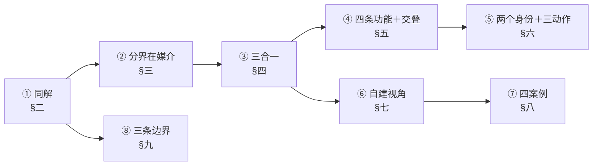
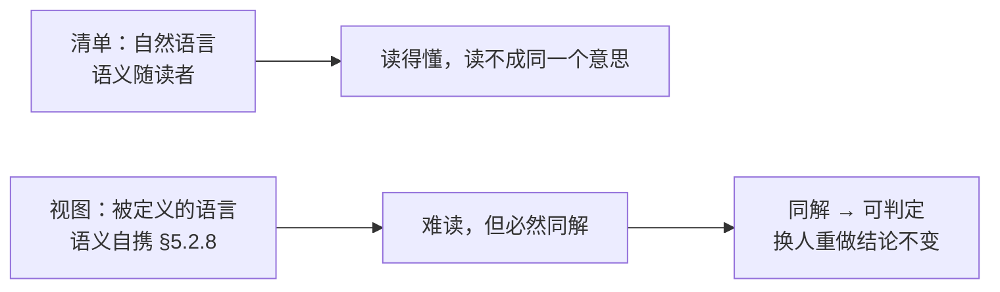
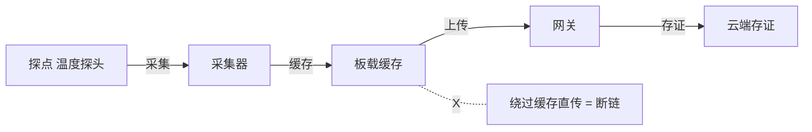
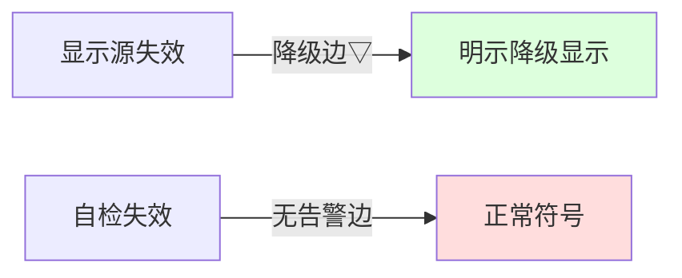
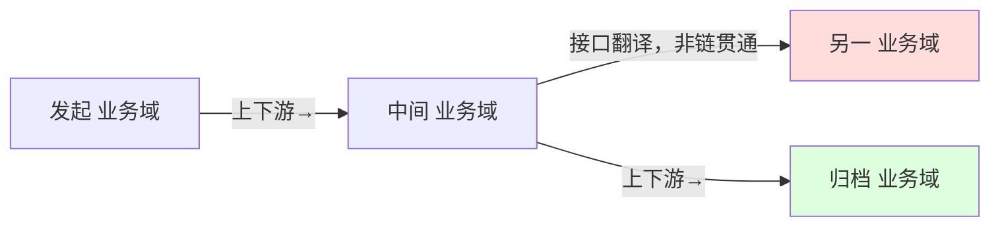
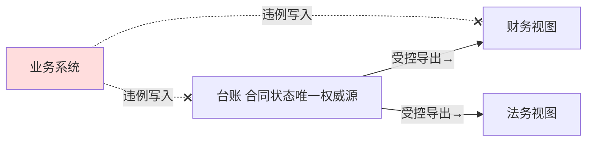

# 架构描述与架构视图价值研究报告

## —— 为什么有了清单，还必须有视图

**The Value of Architecture Description and Architecture Views: A Research Report**

> **编号**：36（研究报告稿）
> **日期**：2026-10-12
> **主题**：以四份标准正本为唯一依据，回答"**既然已有基本概念、属性与管控原则清单，为什么还必须有架构描述、尤其是有架构视图**"。**核心结论（讨论后半段收敛的正确口径）：架构视图的价值＝使架构"同解"；其原因＝自然语言 vs 被定义的语言。** 由此向下展开：同解的结果（可判定）、能力的来源（三合一）、没有现成视角时的自建方法（42010:2022 §8.1 七项），并以四个案例（M3／HUD／EOS／恒信）各建一个视角填实
> **依据（只用标准正本）**：**ISO/IEC/IEEE 42010:2022**（库内正本全文）｜**ISO/IEC/IEEE 42020:2019**（库内正本全文）｜**ISO/IEC/IEEE 15288:2023**（库内正本全文）｜**ISO/IEC/IEEE 42030:2019/2020**（旁证）
> **取证纪律**：本报告凡涉"视图／清单／同解／判定"的判断**只取标准正本**；本项目既有研究报告与教材**不作本报告的判据**，仅在案例设定处作**取材**并标注（〔案例〕／〔主线〕）；引外文**原文与中译并列**；案例中非取自案例设定的具体数值一律标〔示例〕
> **文档版本**：v1.0（2026-10-12 创建）→ v1.1（补齐三作用方式、§5.6 正本句／回流与复用／四问自检／附录 D 归并／三条边界）→ v1.2（核心结论更正："可判定"改为"同解"）→ **v1.3（2026-10-12 用正确结论重构：以"同解／自然语言 vs 被定义的语言"为唯一主轴重排全文，移除讨论前半段被否掉的口径与"列用途"式的章节，归入判错留痕）** → **v1.4（2026-10-26 补三节：§3.4 两根正交的轴（含视图四条不可替代功能、两条边界与一条通用判法）、§3.5 三个动作（递·交得出去·交付）、§3.6 清单的两个身份；摘要增第 13、14 条；条号索引增 §3.14 信息部件；接驳增 30／37／42 三条。起因＝教材第13章阶段一六稿返工：两问原稿答不出——"既然有了架构清单，为什么还需要架构视图"与"架构清单不能交出去吗"。未动：§一~§三之三、§四~§十一 正文与全部正本引文）** → **v1.5（2026-10-31 依 46 号对齐）**：**§3.4 加「收窄三：两批内容交叠，不是相等」**（新增 §3.4.1，含三条理由表、交叠三栏表、落点三处；理由＝原节把两根轴对举而**未设交叠限定**，最容易被读成"同一批内容的两种排法"——而"排法"这个说法本身并不在本节里，出在教材 ch13）；**§3.4 两条边界之②加第四件装置（体现检验）**；**摘要标题「十二条」改「十四条」**（实有 14 条，与 35 号 v1.3 修掉的是同一个计数 bug）；摘要第 13 条补收窄三。→ **v1.6（2026-11-01 依 46 号 v3.3 第二轮对齐）**：摘要压为七条（版本括注与重复句出正文，末加台账指针行）；§3.4 拆为 **§5.1 四条不可替代功能、§5.2 两批内容交叠、§5.3 两条边界**，并立 **§5.4 与 48 号 §9 的分工**、§5.5 三合一、§六 两个身份与三个动作；两条 A 级结论（同解／清单更好读）与 §4.2.1（分界在媒介）按 D1 四段铺齐；§九 判错留痕移为**附录 B**，其"最终立住的一条分界"上移为 **§4.4**；**新立附录 A 结论台账 22 行**；四案例补 **D3 三件**（声明行／反向验三问／与结论互指）；**§九 边界 1** 改挂评估、§九 一条依据改挂 42020:2019 §8.3 实施指南 b)、e)；硬冲突五处、舍弃七项；正文条款引用就近补标准名 → **v1.7（2026-11-06 依 48 号 v3.25 对齐：1 处「三把尺的概念层」改「判据的概念层」）** → **v1.8（2026-11-11 随 46 号 v2.6（八条主结论）严格对齐，共改 11 处）**：**口径 8 处**（摘要第 2 条补「同解是可交接的条件」；§4.3 补「判方案合格看覆盖，不看件数」；§5.3 二问「某个视角」改「恰一个视角」；§6.1 开篇改「两档都不是方案」；§6.1 表面矛盾句与推论句把「清单不是描述」落到「清单是内容的排列、本身不是方案」；§6.2 末句补「拿到之后还要不要自己再做一次分配」；§九 边界 3 补「全体的投影，不是系统的一块」）；**指针 1 处**（§十一 分工（36↔46）块补 46 号 §2、§2.5、§2.7、§5.6、§5.7 新号）；**号形 2 处**（§3.1.1、§3.2.1 的裸 § 补标准名，§5.3 内一处并入口径改动），另有 6 处句内补 46 号新节号；**未动**：结论台账 K 号与条数、案例事实与数字、本件章节结构与节号、此前各版修订记录 → **v1.9（2026-11-13 随 46 号 v2.6 逐段对齐·第二轮；19 号规程阶段一）**：七路只读扫描（四段正文＋号形指针一路）→ 定稿回读 → 落笔 → 改后复读。**必改 15 处**——「同解是可交接的条件」改判据归属（46 号 §2.7）／42 号引注加〔交叉印证·非判据〕并把区间改 §4.2、§4.3／EXAMPLE 2 五样改六样／「内容没有版本」改「没有执行落款」（46 号 §2.4）／视角规格不声明「受谁治理」（视角居治理端）／42010 §8.1 f) 逐字补全／42 号引文「归清单」订正为「归表」／42 号节号 §9.3·§10.6 → §9.2·§9.5 与 §4.4 自引／35 号「§二」→ §十（必要性）／32 号「§四」点明到 §4.1·§4.5 并补 §8.1 件名／48 号「§附录 C」→ 附录 C.2 同解行／48 号 §9.24 主句与本号相抵的括注（挂账转该件）／§二 定义表补中译／§3.1.1 与 §3.2.1 两处自引补「本报告」；**建议改 30 处**（46 号 §5.6 三层与四条的分工句、「答得全」归 §5.7 c)、§5.3 准入问句改指 §9.25、§6.1 两个身份按 §2.2 重述、信息部件称名统一四处、35 号案例节号六处、46 号 §5.4 与 §9.5 分工、附录 A C 级三分等）；**判留 29 处**；**待裁 1 处**（K09「§5.1 节内表」与该节实际无表）；合并 48 号 §9.24 主句「同一批内容的两种排法」与本号 §5.2 相抵一事为挂账（与该件主句相抵，裁定留该件重构轮，见其收窄一）。 → **v2.0（2026-11-13 按主要结论清单重构，19 号规程阶段二）**：**八条各立一章**（§一 走法＋§二~§九 各承一条＋§十 结论与未决）；原 §三~§六 拆入新 §二~§五（同解／分界在媒介／三合一／四条功能与交叠）；原 §一 前提、原 §二 问题降为 §1.2／§1.1；原 §5.4 分工与原 §十一 接驳并入 §1.5；原 §十 正本条号索引降**附录 C**。**摘要七条→八条**（原条逐字保留、余为要点，一条未删）；**附录 A 台账 22 行加「归主线」列**（一1／二2／三2／四1／五6／六3／七3／八1／九3＝22，与清单·摘要三向一致）；**新增 §1.3 清单表／§1.4 依赖图／§1.6 节号说明／§十 结论与未决／附录 D 新旧对照**；节号重排，库外换算另办。
> **论证体例**：凡结论按同一标准分三级——**A 级（承重／反直觉）**须**四段齐全**：依据（逐条引条款）｜推理（可逐句反驳）｜反证（结论不成立会出什么事）｜边界（不覆盖什么），**缺一段即视为未论证**；**B 级（条款直引可支持）**给条款直引＋性质标记＋条款位置，不必写推理（推理就是翻译），**不铺四段**（铺满会稀释 A 级）；**C 级（本报告读法／方法／问题陈述）**标〔读法〕／〔推理〕／〔问题陈述〕＋所读条款＋边界，不得写成标准规定。〔体例与 48 号 §0.5 同一套；逐条依据与论证位置见附录 A「结论台账」〕
> **★ 不采用的口径**：正文采用的口径，是经过多处自我纠正后、**以讨论后半段为唯一正确口径**的口径；被否掉的原判与被移出正文的内容集中记于 [附录 B](#附录-b-不采用的六条口径立论途中撤掉的论证)，不散在正文

---

## 摘要：八条

1. **问题**：既然架构的内容（基本概念或属性、管控原则）已列成清单，为什么还必须有架构描述、尤其有架构视图？（＝§1.1）
2. **结论（一句话）**：**架构视图的价值＝使架构"同解"**——把关于这个实体的内容的"解释"，从读者的脑子里搬出来、放进公开规则，让不同的人、在不同时间读出**同一个意思**。**架构描述的价值落在视图上**：描述＝表达架构的工作产品（42010:2022 §3.3，架构无形而抽象、描述有形可交付），描述以视图为主要构成（42010:2022 §5.2.7），故描述的价值最终即视图的"同解"。**描述是方案**——方案还含哪些位、哪些视角、怎么对账、哪一版算数（46 号 §2.2）。**"同解"与"可交接"不是一回事**：可交接的判据在"对方拿到之后还要不要自己再做一次分配"（内容可传递、描述可交接，46 号 §2.7）。〔按：**"同解"不是视图一家的功劳**——三张清单之首的**概念清单**已经承担了"共同陈述的条件"；分工是：**概念清单给共同的词，视图给共同的理解**，两者不可互替（42 号 §4.2、§4.3；〔交叉印证·非判据〕）〕
   - **原 4**：**读懂 ≠ 同解**："清单更容易理解"是真的，但那是"读懂"，不是"同解"；自然语言越"好读"，分歧越藏得深。架构要同解，因为下游拿它做判定，判定要换人重做、结论不变——而**"可判定"是"同解"的结果，不是价值本身**。
3. **分界在媒介，不在内容**：清单用自然语言写，语义**随读者**——读得"懂"，但读不成同一个意思；视图用被定义的语言写，语义**自携**——模型种类定术语、记法、语法、语义（42010:2022 §5.2.8），谁学谁得同解。〔此处"清单"指**未挂视角、无列约定**的自然语言清单〕
4. **能力来源是三合一，不是视角一家的功劳**：架构视角（框定＋选中语言）＋模型种类／图例（定语义）＋视图（承载并覆盖内容），三者缺一不可。
5. **四条不可替代功能（少一条即失效）**：**分开看**（各相关方关切彼此冲突、不可通约，一份线性文件装不下）／**答得全**（视图必须应对其视角框定的全部关切，覆盖范围要写明）／**读得一样**（语义写在规则里，不写在读者脑子里）／**还能合上**（分片靠对应关系与对应方法接回去）。**★ 一条收窄：两根轴上的两批内容交叠、不是相等**（§5.3）——清单那批按内容类别收（基本才算数），视图那批按**预期用途**裁，且可含**非基本内容**与**表达层构造**（元素、接口、记号由视角与模型种类引入，42010:2022 §5.2.9）；**"清单一条不少"不等于"视图一页不缺"，反过来也不成立。**
6. **清单有两个身份、交付有三个动作**：同一批字，未成件时是**内容**（清单是内容的排列）；成件后是**描述里"不属于任何视图"的那一档信息部件**（42010:2022 §6.7 EXAMPLE 2）。"能不能交出去"这一族判断先要拆成**递／交得出去／交付·移交**三词；可交接的判据不是"能不能递"，是"对方拿到之后还要不要自己再做一次分配"（46 号 §2.7）。三句裁决与两张表见 §六。（＝§六）
7. **没有现成视角时的正解**：复用查无 → **按 42010:2022 §8.1 a)~g) 写规格** → 入库复用（视角是资产，视图是产物）。**自建视角＝为某一类关切定一套可同解的语言。** 四案例两种模式：M3／HUD／EOS＝链完整性（判"断没断"），恒信＝多副本一致性（判"对没对上"）。另有**三个动作必须分开说**（**递**／**交得出去**／**交付·移交**）与**清单的两个身份**（内容／描述的一档），见 §六。
8. **三条边界**：**AD 合规 ≠ 架构正确**（描述只管应然属性，架构好不好归评估与决策）／**描述的必要性是条件性的**（依赖者一出现即由可选变必需，而**省掉的是那份件，不是架构**）／**视图 ≠ 图、≠ 必须覆盖全部、≠ 阶段交付物**；另附引用警戒三处。（＝§九）

**逐条依据与论证位置见附录 A「结论台账」；八条 ↔ 章 ↔ 台账「归主线」列的对应见 §1.3**

---

## 目录

- 摘要：八条
- 一、走法：八条怎么排（1.1 原问／1.2 采信的标准与证据等级／1.3 八条清单／1.4 依赖与章序／1.5 分工／1.6 一处提请注意：节号全改）
- 二、第一句：架构视图的价值＝使架构“同解”
- 三、第二句：分界在媒介，不在内容
- 四、第三句：能力不是视角一家的功劳，是三合一
- 五、第四句：为什么还必须多出这一件——四条不可替代功能
- 六、第五句：清单的两个身份与三个动作
- 七、第六句：没有现成视角时，自建视角
- 八、第七句：四个案例（视角自建的落地示范）
- 九、第八句：边界与引用警戒
- 十、结论与未决
- 附录 A 结论台账／附录 B 不采用的六条口径／附录 C 正本条号索引／附录 D 新旧节号对照（v1.9 → v2.0）

---

## 一、走法：八条怎么排

> **本报告的主线**：回答一个问题——**既然架构的内容已经列成清单，为什么还必须有架构描述、尤其有架构视图？** 答案分八条，八条各自立一章（§二~§九）；本章交代原问、尺子、清单、次序与分工。

### 1.1 原问

本报告回答一个问题：

> **既然架构的内容（基本概念、属性、管控原则）已经列成清单，为什么还必须有架构描述？架构描述以架构视图为主要构成，那架构视图的价值和意义又是什么？**

问题背后是一句质疑：**清单已经登记了架构的全部内容，视图凭什么不是多余的？**

先钉两个定义，再给结论。

| 词条 | 定义（正本逐字） | 归属 |
|---|---|---|
| architecture（§3.2） | *fundamental concepts or properties of an entity in its environment and governing principles for the realization and evolution of this entity and its related life cycle processes*（中译：实体在其环境中的基本概念或属性，以及为实现和演化该实体及其相关生存周期过程的管控原则） | 内容 |
| architecture description（§3.3） | *work product used to express an architecture*（中译：用于表达架构的工作产品） | 工作产品 |

> **号形说明**：本表「词条」列各条款号均为 **42010:2022** 条款，故列内只写 `§x.y`。

42010:2022 Introduction L177 把两者钉开：*Whereas an AD is a tangible work product, an architecture is **intangible and abstract**, understood through its concepts, properties and principles.*（中译：AD 是有形的工作产品，而架构是无形而抽象的，需通过其概念、属性和原则来理解。）42010:2022 Scope 明说 *Architectures are not the subject of this document*（中译：架构不是本文件的对象）——它立法的对象就是描述。

三张清单登记的是定义句那两样内容（X 块＝基本概念或属性，Z 块＝管控原则），用**自然语言**写；视图是描述这一侧的部件（42010:2022 §3.7：*information part comprising portion of an architecture description*（中译：构成架构描述之一部分的信息部件）），用**被定义的语言**写。**这条"自然语言 vs 被定义的语言"的差别，就是全篇的轴。**

---

### 1.2 采信的标准与证据等级

| 标准 | 现行版 | 本轮取到的证据 | 等级 |
|---|---|---|---|
| **ISO/IEC/IEEE 42010** | **2022** | **库内正本全文**：术语 §3.x、概念模型 §5.2.x、要求 §6、§8、资料性附录 §B、§D、§E 逐条直核 | **一手（正本）** |
| **ISO/IEC/IEEE 42020** | **2019** | **库内正本全文**：§5.6、§8.4.x、§10.4.3、§10.4.4、附录 E.2／E.4 逐条直核 | **一手（正本）** |
| **ISO/IEC/IEEE 15288** | **2023** | **库内正本全文**：术语 §3.13、§3.46、§5.9、技术过程 §6.4.3~§6.4.5 逐条直核 | **一手（正本）** |
| **ISO/IEC/IEEE 42030** | **2019**（库内件为 CSA 2020 采标本） | 架构评估是否需要 AD（§3.2 注 1） | **旁证** |

> **号形说明**：本表「本轮取到的证据」列各条款号承该行「标准」列的件名与年号，故不逐条重复标准名。

**一条口径声明**：本报告凡涉"视图的价值／清单与视图的分野／同解"的判断，**只以 42010:2022 为尺**（连同 42020:2019 的过程侧、15288:2023 的生存周期侧）；**不引本项目既有研究报告或教材作判据**。

**案例取材声明**：四个案例的**案例设定**取自本项目案例资料（M3／HUD／恒信，文中标〔案例〕）；**EOS 的产品定义、目的、端到端业务框架、两类 PA**取自本项目主线规范（文中标〔主线〕）；其余补足性构造标〔示例〕。**案例只作填实，不作论证依据。**

---

### 1.3 八条清单（本报告的主要结论）

| # | 结论（一句） | 级 | 章 | 归 46 号主线 | 须先同意 | 旧号落点 |
|---|---|---|---|---|---|---|
| 1 | 架构视图的价值＝使架构"同解"；"可判定"是它的结果 | **A** | §二 | 一（内容是要求、描述是方案） | — | 原 §3.1／3.1.1／3.3 |
| 2 | 分界在**媒介**，不在内容多少／形式／版本 | **A** | §三 | 一、四 | 1 | 原 §3.2／3.2.1／4.1／4.4 |
| 3 | 能力是**三合一**（视角＋模型种类＋视图），不是视角一家的功劳 | B | §四 | 四 | 1 | 原 §4.2／4.2.1／5.5 |
| 4 | **四条不可替代功能**；且两批内容**交叠、不是相等** | **A** | §五 | 四 | 2、3 | 原 §4.3／5.1／5.2／5.3 |
| 5 | 清单有**两个身份**、交付有**三个动作**；可交接的判据＝免二次分配 | B | §六 | 一 | 1、4 | 原 §6.1／6.2 |
| 6 | 没有现成视角时＝按 §8.1 骨架七项写规格；视角居治理端、视角是资产 | B | §七 | 四 | 3 | 原 §七 |
| 7 | 四案例＝两种模式（链完整性／多副本一致性） | C | §八 | 本件增量 | 6 | 原 §八 |
| 8 | 三条边界：AD 合规≠架构正确／必要性条件性且省掉的是件／视图≠图 | B | §九 | 八、本件增量 | 1 | 原 §九 |

**配比**：本体 3（1／2／3）／位置 2（4／5）／器件与边界 3（6／7／8）。**A 级两条**（1、4）各四段齐全；余为 B（条款直引可支持）／C（本报告读法）。**判据**（与 46 号 §7.2 的走样检验同法）：删掉它，本件哪几章立不起来。

### 1.4 依赖与章序



**判据是"读这一章是否必须先同意上一章某句"，不是原章序**：① 先立"价值在同解"，② 才谈"分界在媒介"（同解靠被定义的语言才成立），③ 才谈"哪三样合取"，④ 才谈"少了哪条即失效"。⑤ 挂 ① 与 ④（身份与动作是装置面）。⑥→⑦ 是一条支线（先有方法、再看四个示范）。⑧ 独立挂 ①。

### 1.5 分工：概念层在 48 号，本号只答价值层与装置身份层

**本题概念层主家在 48 号 §9**（两根轴、三句分工、四项一测、视图四问、视图不是细化）；**本号只答"为什么有了清单还必须有视图"这一问的答案层**——同解（§二）、四条不可替代功能与交叠限定（§五）、清单的两个身份与交付三动作（§六）。

- **35 号 §6.2**已立"视图设计四步"（定型→**立实体与建模**→对齐→成件；V-I 见 35 号 §6.3、V-O 见 35 号 §6.4），本报告是其**"为什么"**——四步存在的理由正是本报告 §二、§三的"同解"机制。
- **30 号 §5.2**已立"治理的实质＝可判定的符合性"，本报告把它向前推到"可判定的**前提**是同解，同解的前提是自然语言→被定义的语言"。
- **32 号 §4.1／§4.5**（章三之二组，节号另起）已立"缺的不是视角标准，是视角规格"与八步流程（第 4 步＝按 **42010:2022 §8.1** 建视角库），本报告 §七、§八是该流程的**落地示范**（四个视角的完整七项规格）。
- **30 号**（架构描述核心概念）走的是四定义的**定义层**；本报告 §6.1、§6.2 是它在"清单两个身份"与"递／交得出去／交付"上的**展开**——**同一套不两处写，30 号只留指针**。
- **37 号 §10.1**（三张清单的标准位置）与本报告 §6.1 互指：37 号答"清单在 AD 里放哪儿"，本报告答"同一批字为什么有两个身份"。
- **48 号 §9.24~§9.26**（清单与视图）管**概念层**：两根轴、三句分工、两处收窄、四项一测、视图四问、视图不是细化。本报告不重述概念层，只留**价值层**（§二 同解、§五 四条不可替代功能与交叠限定）与**装置身份层**（§6.1 两个身份、§6.2 三个动作）。
- **42 号 §9.2**（视图）与本报告 §5.4 互指：42 号答"多数视图为什么表现为清单"，本报告答"为什么有了清单还必须有视图"（两根轴的概念层在 48 号 §9）。

> **分工（36↔46）**：**本题概念层主家在 48 号 §9**（两根轴、三句分工、四项一测、视图四问、视图不是细化）；**本号只答"为什么有了清单还必须有视图"这一问的答案层**——同解（§二）、四条不可替代功能与交叠限定（§五）、清单的两个身份与交付三动作（§六）。**与 46 号的分工**：**内容是要求、描述是方案**在 46 号 §2（两跳不是一个跳的粗细见 46 号 §2.5，传递与交接见 46 号 §2.7）；**视图不是插图**见 46 号 §5.6；**一份视图要有什么**见 46 号 §5.7；**链（实体→架构→描述→视图→位）**见 46 号 §5.4（本号只走"描述→视图"一段，位那一环不涉）；**可以不做架构的四个条件**见 46 号 §9.5。这些概念本号不重述。

---

### 1.6 一处提请注意：节号全改

本版把八条各立一章，**§三~§六 的节号整体重排**（§七／§八／§九 与附录 A／B 未动）。旧号→新号逐条见**附录 D**；`v1.9` 及以前的引用一律按附录 D 换算。

---

## 二、第一句：架构视图的价值＝使架构"同解"

> **第 1 条（级 A）**：架构视图的价值＝使架构"同解"——把内容的"解释"从读者脑子里搬出来、放进公开规则；"可判定"是同解的结果，不是价值本身。

### 2.1 一句话

> **架构视图的价值＝使架构"同解"：把关于这个实体的内容的"解释"，从读者的脑子里搬出来、放进公开规则，让不同的人、在不同的时间，读出同一个意思。**



**同解**（本库立名，正本无此词）：不同的人、不同时间读出同一个意思。〔读法〕｜档位与 48 号附录 C.2「术语与档位」的同解一行一致。

#### 2.2 为什么"同解"是价值，而"可判定"只是它的结果〔论证〕

**结论**：架构视图的价值是**使架构同解**——把内容的解释从读者脑子里搬到公开规则里；"可判定"是这个能力换来的东西，不是价值本身。

**依据**：42010:2022 §5.2.8（模型种类/图例的约定 *include the intended uses, the terminology, the notations and their syntax and semantics and symbology*，概念陈述）；42010:2022 §8.2 a)（模型种类规格 **shall** include *conventions such as definition of a language, notation or modelling technique*，**规范**）；42010:2022 §6.7（*Each architecture view **shall** adhere to the conventions of its governing architecture viewpoint*，**规范**）；42010:2022 §3.8 注 1（"to frame"＝*shape, compose, give expression to*，**资料性**）；42020:2019 §5.6（完备性 *determined relative to its intended use*，should 级）。

**推理**：① 若价值只是"可判定"，则任何能把话说清楚的载体都能满足它——一份写得好的说明书、一次当面交底、一张幻灯片，都"可判定"；② 真正稀缺的是**换人重判而结论不变**，这要求语义外置到规则里，而规则就是模型种类与视角约定（依据 42010:2022 §8.2 a)、42010:2022 §6.7 的 shall）；③ "换人重判结论不变"一旦成立，判定才成为可能——故"可判定"在因果上**位于"同解"之后**，是结果不是原因。

**反证**：若"可判定"是价值本身，则"同一个候选、两批人判、结论相反"应当被视为"判得不认真"而不是"装置不成立"——但 42010:2022 §6.7 把"遵循其视角的约定"写成 **shall**，正是为了让结论**不由判的人决定**。把价值放在"可判定"上，会把这条件读成操作纪律，装置本身失据。

**边界**：本节不主张"同解"是视图一家的功劳——共同的**词**由概念清单承担（摘要第 2 条〔按〕），视图给的是共同的**理解**；也不主张视图在任何时候都必要（42030:2019 §3.2 注 1：评估可不依赖成文描述，见本报告 §九 边界 2）。

### 2.3 "可判定"是"同解"的结果，不是价值本身

正因为同解，判定才成为可能：同一个候选、换人重做、结论不变。**"使架构可判定"不是视图的价值，而是"同解"换来的东西**——同解之后，架构才能被问、被答、被判定、被复核。

---

## 三、第二句：分界在媒介，不在内容

> **第 2 条（级 A）**：清单与视图的分界在**媒介**——自然语言（语义随读者）vs 被定义的语言（语义自携）；不在内容多少、不在呈现形式、不在有无版本。

### 3.1 关键区分：读懂 ≠ 同解

- **清单容易"读懂"，但读不成"同一个意思"**。自然语言每一句都顺，谁都能复述大意；但也正因为是自然语言，意思不由文字定、由读者补。**自然语言越"好读"，歧义越不显形——它让分歧藏起来，而不是没有分歧。**
- **视图难"读懂"（要先学那套记号），但一旦读了，按约定必然"同解"**。42010:2022 §5.2.8 说模型种类定的是"术语、记法及其语法、语义与符号体系"——语义是规则的一部分，不是读者临时补的。

**架构要的不是"读懂"，是"同解"。** 因为下游拿它做的是判定——判"我这么做合不合规"，判完要能换个人重判、结论不变。轻松读懂却各读各的，正是判定失效的温床。所以"清单更容易理解"是真的，但那是**更危险的理解**。

#### 3.2 为什么"清单更好读"不构成"清单够用"〔论证〕

**结论**：可读性与同解性不是同一把尺；清单越"好读"，分歧越容易被藏起来，而不是被消除。

**依据**：42010:2022 §5.2.8（约定含 *terminology, the notations and their syntax and semantics*，概念陈述）；42010:2022 §3.8 注 1（框定＝*shape, compose, give expression to*，**资料性**）；42010:2022 §6.7 c)（组件 **shall** address *all of the concerns framed by its governing architecture viewpoint*，**规范**）；42010:2022 §6.8 注 2（*non-model-based view components can also be used effectively*，**资料性**）；42020:2019 §5.6（完备性相对预期用途，should）。

**推理**：① 可读性问的是"读者能不能复述大意"，同解性问的是"两个读者读出的意思是不是同一个"——**两问的对象不同**，一个问题的答案不携带另一个问题的答案；② 自然语言的意义由读者补全，故**未写死的部分恰好是分歧所在**，而"好读"正是把这些未写死的部分读得顺、读得过；③ 要消除分歧，必须把语义从"读者的补全"移到"文本携带的规则"，这正是模型种类/图例做的事（42010:2022 §5.2.8、§8.2 a)）。

**反证**：若可读性高就等于够用，则"读得最顺"的那份文件应当最可靠——实际相反：一份写得极顺的自然语言清单，在"这条算不算那一类""这个值以谁为准"这些点上，两批人可以读得同样顺而结论相反，而这种相反**在文面上完全看不出来**。**"看不出分歧"不等于"没有分歧"**，这是本节要钉死的一句话。

**边界**：不主张自然语言无用（清单仍是内容的全集，见本报告 §6.1）；也不主张"用了模型就一定同解"——模型种类写得不严，语义照样可争（42010:2022 §8.2 的 shall 就是为此）。

### 3.3 媒介的差别

清单和视图，用的不是同一种媒介。**本质＝把解释从读者的脑子里搬进公开规则。** 这也正是标准从头到尾在做的事：ADF 用来 *codify* 惯例、ADL 用来 *codify* 描述（Introduction）——*codify* 就是"把解释从脑子里搬进规则"。

### 3.4 一条分界（本节收口）

**一条分界**：清单与视图的差别不在呈现形式、不在内容多少、不在版本有无，而在**媒介**——清单用自然语言（语义随读者），视图用被定义的语言（语义自携）。**把清单加上"视角＋覆盖承诺＋约定"，它就变成了视图；把这三样拿掉，视图就退化成清单。** 能力不属于"视图"这个名字，属于"被定义的语言"；视图只是"架构内容用被定义的语言、挂着视角表达出来"的标准叫法。

---

## 四、第三句：能力不是视角一家的功劳，是三合一

> **第 3 条（级 B）**：视角框定并选中语言＋模型种类／图例定语义＋视图承载并覆盖，三样合取；视图做的三件事都归结为"被定义的语言"这一件。

### 4.1 视图的三件事，都是这一件事的三个落点

视图做的三件事——**挂视角（框定关切）／承诺覆盖（shall）／固定约定（模型种类定语义）**——各自都成立，但能力**都归结为"被定义的语言"这一件事**：

| 视图做的事 | 为什么能做得到 | 正本 |
|---|---|---|
| **框定关切**（挂视角，钉死"答哪个问"） | 框定＝**预先锁定答案格式**：视角事先说死"这类问用哪些词、看哪些面、按什么记法、用什么算法核"。锁定之前一个问有一百种答法；锁定之后只有符合这套格式的才算"在答这个问" | §3.8 注 1（*"to frame"＝shape, compose, give expression*）；§3.8 注 4（视角常来自先前知识、经验与实践） |
| **覆盖可查**（承诺覆盖，漏一条即不合格） | 答案格式锁定后，视角给出**有限、显式的问题集**（它框定的那条条关切），§6.7 c) 要求覆盖"全部"——可逐条核对。清单没声明问题集，"全不全"无从说起 | §6.7 c)（shall） |
| **同解**（固定约定，换人读同义） | 模型种类把语义钉死，问的和答的共用同一套规则，谁学谁得同解。清单不钉语义，意思随人走 | §5.2.8；§8.2 |

> **号形说明**：本表「正本」列各条款号均为 **42010:2022** 条款，故列内只写 `§x.y`。

**关键**：三件事里"同解"是**根**，另两件也依赖它——视角规格要真能"框定"，它自己就得写得无歧义（否则"框定了哪个问"各人各解）；关切清单要真能"逐条核对"，每条关切本身得无歧义（否则"覆盖了没有"各人各解）。**所以三个能力不是三件事，是"把解释从读者脑子里搬进规则"这一件事的三个落点。**

#### 4.2 为什么"分界在媒介"这个说法立得住〔论证〕

**结论**：清单与视图的分界不在内容多少、不在呈现形式、不在有无版本，而在**媒介**——自然语言 vs 被定义的语言。

**依据**：42010:2022 §3.3（AD＝*work product used to express an architecture*）；42010:2022 §3.14（信息部件＝*separately identifiable body of information that is produced, stored, and delivered*）；42010:2022 §6.7 EXAMPLE 2（视图外信息**可以**含概览、架构原则、架构模式与风格、引用的参照基准、视图间对应关系与架构理由——即"内容多少"不作分界）；42010:2022 §6.8 注 2（不规定视图组件的正式程度，非模型组件同样有效——即"呈现形式"不作分界）；42020:2019 §10.4.4 e)（分配落点是 *the entities and relationships to be modeled*）。

**推理**：① **内容多少不成立**：任何"视图有某样东西、清单没有"的论证，只要那样东西能写成一句自然语言句子就废——清单能写"追溯链＝探头→采集→缓存→上传→存证"这样的结构句（本报告 §5.3 已自证）；② **呈现形式不成立**：§6.8 注 2 明说非模型组件同样有效，故"图 vs 表"不作分界；③ **版本有无不成立**：清单当然可以有版本、可入库、可基线；④ 剩下唯一稳定的差别是**语义写没写在文本里**——这正是 §5.2.8 的约定项（术语、记法、语法、语义、符号体系）。

**反证**：若分界在内容，则应存在"只有视图能写、清单写不出"的内容项；把 §6.7 EXAMPLE 2 列的**六样**（概览、架构原则、架构模式与风格、引用的参照基准、视图间对应关系、架构理由）逐样写成句子，**没有一样写不出**。分界若在形式，则"表格式视图"这一最常见形态应不成立——而它恰恰是最常见的形态（表格挂了视角约定、记号定死、有覆盖声明）。两种读法各被一条反例击穿。

**边界**：本节只判**分界在哪**，不判"哪种装置更好"；也不主张清单该被视图取代——清单管"一条不少"，视图管"一问一答"，两者是两件装置（概念层见 48 号 §9.24）。

### 4.3 能力的来源是三合一

能力是三样东西**合取**出来的，不是视角一家的功劳：

| 谁 | 提供什么 | 正本 |
|---|---|---|
| **架构视角** | 框定关切（对准哪类问）＋**选中**用哪套语言、哪些模型种类、哪些视图方法 | §3.8；§5.2.8（模型种类是"由其视角**标识**的"） |
| **模型种类／图例** | **语义本身**——记法、语法、语义、符号体系 | §3.15；§5.2.8 |
| **视图（架构师做的内容）** | 真有内容、真的覆盖了那些关切 | §6.7 c) |

> **号形说明**：本表「正本」列各条款号均为 **42010:2022** 条款，故列内只写 `§x.y`。

```mermaid
flowchart TB
    VP["架构视角<br/>框定关切 ＋ 选中语言"] --> VC["视图组件（内容）"]
    MK["模型种类 / 图例<br/>定记法·语法·语义"] --> VC
    VC --> V["视图<br/>挂视角·承诺覆盖·按约定呈现"]
    V --> J["同解 → 可判定"]
    VP -.->|缺它则"不知道答哪个问"| X1["失效"]
    MK -.->|缺它则"退回自然语言歧义"| X2["失效"]
    V -.->|缺它则"无内容可判"| X3["失效"]
```

各自缺了会怎样：**有视角、有语言、但视图空着**——没有内容可判；**有内容、有视角、但没定语言**——退回自然语言，歧义照旧；**有内容、有语言、但没有视角框定**——没人知道它"回答的是哪个问"。

**视角是指挥，模型种类是词典＋语法，视图是答卷。同解是这个组合的性质，不是其中任何一件单独的性质。**

---

## 五、第四句：为什么还必须多出这一件——四条不可替代功能

> **第 4 条（级 A）**：四条不可替代功能（分开看／答得全／读得一样／还能合上），少一条即失效；且两根轴上的两批内容**交叠、不是相等**。

### 5.1 正本给"为什么要描述"的那一句

42020:2019 §5.6：

> *Architectures **should be described using a set of views and models** that are complete, consistent and correct. The completeness of an architecture view or model is **determined relative to its intended use**.*
> （架构应当用一组完整、一致、正确的视图与模型来描述；视图或模型的完备性，是**相对于它的预期用途**判定的。）

前半句说"描述"是 **should** 级要求，不是可选项；后半句解释了 42010:2022 §6.1 为什么强制 AD 声明自身预期用途——**用途就是完备性的尺子**，没有用途，就无所谓"描述完了没有"。

另有 42020:2019 §10.4.4 首段讲"多少个视图才够"（逐字）：视图与模型的范围和种类，**应当限于**那些足以回应既定关切、问题以及用途、范围、广度、深度者。**视图不是"该有的都要有"，而是"要问的问题都有页面可问"**——判方案合格看**覆盖**，不看件数（46 号 §2.3、§2.5）。

### 5.2 四条不可替代功能（少一条即失效）

**两根轴不能互相顶替**：清单齐了，答不了"我这条问在哪一页"；视图齐了，答不了"内容是不是一条不少"。**账不是第三样内容**，它是把两遍排出来的东西对上的记录（视图与视图对不对得上、每条关切有没有落到某张视图、哪条已知对不上；42010:2022 §6.9.1~§6.9.3、§6.7 d)）。

1. **分开看**——多个相关方的关切彼此冲突、不可通约，一份线性文件装不下；视角负责框定、视图负责应对（42010:2022 §6.6、§6.7 均为 shall）。**没有视图，"谁要判什么"没有落点。**
2. **答得全**——视图必须应对其视角框定的**全部**关切，并覆盖实体的部分或全部，"有意只覆盖一部分"也要写明（42010:2022 §6.7 c) 与注 3）。**没有覆盖声明，"全不全"无从问起。**
3. **读得一样**——每个组件受模型种类或图例管辖，语义写在规则里而非读者脑子里（42010:2022 §3.7、§5.2.8、§6.8 注 2）。**没有这一条，答了也读不成同一个意思。**
4. **还能合上**——分片之后靠对应关系与对应方法接回去（42010:2022 §6.9.1~§6.9.3）。**没有账，分片就是散架。**

**四条是合取，不是择一**：任缺一条，这件东西就退回"另一份写得整齐的清单"——看着更像样，判定仍不可复核。这四条与 46 号 §5.6 的三层同答"为什么必须有视图"：分片／写清读法／能对账；两处分片之据各一条——46 号取"一人一次判不了"，本号取"关切彼此冲突、不可通约"。"答得全"一条在 46 号落在 **§5.7 c)** 的合格判据里，不在 §5.6 那三层。

**四条合成一张表**（本条的论证位置；K09 记 A 级，据此）：

| # | 功能 | 依据（正本，规范级） | 缺了会怎样（反证） |
|---|---|---|---|
| 1 | **分开看** | 42010:2022 §6.6、§6.7（均 shall：视角框定关切、视图应对关切） | "谁要判什么"没有落点 |
| 2 | **答得全** | 42010:2022 §6.7 c) 与注 3（应对全部框定关切；可有意只覆盖一部分、须写明） | "全不全"无从问起 |
| 3 | **读得一样** | 42010:2022 §3.7、§5.2.8、§6.8 注 2（组件受模型种类或图例管辖） | 答了也读不成同一个意思 |
| 4 | **还能合上** | 42010:2022 §6.9.1~§6.9.3（对应关系、对应方法、成立／违反记录） | 分片就是散架 |

**边界**：这四条只判"视图这一层为什么不可替代"，不判具体项目该有几张视图（那由关切台账反推，§5.4）；也不主张有了这四条就一定同解——读法写得不严，四条齐了照样各读各的。

### 5.3 两批内容交叠，不是相等

**这是本节最容易被读错的一处，必须先钉死**：两根轴上的**不是同一批内容**，写成"同一批内容的两种排法""同一批字的两个版本"**都是错的**。48 号 §9.24 的**主句**"清单与视图是同一批内容的两种排法"与该节**收窄一**自相抵：本号取收窄一的"交叠"义、**不取主句**，另立挂账待该件订正；"同一批字"一语与收窄一同向，不在相抵之列。三条理由，条条有正本：

**① 各有各的裁法**——清单那批按**内容类别**收（基本才算数，判据的概念层见 48 号 §2.3，本号不重述）；视图那批按**预期用途**裁——**用途变了，该进视图的东西就变**（42020:2019 §5.6：*The completeness of an architecture view or model is **determined relative to its intended use***，中译：架构视图或模型的完备性是**相对于其预期用途**判定的）。**这一半的论证见 48 号 §9.24 收窄一。**

| # | 为什么两批不相等 | 正本 |
|---|---|---|
| **② 视图那批可含非基本内容** | 概览、架构原则、架构模式与风格、引用的参照基准、视图间对应关系、架构理由——**这些都可进 AD，且都可留在视图外**；没有一条是"基本概念或属性" | 42010:2022 §6.7 EXAMPLE 2：*Information parts not within any view could include overviews … architecture principles … correspondences between views; and architecture rationale*（中译：不在任何视图内的信息部件可包括所关注实体的概览……架构原则……视图之间的对应关系以及架构理由） |
| **③ 视图那批含表达层构造** | 元素、接口、记号是**由视角与模型种类引入**的；它们**不在清单里**，也不是清单的"另一次排法" | 42010:2022 §5.2.9：*As viewpoints, model kinds and legends are specified and applied, **additional AD elements are introduced***（中译：随着视角、模型种类与图例被规定和应用，**附加的**架构描述元素被引入） |

**一句记住**：**清单与视图的交集，是"同一条内容既被登记、又在某张视图里被读到"的那一部分；两边各有一块对方没有的东西。**

| 清单有、视图常无 | 两批交叠的部分 | 视图有、清单无 |
|---|---|---|
| 概念／属性／原则的**全集**与逐条准入记录；尚未成件时的草案 | 同一条内容，既在清单上有一行，又在某张视图里有一个看得见的位置 | 表达层构造（元素、接口、记号、图例）；视角与**覆盖声明**；对应关系与对应方法；已知问题；按预期用途裁出来、本来不打算进清单的**非基本内容** |

**落点三处，有一处不落元素**：组件自身／两组件之间／**一圈之外**（环境条件）；原则还可整体留在视图外（42010:2022 §6.7 EXAMPLE 2）。**故"清单一条不少"不等于"视图一页不缺"，反过来也不成立。**

### 5.4 两条边界

① **不是所有清单都要升成视图**——原则、模式、风格可以留在"不属于任何视图"那一档（42010:2022 §6.7 EXAMPLE 2）；**但落到元素与接口层面的那条原则，必须在视图上看得见它被违反的样子**（37 号 §10.2.2 的三形态：视图里的约束句／模型上的约束／视图之外但仍在本报告所述 AD 之内的信息）。三句话记住：**视图里看不到原则，不算缺陷；文档里找不到原则，才是缺项；原则只写在文档里、视图上一条约束也没有，仍是缺项。**

② **图不是判据**——多数视图表现为清单（"关系归图，集合与属性归表"，42 号 §9.2）。审一份东西是不是**这个架构的**视图，按 **48 号 §9.25 的四问、顺序不改**：**一问**，它在一份**描述**里吗；**二问**，它受**恰一个视角**治理吗（42010:2022 §6.7 要求一张视图恰有一个治理视角，46 号 §5.7 b)）；**三问**，它的组件标明**模型种类**、或给了**图例**吗；**四问**，**它里头有没有东西，体现着这个实体的概念、属性，或它与环境的关系**（42010:2022 §3.3 的 express；42010:2022 §6.7 c) 的覆盖）——**前三问过、第四问不过，那是一张图，不是这个架构的视图。**

　　（由此落地一处读法：**这里的"清单"指未挂视角、无列约定的自然语言清单**；挂了视角约定（列固定、禁空、禁模糊值）的表，正是视图最常见的形态——42 号 §9.2、§9.5；分界的道理见本报告 §3.4。）

> 视图准入问句见 **48 号 §9.25 的四问**；48 号 §2.11 第 3 张是同一件事的**覆盖口径版**，其第四问作"应对其视角框定的全部关切"（与 §9.25 的"体现"问不是同一问）。

## 六、第五句：清单的两个身份与三个动作

### 6.1 清单的两个身份

同一批字，**没成件时是内容（清单是内容的排列）；成件时落进描述、成为描述里的一档信息部件——按 42010:2022 §6.7 EXAMPLE 2，是"不属于任何视图"的那一部分**。所谓"不是方案本身"，只说它不是方案那四样（哪些位、哪些视角、怎么对账、哪一版算数），不说它不在描述之内（46 号 §2.2）：

| 身份 | 它是什么 | 依据 |
|---|---|---|
| **内容**（架构定义过程的产出） | 概念、属性、规矩本身；还没写进一份件、没有标识与用途 | 42020:2019 §10.4.4 e)／f)；42010:2022 §3.2 |
| **描述的一档**（成件后的清单） | 写在一份带标识与用途的文件里、**不属于任何视图**的那一部分信息 | 42010:2022 §6.7 EXAMPLE 2（原则、模式、风格、依据、视图间对应关系、架构理由）＋42010:2022 §6.1（标识和用途）＋§3.14（信息部件） |

> 概念层的"清单≠描述"（四项一测）主家在 **48 号 §9.25**；本节只留**同一批字的两个身份**这一层。

**这一条解释了一处表面矛盾**：37 号说"三张清单**可不属于任何视图**"（对，说的是成件后的位置），教材第11章说"清单**不是**描述"（也对，说的是**清单是内容的排列、本身不是方案**）。两句不冲突——**它们说的是同一批字的两个身份**。

**推论**：说"清单能交"时，指的一定是成件后的那一档；说"清单不是描述"时，指的是**它还是内容的排列**——成件改的是"它在不在描述之内"这一位，不改的是"它作为内容的那几条"。**混用即错，且这一错正是"只有描述能交"那句的来处。**

### 6.2 三个动作：递／交得出去／交付·移交

**"能不能交出去"这一族判断，先要把三个动作分开**，否则一开口就错：

| 动作 | 是什么 | 谁做得到 | 正本 |
|---|---|---|---|
| **递**（hand over） | 物理动作：把一叠纸、一个文件交到别人手上 | **任何纸都行**——清单能递、图能递、草稿也能递 | 无条款，属日常动作 |
| **交得出去**（deliverable） | 递过去之后，别人读出来跟你一样，**且递过去就能开工**（不必自己再做一次分配）；因此能被签收、入库、版本化、被下游拿去判 | 只有**读法写死**的那一份做得到 | 42010:2022 §3.3 注 2（AD 是有形表示）、§3.14（信息部件＝生成、存储、**交付**的）、§6.1（须写明预期目的与标识） |
| **交付／移交**（delivery、handoff） | 一方把东西交给另一方的那种关系 | **正本里没有这条关系**（46 号 §2.7 的"交接"是本库判据，不是正本关系）——架构描述与它下游之间只有**应答、对应、实现、记录**（42 号 §5.3，据 42010:2022 §6.2、§6.3、§3.11、§3.2 第三截、§6.10） | — |

**三句裁决**：

1. **架构（内容）交不出去**——不是忌讳，是它**不是信息部件**：没有"份"、没有**执行落款**（哪一版算数）、没有标识（42010:2022 §3.2 对 §3.14；内容本可书面、正式、版本化，缺的是执行口径上的落款——46 号 §2.4）。
2. **清单能递，而且它通常已经在描述里**——带上标识与用途，它就落在 AD 的"不属于任何视图的信息"那一档（42010:2022 §6.7 EXAMPLE 2）；42010:2022 §3.14 的 *delivered* 正是给这类信息部件的。
3. **清单交出去的是字，不是读法**——要读出同一个意思，靠的是视图（视角约定＋每个组件的模型种类或图例）与账。

**故"只有描述能交出去"这句话必须改写**：能**签收、入库、版本化**的是描述（"不能签收"不等于"不能递"）；而**"交得出去"问的从来不是能不能递，是递过去之后读出来的是不是同一个意思**，以及**对方拿到之后还要不要自己再做一次分配**（内容可传递、描述可交接，46 号 §2.7）。

---

## 七、第六句：没有现成视角时，自建视角

> **第 6 条（级 B）**：自建视角是正规路径——复用查无 → 按 42010:2022 §8.1 a)~g) 写规格 → 入库复用；视角是资产，视图是产物。

标准把"自建视角"设计成了正规路径，不是绕路。42010:2022 §8.1 注 2 明说 *This document does not require any particular specifications of architecture viewpoints to be used*。

### 7.1 先穷尽复用，别急着自建

42020:2019 §10.4.3 注 1（相关视角**可能已在概念化阶段**识别或开发，检查能否**照用、修改或扩展**）＋注 4（架构框架同理）；两者共同要求**尽量泛化**（注 2）。可复用蓝本：RM-ODP 五视角（企业／信息／计算／工程／技术）、ISO/TS 14812 四视角、GERAM／ISO 15704 四视图、UAF／NAF 九格；以及 42020:2019 §E.4.2 的七种常用视图（语境／概念／功能／逻辑／物理／技术／组织）。

### 7.2 自建＝按 42010:2022 §8.1 a)~g) 写规格

这是"写一个视角"的**骨架七项**，一项都不该少（表外另有四句，见下）：

| # | 写什么（42010:2022 §8.1 逐字） | 本质 |
|---|---|---|
| a) | *any stakeholder perspectives associated with this viewpoint (per 6.3)* | 谁这样看 |
| b) | *one or more concerns (per 6.4) framed by this architecture viewpoint* | 答哪个问 |
| c) | *one or more aspects related to those concerns (per 6.5)* | 看哪些面 |
| d) | *known typical stakeholders (per 6.2) holding those concerns which are framed by this architecture viewpoint (per item b))* | 给谁看 |
| e) | *model kinds (per 8.2) and legends for use when constructing views (per 8.2)* | **用哪套语言** |
| f) | *correspondence methods capturing relations within resulting views and their view components (per 6.8)* | 怎么缝（视图内及其视图组件之间；跨视图的对应见 42010:2022 §6.9） |
| g) | *references to any sources of information about this viewpoint* | 从哪来 |

外加 42010:2022 附录 B.2 模板的**名称与概述**（两列，不属 a)~g)），以及 42020:2019 §10.4.3 d) 的**选择理据**、e) 的**用途范围**。**关键在 e)**：自建视角的核心动作，是给这一类关切**定一套可同解的语言**。

**视角居治理端**：视角规格不声明自己"受谁治理"——治理的方向是视图→视角（42010:2022 §6.7 b)）；**版本标识**是视图的要件（同为 §6.7）与模型种类的要件（§8.2 c)），视角层不设（§7.3 说的"可版本化"是实践要求，不是 §8.1 的要件）。**另有四句不属 a)~g)，不得排成第 h)、i) 项**：第二段一条 **should**——视角规格**宜**标识用于创建、解释或分析受其管控视图的视图方法（按 §8.3）及一个或多个模型种类（按 §8.2）；末段一条 **shall**——**每个图例应就其所记载的视图组件的解释向用户提供指南**；中段两条 **can**——视角规格**能**使用对应方法，也**能**作为 AD 的一部分、作为 ADF 或 ADL 规格的一部分，或按 §8.1 单独使用。

### 7.3 谁写、写时留什么、复用

42020:2019 §10.4.3 注 2：**最好由最熟悉问题本质和相关方关切的人来写**；写完入库、可版本化、跨项目复用。

### 7.4 三条边界

① 自建 ADF 有成本，不能随便建——先穷尽复用，再自建，而且要有理由；② **视角是资产，视图是产物**——视角入库复用，视图逐项目做；每次都重新发明视角，正是"多套话术、零件互换性归零"的病根；③ 符合性要落到对象——"符合 42010"要具体到"哪些视角规格齐备"（42010:2022 §4 的符合性是对 AD／ADF／ADL／视角／模型种类分别做的）。

---

## 八、第七句：四个案例（视角自建的落地示范）

> **第 7 条（级 C）**：四个案例各建一个视角，走一遍 §七的路径；两种模式——链完整性（M3／HUD／EOS）与多副本一致性（恒信）。

（企业名与数值均为**示意**，凡未定者标〈待定〉。做法可核，数值不可引。）

四个案例各挑一个**没有现成视角**的承重关切，走一遍 §七的自建路径。前三个是"链完整性"模式，第四个是"多副本一致性"模式。

### 8.1 案例一：M3 医疗冷链温控箱——温度数据可追溯性视角

**看这一个视角就懂 §二 的"同解"不是"读懂"**：同一张链图，换谁来画、来判，断点落在同一处。

**场景**：石军立过两条原则——"新增传感器类型不得破坏已有追溯链路""断链即报废……全程温度可追溯"。要回应"追溯链会不会被某次改动弄断、断链能不能被检出"，现成视角没有一个管这个问（RM-ODP 信息视角管"数据是什么"，逻辑／功能**视角**管"数据的含义与变换"，都不管"依赖链完不完整"）。〔案例〕

**视角名：温度数据可追溯性视角（M3 Traceability Viewpoint）**

| # | 项 | 填什么 |
|---|---|---|
| a) | 相关方角度 | 质量与法规合规角度（监管审计员、冷链运营方、疫苗使用方） |
| b) | 框定的关切 | ① 数据从探头到存证全程无断点吗？② 换型号／加传感器会弄断已有链路吗？③ 断链能检出、定位、报警吗？ |
| c) | 方面体 | 数据方面（数据流、存储、时序）＋结构方面（实体与接口） |
| d) | 典型相关方 | 监管审计员、质量工程师、冷链运营方 |
| e) | 模型种类＋图例 | **数据流链模型**：节点＝产生／变换／存储点，边＝数据传递；语义＝"有边即该链段存在，无替代路径则该段为单点"；图例给符号表（探点□→采集◇→缓存○→上传△→存证▽，断点＝实线改虚叉） |
| f) | 对应方法 | 每个数据节点必须映到至少一个功能元素（功能视角）和一个物理元素（技术视角）上 |
| g) | 来源 | M3 规格"断链即报废"原始要求＋15288:2023 §6.4.5.3＋相关冷链追溯法规 |

**判定演示**：工程师 A 换一款新型号探头（节点型号变、边没动）→ 链还在，**未破坏**；工程师 B 想绕过板载缓存直传网关（删 C→D 边）→ 实线断成虚叉，**破坏**。



**换任何人来画、来判，结论一致**——"断不断"由这套记号和语义定，不由谁的经验定。

**反向验三问**：① **凭什么算**（这一判定的事实依据在哪）——"换了型号而边未动"与"删掉 C→D 边"两处改动，都落在 M3 规格的两条原始要求（"新增传感器类型不得破坏已有追溯链路""断链即报废、全程温度可追溯"）与视角规格 e) 写死的语义上；② **换个人凭什么还认**（读法是否写死）——读法写死在 e)（节点＝产生／变换／存储点，边＝数据传递，断链＝实线改虚叉）与 f)（每个数据节点须映到功能元素与技术元素上），换人只换手、不换判；③ **值谁给的**（信息源）——场景与取值来自〔案例〕，条款来自 15288:2023 §6.4.5.3。三问都答得出，才叫实例化过；有一问答不出，说明某处还是"画上去的"。

### 8.2 案例二：民用客机平视显示器（HUD）——失效与降级视角

**看这一个视角就懂 §三 的"同解"不是"读懂"**：候选 A／B 之争不靠谁读得顺，落成图上有没有那条降级边。

**场景**：35 号（§11.2）给 HUD 立的关键关切是"单点故障若'看起来正常'，比不显示更危险"，管控原则对应"单点故障不得误导"。要回应"任一单点故障会不会被显示成正常、降级有没有预先声明"，现成视角没有一个管"失效如何进入显示"；安全性分析标准（ARP 4761、DO-254）是**分析方法**（**库外·二手，只作旁证、不作判据**），不是 42010:2022 意义上的**描述视角**。〔案例〕（**案例事实取自 35 号，非本报告数据**）

**视角名：失效与降级视角（HUD Failure & Degradation Viewpoint）**

| # | 项 | 填什么 |
|---|---|---|
| a) | 相关方角度 | 适航审定角度、飞行员（操作）、维修工程角度 |
| b) | 框定的关切 | ① 任一单点故障会不会产生"看起来正常"的误导显示？② 每个故障有无被检出、被声明、有预定降级路径？③ 降级状态飞行员能否看见、能否识别？ |
| c) | 方面体 | 行为方面（失效行为、降级状态机）＋信息方面（显示内容与告警） |
| d) | 典型相关方 | 适航审定员、正副驾飞行员、维修工程师 |
| e) | 模型种类＋图例 | **失效—显示映射模型**：节点＝故障点，边＝故障→显示内容的传播；语义＝"故障若无告警边、也无降级边，即'失效不可见'——判为不成立" |
| f) | 对应方法 | 每个故障源必须映到误差预算里一项（与"接口与时序视角"）；每个符号的失效表现必须在各飞行阶段有声明（与"显示内容与阶段视角"） |
| g) | 来源 | 35 号 §11.2 的 D8（MMEL、开发保证等级）＋管控原则"单点故障不得误导／降级路径预先声明"＋ARP 4761／DO-254 分析方法引用 |

**判定演示**（判 35 号 §11.2.2 的候选 A／B 之争）：



候选 B（单显示源＋双光学通路＋明示降级）——故障带**降级边** → 失效可见，**成立**；候选 A（单套＋自检降级）——自检失效**无告警边、无降级边**，直连正常符号 → "看起来正常"，**不成立**。**"失效若看起来正常比不显示更危险"就此从一句口号，变成一张谁判都一个结果的可判定视图。**

**反向验三问**：① **凭什么算**（这一判定的事实依据在哪）——判据是视角规格 e) 写死的语义（"故障若既无告警边、也无降级边，即'失效不可见'——判为不成立"），两个候选的差别全部落在图上有没有那条边；② **换个人凭什么还认**（读法是否写死）——读法写死在 e) 的符号语义与 f) 的对应方法（每个故障源须映到误差预算里一项，每个符号的失效表现须在各飞行阶段有声明）；③ **值谁给的**（信息源）——关切与管控原则取自 35 号 §11.2（该案例事实的来源，非本报告数据），ARP 4761／DO-254 只作分析方法旁证（库外·二手，不作判据）。三问都答得出，才叫实例化过；有一问答不出，说明某处还是"画上去的"。

### 8.3 案例三：EOS 企业运营体系信息化平台——业务贯通视角

**看这一个视角就懂 §三 的"同解"不是"读懂"**：两个候选的"贯通"之争不靠读文，落成链图上有没有一条合法边。

**场景**：EOS 的目的写得很硬——"从根本上消除信息孤岛和业务碎片化，各业务域在同一平台体系内贯通"；目标"业务贯通是设计保证（统一业务链）"。要回应"任意一条业务从发起走到归档，是否全程走同一条平台链、没落进孤岛？跨域关系是否只走三种合法关系？"，现成视角没有一个管"业务链通不通"。〔主线〕

**视角名：业务贯通视角（EOS Business-Chain Connectivity Viewpoint）**

| # | 项 | 填什么 |
|---|---|---|
| a) | 相关方角度 | 业务运营角度（产品用户／客户）＋平台治理角度（上级／监管方） |
| b) | 框定的关切 | ① 任一端到端业务是否全程走同一平台链、无孤岛断点？② 跨域关系是否只走三种合法关系（上下游／管理-被管理／支持-被支持）？③ 能力缺口是被配置绕过，还是上升为引擎需求？ |
| c) | 方面体 | 行为方面（业务流程、E2E 链）＋结构方面（业务域、PA 节点） |
| d) | 典型相关方 | 业务运营者、平台产品经理、架构治理方 |
| e) | 模型种类＋图例 | **业务链图**：节点＝架构节点类型的端到端业务，边＝三种合法关系（上下游→／管理▷／支持◇）；语义＝"任一业务从发起节点到归档节点若无边相连，即孤岛断点——判为不成立" |
| f) | 对应方法 | 每个业务节点必须映到至少一个引擎能力面＋一份配置定义（与"两类 PA 视角"）；每处能力缺口必须映到一条上升记录（与"需求分流与上升视角"） |
| g) | 来源 | 〔主线〕§2.2（端到端业务框架、E2E 三关系）＋D3"业务贯通是设计保证"＋管控原则"跨域关系限三种／能力缺口上升不许配置绕过" |

**判定演示**（判 35 号 §11.3.2 的候选 B／C 之争）：



候选 C（各域各建、靠接口对接）——业务跨域靠"接口翻译"，链图上**没有合法边** → 孤岛断点，与"贯通"正面相抵，**不成立**；候选 B（双类 PA 并行＋接口契约化）——全程沿同一平台链、只走三种合法边 → **贯通成立**。

**反向验三问**：① **凭什么算**（这一判定的事实依据在哪）——判据是视角规格 e) 写死的语义（"任一业务从发起节点到归档节点若无边相连，即孤岛断点——判为不成立"）与三种合法关系的界内约定；② **换个人凭什么还认**（读法是否写死）——读法写死在 e)（边＝三种合法关系）与 f)（每个业务节点须映到引擎能力面与配置定义、每处缺口须映到一条上升记录）；③ **值谁给的**（信息源）——事实取自〔主线〕§2.2 的端到端业务框架与"业务贯通是设计保证"，非本报告数据。三问都答得出，才叫实例化过；有一问答不出，说明某处还是"画上去的"。

### 8.4 案例四：恒信合同审批数字化系统——事实源一致性视角

**看这一个视角就懂 §三 的"同解"不是"读懂"**：两个候选的"同一笔账"之争不靠读文，落成图上有没有一条违例写入的虚线。

**场景**：恒信的目的——"合同审批合规、月底账目清楚对得上"；核心概念"**合同状态唯一权威源**、归属唯一、留痕即证据、外部只走受控导出"；目标"逐笔一致率 100%"。要回应"同一笔合同在三部门、台账、外部对账平台看到的，是不是同一笔、同一编号、同一个月？任何改动有没有受控、留痕、会不会被另一处无声改掉？"，现成视角没有一个管"多份账是不是同一份"。〔案例〕

**视角名：事实源一致性视角（恒信 Single-Source-of-Truth Viewpoint）**

| # | 项 | 填什么 |
|---|---|---|
| a) | 相关方角度 | 财务结账角度、法务合规角度、审计角度 |
| b) | 框定的关切 | ① 同一笔合同，三部门＋台账＋对账平台看到的编号／金额／所属月是否同一？② 任何字段改动是否走变更控制、留痕、且不被他处无声覆盖？③ 月底对账是否逐笔对得上（一致率 100%）？ |
| c) | 方面体 | 数据方面（字段、编号、归属、时间戳）＋结构方面（事实源与各副本、导出通道） |
| d) | 典型相关方 | 财务结账员、法务审查员、审计员、业务经办人 |
| e) | 模型种类＋图例 | **事实源—副本映射模型**：节点＝事实源（台账）与各副本，边＝受控导出（单向）／受控回写；语义＝"除台账外任何节点若有无回写边的写入路径，即'第二事实源'——判为不成立" |
| f) | 对应方法 | 每次字段改动必须映到一条审批／状态记录（与"审批与状态视角"）；每条外部导出必须映到一条受控导出契约（与"接口与边界视角"） |
| g) | 来源 | 基本概念"**合同状态唯一权威源**／归属唯一／留痕即证据"＋管控原则"编号单点生成／字段改动走变更控制／外部只许受控导出"＋法规留档十年 |

**判定演示**（判 35 号 §11.4.2 的候选 B／C 之争）：



候选 C（各自为政＋对账平台事后核）——法务、财务、业务各写各的"账"，图上全是**违例写入（虚线红叉）** → 多个事实源，"逐笔一致率 100%"落空，与目的相抵，**不成立**；候选 B（台账为**合同状态的唯一权威源**）——只有台账有写入权，其余全是单向受控导出 → **成立**。

**顺带一个实打实的回报**：35 号 §11.4.3 给恒信记过一条 known issue——"与外部对账平台**直连**，在架构描述里没有对应视图，架构未识别"。这个视角正是抓它的那张网：直连＝外部平台有了写入路径＝**第二事实源**，直接违反"外部只许受控导出"。**有了视角，这类遗漏不再是事后发现，是覆盖核对时当场显形。**

**反向验三问**：① **凭什么算**（这一判定的事实依据在哪）——判据是视角规格 e) 写死的语义（"除台账外任何节点若有无回写边的写入路径，即'第二事实源'——判为不成立"），候选之争落在图上有没有那条违例写入的虚线；② **换个人凭什么还认**（读法是否写死）——读法写死在 e) 的符号（实线＝受控导出、虚线红叉＝违例写入）与 f) 的对应方法（每次字段改动须映到一条审批／状态记录，每条外部导出须映到一条受控导出契约）；③ **值谁给的**（信息源）——事实取自〔案例〕，与 48 号共用的合同审批案同一套事实（唯一权威源、月底对账可保、审计留存达标、越权配置数为 0、旧版本可回放），数值不另立一套。三问都答得出，才叫实例化过；有一问答不出，说明某处还是"画上去的"。

### 8.5 四案例的两种模式

| 案例 | 视角 | 判什么 | 模式 |
|---|---|---|---|
| M3 | 温度数据可追溯性视角 | 数据追溯链断没断 | **链完整性** |
| HUD | 失效与降级视角 | 失效有没有混进显示 | **链完整性** |
| EOS | 业务贯通视角 | 业务链通没通 | **链完整性** |
| 恒信 | 事实源一致性视角 | 多份账对没对上 | **多副本一致性** |

**可见自建视角的方法不挑模式**：没有现成视角时，就为这一类问写一套规格、定一套语言——无论判"断没断"还是判"对没对上"，路径是同一条：复用查无 → 按 42010:2022 §8.1 七项写规格 → 入库复用 → 用视图把判定落成谁判都一个结果的事实。

---

## 九、第八句：边界与引用警戒

> **第 8 条（级 B）**：三条边界——AD 合规 ≠ 架构正确／描述的必要性是条件性的、且省掉的是那份件／视图 ≠ 图、≠ 必须覆盖全部、≠ 阶段交付物。

1. **AD 合规 ≠ 架构正确**。42010:2022 引言 逐字：*This document does not explicitly address completeness or correctness regarding the inclusion of particular elements in an AD.*（中译：本文件不明确涉及特定元素纳入 AD 的完备性或正确性。）它只管描述的应然属性；**架构好不好归评估**（就**被指明的评估目标**所作的判断，42030:2019 §3.4）与**决策**（选择与处置，42030:2019 §3.4 注 1）；**治理裁的是判定的合法性与后果，不是架构好坏**（48 号 §2.8、§11.1、§11.9）。
2. **描述的必要性是条件性的，条件是"有没有人依赖它"**。42030:2019 §3.2 注 1 明说架构评估**不要求**必须有 AD——焦点小组、专家座谈、质量研讨会上，"关于架构的足够知识在参与者身上"就够。**依赖者一出现（下游设计、采购、评审、交接、跨代复用），它就从可选变成必需**；反过来说，**省掉的是那份件，不是架构**——单人一次性时，那几条"必须"仍在他脑子里起作用。46 号 §9.5 把可省的条件并成四条：一次性／无下游／同一人／不再变更，四条同时成立才可省，收口句是"没有第二个人需要知道它是什么"。
3. **视图 ≠ 图、≠ 必须覆盖全部、≠ 阶段交付物**。视图是描述里的**信息部件**，是**全体的投影**、不是系统的一块（46 号 §5.6）。42010:2022 §6.8 注 2：不规定视图组件的正式程度，**非模型视图组件同样有效**；42010:2022 §6.7 注 3：允许刻意只覆盖实体的一部分；42010:2022 附录 E.2：AD 有自己的生存周期，视图活得比一个阶段长，但标准也不要求它先于架构存在——这里的"先"指**架构先于实物**，不是描述先于架构（46 号 §9.2、§9.3）；该两条实施指南的性质为 **NOTE，资料性**（42020:2019 §8.3 b)、e)）。

**引用警戒（42020:2019 §E.4.2.1，资料性）**：正本里唯一成清单的"常用视图"是 §E.4.2 一族，且按其边界只是**常例、不穷尽、不正交**（46 号 §5.9 记）。引它须注意三处：① §E.4.2.6 把物理视图说成"提供设计解"（*provides the design solution*）——与本书"设计解归设计定义过程"（15288:2023 §3.13、§6.4.5）相抵；② §E.4.2.5 自注逻辑／物理之分 *often somewhat subjective*；③ §E.4.2.4 自注功能视图 *not a 42010 normative requirement but would almost always be included*——**不得写成"标准要求有功能视图"**。

---

## 十、结论与未决

**八条合起来是一句**：架构的内容已经列成清单，但清单只保证"一条不少"，不保证"读成同一个意思"；**视图的价值就在把解释从读者的脑子里搬进公开规则**（同解），代价是必须先立视角、定语言、声明覆盖、留账。**故描述不是文档工作，是方案的编制**；判它合格看的是**覆盖**，不是件数。

**未决两件**（不属本版收口范围）：

1. **48 号 §9.24 主句与本件相抵**：该节主句写"清单与视图是同一批内容的两种排法"，与其自身**收窄一**（不是同一批字、是交叠）相抵；本件取收窄一义、不取主句，订正落该件重构轮。
2. **A 级依据行内英文引文的中译口径**：§2.2／§3.2 等依据行里的英文引文尚未逐句给中译——逐句补会撑长依据行，需先定口径（全补／只补术语级／只补正文级）。

> **本版结清一处**：K09 的论证形态（对齐轮标〔待裁〕的那一项）已按"补表"落定——§5.2 末新增「四条 × 依据 × 缺了会怎样」表，K09 的 A 级四段于是落在表内（内含推理段与边界段）；附录 A 仍记其论证位置为"§5.2 节内表"，此次名实相符。

---

## 附录 A 结论台账（一视同仁：每条结论凭什么）

**读法**：级 A＝承重／反直觉（四段齐全）；级 B＝条款直引可支持（给条款即可）；级 C＝本报告读法、方法或问题陈述（级列标〔读法〕／〔推理〕／〔问题陈述〕，并附所读条款与边界）。"论证"列给的是四段所在节；写"节内表"者，该节的表本身即依据＋反证的逐行展开。

| # | 结论（一句） | 级 | 依据 | 论证 | 归主线 |
|---|---|---|---|---|---|
| K01 | 问题：既有清单，为何还必须有描述尤其视图 | C〔问题陈述〕 | 方法（问题陈述，无条款） | §1.1 | 一 |
| K02 | 视图的价值＝使架构**同解** | **A** | 42010:2022 §5.2.8、§8.2 a)、§6.7；§3.8 注 1；"同解"＝本库立名，正本无此词 | **§2.2** | 二 |
| K03 | 可读性高不构成够用；清单越顺，分歧越藏得深 | **A** | 42010:2022 §5.2.8、§6.7 c)、§6.8 注 2；42020:2019 §5.6 | **§3.2** | 三 |
| K04 | "可判定"是同解的结果，不是价值本身 | B | 42010:2022 §6.7（shall adhere） | §2.3 | 二 |
| K05 | 分界在媒介，不在内容／形式／版本 | **A** | 42010:2022 §3.3、§3.14、§6.7 EXAMPLE 2、§6.8 注 2；42020:2019 §10.4.4 e) | **§4.2** | 三 |
| K06 | 视图做的三件事（框定／覆盖／定约定）都归结为"被定义的语言" | C〔推理〕 | 42010:2022 §3.8 注 1、§6.7 c)、§5.2.8 | §4.1 | 四 |
| K07 | 描述是 should 级要求（不是可选项）；用途是完备性的尺子 | B | 42020:2019 §5.6；42010:2022 §6.1 | §5.1 | 五 |
| K08 | 视图不是"该有的都要有"，是"要问的都有页可问" | B | 42020:2019 §10.4.4 开篇（*limited to those*） | §5.1 | 五 |
| K09 | 四条不可替代功能（分开看／答得全／读得一样／还能合上），少一条即失效 | **A** | 42010:2022 §6.6、§6.7 c) 与注 3、§5.2.8、§6.9.1~§6.9.3 | **§5.2 节内表** | 五 |
| K10 | 两根轴上的两批内容**交叠、不相等** | B | 42020:2019 §5.6；42010:2022 §6.7 EXAMPLE 2、§5.2.9 | §5.3 | 五 |
| K11 | 落点三处，有一处不落元素（一圈之外） | C〔读法〕 | 42010:2022 §6.7 EXAMPLE 2；48 号 §9.24 收窄二 | §5.3 | 五 |
| K12 | 不是所有清单都要升成视图；图不是判据 | C〔读法〕 | 42010:2022 §6.7 EXAMPLE 2、§6.8 注 2 | §5.4 | 五 |
| K13 | 清单没成件时是内容，成件后是描述的一档 | B | 42010:2022 §6.7 EXAMPLE 2、§6.1、§3.14；42020:2019 §10.4.4 e)／f) | §6.1 | 六 |
| K14 | 三个动作必须分开：递／交得出去／交付移交 | C〔读法〕 | 42010:2022 §3.3 注 2、§3.14、§6.1（"交付/移交"关系正本无） | §6.2 | 六 |
| K15 | 架构（内容）不是信息部件，交不出去 | B | 42010:2022 §3.2 对 §3.14 | §6.2 | 六 |
| K16 | 自建视角是正规路径，不是绕路 | B | 42010:2022 §8.1 注 2（*does not require any particular specifications…*） | §七 章首段 | 七 |
| K17 | 自建＝按 42010:2022 §8.1 a)~g) 写规格，七项一项不该少 | B | 42010:2022 §8.1 a)~g)、附录 B.2；42020:2019 §10.4.3 a)~h)、注 1／注 2 | §7.2 | 七 |
| K18 | 视角是资产，视图是产物 | C〔读法〕 | 42020:2019 §10.4.3 注 3；42010:2022 §3.8 注 3（资料性） | §7.4 | 七 |
| K19 | AD 合规 ≠ 架构正确 | B | 42010:2022 引言（*does not explicitly address completeness or correctness regarding the inclusion of particular elements in an AD*） | §九 边界 1 | 九 |
| K20 | 描述的必要性是条件性的（条件＝有没有人依赖它） | C〔读法〕 | 42030:2019 §3.2 注 1 | §九 边界 2 | 九 |
| K21 | 视图 ≠ 图、≠ 必须覆盖全部、≠ 阶段交付物 | B | 42010:2022 §6.8 注 2、§6.7 注 3、附录 E.2 | §九 边界 3 | 九 |
| K22 | 四案例两种模式（链完整性／多副本一致性） | C〔读法〕 | 示意数据，非标准；方法均落 42010:2022 §8.1 七项 | §8.5 | 八 |

**A 级共 4 条**（K02、K03、K05、K09），**全部有论证位置、无"待补"**：K02、K03、K05 四段齐全（§2.2、§3.2、§4.2）；K09 的论证位置为 **§5.2 节内表**（依 D2 读法，"节内表"者该节的表本身即依据＋反证的逐行展开）。

---

## 附录 B 不采用的六条口径（立论途中撤掉的论证）

本报告的正确口径＝**讨论后半段**收敛到的"同解／自然语言 vs 被定义的语言"。此前口径均被逐一否定，集中记于此处：

| # | 被否掉的原判 | 为何被否 | 纠正后的口径 |
|---|---|---|---|
| 1 | **"架构视图的价值＝使架构可判定"**（外加"视图＝结构＋约定"） | 把**价值**答成了**结果**，且"结构＋约定"经不起"清单也能写结构句"的反驳 | **价值＝使架构"同解"**；"可判定"是同解的结果（§二） |
| 2 | **"回应关切＝回答一个问；回答有三要件（知道问什么／可查答全／一致读法）"** | 仍是"判定／回答"框架，没到根——被追问"为什么能框定／能查全／能同解？清单不是更容易理解吗" | 三个能力都归结为**被定义的语言**（§4.1）；真正区分是**读懂 vs 同解**（§3.1） |
| 3 | **"视图的价值＝分面与同一（让一个架构被多个冲突关切方同时使用）"** | 被指"没有理解我的问题"——它答的是"为什么多个视图"，不是"视图的价值" | 撤出价值论证 |
| 4 | **"清单没有版本"** | 清单当然可以有版本、入库、基线 | 时间属性不是分界，撤 |
| 5 | **"内容没有结构"** | 清单能写"追溯链路＝探头→采集→缓存→上传→存证"这种结构句。**凡说"视图有某样东西、清单没有"的论证，只要那样东西能写成句子就废** | 分界不在内容，在**媒介** |
| 6 | **"描述的对象是人"** | 42010:2022 §3.3 说 AD 是 *used to **express an architecture***——**表达的对象是架构**；"人"在受众侧（42010:2022 §3.3 注 2），且 stakeholder 是"角色、岗位、个人、组织或其类"（42010:2022 §3.17） | 表达对象是架构，受众是相关方 |

**因上述纠正而被移出正文的内容**：讨论前半段的"研发过程三个客观条件"（那是架构必要性的论据，家在 35 号 §十（§10.1 必要性），不属本报告）；"AD 在研发过程中的三种作用方式（依从／回流／改写）"（它回答的是"AD 起什么作用"，是被指"答错对象"的一处）；"附录 D 的 22 条用途归并"（"列用途当价值"正是第 2 条被否掉的错误，故不再单列章节）。

---

## 附录 C 正本条号索引

| 主题 | 条款 |
|---|---|
| 架构定义（只给两样） | 42010:2022 §3.2 |
| 架构描述（表达架构的工作产品） | 42010:2022 §3.3 及注 2 |
| 信息部件（生成·存储·**交付**的信息体；AD 与视图均属之） | 42010:2022 §3.14 |
| 架构无形而抽象 | 42010:2022 Introduction L177 |
| 架构描述元素 | 42010:2022 §3.4 注 1 |
| 架构视图（AD 的信息部件） | 42010:2022 §3.7 |
| 架构视角（一组惯例，无属概念） | 42010:2022 §3.8 及注 1／3／4 |
| 关切（对相关方而言具相关性或重要性的事项） | 42010:2022 §3.10 |
| 模型种类（关键特性＋建模约定） | 42010:2022 §3.15 |
| 相关方（角色、岗位、个人、组织或其类） | 42010:2022 §3.17 |
| 架构可以关乎元素／关系（外延，非内容） | 42010:2022 §5.2.2 |
| 视角为判定架构是否满意回应关切而设 | 42010:2022 §5.2.7 |
| 视图可导致需求被修改（回流） | 42010:2022 §5.2.7 注 2 |
| 视图组件受模型种类／图例治理，含语法语义；一组件可属多视图 | 42010:2022 §5.2.8 |
| 视图方法：建造／解读／分析（质询视图以评估性质） | 42010:2022 §5.2.10 |
| 对应关系表达并强制八种关系（组合、细化、一致性、可追溯、依赖、约束、满足、义务） | 42010:2022 §5.2.11 |
| AD 须识别所关注实体与其环境、须写明预期用途 | 42010:2022 §6.1 |
| 关切宜作疑问句 | 42010:2022 §6.4 注 3 |
| 每条关切至少被一个视角框定；视角可作合同先订；不要求任何特定视角 | 42010:2022 §6.6 及注 1／3 |
| 每个视角至少一张视图；视图须覆盖全部框定关切、带版本与已知问题；多视图描述同一架构；允许部分覆盖；视图外可有其他信息 | 42010:2022 §6.7 及注 1／2／3、EXAMPLE 2 |
| 视图外信息（概览·原则·模式·风格·参照基准·对应关系·理由） | 42010:2022 §6.7 EXAMPLE 2 |
| 非模型视图组件同样有效 | 42010:2022 §6.8 注 2 |
| 对应关系与对应方法、成立／违反记录 | 42010:2022 §6.9 |
| 决策与理据必录 | 42010:2022 §6.10 |
| 视角规格七项（a)~g)） | 42010:2022 §8.1 |
| 模型种类规格 | 42010:2022 §8.2 |
| 视图方法 | 42010:2022 §8.3 |
| 视角规格模板 | 42010:2022 附录 B.2 |
| AD 有自己的生存周期，可更新发新版 | 42010:2022 附录 E.2 |
| 架构即约束（收窄设计空间） | 42020:2019 附录 E.2.1 |
| 架构应当用一组完整、一致、正确的视图与模型来描述；完备性相对预期用途判定 | 42020:2019 §5.6 |
| 综合潜在解（分解是选择不是推导） | 42020:2019 §8.4.5 |
| 候选架构：Decompose, when necessary, and allocate | 42020:2019 §8.4.7 f) |
| 概念化只需描述到对预期使用者合适的程度 | 42020:2019 §8.4.8 注 1 |
| 识别或开发视角（a)~h)；注 2 泛化与最熟悉者；d) 选择理据；e) 用途范围） | 42020:2019 §10.4.3 |
| 建模产视图（e) 分配；h) 表达；i) 视图里显现的风险；j) 调和） | 42020:2019 §10.4.4 |
| 七种常用视图（资料性；§E.4.2.4 功能视图非规范要求、§E.4.2.5 逻辑／物理主观、§E.4.2.6 物理视图＝设计解——三子号均属**同一标准**） | 42020:2019 §E.4.2 |
| 系统定义（涌现） | 15288:2023 §3.46 |
| design 名词（足以支持架构的合规实现） | 15288:2023 §3.13 |
| 需求可测但不应暗示实现 | 15288:2023 §6.4.3.1 |
| 架构定义过程目的（以一致视图与模型表达） | 15288:2023 §6.4.4.1 |
| 架构定义成果含"开发架构视图与模型" | 15288:2023 §6.4.4.2 f) |
| 架构定义产物交配置管理立基线 | 15288:2023 §6.4.4 注 12 |
| 设计须与视图里定义的架构实体一致 | 15288:2023 §6.4.5.1 |
| 架构实体与系统元素代表两种不同的概念 | 15288:2023 §5.9 |
| 架构评估不要求必须有 AD | 42030:2019 §3.2 注 1 |

---

## 附录 D 新旧节号对照（v1.9 → v2.0）

左列按 v1.9 写，右列是本版。**章级**：原 §一／§二 降为 §1.2／§1.1；原 §三~§六 拆入新 §二~§五；原 §十 降附录 C；原 §十一 并入 §1.5。

| 旧（v1.9） | 新（v2.0） |
|---|---|
| §一 前提：采信的标准与证据等级 | §1.2 采信的标准与证据等级 |
| §二 问题 | §1.1 原问 |
| §3.1 一句话 | §2.1 一句话 |
| §3.1.1 为什么"同解"是价值〔论证〕 | §2.2（同题） |
| §3.2 关键区分：读懂 ≠ 同解 | §3.1（同题） |
| §3.2.1 为什么"清单更好读"不构成够用〔论证〕 | §3.2（同题） |
| §3.3 "可判定"是"同解"的结果 | §2.3（同题） |
| §4.1 媒介的差别 | §3.3（同题） |
| §4.2 视图的三件事 | §4.1（同题） |
| §4.2.1 为什么"分界在媒介"立得住〔论证〕 | §4.2（同题） |
| §4.3 正本给"为什么要描述"的那一句 | §5.1（同题） |
| §4.4 一条分界（本节收口） | §3.4（同题） |
| §5.1 四条不可替代功能 | §5.2（同题） |
| §5.2 两批内容交叠，不是相等 | §5.3（同题） |
| §5.3 两条边界 | §5.4（同题） |
| §5.4 与 48 号 §9 的分工（指针段） | §1.5（合入） |
| §5.5 能力的来源是三合一 | §4.3（同题） |
| §六 清单的两个身份与三个动作 | §六 第五句（章题加"第五句"） |
| §6.1／§6.2 | §6.1／§6.2（未变） |
| §七 没有现成视角时：自建视角 | §七 第六句（章题加"第六句"） |
| §7.1~§7.4 | §7.1~§7.4（未变） |
| §八 四个案例 | §八 第七句（章题加"第七句"） |
| §8.1~§8.5 | §8.1~§8.5（未变） |
| §九 边界与引用警戒 | §九 第八句（章题加"第八句"） |
| §十 正本条号索引 | **附录 C**（降级） |
| §十一 与既有报告的接驳 | §1.5（合入） |
| 附录 A 结论台账 | 附录 A（**加「归主线」列**） |
| 附录 B 不采用的六条口径 | 附录 B（未变，存史） |
