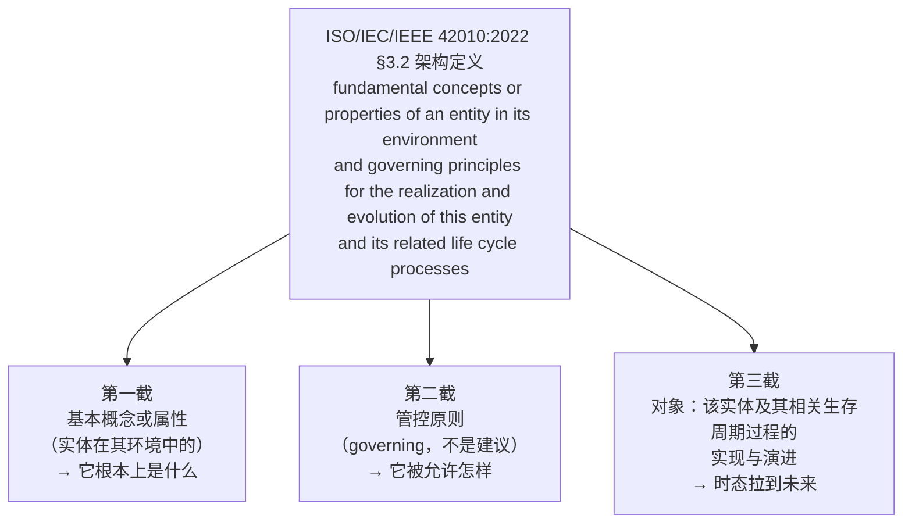
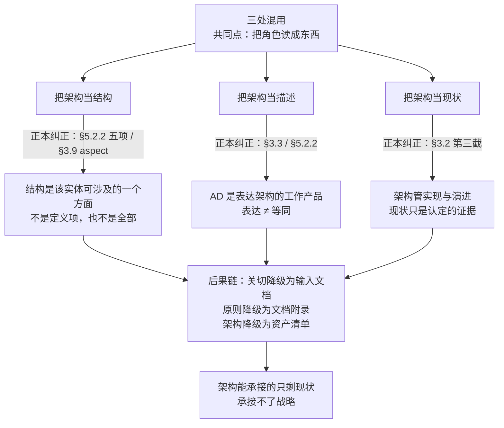
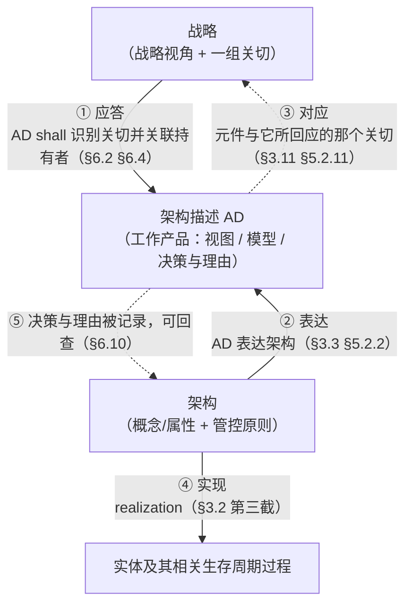
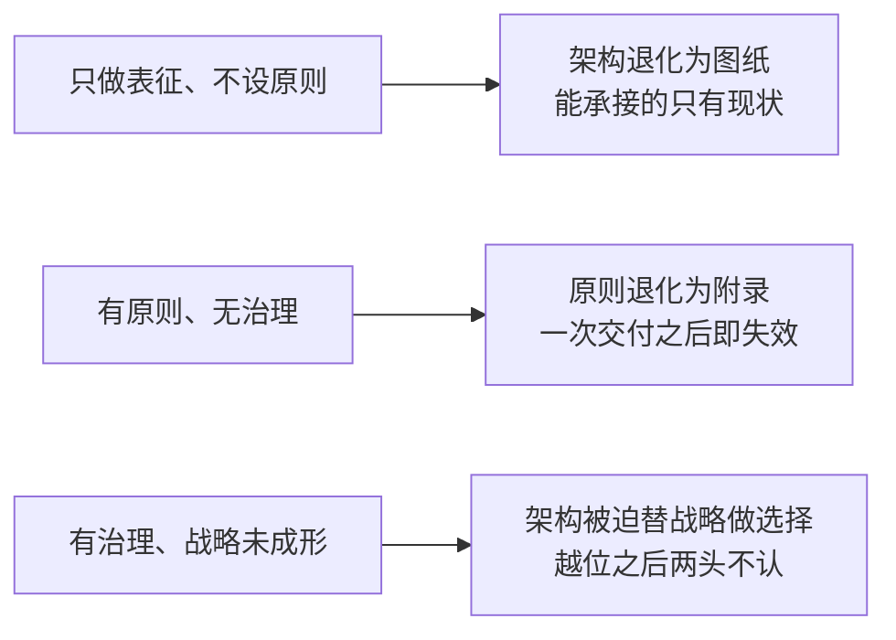
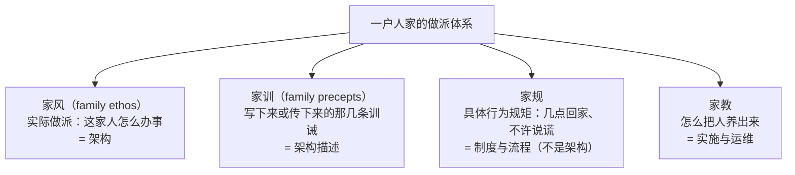

# 架构研究报告

## —— 从架构定义句、目的与基本性，到三张清单、治理与视图，附承接战略与八个示例

**A Research Report on Why Enterprise Architecture Can Carry Enterprise Strategy: From the Three Clauses of the Definition to Three Lists, Six Reasons, and a Family-Ethos Analogy**

> **编号**：42（研究报告稿）
> **日期**：2026-10-21
> **主题**：回答一问——**企业架构为什么可以承接企业战略**。不作倡议，不从既有研究报告取答案；只从库内三份正本的条文取证，给出**六条理由**、**三条关系**、**四个条件**、**三种失效形态**，并给出一个可讲给普通人的类比（家风与家训）与一套**三张清单**（概念／属性／原则）。另附**判错留痕**：研究过程中对"结构"一词的误用及其修复（附录 D）。
> **依据（一手正本在库）**：**ISO/IEC/IEEE 42010:2022**（库内正本全文；§1 范围、引言、**§3.2 架构定义**、§3.3 架构描述、§3.9 方面、§3.10 关切、§3.11 对应、§3.12 所关注实体、§5.2.2 架构与架构描述、§5.2.3 利益相关方与关切、**§6.2 利益相关方识别**、§6.3 视角识别、§6.4 关切识别、§6.10 决策与理由的记录）｜**ISO/IEC/IEEE 42020:2019**（库内正本全文；**§3.3 架构定义**、§3.6 架构实体、§3.9 企业、**§6 架构治理过程目的句**、§8.1 目的、**§8.2 c) 预期结果**）｜**ISO/IEC/IEEE 15288:2023**（库内正本全文；**§5.9 概念与系统定义**、**§6.4.1 业务或任务分析目的句**、**§6.4.4 系统架构定义目的句**）。
> **库外来源（标"库外来源·不可核"，只作对照不作判据）**：TOGAF Standard, 10th Edition（2022）；ArchiMate 4 Specification（2026-04，文档 C260）；BIZBOK Guide v15；ISO 15704:2019。本库无正本，本报告只用其名与版本号作指引，不引其文。
> **取证纪律**：凡涉架构、关切、架构描述、承接的口径判断**只取上述三份正本**；**本子项目既有研究报告与教材只作对照与线索，不作判据**；**凡涉英文一律英中并列**，逐字引文紧随「（中译：…）」；照录不译者三类——标准条款标签（NOTE／EXAMPLE／shall／should／can）、标准文件号与缩写、本报告自编记号；凡断言"标准里没有"**先做零命中检索**。
> **证据档位四档**：**标准逐字**（原文直接写着）／**标准可支持的读法**（由条文推出，标推理链）／**按定义句作的举例**（由定义句套具体情境）／**本报告定性**（为回答方便所作的分档与命名）。
> **配套材料**：摘要见下（**五十条**）；七幅图（Mermaid）：定义句三截图（§2.2）、三处混用定位图（§3.5）、三项次序图（§5.5）、承接三关系图（§6.3）、策略—架构—设计转写图（§6.6）、失效形态图（§7.3）、家风四词分辨图（§8.2）。
> **文档版本**：**v1.0（2026-10-21 创建）**——本轮对话自"企业架构为什么可以承接企业战略"起，经对"结构"一词的两次纠错、对"定义架构是否等于定义实体"的追问、对类比的四轮筛选，最终以**家风与家训**定案，并收于三张清单与三条判别法。本报告为该项共识的成文版，且**对对话中的两处表述作了正本校正**（见附录 D）。→ **v1.1（同日补录）**——按"不遗漏任何对共识有价值与支撑的内容"逐轮回扫，补入十节：§1.4 三份正本的分工、§2.5 架构是谓述、§3.7 关系词与位置词、§5.7 原则的模态、§5.8 与验收标准的分野、§5.9 条件由谁设定、§6.8 承接的三个命题、§6.9 三条形式条件、§8.8 家风的第三层与三条旁证、附录 E.1 候选类比的取舍；摘要增至四十二条；附录 C 补入四条库外旁证，附录 D 补入四处结构化痕迹与三句改写。→ **v1.2（同日）**——补 §9.4「再缩一级：一个人的『为人』」，先收钟工（工程师）三张清单。→ **v1.3（同日）**——§9.4 改为**四例分别成节**（§9.4.1 工程师／§9.4.2 工艺师／§9.4.3 架构师／§9.4.4 技师，各配三张清单与自足结论，不并作对照表），§9.4.5 收一句总纲并点明"为人是名，架构是读法"；新增三条结论：无票者的原则、为人靠记录存续、为人最原始的形式是习惯。→ **v1.4（同日）**——补 §2.6「第三截的对象是两个：实体，以及它的生存周期过程」，分辨"造对象的过程"与"对象内部跑的过程"，并给出一条检验（原则清单里有没有管过程的一条）；摘要增至四十七条。→ **v1.5（同日）**——按"增加对生存周期过程的实现与演化的治理原则"补齐：陈氏木作与四例的原则清单各增三条**过程原则**（管规程／流程／点检表自身的修订、变更与复审），§2.6、§9.2、§9.3、§9.4.5 各处加注说明两类原则的分工。→ **v2.0（同日·结构重构）**——按"骨架过期、内容可留"的判断重排，不重写段落：① §九 正名为「三张清单的两个尺度：一家人，四个人」，9.1／9.2 标为尺度一·企业（家风侧／架构侧），9.3 改"尺度一给出的操作规则"，9.4 改"尺度二·人：四位职业人的『为人』"；② §10.2 由"五条要点"扩为"**十二条要点**"，分四组（定义／形式／承接／人与例子），把 v1.1 以后散在各节的结论一次收拢；③ 摘要保持四十七条不删（删条即删内容），改在末尾加"**摘要与正文对照**"表。→ **v2.1（同日）**——补"目的"这一环：① 新增 §5.2「三张清单之前：目的」（正本依据＝42010 §5.2.2 "该目的与所关注实体的目的不同"；目的不是第四张清单，是锚；目的≠战略）；② 新增 §5.3「'基本'是相对于目的而言的」（三方关系、两级基本性、三种退化、目的句粒度推论、与 §6.2 *fundamental* 的接榫）；③ §九 五个例子各补"目的"一行，陈氏木作加注说明目的如何决定"什么算基本"；④ 摘要增至四十八条。→ **v2.2（同日）**——把 §5.3 的两级判定落到例子上：§9.4.1（工程师）作分级示例，四条属性逐条判定，其中"别人的设计先看懂再改"由基本降为策略级，属性清单随之四条变三条；§5.3 末尾补一句"分级会改清单，不只是贴标签"，并注明其余各例同法。→ **v2.3（同日）**——新增 §8.10「两个被考虑过、又放下的类比：章程与宪制」：记下章程留下的两条判断（"架构＝我们与默认不同之处的清单"、"章程有法律默认条款兜底、架构没有"，另附"人人都签、没人读完、却真的管用"）、宪制强于家风的两处（不成文也有效／位阶与审查，附"有宪法而无宪政"对应"有架构文档、无架构约束"）与它被放下的三条破处，并给"按听众选词"的表。摘要第 35 条补注。**未动**：全部正本引文、取证纪律、附录 A~D、判错留痕。→ **v2.4（同日·定点校正）**——按"不必再重构，做三处校正"执行：① **§五 内部重排**：把「目的」「基本性」由原 5.8／5.9 提到 5.2／5.3（三张清单之前），原 5.2~5.7 顺延为 5.4~5.9，章题改为「目的、基本性与三张清单」；本报告内 §5.x 引用同步重映射，**15288 §5.9 与 42010 §5.2.2 等标准条款未动**（重映射中误伤的三处 15288 §5.9 已复原，并统一冠标准名）。② **§八 拆出附录 E**：原 8.9、8.10（候选取舍记录，共 73 行）移入「附录 E：类比取舍记录」的 E.1／E.2，§八 回到"怎么用家风这个类比"（8.1~8.8）。③ **符号纪律**：标准条款一律冠标准号（42010 §3.2／15288 §5.9／42020 §8.2），本报告节号裸写；副题改为「从架构定义句的三截、目的与基本性，到三张清单、六条理由与家风类比」。**未动**：全部正本引文、附录 A~D、判错留痕。→ **v2.5（同日）**——① **八个示例全数补"治理安排"**（机构／事项／程序／例外／复审／审查六项），并把 v1.3 移出的两例（老韩·诊所医生、方师傅·车间班组长）按"所有示例"复原为 §9.4.5／§9.4.6，合看改为 §9.4.7「六例合看」；② **"治理"一词的两义分立**（用户指正）：**动名词的 governing**（原则治理实现与演进，落原则清单）与**名词的 governance**（机构与程序保障其生效，落治理安排），并标出第三层**元治理**（复审、生效日、过渡条款）；据此把六份治理表头一律改注"（名词性治理：谁保障原则生效）"；③ 老韩一例特别注明"原则清单故意缺过程原则一类"，因为两种治理的缺位要分开看。→ **v3.0（同日·改名与重构）**——① **报告改名**：`42-架构研究报告-从定义句与目的到三张清单治理与视图.md`，正题「架构研究报告」，副题「从架构定义句、目的与基本性，到三张清单、治理与视图，附承接战略与八个示例」——原题只覆盖承接一问，已装不下正文。② **按四篇重组**：第一篇 定义（一~四）／第二篇 判据（五）／第三篇 效力（六~七）／第四篇 表达与举例（八~十）。③ **新增 §5.10 治理：一个词，两种用法**（动名词 governing／名词 governance／元治理；名词性治理六项；三个功能：可援引、可复核、可修改）。④ **新增 §十 架构视图**（§3.7 定义、§3.14 信息部件、§6.1 注 2、§6.6 注 3、§5.2.7 EXAMPLE「图在表达视图」；为什么多数是清单的四条机制；三问判据；八例各一份视图的索引表）。⑤ 结论由十二条扩为**十四条**（增"治理"与"视图"两组）；摘要增至**五十条**；结论与未决序号顺延为十一、十二。→ **v3.1（同日）**——补 §5.10 子节「治理层与运营层：两个"企业"不是同一个"企业"」：以 42020 §3.9（enterprise＝*bold or complex endeavor*，一个或多个组织可参与）与 42010 §3.12（Enterprise 与 organization 并列）为据，分清**章程＝治理实体的架构描述**与**企业架构＝运营系统的架构**，并纠正"企业的架构就是章程"（一是把架构描述当架构，二是只覆盖治理层）；附两者对照表与两种坏做法。摘要第 49 条、结论第 13 条各补一句。→ **v3.2（2026-10-21·依全库口径回修）**——本报告作基准前先受一次反向核对，五处回修：① **术语归位**：`治理性原则`→**`管控原则`**（17 处），依 GB/T 45630-2025 定名与用户 2026-09-21 裁定"其余术语一律按国标"，并采纳 30 号 §7.3 的理由——定语位用"管控"正是为了与名词位的架构治理分开；原附录 B "不译管控原则"一注作废，改为三词位（定语 governing／动词 governs／名词 governance）分工；`生命周期过程`→**`生存周期过程`**、`信息部分`→**`信息部件`**（均随国标定名），附录 B 补 viewpoint／view／information part 三行。② **§5.10 改写**：由"动名词／名词"两分改按**词位**两分（定语位 governing principles／名词位 architecture governance），实质内容（原则在治／机构与程序／元治理三层；六项；三个功能）一字未减；并补一句——**名词位自身还可再切"制度系统"与"治理动作"两刀（40 号 §1.3）**，两套切法不同层，不互为错版。③ **人数与计数回正**：v2.5 补入医生、班组长后遗留的"四例"（摘要 45、47、§9.4 引言、§9.4.3 末、结论 11）一律改"六例"；§10.6 "十一份表"改"**九份表、一份图**"（十行中九表一图）。④ **附录 D 留痕一收窄**：「＋」作连接词可用，判错痕迹只是把两样读成**可拆装的零件**（柱／载体／构件／成分）——原文把"带加号的两项相加"整类判错，与本报告自身多处用法相抵。⑤ 本报告的"架构＝结构／陈述层"两处判错留痕、正本条号索引、取证纪律一律不动。→ **v3.3（同日）**——§5.4 收口一处：把「概念是**陈述的条件**」改为「概念是**共同陈述的条件**」——概念解决的不是"我能不能说清"，而是"我们能不能用同一套话说清"；并补三处正本依据（架构*assists in understanding*／AD *improve communication and cooperation*／架构*understood through its concepts, properties and principles*，另 §6.6 注 3 视角即合同）与一条判据（缺了它，相关方还能不能对"这个系统是什么"达成一致）。摘要 23、§5.5 图节点同步。

---

## 摘要：五十条

### 一、对象与方法（1~5）

1. **本报告只回答"凭什么可以"，不回答"应当承接"。** 前者问标准里有没有落脚点，落在哪几条条文；后者是价值主张。两者混说，会把讨论变成表态。
2. **取证只用库内三份正本**（42010:2022、42020:2019、15288:2023）。本子项目既有研究报告与教材只作对照与线索。
3. **三种流行解释都不成立**：①"因为架构要支撑业务"——"支撑"未定义，且循环；②"因为架构是战略与执行之间的桥"——位置隐喻，预设了分层，且不说桥用什么材料；③"因为最佳实践如此"——权威论证，非标准论证。
4. **标准给出的答案比上述三种都硬：承接关系在标准里是明文，不是推论。** 三份正本各有一句直接把战略与架构绑在一起——42020 §6 说架构治理的目的是维持架构与企业目标、政策及**战略**的一致性；15288 §5.9 把**战略目标**举为"架构实体"的例子，并说企业被当作 SoI 时**企业架构就是顶层系统架构**；42010 §6.3 把 **strategic perspective（战略视角）** 列为一类利益相关方视角。
5. **本报告的第一结论**：企业架构之所以能承接企业战略，根本原因不是架构"顺便"服务于战略，而是**最新标准把"实现与演进"与"管控原则"写进了架构的定义**，又把企业列为可架构的实体，并把战略列为必须被应答的一类关切与视角。承接是定义的构成部分，不是外挂功能。

### 二、定义句的三截（6~11）

6. **定义句逐字**（42010 §3.2）：*fundamental concepts or properties of an entity in its environment (3.13) and governing principles for the realization and evolution of this entity and its related life cycle processes*（中译：实体在其环境中的基本概念或属性，以及对该实体及其相关生存周期过程的实现与演进起治理作用的原则）。该定义**源自 42020:2019 §3.3**，42010 只作措辞修改（删去注）。
7. **三截各自的功能**：第一截回答"它根本上是什么"；第二截回答"它被允许怎样"；第三截回答"这两者管的是实现与演进"，即把时态拉到未来。
8. **"of an entity"是所属，不是组成。** 架构属于实体，不是实体身上的一个部件。这是全文最容易滑掉的一处介词。
9. **"entity"的外延明文含企业**（42010 §3.12 的 EXAMPLE 首两项即 Enterprise、organization；42020 §3.6 同）。故"企业架构"是标准承认的对象，不是借喻。
10. **定义句里没有"structure"（结构）。** 结构出现在 §5.2.2 的五项"可涉及"之中，与行为并列（本报告 §3.2 详述）。**以结构代架构，是把五项中的一项当成全部。**
11. **必须与定义句同读的一句**（42010 引言）：*Whereas an AD is a tangible work product, an architecture is intangible and abstract, understood through its concepts, properties and principles.*（中译：架构描述是有形的工作产品，而架构是无形的、抽象的，通过其概念、属性与原则被理解。）**架构不是可交付物；可交付物是架构描述。**

### 三、三处混用（12~16）

12. **混用一：把架构当结构。** 正本依据是 42010 §5.2.2 的五项清单（构成元件／元件间交互／与环境交互／**行为与结构**／指导其设计、使用、运行与演进的原则）与 §3.9 对 aspect 的定义（*part of an entity's character or nature*，中译：实体性格或本性的一部分；其 EXAMPLE 明列 *structural and informational aspects*）。**结构是一个方面（aspect），不是定义项，也不是全部。**
13. **混用二：把架构当描述。** 42010 §3.3 把 AD 定义为 *work product used to express an architecture*（中译：用于表达架构的工作产品）；§5.2.2 补一句 *An AD is an expression of an architecture*（中译：架构描述是对架构的一种表达）。**表达关系不是等同关系。**
14. **混用三：把架构当现状。** 定义句第三截写的是 realization and evolution（实现与演进）。把架构钉在"当下"，与第三截直接冲突。
15. **三条判别法**（面向写作与评审，本报告定性）：①若一句话把"架构"换成"架构描述"而意思不变，它说的是描述；②若一句话必须给架构安排空间位置（在上／在下／之间／落地／承载／贯穿），多半是结构化误读；③若一句话把架构说成由若干部分组成的整体（含原则、含元素、含视图），它把架构当成了物。
16. **混用为什么反复出现**（本报告定性）：architecture 在日常英语中就是建筑，而"结构"天然带部分—整体与上下分层的语法；企业架构领域又长期以分层化方法论表述（库外，见附录 C）。**后果是连锁的**：把架构读成结构，则关切降级为"输入文档"，原则降级为"文档附录"，架构降级为"资产清单"——它能承接的只剩现状。

### 四、架构不是实体的定义（17~21）

17. **三条否定**：不定义实体的存在（架构不创设企业）；不覆盖实体的全部（只及"基本"，而"基本"相对于关切而成立）；不具备"定义"那种不可错的约定性（定义是约定词义，架构是可错、可争、可修订的陈述）。
18. **两条肯定**：架构确实**刻画**实体根本上是什么（描述性的一半）；也确实**规定**实体被允许怎样实现与演进（规范性的一半）。故准确说法是"刻画与约束"，不是"定义"。
19. **as-is 与 to-be 模态不同**：对已存在实体，架构是描述性认定（可错）；对尚未存在的实体，架构是规定性设定（stipulation）。**to-be 架构本身就处在规定模态，与战略同属规定模态**——这是承接之所以可能的形式原因（见 §6.1 理由四，展开见 §4.3）。
20. **一个判据**：问"这份架构错了的话，是实体变了，还是我们对实体的说法变了？"答案永远是后者。
21. **"定义架构"这个动作有三个所指**：给"架构"这个词下定义（标准在做）／确定某实体的架构（架构师在做）／写出架构描述（交付物）。三者混同，"我改一下架构"就无法确定改的是哪一个。

### 五、三张清单（22~26）

22. **正本锚（本报告的第二个关键发现）**（42020 §8.2 c)，架构概念化过程成功执行的预期结果之一）：*The architecture's key concepts and properties, and the principles guiding its formulation, application and evolution, are clearly defined.*（中译：架构的关键概念与属性，以及指导其形成、应用与演进的原则，被清晰定义。）**这句话把"架构工作产出什么"写成了三项：概念与属性、以及原则。**
23. **三项不是并列，是次序且依赖**：概念是**共同陈述的条件**（没有词与区分，后两项无从表述）；构成性属性划定**候选集**（什么才算这类实体的一个方案）；许可性原则在候选集内**再筛**（哪些方案被承认）。顺序倒置，架构退化为合规检查表。
24. **概念一项最易漏，且不可外包**：它是"能否被**共同**陈述"的条件，不是对实体的条件。判据：说不出"返工与返修有什么区别"这类区分，后两项就无处附着。
25. **属性必须过构成性测试**：去掉它，还是不是这家实体。过不了的（投不投广告、工期快慢、产能大小）属经营策略，不得混入架构。
26. **原则必须带程序**（本报告定性）：家族可以靠长辈裁决，企业必须靠"例外批准、审议、留档"。没有程序的原则只是愿望。

### 六、六条理由与三条关系（27~32）

27. **理由一（定义内含）**：定义句的第二截与第三截。42010 §3.2。承接不是附加功能。
28. **理由二（对象同一）**：EoI 外延明文含 Enterprise（42010 §3.12）；且 15288 §5.9 明言组织或企业被当作 SoI 时，企业架构就是顶层系统架构。
29. **理由三（裁判权在战略）**：42010 §6.3 的 EXAMPLE 把 **strategic（战略的）** 列为一类利益相关方视角；§6.4 要求 AD 识别相关关切并与持有者关联；§6.2 要求识别"其关切被认为对架构是基本的"那些相关方。**哪些关切算"基本"，标准不裁定——由判断与治理裁定，战略正在此处。**
30. **理由四（形式适配）**：架构是抽象的、经由概念／属性／原则被理解（引言）；15288 §5.9 又要求 *An effective architecture is as design-agnostic as possible to allow for maximum flexibility in the design trade space.*（中译：有效的架构应尽可能不依赖设计，以便在设计权衡空间中获得最大灵活性。）**它约束设计而不成为设计**，这正是它能对未发生之事起作用的形态。
31. **理由五（转写路径）**：15288 §6.4.1 目的句处理"整体性的战略问题或机会"，§6.4.4 目的句要求"应对利益相关方关切"，15288 §5.9 给出五过程链；42020 §8.1 要求"刻画问题空间并确定应对利益相关方关切的适宜方案"。
32. **理由六（效力维持）**：42020 §6 架构治理的目的句逐字——*The purpose of the Architecture Governance process is to establish and maintain alignment of architectures in the architecture collection with enterprise goals, policies and strategies and with related architectures.*（中译：架构治理过程的目的是建立并维持架构集合中的各架构与企业目标、政策及**战略**的一致性，以及与相关架构的一致性。）**这句是全部理由里最直接的一句：承接被写成治理的职责。**

### 七、条件与失效（33~34）

33. **四个成立条件**：战略须成形为选择（有取舍、有目标状态、有可判定结果）；架构须在决策之前与之中介入；架构须有权威（原则是否决器）；承接的是约束而不是交付。
34. **三种失效形态**：只做表征、不设原则（架构退化为图纸，只能承接现状）；有原则、无治理（原则退化为附录，一次交付后即失效）；有治理、战略未成形（架构被迫替战略做选择，越位之后两头不认）。

### 八、类比与结论（35~36）

35. **类比定案：家风与家训**。家风是实际做派（＝架构），家训是写下来或传下来的那几条（＝架构描述），家规是具体行为规矩（＝制度与流程，**不是架构**），家教是养育过程（＝实施与运维）。三句可直接用的话：家训是写给后人看的，家风是后人做出来的；一个家族可以没有家训，但不能没有家风；家训挂在墙上，家风烂在屋里。弃用的类比六样：章程、蓝图、骨架、地图、说明书、基因（本报告 §8.5）。另有两个"考虑过又放下"的类比——**章程**与**宪制**，各留下可用的判断：前者留下"**架构＝我们与默认不同之处**的清单"与"章程有法律默认条款兜底、架构没有"；后者留下"**宪制先于宪法文本，架构先于架构描述**"与"**这个公司没有法院**"（本报告 附录 E.2）。
36. **一句话结论**：企业架构能承接企业战略，是因为最新标准把"实现与演进"与"管控原则"写进了架构的定义，把企业列为可架构的实体，并把战略写成架构治理要维持的一致性对象；再以关切、对应关系与实现三条关系，把定义上的可能做成可查、可判、可维持的关系。**承接的强弱，由战略的成形度与架构的权威度共同决定。**

### 九、形式与分工（37~39）

37. **三份正本分工，单看一份都说不全**：42010 §1 范围明文不规定过程、方法、记号与工具；过程在 42020，上游在 15288。**承接的落点在 42010，程序在 42020，来源在 15288。**
38. **架构是谓述，不是层位**：健康不是身体的一个部件，语法不是句子的一个成分；层要占据位置，谓述不占位置。**"架构是战略与执行之间的那一层"这句话，已经默认了架构有位置，而定义句里没有位置可给。**
39. **标准用的是关系词，不是位置词**：所属（of an entity）、应答（concern）、对应（correspondence）、实现（realization）、规范（governing principles）——五类全是关系，没有一类是位置。**"承接"本身是个纵向借喻，用时须标明，否则比喻会代替推理。**

### 十、三分与边界（40~42）

40. **承接要分成三个命题**：表征承接（有没有对应物）／约束承接（方案能不能过）／责任承接（谁负说明义务）。标准管前两个，第三个属组织制度。**实践中往往只做到表征——图画得很全，此后没有任何方案因此被否；这种承接是修辞，不是机制。**
41. **架构条件不是验收标准**：前者实体级、跨项目、长期有效、数量少；后者项目级、逐项可测、一次性、可上百条。混淆则架构被压成一堆验收项，只能承接单个项目（本报告 §5.8）。
42. **条件由谁设定，是权力问题不是技术问题**：42010 §6.2 要求识别"其关切被认为对架构是基本的"那些相关方，却不写谁有权作此裁定。这一处空白只能由治理补；补不上，架构的权威度为零，原则再好也只是建议（本报告 §5.9、§7.1）。

### 十一、缩到一个人（43）

43. **人的架构＝"为人"**：词（拿什么词看事）／性（是什么样的人）／则（许自己怎么活）。**为人是自设的，效力是外给的**——个人原则的可行性一半由企业架构担保（评审、变更控制、签署权限、校核清单），一半是架构造不出来的（制度能规定"必须上报"，规定不了"如实上报"）。另有一条副作用：**制度会筛选为人**——只奖励"按时交付"的考核，会系统性筛掉"如实说不确定"的人（本报告 §9.4）。

### 十二、无票者的原则（44）

44. **原则的效力还取决于你手上有没有那张票**：工艺师只有建议权——不能改设计，只能提"可制造性"意见。没有票的原则只能靠人格担保，**而人格不传递，人一换规矩就散**。这一条把 §7.1 条件三（权威度）推到最细：权威不只是"有没有格子"，还有"你在格子里有没有票"（本报告 §9.4）。

### 十三、记录与习惯（45~46）

45. **架构师：为人靠记录存续，不靠记忆**：他的产出是决定，而决定只能以记录形式存在（42010 §6.10）。判断不写下来，就无法被援引，也没有人能替他复核。**六例之中，只有他的为人必须以可交付物的形式存在。** 反面的特有恶习是**追溯立规**——事后从原则库里找一条来解释，把"我不同意"包装成"架构不允许"；防它只有一条：原则必须先立。
46. **技师：为人最原始的形式是习惯，不是原则**：他的选择发生在**无人看见的三十分钟**——修机器时发现一个不在工单里的隐患，说与不说，不会有任何记录留下。**在没有见证的地方，起作用的是重复过千百遍的动作，不是写在纸上的原则。** 因此把习惯变成可检查的东西（点检数据、故障记录、交接单），是把"我信他"换成"可复核"的唯一路径（本报告 §9.4）。

### 十四、第三截的第二个对象（47）

47. **定义句第三截管两样：实体，以及它的相关生存周期过程。** 两个"过程"必须分清：**实体内部跑的过程**（业务流程）属属性（42010 §5.2.2 的 behaviour）；**造它、改它的过程**（立项、开发、生产、变更、退役）才是生存周期过程。**战略落地靠后者**——不是业务流程承接战略，是变革过程承接战略。检验：原则清单里有没有一条是管过程的（本报告 §2.6）。本报告 §9 各例的原则清单均已按此分类配齐——陈氏木作第 8~10 条，四位职业人各三条，方师傅第 ⑦⑧ 条，管的是规程／流程／点检表自身的修订与生效（老韩那一份是故意没有的，见 §9.4.5）；**原则清单缺这一类，"演进"就只能靠换人。**

### 十五、目的与基本性（48）

48. **三张清单之前必须有一句话：目的。** 42010 §5.2.2 明言 AD 的目的"与所关注实体的目的不同"，却**没有要求把实体目的写下来**——这处留白要在方法上补。**目的不是第四张清单，是锚**：不问目的，"去掉它还是不是这家"就判不了。并且——**目的不是战略**：目的是存在理由（相对稳定），战略是选择（会变）；**架构之所以在战略换路时不必推倒重来，正因为它锚在目的上**（本报告 §5.2）。

    进一步，"基本"是**三方关系**：属性 P 之于实体 E，相对于目的 G 才谈得上基本。判定式＝**去掉它，还能不能成就目的**。两级：目的级（任何策略下都需要）进属性清单；策略级（当前策略下才需要）进策略；非基本不进清单。三种退化：把**重要**当基本、把**常见**当基本、把**偏好**当基本。**目的句的粒度决定属性清单的确定度**——写成"让客户满意"，则任何属性都能说成基本（本报告 §5.3）。

### 十六、治理与视图（49~50）

49. **"治理"是一个词两个位置**：**定语位的 governing principles**（管**什么算数**，定名"管控原则"，42010 §3.2 第二截，落原则清单）与**名词位的 architecture governance**（管**谁说了算**，42020 §6，落治理安排）。第三层是**元治理**——复审周期、生效日、过渡条款。**名词位的治理是定语位管控的保障装置**；看它能不能做到三件事：**可援引、可复核、可修改**（本报告 §5.10）。**进一步**：中文"企业的架构"（这个法人）与 TOGAF 的 enterprise architecture（这项事业）不是同一个对象——42020 §3.9 把 enterprise 定义为"一项大胆或复杂的事业"，其注 1 说一个或多个组织可参与同一 enterprise；故**章程是治理实体的架构描述，企业架构是运营系统的架构**，两者不可互换（本报告 §5.10）。
50. **视图不必是图，多数表现为清单**：42010 §3.7 把视图定义为"信息部件"，§5.2.7 的 EXAMPLE 明说图在**表达**视图；记号由视角约定（§6.6 注 3），标准不规定格式（§6.1 注 2）。**判据三问**：能单独命名与引用吗？受哪个视角支配？应答哪几个关切？三问答不出，就不是视图而是章节、台账或插图（本报告 §十）。

### 摘要与正文对照

摘要按"先答、后补、再缩尺度"的顺序编排，与正文十一节不同构；找正文时照此表：

| 摘要组 | 正文 |
|---|---|
| 一、二、三、四 | §一、§二、§三、§四（口径与定义） |
| 五、六、七 | §五、§六、§七（清单、理由、条件） |
| 八 | §八（类比）、附录 E（取舍记录）、§十一（总纲） |
| 九、十、十四 | §一（分工）、§二（定义与过程）、§三（关系词）、§五（边界）、§六（三分）、§七（条件） |
| 十一、十二、十三 | §九（两个尺度） |
| 十五 | §五（目的与基本性） |
| 十六 | §5.10（治理）、§十（视图） |

---

## 第一篇 定义：架构是什么

## 一、问题与取证口径

### 1.1 问题

企业架构为什么可以承接企业战略。

这个问法里藏着一个疑问：战略谈的是"未来的选择"，架构谈的是"这个实体是什么"；两者的时态与层级都不同，后者凭什么承载前者。

日常答案有三类，都不能用：

- **"因为架构要支撑业务"**——"支撑"未定义，且句子是循环的（架构支撑业务，因为业务需要架构支撑）；
- **"因为架构是战略与执行之间的桥"**——位置隐喻，预设了分层结构，且从不说明桥用什么材料造；
- **"因为最佳实践如此"**——权威论证，不是标准论证。

本报告改用定义句取证。

### 1.2 取证口径

三条纪律：

1. 口径判断只取库内三份正本（42010:2022、42020:2019、15288:2023），逐字引文标条号；
2. 库外来源（TOGAF、ArchiMate、BIZBOK、ISO 15704）只作指引，不作判据；
3. 凡断言"标准里没有"，先做零命中检索。

**一处预先声明**：本报告不主张"架构应当承接战略"，只回答"凭什么可以"。前者是价值判断，后者是可核的条文判断。两者混说，讨论就变成表态。

#### 1.2.1 记号

**标准条款一律冠标准号**：42010 §6.2、15288 §5.9、42020 §8.2 这种写法，指的是那几份标准的条款。

**本报告节号直接写**：§6.2、§5.9 这种形式，指的是本报告的节。同一段里两者同时出现时，标准条款必带标准名，本报告的节号不带。

这条记号不是洁癖。42010 的 §6.2（利益相关方识别）与本报告的 §6.2（理由 3 的细节）是两件事，42010 的 §6.3（视角识别）与本报告的 §6.3（三条关系）也是两件事——不带标准名，读者只能靠上下文猜。

### 1.3 三个必须在开头定死的词

| 词 | 本报告用法 | 正本依据 |
|---|---|---|
| **架构**（architecture） | 实体的基本概念或属性 ＋ 管控原则（管实现与演进） | 42010 §3.2；42020 §3.3 |
| **架构描述**（AD） | 表达架构的工作产品，可交付、可评审、可入库 | 42010 §3.3、§5.2.2 |
| **管控原则**（governing principles） | 既限制也授权；不是建议，也不是"关于治理的原则"。定语位定名，与名词位的"架构治理"、动词位的 governs（治理／管辖）三个位置不可串 | 42010 §3.2 第二截；30 号 §7.3 |

### 1.4 三份正本的分工：单看一份都说不全

42010:2022 §1 范围末段逐字：

> *This document does not specify the processes, architecting methods, models, notations, techniques or tools by which an AD is created, utilized or managed.*

（中译：本标准不规定创建、使用或管理架构描述所依据的过程、架构方法、模型、记号、技术或工具。）

这一句决定了取证方式：**42010 只管"说什么"，不管"怎么做"**。

| 标准 | 管什么 | 不管什么 |
|---|---|---|
| 42010:2022 | 架构与 AD 的概念、定义与描述要求 | 过程、方法、记号、工具 |
| 42020:2019 | 架构过程（治理、管理、概念化、评估、细化、使能） | 描述的具体规则 |
| 15288:2023 | 系统生存周期过程，含"业务或任务分析→…→架构定义→设计定义" | 架构描述规则 |

所以"承接"这件事必须三份合读：**42010 给出承接的落点（定义句三截），42020 给出承接的程序（治理与概念化），15288 给出承接的上游（战略问题与战略目标）。** 任何一份单独看，都只能看到三分之一。

---

## 二、架构定义句的三截

### 2.1 定义句逐字

42010:2022 §3.2：

> *fundamental concepts or properties of an entity in its environment (3.13) and governing principles for the realization and evolution of this entity and its related life cycle processes*

（中译：实体在其环境中的基本概念或属性，以及对该实体及其相关生存周期过程的实现与演进起治理作用的原则。）

同条标 [SOURCE]：**该定义取自 42020:2019 §3.3**，42010 只作措辞修改（删去注）。故这条定义在 420×0 家族内是共用定义，不是 42010 一家之言。

### 2.2 三截

三截的分工：第一截给出**内容**，第二截给出**效力**，第三截给出**射程**。缺第一截，架构成为纯规则集；缺第二截，架构成为纯描述；缺第三截，架构成为现状快照。

### 2.3 三个语法要点

**其一，"of an entity"是所属，不是组成。**

架构属于实体，不是实体身上的一个部件。这一点在第 5 节的三张清单里还会用到：清单是"关于这个实体的"陈述，不是"这个实体身上拆下来的零件"。

**其二，"entity"的外延明文含企业。**

42010 §3.12 的 EXAMPLE 前两项即 *Enterprise、organization*（中译：企业、组织）；42020 §3.6 的 EXAMPLE 同样以企业、组织起头。**所以"企业架构"是标准承认的对象，不是把系统架构挪用到企业身上的一次借喻。**

**其三，定义句里没有"structure"。**

结构与行为一起出现在 §5.2.2 的五项"可涉及"里，并作为 aspect 的一个例子出现在 §3.9。**结构是架构可涉及的一个方面，不是架构的定义项。** 这一点的展开见本报告 §3.2。

### 2.4 必须一起读的一句

42010 引言：

> *Whereas an AD is a tangible work product, an architecture is intangible and abstract, understood through its concepts, properties and principles.*

（中译：架构描述是有形的工作产品，而架构是无形的、抽象的，通过其概念、属性与原则被理解。）

这一句把架构的"本体地位"定死了三件事：

- **架构不是可交付物**——可交付物是架构描述；
- **架构是抽象的**——它不能被直接看见，只能被理解；
- **理解的通道只有三个**——概念、属性、原则。

任何把架构讲成"一份文件""一张图""一套资产清单"的说法，都在这句上过不去。

### 2.5 架构是谓述，不是层位

这是贯穿全篇的一句定位（本报告定性）：

> **架构不是实体身上的一层，而是关于这个实体的一种谓述（predication）：它说这个实体根本上是什么，以及它被允许以什么方式实现与演进。**

"谓述"这个词有两个现成的参照：

- **健康不是身体的一个部件**，而是身体的一种状态；
- **语法不是句子的一个成分**，而是句子之所以成立的条件。

三个类比的共同点：它们都不是"物中之物"。层是物中之物（一层楼在楼里），部件是物中之物（梁在屋里）；而状态、条件、谓述都不在物中，它们是**关于物的说法**。

这就是"层"读法在语法上就不成立的缘故：**层要占据位置，谓述不占位置。** 一旦有人说"架构是战略与执行之间的那一层"，这句话已经默认了架构有位置；而定义句里没有任何位置可给。

### 2.6 第三截的对象是两个：实体，以及它的生存周期过程

定义句第三截读全了是：

> *for the realization and evolution of this entity and its related life cycle processes*

（中译：对该实体**及其相关生存周期过程**的实现与演进。）

被治理的是**两样**，不是一样。这一点常被读漏，漏了它，"演进"就会落空。

#### 一处必须先分清的同名

"过程"在架构语境里有两个所指，混了就全乱：

| 所指 | 是什么 | 在架构里的位置 |
|---|---|---|
| **实体内部跑的过程** | 企业里的业务流程、服务流程 | 是**属性**的一部分——42010 §5.2.2 明列 *behaviour* 可涉及 |
| **造这个实体、改这个实体的过程** | 立项、开发、生产、变更、退役 | 是**生存周期过程**——定义句第三截的第二个对象 |

对企业而言：**业务流程是"企业怎么运转"，生存周期过程是"企业怎么被改造"。** 前者是架构可涉及的内容，后者是架构原则要治理的对象。

这个分辨直接决定一件事：**战略落地靠的是后者。** 战略不是被业务流程承接的，是被变革过程承接的——立项怎么立、变更怎么批、能力怎么建。若架构原则只管前者，战略在架构里就没有通路。

#### 正本支撑：原则的射程本来就含"怎么设计、怎么用、怎么运行"

42010 §5.2.2 第五项逐字：

> *principles governing its design, use, operation and evolution*

（中译：指导其设计、使用、运行与演进的原则。）

design、use、operation、evolution（设计、使用、运行、演进）——**四个里有三个是过程性的。** 这是定义句第三截在正文里的落地形态：原则不只管实体长什么样，还管它怎么被设计、怎么被使用、怎么被运行、怎么被改变。

#### 一个可用的检验

翻开一份架构的原则清单，问一句：**其中有没有一条是管过程的？**

- 陈氏木作有两条：「核心工序不得外包」「材料变更须提前 30 日告知」——前者管过程组织，后者管变更过程（本报告 §9.2）；
- 钟工有一条：「任何设计变更走变更单」（本报告 §9.4.1）；
- 若一条都没有，全是"必须高内聚低耦合"这类关于实体的，那么"演进"这一半就是空的——它有属性，没有过程。

#### 一处边界：立条件，不等于设计过程

架构给生存周期过程**立条件**，不替它**设计**。15288 §5.9 那句 *An effective architecture is as design-agnostic as possible*（中译：有效的架构应尽可能不依赖设计）同样约束到这一点：过程本身怎么设计，属 15288 的过程体系与项目裁量；架构只规定"这个过程必须满足什么才算数"。

---

## 三、三处混用及其后果

### 3.1 问题的形状

"架构 = 结构"是最常见的一处，但不是唯一一处。同族的还有两处：把架构当描述，把架构当现状。三处混用的共同点是：**把一个"角色"读成了一个"东西"。**

### 3.2 混用一：把架构当结构

**正本依据有两处。**

42010 §5.2.2 逐字：

> *The architecture of an entity of interest comprises the fundamental concepts or properties of that entity considered in its environment. The architecture of an entity of interest can pertain to any or all of the entity's:*
>
> *— constituent elements;*
>
> *— interactions or interrelationships among its elements;*
>
> *— interactions or interrelationships with its environment, including with other entities in that environment;*
>
> *— behaviour and structure;*
>
> *— principles governing its design, use, operation and evolution.*

（中译：所关注实体的架构由该实体在其环境中被考虑的基本概念或属性构成。所关注实体的架构可涉及该实体的下列任意一项或全部：构成元件；元件之间的交互或相互关系；与其环境的交互或相互关系，包括与该环境中其他实体的交互；行为与结构；指导其设计、使用、运行与演进的原则。）

五项之中，结构只占第四项的**一半**（behaviour and structure）。

42010 §3.9 对 aspect 的定义：

> *part of an entity's character or nature*

（中译：实体性格或本性的一部分。）

其 EXAMPLE：*Functional, structural and informational aspects of an entity.*（中译：实体的功能方面、结构方面与信息方面。）其 Note 1 进一步说明 aspect 是"作为对一个或多个关切的细化"来捕获实体的相关特征。

**结论**：结构在标准里是一个**方面**（aspect），与功能、信息并列。**以结构代架构，是把五项中的一项当成全部，再把这一项的一半当成全部。**

**一处自我更正**：本报告在对话过程中曾断言"标准里没有结构"，此话过强。正本 §5.2.2 与 §3.9 都用 structure，但用法是"可涉及的方面"，不是"定义项"。准确的表述是：**定义句不含结构；结构是架构可涉及的一个方面。**

### 3.3 混用二：把架构当描述

42010 §3.3：

> *work product used to express an architecture*

（中译：用于表达架构的工作产品。）

§5.2.2 补一句：

> *An AD is an expression of an architecture.*

（中译：架构描述是对架构的一种表达。）

**表达关系不是等同关系。** 而且 §5.2.2 还写明：同一个架构可以由一份或多份不同的 AD 来理解，每一份都为着相对该架构与利益相关方需要的某个目的而作。**描述可以有多份，架构只有一个。**

### 3.4 混用三：把架构当现状

定义句第三截写的是 realization and evolution（实现与演进）。把架构钉在"当下"，与第三截直接冲突。

一个可操作的区分：**现状是架构的一个输入，不是架构本身。** 认定一个已存在实体的架构，确实以现状为证据；但认定出来的东西是"它根本上是什么"，不是"它现在有哪些东西"。

### 3.5 三处混用的定位

### 3.6 三条判别法

给写作与评审用的自检（本报告定性）：

1. **换词法**：若一句话把"架构"换成"架构描述"而意思不变，它说的是描述；
2. **位置法**：若一句话必须给架构安排一个空间位置（在上／在下／之间／落地／承载／贯穿），多半是结构化误读；
3. **组成法**：若一句话把架构说成由若干部分组成的整体（含原则、含元素、含视图），它把架构当成了物。

第 2、3 条之所以有效，是因为**架构是谓述，不是层位，也不是复合物**。

### 3.7 标准用的是关系词，不是位置词

把定义句与它周围的条文里的关键词抽出来看，全部是关系词（本报告整理的对照）：

| 标准词 | 中译 | 关系的性质 | 不是 |
|---|---|---|---|
| of an entity | 属于所关注实体 | 所属 | 不是部分 |
| concern | 关切 | 应答（架构须对有关切者作答） | 不是输入文档 |
| correspondence | 对应关系 | 两个描述元件之间的可核对应 | 不是相似度 |
| realization | 实现 | 一物使另一物成立 | 不是移交 |
| governing principles | 管控原则 | 规范性（既许可也限制） | 不是构成零件 |

五类全为关系，**没有一类是位置**。这不是巧合：42010 引言已把架构定为"无形的、抽象的"，一个无形的东西本来就没有位置可言。

由此得一条使用提醒：**"承接"本身是个纵向传递的比喻**，不是标准用语。用它的时候要标明它是借喻，真正的机制是应答、对应、实现三条关系（§6.3）。否则比喻会代替推理——听的人自然会问"那么它在哪一层"，而这个问题在标准里没有答案，因为它预设了一个不成立的前提。

---

## 四、架构不是实体的定义

### 4.1 三条否定

**一、不定义实体的存在。** 架构不创设企业。企业先存在，架构是对它的认定，或对它的设定。

**二、不覆盖实体的全部。** 定义句只说"基本"（fundamental）。而"基本"是**相对于关切**而成立的：42010 §6.2 要求 AD 识别"其关切被认为对架构是基本的"那些相关方，§6.4 要求识别"被认为与架构相关且与 AD 目的一致"的关切。**基本与否，由关切裁定；不由架构师裁定。**

**三、不具备"定义"那种不可错的约定性。** 定义是约定词义（普遍、人为、不可真伪）；架构是对实体的陈述（可核查、可错）。

还有一处词法要先拆开：**"定义架构"至少有三种所指**，混同了，"我改一下架构"就不知道改的是哪一样。

| 说法 | 实际动作 | 谁在做 | 可错吗 |
|---|---|---|---|
| 给"架构"这个词下定义 | 约定术语用法 | 标准（42010 §3.2） | 不错——约定无真伪 |
| 确定某实体的架构 | 认定或设定概念／属性／原则 | 架构师 | 可错 |
| 写出架构描述 | 出视图、出模型、记决策与理由 | 交付物 | 可评审、可退回 |

### 4.2 两条肯定

- **刻画**：架构确实在说"这个实体根本上是什么"——这是描述性的一半；
- **规定**：架构确实在说"这个实体被允许怎样实现与演进"——这是规范性的一半。

所以准确的说法是：**架构是对实体的刻画与约束（characterization and constraint），不是对实体的定义（definition）。**

还有一处介词要盯住：是"**实体的**架构"，不是"**给实体的**架构"。定义句用的是 "of an entity"（属于该实体），条件不是从外面加给它的评分标准，而是它自身的构成条件。这个差别在判断上很实：若看作外加标准，判断是**打分**；若看作自身条件，判断是**还够不够格算这类东西**——前者可以"勉强通过"，后者没有勉强一说。

### 4.3 模态分岔：as-is 与 to-be

| | 架构的模态 | 错法 |
|---|---|---|
| 已存在实体（as-is） | 描述性认定：它已经具有什么 | 可被证伪；把现状升格为应然是错 |
| 尚未存在的实体（to-be） | 规定性设定：它一旦建成必须满足什么 | 可被违背；把设定降格为愿望是错 |

**这一栏是承接能成立的形式原因**：战略规定的也是一个尚未存在的实体（未来的企业）。**to-be 架构与战略同属规定模态，只是粒度不同**——战略选哪个未来，架构规定那个未来被允许以什么方式成立。

### 4.4 判据

问一句：**"这份架构错了的话，是实体变了，还是我们对实体的说法变了？"**

答案永远是后者。架构错了改架构，实体错了改实体；两者的可错性与修订方式不同，这就是它们不是一回事的证据。

---

## 第二篇 判据：凭什么算数

## 五、设定架构到底设定了什么：目的、基本性与三张清单

### 5.1 正本锚

42020:2019 §8.2 列出架构概念化过程成功执行的预期结果，其中 c) 逐字：

> *The architecture's key concepts and properties, and the principles guiding its formulation, application and evolution, are clearly defined.*

（中译：架构的关键概念与属性，以及指导其形成、应用与演进的原则，被清晰定义。）

这一句是本报告第二个关键发现：**它把"架构工作的产出"写成三项**——关键概念、属性、原则；并且把原则的作用域写全了：formulation、application、evolution（形成、应用、演进）。

同节 b) 还有一句配套：

> *Architecture objectives that address the key stakeholder concerns are established.*

（中译：应对关键利益相关方关切的架构目标被建立。）

**关切 → 架构目标 → 概念与属性与原则**，这条线是标准的原线，不是本报告接的。

### 5.2 三张清单之前：目的

三张清单有一个未写出的前提：**这个实体是干什么的。**

42010 §5.2.2 有一句把它点破了：

> *As a work product, an AD is devised for the specific purpose for which the architecting effort is undertaken, which is distinct from the purpose of the entity of interest.*

（中译：作为工作产品，架构描述是为开展该架构工作的特定目的而设计的，**该目的与所关注实体的目的不同**。）

标准承认"实体的目的"是一个东西，却没有要求把它写下来（42010 §6.1 只要求写 AD 自己的目的，并要求识别实体及其预期环境）。这处留白要在方法上补，否则三张清单立不住：

**构成性测试"去掉它，还是不是这家实体"，预设了"这家实体是干什么的"。** 不问目的，"定制为主"是不是基本属性就判不了——对一家做整件交付的木作厂，它是；对一家接零活的装修队，它不是。同一条属性，目的不同，结论相反。

所以次序是：

| 问 | 答 |
|---|---|
| 它为谁、为什么存在？ | **目的**（一句话，不是一张清单） |
| 它必须是什么样？ | 构成性属性 |
| 它许怎么变？ | 许可性原则 |
| 怎么把前三条说清？ | 概念（**对各方**都能照着说的那套词与区分） |

**目的不是第四张清单。** 定义句只列三项；目的是三项的**锚**——它不参与判定，它给出判定的参照。少了它，属性清单就从"推导"退化为"断言"，对不对只能看说的人是谁。

**一处必须分清：目的不是战略。** 目的是实体自己的存在理由（相对稳定）；战略是关切者作出的选择（会变）。标准把两者分开（上引那句），本报告全篇说的"承接战略"接的是后者。

由此还能得一句：**架构之所以在战略变化时不必推倒重来，正因为它锚在目的上，不锚在战略上。** 战略换一条路，受影响的是"服务这条路的那些属性与原则"，不是全部。

### 5.3 "基本"是相对于目的而言的

定义句只说 *fundamental*（基本），没说相对于什么基本。补上目的之后才说得清：**"基本"不是一条属性自带的性质，而是三方之间的关系**——

> 属性 P 之于实体 E，**相对于目的 G**，是基本的。

判定式也随之精确：原来问"去掉它，还是不是这家企业"，现在问**"去掉它，这家企业还能不能成就它的目的"**。前者只能靠直觉答"还是不是"，后者可以指着目的答"能／不能"。

**两级基本性**（本报告定性）：

| 级别 | 判定 | 去处 |
|---|---|---|
| **目的级** | 去掉它，**任何策略下**都成就不了目的 | 进属性清单 |
| **策略级** | 去掉它，在**当前策略下**成就不了目的 | 进策略，不进属性清单 |
| **非基本** | 去掉它，目的照样成就 | 不进清单 |

陈氏木作的四条属性属目的级：不论高价精品还是平价快单，"一单到底"都得有——因为"一次做对"要求有人从头负责到尾。而"投广告""扩产能"属策略级：换一种打法就成立或不成立，但不决定"还是不是这家"。

**三种退化**，都是把"相对于目的"这一环丢了：

- 把**重要**当基本——"这事很重要"说的是优先级，不是构成性；
- 把**常见**当基本——同行都这么做，只说明它流行；
- 把**偏好**当基本——"我希望我们是这样的公司"，那是愿景，不是属性。

**一条推论**：**目的句的粒度决定属性清单的确定度。** 目的写得越具体（"替本县要整件交工的住户做木作"），判定越确定；写成"让客户满意"，则任何属性都能被说成基本，也都不能被说成基本。

**与正本的接榫**：42010 §6.2 要求识别"其关切被认为**对架构是基本的**"（*considered fundamental to the architecture*）那些相关方——标准把"基本"挂在**关切**上；关切指向实体能不能成就它被指望的事。**目的，就是这串链条的起点。**

**一处要交代的用法**：两级判定会改变清单，不只是给属性贴标签。§9.4.1 把一位工程师的四条属性逐条过了一遍，其中一条由"基本"降为"策略级"，属性清单随之从四条变三条。其余各例同法。

### 5.4 三张清单

| 清单 | 内容 | 对什么成立 |
|---|---|---|
| **概念清单** | 陈述该实体所用的基本区分与词汇 | 对**共同陈述**成立 |
| **属性清单** | 该实体的构成性属性 | 对**实体**成立 |
| **原则清单** | 实现与演进的许可范围 | 对**过程**成立 |

三张清单合起来，就是"什么算数"的规矩。**架构设定的是承认（what counts as what），不是长相。**

三张清单再加一句话，就是完整动作：

> 设定一个实体的架构，是**先立一套足以共同陈述它的概念，据此认定或设定其构成性属性，再据此规定其实现与演进的许可范围**；这一整套内容连同其**理由**与**对应关系**，才写进架构描述。

注意最后一句的分工：前三项属架构（实体的概念／属性／原则），理由与对应关系属架构描述（42010 §6.10：*An AD expresses decisions about an architecture. Architecture rationale expresses why decisions have been chosen.*，中译：架构描述表达关于架构的决策；架构理由表达这些决策为何被选中）。

### 5.5 三项不是并列，是次序

顺序不能倒。先谈许可、后谈构成，架构就退化为一套合规检查表：它能把方案一个个打回，却说不清这家实体到底要成为什么。

### 5.6 概念一项的独立性

42020 §3.3 的 Note 4：

> *Representation of the concepts or properties of an entity and governing principles is captured in architecture models.*

（中译：实体概念或属性与管控原则的表示，被捕获在架构模型之中。）

这条注说明：概念与属性、原则一样，都是要被表达的内容，而不是表达的副产品。

**概念不是对实体的条件，而是共同陈述的条件**——它解决的不是"我能不能说清"，而是"我们能不能用同一套话说清"。判据很硬：若一家企业说不出"返工与返修有什么区别"这类区分，它的后两张清单就无处附着——原则只能写成"要重视质量"这样的句子。

三处正本依据：架构"**有助于理解**该实体的基本概念或属性"（*assists in understanding*）；架构描述被各方用来"**改善沟通与协作**"（*improve communication and cooperation*）；架构"**通过其概念、属性与原则被理解**"（*understood through its concepts, properties and principles*）。§6.6 注 3 说得更直接——视角可以充当架构师与其他相关方之间的**合同**。

由此得一条判据：**一个概念是否"基本"，看缺了它，相关方还能不能对"这个系统是什么"达成一致。** 不是看它常见、重要或艰深——很多基本概念长得很普通（订单、返工、交付），**普通恰恰是因为各方都要用**。

这也是架构工作中"造词"之所以是核心动作的原因：**造词在先，立规在后。**

### 5.7 原则的模态：它不描述，它许可

定义句第二截用的是 *governing*（起治理作用），不是 *describing*（描述）。这一字之差决定原则说话的方式：**原则不谈"现在是什么"，只谈"什么被允许"。**

用一个外来的框架说（塞尔，言语行为理论；本报告引入，非标准内容）：规则分两类——

- **调节性规则**（regulative rules）管一个已经存在的活动，如交通规则管行车；
- **构成性规则**（constitutive rules）**使某种活动成为可能**，如棋规使"走一步棋"这件事存在。

架构原则大多属于第二类：它们不是在一个已经存在的方案空间里做加减，而是**划定哪些方案才算得上是方案**。所以原则的效力形式是"**不予承认**"，不是"打分偏低"，也不是"建议采纳"。

这也解释了一句常被误解的话：**约束不是限制创造，而是先让"创造"这件事有评判标准。** 没有构成性规则，任何做法都"也行"，那就没有对错可言，也就没有专业可言。

### 5.8 与验收标准的分野

"可接受性条件"这个说法最容易滑向"验收标准"。两者必须分开：

| | 架构条件 | 验收标准 |
|---|---|---|
| 层级 | 实体级 | 项目级 |
| 计量 | 构成性／许可性，判"算不算" | 逐项可测，判"过没过" |
| 生命期 | 跨项目、长期有效 | 一次性，随交付结束 |
| 数量 | 少（一页词表、几条属性、几条原则） | 多（可上百条） |

混淆的后果很具体：**架构被压缩成一堆验收项，于是只能承接单个项目，承接不了战略。** 判断的办法还是那三条问（§8.7）——如果三五条讲不满，说明手上的是验收清单。

### 5.9 条件由谁设定

"给实体定条件"这句话还藏一个权力问题：**谁有权定？**

- 若设定权在架构师个人，架构是私货，战略无从承接——因为战略的裁判权被一个人顶替了；
- 若设定权在治理机制（原则经审议、变更走审查、例外要留档），架构才是战略的延伸。

这不是技术问题，是权威问题。42010 §6.2 要求识别"其关切被认为对架构是基本的"那些相关方，却**不写谁有权作此裁定**——这一处空白，只能由组织的治理机制补上（§7.1 条件三）。补不上，架构的权威度就永远为零，原则写得再好也只是建议。

---

### 5.10 治理：一个词，两种用法

§五 讲到这里，有一个词必须先拆开，否则后面几章会串。中文把两件事都写成"治理"：**定语位的 governing principles**（管**什么算数**，落在原则清单上）与**名词位的 architecture governance**（管**谁说了算**，落在治理安排上）。英文靠词形与词位分开，中文只能靠上下文。

| | 定语位：governing principles | 名词位：architecture governance |
|---|---|---|
| **谁在治** | **原则** | **机构与程序** |
| **治什么** | 实体的实现与演进 | 架构工作本身 |
| **形式** | 许可／不许可 | 审议、批准、留档、复审、审查 |
| **答什么** | 什么算数 | 谁说了算、走什么手续 |
| **正本** | 42010 §3.2 第二截 *governing principles for the realization and evolution*（中译：对实现与演进起治理作用的原则） | 42020 §6 架构治理过程 |
| **落处** | §5.4~§5.7 的三张清单 | 本节的六项 |

**译名的分工是一条纪律，不是偏好**：定语位的 governing principles 定名**管控原则**（GB/T 45630-2025；用户 2026-09-21 裁定"其余术语一律按国标"），名词位留"架构治理"，动词位 governs 另作"治理／管辖"（30 号 §7.3）。三个位置不可串——**把 governing principles 译作"治理原则"，就会被读成"关于治理的原则"，正是本节要拆的那处混用。**

一句话：**名词位的治理是定语位管控的保障装置。** 原则要真的"治"得住，得有人和程序让它生效；机构若没有原则可依，审批就退化成流程空转。

**名词位自身还可再切一刀**（40 号 §1.3）：常设的**制度系统**（机构、职权、指令、登记）与有起止的**治理动作**（六项活动、49 条任务）不是一件事——前者不做事时也在，后者有触发、有产出。本节六项把两者并在一张表里，是因为对"谁保障原则生效"这一问两者缺一不可；要分看，走 40 号。

#### 名词位治理的六项

| 项 | 问什么 |
|---|---|
| 机构 | 谁有权裁定 |
| 事项 | 哪些事必须上会（不上会即无效） |
| 程序 | 提案→验证→审议→批准→公布生效→留档 |
| 例外 | 谁能破例、破完留什么 |
| 复审 | 规矩本身多久看一次、不看怎么办 |
| 审查 | 谁查符合性、查出不合怎么办 |

#### 还有第三层：元治理

最常被漏掉的一层——**治理规则自身的修改**：复审周期、生效日、过渡条款。它管的是"改规矩的规矩"。

这一层最能分辨优劣：陈氏木作的规程"每两年整册复审，未复审条款自动失效"；架构师的原则修订"须同时给过渡条款"；而老韩一样没有。差别不在有没有会，而在**规矩会不会自己过期**。

#### 治理到底在做什么：三个功能

不看机构名，看它能不能做到三件事：

1. **可援引**——别人能不能拿这条原则否决一个方案？
2. **可复核**——事后查得到当时凭什么这么定？
3. **可修改**——规矩本身怎么改、谁改、改了旧账怎么算？

缺第一条，原则是自我要求；缺第二条，争议只能重吵一遍；缺第三条，规矩会一直挂着，谁也不敢删。

**这不是"有没有开过会"，而是"三件事能不能做成"**——§七 的四个成立条件里，条件三（权威度）说的就是这三件事。

（八个示例各自的六项安排，见 §九 各例的"治理安排"表与 §9.4.7 的合看。）

#### 治理层与运营层：两个"企业"不是同一个"企业"

前面把"治理"分成两种用法，这里再往下切一刀：**中文"企业架构"里的"企业"，与 TOGAF 里 enterprise 的"企业"，不是同一个东西。**

- 中文直觉里的"企业的架构"＝**这个法人**的构成与规矩；
- TOGAF 的 enterprise architecture＝**这项事业**作为运营系统的架构。

正本有据。42020:2019 §3.9 把 enterprise 定义为 *bold or complex endeavor*（中译：一项大胆或复杂的事业），其注 1 逐字：*One or more organizations can participate in an enterprise*（中译：一个或多个组织可以参与同一项事业）；42010 §3.12 的 EXAMPLE 也把 Enterprise 与 organization **并列**为两类不同的实体。**enterprise 可以横跨多个组织，它不是法人。**

于是两者对得整齐，但不可互换：

| | 企业作为**治理实体** | 企业作为**运营系统** |
|---|---|---|
| 架构是谁的 | 这个法人 | 这项事业（可跨组织） |
| 承载物 | **章程**（一份 AD） | **TOGAF 的企业架构**（一族 AD） |
| 主要回答 | 谁说了算、怎么改 | 怎么运转、怎么支撑 |
| 违反的后果 | 决议可撤销（有法院） | 不予承认（没有法院） |
| 默认条款 | 有（公司法大量"章程另有规定的除外"） | 无 |

**一处要纠正的常见说法**："企业的架构就是企业的章程"——错两处：其一，章程是**架构描述**（42010 §3.3 的工作产品），不是架构；其二，它只覆盖治理层，答不了业务、数据、应用、技术。

可救的精确版：**章程是"企业作为治理实体"的架构描述，是名词位治理的成文形态。**

混同会带出两种相反的坏做法：**用章程代替架构**——治理层齐备、运营层空白；**用架构代替章程**——越位，且法律上无效。

顺带解掉一个老问题：**为什么架构在战略换路时不必推倒重来？** 因为章程那一层锚在法律与治权上，几乎不动；动的永远是运营层。

## 第三篇 效力：靠什么生效

## 六、为什么能承接：六条理由与三条关系

### 6.1 六条理由

| # | 理由 | 一句话机制 | 正本条号 |
|---|---|---|---|
| 1 | 定义内含 | 定义句第二、三截把"管控原则"与"实现与演进"写成架构的构成部分 | 42010 §3.2 |
| 2 | 对象同一 | 企业是标准承认的可架构实体；企业被当作 SoI 时，企业架构就是顶层系统架构 | 42010 §3.12；42020 §3.6；15288 §5.9 |
| 3 | 裁判权在战略 | 战略以"战略视角"进入，以关切形式被识别；"哪些关切算基本"标准不裁定 | 42010 §6.2、§6.3、§6.4 |
| 4 | 形式适配 | 架构是抽象的、经由概念／属性／原则被理解；有效的架构尽可能不依赖设计 | 42010 引言；15288 §5.9 |
| 5 | 转写路径 | 五过程链把战略问题 → 相关方需要 → 需求 → 架构 → 设计，逐段给出输入输出与目的句 | 15288 §5.9、§6.4.1、§6.4.4；42020 §8.1 |
| 6 | 效力维持 | 架构治理的目的就是维持架构与企业目标、政策及战略的一致性 | 42020 §6 |

其中理由 2 与理由 6 是**最直接的两条**，见 §6.4 与 §6.5。

### 6.2 理由 3 的细节：战略是怎么进入的

42010 §6.3 要求 AD 识别利益相关方视角，其 EXAMPLE 逐字：

> *Stakeholder perspectives include: strategic, organizational, operational, logical, physical and technological perspectives.*

（中译：利益相关方视角包括：战略的、组织的、运营的、逻辑的、物理的与技术的视角。）

**strategic perspective（战略视角）是标准明列的一类视角。** 再往上，§6.2 要求 AD 识别"其关切被认为对架构是基本的"那些相关方，§6.4 要求把每个识别出的关切关联到持有它的相关方，并明确"关切与相关方的关联一般是多对多的"。

由此可以读出（标准可支持的读法）：**战略在 42010 里不是一份输入文档，而是一类视角加上一组关切；它进入架构的方式是被识别、被关联、被应答。** 而"哪些关切算基本"这一裁定，标准不写——这正是战略的裁判权所在，也是治理要补的位（§7.1 条件三）。

### 6.3 三条关系：应答、对应、实现

图中的两条虚线是"对应"与"记录"，实线是"应答""表达""实现"。**五条关系里没有一条是交付或移交。**

三条关系的正本落点：

**应答**——不是比喻，是 shall。42010 §6.2、§6.4 用的是 *shall identify*（应识别）。

**对应**——42010 §3.11 把 correspondence 定义为 *identified or named relationship between two or more architecture description elements*（中译：两个或多个架构描述元件之间被识别或命名的关系），其 EXAMPLE 列出这类关系包括 *equivalence, composition, refinement, consistency, traceability, dependency, constraint, satisfaction, and obligation*（中译：等价、组合、细化、一致性、可追溯性、依赖、约束、满足与义务）。§5.2.11 的 EXAMPLE 1 更具体到一件事：**视图中的一个元件与它所回应的那个关切之间的对应。**

**实现**——定义句第三截的 realization；在 15288 §5.9 里表现为"把架构实体分配、划分与对齐到构成系统的系统元素"。

**三条关系没有一条是位置关系。** 这就是"承接"不能被读成"上层交给下层"的正本依据。

### 6.4 最硬的证据一：战略目标就是架构实体

15288:2023 §5.9 逐字：

> *The design definition process provides feedback to the system architecture definition process to consolidate or confirm the allocation, partitioning and alignment of architectural entities (e.g. strategic goals, capabilities and effects, operational activities, resource functions) to system elements that comprise the system.*

（中译：设计定义过程向系统架构定义过程提供反馈，以巩固或确认将架构实体（例如**战略目标**、能力与效果、运营活动、资源功能）分配、划分与对齐到构成该系统的系统元素。）

标准在给"架构实体"举例时，**第一个例子就是战略目标**。这不是"架构应当对齐战略"的倡导，而是"战略目标属于架构实体"的类型判断。

### 6.5 最硬的证据二：企业架构就是顶层系统架构

15288:2023 §5.9 逐字：

> *The enterprise architecture(s) or relevant reference architectures, when available, can provide useful insights for the system architecture through the life cycle of the SoI. Additionally, when the organization or enterprise is treated as the SoI, the enterprise architecture becomes a relevant part of the system definition, since it is then the top-level system architecture.*

（中译：企业架构或相关参考架构在可用时，可在 SoI 的生存周期内为系统架构提供有用洞见。此外，当组织或企业被当作 SoI 时，企业架构就成为系统定义的一个相关部分，因为此时它就是**顶层系统架构**。）

同族的一句在 42020 §6 的目的句里（见 §6.7），说的是架构治理**要维持**架构与企业战略的一致性。

两句合起来，承接关系在标准里是**双重明文**：类型上（企业架构＝顶层系统架构）与职责上（治理要维持一致）。

### 6.6 理由 5 的细节：五过程链

15288 §6.4.1 目的句逐字：

> *The purpose of the business or mission analysis process is to define the overall strategic problem or opportunity, characterize the solution space, and determine potential solution class(es) that can address a problem or take advantage of an opportunity.*

（中译：业务或任务分析过程的目的是定义整体性的战略问题或机会，刻画解决方案空间，并确定可应对问题或利用机会的潜在解决方案类。）

15288 §6.4.4 目的句逐字：

> *The purpose of the system architecture definition process is to generate system architecture alternatives, select one or more alternative(s) that address stakeholder concerns and system requirements, and express this in consistent views and models.*

（中译：系统架构定义过程的目的是生成系统架构的不同方案，选择一个或多个能够应对利益相关方关切与系统需求的方案，并以一致的视图和模型表达。）

两句连读，链的形状就出来了：**上游一句写"战略问题"，下游一句写"应对关切"，中间三段是转写。** 15288 §5.9 另有一句把"战略"直接写成变化来源：

> *Concepts, needs, and requirements evolve at various levels resulting from the establishment of or changes to the organizational concept of operations, strategy, or environment.*

（中译：概念、需要与需求在各个层级上演进，其成因是组织运行概念、战略或环境的建立或变化。）

### 6.7 理由 6 的细节：承接被写成治理的职责

42020:2019 §6 目的句逐字：

> *The purpose of the Architecture Governance process is to establish and maintain alignment of architectures in the architecture collection with enterprise goals, policies and strategies and with related architectures.*

（中译：架构治理过程的目的是建立并维持架构集合中的各架构与企业目标、政策及**战略**的一致性，以及与相关架构的一致性。）

两个动词值得停一下：**establish（建立）与 maintain（维持）**。承接不是一次映射，而是一种被维护的关系；标准把"维持"这一步写进了治理的目的，而不是留给项目自觉。

### 6.8 承接要分成三个命题，别混成一个

"企业架构承接企业战略"这句话，实际压着三件不同的事。混说，是判断失准的主因。

| 命题 | 内容 | 标准管不管 |
|---|---|---|
| **表征承接** | 战略的概念在架构里有对应的表达物 | 管：42010 §6.2／§6.4 的 shall identify，§3.11 对应关系 |
| **约束承接** | 不符合战略的方案在架构上不被批准 | 管：§5.2.2 第五项（管控原则）＋42020 §6（治理） |
| **责任承接** | 架构工作者对战略结果负有说明义务 | 不管：属组织制度，标准不写 |

这个三分有一个直接用处：**诊断"承接"为什么常常显得空。**

实践中最常见的情形是只做到了表征承接——画了一组"战略—能力—流程"的对应图，图很全，但此后没有任何一个方案因为这张图被否掉。这种承接是修辞，不是机制；被批评"架构没用"，往往批的就是它。

反过来说，只要约束承接成立（有原则、有否决、有例外程序），表征做得粗一点也无妨——因为**真正在起作用的是"过不去"，不是"画得全"**。

### 6.9 为什么必须是架构：三条形式条件

把承接为什么可能，收成三条可判的条件（本报告定性）：

| 条件 | 含义 | 谁不满足 |
|---|---|---|
| **整体性** | 说的是实体作为整体，不是某个部件 | 项目设计（只管局部） |
| **可检验性** | 属性可核、原则可判 | 愿景口号 |
| **模态性** | 约束尚未发生之事 | 现状清单 |

同时满足三条的，只有定义句所指的那一层东西。

再往下一层看，道理只有一句：**未来只能以"可判定的反事实约束"进入当下**——"若采用方案 S，则必须满足 P"。战略指向一个尚不存在的实体，架构正是产出这类反事实的地方。这就是承接的机制：**不是把未来搬过来，而是把未来的选择转成当下的可判条件。**

**一处诚实标注**：本报告下面这个说法是**构造，不是标准的话**——"约束与约束之间可以直接建立关系，约束与行动之间必须经过计划"。它解释的是为什么承接的落点在约束而不在执行，不构成判据。

---

## 七、条件与失效

### 7.1 四个成立条件

| # | 条件 | 不成立时 |
|---|---|---|
| 1 | 战略须成形为**选择**：有取舍、有目标状态、有可判定结果 | 架构被迫替战略做选择，越位 |
| 2 | 架构须在决策之前与之中介入 | 架构沦为记录或强制执行 |
| 3 | 架构须有**权威**：原则是否决器，治理能裁定"哪些关切算基本" | 承接退化为"表述相似" |
| 4 | 承接的是**约束**而不是交付 | 交付由项目与运营完成；架构交出的是方案空间的边界与代价 |

条件 3 有一处正本缺口：42010 §6.2 要求识别"其关切被认为对架构是基本的"相关方，但**不规定谁有权作此裁定**。这一句在标准里是空白，必须由治理机制补。补不上，战略的裁判权就落到了架构师个人手上。

### 7.2 承接不是传递

三种位置隐喻逐个否掉：

- **"上层交给下层"**——标准里没有交付关系，只有应答、对应、实现；
- **"战略输入架构"**——战略在 42010 里是视角与关切，在 15288 里是问题与目标，两者都不是"输入文档"；
- **"架构落地战略"**——"落地"由项目与运营完成；架构能做的是让不合战略的方案**不成立**。

### 7.3 三种失效形态

三种失效有一个共同点：**都不是知识问题，是权威问题与成形问题。** 这也解释了为什么"架构无用"的批评常常成立——被批评的那个东西往往已经不是架构。

---

## 第四篇 表达与举例：怎么被看见

## 八、类比：家风与家训

### 8.1 为什么用家风

先用一条硬指标排除一类候选：**类比对象不能是一个现成的公司文件**（章程、制度、手册、流程图）。因为听众一定会问"那不就是××吗"，而且问得对——它与架构确实在范围上重叠。这类类比一用，就要花半场时间解释"它们不是一回事"，得不偿失。

候选要同时满足六条：非物件、非文件、含构成性、含许可性、可不成文而有效、普通人一听就懂。四个候选的取舍见 附录 E.1。

用家风的理由不是"好懂"三个字，而是两条：

1. **几乎每个人都自带一个样本**——不用先学"宪制"这类概念，也不用先理解"什么算川菜"；每个人都能立刻说出自家"什么事绝对不干"。
2. **它和企业一样是社会实体**——由实践、共识、习惯构成，没有物理边界。这一点对上了，很多衍生错误会自动消失：家风没有骨架，也没有"最终版家风"。

### 8.2 四个词先分开

最容易滑的是第三项。**家规不是家风**，正如制度不是架构：家规是执行层的细则，家风是判断"这算不算我们家的做法"的依据。

### 8.3 对照表

| 家风侧 | 架构侧 | 正本落点 |
|---|---|---|
| "我们家是什么样的人家" | 构成性属性 | 42010 §3.2 第一截 |
| "这种事我们家不做" | 许可性原则 | 42010 §3.2 第二截 |
| "这不像我们家会做的事" | 不予承认 | 42010 §5.2.2 第五项 |
| 家训写得漂亮、家风早败坏 | 有文档、无约束 | 42010 §5.2.2 的 AD ≠ 架构 |
| 没有家训的家族照样有家风 | 没有架构描述照样有架构 | 42010 引言（架构抽象、AD 有形） |
| 外人常误判这家人 | 外人常误读一家企业的架构 | 本报告定性 |
| 分家、娶媳妇进门，家风慢慢变 | 演进与外来冲击 | 42010 §3.2 第三截 |
| 长辈裁决"这算不算我们家的做法" | 治理审查（企业必须制度化） | 42020 §6 |

### 8.4 三句可直接用的话

> **家训是写给后人看的，家风是后人做出来的。**

> **一个家族可以没有家训，但不能没有家风。**

> **家训挂在墙上，家风烂在屋里。**

第三句用来说"有架构文档、无架构约束"，比任何术语都省字。

### 8.5 弃用的类比

| 弃用 | 错法 |
|---|---|
| **章程** | 它本身是一份公司文件，与架构在范围上重叠，听众必然问"那不就是章程吗"，且问得对 |
| 蓝图 | 蓝图为描述而非架构；且预设唯一终点，架构不预设唯一解 |
| 骨架／地基 | 把架构变成实体的一部分（部分—整体），退回结构化误读 |
| 地图 | 只画现状；架构还管"许不许" |
| 说明书 | 说明书讲怎么用，架构讲什么算数 |
| 基因 | 基因是实体的组成部分，且带决定论色彩；架构可争、可改、可错 |

六个错法只有两类：一类把架构当**物件**（骨架、基因、地图），一类把架构当**文件**（蓝图、说明书、章程）。**两类都是把"角色"读成了"东西"。**

### 8.6 两处会破，各有补法

**一、没有修改程序。** 家风怎么改？靠分家、靠外来的人、靠一代人做几件新事——没有章程那种表决程序。这一处不要硬套，直接说破：

> 改家风没有程序，改企业架构必须有程序；没有程序，架构就退化成一伙人各说各话。

这既守住类比的边界，又把"治理"这条尾巴带了出来。

**二、容易变虚。** 家风最容易被听成"家庭氛围""文化""口号"。防虚的办法是把它绑在**否决**上：家风不是描述一家人"挺好"，而是描述这家人会**拒绝**什么。

### 8.7 硬测试

讲家风时用这三问，听众立刻知道自家有没有家风：

1. 举三件"我们家绝对不做的事"；
2. 举三件"别人都做、我们家偏不做的事"；
3. 举一件"做了就不算我们家的人的事"。

三问答不出，就不是家风，只是气氛。

原样换成企业，就是架构的检验：

1. 举三条"在我们这里不予承认的方案"；
2. 举三条"行业普遍这么做、我们不允许"的做法；
3. 举一件"做了就不再是这家企业"的决定。

**答得出，是架构；答不出，是气氛。**

### 8.8 家风的第三层：概念

有人会问：家风里只有"属性"和"原则"两层吧，那一层"基本概念"在哪？

在，而且是最隐形的一层——因为它不在家训里，在日常说话里。它表现为五种东西：

| 形态 | 例子 |
|---|---|
| **核心词** | "本分""体面""不欠人""出息"——一个词带出一整套判断 |
| **区分** | "'帮衬'和'接济'是两回事：帮衬是替人出力，接济是给钱" |
| **重新定义** | "在我们家，'吃亏'不是贬义词" |
| **忌讳词** | 有些词这家人不说，比如"混口饭吃" |
| **否认** | 最狠的一种：根本不承认某个概念存在——"我们家不认'应酬'这回事" |

最后一种最见分量：**概念被否认，对应原则连说都说不出来。** 不认"应酬"，就不可能有"应酬要有度"这条规矩。

三条旁证：

1. **古典家训常以定义开头**——"何为孝""何为义""何为耻"。写家训的人清楚：先把词定下来，后面的规矩才立得住。
2. **家训可以抄，家风抄不走。** 把别人家的训诫抄一遍挂墙上，没有那套词与区分托着，句子是空的。企业里一模一样：**架构文档可以抄，架构抄不走。**
3. **改词先于改规矩。** 家风变，通常不是先从行为变，而是先从叫法变——"这不叫精明，叫算计"。一个词换了，属性跟着变，原则跟着变。所以真正的家风之争常常是**命名权之争**；企业里也一样，要让"任何新流程必须端到端可观测"这条原则立得住，先得让"可观测性"成为日常会说、会用来判断的词。

**造词在先，立规在后**（§5.6 已从标准侧说过一遍，这里是它在生活里的样子）。

---

## 九、三张清单的两个尺度：一家人，六个人

本章是 §五 的落地：把同一套三张清单放到两个尺度上各写一遍——**一家企业**（陈家，先作为家族、再作为公司）与**六位职业人**（工程师、工艺师、架构师、技师、医生、班组长）。

两处都**不作横向比较**，各成一套、各自收束；合看只放在每处末尾，且只收一句。

### 9.1 尺度一·企业：家风侧（一户做木工的人家）

陈家三代做木工，在县城开铺子。

**目的**：替本县要"整件交工、十年不返修"的人家，把一座房子里的木作一次做对——手艺与名声，是这个目的的两件抵押物。

**概念清单**

| 词 | 在这家人嘴里是什么意思 |
|---|---|
| **活** | 一件活＝从量尺到交工的全过程，不是一道工序 |
| **料／工** | 料钱与手艺钱分开算，不混成一笔 |
| **返工** | 自己做错了重来，不算工钱；与"修"不是一回事 |
| **人情活** | 熟人的活，价可让，标准不让 |
| **砸牌子** | 最重的判词，比赔钱重 |
| **不认"凑合"** | 这个词在这家不说；说了就等于承认可以做次活 |

最后一条是这一层的要害：**否认一个概念，与之相关的原则连说都说不出来。**

**属性清单（构成性）**

| 属性 | 去掉之后 |
|---|---|
| 一单到底，一个责任人对客户负责 | 变成接零活的装修队 |
| 核心工序（榫卯、面漆）自己做，不外发 | 变成贴牌商 |
| 以定制为主，标准件只是补充 | 变成标准件厂 |
| 手艺靠师徒传，不靠招工 | 变成纯雇佣工场 |

被筛掉的：投不投广告、工期快不快、产能大不大——这些回答的是"经营得好不好"，不是"还是不是这家"。

**原则清单**

1. 任何活，量尺必须本人到场，不得代量；
2. 任何返工，不计工钱，不得向客户提；
3. 人情活的价可以让，验收标准不得让；
4. 核心工序不得外发；
5. 徒弟满三年、能独立交活，才许独自接单；
6. 换料须提前告知在做的客户。

**治理安排（名词位治理：谁保障原则生效）**

| 项 | 陈家的做法 |
|---|---|
| 机构 | 老师傅一人，加一年一次的家族会 |
| 事项 | 收徒、出师、外发工序、砸牌子事件 |
| 程序 | 老师傅定、家族会追认；口头，无书面、无版本 |
| 例外 | 老师傅一句话 |
| 复审 | 无——出事才改 |
| 审查 | 无——靠老师傅在场看 |

这一栏才是家族侧与企业侧真正的分水岭：**治理没有脱离个人，规矩就跟着人走。**

### 9.2 尺度一·企业：架构侧（同一家做成企业）

陈氏木作，一家做定制木作的中小企业。

**目的**：替本县要"整件交工、十年不返修"的住户与商户，把一座房子里的木作一次做对。

**目的在这里起的作用**：它一句话就决定了"什么算基本"——"一单到底"是构成性的（不整件交付，就交不出"一次做对"），"投不投广告"不是。没有这一句，四条属性只是四条断言；有了它，四条是推出来的（§5.2）。

**概念清单**

| 词 | 术语表里的定义 |
|---|---|
| **订单** | 从量尺到交付验收的完整责任单元（对应"活"） |
| **工序／外包工序** | 核心工序与可外包工序是两个类别，不是一个连续谱 |
| **返工／返修** | 返工＝我方原因；返修＝使用原因。走不同流程、不同成本科目 |
| **标准单／定制单** | 企业化后新增：产能与计价的分界 |
| **可追溯** | 每单的料批次、工序责任人可查 |
| **不予立项** | 无法通过验收标准的方案进入这个状态；术语表里没有"凑合单" |

**概念比家族层多了。** 实体变了，概念跟着变——**类比在结构上成立，不在内容上等同。**

**属性清单**

| 属性 | 构成性测试（去掉之后） |
|---|---|
| 一单到底、单一责任人 | 变成接零活的装修队 |
| 核心工序自制 | 变成贴牌商 |
| 定制为主、标准单为辅 | 变成标准件厂 |
| 师徒传承手艺 | 变成纯雇佣工厂 |

**原则清单**

1. 任何订单，量尺须项目责任人本人到场，不得代量；
2. 因我方原因造成的返工，不计工费、不向客户计费，且须登记原因；
3. 熟人价可让价，不得让验收标准；
4. 核心工序不得外包；确需外包，须经治理机构例外批准并留档；
5. 学徒满三年且通过交活考核，方可独立承接订单；
6. 材料变更须提前 30 日告知在履行订单的客户；
7. 定价调整须经治理机构审议；不得以降价换取缩短工期；
8. 作业规程的修订须先试做一单并留记录，未试做的规程不得下发；
9. 工序的新增、合并、取消须经治理机构审议并载入规程版本，不得因赶工临时并序；
10. 规程每两年整册复审一次，未复审的条款自动失效。

**治理安排（名词位治理：谁保障原则生效）**

| 项 | 陈氏木作的做法 |
|---|---|
| 机构 | 治理机构三人（东家、师傅、外聘） |
| 事项 | 工序增删合并、核心工序外包、定价调整、规程修订 |
| 程序 | 提案→试做记录→审议→载入规程版本→公布生效日 |
| 例外 | 须批准并留档，登记补偿措施 |
| 复审 | 规程每两年整册复审，未复审条款自动失效 |
| 审查 | 每单交工按规程核对，异常单进月度复核 |

同一个"核心工序不外发"，家族靠一句话，企业靠审议＋例外＋留档。**原则没变，效力来源变了。**

与家族层的差别只有一处，但很关键：**第 4、7 条出现了"例外批准""须经审议""留档"**——这就是元规则，也就是"改规矩的规矩"。

**第 8~10 条与前七条不同类。** 前七条治理的是实体（活、料、人、价），第 8~10 条治理的是**作业规程自身**——它的修订怎么验证、工序怎么变更、多久复审。这就是定义句第三截的第二个对象（本报告 §2.6）。少了这三条，本厂的"演进"只能靠老师傅的口传，不能靠规程的版本。

### 9.3 尺度一给出的操作规则

1. **先查词表。** 说不出"返工与返修有什么区别"这类区分，架构在概念这一层就是空的。
2. **属性必须过构成性测试。** 问"去掉它，还是不是这家企业"；过不了的，请移到经营策略里去。
3. **原则必须带程序。** 没有"例外批准、审议、留档"的原则，只是愿望。
4. **原则要分两类配齐。** 一类管实体（做成什么样），一类管过程（怎么被做出来、过程本身怎么改）。查一遍清单：若全是前者，这份架构"有属性、没过程"，演进那一半是空的（本报告 §2.6）。

**一页词表、四条属性、十条原则**，比几百页现状图更能挡住一个不该做的方案。

### 9.4 尺度二·人：六位职业人的"为人"

实体可以缩到最小单位——**一个人**。人的架构，最贴的中文词是**为人**（不是"人品"：人品读作"品性"只覆盖属性半，读作"为人"才是全套）。

三项在人身上叫：**词**（拿什么词看事）／**性**（是什么样的人）／**则**（许自己怎么活）。

以下六例逐个写全，各成一套，不并作一表——**六个行当的清单只在形式上一同，内容互不通用**；合并对照会把各自的要害磨平。

#### 9.4.1 工程师：钟工，做工业阀门设计的机械工程师

**目的**：把客户要的东西，变成能造、能装、能用、将来还能改的东西。

这个目的直接推出他的两条属性：只做验证，"能用"没人担保，所以**验证与确认必须分开**；不算就说不出能不能造，所以**结论必须带依据**。

**概念清单**

| 词 | 在他这里 |
|---|---|
| **需求／要求** | 需求是"要什么"，要求是"必须满足什么"；混成一件事，客户一句"想要"就成了设计的硬约束 |
| **设计／图纸** | 设计是决定，图纸是表达；改图不等于改设计，改设计必须改图 |
| **验证／确认** | 验证问"做对了吗"，确认问"做对的东西对吗"；前者过、后者不过，是最常见的失败 |
| **估算／承诺** | 估算是"我认为要多久"，承诺是"我答应多久"，中间隔着"我算过" |
| **改一下／变更** | 改一下是动作；变更是有记录、有评审、有影响分析的受控动作 |
| **可行／能造** | 能设计出来 ≠ 能造出来 ≠ 能装上去 |
| **不认"应该没问题"** | 这句话在他这里等于"没算过" |

**属性清单**（构成性）

| 属性 | 去掉之后 |
|---|---|
| 不确定就说不确定，并给出范围 | 变成"先答应再说"的人 |
| 每个结论都带依据：算过／查过／试过 | 变成"我觉得"型工程师 |
| 自己签的图自己核 | 变成只签不核的出图员 |
| 别人的设计先看懂再改 | 变成接过来就重画的人 |

被筛掉：技术最强（能力）、加班最多（勤奋）、职级最高（职级）、项目最大（业绩）——四条都不回答"还是不是钟工这个人"。

**按 §5.3 的两级再分一次**（本例作分级示例，其余各例同法）：

| 属性 | 级别 | 判定 |
|---|---|---|
| 结论带依据（算过／查过／试过） | **目的级** | 不算，就答不出"能不能造" |
| 验证与确认分开 | **目的级** | 只做验证，"能用"没人担保 |
| 自己签的图自己核 | **目的级** | 签字就是对"能造能装"负责，不核等于不负责 |
| 别人的设计先看懂再改 | **策略级** | 大厂流水线接手别人的图是常态；独立负责的小团队则不必 |

**分级会改清单**：四条里有一条（别人的设计先看懂再改）不进属性、进策略。这不是贴标签，是把"构成性"从"职业习惯"里摘出来。

**原则清单**

1. 没算过的数不往上报；不确定的结论须标出不确定的范围；
2. 签字前自己核一遍，不得只签不核；
3. 任何设计变更走变更单，不得"顺手改了"；
4. 客户说"想要"，先落成要求再设计，不得直接当"必须"；
5. 交期只承诺自己算得出的，不得替别人承诺；
6. 验证与确认分开做，不得互相顶替；
7. 出问题先查设计输入，再查设计过程；
8. 设计输入清单须由提出方与设计方共同签署，不得单方拟定；
9. 评审记录须留反对意见及其处理，不得只留结论；
10. 设计流程与模板的变更须先在一个项目试运行一期，再全面推行。

**治理安排（名词位治理：谁保障原则生效）**

| 项 | 他所在的治理 |
|---|---|
| 机构 | 设计评审组、变更控制会 |
| 事项 | 设计变更、设计输入清单变更、流程与模板变更 |
| 程序 | 变更单→影响分析→评审→批准→版本发布 |
| 例外 | 无特批通道——口头承诺工期即违规 |
| 复审 | 模板与流程先在下一个项目试运行一期，再全面推行 |
| 审查 | 签字前自核，评审组抽查 |

"只承诺算得出的"这条能守住，正因为**没有一条通道能让它被绕开**。

##### 与报告主线的两处咬合

**一、"设计／图纸"这一刀，就是"架构／架构描述"那一刀。**

§3.3 说 AD 是表达架构的工作产品，表达不等于等同；钟工说改图不等于改设计。**同一条区分，在两个人身上各出现一次。** 这也说明三张清单不是企业专属的方法，而是任何实体在任何尺度上都有的东西。

**二、工程师的失败，最典型是"验证过了、确认没过"。**

做了对的东西，但做的不是该做的东西——这正是 §2.1 那句"应对利益相关方关切"被跳过之后的样子。工程上做对了，关切上一个没答。

##### 这一例补的一条

**为人可以被制度筛选。** 若考核只奖励"按时交付"，"如实说不确定"的人会被系统性筛掉——不是他不合格，是他每合格一次就要付一次代价。

#### 9.4.2 工艺师

位置在设计之后、生产之前：改不了设计，却要为"造得稳"负责。

**目的**：把设计上成立的东西，变成产线上批批一样的东西。

**概念清单**

| 词 | 在他这里 |
|---|---|
| **工艺／设计** | 设计说做成什么样，工艺说怎么稳定做出来；设计不改，工艺也可以有几条路线 |
| **能做／稳做** | 试产做出来是能做；批量做得稳是稳做 |
| **首件／批量** | 首件合格只证明这一件；批量合格才证明这条路 |
| **参数／手感** | 参数能传、能审、能改；手感留在人身上，人一走就没了 |
| **工艺／作业指导书** | 工艺是决定，指导书是表达；指导书改了不等于工艺变了 |
| **不认"差不多"** | 参数与公差上不说这个词 |

**属性清单**（构成性）

| 属性 | 去掉之后 |
|---|---|
| 参数先写下来再调 | 变成只会守在机器旁的老师傅 |
| 新件先做首件确认再放量 | 变成"先干起来"的赶货工艺员 |
| 出问题先看过程能力与工装 | 变成先追操作工责任的人 |
| 自己写的指导书自己照着做一遍 | 变成写给别人看的文书员 |

被筛掉：手法最快（技能）、跟产线最熟（关系）、会几台设备（能力）、干了多少年（资历）。

**原则清单**

1. 未经首件确认的工艺不得放量；
2. 参数调整必须留记录，不得"调了就好"；
3. 指导书必须由写的人自己照着做一遍，不得只写不做；
4. 良率异常先查过程能力与工装，不得先追操作工责任；
5. 可制造性问题如实提出，不得因"设计已定型"就不说；
6. 未经变更单的工艺改动不得上线；
7. 不得为当期良率挑好做的批次；
8. 工艺规程的修订须经首件验证与连续三批确认，未确认不得下发；
9. 检验方法与量具更换须做新旧比对试验，比对数留档；
10. 工艺规程每 12 个月整册复审，未复审条款自动失效。

**治理安排（名词位治理：谁保障原则生效）**

| 项 | 他所在的治理 |
|---|---|
| 机构 | 工艺评审会 |
| 事项 | 规程修订、检验方法更换、工序合并 |
| 程序 | 首件验证→连续三批确认→评审→下发 |
| 例外 | 紧急插单须班组长与工艺师双签，事后补验证 |
| 复审 | 规程每 12 个月整册复审 |
| 审查 | 首件、巡检、良率异常回溯 |

治理的常见病在这一栏露头：**他要在评审会上为"造得稳"负责，却只有建议权**——责任与权限错位，治理就成了背锅机制。

##### 这一例补的两条

**其一，概念层最硬的一课：把隐性经验变成显性参数。** 没有"参数"这个词，老师傅的手感就不能被传承、被审核、被改进——它只能跟着人走。

**其二，他的权力是建议权，不是决定权。** 所以他第 5 条要在一个"说了不一定算"的位置上成立。由此得：

> **原则的效力，还取决于你手上有没有那张票。** 没有票的原则只能靠人格担保，而人格不传递——人一换，规矩就散。

#### 9.4.3 架构师

**目的**：让一群人各自做的决定，合起来还是一个整体，并且事后查得清为什么这么定。

"查得清"三个字就在目的里——这直接推出他"决策留记录与理由"这条属性；不是好习惯，是目的要求的。

**概念清单**

| 词 | 在他这里 |
|---|---|
| **决策／建议** | 决策要留痕、要担责；建议说完就走 |
| **原则／规则** | 原则是否决器，规则是操作项；混了就是用规则冒充原则 |
| **例外／违规** | 例外是批准并登记过的；违规是事后补一句"情况特殊" |
| **关切／需求** | 关切比需求宽；只答需求，会把关切漏掉 |
| **决定不做／没做决定** | "我们决定不上"是决定；"一直没定"不是——但它会变成事实上的定 |
| **架构／架构描述** | 架构是属性与原则，描述是那份东西（§3.2、§3.3） |

**属性清单**（构成性）

| 属性 | 去掉之后 |
|---|---|
| 每个决定留理由 | 变成只出图的画图匠 |
| 说"不"时给依据与替代路径 | 变成靠职级压人 |
| 决定被推翻先改记录再改口 | 变成随风倒 |
| 别人能引用他写下的决定 | 变成私人意见 |

被筛掉：图最漂亮（技能）、位置最高（职级）、见过最多（经历）、跟决策层最近（关系）。

**原则清单**

1. 任何架构决策留记录与理由，不得只口头；
2. 例外须批准并登记，不得用"这次特殊"绕过；
3. 不做决定也要记，不得让"没定"变成事实上的定；
4. 说"不"必须给依据与替代路径，不得只说不行；
5. 被推翻后先改记录，不得让记录与实际分叉；
6. 不替业务方做业务决定，不得用自己的偏好顶替关切；
7. 原则先立，不得事后从原则库里找一条来解释；
8. 架构流程自身的变更（评审门槛、决策权限、变更路径）须经审议并公布生效日，不得边改边用；
9. 原则的修订须同时给出过渡条款——旧原则在哪些既有决定上不再适用；
10. 免评审等例外须登记原因与补偿措施，不得默认放行。

**治理安排（名词位治理：谁保障原则生效）**

| 项 | 他所在的治理 |
|---|---|
| 机构 | 架构委员会（决策）、架构评审（例外） |
| 事项 | 架构决策、原则修订、流程变更、免评审例外 |
| 程序 | 提案→决策记录（决策／理由／职权方／时间戳）→公布→纳入基线 |
| 例外 | 免评审须登记原因与补偿措施 |
| 复审 | 原则修订须同时给过渡条款——旧原则在哪些既有决定上不再适用 |
| 审查 | 架构合规审查（项目过门） |

**治理与记录绑死**：没有决策记录，治理就没有审理对象。记录在这里不是档案，是标的。

##### 这一例补的两条

**其一，为人靠记录存续，不靠记忆。** 他的产出是决定，而决定只能以记录的形式存在（42010 §6.10：架构描述记录决策，理由说明决策为何被选中）。判断不写下来，就无法被援引，也没有人能替他复核。**六例之中，只有他的为人必须以可交付物的形式存在。**

**其二，这一行的特有恶习在同一个位置上发作——追溯立规。** 事情已经发生，再从原则库里找一条来事后解释；把"我不同意"包装成"架构不允许"，让个人偏好追溯性地合法化。防它只有一条：**原则必须先立；事后拿出来的不算原则，算理由**（接 §5.9）。

#### 9.4.4 技师

**目的**：让设备回到它被设计成的状态，并让下一个人能接着管。

后半句"下一个人能接着管"直接推出他那两条属性：修完留记录、交接交未解决项。

**概念清单**

| 词 | 在他这里 |
|---|---|
| **修好／能跑** | 修好是按标准恢复；能跑是眼下能动——后者是敷衍的入口 |
| **故障／隐患** | 故障是已经坏了；隐患是还没坏，但会坏 |
| **工单／顺手** | 工单是批准过的活；顺手是"我看它不顺眼就动了" |
| **点检／签字** | 点检是留下数据的检查；签字是走过场 |
| **换件／凑合** | 换件是恢复设计状态；凑合是让它再撑一阵 |
| **不认"还能用"** | 这句话在他这里等于"我知道它不合规" |

**属性清单**（构成性）

| 属性 | 去掉之后 |
|---|---|
| 修完留记录：换什么、为什么换 | 变成修好就走的过路人 |
| 发现工单外的隐患照实说 | 变成"等它坏了再说" |
| 不动没批准的设备 | 变成手比规矩快的人 |
| 交接班把"没解决的"说清 | 变成只报喜的交接 |

被筛掉：手最快（技能）、机器最熟（经验）、能修的机型最多（能力）、干了多少年（资历）。

**原则清单**

1. 修完留记录：换什么、为什么换、还有什么没解决；
2. 发现工单外的隐患必须报，不得"等它坏了再说"；
3. 未经工单批准的设备不得动手；
4. 不得用"还能用"代替"已恢复"；
5. 点检必须留数据，不得只签字；
6. 交接班必须交"未解决项"，不得只交"已完成项"。

7. 维修作业指导书（拆装顺序、扭矩值）的修订须经一次实修验证，未验证不得下发；
8. 点检项目的增删须以一次漏检复盘为依据，不得凭印象加减；
9. 新工具、新量具启用前须与旧法比对，不合格不得替换。

**治理安排（名词位治理：谁保障原则生效）**

| 项 | 他所在的治理 |
|---|---|
| 机构 | 班组长与设备主管 |
| 事项 | 作业指导书修订、点检项增删、新工具替换 |
| 程序 | 实修验证→与旧法比对→批准→换版 |
| 例外 | 抢修可先动后补单，24 小时内补齐 |
| 复审 | 指导书随设备大复修复审 |
| 审查 | 点检记录抽查、交接单核对 |

治理必须先承认"无人看见"：这一行靠的不是加监督，而是**把不可见的动作变成可事后核对的记录**——"先动后补单"就是为真实工况留的口子。

##### 这一例补的一条

**为人最原始的形式是习惯，不是原则。** 他的选择发生在无人看见的三十分钟里——修机器时发现一个不在工单里的隐患，说与不说，不会有任何记录把它留下来。**在没有见证的地方，起作用的是重复过千百遍的动作，不是写在纸上的原则。**

所以"造词"与"留痕"对他格外要紧：把习惯变成可检查的东西（点检数据、故障记录、交接单），是把"我信他"换成"可复核"的唯一路径。

#### 9.4.5 老韩：县城诊所的医生

**目的**：把能治的治好；不能治的当日说清，并给出去处。

**概念清单**：误诊／漏诊／治不好是**三件事**；转诊／推诿是**两件事**；缓解与治愈是两个承诺；剂量与消毒上不认"差不多"；**不认"回扣"**——这个词在他这里没有"合理的"一说。

**属性清单**：先看人再看病；能治的说能治、不能治的当日说；穷人也进门；自己开方、自己签名。
（被筛掉：医术高低＝能力，脾气＝性情，诊室大小与名气＝资源与结果。）

**原则清单**：① 先问诊再谈钱，不得因费用先拒诊；② 处方只开自己判断得出的药；③ 不能治的当日说清并给出转诊去处，不得用"再看看"拖；④ 剂量与消毒不认"差不多"；⑤ 熟人可以让价，不得让标准；⑥ 对外说"能治"须说得出依据。

**治理安排（名词位治理：谁保障原则生效）**

| 项 | 他的状况 |
|---|---|
| 机构 | 无（自雇） |
| 事项 | 无 |
| 程序 | 无 |
| 例外 | 无 |
| 复审 | 无 |
| 审查 | 无 |

**这是治理缺位的完整样本**：三张清单齐备、六条原则清晰，却没有一个外部力量能让它在压力下生效。**清单决定他"应该"怎么做，治理决定他"能不能不做"。** 他的原则清单里**少一类东西**：管规程自身怎么改的那几条（复审、失效、过渡）——不是漏写，是他没有可修改规程的机制。**这正好把两种治理的缺位分开**：原则那一层他靠自律还在，机构那一层他没有。

#### 9.4.6 方师傅：注塑车间的班组长

**目的**：让当班产出合格，并交得出去。

**概念清单**：异常／故障（一个还没出废品，一个已经坏了）；返工／返修／让步接收（三个出口）；**停线／停机**——停线是权利，停机是事故；带人／顶岗（教与替）；工时／产量；**不认"背锅"**——出事只分"流程有没有"和"人有没有按流程"。

**属性清单**：异常先停线、再上报、再查；自己班组的问题自己先认；不合格不流入下道工序；组员出错先查流程再查人。
（被筛掉：技术最好＝能力，脾气直＝性情，产量第一＝业绩，干了多少年＝资历。）

**原则清单**：① 参数异常先停线再报，不等指示；② 让步接收须书面批准，不得口头放行；③ 上报异常如实说，不得先修饰再报；④ 不得虚报工时与产量；⑤ 组员出错先看流程给没给到位；⑥ 交接班必须面对面交异常；⑦ 作业指导书的修订须经首件验证，未验证不得下发；⑧ 班组牌（含停线权限）每半年整册复核，未复核条款失效。

**治理安排（名词位治理：谁保障原则生效）**

| 项 | 他所在的治理 |
|---|---|
| 机构 | 车间主任与安全员（他是被治理者，也是执行者） |
| 事项 | 停线权限调整、交接制度变更 |
| 程序 | 异常单→班前会通报→月结复盘 |
| 例外 | 紧急停线可**先停后报**，10 分钟内补报 |
| 复审 | 班组牌每半年复核 |
| 审查 | 异常单闭环率、停线记录抽查 |

**这一例演示"治理产生授权"**：停线写在禁令牌上就是请示，写进权限表里就是权利——同一件事，治理的写法决定它是负担还是工具。

#### 9.4.7 六例合看

**先说清一个词的两种用法。** 本节里"治理"出现两种，混起来会把两件事说成一件：

- **定语位的治理**（governing principles，定名"管控原则"）：**原则**在治——治理实体的实现与演进。它是定义句的第二截（42010 §3.2），形式是许可与不许可，回答"什么算数"；落在每例的**原则清单**上。
- **名词位的治理**（architecture governance）：**机构与程序**在治理——治理架构工作本身。它是架构治理过程（42020 §6），形式是审议、批准、留档、复审、审查，回答"谁说了算、走什么手续"；落在每例的**治理安排**表上。

两者的关系一句话：**名词位的治理是定语位管控的保障装置。** 原则要真的"治"得住，得有人和程序让它生效；而机构若没有原则可依，审批就退化成流程空转。

还有第三层，最常被漏掉：**元治理**——治理规则自身的修改（复审周期、生效日、过渡条款），管的是"改规矩的规矩"。三例的差别正出在这一层：陈氏木作有定期复审与自动失效，架构师要给过渡条款，老韩一样没有。

先说一句本节的定位：这六套清单**既是六人的为人，也是六人的架构**——**为人是名，架构是读法**。生活里说"他这个人的为人"，工程里说"他这个人的架构"，指的是同一样东西，只是后者按词／性／则三张清单去读它。

三者不同处只在用途：为人这个词自带褒贬，架构这套读法不带——**它只判"什么算数"，不判"好不好"。** 判断好坏要另立关切（§6.2、§6.4）。

六例各成一套，形式相同、内容不通用。六份原则清单里有五份补了同类项——**管指导书、设计流程、架构流程、点检表"自身怎么改、改完怎么生效"的那三条**（§9.4.1 第 8~10 条、§9.4.2 第 8~10 条、§9.4.3 第 8~10 条、§9.4.4 第 7~9 条）。它们治理的是过程，不是实体；缺了它们，这几个人的"演进"都只能靠换人。老韩那一份是**故意没有**的——他没有可修改规程的机制（见 9.4.5 末段）。

合起来只有一句：

> **为人是自设的，效力是外给的。**

一个人可以立下再硬的原则，若没有可援引的地位，它就只是自我要求；企业可以给出再密的制度，若没有为人生长的余地，它就只是流程。

自设的程度六例不一，依次变弱：**工艺师没有票 → 工程师被制度筛选 → 架构师靠记录 → 技师靠习惯。** 企业能做的是把左边的往右边推——给格子、给票、给记录；**但右边那一端永远空着**，那是留给个人的。

**一半由企业架构写。** 评审制度、变更控制、签署权限、校核清单——这些不在钟工的清单里，在企业的架构里。他的第 3 条能执行，是因为企业有变更控制这个格子；若没有，他的原则就只能靠"我坚持"硬顶。这就是 §7.1 条件三（权威度）在个人身上的下沉。

**一半是架构造不出来的。** 制度能规定"必须上报"，规定不了"如实上报"；能规定"必须评审"，规定不了"评审时真看"。**格子可以给，为人不能给。**

---

## 十、架构视图：怎么被看见

前面九章说的是"架构是什么、凭什么算数、靠什么生效"。这一章说最后一件事：**它怎么被看见。**

先说结论：**视图不必是图；多数架构视图表现为清单。** 这不是习惯，是标准与关切形态共同决定的。

### 10.1 标准里的"视图"本来就不含"图"

42010 §3.7 的定义：

> *information part comprising portion of an architecture description*

（中译：构成架构描述的某一部分的信息部件。）

前半句 "information part" 是**类别**，后半句 "portion of an AD" 是**边界**——一句话定了两件事，不是同义反复。

配套三个定义：

| 条 | 词 | 逐字 |
|---|---|---|
| §3.14 | 信息部件（information part） | *separately identifiable body of information that is produced, stored, and delivered for human and machine use*（中译：可被单独识别的信息体，为人工与机器使用而产出、存储与交付） |
| §3.8 | 视角（viewpoint） | *set of conventions for the creation, interpretation and use of an architecture view to frame one or more concerns*（中译：用于创建、解释与使用某架构视图、以框定一个或多个关切的一组约定） |
| §3.15 | 模型类别（model kind） | *category of model distinguished by its key characteristics and modelling conventions*（中译：按关键特征与建模约定区分的模型类别） |

§3.15 举的例子是功能模型、活动模型、结构模型、用例模型、地缘政治模型、**解析模型、经济模型**——后两者完全可以没有图。

### 10.2 为什么不必是图

三条，都是标准明写：

**其一，标准不规定记号与格式。** §1 范围排除记号；§6.1 注 2 直说 *This document does not specify a format for ADs.*（中译：本标准不规定架构描述的格式。）

**其二，记号由视角约定，不由架构规定。** §6.6 注 3 逐字：*...architect and stakeholders can agree on what notations and representational conventions will be used to address those concerns.*（中译：……架构师与相关方可以就"采用哪些记号与表示约定来应答这些关切"达成一致。）

**其三，视图的判据是"答没答关切"。** §6.7 要求每个关切、每个相关方视角、每个方面至少被一个视图应答——判据落在应答，不落在呈现形式。

还有一处最能说明问题。§5.2.7 的 EXAMPLE 1：*a network connectivity deployment diagram that can be used to express the network model (as an architecture view)*（中译：一张可用于表达该网络模型（作为架构视图）的网络连通部署图）——**图在表达视图，图不是视图。**

### 10.3 为什么多数表现为清单

承接上面的判据，多数关切在形态上就是**枚举型**，四层机制：

1. **关切大多在问"有哪些、归谁、符不符合"。** 42010 §6.4 要求识别关切并关联持有者；这类答案天然是集合与属性，表与清单是它的直接形态。
2. **清单的每一行就是一个可寻址的元件。** §3.4 把 AD 元件定义为"被识别或命名的部分"，§3.11 的对应关系要求元件之间可核对应。清单一行天生是一个元件，能被引用、追溯、落地；图上画的元素要先额外建模才能被引用。
3. **清单可机械判定，图不能。** 符合性判定、状态记帐、基线比对都要求逐条可比；清单能以行为单位签字留痕。
4. **图的表达力有硬上限。** 一张图只能承载少数几类关系，超过就不可读；清单可以加列而不失控。**关系归图，集合与属性归清单**——是分工，不是高低。

### 10.4 三问判定"这一块是不是视图"

1. 能被**单独命名与引用**吗？（§3.14 *separately identifiable*）
2. 受**哪个视角**的约定支配？（§6.7 须遵守 governing viewpoint）
3. 应答的是**哪几个关切**？（§6.7 每个关切至少被一个视图应答）

三问答不出任何一条，它就不是视图——可能是章节（按篇幅切）、台账（没有视角）、插图（表达手段被当成了被表达物）。

### 10.5 两条反用判据

**其一，清单若没有视角框定，不是视图，是台账。** 一份随手拉的清单缺视角与关切，只是资料。

**其二，一份架构描述里若图占多数，通常说明它还停在"讲给人听"，没进到"逐条核"。** 因为图承载不了对应关系与符合性判定；判定要落地，最终仍回到行。

### 10.6 用 §九 的八例各给视图

| # | 实体 | 视图 | 主要关切 | 形式 |
|---|---|---|---|---|
| 1 | 陈家（家族） | 人手—能干什么—许他干什么 | 谁能独立交活 | 表 |
| 2 | 陈氏木作 | 工序—责任人—外发许可 | 责任可追溯 | 表 |
| 3 | 陈氏木作 | 变更许可矩阵 | 变更受控 | 表 |
| 4 | 陈氏木作 | 责任链 | 断在哪 | **图** |
| 5 | 钟工 | 设计输入—要求对照 | 要什么、认没认 | 表 |
| 6 | 工艺师 | 参数受控清单 | 谁能改、改完做什么 | 表 |
| 7 | 架构师 | 决策记录 | 为什么、谁定 | 表 |
| 8 | 技师 | 点检记录／未解决项交接 | 现状、接下来 | 表 |
| 9 | 老韩 | 转诊去向／当日必说清单 | 是给出路还是推走 | 表 |
| 10 | 方师傅 | 停线—上报—权限 | 谁能停、停完报谁 | 表 |

**九份表、一份图**——八个示例里陈氏木作占三份（工序—责任人—外发许可、变更许可矩阵、责任链），故十行之中九份是表。唯一建议用图的是"责任链"，因为它回答拓扑问题；其余回答的都是集合与属性。

每份都该有四样：**明写关切、有视角约定（列固定、禁空、禁模糊值）、有版本、每行可寻址**。缺视角约定那一项，同样的表就退化成台账；缺版本那一项，它就不是视图（§6.7 要求视图含版本标识）。

## 十一、结论

### 11.1 一句话

企业架构之所以能承接企业战略，是因为最新标准把"实现与演进"与"管控原则"写进了架构的定义，把企业列为可架构的实体，把战略写成架构治理要维持一致性的对象；再以关切、对应关系与实现三条关系，把定义上的可能做成可查、可判、可维持的关系。

### 11.2 十四条要点

**甲·关于定义**

1. **承接是定义的构成部分，不是外挂功能。** 定义句的第二截（管控原则）与第三截（实现与演进）就是承接的位置（§2）。
2. **第三截管两样：实体，以及它的相关生存周期过程。** 造对象的过程 ≠ 对象内部跑的过程；原则清单缺了过程那一类，"演进"就只能靠换人（§2.6）。
3. **结构只是可涉及的一个方面。** §5.2.2 五项之中它占半项；以结构代架构，是把五项中的一项当成全部（§3.2）。
4. **架构不是实体，也不是描述，也不是现状。** 它是关于实体的谓述：层要占据位置，谓述不占位置（§2.5、§四）。

**乙·关于形式**

5. **三张清单有正本锚，且有次序。** 42020 §8.2 c) 一次列全概念、属性与原则；次序为概念→构成性属性→许可性原则，倒置则退化为合规检查表（§五）。**次序之首那一项的作用是"共同陈述"**——没有那套词与区分，相关方对"这个系统是什么"就说不到同一套话，后两项无处附着（§5.6）。
6. **原则是构成性规则。** 效力形式是"不予承认"，不是打分、不是劝告——所以约束不是限制创造，而是先让"创造"有评判标准（§5.7）。
7. **架构条件不是验收标准。** 实体级、跨项目、长期、数量少；验收标准项目级、逐项、一次性、可上百条。混淆则架构被压成验收项，只能承接单个项目（§5.8）。

**丙·关于承接**

8. **六条理由，三条关系。** 应答、对应、实现——**没有一条是位置关系**；"承接"本身是纵向借喻，用时须标明（§6、§3.7）。
9. **承接要分成三个命题：表征、约束、责任。** 标准管前两个，第三个属组织制度；只做到表征，图画得很全而无人因此被否，就是修辞不是机制（§6.8）。
10. **承接的强弱由两个量决定：** 战略的成形度（能否写进概念／属性／原则）与架构的权威度（原则有没有否决力、治理能否裁定"哪些关切算基本"）。而"由谁裁定"在标准里是空白，只能由治理补（§5.9、§7.1）。

**丁·关于人与例子**

11. **为人是名，架构是读法。** 词／性／则三张清单，在企业与个人两个尺度上同样成立；六例各成一套，互不套用——能各自成一套，才说明读到了实处（§9.4）。
12. **为人是自设的，效力是外给的。** 一半由企业架构写（格子、票、记录），一半造不出来（制度能规定"必须上报"，规定不了"如实上报"）；且制度会反向筛选为人（§9.4.5）。

**戊·关于治理**

13. **"治理"要按词位拆开用**：定语位的 governing principles 定名**管控原则**，管**什么算数**；名词位的 architecture governance 是**机构与程序**在治，管**谁说了算**；第三层元治理管"改规矩的规矩"。**缺第一条，原则是自我要求；缺第二条，争议只能重吵；缺第三条，规矩一直挂着没人敢删**（§5.10）。 再往下切一刀：**中文"企业的架构"（这个法人）与 TOGAF 的 enterprise architecture（这项事业）不是同一个对象**——章程是治理实体的架构描述，企业架构是运营系统的架构，互换即错（§5.10）。

**己·关于视图**

14. **视图的判据是"答没答关切"，不是"画没画出来"**：形式由视角约定，可以是表、模型、条目或图。**图的表达力有上限且难以逐条核对**，所以架构描述里清单占多数；反过来，图占多数往往说明还停在"讲给人听"（§十）。

### 11.3 一个可带走的判据

问一句：**"为什么是这个条件？"**

答得出——手上是架构；答不出——手上是规则清单。规则清单能管住当下，承接不了未来。

---

## 十二、未决问题与挂账

| # | 事项 | 状态 |
|---|---|---|
| 1 | 42010 §6.2 中"哪些关切被认为对架构是基本的"由谁裁定，标准未规定；本报告把它指给治理，未给出制度设计 | 挂账 |
| 2 | 同一实体存在多份架构、多份 AD 时，承接关系如何不冲突（42010 §5.2.2 允许一架构多描述），本报告未展开 | 挂账 |
| 3 | 理由（rationale）在架构侧还是描述侧：42010 §6.10 把它放在 AD 一侧（*AD expresses decisions about an architecture. Architecture rationale expresses why decisions have been chosen.*），故三张清单之外是否需第四张清单，未定 | 挂账 |
| 4 | 库外四份来源（TOGAF 10、ArchiMate 4、BIZBOK v15、ISO 15704:2019）未取正本，相关对照未作判据 | 待补正本 |
| 5 | 家风类比中"元规则缺位"仅作教学补法，未上升为架构命题 | 待议 |

---

## 附录 A：本报告引用的正本条号索引

| 标准 | 条号 | 标题 | 本报告用处 |
|---|---|---|---|
| 42010:2022 | §1 | Scope | 不规定过程（§1.4） |
| 42010:2022 | §3.2 | architecture | 定义句三截（§2） |
| 42010:2022 | §3.3 | architecture description | 架构≠描述（§3.3） |
| 42010:2022 | §3.9 | aspect | 结构是方面（§3.2） |
| 42010:2022 | §3.10 | concern | 关切（§6.2） |
| 42010:2022 | §3.11 | correspondence | 对应关系（§6.3） |
| 42010:2022 | §3.12 | entity of interest | 企业是实体（§2.3） |
| 42010:2022 | §5.2.2 | Architectures and architecture descriptions | 五项清单（§3.2） |
| 42010:2022 | §5.2.3 | Stakeholders and concerns | 关切与视角（§6.2） |
| 42010:2022 | §6.2 | Identification of stakeholders | "基本关切"的识别（§6.2、§7.1） |
| 42010:2022 | §6.3 | Identification of stakeholder perspectives | 战略视角（§6.2） |
| 42010:2022 | §6.4 | Identification of concerns | 关切的识别与关联（§6.2） |
| 42010:2022 | §6.10 | Recording of architecture decisions and rationale | 决策与理由（§11） |
| 42020:2019 | §3.3 | architecture | 定义句源头（§2.1） |
| 42020:2019 | §3.6 | architecture entity | 企业是实体（§2.3） |
| 42020:2019 | §6 | Architecture Governance process | 承接写成治理职责（§6.7） |
| 42020:2019 | §8.1 | Purpose | 概念化的目的（§6.1） |
| 42020:2019 | §8.2 c) | Outcomes | 三项清单的锚（§5.1） |
| 15288:2023 | §5.9 | Concept and system definition | 五过程链、战略目标、顶层系统架构（§6.6） |
| 15288:2023 | §6.4.1 | Business or mission analysis process | 战略问题或机会（§6.6） |
| 15288:2023 | §6.4.4 | System architecture definition process | 应对关切（§6.6） |

## 附录 B：术语对照

| 英文 | 中文 | 备注 |
|---|---|---|
| architecture | 架构 | 定义见 §2.1；不作"结构"解 |
| architecture description (AD) | 架构描述 | 工作产品；不是架构 |
| entity of interest (EoI) | 所关注实体 | 外延含企业 |
| concern | 关注点 | 术语位作"关注点"（42010 §3.10）；行文亦作"关切"，同义；不是"输入需求" |
| aspect | 方面体 | 术语位作"方面体"（§3.9）；行文作"方面"；结构、功能、信息均属方面 |
| stakeholder perspective | 利益相关方角度 | 术语位作"角度"（§3.18）；行文作"利益相关方视角"；strategic 为其一 |
| architecture viewpoint | 架构视角 | §3.8；行文作"视角" |
| architecture view | 架构视图 | §3.7；information part 的一种，可为表、清单、模型或图 |
| information part | 信息部件 | §3.14；视图的类别 |
| governing principles | 管控原则 | 定语位定名（GB/T 45630-2025；用户 2026-09-21 裁定「其余术语一律按国标」）；不作"治理原则"——那会读成"关于治理的原则"，正是本报告 §5.10 要拆的那处混用；动词位 governs 另作"治理／管辖"（30 号 §7.3） |
| correspondence | 对应关系 | 含可追溯、满足、义务等 |
| realization and evolution | 实现与演进 | 定义句第三截 |
| characterization and constraint | 刻画与约束 | 本报告定性用词，替代"定义" |

## 附录 C：取证清单与边界

**已做零命中检索并确认存在的事项**：strategy（战略）在 42020 §6 目的句、15288 §5.9 与 §6.4.1 中明文出现；strategic（战略的）在 42010 §6.3 的 EXAMPLE 中以"战略视角"出现。**故"标准不谈战略"这一说法不成立。**

**已做检索并确认不存在的事项**：42010 §3.2 的定义句中不含 "structure"；42010 与 42020 均未规定"由谁裁定哪些关切是基本的"。

**未取正本、只作指引**：TOGAF Standard 10th Edition（2022）、ArchiMate 4 Specification（2026-04，C260）、BIZBOK Guide v15、ISO 15704:2019。四条都**不作判据**，但它们各自提供了一处**与正本同向的旁证**，记在这里以免丢弃：

1. **TOGAF 10** §3.2 已把架构定义换成 42010:2022 的措辞（其公开修订记录写明该处更新），且在同一节另给第二个含义——组件结构、组件间关系，以及支配其随时间设计与演进的原则与指南。**两个独立来源的定义里都含"原则＋演进"这一截**，可作定义句第二、三截的旁证。该记录把版本写作 "42010:2020"，应为 2022 版之误。
2. **ArchiMate 4** 把原先的"层"（layer）改称"域"（domain），域与域平级。**标准在去结构化，这是"架构不是层"的又一个旁证**——本报告 §3.5 归因的"分层传统"，在新版里正被拆掉。
3. **BIZBOK v15** 对业务架构的定义是"企业的蓝图，提供对组织的共同理解，用于使战略目标与战术需求对齐"（a blueprint of the enterprise… used to align strategic objectives and tactical demands）。注意其"蓝图"一词属描述层用词，与本报告 §8.5 的弃用理由不冲突：这是行业知识体系的行文习惯，不是架构的定义。
4. **ISO 15704:2019**《企业建模与架构——企业参考架构与方法论的要求》把企业本身作为建模与架构对象，与 42010 §3.12 把企业列入所关注实体同向。

**本报告未作判据的材料**：本子项目既有研究报告与教材（含 40、41 号报告）只作对照与线索。

## 附录 D：判错留痕

本轮对话中出现的两处表述错误，均已在正文修正，留痕如下。

**留痕一：把架构当结构。**

- **错法**：初答中以"结构"代"架构"，写出"战略讨论未来的选择，架构讨论当下的结构""把战略的选择转写为结构的约束""架构是……的陈述层"，并把定义里的两项说成"两根柱子""载体"。
- **病根**：换词未换思维方式。位置隐喻（层／在上／在下／之间）与部分—整体隐喻（柱／载体／组成）都属结构化读法。**四处具体痕迹**：把定义里并列的两项说成"两根柱子"（构件化）；把架构描述说成"载体"（容器化）；把"概念／属性＋原则"读成可拆可拼的两件（复合物化）；把能力与资源分列成"战略侧／实现侧"（左右分层化）。**换掉的是词，没换的是语法。**
- **一处须与上面第四项分清**："＋"作**连接词**可用（两样内容并列、都在），本文多处这样写；错的是把两样读成**可拆装的零件**（柱、载体、构件、成分）。判据：写成"＋"之后还能不能回答"这两样各是什么"，能——是连接词；不能、只剩"合起来是一件东西"——是复合物化。
- **正本纠正**：42010 §5.2.2 五项中，"behaviour and structure"只占一项；§3.9 把 structural 列为 aspect 的一例。**结构是方面，不是定义项。**
- **修复**：改说"架构是谓述，不是层位"；判别法见 §3.6；关系词与位置词的对照见 §3.7。三句改写如下：

| 原句 | 改后 |
|---|---|
| 战略讨论未来的选择，架构讨论当下的结构 | 战略讨论哪些未来可接受；架构说的是这个实体是什么，以及以什么原则去实现它、演进它 |
| 把战略的选择转写为结构的约束 | 把战略的选择转写为架构的管控原则与概念/属性承诺 |
| 架构是唯一同时具备全域范围与可判定性的陈述层 | 可判定、可追溯挂在架构描述上；对方案的否决力挂在架构的原则与治理上 |

**留痕二：把架构当陈述层（架构与描述混同）。**

- **错法**：初答写"架构是唯一同时具备全域范围与可判定性的陈述层"。
- **正本纠正**：42010 引言——*an architecture is intangible and abstract*（中译：架构是无形的、抽象的）；§3.3——AD 才是 work product。可判定、可追溯挂在描述上；对方案的否决力挂在原则与治理上。两者不能互相顶替。
- **修复**：见 §3.3、§6.3。

**留痕三（对初答的加强，非纠错）**：初答的六条理由主要靠库外来源支撑；本次检索正本后发现两条更硬的证据（15288 §5.9 的"战略目标属于架构实体"与"企业架构就是顶层系统架构"），已替换为 §6.4、§6.5 的主证。
## 附录 E：类比取舍记录

本附录是给下一次做这件事的人看的**工作记录**，不是论证。正文主用家风（§8），这里留下的是另两类候选的去留理由——它们各自只负责一层，混起来会互相拆台。

### E.1 候选类比的取舍：四个候选，各管一件事

先列六条硬指标（§8.1）：非物件、非文件、含构成性、含许可性、可不成文而有效、好懂。

| 候选 | 最强的一处 | 破的一处 |
|---|---|---|
| **菜系**（"这算不算川菜"） | 构成性与"不予承认"最锋利 | 无元规则；且它是一"类"而非一"个" |
| **棋规**（"不合规则不算一步棋"） | 位阶与元规则最强（改规则要共同同意） | 规则是外部约定；架构有一半是认定 |
| **母语语法** | "说不出规则却从不违反"最强 | 只管合不合式，不管说什么 |
| **家风与家训** | 名实不符、可不成文、人人自带样本 | 无元规则；易滑向"文化"而变虚 |

结论不是择一，而是**分工**：

- 讲"算不算数"→ **菜系**；
- 讲"改规矩"→ **棋规**；
- 讲"没写下来也照样管用"→ **母语语法**；
- 讲"名实不符、文档齐全而实际空转"→ **家风与家训**。

**主用家风**，理由见 §8.1 两条，其中第二条（同为社会实体）是决定性的：企业不是物理对象，任何把它当物理对象的类比（蓝图、骨架、基因）都会从根上带错。

还有一条操作性建议：**不要指望一个类比包打天下。** 讲的时候明说"这个比方只负责说明哪一件事"，听众反而更信；反过来，一个类比被要求承担全部任务时，它必然在某一处崩掉，而听众会记住那个崩点。

### E.2 两个被考虑过、又放下的类比：章程与宪制

主用家风，但另有两个候选曾在选项里待过。它们都因硬伤被放下，却各留下几条可用的判断——记在这里，免得下次重走一遍。

#### 一、章程：弃用它，留下它两句话

弃用理由见 §8.5：它是一份**现成的公司文件**，与架构在范围上重叠，听众必然问"那不就是章程吗"，而且问得对。

但它留下两条判断：

**其一，"章程＝我们与默认不同之处的清单"。** 公司法大量条文以"公司章程另有规定的除外"收尾——章程的价值不在照抄模板，而在写明这家公司**在哪些地方不按默认来**。

同理：**架构的价值不在把行业通用做法抄一遍，而在写明本企业不按通用做法来的那几处。** 这条判断本报告全文合用，只是不必借章程来说。

**其二，"章程有法律默认条款兜底，架构没有"。** 所以章程通常薄薄几页，架构往往要写成几百项——不是架构更啰嗦，而是**它没有一份默认条款替它兜底**。行业惯例不带强制力，凡是"我们不许按惯例办"的地方，都得自己写下来。

还有一句形态上的观察：**章程人人都签、几乎没人读完、却真的管用。** 企业架构在多数组织里的处境与此相同——不能因为"没人读"就断定它没用。

#### 二、宪制：没用作主类比，但有两处比家风强

宪制（constitutional order）曾是最贴的候选，五条几乎逐条对上：构成（谁有资格说了算）／限权（用到哪儿为止）／元规则（改规矩的规矩）／位阶（抵触即不成立）／审查（谁裁定）。它比家风强在两处：

**其一，"不成文也有效"。** 英国没有单一成文宪法，宪制照样运转。这一句把一件事说透了——**宪制先于宪法文本，架构先于架构描述**；没有架构文档，不等于没有架构。

**其二，"位阶"。** 与宪法抵触的法案不是"执行得不好"，而是**不成立**——正是原则的效力形式"不予承认"（§5.5）。它还能命名一种失败：**有宪法而无宪政**（文本齐全、审查虚设），企业里的对应形态是"有架构文档、无架构约束"。

最终没用作主类比，理由有二：

1. **术语门槛高。** "宪制"是法学与政治学的词（constitutional order／constitutionalism），普通人不但不熟，中文里它还带语境噪音；用它要先讲一遍它是什么，成本超过收益。
2. **三处会破。** 宪法参与创设国家（架构不创设企业）；宪法背后有国家强制力与司法审查（架构背后只有治理权威）；一国通常一个宪制秩序（一个实体可以有多份架构）。

于是它退成一句备用话术：

> **架构之于企业，像章程之于公司，而不像章程文本之于公司——而且这个公司没有法院。**

前半句给力度：章程违了，决定无效，不是"打分低"。后半句给限度：没有人替你裁判，只能靠内部治理程序顶上。**这是 §7.1 条件三（权威度）最省字的一种说法。**

#### 三、选词的规矩

讲给不同的人，换不同的入口：

| 听众 | 用什么 | 为什么 |
|---|---|---|
| 普通听众 | **家风**、或**公司章程** | 样本人人自带，不必先学概念 |
| 专业听众 | **宪制与宪法文本之分** | 最省字也最准（实质宪法／形式宪法） |
| 都不合适时 | 直说"什么算数" | 不借喻，反而最不容易被误读 |

三者别混着讲：它们各自只负责一层，混起来会互相拆台。

