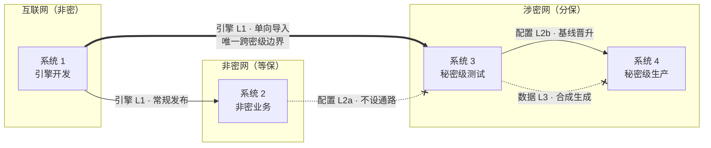
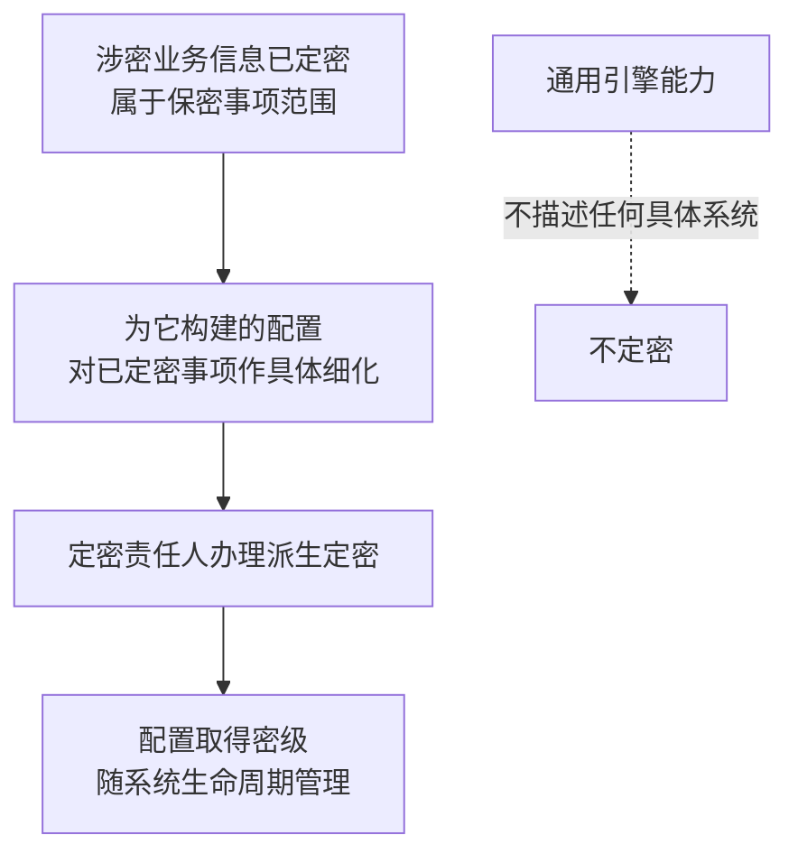
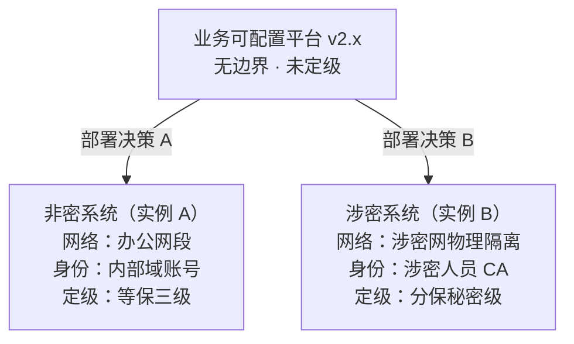
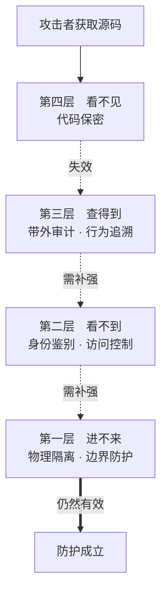

# 企业信息系统合规开发过程

## 涉密与非密双环境下的产品定位、制品流转与配置治理

**研究报告 · 第 43 号**

| 项 | 内容 |
|---|---|
| 编号 | 43 |
| 日期 | 2026-10-23 |
| 关键词 | 企业信息系统；合规开发过程；分级保护；派生定密；可配置平台；制品流转；配置治理 |
| 适用对象 | 涉密信息系统建设方、平台产品方、开发过程管理岗、保密管理岗位 |

> **落料位**：03 —｜04 —

---

## 摘要

企业信息系统的开发，往往横跨两类互不相通的环境：互联网／非密网，与涉密网。一个典型的秘密级系统，其建设过程被描述为「互联网开发 → 涉密网部署 → 网内改造 → 网内运行」的四层单向链。这条链的**方向**符合"涉密不上网、上网不涉密"与分级保护的基本逻辑，但**方向合规不等于过程合规**，流程图本身不能自证。

本报告的核心论点是：当被开发的系统为业务可配置平台时，开发过程中的密级载体发生了一次**整体迁移**——从代码层迁移到配置层。这一迁移决定了合规开发过程必须如何组织。由此可推出一组相互支撑的结论：

1. **产品没有密级，系统才有**。产品无确定安全边界，不具备定级资格（这是无资格，不是豁免）。
2. **引擎是通用件，可跨网单向流动；配置是密级载体，不得跨密级流动**。原四层单向链的真正漏洞不在代码同源，而在于导入、同步、备份等常规动作会把配置当作普通文件带走。
3. **配置的密级不是判出来的，是派生定密而来**——它通常构成对已定密事项的具体细化，由定密责任人按保密事项范围办理；办理前按"拟涉密"管理。
4. **安全功能必须外部化**。应用层实现的安全控制在代码公开后均可被绕过，因此信任根、策略来源与裁决权应外置；但应用侧的强制与记录不能省——三员权限须强制分离，审计记录须完整产生并保护，文件流向须为外部控制留出入口。
5. **代码同源本身不构成违规**，判据是"这份代码公开了会不会造成损害"，即信息增益，而非敏感度直觉。

报告最后给出合规开发过程的完整设计：四阶段划分与四次跃迁、三轨制品规则、配置治理六条、分阶段推进路径，以及可直接使用的自检清单。

---

## 0 引言：问题的由来

讨论起源于一个具体问题：某秘密级信息系统按以下方式建设——

- 系统 1：互联网环境开发，公开版；
- 系统 2：涉密网部署公开版，用于非密业务；
- 系统 3：涉密网部署秘密级测试系统，由系统 2 改造而来，用于调试测试；
- 系统 4：涉密网部署秘密级正式系统，来源于系统 3。

四个系统之间全部单向。

随讨论推进，三个前提被逐步补充，每一个都改写了结论：

| 补充的前提 | 对结论的影响 |
|---|---|
| 系统可配置，业务逻辑由配置实现，系统本身不含业务逻辑 | 风险从代码层整体迁移到配置层 |
| 系统 2 是实际在用的非密业务系统 | 涉密网落位方案被否决，改为独立非密网 |
| 底层代码在两个环境中相同 | "代码同源"的合规性需要重新判定 |

### 0.1 合规开发过程的四个阶段

在展开论证之前，先给出过程的整体形态。企业信息系统的合规开发，本质上是把一次建设拆成四个阶段，每个阶段落在不同的网络环境、产出不同的制品、由不同的控制点管住：

| 阶段 | 环境 | 主要产出 | 关键控制点 | 审批与测评 |
|---|---|---|---|---|
| ① 通用能力研发 | 互联网（E1） | 引擎制品、SBOM、构建证明 | 不含涉密信息；可公开性筛查 | 变更流程 |
| ② 非密业务运行 | 非密网（E2） | 非密配置、非密数据 | 走等保；与涉密网物理隔离 | 等保定级备案 |
| ③ 涉密构建与测试 | 涉密网（E3） | 涉密配置基线、测试报告 | 配置从空白起建；测试数据合成生成 | 方案审查论证、基线评审 |
| ④ 涉密生产运行 | 涉密网（E4） | 生产配置、生产数据 | 基线晋升与清场；带外审计 | 分保测评、系统审批与使用许可、定期风险评估 |

四个阶段之间是**四次跃迁**，每一次跃迁的性质都不同，管控方式也不同——这正是后续各章要展开的内容：

| 跃迁 | 性质 | 是否跨网 | 核心约束 |
|---|---|---|---|
| ① → ② | 同密级发布 | 是（非密到非密） | 常规变更 |
| ① → ③ | **单向导入** | 是（低密到高密，唯一真正的跨密级边界） | 逐次审批、查杀、三合一 |
| ② → ③ | **不应存在** | — | 无通路，配置不继承 |
| ③ → ④ | 网内基线晋升 | 否 | 基线评审、清场检查 |

### 0.2 本报告的组织方式

第 1～4 章回答"过程该怎么组织"：先给出合规基线判定，再说明可配置性带来的载体迁移，然后定环境落位，最后给出过程设计与分阶段推进路径。

第 5～10 章回答"过程为什么必须这样组织"：派生定密机制、产品与系统的界定、安全边界的生成方式、安全功能的实现边界、代码同源的合规判定、公开条件下的防护逻辑。

第 11 章归结为可直接使用的自检清单。

---

## 1 合规基线：四层单向链的判定

### 1.1 判定标尺

| 层级 | 依据 |
|---|---|
| 法律 | 《中华人民共和国保守国家秘密法》（2024-05-01 施行）第 29、30、31、41 条；《网络安全法》第 21、23 条；《密码法》 |
| 行政法规 | 《中华人民共和国保守国家秘密法实施条例》（2024-09-01 施行）第 18、32～35、48 条；《商用密码管理条例》 |
| 部门规章 | 《涉及国家秘密的信息系统分级保护管理办法》（国保发〔2005〕16 号）；《涉及国家秘密的信息系统审批管理规定》（国保发〔2007〕18 号）；《信息系统和信息设备使用保密管理规定》（国保发〔2009〕10 号）；《国家秘密定密管理规定》（国家保密局令 2025 年第 1 号） |
| 国家保密标准 | BMB 17-2006《涉及国家秘密的信息系统分级保护技术要求》、BMB 20-2007《涉及国家秘密的信息系统分级保护管理规范》、BMB 22-2007《涉及国家秘密的信息系统分级保护测评指南》、BMB 23-2008《涉及国家秘密的信息系统分级保护方案设计指南》 |
| 资质 | 《涉密信息系统集成资质管理办法》（国家保密局令 2020 年第 1 号） |
| 数据法 | 《数据安全法》《个人信息保护法》（E2 数据迁出适用） |

从中可提炼四条硬原则：**涉密不上网**（第 31 条禁止未采取有效保密措施接入或交换）；**分级保护就高**；**全生命周期（含开发环境）**；**单向导入且逐次审批留痕**。

### 1.2 逐段体检

| 环节 | 方向 | 判定 | 必备动作 |
|---|---|---|---|
| 系统 1 互联网开发 | — | 有前提 | 不得承载涉密需求与涉密数据；开发机不得处理涉密信息 |
| 1 → 2 导入 | 低 → 高 | 方向合规 | 一次性写入光盘／涉密专用介质、病毒查杀、三合一监管、审批登记 |
| 系统 2 涉密网跑非密业务 | — | 高风险 | 非密业务被整体涉密化（见 3.1） |
| 2 → 3 网内改造 | 网内 | 做法正确 | 涉密改造必须在涉密环境；开发编译工具本身需过检 |
| 系统 3 秘密级测试 | — | 合规 | 测试数据按秘密级管理；禁用真实生产数据 |
| 3 → 4 迁移 | 网内 | 需清洁基线 | 见 R4 |
| 系统 4 上线 | — | 合规 | BMB 22 测评 + 系统审批（使用许可证），落实"三同步"与定期风险评估 |

### 1.3 五处风险

| 编号 | 风险 | 要点 |
|---|---|---|
| **R1** | 系统 1 与系统 3 同源 | 最根本的一处。涉密实现细节在互联网裸奔。除非系统 1 定位为通用基座、涉密部分重写，否则站不住（第 9 章重新判定） |
| **R2** | 系统 2 被整体涉密化 | 秘密级网络跑公开版处理非密业务，非密业务因此被按秘密级管理 |
| **R3** | 公开版带外网基因 | 自动更新、云同步、遥测、在线激活、第三方 CDN，在物理隔离环境全部禁止 |
| **R4** | 3 → 4 基线继承不洁 | 直接克隆带入测试账号、调试接口、残留数据、测试证书 |
| **R5** | 反向回流 | 系统 4 出问题想回系统 1 修。这是泄密事故，不是违规。运维期实际高发 |

> **R1 的判定在第 9 章被修正。** 当系统为可配置平台时，"同源"的对象是通用引擎而非涉密实现，R1 基本消解；但风险并未消失，而是迁移至配置层（第 2 章）。

### 1.4 尚需补齐的三件事

- **资质与人员**：涉密信息系统集成资质，秘密级可由乙级承担；开发人员岗前审查、在岗管理、离岗脱密。
- **审批链**：每个环境的建立、每次导入导出，须经保密工作机构审批并登记，一事一审。
- **测评**：系统 4 上线前经认可的测评机构按 BMB 22 测评，并向设区的市级以上保密行政管理部门申请系统审批、取得使用许可证。

---

## 2 前提变更：可配置性带来的载体迁移

### 2.1 一个必须承认的逻辑后果

系统本身不含业务逻辑，意味着**系统 2 与系统 3 是同一个引擎的两个配置态**。由此问题变得尖锐：**密级按什么定？**

分级保护按"系统"确定密级与测评对象。若换一份配置就能从非密变涉密，密级标识就**必须强绑在实例／部署单元上**，且每个密级态独立定级、独立测评、独立审批。不能是同一套进程换配置就变密级——否则测评现场"本系统定几级"这一项无法回答。

### 2.2 流转对象必须拆成三轨

原来的"1→2→3→4 单向"把流转物当成一个整体制品，这是错的。

| 制品 | 性质 | 流向 | 判定 |
|---|---|---|---|
| **引擎**（镜像／二进制） | 通用件 | 1 → 2（同密级）；1 → 3（跨密级）；3 → 4（网内） | 唯一的跨密级动作是 1 → 3 单向导入 |
| **配置** | 密级载体 | 涉密配置起点必须在涉密侧 | 不得跟着引擎一起搬 |
| **数据** | 密级载体 | 只在同密级内 | 不得跨 |

**引擎可以跨网，配置决不可以跟着引擎一起搬。** 原设计最大的漏洞不在代码，在于——导入、同步、备份这几类常规动作，全都会把配置当作普通文件带走。一旦引擎与配置被打包成一个"制品"，密级就在那一刻漏掉了。

### 2.3 配置驱动系统的四个专属风险

| 编号 | 风险 | 说明 |
|---|---|---|
| **C1** | 配置就是代码 | 配置常含表达式、脚本、SQL、规则 DSL、低代码逻辑块，是可执行的。代码评审、版本管控、变更审批、上线测试一样不能少。测评专查配置注入 |
| **C2** | 2 → 3 配置改造不干净 | 继承非密的组织树、字典、角色、流程基线，来源不可追溯、授权无从对应。要求是重新评审、重新授权、重建基线 |
| **C3** | 配置库跨密级共用 | 若共用一套配置库、元模型、模板库，涉密配置就躺在非密可读的存储里，这是硬伤 |
| **C4** | 差异即情报 | 不只涉密配置不能出去，两套配置的 diff 也不能出去：多了哪些字段、加了哪级审批、对接了哪个系统 |

### 2.4 一个结构优化

系统 2 存在的理由是给系统 3 当改造基座、避免跨网改造。但既然引擎是通用件、配置是密级载体，**更干净的做法是：系统 2 撤到非密网，1 → 3 直接跨网导入引擎，涉密配置在系统 3 从零构建。** 这样少一个密级模糊的实例，也少一条 2 → 3 的配置继承链，C2 自动消失。

是否值得做，取决于一件事：系统 2 是否必须连接涉密网内的非密数据源。

---

## 3 部署架构：系统 2 的落位

### 3.1 安全域不等于系统

**结论：系统 2 不该部署到"涉密网的非密域"。** 而且这个提法本身有合规陷阱。

涉密信息系统按**内部最高密级整体定级、整体测评、整体审批**。在涉密网里划一块叫"非密域"，它仍然是这个秘密级涉密信息系统的组成部分——设备、终端、账号、审计、运维人员全部按秘密级管理。得到的是**"被涉密化管理的非密业务"**，不是"非密系统"。

"非密域"也不能自行划定：安全域划分属于分级保护方案设计的一部分（BMB 23-2008），须随总体方案与安全保密方案一并接受保密行政管理部门参加的审查论证。自行划定后在检查中无法自洽——涉密网内所有设备与载体都要有密级标识，标"非密"立刻让整个标识体系自相矛盾。

### 3.2 四条实际代价

| 代价 | 说明 |
|---|---|
| **保护体系错配** | 非密业务本该走等保 2.0，进了涉密网就整体转入分级保护，被按秘密级管理。分保以等保基本要求为基础，但管理成本与审批链条按分保走 |
| **数据出口被锁死** | 最关键的一条。人事、财务、后勤、合同数据本要与银行、税务、供应商、上级单位交互。进了涉密网再也出不去。这不是安全问题，是业务瘫痪 |
| **用户群与终端规模不匹配** | 非密业务用户数远大于涉密业务。要求所有人过涉密审查、用涉密终端，管理上不可持续，实际必然演化为账号共用、终端违规外联 |
| **测评成本不成比例** | 分保测评覆盖每个安全域、每台设备、每个应用，且年度性 |

### 3.3 例外与正确解法

若该非密业务确实必须与涉密数据交互，才需要考虑跨界。但正确解法不是把系统搬进去：

- 系统本体留在非密网；
- 只把必须跨界的交互点做成涉密网内一个**最小化对接组件**；
- 两网之间用安全隔离与信息交换系统（网闸／单向导入）做受控交换。

**做一个窄接口，不是搬一整套系统。** 很多单位一遇到"要交互"就整系统搬迁，这是把接口问题当部署问题。

### 3.4 边界收敛

系统 2 移出后，跨密级边界从两处收敛为一处：1 → 2 为同密级常规发布；**1 → 3 为唯一真正的跨密级边界**；3 → 4 为网内基线迁移。

代价要说清：系统 3 的涉密配置要重头建，不能从系统 2 抄。工作量增加，但这是唯一能把"配置从哪来"讲清楚的做法。

---

## 4 合规开发过程设计

合规开发过程的组织只改两件事，其余骨架不动：**把 E2 移出去，掐断它对 E3 的继承。**

### 4.1 环境重排

| 环境 | 网络位置 | 密级/体系 | 用途 | 相对现方案 |
|---|---|---|---|---|
| E1 系统 1 | 互联网 | 非密 | 引擎研发、构建、公开发布 | 不变 |
| E2 系统 2 | **非密网** | 非密 / 等保 2.0 | 非密业务生产运行 | 移出涉密网 |
| E3 系统 3 | 涉密网 | 秘密级 / 分保 | 涉密配置构建、集成测试 | 基线改为 E1 直接导入 |
| E4 系统 4 | 涉密网 | 秘密级 / 分保 | 涉密业务生产 | 不变 |

> **唯一真正的难点：E2 的数据怎么出网。**
> E2 已在涉密网跑过非密业务、积累了数据。迁移时这些数据要出涉密网——这是**高密到低密的反向流动**，是方案落地的最大障碍。必须由保密工作机构审批，大概率需要逐项做脱密检查（非密业务数据里混进涉密附件的概率不低，尤其邮件、审批意见、附件）。最坏结论是"不允许导出"，只能重录。建议先做数据分类普查，把"确定不含涉密"与"待核查"分开，只对确定部分申请导出。
>
> 人事、财务、合同数据另受《数据安全法》《个人信息保护法》约束：迁出前须确认处理目的与合法基础，涉及个人信息的还须评估告知同意与最小必要。

### 4.2 三轨规则

| 线 | 制品 | 起点 → 终点 | 通道 | 审批 |
|---|---|---|---|---|
| **L1 引擎** | 镜像、SBOM、构建证明 | E1 → E2 | 常规发布（同密级） | 变更流程 |
| | | **E1 → E3** | **单向闸门**（唯一跨网） | 逐次审批 + 查杀 + 三合一 |
| **L2a 非密配置** | 配置包（schema、规则、字典、权限） | E1、E2 各自独立库 | 不设通路 | — |
| **L2b 涉密配置** | 配置包（schema、规则、字典、权限） | E3 内部从空白基线起建 | — | 基线评审 |
| | | E3 → E4 | 网内受控晋升 | 基线评审 + 清场检查 |
| **L3 数据** | 业务数据 | 各生产环境内部 | 不跨环境 | — |
| | 测试数据 | E4、E3 内部合成生成 | 禁区：不得从 E4 拉取 | — |

**三条铁律**：

1. 配置永不随引擎过闸，打包产物里的配置目录必须为空；
2. E2 与 E3 之间没有任何协议通道，不设网闸、不设共享盘、不允许人工剪贴板（法律允许在采取有效保密措施后交换，本方案选择完全不通，是自设的更严标准）；
3. E4 的生产数据不得进 E3，测试数据必须合成生成而非脱敏覆写（脱敏规则本身泄漏结构）。

### 4.3 单向闸门：放行与禁带

| 放行物（引擎包） | 禁带物（零容忍） |
|---|---|
| ① 引擎镜像 + 摘要 | ① 任何配置文件 |
| ② SBOM / 依赖清单 | ② 测试与样例数据 |
| ③ 可重现构建证明 | ③ 真实证书与密钥 |
| ④ 打包签名与审批单 | ④ 外网依赖与遥测 |
| ⑤ 病毒查杀报告 | ⑤ 调试开关与后门 |
| ⑥ 产品检测或来源审查结论（如适用） | ⑥ 未申报的第三方组件 |

闸门控制：一次性写入光盘／单向设备、审批单逐次导入、病毒查杀、三合一留痕、禁止批量、禁止回程介质、方向锁定为低密→高密。导入物还须满足涉密环境的软硬件国产化与供应链审查要求，产品检测或来源审查结论随审批单归档。

**关键设计原则：控制手段落在流水线，不落在人的自觉上。** 打包产物中配置目录为空方可出包，由构建脚本强制校验，人不可绕过。

### 4.4 配置治理六条

| # | 措施 | 要点 |
|---|---|---|
| 1 | **双库物理分离** | cfg-public 与 cfg-secret 是两个独立 Git 实例、两台物理设备、无网络通路。禁止任何跨库同步脚本 |
| 2 | **配置全部文本化** | 禁止二进制导出包。配置必须能 diff、能 review、能 blame。不可审计的配置包在测评环节直接判不合格 |
| 3 | **涉密配置从空白基线重建** | 按涉密业务需求逐项配置，每项标注需求编号、密级、责任人；密级由定密责任人按保密事项范围办理，不自行评定。这是回答"配置从哪来"的唯一方式 |
| 4 | **晋升从 Git tag 生成** | 不从运行实例导出。实例导出会带走测试账号、调试开关、日志级别、测试证书。生成时自动剥离黑名单项，导入前哈希校验并签清场检查单 |
| 5 | **引擎危险能力收敛** | 表达式引擎白名单函数；禁止配置发起外部 HTTP 调用；规则内 SQL 只读白名单、禁 DDL；禁止嵌入脚本块 |
| 6 | **密级标签硬绑定** | 部署模板里固化 classification，且不从配置文件读该值。启动时校验：声明 secret 而配置库指向非密库则拒绝启动 |

### 4.5 分阶段推进

| 期 | 时间 | 动作 | 判据 |
|---|---|---|---|
| **一期** | 0–1 月 | 总体方案与安全保密方案送审查论证；E2 迁出涉密网；E3 基线改从 E1 导入；两库分离 | 方案审查论证意见出具、E2 数据迁出获批、E3 不再引用 E2 配置 |
| **二期** | 1–3 月 | 流水线加"配置零携带"校验；配置入 Git + MR 双人评审；引擎危险能力收敛 | CI 能拦住带配置的包；变更可追溯 |
| **三期** | 3–6 月（视审批与测评排期，可能更长） | E3 涉密配置重建并逐项标注；晋升流程与清场检查单；密级标签绑定；证据归集 | 分保测评通过、系统审批取得使用许可证、首次风险评估完成 |

一期必须最先做，因为它是唯一不可逆的——数据迁出窗口一旦错过，后面只能越来越难。

### 4.6 证据清单

网络拓扑图与物理隔离证明；E2 等保定级备案与 E4 分保定级报告；安全域划分方案与审查论证意见；总体方案与安全保密方案的审查论证意见；跨网导入审批单（逐次，含查杀记录、三合一日志与产品来源审查结论）；两套配置库的物理分离证明；E3 配置基线评审记录（体现从空白起建）；E3 → E4 晋升记录（版本号、哈希、清场检查单）；人员涉密审查与脱密记录；涉密信息系统集成资质；检测评估报告与系统审批文件、使用许可证；定期安全保密风险评估报告。

---

## 5 理论辨析：为什么配置是密级载体

### 5.1 先纠正一处表述

"配置 = 业务逻辑 = 密级载体"这个等式不成立。因为**业务逻辑本身不是密级信息**——"请假审批分三级"这条规则没有任何密级属性。密级是法定定密程序的结果，不是逻辑的固有属性。

准确的链条是：

> **配置之所以涉密，不是因为"它含业务逻辑"，而是因为"它描述了本涉密系统的实际形态"，从而进入派生定密的判断。**

### 5.2 法定机制：派生定密

定密有两条路：**原始定密**（对本单位产生的国家秘密事项首次定密）与**派生定密**（依据已定密事项产生的新信息，按所依据事项的密级定密）。配置通常走第二条；若配置内容直接落入保密事项范围的列举事项，则走原始定密。

定密不是工程判据能替代的动作。《国家秘密定密管理规定》第 28 条要求派生定密依据已定密事项确定密级、保密期限与知悉范围；第 29 条明确，不涉及对已定密事项内容作概括总结、编辑整合、具体细化的，不应当派生定密。配置通常落在"具体细化"一类，但仍须由定密责任人办理，不能由开发方自行标注。

由此直接解释：**为什么涉密配置必须从空白基线在涉密环境内建。** 派生定密要求"依据"可追溯——能指认它细化的是哪一项已定密事项。在非密侧先建一份配置、再搬进去改，依据就断了：那份配置的来源无法证明派生自什么，它在生成的那一刻也没有密级归属。

### 5.3 筛查指标：是否唯一描述本系统

| 制品 | 描述的是什么 | 唯一描述本系统 | 定密 |
|---|---|---|---|
| 引擎（通用能力） | 一组能力的集合，不含任何具体系统形态 | 否，一份引擎装一千个系统 | 不定密 |
| 配置（业务形态） | 本系统有哪几个实体、哪些字段、哪些流程、哪些权限、哪些接口 | 唯一 | 通常派生定密 |
| 数据（业务对象） | 业务内容本身 | 唯一 | 原始或派生定密 |

关键在"唯一"。引擎装一万个系统，形态各不相同，它描述不了任何一个；配置只能描述一个。**唯一性越高，越可能构成对已定密事项的具体细化，越应送定密程序判断。** 这张表只用于筛选候选，不能替代定密：密级由定密责任人依据保密事项范围和已定密事项确定，不由开发方按表评定。

### 5.4 三个叠加的理由

**（1）归属。** BMB 20 要求对涉密信息系统的文档、载体实行密级标识管理。配置基线属于涉密系统的建设与运行资料，落在管理范围内。

**（2）结构即攻击面——这才是真正"密"的地方。**

| 配置暴露的内容 | 攻击者的收获 |
|---|---|
| 有哪些接口 | 攻击点清单 |
| 角色与权限模型 | 提权路径 |
| 实体与字段关系 | 数据在哪、怎么关联 |
| 阈值与规则 | 怎么绕过审计 |

这几样拼起来，就是一份接近完整的渗透指南。**这跟业务内容敏不敏感无关，跟系统是不是涉密有关。** 所以哪怕是一个"内部通知发布"这种毫无机密的业务，只要它跑在涉密网上，它的配置通常也须按密级管理——因为它暴露的是这张涉密网的运行细节，不是通知内容。

**（3）聚合。** 拆开看每条规则都能公开，合起来就不行：

- *组合即信息*：系统有 37 个业务实体、它们怎么关联，这是系统结构；
- *边界即信息*：配置定义了什么在系统内、什么在系统外，系统边界是涉密系统方案的核心内容；
- *差异即信息*：涉密配置与非密配置的 diff，直接指出涉密业务与公开业务的差别点。

### 5.5 但要划边界：三层配置

| 配置类别 | 举例 | 是否派生定密 |
|---|---|---|
| 业务配置 | 实体、字段、流程、规则、权限、字典、接口映射 | **应办派生定密** |
| 技术配置 | 日志级别、连接池大小、超时阈值、缓存策略、线程数 | 不必，按内部管理 |
| 环境配置 | IP、主机名、部署路径 | 按所处网络拓扑的密级定，不预先归为内部 |

实操上按这个分层做**分区标注**：同一套配置体系里，业务配置段由定密责任人确认密级后标注，技术配置段标内部。这既守住了派生定密的依据，又不至于把调个线程数也拖进涉密流程——否则工程上不可执行，最后的结果一定是有人绕过流程。

---

## 6 概念界定：产品 vs 系统

### 6.1 定义

**系统（system）**——ISO/IEC/IEEE 15288:2023 §3.46：arrangement of parts or elements that together exhibit a stated behaviour or meaning that the individual constituents do not（中译：各部分或各元素的安排，它们合在一起呈现出单个构成部分所不具备的既定行为或意义）。关键词是"整体呈现单个部分不具备的行为或意义"，它是一个配置完成的实体，有边界、有行为、有确定的组成。

**产品（product）**——ISO 9000:2026 §3.7.9：output of an organization that can be produced without any transaction taking place between the organization and the customer（中译：组织的输出，其生产无需在组织与顾客之间发生任何交易）。关键词是"组织的输出"，它是可复制、可交付的产出物。该版已把服务独立为 3.7.10；产品条目下的通用形态是硬件、软件与流程性材料。

> **两者的差别不在大小，在"有没有被配置完成"。** 产品是"可产生万种形态的因"，系统是"已经确定的那个果"。

### 6.2 四个判据

| 判据 | 产品 | 系统 |
|---|---|---|
| **责任主体** | 无运营使用单位，只有厂商 | 有确定的运营使用单位与安全责任主体 |
| **边界** | 无确定安全边界，边界由部署决定 | 有确定的安全边界 |
| **形态** | 不含具体业务形态，行为由外部配置决定 | 形态已固定，有确定的业务与数据 |
| **生命周期** | 研发 → 发布 → 版本迭代 | 立项 → 定级 → 建设 → 测评 → 运行 → 废止 |

第一条是关键。GB/T 22240-2020 §5.1.1 规定，作为定级对象的信息系统应具有三项基本特征：a) 具有确定的主要安全责任主体；b) 承载相对独立的业务应用；c) 包含相互关联的多个资源。产品不满足 a)——它没有运营使用单位，也就没有能承担安全责任的主体。**所以它连"定级对象"的资格都不具备。**

最后一条也很能说明问题：基座从 v2.3 升到 v2.4，不触发任何定级变更；但一个系统改了边界或密级，必须重新定级测评。

### 6.3 制度为什么成立：管辖单位是"系统"

| 制度文件 | 管辖对象 |
|---|---|
| 《涉及国家秘密的信息**系统**分级保护管理办法》（国保发〔2005〕16 号） | 涉密信息系统 |
| BMB 22-2007《涉及国家秘密的信息**系统**分级保护测评指南》 | 涉密信息系统 |
| 《信息安全等级保护管理办法》（公通字〔2007〕43 号） | 信息系统 |
| GB/T 22240-2020《网络安全等级保护**定级**指南》 | 等级保护对象 |

**规定里根本没有"给产品定级"这道程序。** 不是产品豁免，是制度设计上就不管产品。

| | 产品 | 系统 |
|---|---|---|
| 管理动作 | **检测、认证、准入目录** | **定级、备案、方案审查论证、系统审批、测评** |
| 主管 | 检测机构、采购目录 | 保密行政管理部门 / 公安机关 |
| 结论形式 | "符合要求，可用于……" | "定为秘密级 / 等保三级" |

### 6.4 两套体系与两个常见误区

| | 非密信息系统 | 涉密信息系统 |
|---|---|---|
| **法源** | 《网络安全法》第 21 条；《信息安全等级保护管理办法》（公通字〔2007〕43 号） | 《保守国家秘密法》第 30、31、41 条及实施条例；《涉及国家秘密的信息系统分级保护管理办法》（国保发〔2005〕16 号）；《涉及国家秘密的信息系统审批管理规定》（国保发〔2007〕18 号） |
| **标准** | GB/T 22239-2019、GB/T 22240-2020、GB/T 25058-2019 | BMB 17-2006、BMB 20-2007、BMB 22-2007、BMB 23-2008 |
| **分级** | 第一级 ～ 第五级 | 秘密级 / 机密级 / 绝密级 |
| **主管** | 公安机关（备案、监督检查） | 保密行政管理部门（方案审查论证、检测评估与系统审批） |
| **隔离** | 按等级定边界 | 必须与非涉密网络物理隔离 |

> **两个误区必须点明：**
>
> 1. **等保等级与密级不可换算。** 等保三级不等于秘密级——前者是保护强度，后者是信息属性。涉密信息系统不参加等保备案与等保测评，非密系统也不纳入分保；但两者的保护要求并非互不相干：《信息安全等级保护管理办法》第 24 条要求涉密系统依据等保基本要求实施分保，第 27 条要求其保护水平总体上不低于等保第三、四、五级。准确说法是"渠道分立、要求叠加"，不是"互不覆盖"。
> 2. **产品的"适用密级"不等于"密级"。** 产品检测结论会说"本产品可用于秘密级涉密信息系统"——这是准入结论，说明它够格进入那个环境。产品自身没有密级，就像钢筋没有楼层。

### 6.5 基座的产品定位

业务可配置平台属于**通用软件产品**，不是安全保密产品，因此不走"涉密产品检测"这条路。但它内置的密码模块、身份鉴别、安全审计属于安全保密产品范畴，那部分要单独处理，不能整体打包说"我们是通用产品"。密码模块须符合《密码法》与《商用密码管理条例》，使用经认证的商用密码产品。

**一句话判据，可直接用于评审：**

> **"有确定的主要安全责任主体与安全边界的，是系统；两者都由部署确定的，是产品。"**

---

## 7 安全边界：五维度与部署生成

### 7.1 "没有安全边界"的准确含义

不是指它不安全，是指**它没有一条可被指认、可被主张的保护责任分界线**。安全边界的本质是**责任的分界线**：边界之内，由某个主体统一负责其安全；跨过这条线，就有一次进出事件，需要被识别、控制、记录。

§6.2 把"没有主要安全责任主体"列为首要判据；这里把它展开为五条边界，其中责任边界是总纲。

| 维度 | 是什么 | 产品的状态 |
|---|---|---|
| 责任边界 | 出了事谁负责 | 未定，只有知识产权归属，没有安全责任主体 |
| 网络边界 | 设备、网段、链路能到哪 | 未定，它还不知道自己跑在哪 |
| 身份边界 | 谁可以进来、凭什么 | 未定，只有"账号抽象"，没有用户 |
| 权限边界 | 进来后能碰到什么 | 未定，只有"能力集"，没有"某人的权限" |
| 数据边界 | 数据能流到哪、落到哪 | 未定，只有 schema，没有数据 |

产品在这五条上全是空的。空不是缺陷——**空只是表示"还没有人替它在这五条上表态"。**

### 7.2 部署这个动作做了什么

| 部署时做的动作 | 同时确定的边界 |
|---|---|
| 指定系统管理员、安全管理员、责任单位 | 责任边界 |
| 决定它跑在哪台机器、哪个网段 | 网络边界 |
| 接入身份源（域账号、CA、LDAP） | 身份边界 |
| 加载配置（角色、权限、组织） | 权限边界 |
| 接数据源、定存储位置、定导出策略 | 数据边界 |

**所以边界不是产品的属性，是"产品 × 部署决策"的联合产物。** 产品被复制，边界不会跟着复制；每部署一次，就重新划定一次边界。五条边界中，责任边界是总纲：其余四条都在回答"这份责任落在哪里"。

### 7.3 边界是管理声明

所有安全动作都以边界为作用对象：定级定的是这条边界内承载什么、被破坏后影响多大；定密级定的是这条边界内处理什么密级的信息；物理隔离切的是两条边界之间的通路；测评测的是这条边界上的防护是否有效；审计审的是跨边界的行为。

没有边界，这些动作全部失去作用对象。**所以不是"产品豁免"，是产品连被测量的资格都没有。**

更深一层：**边界是"划"出来的，不是"长"出来的。** 一台机器不会自动拥有安全边界，是管理者声明"这台机器及其上的应用构成一个保护对象"。所以边界的本质是**一份管理声明**——这也解释了为什么定级要有报告、要有备案、要有审批：那是把这个声明书面化、合法化的程序。定级报告写的不是技术参数，写的是"我们主张这一圈是我们的责任范围"。

> **一个类比**：产品像预制装配式建筑的构件包——墙板、梁柱、门窗、管线全按标准生产，可以运到任何工地。但它没有"门"（门是装配时开在具体位置的）、没有"围墙"（围墙是场地规划定的）、没有"门禁名单"（那是入住方装的）。你不能问"这包构件的门朝哪开"，也不能给它办消防验收。**消防验收验的是楼，不是构件。**

### 7.4 产品设计约束：边界外部化

既然"无边界"是基座能跨密级环境复用的合法性前提，那这个前提必须由产品自己守住：

> **基座必须做到边界外部化——身份源、存储位置、网络端点、密钥、时间源，全部由部署时注入，产品自身不持有。**

反过来，如果一个可配置基座内置了固定的身份体系、固定的数据存储位置、固定的对外通信端点、内置的云配置中心，那它已经携带着一条**隐形边界**。复制到第二个环境，两条隐形边界会撞；更麻烦的是，它把"非密侧的边界"带进了涉密侧——那就不是部署问题，是产品缺陷。

这也正好解释了那几条禁令：禁内置外联、禁遥测、禁云配置中心、禁自动更新。**这些禁令的根不在"保密规定不让"，而在"它们让产品携带边界，从而失去跨环境复用的资格"。**

---

## 8 安全功能边界：三员控制与文件流向

**结论：三员控制必须支持并强制，但不能内置超级管理员；文件流向不应实现，但不能破坏。**

### 8.1 三员控制是制度，不是功能

三员指系统管理员、安全管理员、安全审计员，三者权限分离、相互制约、互不越权。依据：BMB 17-2006 要求涉密信息系统实行三员分立；GB/T 22239-2019 三级以上要求三权分立；BMB 20-2007 对三员职责与授权有管理要求。

为什么它首先是系统的而非产品的：**三员是人的岗位划分**，由部署单位的组织制度和人员审查决定。产品无从知道谁是本单位的保密员、谁有审计资格。但"制度决定"不等于"产品只做表达"——权限分离必须由应用强制实施，产品不能只提供角色字段而不管互斥。

| 基座应该做 | 基座绝对不能做 |
|---|---|
| 权限模型能**表达**三员分立（角色可定义） | **内置超级管理员** |
| 三员权限**互斥可强制**（一人不能兼两员） | 内置默认账号、默认口令 |
| 应用层事件**完整记录**，并可上报外部审计 | 把审计责任的信任根建在应用内部 |
| 审计记录**写入即保护**（只追加、可校验），定期备份 | 只产生日志而不保护、不留存 |
| 授权变更**留痕可追溯** | 提供绕过三员校验的旁路开关 |

> **内置超级管理员是测评的关键否决项。** 只要存在一个不受三员制约的账号，前面所有分立都是摆设。这项不符合通常直接导致测评不通过。很多可配置平台为了运维方便，都保留内置 admin、root 或"平台维护账号"，这类账号进涉密环境，第一次检查就会被拎出来。
>
> 确需应急维护入口，正确做法是让它**由环境侧身份体系管控**（如 CA 证书 + 双人授权 + 全程录像），而不是产品自己留一个后门。

### 8.2 文件流向属于安全保密产品

文件流向控制包含外发审批、密级标识施加、流转追踪、导入导出方向控制，是安全保密产品的核心功能（DLP、电子文档管理、三合一的涉密信息交换监管、网闸）。基座自己实现，代价有三条且都重：

| 代价 | 说明 |
|---|---|
| **检测范围被拖大** | 一旦基座内置密码、审计、流向控制这些安全保密功能，它整体就被纳入安全保密产品检测的射程。后果是每次版本迭代都可能要重新送检 |
| **责任边界变模糊** | 涉密系统安全责任按"安全保密产品 + 应用系统"分开。应用自建安全功能，出问题就是"是产品缺陷还是部署配置错"说不清。测评机构遇到这种模糊地带，通常按不利方向判 |
| **体系冲突，反而更不安全** | 涉密网内通常已有统一的三员体系（主机监控审计、身份鉴别系统）。应用再建一套，就有两套账号、两份日志、两个真相。实际运行中，人只会看其中一个 |

**正确做法是留接口、不给旁路。** 所有文件的出入口必须走统一可拦截的通道，不能有旁路下载接口、不能有未登记的同步任务、不能有 P2P 或直连传输；外发必须能调用外部审批；密级标识必须能由外部系统施加并继承。基座自己不判定"能不能流出去"，只负责"这件事必须经过谁"。

### 8.3 一条可写入产品规范的设计守则

> **不持有安全控制的信任根，但必须强制执行外部注入的策略；**
> **不实现文件流向的裁决，但不得提供绕过裁决的通道；**
> **不替代外部审计，但必须完整记录并保护自己的审计事件。**

这与"边界外部化"是同一套逻辑的两个面向：边界外部化解决"谁为这一圈负责"，安全功能外部化解决"谁对这一圈施加控制"。外部化的是信任根、策略来源与裁决权，不是应用侧的强制与记录责任。

第 10 章将给出这条守则的更深根据：**应用层实现的控制，在代码公开后均可被绕过。**

### 8.4 逐项判断

| 能力 | 基座内置 | 理由 |
|---|---|---|
| 三员角色模型（可定义、可互斥） | 支持且可配置 | 权限模型的表达能力 |
| 内置超级管理员、后门账号 | **禁止** | 三员分立失效 |
| 应用层操作事件记录 | 必须产生并上报 | 不产生就无法追溯 |
| 审计记录保护与备份 | 应用侧写入即保护，信任根外置 | 全外推会导致应用审计项不符合 |
| 审计日志防篡改存储 | 不自行建设信任根 | 由主机层或审计系统承担 |
| 密码算法、加密存储 | 禁止自行实现 | 须用批准的密码产品 |
| 文件外发审批、流向追踪 | 不实现 | 安全保密产品范畴 |
| 统一文件出入口（可被拦截） | 必须 | 否则无法施加控制 |
| 密级标识显示与继承 | 部分 | 显示可以，施加由外部负责 |

### 8.5 一个反直觉的提醒

可配置平台最大的风险不是"功能不够安全"，而是**"它自带一套安全机制，与环境的安全机制打架，而且绕不过去"**。

但还有一层更麻烦的：**业务越灵活，越容易在配置层绕开安全控制。** 具体表现为配置语言里存在这些能力——配置出一个"匿名可访问"的接口、一条跳过审批的流程分支、一个自定义 SQL 直连、一个外部 HTTP 调用、一个可下载附件的隐藏入口。这几样才是真正的漏洞源，而且它们不会出现在代码里，会从配置里长出来。

所以真正的防线是把危险配置能力从配置语言里**删掉**，不是多写安全功能。

---

## 9 代码同源问题

### 9.1 直接回答

**"底层代码相同"本身不构成违规，也没有任何规定禁止它。**

归谬：如果代码相同就不合规，那所有商业软件（Windows、Oracle、开源中间件）都不能进涉密系统了，因为全国所有单位用的是同一份二进制。这显然不成立。**"相同"从来不是判据。**

### 9.2 三个层次，三种结论

| 层次 | 内容 | 结论 |
|---|---|---|
| **源码相同** | 同一份代码库，两处部署 | **合规，而且更优** |
| **制品相同** | 同一个二进制/镜像，两处部署 | 有条件合规——需来源可举证 |
| **供应链相同** | 同一个 CI、同一个制品库、同一条发布流水 | **高风险**——违反独立建设与变更审批要求 |

源码相同反而更优：即使产品需要检测，准入也按**产品版本**出具结论。一份源码、一个版本、一份结论。如果两边代码不同，等于有两个产品，涉密侧那份还得单独送检一遍。对通用软件产品，这一层本就不适用，代码同源更无准入障碍。

制品相同之所以有条件：涉密侧测评会问"这个二进制从哪来、有没有被改过"。能拿出哈希 + 签名 + SBOM + 审批单即通过。**关键在"可举证"，不在"是否重新编译"。**

### 9.3 三条真正的红线

**红线 1｜代码里含涉密信息**

判据很干脆：**这份代码能不能放到互联网上公开下载，而不造成任何损害？**

若能，它不涉密，可以复用。若不能——代码里硬编码了涉密业务的字段结构、涉密系统的主机名或 IP、涉密接口地址、加密密钥——那这份代码**已经因为"含涉密信息"而成为涉密载体**，它出现在非密环境就是违规，跟复用与否无关。

**红线 2｜为"一套代码两处用"而引入的涉密分支**

这条最隐蔽，也是实操中真正会发生的事。为了让同一份代码同时服务两侧，开发很自然会加：

- `if (secretMode) { ... }` 之类的密级分支
- `feature_flag: classified` 的开关
- 专为涉密侧写的模块，只是在非密侧不启用
- 配置项里预留的涉密字段、涉密流程节点

后果是：**非密侧的代码"知道"涉密系统的形态。** 从二进制里能反推出涉密侧的字段、流程、集成关系。

这才是"代码相同"带来的**真实**风险。但根因不是"相同"违规，是**"实现相同的方式"把涉密形态泄漏到了非密侧**。解法也不是拆代码库，而是**把涉密能力全部下沉到配置层，代码层做成无差别的通用能力**。

**红线 3｜共享构建与发布通道**

同一个 CI、同一个制品库、同一条流水线，意味着**非密侧发一次版，涉密侧就被动跟着动**。这破坏了涉密系统的独立性和变更审批。

必须物理分离：涉密侧的构建环境、制品库、发布审批链，都独立。这条不是某部法规的明文禁令，而是涉密系统独立性要求推出的管理结论——共用通道使非密侧的每次发布都成为涉密侧的未经审批变更。

### 9.4 依据：诚实交代

**没有任何一部保密法规或标准写着"涉密系统软件不得与非涉密系统共用代码"。** 若评审会上有人这么说，可直接请他指出条款。

真正的依据在两处，且都不是针对"代码相同"：

1. **管辖对象是"系统"**——《涉及国家秘密的信息系统分级保护管理办法》、BMB 22 的测评对象都是系统，不是代码。代码作为产品的一部分，只受产品准入约束；产品检测结论按型号与版本出具，天然支持复用。通用软件产品不属于安全保密产品检测目录的范围，内置的密码、身份鉴别、审计等安全保密功能才需单独检测。
2. **禁止性规定落在"涉密载体"层面**——《保守国家秘密法》第 29 条及涉密载体管理规定管的是"含涉密信息的载体不得出现在非密环境"。判定基准是**代码里有没有涉密信息**，不是**代码是不是同一份**。

### 9.5 反向推演：追求"代码不同"后果更糟

代码必须不同的隐含要求是，每个密级都要养一份独立代码库。实际结果是：

- 多份库长期漂移，功能不一致，行为不可预期；
- 涉密侧那份因为用的人少、迭代慢，成了"没人维护的分支"；
- 上游出了漏洞，非密侧修了，涉密侧补不上（因为不能回流）；
- 最后涉密系统跑着一个三年没打补丁的版本。

**这才是真正的不安全。** 追求"代码不同"换来的不是安全，是可控性丧失。

### 9.6 "会不会造成损害"的操作化

判据是**信息增益**，不是"看起来敏不敏感"的直觉。先分清代码的两种身份：

| 身份 | 例子 | 公开后 |
|---|---|---|
| **能力** | 权限校验算法、流程引擎、分页组件 | 无害。全世界都在写同样的东西 |
| **信息** | 硬编码的部门名、涉密系统 IP、真实密钥、描述业务规则的常量表 | 有害。它指向具体涉密事实 |

**三个可操作的测试：**

**测试一：占位符测试。** 把代码里每一个具体的名字、地址、数字、字符串替换成 `XXX`。如果程序逻辑不变、跑得起来，而"这东西涉不涉密"的疑问随之消失——那么**涉密性就在那些被替换掉的字符串里，不在代码里**。

**测试二：信息增益测试。** 让一个完全不了解这个系统的人拿到代码，问他：你现在能回答出哪些原本答不出的问题？

- 答出"这系统有 37 个业务实体、审批到第 5 级、对接了 4 个外部系统" → 这是损害，泄漏了系统结构；
- 答出"这是个用某框架写的流程引擎，支持自定义表单" → 这是能力，无害。

**测试三：Kerckhoffs 测试。** 假设攻击者完整掌握这份代码，你的系统还安全吗？若不安全，说明把"代码保密"当成了防护手段——这是设计缺陷，不是合规问题。

### 9.7 "损害"的三种形态

| 形态 | 表现 | 处置 |
|---|---|---|
| **直接泄密** | 代码里有国家秘密事项的内容本身 | 不能公开。这就是涉密载体 |
| **推理泄密** | 单条不密，聚合可推。37 个实体名拼起来 = 系统结构 | 不能公开。按聚合定密处理 |
| **攻击面泄漏** | 默认口令、调试接口、防护配置被暴露 | **可以公开，但系统必须仍安全**。这是设计缺陷，不是泄密 |

前两种的结论是"这份代码不能出去"，第三种是"这份代码出去也没关系，但你的防护不能靠它不出门"。**把第三种当第一种处理，是过度收紧的来源；把第一种当第三种处理，就是事故。**

### 9.8 代码里真正会漏的八样东西

1. **示例与测试数据**——最常被忽略。为了跑通流程塞进去的真实部门名、真实项目代号；
2. **硬编码常量**——型号、项目编号、特定单位名称；
3. **连接串与地址**——IP、域名、内网主机名、接口路径；
4. **密钥与令牌**——哪怕写在注释里；
5. **注释**——`// 此处按 XX 规定处理，需 XX 级审批`，一句话说完全部流程；
6. **日志格式与错误消息**——暴露内部字段名与结构；
7. **接口命名**——`/api/secret-project/xxx` 这类路径本身就是信息；
8. **Git 历史**——最隐蔽。今天删掉的代码，在历史提交里依然完整可读。很多人只查了工作区，没查历史。

### 9.9 这个判据的边界

**它是筛查工具，不是定密依据。**

定密必须走法定程序——由机关单位按保密事项范围确定，报批、标注、限定知悉范围。这套测试的用途是**快速分流**：把明显不涉密的部分识别出来，减少无谓的涉密化管理负担；把可疑的部分挑出来，送定密程序。

**不能用它替代定密，也不能用它给任何东西"脱密"。** 拿它当脱密依据，就是绕程序，性质比不做更糟。

---

## 10 公开条件下的防护

### 10.1 先修正一处表述

**"公开更安全"是错的。** 准确的说法是：**不能把代码保密当作防护手段。**

区别很大。源码公开确实会降低攻击成本——可以离线研究、精确构造、知道哪里没做校验。这一点不能否认。**净效果取决于你有没有另外建起那套锁。**

### 10.2 涉密系统的防护纵深，代码保密排在最后一层

这是最关键的一点：**分级保护的技术要求里，没有"源代码保密"这一项。**

BMB 17 关注的是物理安全、边界防护、身份鉴别、访问控制、安全审计、入侵防范、密码支持。**没有一条是"别让人看到代码"。**

| 层 | 内容 | 代码公开后 |
|---|---|---|
| 第一层 | **进不来**——物理隔离、边界防护 | 完全不受影响 |
| 第二层 | **进来了看不该看的看不到**——访问控制 | 受影响，靠鉴权补 |
| 第三层 | **动了有记录、查得到**——带外审计 | 受影响，靠带外审计补 |
| 第四层 | 代码保密 | **整层失效** |

所以，在涉密系统里正确的问法是：

> **他要拿到源码，得先能进到那张网里。进不来，源码就没用。**

如果他能拿到源码，说明前三层已经破了——**那是边界失守的问题，不是代码保密的问题。** 这是优先级问题，不是手段够不够的问题。**把最弱的一层当主力，是设计错误。**

### 10.3 代码全公开后，还剩六样东西

| 防护手段 | 为什么仍然有效 |
|---|---|
| **密钥** | 代码公开后仍须保密的要素。Kerckhoffs 原则的全部内容就是：安全在钥匙，不在锁的图纸 |
| **身份与授权** | 知道所有接口，不等于有权限调。默认拒绝 + 对象级鉴权 |
| **数据加密** | 拿到代码 + 拿到数据库，没有密钥等于白拿 |
| **带外审计** | 应用层日志可以伪造，主机层、网络层、数据库层的审计不能 |
| **运行态完整性** | 度量启动、镜像签名、白名单——确保跑的就是那份代码 |
| **供应链可举证** | 可重现构建 + 签名 + SBOM |

最后一条有个反直觉的好处：**代码公开 + 可重现构建 = 你的二进制可被任何人验证没被植入后门。** 这在国防和高安全领域是标准做法。**把"被看见"变成"可验证"，是公开带来的唯一净收益。**

### 10.4 最关键的一条推论

**应用层实现的安全控制，在代码公开后都是可绕过的。**

因为逻辑可见，别人就知道哪里可以绕：校验能跳过、日志能伪造、开关能改、鉴权能构造参数绕过。

**所以安全控制必须放在应用之外**：操作系统、数据库、网络设备、密码机、审计系统。

这就回答了第 8 章的问题：**为什么三员控制和文件流向不该由基座自己实现？** 不只是因为"检测范围会被拖大"。更根本的原因是：**基座自己实现的控制，在基座代码公开后都是可绕过的。** 你必须在不可绕过的那一层做控制。**这不是合规问题，是安全设计问题。**

### 10.5 代码公开后最危险的，不是"知道怎么做"，而是"知道哪里没做"

攻击者从源码里能直接读到：哪些接口忘了加鉴权、哪些查询是拼接 SQL、哪个调试接口没关、默认口令是什么、哪个参数可以越权访问别人的数据（IDOR）。

**这些不是"设计泄密"，是"缺陷暴露"。** 防御方式只有一个：补上，而不是藏起来。**代码公开之所以令人恐惧，多半是因为知道自己哪里没做。**

### 10.6 唯一必须保密的例外

有一种情况代码确实不能公开：**算法本身被定密。**

比如某个信号处理算法、某个专用密码算法，它属于国家秘密事项。这时它是"信息"不是"能力"，是合法的涉密载体，必须按密级管理。

但要分清两件事：

- **算法保密**：合规要求，合法；
- **安全依赖算法保密**：设计错误，危险。

前者是"这段代码不能出去"，后者是"我除了不让人看没别的办法"。

### 10.7 自检：如果明天源码泄露，系统还扛得住吗

1. **密钥和代码分离吗？** 代码里能不能 grep 出密钥、证书、连接串？
2. **所有接口默认拒绝吗？** 拿到别人的 ID，能不能读到别人的数据？
3. **审计在应用之外吗？** 改应用的日志代码，能不能抹掉痕迹？
4. **数据落盘加密、密钥在密码机吗？** 拿到磁盘能不能直接读？
5. **有没有一条"知道代码就能走通"的路径？** 默认口令、调试接口、硬编码凭据、忘记关的样例账号。

五个都过关，代码公开就无所谓，因为你靠的是锁。有一个不过关，那是真正的问题——**而且它在不公开的时候也存在，只是没人发现。**

---

## 11 结论

### 11.1 八条核心结论

| # | 结论 |
|---|---|
| 1 | 四层单向链的**方向**合规，但流程本身不能自证；真正的密级载体是配置与数据，不是代码 |
| 2 | 引擎是**通用件**，可跨网单向流动；配置是**密级载体**，不得跨密级流动 |
| 3 | 配置通常构成对已定密事项的**具体细化**，密级由定密责任人办理派生定密；办理前按"拟涉密"管理，唯一性只作筛查 |
| 4 | 不存在"涉密网内的非密系统"；**等保与分保渠道分立、要求叠加**——分保以等保基本要求为基础，保护水平不低于对应等级 |
| 5 | 业务可配置平台是**产品**而非系统：无确定的主要安全责任主体与安全边界，因此不具备定级资格（非豁免） |
| 6 | 边界由**部署**产生，是"产品 × 部署决策"的联合产物；这要求产品做到**边界外部化** |
| 7 | 安全功能必须**外部化**：信任根、策略来源与裁决权外置；但应用侧的权限强制、审计记录与保护不能省 |
| 8 | 合规的终点不是测评通过，而是**系统审批取得使用许可**并**定期开展风险评估**——秘密级每两年至少一次 |

### 11.2 架构自检十二问

1. 系统 2 所在网络是否被正式文件定为涉密网或独立非密网？
2. 跨密级边界是否已收敛为一处，且方向锁定为低密到高密？
3. 引擎制品能否证明不含任何配置，且该约束由流水线强制？
4. 涉密配置库与非密配置库是否物理分离、无任何同步脚本？
5. 涉密配置是否从空白基线起建，每项可追溯到需求编号与责任人？
6. 配置晋升是否从 Git tag 生成而非从运行实例导出？
7. 部署单元是否硬绑密级标签，且换配置无法越级？
8. 产品是否存在内置超级管理员或默认账号？
9. 所有文件出入口是否统一可拦截，且无旁路通道？
10. 配置语言是否已删除匿名访问、跳过审批、外联调用等危险能力？
11. 系统是否已取得使用许可证，审批文件与检测评估报告是否齐备？
12. 是否按周期开展安全保密风险评估（秘密级每两年至少一次），并留存报告？

### 11.3 术语对照

| 概念 | 判据 | 易错点 |
|---|---|---|
| 产品 vs 系统 | 有无确定的主要安全责任主体 | 产品不定级不是豁免，是无资格 |
| 分保定级 vs 定密 | 保护等级的行政确定 vs 信息属性的法定确定 | 分保定级不是定密，不能作为派生定密的依据 |
| 密级 vs 等保等级 | 信息属性 vs 保护强度 | 等保三级 ≠ 秘密级，不可换算 |
| 适用密级 vs 密级 | 准入结论 vs 定密结论 | 产品只有前者 |
| 原始定密 vs 派生定密 | 是否依据已定密事项 | 配置通常走派生，依据须可指认 |
| 安全域 vs 系统 | 域是系统内部划分 | 域不改变系统密级归属 |
| 代码能力 vs 代码信息 | 公开后是否有信息增益 | 判据是信息增益，不是敏感度直觉 |

### 11.4 一句话收束

> **判据不是"代码是否相同"，而是"这份代码公开了会不会造成损害"。**
> **公开无害 → 同一份代码两处部署，合规且应如此。公开有害 → 它已是涉密载体，问题不在复用，在于它本不该出现在非密环境。**

---

## 附录 A 依据清单

**法律**

- 《中华人民共和国保守国家秘密法》（2024 年修订，2024-05-01 施行）第 29、30、31、41 条
- 《中华人民共和国网络安全法》第 21 条（等级保护制度）、第 23 条（网络关键设备与安全专用产品认证检测）
- 《中华人民共和国密码法》
- 《中华人民共和国数据安全法》
- 《中华人民共和国个人信息保护法》

**行政法规与部门规章**

- 《中华人民共和国保守国家秘密法实施条例》（2024 年修订，2024-09-01 施行）第 18、32、33、34、35、48 条
- 《商用密码管理条例》
- 《涉及国家秘密的信息系统分级保护管理办法》（国保发〔2005〕16 号）
- 《涉及国家秘密的信息系统审批管理规定》（国保发〔2007〕18 号）
- 《信息系统和信息设备使用保密管理规定》（国保发〔2009〕10 号）
- 《信息安全等级保护管理办法》（公通字〔2007〕43 号）
- 《国家秘密定密管理规定》（国家保密局令 2025 年第 1 号，2025-05-01 施行）第 28、29 条
- 《涉密信息系统集成资质管理办法》（国家保密局令 2020 年第 1 号，2021-03-01 施行）

**国家保密标准**

- BMB 17-2006《涉及国家秘密的信息系统分级保护技术要求》
- BMB 20-2007《涉及国家秘密的信息系统分级保护管理规范》
- BMB 22-2007《涉及国家秘密的信息系统分级保护测评指南》
- BMB 23-2008《涉及国家秘密的信息系统分级保护方案设计指南》

**国家标准**

- GB/T 22239-2019《信息安全技术 网络安全等级保护基本要求》
- GB/T 22240-2020《信息安全技术 网络安全等级保护定级指南》
- GB/T 25058-2019《信息安全技术 网络安全等级保护实施指南》

**国际标准**

- ISO/IEC/IEEE 15288:2023 §3.46（system 定义）
- ISO 9000:2026 §3.7.9（product 定义）、§3.7.10（service 定义）

**理论与原则**

- Kerckhoffs 原则（1883）／Shannon 格言："敌人了解系统"

---

## 附录 B 待验证事项

以下事项超出公开标准可推导范围，需经实际程序确认：

1. 所在单位的安全域划分方案与总体方案、安全保密方案是否已取得审查论证意见，"非密域"的界定为何；
2. E2 现有非密业务数据的脱密检查结论（决定迁移路径的可行性）；
3. 基座内置的身份鉴别、密码、审计模块是否属于需单独检测的安全保密产品；
4. 基座所用第三方中间件、数据库是否在允许采购目录内，是否符合涉密环境的国产化与供应链审查要求；
5. 涉密配置库与非密配置库的物理分离现状（设备位置、网络通路）；
6. 本单位适用的保密事项范围与定密责任人（决定配置派生定密的具体办理路径）；
7. BMB 23 的年份与《信息系统和信息设备使用保密管理规定》的适用版本，以单位持有的标准正本与文件正本为准。

---

> **免责说明**：本报告为标准体系推导与工程实践归纳，引用的法规与标准条目以正式发布文本为准。对具体项目的密级确定、方案设计与合规判定，应由具备资质的测评机构与保密行政管理部门作出。本报告不构成合规结论。
