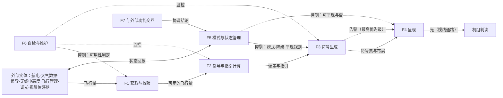
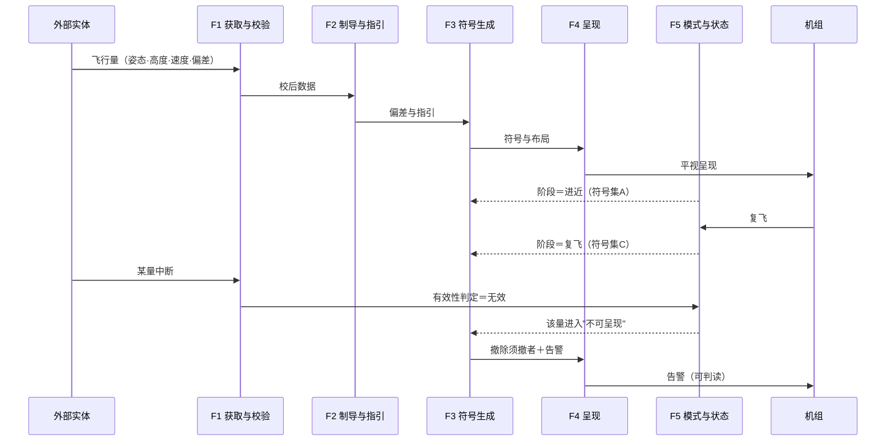
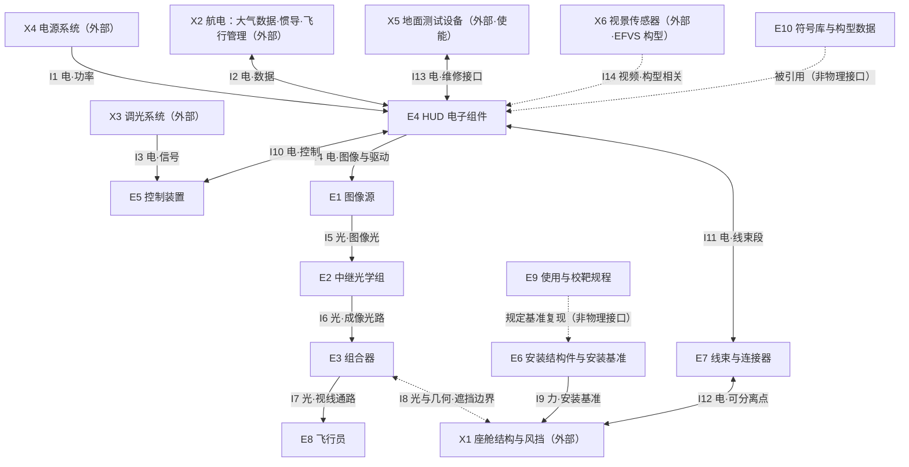

# 平视显示器的架构描述与系统组成说明

## 从目的、目标、架构清单到三张视图与一份册子

**研究报告 · 第 44 号**

| 项 | 内容 |
|---|---|
| 编号 | 44 |
| 日期 | 2026-10-23 |
| 关键词 | 目的；目标；架构清单；功能架构视图；逻辑架构视图；物理架构视图；系统组成说明；系统元素；物理接口；平视显示器 HUD |
| 适用对象 | 架构师、系统工程师、产品数据与构型管理岗、评审与符合性核查岗 |

> **落料位**：03-ch13（备料）｜04（—）

> **依据（只用标准正本）**：**ISO/IEC/IEEE 42010:2022**｜**ISO/IEC/IEEE 42020:2019**｜**ISO/IEC/IEEE 15288:2023**｜**ISO/IEC/IEEE 42030:2019**（旁证；库内件为 CSA 2020 采标本，文件名才作 2020）。四份正本均在库，逐条直核。
>
> **与既有报告的关系**：**口径**在 [37 号](37-架构视图口径研究报告-从三词定位到七类视图与三张清单并附HUD·EOS·冷链·合同审批四套示例.md)（三词定位、七类视图、三张清单、元素与接口的准入）；**本报告是"做全"的样例**——按 42010 §8.1、§8.2 给三张视图各立规格、出组件、做自检，再加一份写到能交的系统组成说明。
>
> **取证纪律**：判据只取上述正本；本项目研究报告与 INCOSE SEH（手册，二手）不作判据。凡断言"标准里没有"**先做零命中检索**；凡涉外文**原文与中译并列**；引用标四档——**标准逐字／标准可支持的读法／按定义句作的举例／本报告的定性**。**所有数值一律〈待定〉**。

---

## 摘要

一个系统的**架构与设计产出物**，按逻辑顺序应当是这样七件：**目的与目标（上游输入）→ 架构清单（内容）→ 三张视图（表达）→ 系统组成说明（落地册子）**；逐件展开即：**目的 → 目标 → 架构清单 → 功能架构视图 → 逻辑架构视图 → 物理架构视图 → 系统组成说明**。其中只有"内容"与"表达"落在**架构描述**（architecture description，AD）之内——架构描述是 42010:2022 §3.3 的工作产品，其元素类别见 §3.4 注 1 的 11 类；目的与目标属上游（15288:2023 §6.4.1、§6.4.2 的产出），组成说明的台账与规格两半分别属项目规划与设计定义。前两件说"为什么做、做到什么算成"；第三件是架构的**内容**（基本概念／基本属性／管控原则）；中间三件是同一批内容的**三种读法**，而不是它的三次切片——两批**交叠**、并非相等；最后一件是把它落成能交给别人做的册子。本报告在同一个对象（民机平视显示器，head-up display，HUD）上把七件一次做全。

1. **架构清单是内容，架构描述是表达，视图是描述里的信息部件**（42010:2022 §3.2 的定义句＝概念或属性 ＋ 管控原则；§3.3 工作产品、§3.7 信息部件）。**清单里有而三张视图都没落的，就是空位；视图里有的、清单里没有的，先分一层——属内容层的才是越界，接口、记号、图例这类表达层构造不算**（见 §9 第 4 条）。
2. **三张视图三句定义，各管一段**（42020:2019 §E.4.2.4／.5／.6）：功能＝本质的、起组织作用的功能结构；逻辑＝功能与留存数据的集成模型，抽象层级取"与用户相关而非与实施相关"，**把表示方式推迟**；物理＝系统元素与物理接口的安排。
3. **同一件事在三级上不许换说法**：C1（配准）在功能面上是"共形配准的几何变换"（T1），在逻辑面上是"偏差量与符号位置的语义对应"（O1／O5 + T1），在物理面上是"基准链同源"（I5／I6／I9）。
4. **深度各有一句封顶**：功能不写实现技术；逻辑不写表示方式（明文不按 XML 记录或数据库字段）；物理不写型号、尺寸、材料、数量。三句都止于"传达架构意图和理解所必需"（15288:2023 §6.4.5.3 注 10）。
5. **功能视图不是符合性判据**：42020:2019 §E.4.2.4 自述"它不是 42010 的规范性要求，但几乎总会被包含"。
6. **"系统组成说明"在四份正本中零命中**（实测）。它是实践里把**五类东西**写在一册的习惯：**视图的转写、SBS 台账、技术门类、设计规格、组织归属**——元素与接口的安排（＝物理视图）、分解层级台账（＝系统分解结构，项目规划过程）、元素规格（＝设计描述）只是其中三类。**七句逐句归位**见 §7.1（与 §7.1 表逐行对齐）。
7. **先有视图，再有规格那半边**。顺序颠倒的典型后果是**把设计约束当架构承诺**（把某连接器型号当成"接口不可变"的理由，其实只是设计侧的一次选择）。
8. **转换是四道筛**（§7.4）：讲"怎么连"还是"多重多大"？这个单元对应哪个元素？接口两端可分辨吗？这句承诺违反得了吗？
9. **元素切分口径必须写进视角规格**：物理视图按**光路职责**切分（为看清配准基准链），不按**外场可更换单元（line replaceable unit, LRU）**切分；两种都合规，由关切定——**"由关切定"不等于"关切判基本"：关切定的是切分口径这个取舍，判"基本"用 §3.0 的三把尺**（见 §6.1 末段）。
10. **结果**：目的 1 条／目标 8 条／概念 K1~K12／属性 P1~P11／原则 G1~G13（§1~§3）；三张视图各给规格＋组件＋覆盖＋已知问题＋对应（§4~§6），**自检总表在 §0.3**，走法示范在 §4.8、§5.10、§6.8；组成说明给八节骨架与一页样例（§7）；规程见 §8。
11. **已知缺口**：安全、信息安全、人因专项、保障与维修四类视角未建；行业文件仅标题级引用待核。
12. **五处示范各示范一段（§4.8、§5.10、§6.8、§7.4、§6.9·§7.8）**：F3.2 这一行怎么生成（分界在第 ③ 步"条件"）／T1 怎么走完四道（机制在第 3 道"对缝"）／E6 怎么立住（那一刀切在"关系要有人负责，就为它另立一个实体"）／一句话怎么过四道筛（四层意思只剩一层进承诺栏）／两处反向验三问（答不出就是画上去的）。**范例与结论同权：不看走法，上面各条都只是字面。**

**逐条依据与论证位置见附录 D「结论台账」**。

---

## 0 引言与通用判据

### 0.1 七件的顺序为什么是这样

- **目的与目标**在最前，因为它们是**上游输入**——说清这个实体为什么存在、做到什么算成（15288:2023 §6.4.1、§6.4.2）。**但它们不是"基本"的尺子**：42010:2022 §3.2 只给"基本概念或属性"这个名目，**判"基本"用 §3.0 的三把尺**；目的与目标在这里的位置是"这份描述拿来做什么、先写哪一段"（作品之意；两义的分家见 §1 末段与 §3.0）。
- **架构清单**第三，因为它是**内容**；视图是内容的**读法**（两批**交叠**、并非相等），顺序反过来就会拿图去凑清单。
- **功能 → 逻辑 → 物理**：这是抽象程度递减的三段（15288:2023 附录 D.5 把 conceptual／logical／technical／physical 列为**模型的抽象程度**）。功能不问"是什么东西"，逻辑不问"用什么表示"，物理不问"用什么技术"。
- **系统组成说明**最后，因为它是**落地**：它的第 2 节是台账、第 3~5 节是视图的转写、第 6 节是设计规格。它引用上面六件，不替代其中任何一件。

> **本题主家在 48 号 §11.8（六步序列与两种事故）；本节只留本号独有的一个辨析**：三张视图各节里的"覆盖检查"（§4.5、§5.7、§6.5）是**细化侧的自查**，**不是覆盖对账——覆盖对账在视图之前做**。本报告自己的材料就是证据：§4.5 对 C1／C9、§6.5 对 C2／C4／C8 判"部分"，正是"内容未齐"的现场记录——这些缺口本应在出视图之前就变成缺口清单，而不是等到视图做完才被记为"部分"。

### 0.2 八条通用判据

| # | 判据 | 出处 | 本报告怎么用 |
|---|---|---|---|
| J1 | 三张视图三句定义，各管一段 | 42020:2019 §E.4.2.4／.5／.6 | 每张视图只写自己那一段，跨界即偏离 |
| J2 | 深度封顶于"传达架构意图和理解所必需"；设计另给 *implement-to* 级（实现级） | 15288:2023 §6.4.5.3 注 10、§6.4.5.1 注 1（两条均为 NOTE，**资料性**） | 接口只写一句"架构级承诺"；功能不写实现；逻辑不写格式 |
| J3 | 元素是**建模实体**——四性质：**可指认／可承担／可替换／离散**；三辨：**实体 vs 件**（换个填充者，位还在吗）／**实体 vs 名**（除名字外有东西挂上去吗）／**实体 vs 规格**（能不写多重多大吗）。接口检录只依端点身份与离散性，不依规格 |〔读法〕42020:2019 §5.6（*initially notional*）、§10.4.4 b) 注 1（离散单位）；15288:2023 §3.47、§3.19 | 元素表写"承担什么"，不写"多重多大"（建模实体四性质与三辨的主家在 48 号 §7.2；本号只留这一条用法） |
| J4 | 接口须有**两个或以上可分辨的系统元素**；物理视图只承诺物理那一支 | 15288:2023 §3.19；42020:2019 §E.4.2.6 | 纯逻辑接口不入物理表，并在物理规格里明写"系限定" |
| J5 | 视图须受**某个视角**治理、其组件须**标明模型种类或给图例**、须**应对其视角框定的全部关切并覆盖实体**、须**记已知问题**；**第四问是体现检验**：视图里要有东西**体现着这个实体的概念、属性，或它与环境的关系**——**三问过、四问不过，那是一张图** | 42010:2022 §6.7 a)~d)、§6.8、§3.3、§3.7（属格：view **of** an architecture，且隔着描述一层） | 每张视图先有规格，再有组件；四问全过才算**这个架构的**视图（四问主家在 48 号 §9.25；本号只留三张视图各自的第四问落点） |
| J6 | 引用标四档：标准逐字／标准可支持的读法／按定义句作的举例／本报告的定性 | 本报告的取证纪律 | 每张表下注明属于哪一档 |
| J7 | **组件准入**：可分离吗／有治理者吗／服务框定关切吗／可复用与可对应吗 | 42010:2022 §3.19、§6.8、§6.7 c)、§5.2.8、§6.9.2 | 三张视图的"e) 模型种类与图例"逐件对（§4.1 e)、§5.1 e)、§6.1 e)） |
| J8 | **实体准入**：离散可指认吗／有来路吗／边界一句话吗／担了内容或关系吗 | 42020:2019 §10.4.4 b)、§5.6；48 号 §7.5 | §6.1 立实体五步表（每步一列判据） |

> **需求去留（三格分流卡）本号不做**——本号没有需求输入、只有 S／C／R 索引（§3.4）；该卡主家在 **48 号 §5.8、§2.11 第 2 张**。

**本报告不做什么**：不研究"视图是什么"的口径（在 37 号）；不给 HUD 的性能指标与适航符合性方法（属型号批准基础，须另件）；不建设计——凡型号、尺寸、材料、数量、技术门类，一律封顶在外。

### 0.3 三张视图的自检总表（一表横比，三章各留一处独有偏差）

**为什么合成一张**：三张视图要过的要求是**同一套八行**（§8.1、§8.2 的规格项、§6.7 c) 的两栏应对、§6.7 d) 的已知问题、§6.8 的模型种类、§6.9 的对应关系、第四问的体现检验），差只差"落点"与"结果"。分三处写，读者要横比三次；合一张，横比一次就够。

> **符合性锚**：**42010:2022 §4（Conformance）**——对一份架构描述声明符合性，即须证明其规格**满足第 6 章的要求**（*when conformance is claimed for an architecture description, the claim shall demonstrate that the specification of the architecture description meets the requirements listed in Clause 6*）。**注意 §8.3 不是自检的锚**：正本 §8.3 是 *View methods*（视图方法，视角规格可含的方法），而本表八行要求全在 §6.7、§6.8、§6.9、§8.1、§8.2。

| # | 要过的关 | 42010:2022 条款 | 功能面（§4） | 逻辑面（§5） | 物理面（§6） |
|---|---|---|---|---|---|
| 1 | 视角规格 a)~g) 齐 | §8.1 | 过（§4.1 七项齐） | 过（§5.1） | 过（§6.1） |
| 2 | 模型种类规格 a)~d) 齐 | §8.2 | 过（§4.1 e)） | 过（§5.1 e)） | 过（§6.1 末段） |
| 3 | 遵循视角约定 | §6.7 | 过（三件组件合图例） | 过（五件组件合图例） | 过（两表＋一块图） |
| 4 | 应对全部关切（被框定／被应对两栏） | §6.7 c) | 被框定：过／**被应对：部分**（C1、C9 只到架构级） | 被框定：过／**被应对：部分**（C9 只到架构级） | 被框定：过／**被应对：部分**（C2、C4、C8 只到架构级） |
| 5 | 记已知问题 | §6.7 d)（含注 2） | 过（§4.6 六条） | 过（§5.8 六条） | 过（§6.6 六条） |
| 6 | 组件标模型种类或给图例 | §6.8 | 过（表／流图／时序图，叙述已注明） | 过（四表＋一时序） | 过（两表＋一块图） |
| 7 | 记录对应关系 | §6.9 | 过（§4.7） | 过（§5.9） | 过（§6.7 八条） |
| 8 | **体现检验（第四问）** | §3.3、§6.7 c) | 过（§4.2 F3.2 把 K2 落成独立功能项；§4.3 流图把 K1 画成视线通路） | 过（§5.2 O1／O5 与 §5.3 符号表把 K1／K2／K6 体现为对象与映射） | 过（§6.2 E2／E3 与 §6.4 基准链把 K1／K2／K3 体现为元素与接口） |

> **号形说明**：本表「42010:2022 条款」列各条款号均为 **42010:2022** 条款，故列内只写 `§x.y`；「功能面／逻辑面／物理面」列的 `§` 一律指**本报告**的节。

**怎么读"部分"**：第 4 行的"部分"不是这张视图不合格，而是**被框定的关切里有几条只到架构级**（数值或专项视角未到）；缺的那些已各章记入"已知问题"并各挂一条决策，不是遗漏。

---

## 1 目的

> 在机组**不转移视线（head-up）**的前提下，持续提供飞行状态与制导信息，使飞机在低能见度条件下仍能完成起飞、精密进近与着陆，并提高全轨迹的控制精度与一致性；在装有视景传感器的构型上，承担传感器图像与飞行符号的叠加呈现，支持 EFVS 运行。

> **档位与出处**：本句摘自 [37 号](37-架构视图口径研究报告-从三词定位到七类视图与三张清单并附HUD·EOS·冷链·合同审批四套示例.md) §11.1（按定义句作的举例）；凡有差异以 37 号为准。

**为什么目的必须先落纸**：它回答的是"这个系统凭什么存在"（15288:2023 §6.4.1 业务或任务分析、§6.4.2 相关方需要与需求，属**上游输入**）。**但"基本"不由目的判**：判"基本"用 §3.0 的三把尺——概念看"这个实体是什么"的说法还成不成套、相关方还能不能共同陈述；属性看实体在其环境中的效用／成本／时间／风险有无一条实质动；原则看违规看不看得出。**本节（与 §2）的"目的""目标"说的是实体的存在理由与成事准则**；标准里的 `purpose`（中文：用途）多指**这份描述／这张视图／这次评估拿来做什么**（42010:2022 §3.8 注 2；42020:2019 §10.4.3 e)）——**两者不是同一物，不许互相顶替**。

---

## 2 目标

| # | 目标 | 关键成功准则 |
|---|---|---|
| **O1** | 符号与外界视景的**共形精度**满足使用需要 | 配准误差 ≤〈待定〉；眼位盒内均不超限 |
| **O2** | **强阳光与夜航**下均可读 | 亮度／对比度 ≥／≤〈待定〉；无不可接受眩光与鬼像 |
| **O3** | **端到端延迟**不破坏操纵品质 | ≤〈待定〉ms |
| **O4** | **失效不误导** | 任一失效状态不得呈现被误读为有效的信息 |
| **O5** | 支持**低能见度运行**（含 EFVS 构型） | 满足相应运行批准；EFVS 构型满足视景系统 MASPS 类要求 |
| **O6** | **装得上、不影响原系统** | 视野遮挡与座舱布局影响在限内；改装工时 ≤〈待定〉 |
| **O7** | **可维修、可测试** | 具备 BIT 与维护接口；平均排故工时 ≤〈待定〉 |
| **O8** | **环境与结构适应** | 通过环境试验相应类别；结构载荷与闪电防护满足规章 |

> **档位与出处**：摘自 37 号 §11.2（按定义句作的举例）。
>
> **编号（必读）**：本节 **O1~O8 是目标**（**2026-10-30 换号，原用 G**，与 37 号同步）；§3.3 的 **G1~G13 是管控原则**。**两族字母已分开**：凡引目标写"目标 Ox"，凡引原则写"原则 Gx"。

**目标与清单的接法**：目标**不判"基本"**——它给的是"做到什么算成"的准则；判"基本"用 §3.0 的三把尺。§3 的三张清单各留一种痕：概念表记"共同陈述测试"，属性表记"四量实质贡献"与"关切持有者｜裁定"，原则表记"违规看不看得出"；答的正是"去掉它，**O1~O8** 哪几条会落空——**原则 G1~G13 的落空另计**"。

---

## 3 架构清单：基本概念、基本属性、管控原则

> **这一章是什么**：三张清单就是**架构的内容本身**（42010:2022 §3.2：*fundamental concepts or properties of an entity in its environment and governing principles for the realization and evolution of this entity and its related life cycle processes*（中译：实体在其环境中的基本概念或属性，以及为实现和演化该实体及其相关生存周期过程的管控原则））。后面的三张视图，是这同一批内容的**三种读法**——两批**交叠**、并非相等（视图那批按**预期用途**裁，可含**非基本内容**与**表达层构造**：元素、接口、记号由视角与模型种类引入）。
>
> **档位与出处**：三表摘自 [37 号](37-架构视图口径研究报告-从三词定位到七类视图与三张清单并附HUD·EOS·冷链·合同审批四套示例.md) §11.6~§11.8，本报告只摘录（凡有差异以 37 号为准）。数值一律〈待定〉。

### 3.0 三把尺的落位与三栏留痕（清单的判据）

> 本题主家在 **48 号 §2.3、§2.8**（三把尺怎么量、"实质"的门槛、两种成本要分开、权责三分与留痕、四条"为什么目的不能当判据"）；本节只留本号独有的三栏落法（三张表里各长什么样），概念层不再重述。

**现场问法（一句话版，三把尺不可互换）**：**概念**——去掉它，"这个实体是什么"的说法还成不成套、相关方还能不能共同陈述（42010:2022 附录 A.2 *fundamental or essential to the understanding*，**资料性**）／**属性**——去掉它，实体**在其环境中**的效用／成本／时间／风险有没有**一条实质动**（同条 *contribute to its utility, cost, time and risk within its environment*，**资料性**；四量是四条通道，任一实质动即算）／**原则**——去掉它，某种实现或演化会不会变成被允许的、**违规看不看得出**（42020:2019 §10.2 d)）。**"实质"＝越过一条事前立好的线，或翻转一条已记录的决策**（线须事前立：42030:2019 §4.2 注 3，原话 *could need to be*（中译：可能需要），**NOTE，资料性**；改选对着 42010:2022 §6.10.1 与 15288:2023 §6.4.4.2 c) 的记录看）。**两项不计入**：一是"改架构的工程花费"（对所有条目都成立，不具判别力），二是"去掉它，目的还成不成"（把结果当构成、把贡献当必要）。

**三栏怎么落到三张表上**（本号独有的一层）：

| 概念表（§3.1） | 属性表（§3.2） | 原则表（§3.3） |
|---|---|---|
| 表头列「共同陈述测试」，单元内写这条测试的现场答案（不是抄一遍定义） | 表头两列：「四量实质贡献」写动了哪一量、越了哪条线；「关切持有者｜裁定」记权责三分 | 表头列「违规看不看得出」，记"看得出／看不出＋在哪张视图看得出" |

**本号独有的一句**：**本案尚未设治理机构，裁定栏一律记「未立」；而「未立」不是「非基本」**——缺裁定≠判非基本，它只说明这一条**还没有走完权责三分**（相关方**提**／架构师**判**（贡献分析）／治理**裁**（裁定记录），主家在 48 号 §2.8）。**法定与环境硬条件不可被否掉**：安全、适航、环境类别这类条目，即使"贡献"算不出一条实质动，也不得因判定而移出清单。

### 3.1 基本概念清单（K1~K12；37 号 §11.6）

| # | 概念 | 一句话定义 | 共同陈述测试（去掉它，"这个实体是什么"的说法还成不成套／相关方还能不能共同陈述） | 主要落点（视图） |
|---|---|---|---|---|
| **K1** | 视线不转移（head-up） | 信息呈现在对外界视景的视线通路上，读取不需低头 | 退化为"座舱内另一块显示器" | 逻辑 |
| **K2** | 共形（conformal） | 符号与所指外界对象按视线几何**对齐**，非仅叠加 | 失去对准进近的价值 | 功能／物理 |
| **K3** | 眼位盒／头动盒 | 头部可移动而符号仍完整可读、配准仍有效的空间范围 | 稍一移动即丢符号或失真 | 逻辑／物理 |
| **K4** | 虚像与准直 | 符号成像于远方，与外界视景同焦面 | 反复调焦、判读延迟 | 物理 |
| **K5** | 视场（FOV） | 符号可呈现的角度范围（瞬时与总视场须分清） | 无法界定"哪些场景够用" | 逻辑／物理 |
| **K6** | 符号集与语义 | 符号形态与其代表量的映射（含出现条件与优先级） | 语义漂移，训练与手册失去锚点 | 逻辑 |
| **K7** | 制导与偏差 | 飞行指引指令与导航偏差量 | "指引"与"显示"混同，需求无法分解 | 功能／逻辑 |
| **K8** | 权威数据源 | 每个飞行量的唯一权威来源及失效替代规则 | 多源不一致时无裁决依据 | 逻辑 |
| **K9** | 模式与状态 | 正常／降级／失效／自检及其**呈现规则** | 失效时呈现什么无从判定 | 功能／逻辑 |
| **K10** | 不误导性 | 出现即可被判为有效；不可判定者不得呈现 | 最危险的一类失效 | 逻辑／物理 |
| **K11** | 至接地指引 | 接地前持续给出指引 | 低能见度着陆关键能力丢失 | 功能 |
| **K12** | 叠加视景（EFVS 构型） | 传感器图像与飞行符号的合成 | EFVS 运行能力无从建立 | 功能 |

> **本列的读法**：这一列判的是"说法还成不成套、相关方还能不能共同陈述"，**不是"去掉它，目的还成不成"**（后者不作判据，主家在 48 号 §2.3）。单元内文字是这条测试的现场答案；判定本身须按 §3.0 在三栏里留痕（关切持有者｜贡献分析｜裁定），**不由此表代裁**。

### 3.2 基本属性清单（P1~P11；37 号 §11.7）

| # | 属性 | 判据方向（值待定） | 四量实质贡献（效用／成本／时间／风险，任一实质动即基本） | 关切持有者｜裁定 | 承自 |
|---|---|---|---|---|---|
| **P1** | 共形配准精度 | 配准误差 ≤〈待定〉；眼位盒内均不超限 | 效用：去掉则共形落空，只剩"平视显示" | S1 飞行机组｜未立（待治理裁定） | C1／**目标** O1 |
| **P2** | 可读性 | 强阳光与夜航下亮度／对比度 ≥／≤〈待定〉；无不可接受眩光与鬼像 | 效用＋风险：去掉则使用中断或误读 | S1 飞行机组｜未立 | C2／**目标** O2 |
| **P3** | 端到端时延 | ≤〈待定〉ms | 风险：去掉则操纵诱发振荡 | S1 飞行机组｜未立 | C3／**目标** O3 |
| **P4** | 不误导性 | 任一失效状态不得呈现被判为有效的信息 | 风险：去掉则误导性失效 | S1／S5 适航｜未立 | C4／**目标** O4 |
| **P5** | 透光与不遮挡 | 透光率 ≥〈待定〉；无阻挡性遮挡 | 效用：去掉则妨碍外界扫视 | S1 飞行机组｜未立 | C1／C7 |
| **P6** | 全程伴随 | 自起飞至接地／复飞持续可用 | 效用＋时间：去掉则运行收益无法兑现 | S2 运营人·运行｜未立 | S2／**目标** O5 |
| **P7** | 座舱环境适应性 | 环境试验相应类别＋结构载荷＋电源特性 | 成本＋时间：去掉则通不过试验、无法交付 | S5 适航｜未立 | C8／**目标** O8 |
| **P8** | 可测试与可定位 | BIT 覆盖到 LRU；平均排故工时 ≤〈待定〉 | 成本＋时间：去掉则维修性不达标、排故工时失控 | S3 运营人·工程与维修｜未立 | C10／**目标** O7 |
| **P9** | 安装相容性 | 视野遮挡与眼位盒匹配在限内；改装工时 ≤〈待定〉 | 成本＋时间：去掉则装不上或装上不可用 | S4 OEM／系统集成｜未立 | C7／**目标** O6 |
| **P10** | 构型稳定性 | 构型内符号语义不变；新增只许追加 | 风险：去掉则升级后语义漂移 | S6 训练机构｜未立 | C12 |
| **P11** | 人机适配 | 工作负荷增量 ≤〈待定〉 | 成本：去掉则训练与操作负担反噬收益 | S1 飞行机组｜未立 | C9 |

> **两栏的读法**：① 「四量实质贡献」按 §3.0 **属性**那把尺写——**四量任一实质动即算基本**，不要求四量齐动；"实质"须越过一条事前立好的线或翻转一条已记录决策。② 「关切持有者｜裁定」记权责三分：持有者**提**、架构师作贡献分析、**治理裁定**——**本案尚未设治理机构，故一律记「未立」**；三栏留痕缺一不可，法定与环境硬条件（安全、适航、环境类别）不得因"贡献算不出"被移出。

### 3.3 管控原则清单（G1~G13；37 号 §11.8）

> **编号（必读）**：本节 **G1~G13 是"管控原则"的编号**；目标是 **O1~O8**（§2）。两族字母已分开：凡引目标写"目标 Ox"，凡引原则写"原则 Gx"，**两族不可混读**（§2 末尾同一条纪律的反面）。

**实现侧（7 条）**

| # | 原则 | 管控力说明 | 约束谁 | 违规看不看得出 | 违反后果 |
|---|---|---|---|---|---|
| **G1** | **配准基准唯一**：安装基准与光学基准确立后，任何光学、结构、安装改动不得破坏之 | 共形性是承重属性 | 光学／结构／装配设计 | 看得出：物理视图 I9 与 I6 基准同源可指认（§6.4 读图 1） | 配准超限，目标 O1 落空 |
| **G2** | **权威源唯一**：每个飞行量只有一个权威来源；多源不一致按**预先规定**的裁决规则 | 不误导性 | 数据接口与软件设计 | 看得出：接口 I2 的承诺句与 §5.5 变更权表 | 呈现内容不可信 |
| **G3** | **可判定才呈现**：凡不能被判定为有效的信息一律不呈现（撤除或明确告警） | 不误导性 | 显示逻辑与失效处理 | 看得出：功能 F1.2／F3.3 与逻辑 O9 三处落点（§4.2、§5.2） | 误导性失效 |
| **G4** | **语义只许追加**：构型内不得改义，新增符号不得改变既有含义 | 训练与手册一致性 | 软件与符号设计、航电升级 | 看得出：§5.5 变更权表"谁有权改语义"可指认 | 语义漂移（C12） |
| **G5** | **控制权归机组**：亮度／对比控制权归机组，自动调光须可预期且可覆盖 | 可读性与工作负荷 | 调光与自动化设计 | 看得出：物理接口 I3 的承诺句（§6.3） | 关键阶段不可读 |
| **G6** | **接口变更须接口所有者批准**，且不得改变既有语义 | 接口稳定性 | OEM、供应商、系统集成 | 看得出：接口台账"承自"列与 §7.3 第 8 节变更与责任 | 装机不兼容（C6） |
| **G7** | **门禁制**：不满足规定环境类别、结构载荷、电源特性者不得进入构型 | 适航与交付前提 | 全部硬件／安装设计 | 看得出：属性 P7 与物理面覆盖检查 C8（§6.5） | 环境试验不通过（C8） |
| **G8** | **保证等级按失效状态分类确定**，不得以成本或进度为由降级 | 安全与审定底线 | 研制保证与安全评估 | **看不出**——安全视角未建（§4.6 第 3 条、附录 B 第 3 条） | 证据链断裂，取不到批准 |

**演化侧（6 条）**

| # | 原则 | 管控力说明 | 约束谁 | 违规看不看得出 | 违反后果 |
|---|---|---|---|---|---|
| **G9** | **符号或模式变更须与训练大纲、飞行手册同步** | 使用侧一致性 | 运行与训练接口 | **看不出**——组织视图未建（§5.9 末行"缺"） | 手册与训练落后于构型（C9） |
| **G10** | **技术换代不改语义与基准**：光源、光学形式、处理平台换代不得改变符号语义与配准基准 | 把"实现的自由"与"架构的稳定"切开 | 技术选型与换代方案 | 看得出：概念 K6／属性 P10 与 §5.5 变更权表 | 换代变成换系统 |
| **G11** | **基线与更改权属预先指定**：谁定基线、谁批变更、谁签符合性证据 | 构型控制可行性 | 项目管理与适航接口 | **部分**——§6.6 第 3 条已记"外部接口的物理归属未定"，其余待组织视图 | 变更失控（C12） |
| **G12** | **保障能力随寿命期演进**：备件、测试设备、BIT 与排故能力须在寿命期内保持 | 可维修性不是一次性的 | 保障与维修方案 | 看得出：属性 P8 与物理面覆盖检查 C10（§6.5） | 后期无法维持（C10） |
| **G13** | **定位不得悄然改变**：唯一手段／辅助手段的定位不得未经审批而改变 | 定位一变，保证等级、训练、运行批准全变 | 全链条 | **看不出**——安全视角未建（同 G8）；本报告只到"不得悄然改变"一句 | 安全论证与运行批准失效（C5） |
> **两表四列怎么读**：①「管控力说明」写这条原则**管住什么**（它守的是哪一条属性或关切，原题作"理由"）；②「违规看不看得出」按 §3.0 **原则**那把尺判——**看不出**的条目不是"不重要"，而是**本报告缺的视角**（安全视角、组织视图未建），凡记"看不出"处均已登记为缺口（附录 B 第 3 条）；③ 两表的「违反后果」一列保留自 37 号，是这条原则**不被守住**时的现场后果，**不作"基本"与否的判据**。

### 3.4 上游与其后（S／C／R 索引；完整表在 37 号）

| 标识族 | 指什么 | 完整表在哪 | 本报告用不用 |
|---|---|---|---|
| **S1~S7** | 相关方需求 | 37 号 §11.3 | 只作 §3.2 的承自（S2） |
| **C1~C12** | 关切（承重／约束／交付四类分流） | 37 号 §11.4 | 用：三张视图的覆盖检查 |
| **R1~R12** | 系统需求 | 37 号 §11.5 | 用：功能与接口的"承自"列 |

**索引（一句话各一条）**：S1 飞行机组（可读、不干扰扫视）｜S2 运营人·运行（运行收益、不显著增加训练负担）｜S3 运营人·工程与维修（装得上、接得通、可测试、可排故）｜S4 OEM／系统集成（与航电、显示管理、调光、电源、座舱布局相容）｜S5 适航（规章与性能标准、保证与安全证据齐备）｜S6 训练机构／模拟机鉴定方（可覆盖使用与失效场景）｜S7 采购与财务（采购价与全寿命成本可控）。C1 配准不准（承重）｜C2 强阳光不可读、夜间过亮（承重）｜C3 延迟诱发振荡（承重）｜C4 失效误导（承重）｜C5 失效即失去能力（承重）｜C6 接口不兼容（约束）｜C7 安装冲突、遮挡视野（约束）｜C8 环境适应不足（约束）｜C9 负荷与训练负担（承重·弱）｜C10 可维修、可测试、可定位（承重）｜C11 采购与全寿命成本（交付）｜C12 语义漂移（承重）。R1 显示精度｜R2 光学与光度｜R3 时延｜R4 完整性与误导防护｜R5 降级与告警｜R6 接口｜R7 安装与视野｜R8 环境与结构｜R9 人因与符号｜R10 维修性｜R11 保证等级｜R12 构型与变更。

### 3.5 清单怎么"落"到三张视图上（五条检查）

概念与属性不是抄在视图里就算落了，要**分配**到元素与关系上（42020:2019 §10.4.4 e)：*Allocate relevant concepts, properties, characteristics, behaviors, functions, features or constraints to the entities and relationships to be modeled.*（中译：将相关概念、属性、特征、行为、功能、特性或约束分配给将要建模的实体与关系。））。五条检查：

1. **判据**——每条内容进清单前先过 §3.0 的三把尺（概念／属性／原则各一把）；**"去掉它，目的还成不成"不作判据**；判定留着三栏痕（关切持有者｜贡献分析｜裁定）。
2. **落点**——每条概念／属性，落在哪张视图的哪个条目上？三张视图都指不到的，是**空位**（按 42010:2022 §6.7 d) 记为已知问题）。
3. **可检**——每条原则，约束哪个条目？一旦违反，在哪张视图上看得出？答不出＝口号。
4. **不越权**——任何一张视图都不等于三张清单之和；跨视图一致靠对应关系（42010:2022 §6.9），不靠"看一遍觉得一致"。
5. **认对象**——被评估的是**架构本身**（**基本概念或属性 ＋ 管控原则**），不是架构描述（42020:2019 §9.3 d)，NOTE，**资料性**）：三张清单是被判的东西，视图只是举证。

---

## 4 功能架构视图

> **定义句（42020:2019 §E.4.2.4，逐字）**：*ISO/IEC/IEEE 42010 conformant architecture description document will normally contain a view capturing the functions of the system of interest (it is **not a 42010 normative requirement** but would almost always be included). A functional architecture can be said to be the essential or organizing functional structure, the way abstracted inputs are transformed into outputs by the system to achieve its mission.*（中译：符合 42010 的架构描述文档通常会包含一个捕获所关注系统功能的视图（**它不是 42010 的规范性要求**，但几乎总会被包含在内）。功能架构可以说是本质性的或起组织作用的功能结构，即系统为达成其使命而将抽象化的输入转换为输出的方式。）
>
> **两条边界**：① 本视图**不是符合性判据**（同款自述）；② 只写"做什么、按什么次序、输入输出是什么"，**不写用什么技术实现**。
>
> （企业名与数值均为**示意**，凡未定者标〈待定〉。做法可核，数值不可引。）——以上一句为 **§4~§6 三张视图共用**的范例声明行；本章起至 §6 全章按示例读，事实与编号取本号既有材料。

### 4.1 功能视角规格（42010:2022 §8.1 a)~g)）

| 项 | 内容 |
|---|---|
| **a) 利益相关方角度** | 机组（使用与判读）｜适航（性能与运行批准）｜OEM（系统集成与接口功能）｜维修（自检与排故功能）｜软件方（功能分解作为分工输入） |
| **b) 关注点** | C1 共形（功能上靠什么保证对齐）、C3 延迟（链上各段可预算）、C4 误导（失效呈现规则挂在哪个功能上）、C6 接口（取数与外交互）、C9 负荷（优先级裁决）、C10 维修（自检与隔离） |
| **c) 方面体** | 功能、行为。只写功能与次序，**不写实现技术、不写数据表示** |
| **d) 典型利益相关方** | 机组、适航、OEM 集成、软件方、维修单位 |
| **e) 模型种类与图例** | ① **功能分解表**（F 编号唯一，两层）；② **功能流图**（节点＝功能，边＝数据流或控制流，并标流向）；③ **场景时序图**（参与方＝功能或外部实体，时序自上而下）；④ 叙述旁注（非模型组件，按 42010:2022 §6.8 注明） |
| **f) 对应方法** | F 编号唯一；每项功能标"承接的需求 R"；功能与逻辑对象（O）、物理元素（E）各一份对应；控制关系用"控制流"边表示，不另立模型 |
| **g) 信息来源** | 42020:2019 §E.4.2.4；15288:2023 §6.4.4.2 c)、§6.4.5.3 注 10；本报告 §3 的 C／R／K |

### 4.2 功能分解（F1~F7，二层）

| # | 功能 | 一句话 | 承接 |
|---|---|---|---|
| **F1** | 获取与校验 | 从外部取数并判定其可用 | R6／C6 |
| F1.1 | 取数 | 按外部实体取飞行量 | R6 |
| F1.2 | 有效性判定 | 判"这个量此刻能不能用" | R4／C4 |
| F1.3 | 一致性裁决 | 多源不一致时按预设规则定一个 | 原则 G2／C4 |
| **F2** | 制导与指引计算 | 由飞行量算出偏差与指引 | R1／C1 |
| F2.1 | 偏差计算 | 算出横向与垂直偏差 | R1 |
| F2.2 | 指引指令生成 | 由偏差生成飞行指引指令 | R1／C1 |
| F2.3 | 阶段判定 | 判定进近／着陆／复飞等阶段 | K11／C5 |
| **F3** | 符号生成 | 决定"显示什么、在哪、多急" | R9／C1／C4 |
| F3.1 | 符号选择 | 按阶段与有效性决定符号集 | R9 |
| F3.2 | 几何布局与共形配准 | 把符号放到与外界对象对齐的位置 | R1／C1 |
| F3.3 | 优先级裁决与告警 | 冲突时谁上、告警如何呈现 | R9／C4 |
| **F4** | 呈现 | 把符号变成人眼可见的像 | R2／C2 |
| F4.1 | 光路成像 | 把图像投影到视线通路上 | R2／C2 |
| F4.2 | 亮度与对比自适应 | 随环境光调整可读性 | R2／C2 |
| F4.3 | 调光协调 | 与座舱调光一致且可被机组覆盖 | 原则 G5 |
| **F5** | 模式与状态管理 | 管"当前什么模式、是否降级" | K9／C4／C5 |
| F5.1 | 模式切换 | 依阶段与机组操作切换 | K9 |
| F5.2 | 降级判定 | 依失效集合决定降级层级 | R5／C5 |
| F5.3 | 状态回报 | 向外部回报自身状态 | R6 |
| **F6** | 自检与维护 | 自己查自己，并报给地面 | R10／C10 |
| F6.1 | 上电自检 | 上电时查可用性 | R10 |
| F6.2 | 周期自检 | 运行中周期检查 | R10 |
| F6.3 | 故障隔离与维护报告 | 隔离到可更换单元并出报告 | R10／C10 |
| **F7** | 与外部功能交互 | 与座舱其他系统协同 | R6／C6 |
| F7.1 | 显示管理协调 | 与其他显示设备协调呈现分工 | R6 |
| F7.2 | 视景叠加（EFVS 构型） | 把传感器图像与符号合成 | K12／R5 |

### 4.3 功能流：两条主链＋一条控制链

**读图三条**：① **主链是数据流**（F1→F2→F3→F4→人）；② **控制链是虚线**（F5 管呈现规则、F6 管可用性、F7 管协调）；③ **告警走同一条呈现链**——"告警能不能压过正常符号"是 F3.3 的裁决规则，不是 F4 的职责。

### 4.4 场景时序：进近—着陆—复飞（含一条失效分支）

**一条不变量**（写进图下叙述）：**任何阶段，凡不能被判定为有效的信息一律不得呈现**（原则 G3）；呈现内容必须与当前阶段一致。

### 4.5 覆盖检查（功能面）

| 关切 | 功能上怎么承接 | 判定 |
|---|---|---|
| C1 配准 | F3.2 承担"放到对齐位置"，但**基准由物理侧提供**（§6.4） | **部分**（功能侧只能承诺"按基准对齐"，不能自证基准） |
| C3 延迟 | 主链四段（F1／F2／F3／F4）可分别预算 | **承接为分段结构**；数值留设计 |
| C4 误导 | F1.2＋F1.3＋F3.3 三处落地；以原则 G3 约束 | **承接**（规则语义见 §5.4） |
| C6 接口 | F1.1 取数＋F7 交互 | **承接** |
| C9 负荷 | F3.3 优先级裁决 | 部分（人因视角未建） |
| C10 维修 | F6 三支 | **承接** |

### 4.6 已知问题（42010:2022 §6.7 d)）

1. **本视图不是规范性要求**（定义句自述），**不得作为符合性判据**；它是否列为本项目强制交付，见附录 B 第 9 项。
2. **F3.2 依赖物理基准**：功能视图只能承诺"按基准对齐"，基准同源与否须在物理视图判（跨视图依赖）。
3. **失效判定完备性缺位**：哪些失效必须被 F1.2／F5.2 判出，属安全视角（未建）。
4. **F2.3 阶段边界**（复飞判据时机）数值留设计。
5. **F7.2 仅 EFVS 构型存在**，非该构型时本支为空。
6. **符号密度上限（C9／P11）无落点**：属人因视角。

### 4.7 对应关系（42010:2022 §6.9）

| 源 | 目标 | 关系 | 判定方法 |
|---|---|---|---|
| F1~F7 | R1／R4／R5／R6／R9／R10 | 承接 | 每项功能至少一条需求 |
| F1.2／F1.3／F3.3 | 原则 G2／G3 | 约束句 | 违反即判"误导呈现" |
| F3.2 | 概念 K2 共形 | 概念落成功能 | 有独立功能项，不是"顺手做" |
| F2／F3 | 逻辑对象 O5／O6（偏差、指令） | 生产者—消费者 | 每个对象有生产者与消费者 |
| F1~F6 | 物理元素 E4／E1~E3／E5 | 分配 | 见 §6.2 职责列 |
| F4.2／F4.3 | 属性 P2／原则 G5 | 分配＋约束 | 可检 |

### 4.8 示范一段：F3.2 这一行怎样生成

> **为什么挑 F3.2**：它是本号唯一一个"看上去已经写全、其实缺条件"的功能行——§4.5 对 C1 判"**部分**"的全部原因都在它身上。

| 步 | 这一步做什么 | 本号材料 | 走完的样子（可直接入表） |
|---|---|---|---|
| ① 词汇 | 定这张视图允许出现哪几种东西 | §4.1 e)：功能分解表／功能流图／场景时序图／叙述旁注 | 模型种类＝**功能分解**；允许的构造只有"功能项"与"功能项之间的流" |
| ② 选种类 | 这一项属哪一类元素（42020:2019 §10.4.4 b)） | 42020:2019 §10.4.4 b) 注 1 的元素类 | **活动**（一次输入到输出的变换），不是"模块"、不是"设备" |
| ③ **定单位（最容易跳过的一步）** | 它是不是"一次完整变换"——**输入、输出、条件三样齐不齐** | 输入＝符号集与偏差量；输出＝视线通路上的几何位置；**条件＝姿态与偏差有效、且按物理侧提供的基准对齐** | **F3.2 共形配准：输入（偏差量＋符号集）→ 输出（几何位置）；条件是"姿态与偏差有效，且基准由物理侧提供"** |
| ④ 命名 | 给唯一标识与可读名 | F 编号唯一 | `F3.2 几何布局与共形配准` |
| ⑤ 挂内容 | 把内容分配到这一处实体上（42020:2019 §10.4.4 e)） | 概念 K2（共形）、属性 P1（配准精度）、原则 G1（配准基准唯一） | 实体上挂 K2／P1；**G1 不落这个实体**（原则不分配到元素），它落成接口 I9／I6 上的约束句（§6.3） |
| ⑥ 连关系 | 它和谁相接、按什么相接 | §4.3 功能流 | 与 F1 是数据流，与 F4.1 是流关系；**"基准"不是流**，是指向物理视图的跨视图对应（§4.7） |

> **第 ③ 步是本节的刀口**：不写"条件是持续性／基准由物理侧提供"，F3.2 就退成"把符号放到对齐位置"八个字——**这正是 §4.5 只能对 C1 判"部分"的原因**：功能面承诺得了"按基准对齐"，承诺不了"基准同源"。**一行有没有生成，分界就在第 ③ 步。**

**看这一张表就懂"一行有没有生成"**——分界在第 ③ 步（与 §6.1.1"基本不由关切判"同一条纪律：条件写得出，实体才立得住）。

**本视图自检**：总表见 **§0.3「功能面（§4）」列**；本视图有两处要说明——

1. **C1／C9 记「部分」**：功能面只能承诺"按基准对齐"，基准同源须在物理视图判（§4.6 第 2 条）；负荷量化属人因视角。
2. **组件准入与实体准入两行本视图不适用**：功能视图的模型种类是功能分解，不出组件、不立实体（两张准入的落点在 §6）。

---

## 5 逻辑架构视图

> **定义句（42020:2019 §E.4.2.5，逐字）**：*The logical view of an architecture in an architecture description is typically an integrated model of both the system's functions and retained data, where the abstraction level is chosen to be directly relevant to users rather than implementation. The logical view of the architecture defines data as it makes sense in the problem domain, and **defers definition of how it can be represented to other views**. So, for example, the logical view would define data and functional transformations in terms of positions, currency amounts, or objects of user interest and **not in terms of XML records or database fields**.*（中译：逻辑视图通常是系统功能与留存数据两者的集成模型，抽象层级取"与用户直接相关而非与实施相关"；它按在问题域中有意义的方式定义数据，而把"如何表示"推迟到其他视图——例如按位置、金额或用户所关注的对象定义数据与变换，而**不按 XML 记录或数据库字段**定义。）
>
> **一条自带的限定注（同条 NOTE）**：*What constitutes a logical or physical architecture is often somewhat **subjective** and a **spectrum** of such architectures can be so employed.*（中译：构成逻辑架构或物理架构的内容往往带有一定主观性，因而可以采用处于这一谱系上的各类此类架构。）——**"写到哪一层算逻辑"要由视角规格自己钉死，不能靠感觉。**

### 5.1 逻辑视角规格（42010:2022 §8.1 a)~g)）

| 项 | 内容 |
|---|---|
| **a) 利益相关方角度** | 机组（符号语义）｜训练机构（语义稳定）｜软件方（对象与规则）｜OEM（接口语义）｜适航／运行（手册与语义一致） |
| **b) 关注点** | C1 几何语义、C4 可判定才呈现、C6 语义与表示的分界、C9 优先级语义、C12 语义漂移 |
| **c) 方面体** | 信息、功能。**只写"在问题域里是什么、何时成立、结果归谁"，不写表示方式**（不写标签号、报文、字段、格式、周期） |
| **d) 典型利益相关方** | 机组、训练机构、软件方、OEM、适航（符号语义与飞行手册） |
| **e) 模型种类与图例** | ① **语义对象表**；② **符号—语义映射表**；③ **变换三问表**；④ **所有权与变更权表**；⑤ 场景序列（只标语义次序，不标刷新数值） |
| **f) 对应方法** | O 编号唯一；每个对象指到一个概念 K 与一项功能 F；每个符号指到一个对象与其呈现规则；语义变更权指到组织视图的责任主体 |
| **g) 信息来源** | 42020:2019 §E.4.2.5 及 NOTE；15288:2023 §6.4.5.3 注 6（数据处理结构属设计）；本报告 §3 的 K／P／G |

### 5.2 问题域对象（O1~O9）

| # | 对象 | 在问题域里是什么（不是"怎么存"） | 成立条件 | 权威来源 | 出现／呈现条件 |
|---|---|---|---|---|---|
| **O1** | 飞行姿态 | 机体相对基准的**俯仰、滚转、航向**角量 | 数据有效且校验通过 | 惯导 | 全程 |
| **O2** | 气压高度 | 按标准气压基准的高度量 | 数据有效 | 大气数据 | 全程 |
| **O3** | 无线电高度 | 相对下方地面的高度量 | 有效且在量程内 | 无线电高度表 | 低空／进近 |
| **O4** | 指示空速与垂直速度 | 空速与高度变化率 | 数据有效 | 大气数据 | 全程 |
| **O5** | 导航偏差 | 横向与垂直**偏差量**（相对期望轨迹） | 处于进近且有有效导航源 | 飞行管理／导航 | 进近至接地 |
| **O6** | 飞行指引指令 | 由偏差得出的**指引量** | 有有效偏差与模式 | 本系统（F2.2） | 进近至复飞 |
| **O7** | 飞行阶段 | 进近／着陆／复飞／其他 | 依判据切换 | 本系统（F2.3） | 全程，切换时通知 |
| **O8** | 告警状态 | 需要立即告知的状态量 | 由失效集合与判据决定 | 本系统（F3.3） | 触发即呈现 |
| **O9** | 呈现状态 | 正常／降级／失效，及各状态下可呈现集 | 由模式与有效性决定 | 本系统（F5） | 全程 |

**一条语义规则**（本报告定性）：O5 与 O6 的区别是**"偏差"与"该往哪飞"**——前者是被测的量，后者是系统的建议。混为一谈会让"指引失效但偏差仍显示"变成产品缺陷而不是设计选择。

### 5.3 符号—语义映射（示例五行）

| 符号 | 代表的对象 | 何时出现 | 优先级 | 失效时如何 |
|---|---|---|---|---|
| 俯仰梯与地平线 | O1 俯仰 | 全程 | 高 | 姿态无效→撤除并告警 |
| 滚转指示 | O1 滚转 | 全程 | 高 | 同上 |
| 航迹矢量 | O4＋O1 合成 | 全程 | 中 | 任一分量无效→不呈现该矢量 |
| 飞行指引杆 | O6 指令 | 有有效指引 | 中（低于告警） | 指引失效→撤除并标"无指引" |
| 告警文字 | O8 告警 | 触发时 | **最高** | 告警自身失效→按原则 G3 处理 |

> **档位**：本表是**按定义句作的举例**（"objects of user interest" 一路），不是任一机型的符号规范；符号形态与位置属设计与型号文件。

### 5.4 变换三问（把"变换"说到能判）

| 变换 | ① 是什么（输入→输出） | ② 在什么条件下成立 | ③ 结果归谁 |
|---|---|---|---|
| **T1 共形配准** | O1／O5 等量 → 符号在视线通路上的**几何位置** | "当姿态与偏差有效时按基准映射"；不变量：**映射基准与物理安装基准同源** | 归属：本系统；责任：符号语义变更权持有者；去向：F3.2→F4.1 |
| **T2 偏差→指引** | O5 偏差 → O6 指引指令 | "当处于进近且模式允许时生成"；不变量：**无有效偏差即无指引**（不得外推） | 归属：本系统；责任：制导律口径持有者；去向：F2.2→F3.1 |
| **T3 优先级裁决** | O8 告警＋当前呈现集 → 最终呈现集 | "当同时可呈现者超过呈现能力时按预设次序裁"；不变量：**告警恒高于非告警；不可判定者一律出场** | 归属：本系统；责任：符号与告警规则持有者；去向：F3.3→F4.1 |

> **档位**：三问的**形式**是本报告的操作化提法（非标准原句）；其**必要性**由 42020:2019 §E.4.2.5（问题域语义）与 §E.4.2.6（物理安排须可追溯）共同支持。

### 5.5 所有权与变更权（语义侧）

| 对象组 | 权威来源（唯一） | 谁有权改**语义** | 改后必须同步 |
|---|---|---|---|
| O1~O4 飞行量 | 各自的航电源（原则 G2） | 接口所有者 ＋ 符号语义责任主体 | 飞行手册、训练大纲、模拟机（原则 G9） |
| O5／O6 偏差与指引 | 导航／本系统 | 制导与符号语义责任主体 | 同上 |
| O7 阶段、O9 呈现状态 | 本系统 | 系统设计责任主体 | 手册中的降级说明 |
| O8 告警 | 本系统 | 告警规则责任主体 ＋ 安全评估 | 安全论证（原则 G8） |

**用处**：原则 G4（语义只许追加）在这里才落地——**"谁改、改后同步什么"写得出来，G4 才可执行；写不出来，它就只是一句口号。**

### 5.6 延迟预算的语义分解（不是数值）

| 段 | 语义上是什么 | 瓶颈候选 |
|---|---|---|
| D1 取数到判定 | 从外部量到"可用量" | 数据源有效性与校验 |
| D2 判定到计算 | 从可用量到偏差与指令 | 计算复杂度（语义上不指定算法） |
| D3 计算到生成 | 从指令到符号集与位置 | 符号规模与裁决规则 |
| D4 生成到呈现 | 从符号到可见像 | 光路与驱动 |

**分段属架构承诺（每段可单独判定）**；**数值属设计**（15288:2023 §6.4.5.3 注 6 把数据处理结构放在设计侧）。

### 5.7 覆盖检查（逻辑面）

| 关切 | 逻辑上怎么承接 | 判定 |
|---|---|---|
| C1 几何语义 | T1＋O1／O5 的语义定义 | **承接**（数值留设计） |
| C4 误导 | O9 呈现状态＋T3 不变量＋符号表"失效时如何"列 | **承接** |
| C6 语义与表示的分界 | §5.1 c) 的明文排除 | **承接** |
| C9 优先级语义 | T3＋符号表优先级列 | 部分（负荷量化属人因） |
| C12 语义漂移 | §5.5 变更权＋原则 G4 | **承接** |

### 5.8 已知问题（42010:2022 §6.7 d)）

1. **表示方式未定**（按定义句，属本视图的**有意留空**）：标签号、周期、字段、格式、视频链路不写，交技术视图与设计。
2. **刷新语义的数值未定**：语义上"每帧基于当时最新可用量"可承诺，时序参数留设计。
3. **告警集合完备性缺位**：O8 的清单须由安全视角给出（未建）。
4. **多源裁决细则未定**：原则 G2 要求"预设规则"，规则本体本报告只到"必须预设"。
5. **EFVS 叠加（K12）语义未展开**：传感器图像的语义（何时可信、如何与符号对齐）需另立视角。
6. **"逻辑／物理"边界的主观性**：同条 NOTE 已自述——本报告用 §5.1 c) 的排除法钉死，换项目须重钉。

### 5.9 对应关系（42010:2022 §6.9）

| 源 | 目标 | 关系 | 判定方法 |
|---|---|---|---|
| O1~O9 | K2／K3／K6／K8／K9／K10 | 概念落成对象 | 每个对象至少一个概念 |
| O5／O6／O7 | F2／F3（生产）与 F4（消费） | 生产者—消费者 | 每个对象有唯一生产者 |
| 符号表 | 原则 G3／G4 | 约束 | 违反即判"误导"或"漂移" |
| T1 | 物理视图的基准链（§6.4） | 语义—物理对齐 | 基准同源可指认 |
| O1~O9 | 物理接口 I2 | 承载 | 每个外部量有其接口 |
| §5.5 变更权 | 组织视图（未建） | 责任落点 | **缺**（已登记） |

### 5.10 示范一段：T1 怎样走完四道

| 道 | 这一道做什么（48 号 §8.12） | 本号材料 | 走完的样子 |
|---|---|---|---|
| 1 **选槽** | 在词汇表里选出该占的那一格（槽） | §5.1 e)：语义对象表／符号—语义映射表／变换三问表／所有权与变更权表 | 槽＝**"符号在视线通路上的几何位置"**；点名三个东西：O1／O5（偏差量）、符号（代表量）、视线通路（呈现面）——42010:2022 §6.9.2 要求对应关系标明**参与其中的 AD 元素**，写一句"怎么对上"就等于点了几个名 |
| 2 **取值** | 每一格的值从**信息源**翻译过来 | §5.2 权威来源列；§5.5 变更权 | 姿态与偏差取**惯导／导航**；符号语义取符号库；**不设计编码规则**（编规则是设计定义过程的事） |
| 3 **对缝** | 按**对应方法**说清"按什么对上"，记成立或违反（42010:2022 §6.9.3） | §5.4 T1 不变量："**映射基准与物理安装基准同源**" | 成立条件写成可判句：**同源 → 成立；不同源 → 违反**。本号现场即有一条违反线索：§6.5 对 C1 判"承接（精度值留设计）"、§4.5 对 C1 判"部分"——两处合读，正好说明"语义侧承诺同源、精度值不在语义侧" |
| 4 **挂承** | 说得出承担了什么／服务哪条被框定的关切 | §5.4 归属列；§5.7 覆盖检查 | 承担 K2（共形），服务关切 C1（配准不准）；**变更权落在 §5.5**，写不出"谁改"就落不了这一道 |

> **机制核心在第 3 道**：写"按什么对上"时被迫点名（依 42010:2022 §6.9.2），点名就把"谁与谁对齐"从形容词变成了关系。**T1 之所以能判，全靠这一道；少了它，"共形"只是一个褒义词。**

**看这四道就懂"语义怎么变成可判的"**——机制不在取值，在对缝（与 §7.4.1"两句问句不同级"同一条纪律：问对了对象，才有答案）。

**本视图自检**：总表见 **§0.3「逻辑面（§5）」列**；本视图有两处要说明——

1. **C9 记「部分」**：优先级语义到 T3 为止，负荷量化属人因视角（§5.8 第 5 条方向）。
2. **组件准入与实体准入两行本视图不适用**：逻辑视图出的是问题域对象与映射，不出组件、不立实现层的实体（两张准入的落点在 §6）。

---

## 6 物理架构视图

> **定义句（42020:2019 §E.4.2.6，逐字）**：*A physical view of the architecture description is an arrangement of system elements and physical interfaces that provides the design solution for a product, service or enterprise, and is intended to satisfy logical architecture elements and system requirements.*（中译：架构描述的物理视图是系统元素与物理接口的一种安排，它为产品、服务或企业提供设计解，并旨在满足逻辑架构元素与系统需求。）
>
> **一句提醒**："**提供设计解**"是标准原文，照引；但那句里的"解"是骨架，深度仍封顶于"传达架构意图"（15288:2023 §6.4.5.3 注 10）。

### 6.1 物理视角规格（42010:2022 §8.1 a)~g)）

| 项 | 内容 |
|---|---|
| **a) 利益相关方角度** | 系统集成（装机与重量能带）｜结构与安装｜光学与光度｜维修与保障｜适航（安装与视野口）｜机组（眼位与视野） |
| **b) 关注点** | C1 配准（基准链如何成立）、C2 可读性（光路与遮挡边界）、C4 误导（哪一段失效会让符号照常显示）、C5 失效能力（单点落在哪）、C7 安装与视野、C8 环境适应（结构面与热面）、C10 维修性（可分离点与测试可达） |
| **c) 方面体** | 结构、连通性、光学几何。只写"落在哪些元素与哪些物理接口上"，不写实现技术；**只承诺物理接口**（42020:2019 §E.4.2.6）；纯逻辑接口不在本视角范围内，**明写于此** |
| **d) 典型利益相关方** | OEM 集成与结构、HUD 供应商、光学子供应商、维修单位、适航（安装与视野）、运营人 |
| **e) 模型种类与图例** | ① **元素—职责分配表**（标识／名称／类别／承担职责／承载属性与原则／封顶）；② **物理接口台账**（接口号／端点 A／端点 B／承载类别／架构级承诺／承自）；③ **定性布置示意**（矩形＝元素，椭圆＝外部实体，线＝物理接口，箭头注承载类别；**不含比例、尺寸、位置数值**）；④ 叙述旁注（非模型） |
| **f) 对应方法** | 分配关系（功能→元素；逻辑对象→元素；属性→元素或接口；原则→接口上的约束句）；接口只连已列端点且两端可分辨；与技术视图＝"每条接口一行门类实现"；核对靠标识唯一与端点可分辨（42010:2022 §6.9） |
| **g) 信息来源** | 42020:2019 §E.4.2.6、§5.6；15288:2023 §3.19、§3.47、§6.4.4.2 g)、§6.4.5.3 注 10；42010:2022 §6.7~§6.9；本报告 §3~§5 |

**模型种类规格（42010:2022 §8.2 a)~d)）**：a) 表格两件＋定性块图一件（不用需比例尺的工程图记法）；b) 先列元素后连接口，接口不得连到未列端点，每条接口一条承载类别＋一句承诺；c) 版本＝**V5.1**；d) 来源同上。

**一处切分口径（本报告定性，须写进规格）**：元素按**光路职责**切分，不按 **LRU** 切分——因为 C1 要求把配准基准链看清，而 LRU 边界属保障与设计。**两种切法都合规，但必须由关切定，并写进本规格**——**"由关切定"不等于"关切判基本"**：关切定的是切分口径（取舍），判"基本"用 §3.0 的三把尺。

**立实体的三栏已在本规格里**：**模型种类与图例＝e)、对应方法＝f)、信息来源＝g)**——三行合起来回答"这个元素凭什么是元素、它挂在哪、它的来路是什么"。§6.2 前的"立实体五步"只是把这三栏拆成可逐步核对的顺序，不另立新栏。

**立实体五步（B19；每步一列判据）**：元素不是"想起来的名字"，是立出来的实体——五步各有一个可判的过关条件：

| 步 | 做什么 | 过关判据 | 本报告落点 |
|---|---|---|---|
| ① 定种类 | 定它属哪一类模型元素（硬件／软件／人员／规程／数据…） | 类别能在 15288:2023 §3.47 的举例或 42020:2019 §10.4.4 b) 注 1 的元素类里指到 | 本表「类别」列 |
| ② 点名 | 给唯一标识与可读名称 | 标识全篇唯一；名称不带规格 | 本表「标识」列 |
| ③ 定界 | 说清这个实体的边界：它承担什么职责，而不是它长什么样 | 职责动词能承自功能／逻辑视图上的一条 | 本表「承担的职责」列 |
| ④ 定来路 | 记它的信息来源（由哪条需求、哪个关切逼出来的） | 每条元素至少一条承自；无承自者进已知问题 | §6.1 g)＋本表职责列的承自号 |
| ⑤ 挂承载 | 把属性与原则挂到这个实体或它的接口上 | 每条属性／原则至少一个落点；指不到的记空位 | 本表「承载的属性·原则」列＋§6.3 接口台账 |

**一条禁项（照抄进规格）**：立实体五步**一律不写多重、多大、什么型号、什么材料**——那四样是设计定义的事（15288:2023 §3.47 的 *discrete part* 是实体不是规格件；§6.4.5.3 注 10 把深度封在"传达架构意图"）。本表最右一列「本表不写什么」就是这条禁项的逐行实例，可直接升格为规格条文。

#### 6.1.1 为什么"由关切定"不等于"关切判基本"〔论证〕

**结论**：元素**怎么切**（按光路职责还是按 LRU）由关切定；一条内容**算不算基本**由三把尺定，**关切不参与计量**。

**依据**：① 42010:2022 §6.6（逐字·规范）：视角须框定关切；② 42010:2022 §6.7 c)（逐字·规范）：组件须应对其视角框定的**全部**关切并覆盖实体；③ 42010:2022 §5.2.4（逐字·规范）：从相关方角度看的关切"常带主观性"；④ 42020:2019 §10.4.4 b)、d)（逐字·规范）：按关键关切与架构目标选**种类**，再识别具体实体与关系；⑤ 42020:2019 §10.4.4 b) 注 1（**资料性**）：模型元素可以是组织、活动、角色、能力、节点、链路、数据元素、协议；⑥ 42020:2019 §5.6（逐字·规范）：元素可以是 *initially notional*（中译：最初是名义的）；⑦ 42010:2022 附录 A.2（**资料性**）：*fundamental or essential to the understanding*（中译：对理解而言是基本的或本质的）／*contribute to its utility, cost, time and risk within its environment*（中译：贡献于其在环境中的效用、成本、时间与风险）；⑧ 42020:2019 §10.2 d)（管控原则须可检）。

**推理**：① **切分口径是取舍**：本报告 §6.1 已写"两种切法都合规"，取舍需要一根轴——轴是关切（C1 要求配准基准链看得清）。这是关切的**合法用途**（依 ①②）。② **"基本"要的不是取舍而是计量**：概念看"说法还成不成套"，属性看四量是否实质动，原则看违规看不看得出——三条里没有一条要问"谁关心"（依 ⑦⑧）。③ 若让关切兼任尺子，则同一份清单在关切表述不同的两处会得到两套"基本"结论，清单**无法签收**；而标准恰恰把"基本"挂在理解与四量上、把关切挂在识别与覆盖上（依 ①~④⑦），两处各有各的义务。

**反证**：若"由关切定切分口径"等于"关切判基本"，则本视图按光路职责切而不按 LRU 切这件事，就等于宣布"LRU 不基本"——但 LRU 是保障与设计的合法关切，在保障视角里它照样基本。**同一个东西在两处得到相反结论，说明这把尺不成立。** 第二击：关切之间可以互相冲突（依 ③），而"基本"的裁定须由治理给出（48 号 §2.8 权责三分）；若尺子就是关切，治理无从仲裁——它仲裁的正是关切之间的冲突。

**边界**：**不否认**关切在清单工作里的位置：它定识别哪个单位、定这份清单给谁看、定哪条内容算被应对了（48 号 §2.6 六用）。**也不主张**"基本"可由架构师单独定：相关方提、架构师判、治理裁；关切在其中是**授权来源**，不是计量单位。

### 6.2 视图组件一：元素与职责分配表

> **档位**：按定义句作的举例（不是航空实物清单，也不代表任一型号）。

| 标识 | 系统元素（**④ 实现层**；按**建模实体口径**登记） | 类别（15288:2023 §3.47 例） | 承担的职责（承自功能／逻辑视图） | 承载的属性·原则 | 本表不写什么 |
|---|---|---|---|---|---|
| E1 | 图像源（显示引擎） | 硬件 | F3.1 的产出端：把符号生成为图像并以光输出 | P2、P3 | 光源门类（→技术视图） |
| E2 | 中继光学组（relay optics） | 硬件 | F4.1 的一段：成像到组合器面，维持虚像与准直（K4） | P1、P2、P5 | 光学形式与材料 |
| E3 | 组合器／波导（combiner） | 硬件 | 提供光学输出面：外界视景与符号共路（K1、K2）；界定遮挡边界 | P1、P5、P9 | 形态选择（→技术视图／设计） |
| E4 | HUD 电子组件（HUD electronics unit，硬件＋软件） | 硬件＋软件 | F1／F2／F3／F5／F6 的计算与判定；驱动 E1 | P3、P4、P8 | 处理平台与总线门类 |
| E5 | 控制装置（模式／亮度） | 硬件 | F4.3 与 F5.1 的人机入口（原则 G5 落点） | P2、P11 | 面板形式与位置数值 |
| E6 | 安装结构件与安装基准 | 硬件 | 提供安装基准——**配准基准在物理上的唯一落点**（原则 G1） | P1、P7、P9 | 材料与截面 |
| E7 | 线束与连接器 | 硬件 | 电与数据的物理连通；提供可分离点 | P8 | 线规、连接器型号 |
| E8 | 飞行员 | 人员 | 眼位盒的持有者、视线通路一端（K3）；控制装置操作者 | P1（眼位盒内仍配准）、P11 | 训练与资质（→组织视图） |
| E9 | 使用与校靶规程（boresight procedure） | 规程 | 使"配准基准可被复现"成为可执行作业 | P1、P8 | 具体工步（→设计） |
| E10 | 符号库与构型数据 | 数据 | K6 符号集与语义的承载（对应 §5.3） | P10 | 格式与存储位置 |

> **两层不可串（对齐清单 B18 界二）**：48 号"元素是建模实体"说的是 **② 模型层**（要建模的实体与关系）；本表 E1~E10 是 **④ 实现层**的系统元素（15288:2023 §3.47），**两层不可串**（15288:2023 §5.9 正文第 4 段那句 *an architecture entity … and a system element … represent two different notions*；该段之后另有 NOTE 2，故不作"末段"；42020:2019 §10.4.4 b) 注 1）。**两条指针**：实体↔AD 元素＝**出现**（1:N，48 号 §9.31）；实体↔模型＝**代表**（1:N，48 号 §9.30）。

**实体与件的三辨**：**实体 vs 件**（换个填充者，那个实体还在吗——"图像源""组合器"将来换成哪家产品都行，实体不动）；**实体 vs 名**（除名字外有东西挂上去吗——E4 挂着 F1／F2／F3／F5／F6 五组职责与 P3／P4／P8 三条属性，所以它是实体不是名）；**实体 vs 规格**（能不写多重多大吗——本表最右一列「本表不写什么」就是答案，一行一行写着这条禁项）。**一句判据：实体立住＝说得出它担了什么；立错＝只说得清它长什么样。**

**外部实体（不是元素，只是接口对端）**：X1 座舱结构与风挡｜X2 航电（大气数据／惯导／飞行管理／显示管理）｜X3 调光系统｜X4 电源系统｜X5 地面测试设备（维修使能）｜X6 视景传感器（**仅 EFVS 构型**）。

**E10 为何没有接口**：接口须有**两个或以上可分辨的系统元素**（15288:2023 §3.19）；数据元素与 E4 共处一地，**元素内部的东西不构成接口**。E10 的架构意义在 §5.3，本视图只登记落点。

### 6.3 视图组件二：物理接口台账

> **档位**：每条接口的"承诺"是标准可支持的读法（由 15288 §6.4.4.2 g)、§6.4.5.3 注 10 与相应关切推出）；**不写**协议、版本、刷新率、连接器型谱、针脚定义。

| 接口号 | 端点 A | 端点 B | 承载类别 | 架构级承诺（一句） | 承自 |
|---|---|---|---|---|---|
| I1 | X4 电源系统 | E4 | 电·功率 | 供电类别与"失去供电后的降级行为边界"在此确立 | R8／C5 |
| I2 | X2 航电 | E4 | 电·数据 | 每个飞行量**一个权威来源、一条投递路径**，不一致按预设规则裁决 | G2／R6 |
| I3 | X3 调光系统 | E5 | 电·信号 | 自动调光**可被机组覆盖** | G5／R6 |
| I4 | E4 | E1 | 电·图像与驱动 | 该段的时延与数据完整性可被单独判定 | R3／C3 |
| I5 | E1 | E2 | 光·图像光 | 该段不引入不可校正的几何偏差 | R1／C1 |
| I6 | E2 | E3 | 光·成像光路 | 虚像位置与共形式由该段的**定位基准**保证 | R1／K4 |
| I7 | E3 | E8 | 光·人因（视线通路） | 眼位盒内符号完整可读、配准不越限 | K3／P1／P11 |
| I8 | E3 | X1 座舱与风挡 | 光与几何 | 外界视景通路不被结构遮挡；遮挡边界成清单，可判 | P5／R7 |
| I9 | E6 | X1 座舱结构 | 力·机械 | **安装基准唯一**，配准基准由此确立 | G1／P9 |
| I10 | E4 | E5 | 电·控制 | 模式与亮度状态可被判读、可回报 | K9 |
| I11 | E4 | E7 | 电·线束段 | 该段可被独立隔离与检测（排故到段） | P8／C10 |
| I12 | E7 | X1 座舱线束 | 电·可分离点 | 可分离点位于可达处，支撑 LRU 级更换 | P8／C10 |
| I13 | X5 地面测试设备 | E4 | 电／数据·维修接口 | 自检与故障隔离结果可由外部读取 | R10／P8 |
| I14 | X6 视景传感器（EFVS 构型） | E4 | 视频·构型相关 | 叠加视景的接入点与断开后的降级行为明确 | K12／R5 |

**本表纪律**：只收**物理接口**；纯逻辑接口（§5.4 的 T3 优先级裁决等）不在本表，按 §6.1 c) 的明文限定由功能与逻辑视图承接。**承载类别只许五个字眼**：电、光、力、热、人因。

### 6.4 视图组件三：定性布置示意

**两条读图说明**（叙述组件，非模型）：

1. **配准基准链**＝E6→X1 的安装基准（I9）与 E2→E3 的定位基准（I6）。两条必须**同源**——这是原则 G1 在物理上的全部含义，也是 §5.4 的 T1 能否成立的前提。
2. **眼位盒不是元素**，它是由 I7 界定的**几何契约区**；写在本视图里是"约束区域"，不是框图里的方框。

### 6.5 覆盖检查（物理面）

| 关切 | 物理上怎么承接 | 判定 |
|---|---|---|
| C1 配准 | I5／I6／I9 构成基准链；原则 G1 落成"同源"一句 | **承接**（精度值留设计） |
| C2 可读性 | I8 遮挡边界成清单；属性 P2 落在 E2／E3 | 部分（强阳光与鬼像的物理处理在设计侧） |
| C4 误导 | E4 内"呈现前判定"的位置可指认；原则 G3 落成该段约束句 | 部分（失效状态分类属安全视角） |
| C5 失效能力 | I1（供电）、I2（数据）两处单点列明 | **承接为单点清单**；冗余取舍由原则 G13 决定，属设计决策 |
| C7 安装与视野 | I9＋I8＋属性 P9 | **承接** |
| C8 环境适应 | E6／E3 的结构面与热面；属性 P7 按类别留设计 | 部分 |
| C10 维修性 | I11 分段可隔离、I12 可分离点、I13 维修接口、E7 边界 | **承接** |

**判"部分"不是失败**：完整性**相对于其预期用途**确定（42020:2019 §5.6：*The completeness of an architecture view or model is determined relative to its intended use.*（中译：架构视图或模型的完整性相对于其预期用途来确定。））。

### 6.6 已知问题（42010:2022 §6.7 d) ＋注 2）

1. **组合器形态未定**（全息／波导）：取波导时，光学路径的一部分是否进入"座舱侧"须重新划界——**直接影响 I6／I8 的归属**。未决。
2. **专门散热路径是否需要未定**：若需要，须补一条热接口；若不需要，则 E6 兼作热通路而本视图未记。未决。
3. **外部接口的物理归属未定**：座舱线束与 HUD 侧连接器的分界点，决定 I12 归谁承担装机。未决。
4. **失效状态分类缺位**：C4／C5 的判定须安全视角（未建）；本视图只给单点清单。
5. **纯逻辑接口未纳入**：见 §6.1 c)，系规格的明文限定，不是遗漏。
6. **眼位盒的取值待人因视角**：只给"约束区域由 I7 界定"，不给范围。

### 6.7 对应关系（42010:2022 §6.9）

| 源 | 目标 | 关系 | 判定方法 |
|---|---|---|---|
| 概念 K2／属性 P1 | E2、E3、E6 与 I5／I6／I9 | 分散于**基准链**，不是一个元素的属性 | 基准同源，可指认 |
| 原则 G1 | I9＋I6 | 约束句落在两条接口上 | 任一条基准变更即判违反 |
| 原则 G2 | I2 | 每个飞行量一条投递路径 | 端点与量一一对上 |
| 功能 F1~F7 | E1~E5 的"承担职责"列 | 分配 | 每条功能至少一个元素 |
| 逻辑对象 O1~O9 | E4 的输入口（I2）与 E1 的生成段 | 分配＋承载 | 每个对象有其承载元素 |
| 每条接口 | 技术视图的一行"门类实现" | 一对一 | 接口号可在技术视图召回 |
| 本视图的失效影响 | 安全视角的失效状态 | **缺** | 已登记（§6.6 第 4 条） |

### 6.8 示范一段：E6 怎样立住

| 步 | 过关判据（§6.1 表） | E6 怎么过 |
|---|---|---|
| ① 定种类 | 类别能在 15288:2023 §3.47 的举例或 42020:2019 §10.4.4 b) 注 1 里指到 | **硬件**（15288:2023 §3.47 EXAMPLE 首项） |
| ② 点名 | 标识全篇唯一；名称不带规格 | `E6 安装结构件与安装基准`——名称里没有"多重、多大" |
| ③ 定界 | 职责动词能承自功能／逻辑视图上的一条 | 职责＝"提供安装基准"，承自 §5.4 的 T1（共形配准的不变量）与原则 G1；**边界一句话：它管基准在哪，不管基准怎么测** |
| ④ 定来路 | 每条元素至少一条承自 | 承自原则 G1（配准基准唯一）＋P1（配准精度）＋P9（安装相容性）；无承自者进已知问题 |
| ⑤ 挂承载 | 每条属性／原则至少一个落点 | P1／P7／P9 落本行；**G1 落它那端的接口 I9**（原则落约束句，不落位本身） |

> **那一刀切在哪**：基准链有两条——E2→E3 的**定位基准**（I6）与 E6→X1 的**安装基准**（I9）。**为什么把"安装基准"从 E2／E3 里切出来单独立 E6**：因为 C1 要求"基准链同源可指认"，而同源是**两个来源之间的关系**，不是任何一个件自身的性质——写在 E2 或 E3 行里，"和谁同源"就无处落。**切这一刀的理由不是"这是两个零件"，而是"这是一段关系——而关系本身没有承担者（48 号 §9.31），要有人对它负责，就得为它另立一个实体"**——E6 就是那个实体。 这也是本视图按光路职责切、不按 LRU 切的同一理由（§6.1 末段）。

**看这五步就懂"实体立住＝说得出它担了什么"**——立错的人只会说它长什么样。

**本视图自检**：总表见 **§0.3「物理面（§6）」列**；本视图有两处要说明——

1. **C2／C4／C8 记「部分」**：强阳光与鬼像的物理处理在设计侧、失效状态分类属安全视角、环境类别按设计试验定（§6.6 第 4 条方向）。
2. **本视图独有的一条偏差**：**纯逻辑接口未纳入**——见 §6.1 c)，系规格的明文限定，**不是遗漏**；组件准入与实体准入两行在本视图都适用（两表＋J7／J8 逐件对）。

### 6.9 反向验三问

> **三问**：① 这条"配准基准同源"，**凭什么算**？——凭 §6.4 读图 1 可指认的两条基准：I9（E6→X1 安装基准）与 I6（E2→E3 定位基准）；事实依据是 §6.1 g) 的信息来源与原则 G1 的约束句。② **换个人凭什么还认**？——因为读法已写死在规格里：§6.1 c)"只承诺物理接口"、§6.3 表下"承载类别只许五个字眼：电、光、力、热、人因"。③ **值谁给的**？——配准精度值〈待定〉，须由型号批准基础给；本报告不给值，只给"同源"这条关系。
>
> **三问都答得出，才叫实例化过；有一问答不出，说明某处还是"画上去的"。**

---

## 7 系统组成说明

> （企业名与数值均为**示意**，凡未定者标〈待定〉。做法可核，数值不可引。）**本节的接口承诺与八节骨架是本报告的做法（标准无此物），数值全空。**

### 7.1 先划界：它包含三种对象与四份产物，不是"视图的详版"

"系统组成说明"这类名目在四份正本中**零命中**（实测）。它是实践里把**五类东西**写在一册的习惯（视图的转写、SBS 台账、技术门类、设计规格、组织归属）。逐句归位：

| 组成说明里常见的一句 | 归什么 | 在哪一侧 |
|---|---|---|
| "HUD 由**上显示单元、电子组件、控制面板、安装支架与线束**构成" | **元素清单**——若接着说"彼此怎么连、各承担哪个职责"，就是 §6.2 的**元素表**；若只说拆到几级、编到哪个项目号、谁供货，是 **SBS（系统分解结构 system breakdown structure）**，属项目规划过程的台账 | 视图／台账 |
| "上显示单元安装于座舱顶部、位于飞行员正前方，经若干安装点固定于座舱结构" | **I9 机械接口 ＋ 安装基准** | 物理视图 |
| "电子组件经某型总线接收大气数据与惯导数据" | 三个不同的家：**协议门类→技术视图**；"每量一权威来源"→**原则 G2／逻辑视图**；"这条数据由哪个接口承载、两端是谁"→**I2** | 门类／语义／物理视图 |
| "单件重量、外形尺寸、功耗、平均故障间隔、连接器型号" | **设计描述**——*sufficiently complete to support a compliant implementation of the architecture*（中译：足够完整到足以支撑对架构的一次合规实现） | 设计 |
| "机长、副驾各一套，共两套" | **数量与构型**，不进任何架构视图 | 设计／构型管理 |
| "组合器采用全息波导式" | 技术门类与选型→**技术视图或设计**；物理视图只写到"光学输出面、承担外界视景通路" | 技术视图／设计 |
| "上显示单元由 A 公司供货" | **组织视图**（责任与权限） | 架构（另一视角） |

**三条关系**：① **合订是常态，不标栏才是问题**——否则改一个尺寸会被当成改架构；② **顺序是先有视图、再有规格那半边**，反过来会把设计约束当架构承诺；③ **稳定性不同**：组成说明随型号变，架构的 K／P／G 不该跟着变（原则 G10）。

#### 7.1.1 为什么它不是"视图的详版"〔论证〕

**结论**："系统组成说明"是一册**合订本**——它同时装视图的转写、SBS 台账、设计规格、组织归属四类东西；**它不是任何一张视图的详版**，其中只有"过四问"的那两节才叫视图的转写。

**依据**：① 42010:2022 §3.7（逐字·规范）：视图是描述里的**信息部件**；② 42010:2022 §6.7 EXAMPLE 2（逐字·**资料性**）：*Information parts not within any view could include overviews of the entity of interest, architecture principles, architecture patterns and architecture styles …, referenced bases for the architecture …, correspondences between views; and architecture rationale.*（中译：不在任何视图之内的信息部件，可以包括实体概览、架构原则与模式、引用基线、视图间对应关系以及架构理由）——**描述里本来就有"不在视图内"的一类部件**；③ 42010:2022 §6.7 d) 与 NOTE 2（**资料性**）：每张视图须记已知问题（未决、风险、例外、偏离）；④ 42010:2022 §6.8（逐字·规范）：每个视图组件须标明其管控模型种类；**无模型者须给图例**；⑤ 15288:2023 §3.13（名词 design）：支撑一次合规实现的规格，其注 1 把 drawings 与 detailed design descriptions 列为 *implement-to* 级；⑥ 15288:2023 §3.47（系统元素）＋§6.3.1 注 4 与附录 B Table B.1（分解结构归项目规划过程）；⑦ **实测**：四份正本（42010:2022／42020:2019／15288:2023／42030:2019）中"系统组成说明"**零命中**。

**推理**：① 若它是视图的详版，则它必受某视角治理、其每个组件必标模型种类或图例（依 ④）；而它的第 2 节（SBS 台账）与第 6 节（规格）**不受任何视角治理、也无模型种类可标**——一句话，它们过不了 ② 的同类检验之外的那两关。② 若它是视图的详版，则它与视图的差别只该是"粗细"；但同一条接口在第 4 节被拆成"架构级承诺／实现约定"两栏，分的是**谁有权改**（批准人不同、变更路径不同），不是粗细。③ 若它是视图的详版，则第 6 节的重量尺寸一改，架构就该跟着改；而原则 G10（技术换代不改语义与基准）恰恰要求 K／P／G **不随型号变**。

**反证**：若它真是视图的详版，则"第 6 节不得作为架构承诺的来源"（§7.6 红线）无从成立——详版比原本更有承诺效力才对。**红线能立，正因为它是合订本而不是详版。** 第二击：若它是详版，则"这一句该进视图还是该进设计"这个判断不必做；而 §7.4 的四道筛正是为这个判断设的——设一道筛，说明这份册子里本来就有该出局的东西。

**边界**：本节**不主张**组成说明与视图无关——第 3／5 节就是 §6.2、§6.4 的转写，且**过四问才算视图转写，不过四问只是转写件**。也**不主张**实践里的组成说明都必须这么编：八节骨架是本报告的做法（标准无此物，属"标准可支持的读法＋本报告定性"）。

### 7.2 八节骨架与"节→族"映射

> **档位**：八节骨架是本报告的做法（标准无此物，属标准可支持的读法＋本报告的定性）。数值一律〈待定〉，供货方用角色不写公司名。

| 节 | 写什么 | 归哪一族 | 判据 |
|---|---|---|---|
| 1 范围与适用构型 | 适用机型、构型、与哪些系统交联 | 构型 | 换机型就换这一节 |
| 2 组成总览 | 有哪些单元、各属哪一层 | **台账（SBS）** | 只讲层级与划分，不讲接口 |
| 3 单元职责 | 每单元一句话职责，逐条对到元素 | **视图转写件（§6.2 的转写；过四问才算视图，否则只是转写）** | 职责动词 ＋ 元素号 |
| 4 接口清单 | 每条：两端、承载类别、**架构级承诺**、**实现约定** | **两族并存** | 必须分两栏 |
| 5 安装与布置 | 安装基准、可分离点、约束区域 | **视图转写件（§6.4 的转写；过四问才算视图，否则只是转写）** | 讲"基准在哪"，不讲尺寸 |
| 6 规格 | 重量、尺寸、功耗、可靠性、连接器型谱 | **设计描述** | 全部〈待定〉 |
| 7 交联与构型标识 | 外部交联清单、构型标识与适用性 | 构型 | 与第 1 节呼应 |
| 8 变更与责任 | 谁定基线、谁批变更、谁签符合性 | **组织视图** | 落到责任主体 |

**一条硬规矩**：第 4 节若不分成"承诺／约定"两栏，这份说明一定会在评审时被问倒——没人分得清"这条接口改了算不算架构变更"。

**一处最容易被误读的口径（本表与 §6 的切分不同）**：第 2 节"组成总览"是 **SBS 台账**，它可以按 **LRU 口径合并**（E1＋E2＋E3 写作"上显示单元"）；而 §6 的物理视图按**光路职责**切分。**这不是矛盾**——台账为保障与项目号服务，视图为配准基准链服务；说明件内**必须**在第 2 节注明"本节按 LRU 口径合并，元素级切分见物理视图 V5.1"（§7.3 已示范）。

### 7.3 一页样例（HUD，数值全空）

**第 2 节 组成总览（台账层）**

| 层 | 单元 | 与元素表的对应 |
|---|---|---|
| 1 | HUD 系统 | 本描述整体 |
| 2 | 上显示单元 | E1＋E2＋E3（按 LRU 口径的合并写法） |
| 2 | HUD 电子组件 | E4 |
| 2 | 控制装置 | E5 |
| 2 | 安装结构件 | E6 |
| 2 | 线束与连接器 | E7 |
| 2 | 使用与校靶规程 | E9（规程类单元） |
| 2 | 符号库与构型数据 | E10（数据类单元） |

> **读法**：第 2 节按 LRU 口径合并（E1＋E2＋E3 写作"上显示单元"），而 §6 按光路职责切分。**这不是矛盾**——台账为保障与项目号服务，视图为配准基准链服务。**但必须在第 2 节注明"本节按 LRU 口径合并，元素级切分见物理视图 V5.1"。**

**第 3 节 单元职责（§6.2 的转写）**

| 单元 | 一句话职责 | 架构元素 |
|---|---|---|
| 上显示单元 | 把符号生成为图像、成像并叠加到外界视景通路上 | E1／E2／E3 |
| HUD 电子组件 | 取数与校验、指引计算、符号生成与驱动、自检与状态管理 | E4 |
| 控制装置 | 提供模式与亮度的人机控制入口 | E5 |
| 安装结构件 | 提供安装基准 | E6 |
| 线束与连接器 | 提供电与数据的物理连通及可分离点 | E7 |
| 使用与校靶规程 | 使配准基准可被复现 | E9 |
| 符号库与构型数据 | 承载符号集与语义 | E10 |

**第 4 节 接口清单（两栏，示范三行）**

| 接口 | 端点 | 承载 | 架构级承诺（不得由供货方改写） | 实现约定（设计侧，〈待定〉） |
|---|---|---|---|---|
| I2 | X2↔E4 | 电·数据 | 每量一源一径，不一致按预设规则裁决 | 协议门类、周期、字长〈待定〉 |
| I9 | E6↔X1 | 力·机械 | 安装基准唯一，配准基准由此确立 | 安装点数、紧固件〈待定〉 |
| I14 | X6→E4 | 视频·构型 | 接入点与断开后的降级行为明确 | 视频门类、接口规格〈待定〉 |

**第 6 节 规格（设计层，示范两行）**

| 单元 | 规格项 | 值 | 指向 |
|---|---|---|---|
| 上显示单元 | 重量／外形／功耗／平均故障间隔 | 〈待定〉 | 设计描述文件（另件） |
| HUD 电子组件 | 处理能力／存储／接口门类 | 〈待定〉 | 设计描述文件（另件） |

**第 8 节 变更与责任（组织层）**

| 事项 | 归属 |
|---|---|
| 符号语义的变更 | 架构侧（§5.5 变更权）＋训练与手册同步（原则 G9） |
| 接口承诺的变更 | 接口所有者批准（不得由供货方单方改） |
| 第 6 节规格的变更 | 设计负责人＋构型管理 |
| 基线 | 构件基线由构型管理建立与维护 |

### 7.4 从组成说明反推视图：四道筛

> **与 42010 意义上的"视图准入四问"不是同一件事**：那四问（§0.2 J5）判"它是不是**这个架构的**视图"；这四道筛判"**这句话**该进视图还是该进设计"。同名不同级，不可互替。

| # | 问 | 过 | 不过 |
|---|---|---|---|
| 1 | 这句在讲"**怎么连、谁负责**"，还是"**多重多大**"？ | 前者 | 后者→设计描述 |
| 2 | 这个单元**对应哪个元素**？ | 能在元素表指到 E 号 | 指不到→元素表缺项，或它只是采购分包 |
| 3 | 这条接口的**两端可分辨**吗？ | 两端都是已列元素或外部实体 | 端点是"单元内部"→不进物理表（15288 §3.19） |
| 4 | 这句**承诺违反得了吗**？违反后承重属性还成立吗？ | 违反即出事→架构承诺 | 违反也不影响→设计约定 |

四道筛过完，能进视图的往往只有一两句。**这一两道筛子的意义在于：把"写得多"与"承诺得住"分开。**

**示范一段：一句话过四道筛**

> **用本号 §7.1 表里已有的一句真句**：「电子组件经某型总线接收大气数据与惯导数据」。

| 筛 | 问 | 这一句怎么过 |
|---|---|---|
| 1 | 讲"怎么连、谁负责"还是"多重多大" | 讲**怎么连** → 留在架构侧。**但半句出局**："某型总线"是门类 → 技术视图；"大气数据与惯导"是来源 → 语义侧（§5.5） |
| 2 | 这个单元对应哪个元素 | 两端分别是 **X2（外部实体）**与 **E4**（§6.2），都能指到 → 过 |
| 3 | 这条接口的两端可分辨吗 | X2 与 E4 均为已列端点 → 过（15288:2023 §3.19） |
| 4 | 这句承诺违反得了吗；违反后承重属性还成立吗 | 违反即"每量一源一径"落空（原则 G2）→ **架构级承诺**，进 I2 的"承诺"栏；"协议门类、周期、字长"进第 4 节的"实现约定"栏并标〈待定〉 |

> **过完只剩一句**：`I2｜X2↔E4｜电·数据｜每个飞行量一个权威来源、一条投递路径，不一致按预设规则裁决｜G2／R6`。**这就是"把写得多与承诺得住分开"的一次现场示范**——原句四层意思（门类／语义／物理／协议），过筛后只留下一层能进承诺栏。

**看这一次过筛就懂"组成说明不是视图的详版"**（§7.1.1）——原句四层意思，只一层能进承诺栏。

#### 7.4.1 为什么四道筛与视图准入四问不可互替〔论证〕

**结论**："视图准入四问"判的是**一件东西是不是这个架构的视图**（成品资格）；"四道筛"判的是**一句话该写进哪一族**（入册归属）。两级不同，不可互替。

**依据**：① 42010:2022 §6.7 a)~d)（逐字·规范）：每张视图应含或引用四样（标识与补充信息／治理视角标识／应对全部关切并覆盖／已知问题）；② 42010:2022 §6.8（逐字·规范）：组件须标明其管控模型种类，无模型则给图例；③ 42010:2022 §3.3（逐字·规范）：描述**表达**架构；④ 42010:2022 §3.7（逐字·规范）：视图是描述里的信息部件；⑤ 15288:2023 §3.13 及其注 1（**资料性**）：设计提供 *implement-to* 级；⑥ 15288:2023 §3.19（逐字·规范）：接口须有两个或以上可分辨的系统元素；⑦ 15288:2023 §6.4.5.3 注 12（NOTE，**资料性**）：设计描述须可用于采购或实现。

**推理**：① **对象不同**：四问问"这张表受不受某视角治理、有没有体现检验"，对象是**件**（依 ①②）；四道筛问"这句在讲怎么连还是多重多大"，对象是**句**（依 ⑤⑦）。② **判错的后果不同**：四问不过 → 它只是一张图，不是不合规；四道筛不过 → 这句进设计描述，也不是不合格。两者都**不产生"违规"结论**，但指向两条不同的路。③ **施加上限不同**：四问的对象须已"可分离、受治理"（依 ⑥ 与 42010:2022 §3.19）；四道筛作用于**还没成件的句子**。

**反证**：若两者是同一套，则过完四道筛的句子必能自动成为视图组件——但"安装基准唯一"过完筛是**接口承诺**，要成组件还须挂视角、标模型种类（依 ①②）；反过来，一张过了四问的功能分解表，表里每一句仍可能是设计约定（"采样周期 20 ms"）。**两处都能各自过而另一处不过**，说明它们是两道不同的关。更硬的一击：若可互替，"从组成说明反推视图"这一节就是多余的——因为那正是四问的活；而本号把它单列成节、并专门声明"同名不同级，不可互替"，本身就是在处理这条边界。

**边界**：**不主张**四道筛能替代四问——筛完只得到"这句归哪一族"，得不到"这份件合不合格"。**也不主张**四问能保证内容对——它只保证读法可判，不保证内容齐全（42010:2022 §6.7 NOTE 3，**资料性**：视图不必覆盖实体的全部）。

### 7.5 从视图写到说明：三条落笔规则

1. **元素表→第 3 节**：照抄职责动词，加一列元素号；切分口径若与第 2 节不同必须注明。
2. **接口台账→第 4 节**：承诺照抄，**约定另起一栏**并标〈待定〉；两栏之间不许出现"等同"的写法。
3. **已知问题→待决项**：三张视图的已知问题原样进入说明，并各挂一条决策。**不许把未决写成"待定值"**——未决是架构问题，待定是设计取值。

#### 7.5.1 为什么"先视图、后规格"不能倒〔论证〕

**结论**：组成说明必须先由视图写出第 3~5 节、**后补**第 6 节规格；顺序一倒，设计侧的一次选择就会被写成"架构承诺"。

**依据**：① 42020:2019 §5.6（逐字·规范）：*Design … is a technical process providing sufficient details about the architecture entity and its elements to enable an implementation consistent with architecture. An effective architecture guides the design activities in such a way that it allows for maximum flexibility in the design tradespace.*（中译：设计是提供足够细节以便按架构实现的技术过程；有效的架构引导设计，并在设计权衡空间里保留最大灵活性）；② 同条（逐字·规范）：*Interfaces and interactions between elements are defined at a level of detail necessary to convey the architectural intent*（中译：元素之间的接口与交互只定到传达架构意图所必需的程度）——**深度是上限，不是下限**；③ 15288:2023 §6.4.5.3 注 10（NOTE，**资料性**）：接口只定到 *needed for the architecture intent and understanding*（中译：为传达架构意图与理解所必需）；④ 15288:2023 §6.4.5.3 注 12（NOTE，**资料性**）：设计描述须是可直接采购或实现的形式；⑤ 15288:2023 §3.13 注 1（NOTE，**资料性**）：设计提供 *implement-to* 级；⑥ 42010:2022 §6.10.1（逐字·规范）：决策与理由须记录，含被否决的备选。

**推理**：① 规格是设计定义过程的产物（依 ①⑤），它**在过程中另立、在时序上后出**——先写它等于用后一过程的结论去填前一过程的件。② 先写规格，则第 4 节的"架构级承诺"栏会被已定的选型反向填满：写在纸上的"这条接口只能这样"，其实是"这次我们选了这样"。③ 承诺一旦进架构件，改它就要走架构变更并记理由（依 ⑥）；于是设计侧的一次选择**获得了架构侧的否决权**，权衡空间被提前关掉——正撞 ① 的 *maximum flexibility*。

**反证**：若顺序可倒而无害，则"这条接口不可变"与"这次选的连接器不可变"应当同义；但前者是架构承诺、后者是设计约定，**批准人不同、变更路径不同**（§7.2 第 8 节要求落到责任主体）。若两者同义，第 4 节分"承诺／约定"两栏这件事本身就没有理由——而 §7.2 的"一条硬规矩"说的恰是"不分栏一定在评审时被问倒"。第二种事故：倒了之后第 6 节反客为主，§7.6 的红线就退成一句口号。

**边界**：**不主张**规格可以晚到没有——第 6 节照样写，只是写〈待定〉＋指向设计描述。**也不主张**"凡先出规格必错"：若这套架构是在既有产品上逆向补记，实序可能相反。本节主张的是**成件次序**：架构件里的承诺必须先于设计选型确定，而不是先有选型再去追认承诺。

### 7.6 一条红线

**组成说明第 6 节不得作为架构承诺的来源；视图的约束句不得被供货方选择改写。** 前者把设计约束升格为架构，后者把架构降格为采购条件。任一侧越界都要走架构变更评审。

### 7.7 这份说明合格的三条特征

1. **每节都能指认归族**：读者能说出"这一节是台账还是规格"。
2. **第 4 节两栏分明**：承诺与约定不混，改任一栏的人不同。
3. **第 6 节全空也合格**：数值留给设计；**说明的合格与否不取决于数值填了多少，而取决于第 3~5 节能不能与架构对上**。

### 7.8 反向验三问

> **三问**：① 第 3 节凭什么算"§6.2 的转写"？——凭逐条能指到 E 号（§7.3 表"架构元素"列）。② 换个人凭什么还认？——凭第 4 节两栏写死（承诺／约定），改哪一栏的人不同（§7.7 第 2 条）。③ 值谁给的？——第 6 节全空，值由设计描述另件给（§7.5 第 3 条）。
>
> **三问答不出，第 3~5 节就只是把视图抄了一遍。**

---

## 8 可复用：七件怎么做，十步与十四条自检

**十步**：

1. **写目的**：一句话说清"它凭什么存在"。
2. **写目标**：每条带关键成功准则，数值可〈待定〉但准则要可判。
3. **列架构清单**：概念／属性／原则三张，每条按 §3.0 的三把尺判一次并留三栏痕（关切持有者｜贡献分析｜裁定）。
4. **定关切与切分口径**：三张视图各自的 b) 与切分口径，写进规格。
5. **功能视图**：分解到两层即可起步，先画主链，再补控制链。
6. **逻辑视图**：先把问题域对象列全，再写符号语义与变换三问——**表示方式一律不写**。
7. **物理视图（立实体五步）**：**定种类 → 点名 → 定界 → 定来路 → 挂承载**（每步判据见 §6.2 前表）→ 连接口（每条一句承诺）→ 画定性布置。**一律不写多重、多大、什么型号、什么材料。**
8. **做覆盖检查**：每个关切落在哪；判"部分"的进已知问题。
9. **记已知问题**：未决、例外、偏离，逐条落到决策。
10. **做对应与自检**：三张视图互指（功能↔对象↔元素），每条接口能在技术视图召回。

**十四条自检（勾不上就别交）**：

| # | 问 |
|---|---|
| 1 | 三张视角规格的 a)~g) 是否都写了？模型种类规格 a)~d) 呢？ |
| 2 | 关注点是否每个都有落点，判"部分"的是否都进了已知问题？ |
| 3 | 每条概念／属性是否能在三张视图里指到落点？指不到的是否登记为空位？ |
| 4 | 功能视图里是否混进了实现技术？（越界） |
| 5 | 逻辑视图里是否出现了标签号、报文、字段、格式、周期？（越界） |
| 6 | 物理视图里是否出现了型号、尺寸、材料、数量、技术门类？（越界） |
| 7 | 是否有元素只出现名字、没写职责？ |
| 8 | 是否有接口连到了未列端点或元素内部？ |
| 9 | 承重属性（如配准）能否指出它靠哪几条接口成立？ |
| 10 | 逻辑对象的"权威来源"与"变更权"是否各自唯一？ |
| 11 | 失效单点是否列明（不要求给冗余方案）？ |
| 12 | 每条接口能否在技术视图召回？ |
| 13 | 已知问题是否每条都对到一条决策？ |
| 14 | 组成说明第 4 节是否分了"承诺／约定"两栏？ |

---

## 9 结论

1. **七件是一条链**：目的说"为什么存在"，目标给"做到什么算成"的准则，清单是**内容**，三张视图是同一批内容的**三种读法**（**交叠**、并非相等），组成说明是落地册子。**跳过任一件，后面都在猜。**
2. **三张视图一条链**：功能说"做什么"，逻辑说"问题域里那些东西是什么"，物理说"落在哪"。**同一件事在三级上不许换说法**——C1 在三级分别是"几何变换／语义对应／基准同源"。
3. **三张视图各有封顶句**，越过去不是更详细，是换了产物（实现技术／表示方式／型号尺寸）。
4. **架构清单是内容，视图是表达**：清单与视图对不上，问题在表达，不在清单；**清单里有而视图没落的，是空位**；**视图里有而清单里没有、且属于内容层的，是越界——若不属内容层（接口、记号、图例等表达层构造），不算越界**。
5. **物理视图是三件事**：元素（建模实体）、物理接口（一句承诺）、基准与约束（落在接口上的可判句）。
6. **组成说明与视图是合订与分栏的关系**，不是新旧与粗细。**先视图、后规格**。
7. **判"部分"要留痕**：完整性的尺子是预期用途，不是"画得全"。
8. **一句话**：**这份架构与设计产出物不是说清"由哪些部件组成"，而是把同一批内容分别在"为什么做／做到什么算成／是什么／做什么／落在哪"上说到能判——其中"是什么／做什么／落在哪"落在架构描述之内，"为什么做／做到什么算成"是它的上游输入；组成说明是它的落地册子，不是它的替代品。**

---

## 附录 A 依据清单

| 标准 | 条款 | 用途 |
|---|---|---|
| 42010:2022 | §3.2、§3.7、§3.19 | 架构、视图、视图组件的定义 |
| 42010:2022 | §5.2.2 | 架构"关乎"构成元素，不是"由……构成" |
| 42010:2022 | §6.7（a)~d)、注 2、注 3） | 视图的四项必备内容与已知问题 |
| 42010:2022 | §6.8（含注 2） | 组件须标模型种类，或给图例 |
| 42010:2022 | §6.9 | 对应关系的记录 |
| 42010:2022 | §8.1（a)~g)）、§8.2（a)~d)） | 视角规格与模型种类规格的必备项 |
| 42020:2019 | §3.3 注 1 | 基本概念与属性"意在体现于"组件与关系 |
| 42020:2019 | §5.6 | 架构与设计的关系；完整性相对于预期用途 |
| 42020:2019 | §9.3 d) | 被评估的是架构本身，不是 AD |
| 42020:2019 | §E.2.1 | 架构作为约束，约束设计空间 |
| 42020:2019 | §E.4.2.4 | 功能视图的定义句（含"非规范性要求"自述） |
| 42020:2019 | §E.4.2.5（含 NOTE） | 逻辑视图的定义句；"推迟表示方式"与"主观性／谱系" |
| 42020:2019 | §E.4.2.6 | 物理视图的定义句（*provides the design solution*） |
| 42020:2019 | §10.4.4 e)、f)；§10.4.6 d) | 分配动作；原则；一致性核对 |
| 15288:2023 | §3.13（含注 1） | 设计＝支撑合规实现的规格；实现级例 |
| 15288:2023 | §3.19、§3.47 | 接口须两端可分辨；系统元素的外延 |
| 15288:2023 | §6.3.1 注 4；附录 B Table B.1 | 分解结构属项目规划过程 |
| 15288:2023 | §6.4.4.2 c)、g) | 架构实体分配；系统元素与接口的定义 |
| 15288:2023 | §6.4.5.3 注 6、注 10、注 12 | 数据处理结构属设计；接口深度；设计描述须可用于采购或实现 |
| 15288:2023 | 附录 D.5 | conceptual／logical／technical／physical 为模型的抽象程度 |
| 42030:2019 | architecture 词条 Note 5 | 三种"XX 架构"属"关注点"，经视图与模型表达（库内件为 CSA 2020 采标本，文件名作 2020） |

> **号形说明**：本表「条款」列各条款号均为 **42010:2022／42020:2019／15288:2023／42030:2019** 条款，行内已由「标准」列给出标准名，故列内只写 `§x.y`。

**本报告的 §1~§3 摘录自 [37 号](37-架构视图口径研究报告-从三词定位到七类视图与三张清单并附HUD·EOS·冷链·合同审批四套示例.md) §11.1~§11.8；§4~§6 分别是 37 号 §11.10 之 V3／V4／V5 的"做全"版。**

---

## 附录 B 待验证事项

| # | 事项 | 现状 |
|---|---|---|
| 1 | HUD 全部数值（精度、视场、亮度、时延、眼位盒范围、透光率） | 一律〈待定〉，须由型号批准基础定 |
| 2 | 行业文件（AS8055／ARP5287／DO-315／ED-179／AC 20-167A） | 仅标题级引用，未核原文 |
| 3 | 安全、信息安全、人因专项、保障与维修四类视角 | 未建（37 号 §11.11 同一缺口） |
| 4 | 组合器形态（全息／波导）与随动的接口归属 | 未决（§6.6 第 1 条） |
| 5 | 散热路径是否需要 | 未决（§6.6 第 2 条） |
| 6 | 座舱线束与 HUD 侧连接器的分界点 | 未决（§6.6 第 3 条） |
| 7 | 本例元素的工程名称与业界习惯叫法 | 用功能实体命名，**不当作行业标准名** |
| 8 | 组成说明第 2 节的 LRU 划分 | 与视图切分口径不同，须在第 2 节注明（§7.3 已示范） |
| 9 | 功能视图的强制性与交付要求 | 42020 §E.4.2.4 自述非规范性要求；本项目是否强制交付待定 |
| 10 | 逻辑视图的"表示方式"落点 | 已明文推迟；具体表示归技术视图与设计，尚未建技术视图 |

---

## 附录 C 术语对照

| 英文 | 中文 | 本报告用法 | 档位 |
|---|---|---|---|
| functional architecture | 功能架构 | 本质的、起组织作用的功能结构（42020 §E.4.2.4） | 42020:2019 §E.4.2.4（同款自述"非 42010 规范性要求"） |
| logical architecture | 逻辑架构 | 按问题域定义数据、推迟表示方式（42020 §E.4.2.5） | 42020:2019 §E.4.2.5 及 NOTE（**资料性**：主观性与谱系） |
| physical view | 物理视图 | 系统元素与物理接口的安排（42020 §E.4.2.6） | 42020:2019 §E.4.2.6（逐字） |
| system element | 系统元素 | 可被实现以满足规定要求的离散部分（**④ 实现层**）；**不等于"建模实体"**（实体在架构侧，见 §6.2 表下） | 15288:2023 §3.47；42020:2019 §10.4.4 b) 注 1（**资料性**） |
| architecture viewpoint | 架构视角 | 创建、解释、使用视图的约定集（42010 §3.8） | 42010:2022 §3.8、§6.6 |
| view component | 视图组件 | 视图的组成单元，须标模型种类或给图例 | 42010:2022 §3.19、§6.8 |
| system breakdown structure / SBS | 系统分解结构 | 项目规划过程的人工制品，不是视图 | 15288:2023 §6.3.1 注 4、附录 B Table B.1（**资料性**） |
| design description | 设计描述 | 设计定义过程的产物；支撑一次合规实现的规格 | 15288:2023 §3.13 及其注 1（NOTE，**资料性**） |
| line replaceable unit / LRU | 外场可更换单元 | 保障与设计概念；本例不按它切视图元素 | 〔读法〕标准无定义 |
| combiner／relay optics | 组合器／中继光学组 | 光学输出面／成像到该面的光学段 | 〔本报告定性〕 |
| eyebox／boresight | 眼位盒／校靶 | 几何契约区（不是元素）／使基准可复现的作业 | 〔本报告定性〕 |
| HUD electronics unit | HUD 电子组件 | 符号生成、驱动、自检与状态管理 | 〔本报告定性〕 |
| — | **建模实体** | 必须有人承担的位置；本表 E1~E10 按它书写 | 〔读法〕；42020:2019 §5.6、§10.4.4 b) 注 1（**资料性**） |
| modeled entity | **建模实体**（简称**实体**） | 模型层"要建模的实体与关系"的其中一侧；**旧称"位／角色位"自 46 号 v4.0 起废止**，与**关系**合称**模型单位** | 42020:2019 §10.4.4 b)、§5.6；48 号 §9.31（〔读法〕；与 AD 元素是**出现**、与模型是**代表**） |
| work product | 工作产品 | 架构**描述**才是工作产品，架构本身无形而抽象 | 42010:2022 §3.3、§5.2.2 |
| purpose（两义） | 目的 | ①实体之意（本号 §1）；②作品之意（这份描述／这张视图拿来做什么） | ①15288:2023 §6.4.1、§6.4.2；②42010:2022 §3.8 注 2、42020:2019 §10.4.3 e) |
| — | **空位／越界** | 清单有视图无＝空位；视图有清单无且属内容层＝越界 | 〔读法〕；42010:2022 §6.7 d)、§5.2.9 |

---

## 附录 D 结论台账（一视同仁：每条结论凭什么）

**编号分族**：本附录 `K01~K26` 是**台账编号**（两位数），与 §3.1 概念清单的 `K1~K12`（一位数）**不同族**——引用时写全「**台账 K07**」或「**概念 K2**」，不要只写 K7。

**读法**：级 A＝承重／反直觉（四段齐全）；级 B＝条款直引可支持（给条款即可）；级 C＝本报告读法或方法（标〔读法〕＋所读条款＋边界）。"论证"列给的是四段所在节；写"节内表"者，该节的表本身即依据＋反证的逐行展开。

| # | 结论（一句） | 级 | 依据 | 论证 |
|---|---|---|---|---|
| K01 | 七件是一条链：目的与目标在上游，内容—表达—成册在架构描述之内，组成说明是落地册子 | C | 15288 §6.4.1、§6.4.2；42010 §3.3、§3.4 注 1 | §9 第 1 条 |
| K02 | 架构清单是内容，架构描述是表达，视图是描述里的信息部件 | B | 42010 §3.2；§3.3；§3.7 | §3 导语；摘要第 1 条 |
| K03 | 三张视图三句定义，各管一段 | B | 42020 §E.4.2.4、§E.4.2.5、§E.4.2.6 | §4、§5、§6 章首 |
| K04 | 三处深度封顶：功能不写实现技术／逻辑不写表示方式／物理不写型号尺寸材料数量 | B | 42020 §E.4.2.5；15288 §6.4.5.3 注 10 | §4.1 c)、§5.1 c)、§6.1 c) |
| K05 | 同一件事在三级上不许换说法（C1 三面：几何变换／语义对应／基准同源） | C | 42010 §6.9；本报告 §4.7、§5.9、§6.7 | §9 第 2 条 |
| K06 | 功能视图不是符合性判据 | B | 42020 §E.4.2.4（同款自述："非 42010 规范性要求"） | §4 章首；§4.6 第 1 条 |
| K07 | "系统组成说明"是合订本而非视图的详版；过四问才算视图转写 | **A** | 实测四正本零命中；42010 §6.7 EXAMPLE 2（资料性）、§6.8、§3.19；15288 §3.13、§6.3.1 注 4、附录 B Table B.1 | **§7.1.1** |
| K08 | 先有视图、后有规格；顺序一倒即把设计约束当架构承诺 | **A** | 42020 §5.6；15288 §3.13 注 1、§6.4.5.3 注 10、注 12；42010 §6.10.1 | **§7.5.1** |
| K09 | 四道筛与视图准入四问同名不同级、不可互替 | **A** | 42010 §6.7、§6.8、§3.3、§3.7；15288 §3.13、§3.19、§6.4.5.3 注 12 | **§7.4.1** |
| K10 | 切分口径由关切定，"基本"不由关切判 | **A** | 42010 §6.6、§6.7 c)、§5.2.4；42020 §10.4.4 b)、d)；42010 附录 A.2（资料性）；42020 §10.2 d) | **§6.1.1** |
| K11 | 组成说明第 2 节（SBS）可按 LRU 合并，物理视图按光路职责切——两套口径都对 | C | 15288 §6.3.1 注 4、附录 B Table B.1；42020 §5.6 | §7.2 表下；§7.3 读法注 |
| K12 | 第 4 节必须分"承诺／约定"两栏 | C | 42020 §E.4.2.6；15288 §6.4.5.3 注 10、注 12 | §7.2 一条硬规矩；§7.7 第 2 条 |
| K13 | 第 6 节不得作为架构承诺来源；视图的约束句不得被单方改写 | C | 42020 §E.4.2.6；42010 §6.10.1 | §7.6 |
| K14 | 未决≠待定值：未决是架构问题，待定是设计取值 | C | 42010 §6.7 d) 与 NOTE 2（资料性） | §7.5 第 3 条 |
| K15 | 完整性相对预期用途判，故判"部分"不是失败 | B | 42020 §5.6 | §6.5 末段 |
| K16 | 元素是建模实体：可指认／可承担／可替换／离散，三辨（实体 vs 件／实体 vs 名／实体 vs 规格） | C | 42020 §5.6、§10.4.4 b) 注 1；48 号 §7.2 | §0.2 J8；§6.2 |
| K17 | E1~E10 是④实现层系统元素，与②层建模实体两层不可串 | B | 15288 §5.9 正文第 4 段、§3.47；42020 §10.4.4 b) 注 1 | §6.2 表下注 |
| K18 | 接口须有两个或以上可分辨的系统元素；元素内部的东西不构成接口 | B | 15288 §3.19 | §0.2 J4；§6.3 表下；§6.2 E10 注 |
| K19 | 物理视图只承诺物理接口；纯逻辑接口明写于规格、由功能与逻辑视图承接 | C | 42020 §E.4.2.6 | §6.1 c)；§6.3 表下 |
| K20 | 立实体五步与一条禁项（不写多重／多大／型号／材料）；五种立错 | C | 42020 §10.4.4 b)、§5.6；15288 §3.47、§6.4.5.3 注 10 | §6.1 立实体五步表 |
| K21 | 视图准入四问（第四问＝体现检验）；三问过四问不过是"一张图" | C | 42010 §6.7、§6.8（前三问，条款直引）＋§3.3 的 *express*、§6.7 c)（第四问，〔读法〕）；48 号 §9.25、K32／K35 | §0.2 J5；§0.3 表末行 |
| K22 | 清单与视图是交叠不是相等；视图可含非基本内容与表达层构造 | C | 42020 §5.6；42010 §6.7 EXAMPLE 2、§5.2.9 | §3 章首导语；§9 第 4 条 |
| K23 | 清单有视图无＝空位；视图有清单无且属内容层＝越界（表达层构造不算） | C | 42010 §6.7 d) | **§3.5 第 1 条；§9 第 4 条**（勿改号，48 号 §附录 C 引此为锚） |
| K24 | 判"基本"用三把尺（概念／属性／原则各一把，不可互换） | B | 42010 附录 A.2（资料性）；42020 §10.2 d) | §3.0 指针段；§2 末段 |
| K25 | 三张清单各留一种痕：共同陈述测试／四量实质贡献＋裁定／违规看不看得出 | C | 同 K24 | §2 末段；§3.1~§3.3 表下读法 |
| K26 | 五处示范各示范一步：F3.2／T1／E6／一句话过四道筛／两处反向验 | C | 示意数据，非标准；做法均落前述条款 | §4.8、§5.10、§6.8、§7.4、§7.8 |

**A 级共 4 条**（台账 K07、K08、K09、K10），**全部四段齐全，无"待补"**。

---

## 修订记录

| 版本 | 日期 | 变更 |
|---|---|---|
| v1.0 | 2026-10-23 | 创建：自 37 号 §11.14（v1.14）独立成篇（物理视图＋自检＋规程） |
| v1.1 | 2026-10-23 | 扩为"物理视图＋系统组成说明"两份产物并排 |
| v1.2 | 2026-10-23 | 补标识台账（用户问"P1、P2……在哪"）；登记 37 号 `G` 撞号 |
| v1.3 | 2026-10-23 | 按逻辑顺序重排：清单升为主章，全篇改为"内容 → 表达 → 成册 → 分界与规程" |
| v1.4 | 2026-10-23 | 补功能与逻辑两张视图，物理视图八节并为一章 |
| v2.0 | 2026-10-23 | **按用户给定的七件定稿体例**（"目的、目标、架构清单、功能架构视图、逻辑架构视图、物理架构视图、系统组成说明"）：正文改为 **§1 目的／§2 目标／§3 架构清单（K／P／G＋S·C·R 索引＋"清单怎么落到视图"四条检查）／§4 功能／§5 逻辑／§6 物理／§7 系统组成说明**；原"划界七句"并入 §7.1（它是组成说明的事），"十维对照与四条反推问"并入 §7.4~§7.6；引言与六条判据并入 §0；规程扩为"十步＋十四条自检"（§8）；结论增第 1 条"七件是一条链"；题名与文件名改为"架构描述与系统组成说明——从目的、目标、架构清单到三张视图与一份册子"；附录 A 增 §9.3 d) 与附录 D.5 |
| v2.1 | 2026-10-31 | **依 46 号 v3.0 对齐**：§3 增 §3.0「三把尺与三栏留痕」，三表列头逐列换（概念表→共同陈述测试；属性表→四量实质贡献＋关切持有者｜裁定；原则表→管控力说明＋违规看不看得出），§3.5 四条检查改五条；§1／§2 目的退回"实体存在理由"并与 `purpose` 分家（§3.0 末两段）；摘要改"架构与设计产出物七件"并补 42010:2022 §3.3／§3.4 注 1 的元素类别；"三次切片"四处改"三种读法／交叠"；§0.2 J5 与三张自检表由三问改四问（加体现检验）；自检三表"出处"列补标准名；§3.2 目标编号 G→O 换齐（O1~O8，与原则 G1~G13 不再撞号）；§9 第 4 条"越界"补"内容层"限定 |
| v2.2 | 2026-10-31 | **同轮续改（J 表述不一致 7 条＋需重构第 2~5 条）**：标准号统一到 **42030:2019** 两处（头部依据行、附录 A；国际标准号是 2019，库内件为 CSA 2020 采标本），全文旧号零残留；§3.3 补「**G1~G13 是原则编号／目标是 O1~O8**」的编号必读条；摘要第 1 条改「架构清单是内容，**架构描述**是表达，视图是描述里的**信息部件**」；摘要第 6 条"三样"改**五类**（视图转写／SBS 台账／技术门类／设计规格／组织归属）；摘要第 9 条与 §6.1 末段补「**"由关切定"不等于"关切判基本"**」；§0.2 J3 补建模实体**四性质＋三辨**、依据改挂 42020:2019 §5.6／§10.4.4 b) 注 1 并删 42010:2022 §5.2.2；§0.1 新增**细化实序**（内容成形→关切—内容覆盖对账→评估→决策→细化出视图→成件）并声明"覆盖检查不是覆盖对账"；§6.1 末段补"立实体三栏已在 e) f) g)"、§6.2 前新增**立实体五步**表与**一条禁项**（不许写多重／多大／型号／材料），§6.2 表头改「系统元素（**④ 实现层**；按建模实体口径登记）」并加"两层不可串"注；§7.2 第 3／5 节改「**视图转写件**（过四问才算视图）」、把"第 2 节按 LRU 合并"的口径从 §7.3 注释升到 §7.2 表下；§7.4 节题改「**四道筛**」并加"与视图准入四问不是同一件事"的界分；三张自检表的"应对全部关注点"改两栏（**被框定／被应对**，"只到架构级"记**未应对**）；§8 第 7 步扩为**立实体五步** |
| v2.3 | 2026-10-31 | **体例重构（事实、编号、数值一条未换）**：① 三张自检表合为 **§0.3「三张视图的自检总表」**，符合性锚由 42010:2022 §8.3（*View methods*，视图方法）改 **§4 Conformance**（对 AD 声明符合性须证明其规格满足第 6 章要求），三章原位各留一处独有偏差；② **§0.2 六条判据→八条**（J5 的体现检验由"另加一条"改为第四问入正列；补 **J7 组件准入**、**J8 实体准入**；J2 两条 NOTE 补性质标记）；③ **§3.0 降为指针**（三把尺主家在 48 号 §2.3、§2.8，本号只留三栏落法与"未立≠非基本"一句）；④ 补 **4 处〔论证〕A 级**（§6.1.1、§7.1.1、§7.4.1、§7.5.1）；⑤ 补 **5 处示范**与 **2 处反向验三问**（§4.8 F3.2 六步、§5.10 T1 四道、§6.8 E6 五步、§7.4 一句话过四道筛、§6.9 与 §7.8 三问）；⑥ 新增 **附录 D 结论台账**（台账 K01~K26，A 级 4 条）与摘要末指针行；⑦ 附录 B 第 9 项（37 号 G 撞号留痕）整条删、其后两项顺次上提；⑧ 附录 C 补「档位」列与五行术语，`system element` 改「实现层，不等于建模实体」；§6.2 补「位与件的三辨」；⑨ 两处号形补名（§4.1 e)、§6.1 末段）、附录 A 补号形说明；§5.9 位置写法由"末段"改"正文第 4 段" |
