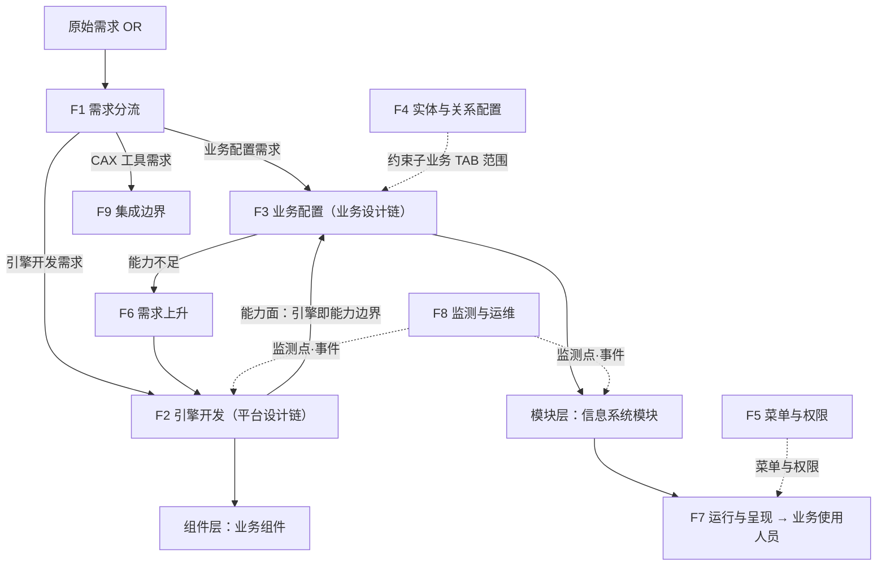
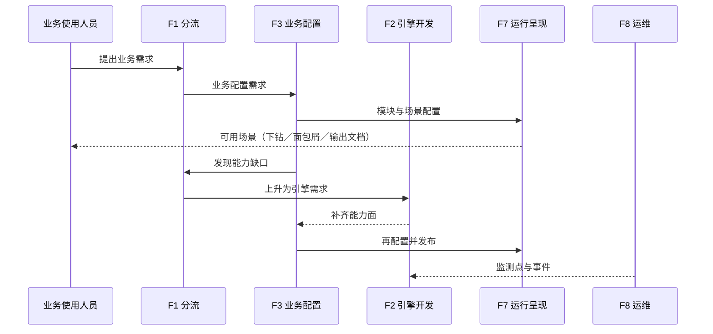
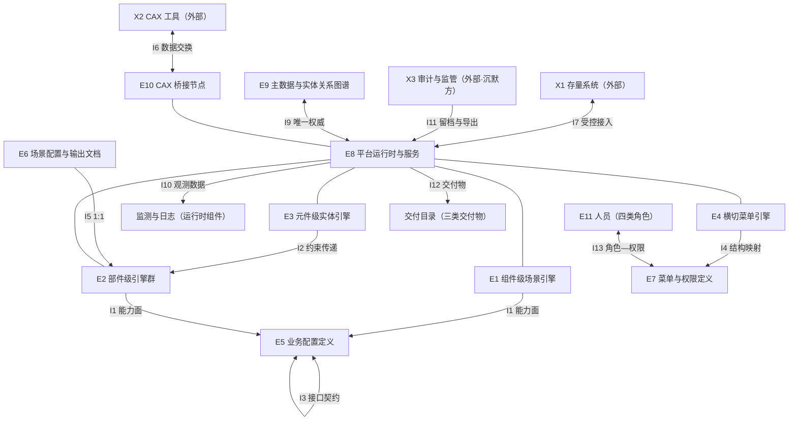

# EOS 企业运营体系信息化平台的架构描述与系统组成说明

## 从目的、目标、系统需求、关切清单、架构清单到三张视图与一份册子

**研究报告 · 第 45 号**

| 项 | 内容 |
|---|---|
| 编号 | 45 |
| 日期 | 2026-10-23 |
| 关键词 | EOS 平台；可配置平台；引擎；配置；双链；功能架构视图；逻辑架构视图；物理架构视图；系统组成说明 |
| 适用对象 | 平台架构师、产品数据与构型管理岗、评审与符合性核查岗、流水线开发者 |

> **落料位**：03-ch13（备料）｜04（—）

> **依据**：判据只取四份标准正本——**ISO/IEC/IEEE 42010:2022**｜**42020:2019**｜**15288:2023**｜**42030:2020**（旁证）。**EOS 的产品定义、平台定位、四层架构、引擎三级＋横切、引擎清单、业务层级 L0~L6、UI 交互模型、双链与需求上升、三类开发者**取自 **EOS 产品规格正本**（`20-eos-engineering/30-eos/00-eos-product-spec/`，**只读未改**，文中标〔EOS 规格〕）；本项目研究报告的既有记录标〔37 号 §十二〕；本报告自行补足处标〔本报告补足〕。
>
> **与既有报告的关系**：**口径**在 [37 号](37-架构视图口径研究报告-从三词定位到七类视图与三张清单并附HUD·EOS·冷链·合同审批四套示例.md)（三词定位、七类视图、三张清单）；**体例**与 [44 号](44-平视显示器架构描述与系统组成说明研究报告-从目的目标清单到三视图与一份册子.md) 同构（那件用 HUD 做例），本件把同一套做法用在**平台类系统**上——两者的差别正好显出"无形系统"与"设备类系统"的分别。
>
> **取证纪律**：凡断言"标准里没有"先做零命中检索；凡涉外文原文与中译并列；引用标四档（标准逐字／标准可支持的读法／按定义句作的举例／本报告的定性）。**数值与未定项一律〈待定〉**。

---

## 摘要

EOS 平台是"无形系统"：它没有光学件、没有安装基准，它的架构承重处是**能力面与配置面的分界**。本报告按"目的 → 目标 → 系统需求 → 关切清单 → 架构清单 → 功能视图 → 逻辑视图 → 物理视图 → 系统组成说明"九件做到底。

1. **目的是消除孤岛，手段是"以引擎为能力基础、以配置为使用方式"**〔EOS 规格〕。这一句决定了后面全部边界：**引擎是能力边界，配置只能使用已提供的能力面**（K15）。
2. **八条目标带关键成功准则**（G1~G8），其中最要紧的是三条可判的：贯通路径在设计上可指认（G1）、同一事实只有一个权威源（G3）、配置与引擎能力匹配（G4）。
3. **十二条系统需求**（R1~R12）每条都标了承自哪条关切——**需求是关切的答案，不是关切的同义改写**。
4. **关切台账十四条**（C1~C14），四类分流（承重／约束／交付／弱承重）。**平台类系统的承重关切全在"分界"与"语义"上**：孤岛复发、贯通不可验证、语义不唯一、配置绕过引擎、引擎边界划错。
5. **架构清单**给 K1~K15 概念、P1~P10 属性、G1~G14 原则。**三张清单是本平台唯一不能换的东西**：引擎换代、配置重做都可以，这三十九条不该跟着变（原则 G12）。
6. **功能视图**给九组功能与双链：需求分流（F1）→ 平台设计链（F2）／业务设计链（F3）→ 需求上升（F6）→ 回写。**双链是这个平台的功能骨架**，也是"平台链 → 业务链 → 使用"三段的唯一可指认路径。
7. **逻辑视图**给业务层级 L0~L6 的问题域对象（O1~O12）、跨域三型关系、配置—引擎能力面对应、变换三问。**它把"配置"从一种文件变成一类有权威来源、有变更权、有约束的对象。**
8. **物理视图**给引擎三级＋横切的元素划分（E1~E11）、十四条接口承诺及其承载。**物理面的承重处只有两处**：接口 I1（引擎↔配置的能力面）与 I9（主数据与图谱的唯一权威）。
9. **系统组成说明**给八节骨架与一页样例，并按"节→族"标清哪一节是台账、哪一节是视图转写、哪一节是设计规格。
10. **已知缺口**（沿用 37 号并复核）：运维／部署／集成三线交付物未定义、运维与监测视角未建、沉默方（审计与监管、二次开发方）无代言视角。

---

## 0 引言与通用判据

### 0.1 为什么平台类系统更要按这个次序走

设备类系统（HUD）的承重处是"几何与基准"，一眼能看出来；平台类系统的承重处是**看不见的**——它藏在"哪些能力由引擎提供、哪些由配置组装"这条线上。这条线一旦含糊，就会出现三种典型病：配置绕过引擎（能力永远长不出来）、引擎边界划错（把能力全下沉或过窄）、需求上升无记录（缺口永远滞留业务侧）。

按本报告次序走，就是用**逐级落点**来把这条线钉住：目的说清"为什么做平台"，目标给出可判准则，需求把关切翻译成条款，关切清单暴露承重点，架构清单定下不许变的东西，三张视图分别从"做什么／是什么／落在哪"把这条线切三次，最后组成说明把它落成册子。**跳过任一件，那条线就只能靠人记。**

### 0.2 六条通用判据

| # | 判据 | 出处 |
|---|---|---|
| J1 | 三张视图三句定义，各管一段：功能＝本质的、起组织作用的功能结构；逻辑＝功能与留存数据的集成模型，**推迟表示方式**；物理＝系统元素与物理接口的安排 | 42020:2019 §E.4.2.4／.5／.6 |
| J2 | 深度封顶于"传达架构意图和理解所必需"；设计另给 *implement-to*（实现级） | 15288:2023 §6.4.5.3 注 10、§6.4.5.1 注 1 |
| J3 | 元素是**角色位**；接口检录只依端点身份与离散性 | 15288:2023 §3.47、§3.19；42010:2022 §5.2.2 |
| J4 | 接口须有**两个或以上可分辨的系统元素**；物理视图只承诺物理接口 | 15288:2023 §3.19；42020:2019 §E.4.2.6 |
| J5 | 视图须遵循其管控视角的约定；组件须标模型种类或给图例；须记已知问题 | 42010:2022 §6.7、§6.8 |
| J6 | 引用标四档：标准逐字／标准可支持的读法／按定义句作的举例／本报告的定性 | 本报告的取证纪律 |

**本报告不做什么**：不研究视图口径（在 37 号）；不给引擎的功能规格与配置元模型细节（属设计描述与产品数据）；不写部署拓扑与实例数（属设计；且 `30-eos-deployment/` 当前"待填充"）；不改 EOS 规格任何文字（**只读**）。

---

## 1 目的〔EOS 规格〕

> 构建**统一的可配置运营平台**，从根本上消除传统企业信息系统各自独立建设带来的**信息孤岛**与**业务碎片化**；所有业务域（产品研制、市场、生产、售后、经营管理）在**同一平台体系内贯通**，实现数据共享与业务协同。

**产品形态**＝**统一可配置平台**——"**以引擎为能力基础、以配置为使用方式**"；产品架构分两类：**平台 PA＝软件组件**（引擎的前端 UI 组件、后端服务、数据模型、API、基础设施），**业务 PA＝结构化配置定义**（表单定义、标签页定义、台账定义、流程定义等），由引擎配置产生〔EOS 规格 §1.1〕。

**这句目的对后面九件做了什么**：

1. 它把"消除孤岛"从**治理问题**变成**设计问题**——所以目标 G1 写的是"贯通是设计保证，不是事后治理"。
2. 它把"可配置"抬成承重概念——所以引擎与配置的分界（K15、原则 G1）成了全篇最硬的约束。
3. 它没有承诺"什么都能配"——所以配置越过引擎能力面的缺口必须**上升**（K12、功能 F6），而不是就地变通。

---

## 2 目标

| # | 目标 | 关键成功准则 |
|---|---|---|
| **G1** | **业务贯通是设计保证**（统一业务链），不是事后治理 | 贯通路径在设计上可指认（不靠点对点集成拼出） |
| **G2** | **换引擎扩展与演进，不做多套接口集成** | 新增能力走引擎扩展；不因新域而新增点对点集成 |
| **G3** | **数据与语义唯一**（共享主数据与实体模型） | 同一事实只有一个权威源 |
| **G4** | **配置与引擎能力匹配、配置可执行** | 匹配率 100%、可执行率 100%〈口径待定〉 |
| **G5** | **需求分流正确、能力缺口上升可追** | 分流正确率 100%、上升机制记录率 100%〈口径待定〉 |
| **G6** | **配置项独立、可复用** | 配置项独立性 100%〈口径待定〉 |
| **G7** | **角色场景与呈现可用** | 场景可完成本职业务；下钻与面包屑可用〈指标待定〉 |
| **G8** | **可运维、可诊断** | 监测点、事件与 SLA 齐备（**当前为缺口**） |

> **档位与出处**：〔37 号 §十二 12.2〕，其目标语句由 EOS 规格的定位与架构推导。
>
> **消歧**：本报告的 **G1~G8 是目标**；§5.3 的 **G1~G14 是管控原则**——与 37 号同源的字母两义（已挂账，见附录 B 第 8 项）。**本报告凡引目标写"目标 Gx"，凡引原则写"原则 Gx"。**

**目标与清单的接法**：目标决定"哪些概念属性算基本"。§5 每张清单都有"去掉它的后果"一列，答的正是"拿掉它，八条目标里哪几条会落空"。反过来说：**凡是拿掉之后八条目标一条都不受影响的，就不该进清单。**

---

## 3 系统需求

> **次序说明**：本报告按用户给定次序把系统需求放在关切清单之前；**推导方向仍是"关切 → 需求"**，故每条需求都标了承自哪条关切，§4 的关切台账与本节互为对照（本报告的定性：这种"先列条款、再见台账"的排法便于评审逐条对表，但**不许反过来用需求去反推关切**）。

| # | 系统需求 | 承自 |
|---|---|---|
| **R1** | 贯通：统一业务链与端到端项目业务的可指认路径 | C1／C2 |
| **R2** | **引擎能力面与配置产出类型的对应关系**（每个引擎 ↔ 一类配置产出） | C4／C5 |
| **R3** | **需求分流与上升机制**（引擎开发需求／业务配置需求／CAX 工具需求；业务链→引擎需求） | C6 |
| **R4** | 数据与语义唯一（主数据、实体关系图谱为权威） | C3／C10 |
| **R5** | 配置独立性（不得依赖他配置内部实现） | C8 |
| **R6** | 跨域关系限三种（上下游／管理-被管理／支持-被支持） | C7 |
| **R7** | 配置与引擎匹配的校验（子业务 TAB 只能取自实体关系清单） | C10 |
| **R8** | 场景编排与呈现（场景部件:输出文档＝1:1；下钻层级；面包屑；多 TAB） | C9 |
| **R9** | 菜单与权限（L1~L4 菜单树；末级节点映射到 L4 场景业务） | S1／S5 |
| **R10** | 与 CAX 工具及存量系统的集成边界（受控、可核对） | C11 |
| **R11** | 运维可诊断性（监测点、事件、SLA） | C13 |
| **R12** | 交付面（三类交付物各归其位：`00-pl4eos-spec/`／`10-pl4eos-subpd-sysdev/`／`80-pl4eos-2-eosdata/`） | C12 |

> **档位与出处**：〔37 号 §十二 12.5〕。R12 指交付目录，属 EOS 产品数据侧，本报告只作引用、不展开。

**四条读法**：① 每条需求至少要有一条关切做来源，**没有来源的需求是外加的**；② 需求写得出来的前提是关切写得具体（有后果、可度量）；③ 需求与目标的关系是"目标要高、需求要具体"，二者不许互相顶替；④ 需求不指定实现——"怎么做到"属设计定义。

---

## 4 关切清单

| # | 关切 | 来源 | 后果 | 分流 | 主要承接视图 |
|---|---|---|---|---|---|
| **C1** | **信息孤岛复发**（各域各自建、各建各的） | 管理者／业务使用者 | 数据不通 → 目的落空 | **承重** | 功能＋逻辑 |
| **C2** | **业务链断裂、贯通不可验证** | 业务使用者／审计 | 跨域业务走不通或走通不可证 | **承重** | 功能＋逻辑 |
| **C3** | **数据归属与语义不唯一** | 业务使用者／审计 | 同一事实多个版本 → 不可信 | **承重** | 逻辑＋物理 |
| **C4** | **用配置绕过引擎能力缺口** | 引擎开发者 | 引擎被架空、演进压力分散 | **承重** | 功能＋物理 |
| **C5** | **引擎边界划错**（全下沉→压力集中；过窄→表达力不足被逼回代码） | 引擎开发者 | 平台退化为代码堆 | **承重** | 功能＋物理 |
| **C6** | **需求上升无记录、缺口发现滞后** | 业务配置者／引擎开发者 | 缺口滞留业务侧 | **承重** | 功能 |
| **C7** | **跨域关系种类膨胀** | 架构角色 | 关系失控、无法核对 | **约束** | 逻辑 |
| **C8** | **配置依赖他配置的内部实现** | 业务配置者 | 改一处坏多处 | **约束** | 逻辑＋物理 |
| **C9** | **呈现与角色场景不匹配** | 业务使用者 | 操作效率低、弃用 | **承重（弱）** | 逻辑＋物理 |
| **C10** | **主数据与实体关系图谱不一致**（子业务 TAB 越界） | 业务配置者 | 数据关系失去约束 | **承重** | 逻辑＋物理 |
| **C11** | **与存量系统／外部工具的边界与接口失控** | 集成方 | 又回到集成式 | **约束** | 物理 |
| **C12** | **交付物位置与责任人不清** | 流水线开发者 | 交付面悬空 | **交付**（→已知缺口） | —（缺） |
| **C13** | **运维可诊断性不足**（监测点、事件、SLA） | 运维者 | 上线后不可运维 | **承重**（当前缺口） | 物理（部分） |
| **C14** | **沉默方需求无人代言**（审计与监管、二次开发方） | — | 后期返工 | **承重（弱）** | —（缺） |

> **档位与出处**：〔37 号 §十二 12.4〕。

**这张表最要紧的一列是"分流"**：四条承重关切（C1／C2／C3／C4／C5／C6／C10）决定架构的骨架，约束类（C7／C8／C11）决定不许怎么干，交付类（C12）与缺口类（C13／C14）如实标出**没有承接视图**——**没承接的就写在明处，不许假装被覆盖**（42020:2019 §9.3 d) 的落实方式：被评估的是架构，缺什么要说得出）。

---

## 5 架构清单：基本概念、基本属性、管控原则

> **这一章是什么**：三张清单就是**架构的内容本身**（42010:2022 §3.2 的定义句＝概念或属性 ＋ 管控原则）。后面三张视图，是同一批内容的**三次切片**。
>
> **档位与出处**：K／P／G 三表取自〔37 号 §十二 12.6~12.8〕，其事实基础标〔EOS 规格〕。

### 5.1 基本概念清单（K1~K15）

| # | 概念 | 一句话定义 | 去掉它／不共享的后果 | 主要落点 |
|---|---|---|---|---|
| **K1** | 统一可配置平台 | 以引擎为能力基础、以配置为使用方式的一体化平台 | 退回"传统 ISV 产品集"，目的落空 | 概念 |
| **K2** | 以引擎为能力基础、以配置为使用方式 | 引擎提供能力，配置组装使用 | 平台退化为一堆定制代码 | 概念／功能 |
| **K3** | 两类 PA | 平台 PA（软件组件）／业务 PA（结构化配置定义） | 配置与构件混为一体，无法分别演进 | 概念／物理 |
| **K4** | 业务贯通即设计保证 | 贯通由统一业务链在设计上保证，非事后治理 | 孤岛需额外治理（正是要消除的现状） | 概念／功能 |
| **K5** | 统一业务链 | 跨域业务在同一链上可指认、可核对 | 贯通不可验证 | 功能／逻辑 |
| **K6** | 端到端项目业务（E2E） | 从需求提出到需求满足的完整闭环 | 跨域接口无落点 | 概念／逻辑 |
| **K7** | 三类客户与三个业务维度 | 主价值链／管理监管／支持服务 | 需求来源缺一维（尤其管理监管） | 概念／逻辑 |
| **K8** | 跨域三种关系 | 上下游／管理-被管理／支持-被支持 | 关系种类膨胀、无法核对 | 概念／逻辑 |
| **K9** | 业务层级 L0~L6 | 平台／业务系统／业务模块／构件业务／场景业务／场景部件／功能元件 | 菜单与场景装配失去层次依据 | 逻辑 |
| **K10** | 引擎三级＋横切 | 组件级场景引擎／部件级引擎／元件级实体引擎／横切菜单引擎 | 引擎分工与调用关系无法约定 | 功能／物理 |
| **K11** | 场景部件 : 输出文档＝1:1 | 一个窗口＝一个场景部件＝一份输出文档 | 部件与产出失去对应，配置无法核算 | 逻辑 |
| **K12** | 需求分流与上升 | 需求按来源分流；能力缺口上升为引擎需求 | 缺口滞留业务侧、引擎被动 | 功能 |
| **K13** | 角色场景与呈现 | 下钻与面包屑构成的场景操作形态 | 呈现与角色不匹配、弃用 | 概念／逻辑 |
| **K14** | 三层工作层面 | 流水线设计／构件开发／使用工具设计 EOS | 责任与交付面混乱 | 概念／组织 |
| **K15** | 引擎即能力边界 | 配置只能使用引擎已提供的能力面 | 配置越界、引擎被架空 | 概念／逻辑／物理 |

### 5.2 基本属性清单（P1~P10）

| # | 属性 | 判据方向（值待定） | 去掉它的后果 | 承自 |
|---|---|---|---|---|
| **P1** | **数据与语义唯一** | 同一事实唯一权威源；越界改写检出率 100%〈口径待定〉 | 数据不可信 | C3／**目标** G3 |
| **P2** | **贯通性** | 跨域业务在统一链上可指认、可核对 | 孤岛复发 | C1／C2／**目标** G1 |
| **P3** | **配置—引擎匹配性** | 匹配率 100%、可执行率 100%〈待定〉 | 配置跑不起来 | **目标** G4 |
| **P4** | **配置项独立性** | 独立性 100%〈待定〉；不依赖他配置内部实现 | 改一处坏多处 | C8 |
| **P5** | **关系受限度** | 跨域关系类型不超过三种 | 关系失控 | C7 |
| **P6** | **需求上升可追性** | 上升机制记录率 100%〈待定〉 | 缺口滞留 | C6 |
| **P7** | **场景可用性** | 场景可完成本职业务；下钻与面包屑可用〈指标待定〉 | 平台被弃用 | C9 |
| **P8** | **集成边界受控性** | 与外部系统／CAX 的接口受控且可核对 | 回到集成式 | C11 |
| **P9** | **可运维性** | 监测点覆盖、事件检出与恢复〈指标待定，当前缺口〉 | 上线后不可运维 | C13 |
| **P10** | **交付面完整性** | 三类交付物齐备且位置明确 | 交付悬空 | C12 |

### 5.3 管控原则清单（G1~G14）

**实现侧（8 条）**

| # | 原则 | 理由 | 约束谁 | 违反后果 |
|---|---|---|---|---|
| **G1** | **能力缺口上升为引擎需求，不许配置绕过** | 引擎是能力边界（K15） | 业务配置者、引擎开发者 | 引擎被架空（C4） |
| **G2** | **接口只定到足以传达架构意图** | 平台—业务接口天然是 should 级 | 引擎与配置接口设计 | 过度锁定，演进受阻 |
| **G3** | **配置不得越界，也不得依赖他配置内部实现** | 配置独立性 | 业务配置者 | 改一处坏多处（C8） |
| **G4** | **同模式共享引擎** | 避免重复造引擎 | 引擎设计 | 引擎碎片化 |
| **G5** | **跨域关系限三种** | 关系可核对 | 全链条 | 关系膨胀（C7） |
| **G6** | **主数据与实体关系图谱为唯一权威** | 语义唯一 | 配置与数据设计 | 数据不可信（C3／C10） |
| **G7** | **资产优先：复用→改进→新增** | 一次为多次服务 | PA 分解决策 | 资产不复用、重复建设 |
| **G8** | **不引入点对点集成** | 贯通是设计保证 | 集成与接口设计 | 回到集成式（C11） |

**演化侧（6 条）**

| # | 原则 | 理由 | 约束谁 | 违反后果 |
|---|---|---|---|---|
| **G9** | **需求分流先定，再谈落点** | 三类需求走两条链 | 需求与变更处理 | 需求落错链 |
| **G10** | **交付面与责任人先定** | 三条子线未进构件开发，交付面悬空 | 流水线开发者与 EOS 开发者 | 交付物无处安放（C12） |
| **G11** | **配置语义只许追加、不许改义** | 已配置模块的稳定性 | 配置变更 | 存量模块失效 |
| **G12** | **引擎演进不得破坏既有配置能力面** | 配置是资产 | 引擎版本演进 | 升级即返工 |
| **G13** | **菜单与权限随场景变更同步更新** | 呈现与角色一致 | 配置与权限管理 | 越权或不可达 |
| **G14** | **监测点与 SLA 随新引擎、新域同步定义** | 可运维性不是一次性的 | 引擎与运维 | 上线后不可诊断（C13） |

### 5.4 上游相关方需求索引（S1~S8；完整表在 37 号 §十二 12.3）

**S1 业务使用人员**（在本职场景内完成业务；界面与角色匹配；数据可信）｜**S2 业务配置者**（编排业务组件为信息系统模块；跨组件贯通可查）｜**S3 业务组件配置者**（用引擎配置业务组件；配置与能力匹配可判）｜**S4 引擎开发者**（引擎边界清楚；能力缺口上升有通道、有记录）｜**S5 企业管理者／监管与审计（沉默方）**（合规留档、可审计、可追溯）｜**S6 流水线开发者（上游）**（交付面清楚）｜**S7 外部工具与存量系统（CAX／OA／ERP）**（集成边界明确；不把平台拉回点对点集成）｜**S8 平台运维者**（可监测、可诊断、可发布；**交付物尚未定义**）。

### 5.5 清单怎么落到三张视图上（四条检查）

概念与属性须**分配**到元素与关系上（42020:2019 §10.4.4 e)）。四条检查：

1. **落点**——每条概念／属性落在哪张视图的哪个条目上？三处都指不到的＝**空位**（按 42010:2022 §6.7 d) 记已知问题）。本平台的空位已知：P9 只落到"监测接口"一处，C12／C14 无视图承接。
2. **可检**——每条原则约束哪个条目？违反时在哪张视图上看得出？例：原则 G1 在物理视图落成 I1 的承诺，在功能视图落成 F6 的上升功能——两处都可检。
3. **不越权**——任何一张视图都不等于三张清单之和；跨视图一致靠对应关系（42010:2022 §6.9）。
4. **认对象**——被评估的是架构本身，不是架构描述（42020:2019 §9.3 d)）：三张清单是被判的东西，视图只是举证。

---

## 6 功能架构视图

> **定义句（42020:2019 §E.4.2.4，逐字）**：*… the essential or organizing functional structure, the way abstracted inputs are transformed into outputs by the system to achieve its mission.*（中译：本质性的或起组织作用的功能结构，即系统为达成其使命而将抽象化的输入转换为输出的方式。）**同款自述：它不是 42010 的规范性要求，但几乎总会被包含**——故本视图不得作为符合性判据。
>
> **本平台的边界**：不写前端／后端实现技术；不写配置元模型的字段。

### 6.1 功能视角规格（42010:2022 §8.1 a)~g)）

| 项 | 内容 |
|---|---|
| **a) 利益相关方角度** | 引擎开发者（能力面是否够用）｜业务配置者（能否编排）｜业务组件配置者（能否配置）｜业务使用人员（场景是否走得通）｜流水线开发者（交付面） |
| **b) 关注点** | C4 配置绕过引擎、C5 引擎边界、C6 上升无记录、C10 图谱约束、C2 贯通可验证、C9 呈现 |
| **c) 方面体** | 功能、行为、信息流。只写"做什么、按什么次序"，不写实现技术 |
| **d) 典型利益相关方** | 引擎开发者、业务配置者、业务组件配置者、业务使用人员 |
| **e) 模型种类与图例** | ① **功能分解表**（F 编号唯一，两层）；② **双链功能流图**（平台设计链／业务设计链，边＝数据或控制）；③ **场景时序图**（参与方＝功能或角色）；④ 叙述旁注（非模型，按 §6.8 注明） |
| **f) 对应方法** | 每项功能标"承接的需求 R"；功能与逻辑对象（O）、物理元素（E）各一份对应；上升回路单列 |
| **g) 信息来源** | 42020:2019 §E.4.2.4；EOS 规格（双链、分流、引擎三级＋横切、五类引擎 19 个）〔EOS 规格 架构 §二／§五〕；本报告 §3／§5 |

### 6.2 功能分解（F1~F9，二层）

| # | 功能 | 一句话 | 承接 |
|---|---|---|---|
| **F1** | 需求分流 | 把原始需求分成三类，各走一条链 | R3／原则 G9 |
| F1.1 | 需求识别与分类 | 判这条需求属于哪一类 | R3 |
| F1.2 | 分流判定与记录 | 落链并留痕（分流正确率可核） | R3／**目标** G5 |
| **F2** | 引擎开发（平台设计链） | 把引擎需求做成引擎构件 | R2 |
| F2.1 | 引擎分析 | 定能力面与该引擎 ↔ 配置产出的对应 | R2／C5 |
| F2.2 | 引擎实现与发布 | 产出引擎构件与能力面声明 | R2 |
| **F3** | 业务配置（业务设计链） | 用引擎能力组装业务 | R2／R5 |
| F3.1 | 组件层配置 | 表单／标签页／台账／流程等定义的配置 | R2 |
| F3.2 | 模块层编排 | 把业务组件编排为信息系统模块 | R1／C1 |
| F3.3 | 场景编排 | 把场景部件编排为多窗口场景 | R8／C9 |
| **F4** | 实体与关系配置 | 配主数据与实体关系，并向下约束 | R4／R7 |
| F4.1 | 实体配置 | 元件级实体引擎配置实体 | R4 |
| F4.2 | 实体关系图谱维护 | 定跨域关系（限三种） | R6／C7 |
| F4.3 | 约束下发 | 图谱 → 子业务 TAB 的可用范围 | R7／C10 |
| **F5** | 菜单与权限 | 生成菜单树并绑权限 | R9 |
| F5.1 | 菜单树生成（L1~L4） | 按业务层级生成菜单 | R9 |
| F5.2 | 权限绑定 | 节点 CRUD ＋ 权限 | R9／C14 |
| F5.3 | 末级节点映射 | 末级菜单映射到 L4 场景业务 | R9 |
| **F6** | 需求上升 | 业务链发现能力不足 → 上升为引擎需求 | R3／C6 |
| F6.1 | 能力缺口识别 | 判定"是配置问题还是能力缺口" | **目标** G5 |
| F6.2 | 上升与记录 | 上升为引擎需求并留痕 | R3 |
| F6.3 | 补齐回写 | 平台链补齐后回业务链再扩展 | 原则 G1 |
| **F7** | 运行与呈现 | 把配置跑成可用场景 | R8／C9 |
| F7.1 | 场景加载与下钻 | 单窗全宽 → 双击分屏 → 继续下钻 | R8 |
| F7.2 | 面包屑导航 | 层级可回退 | R8 |
| F7.3 | 输出文档生成 | 场景部件:输出文档＝1:1 | R8／K11 |
| **F8** | 监测与运维 | 采集、告警、诊断、发布 | R11／C13 |
| F8.1 | 监测点采集 | 按引擎与域定义监测点 | R11／原则 G14 |
| F8.2 | 事件与告警 | 事件分类与处置 | R11 |
| F8.3 | 诊断与发布 | 定位与版本发布（**交付物未定义**） | R11／R12 |
| **F9** | 集成边界 | 与 CAX 工具、存量系统受控交互 | R10／C11 |
| F9.1 | CAX 桥接 | 受控接入，不做点对点集成 | R10／原则 G8 |
| F9.2 | 存量系统接入 | 边界外系统按接口契约接入 | R10 |

### 6.3 双链功能流

**读图四条**：① **两条链是干**——平台设计链产出引擎构件，业务设计链产出配置定义；② **上升是一条回边**（F6），它把"配置做不出来"翻译成"引擎要长能力"，**这条回边就是原则 G1 的功能形态**；③ **约束是自上而下的一条虚边**（F4.3 → F3），它保证子业务 TAB 不会越出实体关系图谱；④ **监测点在每条链上都要有**（F8），否则 C13 无从承接。

### 6.4 场景时序：一条业务需求的落地

**一条不变量**（写进图下叙述）：**任何一次"绕过引擎就地变通"都不允许**——发现能力不足时，唯一出口是 F6 的上升回路（原则 G1）。

### 6.5 覆盖检查（功能面）

| 关切 | 功能上怎么承接 | 判定 |
|---|---|---|
| C4 配置绕过引擎 | F6 三支构成唯一出口；F3 的配置项受引擎能力面限制 | **承接** |
| C5 引擎边界 | F2.1 要求逐引擎定"能力面 ↔ 配置产出"对应 | **承接**（对应关系本身由设计定） |
| C6 上升无记录 | F6.2 留痕 | **承接** |
| C2 贯通可验证 | F3.2／F3.3 的编排路径可指认；F4.2 约束跨域关系 | **承接** |
| C9 呈现不匹配 | F7.1／F7.2 | 部分（人因视角未建） |
| C13 运维 | F8 | **部分**（F8.3 交付物未定义） |

### 6.6 已知问题（42010:2022 §6.7 d)）

1. **本视图不是规范性要求**，不得作符合性判据；是否强制交付待定。
2. **F8.3 诊断与发布的交付物未定义**——运维线尚未进入构件开发（C12／C13）。
3. **F2.1"引擎 ↔ 配置产出"对应关系**只有原则（R2），逐引擎的对应表属设计/产品数据，本视图只承诺"必须有对应"。
4. **F1.1 分类规则的判据细则**未在架构层给出（属设计）。
5. **F9.2 存量系统接入**的边界清单未列（属集成边界，需外部清单）。
6. **F7 的呈现形态**（单窗／分屏／面包屑）是概念级承诺，具体交互属设计。

### 6.7 对应关系（42010:2022 §6.9）

| 源 | 目标 | 关系 | 判定方法 |
|---|---|---|---|
| F1~F9 | R1~R12 | 承接 | 每条需求至少一项功能 |
| F2／F3 | K2／K15 | 概念落成功能 | "能力边界"有独立功能项（F6） |
| F4.3 | 原则 G5／G6 | 约束句 | 违反即判"关系膨胀" |
| F6 | 原则 G1 | 原则的功能形态 | 存在唯一上升通道 |
| F3／F7 | 逻辑对象 O9／O12 | 生产者—消费者 | 每个对象有唯一生产者 |
| F1~F8 | 物理元素 E1~E11 | 分配 | 见 §8.2 职责列 |

### 6.8 自检（42010:2022 §8.3）

| 要求 | 出处 | 落点 | 结果 |
|---|---|---|---|
| 视角规格 a)~g)／模型种类 a)~d) | §8.1／§8.2 | §6.1 | 过 |
| 遵循视角约定 | §6.7 | 三件组件合图例 | 过 |
| 应对全部关注点 | §6.7 c) | 六个关切（§6.5） | **部分**：C9／C13 只到架构级 |
| 记已知问题 | §6.7 d) | §6.6 六条 | 过 |
| 组件标模型种类 | §6.8 | 表／流图／时序图 | 过 |
| 记录对应关系 | §6.9 | §6.7 | 过 |

---

## 7 逻辑架构视图

> **定义句（42020:2019 §E.4.2.5，逐字）**：*… defines data as it makes sense in the problem domain, and **defers definition of how it can be represented to other views** … not in terms of XML records or database fields.*（中译：按在问题域中有意义的方式定义数据，把"如何表示"推迟到其他视图……不按 XML 记录或数据库字段定义。）
>
> **同条 NOTE**：构成逻辑架构或物理架构的内容往往带有一定**主观性**，可采用处于这一**谱系**上的各类做法——**"写到哪一层算逻辑"必须由本规格钉死。**
>
> **本平台的钉法**（写进规格）：**不写 API 风格、消息格式、表结构、前端框架**；写到"业务层级与实体关系的语义、配置与引擎能力面的对应、角色场景与呈现区域的映射"为止。

### 7.1 逻辑视角规格（42010:2022 §8.1 a)~g)）

| 项 | 内容 |
|---|---|
| **a) 利益相关方角度** | 业务配置者（业务层级与配置语义）｜业务使用人员（角色场景）｜审计与监管（归属与留痕）｜引擎开发者（能力面语义） |
| **b) 关注点** | C2 贯通可验证、C3 语义唯一、C7 关系膨胀、C8 配置互相依赖、C10 图谱约束、C9 呈现语义 |
| **c) 方面体** | 信息、功能、连通性。只写问题域语义，不写表示方式 |
| **d) 典型利益相关方** | 业务配置者、业务使用人员、审计、引擎开发者 |
| **e) 模型种类与图例** | ① **业务层级语义表**（O1~O12）；② **实体关系图谱语义**（三型关系）；③ **配置—引擎能力面对应表**；④ **数据所有权与变更权表**；⑤ **角色场景与显示区域映射表** |
| **f) 对应方法** | 每个对象指到一个概念 K 与一项功能 F；每条配置定义指到一个引擎能力面；每个呈现语义指到一个角色场景 |
| **g) 信息来源** | 42020:2019 §E.4.2.5；EOS 规格（业务层级 L0~L6、跨域三型、实体关系图谱、UI 交互模型、双链语义）〔EOS 规格 架构 §一／§二／§五、§2.2.3、§2.2.4〕 |

### 7.2 问题域对象（O1~O12）

| # | 对象 | 在问题域里是什么 | 成立条件 | 权威来源 | 备注 |
|---|---|---|---|---|---|
| **O1** | 业务域（L1 业务系统） | 一条业务线的系统边界 | 由业务维度与角色定 | 架构侧 | 主价值链／管理监管／支持服务 |
| **O2** | 业务模块（L2） | 业务系统内的功能块 | 挂在某业务域下 | 业务配置者 | |
| **O3** | 构件业务（L3） | 由业务组件构成的构件级业务 | 依赖引擎能力面 | 业务组件配置者 | |
| **O4** | 场景业务（L4） | 端到端闭环的一件事 | 有明确起止与产出 | 业务配置者 | E2E 的落点 |
| **O5** | 场景部件（L5） | 一个窗口 | 与输出文档 1:1 | 业务配置者 | K11 |
| **O6** | 功能元件（L6） | 原子构件 | 由引擎元件级提供 | 引擎开发者 | |
| **O7** | 实体与实体关系 | 业务对象及其三型关系 | 关系类型限三种 | 主数据与图谱 | K8／原则 G5 |
| **O8** | 主数据 | 跨域共享的基础事实 | 唯一权威 | 主数据权威源 | 原则 G6 |
| **O9** | 配置定义 | 组件层／模块层／场景层的结构化定义 | 与引擎能力面匹配 | 配置者（分层授权） | 业务 PA |
| **O10** | 需求（含分流与上升状态） | 一条需求及其去向与状态 | 必须被分流 | 分流责任主体 | K12 |
| **O11** | 角色与权限 | 角色—菜单节点—场景的映射 | 末级节点映射 L4 | 权限管理 | 原则 G13 |
| **O12** | 输出文档 | 场景部件产出的那一份文档 | 与场景部件 1:1 | 业务配置者 | K11 |

**三条语义规则（写进表下，属本报告定性）**：① **O4 是承重对象**——它是"端到端闭环"的唯一载体，跨域接口若不在 O4 上落点，就只能是点对点集成；② **O9 不是文件，是有主的东西**——分层授权（谁配组件、谁编排模块、谁编排场景）写不出来，配置就会变成谁也说不清谁改的文本；③ **O12 与 O5 的 1:1 是可核的**——数是可数的，这条语义因此可以用"数量对得上吗"来验。

### 7.3 跨域三型关系（O7 的取值域）

| 关系型 | 语义 | 允许的例子 | 不允许的 |
|---|---|---|---|
| **上下游** | 前道产出是后道的输入 | 市场 → 研发 → 生产 | "顺便看看"式的横向调用 |
| **管理-被管理** | 上级与被管理方的指令与汇报 | 管理域对业务域 | 平级互管 |
| **支持-被支持** | 支持方为被支持方提供能力 | 售后对生产 | 支持方反向支配 |

**一张关系图谱的价值在于"种类有限"**：三型之外一律不许（原则 G5／R6），因为**关系的种类决定了核对的方法**——三型各有其可判的核对方式，第四型出现时无法核对。

### 7.4 配置—引擎能力面对应（O9 ↔ 引擎）

| 配置产出类型 | 由谁提供能力 | 对应关系（架构级承诺） |
|---|---|---|
| 表单／标签页定义 | 部件级引擎（含表单引擎） | 每类配置产出一一对应一个引擎能力面 |
| 台账定义 | 部件级引擎（台账引擎） | 同上 |
| 流程定义 | 流程类引擎 | 同上 |
| 实体与实体关系 | 元件级实体引擎 | 配置受图谱约束，不得越界 |
| 菜单树与权限 | 横切菜单引擎 | 末级节点映射 L4 |
| 场景（多窗口） | 组件级场景引擎 | 场景部件:输出文档＝1:1 |
| 主数据 | 元件级实体引擎＋数据权威 | 唯一权威，越界改写须被检出 |

> **档位**：本表是**按定义句作的举例**（引擎清单以〔EOS 规格 `11-eos-engine-catalog.md`〕为准；五类引擎共 19 个，本表只取承重的几类作示范）。

### 7.5 变换三问

| 变换 | ① 是什么（输入→输出） | ② 在什么条件下成立 | ③ 结果归谁 |
|---|---|---|---|
| **T1 需求分流** | 原始需求 → 三类需求之一 | "当需求可识别其来源与落点时分流"；不变量：**分流必须留痕、可核** | 归属：分流责任主体；去向：F2／F3／F9 |
| **T2 配置→信息系统模块** | 组件层配置 → 可运行的模块 | "当配置与引擎能力面匹配、且在实体关系约束范围内时成立"；不变量：**不依赖他配置内部实现** | 归属：业务配置者；责任：引擎边界持有者；去向：F7 运行 |
| **T3 能力缺口→引擎需求** | 业务链缺口 → 引擎需求 | "当判定为能力缺口而非配置问题时成立"；不变量：**不许绕过引擎就地变通** | 归属：引擎开发者；责任：引擎边界持有者；去向：F2 补齐后回 F3 |

> **档位**：三问的**形式**是本报告的操作化提法；必要性由 42020:2019 §E.4.2.5 与 §E.4.2.6 共同支持。

### 7.6 所有权与变更权

| 对象组 | 权威来源（唯一） | 谁有权改语义 | 改后必须同步 |
|---|---|---|---|
| O7／O8 实体、关系、主数据 | 主数据与实体关系图谱 | 主数据权威源 ＋ 架构侧（关系种类） | 子业务 TAB 约束（F4.3）、配置校验规则 |
| O9 配置定义 | 各层配置库 | 分层授权：组件／模块／场景各归其配置者 | 引擎能力面（若越界即转 F6 上升） |
| O11 菜单与权限 | 菜单引擎与权限定义 | 权限管理责任主体 | 角色场景映射（原则 G13） |
| O10 需求与上升状态 | 需求台账 | 分流责任主体（分流）／引擎开发者（上升） | 双链两条的工作项 |
| O12 输出文档 | 场景部件配置 | 业务配置者 | 1:1 关系（数得上、可核） |

**用处**：原则 G11（语义只许追加）在这里才落地——**"谁改、改后同步什么"写得出来，G11 才可执行**；写不出来，它就是一句口号。

### 7.7 覆盖检查（逻辑面）

| 关切 | 逻辑上怎么承接 | 判定 |
|---|---|---|
| C2 贯通可验证 | O1~O4 的层级 + 三型关系 + O4 作为 E2E 载体 | **承接** |
| C3 语义唯一 | O8 主数据唯一权威 + §7.6 变更权 | **承接** |
| C7 关系膨胀 | §7.3 限三型 | **承接** |
| C8 配置互依 | T2 不变量 + O9 只依赖引擎能力面与接口契约 | **承接** |
| C10 图谱约束 | O7 与 F4.3 约束下发 | **承接**（越界检出的实现留设计） |
| C9 呈现语义 | O5／O11 与角色场景映射 | 部分（人因视角未建） |

### 7.8 已知问题（42010:2022 §6.7 d)）

1. **表示方式未定**（按定义句，属本视图的**有意留空**）：API 风格、消息格式、表结构、前端框架一律不写。
2. **O1~O6 的取值清单未展开**——业务域与模块的实例清单属产品数据，非架构。
3. **E2E 的分解来源**（从被实现对象的系统架构工程化推导）〔EOS 规格 §2.2.4〕在架构层只给出原则，推导方法属设计/方法件。
4. **三型关系的核对方法**未逐一写出（各类的判据属设计）。
5. **权限语义与合规留档的接口**未展开——C14 沉默方仍缺代言视角。
6. **"逻辑／物理"边界的主观性**：本报告用 §7 开头的钉法固定，换项目须重钉。

### 7.9 对应关系（42010:2022 §6.9）

| 源 | 目标 | 关系 | 判定方法 |
|---|---|---|---|
| O1~O12 | K5／K9／K11／K15／K8 | 概念落成对象 | 每个对象至少一个概念 |
| O9 | 引擎能力面（§7.4） | 一一对应 | 每类配置产出有唯一引擎 |
| O7 | 原则 G5／G6 | 约束 | 关系超三型或第二个权威源即判违反 |
| O10 | F1／F6 | 生产者—消费者 | 每条需求有去向与状态 |
| O12 | F7.3 | 1:1 | 数得上 |
| §7.6 变更权 | 组织视图（未建） | 责任落点 | **缺**（已登记） |

### 7.10 自检（42010:2022 §8.3）

| 要求 | 出处 | 落点 | 结果 |
|---|---|---|---|
| 视角规格 a)~g)／模型种类 a)~d) | §8.1／§8.2 | §7.1 | 过 |
| 遵循视角约定 | §6.7 | 五件组件合图例 | 过 |
| 应对全部关注点 | §6.7 c) | 六个关切（§7.7） | **部分**：C9 只到架构级 |
| 记已知问题 | §6.7 d) | §7.8 六条 | 过 |
| 组件标模型种类 | §6.8 | 四表＋一映射 | 过 |
| 记录对应关系 | §6.9 | §7.9 | 过 |

---

## 8 物理架构视图

> **定义句（42020:2019 §E.4.2.6，逐字）**：*A physical view of the architecture description is an arrangement of system elements and physical interfaces that provides the design solution for a product, service or enterprise, and is intended to satisfy logical architecture elements and system requirements.*（中译：系统元素与物理接口的一种安排，它为产品、服务或企业提供设计解，并旨在满足逻辑架构元素与系统需求。）
>
> **一句提醒**："提供设计解"是原文，照引；深度仍封顶于"传达架构意图"（15288:2023 §6.4.5.3 注 10）。

### 8.1 物理视角规格（42010:2022 §8.1 a)~g)）

| 项 | 内容 |
|---|---|
| **a) 利益相关方角度** | 引擎开发者（构件划分）｜运维者（部署与监测）｜集成方（边界）｜业务配置者（配置落在哪）｜审计（归属与留痕） |
| **b) 关注点** | C5 引擎边界、C9 呈现、C11 集成边界、C13 运维、C3 语义归属、C4 能力面 |
| **c) 方面体** | 结构、连通性。只写"落在哪些元素与接口上"，不写产品、版本、实例数、部署节点数 |
| **d) 典型利益相关方** | 引擎开发者、平台运维者、集成方、业务配置者 |
| **e) 模型种类与图例** | ① **元素—职责分配表**；② **接口台账**（N² 思路）；③ **定性布置示意**（矩形＝元素，椭圆＝外部实体，线＝接口，注承载类别）；④ 叙述旁注 |
| **f) 对应方法** | 每项功能/对象分配到元素；每条接口一行"承诺"；与技术视图＝每条接口一行门类实现 |
| **g) 信息来源** | 42020:2019 §E.4.2.6、§5.6；15288:2023 §3.19／§3.47／§6.4.4.2 g)；EOS 规格（引擎三级＋横切、两类 PA、引擎清单）〔EOS 规格 §1.1／§1.2／架构 §二〕 |

**切分口径（写进规格）**：元素按**能力面**切（引擎／配置／运行时／数据权威／桥接），不按部署单元切——因为 C5（引擎边界）与 C4（配置绕过）都要求把"能力面"看清楚；部署单元属设计（且 `30-eos-deployment/` 当前"待填充"）。

### 8.2 视图组件一：元素与职责分配表

> **档位**：按定义句作的举例；引擎实例清单以〔EOS 规格 `11-eos-engine-catalog.md`〕为准，本表只取承重的几类。

| 标识 | 系统元素（角色位） | 类别（15288 §3.47） | 承担的职责（承自功能／逻辑） | 承载的属性·原则 | 本表不写什么 |
|---|---|---|---|---|---|
| E1 | 组件级场景引擎 | 软件 | F3.3／F7.1：编排场景部件为多窗口场景 | P2、P3；原则 G4 | 前端框架 |
| E2 | 部件级引擎群 | 软件 | F3.1／F7.3：产出场景部件（表单／标签页／台账等） | P3、P4 | 引擎内部模块划分 |
| E3 | 元件级实体引擎 | 软件 | F4.1／F4.2：配置实体与实体关系 | P5；原则 G5／G6 | 表结构 |
| E4 | 横切菜单引擎 | 软件 | F5.1／F5.3：生成 L1~L4 菜单树 | P7；原则 G13 | 菜单渲染实现 |
| E5 | 业务配置定义（业务 PA） | 数据 | F3.1／F3.2：结构化配置（组件层／模块层） | P4、P6；原则 G11 | 配置元模型字段 |
| E6 | 场景配置与输出文档定义 | 数据 | F3.3／F7.3：场景部件与输出文档的 1:1 定义 | P7；K11 | 文档模板格式 |
| E7 | 菜单与权限定义 | 数据 | F5.2：节点与权限的绑定 | P7；原则 G13 | 权限模型细节 |
| E8 | 平台运行时与服务 | 软件＋基础设施 | 支撑上述引擎运行、API 暴露、会话与存储 | P9；原则 G2 | 部署拓扑、实例数 |
| E9 | 主数据与实体关系图谱 | 数据 | F4.2：跨域共享事实的唯一权威 | P1；原则 G6 | 物理库设计 |
| E10 | CAX 桥接节点 | 软件＋规程 | F9.1：受控接入 CAX 工具 | P8；原则 G8 | 桥接协议细节 |
| E11 | 人员（四类角色） | 人员 | 引擎开发者／业务组件配置者／业务配置者／业务使用人员 | P6、P7 | 能力与培训（属组织） |

**外部实体（不是元素，只是接口对端）**：X1 存量系统（OA／ERP 等）｜X2 CAX 工具｜X3 审计与监管方（沉默方，接口以留档与导出实现）。

**人员为何是元素**：15288:2023 §3.47 的 EXAMPLE 明列 *humans*（人员）与 *procedures*（规程）；平台的"配置"动作由人执行，四类角色各对应一类权限与一类产出——**不把人员列进元素，配置的授权链就无处落地**。

### 8.3 视图组件二：物理接口台账

> **档位**：每条接口的"承诺"是标准可支持的读法；**不写**协议、版本、实例数。

| 接口号 | 端点 A | 端点 B | 承载类别 | 架构级承诺（一句） | 承自 |
|---|---|---|---|---|---|
| I1 | E1~E4 引擎 | E5／E6／E7 配置 | 能力面调用 | 配置只能使用引擎已提供的能力面；越界须转上升 | 原则 G1／K15 |
| I2 | E3 实体引擎 | E2 部件级引擎 | 约束传递 | 子业务 TAB 的可用范围只取自实体关系图谱 | R7／C10 |
| I3 | E5 配置 | E5 配置 | 接口契约 | 配置之间只依赖接口契约，不依赖彼此内部实现 | P4／原则 G3 |
| I4 | E4 菜单引擎 | E7 菜单与权限 | 结构映射 | 末级菜单节点映射到 L4 场景业务 | R9／原则 G13 |
| I5 | E6 场景配置 | E2 部件级引擎 | 结构映射 | 场景部件与输出文档 1:1，数得上 | K11／R8 |
| I6 | E10 CAX 桥接 | X2 CAX 工具 | 数据交换 | 受控接入、可核对；不得变成点对点集成 | R10／原则 G8 |
| I7 | E8 运行时 | X1 存量系统 | 数据交换 | 边界外系统按接口契约接入，受控 | P8／原则 G8 |
| I8 | 客户端（E8 前端） | E8 服务端 | 请求／响应 | 下钻与面包屑的呈现语义不变 | R8／K13 |
| I9 | E9 主数据与图谱 | E8 运行时 | 数据读写 | 唯一权威；越界改写须被检出 | P1／原则 G6 |
| I10 | E8 运行时 | 监测与日志（E8 组件） | 观测数据 | 监测点覆盖每个引擎与每个域 | P9／原则 G14 |
| I11 | X3 审计与监管 | E8／E5 | 留档与导出 | 合规留档可导出、可追溯 | R9／C14 |
| I12 | 平台构件（E1~E4／E8） | 交付目录 | 交付物 | 三类交付物各归其位（`00-pl4eos-spec/`／`10-pl4eos-subpd-sysdev/`／`80-pl4eos-2-eosdata/`） | P10／R12 |
| I13 | E11 人员 | E7 权限定义 | 人因（角色—权限） | 角色场景与权限一致，越权不可达 | P7／原则 G13 |
| I14 | 引擎新版本（E1~E4） | E5 既有配置 | 兼容 | 引擎演进不破坏既有配置能力面 | 原则 G12 |

**本表纪律**：只收**物理接口**；纯逻辑接口（分流判定规则、关系三型的判据）不入表，由功能与逻辑视图承接。

### 8.4 视图组件三：定性布置示意

**两条读图说明**（叙述组件，非模型）：

1. **物理面的承重处只有两处**：I1（引擎↔配置的能力面）与 I9（主数据与图谱的唯一权威）。这两条一松，目的（消除孤岛）与目标 G3（语义唯一）同时落空；其余接口都是它们的支撑。
2. **E3 → E2 → 配置 的约束是一条单向链**（I2 → I1），**反向不成立**：配置不能反过来改图谱（那要走主数据权威源），这正是原则 G6 在物理面的形态。

### 8.5 覆盖检查（物理面）

| 关切 | 物理上怎么承接 | 判定 |
|---|---|---|
| C5 引擎边界 | E1~E4 的划分 + I1 的能力面承诺 | **承接**（逐引擎边界由设计定） |
| C9 呈现 | I8 的呈现语义承诺 + E1／E5 | 部分（人因视角未建） |
| C11 集成边界 | I6／I7 + E10 | **承接**（清单待补） |
| C13 运维 | I10 + E8 的监测组件 | **部分**（交付物未定义） |
| C3 语义归属 | I9 + E9 | **承接** |
| C4 配置绕过 | I1 的"越界须转上升" | **承接** |

### 8.6 已知问题（42010:2022 §6.7 d)）

1. **部署拓扑未定**：`30-eos-deployment/` 当前"待填充"——本视图按口径不写实例数与节点数。
2. **运维线交付物未定义**：F8.3／I10 只能承诺"要覆盖"，不能承诺"交付什么"。
3. **引擎实例清单与本视图的分类不完全同构**：本视图按"能力面"分类，产品清单按"五类引擎"分类（基础／流程／管理／工程／集成，共 19 个）——两套分类需在设计/产品数据侧对齐（**这是已知的对齐缺口**）。
4. **沉默方接口（I11）只有出口没有规格**：审计与监管需要什么形态的留档，须自建视角。
5. **CAX 桥接的门类未定**（属技术视图与设计）。
6. **E11 人员的授权粒度**（四类角色是否够用）待人因与组织视角定。

### 8.7 对应关系（42010:2022 §6.9）

| 源 | 目标 | 关系 | 判定方法 |
|---|---|---|---|
| 功能 F1~F9 | E1~E11 的职责列 | 分配 | 每条功能至少一个元素 |
| 逻辑 O1~O12 | E5／E6／E7／E9 | 分配＋承载 | 每个对象有其承载元素 |
| 概念 K15／原则 G1 | I1 | 约束句 | 配置越界即判违反 |
| 原则 G6 | I9 | 约束句 | 出现第二权威源即判违反 |
| 原则 G12 | I14 | 约束句 | 引擎升级致既有配置失效即判违反 |
| 每条接口 | 技术视图的一行门类实现 | 一对一 | 接口号可召回 |
| 交付面（R12） | I12 | 承诺 | 三类交付物各归其位 |

### 8.8 自检（42010:2022 §8.3）

| 要求 | 出处 | 落点 | 结果 |
|---|---|---|---|
| 视角规格 a)~g)／模型种类 a)~d) | §8.1／§8.2 | §8.1 | 过 |
| 遵循视角约定 | §6.7 | 三件组件合图例 | 过 |
| 应对全部关注点 | §6.7 c) | 六个关切（§8.5） | **部分**：C9／C13 只到架构级 |
| 记已知问题 | §6.7 d) | §8.6 六条 | 过 |
| 组件标模型种类 | §6.8 | 两表＋一块图 | 过 |
| 记录对应关系 | §6.9 | §8.7 七条 | 过 |

---

## 9 系统组成说明

### 9.1 先划界：它包含三种对象与四份产物

"系统组成说明"在四份正本中**零命中**（实测）。逐句归位：

| 组成说明里常见的一句 | 归什么 | 在哪一侧 |
|---|---|---|
| "平台由引擎、配置、菜单与权限、运行时、桥接节点构成" | **元素清单**——带职责与连接时＝§8.2；只讲层级与项目号时＝**SBS（系统分解结构）** | 视图／台账 |
| "每个引擎对应一类配置产出" | **逻辑视图 §7.4 的对应关系** ＋ 物理视图 I1 的承诺 | 逻辑／物理 |
| "配置只能使用引擎已提供的能力面" | **原则 G1 在 I1 上的约束句** | 物理视图 |
| "配置定义由配置者按分层授权维护" | **逻辑视图 §7.6 变更权** ＋ 组织视图 | 逻辑／组织 |
| "引擎构件包大小、启动耗时、并发上限" | **设计描述** | 设计 |
| "某域配置了多少个模块、多少个场景" | **数量与构型**，不进任何架构视图 | 设计／构型管理 |
| "前端用某框架、接口用某协议" | **技术视图或设计** | 技术视图／设计 |

**三条关系**：① 合订是常态，**不标栏才是问题**；② **先有视图，再有规格那半边**；③ 组成说明随版本变，**K／P／G 不该跟着变**（原则 G12）。

### 9.2 八节骨架与"节→族"映射

| 节 | 写什么 | 归哪一族 | 判据 |
|---|---|---|---|
| 1 范围与适用构型 | 适用业务域、部署形态、与哪些外部系统交联 | 构型 | 换域就换这一节 |
| 2 组成总览 | 有哪些单元、各属哪一层 | **台账（SBS）** | 只讲层级与划分 |
| 3 单元职责 | 每单元一句话职责，对到架构元素 | **视图（§8.2 转写）** | 职责动词＋元素号 |
| 4 接口清单 | 两端、承载类别、**架构级承诺**、**实现约定** | **两族并存** | 必须分两栏 |
| 5 布置与交联 | 能力面所在、边界外系统、监测点位置 | **视图（§8.4 转写）** | 讲"在哪条链上"，不讲节点数 |
| 6 规格 | 包大小、启动耗时、并发、容量 | **设计描述** | 全部〈待定〉 |
| 7 构型标识与适用性 | 版本、适用域、兼容矩阵 | 构型 | 与原则 G12 呼应 |
| 8 变更与责任 | 谁定引擎边界、谁批配置越界、谁批上升、谁是主数据权威源 | **组织视图** | 落到责任主体 |

### 9.3 一页样例（数值全空）

**第 2 节 组成总览（台账层）**

| 层 | 单元 | 与元素表的对应 |
|---|---|---|
| 1 | EOS 平台 | 本描述整体 |
| 2 | 引擎层 | E1＋E2＋E3＋E4 |
| 2 | 配置层 | E5＋E6＋E7 |
| 2 | 运行时层 | E8 |
| 2 | 数据权威层 | E9 |
| 2 | 集成层 | E10（＋X1／X2 边界） |
| 2 | 角色与授权 | E11 |

> **读法**：第 2 节按"层"合并（E1~E4 写作"引擎层"），而 §8 按**能力面**逐个切分。**两套口径都对**——层为项目管理与交付服务，能力面为 C5（引擎边界）服务；**必须在第 2 节注明"本节按层合并，能力面级切分见物理视图 V5.1"**。

**第 3 节 单元职责（§8.2 的转写）**

| 单元 | 一句话职责 | 架构元素 |
|---|---|---|
| 引擎层 | 提供能力面：场景编排、部件产出、实体配置、菜单生成 | E1／E2／E3／E4 |
| 配置层 | 承载结构化配置：组件层、模块层、场景与输出文档、菜单与权限 | E5／E6／E7 |
| 运行时层 | 支撑运行、暴露 API、承载会话与存储 | E8 |
| 数据权威层 | 承担主数据与实体关系图谱的唯一权威 | E9 |
| 集成层 | 受控接入 CAX 与存量系统 | E10 |
| 角色与授权 | 四类角色的权限与产出 | E11 |

**第 4 节 接口清单（两栏，示范三行）**

| 接口 | 端点 | 承载 | 架构级承诺（不得由配置方或供货方改写） | 实现约定（设计侧，〈待定〉） |
|---|---|---|---|---|
| I1 | 引擎↔配置 | 能力面 | 配置只能用已提供的能力面；越界转上升 | 能力面声明格式、调用协议〈待定〉 |
| I9 | 主数据与图谱↔运行时 | 数据读写 | 唯一权威；越界改写须被检出 | 存储形态、查询接口〈待定〉 |
| I12 | 平台构件↔交付目录 | 交付物 | 三类交付物各归其位 | 目录结构与命名〈待定〉 |

**第 6 节 规格（设计层，示范两行）**

| 单元 | 规格项 | 值 | 指向 |
|---|---|---|---|
| 引擎层 | 包大小／启动耗时／并发上限 | 〈待定〉 | 引擎设计文件（另件） |
| 运行时层 | 部署形态／实例数／容量 | 〈待定〉 | `30-eos-deployment/`（**当前待填充**） |

**第 8 节 变更与责任（组织层）**

| 事项 | 归属 |
|---|---|
| 引擎边界（能力面）变更 | 引擎开发者 ＋ 架构侧（K15／原则 G1） |
| 配置越界或配置语义变更 | 业务配置者（分层授权）＋ 原则 G11（只许追加） |
| 能力缺口上升 | 业务配置者提出、引擎开发者受理（两条链的工作项） |
| 主数据与关系图谱 | 主数据权威源（原则 G6） |
| 交付面 | 流水线开发者定目录，EOS 开发者填内容（原则 G10） |

### 9.4 从组成说明反推视图：四条问

| # | 问 | 过 | 不过 |
|---|---|---|---|
| 1 | 这句在讲"**怎么连、谁负责**"，还是"**多大、多少、用什么**"？ | 前者 | 后者→设计描述 |
| 2 | 这个单元**对应哪个元素**？ | 能指到 E 号 | 指不到→元素表缺项，或它只是采购/部署分包 |
| 3 | 这条接口的**两端可分辨**吗？ | 两端都是已列元素或外部实体 | 端点是"单元内部"→不进物理表（15288 §3.19） |
| 4 | 这句**承诺违反得了吗**？违反后目的还成吗？ | 违反即出事→架构承诺 | 违反也不影响→设计约定 |

### 9.5 从视图写到说明：三条落笔规则

1. **元素表→第 3 节**：照抄职责动词，加一列元素号；口径与第 2 节不同必须注明。
2. **接口台账→第 4 节**：承诺照抄，**约定另起一栏**并标〈待定〉。
3. **已知问题→待决项**：三张视图的已知问题原样进入说明，并各挂一条决策；**不许把未决写成"待定值"**。

### 9.6 一条红线

**组成说明第 6 节不得作为架构承诺的来源；视图的约束句不得被配置方或供货方改写。** 对平台类系统，这条红线的现实形态是：**"这次先配置绕过一下"永远不是设计选择，而是架构问题**（原则 G1）。

### 9.7 这份说明合格的三条特征

1. **每节都能指认归族**：读者能说出"这一节是台账、视图还是规格"。
2. **第 4 节两栏分明**：承诺与约定不混，改任一栏的人不同。
3. **第 6 节全空也合格**：数值留给设计；**合格与否取决于第 3~5 节能否与架构对上**。

---

## 10 可复用：九件怎么做，十步与十四条自检

**十步**：

1. **写目的**：一句话说清"为什么做平台"；并点出它把什么问题从治理变成设计。
2. **写目标**：每条带关键成功准则；数值可〈待定〉，准则要可判。
3. **写系统需求**：每条标承自哪条关切；无来源的不写。
4. **列关切台账**：带后果与分流（承重／约束／交付／弱承重）；**没承接的写在明处**。
5. **列架构清单**：K／P／G 三张，每条带"去掉它会怎样"。
6. **定视角规格与切分口径**：三张视图各自的 a)~g) 与切分口径先写定。
7. **功能视图**：先画双链，再补控制边与上升回边。
8. **逻辑视图**：先列问题域对象与关系取值域，再写变换三问与变更权。
9. **物理视图**：列元素（按能力面）→连接口（每条一句承诺）→画定性布置。
10. **做覆盖、已知问题、对应与自检**：三张视图互指；每条接口能在技术视图召回。

**十四条自检**：

| # | 问 |
|---|---|
| 1 | 三张视角规格的 a)~g) 是否都写了？模型种类 a)~d) 呢？ |
| 2 | 每条需求是否都有承自的关切？每条关切是否都说清了分流？ |
| 3 | 每条概念／属性是否能在三张视图里指到落点？指不到的是否登记为空位？ |
| 4 | 功能视图里是否混进了实现技术？（越界） |
| 5 | 逻辑视图里是否出现了协议、报文、表结构、前端框架？（越界） |
| 6 | 物理视图里是否出现了产品、版本、实例数、节点数？（越界） |
| 7 | 每条原则是否能在某条接口或某个条目上找到"违反的样子"？ |
| 8 | 双链是否闭合（分流→两条链→上升→回写）？ |
| 9 | 三型关系之外是否出现了第四型？ |
| 10 | 每个配置产出是否对应到一个引擎能力面？ |
| 11 | 主数据与实体关系图谱是否被写成唯一权威？ |
| 12 | 已知问题是否每条都对到一条决策？ |
| 13 | 组成说明第 4 节是否分了"承诺／约定"两栏？ |
| 14 | 有没有"先配置绕过、以后补引擎"这种事实上的例外？有则违原则 G1 |

---

## 11 结论

1. **九件是一条链**：目的定"为什么做平台"，目标给可判准则，需求把关切翻译成条款，关切暴露承重点，清单定下不许变的东西，三张视图把它切成"做什么／是什么／落在哪"，组成说明落成册子。
2. **平台类系统的承重处是"能力面与配置面的分界"**：这一条线在目的里、在目标 G1／G4 里、在原则 G1 里、在功能 F6 的上升回边里、在物理接口 I1 的承诺里，**五处说的是同一件事**。
3. **双链是功能骨架**：平台设计链产出能力，业务设计链产出配置；**上升回边（F6）是这条骨架上的承重关节**——没有它，"配置绕过引擎"必然发生。
4. **逻辑视图把"配置"从文件变成对象**：有权威来源、有变更权、有约束（图谱与能力面），**这三样写不出来，配置就还是文本堆**。
5. **物理面的承重接口只有两条**：I1（能力面）与 I9（唯一权威）。其余接口都是它们的支撑——**评审时先看这两条，再看别的**。
6. **组成说明的合格标准不是"填满了"**，而是"每节能指认归族、第 4 节两栏分明、第 3~5 节能与架构对上"。
7. **一句话**：**平台架构不是说清"有哪些模块"，而是说清"哪些能力只能由引擎给、哪些东西只能由配置拼、两者之间的接口承诺是什么"；这三问答不上来，平台就会退回成一个更大的集成工程。**

---

## 附录 A 依据清单

| 来源 | 条款／位置 | 用途 |
|---|---|---|
| 42010:2022 | §3.2／§3.7／§3.19／§5.2.2 | 架构、视图、视图组件、元素 |
| 42010:2022 | §6.7（a)~d)、注 2、注 3）／§6.8／§6.9 | 视图的四项必备内容、组件、对应关系 |
| 42010:2022 | §8.1（a)~g)）／§8.2（a)~d)） | 视角规格与模型种类规格 |
| 42020:2019 | §E.4.2.4／§E.4.2.5（含 NOTE）／§E.4.2.6 | 三张视图的定义句 |
| 42020:2019 | §5.6／§9.3 d)／§E.2.1／§10.4.4 e) | 完整性口径、评估对象、架构作为约束、分配 |
| 15288:2023 | §3.19／§3.47／§6.4.4.2 g)／§6.4.5.1 注 1／§6.4.5.3 注 10、注 12 | 元素与接口、封顶、设计描述 |
| 15288:2023 | §6.3.1 注 4；附录 B Table B.1 | 分解结构属项目规划过程 |
| 15288:2023 | 附录 D.5 | 模型抽象程度 |
| 42030:2020 | architecture 词条 Note 5 | "XX 架构"属关注点 |
| EOS 规格 | 产品规格正本 `20-eos-engineering/30-eos/00-eos-product-spec/`（§1.1 平台定位与两类 PA／§1.2 引擎清单／§2.1 三层工作层面／§2.2.2 三类客户与三维度／§2.2.3 三型关系／§2.2.4 E2E 分解来源／§5 双链／架构 §一 L0~L6／架构 §二 引擎编排与约束／架构 §三 呈现模型；`11-eos-engine-catalog.md` 引擎清单） | 事实底本（**只读未改**） |
| 37 号 | §十二 12.1~12.12（EOS 示例：目的／目标／相关方需求／关切台账／系统需求／K·P·G／七视角／七视图／覆盖与缺口） | 口径与本例的既有记录 |

**上游关系**：本报告的 §1~§5 与 §6~§8 的示例内容，**事实来源是 EOS 产品规格正本**，**口径来源是 37 号**；本报告只做"按七类视图标准的重新编排与补齐"，不改规格原文。

---

## 附录 B 待验证事项

| # | 事项 | 现状 |
|---|---|---|
| 1 | 引擎清单的最终数量与分类（五类 19 个 vs 本视图按能力面 4 组） | 需与 `11-eos-engine-catalog.md` 对齐（§8.6 第 3 条） |
| 2 | 部署拓扑、实例数、容量 | `30-eos-deployment/` 待填充，本报告按口径不写 |
| 3 | 运维／集成两线交付物 | 未定义（C12／C13）；`40-eos-operation/` 多件待填充 |
| 4 | 运维与监测视角、审计与监管视角 | 未建（C13／C14 缺承接） |
| 5 | 引擎与配置产出的逐项对应表 | 架构层只承诺"必须对应"，逐项表属设计/产品数据 |
| 6 | 配置元模型的字段与校验规则 | 属设计描述 |
| 7 | L1~L6 的实例清单（有多少业务域／模块／场景） | 属产品数据，非架构 |
| 8 | **37 号的 `G` 撞号**（目标 G1~G8 与原则 G1~G14 同字母两义） | 已挂账（`pending-37-G撞号.md`）；本报告在 §2／§5.3 消歧，未改 37 号编号 |
| 9 | 三型关系的核对方法 | 只在语义层给出"限三种"，逐型判据属设计 |

---

## 附录 C 术语对照

| 英文 | 中文 | 本报告用法 |
|---|---|---|
| functional architecture | 功能架构 | 本质的、起组织作用的功能结构（42020 §E.4.2.4） |
| logical architecture | 逻辑架构 | 按问题域定义数据、推迟表示方式（42020 §E.4.2.5） |
| physical view | 物理视图 | 系统元素与物理接口的安排（42020 §E.4.2.6） |
| system element | 系统元素 | 角色位；含软件、数据、人员（15288 §3.47） |
| system breakdown structure / SBS | 系统分解结构 | 项目规划过程的台账，不是视图 |
| design description | 设计描述 | 设计定义过程的产物 |
| platform PA / business PA | 平台 PA／业务 PA | 软件组件／结构化配置定义〔EOS 规格〕 |
| E2E | 端到端项目业务 | 从需求提出到需求满足的闭环 |
| view component | 视图组件 | 视图的组成单元，须标模型种类或给图例 |

---

## 修订记录

| 版本 | 日期 | 变更 |
|---|---|---|
| v1.0 | 2026-10-23 | 创建：按用户给定九件体例（目的／目标／系统需求／关切清单／架构清单／功能视图／逻辑视图／物理视图／系统组成说明）为 EOS 平台做全一套；事实取 EOS 产品规格正本（只读），口径取 37 号 §十二与本报告 §0 判据；新增功能分解 F1~F9 与双链流图、逻辑对象 O1~O12 与变换三问、物理元素 E1~E11 与接口 I1~I14、组成说明八节骨架与一页样例；附十步与十四条自检 |
