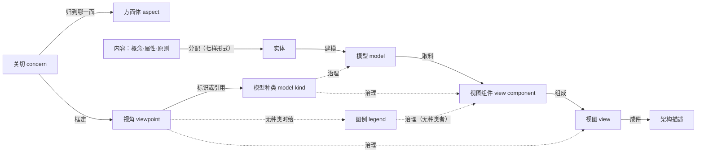
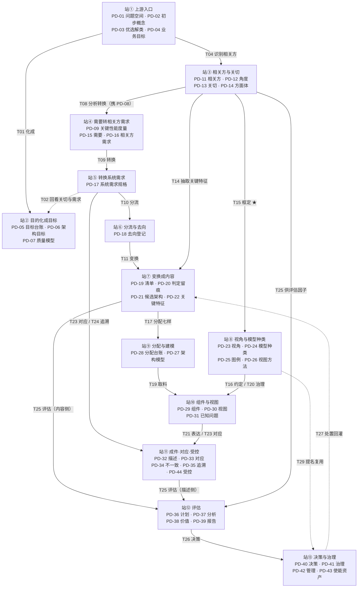
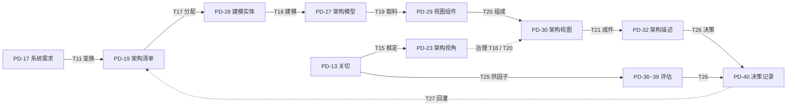

# 架构相关概念与实现过程

**从目的、目标、需求、关切到架构内容、视角、视图、评估、决策**

**研究报告 · 第 46 号**

| 项 | 内容 |
|---|---|
| 编号 | 46 |
| 日期 | 2026-10-31（v4.0） |
| 关键词 | 架构定义；基本；需求变换；架构清单；架构视图；关切；目的；目标；架构评估；架构决策；建模实体 |
| 适用对象 | 架构师、系统工程师、评审与评估组织者、方法论研究者 |

> **落料位**：03-ch11+ch13（备料）｜04（—）

> **依据（判据只取正本）**：**ISO/IEC/IEEE 42010:2022**｜**42020:2019**｜**15288:2023**｜**42030:2019**（库内件为 CSA 2020 采标本，故文件名作 `42030-2020`；**引国际标准一律写 42030:2019**）。本库既有报告（30／35／36／37／42 号）**只作口径互指与取料**，凡结论须回条款重核并标条款号。

> **三条纪律**：① 引用标**四档**——标准逐字／标准可支持的读法／按定义句作的举例／本报告定性；② 另加**性质标记**——同一条原话是**规范**（shall／should）还是**资料性**（NOTE／附录）；③ **号形分家**——凡标准条款一律带标准名（如 42010 §6.7），**裸写的「§x.y」一律指本报告自己的节**。本库读法标〔读法〕，不得写成标准规定。
>
> **号形细则（v3.3 定，2026-10-31 用户令"补齐"）**：① **一个引用组只写一次标准名**，组内各条款以「、」连接、**承该组标准名**（例：`42010 §3.8、§5.2.8、§6.8`）；② **散文里出现的条款引用，一律就近补全标准名**，不得只写 `§x.y`；③ 引用**其他报告**写「NN 号 §x.y」、引用**教材**写「chNN §x.y」——三类前缀互不通用；④ 本报告自引用写「本报告 §x.y」或裸 `§x.y`（与本条 ② 的补全要求不冲突，因为裸写只指本报告）；⑤ **表格例外**——某表的「正本／依据」列若**整列为同一标准**，可在**表下注明一次**，列内只写条款号（本报告已用于 §4.6、§8.1 两表）。

> **版本说明**：v1.x 只覆盖"内容→视图"一段；v2.x 扩为四段一条线。**v3.0 只做重构，不减信息**：合并同题、均衡章长、副题不再占章位、节号与条款号分形；上轮讨论的"次序"一节补入 §10.8。**v3.1 立三级论证体例＋附录 C 结论台账**；**v3.2 补第十一章五个范例**（与结论同权）；**v3.3 补齐号形细则**；**v3.4~v3.6 补收窄链三节**（§1.4 收窄链／§1.4.1 描述是可执行形态／§1.4.2 判据与祝愿），**v3.7~v3.8 续补两节**（§1.4.3 它算不算基本属性／§1.4.4“不够具体”不是判据轴）；**v3.9~v3.35 续补 §4.8~§4.20 与 §11.8~§11.11、§0.6、§0.6.1**；**v3.36 补 §十三 产品数据链**（四十四件数据、二十九条转换、五处不是转换、三张对账单）；**v3.37 把 §13.2 的站间转换改成两幅 Mermaid 图**（十三站主图＋两条路径会合图）；**v3.38 补 §13.2.1 逐站详解**（输入·动作规则·输出·范例·停与错）；**v3.39 把定义与范例收成 §13.3.1 逐件一张表**（PD-01~PD-44 每件给定义与冷链范例，定义只写一份）；**v3.40 补 §13.4.1 T01~T13 逐条**（定义·规则·目的·意义·价值·范例＋"不做会怎样"）；**v3.41 重写 §13.3.1**——四十四件由"四列表"改为**一件一块**（一句话·定义·长什么样·样例·别混）；**v3.42 补 §12.2.2 生词详解**（方面体·位·模型种类·模型·视图组件·视图·视角·图例，各配图、对照表与"三把快手"）；**v3.43 更正 T09 的动词**（"派生"→"转换"，"派生"只留给派生需求）；**v3.44 补 §2.1.1「关键」的判据**（标准只给三个参照物；本报告立"一把尺＋三形态＋两否决"）；**v3.45 补 §10.9.1 决策的对象**（内容项·架构单元·候选架构三分，"方案"不是对象）；**v3.46 补 §4.19.1 实体与 AD 元素的关系**（"出现·实例化"，1:N）；**v3.47 给"实体"定英文与命名纪律**（`role position`，自拟；标准无此词）；**v3.48 补 §4.19.2 实体与模型的关系**（"代表"，1:N）；**v3.49 补 §12.2.3 "实体"与"模型元素"的分工**（交叉不等同；入口词 vs 判据词）；**v3.50 定「实体与关系」与实体的关系**（全集 vs 实体那一半；关系不称实体）；**v3.51 评五个替换候选**（"建模实体"撞名，不建议）；**v3.52 定义"要建模的实体"**（标准清单＋三问判据）；**v3.53 否掉"实体模型"这个候选**（单位≠模型；§3.13 注 4 该词另有所指）；**v3.54 给换词一事的最终裁定**；**v3.55 按用户裁：改用"建模实体"**（正文简称"实体"，旧称"位"作历史留痕）；**v3.56 补附录 D 通俗版**（装修类比走一遍全程，不含判据）；**v4.0 结构重构**（§五→§4.21／§4.22、§九→§0.7、两处挂账合一、新增 §0.8 导读；章号留空缺不复用）。

---

## 摘要

一句话：**架构定义句只发准入证，不发落点证、不发读法证、不发体现证；从需求到决策，每一步都有各自的动词与判据，混用即错。**

1. **内容只有两样**（42010 §3.2）：基本概念或属性＋管控原则。架构可以**关乎五类**（42010 §5.2.2，`can pertain to any or all`）：构成元素／元素之间的交互／与环境（含其他实体）的交互／行为与结构／管设计·使用·运行·演进的原则。**是射程，不是清单。**
2. **五项关系词分三个归属**：comprises／can pertain to／embodied in（本体，末项资料性）／**express（表达）**／**allocate（分配，过程，落点是"要建模的实体与关系"）**。三套数目（两样／五类／七样）交叉不可合并，`principles` 不在分配七样里。**两样＝内容模态，七样＝分配形式词表**：七样是本体与模型语言之间的接口，不增添内容（§4.9）。
3. **内容由需求变换而来**（15288 §6.4.4.1）：变换是**判断**不是推导——同一批输入可生成多个候选、可"尽可能"满足、须记理由。
4. **不是所有需求都要变换，但所有需求都要有去向**：标准三处限量词（key／some·to the extent necessary／limited to those）；**三格分流卡**把"逼出架构决策"换成"现有内容答得出吗"——能→覆盖，不能且该由它答→变换，不该→转交。
5. **"基本"没有判定式**：标准给方向与参照物（42010 §6.2 挂关切；附录 A.2 挂理解与效用／成本／时间／风险），不给阈值与裁定人；**概念、属性、原则用的是三把不同的尺**。
6. **"去掉它还能不能成就目的"不成立**：它把结果当构成、把贡献当必要、把条当类。正确形态是**代价变不变／说法成不成套／违例看不看得出**；"实质"＝**越过一条事前立好的线**或**翻转一个已记录的决策**。
7. **两种成本时间要分开**：42010 附录 A.2 的四量属于"实体在其环境中"，**不含"改架构的工程花费"**；四量**任一实质动即算基本**。
8. **基本与否的权责三分**：相关方**提**、架构师**判**、治理**裁**；沉默方由治理代持；判定须留痕。
9. **清单不等于描述**（42010 §6.7 四项一测）：清单能过 a)、**过不了 b) c) d)**；符合性五处对象全是规格件、没有"架构"（42010 §4）；附录 A.1 把"架构好不好"与"描述全不全"分成两问。**清单是内容的全集，描述是读取的装置。** 视图的判据是**关切**不是清单，故功能·行为·接口·特性属**分配层与视图层**的语言（42020 §10.4.4 e) 七样；清单窄、分配宽、关切更宽，三层各答一问（§4.8）。
10. **深到哪儿停由"架构意图"定**：意图＝下游必须理解、改动即改变架构的那部分**约定与理由**（标准无定义，只在四句短语里出现）；检验是"**换个人来，他还要问你吗**"。
11. **评估＝就"被指明的评估目标"对架构所作的判断**（42030 §3.4）；目的是判定达成目标／应对关切／满足需求到什么程度；意义是把判断做成可核、可追、可比的东西交决策者。**评估不要求成文描述**（42030 §3.2 注 1）。
12. **评估与决策分工**：评估给判断与建议（42020 §9.2），决策给选择与处置（42030 §3.4 注 1）——**评估是决策的依据与回路，不是它的代理人**；**"先清单 → 评估 → 决策 → 后出视图"可行**，但须补一次"关切—内容覆盖对账"（§10.8）。
13. **七个范例各示范一段**（§十一）：一条需求散成四样（断电保温 72h）／功能分解表的**行**怎么生成（F1~F5，以 F2 走六步）／追溯视图从一页规格到四行数据（箱号四道＋一圈之外＋三问反向验）／一张功能视图的三个组件怎么切（C1~C3 与八步、C2 那一刀切在哪）／差分卡的三个走法（覆盖·变换·转交各一例）／**一个模型上的七样分配**（功能实体·信息实体·接口·关系四个对象，各承接哪几种形式、怎么核）／**模型→组件→视图的取料链**（谁从哪儿取、谁治理、进哪张视图；"不是切分"五条证据）。**范例与结论同权：不看范例，前述各条都只是字面。**
14. **收窄不是加禁令，是改分类**（§1.4~§1.4.4）：收窄设计空间的是**内容**，描述只是它的**可执行形态**（可核化），视图是它的**分片入口**（可查化）；**规范效力在内容，证据效力在描述**。判据的界在**能不能指认违例**——指认得出是判据，指认不出是方向（"要高内聚低耦合"属后者，须补边界对象·可数指标·违例形态三样才成判据）。**它也因此还不是"基本属性"**：基本性按**条目**判，标题不入分类（§1.4.3）；而它判不下来的原因**不是"不够具体"**——具体度既非必要也非充分，写厚仍不可判、太具体则成设计（§1.4.4）。**视图也不画它收窄出来的"设计空间"**：设计空间是收窄的效果、不是描述的对象，视图给的是收窄的**凭据**（落点·承诺·边界与偏离），不是它的画像（§4.10）。**而内容分配到建模实体之后，展示的是"条目"不是"空间"**：分配把收窄变成一组可核命题，可拿去判具体做法；但部分性·极性·合成性三处缺口，加一次建模实体到下游系统元素的转译，使它不等于收窄全集（§4.11）。
15. **这条链上四十四件产品数据、二十九条转换关系**（§十三）：**产出件与登记件必须分开**——产出件回答"有什么"（视角·模型·视图·描述·评估报告），登记件回答"这两件之间成立不成立"（去向登记·对应关系·追溯矩阵·已知问题·已知不一致）；**只收产出件，空位与越界永远查不出来**（§13.1.1）。每一步都是"进件→动作→出件→判据→留痕"（§13.2），每件都有条款与栏数（§13.3、§13.6），五处看着像转换其实不是（§13.5）：关切≠需求、目的≠视图判据、清单≠视图、建模实体≠系统元素、评估≠决策。**看懂这条链，就是看懂这四十几件东西谁交给谁。**
16. **入门另有一份通俗版**（附录 D）：用装修类比把十一个概念对位，五幕十五步走完冷链全程，**不引条款、不含判据**；新手四错与起步三件各列一页。

---

## 零 总纲

### 0.1 十节点主线

| # | 节点 | 它是什么 | 到下一步的动词 | 条款 |
|---|---|---|---|---|
| 1 | **目的** | 实体为什么存在——标准里以三种化身出现：业务／使命目标、预期用途、问题或机会 | 化成目标与需求 | 15288 §6.4.1、§6.4.2、§6.4.4.1 |
| 2 | **目标** | 可判的准则（到不到、好不好） | 导出需求；也直接进评估 | 42020 §9.1；42030 §1 f) |
| 3 | **需求** | 可测量，**不宜暗示实现**（42020 §10.4.2 一带用的是 *should not*，非"禁止"） | **变换**为内容 | 15288 §6.4.3.1 |
| 4 | **关切** | 相关方"对其而言重要或相关的事项"（可主观、可冲突） | **框定**视角；供评估因子 | 42010 §3.10、§6.6；42030 |
| 5 | **架构清单**（内容） | 概念或属性＋管控原则 | **分配**到建模实体 | 42010 §3.2；42020 §10.4.4 e) |
| 6 | **实体**（模型单位：实体与关系） | 离散单实体及其相互性 | **组成**组件 | 42020 §10.4.4 b)、d)；42010 §5.2.8 |
| 7 | **视角** | 一组惯例（怎么造、怎么读） | **框定**关切、**治理**视图 | 42010 §3.8、§6.6、§6.7 |
| 8 | **视图** | 描述里的信息部件 | 被评估、被签收 | 42010 §3.7、§6.7 |
| 9 | **评估** | 就**被指明的评估目标**所作的判断 | 交决策者 | 42030 §3.4 |
| 10 | **决策** | 一组选择，并承担处置 | 改内容／改架构，**记理由** | 42010 §6.10；42030 §3.4 注 1 |

**题名与主线的关系**：题名九项（目的、目标、需求、关切、**架构内容**、视角、视图、评估、决策）；主线十节点——多出的一个节点是把"架构内容"展开成**清单**与**实体**两步。**题名到"内容"，主线到"实体"。**

### 0.2 两个入口、三条回路

```
目的 ─→ 目标 ─→ 需求 ──变换──→ 清单 ──分配──→ 实体 ──组成──→ 视图 ──→ 评估 ──→ 决策
                                                              ↑                │
关切 ───────────框定──────────→ 视角 ──────────────────────────┘                │
  └───────────────────────────供评估因子───────────────────────────────────────┘
                                                   决策 ──改内容／改架构──→ 回到清单
```

**两个入口**：**需求**走内容路径（变换→清单→实体→组件）；**关切**走表达路径（框定→视角→视图）。**两条路在视图处会合，不在清单处会合**——这是全报告最容易画错的一处。

**三条回路**：

| 回路 | 依据 |
|---|---|
| ① 评估 → 决策 → 改内容／改架构 → 再评估 | 42020 §9.4.10 的迭代条款；42010 §6.7 注 2（未决问题引出待做的决策） |
| ② 设计回灌 | 15288 §5.9 末段；42020 §5.6（约束需求常由下游过程发现，资料性） |
| ③ 关切再识别 | 42010 附录 A.3：*Some stakeholders are often not known until creation of some architecture views… When these views are shown to potential stakeholders, then they can likely reveal to us the concerns they may have*（中译：有些相关方常要等某些视图作出来才为人所知；把这些视图给潜在相关方看，他们才可能说出自己的关切）——**先出视图、后收关切**是标准承认的正序之一 |

**两处最常被压成一步的地方**（压了必错）：**关切 ≠ 需求**（前者可主观、可冲突、可无对应需求）；**目的 ≠ 评估目标**（前者给方向，后者给尺子）。

### 0.3 四张底牌

**① 一条总判法**：**定义句只发准入证。** 准入即"什么算架构"——概念或属性＋管控原则（42010 §3.2，逐字·规范）。其余各证各有发证者：落点证在 42020 §10.4.4 e)；读法证在 42010 §3.8、§5.2.8、§6.8；覆盖证在 §6.6、§6.7；深浅证在预期用途（42020 §5.6）；表现证在模型种类或图例；填人证在设计定义过程（15288 §6.4.5.3 b) 2)）。

**② 五项关系词**：

| # | 关系词 | 出处 | 性质 | 对象 | 归属 |
|---|---|---|---|---|---|
| 1 | **comprises**（构成） | 42010 **§3.2**（定义句）＋42020 §3.3；注：**§5.2.2 首句只给"概念或属性"，原则不在该句**，原则在 §5.2.2 是以五类之 5 出现的 | 定义 | 基本概念或属性（＋原则，据定义句） | 本体 |
| 2 | **can pertain to**（可以关乎） | 42010 §5.2.2 列表 | 概念陈述 | 五类 | 本体 |
| 3 | **embodied in**（体现于） | 42020 §3.3 注 1，**资料性** | 惯例说明 | 组件／组件间关系／与环境关系 | 本体（资料性） |
| 4 | **express**（表达） | 42010 §3.3、§5.2.2 | 定义＋义务 | 架构 → 描述／视图 | 表达 |
| 5 | **allocate**（分配） | 42020 §10.4.4 e) | **过程任务** | 内容 → 要建模的实体与关系 | 过程 |

两条纪律：① 不得把同一段里的两个并列谓语称作"层"；② 不得把过程任务与本体关系并列为"层"。

**③ 三套数目，交叉不可合并**：

| 套 | 内容 | 轴 | 常被误当成 |
|---|---|---|---|
| **两样** | 概念或属性／管控原则 | 内容种类（模态） | "架构的全部内容清单" |
| **五类** | 元素·元素间·与环境·行为与结构·原则 | 关乎对象（射程） | "架构必须有的五个部分" |
| **七样** | 概念·属性·特征·行为·功能·特性·约束（分配词表） | 分配项 | "架构的七种内容" |

`behaviour` 同时在五类之 4 与七样之中；`principles` 只在两样与五类之 5，**不在七样里**（由 42020 §10.4.4 f) 单列识别，不分配到元素）。

**④ 关乎五类逐条**：

| # | 原文 | 中译 | 包含什么 |
|---|---|---|---|
| 1 | *constituent elements* | 构成元素 | 由哪些东西构成——但**不是实物清单**：模型元素可以是组织、活动、角色、能力、节点、链路、数据元素、协议（42020 §10.4.4 b) 注 1） |
| 2 | *interactions or interrelationships among its elements* | 元素之间的交互或相互性 | 谁与谁相接、按什么相接、依赖与约束——落到描述上主要是**接口与关系** |
| 3 | *interactions … with its environment, including with other entities in that environment* | 与环境的交互，含与环境中的其他实体 | 外部系统、监管机构、供电与场地、上下游——**环境是具体的别人，不是抽象背景** |
| 4 | *behaviour and structure* | 行为与结构 | 两样并列，**且行为写在结构前面**：行为不是结构的附属 |
| 5 | *principles governing its design, use, operation and evolution* | 管控其设计·使用·运行·演进的原则 | **四个动词＝四个射程**；原则不只管"怎么造" |

**三处常见误读**：把"可以关乎"当"必须包含"；把"构成元素"当系统元素清单（15288 §5.9 末段：两种不同的概念）；把"XX 架构"当另一种架构（42030 §3.1 注 5：安全、功能、物理、韧性架构是**关注面的命名**）。**第五项与前四项的关系**〔读法〕：前四类由概念或属性断言，第五类本身就是原则的射程。

### 0.4 六处定界速查

本报告最初就是从六处"推不过去"的接缝长出来的。**六张单子，一处一句**——它们是全报告的地图：

| # | 接缝 | 一句结论 | 落在 |
|---|---|---|---|
| 一 | 清单 ↔ 视图 | 两根轴：内容类别 vs 关切；**清单是内容的全集，视图是读取的装置** | §四 |
| 二 | 定义句 → 视图 | **推不出**：定义句里没有关切，也没有人；视图是**规范义务**，不是定义推论 | §4.21 |
| 三 | 关切 → 基本 | 关切是**识别实体与授权来源**，**不是判据**；尺子是理解（概念）、贡献（属性）、管控（原则） | §三 |
| 四 | 定义句 → 体现 | 42020 §3.3 注 1 是**资料性注 ＋ usually intended**，强读不成立；只剩"体检提示" | §4.22 |
| 五 | 清单 → 系统元素 | 分配到的是**模型层**"要建模的实体与关系"；四层两道界，中间还过设计定义 | §六 |
| 六 | 视角规格 → 具体元素 | 规格只给种类与约定；元素靠**视图方法点名＋模型种类语法＋对应方法**生成 | §七、§八 |

**这六处共用一个病理**：拿"关于这个实体说了什么"的定义句，去担保**落在哪、谁读、怎么算基本、怎么体现、怎么实现**。**六张单子合起来，就是 §0.3 那条总判法的六次应用。**

#### 0.4.1 为什么说它们是"同一个病理"〔论证〕

**结论**：六处不是六个错误，是同一个错误在六个位置上的复发。

**依据**：六处的两端分别是——（一）清单（内容类别）与视图（关切）；（二）定义句与视图；（三）关切与"基本"；（四）定义句与"体现"；（五）内容与系统元素；（六）视角规格与具体元素。

**推理**（三条判据，逐处验过）：

| 判据 | 含义 | 命中的处 |
|---|---|---|
| **跨轴** | 两端按不同原则排序或分域，一端的结论不携带另一端的信息 | 一（类别轴 vs 关切轴）、三（授权轴 vs 计量轴） |
| **跨层** | 两端分处描述／模型／设计／实现四层中的不同层 | 五（内容→模型 vs 系统元素）、六（规格 vs 元素）、二（定义 vs 表达） |
| **跨身份** | 一端是"关于实体的说法"，另一端是"这些说法的落点或读法" | 四（内容 vs 存在方式）、全部六处 |

三条里命中任意一条，就足以让"从 A 推出 B"失效；六处分别命中一至三条。

**反证**：若六处真属同一病理，则**修法应当同形**——事实正是如此：每处的修法都是"**指出 B 另有发证者，并给出发证条款**"（第一处给 §6.7 的四项；第二处给 §6.6、§6.7 的 shall；第三处给附录 A.2 的理解与贡献；第四处给 §10.4.4 e) 的分配；第五处给 15288 §5.9 的"两种概念"；第六处给 §5.2.9、§8.3 的引入路径）。**六处修法同形，是同一病理的最强证据。**

**边界**：这条"同一病理"的判断**不主张六处在内容上等价**——每处的对象、条款与后果都不同，只是**推理失效的形式相同**。所以本报告的六节仍要各写各的，不能合并成一节了事。

### 0.5 本报告的论证体例与结论台账

**一条规矩**：本报告不再"挑着论证"。**凡结论，一律进附录 C 的结论台账，按同一标准分三级；A 级必须四段齐全，缺一段即视为未论证。**

| 级 | 什么结论归此级 | 必须给什么 |
|---|---|---|
| **A 级（承重／反直觉）** | 与通行说法相反、或全报告靠它承重的结论（如"基本无判定式""视图不是细化""分配不落系统元素"） | **四段齐全**：依据（逐条引条款）｜推理（可逐句反驳）｜反证（结论不成立会出什么事，或对立说法撞上哪条原文）｜边界（不覆盖什么） |
| **B 级（条款直引可支持）** | 把条款逐字转成中文即成立的结论 | **条款直引＋性质标记**；不必写推理（推理就是翻译，重复无益），但**须给出条款位置** |
| **C 级（本报告读法／方法）** | 标准无原话、由本报告归拢或操作的结论（如"三栏台账""差分卡""实质＝越线或改选"） | **标〔读法〕＋所读的条款＋边界**；不得写成标准规定 |

**为什么"一视同仁"不等于"条条写长"**：若每条都铺四段，A 级的论证反而被稀释——读者分不出哪里是承重墙。**一视同仁的实质是"同一本账、同一个标准、每一格都填得出凭什么"**，而不是"每格一样厚"。

**台账怎么用**：查一条结论凭什么，去附录 C 找到它，看"档位／依据／论证位置"三格。若某条标 A 而论证位置写"待补"，说明它还没达到本报告的发布标准——那一条就挂在 §12.3 的补录清单里，**不装作已经论证过**。

### 0.6 走一遍：从目的到视图的十二步（冷链全程）

前五节是地图与规矩；这一节是**沿路走一遍**。用冷链贯穿（同 §十一），每步给"做什么／判据／本例"。

| # | 做什么 | 判据（不合即停） | 冷链本例 |
|---|---|---|---|
| 1 | **写清目的** | 答得出"系统不存在，谁的什么状况不会改善" | 让生鲜在全程不断链的前提下运出去，出事能自证 |
| 2 | **目的化成目标** | 每个目标都能进评估（到不到、好不好）：**指标＋期望水平＋判定时机**（范例见 §0.6.1） | G1 发现时延期望 ≤30 s／最差 60 s｜G2 可追溯率 ≥99.5%｜G3 误报率 ≤2%｜G4 换承运方 ≤3 人日 |
| 3 | **目标化成需求** | 可测量，且**不宜暗示实现**（*should not*） | 断电保温 ≥72 h｜判定延迟 ≤30 s｜箱号全程可追 |
| 4 | **同时收关切** | 有名单、有事由；**关切不进需求那条路** | 货主（别断链·能索赔）｜承运方（不被绑死）｜监管（留存·不可篡改）｜运维（升级不破坏） |
| 5 | **需求过三格卡** | 每条都必须有去向（覆盖／变换／转交） | 保温 ≥72 h →①变换｜"唯一权威源"→②覆盖｜上岗培训 →③转交 |
| 6 | **生成架构清单** | 只落两样：**概念或属性＋管控原则**；每条过三把尺 | 概念"断链判定"｜属性"保温余量 ≥72 h""≤30 s""箱号唯一不复用"｜原则"唯一权威源·箱号不随承运方变·原始读数只追加" |
| 7 | **设计视角** | 写得出"允许哪些构造＋记号＋边界＋这张图答哪几问" | 功能视角（要做什么）｜信息视角（谁记什么）｜接口视角（谁对谁承诺什么） |
| 8 | **内容落位** | 每个实体填得出**对象·形式（七样）·怎么核**（§11.8） | "保温余量 ≥72 h"挂到**保温功能实体**，形式＝*properties*，附取值与判定条件 |
| 9 | **模型→组件→视图** | 每个组件讲得出"从哪份模型取什么料、谁治理"（§11.9）；模型要有**元素表＋关系表**（范例见 §0.6.1） | M1 功能分解（F1~F5＋R-a~R-c）／M2 功能流（S1~S4）→ C1 表·C2 流图·C3 叙述 → 功能视图；C1 另进接口视图 |
| 10 | **四问验身份** | 在描述里／受视角治理／组件标种类或图例／**体现检验** | 前三问过而第四问不过＝一张图；四问全过才叫架构视图 |
| 11 | **拿它判一次** | 判得出"成立／出局"；判不出则缺口在部分性·极性·合成性之一 | 拿功能视图判"缺一条读数要不要立刻报警"——判得出 |
| 12 | **四张对账单** | 关切↔内容、内容↔视图、视图↔内容反向、需求↔去向，各一张 | 监管"不可篡改"若无人在答＝空位；视图里出现清单没有的硬件名＝越界 |

**三条最容易走错的岔路**：

| 岔路 | 走上去会怎样 | 正路 |
|---|---|---|
| **把关切当需求用** | 为"某某很在意"造出一条不该有的属性，清单虚胖 | 关切的去处是**视角与评估**，不是清单（§0.2、§9.2） |
| **把清单当全集** | 硬要视图把清单画全，画到型号材料，滑成设计 | 视图可只覆盖一部分，原则可整块不入视图（§1.4.1、§4.11） |
| **先画图再补模型** | 组件标不出模型种类，那张图拿不到"视图"身份 | 可以先把关切与视角写出来，**不能先画图再倒推模型**（§4.13、§11.9） |

**一句**：**目的化成目标与需求，需求经三格进清单，关切分组定视角，清单落实体成模型，模型按关切取料成组件，组件排成视图，视图再回头对四张账。**

**这一条链上每一步交出哪一件东西、交给谁、记在哪，见 §十三**——四十四件产品数据、二十九条转换关系、五处"看着像转换其实不是"的接缝、三张按编号查的对账单。

#### 0.6.1 补两处范例：目标怎么写、模型长什么样

十二步里第 2 步与第 9 步最容易被写成"名目"。两处各补一组范例。

**一、目标：写成"可判的达成线"**

目标三件套——**指标｜期望水平（含方向与范围）｜判定时机**。缺任何一件，目标就进不了评估（42020 §9.1；42030 §1 f)）。

| # | 目标（示例） | 指标 | 期望水平 | 判定时机 | 同题需求 |
|---|---|---|---|---|---|
| **G1** | 断链一发生就发现 | 发现时延（超限起到出结论） | 期望 **≤30 s**，最差 60 s | 每批次运行统计（P95） | R1 判定延迟 ≤30 s |
| **G2** | 全程可追溯 | 可追溯率（记录链完整的箱次占比） | **≥99.5%** | 月度抽样＋每次异常复盘 | R2 箱号全程可追 |
| **G3** | 误报不扰民 | 误报率（误警／总告警） | **≤2%** | 月度 | **无** |
| **G4** | 换承运方不推倒重来 | 适配改动量（人日） | **≤3 人日** | 每次换承运方 | R3 箱号不随承运方变 |

**四条读法**：

1. **目标与需求可以同题，角色不同**：G1 与 R1 度量的是同一件事——**目标是"期望到什么水平"（进评估，出达成度），需求是"必须满足"（进验证，出达标与否）**。同题不是重复，是两个用途。
2. **目标可以没有对应需求**（G3）：这时它只进评估，不产生约束。**别为了"每条目标都要有条需求"硬造一条。**
3. **定性目标必须先转尺度**："客户满意"无法判；"货主索赔时能自证的箱次占比 ≥99.5%"能判。
4. **期望水平容许区间与方向**：目标不必是单点值（"期望 30 s／最差 60 s"）；**单点值是需求的做法**。

**二、模型：两张表合起来就是一份模型**

**M1 功能分解模型**（受模型种类「功能分解」治理）——元素表：

| 元素 | 构造（种类给的） | 输入 → 输出 | 条件 |
|---|---|---|---|
| F1 温度采集 | 活动 | 探头信号 → 温度读数（带时基） | 采样周期〈待定〉 |
| F2 断链判定 | 活动 | 读数序列 → 断链结论＋证据指针 | 超限持续 ≥30 s |
| F3 本地告警 | 活动 | 结论 → 声光／屏显 | 判定为断链 |
| F4 上报与归档 | 活动 | 结论＋读数 → 云端记录 | 联网／离线分路 |
| F5 审计导出 | 活动 | 归档 → 可导出档案 | 按批次 |

关系表：

| 关系 | 构造 | 起点 | 终点 | 说明 |
|---|---|---|---|---|
| R-a | 分解 | 冷链监控系统 | F1~F5 | 五者都是这个系统的功能 |
| R-b | 流 | F1 | F2 | 读数序列 |
| R-c | 触发 | F2 | F3 | 判定 → 告警 |

**M2 功能流模型**（受模型种类「功能流」治理）——元素是**流本身**，不是功能：

| 流 | 源 | 汇 | 携带什么 | 条件 |
|---|---|---|---|---|
| S1 | F1 | F2 | 温度读数序列 | 采样周期到 |
| S2 | F2 | F3 | 断链结论 | 判定为断链 |
| S3 | F2 | F4 | 结论＋证据 | 每次判定 |
| S4（**不进功能视图**） | F4 | F2 | 补录数据 | 恢复后回补（留给异常处置视图） |

**三条"模型长什么样"的判据**：

1. **列由种类给，行由内容与信息来源给**：M1 那三列（构造／输入输出／条件）是「功能分解」这个种类规定的**语法**；行里的"超限持续 ≥30 s"是属性分配下来的**取值**——这正是 §4.13 那句"**种类给语法，模型给取值**"的具体样子。
2. **元素与关系都要建**：只有元素表没有关系表，那是一张清单，不是模型；R-b／R-c、S1~S3 才是能在视图里连起来的东西。
3. **模型里可以有"还没定"**：F1 的"采样周期〈待定〉"是**合法的模型内容**——它进"已知问题"（42010 §6.7 d)），不是被删掉。

**对上 §11.9**：C1 取 M1 的元素与分解关系，C2 取 M2 的流、节点名复用 M1 的 F 编号，S4 因为不在功能视图的关切之内而没被取——**取料表里那一行"没进任何组件"，指的就是 S4**。

---

### 0.7 四个词：需求·关切·目的·目标

#### 0.7.1 各在哪一侧

| 词 | 属于 | 它的作用 | 条款 |
|---|---|---|---|
| **需求** | 需求侧（输入） | 被变换为内容；被分配到元素；被追溯 | 15288 §6.4.3、§6.4.4.1／42020 §10.4.5 d) |
| **关切** | 相关方侧 | 定范围、定覆盖、供评估因子、做对账 | 42010 §6.2、§6.6、§6.7；42030 因子段 |
| **目的**（purpose） | **描述与视图侧** | 定这份描述／这张视图的**用途** | 42010 §5.2.2；§3.8 注 2；42020 §10.4.3 e) |
| **目标**（objectives） | 可判的准则 | 判"到没到" | 42030 §1 f)；42020 §9.1 |

**关键**：**"目的"在本报告所引的 AD 类条款里几乎不指实体本身**，而指描述、视图、评估工作的用途。所以"架构承接目的"在变换句里没有位置（输入清单里没有 purpose）。**但"目的"有两义，别读成一处矛盾**（§12.2 术语表"目的"一行）：**实体之意**（实体为何存在；15288 §6.4.1、§6.4.2 的业务与使命目标、预期用途）与**作品之意**（这份描述／这张视图／这次评估拿它做什么；42010 §3.8 注 2；42020 §10.4.3 e)）。30 号、24 号全篇用的是**实体之意**，没有用错词——**用错的是把实体之意拿去当"基本"的判定式**（§3.3）。

#### 0.7.2 关切怎么用：六处

① 识别（42010 §6.2、§6.4；**相关方与关切之间是多对多**——42010 **§6.4 注 1（NOTE，资料性）** 逐字：*In general, the association of concerns with stakeholders is many-to-many*，中译：一般情况下，关切与相关方的关联是多对多的）｜② 框定（§6.6）｜③ 应对（§6.7，组件须应对其视角框定的**全部**关切）｜④ 取舍（42020 §10.4.4 b)／d)）｜⑤ 评估因子来源（42030）｜⑥ 对账（42010 **§5.2.11 EXAMPLE 1**：视图内元素 ↔ 它所应对的关切）。

**两条出口**：关切 → 经需求开发变**内容**（15288 §6.4.2→§6.4.3）；关切 → 经视角变**视图**（42010 §6.6）。**关切不判"哪条需求要变换"**。

#### 0.7.3 目的与目标都不是视图的判据

视图的义务是"**应对其视角框定的全部关切**"（42010 §6.7 c)），**不是"回应目的"**；目的定的是这份描述／这张视图**拿它做什么**（42020 §10.4.3 e)）；目标只在**评估**里当尺子（42030 §1 f)）。**把目的塞进视图判据，会把"分片"错成"成败"。**

#### 0.7.4 为什么目的与目标都不是视图的判据〔论证〕

**结论**：视图的合格判据是"应对其视角框定的全部关切"；目的与目标只分别在**描述用途**与**评估**两处当尺。

**依据**：42010 §6.7 c) 逐字——组件须 *address all of the **concerns** framed by its governing architecture viewpoint*（**宾语是关切，不是目的**）；`purpose` 在 42010 里出现在 §5.2.2（每份描述 *created for **a purpose***）与 §3.8 注 2（相对"**描述的目的**"）；目标（objectives）只出现在评估侧（42030 §1 f)；42020 §9.1）。

**推理**：① **判合格看义务条款的宾语**——42010 §6.7 的四项没有一项提到 purpose；② 目的在标准里是**用途**：它决定"写来给谁干什么"，从而决定深浅（42020 §10.4.3 e)），但"打算拿它做什么"不能判定"做成了没有"；③ **架构本身没有"目标达成度"**——那是评估这一动作才产生的量。

**反证**：若以目的为视图的合格判据，则同一份视图在"目的表述不同"的两处（采购评审 vs 运维审计）会有两种合格结论——**视图将无法签收**。而标准的做法恰是把读法写死（§6.7、§5.2.8），使合格性不依赖目的表述。

**边界**：不否认目的的重要——它是评估的参照之一（42030 §1 b)、d)），也是描述用途的来源。**只是它不是视图的判据。**

#### 0.7.5 一条链条

```
关切 ─┬→ 需求 ──变换──→ 内容（概念/属性/原则） ──分配──→ 实体（模型实体与关系） ──组成──→ 视图组件
      └→ 视角 ──────────── 框定 ─────────────────────────────────────────────→ 视图
目的 ──→ 定描述与视图的用途；目标 ──→ 评估时定尺子
```

---

### 0.8 怎么读这份报告

报告已到十四节规模，别从头读到尾。按你的目的挑一条路：

| 你的目的 | 读哪几处 | 读到哪算懂 |
|---|---|---|
| **先有画面**（没做过、术语太多） | **附录 D 通俗版** → §0.1~0.3 → §十一 范例 | 能用自己的话把"关切→需求→内容→模型→视图→描述"讲一遍，不用术语 |
| **要落地做一遍** | **§十三 产品数据链**（44 件＋29 条转换）→ §七 实体的生成 → §八 组件的生成 → 附录 B 判定卡片 | 能对自己的项目填出三样：谁在意什么／到什么算成／这一页给谁看答哪几问 |
| **要判、要引条款** | §一~§四（判据与定界）→ §0.7（四个词）→ §十（评估）→ 附录 C 结论台账 | 每条结论说得出依据、反证与边界 |

**一份报告的四个层次**：**概念层**（一~四、六~八：内容·视图·层与实体）｜**产品数据层**（十三：每一步交出什么、怎么变）｜**判据层**（十二、附录 B/C：怎么判、凭什么）｜**入门层**（附录 D：先看懂）。

**两处章号空缺**：**§五** 与 **§九** 已分别并入 **§4.21／§4.22** 与 **§0.7**——本库纪律"**只增号、不回头改号**"，故原章题保留为占位、编号不复用，以免全库错引。

**两个读法提醒**：① 裸写 `§x.y` 一律指本报告自己的节；标准条款一律带标准名（如 42020 §10.4.4）；② 凡标〔读法〕的是本报告的操作化，**不能当标准条文引用**。

## 一 内容从需求来：变换

### 1.1 输入清单

15288 §6.4.4.1（逐字·规范）：

> *This process **transforms** related architectures …, organizational and project policies and directives, life cycle concepts and constraints, stakeholder concerns and requirements, and system requirements and constraints **into the fundamental concepts and properties** of the system and **the governing principles** for evolution of the system and its related life cycle processes.*

（中译：本过程把相关架构、组织和项目方针与指令、生存周期概念与约束、相关方关切与需求、系统需求与约束，**变换为**该系统的基本概念或属性，以及……管控原则。）

**三点观察**：① 输入多样，输出只有两样；② "目的"**不在输入清单里**；③ 动词是 transforms，不是 select／filter。

### 1.2 "变换"是判断，不是推导

| 证 | 原话 | 排除了什么 |
|---|---|---|
| **多解** | *generate system architecture **alternatives**, select one or more…*（15288 §6.4.4.1） | 排除"演绎"——同一组前提只能得一个结论 |
| **不必全满足** | *satisfy, **as far as possible***（同节） | 排除"必真"——可能做不到位，须回头改需求 |
| **须记理由** | 42010 §6.10：*rationale expresses why decisions have been chosen* | 排除"机械换算"——推导不需要理由，判断才需要 |

**推论**：需求与内容对应 **N:M**；变换**不可逆**（从架构反读不出原始需求集合），故追溯必须双向（15288 注 23）。

### 1.3 三道动作

| 动作 | 做什么 | 冷链例 |
|---|---|---|
| **区分化** | 把一句要求变成几个必须被承认的类别 | "全程可追溯" → 必须承认"批次标识／事件／记录／承运方变更" |
| **约束化** | 把它变成对实现的**约束**（属性或原则），不是实现方案 | "≥72h" → 属性"保温余量 ≥72h"；"升级不得破坏已出厂" → 原则 |
| **落位化** | 把内容挂到**单位**上，否则它没有成立之处 | "持续 ≥30 s 才算断链" → 分配到"断链判定"这个功能实体 |

### 1.4 收窄链：内容怎么收窄设计空间〔论证 · A 级〕

**结论**：**收窄设计空间的是内容（概念·属性·原则），不是描述或视图；描述与视图的作用是让这次收窄生效。**

**依据**：42020 §E.2.1（资料性）：架构作为约束，*The constraint is on the **design space available to the design definition process***（约束施加于**可供设计定义过程使用的设计空间**）；同节给出五类正当理由，并说 *Architectures as constraint are limited by the **counterbalancing desire to maximize the available design space***（受“最大化可用设计空间”这一对冲愿望的限制）；15288 §5.9：有效架构*as **design-agnostic** as possible*；42020 §5.6：有效架构使设计权衡空间具有最大灵活性。

**推理**（收窄的机制＝**改分类**，不是加禁令）：

| 内容 | 判定机制 | 排除方式 |
|---|---|---|
| **概念**（这个实体算哪一类） | **分类判定** | **异类的做法自己就不在这个集合里**——无需谁去禁止 |
| **属性**（必须具有什么） | **度量判定** | 兑现不了这些性质的实现出局 |
| **原则**（允许怎么造、怎么变） | **合规判定** | 一类实现被**事前**挡住 |

三条共有的性质是它为什么能收窄：**不需执行**（在下游动手前就生效）、**可事前判**（候选不必造出来就能判）、**可逐条核**（每条收窄指得到具体内容与违例）。

**与需求对照**：需求也“可判”，但判的是“达标不达标”——**判的宾语不是“做法”**，所以一个做法再达标，只要不是“这个实体该有的样子”，需求就排不掉它。**这是架构能收窄而需求不能的原因。**

**怎么做到（四个必要条件）**：

| 条件 | 不满足会怎样 |
|---|---|
| ① **内容可判** | 概念说不出“去掉它还是不是它”、属性无取值域、原则无违例情形 → **不是判据，是方向**：方向仍有用（生成候选、框定关切），但不排除任何做法（三档与改造见 §1.4.2） |
| ② **有落点** | 内容不落到元素与接口上 → 下游不知道落在自己哪一处（42020 §10.4.4 e) 的分配即为此） |
| ③ **读法写死** | 视角约定与模型种类不定死 → 各人各读，“同一条收窄”变成不同禁令（42010 §6.7、§5.2.8） |
| ④ **留缺口** | 每条锁到底 → 收窄成唯一实现，失去替代与演进（§E.2.1 第 2、3、5 条理由） |

**反证（两个方向都能证）**：**若不收窄**——设计空间里“技术上可能的”全都成立，下游没有参照，选择退化为个人偏好，不一致直到集成才暴露；**若收窄过头**——某一实现被锁死，架构降级成设计，替代被提前砍掉，演进时只能推倒。“两个方向都错”正说明收窄的性质：**它把可行集从“技术上可能”改成“与这个实体相容”，不是越多越好、也不是越少越好。**

#### 1.4.1 描述是收窄的“可执行形态”，不是收窄本身

| 层 | 是什么 | 在收窄里扮演什么 |
|---|---|---|
| **内容**（概念·属性·原则） | 收窄的**本体** | 定“哪些做法成立” |
| **描述** | 收窄的**可执行形态** | 让它可判、可核、可交接、可签收 |
| **视图** | 收窄的**分片入口** | 让每条问“在哪一页查” |

**描述比“记录”多做了四件事**（42010 §6.7 b)c)、§6.8、§6.9、§6.7 d)）：**视角归属与覆盖声明**（没有 → 不知管哪一块）、**记号与语义写死**（没有 → 十人十读）、**对应关系与一致性**（没有 → 分片互相矛盾查不出）、**已知问题**（没有 → 未决与偏离被隐去）。**这四件不是“记得更细”，是“让收窄可核”。**

**但描述的效力是证据，不是规范**：合规判定的宾语是**架构**，不是描述——42020 §9.3 d) 明说评估的是架构，描述*可作为获取架构信息的依据，但不是唯一方式*；描述的定实体是举证与交接（42010 §3.14 信息体可交付、§6.1 须有标识与预期用途）。一句记法：**规范效力在内容，证据效力在描述。**

**三条限定**：① **描述不新增收窄**——写得更细不等于收得更窄，写到型号／材料就滑成设计；② **描述可有多份、视图可只覆盖一部分**（42010 §5.2.2、§6.7 注 3），原则可整块不入任何视图（§6.7 EXAMPLE 2）但须仍在描述内；③ **没有描述，收窄仍在，只是不可交接**（§4.21.1 的第一、二跳）。

**一句**：**内容是收窄，描述是收窄的可核化，视图是收窄的可查化。**
**边界**：本节不主张“所有内容都收窄”——只有**可判且有落点**的内容才收窄；原则可整块留在视图外而不失其约束力（42010 §6.7 EXAMPLE 2），但它仍在**描述**之内，否则仍只是某个人脑子里的规矩。

#### 1.4.2 判据与祝愿：一句原则什么时候才算收窄

**结论**：**原则收窄与否，不看它说得对不对、重不重要，看它能不能指认违例。指认得出违例的是判据；指认不出的是方向——方向有用，但不收窄。**

**依据**：42020 §10.2 d)（*Architecture views and models are adequately expressed to capture the principles and precepts of the architecture that guide development and evolution of the entity being architected*／架构视图与模型须被充分表达，以捕获**指导被架构事物开发与演进**的架构原则与准则）；42020 §10.4.4 h)（*Compose views from the models … to express **how** the architecture addresses … architecture principles and precepts*／按已识别视角从模型组成视图，表达架构**如何**应对相关方关切、架构原则与准则、架构目标）；42020 §10.2 c)（概念与属性须被*accurately and completely expressed*／准确完整表达，到预期使用所需程度）。

**推理**：标准要的不是“把原则写下来”，是让视图与模型表达出**如何**应对它。*how … addresses* 预设了一个可回答的问句——**哪一处满足了它、哪一处没满足它**。三档由此分开：

| 档 | 判据长什么样 | 举例 | 收窄落在谁身上 |
|---|---|---|---|
| **可判** | 能点出**具体做法**违例 | “模块之间只经已声明的接口通信；任一模块不得直接访问另一模块的持久化存储” | 落在**内容**上——换谁读都排掉同一批做法 |
| **半可判** | 要约定尺度与行家眼力才判得出 | “以业务能力为模块边界” | 落在**人**上——人一换、尺度一松，收窄就没了 |
| **不可判** | 无指标、无违例形态，任何方案都可自称满足 | “要高内聚、低耦合” | 落在**语气**上——名义收窄，实际不收窄 |

**检验法一句话**：**这句话能把哪个具体做法排除出去？说得出来是判据，说不出来是祝愿。** “高内聚低耦合”答不出这一问：它不指认任何做法，只表态赞成某类结果；两个人对同一份设计可以一个说它高内聚、一个说它低耦合，两句都不构成对事实的断言，谁也不比谁更对。**这不是它说得不明确，是它没有可判的宾语。**

**改造成判据，补三样**（不是删掉它，是让它落地）：

| 补什么 | “低耦合”的补法 |
|---|---|
| **边界对象**——哪两个单位之间 | “模块之间”（不写“系统内部”——后者无处查） |
| **可数指标**——数得出来的量 | 跨模块调用只落在接口清单内；共享持久化存储的模块对数＝0 |
| **违例形态**——出现即违例的做法 | “任一模块出现对另一模块存储的直连读写” |

补完就变成 42020 §10.4.4 e) 的**分配**对象（挂到具体实体与接口上），可以进视图去数、进评审去指。**祝愿不是被否掉，是被翻译。**

**反证（两个方向）**：**若把“高内聚低耦合”算作收窄**——任何架构都天然满足它（每份设计都能自称），评审指不出违例，不一致只能等集成才暴露，正是 §1.4 反证里“不收窄”那一侧的后果；**若反过来要求每条原则都量化到单一阈值**——收窄过头，替代被提前砍掉，滑成设计，违 §1.4 条件④“留缺口”。两侧都错，恰说明要的既不是更严也不是更宽，是**可指认**。

**边界**：三档不是优劣排序，是**分工说明**。不可判的话在架构工作里仍有两处正当用处——**生成**（把人往某个方向推，产出候选）与**框定**（让相关方先说清自己在意什么，42010 §6.4 要求描述识别相关且相符的关切）；它只是不承担**判据**这一职。**与 §3 同一病理**：§3 里“重要”被误当成“基本”，此处“方向”被误当成“收窄”——两次都是把有价值的说法提到它撑不住的职位上。

**一句**：**收窄的最小单实体不是一句话，是一句能指认违例的话。**

#### 1.4.3 它算不算“基本属性”

**先分形**：内容只有两样（42010 §3.2）。这句话的形态是祈使——管做法，是**原则**；它的题名（内聚、耦合）是**属性名**。所以它是“**以属性为对象的一句原则**”，不是一条属性：属性要能填值，原则管“允许怎么造”。

**再分对象**：42010 附录 A.2 说基本的是 *those elements of an entity of interest that contribute to its **utility, cost, time and risk within its environment***（那些贡献**实体在其环境中的**效用、成本、时间与风险的元素），以及 *what is **fundamental or essential to the understanding***（对理解而言基本或本质的部分，该句明列 *overarching principles or patterns*／统领性原则或模式）；这些句子的主语是 **elements、properties、principles**——**都是条目，不是标题**。**故基本性逐条判，不整句判。**

**这句现在两头都不够格**：作为属性缺取值域（耦合度填什么？），作为原则缺违例形态（§1.4.2）。于是它**落在分类之外**——不是“非基本属性”，是**还没过入场**。〔读法〕两件事不是一个动作：**“非基本”是拿尺子量过、结论为否；“不成立为内容”是连量的动作都做不成。** 混为一谈会把“判输了”记成“判过了、只是次要”，下次它还挂上台账。

**若强行按属性写**（“跨模块调用不得越出接口清单；共享持久化存储的模块对数＝0”）：这时才轮到 A.2 的四量。**此处有个顺手的错**——“低耦合所以好维护、改动便宜”是**改架构的工程花费**，属本报告 §3.6 分开的第二种成本时间，**不在 A.2 的四量里**；拿它去论证基本，是用错尺子还说赢了。要论基本，得说清它动了**实体在其环境中的**效用／成本／时间／风险中的哪一个，或它对**理解**不可省。

**拆开之后才有答案，且各条不一样**：同一句“低耦合”落地成三条，可能一条基本（数据权威源唯一——动了运行的可靠性与一致性成本）、两条只是惯例（模块间日志格式统一）。**所以“高内聚低耦合是基本属性吗”没有整体答案，只有逐条的答案。**

**第三种错位**：它更常以**关切**的样子出现（可维护性、可演化性）。关切不判基本（§3.10.1），别把关切名当属性名。

**常见误诊**：把它判不下来的原因归为“**不够具体**”。这是把**落实体不足**看成了**详细度不足**——治法完全不同（§1.4.4）。

**一句**：**基本性不是形容词，是判决；判决落在条目上，而“高内聚低耦合”是一个标题，不是一个条目。**

#### 1.4.4 “不够具体”不是判据轴

**结论**：这类话过不了入场，根子在**没有判据**，不在**不够具体**。具体度**既非必要条件也非充分条件**——写得更细不产生判据，写到实现则滑成设计。

**依据**：本报告 §1.4 条件②（有落点）、条件④（留缺口）；§1.4.1 限定①（描述写细不新增收窄）；42020 §10.4.4 首段（模型与视图 *should be limited to those that adequately address the specified concerns*／宜限于足以应对所指定关切者）。

**推理（三则反例，各自堵一条路）**：

| 反例 | 事实 | 说明 |
|---|---|---|
| **写厚仍不可判** | “模块间尽量少互相调用、接口尽量少而清晰、每个模块只做一件事” | 比原句具体得多，**仍指不出违例**——它加的是**形容词**，不是判据三样 |
| **抽象仍可判** | “每个数据项只有一个权威写入点” | 不与任何技术绑死，却是数得出来的：写入点＝1 |
| **太具体则出局** | “用 Kafka 做事件总线”（Kafka） | 极其具体，但它是**设计决定**：锁死实现、砍掉替代，违条件④ |

**两端都出局，理由不同**：**不够具体** → 判不出违例，**过不了入场**；**太具体** → 过了入场但**判为设计，不是架构属性**。中间那一窄条不由“具体度”划界，由**可指认＋留出替代**划界。

**反证**：若诊断真在“不够具体”，加细就该解决；但顺着加细只有两条路——**加形容词**（越写越漂亮，仍指不出违例）或**加实现**（越写越像设计），**两条都通向既有的错处**，说明诊断本身错了。再换一侧证：若“具体”是判据，那么“每个数据项单一权威写入点”这样抽象的条目就该判不下来——而它恰恰最容易判。

**边界**：本条不否定“更具体”的用处——**落位**（条件②）本身就是一次具体化，把“低耦合”具体到“哪两个模块、哪几个接口”。**要害不是细，是细到能指认**：停在“哪两个单位之间”，不停在“用什么技术”。

**一句**：**判据靠“改种类”得来，不靠“加详细”得来。**

---

## 二 哪些需求要变换：三格分流卡

### 2.1 三处限量词

| 出处 | 原话 | 限掉了什么 |
|---|---|---|
| 15288 §6.4.4.2 e) | *traceability … to **key architecturally-relevant** … requirements* | 与架构元素挂钩的是**关键**那批 |
| 15288 §6.4.5.3 注 4 | ***Some** … often allocated … **to the extent necessary*** | 只分配**一部分**，且到必要程度为止 |
| 42020 §10.4.4 开篇 | 模型与视图 *should be **limited to those** that adequately address the specified concerns…* | 建模与描述也够用即止 |

#### 2.1.1 "关键"的判据〔论证 · A 级〕

**结论**：标准**不给**"关键"的判据，只给三个参照物（与架构相关／对架构决策显著／架构上重要）。可操作的判据由此自建〔读法〕：**改了它，架构会不会变**；会变，且能指到"**新立·改动·新实体**"三种形态之一，才算关键。

**依据**（三处都无定义条目、无阈值、无裁定人）：

| 出处 | 逐字（中译） | 它把"关键"挂在什么上 |
|---|---|---|
| 15288 §6.4.4.2 e) | 系统架构元素对**关键的、与架构相关的**利益相关方需求与系统需求的追溯性得以建立 | 与架构元素有追溯关系的那批 |
| 15288 §6.4.4.2 c)、§6.4.4.3 b) 6) | 对系统**架构决策而言显著的**概念、属性、特征、行为、功能或约束，被分配到架构实体 | 对决策显著（同一把尺，用在内容侧） |
| 42010 §6.10.1 决策选取准则第 1 项 | 涉及**架构上重要的**要求的（决策） | 架构上重要 |

**推理**：

1. 三句话把"关键"挂在**同一个东西**上——**架构决策**：与它相关、对它显著、为它值得记录。
2. 故"关键"**不是需求的固有属性**，而是这份架构与这条需求之间的**关系**：换一份架构（换层、换范围），同一条需求可能就不关键。
3. 于是判据只能问"**它会不会引出或约束一个架构决策**"，不能问"这条重不重要"——后者是优先级，不是分流。
4. 但"会不会引出决策"本身会循环（§2.3 已指出），所以要落到**能指认的形态**：**A 新立一条内容**（清单里没有）／**B 改一条已有内容的取值·范围·边界**／**C 逼出一个新的建模实体、接口实体或外部实体**。三形态任一成立即可判定，且判完能写进 PD-18 的"理由"栏——**判据要能写成一句话，否则又是印象**。
5. 与"基本"的分工：**关键判"要不要变换"，基本判"变出来的那条算不算架构内容"**——两道门，先后不同（同 §4.12 的"两道门"）。

**反证**：

- **用"优先级高"当判据**：优先级由相关方给、可主观（42010 §5.2.4："关切常带主观性"）。高优先级里会塞满"只改界面文案"的需求，而"低优先级但逼出新接口"的需求被漏掉——**清单虚胖与真空位同时出现**。
- **用"相关方说它重要"当判据**：等于把分流权交给最会说话的一方，治理失去仲裁实体（§3.7 的权责三分：相关方**提**、架构师**判**、治理**裁**）。
- **指望标准给判据**：则 §6.4.4.2 e) 与 c) 只能拿 `key`、`significant` 两个没有定义的词自证，逻辑空转。
- **反过来的错**：把"实现难"当关键。难实现但不动架构的需求（如"培训要跟上"），仍不是关键——它该转交。

**边界**：

1. 判据**不判价值高低**——关键 ≠ 重要 ≠ 优先，它只回答"要不要变换"；
2. 只对**这份架构**成立：系统层的"关键"，到子系统层要重判；
3. 判不出来的，按**非关键**处理并写理由，**不许写"待定"**（与 §3.8 的留痕纪律一致）；
4. 判据**不含"实现难度"与"成本"**——那是评估与决策的事，不是分流的门。

**操作卡（可直接抄）**：

```
【这一步的"关键"怎么判】
一问：改了它，架构会不会变？——指"要不要新立／改动概念·属性·原则，或动某个建模实体"
  三个形态任一成立 → 关键（走 ① 变换）
    A 新立一条内容（清单里没有）
    B 改一条已有内容的取值／范围／边界
    C 逼出一个新的建模实体、接口实体或外部实体
  都不成立 → ② 覆盖（指到具体条号）或 ③ 转交（写交谁＋一句理由）
二否：需求本身写着实现（"用某技术"）→ 不是关键需求，是设计约束 → 转交设计并降为约束
三否：与另一条需求冲突且无仲裁口径 → 先交治理裁，不替它拍板
四记：结论写进 PD-18 的"理由"栏——动了哪一条／为什么不动
```

**一句**：**"关键"不问你有多重要，只问"动了它，这套架构要不要跟着动"。**

### 2.2 变换与去向要分开

**变换**（需求→内容）：**挑**，只做关键的那批。**去向**（这条需求落在哪、由谁承接）：**全**，一条都不能消失。

15288 注 23 要求系统需求与架构元素之间保持双向追溯（全覆盖）；§6.4.4.2 e) 又说追溯对象是 key。**解法**：追溯记录覆盖全部，架构定义过程的"成果申报"只针对关键那批。

### 2.3 差分卡

"会逼出架构决策"循环难落地（要先定义架构决策）。**破法是差分**：

```
这条需求 → 用现有概念／属性／原则答得出吗？
  能     → ② 覆盖：写"由第 K 条 / 第 X 条覆盖"
  不能   → 该由它们回答吗？
             该    → ① 变换：写"新立／改动 概念·属性·原则 第 K 条"
             不该  → ③ 转交：写"交 <过程名>，理由 <一句>"
自检：改了这条需求，架构会变吗？会 → 必须能指到具体那一条内容
```

它比"重要／不重要"硬，因为产物是一句可核的话（动哪一条、转给谁）。**定"动哪一样"的五个分箱**：类别／边界→**概念**；构成性→**属性**；许可→**原则**；环境给定→**约束**；都不沾→**转交**。

### 2.4 批量分流（实务建议，非标准条文）

15288 §6.4.3.2 b) 把系统需求分为功能、性能、过程、质量、接口五类＋设计约束。批量默认去向如下——**本表是本报告实务建议，标准只给类别不给默认路由**：

| 需求类 | 默认去向 | 需单条判的例外 |
|---|---|---|
| 功能 | ②／①：多落已有功能实体 | 引入新类别、新边界、新外部关系 → ① |
| 性能 | ①：落已有属性**填值** | 逼出新属性（如"时基一致性"） |
| 过程 | ③：多转运行／保障／管理 | 涉"允许怎么造"→ 原则 |
| 质量 | ①：属性或原则 | 与已有属性语义不同则另立 |
| 接口 | ②：落接口实体（一条承诺） | 逼出新接口实体或新外部实体 |
| 设计约束 | ①：多为原则 | — |

### 2.5 敏感性一击

问：**"改了这条需求，架构会跟着改吗？"** 会 → 必是①，且要能指到具体那一条内容；不会 → 不在这里。依据：42010 §6.10.1 选"要记录的决策"时列有"**对变更高度敏感**""**改动代价大**"两项。

### 2.6 留痕：去向登记四列

**需求号｜去向类别（变换／覆盖／转交）｜落点（哪条内容／哪个实体／哪个过程）｜理由（③必填）**。缺后两列，就等于这条需求消失。

---

## 三 "基本"的判据

### 3.1 标准给的三处，全是方向

| 出处 | 给了什么 |
|---|---|
| 42010 §3.2／42020 §3.3／15288 §3.5 | *fundamental concepts or properties…*——**只给形容词，无参照物** |
| 42010 §6.2 | 识别"其**关切**被认为**对架构是基本的**"相关方——**参照物＝关切**；"被认为"的主语**不写** |
| 42010 附录 A.2（**资料性**） | ① *fundamental or essential to the **understanding***；② *elements … that **contribute to its utility, cost, time and risk within its environment*** |
| 42020 §3.3 注 1 | *usually intended to be **embodied in*** 组件／组件间关系／与环境关系（**资料性**） |

#### 3.1.1 为什么说"标准没给判定式"〔论证〕

**结论**：三份正本的定义句都不给"基本"的判定式；而且修饰不同名词时，判据不同质。

**依据**：三份定义句均以 *fundamental concepts or properties* 起首、**无相对从句**（42010 §3.2／42020 §3.3／15288 §3.5）；42010 §6.2 只写 *considered fundamental*，**不写由谁 considered**；42010 附录 A.2 把两句分列——"对**理解**是基本的"与"**贡献于**效用·成本·时间·风险的要素"；引言说架构"通过**概念**、属性与原则被理解"，定义句说"**管控**（governing）原则"。

**推理**：① **该写而不写，只能读成"有意留给判断"**——42010 对需要判据的地方写得极细（§6.7 的覆盖、§6.4 的识别、§8.1 的七项），唯独"基本"只给形容词；② 三个名词的语义角色不同：概念是"用什么说"、属性是"它有什么"、原则是"不许怎样"——**同一条尺不可能同时量这三件事**，A.2 分列两句正是把这个区别写出来了。

**反证**：设存在统一判定式（例如"去掉它目的不成"）。它在**概念**上立即失效：去掉一个用于共同陈述的区分，目的未必落空（换个词照样谈），但**这个实体就说不成一套了**。一条尺子在九处给出错答案，与"标准要对一切使用者成立"的体例相悖。

**边界**：本节只否认"标准给了判定式"，**不否认工程上可以有**——§3.2 的三把尺就是补法〔读法〕。

### 3.2 三把不同的尺

| 对象 | "基本"的依据 | 条款方向 |
|---|---|---|
| **概念** | **理解上的不可省**：没有它，这个实体就说不成一套 | 引言的"通过概念被理解"；附录 A.2 的 *fundamental or essential to the understanding*；定义句 `concepts **or** properties` |
| **属性** | **对实体在其环境中效用／成本／时间／风险的实质贡献** | 附录 A.2 |
| **原则** | **管控力**：管得住实现与演化 | `governing principles for the realization and evolution` |

**三把尺不可互换**：拿"去掉它目的不成"裁概念＝把概念当属性；拿"有没有约束力"裁概念＝把它当原则。

**尺子量的是条目，不是标题**：附录 A.2 的被判对象是 *elements、properties、principles* 一类**条目**；一句口号式标题（如"要高内聚低耦合"）先得成为可填值或可指违例的条目，才轮得到这三把尺（§1.4.3）。

### 3.3 "去掉它还能不能成就目的"为什么不成立

| 错 | 说明 |
|---|---|
| **把结果当构成** | 目的成不成就取决于实现、验证、运行与外部条件；架构阶段判不了 |
| **把贡献当必要** | 附录 A.2 说 contribute，不说 necessary：去掉后目的或仍勉强成就，但代价、时间或风险实质变差——**仍是基本** |
| **把条当类** | 现实常见"必须有一条，但不必是这一条"；逐条判会把冗余两条都判掉 |

**正确形态（三句）**：概念——去掉它，"这个实体是什么"的说法还成不成套？相关方能共同陈述吗？属性——去掉它，实体在其环境中的效用／成本／时间／风险会不会**实质改变**？原则——去掉它，某种实现或演化会不会变成被允许的？违规看不看得出（42020 §10.2 d)）？

### 3.4 "实质"＝越线或改选

| 形态 | 判法 |
|---|---|
| **越线** | 变化是否使既有阈值／限值／准则的判定翻转。**线须事前立**——但须照实标性质：42030 §4.2 **注 3（NOTE，资料性）** 的原话是 *Pass/fail criteria **could need to be** established prior to performing the evaluation*（中译：可能需要在实施评估之前建立合格／不合格准则）——**是"可能需要"的指南，不是 shall／should 的义务**。工程上仍应事前立线，理由在"事后设线必向着结论靠"（本报告定性），不在标准命令 |
| **改选** | 变化是否使某个已记录的决策或"架构上重要的需求"的取舍翻转（42010 §6.10.1；15288 §6.4.4.2 c)） |

**两者都不成立＝微动，不算实质。** 立线次序：法定／合同限值 → 目标与关键成功准则 → 需求值 → 量级估计并留痕（这一档必须写下数或区间，且请相关方确认）。

**判定要写成一个可核的句子**：

> 去掉【这条属性】→ 在【环境条件】下，【效用／成本／时间／风险】从【有它时】变为【去掉后】；故判【基本／非基本】，理由【一句】。

例：*去掉"偏差 ≤±0.5℃"→ 在疫苗运输（2~8℃ 与 −20℃ 两区间）环境下，效用从"到站活性 ≥95%〈示意〉"变为"失活率不可控"，并连带成本与召回风险上升；判为基本。* **写成"影响很大"就等于没说。**

### 3.5 四个量：部分动即算

附录 A.2 的四量是**四条贡献通道**，不是四个合取条件。**任一实质动即判基本**——否则只动风险或时间的属性会被大面积误判：

| 属性 | 只动哪个量 | 若按"四个都动" | 实际 |
|---|---|---|---|
| 审计记录保留 10 年 | 风险（合规、追溯） | 判非基本 | **基本** |
| 断链告警 ≤30 秒 | 时间＋风险 | 判非基本 | **基本** |
| 物料复用率 | 成本 | 判非基本 | **基本** |
| 温控偏差 ≤±0.5℃ | 四量全动 | 基本 | 基本（构成性，理由最硬） |

**这不是等级表**：标准只有一个 `fundamental`，动几个只影响理由的分量与写法。

### 3.6 两种"成本／时间"必须分清

| 种 | 指什么 | 判别力 |
|---|---|---|
| **变更代价** | 改这条内容所花：改文档、重验证、返工 | **对所有条目都成立 → 不算判据** |
| **实体在其环境中的代价与时间** | 去掉后，实体在运行与使用中多付的成本、延迟、周期 | **只对基本条目成立 → 有判别力** |

附录 A.2 的主语写明了：*contribute to **its** utility, cost, time and risk **within its environment***——四量属于**实体在其环境中**，不属于"做架构这件事"。同理"时间"两义：架构工作进度（项目侧，不属 A.2）与实体响应／周期（运行侧，属 A.2）。判"动"要有线（预算容差、工期节点、量级差）；立不出线，这两个量只作备注。经验上"基本"的判断绝大多数落在**效用与风险**上。

### 3.7 谁定：相关方提、架构师判、治理裁

| 动作 | 谁做 | 产出 |
|---|---|---|
| **提** | 相关方（含架构师；附录 A.3：*Stakeholders, **including the architect** … hold these concerns*） | 关切台账：谁在意什么；本属性对应哪条关切 |
| **判** | 架构师／架构团队 | 贡献分析：动哪个量、往哪动、越没越线 |
| **裁** | 治理／有权的那一处 | 裁定记录：结论、理由、裁定人、日期（治理侧的条款落点：42020 §6.4.4 d)~f) 任务、§6.5 工作产品；机制见 40 号 **§二~§三**——§二 制度系统，§三 动作清单） |

**三点补充**：① **裁定不是共识投票**——关切常带主观性且可互相冲突（42010 §5.2.4），冲突需要仲裁动作；② **法定与环境硬条件不可被否掉**——相关方可确认、解释，但不能判它"不基本"；③ **判定必须留痕**，否则事后无法复核。

**两种失效与挡法**：**把重要当基本**（挡：必须附贡献分析，不接受"很重要"）；**沉默方缺席**（挡：每类属性点名可能沉默的持有者；无代表的由治理**代持**并记录）。

### 3.8 留痕表

| 属性 | 对应关切（持有者） | 贡献分析（量／线） | 裁定 | 裁定人·日期 |
|---|---|---|---|---|
| 偏差 ≤±0.5℃ | 到站活性（客户）／批次有效（监管·沉默） | 效用断崖＋成本与召回风险；越"活性 ≥95%"〈示意〉 | 基本 | 〈治理〉·〈日期〉 |
| 外壳白色 | 工艺（产线） | 温升约 0.1℃〈示意〉，不越 ±0.5℃ 容差 | 非基本；另立"辐射反射率" | 同上 |
| 审计留存 10 年 | 可追溯（监管·沉默，治理代持） | 风险：不达法定最低期限 | 基本 | 同上 |
| 合同状态单源 | 对账（财务）／可追（审计） | 四量全动 | 基本；改造成本另列工程决策 | 同上 |

### 3.9 标准不给的三样

**阈值、裁定人、公式**。理由：跨实体、跨行业时任何固定判据都会在多数场合给出错答案。所以"基本"的判定永远是**判断**——标准只保证这件判断有参照物、有方向、有落点、要留理由（42010 §6.10）。

### 3.10 关切不是"基本"的判据

顺带把一处极易走反的地方说死：**42010 §6.2 那句"其关切被认为对架构是基本的"，给的是"识别实体与合法性来源"，不是属性清单的判定式。**

| 问 | 尺子 | 落点 |
|---|---|---|
| 属性／原则是否基本 | **目的必要性不可用**（见 3.3）；用贡献分析（3.2／3.4） | 清单 |
| 关切是否"基本" | **标准连"由谁裁定"都不写** | 识别与授权 |

**为什么关切不能当尺**：关切互相冲突（42010 §5.2.4 明说其"常带主观性"），而治理存在的理由恰是仲裁冲突——**用冲突的一方当尺，尺子就随人变。** 所以关切的正确用法是**提**（谁在意什么），不是**裁**（算不算基本）。

#### 3.10.1 四步论证〔论证〕

**步一，关切之间会冲突，且冲突不可由关切自身消解。** 事实依据：42010 §5.2.4 明说关切*are often subjective in nature*；同节又说相关方常因角色、经验、信念而**成组**（stakeholder perspective），组与组之间对同一件事的要紧程度可以相反。**冲突是常态，不是例外。**

**步二，用其中一方当尺，尺就随人变。** 这是纯逻辑：设尺为"关切 K"，则 K 的持有者变了、K 的权重变了，同一批内容的基本性判定就跟着变。**判定不可复核 = 判定不成立**（而 42010 §6.10 要求决策留理由，恰恰是为了可复核）。

**步三，故须有一把高于个体关切的参照。** 这一步标准自己是这么处理的：§6.2 只写"**被认为**是基本的"（*considered fundamental*），**不写由谁认为**——把"高于个体的裁定"留给组织与治理。这不是标准偷懒，是它承认"这一处只能是治理裁量"。

**步四，工程上可操作的替代参照是"目的与贡献"。** 把"多方认为基本"换成"去掉它，该实体的说法还成不成套／效用与风险会不会实质变"，好处是**可核、可争、可追**；代价是**裁定权从"关切的多方"移向"目的的解释者"**。这是本报告的补法（〔读法〕），不是标准规定。

**反证**：若真能以某一方关切为尺，则"成本 vs 安全"这类冲突将永远判不出结论——两方各自裁出相反的清单，且都"有据"。**这就是治理必须存在的技术理由。**

**边界**：本节不否认关切的作用——它是**范围与覆盖**的坐标（§9.2），也是**评估因子的来源**（42030）。它只是**不能当基本性的判据**。

---

## 四 从内容到视图

### 4.1 两根正交的轴

| 件 | 按什么排 | 它保证什么 |
|---|---|---|
| **架构清单**（概念·属性·原则） | 按**内容类别** | **内容一条不少** |
| **架构视图** | 按**关切** | **每条问有页可答，且读得一样** |

依据：42010 §3.7（视图＝信息部件，逐字·规范）；42020 §10.4.4 e)（分配到元素与关系）。

#### 4.1.1 为什么是"两根正交的轴"〔论证〕

**结论**：清单与视图不是同一件东西的粗细两版，而是**同一批内容的两种排法**，两种排法互不决定。说"正交"，要证明三件事：

**第一步，两种排法各自可独立完成。**
给定同一组内容：**按类别排**不必知道任何人关心什么——只要知道这条是概念、那条是属性、那条是规矩（42010 §3.2 的三样）；**按关切排**不必改变内容——只是把同一条内容放到"谁要判什么"的实体置上（42020 §10.4.4 e) 的分配）。**两种排法都不需要对方先完成**，这是正交的第一要件。

**第二步，两种排法互不携带信息。**
排好类别，推不出"谁要判、在哪一页答"——这是清单的结构性缺口（42010 §6.7 四项里的 b)、c)）；排好关切，推不出"内容一条不少"——因为视图可只覆盖实体的**一部分**、可含**非基本**内容、原则还可整块留在视图外（42010 §6.7 注 3 与 EXAMPLE 2）。**两边都推不出对方，是正交的第二要件。**

**第三步，两者各有独立的完备判据。**
清单的完备＝"这条内容有登记、有落点"；视图的完备＝"每条被框定的关切至少被一张视图应对、且组件应对其视角框定的全部关切"（42010 §6.7 c)）。**两个判据用不同的量、查不同的东西**，是正交的第三要件。

**反证**：若两者不是正交而是同一件东西的两版，则必然出现"一版的完备蕴含另一版的完备"——事实恰恰相反：**一份内容齐备的清单，可以一张合格视图都没有；一套视图齐备的描述，可以漏掉一整类内容**（因为视图不承诺覆盖全部内容）。两种失配都能发生，说明它们不是一段粗细，而是两根轴。

**边界**：正交**不等于互不相干**——它们共用同一批内容（交叠），并由描述负责装订（§4.2）。"正交"说的是**排序原则与完备判据不同**，不是说两者各说各话。

### 4.2 三句分工

**清单管"一条不少"，视图管"一问一答"，描述管"签收与对账"。** 第三句依据：可交付的是描述（42010 §3.3；**§3.14 信息部件** *information part* ＝为供人和机器使用而生成、存储与**交付**的可单独识别的信息体），描述须带标识与预期用途（42010 §6.1）。**注意译名**：`information part`＝**信息部件**（42010）；15289 的 `information item`＝**信息项**，是另一词，不可混。

### 4.3 两处收窄

**收窄一：视图与清单不是"同一批字"，是"交叠"。** 清单那批按**三把尺**裁（§3.2，基本才算数）；视图那批按**预期用途**裁（42020 §5.6），且可含**非基本内容**与**表达层构造**（元素、接口、记号由视角与模型种类引入，42010 §5.2.9）。

**收窄二：落点三处，有一处不落元素。** 组件自身／两组件之间／**一圈之外**（环境条件）；原则还可整体留在视图外（42010 §6.7 EXAMPLE 2）。

### 4.4 形态可重合，身份由装置判

多数视图表现为表格而非图。但**形态重合≠身份相同**：挂了视角约定、记号定死、有覆盖声明的表，就是视图最常见的形态。判身份看前**三件装置**（42010 §6.7、§6.8）：**在描述里吗／受某视角治理吗／组件标明模型种类或给了图例吗**；但**三件装置全过仍不够**——还须过**第四问（体现检验）**（§4.6）：它里头有没有东西体现着这个实体的概念、属性，或它与环境的关系。**三件过、第四问不过 → 那是一张图。**

### 4.5 清单不等于描述：四项一测

42010 §6.7 要求每张视图包含或引用四样。拿一份写尽写清的三张清单去测：

| 项 | 要求 | 清单能不能满足 |
|---|---|---|
| a) | 标识与补充信息 | **能**（文件属性，加抬头即可） |
| b) | **治理它的架构视角的标识** | **不能**：清单无"这一部分归哪个视角管"这一栏 |
| c) | **视图组件**应对其视角框定的全部关切、并**覆盖**实体部分或全部 | **不能**：清单无"关切—组件"映射，也无覆盖声明 |
| d) | **已知问题**记录（未决、风险、例外、偏离） | **不能**：清单语法里没有"这一处还没定""这一处偏离了模型种类" |

**过一项，挂三项**——后三项全属"读的人怎么分、怎么判、对不上时查什么"，**不是"内容写没写清"**。

另有两处佐证：**符合性只能对件声明**（42010 §4 的五处对象全是规格件：描述／框架／语言／视角／模型种类，**没有一处是"架构"**）；**两问分开**（附录 A.1 逐字：判定"由一份合格描述所描述的那个架构"的质量与判定"描述本身"的质量是两件事）。

**一句**：**清单是内容的全集，描述是读取的装置；全集不等于装置。** 描述的身份来自**角色**（被评估的基据、设计的对照、可声明符合的东西），不来自**文体**（写得多清楚）。

**一个思想实验**：把清单改造到能过 b、c、d——给每条标视角、按关切重排并声明覆盖、标定记号并单列已知问题——**它就成了视图**（42010 §6.8）。

### 4.6 为什么它还叫"架构视图"

`architecture view` 是**属格**：`view **of** an architecture`，不是"带有架构风味的视图"。而且这个属格**隔着一层**：架构 →（**由**）描述表达（42010 §3.3）→ 视图是**描述的一部分**（42010 §3.7）。**严格叫法是"架构描述里的视图"，名字省掉了"描述"两字。**

判"是不是架构视图"要**四问**：

| # | 问 | 依据 |
|---|---|---|
| 1 | 它在一份**描述**里吗 | 42010 §6.7 首句 |
| 2 | 它受**某个视角**治理吗 | §6.7 |
| 3 | 它的组件标明**模型种类**、或给了**图例**吗 | §6.8 |
| 4 | **它里头有没有东西，体现着这个实体的概念、属性，或它与环境的关系** | §3.3 的 express；§6.7 c) 的"覆盖" |

> **号形说明**：本表「依据」列各条款号均为 **42010:2022** 条款，故列内只写 `§x.y`。

**三问过、四问不过 → 那是一张图**；**四问都过 → 才叫架构视图**。前三问判"是不是视图"，第四问判"是不是**这个架构的**视图"。

### 4.7 视图不是清单的细化

| 读法 | 细化指什么 | 成立吗 |
|---|---|---|
| **过程读** | 细化过程（elaboration）：识别元素与关系、分配内容、识别原则、造模型（42020 §10.4.4） | **不成立**：细化发生在内容侧，视图是这条链的**表达产物** |
| **关系读** | *refinement*：对应关系的类型之一（42010 §3.11 EXAMPLE） | **不成立**：对应关系参与方须为 AD 元素（42010 §6.9.2），清单不在 42010 §3.4 注 1 的 11 类里 |

**一句记住：视图不是内容更细，是读法更死。** 细化是**深度轴**（42020 §8.4.8 只要求写到 *suitable for its intended users*）；视图买的是**读法轴**。**双向反证**：若视图是细化，"把清单写细"就该能替代它（答不出"哪一页负责答"）；若视图是细化，它就该覆盖清单全部（实际可只覆盖一部分）。**一处局部要认**：某条内容在某张视图上被具体化是真的，但逐条、局部，且受预期用途封顶。

### 4.8 视图为什么还要回应功能、行为、接口、特性

**结论**：因为**清单窄、分配宽、关切更宽**，三层各答一问。功能、行为、接口、特性属**分配层与视图层**的语言，不是清单层的漏项。

**依据**：42020 §10.4.4 e)（*Allocate relevant **concepts, properties, characteristics, behaviors, functions, features or constraints** to the entities and relationships to be modeled*／把相关概念、属性、特征、行为、功能、特性或约束分配到要建模的实体与关系上）——**分配的对象本就是七样，比清单的两样宽**；42020 §10.4.4 a)（*For each viewpoint, define the architectural context and boundaries **in terms of interfaces and interactions** with external entities*／每个视角以**接口与交互**界定架构上下文与边界）——接口是**框定视角边界**的语言；42020 §10.4.4 b) 注 1（模型元素明列 *interfaces*／接口、数据元素、层、协议、能力、活动等）；42010 §6.7 c)（每条视图**须应对**描述中已识别的关切）——**视图的判据是关切，不是清单**；42010 §3.3 的 `express`（表达）：视图表达内容，不是复述内容。

**推理（三层各答一问）**：

| 层 | 它回答什么 | 用的语言 | 条款 |
|---|---|---|---|
| **清单**（两样） | 这条算不算**这个实体的**架构内容 | 概念／属性／原则 | 42010 §3.2 |
| **分配**（七样） | 这条内容**挂在哪**个实体上的哪种东西 | 功能·行为·特性·特征·约束 | 42020 §10.4.4 e) |
| **视图** | 哪一条**关切**在**哪一页**被应对 | 结构·行为·接口 | 42010 §6.7 c)；42020 §10.4.4 h) |

**所以功能与行为不是清单的补充，是性质的成立之处**：清单说“必须具有什么”（如断电保温 ≥72 h），视图说“它**以什么方式、在哪一处**发生”——保温是行为，判定是功能，通道与门是接口与结构。**不在行为与功能上说，“≥72 h”在架构里无处落脚**，只剩一句愿望。这也正是 §1.4.2 的判据三样为什么必须落到接口上：**没有接口这一层，可数指标没有可数的地方。**

**反证（两侧同时成立）**：**若视图只回应清单**——42010 §6.7 c) 立刻被违：清单位置上根本没有“并发下的响应”“谁能调什么”“断电后怎么恢复”，这些东西只能出现在行为与接口上；**若视图要把系统的功能与行为穷举进去**——越界成设计，违 §1.4 条件④（留缺口）与 42020 §10.4.4 首段（*should be limited to those … that adequately address the specified concerns*／宜限于足以应对所指定关切者）。故正解既不是“回应清单”也不是“回应系统”，是**回应到关切被应对为止**。

**边界（两个词别混）**：42020 §10.4.4 e) 把 *characteristics* 与 *features* **并列为两个词**，中文“特性／特征”极易并成一个。处置：***characteristics*＝可度量的性质面向**（响应时延、容量、功耗，“多大”）；***features*＝可辨识的显著能力**（“支持离线补录”，“有没有”）。两者都可被分配，判定方式不同：前者要**值域**，后者要**存在性**。另一点：视图回应功能与行为，不等于架构变成功能清单——**功能清单是元素目录，视图是读法**（§4.7）。

**一句**：**清单管“算不算”，分配管“挂在哪”，视图管“哪一页答哪一问”——功能、行为、接口属后两层，不是第一层的漏项。**

### 4.9 两样与七样：模态与形式，不是两张内容表

**问题**：既然定义句说架构是“基本概念或属性”＋“管控原则”，为什么分配时要多出功能、行为、特征、特性、约束？

**结论**：因为它们**不与两样并列**。两样是**内容的模态**（这东西算概念、算属性、还是算原则）；七样是**分配时的形式词表**（把这条内容挂到这个实体的哪种形式上）。**同一件事在两个层上有两个名字，不是两件事。**

**依据**：①**定义句是种类陈述，不是内容清单**——42010 附录 A.2 逐字说明该措辞的用意：*The phrase “concepts or properties” is used in the definition of architecture (3.2) **to allow two differing philosophies to use this document without prejudice***（“概念或属性”这一措辞的用意是**让两种不同哲学都能无偏见地使用本文件**），随即点明两种哲学为 *architecture as concept*（架构作为概念）与 *architecture as property*（架构作为属性）。**该措辞是包容性括语，为容纳两派而设，不是项目清单**。②七样由 42020 §10.4.4 e) 给出，是**同一节里“分配”这一动作的宾语**；同节 b) 注 1 说明模型元素是**离散单位**（组织、活动、角色、能力、节点、链路、接口、数据元素、层、协议……）——**形式词表的来源是模型语言，不是架构本体论**。③42010 §5.2.2 的五类是**射程**（*can pertain to*）：构成元素／元素之间／与环境／**行为与结构**／原则——行为与结构在这里是“架构可以关乎什么”，与“内容算哪种模态”是两个轴。

**推理（三层映射）**：

| 两样（模态） | 落到模型上的形式（七样） | 为什么必须换形 |
|---|---|---|
| **概念**——这个实体算哪一类 | *concepts* | 分类要落到单位上才成立（§6.1.1） |
| **属性**——必须具有什么 | *properties*／*characteristics*（可度量，要值域）／*features*（显著能力，要存在性） | 性质在模型上只能以“值”“能力”“行为”的样子出现 |
| **原则**——允许怎么造、怎么变 | *constraints*（及功能与行为里的“应当”部分） | 原则的执行形态就是允许／禁止 |
| （**同一批内容的另一种读法**） | *behaviors*／*functions* | 性质要**发生**才看得见——“保温 ≥72 h”落成“保温”这个行为与“判定”这个功能才有表达式 |

**关键在最后一行**：行为与功能既不是第四种模态，也不是属性的补充，而是**性质被读成“会发生什么”时的语法位置**。所以分配七样并不扩张架构的内容，它做的是**换语言**——把“必须具有什么”换成模型语言里能渲染的槽。

**反证（两侧）**：**若“只有概念与属性就够”**——则 42010 §5.2.2 五类里的“元素之间的交互／与环境的交互／行为与结构”三类全成了某条属性的赘语；但标准把它们与“构成元素”**并列为五类**，说明它们是**被架构关乎的对象**，不是性质的修饰语。**若七样真是七种内容**——则定义句逐字（两样）当即被否，而这句是 42010 §3.2 的正文、[SOURCE] 记其对 42020 的改动只在“删去条内注”。**两侧同时成立，只能因为轴不同**：一个轴问“算什么”，一个轴问“挂成什么形”。

**边界（一处必须让）**：七样是**词表**不是分类法——42020 §10.4.4 e) 用的是 *or*（或），既没要求七样齐全，也没给七样之间的界限。故**机械地把每条内容标成七样之某一是过度形式化**；实务上只要求一句“挂到哪个实体的哪种形式上”说得出来。**真正要判的另一个问题——哪些功能、行为算架构的、哪些只是设计细节——七样答不了，只有两样与三把尺答得了**（§3.2、§6.1.1）：七样说“能挂什么形”，两样说“什么值得挂”。

**一句**：**两样问“算什么”，七样问“挂成什么形”；前者是本体，后者是接口——接口不增添内容。**

### 4.10 视图不画设计空间，只标它的边界

**问题**：视图是不是用来“展示被架构内容收窄之后的设计空间的样子”？

**结论**：**不是。设计空间是收窄的效果，不是描述的对象。** 视图表达的是**架构**，不是下游那个集合；它能让收窄**可查**，但不能把收窄**画成一张空间的图**。

**依据**：①**「设计空间」在四份正本里只出现于一处**——42020 附录 **E.2.1（资料性）**：*The constraint is on the design space available to **the design definition process***（约束施加于可供**设计定义过程**使用的设计空间），同段给五条正当理由，并说架构受 *the counterbalancing desire to maximize the available design space*（最大化可用设计空间这一对冲愿望）的限制。**该处讲的是架构对下游的“作用面”，不是视图的内容。** ②**视图的对象由两个定义锁定**：42010 §3.3（描述是 *work product used to **express** an architecture*／用于**表达架构**的工作产品）与 §3.7（视图是描述里的一部分 *information part*）——**同一个对象，不是下游集合**。③42020 §10.4.4 首段：模型与视图 *should be limited to those … that adequately address the specified concerns*（宜限于足以应对所定关切者）。

**推理（两处错位，各自致命）**：

| 若照这个说法做 | 会发生什么 |
|---|---|
| **对象错位**：把“设计空间”当描述对象 | 这张东西的对象已不是架构，**过不了 §4.6 的四问**（无视角治理、模型种类与内容对应关系都失去所指），它拿不到“架构视图”的身份 |
| **形态错位**：设计空间是**集合**，视图是**读法** | 集合只能靠枚举或划界来“展示”；枚举撞 §10.4.4 首段“够用即止”与 §1.4 条件④“留缺口”——**画得越全，越像设计** |

**更要紧的一层**：**收窄的核心内容是否定性的**——它排除的是做法；而**视图只摆肯定的东西**（这里有哪些元素、它们怎么交互、承诺什么）。**视图画不出不存在的做法。**

**但直觉里对的那一半要认足**：视图确实要让“这里被锁住了什么”看得见。做到这点靠三件，不靠画空间形状：

| 三件 | 在视图里长成什么 | 条款 |
|---|---|---|
| **落点** | 这个实体承担哪条内容（对应关系） | 42010 §6.9 |
| **承诺** | 这个接口答应什么（结构·行为） | 42010 §6.7 b)；42020 §10.4.4 h) |
| **边界与偏离** | 什么算违例；哪些偏离已知、尚未处置 | 42010 §6.7 d) 已知问题 |

**这三件正是 §1.4.2 三样（边界对象·可数指标·违例形态）在描述里的落地形态**——判据进了视图，才从“一句话”变成“一页可查”。

**反证（两条，各自独立）**：**时序**——若视图的职责是“展示收窄结果”，它就不可能晚于内容而存在；而 §10.8 已证“清单→评估→决策→**后出视图**”可行，故视图不是结果的画像。**可判性**——若视图要展示“设计空间的样子”，视图好坏便无从判定（没有人能证明空间画全了）；现口径可判：每条视图**须应对**已识别的关切（42010 §6.7 c)），故可核、可签收。

**边界**：本条不否认视图与收窄的关系——**视图正是收窄的入口**（§1.4.1 的“可查化”）：要问“这条禁则在哪一页查”，只能靠它。**它只是不承担“空间画像”这一职。**

**一句**：**设计空间是收窄的效果，不是描述的对象；视图给得出的是收窄的凭据，不是它的画像。**

### 4.11 分配了内容，展示了收窄的什么

**问题**：视图里的实体与关系被分配到基本概念、基本属性、功能、特征、特性、接口与约束之后，是不是就展示了架构内容对设计空间的收窄结果？

**结论**：**按“条目”义成立，按“空间”义不成立。** 分配把收窄从“一句话”变成**一组可核的命题**（哪一条、以哪种形式、承担哪条内容）；这组命题足以拿去判一个具体做法成立与否——**这就是视图能给的“展示”**。但它不是空间形状，也画不全。

**依据**：42020 §10.4.4 e)（分配的对象是**要建模的实体与关系**，形式为七样）；§10.4.4 b) 注 1（模型元素是**离散单位**）；42010 §6.9（对应关系与一致性）、§6.7 b)c)d)、§5.2.2 与 §6.7 注 3（视图可只覆盖一部分）。

**推理（成立的那一半）**：分配做完之后，每条内容都有了**可指认的落点与形式**——“模块 M3 的接口 I2 承诺的字段集合”是一个命题，能被下游某个做法比对出真假。**命题可判，这就是“展示”的最低含义：能拿来判。**

**三处缺口（哪些收窄没被展示）**：

| 缺口 | 为什么会有 | 后果 |
|---|---|---|
| **部分性** | 视图可只覆盖一部分（42010 §5.2.2、§6.7 注 3）；原则可整块不入任何视图（§6.7 EXAMPLE 2） | 未入视图的内容**照样收窄**（§1.4.1 限定③）——展示的只是被表达的那部分 |
| **极性** | 分配说的是“这一条承担什么”（**肯定**）；收窄问的是“哪种做法出局”（**否定**） | 缺违例形态与已知偏离（§6.7 d)）时，视图只能证明“符合”，不能证明“排除” |
| **合成性** | 收窄还包括规则之间的**联合锁死**，以及架构师知而未写的那部分（§4.21.1 的第二跳） | 分处两页的规则要经对应关系（§6.9）才显出联合效应；否则单看每页都允许 |

**一次转译（最容易忽略的）**：分配的对象是“要建模的实体与关系”，**不是系统元素**（§6.1.1）——视图里的实体是**建模实体**，下游设计是另一套单位，两者之间隔着一次对应（42020 §10.4.4 e)＋42010 §6.9）。所以“展示”里必然含一次**翻译**，不是直接映照。

**可判性检验法（与 §1.4.2 同一把，只是对象从“一句话”换成“一份视图”）**：**拿这张视图去判一个具体做法——判得出“成立”或“出局”，那部分收窄就被展示了；判不出，或只能答“看情况”，缺口就在上表三处之一。**

**反证（两侧）**：**若“分配即完整展示”无条件成立**——则任何分配过的模型都自动等于收窄全集，可现实里集成期仍会撞出“这条到底允不允许”，说明展示有缺口；**若反过来否认一切展示**——则视图对收窄毫无作用，与 §4.6 第四问（体现检验）以及 42020 §10.4.4 h)（视图须表达架构**如何**应对原则与准则）冲突。

**边界**：本条不要求视图展示收窄全集——标准明说“够用即止”（42020 §10.4.4 首段）。要求是**缺口可知**：哪些收窄在视图里、哪些不在、不在的那部分记在哪里（已知问题、挂账、决策记录），说得出来即可。

**一句**：**分配把收窄变成一组可核的命题；视图展示的是这组命题，不是它排除掉的那片空间。**

### 4.12 这句标准话怎么改才不多不少

**被校的句子**：「架构视图中要建模的实体与关系，被分配了系统的基本概念、基本属性、功能、特征、特性、接口与约束。」

**标准原话**（42020 §10.4.4 e)，逐字·规范）：*Allocate **relevant** concepts, properties, characteristics, behaviors, functions, features or constraints to the entities and relationships to be modeled*（对要建模的实体与关系，分配**相关的**概念、属性、特征、行为、功能、特性或约束）。

**结论**：**方向对，五处要改**——两处实质（把"模型"写成"视图"、把"相关"换成"系统的"并加"基本"），两处清单不对齐（漏"行为"、把"接口"混进内容）。

| # | 原句这一处 | 差在哪 | 后果 |
|---|---|---|---|
| 1 | **「架构视图中」** | 分配发生在**建模**（42020 §10.4.4 b)~e)）；视图是**从模型组成**的（§10.4.4 h)）。视图里的单位叫 *view component*（42010 §3.19，受模型种类或图例治理的可分部分），模型里的叫元素与关系 | 两侧关系词不同：**模型侧是分配（allocate），视图侧是表达与体现（express／embody）**；互换就把一个过程说成了一种表达 |
| 2 | **「系统的」** | 标准的限定是 *relevant*（相关的），不是"系统的"；架构实体不必是系统——42020 §10.3 明说该过程可能处理 system／software／enterprise 三类架构；相关性由**关切与架构目标**判（§10.4.4 b)、d)） | "系统的"会把内容说成从系统身上**采集**的东西；**架构内容是被断言的，不是采集的** |
| 3 | **「基本概念、基本属性」** | §10.4.4 e) 的门槛是 *relevant*，**不是** *fundamental*。"基本"是 42010 §3.2 定义句那一侧的门槛——判的是"**算不算架构内容**"（§3.2、三把尺）。**两道不同的门** | 把"基本"当分配的准入条件，则**非基本的属性·特征·约束无处落地**（七样里 *characteristics*／*features* 常属此类）；反过来只分配基本的，建模会出现"有位无内容"的空壳 |
| 4 | **漏「行为」** | 七样是 概念·属性·**特征·行为·功能·特性**·约束 | 漏 `behaviors` 就漏掉性质"会发生"的那一面（§4.8）；"特征／特性"须按 *characteristics*（可度量，要值域）／*features*（显著能力，要存在性）分开（§12.2） |
| 5 | **「接口」** | 接口**不在七样里**——它是**模型元素的一类**（42020 §10.4.4 b) 注 1 明列 *interfaces*），属"要建模的实体与关系"那一侧 | 把接口写进内容清单，等于把**分配的载体**混进**分配的宾语**，方向反了：是"把内容分配到接口"，不是"把接口分配下去" |

**改法（两版，按用途取）**：

- **贴标准版**：「在架构模型中，对要建模的实体与关系，分配相关的概念、属性、特征、行为、功能、特性或约束（42020 §10.4.4 e)）。接口是这些单实体里的一类，不是被分配的内容。」
- **中文顺读版**：「架构模型里那些要建模的实体与关系，各自承担了相关的内容——概念、属性、可度量的特征、行为、功能、显著能力，或约束；接口本身是这些单位中的一类。」

**边界（为什么这不是抠字眼）**：五处里，第 1 处决定**过程名与产出**（分配在模型侧，表达在视图侧），第 3 处决定"**基本**是筛子还是判决"（若当筛子，非基本的内容全部失实体），第 5 处决定**方向**，第 4 处是漏项。改对之后，这句话才承得住 §4.11 的结论——**分配把收窄变成一组可核命题，说的是"模型"上的事**。

### 4.13 模型与视图是什么关系

**结论**：**模型不是视图的原料清单，是视图组件的治理对象。** 链条是：视角（*viewpoint*）→ 标识**模型种类**（*model kind*）或**图例**（*legend*）→ 治理**视图组件**（*view component*）→ 组件组成**视图**（*view*）。**中间隔着组件这一层，而组件可以不基于模型。**

**依据**（42010 §5.2.8 首段，逐字·规范）：*An architecture view is composed of one or more architecture view components. **A view component can be based on a model or not.** Each view component is governed by a model kind or legend identified by its architecture viewpoint. A model kind determines the conventions **for model-based view components**. … Within an AD, an architecture view component can be part of more than one architecture view*（视图由一个或多个视图组件组成；**组件可以基于模型，也可以不**；每个组件受其视角所标识的模型种类或图例治理；模型种类决定**基于模型的**组件的约定；一个组件可属于多张视图）。配套定义：§3.7（视图是描述的一部分）、§3.19（组件）、§3.15（模型种类＝按关键特征与建模约定区分的**模型的类别**）。

**四条由此定的关系**：

| # | 关系 | 条款 | 常见误解 |
|---|---|---|---|
| 1 | **隔一层**：模型 → 组件 → 视图 | §5.2.8 首两句 | "模型直接拼成视图" |
| 2 | **可以没有模型**：组件可基于模型，也可不（叙述、图例、符号表） | §5.2.8 及同节 EXAMPLE 2（叙述型组件*is not* model-based） | "视图＝模型的另一种画法"／"模型是视图的必备材料" |
| 3 | **治理在种类、不在实例**：视角标识的是**模型种类或图例**，不直接管某份模型；模型的身份来自被哪个种类治理 | §5.2.8、§3.15 | "视角直接管模型" |
| 4 | **多对多**：一种模型种类可被多个视角使用；一个组件可属多张视图 | §5.2.8 首段末句 | "一个模型一张视图" |

**两标准在此粗细不同，要标出来**：42020 §10.4.4 h) 说 *Compose views **from the models** in accordance with identified viewpoints*（按已识别视角**从模型**组成视图）——**工作口径**，省掉了组件层；42010 §5.2.8 是**本体口径**，把组件层写出，并允许组件不基于模型。**照 42020 做流程，照 42010 判身份。**

**一处必须分标（上稿说法已改）**：**42010 §3 未定义 `model`**（只定义 *model kind*，§3.15）；但 **42020 §3.13 确实定义了 `model`**——*abstract representation of an entity or collection of entities that provides the ability to portray, understand or predict the properties or characteristics … under conditions or situations of interest*（对实体或其集合的**抽象表示**，用以描绘·理解·预测其在所关注条件下的性质与特征），注 2 明写 *A model can be used to **construct or express** architecture views … **should be governed by a model kind***（模型可用来构造或表达架构视图；宜受模型种类治理），注 4 明写 **architecture model** 是模型的一种。故正确说法是：**`model` 由 42020 定义、由 42010 的模型种类治理**；引"模型与视图的关系"时该引 **42020 §3.13 注 2**（标准原话），不是我上一稿说的"标准答不出"。

**落回分配**：分配发生在**模型**上（42020 §10.4.4 e)），模型再经组件进视图（§10.4.4 h)）。所以分配这一动作的产出**不直接是视图**，它是视图组件的**取材对象**。

**反证（两侧）**：**若无组件层**——§3.19 的 *view component*、§5.2.8 的"受模型种类或图例治理"、§6.8 的组件要求全都失去对应物；**若视图必须有模型**——§5.2.8 那句 *can be based on a model or not* 与 EXAMPLE 2 的叙述组件便不成立。

**边界**：隔一层不等于隔断——**基于模型的组件**占多数，且是收窄的承重部分（§4.11 那批可核命题正由它们承载）；组件层的用处是给"**非模型的表达**"留位置（叙述、图例、符号表），使描述不因"不能建模"而丢东西。

**一句**：**模型不是视图的原料清单，是组件的治理对象；视图由组件组成，而组件可以不由模型来。**

### 4.14 "相关"的判据是什么

**问题**：42020 §10.4.4 e) 只说分配 *relevant* 的内容（*Allocate **relevant** concepts, properties, …*）。这个"相关"按什么判？

**结论**：**标准不给判据，只给参照物；判据要自己立，而且能立得住——立成一句话：去掉它，本模型要答的那一问，答案会不会变。**

**依据（标准给的三处参照物）**：

| # | 参照物 | 原文 |
|---|---|---|
| 1 | **已指定的关切与问题** | 42020 §10.4.4 首段：模型与视图须 *adequately address the **specified concerns, questions***（足以应对**已指明的关切与问题**） |
| 2 | **关键相关方关切与架构目标** | 42020 §10.4.4 b)、d)：识别要建模的实体与关系，须 *that will address **key stakeholder concerns** and address **architecture objectives***（能够应对**关键相关方关切**并应对**架构目标**） |
| 3 | **这份描述的目的·范围·广度·深度** | 42020 §10.4.4 首段后半：*the purpose, scope, breadth and depth specified in the **architecture elaboration plan***（架构细节化计划里指明的目的、范围、广度与深度）；42010 §6.4／§6.3／§6.5 反复用的公式是 **considered relevant to the architecture of the entity of interest *and consistent with the purpose of the AD***（与这个实体的架构相关，**且与该描述的目的相符**） |

**判据（本报告立，〔读法〕）**：**"去掉它，本模型要答的那一问，答案会不会变？"** 会变 → 相关；不变 → 不相关（或只算"更清楚"）。

- 它与 §1.4.2 那把尺**同形**：那边问"能不能指认违例"，这边问"能不能指认哪一问会变"。**判据的统一形态是"能不能指认一处变化"**——指认不出，就不是判据，是感觉。
- 它把"相关"变成**可核**：任一行分配都要写出"服务哪一问／哪条关切"。**填不出这一列，那一行就不相关**——这正是 §11.10 ⑧ 落位表补上"依据"列的理由。

**"相关"是双向的**：§10.4.4 e) 的 *relevant* 修饰**内容**，而 b)、d) 的 "that will address key concerns / objectives" 修饰**实体与关系**。**同一把尺量两边**：内容要问"这条值得挂上去吗"，实体要问"这个实体值得建吗"。

**三档，以及两向的错**：

| 档 | 判法 | 漏/滥的后果 |
|---|---|---|
| **必分配** | 没有它，某条关切或目标答不上 | 漏 → **空位**（§4.11 部分性缺口），判的时候才发现答不出 |
| **可分配** | 有它更清楚，没有也能答 | 滥 → 模型 thickening，但代价只是篇幅 |
| **不分配** | 与任何已识别关切／目标无关，或属下游设计 | 滥 → **滑成设计**，砍掉替代（§1.4 条件④） |

**最容易混淆的一处：*relevant* ≠ *fundamental***（接 §4.12 第 3 条）。**两道不同的门**：

- **基本**（42010 §3.2）判的是"**算不算这个实体的架构内容**"；
- **相关**（42020 §10.4.4 e)）判的是"**要不要在这份模型上建模**"。

两个推论由此成立：**非基本的内容可以相关**（环境条件、假设、约束、为某视图服务的表达层构造）；**基本的内容在某份模型上可以不相关**（§11.10 里 M2 的补录流 S4 不进功能视图——它有内容、也基本，但不在那张视图要答的几问之内）。

**反证**：**若"相关"能自判**（不挂参照物）——则任何人都能声称自己分配得相关，模型要么虚胖到设计层，要么空到答不出关切，且两种情况都无法在评审里指认；**若"相关"必须由标准给阈值**——则标准得先知道每个项目的关切与目标，这不可能。**故只能立"参照物＋可指认变化"这一形态**：参照物标准给，指认由项目做。

**边界**：本条不覆盖**组织层面的取舍**（预算、进度、谁来判）；它只回答"这条内容在这份模型上属不属于相关"。**判定仍要留痕**（`relevant to` 写成一句话，附参照物），否则下一轮无人能复核。

**一句**：**参照物标准给（关切·问题·目标·描述的目的范围），判据自己立（去掉它，哪一问的答案会变），留痕落在台账那一列。**

### 4.15 分配项全表：标准里的五处 allocate

**问题**：要建模的实体及其关系上，被分配的事项究竟包括什么？

**结论**：**就七样，一字不多**——概念、属性、特征、行为、功能、特性、约束（42020 §10.4.4 e)）；分给的对象是**要建模的实体与关系**，即**建模实体**。**需求不在这七样里**：它由 §8.4.9 c)、§10.4.5 d) 分给**架构元素**，是另一张单子、另一个对象。所以**"要建模的实体与关系上被分配什么"这个问题是封闭的：这七样。** 兜底词 *other attributes* 只出现在**映射**那两条（§8.4.9 d)、§10.4.5 e)），不用在本条上。

**全表（42020 逐条查得，无一遗漏）**：

| # | 条款 | 分配什么（逐字） | 分给谁 | 所在活动 |
|---|---|---|---|---|
| 1 | §8.4.7 **f)** | *the **key characteristics***（**关键特征**） | *components, processes and other kinds of elements* that make up each candidate architecture（构成每个候选架构的**组件·过程·其他元素**） | 形成候选架构 |
| 2 | §8.4.9 **c)** | ***requirements***（**需求**） | *architecture elements and related entities*（**架构元素**与相关实体） | 与其他架构及相关实体的关系 |
| 3 | §8.4.9 **d)** | *concepts, properties and **other attributes***（概念·属性及**其他特性**——**带兜底词**） | 把受影响的实体与其他架构**映射**到相关概念与属性 | 同上 |
| 4 | §10.4.4 **e)** | *concepts, properties, characteristics, behaviors, functions, features or constraints*（**七样**） | *the **entities and relationships to be modeled***（**要建模的**实体与关系＝**建模实体**） | 建模与视图 |
| 5 | §10.4.5 **d)** | ***requirements***（**需求**） | *architecture elements and these related entities*（**架构元素**与这些相关实体） | 与其他架构及受影响实体的关系 |

**三条读法**：

1. **七样只服务"建模"这一步**。它不是"架构内容总清单"，也不是"架构元素要承接的全部"。凡把 §10.4.4 e) 的七样当"架构元素承接事项全集"的，都漏掉了需求那两处。
2. **需求的两处分配，对象是"架构元素"，不是"建模实体"**（§8.4.9 c)、§10.4.5 d)）。这与 §11.11.1 的三侧之分、与"建模实体≠系统元素"（§6.1.1）互相印证——**需求挂在元素上，内容挂在建模实体上，两条线在对账时接上**（§4.11 说的那次转译）。
3. **标准自己不封闭这个清单**：§8.4.9 d) 与 §10.4.5 e) 都用了 *other attributes*（其他特性）作**兜底词**。所以正确的说法是"标准点名了五处分配动作"，不是"分配事项只有这些"。

**一处常被漏掉的注（§10.4.4 e) NOTE 2，资料性）**：*This allocation **could have been done in** the Architecture Conceptualization process. If so, this allocation is checked to see if it is **still relevant** and of **sufficient detail** to use here*（这次分配**可能在架构概念化过程就已做过**；若是，本步是**复核**它**是否仍相关**、**是否够细**）。**两点后果**：①分配**不是一次性动作**，是"先做—后复核"；②复核的两个轴正是 §4.14 的**相关**与 42020 §5.6 的**够用即止**——一条判据管该不该挂，一条管挂到多细。

**反证**：若"分配项＝七样"且只此一处——则 §8.4.9 c)、§10.4.5 d) 对需求的分配无处安放，而这两条正是需求与架构元素对上的条款（也是 §11.11.1 里"需求换身份后靠 §10.4.5 d) 追回"的落点）；若"分配项无兜底"——则 *other attributes* 一词成为标准里的废话。

**边界**：本节只清点标准**点名的分配动作**，不主张这就是架构元素上应有的全部事项（绩效指标、风险等是否要挂，标准另有条款，本报告不擅自扩表）。

**一句**：**要建模的实体与关系上就分七样；需求分的是架构元素——这两句话不能互换。**

### 4.16 什么是架构元素

**结论**：**四份正本都没有"架构元素"的定义条目。** 42010 §3.4 定义的近邻是 **`AD element`（架构描述的构成部分）**；42020 九处使用 `architecture elements`、15288 两处使用 *system architecture elements*，**两处都不定义**。所以唯一站得住的用法是：**架构元素＝被架构的那个事物身上，被点名、被当作一个单位来谈的那一部分；它的形态由所选的模型种类决定。**

**依据（逐条核实）**：

| 正本 | 事实 |
|---|---|
| 42010:2022 | §3.4 只定义 **AD element**——*identified or named part of an architecture description*（架构描述里被识别或命名的部分）；注 1 列的全是**描述自身的构件**：相关方·关切·视角·方面·对应关系·对应方法·视图·视图组件·模型种类 |
| 42020:2019 | **术语表无 "architecture element" 条**；它出现在 §8.4.9、§10.4.5 等九处的**使用**里，最要紧的是 *allocate requirements to architecture elements*（把需求分配到架构元素） |
| 15288:2023 | 无 "architecture element" 定义；在注 23 与 §6.4.5 追溯条款用 *system architecture elements*；**定义了的是 §3.47 `system element`**——*discrete part of a system that can be implemented to fulfil specified requirements*（系统中可被实现以满足指定需求的那个离散部分） |

**三套名字必须分开（最容易串的地方）**：

| 词 | 属于哪一侧 | 例 |
|---|---|---|
| **架构元素**（architecture element） | **被架构的那个事物**（构成） | F2 断链判定、箱号、B1 保温箱体 |
| **系统元素**（system element，15288 §3.47） | **被设计的那个系统**（件） | 探头型号、某台服务器、某块电池 |
| **AD 元素**（AD element，42010 §3.4） | **描述**（文档里的构件） | 视角、视图、视图组件、对应关系、模型种类 |

**三问定身份**：① 它说的是"**被架构事物的构成**"吗？是 → 架构元素。② 它是**描述自身的部件**吗（视角／视图／组件／对应关系）？是 → **AD 元素**。③ 它是**设计定义过程才定下的件**吗（型号／材料／供应商件）？是 → **系统元素**。

**关键后果（接 §4.15）**：**需求分配到架构元素**（42020 §8.4.9 c)、§10.4.5 d)），**内容分配到建模实体**（§10.4.4 e)）。所以**架构元素是需求的落点，建模实体是内容的落点**；两者在对账时由那一次转译接上（§4.11）。

**反证**：**若把架构元素当成 AD 元素**——则视角、视图也会被当作架构的构成，"把需求分配到架构元素"就变成"把需求分配到视角"，荒谬；**若当成系统元素**——则架构元素只能在设计之后才存在，而 §10.4.5 d) 要求**在架构阶段**就把需求分给它，时序不成立。

**边界**：本条不定义粒度。**粒度为"能被点名、能被分配"即止**：再细就进设计，再粗就说不清（与 §1.4.1 限定①、§11.11 的"切到哪停"一致）。

**一句**：**架构元素是被架构事物身上的构成单位，形态由模型种类给；它不是系统元素（设计产物），也不是 AD 元素（描述构件）——三个词三个家。**

**本报告示例的对实体（回答"F1~F5 是不是架构元素"）**：

| 示例里的元素 | 是不是架构元素 | 说明 |
|---|---|---|
| **F1~F5**（活动） | **是** | 功能读法下的构成；形态由模型种类「功能分解」给出 |
| **S1~S4**（流） | **是**（关系形态） | 对应 §10.4.4 e) 里"实体**与关系**"的**关系**那一半；流是元素之间的交互（42010 §5.2.2 之 2） |
| **B1／P1／T1**（组成件） | **是** | 结构读法下的构成；**只有它们的型号、材料、供应商件才降到系统元素** |
| **箱号／温度记录**（信息模型实体） | **是** | 信息读法下的构成 |
| 装箱单服务接口 **I1** | **是**（模型元素一类，42020 §10.4.4 b) 注 1） | 接口是被分配到的**对象**，不是被分配的内容（§4.12） |

**三条不能反推的**：① **不是所有架构元素都在 M1 里**——属-1 落在 B1、属-3 落在箱号，它们不在功能模型上；② **建模实体是架构元素在模型里的代表**（42020 §10.4.4 b) 注 1：模型元素代表"以个别离散单位存在的东西"），二者对得上才算落地，对不上就是空位或臆造；③ **"〈待定〉"不是元素**——F1 的"采样周期〈待定〉"是一条未定的取值，进已知问题，不构成一个元素。

### 4.17 「功能分配到功能上」是不是循环

**结论**：**是同一类东西——被分配的功能与作为架构元素的功能，都是功能，不是两样。** 而它**不构成循环**，理由不在"同一个词有三个身份"，而在**分配关系是反对称的、且可以逐级**：

```
系统功能 ⊃ F2 断链判定 ⊃ F2.1 持续观察 ⊃ ……
```

每一级都是功能，每一级把**下一级**挂到自己头上。**这叫层级，不叫循环。** 循环会是"F2 分配给 F2"——那不会发生，因为**分配的两端永远不在同一级，也不在同一侧**。

**一处撤销（上一稿的错）**：我此前写"*functions* 通常分到非功能实体上，功能实体上不必再分一次功能"，与"功能分解就是把功能分配给功能"直接冲突，已删。"三个轴"（42010 §5.2.2 的射程／42020 §10.4.4 e) 的形式／M1 的构造）只解释"同一个词为何到处出现"，**不解释"为何不循环"**——把前者当后者的理由，是拿修辞当论证。

**分配只有三种形态，看两端各在哪一级、哪一侧**：

| 形态 | 两端关系 | 冷链例 | 写法 |
|---|---|---|---|
| **分解** | **同侧不同级**（功能→下级功能） | F2 断链判定 ⊃ F2.1 持续观察／F2.2 出结论 | 把 F2.1 分配给 F2 |
| **功能分配** | **同级不同侧**（功能→承载者） | 属-1"保温 ≥72 h"→ B1 保温箱体；"判定"→ 组件 C2 | 把「判定」分配给 C2 |
| **重复记账** | **同级同侧** | "采集"与"读探头" | **不许写两行**，合并并说明（§11.11.1 删的条件） |

**判据不是"这个名称是不是功能"，而是"两端分别在哪一级、哪一侧"**：同侧不同级 → 合法，叫分解；同级不同侧 → 合法，叫功能分配；同级同侧 → 非法，是重复记账。

**真 bug 长什么样（要防的是这个）**：**不写两端的实体置**，只说"功能分配到功能"——三种后果依次出现：① 每条需求都能被"某个功能"接住，**对账单查不出空位**；② **分解到第几层无从判定**，模型可以无限自我闭合；③ 评审指不出"这一行挂的是哪一级"，签不了收。

**反证**：若"功能→功能"本身就是循环——则**功能分解这种模型种类根本不成立**；而 42020 §10.4.4 e) 明确把 *functions* 列为可分配形式，两条不能同时为假。相反，**只有承认"功能可分配给功能"，功能分解才有意义**；不循环的保证来自**反对称（级与侧不对齐）**，不来自"名词换身份"。

**边界**：本条只解决"功能→功能"是否循环。它不主张任何两级都能互分——**反向分配（下级→上级）不成立**，那是重定义，不是分配。

**回标准核对（本节的核心依据）**：上面这套说法不是我编的，两个标准都写了。

**一、两标准的分配清单只差一个词，对象与判据却不同**：

| 项 | 42020 §10.4.4 e) | 15288 §6.4.5.3 d) 2) c)（并 §6.4.5 outcomes c)） |
|---|---|---|
| 分配什么 | concepts, properties, characteristics, **behaviors, functions, features** or constraints（**七样·含 features**） | concepts, properties, characteristics, **behaviours, functions**, or constraints（**六样·无 features**） |
| 分给谁 | the **entities and relationships to be modeled**（要建模的实体与关系） | **architectural entities**（架构侧实体） |
| 挑实体看什么 | 应对**关键相关方关切与架构目标**（b)、d)） | 应对**关键相关方关切与关键系统需求**（d) 2) b)：*critical system requirements*） |

**必须校正一处（对上上轮）**：我说"需求不在建模判据里"——**只对 42020 成立**；15288 §6.4.5.3 d) 2) b) 明写 *that address key stakeholder concerns and **critical system requirements***，**需求在 15288 的判据里**。两标准不一致，引用时必须分标，不能拿 42020 代表"标准口径"。

**二、"功能分配给功能"在 15288 里有明确位置**：

- §6.4.5.3 d) 2) c) 把 *functions* 列为可分配内容，分给 **architectural entities**；
- 同标准 §5.9 与 §6.4.6.3 注 5 给出的 architectural entities 举例是——*strategic goals, **capabilities and effects**, **operational activities**, **resource functions***（战略目标、能力与效果、**运行活动**、**资源功能**）。

**"运行活动"与"资源功能"本身就是功能型实体**，所以**把 functions 分配给功能型实体，是标准自己举过例的用法**，不是循环。

**三、标准把两个动作分开，跨的是两道不同的界**：

| 动作 | 标准词 | 两端 | 例 |
|---|---|---|---|
| 架构侧内部逐级细化 | **partition／decompose**（§5.9 与 §6.4.6.3 注 2 把 allocation、partitioning 并列为两件事） | 功能 → 下级功能 | F2 ⊃ F2.1 |
| 内容分到承载者 | **allocate**（§6.4.5.3 d) 2) c)） | 内容 → 架构侧实体 | 属-1 → B1 |
| 跨到设计那一侧 | **transform／map**（§6.4.6.3 1) 2) 与注 5） | 架构侧实体 → **系统元素／设计元素**；需求在 §6.4.6.3 1) 才 *allocated to system elements* | F2 → 组件 C2／某系统元素 |

**所以"功能分配"这个词日常指第三行（跨架构与设计那道界）**，而"功能→功能"属第一行。**我上一稿的"分解／功能分配"两分法方向对，但没挂标准的词**；现在挂上：**同侧不同级＝partition；同级不同侧＝allocate；跨侧＝transform/map**。
**一句**：**功能分配给功能是分解，功能分配给组件与结构件是分配；两者都不是循环——循环只在"同级同侧"出现，而那时它不是循环，是重复记账。**

---

### 4.18 模型、元素、组件、视图：四者的关系

**结论**：**元素是"被表示的东西"，模型是"它的抽象表示"，视图组件是"从表示里按关切取的一份额"，视图是"这些份额排成的一页、受视角治理"。**

**一、四个词在标准里的身份（逐个查过）**：

| 词 | 有没有定义条目 | 条款与原文要点 |
|---|---|---|
| **架构模型**（architecture model） | **有**：`model` 由 42020 §3.13 定义，注 4 明列 *architecture model* 为一种 | 模型＝对实体或其集合的**抽象表示**（*abstract representation*），用以描绘·理解·预测其性质与特征；**宜受模型种类治理**（注 2，引 42010） |
| **模型元素**（model element） | **没有定义条目**（四本正本 §3 皆无）。只有使用：42020 §10.4.4 b) 注 1 说 *Elements in the model of the architecture*、c) 说 *relevant modeling elements and relationships*；42010 只在 EXAMPLE 里出现 *model elements*；15288 只在 MBSE 附录出现。**标准给的正名是 AD element**（42010 §3.4；且 §5.2.9 末句：*Within an AD, instances of entities, attributes, relationships and constraints **are AD elements***） | 本报告用"模型元素"时，指的是 **42020 §10.4.4 e) 的宾语"要建模的实体与关系"**；引用标准应改用 `AD element`（描述侧）或"要建模的实体与关系"（模型侧） |
| **架构元素**（architecture element） | **没有定义条目**（沿用 §4.16） | 只在"分配对象"的实体置被使用：42020 §8.4.9 c)、§10.4.5 d)；15288 §5.9 把它与 *system element* 分开；42020 §3.13 注 3 也出现该词 |
| **视图组件**（view component） | **有**：42010 §3.19 | *separable portion of one or more architecture views that is governed by the applicable model kind or legend* |
| **架构视图**（architecture view） | **有**：42020 §3.24（与 42010 §3.7 并存） | 42020：*information item expressing the architecture **from the perspective of specific stakeholders regarding specific aspects** of the architecture entity and its environment*；注 2（§3.25 注 2）：**视图须受其视角治理** |

**二、四步关系，每步都有条款**：

```
架构元素 ──(由模型元素代表)──▶ 模型 ──(按关切取料)──▶ 视图组件 ──(组成)──▶ 视图
   ▲                            ▲                      ▲                     ▲
 §4.16 用法              42020 §3.13、§10.4.4        42010 §5.2.8         42010 §3.7
                         b) 注 1、e)                §3.19                42020 §3.24
```

| 关系 | 条款原话 |
|---|---|
| **元素 → 模型** | 模型元素代表离散单实体（42020 §10.4.4 b) 注 1）；内容被分配到"要建模的实体与关系"（§10.4.4 e)） |
| **模型 → 视图** | 42020 §3.13 注 2 逐字：*A model can be used to **construct or express** architecture views of the entity*（模型可用来**构造或表达**架构视图） |
| **模型 → 谁管辖** | 42020 §3.13 注 2：模型**宜受模型种类治理**（*should be governed by a model kind*，引 42010） |
| **模型 → 组件** | 42010 §5.2.8：组件**可以基于模型，也可以不**；模型种类决定**基于模型的**组件的约定 |
| **组件 → 视图** | 42010 §5.2.8 首句：视图由**一个或多个**视图组件组成；一个组件**可属多张视图** |
| **视角 → 视图** | 42020 §3.25 注 2 引 42010：**架构视图须受其视角治理** |

**三、冷链对位**：

| 层 | 例 |
|---|---|
| 架构元素 | F2 断链判定、B1 保温箱体、箱号 |
| 模型元素 | M1 里的 F1~F5 实体与 R-a~R-c（同一批单位，在**模型**里的身份） |
| 架构模型 | M1（受模型种类「功能分解」治理）、M2、M3 |
| 视图组件 | C1（取 M1）·C2（取 M2）·C3（**不取模型**，配图例）·C4 |
| 架构视图 | V1 功能视图（C1＋C2＋C3，受功能视角治理）、V2 接口视图 |

**四、一处词形警告（必须点明）**：**"架构组件"不是标准术语**——四份正本都没有 *architecture component* 的定义条目。它常指两样东西，必须分开写：

- 指**视图里可分的那一份** → 写 **视图组件**（view component，42010 §3.19）；
- 指**架构上的组成件**（如 B1 保温箱体） → 它其实就是**结构读法下的架构元素**；42020 §8.4.7 f) 也把 *components* 与 *processes*、*other kinds of elements* 并列，**没有给它独立定义**。

**五、与 42010 措辞的一处差异（引用时别混）**：42020 §3.24 说视图是 **information item**（并把它限定为"从特定相关方视角、就架构实体的特定方面"表达）；42010 §3.7 说视图是 **information part**（描述里的一部分）。**两者都是正本**，引用时按标准分标。

**一句**：**元素是被表示的东西，模型是表示，组件是从表示里按关切取的一份，视图是这些份排成的一页——四者四种身份，没有一个是另一个的别名。**

---

### 4.19 「要建模的实体与关系」是 AD 元素吗

**结论**：**是——但有一个条件，条件写在条款里：得已经"在一份描述里"。** 还在"要建模"清单上、尚未进入任何描述的单位，**还不是** AD 元素。

**依据（两句原文决定答案）**：

| 条款 | 原文 | 它管住了什么 |
|---|---|---|
| **42010 §3.4** | AD element＝*identified or named part of an architecture description*（描述里**被识别或命名**的部分） | 门槛是"**在描述里**且**被命名**"，不是"脑子里有" |
| **42010 §5.2.9 首句** | *An AD element is an **occurrence** of one or more architectural concepts **in an AD*** | 身份来自**出现（occurrence）** |
| **42010 §5.2.9 末句** | *Within an AD, instances of **entities, attributes, relationships and constraints** **are AD elements***（在一份描述里，实体·属性·关系·约束的**实例**就是 AD 元素） | **模型里的实体与关系，进描述即入籍** |
| **42020 §10.4.4 e)** | 分配的对象是 *the entities and relationships **to be modeled***（**要**建模的） | 这一侧讲的是"**将要**"——还未必在描述里 |

**所以同一批单实体有两个状态**：

| 状态 | 叫什么 | 是不是 AD 元素 |
|---|---|---|
| 还在"要建模"的清单上（规划里、草图外、只在口头） | 「要建模的实体与关系」 | **否**——没进描述、没被命名 |
| 已被建模并写进某份描述（在模型里、被图例或模型种类点名） | 它的**实例** | **是**——§5.2.9 末句直接入籍 |

**三层不要混**（与 §4.16、§4.18 对齐）：

| 层 | 词 | 户口 |
|---|---|---|
| 被架构的事物 | **架构元素** | 无定义条目 |
| 模型 | **要建模的实体与关系**（口语称"模型元素"） | 无定义条目（42020 §10.4.4 b) 注 1 只有描述） |
| 描述 | **AD element** | **有**：42010 §3.4、§5.2.9 |

**一句话判据**：**它能不能在一份描述里被指出来、被叫出名字？** 能 → 它的实例是 AD 元素；不能 → 它只是"要建模"的东西，还得先入描述。

**一处容易搞反的**：AD 元素**不止**实体与关系——§3.4 注 1 与 §5.2.9 首句列的是**相关方·关切·方面·相关方面·视角·视图·模型种类·图例·视图组件·架构决策·架构理由·对应关系（及方法）**；实体·属性·关系·约束是**末句补进来的那一批**。所以"是 AD 元素"不等于"只是个模型单位"——**AD 元素的家族比模型单位大得多**。

**反证**：若"要建模"本身就等于 AD 元素——则 §3.4 的 *identified or named* 与 §5.2.9 的 *occurrence in an AD* 两个限定同时失效，描述与设想的界线消失；而标准恰恰靠这条界线把"架构"与"关于架构的打算"分开。

**一句**：**"要建模"是意向，"AD 元素"是户口；入描述、被命名，才有户口。**

---

#### 4.19.1 实体与 AD 元素是什么关系

**一句话**：**不是"是"，也不是"属于"；是"出现"。实体在描述里每出现一次，就落成一个 AD 元素——一实体对多元素。**

（问成"是不是 AD 元素"必然两头都不准，因为中文一个"是"能顶五种关系：属于、等同、由…构成、表达、实现。这正是本报告 §0.3 把关系词分成五个的动因。）

**一、先把它归到五种关系词里**（逐条排除，剩下那一个就是答案）：

| 关系词 | 成不成立 | 为什么 |
|---|---|---|
| **comprises**（构成） | **不成立** | 实体不是由 AD 元素拼起来的；反过来才是：AD 元素是实体的**出现**（42010 §5.2.9 首句） |
| **can pertain to**（可以关乎） | **不成立** | 那个词管的是"架构可以关乎五类对象"（§5.2.2），不是实体与元素 |
| **embodied in**（体现于） | **不成立** | 那条注（42020 §3.3 注 1，**资料性**）说的是概念与属性体现于组件与关系，主体不是实体 |
| **express**（表达） | **不成立** | 表达的两端是"架构 → 描述／视图"（42010 §3.3），不是实体 → 元素 |
| **allocate**（分配） | **不成立** | 分配发生在**模型层内部**（内容 → 实体，42020 §10.4.4 e)），不是实体 → AD 元素 |
| **instances ∕ occurrence-of**（**出现·实例化**） | **成立** | 42010 **§5.2.9 首句**：AD 元素是"一个或多个架构概念在一份 AD 中的**一次出现**"（*an occurrence … in an AD*）；**末句**：在一份 AD 里，实体·属性·关系·约束的**实例就是** AD 元素 |

**二、这条关系有三要素**：

| 要素 | 内容 | 依据 |
|---|---|---|
| **方向** | **单向**：实体 →（出现）→ AD 元素。**反向不成立**——从一个 AD 元素推不出唯一那个实体（同一个框在分解表里是元素、在流图里是端点，反推要问模型种类与上下文） | §5.2.9 首句 |
| **基数** | **1:N**。计数单实体不同：**实体的单实体是"承担者"，AD 元素的单实体是"出现"** | §5.2.9 首句与末句 |
| **跨层** | 实体在**模型侧**，AD 元素在**描述侧**，中间隔一道"入描述"的门 | §3.4（*identified or named part of an AD*） |

**三、一实体多元素的实数**（冷链实体 F2 断链判定，同一份描述里出现五次）：

| 出现在哪 | 形态 | 计几个 AD 元素 |
|---|---|---|
| M1 功能分解元素表 | 一行（活动 F2） | 1 |
| M2 功能流 S1 的汇、S2 的源、S3 的源 | 三处端点 | 3 |
| 对应关系清单（如 `C1.F2 ↔ R3`） | 一个参与方 | 1 |

**一个实体 → 五处出现 → 五个 AD 元素。** 这不是重复登记，是 §5.2.9 首句的直接后果：**同一实体在不同位置的每次出现，各自入册。**

**四、三条实践后果**：

1. **对应关系的参与方必须是 AD 元素**（42010 §6.9.2）——所以**实体没进任何描述，就挂不上对应关系**；查不到追溯不是"漏填"，是它还没有户口。**立实体要立到"写进某份模型"才算数。**
2. **同一个实体可以在对应关系里出现多次**（元素一次、端点若干次）。看到的行多，不等于内容重复；判"是不是同一件事记了两遍"，要比**实体**，不比**行**（§11.11.1 的删件条件就是按这条写的）。
3. **视图方法必须写明"哪一次出现"被呈现**（42010 §8.3：*how AD elements will be portrayed*）——F2 在描述里有五个出现，视图里那一个框代表哪一个，得写死；否则两个读者会各指一个。

**五、与另外两条容易混的关系分开**（"实体"在两层都成立，这是 §12.2 已登记的口径）：

| 关系 | 两端 | 关系词 | 基数 | 条款 |
|---|---|---|---|---|
| **实体 ↔ AD 元素** | 模型侧 ↔ 描述侧 | **出现／实例化** | 1:N | 42010 §5.2.9 首句、末句 |
| **实体 ↔ 架构元素** | **同侧**（被架构的事物） | **换读法**——同一批单位，叫"架构元素"看的是构成，叫"实体"看的是承担（可指认·可承担·可替换·离散） | 1:1（读法换名，不是两批东西） | 本报告 §4.16、§6.4 |
| **实体 ↔ 系统元素** | 模型侧 ↔ **设计层** | **填人**——"实体由设计来填"，中间隔一次设计定义 | 1:N（项目自定，须留痕） | 15288 §5.9、§6.4.5 |

**六、一处已定、一处仍留**（挂账在 §四 末）：

- **关系侧（已定）**：**关系不是"建模实体"**——它是"模型单位"，但没有承担者（无承担者、只有两端）；需要"有人担"时另立一个实体。理由与改法见 **§4.19.3**。
- **一实体对几件（仍留）**：实体到系统元素的对应数，标准不给答案，由项目定并留痕。

**一句**：**实体是"要有人站的实体置"，AD 元素是这个实体置在描述里的"每次露面"——不是同一个东西的两种叫法，是"一"与"它的若干次出现"的关系。**

#### 4.19.2 实体与模型是什么关系

**一句话**：**实体是"被代表的东西"，模型是"代表它的那份抽象表示"**——关系词是 **represent（代表／表示）**，一实体可被多份模型代表。

（接着 §4.19.1：实体与 AD 元素是"**出现**"，实体与模型是"**代表**"。同一批单实体有两个投射：往描述侧投射成 AD 元素，往模型侧投射成模型里的元素。）

**一、还是先排关系词**：

| 关系词 | 成不成立 | 为什么 |
|---|---|---|
| **comprises**（构成） | **不成立** | 模型不是由"实体"构成的，而是由**模型里的元素**构成；这些元素只是**代表**实体（42020 §10.4.4 b) 注 1）。说"模型包含实体"，等于跳过"代表"这一层 |
| **allocate**（分配） | **不成立** | 分配是"内容 → 实体"（§10.4.4 e)），发生在**模型层内部的上游**；实体 → 模型不是分配 |
| **express**（表达） | **不成立** | 表达的两端是"架构 → 描述／视图"（42010 §3.3），不是实体 → 模型 |
| **embodied in**（体现于） | **不成立** | 那条注（42020 §3.3 注 1，**资料性**）说的是概念与属性体现于组件与关系 |
| **instance-of**（实例化） | **不成立** | 实例化是实体 → AD 元素那一层（§4.19.1）；实体对模型不是"实例"，是"被代表者" |
| **represent**（代表／表示） | **成立** | 42020 **§10.4.4 b) 注 1** 逐字：*Elements in the model of the architecture will **represent** things that exist as particular and discrete units*（架构模型中的元素将**代表**作为特定且离散单位而存在的事物） |

**二、这条关系的三要素**：

| 要素 | 内容 | 依据 |
|---|---|---|
| **方向** | **模型里的元素 → 代表 → 实体**（认识顺序相反：我们说"这个实体由这份模型代表"）。**反向不唯一**：从一个元素反推不出唯一那个实体，要靠模型种类与上下文 | §10.4.4 b) 注 1 |
| **基数** | **实体 : 模型 = 1 : N**。同一个实体常被多份模型代表——F2 既在 M1（功能分解，作为活动）也在 M2（功能流，作为端点）；**换一份模型不是换一个实体** | §10.4.4 b) 注 1、§10.4.4 d) |
| **形态由谁定** | **模型种类**。实体本身不带语法；"它是活动、还是节点、还是表里的一行"，由治理该模型的**模型种类**给（42010 §8.2；42020 §3.13 注 2 的"宜受模型种类治理"） | 42010 §8.2、42020 §3.13 注 2 |

**三、三种情况要分开**（这是最容易混的地方）：

| 情况 | 说法 | 例 |
|---|---|---|
| 实体**还没有**任何模型 | 它只在"要建模的实体与关系"清单上：**无形态、无户口** | 会上说的"还缺个保温功能实体"，纸面上没有 |
| 实体**被某份模型代表** | 它有形态、有取值，但**仍在模型侧** | M1 里 F2 那一行（活动·输入输出·条件） |
| 该模型**被写进描述** | 它的元素成为 AD 元素（接 §4.19.1） | M1 进描述后，F2 那一行是 AD 元素 |

**四、三条实践后果**：

1. **"实体清单"能跨模型复用**——因为实体不随模型变，变的是"被哪个种类以什么形态代表"。所以 §7.3 的三栏台账（内容｜实体｜组件）可以横跨 M1／M2／M3 记同一批实体，不必按模型重抄。
2. **组件取料取的是"实体在某模型里的出现"**，不是实体本身（42010 §8.3：*how AD elements will be portrayed*）。所以同一份视图里画一个框，要说清它取的是 M1 的那一行，还是 M2 的那个端点（§4.19.1 的"哪一次出现"）。
3. **没有模型 = 实体无处被代表**：既入不了描述（无户口），也取不进视图。这与"实体未入描述就挂不上对应关系"是同一件事的两个说法——**一个说模型侧，一个说描述侧**。

**五、与"模型种类"的关系顺便说清**（三者常被问成一团）：

| 关系 | 关系词 | 一句话 |
|---|---|---|
| 实体 ↔ **模型** | **代表** | 模型里的元素代表实体；一实体多模型 |
| 实体 ↔ **模型种类** | **形态由它给**（不是代表，也不受它治理——实体在模型侧，种类治理的是模型与组件） | 同一个实体在"功能分解"里是活动、在"功能流"里是端点 |
| 模型 ↔ **模型种类** | **受治理**（宜，42020 §3.13 注 2） | 一份模型只受一个种类治理；实体可被不同种类的模型分别代表 |

**一处原先未清、现已定**：**关系那半不称"实体"**——关系是**模型单位**（42020 §10.4.4 b) 注 1 的 *units* 含两者），但"实体"只指实体那一半（有承担者、可替换、可不写规格）。理由与改法见 §4.19.3。

**一句**：**实体是"要被代表的东西"，模型是"代表它的那一份"；种类决定"用哪种语法代表"，描述决定"这份代表有没有户口"。**

#### 4.19.3 「要建模的实体与关系」与实体：一个是全集，一个是其中一半

**一句话**：**不是。** "要建模的实体与关系"是标准给的**全集**（实体＋关系两半）；"实体"是本报告给**实体那一半**的读法名。关系是**单位**，但不是**建模实体**。

**依据三条**：

| 出处 | 原文要点 | 它说明什么 |
|---|---|---|
| 42020 **§10.4.4 b) 注 1** | 模型里的元素代表"作为**特定且离散单位**（particular and discrete **units**）而存在的事物" | 标准自己的统称是 **unit（单实体）**——实体与关系都在其中 |
| 42020 **§10.4.4 e)** | 把内容分配给 *the entities **and relationships** to be modeled* | **两半都是分配对象**，故都可被承担内容 |
| 42010 **§3.11** | 对应关系＝"两个或多个 **AD 元素之间**经识别或命名的关系" | **关系靠两端被识别**，它自己没有承担者 |

**三个词分开**（这是本节要立的）：

| 词 | 指什么 | 户口 |
|---|---|---|
| **模型单位**（`model unit`，本报告用法） | **全集统称**：实体＋关系 | 无定义条目；但 *units* 是 42020 §10.4.4 b) 注 1 的原话 |
| **建模实体**（承担实体） | **实体那一半**：有承担者、可替换、可不写规格 | 〔读法〕（§12.2） |
| **关系** | 关系那一半：连接两端、可被分配约束，但**无承担者** | 42010 §3.11（对应关系）；42020 §5.4 注 1 列为模型元素一类 |

**为什么关系不能称"实体"——三辨逐条过一遍**：

| 辨 | 对实体侧 | 对关系侧 | 结论 |
|---|---|---|---|
| **实体 vs 件** | 换个填充者，实体还在（B1 换供应商，实体仍是"保温箱体"） | 换掉一端，**这个关系还是不是原来那个关系**？——取决于语义，常变成另一条 | **不稳**，不能靠这一辨 |
| **实体 vs 名** | 没有东西挂上去也能立实体（"待定的第四个功能实体"） | 关系可以完全无名（两条流的先后次序） | 勉强可用 |
| **实体 vs 规格** | 实体不写多重多大 | 关系无"规格"可写，只有条件与时序 | **不适用** |
| **最要紧的一样：承担** | 有承担者——"必须有人（或某件东西）担这一格" | **没有承担者**，只有两端 | **决定性差别** |

**一个很能说明问题的对照**：当关系确实需要"有人担"时（例："箱号与温度记录的绑定由交接岗维持"），**并不是关系变成了建模实体**，而是**多出一个实体侧的代表角色**——"交接岗"那个实体。**关系仍靠两端成立，承担责任落到了人/物身上。** 这条能挡住一类常见错：把"接口由谁维护"写成"接口实体的承担者"，再顺理成章给接口填一个"负责人"字段——那就把架构实体与组织岗位混成了一格。

**为什么不建议再把关系也塞进"实体"**（现在库里的临时用法）：

1. 三辨是与"承担"绑定的；扩到关系会同时废掉其中两辨（实体 vs 件、实体 vs 规格）。
2. "实体"一旦重新包含关系，"实体 ↔ AD 元素＝出现"（§4.19.1）仍然成立，但"实体 ↔ 系统元素＝填人"（§4.19.1 表）就说不通了——**关系不会被"填"进某个系统元素**。
3. 统称本来就有更好的词：标准自己用 **units**。

**所以口径定为**（改动落地见 §11.7、§12.2、§12.2.2）：

- 统称写 **"要建模的实体与关系"**（引标准）或 **"模型单位"**（本报告用法）；
- **建模实体**只指实体那一半；**关系不再叫"关系位"**，写"关系"或"关系单位（模型单位之一）"；
- 关系需要"有人担"时，**另立一个实体侧的实体**（如"交接岗"），不把承担者挂到关系上。

**一句**：**"要建模的实体与关系"是一张名单；"实体"是名单上"必须有人站"的那几格。关系在名单上，但它不是格子，是格子之间的那根线。**

#### 4.19.4 「要建模的实体」指什么

**一句话**：指**"在模型里被当作特定且离散单位来代表的事物"**——人、组织、活动、规则、目标、能力、接口、数据元素都算，**不必是实物**；它既不是数据库里那个"实体"，也不是 `architecture entity`（被架构的那个事物）。

**一、标准自己给了清单**（这是最直接的答案）：

42020 **§10.4.4 b) 注 1** 逐字列出"被建模的事物"的例子：*organizations, facilities, activities, roles, personnel, techniques, processes, policies, rules, principles, objectives, capabilities, nodes, links, systems, system elements, interfaces, data elements, layers, protocols, hardware items, software items*（组织、设施、活动、角色、人员、技术、过程、方针、规则、原则、目标、能力、节点、链路、系统、系统元素、接口、数据元素、层、协议、硬件项、软件项等）。

同注两句限定极要紧：

- 它们**"不必是有形物体，也不必是可见条目"**（*neither necessarily tangible objects nor visible items*）；
- 它们**"作为特定且离散的单位而存在"**（*particular and discrete units*）——**离散**才是要件，材质不是。

**二、与三个容易混的邻居分开**（三个"实体"不是一回事）：

| 词 | 指什么 | 数 | 条款 |
|---|---|---|---|
| **要建模的实体** | 模型里被代表的那**一个一个单位**：组织、活动、规则、接口…… | 多个 | 42020 §10.4.4 b) 注 1、e) |
| **架构实体** `architecture entity` | **被架构的那个事物**整体：企业、系统、产品 | **一个**（一次架构工作一个） | 42020 §3.6 |
| **所关注实体** `entity of interest` | 架构描述的**主体** | **一个** | 42010 §3.12 |
| **系统元素** `system element` | **设计后定下的件**：型号、部件、软件模块 | 多个 | 15288 §3.47 |

**一句区别**：**"保温箱体"是要建模的实体，"冷链监控系统"是架构实体，"冷链监控系统的设计里那个具体型号的箱体"是系统元素。**

**三、实体与关系（同一层的两半）**：

| | 是什么 | 形态 | 例（冷链） |
|---|---|---|---|
| **实体** | 模型里的**节点** | 被分配内容的那个"点" | F2 断链判定、B1 保温箱体、箱号、I1 装箱单服务 |
| **关系** | 模型里的**连线** | 靠**两端**成立的"连接" | R-b 流（F1→F2）、箱号—温度记录（承担） |

两半都是**模型单位**（§4.19.3），都是**分配对象**（42020 §10.4.4 e) 的宾语含 entities **and relationships**）；但**只有实体那一半称"实体"**——因为只有它"有承担者、可替换"。

**四、一处容易搞错：同一件事可以既是内容、又是单位**：

一条原则（如"原始记录只追加"）：

- 作为**规定**，它是**内容**（被分配给实体，42010 §3.2 的两样之一）；
- 当它被当作**一个可指认的单位**去建模（"这条原则约束哪些元素、由谁维护、改动影响谁"）时，它在模型里就是一个**实体**——所以 42020 §10.4.4 b) 注 1 的清单里**确实列了 principles 与 rules**。

**判据不看它叫什么，看它在这份模型里扮什么角色**：被分配内容的 → 内容；被分配内容的那一端 → 单位。**同一批词两个角色，是常态，不是矛盾。**

**五、三问判断"这东西要不要建模"**〔读法〕：

1. 它能被**单独指认并命名**吗（离散）？
2. 它能**被分配内容**、说得出"它承担什么"吗（输入/输出/条件/职责）？
3. 去掉它，**本模型要答的那一问答案会不会变**（§4.14 的"相关"判据）？

三问全过 → 该建模的实体；第 3 问不过 → 不相关，不进模型（但可以留在清单上）；第 1 问不过 → 它是一片、不是一格。

**六、一个中译坑（与 §12.2.4 同源）**：中文工程语境里"**实体**"常被数据库与 ER 建模占用（实体＝表、实体类、带属性的对象），**与标准这里的 entity 不是一回事**——标准的 entity 更接近"**事物／存在物**"。所以引标准时写全"**被建模的事物**（entities to be modeled）"，不要单独把"实体"当术语用，否则读者会去找它的属性表。

**一句**：**这里的"实体"＝"模型里那一个一个能被点名、能担内容、去掉就会少答一问的单位"；判它算不算，看离散与承担，不看它是不是个东西。**

### 4.20 模型、AD 元素、视图组件、视图：关系矩阵

**结论三句**：

1. **视图组件组成视图**（42010 §5.2.8 首句）；**两者都是 AD 元素**（§3.4 注 1、§5.2.9 首句）——**AD 元素是它们的上位词**。
2. **模型经"基于模型的视图组件"进入视图**——二者之间隔着组件层，**不是直接组成**（42010 §5.2.8；42020 §3.13 注 2）。
3. **模型不是 AD 元素的一个种类**——§3.4 注 1 的清单里**没有 model**；**模型里实体·属性·关系·约束的实例**在描述里才是 AD 元素（§5.2.9 末句）。

**关系矩阵（行＝出发点，列＝终点）**：

| 从 ＼ 到 | 架构模型 | AD 元素 | 视图组件 | 架构视图 |
|---|---|---|---|---|
| **架构模型** | — | **不作种类**；其**实例**在 AD 里才是 AD 元素（§5.2.9 末句） | **取材对象**：组件可基于模型，也可不（§5.2.8） | 可用来**构造或表达**视图（42020 §3.13 注 2）；**不直接组成** |
| **AD 元素** | —（上位词不反向） | — | **含这一种**（§3.4 注 1、§5.2.9） | **含这一种**（同上） |
| **视图组件** | —（模型不因组件而成立） | **是其一员** | — | **组成**（§5.2.8 首句） |
| **架构视图** | — | **是其一员** | **由一个或多个组件组成**；**一个组件可属多张视图**（§5.2.8 末句） | — |

**治理链（与关系矩阵正交，别混）**：

```
视角 ──治理──▶ 架构视图
视角 ──标识──▶ 模型种类／图例 ──治理──▶ 视图组件
模型种类 ──宜治理──▶ 架构模型（42020 §3.13 注 2：should be governed by a model kind）
```

**模型到视图的准确关系词：`information source` ＋ `transform`（不是"组成"）**——42010 §8.3 视图方法逐字：

> *If a **model is used as an information source** when creating a view, a view method **should define** how **AD elements will be portrayed in the view component**, how **model data are transformed or translated** for …*（若创建视图时把模型用作**信息来源**，视图方法应规定：**AD 元素**在视图组件里**如何被呈现**、**模型数据如何被转换或翻译**……）
>
> *If a "**non-model**" is used as an information source … how its contents are portrayed in the view component **as AD elements** …*（若用"**非模型**"作信息来源……其内容**如何作为 AD 元素**在组件里呈现……）

**这条把三件事一次钉住**：① 模型的身份是**信息来源**，不是视图的成分；② 中间必有一次**转换/翻译**；③ **转换之后呈现出来的东西是 AD 元素**——不管来源是模型还是非模型。再加 42010 §5.2.9：*model kinds … **additional AD elements are introduced***（模型种类被应用时**引入新的 AD 元素**），EXAMPLE 明列 *activities, inputs, outputs, controls, mechanisms*（活动·输入·输出·控制·机制）——**模型种类引入的构造本身就是 AD 元素**（§8.2 元模型条同此意：*constructs which are the AD elements that comprise the vocabulary of the model kind*）。

**三处最容易说错的地方**：

| 说成 | 错在哪 | 正确说法 |
|---|---|---|
| "视图由模型组成" | 漏掉组件层，且默认组件必基于模型 | **视图由组件组成；组件可基于模型，也可不**（42010 §5.2.8） |
| "模型是 AD 元素" | §3.4 注 1 的清单里没有 model | **模型不是 AD 元素的一种**；模型的**实例**进描述后才是（§5.2.9 末句） |
| "AD 元素就是模型单位" | 反了：AD 元素的家族大得多 | AD 元素还包括**相关方·关切·方面·视角·视图·模型种类·图例·视图组件·架构决策·理由·对应关系**（§3.4 注 1、§5.2.9 首句） |

**四者一句话各自的角色**：

| 词 | 角色 | 户口 |
|---|---|---|
| **架构模型** | **料**：对实体或其集合的抽象表示（42020 §3.13），受模型种类治理 | 有定义（§3.13）；**不属 AD 元素** |
| **视图组件** | **取材后的封装**：可基于模型也可不，受模型种类或图例治理（42010 §3.19、§5.2.8） | 有定义；**属 AD 元素** |
| **架构视图** | **这些封装组成的一页**，受视角治理（42010 §3.7；42020 §3.24；§3.25 注 2） | 有定义；**属 AD 元素** |
| **AD 元素** | **描述侧的总名**：描述里被识别或命名的每个部分（42010 §3.4、§5.2.9） | 有定义；是**上实体的分类**，不是某一层 |

**一句**：**模型是料，组件是取料后的封装，视图是封装组成的一页；AD 元素不是第四条链条，而是"描述里每个被命名的东西"的总名——视图与组件都在它名下，模型不在。**

---


### 4.21 推不出视图

定义句三截（42010 §3.2，逐字·规范）的主语只有**一个**：这个实体。**相关方、关切、读者、判定人，一个都不在句里。**

从"架构是概念、属性、原则"＋引言那句（*an architecture is intangible and abstract, understood through its concepts, properties and principles*，逐字·资料性）只能推出**必须有表达**（描述），推不出"表达里必须有视图这一档"。

**视图必要性的三跳**：① 这批内容是拿去**判**的（定义句"管控"义给动机；落到动作靠 42020 §10.2 d)、15288 §6.4.5.3）；② 判要能**换人重判、结论不变**（**标准无原话**——本报告论证）；③ 同解要求读法搬出读者脑子 → 视角约定＋记号（42010 §3.8、§5.2.8、§6.8）。

#### 4.21.1 三跳为什么一跳也省不掉〔论证〕

**跳一为什么必要**：定义句只给"这个实体是什么、允许怎么造与变"（42010 §3.2），**不给"被谁判、判到什么程度算成"**。若不承认"这批内容要拿去判"，则视图只是"让文件好看一点"的可选项——**必要性问题根本不必谈**。所以第一跳不是让步，是起点：**它把"表达"从审美问题变成判定问题。**

**跳二为什么是最硬的一跳**：假设判定只要求"读得懂"、不要求"不同的人读出同一个意思"。那么一份写得清楚的说明、一次口头交底、一张幻灯片都可以满足它——**视图立刻变成多余**。反过来，一旦要求"换人重判、结论不变"，**语义就不能留在读者处**，必须由规则给定。**标准之所以要"每张视图应遵循其视角的约定"（42010 §6.7 的 shall），正是因为存在这条要求；否则那条 shall 无从解释。**

**跳三为什么落在"读法"而不是"内容"**：既然语义必须外置，它就得写在**规则**里，而不是写在内容里。42010 §5.2.8 把这件事说得很具体：模型种类与图例的约定包括**预期用途、术语、记法及其语法语义、符号体系**——这五样全在"怎么说"这一侧，没有一样在"说什么"那一侧。**这就是视图买"读法"而不买"内容"的条款依据。**

**反证（最强的一击）**：若你说"不用视图也能同解"，那替代物必须满足两件事——**受某一组约定治理**、**被写定并可签收**。而按 42010 §6.8，**受模型种类或图例管辖的可分离部分**就叫视图组件，由组件组成的就叫视图。**你造出的替代物，按定义就是视图**——这反证了：要同解，就需要视图这一档，只是名字可以换。

**边界**：三跳只证明"**要判且要同解**时视图必需"，**不证明任何时候都必需**。若只判"是否适配目的"（42020 概念化阶段的最小集）或判断由同一批人当面完成（42030 §3.2 注 1），视图可以很小甚至可以没有（§10.8 的三条触发即此）。

**承重的是第二跳，而它不在定义句里。** 标准对视图是**下义务**（42010 §6.6、§6.7 的 shall），不是做推导：**真从定义句推出来的，缺了就不叫架构；视图是规范义务，缺了叫不合规。**

**由此还得一句更硬的话**：**"必须有描述"不是逻辑必然，是一个工程立场。** 42010 附录 A.2 给的是这个立场——首要的是**需要理解并控制**那些要素（*the need to understand and control*），且架构*inherently based upon multiple stakeholders with multiple concerns*。**接受这个立场，描述就是必需品；不接受，整份 42010 对它无用。** 标准自己也是这么给的：把立场放在资料性附录，把义务放在 shall。

### 4.22 体现是一条资料性注，不是推论

42020 §3.3 注 1（逐字·**资料性**）：*The fundamental concepts or properties … are **usually intended to be embodied in** the entity's components, the relationships between components, and the relationships between the entity and its environment.*

**两个标记**：它是 NOTE；句带 *usually intended to be*。**第三处、也是最硬的一处**：42010 §3.2 词条下的 **[SOURCE] 明写**——*ISO/IEC/IEEE 42020:2019, 3.3, **modified — The notes to entry have been removed***（中译：来源 42020:2019 第 3.3 条，有修改——**条内注已删除**）。即 **42010 从 42020 §3.3 派生定义句时，刻意把这条注删掉了**——标准自己就表过态：这条注不随定义走。**强读（概念"存在于"组件中）有三处反例**：to-be 架构无组件可存；"实现无关性"靠"不出现"体现；组件里大量非基本的东西。**弱读有据，但依据在过程条款**：42020 §10.4.4 e)（分配）＋15288 §6.4.5.3 b) 2)（映射到系统设计元素）。

**剩下什么用**：它是**体检提示**——一条内容若在元素与关系上找不到落点，多半写虚了。当闸门用会生两种误判：逼着每条都在视图里看得见；凡看见的就以为基本。

---

---

## 五（已并入 §四：§4.21、§4.22）

> **章号保留、不复用**（本库纪律：只增号、不回头改号）。原「从定义句推不出来的两件」两节已移入 §四 末尾——**推不出视图**见 §4.21，**体现是资料性注**见 §4.22。

## 六 层与实体

### 6.1 四层两道界

| 层 | 名字 | 是什么 | 合格判据 |
|---|---|---|---|
| ① 描述层 | AD 元素／视图组件 | 描述自身的零件 | 遵视角约定；覆盖齐；一致性记 |
| ② 模型层 | **要建模的实体与关系** | 模型里"特定而离散的单位"，不必有形 | 承担某条内容；服务被框定的关切 |
| ③ 设计层 | 设计元素 | 设计规定出来的元素 | 足够完整以支撑对架构的符合性实现 |
| ④ 实现层 | 系统元素 | *discrete part of a system that can be implemented to fulfil specified requirements*（15288 §3.47） | 满足其规定要求；可被实现 |

**两道界**：界一（描述 vs 实体）——AD 元素是描述自身的零件（42010 §3.4 注 1）；界二（架构实体 vs 系统元素）——15288 §5.9 的逐字注（该注在 15288 §5.9 第 5 段之后，非全节末段）：*an architecture entity … and a system element … represent **two different notions***。一句记法：**② 是"理解单位"，④ 是"实现单位"。**

#### 6.1.1 为什么分配不可能落到系统元素上〔论证〕

**结论**：42020 §10.4.4 e) 的落点是**模型层**"要建模的实体与关系"，不是系统元素，也不是被架构的那个事物。

**依据**：① 该条原文写的是 *to the entities and relationships **to be modeled***（要建模的实体与关系）；② 15288 §5.9 末段逐字：*an architecture entity … and a system element … represent **two different notions***；③ 系统元素的标准是 *discrete part of a system that can be implemented to fulfil specified requirements*（15288 §3.47）；④ 架构元素**最初可以是名义的**（42020 §5.6：*initially notional*）。

**推理**（三步，每步可单独被驳）：

1. **若直接落到系统元素，则 b)、d) 两步失去对象。** 42020 §10.4.4 先要求"识别**种类**"（b），再要求"识别**具体实体与关系**"（d），然后才分配（e）。若分配直接落到系统元素，则 b)、d) 识别出来的东西无处安放——**标准不会先做两步识别再绕过它们**。
2. **若两者同一，15288 §5.9 那句"两种不同的概念"就没有必要写。** 标准不解释差异，除非差异存在并影响判断。
3. **名义的东西扛不住"可被实现"的判据。** 架构阶段的元素可以只是名义的（④"initially notional"，因为取决于实际要做的设计）；而系统元素的合格判据是"可被实现以满足规定要求"（③）。**一个东西若能"尚未存在而先被分派内容"，它就不可能是"必须已被实现"的那一类。**

**反证**：设分配真落到系统元素。那么在设计定义过程之前，架构就已经规定了系统元素——**但 15288 §5.9 恰恰说，架构实体到系统元素的分配、划分与对齐，是由设计定义过程**回补确认**的**。两者不能同时成立。**再加一条：若架构已定系统元素，则"元素最初是名义的"这句将无处适用**——名义指的是"填者未定"，而系统元素本身就是填者。

**边界**：本节不否认架构**可以提到**系统元素。15288 §6.4.4.2 g) 确实把"系统元素及其接口被定义"列为架构定义过程的**成果**之一——但那是**过程成果**，且只定到"传达架构意图"的程度（§6.4.5.3 注 10），**不等于"架构的内容里包含系统元素"**（42010 §5.2.2 用的是 *can pertain to*，不是 comprises）。

### 6.2 四条关系与两条边界

**关系**：转换（15288 §6.4.5.3 b) 2)）／一致（§6.4.5.1）／双向追溯（§6.4.5.3 注 19）／反馈（§5.9 末段）。**边界**：不必然 1:1（注 5 复数）；最初**名义**（42020 §5.6：*initially notional*）。

### 6.3 三套名字不可串

| 写法 | 所指 |
|---|---|
| **architecture entity**（42020 §3.6／42030 §3.3） | **被架构的那个事物** |
| **architectural entities**（15288 §6.4.5.3） | 要被转换进设计的**那批单位** |
| **elements in the model**（42020 §10.4.4 注 1） | 模型层"特定而离散的单位" |

本报告一律用"**要建模的实体与关系**"指②层，避免"架构实体"一词的两义。

### 6.4 元素是建模实体

| 性质 | 含义 |
|---|---|
| **可指认** | 能命名、能被引用、能当追溯锚 |
| **可承担** | 有内容挂得上去（概念、属性、行为、功能、约束、接口责任） |
| **可替换** | 填入者未定或可换，架构不变（42020 §5.6 的 notional） |
| **离散** | 必须是"一个"，不能是连续量、整体或程度（§10.4.4 b) 注 1） |

**三辨**：实体 vs 件（换个填充者，实体还在吗）／实体 vs 名（除名字外有东西挂上去吗）／实体 vs 规格（能不写多重多大吗）。

---

## 七 实体的生成

### 7.1 选—容—落

| 步 | 做什么 | 正本 |
|---|---|---|
| ① 有词汇 | 实体只能长在已有词汇里：模型种类（或图例）给术语、记法、语法语义 | 42010 §5.2.8 |
| ② 选种类 | 按关键关切与架构目标选**要建模的实体种类与关系种类** | 42020 §10.4.4 b) |
| ③ 容得下 | 现有元模型装不下，先改元模型与视图模板 | §10.4.4 c) |
| ④ 落成具体 | 在种类下识别**具体的**实体与关系，它才有名字 | §10.4.4 d) |

### 7.2 两种触发

**内容没有落点**（分配反推，〔读法〕）；**下游回灌**（42020 附录 E.2.1：约束需求常由实现、验证、确认、运行发现，资料性）。

### 7.3 三栏台账：内容｜实体｜组件

**视图元素不承接内容，它表达实体；实体承接内容。** 三栏分开记，就不会把"框"当"承担位"、把"承担位"当"实体"：

| ① 内容（分配词表） | ② 实体（模型实体或关系） | ③ 视图元素（组件） |
|---|---|---|
| 断链"持续 30 秒才算" | 温度记录实体（时序） | 追溯视图的"告警"列 |
| "箱号不变、记录不断" | 箱号实体 ↔ 装箱单的关系 | 追溯视图的"标识"列＋挂接说明 |
| "同一事实只有一个权威源" | 两个写入点之间的关系 | 逻辑视图的"写入点"组件 |
| 原则"升级不得破坏已出厂设备" | **不落位**（原则不分配到元素） | 可落成组件上的约束句，或留在视图外 |

**三问**：① 它表达哪个实体？② 那个实体上分配了什么？③ 它服务哪条被框定的关切？

**另有一层不要混**：**对应（correspondence）**属描述层——视图内某元素与**它所应对的关切**之间可建立对应（42010 **§5.2.11 EXAMPLE 1**：*A correspondence between an AD element within a view and the concern that it addresses*；42010 §3.11 的 EXAMPLE 给的是 equivalence／composition／refinement 一类的**关系类型**，不是这一例）；**承接（分配）**属模型层（42020 §10.4.4 e)）。两层各记各的账。

### 7.4 实例化四道

| # | 道 | 做什么 |
|---|---|---|
| 1 | 选槽 | 在词汇表里选出该占的实体 |
| 2 | 取值 | 每个实体的值从**信息源**翻译过来 |
| 3 | 对缝 | 实体与关系按**对应方法**说清"按什么对上"，记成立或违反（42010 §6.9.3） |
| 4 | 挂承 | 说得出承担了什么，或服务哪条被框定的关切 |

**机制核心在第 3 道**：42010 §6.9.2 要求对应关系清单标明**参与其中的 AD 元素**——写一句"怎么对上"，就等于点了几个名。

### 7.5 立实体五步

| 步 | 做什么 | 判据 |
|---|---|---|
| 定种类 | 先定这张视图允许出现哪几种东西 | 42020 §10.4.4 b) |
| 点名 | 给每个实体可引用的身份 | 离散且可指认 |
| 定界 | 一句话说清管什么、不管什么 | **15288 §3.19**（`interface`：*two or more logical, physical, or both, **system elements***，接口须有两端）；42020 §5.6（*notional*） |
| 定来路 | 三条入场路径之一＋追溯 | §5.2.9；§8.3 |
| 挂承载 | 担了什么／服务哪条关切 | 42020 §10.4.4 e)；42010 §6.7 c) |

**一条禁项**：不许写"多重、多大、什么型号、什么材料"。**五种立错**：实体无内容／无来路／无边界／越规格／过多（一个实体只装一个取值）。**一句判据**：实体立住＝说得出它担了什么；立错＝只说得清它长什么样。

---

## 八 组件的生成

### 8.1 切分＋归属＋标识（八步）

组件定义（42010 §3.19，逐字·规范）：*separable portion of one or more architecture views that is **governed by the applicable model kind or legend***。两个关键词即全部答案：**separable** 管怎么切，**governed** 管凭什么算数。

| 步 | 动作 | 正本 |
|---|---|---|
| ① 有父 | 视图由一个或多个组件组成，依其治理视角 | §6.8 |
| ② 有约定 | 视角标识每个组件受哪个模型种类或图例管辖 | §5.2.8 |
| ③ 被点名 | **视图方法**写明造这张视图用哪些 AD 元素 | §5.2.10；§8.3 |
| ④ 被引入 | 组件是某概念的一次出现；新增构造随约定被引入 | §5.2.9 |
| ⑤ 取材 | 可基于模型也可不；非模型的配图例 | §5.2.8；§6.8；42020 §10.4.4 h) |
| ⑥ 取舍 | **有选择地呈现**该视角要求信息的一部分或全部 | §6.8 |
| ⑦ 复用 | 可属多张视图；跨视图关系靠对应关系表达 | §5.2.8；§6.9.2 |
| ⑧ 验收 | 标明模型种类（无则图例）；遵视角约定；服务框定关切 | §6.8；§6.7 c) |

> **号形说明**：本表「正本」列各条款号均为 **42010:2022** 条款，故列内只写 `§x.y`。

### 8.2 三种失败

无治理者（违 42010 §6.8 shall，还不是组件）／不可分（与 42010 §3.19 相反）／越出词汇（**不是违规，是偏离**，按 42010 §6.7 d) 记已知问题）。

### 8.3 七步总目

三输入分工：**关切管分片**（frame，42010 §6.6）、**视角管读法**（governs，§6.7）、**内容管料**（allocate，42020 §10.4.4 e)）。总式：**视图＝在某个视角的语法里，把与这批关切相关的那部分内容，分配到实体与缝上，按对应方法缝起来、按信息源把值填上。**

七步：配实体 → 订契约 → 定深浅 → 取内容 → 立实体与缝 → 赋值 → 对账成件。**三处易错**：按"内容×视角"笛卡尔积建视图（判据只有"下游要不要拿它判"）／先画图再挂视角（规格未写即偏离）／把内容整张贴进视图（组件须受模型种类管）。

### 8.4 顺序与迭代

**顺序不可颠倒**：视角规格 → 模型种类与图例 → 模型 → 视图组件 → 视图 → 覆盖与对应关系核对。**但活动可交错**：42020 **§10.3** 明说 §10.4 的活动"可按任何视为适当的顺序执行"（同族条文见 §8.3）；**硬依赖只有一处：组视图以模型为料**——落点是 §10.4.4 **g)（选、适配或开发架构的模型）→ h)（按已识别的视角由模型组成视图）**。§10.4.4 e) 注 2 说的恰是反面（分配可能早在概念化过程已做，此处只复核是否仍相关）——**引它来证硬依赖是引反了**。

### 8.5 "设计"一词要剥清

"实例化就是设计"若读作 15288 的设计定义过程，就跳层了。架构侧剩下来的动作准确说是**承认与布置**。**实例化是"承认"，不是"发现"。**

### 8.6 写到哪儿停：架构意图

"写到**能传达架构意图**为止"是标准定深浅的原话（42020 §5.6、15288 §6.4.5.3 注 10）。"架构意图"这个词**标准没有定义**，只在四处短语里出现：

| 出处 | 用法透露了什么 |
|---|---|
| 42020 §5.6：接口与交互只定到 *a level of detail **necessary to convey the architectural intent*** | 它有一个"传达到位"的程度：少于此别人接不住，多于此就是设计 |
| 42020 §5.6：用**名义元素**造参考架构 *as a means to convey architectural intent* | 它可以靠"实体的结构"传达，不必靠确定的实现 |
| 42020 §10.4.6 b)：*Validate elaborated architecture **against the intent of the conceptualized architecture*** | 它**先在**；细化可换形式，不许换意图 |
| 15288 §6.4.5.3 注 10：定到 *needed for the **architecture intent and understanding*** | 成功标准是"别人懂了"，不是"写得全" |

**定义（〔读法〕，非原话）**：**架构意图＝这个架构交给别人接着做时，必须被理解、且一旦改动架构就变的那部分约定与理由——它划界，不填充。**

**由什么承载**：概念与属性／原则与准则／约束／**架构理由**（42010 §6.10）／名义元素＋参考架构。

**在意图里／不在意图里**：

| 在 | 不在 |
|---|---|
| 关键区分（这算哪一类） | 规格与取值（尺寸、型号、数量、接口字段） |
| 关键性质（必须具有什么） | 选定了哪种实现 |
| 不可越的线（原则、约束） | 交付物的形态与编排 |
| **为什么**（理由） | "希望它好用、先进"这类不可判的愿望 |

**三条检验**：**换人接手**（没参与的人往下做，还要回来问你几件事？要问的都该在意图里）；**走样**（改掉它，架构还是不是同一个）；**可判**（违规时看得出样子吗）。

**四种失效**：只写规格不写理由／只写理由不写落点／写满细节／写口号。**三个近词分开**：**架构意图**朝下游；**预期用途**（intended use）朝运行（15288 §6.4.11）；**预期目的**（intended purpose）朝评估（42030 §3.4 例）。

---

## 九（已并入 §零：§0.7）

> **章号保留、不复用**。原「四个词：需求·关切·目的·目标」整章移入 §零 末尾为 **§0.7**（0.7.1 各在哪一侧／0.7.2 关切六用／0.7.3 目的与目标都不是视图判据／0.7.4 该论证／0.7.5 一条链条）。

## 十 评估：依据·过程·次序·决策

### 10.1 定义

42030 §3.4（逐字·规范）：*judgment about one or more architectures with respect to the **specified evaluation objectives***（中译：就**被指明的评估目标**对一个或多个架构所作的**判断**）。

| 要件 | 内容 |
|---|---|
| 客体 | **一个或多个架构** |
| 判据 | **被指明的评估目标**（事前写明） |
| 动作 | **判断**——不是决定、批准、认证 |
| 锚点 | 目标落到因子与准则上；结果可追溯 |

**三条边界**：① 只判断不处置（42030 §3.4 注 1）；② 评架构不评描述（42020 §9.3 d)）；③ **可不依赖成文描述**（42030 §3.2 注 1）。

### 10.2 目的

| 层 | 内容 | 条款 |
|---|---|---|
| **过程目的** | 判定架构在多大程度上**达成目标、应对关切、满足需求** | 42020 §9.1 |
| **这类评估用来干什么** | 确认关切被处理／就预期目的评架构质量／评价值／判实体是否达成预期目的／提供知识信息／评目标进展／澄清问题空间与相关方需要／识别风险与机会／支持决策 | 42030 §1 Scope **a)~i) 九项** |

**必须分清**：目的答"为什么评"；评估目标答"这次判到什么算成"。

### 10.3 意义（本报告归纳，非标准词条）

| # | 意义 | 靠什么成立 |
|---|---|---|
| ① | 把"意见"变成"判断" | 目标、因子、准则、通过线事前定；结果可追溯（三处 shall） |
| ② | 支撑决策不代替决策 | 42030 §3.4 注 1 |
| ③ | 成型前暴露风险、发现机会 | 42030 引言 c)／d) |
| ④ | 澄清问题空间与相关方需要 | 引言 e) |
| ⑤ | 让候选可比、权衡可见 | 客体可为多个；综合层专做权衡 |
| ⑥ | 让相关方看清"哪儿不足、为什么" | 42020 §9.2 d) |
| ⑦ | 让组织长能力、可供复用与审计 | 42030 引言末段；42020 §9.3 |
| ⑧ | 使评估独立于文档工作 | 42030 §3.2 注 1 |

### 10.4 三个对象、三套依据（不可混）

| 评谁 | 依据 | 判据形态 | 正本 |
|---|---|---|---|
| **架构** | 评估目标／因子／准则；参照含**预期目的** | 就评估目标所作的**判断**（价值＋分析） | 42030 §3.4；**§1 Scope b)**（"就架构的预期目的评定架构的质量"） |
| **架构描述** | **符合性**＋**适用性** | 是否满足第 6/7/8 章要求（42010 §4 五处对象）；是否满足预期使用者需要、可理解、一致完整正确、忠实反映架构概念 | 42010 §4；42020 §10.4.6 c) |
| **架构实体**（`architecture entity`，42020 §3.6＝**被架构的那个事物**，见 §6.3；**不是②层**） | **规定需求**（验证）／**预期用途**（确认） | 是否满足其规定要求与特性；在预期运行环境中是否达成预期使用 | 15288 §6.4.9.1、§6.4.11.1；42030 **§1 Scope d)**（"确定架构实体是否达成其预期目的"） |

**两句口诀**：验证判"*solution is built right*"，确认判"*right solution is built*"。

**三处边界**：① 42020 §10.4.6 的注明说"对描述的这项评估"**与**架构评估**分开**，但可并行、会互相影响；② 评实体价值在 42030 里属"由架构反推"的**推论用途**；③ 三种混用各有事故：用描述合格冒充架构好／用架构好冒充实体成／用实体成冒充架构好。

### 10.5 依据：四组十五项

**A. 上实体（2）**：① **评估的目的与范围**（AE 计划记明；目标须与其相容）；② **被评对象声明**（42030 §3.4、42020 §9.3 d)）。

**B. 对象侧（5）**：③ **架构目标**（§1 f)；可化为问题）；④ **相关方关切**（§1 a)；因子由其建立；§4.2）；⑤ **相关需求**（42020 §9.1）；⑥ **预期目的**（§1 Scope **b)** 判**架构**／**d)** 判**架构实体**——**两处主语不同，不可并成一把**；§4.2；§4.5）；⑦ **架构原则**（§4.2）。

**C. 评价者侧（4）**：⑧ **评估目标**（§3.4；§6.1.2）；⑨ **评估因子**（依关切建立，对应一条或多条目标）；⑩ **准则与通过线**（价值评估结果＋技术可行性、运行适用性、前后向兼容性、成熟度、预算、时限、机会窗口、知识产权等；**通过线宜事前定**）；⑪ **价值模型**（可选用）。

**D. 程序侧（4）**：⑫ **评估方法**；⑬ **可追溯性**（三处 shall）；⑭ **工作产品与入库**（42020 §9.3）；⑮ **评估者的职业判断**（42030 §4.3.1 注 1）。

**不算依据的四样**：架构描述（可不存在）／单一"目的"（给方向不给尺度）／事后设定的通过线／未登记的偏好。

**一处更正**：**"预期目的"确有标准出处**——42030 **§1 Scope b)**（就架构的预期目的评架构质量）与 **d)**（确定架构实体是否达成其预期目的），并由 §3.4 EXAMPLE 1、§4.2、§4.5 呼应。**两处主语不同：b) 判架构，d) 判架构实体。** 但它仍是**参照**，须化成评估目标与准则才可判。

### 10.6 十项活动

| # | 活动（42020 §9.4） | 做什么 |
|---|---|---|
| 1 | 9.4.1 准备与计划 | **由待支持的决策倒推要作什么判断**；定目的、范围、目标、详略；产出评估计划；获批准与资源 |
| 2 | 9.4.2 监控、评估与控制 | 报状态、查指令遵循、管风险、保持结果可追溯 |
| 3 | 9.4.3 确定评估目标与准则 | 准则分**价值评估准则**与**架构分析准则**；明许"评估目标可不同于概念化时的目标" |
| 4 | 9.4.4 定方法并与目标准则整合 | 方法与目标必须对齐 |
| 5 | 9.4.5 建立测量技术、方法与工具 | 怎么量 |
| 6 | 9.4.6 收集与评审评估信息 | 证据从哪来 |
| 7 | 9.4.7 分析架构概念与属性、评估相关方价值 | 架构分析＋价值评估 |
| 8 | 9.4.8 依评估结果刻画架构 | 下判断（评估综合） |
| 9 | 9.4.9 形成发现与建议 | 发现要验证、评估影响、对接决策与里程碑 |
| 10 | 9.4.10 捕获与沟通结果 | 出报告、获批准、向决策者陈述、捕获回应、归档、必要时迭代 |

**顺序纪律**：**评估不是从"架构好不好"开始，是从"这次要支持什么决策"开始。**

### 10.7 四件输出与三层

**四件（42020 §9.5 明写 shall produced）**：**架构评估计划**（目的与范围、目标、方法、进度资源、大纲）／**架构评估报告**（发现与建议、**以及这些是怎么得出的**；经批准；向决策者与相关方陈述；归档回应）／**架构价值评估结果**／**架构分析结果**。另三样须留存：结果的可追溯记录、计划的批准与资源记录、入库。

**三层（42030 §4.3）**：

| 层 | 它判什么 | 表 1 的对照（评估 vs 分析） |
|---|---|---|
| **评估综合** | 多份价值评估结果合起来，判到评估目标达成什么程度；权衡在此被重访 | 目标达成度 |
| **价值评估** | 架构对相关方的**价值**（关切是否被应对、目标是否被满足） | 终点目标·作出判断·效用与价值·排序权衡 |
| **架构分析** | **手段性的事实判断**：性能、极限、约束 | 手段目标·事实问题·方式手段·性能测定与界限识别 |

**两层不可互替**：分析给事实，评估作判断；**表 1 的对照正是这两句话的条款化**（42030 §4.5）。

### 10.8 次序：产物什么时候出

**常被问的一句**：能不能"先出架构清单 → 评估决策 → 再出架构视图"？**可行，标准有依据**，但要走准。

**① 标准允许"内容先行、视图后出"**：依据在 **42020 §8.3 实施指南 a)~e)（NOTE，资料性）**——b) 早期架构描述*可以不过是草图*，若干轮快速评估与概念化之后，只有较少数值得以更完整形式记录（*Some of these early architecture descriptions can be little more than sketches*）；e) 此时生成的视图集*不必完整*，**最小视图集可能足以**判定候选架构是否合用（*The set of views generated … do not have to be complete at this point since a minimal set of views could be sufficient to determine whether the proposed architectures are fit for purpose*）；另 42020 §10.4.6 b)——细化出的架构要**回头对"概念化时的架构意图"**校验（该条为规范条文）。**三条性质不同，不得一律标"规范"**。

**② 修一处说法**：后出的视图**不是清单的升级版**。清单按内容类别排、视图按关切排，两轴交叠而非同一批字的两个版本（§4.1~§4.3）。准确说法：**先出的是"内容"（清单级），后出的是"同一批内容按关切的排法，加上新增的表达层构造"**。

**③ 补一步：关切—内容覆盖对账。** 清单没有"这条关切由谁答"这一栏（42010 §6.7 四项里只过 a)）。所以拿清单评估，**判得出"内容齐不齐"，判不出"关切应答了没有"**；缺这一步，评估会退化成内容完备性审查，"关切应对／价值／目的达成"那几类用途就都没判。

**④ 六步序列**：

| 步 | 做什么 | 产物 |
|---|---|---|
| ① | 立**关切台账**（相关方持有，多对多）＋内容草案（清单级） | 关切表、清单草案 |
| ② | **覆盖对账**：每条关切 → 有无内容／原则应答；有问无答＝空位 | 对账表（缺口清单） |
| ③ | **评估**：清单＋证据（当面判断、实测、访谈）；要比较候选则加**最小视图集** | 发现与建议 |
| ④ | **决策**：选定；记决策与理由（42010 §6.10.1） | 决策记录 |
| ⑤ | **细化**：按视角出视图、出账、标已知问题；回头对"概念化意图" | 视图与组件、账 |
| ⑥ | **成件**：标识与用途、进配置控制；此后**改而不重出** | 可签收的描述 |

**⑤ 两种事故与挡法**：

| 事故 | 症状 | 挡法 |
|---|---|---|
| **拿"内容齐"当"架构好"** | 清单完备就通过，最后没人能判"值不值" | 42010 附录 A.1 的两问分开用；②③ 把"应答关切"单列出来判 |
| **视图沦为誊清稿** | 决策已定，视图只是把清单画一遍，缺口再也检不出来 | ⑤ 的"覆盖与对应关系核对"必须真做；**一处空位也查不出，多半是没核** |

**⑥ 何时该反过来（决策前就给最小视图集）**：三条触发——**判的人不止一批**（要换人重判）／**要留据被审计**／**候选要放一张桌子上比**。任一成立，读法就得写死，视图提前到决策前（哪怕只一张）。

### 10.9 评估与决策的关系

**一句话**：**评估是决策的依据与回路，不是它的代理人；决策是评估的出口，也是下一次评估的标的。**

| 动作 | 谁做 | 产出 | 条款 |
|---|---|---|---|
| **判断** | 评估 | 架构好不好的判定 | 42030 §3.4；注 1 |
| **建议** | 评估 | 发现＋建议交决策者 | 42020 §9.2 a) |
| **选择与处置** | 决策者 | 选定方案、承担后果 | 42010 **§5.2.12**（决策＝*a collection of choices*）；42030 §3.4 注 1 |

**方向**：评估 → 决策者；决策者可纳入评估**未考虑的其他因素**（§3.4 注 1）——"评估通过"从不等于"决定通过"。

**回路**：① 评估发现的问题（未决项、风险、例外、偏离）**引出待做的决策**（42010 §6.7 注 2）；② 决策与理由**记入架构描述**（42010 §6.10.1；宜记被否决的备选及理由）；③ 评估工作产品**入库**（42020 §9.3）。**两本册子不同**：决策入 AD，评估入仓库。

**三处混用**：把评估当决定（越权）／把决定当评估（无参照、不可复核）／把评估意见写进架构内容。

#### 10.9.1 决策的对象：内容项·架构单元·候选架构

**一句话**：决策的对象是**"架构里的某处"**，不是"某个方案"；"在几个候选架构里挑一个"只是这一大类里最显眼的一种，**而且标准连它都没单列**。

**依据**：

| 出处 | 逐字（中译） | 它说了什么 |
|---|---|---|
| 42010 §6.10.1 | AD 应记录在所关注实体**架构**的范围与预期目的内被认为必不可少的架构决策 | 判据句的主语是**架构**，不是"方案" |
| 42010 §6.10.1（记录要素） | 把决策链接到**受该决策影响的 AD 元素** | **对象就是这一栏指向的东西**——对象由它定，不由标题定 |
| 42010 §5.2.12 | 架构决策是**在架构总体语境中所做选择的一个集合**；"这些选择通常涉及各类架构描述元素、实体要求或对架构的环境影响" | 决策是一**组**选择，不是"一次拍板一件事" |
| 15288 §6.4.4.1 | 过程的目的是生成系统**架构备选**，**选定**一个或多个备选，并在一致的视图与模型中表达 | "整体挑选"那一类的宾语是 **architecture alternatives** |
| 15288 §6.4.4.3 c) 5) | 把各项分析与评定综合为总体评估，以**选定优选的系统架构解** | 出现 solution，但修饰语是 **system architecture**——指架构层的解 |

**42010 §5.2.12 示例 1 的原清单**（这一串最能说明对象是什么）：架构概念的选择、AD 元素的选择、架构描述框架的选择、**分层方案**的选择、**底层技术**的选择、业务组件的选择、达成系统质量的**策略**的选择、业务流程的选择、适用**模式**的选择、拟应用**风格**的选择、**拟考虑的实现技术或其他实现方式的范围**的选择、拟考虑的**选项集**的选择。

> **注意两件事**：① 这串里**没有"选哪一套架构"这一项**——整体挑选属于"选项集的选择"这一档，不是最典型的架构决策；② 它允许选**底层技术**与**实现技术的范围**，但用的是 *range of*（范围）——**分界是"范围 vs 具体"，不是"碰不碰技术"**。

**决策对象三分**〔读法〕：

| 类 | 对象是什么 | 冷链例 | 记录里"受影响的 AD 元素"指向 |
|---|---|---|---|
| **① 内容项** | 一条概念·属性·原则（立不立、取多少、边界在哪） | 立则-4"不得依赖承运方系统在线" | 该条本身＋受它约束的实体 |
| **② 架构单元** | 一个实体、一处接口、一段边界、一种分层/风格 | 装箱单服务接口只做"按箱号查询"，不做推送 | 该接口实体与相关组件 |
| **③ 整体候选** | 若干**候选架构**里选一个 | 甲"边缘判定＋云端归档" vs 乙"纯云端" | 全部视图与清单（"这一套"） |

**判据**：看决策记录里**"受影响的 AD 元素"那一栏指向什么**——指向一条 → 对象是内容项；指向一片 → 是架构单元；指向全部或写"本套" → 才是"选候选架构"。

**两条数量上的实情**：

1. **① 占绝大多数**。工程上大部分架构决策是"这条原则立不立""这个属性取多少"，不是"选哪套方案"。把所有决策都写成"选了方案甲"，等于把几十条小决策压成一条大决策——半年后没人说得清某条原则为什么这么定。
2. **"方案"不能当对象**。含具体实现的选择属**设计定义过程**（15288 §6.4.5）；标准允许架构决策选"实现技术的**范围**"，一旦写成"用 Kafka"就落到具体实现，决策越界到设计，架构评审会于是开始替设计拍板。**方案可以是决策的语境，不能是决策的对象。**

**一处必须承认的模糊**：`architecture solution` 这个复合词在 15288 里确实出现（§6.4.4.3 c) 5) "优选的系统架构解"），也确有"选定一个"的意味。**它不是错，是层级压缩**：当被选的是"整套架构"时，说"选了这套架构解"是通的；但它仍停在架构这一层，**不含实现细节**。

**三处常见误用**：

1. **把评估结论当决策对象**——评估判"好不好"，决策定"选哪个／怎么处置"，两者不能互相顶替（§10.9）。
2. **只记整体决策、不记内容决策**——清单里每条原则的来路就断了；评审时只能看到"选了甲"，看不到"为什么这条原则这样立"。
3. **把"对象"写成会议名或人名**（"评审会决定""曹峰定的"）——那是**权属方**（§6.10.1 的一栏），不是对象；对象要能指到元素或内容。

**一句**：**决策的对象是"架构里的哪一处改了主意"，不是"哪套方案上了会"。**

---

## 十一 范例

**五个范例**，各示范一段：**11.1** 一条需求怎样散成四样；**11.2** 功能分解表的**行**怎样生成；**11.3** 追溯视图怎样从"一页规格"变成"四行数据"；**11.4** 一张功能视图的三个**组件**怎样切出来；**11.5／11.6** 两例的**评估怎么走**；**11.7** 差分卡的三个走法。
（企业名与数值均为**示意**，凡未定者标〈待定〉。做法可核，数值不可引。）

### 11.1 一条需求怎样散成四样（冷链："断电保温 ≥72h"）

| 输出形态 | 具体内容 |
|---|---|
| **概念**（区分） | "**封闭保温单元**"这个类别；"**断电事件**"与"**保温余量**"的区分 |
| **属性**（构成性） | 保温余量 ≥72h（相对目的成立：去掉它，目的落空） |
| **原则**（管控） | 任何升级或变体**不得缩短**保温余量（管"演进"） |
| **落到单位** | 保温功能实体（承担 72h）／电源管理接口（承诺断电切换）／蓄冷材料实体 |

**看这一张表就懂"变换"**：需求是一条要求，输出是四样——**一条要求散成四类东西，所以它和"子集"没有关系**（§1.3、§6.1.1）。

### 11.2 功能分解表的**行**怎样生成

| 行 | 输入 → 输出 | 条件 | 分配的内容（示意） | 命中的关切 |
|---|---|---|---|---|
| **F1 温度采集** | 探头信号 → 温度读数（带时基） | 采样周期〈待定〉 | 精度 ±0.5℃、时基一致性 | 断链要判得准 |
| **F2 断链判定** | 读数序列 → 判定结果 | **持续 ≥30 s 超限才算** | 判定条款、误警/漏警平衡 | 断链要判得准 |
| **F3 本地告警** | 判定结果 → 声光/屏显动作 | 判定为断链时 | 告警分级、迟滞上限 | 异常能立刻知道 |
| **F4 上报与归档** | 判定结果＋读数 → 云端记录 | 联网／离线各自路径 | 数据归属、离线可自证 | 出事追得到 |
| **F5 审计导出** | 归档记录 → 可导出档案 | 按批次 | 留存年限、不可篡改 | 出事追得到（监管） |

**以 F2 为例走六步**：① **词汇**——模型种类是"功能分解"；② **选种类**——"活动"；③ **定单位**——它是一次完整变换（读数序列进、判定结果出、**条件是持续性**）；④ **命名**——F2 断链判定；⑤ **挂内容**——"持续 ≥30 s"作为判定条款；⑥ **连关系**——与 F1 是流关系、与 F3 是触发关系。

**最容易跳过第 ③ 步**：不写"条件"，F2 就退成"断链判定"四个字，判定口径无处落——而"口径含糊"正是这张视图要答的关切。**这就是"一行有没有生成"的分界。**

### 11.3 追溯视图：从"一页规格"到"四行数据"

**规格只给四栏**（示意）：关切三条（判得准／追得到／升级不破坏）｜模型种类"温度时间序列＋符号表"｜**对应方法**"温度记录按箱号挂到装箱单；换承运方，箱号不变、记录不断"｜**信息来源**（装箱单、承运交接记录）。

**注意：规格里没有"箱号"这个元素**——它只在"对应方法"那一栏里被提到。

**四道走法**：

| 道 | 这一例怎么走 |
|---|---|
| **选槽** | 对应方法点了三个名：温度记录、装箱单、**箱号**（42010 §6.9.2 要求对应关系标明**参与其中的 AD 元素**——写一句"怎么对上"，等于点了几个名） |
| **取值** | 箱号取自**装箱单**（信息源）；**不设计编号规则**——编规则是设计定义过程的事 |
| **对缝** | 温度记录挂**箱号**上，不挂货上、不挂承运方上；"**换承运方而箱号不变**"是这条对应关系的**验收条款**（§6.9.3 要记成立或违反） |
| **挂承** | 箱号承担属性"**批次标识不随承运方改变**"，对应关切"跨主体追溯不闭环" |

**走完是这样一张表**（数值示意）：

| 箱号 | 时间 | 温度℃ | 承运方 | 事件 |
|---|---|---|---|---|
| M3-0417 | 09:12 | 4.8 | 甲 | — |
| M3-0417 | 09:42 | 9.1 | 甲 | 超限读数 |
| M3-0417 | 09:52 | 9.4 | 甲 | **持续 40 秒 → 断链告警** |
| M3-0417 | 11:30 | 4.6 | 乙 | **承运方变更，箱号不变** |

**四句解读**：表头四列＝语法允许的构造（模型种类给的）；每一行＝一个取值（信息源给的）；"箱号不变、记录不断"＝对应方法在实据上的**成立**；"持续 40 秒才告警"＝属性"持续才算断链"**落到了实体上**。

**一处必须讲清："一圈之外"**。承运方出现在表里，却不属于这一圈——它**不是箱子的组成部分**，是箱子所处的环境。它在追溯视图里只以**事件**身份出现（"承运方变更"），真正的实体在语境视图与组织视图里（谁在运、谁签收、谁有权改）。**这就是三处落点的第三处：有的内容挂在一圈之外，不挂某个框。**

**三问反向验**（这一份实例化过没有）：① 这条断链判定，凭什么 40 秒算、30 秒不算？② 承运方换了，这张表凭什么还认？③ 箱号的值谁给的？——**三问都答得出，才叫实例化过；有一问答不出，说明某处还是"画上去的"。**

### 11.4 一张功能视图的三个组件怎样切

| 组件 | 形态 | 治理者 | 服务哪条关切 | 复用 |
|---|---|---|---|---|
| **C1 功能分解表** | 表（基于模型） | 模型种类：功能分解 | 要做什么 | 可入接口视图 |
| **C2 功能流** | 流图（基于模型） | 模型种类：功能流 | 断链判定口径、异常处置路径 | "采集—判定—告警"子块可入追溯视图 |
| **C3 判定口径说明** | 叙述（**非**模型） | **图例** | 判定口径不含糊 | 单用 |

**八步对照**（42010 §3.19、§5.2.8、§5.2.10、§6.8）：① 有父（功能视角治理这张视图）｜② 有约定（前两个由模型种类管，C3 由图例管）｜③ 被点名（视图方法写了"功能单位／功能间流／判定口径叙述"）｜④ 被引入｜⑤ 取材（C1、C2 取模型里的活动实体与实体间流，C3 取属性与约束）｜⑥ **取舍**（只呈现"做什么"，**不呈现"落在哪个硬件上"**——那是物理视图）｜⑦ 身份与复用｜⑧ 验收（标治理者、遵视角约定、答得住关切）。

**C2 的那一刀切在哪**：先看内容有没有落点（"判得准"与"追得到"两段无处放）→ 按**词汇**切（功能流只允许"流"这种构造）→ 按**复用面**切（"采集—判定—告警"在追溯视图还要用，**所以切成一个可分离组件**；"上报—归档"只在本视图用，另切一块）→ 标治理者 → 验收两问（告警段答不答"判得准"？上报段答不答"追得到"？）。

### 11.5 例一评估怎么走：冷链

| 步 | 内容（示意） |
|---|---|
| **待支持的决策** | 在三个候选架构版本中选一个进入设计 |
| **目的与范围** | 判"能否支撑全程可追溯与断链告警"；只评**运输段**，库内段另案 |
| **需求** | 温控偏差 ≤±0.5℃；断链 30 s 内告警；断电保温 ≥72 h |
| **评估目标（问句化）** | Q1 断链口径唯一？Q2 跨主体追溯闭环？Q3 保温 ≥72h？Q4 离线数据可自证？ |
| **准则与通过线** | 追溯闭环率=100%；告警迟滞 ≤30 s；保温 ≥72 h；离线记录须带时基与签名 |
| **方法与证据** | 架构分析（时基一致性、时序、接口承诺）＋价值评估（承运方与监管访谈、场景演练） |
| **发现（示意）** | F1 弱网段缺时基锚点（风险）；F2 承运方变更致记录断点未覆盖（缺陷）；F3 断链口径两处不一致 |
| **建议（示意）** | R1 以箱号为追溯键并写入接口承诺；R2 把"换承运方箱号不变"写成对应方法；R3 阈值落属性并加准则 |

### 11.6 例二评估怎么走：合同审批系统

| 步 | 内容（示意） |
|---|---|
| **待支持的决策** | 决定是否把这套架构定为基线，进入开发 |
| **目的与范围** | 判"月底对账能不能保""出了事查不查得到、留不留得住"；只评**审批与归档**，不评计费 |
| **需求** | 月底对账可保；审批步骤可配置；审计记录可查可留 |
| **评估目标（问句化）** | Q1 权威源数为 1？Q2 越权配置为 0？Q3 审计留存达标？Q4 旧版本可否回放？ |
| **准则与通过线** | 权威源数=1；越权配置数=0；留存年限达标；可读性=100% |
| **方法与证据** | 架构分析（数据流与写入点、权限模型、版本与迁移）＋价值评估（对账演练、审计抽样） |
| **发现（示意）** | F1 合同状态有两个写入点（无落点的缺陷）；F2 配置变更后历史流程不可回放（风险）；F3 审计导出缺字段定义 |
| **建议（示意）** | R1 指定唯一权威源并加管控原则；R2 引入流程版本快照；R3 补审计字段表并纳入验收 |

**两例的共同骨架**：待支持的决策 → 目的与范围 → 目标 → 关切 → 预期目的 → 原则 → 评估目标（问句化）→ 因子与准则 → 方法与证据 → 发现 → 建议 → 追溯与归档。**前六项定"评什么"，中三项定"怎么判"，后三项定"判完干什么"。**

**例二的一处特别示范**：**"同一事实只有一个权威源"是关系性约束，要挂在两个写入点之间的**关系**上（关系是模型单位，不称"实体"，§4.19.3），不挂在"状态"这个实体上。** 挂在实体上，判不出"双写"；挂在关系上，当场可判。这是 §7.3 三栏台账最有用的一次落地。

### 11.7 差分卡的三个走法


同一张卡，三种命运各一例：

| 需求（示意） | 现有内容答得出吗 | 判 | 写什么 |
|---|---|---|---|
| 断电保温 ≥72 h | 答不出，且该由属性回答 | **① 变换** | 新立属性"保温余量 ≥72h"（＋原则一条） |
| 合同状态只能有一个权威源 | 已有原则"同一事实唯一权威源"覆盖 | **② 覆盖** | 由第 G-x 条原则覆盖；**不新增内容** |
| 司机两天内完成上岗培训 | 答不出，且不该由概念／属性／原则回答 | **③ 转交** | 交人力资源管理过程，**理由一句** |

**三行的差别只在"现有内容答不答得出、该不该由它答"**——这就是 §2.3 那张卡的全部用法。**注意第二行：覆盖也是合法去向，不必为每条需求新造内容**；而第三行必须写理由，否则这条需求就消失了（§2.6 四列）。

### 11.8 一个模型上的七样分配（冷链续）

**场景**：仍是冷链那套架构（11.1~11.4）。模型种类取两个——**功能分解**与**信息模型**。下面四个**被分配对象**各自承接内容：一个功能实体、一个信息实体、一个接口、一条关系。**每个对象只放它真有的那几样**（七样不必齐全，§4.9）。

**表一 · 功能实体「F2 断链判定」**

| 形式（42020 §10.4.4 e)） | 被分配的具体写法 | 来源 | 怎么核 |
|---|---|---|---|
| *concepts*／概念 | 属「判定功能」一类，**不是「采集功能」**——出的是结论与证据指针，不是原始读数 | 关切"断链要判得准" | 拿它答"这是什么功能"，答案唯一 |
| *functions*／功能 | 读数序列进 → 断链结论＋证据指针出；**条件：持续性（超限 ≥30 s）** | 需求"断电保温 ≥72 h"＋11.1 第 3 行原则 | 给任一组输入，输出与条件唯一定 |
| *behaviors*／行为 | 读数缺失时进入「持续观察」**不立即判断**；恢复后回补缺失段 | 持续性条件 | 把"缺一条读数"喂进去，看是否误判 |
| *properties*／属性 | 从末条有效读数起 **≤30 s 内给出结论** | 关切"异常能立刻知道" | 计时可测 |
| *characteristics*／特征 | 判定延时：**目标 ≤30 s、上限 60 s**（取值域） | 同上 | 数出实际值，比域 |
| *features*／特性 | **支持离线自证**（能／不能） | 关切"出事追得到" | 存在性：断网后能否给出结论与证据 |
| *constraints*／约束 | **不得依赖承运方系统在线状态**；不得改写原始读数 | 原则（11.1 第 3 行） | 出现反向做法即违例 |

**表二 · 信息实体「箱号」**

| 形式 | 写法 | 来源 | 怎么核 |
|---|---|---|---|
| *concepts* | 是「业务标识」一类，**不是设备序列号** | 11.3 的对应方法 | 换设备后箱号是否不变 |
| *properties* | 全局唯一、**不复用**、不含承运方编码 | 原则"换承运方，箱号不变" | 重复率＝0；换承运方后重查 |
| *constraints* | **一处生成、多处引用**；不得由下游自行编造 | 同上 | 数生成点＝1 |

**表三 · 接口「装箱单服务接口」**——**接口是对象，不是内容**（§4.12 第 5 条）

| 形式 | 写法 | 来源 | 怎么核 |
|---|---|---|---|
| *concepts* | 对外**承诺**类接口，不是内部调用通道 | 关切"升级不破坏" | 越界调用即违例 |
| *functions* | 接受两类请求：某箱号的记录序列查询／补录提交 | 11.3 追溯 | 请求种类可枚举 |
| *behaviors* | 未知箱号的补录 → **拒绝并留痕**；重复提交 → 幂等 | 原则"不得由下游自行编造" | 两个反例测试 |
| *characteristics* | 查询响应 **≤2 s（p95）** | 关切"追得到" | 测分位值 |
| *constraints* | 只接受已存在箱号；不得返回明文个人信息 | 合规关切 | 出现即违例 |
| （**无** *features*） | —— | —— | 该实体不承载"有没有某能力"这类判断 |

**表四 · 关系「箱号—温度记录」承担**

| 形式 | 写法 | 怎么核 |
|---|---|---|
| *concepts* | 「承担」关系——记录挂在箱号上，**不是复制一份** | 出现第二份权威副本即违例 |
| *constraints* | 一条记录**只能挂一个**箱号；移挂须留痕 | 数多对多＝0；移挂有无记录 |

**四条读法**：

1. **七样不是七条，是七种形式**。四个对象合起来用满了七种，但每个对象只用它真有的那几样——**接口没有 *features*，信息实体没有 *behaviors***。求齐就是 §4.9 说的过度形式化。
2. **同一内容可以落在两种形式上**："≤30 s 出结论"既是 *properties*（必须有）又是 *characteristics*（多大算有）——**不是重复：一个说"要"，一个说"多少"**。
3. **约束几乎总来自原则**：四张表里每条 *constraints* 都能追到 11.1 第 3 行那条原则，**没有一条是新内容**。
4. **接口与关系都是对象，不是内容**：表三、表四整张都在说明"它们被分配了什么"；没有人把"接口"写进内容清单。

**三处"分配不下去"（反面）**：

| 想分配的 | 卡在哪 | 结果 |
|---|---|---|
| "要高内聚低耦合" | 七样里挑哪个形式都**填不出值、指不出违例**（§1.4.2、§1.4.3） | 这一行是空的 |
| "F2 要可靠" | 落到 *features* 只能填"是/否"，但**没有判据说什么是可靠** | 先改写为"连续 30 天误报 ≤1 次" |
| "用 Kafka 做事件总线" | 这是**设计决定**，不是分配内容（§1.4.4） | 写进架构即越界，替代被砍 |

**一句**：分配的可操作形态就是一张**三列表**——**对象是谁、内容是哪种形式、怎么核**；三列里任一列写不出，那一行其实还没分配。

### 11.9 从模型到组件再到视图（冷链续，接 11.4）

**链条**（42010 §5.2.8、§5.2.10、§6.8；42020 §10.4.4 h)）：

```
关切 → 视角（给边界与读法） → 模型种类/图例（给语法） → 模型（给取值） → 视图组件（一次取料的封装） → 视图（几份取料排成一页）
```

**本例的家底**：模型 **2 个**（M1 功能分解、M2 功能流）｜模型种类 **2 个**（功能分解、功能流）＋图例 **1 个**｜组件 **3 个**（C1、C2、C3）｜视图 **2 张**（功能视图、接口视图）。**五个数各不相同**——"模型:组件:视图＝1:1:1"的直觉就错在这里。

**取料表（谁从哪儿取，谁治理，进哪张视图）**：

| 组件 | 从哪个模型取什么料 | 治理者 | 进哪张视图 |
|---|---|---|---|
| **C1 功能分解表** | 取 **M1** 的元素 F1~F5 与分解关系 | 模型种类：功能分解 | 功能视图 ＋ **接口视图**（两张） |
| **C2 功能流图** | 边与条件取 **M2** 的流；**节点名与 F 编号复用 M1** | 模型种类：功能流 | 功能视图 |
| **C3 判定口径说明** | **不取模型**——取材于属性与约束（"持续 ≥30 s"） | **图例** | 功能视图 |

**"不是切分"的五条证据（都出本例）**：

| 现象 | 本例事实 | 说明 |
|---|---|---|
| 一个模型元素进**多个**组件 | **F3 告警**在 C1 是表格一行，在 C2 是流图一个节点 | 模型元素可被多次取材 |
| **一个组件取两个模型** | C2 的**节点名与 F 编号**来自 M1，**边与条件**来自 M2 | 组件不是某份模型的切片 |
| **一个组件不基于模型** | C3 纯叙述，只受图例治理 | §5.2.8 *can be based on a model or not* |
| **一个组件进多张视图** | C1 同时进功能视图与接口视图 | §5.2.8 首段末句 |
| **有模型里的东西没进任何组件** | M2 的"回补流"（恢复后回补缺失段）**不出现在功能视图** | 取舍——留给"异常处置视图"；这也正是 §4.11 的**部分性缺口** |

**为什么不能说"把模型切成组件"**：切分预设了**一次分完、互不重叠、不增不减**；而取料是**按关切挑、可重叠、可以只挑一部分、也可以根本不取模型**。标准给的治理关系是"**每个组件受某个模型种类或图例治理**"（§5.2.8）——**治理者不是模型，是种类或图例**。一句记法：**种类给语法，模型给取值，视角给边界，组件是那一次取料的封装。**

**顺序（可交错，但硬依赖只有一条）**：正常顺序是 视角规格 → 模型种类与图例 → 模型 → 组件 → 视图 → 覆盖与对应关系核对（§8.4）。活动**可按任何视为适当的顺序执行**（42020 §10.3），但有一处不能倒：**组视图以模型为料**——先画图再补模型，组件就标不出模型种类（违 42010 §6.8），它拿不到视图组件的身份。**可以先把关切与视角写出来，不能先把图画出来再倒推模型。**

**一句**：**模型给取值，种类给语法，视角给边界；组件是那一次取料的封装，视图是几份取料排成的一页。**

### 11.10 全程细例：冷链从目的到视图（自足版）

本节把十二步在一条链上走完，每步的产物都写成可核的表。**可与前面各节独立阅读。**

**① 目的**：让生鲜在全程不断链的前提下运出去，出事能自证。

**② 目标（G1~G4）**——三件套：指标｜期望水平｜判定时机。

| # | 目标 | 指标 | 期望水平 | 判定时机 | 同题需求 |
|---|---|---|---|---|---|
| G1 | 断链一发生就发现 | 发现时延（超限起到出结论） | 期望 ≤30 s，最差 60 s | 每批次（P95） | R3 |
| G2 | 全程可追溯 | 可追溯率（记录链完整箱次占比） | ≥99.5% | 月度抽样＋异常复盘 | R2 |
| G3 | 误报不扰民 | 误报率（误警／总告警） | ≤2% | 月度 | **无** |
| G4 | 换承运方不推倒重来 | 适配改动量（人日） | ≤3 人日 | 每次换承运方 | R4 |

**③ 需求（R1~R8）**——可测量，不宜暗示实现。

| # | 需求 | 性质 |
|---|---|---|
| R1 | 断电后箱内温度在 ≥72 h 内不超阈值 | 性能／物理 |
| R2 | 每条温度记录可按箱号追溯，链不中断 | 追溯 |
| R3 | 断链判定延迟 ≤30 s（自超限起） | 性能 |
| R4 | 箱号不随承运方变更而改变 | 约束 |
| R5 | 原始温度记录不可篡改（只追加） | 约束（合规） |
| R6 | 断网时本地能给出判定与证据 | 能力 |
| R7 | 承运司机 2 日内完成上岗培训 | 组织／人员 |
| R8 | 同一箱次只能有一份权威温度记录 | 一致性 |

**④ 关切（Q1~Q4）**——有名单、有事由；**不进需求那条路**。

| # | 相关方 | 关切 |
|---|---|---|
| Q1 | 货主 | 别断链；出事能向承运方索赔（**要证据**） |
| Q2 | 承运方 | 不愿被绑死在一套系统或一家厂商上 |
| Q3 | 监管 | 记录留存、不可篡改、可审计 |
| Q4 | 运维 | 升级不破坏既有记录与箱号 |

**⑤ 三格分流**——每条需求问一句"现有概念／属性／原则答得出吗"。

| 需求 | 答得出吗 | 判 | 写什么 |
|---|---|---|---|
| R1 | 否，该由属性答 | **①变换** | 属-1 保温余量 ≥72 h |
| R2 | 否，该由概念＋属性答 | **①变换** | 概-2 箱号｜属-3 唯一不复用｜概-3 承担 |
| R3 | 否，该由概念＋属性答 | **①变换** | 概-1 断链判定｜属-2 判定延迟 ≤30 s |
| R4 | 否，该由原则答 | **①变换** | 则-2 箱号不随承运方变更 |
| R5 | 否，该由原则答 | **①变换** | 则-3 原始记录只追加 |
| R6 | 否，该由特性答 | **①变换** | 特-1 离线自证 |
| R7 | 否，且**不该**由架构答 | **③转交** | 交人力资源过程；理由：人员资质不改变系统概念·属性·原则 |
| R8 | **是**——已有一条原则覆盖 | **②覆盖** | 由则-1 覆盖，**不新增内容** |

**⑥ 架构清单（内容）**——只有两样，每条过三把尺。

| 编号 | 条目 | 模态 | 来源 | 三把尺的判 |
|---|---|---|---|---|
| 概-1 | **断链判定**：超限持续 ≥30 s 才算断链 | 概念 | R3 | 去掉它，"这个系统判什么"说不成套 → **基本** |
| 概-2 | **箱号**：业务标识，不是设备序列号 | 概念 | R2 | 去掉它，追溯的说法不成套 → **基本** |
| 概-3 | **承担**：记录挂在箱号上，不是复制 | 概念 | R2 | 去掉它，"一箱一份权威记录"说不成 → **基本** |
| 属-1 | 保温余量 **≥72 h** | 属性 | R1 | 动了**运行的成本与风险** → **基本** |
| 属-2 | 判定延迟 **≤30 s**（期望）／≤60 s（上限） | 属性 | R3、G1 | 动了**效用与风险** → **基本** |
| 属-3 | 箱号全局唯一、**不复用** | 属性 | R2、R4 | 动了**一致性成本** → **基本** |
| 属-4 | 可追溯率 **≥99.5%** | 属性 | G2 | 与属-3 同族，属**评定口径**，不另判基本 |
| 特-1 | **离线自证**（能／不能） | 特性 | R6 | 存在性判定；支持**演进与风险** → **基本** |
| 则-1 | 同一事实**唯一权威源** | 原则 | R8（已有） | 去掉它，多副本被允许 → **基本** |
| 则-2 | **箱号不随承运方变更** | 原则 | R4、G4 | 去掉它，"每家一套号"被允许 → **基本** |
| 则-3 | 原始记录**只追加、不可改** | 原则 | R5、Q3 | 去掉它，事后改写被允许 → **基本** |
| 则-4 | **不得依赖承运方系统在线** | 原则 | Q2、R6 | 去掉它，绑死单一厂商被允许 → **基本** |

**⑦ 视角（V1~V3）**——不是图名，是读法的规格。

| 视角 | 允许哪些构造 | 记号 | 边界（以接口与交互界定） | 这张要答哪几问 |
|---|---|---|---|---|
| **功能视角** | 活动、流、触发 | 框（活动）＋箭头（流）＋条件标注 | 系统 ↔ 探头、云端、承运方系统 | 要做什么／判定口径／异常路径 |
| **接口视角** | 接口、承诺、请求种类 | 接口表（承诺｜请求｜拒绝） | 本系统对其余各方的承诺面 | 谁对谁承诺什么／什么算违例／变更影响谁 |
| **信息视角** | 实体、属性、承担关系 | 表（实体｜字段｜主持久化） | 记录与标识的范围 | 谁记什么／多久／能不能改 |

**⑧ 落位**——对象·形式·**依据**·怎么核（"依据"列即"相关"的判据，见 §4.14；填不出这一列就不相关）。

| 内容 | 落在哪个对象 | 形式（七样） | **依据：去掉它哪一问会变** | 怎么核 |
|---|---|---|---|---|
| 概-1 断链判定 | **F2 断链判定**（功能实体） | *concepts* | 答不出"这个系统判的是什么" → 判定口径一问 | 拿它答"这是什么功能"，答案唯一 |
| 属-1 保温 ≥72 h | **B1 保温箱体**（结构实体） | *properties* | 断电 72 h 后能不能用一问 | 断电试验，计时到阈值 |
| 属-2 判定延迟 ≤30 s | **F2** | *properties*／*characteristics* | "多久能知道"一问（G1） | 计时；目标 30、上限 60 |
| 特-1 离线自证 | **F2** | *features* | 承运方断网时还判不判一问 | 断网后能否给出结论与证据 |
| 属-3 箱号唯一 | **箱号**（信息实体） | *properties* | "这条记录追得到哪个箱次"一问（G2） | 重复率＝0 |
| 概-3 承担 | **箱号—温度记录**（关系） | *concepts* | "一箱几份权威记录"一问 | 出现第二份权威副本即违例 |
| 则-3 只追加 | **温度记录**（信息实体） | *constraints* | "拿什么去索赔"一问（Q1·Q3） | 出现改写路径即违例 |
| 则-4 不依赖承运方在线 | **I1 装箱单服务接口** | *constraints* | "换承运方要不要重做"一问（G4·Q2） | 承运方断网时功能是否仍成立 |

**⑨ 模型（M1~M3）**——列由种类给，行由内容与信息来源给。

**M1 功能分解模型**（元素表）

| 元素 | 构造 | 输入 → 输出 | 条件 |
|---|---|---|---|
| F1 温度采集 | 活动 | 探头信号 → 温度读数（带时基） | 采样周期〈待定〉 |
| F2 断链判定 | 活动 | 读数序列 → 结论＋证据指针 | 超限持续 ≥30 s |
| F3 本地告警 | 活动 | 结论 → 声光／屏显 | 判定为断链 |
| F4 上报与归档 | 活动 | 结论＋读数 → 云端记录 | 联网／离线分路 |
| F5 审计导出 | 活动 | 归档 → 可导出档案 | 按批次 |

（关系）R-a 分解：冷链监控系统 → F1~F5｜R-b 流：F1 → F2｜R-c 触发：F2 → F3

**M2 功能流模型**（元素是流本身）

| 流 | 源 | 汇 | 携带 | 条件 |
|---|---|---|---|---|
| S1 | F1 | F2 | 温度读数序列 | 采样周期到 |
| S2 | F2 | F3 | 断链结论 | 判定为断链 |
| S3 | F2 | F4 | 结论＋证据 | 每次判定 |
| S4（**不进功能视图**） | F4 | F2 | 补录数据 | 恢复后回补（留异常处置视图） |

**M3 结构模型**（属-1 要落在这里）

| 元素 | 构造 | 承担什么 |
|---|---|---|
| B1 保温箱体 | 组成件 | 属-1 保温余量 ≥72 h |
| P1 温度探头 | 组成件 | 采样精度（本报告未展开） |
| T1 通信模块 | 组成件 | 属-2 的传输侧（不展开） |

（关系）R-d 组成：B1 含 P1、T1｜R-e 挂载：P1 装于箱内

**⑩ 组件（C1~C4）**——按关切取一次料的封装。

| 组件 | 取自 | 治理者 | 形态 |
|---|---|---|---|
| C1 功能分解表 | M1 的 F1~F5 与 R-a | 模型种类：功能分解 | 表 |
| C2 功能流图 | M2 的 S1~S3；**节点名复用 M1** | 模型种类：功能流 | 流图 |
| C3 判定口径叙述 | **不取模型**（取材属-2、特-1） | **图例** | 叙述 |
| C4 接口承诺表 | 取 I1、I2 与则-4 | 模型种类：接口表 | 表 |

**⑪ 视图与覆盖声明**

| 视图 | 由哪些组件组成 | 受哪一视角治理 | 覆盖哪些关切 | 判据（四问） |
|---|---|---|---|---|
| **V1 功能视图** | C1 ＋ C2 ＋ C3 | 功能视角 | Q1、Q4 | 四问全过 |
| **V2 接口视图** | C4 ＋ C1（复用） | 接口视角 | Q2 | 四问全过 |

**⑫ 判一次**：拿 V1 判"缺一条读数要不要立刻报警"——**判得出**：S1 的条件（采样周期到）未满足，F2 进"持续观察"；只有超限**持续 ≥30 s** 才判断链。**答案为"不报警"**，且依据在三处可指（C1 条件列、C2 的 S1、C3 的判定口径）。

**四张对账单（本细例的真实结果）**：

| 对账 | 结果 | 判定 |
|---|---|---|
| **关切 ↔ 内容** | Q1 由属-1／属-2／特-1 与则-3 答；Q2 由则-4＋V2 答；Q4 由则-2＋C1 答；**Q3 的"留存多久"无人答** | **空位 1**：须补一条留存年限（属性）或转交档案管理 |
| **内容 ↔ 视图** | 概-1／属-2／特-1 → V1；属-3／概-2／概-3／则-3 → 需信息视图（本例未出）；**属-1 在 M3 上，V1 不含结构** | **空位 2**：须出结构视图，或把属-1 以约束形式写进 V1 并注明出处 |
| **视图 ↔ 内容（反向）** | V1 的 C2 出现"探头／箱体"字样 | **越界嫌疑**：须标明其为"环境与外部接口说明"，或移出 C2 |
| **需求 ↔ 去向** | R1~R6 有变换落点；R7 转交（附理由）；R8 覆盖（指针到则-1） | **齐** |

**一句**：这条链走完只得到两个视图，却查出**两个空位、一处越界**——**对账单出的活，比画图出的活更值钱。**

### 11.11 元素是怎么切出来的：四张清单的来路

§11.10 给了四张元素表，却没交代它们从哪来。这一节补四把刀。**先说一句最要紧的**：**标准不给"元素推导算法"，元素不是推出来的，是切出来的**——切法由"模型种类"定轴，切到停由"相关"与"完整单位"定。

| 清单 | 切分轴（由种类定） | 完整的单位长什么样 | 切到哪停 |
|---|---|---|---|
| **M1 F1~F5** | **一次完整的变换** | 输入 → 输出 → **条件**三项齐全 | 停在"做什么"，不落硬件 |
| **M2 S1~S4** | **一次传递** | 源 → 汇 → 携带什么 → 条件四项齐全 | 停在"谁把什么交给谁" |
| **M3 B1/P1/T1** | **一次承担** | 承担**至少一条**已分配内容 | 停在"承担哪条内容"，不写型号 |
| **C1~C4** | **一次取料（要答哪几问）** | 受某视角治理 ＋ 有模型种类或图例 ＋ 答得住那一问 | 停在"答得住"，不多画 |

**一、F1~F5 怎么来的：从"要判的事"倒推必需环节**

不是先想"系统有几个功能"，是问**"要把这几件事判下来，必须有人干什么"**。

**左列叫"倒推链"，它是必要条件倒推，不是推导**：正向是"有这些环节 → 因此能达到目标"，倒推是"要达到目标 → 因此必须有某环节"。它只登记**必要条件**（少了它不行），**不证明充分**（有了它就够）。写法固定为「**因为要……（某条需求／目标／关切）→ 所以必须先有人做……**」——左列写的是"凭什么必须有它"，不是"它大概有哪些功能"。**入链条件见 §11.11.1。**

| 倒推链：要成事，必须先有人做什么 | 由此得到的元素 | 来源 |
|---|---|---|
| 要"断链在 ≤30 s 内被发现"（R3·G1）→ 先得**有读数** | F1 温度采集 | R3、属-2 |
| → 还得有人**下结论**（否则只有数据没有判断） | F2 断链判定 | 概-1、属-2、特-1 |
| → 结论得**到达人**（否则 30 s 白算） | F3 本地告警 | R3、Q1 |
| 要"事发后能追、能索赔"（R2·Q1）→ 得把结论与读数**送出去并存住** | F4 上报与归档 | R2、属-3 |
| 要"拿给监管看、算作证"（Q3）→ 得能**成批导出** | F5 审计导出 | Q3、则-3 |

**每切一刀要过三问**：①**单位完整吗**——输入、输出、条件三样缺一，说明切粗或切早了（§11.2 那句"最容易跳过第③步"就是这个）；②**去掉它，哪一问会变**（§4.14 的相关判据）——去掉 F3，"30 s 内发现"立刻答不上；③**它是不是"做什么"**——一旦写到"用声光还是推手机"，就越界到结构／部署了。

**它不唯一**：把 F2 与 F3 合成"判定告警"、或把 F4 拆成"上报"与"归档"，都是合法切法。**所以必须记理由**——这就是 §1.2 那条"变换是判断不是推导"在元素层上的样子。

#### 11.11.1 倒推链的入链条件

**问题**：倒推链左列的内容从哪来？什么才够格写进去？

**总则**：**左列只许写"已立的上游"**——即已经过准入与分流的东西。**不许写"现成的功能目录、行业模板、竞品清单、惯例做法"**：这些既未经 42010 §3.2 的准入，也未经 §2.3 三格分流，**来源不明的条目一旦进链，后面四张对账单永远查不出空位**——因为它们本来就没有对应的判据。

**四条入链条件（全过才进，〔读法〕）**：

| # | 条件 | 不过的样子 |
|---|---|---|
| **① 有出处** | 左列必须能**指到具体编号**，且只接受**流入侧**的四类：需求（R…）／目标（G…）／关切（Q…）／目的（受限，见下） | "业界通行""客户肯定要"——指不到编号；或拿概念／属性／原则当出处（属流出侧） |
| **② 是缺它答不出，不是它有用** | 写成反事实：**没有这个环节，那条判据的答案会不会变**（§4.14 的同一把尺） | "有了更完善"——答案并不变 |
| **③ 落在"做什么"，不在"怎么做"** | 手段一旦写入（用什么协议、装什么模块），就滑到结构或设计 | "用 4G 传数据" |
| **④ 一行一个环节** | 一行只登记**一个**元素；一次写两个以上，说明还没切干净 | "采集并判定"合成一行 |

**先定实体：42020 §10.4.4 b)、d) 只给"判据"，不给"出处清单"。** 那两条的原文只说，要建模的实体与关系须 *that will address **key stakeholder concerns** and address **architecture objectives***——**里面既没有需求，也没有概念与属性**。所以不能从 b)、d) 推出"哪些东西配当出处"；它们回答的是"**挑哪些实体**"，不是"**每条依据从哪来**"。

**出处只在"流入侧"；概念·属性·原则在"流出侧"。** 这一层不分开，倒推链一定写乱：

| 侧 | 里面有什么 | 条款 |
|---|---|---|
| **流入侧（凭什么建这个实体）** | **需求·目标·关切·（受限的）目的** | 来源各在别处：需求 15288 §6.4.3；目标 15288 §6.4.1、§6.4.2；关切 42010 §6.4；目的 15288 §6.4.1 |
| **中间态（内容）** | **概念·属性·原则**——需求经变换后成为它们（15288 §6.4.4.1），种类由 42010 §3.2 定 | 它**不是出处**，是"这个实体承担什么" |
| **流出侧（分到什么形式）** | 七样：概念·属性·特征·行为·功能·特性·约束 | 42020 §10.4.4 e) |

**所以倒推链左列只写 R／G／Q（目的受限）**；概念、属性、原则写在**"这一条承担什么"那一栏**。§11.10 的表里"来源"列出现"属-2"之类，是**并引**（该实体已承担的内容），严格说属第二栏的事，不作出处。

**四类流入侧的准入各不相同**：

| 出处类型 | 能进链，但须先满足 | 不许进的形态 |
|---|---|---|
| **需求**（R…） | **可测量**、**不暗示实现**，已过 §2.3 三格分流；**引它时并引其已变换的内容**（R2＝属-3），未变换的标"待变换" | 该转交却拿来当出处（白造环节）；只引需求、不指内容（链与清单脱钩，对账单查不出问题） |
| **目标**（G…） | **三件套齐全**：指标＋期望水平＋判定时机（§0.6.1） | "提升质量"这类无指标的话 |
| **关切**（Q…） | **有名单＋有事由**，且**不得作唯一出处**——须与一条需求或目标同行 | 单引一条关切建环节（关切可主观可冲突，凭它判不出"缺它答不上"） |
| **目的** | **受限准入**：只在**尚无对应目标与需求**时暂作出处，随行标"**待转为目标或需求**" | 拿目的直接建一串环节 |

**需求在这一族条文里的三处落点（都不在 b)、d)）**：

| 条款 | 说的是 |
|---|---|
| 42020 §10.4.4 **h)** | 组视图以表达架构**如何**应对关切·原则·目标，**且满足相关方与系统需求**（*meets stakeholder and system requirements*） |
| 42020 §10.4.5 **d)** | **划分、对齐并把需求分配到架构元素**及相关实体（*Partition, align and allocate requirements to architecture elements*） |
| 42020 §10.2 **g)** | 结果要求：架构与**相关需求**及设计特性达成一致 |

**为什么建模那一步只提关切与目标**：因为到 §10.4.4 时，**需求通常已经变换成内容了**（15288 §6.4.4.1）——它的身份从"要求"变成"属性与原则"。**需求不会消失，它换了身份**；对账时靠 §10.4.5 d) 的分配与 15288 注 23 的双向追溯把它找回来。

**为什么"目的"要受限**：它是全链的起点，却**恰恰最不可判**——判据要求"缺这个环节，某条答案会变"，而目的层面的答案（"不断链运出去"）不因某一个环节而变。目的的正规出路是**化成目标与需求**（15288 §6.4.1~§6.4.4）后再进链。允许它作"临时出处"，只是为了在目标还没成形时不至于卡住，**但必须挂账待转**。

**一条反向条件（删的条件）**：**同一件事被记账两次的要合并**——若两个环节服务同一组判据、且合并后没有任何一问变糟，就合成一个（F2＋F3 可合成"判定告警"）。**判法**：分别去掉，看答案变不变；两个都让同一问变 → 合并。

**操作顺序（照着做）**：

1. 把上游的 R／G／Q 编号摊成清单（就是 §11.10 的 ③④ 两张表）；
2. 逐条问"要判下这一条，必须有人干什么"，写下环节＋**出处编号**；
3. 全表写完后**横向看**：同一个环节被多条判据同时需要 → 多半是核心环节（保留）；某条判据一行都没人要 → 要么**漏了环节**，要么它**本来不需要环节**（如 G3 误报率靠判定逻辑调参，不产生新环节）；
4. 过四条条件与那条删的条件，把"为什么按这个颗粒度切"写成**一句理由**。

**诚实一处**：**标准里没有"倒推链"这个东西**。它由本报告立（C 级），能援引的只有两条参照物——要建模的实体与关系须**应对关键关切与架构目标**（42020 §10.4.4 b)、d)），以及相关性以**已指明关切·问题·目标·描述目的**为准（§4.14）。故本节写的是**可操作的规矩，不是标准条文**。

**一句**：**左列写"凭什么必须有它"——有编号、缺了不行、只说做什么、一行一个；凭不出编号的，不许进链。**

**二、S1~S4 怎么来的：把 F 之间的依赖逐条写成流**

元素不是功能，是**功能之间的传递**。做法是把 M1 里每一处"前者的输出＝后者的输入"抽出来，写成四项齐全的流；**抽不全就说明 M1 的关系没建完**。

- S1 ← F1→F2（读数序列）｜S2 ← F2→F3（结论）｜S3 ← F2→F4（结论＋证据）：这三条是**主链**，来源是 R-b／R-c 与既有关系；
- **S4 ← F4→F2（补录数据）**：它不是主链，是**恢复路径**。它**存在且必须建**（否则"恢复后回补"没有表达式），但**不进功能视图**——因为 V1 要答的三问里没有它（相关判据的现场示例）。

**判据**：**不留无源之流、不留无汇之流**；某条流的"条件"写不出，就说明它还没定——写〈待定〉并进已知问题，不要删掉假装没有。

**三、M3 的三个件怎么来的：由属性反查载体**

结构元素不是"系统里有哪些硬件"的盘点，是**"谁扛着哪条内容"**的反查：

| 内容要有人扛 | 反查出的件 | 反向验证 |
|---|---|---|
| 属-1 保温余量 ≥72 h | **B1 保温箱体** | 去掉 B1，属-1 无处落（这正是 §11.10 对账单查出的空位 2） |
| "要有读数"（F1 的前提） | **P1 温度探头** | 去掉 P1，F1 无输入 |
| "要把结论送出去"（F4 的前提） | **T1 通信模块** | 去掉 T1，F4 的联网路径不存在 |

**判据**：①**它承担至少一条已分配内容**——不承担任何内容的件属下游设计，不进架构层（否则结构模型退成物料清单）；②**它得是种类允许的构造**（组成件）；③**停在"承担哪条内容"**，写到型号／材料就滑成设计（§1.4.1 限定①）。

**所以 M3 只有三个件，不是三个是全部**，而是"这三条内容各自需要一个载体"。**换一套内容，M3 就换一批件。**

**四、C1~C4 怎么来的：从"要答哪几问"反推，不从模型切**

组件的切法在**视图这一侧**：先有视角（读法）与它要答的几问，再决定拿哪份模型的哪一部分去答。

| 视图要答的 | 于是需要一段可分离的东西 | 它取什么料 | 治理者 |
|---|---|---|---|
| 要做什么（V1） | 一份功能目录 → **C1** | M1 的元素与分解关系 | 模型种类：功能分解 |
| 先后与条件、异常路径（V1） | 一张流图 → **C2** | M2 的 S1~S3；节点名复用 M1 | 模型种类：功能流 |
| 判定口径不含糊（V1） | 一段口径叙述 → **C3** | **不取模型**（取材属-2、特-1） | **图例** |
| 谁对谁承诺什么（V2） | 一张接口承诺表 → **C4** | I1、I2 与则-4 | 模型种类：接口表 |

**判据（八步验收的后四步最要紧）**：①**有父**（受哪个视角治理）②**有约定**（模型种类或图例）③**被点名**（视图方法写了它）④**取舍**（只呈现本视图要答的，不呈现"落在哪个硬件上"）⑤**复用**（这段料别的视图也要用 → 才值得做成可分离组件，C1 因此同时进 V2）。

**组件的数量由"要答几问＋有没有别的视图要复用"定，不由模型个数定**——2 个模型、3 个组件的错实体就是这么来的（§11.9）。

**一句**：**元素不是推出来的，是切出来的——轴由种类定，单实体由完整定，停由相关定，理由必须写下来。**

---

## 十二 判据速查·术语·挂账

### 12.1 五张准入

| # | 判什么 | 问句 |
|---|---|---|
| 1 | **清单准入** | 这条内容是不是基本？（概念：能否共同陈述；属性：四量是否实质动；原则：管控与可检） |
| 2 | **需求去留** | 现有内容答得出吗？→ 覆盖／变换／转交 |
| 3 | **视图准入** | 在描述里吗／受视角治理吗／组件标明模型种类或给了图例吗／**它里头有没有东西体现着这个实体的概念、属性或与环境的关系** |
| 4 | **组件准入** | 可分离吗／有治理者吗／服务框定关切吗／可复用与可对应吗 |
| 5 | **实体准入** | 离散可指认吗／有来路吗／边界一句话吗／担了内容或关系吗 |

**三句定式**：清单管"一条不少"、视图管"一问一答"、描述管"签收与对账"；元素服务关切、条目要求落点、实体由设计填人；内容 → 实体 → 填者，关切 → 视角 → 视图。

**一条通用判法**：**凡解释"为什么还需要某件东西"，必须能说出它与已有东西不在同一根轴上。** 说成"另一个抽屉"，就永远答不出"为什么还需要它"。

### 12.2 术语与档位

| 词 | 本报告的用法 | 档位 |
|---|---|---|
| **要建模的实体与关系** | 模型层那些离散单实体及其相互性 | 由 42020 §10.4.4 b) 注 1、e) 合读 |
| **架构实体**（`architecture entity`） | **被架构的那个事物**（企业、系统、产品、服务……），**不占四层里的任何一层** | 42020 §3.6；42030 §3.3 |
| **架构侧实体**（`architectural entities`） | 要被**转换进设计**的那批单位；与上一行**不是同一个词** | 15288 §6.4.5.3 b) 2) 与注 5（例：企业或项目目标、能力与效果、运行活动、资源功能） |
| **建模实体**（`modeled entity`，本报告读法；**四本正本无此词条**，最接近的是 15288 的 `architectural entities` 与 42020 §10.4.4 e) 的 *entities … to be modeled*） | 必须有人承担的那个单位：可指认·可承担·可替换·离散。**只指实体那一半**——关系不称实体（§4.19.3）。**在②（模型）层与④（设计）层都成立**（37 号 §4.4 曾在 system element 侧用过，本报告移到②层正实体）。**与"架构元素"是同一批单实体的不同读法**（构成 vs 承担，§4.16、§4.19.1）；**不得读成物理位置，也不得读成"二进制位"** | 〔读法〕。最接近的标准说法只有两个：**`architectural entities`**（15288 §6.4.4.2 c) 分配句的宾语、§6.4.5.3 b) 2)"把架构侧实体与关系转换成设计元素"，**使用而不定义**）与 *particular and discrete units*（42020 §10.4.4 b) 注 1 对模型元素的**描述**，非术语） |
| **体现／embody** | 概念与属性"体现于"组件与关系 | 42020 §3.3 注 1（逐字·**资料性**）；强读不成立；42010 §3.2 的 [SOURCE] 记"条内注已删除" |
| **实质** | 越过一条事前立好的线，或翻转一个已记录的决策 | 〔读法〕非标准词 |
| **架构意图** | 下游必须理解、且改动即改变架构的那部分约定与理由 | 〔读法〕标准无定义 |
| **同解** | 不同的人、不同时间读出同一个意思 | 36 号 §3.1（本库立名，正本无此词） |
| **空位／越界** | 清单有视图无＝空位；视图有清单无（内容层）＝越界 | 44 号 **§3.5 第 1 条、§9 第 4 条**（本库操作化；44 号 §0 是该册目录，不是定义处） |
| **谓述** | 架构是关于这个实体的一种说法，不占位置 | 42 号 §2.5（本库定性） |
| **工作产品**（`work product`） | 架构**描述**才是工作产品；架构本身无形而抽象 | 42010 §3.3、§5.2.2 |
| **目的**（`purpose`，两义） | ① **实体之意**：实体为何存在（§0.1 节点 1；30／24 号全篇用此义）；② **作品之意**：这份描述／这张视图／这次评估**拿它做什么**（§9.1）。**两义都有正本**，读别人的句子先看是哪一义 | ①15288 §6.4.1、§6.4.2；②42010 §3.8 注 2、42020 §10.4.3 e) |
| **特性／特征**（`characteristics`／`features`） | **两个词，不能并成一个**：*characteristics*＝**可度量的性质面向**（多大——时延、容量、功耗）；*features*＝**可辨识的显著能力**（有没有——"支持离线补录"）。都能被分配，判定方式不同：前者要**值域**，后者要**存在性**（§4.8） | 42020 §10.4.4 e) 把两词**并列** |
| **接口**（`interface`） | 元素之间相接的那一处；**两重身份**：既是**框定视角上下文与边界**的语言（§4.8），又是**模型元素的一类** | 42020 §10.4.4 a)、b) 注 1 |
| **七样（分配词表）** | 概念·属性·特征·行为·功能·特性·约束；**是分配时的形式词表，不是内容分类法**——*or* 连接、不要求齐全、也不给彼此界限；与"两样"是两个轴（§4.9） | 42020 §10.4.4 e) |
| **设计空间**（`design space`） | 收窄**效果**的所在，**不是描述对象**：正本里只出现于 42020 附录 E.2.1（资料性），且明确属**设计定义过程**一侧。故"视图＝设计空间的画像"不成立（§4.10） | 42020 §E.2.1（资料性） |
| **模型**（`model`） | **42010 §3 未定义此词**（只定义*模型种类*）；模型的身份来自"被哪个模型种类治理"。故行文写"某模型种类下的模型"，不把它当与视图并列的一档（§4.13） | 42010 §5.2.8、§3.15 |
| **相关**（`relevant`） | 相对**三处参照物**判：已指明的关切与问题／关键关切与架构目标／描述的目的·范围·广度·深度。判据〔读法〕＝**去掉它，本模型要答的那一问答案会不会变**。**与"基本"是两道门**：相关判"要不要建模"，基本判"算不算架构内容"（§4.14） | 42020 §10.4.4 e)、b)、d)、首段；42010 §6.4 |
| **模型单位**（`model unit`，本报告用法） | **「要建模的实体与关系」的统称**：实体＋关系两半（*units* 是 42020 §10.4.4 b) 注 1 的原话）。**建模实体**只指其中实体那一半（§4.19.3） | 〔读法〕＋42020 §10.4.4 b) 注 1、e) |
| **模型元素**（本报告用法） | **与"实体"交叉、不等同，分工见 §12.2.3**。**指 42020 §10.4.4 e) 的宾语"要建模的实体与关系"**。四本正本**没有 *model element* 这个术语**（只用不立）；标准给的正名是 **AD element**（42010 §3.4；§5.2.9 末句：模型里实体·属性·关系·约束的**实例**在一份描述里就是 AD 元素） | 〔读法〕＋42020 §10.4.4 b) 注 1、c)；42010 §3.4、§5.2.9 |

**两处"不占位置"要分开**：42 号说的"谓述不占位置"讲架构不是实体身上的一层；本报告说的"实体"是承担关系里的逻辑位置。**两处"设计"要分开**：本报告"实例化＝承认与布置"属架构侧判断；15288 设计定义过程是另一个过程、另一个产出。

#### 12.2.1 词的户口：哪本正本定义了它

**用法**：写"标准规定"之前，先查这张表——**有户口**的才能带标准名引；**没户口**的只能写成本报告用法或直接引使用处的句子。

| 词 | 42010:2022 | 42020:2019 | 15288:2023 | 42030:2019 |
|---|---|---|---|---|
| **架构** architecture | §3.2 | §3.3 | §3.5 | §3.1 |
| **架构描述** AD | §3.3 | §3.5 | — | §3.2 |
| **架构实体** | —（近似：`entity of interest` §3.12） | **§3.6** | — | **§3.3** |
| **架构元素** | — | — | — | — |
| **模型** model | —（只有 `model kind`） | **§3.13** | — | — |
| **模型元素** model element | — | — | — | — |
| **模型种类** model kind | **§3.15** | — | — | — |
| **视图** view | §3.7 | **§3.24** | — | — |
| **视角** viewpoint | §3.8 | **§3.25** | — | — |
| **视图组件** view component | **§3.19** | — | — | — |
| **AD 元素** AD element | **§3.4** | — | — | — |
| **图例** legend | —（无条目，仅使用） | — | — | — |
| **对应关系** correspondence | **§3.11** | — | — | — |
| **架构决策** architecture decision | —（§5.2.9 列为 AD 元素，无条目） | — | — | — |
| **关切** concern | **§3.10** | **§3.8** | **§3.10** | **§3.6** |
| **相关方** stakeholder | **§3.17** | **§3.21** | **§3.44** | — |
| **系统元素** system element | — | — | **§3.47** | — |
| **接口** interface | — | —（仅 §10.4.4 b) 注 1 举例） | **§3.19** | — |
| **需求** requirement | — | — | **§3.36** | — |
| **设计空间** design space | — | —（仅附录 E.2.1 使用） | — | — |
| **概念／属性／功能／行为／特征／特性／约束**（七样） | — | —（仅 §10.4.4 e) 列为分配形式） | —（§3.14 `design characteristics`、§3.35 `quality characteristic` 是另两个词） | — |
| **目标** objective | — | — | — | — |
| **原则** principle／precept | — | — | — | — |
| **组件** component（不带 view） | — | —（仅 §8.4.7 f) 使用） | — | — |
| **架构组件** | — | — | — | — |

**三条读法**：

1. **有户口的只有十五个左右**：架构、架构描述、架构实体、模型、模型种类、视图、视角、视图组件、AD 元素、对应关系、关切、相关方、系统元素、接口、需求。**其余一律无定义条目。**
2. **同一个词在两本都有户口时要分标**——`view` 在 42010 是 *information part*、在 42020 是 *information item*；`architecture` 在 15288 的射程是 `system`，在 42010/42020 是 `entity`。**照哪本写，就照哪本引。**
3. **"无条目"不等于"不能用"**——七样、设计空间、目标、原则都在标准正文里被**使用**，只是没被立为术语。**使用时标"使用处"（条款）而不标"定义处"**，这是本报告性质标记的落点。

**一句**：**先查户口再引标准；查不到户口的，就写"标准在 §x.y 这样用"，不写"标准规定"。**

**问"X 与 Y 是什么关系"之前，先钉三件事**：

| 钉什么 | 怎么钉 | 钉不住会怎样 |
|---|---|---|
| **① 户口** | 这个词有没有定义条目？有 → 带条款引；无 → **先约定**或改用有户口的词 | 落进"两本都查不到"的泥里，答案只能靠各人约定 |
| **② 侧别** | 它属**被架构的事物**／**描述**／**过程**／**评价**哪一侧 | 把描述构件与架构构成混谈（如把视角当架构元素） |
| **③ 治理者** | 它受**视角**／**模型种类**／**图例**／无 管辖 | 关系词用错：该问"组成"的问了"表达" |

钉住之后，"是什么关系"只剩四种可答的问法：**同侧不同层 → 问"包含还是组成"；同侧同层 → 问"谁治理谁"；异侧 → 问"表达还是转译"；跨标准 → 问"两本各自怎么叫"**。

**拿本节第四问做示范**：原问"架构模型、架构元素（模型元素）、架构组件、架构视图是什么关系"——**用词混了两类**：`模型`／`视图` 有户口（42020 §3.13、§3.24），`架构元素`／`架构组件` 没有条目，`（模型元素）` 又是把无定义用法括在另一个词后面。**这样问，答案必然分成几支，各支还都得先立约定**。改问成下面这句即可：

> **"在架构描述这一侧，模型（42020 §3.13）、视图组件（42010 §3.19）、视图（42010 §3.7／42020 §3.24）三者的构成关系与治理关系是什么？而被架构事物的构成单实体（本报告称架构元素），在哪一步与它们接上？"**

这一句的好处：**三个词有户口、一个词先约定并说明、问题分两段（构成与治理／接上）**——每题都有条款可指，答完可核。

**一句**：**问关系先钉词——户口、侧别、治理者；钉不住的词，要么先约定，要么别放进同一个问句。**

#### 12.2.2 生词详解：方面体·建模实体·模型种类·模型·视图组件·视图·视角·图例

**为什么这几个词难认**：它们大多不指"一件东西"，而指**东西之间的那一层**——你摸不到它，只能从"它管什么、被谁管"认出它。所以下面每个词都给五样：**一句大白话（配一个日常物）**、**标准定义或"无条目"的声明**、**它管谁·被谁管**、**三条常见误用**、**一句记法**。

**先生成一张图**——这几件在这条链上各站一个实体置：



**图一 八个生词各站哪儿**（实线是加工，虚线是治理；"实体"是本报告用法，无标准条目）

**一分钟对照**：

| 词 | 大白话 | 户口 | 它管谁 | 谁管它 | 冷链例 |
|---|---|---|---|---|---|
| **方面体** aspect | 实体身上的"面"：功能面·信息面·结构面 | 42010 §3.9 | 把关切归到面上，供建模分面 | 无（由关切引出） | 功能面（Q1、Q4）｜信息面（Q1、Q3） |
| **建模实体** | "谁承担什么"的那个位置，**不写型号与尺寸** | 〔读法〕无条目 | 承接内容分配 | 模型种类的构造 | B1 保温箱体、F2 判定、箱号 |
| **模型种类** model kind | 一类模型的**画法规范**（语法） | 42010 §3.15 | 治理模型与基于模型的组件 | 视角（标识或引用） | 功能分解 v1、功能流 v1 |
| **模型** model | 按某份规范画出来、**并且填了值**的那一份 | 42020 §3.13 | 供组件取料 | 模型种类（宜） | M1 元素表＋关系表 |
| **视图组件** view component | 从模型（或资料）里**取下来的一块**，可贴到多页 | 42010 §3.19 | 组成视图 | 模型种类或图例 | C1 分解表、C2 流图、C3 叙述 |
| **视图** view | 按视角排给某类人看的**一页** | 42010 §3.7／42020 §3.24 | 被评估、被签收 | 视角 | V1 功能视图 |
| **视角** viewpoint | 这一页的**读者契约**：给谁看、答哪几问、用什么记号 | 42010 §3.8／42020 §3.25 | 框定关切、治理视图 | 无（由关切与角度引出） | 功能视角 v1（七栏） |
| **图例** legend | 没有正式画法时，页脚写的那段"本页约定" | 42010 §3.19 注 1（**资料性**） | 治理"无模型种类"的组件 | 视角（可给） | C3 的叙述型图例 |

---

#### 一、方面体（`aspect`）

**大白话**：同一栋房子，可以看结构、看水电、看采光——**房子一栋，面有好几面**。方面体就是"看哪一面"，不是"怎么画"。

**定义**：〔规范·42010 §3.9 逐字〕"实体特性或本质的组成部分"，示例列出功能方面体、结构方面体、信息方面体。注 2 说明：方面体使架构师能分析、处理和构造关切，**方面体与关切一般是多对多**（资料性）。

**它管谁／被谁管**：它把关切归纳到"面"上，供建模分面；**它不管读法**——那是视角的事。它自己**没有治理者**，由关切引出。

**冷链例**：功能面（适用 Q1、Q4）｜信息面（Q1、Q3）｜结构面（Q1）。

**三条常见误用**：
1. **当模块划分用。** 方面体不承担任何职责、不分配工作；把它当"功能模块"，下一步就会给"信息面"派个负责人。
2. **当视角用。** 方面体只说"看哪一面"，视角才说"这份图怎么画、怎么读"。
3. **以为一个关切只能属一个面。** 是多对多：Q1 既在功能面也在信息面。

**一句记法**：**方面体是实体自己的属性，不是你画的那张图。**

---

#### 二、建模实体

**大白话**：**是岗位，不是人。** 岗位写清"担什么责、能换谁来"，但不写"谁来、穿什么衣服"。实体就是架构里"必须有人承担的那个实体置"。

**定义**：〔读法·四本正本皆无"实体"条目〕本报告的用法＝**被架构事物身上被点名、被当单位谈的那一部分，形态由模型种类给**；其正式对应物是 42020 §10.4.4 e) 分配句的宾语——"要建模的实体与关系"。

**与 AD 元素是什么关系**：不是"是/属于"，是"**出现**"——实体在描述里每出现一次就落成一个 AD 元素，一实体对多元素（见 §4.19.1）。

**与模型是什么关系**：是"**代表**"——模型里的元素代表实体（42020 §10.4.4 b) 注 1），一实体可被多份模型代表，形态由模型种类给（见 §4.19.2）。

**三辨**（用来判断一个东西是不是实体）：

| 辨什么 | 问法 | 判 |
|---|---|---|
| **实体 vs 件** | 换个填充者，实体还在不在？ | 还在＝实体（B1 换成另一家箱体，实体仍是"保温箱体"） |
| **实体 vs 名** | 有没有东西挂上去？ | 没有也能立实体（"待定的第四个功能实体"可以先立着） |
| **实体 vs 规格** | 能不能不写多重多大？ | 能＝实体；一旦写型号尺寸就是规格，越界成设计 |

**英文**：**没有标准英文术语**（四本正本都无 *role position*／*slot* 一类词条）。最接近的两处：**`architectural entities`**（15288 §6.4.4.2 c) 分配句的宾语；§6.4.5.3 b) 2)"把**架构侧实体**与关系转换成设计元素"——都是**使用而不定义**）与 *particular and discrete units*（42020 §10.4.4 b) 注 1 描述模型元素"作为特定且离散的单位存在"，是**描述不是术语**）。本报告自拟英译 **`role position`**；若要与标准对齐，句子里写 **`architecture element (role reading)`** 或 **`architectural entity to be filled`**，**不要单独用 bit／slot／position**。

**为什么用"建模实体"而不是"位"（v3.55 决定）**：旧称"位"在中文里第一义是二进制位／数位，工程语境里又多指定位——**单字没有语义护栏**，读者只能靠上下文猜。改用"建模实体"后语义直白；**代价**是句子变长，故正文用简称「**实体**」。**三条使用纪律**：① 首次出现写「**建模实体**（`modeled entity`；下文简称实体）」；② 指 42020 §3.6 的 `architecture entity` 时**必须写全"架构实体"**，不得裸写"实体"；③ 与"架构元素"不是同义词，是同一批单位的不同读法（§4.19.1）。

**它的实体置**：实体在**模型层**，系统元素在**设计层**，中间隔一次设计定义（15288 §5.9："架构实体与系统元素代表两种不同的概念"）。

**冷链例**：F2 断链判定（功能实体）｜B1 保温箱体（结构实体）｜箱号（信息实体）｜I1 装箱单服务（接口实体）｜箱号—温度记录（**关系单位**，不称建模实体，见 §4.19.3）。

**三条常见误用**：
1. **把实体写成规格**（"型号 XXX 的探头"）——那是设计决定。
2. **把实体当系统元素**——实体是"要有人担的实体置"，系统元素是"设计后定下的件"。
3. **只立实体不写来路**——说不清它担了什么，实体就没立住。

**一句记法**：**实体立住＝说得出它担了什么；立错＝只说得清它长什么样。**

---

#### 三、模型种类（`model kind`）

**大白话**：一类图的**制图规范**——允许用哪些词、怎么连、用什么符号。规范本身不画任何具体东西，可以拿去给下一个项目用。

**定义**：〔规范·42010 §3.15 逐字〕"以其关键特征与建模惯例相区分的模型的类别"。其规格**四栏**：a) 约定（语言·记法·建模技术）｜b) 视图方法与对应方法｜c) 版本标识｜d) 信息来源（§8.2 a)~d)）。

**它管谁／被谁管**：治理**模型**（宜，42020 §3.13 注 2）与**基于模型的视图组件**（42010 §5.2.8 首段）；由**视角**标识或引用（§8.1 e)）。

**冷链例**：功能分解 v1——方块＝活动、带向箭头＝流、缩进＝层级；一个框只写"做什么"不写"怎么做"；版本 v1。

**三条常见误用**：
1. **把一份模型当种类。** 种类可复用、进组织库；模型是本项目按种类填的那一份。
2. **在种类里写业务取值。** "≤30 s"是取值，不是语法；写进种类，这个种类就只服务一个项目了。
3. **一个组件标两个种类。** 应择一，或把组件拆开——否则"受哪个种类治理"说不清。

**一句记法**：**种类给语法，模型给取值。**

---

#### 四、模型（`model`）

**大白话**：按某份"制图规范"画出来、**并且填了值**的那一份东西。

**定义**：〔规范·42020 §3.13 逐字〕"实体或实体集合的抽象表示，它提供在关注的条件下或情形下刻画、理解或预测该实体或实体集合的性质或特性的能力"。注 2：模型能用于构建或表达架构视图，**宜**按 42010 由模型种类来管控；注 4：视情形可为架构模型、架构实体模型、概念模型或参考模型。（42010 §3 未定义 `model`，只定义 `model kind`——所以判身份看"被哪个种类治理"。）

**长什么样**：**元素表＋关系表，两张合起来才算模型**。列由种类给，行由内容与信息来源给。

**冷链例**：M1 功能分解——元素表 F1~F5（构造·输入输出·条件）＋关系表 R-a 分解／R-b 流／R-c 触发；M2 功能流——流表 S1~S4。

**三条常见误用**：
1. **只有元素表。** 那是一张清单，不是模型——没有关系，视图里就无从"连起来"。
2. **关系两端在元素表里找不到。** 孤儿关系，多半是复制粘贴带进来的。
3. **把"还没定"删掉。** 应写〈待定〉并进已知问题（42010 §6.7 d)），删掉等于把风险藏起来。

**一句记法**：**元素＋关系，两张表合起来才叫模型。**

---

#### 五、视图组件（`view component`）

**大白话**：从模型（或资料）里**取下来的一块**，带着"出处"和"治理者"，可以贴到一页，也可以贴到好几页。

**定义**：〔规范·42010 §3.19 逐字〕"一个或多个架构视图中受适用的模型种类或图例所支配的可分离部分"。

**它管谁／被谁管**：由**模型种类或图例**治理；自身**组成视图**；一个组件可属**多张**视图（§6.8 第 4 段）；无种类时**必须给图例**（§6.8 末段）。

**冷链例**：C1 功能分解表（取 M1 的 F1~F5 与 R-a）｜C2 功能流图（取 M2 的 S1~S3，节点名复用 M1 编号）｜C3 判定口径叙述（**不取模型**，取材属-2、特-1，靠图例）｜C4 接口承诺表（取 I1、I2 与则-4）。

**三条常见误用**：
1. **当"整张图的一块拼图"理解。** 组件是**一次取料的封装**，可以独立成件、被多页引用；不是把大图剪小。
2. **不标治理者。** 既无模型种类也无图例，违反 §6.8，这张图就拿不到"视图"身份。
3. **以为组件越大越省事。** 组件是按"要答哪几问"切的；一个大组件塞满三件事，评审时没法逐件判。

**一句记法**：**组件不是切图，是取料——取哪份、取哪几行、谁治理，三样都要写。**

---

#### 六、视图（`view`）

**大白话**：按某套读法、排给某类人看的**一页**，用来答它那一组问题。

**定义**：〔规范·42010 §3.7 逐字〕"包含架构描述的一部分的信息部件"；42020 §3.24 另立一条：从特定利益相关方角度、针对架构实体及其环境的特定方面体表达架构的**信息项**（两本并存，引用分标）。

**四样齐**（42010 §6.7 a)~d)）：标识与补充信息｜管控视角｜一个或多个组件（应对该视角框定的**全部**关切）｜已知问题。四条中缺任何一条，它就不是"架构视图"，只是一张图。

**冷链例**：V1 功能视图 v1——标识 v1（2026-10-30）｜管控视角＝功能视角 v1｜组件 C1·C2·C3｜已知问题＝"F1 采样周期待定；S4 补录流不进本视图"。

**三条常见误用**：
1. **把"图"当视图。** 缺已知问题那一栏最常见——缺口于是从"已知"变成"未知"。
2. **一张视图塞三个不相干关切**，却没有组件去应对——违反 §6.7 c)。
3. **以为视图必须覆盖全部内容。** 不必：视图可只覆盖一部分，原则也可以整块不入视图（§6.7 EXAMPLE 2）。

**一句记法**：**视图不是内容更细，是读法更死。**

---

#### 七、视角（`viewpoint`）

**大白话**：这一页的**读者契约**——给谁看、允许画什么、用什么记号、答哪几问。写下来，两个人才画得一样。

**定义**：〔规范·42010 §3.8 逐字〕"用于创建、解释和使用架构视图以框定一项或多项关切的一组惯例"；注 1 区分两件事：**框定**关切（视角干的事）与**应对**关切（视图干的事）——"框定问题"不同于"解决问题"。42020 §3.25 另立一条。

**七栏齐**（§8.1 a)~g)）：相关角度｜框定的关切｜方面体｜典型相关方｜模型种类与图例｜对应方法｜信息来源。

**它管谁／被谁管**：**框定关切、治理视图**；自己不设治理者，由关切与角度引出。

**冷链例**：功能视角 v1——a 运行｜b Q1、Q4｜c 功能｜d 货主·运维｜e 功能分解＋功能流｜f TracesTo｜g PD-17、PD-19；另标视图方法"先分解后连流，节点名沿用分解表编号"。

**三条常见误用**：
1. **写成一句口号**（"功能视角：描述系统的功能"）——七栏缺栏，就无法承担 §6.6 的义务。
2. **不写框定哪些关切。** §6.6 第 4 句是 `shall`：每个关切**应由**至少一个视角框定；视角不写，这条就无从核。
3. **以为视角与图一一对应。** 一个视角可管多张视图；一张视图只受一个视角治理。

**一句记法**：**视角是契约，图是按契约交付的一页。**

---

#### 八、图例（`legend`）

**大白话**：没有正式画法时，页脚写的那段"本页约定"。

**定义**：〔规范·42010 §3.19 注 1 逐字，**资料性**〕"在架构描述的语境中，图例是对约定的非正式记录"。用途：当视图组件**没有**管控模型种类时（如一段专家意见、一页叙述），须给图例（§6.8 末段）。

**冷链例**：C3 判定口径叙述的图例——"本组件为段落式，不画图；每个判定句须含阈值＋时间窗＋例外三样，缺一即视为未定义；例外须单独成句。"

**两条常见误用**：
1. **有图例就以为免了视角。** 视角仍必须——图例只管那一件组件的约定。
2. **图例写成"见正文"。** 那就不是约定，是把读者推回去。

**一句记法**：**有种类用种类，没种类给图例——不许两者都没有。**

---

#### 分辨这八个词的三把快手

1. **问"它管谁"**——治理者是**视角／模型种类／图例／无**（§12.2.1 的三钉法：户口、侧别、治理者）。管不住的，多半是你把两个词并成了一个。
2. **问"它在哪一侧"**——**被架构的事物**（实体、架构元素）／**描述**（视角·视图·组件·图例·模型种类·AD 元素）／**模型**（模型、要建模的实体与关系）／**过程**（分配、评估、决策）。跨侧比较就会出"实体等于系统元素"这类错。
3. **问"换个人来还认得出同一个吗"**——**视角、模型种类、图例**是跨项目可复用的（可进组织库）；**模型、组件、视图**是本项目的那一份。前者是"规矩"，后者是"这一份"。

**一句收口**：**这八个词没有一个是"图"；它们都是"图怎么被造出来、怎么被读懂"的中间件。**

#### 12.2.3 "建模实体"还是"模型元素"：两个词怎么分工

**一句话**：**不是同义词，是同一件事在两层上的名字**——"实体"回答"它占什么承担位置"，"模型元素"回答"它在模型里以什么为单位出现"。两者**交叉**，谁也不能替谁。

**一、为什么"模型元素"确实更容易懂**（这是对方对的一半）：

1. 它直接贴着标准措辞——42020 **§10.4.4 b) 注 1**：*Elements in the model of the architecture will **represent** things that exist as particular and discrete units*（架构模型中的元素将代表作为特定且离散单位而存在的事物）；
2. 与"模型"的关系一目了然（**模型里**的元素），不用先绕"承担"这层抽象；
3. 中文里"元素"没有"位"那种二进制位／座次的歧义（§12.2.2 已承认"位"太底层）。

**二、但它替不了"实体"**（四条）：

1. **撞层**：AD 元素在**描述侧**、模型元素在**模型侧**，差一层（§4.19.1）。把实体改叫"模型元素"，读者极易把这两层读成一层——"实体 ↔ AD 元素＝**出现**"那条关系就没处挂了。
2. **丢掉三辨**：实体 vs 件（换个填充者实体还在不在）／实体 vs 名（有没有东西挂上去）／实体 vs 规格（能不能不写多重多大）——"模型元素"一句也说不出其中的"可替换"与"不写规格"。
3. **加剧串名**：全库已有"**架构元素**／**AD 元素**"，再加"模型元素"当主词，三个"元素"并存，正是 §6.3 明令不许的事。
4. **换词不涨权威**：四本正本对"模型元素"**同样没有定义条目**（§12.2.1 户口表该行记为"—"，只有使用）。用一个无户口的词替另一个无户口的词，歧义只是从"位太低层"换成"元素跨层"。

**三、两者是交叉，不是等同**（四象限，这是最要紧的一张表）：

| 象限 | 情况 | 该怎么叫 |
|---|---|---|
| 建模实体 ∧ 已有模型 | 平时说的那种 | **建模实体**（模型元素身份同时成立） |
| 建模实体 ∧ **还没有模型** | 只在"要建模"清单上 | **只是建模实体**——还没有模型元素身份（无形态、无户口） |
| 模型元素 ∧ **是建模实体** | 代表某个承担位置 | 模型元素（其本体即某实体） |
| 模型元素 ∧ **不是建模实体** | 标注、图例符号、装饰性构造、纯说明性图元 | **只是模型元素**——不是建模实体（没有承担者） |

一句话：**实体是语义判断（谁承担），模型元素是表示判断（在模型里以什么为单位出现）**；两个判断可以同时成立，也可以各自单独成立。

**四、建议的分工（不改词，改用法）**：

| 场景 | 用哪个词 |
|---|---|
| 给外行或首次介绍 | 先说白 **"模型里代表某个承担位置的那种元素"**，再由它引出简写"实体" |
| 判"算不算、能不能换、该不该写规格" | **建模实体**（三辨只有它能承载） |
| 讲模型／视图／组件那一层 | **模型元素**（或"模型里的元素"） |
| 引标准 | 模型侧写 42020 §10.4.4 e) 的"要建模的实体与关系"；描述侧写 **AD element** |

**一条纪律**：**同一段里不混用**；跨节引用时给一次等价关系即可（"实体（即模型元素，§4.19.2）"），不反复换名。

**五、若真要统一成"模型元素"，代价要先看清**：

- 全文 **343 行**含旧称"位"字（其中不少是"单位·位置·占位·各位"等复合词，须逐行判，不能机械替换）；
- 三辨要整组改写（"模型元素 vs 实现件""模型元素 vs 规格"），且**语义会变弱**——"元素"没有"换个人还在"的意思；
- 与 AD 元素的分层要在每一处重讲，否则"出现"那条关系无处安放；
- 因此必须**一次定、全库扫**；分批改会造成两套名字并存，正是本库反复出过的问题（§6.3）。

**一句**：**"模型元素"是入口词，"实体"是判据词——入口用前者更易懂，判据只能靠后者。**

**其他候选怎么判**（"模型单位""实体模型""角色格"）：见 §12.2.4 的六候选评估表与最终采纳。

#### 12.2.4 换词评估与最终采纳：六候选与三条纪律

**一句话**：**"建模实体"不建议用——它比"模型元素"更贴标准措辞，但撞名撞得更狠。**

**一、结论（2026-10-31 用户裁，本报告执行）**：**改用"建模实体"**，正文简称「**实体**」。本节保留评估过程与各候选的处置，作为"为什么当初不建议、以及为什么最终仍采纳"的记录——**评估不改，裁决改**。

**二、采纳的三条理由**：

1. **中文"位"太底层，语义护栏缺失**：第一义是二进制位／数位，工程里又常指定位，读者只能靠上下文猜——**这条用户判断成立**；
2. **"建模实体"贴标准原文**：42020 **§10.4.4 e)** 就是 *the entities and relationships **to be modeled***，这个词正是那半句；
3. **撞名风险可控**：标准里"实体"另有两个高层用法（**42020 §3.6 `architecture entity`**、**42010 §3.12 `entity of interest`**），只要守住下面三条纪律，两个词不会混。

**三、必须守的三条纪律**（与 §12.2 一致）：

1. **首次出现写全**「**建模实体**（`modeled entity`；下文简称实体）」；
2. **指 `architecture entity` 时必须写"架构实体"**，不得裸写"实体"；
3. **固定搭配里的"位"不是本术语**——落位、空位、对位、档位、岗位、单位、位置、到位、错位，各按本义。

**四、六候选评估（原判保留，末列标最终取舍）**：

| 候选 | 撞名风险 | 语义承载（承担·替换·不写规格） | 标准依托 | 改动成本 | 原判 → 最终 |
|---|---|---|---|---|---|
| **建模实体** | **高**（撞 `architecture entity`／`entity of interest`，**靠三条纪律兜**） | **弱**（"实体"说不出"换个人还在"，三辨要另讲） | **强**（贴 §10.4.4 e) 的 *entities … to be modeled*） | 已付 | 原判"不用" → **采用（用户裁）** |
| 模型元素 | 中（与 AD 元素易读成一层） | 弱（只是"模型里的一格"） | 有使用无定义（§10.4.4 b) 注 1） | 30 行 | 入口词可用，主词不可 |
| 模型单位 | 低（*units* 有 §10.4.4 b) 注 1 原话撑着） | 中（含实体与关系两半，更宽） | 较强 | 中 | **当统称用** |
| **实体模型** | **最高**（"实体"撞高层词，"模型"还撞 42020 §3.13——它本身就是**模型的一种**） | **无**（"模型"是整体，说不出"一格"） | 有，**但含义相反**：§3.13 注 4 的 `architecture entity model` 是"**关于**架构实体的**模型**" | 中 | **不用**（见第六段） |
| 角色格 | 低（"格"不撞任何术语） | **强**（"空格/填格"对应"空位/立实体"） | 无 | 343 行 | 备选，**不再考虑**（已采纳建模实体） |
| 位（旧称） | 低 | 强 | 无 | 0 | **废止**（v3.55 起） |

**五、其余处置**：入口处可用"模型里的元素""要被建模的那些实体"讲白；**统称仍用"模型单位"**（实体＋关系两半，§4.19.3）；**"实体模型"不用**，理由见第六段。

**六、为什么"实体模型"仍不能用**：

1. **它把"单位"叫成了"模型"——跨两个层级**：实体是模型里的**一格**（unit），模型是**整张**（model，42020 §3.13 的"抽象表示"）；用"实体模型"命名一格，像把表里的一行叫"报表"。
2. **标准里该词另有所指、方向相反**：42020 **§3.13 注 4** 把 `architecture entity model` 列为**模型的一个种类**（"关于架构实体的模型"）；名字让给一格，这个正用法就无处安放。
3. **会引出无意义问句**：叫"模型"就得问"它受哪个模型种类治理"（§3.13 注 2），而**受治理的是它所在的模型**（§4.19.2）。
4. **"实体"的撞名一条不省**，还多背一个"模型"的歧义。

**七、旧称留痕**：v3.55 之前正文用"位"，**台账与修订记录不改**（本库纪律：旧记法不改，只改活引用）；固定搭配里的"位"见第三条纪律。

**"建模实体"到底指什么**（标准给的清单与三问判据）：见 §4.19.4。

### 12.3 挂账

**v3.0 只做重构，未改任何正文与框架件。** 以下七处待裁（**2026-10-31 对齐轮已按 `90-治理登记/09-46号对齐-差异与处置清单.md` 统一处置**；表内保留原议，改动处标〔已改〕）：

| # | 改哪 | 改什么 | 理由 |
|---|---|---|---|
| 1 | 37 号 §1.2 取证纪律 | 引用四档之外补**性质标记**（规范／资料性） | 42020 §3.3 注 1 就栽在此〔已改〕 |
| 2 | 37 号 §2.3 引 §3.3 注 1 处 | 就地注"资料性、非定义推论" | 免得一路被当推论传〔已改〕 |
| 3 | 42 号 §4.1「基本与否，由关切裁定」 | **原议"加指针到 30 号 §5.3"不够**：30 号 §5.3 只有半条对（"关切＝识别实体与合法性来源"），另半条"判定式由目的界定"正是 §3.3 判废的口径。改法＝**两跳**：先指 30 号 §5.3（**重铸后**）取"尺不能是关切"那一半，再指本报告 §3.2 取三把尺 | 否则指针把废口径转手给 ch11〔已改〕 |
| 4 | 36 号 §3.4「两根正交的轴」／**45 号 §5「同一批内容的三次切片」**／教材 §13.2.3 | 加限定：两批**交叠**、非相等 | 视图侧按预期用途裁，且可含非基本内容与表达层构造。**注**："同一批内容的两种排法"这七个字**不在 36 号 §3.4**（实测零命中，出在教材 ch13）；36 号 §3.4 的实病是"两根轴对举而**未设交叠限定**"。**45 号原不在本表，本轮补入**〔已改〕 |
| 5 | 35 号 §13.2 步二 | 补"位怎么生成"四步与"四道"；补"架构侧元素＝建模实体" | 现只写到"造模型"〔已改〕 |
| 6 | 35 号 §17.3 的"架构实体"；37 号 §6.3、§6.6 的译名 | **原议牵连 37 号 §4.2 有误**：37 号 §4.2 的"架构实体"逐字取 42020 §3.6，所指是"被架构的那个事物"，**属正确用法、不改所指**（只把它从"是哪一层"一栏移出，并补②模型层）。真正的串名两处：① **35 号 §17.3** 把②模型层标成"架构实体 architecture entity"（42020 §3.3 注 1 明写该词指"被架构的实体"）；② **37 号 §6.3、§6.6** 把 15288 的 *architectural entities* 译作"架构实体"，应译"**架构侧实体**" | 三套名字不可串（§6.3）〔已改〕 |
| 7 | 教材 §13.2.4 | 三问改**四问**（加"体现检验"） | 三问只判"是不是视图"；**教材侧，转 `claude-memory/pending-align-textbook-to-46.md`** |

**新增待裁三件**：

| # | 待裁 | 说明 |
|---|---|---|
| 8 | 三格分流卡与去向登记 | 是否进教材 ch5（需求）／ch11（架构定义），或单独立件 |
| 9 | "基本"三把尺与权责三分 | 是否进 ch11 §11.3；若进，须连同"去掉它目的不成"那句的更正一起改（**教材 ch10~ch19 全书建在这条旧尺上**，见 `pending-align-textbook-to-46` §一） |
| 10 | 评估四段（定义·依据·次序·决策） | 教材现无评估专章；是否单独立件，或并入 ch8（验证、确认与评审） |
**本轮新增三件（原七处未收，由对齐轮清出）**：

| # | 待裁 | 说明 |
|---|---|---|
| 11 | **22 号与 07 号不在原七处之列** | 两份的"基本"判据整章同属废尺（07 号 §8 全章、22 号 §5.x）；且 **22 号是 07 号的上游依据**（07 号明写"一律以 22 号为准"），**改动须先 22 后 07** |
| 12 | **`concern` 两套译名** | 国标 42010 §3.10 定名为**关注点**；32／34／35／36／42／46 号用**关切**。同一库两套并存＝"同一套内容两处写"的一种，须一次裁、一次扫（`stakeholder` 两套 23／17 同批） |
| 13 | **"基本"判据现在三处写**（30 号 §5、24 号 §6、本报告 §3） | 建议收成 **本报告 §3 主、30 号 §5 从（只留关切的实体置与治理接驳）、24 号 §6 降为指针** |

**号形清理：已办（v3.3，用户令「补齐」）**——定了细则并已扫过，细则见文首「号形细则」：**组首一次前缀、组内以「、」连接并承该组标准名**；**散文里的条款引用就近补全标准名**（已补 5 处）；全篇「／§」改为「、§」（59 处）；三类前缀互不通用（标准名／`NN 号`／`chNN`）。

**第二轮对齐（2026-10-31，以本报告 v3.1~v3.3 新增的三笔为基准，对齐 20＋5 份报告）新登记四件：**

| # | 待办／已办 | 说明 |
|---|---|---|
| 14 | **串名补充：42 号 6 处**〔已由第二轮施工改毕〕 | 42 号把 15288 的 `architectural entities` 译作「架构实体」（行 796／802／804／823／1746 一带），本表第 6 项原只列 35／37 两号，**漏 42 号**；第二轮已改「架构侧实体」，此处补登记备查 |
| 15 | **译名四笔待一次裁**（第二轮只登记、未改词） | `concern`＝关注点（国标 42010 §3.10 定名）／关切（32／34／35／36／42／46 号用，全库 717 : 571，25 份中 21 份同篇并存）；`stakeholder`＝相关方／利益相关方（42 号全篇用后者）；`architecting` 两套；"正式化"（41 号立名）是否进 §12.2 术语档位。**须一次裁、一次扫**，分号改会生第三套 |
| 16 | **「can 级」不是性质标记**〔第二轮定，全库复扫〕 | 性质标记只有两类：**规范**（shall／should）与**资料性**（NOTE／附录）。`can` 是标准的模态（能力表述），**不得当"资料性"的替身**。凡引 NOTE／附录 → 标「（资料性）」；凡引正文 `can` 句 → 标「（规范·can 表述）」。**另立四档来源档位**（第二轮定，39／13 号的活例子换来的）：① 库内正本——不标，判据可用；② **二手转述**（SEH 等）——标「二手」，转述库外原标准时标「二手·库外（转述，不作直引）」；③ **行业框架**（INCOSE／SEBoK／NIST／TOGAF／COBIT／38500 等，库内无正本）——标「库外·二手，不作判据」；④ **标准但库内无正本**（24765 系／IEEE 1028／IEEE 1012／GB-T 45630 等）——标「**库外·不可核（引前以正本复核）**」，**可作定义来源、不可作判据** |
| 17 | **号形补名余量** | 第二轮已把连接符全库改净（875 处）并补了必改处；**逐号余量清单在当轮工作目录**（`.work-46align2/号形余量-*.md`，不入库）。未补名者**不得写成"待补"**，须在第三轮按 `.work-46align2/号形-高置信.md` 的候选分档收口 |


---

## 十三 产品数据：每一步交出什么、交给谁

§0.6 讲的是**做什么、凭什么停**；这一章换一个问法：**每一步有谁交出一件东西，这件东西进到谁手里**。同一条链，前一种问法得到十二步，后一种问法得到四十几件数据与二十几条转换关系。**两种问法都不能省**——只有步骤没有数据，链就没法交接、没法受控、也没法查出缺口。

一句话：**目的化成目标，目标导出需求，需求变换成内容，关切框定视角，内容分配到建模实体，模型取料成组件，组件组成视图，视图与内容互相对账，评估给判断，决策给处置——每一段都有一件东西被交出去。看懂这条链，就是看懂这四十几件东西谁交给谁。**

### 13.1 什么叫"一件产品数据"

**先定名。** 标准里与"一件东西"对应的词条有三个，各在自家那本里立了口径：

| 词 | 正本 | 逐字（中译） | 要件 |
|---|---|---|---|
| **信息部件** `information item` | 15288 §3.18 | 为供人使用而生成、存储和交付的、**可单独识别**的信息体 | 可单独识别／被生成·存储·交付／供人用 |
| **信息部件** `information part` | 42010 §3.14 | 为供**人和机器**使用而生成、存储和交付的、**可单独识别**的信息体 | 同上，多"供机器用"一项 |
| **工作产品** `work product` | 42020 §3.26 | 与**过程的执行**相关联的人工制品 | 挂过程 |

**本报告的用法**〔读法〕：**产品数据＝这条链上每一个"能被单独签收或被单独核对"的数据件**。三个词条的要件合起来正好是"可单独识别＋随过程产生＋供人（或机器）使用"，而"能被签收或核对"是它在这条链上的用途。

> **与 §12.2 那一行不冲突**：那一行说的是"**架构本身**不是工作产品"（架构无形而抽象，42010 §3.3）；本条说的是"**过程执行产出的那一件件东西**都是工作产品"（42020 §3.26 与六处工作产品清单）。主语不同，两句都成立。

**三条判法**〔读法〕——三条全过才算一件：

1. **有名字**：能被单独引用（"那份视角规格"而不是"那份材料里关于视角的部分"）。
2. **有条款要它**：标准里有 `shall be produced`／`shall include`／`shall record` 之类的义务指向它；没有义务的，是工作记录，不是产品数据。
3. **有下家**：链上另一步把它当进件。没有下家的，也只是工作记录。

**二分：产出件与登记件**〔读法〕。这一章的分组、表格与查法都建立在这个二分上。

| | **产出件** | **登记件** |
|---|---|---|
| 它是什么 | 由某个动词**新造出来**的一件数据 | 对**已有两件之间关系**作的登记 |
| 例 | 视角规格、模型、视图、架构描述、评估报告 | 去向登记、对应关系清单、追溯矩阵、已知问题、已知不一致 |
| 谁要求它 | 42020 §8.5、§9.5、§10.5、§6.5、§7.5、§11.5 六处工作产品清单；42010 §6.7 a)~d) | 42010 §6.9.1、§6.9.2、§6.7 d)；15288 注 23 |
| 合格标准 | 有版本、有批准、可签发 | **每条都有结论**：成立，或违例（42010 §6.9.3 注 1） |
| 缺了会怎样 | 那一步没做完 | **缺口看不见**（见 §13.1.1） |

#### 13.1.1 为什么必须二分〔论证 · A 级〕

**结论**：这条链上的数据必须分成**产出件**与**登记件**两类；只收产出件，空位与越界**永远查不出来**。

**依据**：

- **产出件的义务到处都有**，且都是"产出／包含"：42020 **§8.5、§9.5、§10.5、§6.5、§7.5、§11.5** 六处一律 `The following work products shall be produced`（中译：应产出下列工作产品，**规范**）；42010 **§6.7** 规定每个视图**须**包含 a)~d) 四样（**规范**）。
- **"应对是否成立"另有一条义务**，而它说的不是某一件产品的内容，是两件之间的关系：42010 **§6.7 c)** 逐字要求视图组件 **address all of the concerns framed by its governing architecture viewpoint**（中译：应对其管控架构视角所框定的**全部**关切）；**§6.4** 第 2 句要求 AD 使每个关切与持有它的相关方**关联**；**§6.6** 第 4 句要求每个关切**至少被一个视角框定**。三句都是 `shall`。
- **关系本身要成件**：42010 **§6.9.2** 逐字 `An AD shall include or reference a list of AD element correspondences`（中译：AD 应包含或引用一份架构描述元素对应关系清单）；**§6.9.1** 逐字 `An AD shall record any known inconsistencies`（中译：AD 应记载任何已知的不一致）。
- **缺口要先能写出来**：42020 **§10.4.6 e)** 要求更新描述以处理已识别的**冗余、缺口和不足**（**规范**）——处理之前得先"已识别"。

**推理**：

① 产出件回答"有什么"，它**自己不携带"缺什么"**：一份齐全的关切台账与一张齐全的视图，各自都合格。
② "监管那条不可篡改有没有人答"这句话的主语，是**两条记录之间的关系**（关切 ↔ 视角／视图／内容），不是其中任何一件的内容。
③ 同理，"这条内容有没有落位""这条需求有没有去向""这张视图有没有越界"——主语都在两件之间。
④ 故必须有一类数据，其内容就是"这两件之间成立或不成立"，这就是登记件。
⑤ 登记件的合格标准不是"写全"，而是**每条有结论**：42010 §6.9.3 注 1 逐字 `an AD shall record whether the method holds (is satisfied) or otherwise record all known violations`（中译：AD 应记录该方法是否成立，否则记录所有已知违例）。

**反证**（不分两类，三种病一律不可见）：

| 病 | 现场 | 为什么看不见 |
|---|---|---|
| **空位** | 关切台账齐全、两张视图齐全，但"监管的不可篡改由哪张视图答"没人写过 | 两份产出件都在，缺的那一项在两者之间 |
| **越界** | 视图里出现清单没有的硬件名 | 两份产出件都在，多出来的那一项没有出处 |
| **假齐套** | 清单 12 条、视图 2 张，按 42010 §6.7 a) 与 §6.8 一测全过 | 过的是"在描述里／受视角治理／标了模型种类"，**§6.7 c) 的"全部关切"无从核** |

第三行正是本报告 §4.5「清单过 a)、过不了 b) c) d)」的数据侧另一面：**四项一测测的是描述的形式，登记件测的才是内容与关切的对应。**

**边界**：二分**不主张登记件也是内容**。登记件不新增架构内容，也不因它完整而使架构变好——它只让缺口可指认。反过来，产出件齐全也不等于对账齐全：两件事各自有条款（§6.7 a) 与 §6.7 c)），不能互相顶替。

### 13.2 一站一站走：每站的进件、动作、出件

十三站与站间的转换，一张图看全——边上是 §13.4 的转换号，实线是主转换，虚线是回路与回看：



**图一 十三站与站间转换**。三条读法：

1. **主干一条**：①→②→④→⑤→⑥→⑦→⑨→⑩→⑪→⑫→⑬——这是**需求那条路**（内容路径）。
2. **第二条路**从站 ③ 起：③→⑧→⑩，这是**关切那条路**（表达路径）。它与主干**在视图（站 ⑩）会合，不在清单（站 ⑦）会合**——**T15 那一笔是全图最容易画错的地方**：关切不经过需求。
3. **虚线三条都是回路**：T02 回看（架构目标要拿关切与需求复一遍）、T27 处置回灌（决策改内容／改架构／改需求，回站 ⑦）、T29 提名复用（视角与模型种类提到组织库里供他人用）。

**站内完成的九条转换**（T03、T05、T06、T07、T12、T13、T18、T22、T28）不跨站，图上不画线，逐条见 §13.4。

再看一眼那两处会合：



**图二 两条路径在视图处会合**——上排是内容路径（需求→内容→实体→模型→组件→视图），下排是表达路径（关切→视角→视图）；**会合点是 PD-30 视图，不是 PD-19 清单**。关切还有第二条出口：直接给评估当因子（T25），所以它**既进得了视图，也进得了判据，唯独不必先进需求**。

十三站，逐站给"进件／动作／出件／判据／留痕／常见错"。**站比 §0.6 的步多一个**：站 ① 把上游入口（业务或使命分析）单列出来，站 ⑥ 把"分流"单列出来——这两处都是**只造数据、不做架构判断**的地方，混进大步骤里最容易被跳过去。

| 站 | 进件 | 动作（动词·条款） | 出件 | 判据（不合即停） | 留痕位置 |
|---|---|---|---|---|---|
| **① 上游入口** | 组织战略、运行构想、以往评估建议 | **界定**问题或机会空间（15288 §6.4.1.2 a)、b)）；**选**优选备选解类（§6.4.1.2 d)、e)） | PD-01、PD-02、PD-03、PD-04 | 说得清"系统不存在，谁的什么状况不会改善" | 选优理由（42020 §10.4.3 d) 同理） |
| **② 目的→目标** | PD-01、PD-04 | **化成**目标（15288 §6.4.1.3 a) 1)）；**立**架构目标与关键成功准则（42020 §8.4.4 f)、h)）；**建**质量模型（§8.4.4 g)） | PD-05、PD-06、PD-07 | **三件套齐**：指标｜期望水平（含方向与范围）｜判定时机（§0.6.1） | 取舍与权重（42020 §8.4.4 i)） |
| **③ 相关方与关切** | PD-01、PD-08 | **识别**相关方（42010 §6.2；15288 §6.4.2.2 a)）；**收**关切（42010 §6.4）；**归**角度（§6.3）与方面体（§6.5） | PD-11、PD-12、PD-13、PD-14 | **每条关切指得出持有者**（§6.4 第 2 句）；每条关切**至少被一个视角框定**（§6.6 第 4 句）——后半条到站 ⑦ 才兑现 | 未覆盖者的资源限制陈述（§6.2 末两句） |
| **④ 需要→相关方需求** | PD-11、PD-13、PD-08 | **分析转换**：需要→相关方需求（15288 §6.4.2.2 e)、i)） | PD-15、PD-16、PD-09 | 可测量；**不宜暗示实现**（15288 §6.4.3.1，`should not`，**非禁止**） | 优先级与共识（§6.4.2.2 e)、g)） |
| **⑤ 相关方需求→系统需求** | PD-16 | **转换**系统需求（五类＋设计约束）（15288 §6.4.3.1 目的句为 `transform`；成果 §6.4.3.2 b)）；**建追溯**（f)） | PD-17 | 功能／性能／过程／质量／接口五类都过一遍，另记设计约束；条条追得回 PD-16 | 追溯（§6.4.3.2 f)） |
| **⑥ 分流** | PD-17 | **分流**并**登记去向**：覆盖／变换／转交（15288 §6.4.4.2 e)、注 23；本报告 §2.3） | PD-18 | **每条需求都有去向**，只有"关键的"才必须变换（§2.1 三处限量词） | PD-18 四列（§2.6） |
| **⑦ 变换成内容** | PD-17、PD-18、PD-06 | **变换**为概念·属性·原则（15288 §6.4.4.1；42020 §10.4.4 e) 的对象是建模实体，见站 ⑨） | PD-19、PD-20 | 每条过三把尺（概念＝理解不可省／属性＝四量实质贡献／原则＝管控力）；**写得出它动了哪一条** | PD-20：结论·理由·人·日期（§3.8） |
| **⑧ 视角与模型种类** | PD-13、PD-14 | **框定**：关切→视角（42010 §6.6；42020 §10.4.3 a)）；**约定**：视角→模型种类／图例／视图方法（42010 §8.1 e)、§8.2、§8.3） | PD-23、PD-24、PD-25、PD-26 | 视角规格**七栏齐**（§8.1 a)~g)）；每个关切至少一个视角（§6.6） | 选择视角的理由（42020 §10.4.3 d)） |
| **⑨ 分配与建模** | PD-19、PD-22 | **分配**内容→建模实体（七样形式，42020 §10.4.4 e)）；**建模**（§10.4.4 g)） | PD-28、PD-27 | 每个实体填得出**对象·形式·怎么核**（§11.8）；模型要有**元素表＋关系表**（§0.6.1） | PD-28 三栏（§7.3） |
| **⑩ 组件与视图** | PD-27、PD-23、PD-25 | **取料**成组件（42010 §8.3）；**组成**视图（42020 §10.4.4 h)；42010 §6.8） | PD-29、PD-30、PD-31 | 组件标出管控模型种类**或**给图例（§6.8）；视图**四样齐**（§6.7 a)~d)） | PD-31 已知问题（§6.7 d)） |
| **⑪ 成件、对应、受控** | PD-30、PD-17 | **表达**成描述（42020 §10.4.4 k)）；**对应**与**追溯**（42010 §6.9.2；15288 注 23）；**受控**（42020 §10.4.4 m)、§10.4.6 g)） | PD-32、PD-33、PD-34、PD-35、PD-44 | 描述六组内容齐（§6.1、§6.2~§6.5、§6.6、§6.7~§6.8、§6.9、§6.10）；对应关系每条标参与元素与对应方法 | 描述内"已知不一致"（§6.9.1） |
| **⑫ 评估** | PD-19、PD-13、PD-17、PD-32 | **评估**：定目标与准则→定方法→收集信息→分析→综合→发现建议→沟通（42020 §9.4 十活动） | PD-36、PD-37、PD-38、PD-39 | 评估目标事前写明；因子挂关切；通过线事前定；结果可逐条追溯（42020 §9.5、42030 §3.4） | PD-39 要写"**以及这些是怎么得出的**"（§9.5） |
| **⑬ 决策与治理** | PD-39 | **决策**并**记理由**（42010 §6.10.1、§6.10.2；15288 §6.4.4.3 e) 4)）；**处置**回灌（42020 §10.4.4 i)、l)） | PD-40、PD-41、PD-42、PD-43 | 决策与评估分开写（42030 §3.4 注 1）；被否决的备选与其理由宜入册（42010 §6.10.1） | PD-40 十一项（§6.10.1） |

**四处必须细说**（其余各站按表走即可）：

**一、站 ③ 为什么在需求之前。** 关切不是需求的草稿，它有**自己的两个出口**：**框定视角**（42010 §6.6）与**供评估当因子**（42030 的因子由关切建立）。15288 §6.4.2 把"相关方需要"转成"相关方需求"，**那只处理了关切里能被写成需求的那一部分**；剩下的是可主观、可冲突、甚至没有对应需求的部分（42010 §3.10 与 §5.2.4 的"常带主观性"）。所以真实顺序是：**关切先立账，其中能写需求的走站 ④，其余走站 ⑧ 与站 ⑫**。

**二、站 ⑦ 与站 ⑨ 是两件事，不是一件。** 站 ⑦ 产出**内容**（概念·属性·原则），落点是"这份架构说了什么"；站 ⑨ 产出**建模实体**（要建模的实体与关系），落点是"这份模型里有哪些单位"。**42020 §10.4.4 e) 的宾语是后者**，而**概念·属性·原则本身不是被分配的对象之外的第四样**——它们是**被分配的那批内容**。一句话：**内容挂在建模实体上，需求挂在架构元素上**（§4.15）——两条线在对账时才接上。

**三、站 ⑧ 在站 ⑨ 之前还是之后，取决于谁问。** 42020 §10.3 明写活动可任意次序；但有一处不能倒：**组视图以模型为料**（§10.4.4 h) 的 `compose views from the models`）。所以"视角在先"是**逻辑在先**（视角定语法与读法），**视图在后**是**材料在后**（要等模型有料）。先画图再倒推模型，组件就标不出模型种类，违 42010 §6.8。

**四、站 ⑪ 有三个动作，不是"交给谁"一个动作。** 表达（成描述）／对应（记关系）／受控（进配置）是三件不同的事，各归各的条款：42020 §10.4.4 k)、42010 §6.9.2、42020 §10.4.4 m) 与 §10.4.6 g)。合成一步做，最常见的后果是**描述出了、对应关系没写、于是空位查不出来**。

#### 13.2.1 逐站详解：输入·动作规则·输出·范例

**先说清规则的性质**——十三站的动作规则不是同一种东西，混标就会把本报告的做法当成标准条文：

| 档 | 标法 | 意思 | 例 |
|---|---|---|---|
| **规范** | 直接标条款 | 标准里 `shall`（应）／`should`（宜）规定的动作 | "每个关切**应由**至少一个视角框定"（42010 §6.6 第 4 句） |
| **〔读法〕** | 标〔读法〕＋所读条款 | 本报告把条款**操作化**，标准无原话 | 目标三件套、去向登记四列、"要答哪几问"反推组件 |
| **〔项目〕** | 标〔项目〕 | 项目自定的**格式**（编号、模板、栏实体），换项目可换 | PD 编号、留痕表四栏、本节的"最少组成" |

**每一站给六样**：输入（原料与上游件）｜动作规则（R1…Rn，逐条标档）｜输出（PD 号＋最少组成）｜范例·进｜范例·出｜停与错。**各件（PD-01~PD-44）的概念定义与范例，统一在 §13.3.1 逐件给出**——定义写一份、只写一处，免得同一件东西两处走样。**范例一律用冷链那一套**（接 §11.10），十三站连起来读就是一条完整的链。

---

**站 ①｜上游入口**（15288 §6.4.1 业务或使命分析；**只备料，不做架构判断**）

- **输入**：组织战略与运行构想的变更（15288 §6.4.1.3 a) 1)）；使命·任务陈述；事故与复盘；法规、合同与既有系统的问题报告；**以往评估提出的建议**（42010 §6.2 末段要求"应考虑"）。
- **动作规则**：
  - **R1** 对照使命·愿景·目标扫变更，找出问题与机会（规范·15288 §6.4.1.3 a) 1)）。
  - **R2** 界定**问题或机会空间**：状态、边界条件、根本原因、驱动因素、相关场景（规范·15288 §6.4.1.2 a)；42020 §8.4.4 c)）。
  - **R3** 表征解空间、分析备选解类、选定优选的解类（规范·15288 §6.4.1.2 b)、d)、e)）。
  - **R4** 立初步运行概念与其他生存周期概念（规范·15288 §6.4.1.2 c)）。
  - **R5** 建**问题·机会 ↔ 优选解类**的追溯（规范·15288 §6.4.1.2 g)）。
  - **R6** 问题与源须留出处（上游文件、复盘编号）〔读法·15288 §6.4.1.2 g) 的追溯要求〕。
- **输出**：PD-01 问题／机会空间｜PD-02 初步运行概念｜PD-03 备选解类与选优｜PD-04 业务或使命目标。**最少组成**〔读法〕：一句话问题陈述＋三条根因＋二至三个解类＋选优的书面理由。
- **范例·进**：年度目标"事故索赔必须能自证；三年业务量翻番"｜两起事故复盘（断链 6 小时才发现；换承运方后记录断档）｜监管新规"温控记录保存 ≥ 2 年"。
- **范例·出**：PD-01＝「断链平均 6 h 才发现，索赔时拿不出可采信的读数链」，根因三条（靠人工抄录／阈值靠电话确认／归档不留原值），边界＝干线＋城配，场景＝装卸·途中·换承运方｜PD-03＝三解类（全自建／第三方平台／混合）→ 选混合，理由＝干线自建保住判据、城配接平台省成本。
- **停／错**：停＝答不出"系统不存在，谁的什么状况不会改善"；错＝把"上一套温控系统"当问题空间（那是**解**）、把解类写成产品型号。

---

**站 ②｜目的化成目标**（15288 §6.4.1.3 a) 1)；42020 §8.4.4 f)~j)）

- **输入**：PD-01、PD-04、PD-10（约束与假设）；若关切与需求已立账，还要拿 PD-13、PD-17 复核一遍（见 T02 的回看）。
- **动作规则**：
  - **R1** 每个目标写**三件套**：指标｜期望水平（含方向与范围）｜判定时机〔读法·42020 §8.4.4 h)；所读是 42030 §1 f) 的"评估目标"口径〕。
  - **R2** 定性目标先转尺度——"客户满意"不能判，"索赔时能自证的箱次占比 ≥ 99.5%"能判〔读法·同上〕。
  - **R3** 立**架构目标与关键成功准则**：目标须应对关切·需求·质量属性，或利用已识别的机会（规范·42020 §8.4.4 f)、h)）。
  - **R4** 必要时给准则**相对权重**（规范·42020 §8.4.4 i)）；必要时把成功准则**译成评估准则**（规范·42020 §8.4.4 j)）。
  - **R5** 建**质量模型**：捕获相关质量度量并定义其间关系（规范·42020 §8.4.4 g)）。
  - **R6** 允许"目标无对应需求"（如误报率），**不硬造需求**〔读法·§0.6.1 四条读法〕。
- **输出**：PD-05 目标台账｜PD-06 架构目标与关键成功准则｜PD-07 质量模型。
- **范例·进**：PD-01 的问题陈述；PD-04 的业务目标"索赔可自证"。
- **范例·出**：

  | 目标 | 指标 | 期望水平 | 判定时机 | 同题需求 |
  |---|---|---|---|---|
  | G1 断链一发生就发现 | 发现时延 | 期望 ≤ 30 s／最差 60 s | 每批次 P95 | R3 |
  | G2 全程可追溯 | 记录链完整的箱次占比 | ≥ 99.5% | 月度抽样＋异常复盘 | R2 |
  | G3 误报不扰民 | 误报率 | ≤ 2% | 月度 | **无**（只进评估） |
  | G4 换承运方不推倒重来 | 适配改动量（人日） | ≤ 3 人日 | 每次换承运方 | R3 |

  PD-07 质量模型一行例：可追溯率↑ → 索赔成本↓，但存储成本↑（两条度量**负相关**，故 G2 与预算要一起看）。
- **停／错**：停＝三件套缺一件（缺了进不了评估）；错＝把单点值当目标（单点值是需求的做法）、把权重当结论（权重是要协商的，不是算出来的）。

---

**站 ③｜相关方与关切**（42010 §6.2、§6.3、§6.4、§6.5；15288 §6.4.2.2 a)）

- **输入**：PD-01、PD-02、PD-08（使用语境）；组织的相关方名录、既往访谈与投诉记录。
- **动作规则**：
  - **R1** 识别**相关方**（含未来相关方与敌对者；直接沟通不可行时选代理）（规范·15288 §6.4.2.2 a) 1)；42010 §6.2）。
  - **R2** 每条关切**与持有它的相关方关联**；关联是**多对多**（规范·42010 §6.4 第 2 句；注 1 为资料性说明）。
  - **R3** 归**利益相关方角度**：每个角度→持有它的相关方→由它产生的关切（规范·42010 §6.3 第 2、4 句）。
  - **R4** 归**方面体**：每个方面体与适用的关切关联（规范·42010 §6.5 第 2 句）。
  - **R5** 未处理的相关方与考量，写明**资源限制或其他约束**与**不符合项及其理由**（规范·42010 §6.2 末两句）。
  - **R6** 关切**宜写成疑问句**，详略合描述的目的（宜·42010 §6.4 注 3，**资料性**）。
- **输出**：PD-11 相关方台账｜PD-12 角度｜PD-13 关切台账｜PD-14 方面体。
- **范例·进**：相关方名录（货主、承运方、监管、运维、财务）；三次访谈纪要；两起索赔卷宗。
- **范例·出**：

  | 编号 | 关切（写成疑问句） | 持有者 | 角度 |
  |---|---|---|---|
  | Q1 | 断链持续多久就算断？索赔时证据算谁的？ | 货主 | 运行 |
  | Q2 | 换承运方会不会被绑死在一套系统或一家厂商上？ | 承运方 | 组织 |
  | Q3 | 记录留存多久？能不能改？能不能审？ | 监管 | 战略 |
  | Q4 | 升级会不会破坏既有记录与箱号？ | 运维 | 运行 |

  方面体两行：功能（对应 Q1、Q4）／信息（对应 Q1、Q3）。
- **停／错**：停＝某条关切指不出持有者（那它要么不是关切，要么持有者没进名单）；错＝**把关切写成需求**（"Q1 判定延迟 ≤ 30 s"是需求，不是关切）、把相关方名录当成关切台账。

---

**站 ④｜需要→相关方需求**（15288 §6.4.2.2 b)~i)）

- **输入**：PD-11、PD-13、PD-08；既有的运行脚本与作业规程。
- **动作规则**：
  - **R1** 定义**使用语境与场景**（或用例），覆盖正常、异常、应急（规范·15288 §6.4.2.2 b) 之 1)、2)）。
  - **R2** 表征运行环境与预期用户，识别交互与影响因素（规范·同条 3)、4)）。
  - **R3** 识别 SoI 与外部系统交互所跨越的**全部接口边界**（规范·同条 5)）。
  - **R4** 识别对系统解的**约束**（规范·同条 6)），并记下影响判断而尚未证实的**假设**（42020 §8.4.8 h)）。
  - **R5** 需要**排优先次序**后转成相关方需求（规范·15288 §6.4.2.2 e)）。
  - **R6** 定**关键性能度量与质量特性**（规范·§6.4.2.2 f)）；取得相关方对"需要已被反映"的**共识**（规范·g)）；建需要↔需求的**追溯**（规范·i)）。
  - **R7** 需求写法：可测量，且**在约束允许范围内不宜暗示特定实现**（宜·15288 §6.4.3.1，`should not`，**非禁止**）。
- **输出**：PD-08 使用语境与场景｜PD-09 关键性能度量｜PD-10 约束与假设｜PD-15 需要｜PD-16 相关方需求。
- **范例·进**：Q1"断链多久算断"；Q3"留存多久"；作业规程（人工抄录一次/2 h）。
- **范例·出**：

  | 需求 | 写法 | 追到哪条需要／关切 |
  |---|---|---|
  | R1 | 断电后箱内温度在 72 h 内不超阈值（保温余量 ≥ 72 h） | 需要"路上别坏"／Q1 |
  | R2 | 每条温度记录可按箱号追溯，链不中断 | 需要"能自证"／Q1 |
  | R3 | 断链判定延迟 ≤ 30 s（自超限起） | 需要"马上知道"／Q1、Q4 |
  | R5 | 原始温度记录不可篡改（只追加） | 需要"监管要查"／Q3 |
  | R6 | 断网时本地能给出判定与证据 | 需要"隧道里也要判"／Q2 |

- **停／错**：停＝写不出**怎么量**（"及时"不是需求）；错＝一条需求里写死技术（"用 4G 模组上报"越界成设计）、把场景当需求（场景是需求之母，不是需求）。

---

**站 ⑤｜相关方需求→系统需求**（15288 §6.4.3.2）

- **输入**：PD-16、PD-09、PD-10。
- **动作规则**：
  - **R1** 定义**系统描述**：外部接口、功能与边界（规范·15288 §6.4.3.2 a)）；功能边界按"要提供的行为与属性"划（规范·§6.4.3.3 a) 1)）。
  - **R2** 五类过一遍：**功能／性能／过程／质量／接口**，另记**设计约束**（规范·§6.4.3.2 b)）。
  - **R3** 定**关键性能度量**（规范·c)）；对需求**作分析**（冲突、缺口、可测性）（规范·d)）。
  - **R4** 建系统需求↔相关方需求的**追溯**（规范·f)）。
  - **R5** 与 PD-16 逐条对账：每条要么**追得回**某条相关方需求，要么标为**派生需求**并写派生理由（来自哪条关键质量特性·约束·分析）〔读法·15288 §6.4.3.2 f) 与注 23〕。
- **输出**：PD-17 系统需求规格（五类＋设计约束＋追溯栏）。
- **范例·进**：R1~R8 八条相关方需求；接口边界三处（装箱单服务、称重台、监管导出）。
- **范例·出**：

  | 类 | 系统需求（摘） |
  |---|---|
  | 功能 | 采集带时基的温度读数；按 30 s 窗口判定断链；本地声光告警；断链结论与证据上报归档；按批次导出审计档案 |
  | 性能 | 判定延迟 ≤ 30 s；单箱存储开销 ≤ 2 KB/日 |
  | 过程 | 归档按批次；离线补录有次序、不覆盖原值 |
  | 质量 | 连续 30 天误报 ≤ 1 次（＝G3 的 2% 换成可测式） |
  | 接口 | 装箱单服务：按箱号查询；监管导出：CSV＋校验码 |
  | 设计约束 | 判定不依赖承运方系统在线；不改承运方既有单据格式 |

- **停／错**：停＝一条需求同时写了"做什么"和"用什么做"；错＝五类只写功能一类（性能、过程、质量、接口四类空着）、把设计约束混进功能需求。

---

**站 ⑥｜分流与去向登记**（15288 §6.4.4.2 e)、注 23；本报告 §2）

- **输入**：PD-17、PD-19（若已有初版清单）。
- **动作规则**：
  - **R1** 逐条问三格：**现有内容答得出吗**——能→**覆盖**；不能且**该由内容答**→**变换**；不该→**转交**〔读法·§2.3；所读是 42010 §3.2 的入场与 42020 §10.4.4 e) 的分配对象〕。
  - **R2** **只挑关键的变换**：标准三处限量词（`key`／`some`·`to the extent necessary`／`limited to those`），不必条条变换（规范·15288 §6.4.4.2 e) 等，见 §2.1）。
  - **R3** **每条需求都要有去向**，含转交的那部分（规范·注 23 的追溯全覆盖）。
  - **R4** 敏感性一击：改这条需求，架构会不会变？会→必须指到具体那一条内容〔读法·§2.5；所读是 42010 §6.10.1 的"架构上重要的要求"〕。
  - **R5** 登记四列：需求号｜去向（覆盖／变换／转交）｜落点编号（内容条号或交接对象）｜一句理由〔读法·§2.6〕。
- **输出**：PD-18 需求去向登记（四列，一条一行）。
- **范例·进**：PD-17 那些条目（R1~R8＋派生）。
- **范例·出**：

  | 需求 | 去向 | 落点 | 理由 |
  |---|---|---|---|
  | R1 保温 ≥ 72 h | 变换 | 属-1 保温余量 | 现有内容答不出保温余量 |
  | R3 判定 ≤ 30 s | 变换 | 概-1 断链判定＋属-2 判定时延 | 现有内容答不出判定口径与时延 |
  | R5 只追加 | 变换 | 则-3 原始记录只追加 | 现有内容里没有这条，须新增 |
  | R7 司机上岗培训 | 转交 | 人力资源过程 | 人员资质不改变系统概念·属性·原则 |
  | R8 一份权威记录 | 覆盖 | 已由则-1 覆盖，**不新增内容** | 同一事实唯一权威源 |

- **停／错**：停＝有一条需求去向为空；错＝**把"转交"当"不用管"**（转交也要写交谁、凭什么）、同一件事被两条需求重复记账却不合并。

---

**站 ⑦｜变换成内容**（15288 §6.4.4.1；42010 §3.2；42020 §10.4.4 e)、f)）

- **输入**：PD-17、PD-18（去向为"变换"的那些）、PD-06、PD-21（若有多候选）。
- **动作规则**：
  - **R1** **变换**：把需求转成**概念·属性·原则**三类（规范·15288 §6.4.4.1 的 `transform` 句）。
  - **R2** 一条内容必须过**三把尺**：概念＝去掉它"这个实体是什么"还成不成套；属性＝对实体**在其环境中**的效用·成本·时间·风险有无**实质**动；原则＝去掉它会不会有某种做法变成被允许的（规范方向·42010 附录 A.2，**资料性**；操作化见 §3.2）。
  - **R3** **"实质"＝越过一条事前立的线，或翻转一个已记录的决策**〔读法·§3.4；所读 42030 §4.2 注 3，**资料性**〕。
  - **R4** 原则要**指认得出违例**，否则只是方向；补三样即成判据：边界对象·可数指标·违例形态〔读法·§1.4.2〕。
  - **R5** 每条留痕：**结论·理由·判定人·日期**〔读法·§3.8；所读 42010 §6.10.1 的决策记录要素〕。
  - **R6** 抽取**关键特征**（由关切·需求·质量属性·目标合成，建映射以助追溯）（规范·42020 §8.4.6 d) 与注 3）。
  - **R7** 原则与准则单列识别，不分配到元素（规范·42020 §10.4.4 f)）。
- **输出**：PD-19 架构清单｜PD-20 判定留痕｜PD-22 关键特征（＋PD-21 候选架构）。
- **范例·进**：去向为"变换"的 R1、R2、R5、R6；目标 G1、G2。
- **范例·出**：

  | 条号 | 内容 | 类 | 来源 | 判定（三把尺） |
  |---|---|---|---|---|
  | 概-1 | 断链判定（超限持续 ≥ 30 s 才算断链） | 概念 | R3／Q1 | 去掉它，"这套系统是什么"就说不成套 |
  | 属-1 | 保温余量 ≥ 72 h | 属性 | R1 | 去掉它，索赔场景的**成本**实质变（要赔） |
  | 属-2 | 判定时延 ≤ 30 s（期望）／≤ 60 s（上限） | 属性 | R3、G1 | 去掉它，**时间**量实质变 |
  | 则-3 | 原始读数只追加，禁修改 | 原则 | R5／Q3 | 去掉它，"就地改数再上报"变成被允许 |

- **停／错**：停＝一条内容写不出它动了哪一条需求或目标；错＝把**功能**当概念（"要采集温度"是手段，不是这个实体是什么）、把口号当原则（"要高可靠"指认不出违例）。

---

**站 ⑧｜视角与模型种类**（42010 §6.6、§8.1、§8.2、§8.3；42020 §10.4.3）

- **输入**：PD-13、PD-14（关切与方面体）、PD-19（内容）。
- **动作规则**：
  - **R1** **每个关切至少被一个视角框定**（规范·42010 §6.6 第 4 句）；每个角度与覆盖它的视角关联（规范·§6.6 第 5 句）。
  - **R2** 视角规格**七栏齐**：相关角度｜框定的关切｜方面体｜典型相关方｜模型种类与图例｜对应方法｜信息来源（规范·42010 §8.1 a)~g)）。
  - **R3** 宜标**视图方法**与至少一个模型种类（宜·42010 §8.1 第 2 段）。
  - **R4** 模型种类规格四栏：约定｜视图方法与对应方法｜版本｜信息来源（规范·§8.2 a)~d)）。
  - **R5** 写**选择视角与模型种类的理由**（规范·42020 §10.4.3 d)）；定每个模型与视图的**目的与范围**（规范·§10.4.3 e)）。
  - **R6** 尽量把视角**泛化**以便复用（宜·42020 §10.4.3 注 2，**资料性**）。
- **输出**：PD-23 视角规格｜PD-24 模型种类规格｜PD-25 图例｜PD-26 视图方法。
- **范例·进**：Q1~Q4；方面体（功能／信息）。
- **范例·出**（视角 V1 的功能视角，七栏摘）：

  | 栏 | 本例 |
  |---|---|
  | a) 相关角度 | 运行 |
  | b) 框定的关切 | Q1 断链判定、Q4 升级不停机 |
  | c) 方面体 | 功能 |
  | d) 典型相关方 | 货主、运维 |
  | e) 模型种类与图例 | 功能分解（方块＝功能、箭头＝流）＋功能流（节点＝流） |
  | f) 对应方法 | "功能↔需求"的 TracesTo |
  | g) 信息来源 | PD-17、PD-19 |

  模型种类规格（功能分解）四栏：约定＝方块＋带向箭头、层级缩进；对应方法与视图方法＝见 PD-26；版本＝v1；信息来源＝PD-17。
- **停／错**：停＝视角**没写框定哪些关切**（那它承担不了 §6.6 的义务）；错＝把"图的样子"当视角（视角是惯例与契约，不是一张图）、一个关切无人框定。

---

**站 ⑨｜分配与建模**（42020 §10.4.4 b)、d)、e)、g)；本报告 §4.14、§7）

- **输入**：PD-19、PD-22、PD-23（视角给边界）、PD-24（种类给语法）。
- **动作规则**：
  - **R1** 定"要建模的实体与关系"：须应对关键关切与架构目标（规范·42020 §10.4.4 b)、d)）。
  - **R2** **相关**的判据：去掉它，本模型要答的那一问答案会不会变〔读法·§4.14；所读 §10.4.4 首段与 b)、d)〕。
  - **R3** 内容**按七样形式分配**到建模实体：概念·属性·特征·行为·功能·特性·约束（规范·42020 §10.4.4 e)）；一条内容可落两种形式。
  - **R4** 建模：**元素表＋关系表**两张合起来才算模型〔读法·§0.6.1〕；列由种类给、行由内容与信息来源给。
  - **R5** 这步分配**可能已在概念化做过**，此处是**复核"是否仍相关、是否够细"**（规范·42020 §10.4.4 e) NOTE 2，**资料性**）。
  - **R6** 模型宜受所选模型种类治理（宜·42020 §3.13 注 2）；模型里的"还没定"写〈待定〉并进已知问题，不删（规范去向·42010 §6.7 d)）。
- **输出**：PD-28 分配台账｜PD-27 架构模型（M1 元素表＋关系表…）。
- **范例·进**：属-1（保温余量 ≥ 72 h）、属-2（≤ 30 s）、则-3（只追加）；视角 V1 的边界＝"从探头到归档，不含承运方内部"。
- **范例·出**（落位两行＋模型片段）：

  | 内容 | 落实体（建模实体） | 形式 | 怎么核 |
  |---|---|---|---|
  | 属-1 保温余量 ≥ 72 h | **B1 保温箱体**（结构实体） | *properties* | 断电试验，计时到阈值 |
  | 属-2 判定时延 ≤ 30 s | **F2 断链判定**（功能实体） | *properties*／*characteristics* | 计时；目标 30、上限 60 |
  | 则-3 只追加 | **温度记录**（信息实体） | *constraints* | 出现改写路径即违例 |

  M1 元素表三行：F1 温度采集（活动；探头信号→温度读数；采样周期〈待定〉）｜F2 断链判定（活动；读数序列→结论＋证据指针；超限持续 ≥ 30 s）｜F4 上报与归档（活动；结论＋读数→云端记录；联网／离线分路）。M1 关系表两行：R-a 分解（冷链监控系统→F1~F5）｜R-b 流（F1→F2，读数序列）。
- **停／错**：停＝某个位填不出"怎么核"；错＝把**需求**分配到建模实体（需求分配的对象是架构元素，不是建模实体，§4.15）、把实体写成规格（"型号 XXX 探头"是设计，不是实体）。

---

**站 ⑩｜取料成组件、组成视图**（42020 §10.4.4 h)；42010 §8.3、§6.8、§6.7）

- **输入**：PD-27、PD-23、PD-24、PD-25、PD-26。
- **动作规则**：
  - **R1** 组件的切法从**"要答哪几问"**反推，不从模型个数定〔读法·§11.11 ④；所读 42010 §6.8 的组件可分〕。
  - **R2** 每个组件**标管控模型种类（或给图例）＋版本标识**，并遵循其视角约定（规范·42010 §6.8）。
  - **R3** **由模型组成视图**，按已识别视角表达架构如何应对关切、原则与目标，并满足需求（规范·42020 §10.4.4 h)）。
  - **R4** 视图**四样齐**：标识与补充信息｜管控视角标识｜一个或多个组件（应对其视角框定的**全部**关切）｜已知问题（规范·42010 §6.7 a)~d)）。
  - **R5** 模型作信息来源时，**视图方法须写明**：AD 元素怎么呈现、模型数据怎么转换、跨源关系怎么表达（宜·42010 §8.3）。
  - **R6** 组件可属多张视图（规范·42010 §6.8 第 4 段）；共享组件可减少重复与不一致（资料性·同条注 1）。
- **输出**：PD-29 视图组件｜PD-30 架构视图｜PD-31 已知问题。
- **范例·进**：M1（功能分解）、M2（功能流）、PD-23 视角 V1。
- **范例·出**：

  | 组件 | 取哪份料 | 治理者 | 进哪张视图 |
  |---|---|---|---|
  | C1 功能分解表 | M1 的 F1~F5 与 R-a | 模型种类「功能分解」 | V1、V2（复用） |
  | C2 功能流图 | M2 的 S1~S3；节点名复用 M1 的 F 编号 | 模型种类「功能流」 | V1 |
  | C3 判定口径叙述 | **不取模型**（取材属-2、特-1） | **图例**（叙述型） | V1 |
  | C4 接口承诺表 | I1、I2 与则-4 | 模型种类「接口表」 | V2 |

  功能视图四样：标识（V-01 v1）｜管控视角＝V1｜组件 C1、C2、C3｜已知问题＝"F1 采样周期待定；Q3 留存期限无应答（见评估）"。
- **停／错**：停＝组件**没有治理者**（既无模型种类也无图例）；错＝一张视图挂了三个互不相干的关切却没有任何组件应对、把"图"当视图（缺四样中任一样就不是架构视图）。

---

**站 ⑪｜成件·对应·受控**（42020 §10.4.4 k)、m)；42010 §6.1~§6.9；15288 注 23）

- **输入**：PD-30、PD-29、PD-27、PD-17、PD-13。
- **动作规则**：
  - **R1** 成**描述**：六组内容齐——标识与概述（含**预期目的**）｜相关方·角度·关切·方面体｜视角｜视图与组件｜对应关系｜决策与理由（规范·42010 §6.1~§6.10）。
  - **R2** **对应关系清单**：每条标参与元素、管控对应方法、参与的 AD（规范·42010 §6.9.2）。
  - **R3** 每条对应方法**记"成立"或"全部已知违例"**（规范·§6.9.3 注 1）。
  - **R4** **已知不一致要记**（规范·§6.9.1 第 1 句）。
  - **R5** 建**双向追溯**：架构实体（模型·视图·视角）↔ 需求（含已分配·已分解·派生）·接口定义·分析结果·验证方法（规范方向·15288 §6.4.4.3 e) 5) 与注 11；N:M 见注 23）。
  - **R6** 置入架构库；适当时**置于变更控制**（规范·42020 §10.4.4 m)、§10.4.6 g)）。
- **输出**：PD-32 架构描述｜PD-33 对应关系与对应方法｜PD-34 一致性分析与已知不一致｜PD-35 追溯矩阵｜PD-44 受控件与基线。
- **范例·进**：功能视图、接口视图、M1~M3、R1~R8。
- **范例·出**：描述首页三行——所关注实体＝冷链监控系统 v2；预期环境＝干线车辆＋城配仓＋承运方交接点；**预期目的**＝供运维与监管判"断链判定是否成立"，供设计取架构基线。对应关系三行：`C1.F2 ↔ R3（TracesTo，成立）`｜`C2.S2 ↔ 属-2（Refines，成立）`｜`C1.F4 ↔ R5（TracesTo，**违例：暂无 append-only 证据**）`。
- **停／错**：停＝描述缺"预期目的"陈述（§6.1 第 2 句是 `shall`）；错＝**描述出了、对应没写**（那样空位查不出来）、把"没有对应关系"当成"没有违例"（§6.9.3 注 1 明写这算违例）。

---

**站 ⑫｜评估**（42020 §9.4 十活动、§9.5 四件输出；42030 §3.4）

- **输入**：PD-19、PD-13、PD-17、PD-32（可不存在——评估不要求成文描述，42030 §3.2 注 1）。
- **动作规则**：
  - **R1** **由待支持的决策倒推**这次要作什么判断（规范·42020 §9.4.1）。
  - **R2** 定**评估目标与准则**；准则分价值评估准则与架构分析准则；评估目标**可以不同于**概念化时的目标（规范·§9.4.3）。
  - **R3** 定方法并与目标·准则整合（规范·§9.4.4）；建立测量技术、方法与工具（规范·§9.4.5）。
  - **R4** **架构分析（事实）与价值评估（判断）分开**，再作评估综合（规范·42030 §4.3、§4.5 表 1）。
  - **R5** 结果可追溯；报告写**"这些是怎么得出的"**；经批准；向决策者陈述；归档回应；必要时迭代（规范·42020 §9.5、§9.4.10）。
  - **R6** **只判断不处置**，不写批准（规范·42030 §3.4 注 1）。
- **输出**：PD-36 评估计划｜PD-37 架构分析结果｜PD-38 价值评定结果｜PD-39 评估报告。
- **范例·进**：四条目标 G1~G4；关切 Q1~Q4；功能视图与接口视图。
- **范例·出**：

  | 项 | 本例 |
  |---|---|
  | 要支持的决策 | 这套架构能不能进详细设计（＝D-03） |
  | 评估目标 | G1~G4 的达成度，并判"每条关切是否被应对" |
  | 因子（挂关切） | F-Q1 判定是否可成立｜F-Q3 记录是否可保真留存 |
  | 通过线（事前） | G1 ≤ 60 s（最差值）；Q3 须有明确留存期限与不可改证据 |
  | 分析结果（事实） | 压测 P95 = 28 s；append-only 未落地 |
  | 价值评定（判断） | Q1 被应对；**Q3 未被应对**（无留存期限） |
  | 发现与建议 | 补"留存 ≥ 2 年"的属性与不可改证据；建议通过其余部分 |

- **停／错**：停＝**通过线事后设**（那样结论一定向预期靠）；错＝把分析结果当评定结论（"P95 = 28 s"是事实，不是"够用"）、报告里直接写"已批准"。

---

**站 ⑬｜决策与回灌**（42010 §6.10.1、§6.10.2；42020 §10.4.4 i)、l)、§6.5、§7.5；15288 §5.9）

- **输入**：PD-39（以及 PD-37、PD-38）。
- **动作规则**：
  - **R1** 记**决策**：至少十一项——唯一标识｜决策陈述｜权属方｜约束与假设｜链接到关切或方面体｜链接到受影响的 AD 元素｜链接到理由｜与其他决策的关系｜后果｜三个时间戳｜来源引用（宜·42010 §6.10.1）。
  - **R2** **被否决的备选与其理由宜记**（宜·§6.10.1 第 2 句）。
  - **R3** 每个**必不可少的决策须有理由**（规范·§6.10.2 第 3 句）；用选定视角、ADF、ADL 的理由宜记（宜·§6.10.2 第 1、2 句）。
  - **R4** **处置**：改内容／改架构／改需求，回到站 ⑦ 或站 ⑪（规范·42020 §10.4.4 i)、l)）；设计阶段的回灌按 15288 §5.9 末段处理。
  - **R5** 治理与管理装置：治理指令与指导、架构集合目标（规范·42020 §6.5）；管理计划、章程、作业指导（规范·§7.5）。
  - **R6** 判定"哪些决策值得记"用标准给的准则集：涉及架构上重要的要求／需大量投入／影响关键相关方／应对基本关切／推理复杂／对变更敏感或改起来贵／构成项目策划基础／替换假设／重大支出／关需求符合性与标准选择／关脆弱性缓解（宜·42010 §6.10.1 准则列表）。
- **输出**：PD-40 决策记录与理由｜PD-41 治理指令与集合目标｜PD-42 管理计划与作业指导｜PD-43 使能资产。
- **范例·进**：评估报告的"Q3 未被应对"与"其余可过"。
- **范例·出**：
  - **D-03**（唯一标识）｜决策：采用"混合"方案，干线自建、城配接平台｜权属方：架构评审会（主席 曹峰）｜约束：不依赖承运方在线｜链接关切：Q1、Q2、Q3｜链接 AD 元素：V1、M3.B1｜理由：R-03（成本与判据取舍）｜关系：subsumes D-01｜后果：PD-19 要补一条属性｜时间戳：2026-10-31 作出／同日批准｜来源：PD-39 §4。
  - **回灌两行**：① PD-19 补「属-5 留存 ≥ 2 年」→ 回站 ⑦；② 功能视图加"结构承接"组件 → 回站 ⑩。
- **停／错**：停＝决策与评估混写（评估报告里出现"批准"）；错＝只记结论不记理由（半年后没人知道当时为什么这么选）、被否决的备选一律不留（下次还要重新吵一遍）。

**十三张清单怎么用**：站 ①~⑤ 查"**上游有没有虚**"（问题是不是真问题、需求是不是有来源）；站 ⑥~⑩ 查"**中段有没有漏**"（去向、判定、框定、落位、治理者）；站 ⑪~⑬ 查"**下游有没有账**"（对应、追溯、理由）。**三段的错互不顶替**——上游虚了，中段再齐也白做；中段漏了，下游的账只能记下"缺口"两个字。

### 13.3 产品数据全表

四十四件。**各件的定义与范例见 §13.3.1**（逐件一行）；本表只给"含什么"与正本。**"含什么"一栏只写最要紧的几栏**——凡标准给了逐项清单的（视角七栏、模型种类四栏、视图四样、描述六组、决策十一项），以条款为准。

**A 入口与判据（PD-01~PD-10）**

| 编号 | 数据件 | 含什么 | 正本 |
|---|---|---|---|
| PD-01 | 问题或机会空间定义 | 问题与机会的状态、边界条件、根本原因、驱动因素与相关场景 | 15288 §6.4.1.2 a)；42020 §8.5（问题空间定义报告） |
| PD-02 | 初步运行概念与其他生存周期概念 | 运行概念，以及获取·部署·保障·安全·退役各概念 | 15288 §6.4.1.2 c)；§6.4.2.2 b) |
| PD-03 | 备选解类与优选解类 | 备选解类的分析、选优结果 | 15288 §6.4.1.2 d)、e) |
| PD-04 | 业务或使命目标 | 使命、愿景、目标的陈述 | 15288 §6.4.1.3 a) 1) |
| PD-05 | 目标台账 | 指标｜期望水平（含方向与范围）｜判定时机 | 〔读法〕（§0.6.1） |
| PD-06 | 架构目标与关键成功准则 | 应对问题与机会的架构目标；可判的关键成功准则；相对权重；必要时译成评估准则 | 42020 §8.4.4 f)、h)、i)、j) |
| PD-07 | 质量模型 | 相关质量度量及其相互关系（可借 ISO/IEC 25010） | 42020 §8.4.4 g) |
| PD-08 | 使用语境与场景 | 使用语境、场景或用例、运行环境与预期用户、交互与影响因素、接口边界 | 15288 §6.4.2.2 b) 之 1)②③④⑤ |
| PD-09 | 关键性能度量与质量特性 | 关键性能度量、质量特性 | 15288 §6.4.2.2 f)、§6.4.3.2 c) |
| PD-10 | 约束与假设 | 对系统解的约束、影响判断的假定 | 15288 §6.4.2.2 c)；42020 §8.4.8 h) |

**B 相关方与关切（PD-11~PD-14）**

| 编号 | 数据件 | 含什么 | 正本 |
|---|---|---|---|
| PD-11 | 相关方台账 | 相关方或类别；其对架构的可能影响（宜）；未处理者的资源限制陈述 | 42010 §6.2；15288 §6.4.2.2 a) |
| PD-12 | 利益相关方角度 | 与架构相关且合描述目的的角度；每个角度→持有它的相关方→由它产生的关切 | 42010 §6.3 |
| PD-13 | 关切台账 | 关切；每条→持有它的相关方（**多对多**） | 42010 §6.4 与注 1 |
| PD-14 | 方面体 | 结构·行为·功能·计划等；每个→适用的关切 | 42010 §6.5 |

**C 需求（PD-15~PD-18）**

| 编号 | 数据件 | 含什么 | 正本 |
|---|---|---|---|
| PD-15 | 相关方需要 | 已排优先次序的需要 | 15288 §6.4.2.2 d) |
| PD-16 | 相关方需求规格 | 表达系统与运行环境预期交互的那一组需求；追得回相关方与其需要 | 15288 §6.4.2.2 e)、i) |
| PD-17 | 系统需求规格 | 功能·性能·过程·质量·接口五类＋设计约束；追得回 PD-16 | 15288 §6.4.3.2 b)、f) |
| PD-18 | 需求去向登记 | 每条需求一行：覆盖（由哪条内容／哪张视图答）／变换（动第几条内容）／转交（交谁＋一句理由） | 〔读法〕（§2.3、§2.6）；受 15288 §6.4.4.2 e) 与注 23 约束 |

**D 内容（PD-19~PD-22）**

| 编号 | 数据件 | 含什么 | 正本 |
|---|---|---|---|
| PD-19 | 架构清单 | 概念·属性·原则（另含准则·规程·标准）；每条带出处与模态 | 42010 §3.2；42020 §8.4.8 h)、i) |
| PD-20 | 基本性与相关性判定留痕 | 每条：结论·理由·判定人·日期；相关与否另记 | 42010 附录 A.2；〔读法〕（§3.8、§4.14） |
| PD-21 | 候选架构 | 若干候选，各带原理与权衡 | 15288 §6.4.4.3 b) 5)；42020 §8.4.7 |
| PD-22 | 关键特征 | 由关切·需求·质量属性·目标合成、可用来定架构语境与范围的那几项关键特征 | 42020 §8.4.6 d) 与注 3 |

**E 表达（PD-23~PD-32）**

| 编号 | 数据件 | 含什么 | 正本 |
|---|---|---|---|
| PD-23 | 架构视角规格 | **七栏**：相关角度｜框定的关切｜方面体｜典型相关方｜模型种类与图例｜对应方法｜信息来源（另宜含视图方法） | 42010 §8.1 a)~g) |
| PD-24 | 模型种类规格 | **四栏**：约定（语言／记法／建模技术）｜视图方法与对应方法｜版本标识｜信息来源 | 42010 §8.2 a)~d) |
| PD-25 | 图例 | 无模型种类的组件所依的约定 | 42010 §6.8、§8.1 e) |
| PD-26 | 视图方法 | 模型（或非模型）里的东西**怎么被呈现成 AD 元素**、数据怎么转换、跨源关系怎么表达 | 42010 §8.3 |
| PD-27 | 架构模型 | **元素表＋关系表**；每行带构造、输入输出、条件 | 42020 §3.13、§10.4.4 g) |
| PD-28 | 分配台账 | 每条内容一行：落哪一条｜哪种形式（七样）｜怎么核 | 42020 §10.4.4 e)；〔读法〕（§7.3） |
| PD-29 | 视图组件 | 版本标识｜管控模型种类（或图例）｜遵循视角约定 | 42010 §3.19、§6.8 |
| PD-30 | 架构视图 | **四样**：标识与补充信息｜管控视角标识｜一个或多个组件 | 42010 §6.7 a)~c) |
| PD-31 | 已知问题 | 未决问题、风险、例外、对模型种类或图例的偏离；就管控视角记载 | 42010 §6.7 d) |
| PD-32 | 架构描述 | **六组**：标识与概述（含预期目的）｜相关方·角度·关切·方面体｜视角｜视图与组件｜对应关系｜决策与理由 | 42010 §3.3、§6.1~§6.10（六组为本报告按其章序并合） |

**F 登记与判改（PD-33~PD-40）**

| 编号 | 数据件 | 含什么 | 正本 |
|---|---|---|---|
| PD-33 | 对应关系清单与对应方法清单 | 每条对应：参与元素｜管控方法｜参与的 AD；每条方法：成立或全部已知违例 | 42010 §6.9.2、§6.9.3 与注 1 |
| PD-34 | 一致性分析与已知不一致 | 视图·组件·其他 AD 元素之间的一致性的分析（宜）；已知不一致（应） | 42010 §6.9.1 |
| PD-35 | 追溯矩阵 | 架构实体（模型·视图·视角）↔ 需求（含已分配·已分解·派生）·接口定义·分析结果·验证方法；可行时并及关切 | 15288 §6.4.4.2 e)、§6.4.4.3 e) 5) 与注 11 |
| PD-36 | 架构评估计划 | 目的与范围｜目标｜方法｜进度与资源｜报告大纲 | 42020 §9.4.1、§9.5 |
| PD-37 | 架构分析结果 | 手段性的事实判断：性能、极限、约束 | 42020 §9.5；42030 §6.3 |
| PD-38 | 架构价值评定结果 | 架构对相关方的价值：关切是否被应对、目标是否被满足 | 42020 §9.5；42030 §6.2 |
| PD-39 | 架构评估报告 | 发现与建议，**以及这些是怎么得出的**；经批准；向决策者陈述；归档回应 | 42020 §9.5 |
| PD-40 | 决策记录与理由 | **十一项**：唯一标识｜决策陈述｜权属方｜约束与假设｜链接到关切或方面体｜链接到受影响的 AD 元素｜链接到理由｜与其他决策的关系｜后果｜三个时间戳｜来源引用 | 42010 §6.10.1、§6.10.2；15288 §6.4.4.3 e) 4) |

**G 治理与复用（PD-41~PD-44）**

| 编号 | 数据件 | 含什么 | 正本 |
|---|---|---|---|
| PD-41 | 治理指令与指导、架构集合目标 | 治理计划中的指令与指导；架构集合目标；符合性状态报告 | 42020 §6.5 |
| PD-42 | 架构管理计划·章程·作业指导 | 管理计划、状态报告、作业指导与指南、章程、执行计划与状态 | 42020 §7.5 |
| PD-43 | 使能资产 | 架构框架｜可复用视角｜使能能力·服务·资源目录｜工作产品模板 | 42020 §11.5 |
| PD-44 | 受控件与基线 | 选定的关键人工制品；置于变更控制下的描述 | 42020 §10.4.4 m)、§10.4.6 g)；15288 §6.4.4.3 e) 6) 与注 12 |

> **两处读法**：① **PD-41~PD-43 不在这条"目的→视图"的主链上**，它们是让主链可重复的装置（治理、管理、使能）；列在这里是为了"一件不少"，不是让每一步都去翻它。② **PD-05、PD-18、PD-20、PD-28 是本报告立的操作件**（标准无同名条款），其余四十件都能指到条款——**这一行就是本章的取证纪律**。

#### 13.3.1 四十四件逐一：看得懂的写法

上一版把四十四件塞进一张四列表，栏里全是缩略语（"现状＋边界＋根因＋驱动＋场景"），看着齐、读不懂。**改成一件一块**，每块五样：

| 项 | 回答什么 |
|---|---|
| **一句话** | 不用术语，说清这件东西是干什么的 |
| **定义** | 有术语词条的**逐字引并标条款**；无词条的标〔读法〕 |
| **长什么样** | 落到纸面是几栏、几行、写什么 |
| **样例** | 冷链那套，具体到能照着写 |
| **别混** | 与最相邻的那一件差在哪（这是最容易错的地方） |

**定义只在这里写一份**——§13.2.1 只留一句指针。四条读法见本节末。**几个生词（方面体·位·模型种类·模型·视图组件·视图·视角·图例）的详细解释见 §12.2.2。**

---

**A 组｜入口与判据（PD-01~PD-10）**

---

**PD-01｜问题或机会空间**

- **一句话**：这里要回答的是"到底出了什么事、为什么现在非解决不可"，**不是**"要上什么系统"。
- **定义**：〔读法〕对问题或机会的一次定界——现状、边界、根因、驱动因素、相关场景五样。标准只要求"界定问题或机会空间"（15288 §6.4.1.2 a)），**不规定栏目**，五样是本报告按实践补的。
- **长什么样**：半页纸，五栏；每栏三到五行，根因那栏要能指到具体环节。
- **样例**：

  > 现状：断链平均 6 小时才发现；发现靠客户投诉。
  > 边界：只管干线车厢与城配中继，**不含承运方内部系统**。
  > 根因：① 温度靠司机手抄，两小时一次；② 阈值靠电话确认，无书面口径；③ 归档只留最终值，原始读数不留。
  > 驱动：监管新规要求留存 ≥ 2 年；两起索赔都因拿不出证据而败。
  > 场景：装车、途中、换承运方、入库。

- **别混**：与 PD-03 的区别——这里是**问题**，那里是**可选的解法类别**。把"上一套温控系统"写进这一栏，就是把解当成了问题，后面所有取舍都会跟着歪。

---

**PD-02｜初步运行概念**

- **一句话**：用大白话讲清"这套系统在真实世界里怎么被用起来"：谁、什么时候、做什么、出岔子走哪条路。
- **定义**：〔规范·15288 §3.9 逐字〕"关于新的、经修改的或现有组织系统的一次运行或一系列运行，对组织的假设或意图所作的概括性的文字和图形陈述"。
- **长什么样**：一页文字＋一张草图。文字分运行阶段讲；每阶段写参与方、关键交接点、异常与替代路径。
- **样例**：

  > 阶段一 干线运输：司机封箱、车载设备自动采温；异常＝隧道断网，本地继续判、联网后回补。
  > 阶段二 城配中继：仓库扫码交接，箱号沿用；异常＝人工搬运超时，扫描补录。
  > 阶段三 交接承运方：只交换箱号与读数，不交换内部单据格式。

- **别混**：与 PD-08 的区别——这里是**整体怎么运行**，那里是**一条条能演给人看的情节**；与 PD-16 的区别——概念不是需求，不能直接拿去验收。

---

**PD-03｜备选解类与选优**

- **一句话**：先划出"几条根本不同的路"，再说清为什么走这条；**不是选产品、不是选厂商**。
- **定义**：〔读法〕可相互比较的解的类别的集合，以及选优结果与理由。依据是标准要求"分析备选解类"并"选定优选者"（15288 §6.4.1.2 d)、e)）。
- **长什么样**：三到五条解类，每条四句：一句话说明、典型做法、代价、适用条件；末尾一段选优理由（不要只写结论）。
- **样例**：

  > 甲 全自建：判据全握在自己手里；代价＝投入高、周期约 9 个月。
  > 乙 第三方温控平台：快、省人；代价＝判据受制于人，数据出域。
  > 丙 混合：干线自建保判据，城配接平台省成本。
  > 选丙。理由一：索赔要靠自家判据；理由二：城配量小，自建不划算。

- **别混**：解类 ≠ 方案 ≠ 型号。"要不要用某厂商"是方案层面的事，写进解类栏就把选择提前锁死了。

---

**PD-04｜业务或使命目标**

- **一句话**：组织层面想要的结果，一句话能说完，且能被注意到。
- **定义**：〔读法〕组织层面"想达成什么"的陈述，是"目的"的可写形态；标准在业务或使命分析里要求对照使命·愿景·目标扫变更（15288 §6.4.1.3 a) 1)），但没有定义条目。
- **长什么样**：三到五条，每条以动词起头，不写手段。
- **样例**：

  > ① 让每一次温度事故的索赔都能自证。
  > ② 三年内业务量翻番，而温控环节不增人。
  > ③ 满足监管"记录留存 ≥ 2 年"的硬性要求。

- **别混**：与 PD-05 的区别——这里是**要什么**，那里是**怎么判到没到**。把"≤30 s"直接写进这一栏，就把目标与指标混成了一件事。

---

**PD-05｜目标台账**

- **一句话**：把每条目标写成"拿什么量、到多少算成、什么时候看"，缺一件这目标就进不了评估。
- **定义**：〔读法〕每条目标一行：指标｜期望水平（含方向与范围）｜判定时机。标准无"目标台账"这件东西，口径由"目标须能进评估"反推（42020 §9.1；42030 §1 f)）。
- **长什么样**：四列（目标｜指标｜期望水平｜判定时机）＋一列备注（同题需求号）。期望水平可以写区间，**单点值是需求的做法**。
- **样例**：

  > 目标｜G1 断链一发生就发现
  > 　指标＝发现时延｜期望水平＝≤ 30 s（最差 60 s）｜判定时机＝每批次 P95｜同题需求＝R3
  > 目标｜G3 误报不扰民
  > 　指标＝误报率｜期望水平＝≤ 2%｜判定时机＝月度｜同题需求＝**无**

- **别混**：**目标可以没有对应需求**（G3 就是），别为了"每条目标都要有条需求"硬造一条；反过来，目标与需求同题也不等于重复——一个出达成度，一个出达标与否。

---

**PD-06｜架构目标与关键成功准则**

- **一句话**：把"组织要的"翻译成"这套架构要担的"，并给出"问题解决到什么程度"的判据。
- **定义**：〔规范·42020 §8.4.4 f)、h)〕"识别并定义架构目标，使其应对问题与机会（就相关方关切、需求或质量属性而言）"＋"定义可用于评定问题在多大程度上得到解决的关键成功准则"。
- **长什么样**：两段。第一段架构目标三到六条，每条注明"应对哪条问题或关切"；第二段关键成功准则（可判）＋可选权重（归一化标度）。
- **样例**：

  > 架构目标 O1：断链 30 s 内可判（应对问题①、关切 Q1）。
  > 架构目标 O2：记录可保真留存 2 年（应对问题③、Q3）。
  > 关键成功准则：四条 G 都能在月度统计里判出来。
  > 权重：G1 0.4／G2 0.3／G4 0.3，G3 作门限项（不达即不通过）。

- **别混**：与 PD-05 的区别是**口径**（组织口径 vs 架构口径，可同题不同用）；与 PD-36 评估计划的区别是**时机**——PD-06 是常年有效的一组准则，评估目标可以只取其中几条，甚至可以不同于概念化时的目标（42020 §9.4.3）。

---

**PD-07｜质量模型**

- **一句话**：把几条质量指标之间的关系画出来，好知道"提一个会不会压另一个"。
- **定义**：〔规范·42020 §8.4.4 g)〕开发质量模型，捕获相关质量度量并定义度量之间的关系。
- **长什么样**：度量清单＋关系（谁是支撑、谁是对冲），必要时给归一化标度；不必画成大图，一张两列的表就够。
- **样例**：

  > 可追溯率 ↑ → 索赔成本 ↓（支撑）；存储成本 ↑（对冲）。
  > 判定时延 ↓ → 误报率 ↑（对冲，故 G1 与 G3 要一起看）。
  > 结论：G2 与预算同看；G1 与 G3 不能各自定上限。

- **别混**：与 PD-09 的区别——PD-09 是**用哪些量**，PD-07 是**量与量之间的关系**；只有清单没有关系，等于没建质量模型。

---

**PD-08｜使用语境与场景**

- **一句话**：把系统将来会被怎么用，拆成一个个能演给人看的情节。
- **定义**：〔读法〕系统在其预期环境中被使用的条件与情节集合。标准要求在使用语境与场景里定义它（15288 §6.4.2.2 b) 之 1)、2)），未立术语条目。
- **长什么样**：上半张语境表（环境｜用户｜设备｜时段），下半张场景清单，每条写触发、参与方、期望结果；正常·异常·应急三类都要有。
- **样例**：

  > 语境：干线 −18 ℃／城配常温中继／隧道与地下库断网／司机两班倒。
  > 场景-正常：装车封箱 → 设备起采 → 途中持续记录 → 入库扫码。
  > 场景-异常：超限持续 30 s → 本地判定 → 声光告警 → 司机处置。
  > 场景-应急：隧道断网 40 min → 本地继续判 → 出隧道后回补，原值不覆盖。

- **别混**：**场景不是需求**——场景是需求的母本（每条需求该能追到某条场景）；把场景直接当需求，验收时没有可测的句子。

---

**PD-09｜关键性能度量与质量特性**

- **一句话**：定下"用什么尺子量"，后面的评估与验证都靠它。
- **定义**：〔读法〕用来判"够不够"的量与性。标准要求在相关方需要阶段界定关键性能度量与质量特性（15288 §6.4.2.2 f)），在系统需求阶段再界定一次关键性能度量（§6.4.3.2 c)），但未立"度量"条目。
- **长什么样**：一张两列清单：量（可测量）与性（可判定为有／无）。**只写名字，不写目标值**。
- **样例**：

  > 量：发现时延、可追溯率、误报率、单箱存储开销、离线工作时长。
  > 性：离线可用（有／无）、抗篡改（有／无）、换承运方不改号（有／无）。

- **别混**：与 PD-05 的区别——这里是**尺子**，那里是**水平**；尺子写在这儿，目标值写在 PD-05，两处混写会导致"改目标时改了尺子"。

---

**PD-10｜约束与假设**

- **一句话**：把"不能动的"和"暂时当成真的"分开写清楚，别混成一栏。
- **定义**：〔读法〕对系统解的约束（来源见 15288 §6.4.2.2 c)）＋影响判断而尚未证实的假定（捕获要求见 42020 §8.4.8 h)），两项都未立术语条目。
- **长什么样**：两列。约束栏写"来源＋不可协商的理由"；假设栏写"待验证什么、怎么验证、失效会影响哪些内容"，失效后要转进 PD-31，不得悄悄改。
- **样例**：

  > 约束 C1：不改承运方既有单据格式（来源：集团与承运方协议第 4 条）。
  > 约束 C2：判定不依赖承运方系统在线（来源：则-4 的直接前身，业务方明确要求）。
  > 假设 A1：车厢已有 4G 覆盖（验证方式：跟车实测）。**实测不成立** → 转 PD-31 已知问题，并触发特-1 离线自证。

- **别混**：假设不是约束——约束不能谈，假设必须验；把假设当约束写死，会让设计背着一个可能不成立的前提走到底。

---

**B 组｜相关方与关切（PD-11~PD-14）**

---

**PD-11｜相关方台账**

- **一句话**：列出"这事跟谁有关"，并写清它对什么有主张。
- **定义**：〔规范·42010 §3.17 逐字〕"对实体享有利益、权利、份额或主张的角色、职位、个人、组织或其类别"。15288 §3.44 另立一条，要件相同但射程限"系统"。
- **长什么样**：五列表：相关方｜角色或类别｜对什么有主张｜关联关切号｜沟通渠道。**没有主张的不入册**，改写进"未处理项"并给理由。
- **样例**：

  > 货主（付费方）：别断链；索赔时拿得出证据 → Q1
  > 承运方（执行方）：不被绑死在一套系统或一家厂商上 → Q2
  > 监管（外部方）：记录留存、不可篡改、可审计 → Q3

- **别混**：台账 ≠ 关切清单（PD-13）；把公司部门表直接搬来当台账，是这一步最常见的偷懒——部门不等于"有主张"。

---

**PD-12｜利益相关方角度**

- **一句话**：把"看这件事的实体置"分类——坐哪儿看，决定了关心什么。
- **定义**：〔规范·42010 §3.18 逐字〕"思考实体的方式，特别是就其与关切相关而言"。
- **长什么样**：三到六个角度，每个角度写：一句话定义＋持有它的相关方＋由它产生的关切（**从已识别关切里枚举，不许新造**）。
- **样例**：

  > 运行角度：在现场用与维护系统的人怎么想——货主、运维；产生 Q1、Q4。
  > 组织角度：执行方怎么想——承运方；产生 Q2。
  > 战略角度：上级与监管怎么想——监管、集团运营部；产生 Q3。

- **别混**：角度 ≠ 视角（PD-23）。角度是**看的实体置**（谁、从哪里看），视角是**读的规矩**（这份图允许画什么、答哪几问）；把两者并成一个词，后面 §6.6 的"每个关切至少被一个视角框定"就无从核。

---

**PD-13｜关切台账**

- **一句话**：把大家在意的事一条条记下来，写清是谁在在意。
- **定义**：〔规范·42010 §3.10 逐字〕"对相关方而言具有相关性或重要性的事项"——**可主观、可冲突、可没有对应需求**。
- **长什么样**：四列表：编号｜关切（宜写成疑问句，42010 §6.4 注 3、资料性）｜持有者｜角度。关联是多对多的，同一条关切可以挂多个持有者。
- **样例**：

  > Q1 断链持续多久就算断？索赔时证据算谁的？（货主·运行）
  > Q2 换承运方会不会被绑死在一套系统或一家厂商上？（承运方·组织）
  > Q3 记录留存多久？能不能改？能不能审计？（监管·战略）
  > Q4 升级会不会破坏既有记录与箱号？（运维·运行）

- **别混**：**关切不是需求的草稿**。它能写成需求的那部分走站 ④，剩下的走视角与评估；把每条关切都硬翻成需求，清单会虚胖，而真正"答不出来"的关切反而被需求掩盖。

---

**PD-14｜方面体**

- **一句话**：把关切按"实体哪一面"再归类：功能面、信息面、结构面。
- **定义**：〔规范·42010 §3.9 逐字〕"实体特性或本质的组成部分"（示例：功能方面体、结构方面体、信息方面体）。
- **长什么样**：三到五个方面体，每个写：一句话＋适用关切号；方面体与关切是多对多。
- **样例**：

  > 功能方面体：系统做什么、判定口径是什么——适用 Q1、Q4。
  > 信息方面体：记录什么、留多久、能不能改——适用 Q1、Q3。
  > 结构方面体：谁来保温、谁来采集——适用 Q1。

- **别混**：方面体 ≠ 视图。方面体是"看哪一面"，视图是"这一面按某套读法排成的一页"；也别把方面体当模块划分，它不承担任何职责。

---

**C 组｜需求（PD-15~PD-18）**

---

**PD-15｜相关方需要**

- **一句话**：相关方想要的效果，还没变成技术要求。
- **定义**：〔读法〕相关方希望获得的效果，尚未技术化。标准用 needs 一词（15288 §6.4.2.2 d) 要求"界定需要"并排优先级），但没有定义条目。
- **长什么样**：一条一句，用相关方自己的话，**允许模糊**（模糊由下一步收紧）；每条标来源相关方与优先次序。
- **样例**：

  > N1（货主，高）断链要**马上**知道，别等客户投诉。
  > N2（货主，高）出事时**拿得出**证据，能向承运方索赔。
  > N3（承运方，中）**车在隧道里也要判**，不要一出隧道才报。
  > N4（监管，高）记录**留存够久、改不了、查得到**。

- **别混**：需要 ≠ 需求（PD-16）。"马上"是需要，"≤30 s"才是需求；在这一步就写死数字，会锁死实现。

---

**PD-16｜相关方需求规格**

- **一句话**：把需要写成能验证的句子，且不写死实现。
- **定义**：〔规范·15288 §3.36 逐字〕"转化或表达需要及其相关约束和条件的陈述"，取以相关方为视角的那一组；写法上"在约束允许范围内不宜暗示任何特定实现"（§6.4.3.1，`should not`，**非禁止**）。
- **长什么样**：每条四栏：陈述｜度量方式｜条件与范围｜追溯（来源需要号）。五到十五条，宁少不滥。
- **样例**：

  > R3 断链判定延迟 ≤ 30 s（自超限起）｜度量：计时｜条件：本地判定、不依赖网络｜来源 N1。
  > R5 原始温度记录不可篡改（只追加）｜度量：查写入接口｜条件：含离线补录｜来源 N4。
  > R6 断网时本地能给出判定与证据｜度量：断网演练｜条件：≥ 40 min｜来源 N3。

- **别混**：**写死技术就是越界**（"用 4G 模组上报"不是需求）；反过来，"系统应及时告警"这种没有度量方式的句子，也不是需求。

---

**PD-17｜系统需求规格**

- **一句话**：把用户语言翻成技术语言——五类各过一遍，另记设计约束。
- **定义**：〔规范·15288 §6.4.3.2 b)〕系统需求（功能、性能、过程、质量、接口）以及设计约束须得到定义；单条仍按 §3.36 的"陈述"定义。
- **长什么样**：按五类分节＋设计约束一节，每条带**追溯栏**：要么写"追到哪条相关方需求"，要么写"**派生**"＋派生理由（来自哪条质量特性·约束·分析）；顶部先写系统描述（外部接口、功能与边界，§6.4.3.2 a)）。
- **样例**：

  > 系统描述：从探头到归档，边界止于承运方系统之外；外部接口三处：装箱单服务、称重台、监管导出。
  > 功能：采集带时基的温度读数；按 30 s 窗口判定断链；本地声光告警；结论与证据上报归档。
  > 性能：判定延迟 ≤ 30 s；单箱存储开销 ≤ 2 KB/日。
  > 过程：归档按批次；离线补录有次序、不覆盖原值。
  > 质量：连续 30 天误报 ≤ 1 次（＝G3 的 2% 换成可测式）。
  > 接口：装箱单服务按箱号查询；监管导出 CSV＋校验码。
  > 设计约束：不依赖承运方系统在线；不改其既有单据格式。

- **别混**：设计约束不是需求（它是**限制**，不产生功能）；把设计约束混进功能需求，会让"功能有没有实现"变得没法判。

---

**PD-18｜去向登记**

- **一句话**：每条需求后面写一句"这条谁去应付"。
- **定义**：〔读法〕每条需求一行"这条需求由谁应付"的**登记件**；它不新增内容，只登记"需求↔内容／交接对象"的关系。依据是标准的限量与追溯要求（15288 §6.4.4.2 e) 与注 23）。
- **长什么样**：四列一行：需求号｜去向（覆盖／变换／转交）｜落点（内容条号或交接对象）｜一句理由。覆盖项**必须指到具体条号**；哪些需求算"关键"要看变换，见 §2.1.1。
- **样例**：

  > R1 保温 ≥ 72 h｜变换｜属-1 保温余量｜现有内容答不出保温余量。
  > R3 判定 ≤ 30 s｜变换｜概-1 断链判定＋属-2 判定时延｜现有内容答不出判定口径与时延。
  > R7 司机培训｜转交｜人力资源过程｜人员资质不改变系统概念·属性·原则。
  > R8 一份权威记录｜覆盖｜则-1（不新增内容）｜同一事实唯一权威源。

- **别混**：**"转交"不是"不用管"**——转交也要写交谁、凭什么；**"覆盖"不是"我看过了"**——必须指到条号。这两处含糊，三张对账单就永远查不出空位。

---

**D 组｜内容（PD-19~PD-22）**

---

**PD-19｜架构清单**

- **一句话**：把"这套系统是什么、必须满足什么、按什么规矩做"列成一张清单。
- **定义**：〔读法〕一份架构的**内容全集**：概念·属性＋管控原则。"两样"由 42010 §3.2 定义（基本概念或属性，以及管控其设计·使用·运行·演进的原则）；原则的准则·规程·标准形态见 42020 §8.4.8 i)。
- **长什么样**：三类分栏列：概念（这个系统把什么当成一回事）、属性（必须到多少）、原则（哪些做法一律不许）。每条带编号、来源需求或目标、模态。
- **样例**：

  > 概-1 断链判定：超限持续 ≥ 30 s 才算断链（来源 R3；基本）。
  > 概-3 承担：记录挂在箱号上，不是复制（来源 R2；基本）。
  > 属-1 保温余量 ≥ 72 h（来源 R1；基本）。
  > 属-2 判定延迟 ≤ 30 s（期望）／≤ 60 s（上限）（来源 R3、G1；基本）。
  > 则-3 原始记录只追加、不可改（来源 R5、Q3；基本）。

- **别混**：清单 ≠ 视图（清单按内容类别排，视图按关切排）；清单里**不写型号、不写技术选型**——那是设计。

---

**PD-20｜判定留痕**

- **一句话**：每条内容"算不算基本"的判断，连同理由、判定人和日期一起记下来。
- **定义**：〔读法〕对"算不算基本／相不相关"这一决定的记录：结论·理由·判定人·日期。判据本身来自 42010 附录 A.2（**资料性**）的三把尺。
- **长什么样**：四列一行，一条内容一行；理由要写"动了哪个量"或"越了哪条线"，不写"很重要"。
- **样例**：

  > 属-1｜基本｜理由：去掉它，断电场景的成本与风险实质动（要赔）｜石军｜2026-10-30。
  > 属-4 可追溯率 ≥ 99.5%｜非独立条目｜理由：与属-3 同族，属评定口径，不另判基本｜石军｜2026-10-30。

- **别混**：结论只有三档（基本／非基本／不成立为内容），**不许写"待定"**；"非基本"与"不成立为内容"是两件事——前者判过为否，后者没过入场。

---

**PD-21｜候选架构**

- **一句话**：至少摆两套能选的整体方案，各说清原理与代价。
- **定义**：〔读法〕备选的架构方案集合，各带原理与权衡。标准要求"形成候选架构"并表征解与权衡空间（15288 §6.4.4.3 b) 5)；42020 §8.4.7）。
- **长什么样**：每套候选一页：一句话原理、内容差异（指到条号）、代价与风险、适用条件；末尾一张对照表。
- **样例**：

  > 候选甲：边缘判定＋云端归档。差异＝新增 F2 本地判定；代价＝终端成本 +15%。
  > 候选乙：纯云端判定。差异＝省掉边缘算力；风险＝断网即失效（违 R6 与则-4）。
  > 对照结论：乙在"离线可用"这一项不满足，不进入下一轮。

- **别混**：候选 ≠ 同一套方案的两种画法。若两套的**内容条号完全一样**，那不是两个候选，是两张图。

---

**PD-22｜关键特征**

- **一句话**：挑出几个"最能说明这套架构成败"的特征，用来定范围、做比较。
- **定义**：〔规范·42020 §8.4.6 d)〕识别有助于深入理解架构的关键特征，并用它界定架构的语境与范围；注 3 说明关键特征以关切·需求·质量属性·架构目标为基础，可建映射以助追溯。
- **长什么样**：三到六条，每条写：一句话＋来源（关切/需求/目标）＋用来判什么。
- **样例**：

  > 关键特征 KF1 离线可判（源 R6＋Q2）——用来定"无网段"是否属于架构范围。
  > 关键特征 KF2 箱号不变（源 R4＋G4）——用来判换承运方时算不算重构。
  > 关键特征 KF3 记录保真（源 R5＋Q3）——用来判信息面是否达标。

- **别混**：关键特征 ≠ 全部属性。属性可以很多，关键特征只是"决定成败与范围"的那几条；把全部属性都标成关键特征，等于没有关键特征。

---

**E 组｜表达（PD-23~PD-32）**

---

**PD-23｜架构视角规格**

- **一句话**：给"这类图怎么看"定一份契约：允许画什么、用什么记号、答哪几问。
- **定义**：〔规范·42010 §3.8 逐字〕"用于创建、解释和使用架构视图以框定一项或多项关切的一组惯例"；42020 §3.25 另立一条，表述为"构造、解释和使用视图以应对特定关切"。
- **长什么样**：七栏齐（42010 §8.1 a)~g)）：相关角度｜框定的关切｜方面体｜典型相关方｜模型种类与图例｜对应方法｜信息来源；宜另标视图方法与至少一个模型种类。
- **样例**：

  > 视角名：功能视角 v1。
  > a 相关角度＝运行；b 框定关切＝Q1、Q4；c 方面体＝功能；
  > d 典型相关方＝货主、运维；e 模型种类＝功能分解＋功能流，图例见附；
  > f 对应方法＝TracesTo（功能↔需求）；g 信息来源＝PD-17、PD-19；
  > 另：视图方法＝"先分解后连流，节点名沿用分解表编号"。

- **别混**：视角 ≠ 一张图（PD-30）。视角是**契约**，图是按契约交付的一页；把"图的样子"当视角，就答不出"这张图要答哪几问"。

---

**PD-24｜模型种类规格**

- **一句话**：给"这类模型怎么画"定语法：用什么词、什么结构、第几版。
- **定义**：〔规范·42010 §3.15 逐字〕"以其关键特征与建模惯例相区分的模型的类别"；规格的四栏见 §8.2 a)~d)。
- **长什么样**：四栏：约定（语言/记法/建模技术）｜视图方法与对应方法｜版本｜信息来源。
- **样例**：

  > 种类名：功能分解 v1。
  > 约定：方块＝活动，带向箭头＝流，缩进＝层级；一框只写"做什么"，不写"怎么做"。
  > 方法：见 PD-26 视图方法；对应方法：分解关系用 Contains。
  > 版本：v1；信息来源：PD-17 功能类需求、PD-19 概念条。

- **别混**：种类 ≠ 模型实例。种类是语法（可复用、进组织库），模型是按语法填了值的一份（属本项目的 PD-27）。

---

**PD-25｜图例**

- **一句话**：没有正式语法的图或叙述，用一段图例把约定说清。
- **定义**：〔规范·42010 §3.19 注 1 逐字，**资料性**〕"在架构描述的语境中，图例是对约定的非正式记录"；组件没有管控模型种类时须给图例（§6.8 末段）。
- **长什么样**：一段文字，三到五行：这份组件里每样东西代表什么、怎么读、什么写法算违规。
- **样例**：

  > 图例（判定口径叙述）：本组件为段落式叙述，不画图。
  > 每个判定句须含"阈值＋时间窗＋例外"三样；缺一样即视为未定义。
  > 例外须单独成句，不得夹在括号里。

- **别混**：图例 ≠ 视角。视角管"这一类图"，图例管"这一份组件的约定"；有图例不等于免了视角。

---

**PD-26｜视图方法**

- **一句话**：写清"从模型搬到视图这一步怎么搬"。
- **定义**：〔规范·42010 §8.3〕当需要就视图如何构造或使用提供指南时应定义视图方法；用模型作信息来源时须写明：AD 元素如何呈现、模型数据如何转换、跨源关系如何表达。
- **长什么样**：三到六条操作约定，每条是"取什么→变成什么"。**可照着执行，不是原则**。
- **样例**：

  > ① 元素从 M1 取，编号原样搬入组件，不重编号。
  > ② 属性在视图里呈现为括号内取值（如"保温 ≥ 72 h"），不单列一框。
  > ③ 跨源关系（模型↔需求）不画线，改在对应关系清单里登记。

- **别混**：方法 ≠ 模板。模板是空表，方法是"怎么填这张表"；只给模板不给方法，两个人填出来还是两张脸。

---

**PD-27｜架构模型**

- **一句话**：把架构在某一种类下画成可分析的东西——元素加关系，两张表合起来才算。
- **定义**：〔规范·42020 §3.13 逐字〕"实体或实体集合的抽象表示，它提供在关注的条件下或情形下刻画、理解或预测该实体或实体集合的性质或特性的能力"（注 4 明列架构模型）。
- **长什么样**：元素表（元素｜构造｜输入输出｜条件）＋关系表（关系｜构造｜起点｜终点｜说明）。列由种类给，行由内容与信息来源给。
- **样例**：

  > M1 元素表：F2 断链判定｜活动｜读数序列 → 结论＋证据指针｜超限持续 ≥ 30 s。
  > M1 关系表：R-b 流｜F1 → F2｜携带温度读数序列。

- **别混**：只有元素表没有关系表，那是一张清单，不是模型；反过来，关系表里的起点终点必须是元素表里有的编号，否则是"孤儿关系"。

---

**PD-28｜分配台账**

- **一句话**：每条内容落在哪个实体置、以哪种形式、怎么核——一张三列的账。
- **定义**：〔读法〕每条内容一行（落哪一条｜哪种形式（七样）｜怎么核），是 42020 §10.4.4 e) "把相关概念·属性·特征·行为·功能·特性·约束分配给要建模的实体与关系"的操作记录。
- **长什么样**：四列一行（内容｜落在哪个对象｜形式｜怎么核），必要时加"依据"列（去掉它哪一问会变）。
- **样例**：

  > 属-1 保温 ≥ 72 h｜B1 保温箱体（结构实体）｜properties｜断电试验，计时到阈值。
  > 属-2 判定延迟 ≤ 30 s｜F2（功能实体）｜properties／characteristics｜计时，目标 30、上限 60。
  > 则-3 只追加｜温度记录（信息实体）｜constraints｜出现改写路径即违例。

- **别混**：**需求不分配到建模实体**。需求分的是"架构元素"（42020 §8.4.9 c)、§10.4.5 d)），内容分配的才是建模实体；这两句话不能互换（§4.15）。

---

**PD-29｜视图组件**

- **一句话**：视图里的一个可拿走的部件，受某个模型种类或图例管。
- **定义**：〔规范·42010 §3.19 逐字〕"一个或多个架构视图中受适用的模型种类或图例所支配的可分离部分"。
- **长什么样**：每件三样：版本标识｜管控的模型种类（无则给图例）｜遵循的视角约定；再注一句"取自哪份模型的哪些行"。
- **样例**：

  > C1 功能分解表｜种类：功能分解 v1｜取自 M1 的 F1~F5 与 R-a｜进 V1、V2（复用）。
  > C2 功能流图｜种类：功能流 v1｜取自 M2 的 S1~S3，节点名复用 M1 编号｜进 V1。
  > C3 判定口径叙述｜**无种类**，给图例｜取材属-2、特-1，不取模型｜进 V1。

- **别混**：组件 ≠ 模型。组件是**一次取料的封装**（可以取两个模型、也可以不取模型），模型是取料的对象。

---

**PD-30｜架构视图**

- **一句话**：一页排给某类读者看的东西，答它那一组问题。
- **定义**：〔规范·42010 §3.7 逐字〕"包含架构描述的一部分的信息部件"；42020 §3.24 另立一条：从特定相关方角度、针对架构实体及其环境特定方面体表达架构的信息项。
- **长什么样**：四样齐（42010 §6.7 a)~d)）：标识与补充信息｜管控视角｜一个或多个组件（应对该视角框定的**全部**关切）｜已知问题。
- **样例**：

  > 标识：V1 功能视图 v1（2026-10-30）。
  > 管控视角：功能视角 v1。
  > 组件：C1 功能分解表、C2 功能流图、C3 判定口径叙述。
  > 已知问题：F1 采样周期〈待定〉；S4 补录流不进本视图，留异常处置视图。

- **别混**：缺"已知问题"这一样最常被放过；没有它，缺口就从"已知"变成"未知"，评估时还以为描述是完整的。

---

**PD-31｜已知问题**

- **一句话**：这一页上暂时没定下的事，明写出来，不藏。
- **定义**：〔规范·42010 §6.7 d) 与注 2〕就视图的管控视角记载该视图内任何已知问题；注 2 说明"已知问题"包括未解决问题、风险、例外，以及对管控模型种类或图例的偏离。
- **长什么样**：三列：问题｜影响（哪条关切/哪张视图）｜下一步（谁在什么时候定）。
- **样例**：

  > F1 采样周期〈待定〉｜影响：判定窗口精度，涉 Q1｜下一步：压测后由石军定，10 月底。
  > Q3 留存期限无应答｜影响：信息面不完整｜下一步：交评估，见 PD-39。
  > C2 出现"探头/箱体"字样｜影响：越界嫌疑｜下一步：标注为外部接口说明，或移出 C2。

- **别混**：已知问题 ≠ 缺陷单。它记的是**描述侧**的未决与偏离（描述不完整、与视角约定不一致）；系统本身的 bug 记在别处。

---

**PD-32｜架构描述**

- **一句话**：能交出去、能签收的一整份。
- **定义**：〔规范·42010 §3.3 逐字〕"用于表达架构的工作产品"；注 2 明示它被视为信息部件，是提供给利益相关方的信息的有形表示。
- **长什么样**：六组内容（42010 §6.1~§6.10）：标识与概述（含**预期目的**）｜相关方·角度·关切·方面体｜视角｜视图与组件｜对应关系｜决策与理由。
- **样例**：

  > 首页三行：所关注实体＝冷链监控系统 v2；预期环境＝干线车辆＋城配仓＋承运方交接点；预期目的＝供运维与监管判断链判定是否成立，并供设计取架构基线。
  > 其后按六组编排；"决策与理由"一节链接 PD-40 的 D-01~D-05。

- **别混**：描述 ≠ 架构。架构是那个实体身上的概念·属性·原则，描述是**关于它的工作产品**；把描述当架构，就会出现"改文档＝改架构"的错觉。

---

**F 组｜登记与判改（PD-33~PD-40）**

---

**PD-33｜对应关系清单**

- **一句话**：把"哪个元素对应哪条需求、哪张视图对应哪条关切"逐条登记，并逐条判成立还是违例。
- **定义**：〔规范·42010 §3.11 逐字〕"两个或多个架构描述元素之间经识别或命名的关系"；清单与对应方法的记录要求见 §6.9.2、§6.9.3。
- **长什么样**：三列一行：哪两个（或多个）元素｜用什么方法｜成立还是违例。方法不成立时**要记全部已知违例**（§6.9.3 注 1）。
- **样例**：

  > C1.F2 ↔ R3｜TracesTo｜**成立**。
  > C2.S2 ↔ 属-2｜Refines｜**成立**。
  > C1.F4 ↔ R5｜TracesTo｜**违例：暂无 append-only 证据**，登记在案待补。

- **别混**：**"没有对应关系"也算违例**（§6.9.3 注 1 明写：不存在关联的对应关系即视为方法被违反）。空白不等于没事。

---

**PD-34｜一致性分析与已知不一致**

- **一句话**：把几份视图之间对不上的地方找出来记下，别让读者自己去发现。
- **定义**：〔读法〕对视图·组件及其他 AD 元素之间关系的核对结果＋已知不一致清单。标准要求"AD 应记载任何已知的不一致"（42010 §6.9.1 第 1 句，**规范**），并宜附一致性分析。
- **长什么样**：两段：一段分析（按哪几对元素核的、办法是什么）＋一张不一致表（不一致｜涉及元素｜处置）。
- **样例**：

  > 分析：核 C1↔C2（编号是否一致）、视图↔清单（是否有越界项）、视图↔需求（是否均有对应）。
  > 不一致 1：C2 出现"探头/箱体"字样，清单无对应条目 → 处置：标注为外部接口说明或移出 C2。
  > 不一致 2：V2 引用了 C1，但 C4 未入任何视图 → 处置：C4 补进 V2。

- **别混**：不一致 ≠ 错误。有的不一致是**描述边界**造成的（这份描述本来就不覆盖那块），但它仍要被记下来并给理由，否则下次没人知道那是"有意"的。

---

**PD-35｜追溯矩阵**

- **一句话**：需求到元素、到验证方法的一条链，一屏能查。
- **定义**：〔规范·15288 §3.52 逐字〕可追溯性＝"两个或多个逻辑实体之间可辨别的关联，如要求、系统元素、验证或任务"；矩阵是它的载体（要求见 §6.4.4.2 e) 与注 23）。
- **长什么样**：一行一条需求：需求号｜相关方需求｜内容条｜建模实体｜系统元素｜验证方法｜备注（N:M 时分行）。
- **样例**：

  > R1｜N2｜属-1｜B1 保温箱体｜断电试验（72 h 计时）｜72 h 达标。
  > R3｜N1｜概-1、属-2｜F2 断链判定｜压测（P95）｜28 s。
  > R5｜N4｜则-3｜温度记录｜写入接口检查｜**未验**，见违例。

- **别混**：追溯 ≠ 覆盖。追得到只说明"这条需求有下家"，不说明"下家答了它"——答没答要看 PD-33 的成立／违例与 PD-18 的去向。

---

**PD-36｜架构评估计划**

- **一句话**：这次评估怎么干，先写清：判什么、拿什么判、什么时候出结论。
- **定义**：〔读法〕目的与范围·目标·方法·进度与资源·报告大纲。标准要求评估过程产出"架构评估计划"（42020 §9.5 的 `shall be produced`），计划内容项见 §9.4.1。
- **长什么样**：五段：要支持的决策｜评估目标与准则（含通过线）｜方法｜进度与资源｜报告大纲。**通过线要写在这一份里**。
- **样例**：

  > 要支持的决策：这套架构能不能进详细设计（D-03）。
  > 评估目标：G1~G4 的达成度，并判每条关切是否被应对。
  > 通过线（事前）：G1 最差值 ≤ 60 s；Q3 须有明确留存期限与不可改证据。
  > 方法：压测＋抽样＋访谈；进度：两周；报告大纲见 PD-39 模板。

- **别混**：计划 ≠ 报告。计划里写"怎么判"，报告里写"判成了什么"；两者合写，事后就无法证明通过线是事前定的。

---

**PD-37｜架构分析结果**

- **一句话**：量出来的事实，不含判断。
- **定义**：〔读法·42030 §6.3〕架构分析：对性能·极限·约束等**手段性**问题作事实判断，产出"架构分析结果"（42020 §9.5 的一件输出）。
- **长什么样**：一张两列表：测什么｜结果值（附条件与方法）；**不写"够不够"**。
- **样例**：

  > 判定时延 P95｜28 s（条件：断网 0 min，样本 10 万条）。
  > 判定时延 P95（断网 40 min 后回补）｜31 s。
  > 单箱存储｜1.7 KB/日；72 h 保温实测｜**未通过**（见 PD-38）。

- **别混**：事实 ≠ 结论。"P95＝28 s"是事实，"够用"是判断；把两者写在一行，评估就失去了可复核性。

---

**PD-38｜架构价值评定结果**

- **一句话**：这些事实对相关方意味着什么——关切到底被答了没有。
- **定义**：〔读法·42030 §6.2〕价值评估：判架构对相关方的价值，即关切是否被应对、目标是否被满足，产出"架构价值评定结果"（42020 §9.5）。
- **长什么样**：一条关切一行：关切号｜判定（应对／部分／未应对）｜依据（指向 PD-37 的事实或 PD-33 的对应）｜缺口。
- **样例**：

  > Q1 判定可成立｜**应对**｜依据：概-1＋属-2＋压测 28 s。
  > Q2 不被绑死｜**应对**｜依据：则-4＋V2 的接口承诺。
  > Q3 留存与不可改｜**未应对**｜依据：清单无留存年限条；则-3 有违例未补。
  > Q4 升级不停机｜**部分**｜依据：V1 有异常路径，但缺升级窗口说明。

- **别混**：评定 ≠ 批准。评定说"答到什么程度"，批准是决策权属方的事（PD-40）；把"建议通过"写成"批准"，会让签字的人无从担责。

---

**PD-39｜架构评估报告**

- **一句话**：判断＋建议＋怎么得出的，交决策者。
- **定义**：〔规范·42030 §3.4 逐字〕架构评估是"就一个或多个架构、相对被指定的评估目标所作的判断"；报告是它的载体，且须写清发现与建议**以及这些是怎么得出的**（42020 §9.5）。
- **长什么样**：四段：本次要支持的决策｜用了什么目标·准则·方法｜发现（逐条挂关切号）｜建议与限制。附可追溯记录。
- **样例**：

  > 一、决策：能否进详细设计。
  > 二、依据：目标 G1~G4；准则与通过线见 PD-36；方法压测＋抽样＋访谈。
  > 三、发现：Q1 应对；Q2 应对；**Q3 未应对**（无留存期限、则-3 有违例）；Q4 部分。
  > 四、建议：补"留存 ≥ 2 年"属性并补不可改证据，其余部分可进详细设计。**本报告不含批准。**

- **别混**：报告 ≠ 决策记录。报告出判断与建议，决策出选择与处置（42030 §3.4 注 1）；一份报告写"已批准"，等于让两件事都没有责任人。

---

**PD-40｜决策记录与理由**

- **一句话**：定了什么、谁定的、凭什么、影响谁——四件缺一件，半年后就得重吵一遍。
- **定义**：〔读法·四本正本皆无定义条目〕一次架构决策及其理由的记载。宜含十一项（42010 §6.10.1）：唯一标识、决策陈述、权属方、约束与假设、链接关切或方面体、链接受影响的 AD 元素、链接理由、与其他决策的关系、后果、三个时间戳、来源引用。
- **长什么样**：一条一卡；被否决的备选与其理由另附（§6.10.1 第 2 句）；必不可少的决策**须**有理由（§6.10.2 第 3 句）。**对象是什么（内容项／架构单元／整体候选）由"受影响的 AD 元素"那一栏定，见 §10.9.1。**
- **样例**：

  > D-03｜决策：采用混合方案（干线自建、城配接平台）。
  > 权属方：架构评审会（主席 曹峰）｜约束：不依赖承运方在线｜链接关切：Q1、Q2、Q3。
  > 链接元素：V1、M3.B1｜理由 R-03（判据自持 vs 成本）。
  > 关系：subsumes D-01｜后果：PD-19 须补一条属性（属-5 留存 ≥ 2 年）。
  > 时间戳：2026-10-31 作出／同日批准／2026-11-02 修改（改属 C-N-07）。
  > 来源：PD-39 §4。

- **别混**：决策 ≠ 评估结论。评估给"好不好"，决策给"选哪个、怎么处置"；把评估结论抄成决策记录，等于没有决策人。

---

**G 组｜治理与复用（PD-41~PD-44）**

---

**PD-41｜治理指令与指导、架构集合目标**

- **一句话**：组织层面立的规矩与目标——谁能定架构、必须遵守什么、这一批架构要达成什么。
- **定义**：〔规范·42020 §6.5〕治理过程应产出的工作产品：架构治理计划、架构治理指令与指导、架构治理符合性状态报告、架构集合目标。
- **长什么样**：三段：集合目标（可判）｜指令与指导（祈使句，写清约束对象）｜符合性状态（按项目列）。
- **样例**：

  > 集合目标：同类冷链项目的视角复用率 ≥ 60%。
  > 指令 G-01：新项目须以本集合的视角基线起步，偏离须走例外审批。
  > 指导 G-02：视角规格七栏不得缺栏；缺栏者不予评审排期。
  > 符合性：本项目 5／5 视角齐全，复用 3 个。

- **别混**：治理 ≠ 管理。治理立规矩、对结果问责（谁有权、什么算合规）；管理组织工作（怎么排期、谁来做）。两者工作产品不同（§6.5 vs §7.5）。

---

**PD-42｜架构管理计划·章程·作业指导**

- **一句话**：怎么组织这项工作——计划、权限、作业细则。
- **定义**：〔规范·42020 §7.5〕管理过程应产出的工作产品：架构管理计划、状态报告、作业指导书与指南、架构管理章程、执行计划、执行状态报告。
- **长什么样**：五件：计划（里程碑与资源）｜章程（谁有权批什么、例外怎么走）｜作业指导（写细到"怎么做"）｜执行计划与状态报告。
- **样例**：

  > 作业指导 W-03：视角规格七栏缺一栏不进评审；模型元素表与关系表须同批提交。
  > 章程 §3：变更影响架构基线的，由架构评审会批；不影响的，由架构师批并报备。
  > 状态报告：月度；字段＝里程碑、风险、待决。

- **别混**：管理计划 ≠ 项目计划。项目计划管交付（进度·成本·质量），管理计划管**架构工作怎么被组织**（谁参与、按什么程序、成果怎么入库）。

---

**PD-43｜使能资产**

- **一句话**：可复用的家底：框架、视角、模板、目录。
- **定义**：〔规范·42020 §11.5〕使能过程应产出的工作产品：架构使能计划与状态报告、架构框架、架构视角、使能能力目录、使能服务目录、使能资源目录、架构工作产品模板。
- **长什么样**：一件一份，带**版本与适用范围**；来源写"哪个项目提名"。
- **样例**：

  > 视角：功能视角 v1（来源：冷链项目提名，2026-10-31 入组织库，适用：带离线判定的监测类项目）。
  > 模板：分配台账模板（三列＋依据列）、接口承诺表模板。
  > 目录：可用建模工具清单（含许可状态）。

- **别混**：资产 ≠ 本项目产出。本项目自己用的一律先算项目件；只有**被提名并入组织库**的才叫使能资产——不提名，下一个项目还得重造一遍。

---

**PD-44｜受控件与基线**

- **一句话**：哪一版算数、改了怎么走。
- **定义**：〔规范·15288 §3.8 逐字〕基线＝"配置项在生存周期内的特定时刻被正式指定并固定的、经正式批准的版本"，不论介质。
- **长什么样**：一份受控清单：受控件（含版本）｜基线号与时刻｜变更入口（CR 表单与审批链）｜与上一版差异摘要。
- **样例**：

  > 受控件：架构描述 v1（含 V1、V2、对应关系清单、已知问题表）。
  > 基线：B-2026-11，2026-11-02 定版。
  > 变更入口：CR 表单 C-N-07（补属-5 留存 ≥ 2 年）；改动后**不重出描述**，按 §10.8 的"改而不重出"走。

- **别混**：基线 ≠ 最新版。基线是"某一时刻被指定并固定"的版本，最新版可能已经往前走；把"最新"当"基线"，等于没有基线。

---

**四条读法**（与上一版相同，重申）：

1. **范例是"能签收的样子"**，不是唯一写法；换项目换场景，内容可以完全不同。
2. **同一件可以有多条范例**——PD-18 每条需求一行、PD-33 每条对应一行，样例只给一两行示范格式。
3. **逐字句不得改写**：凡标〔规范·逐字〕的，引号内是正本中译；改成自己的话，那就不再是定义，而是读法。
4. **〔读法〕不等于"标准没有"**：标准给的是**要求**（应界定／应产出／应记录）而不是**定义**，故定义由本报告按该要求操作化——**依据仍在条款里**。

### 13.4 转换关系全表

二十九条。**"为什么不是推导"一栏空的，是标准逐字规定的动作；写了字的，是本报告定性。**

| # | 从 | 动词 | 到 | 条件／判据 | 正本 | 记在哪 |
|---|---|---|---|---|---|---|
| T01 | PD-01、PD-04 | 化成 | PD-05 | 每个目标都能进评估：指标＋期望水平＋判定时机 | 15288 §6.4.1.3 a) 1) | PD-05 |
| T02 | PD-01、PD-04、PD-17 | 合成 | PD-06、PD-07 | 架构目标须应对关切·需求·质量属性，或利用机会 | 42020 §8.4.4 f)、g)、h) | PD-06、PD-07 |
| T03 | PD-01、PD-02 | 界定 | PD-08 | 使用语境与场景须识别出对应用户能力 | 15288 §6.4.2.2 b) | PD-08 |
| T04 | PD-01、PD-08 | 识别 | PD-11 | 生命周期内与解有利害关系者都在册 | 42010 §6.2；15288 §6.4.2.2 a) | PD-11 |
| T05 | PD-11、PD-01 | 收 | PD-13 | 每条关切与持有它的相关方**关联**（多对多） | 42010 §6.4 与注 1 | PD-13 |
| T06 | PD-13 | 归角度 | PD-12 | 每个角度**枚举**由它产生的关切 | 42010 §6.3 第 4 句 | PD-12 |
| T07 | PD-13、PD-12 | 归方面体 | PD-14 | 每个方面体与适用的关切**关联** | 42010 §6.5 第 2 句 | PD-14 |
| T08 | PD-15、PD-08 | 分析转换 | PD-16 | 已排优先次序的需要转成需求；追得回相关方与需要 | 15288 §6.4.2.2 e)、i) | PD-16 |
| T09 | PD-16 | **转换**（其中无上游来源者标**派生**） | PD-17 | 五类＋设计约束；每条二择一：追得回 PD-16，或标派生并写理由 | 15288 §6.4.3.1（`transform`）、§6.4.3.2 b)、f) | PD-17 |
| T10 | PD-17 | 分流 | PD-18 | 每条有去向；只有关键需求必须变换 | 15288 §6.4.4.2 e)；注 23；本报告 §2.3 | PD-18 |
| T11 | PD-17 | **变换** | PD-19 | **判断，不是推导**：可多候选、可"尽可能"、须记理由 | 15288 §6.4.4.1 | PD-20 |
| T12 | PD-19 | 判 | PD-20 | 三把尺分别量概念·属性·原则 | 42010 附录 A.2 | PD-20 |
| T13 | PD-19、PD-03 | 综合 | PD-21 | 每个候选给原理·权衡；必要时分解关键特征 | 42020 §8.4.7；15288 §6.4.4.3 b) 5) | PD-21 |
| T14 | PD-13、PD-17、PD-06 | 抽取 | PD-22 | 关键特征以关切·需求·质量属性·目标为基础，建映射以助追溯 | 42020 §8.4.6 d) 与注 3 | PD-22 |
| T15 | PD-13、PD-14 | **框定** | PD-23 | 每个关切**至少被一个视角**框定 | 42010 §6.6 第 4 句；42020 §10.4.3 a) | 选择理由（42020 §10.4.3 d)） |
| T16 | PD-23 | 约定 | PD-24、PD-25、PD-26 | 视角须给模型种类与图例、对应方法；宜给视图方法 | 42010 §8.1 e)、f)、§8.2、§8.3 | PD-23 七栏 |
| T17 | PD-19、PD-22 | **分配** | PD-28 | 只分七样；对象是"要建模的实体与关系"（**不是系统元素**） | 42020 §10.4.4 e) | PD-28 |
| T18 | PD-28 | 建模 | PD-27 | 有元素表**和**关系表；模型宜受模型种类治理 | 42020 §10.4.4 g)、§3.13 注 2 | PD-27 |
| T19 | PD-27 | **取料** | PD-29 | 视图方法须写明模型数据怎么转换、AD 元素怎么呈现 | 42010 §8.3 | PD-26 的写法 |
| T20 | PD-29 | 组成 | PD-30 | 每个组件标模型种类或图例；视图应对其视角框定的**全部**关切 | 42020 §10.4.4 h)；42010 §6.8、§6.7 c) | PD-30 |
| T21 | PD-30、PD-29、PD-33 | 表达／成件 | PD-32 | 描述六组内容齐；含预期目的陈述 | 42020 §10.4.4 k)；42010 §6.1 | PD-32 |
| T22 | PD-30、PD-29 | 记 | PD-31 | 未决问题·风险·例外·偏离，就管控视角记 | 42010 §6.7 d) | PD-31 |
| T23 | PD-27、PD-29、PD-30、PD-17、PD-13 | **对应** | PD-33 | 每条对应标参与元素、管控方法、参与的 AD | 42010 §6.9.2、§6.9.3 | PD-33 |
| T24 | PD-17、PD-19、PD-30 | **追溯** | PD-35 | 双向；N:M；含已分配·已分解·派生的需求 | 15288 注 23、§6.4.4.3 e) 5) | PD-35 |
| T25 | PD-19、PD-32、PD-13 | **评估** | PD-37、PD-38、PD-39 | 评估目标事前写；结果可逐条追溯；只判断不处置 | 42020 §9.4、§9.5；42030 §3.4 | PD-36、PD-39 |
| T26 | PD-39 | **决策** | PD-40 | 决策与评估分开；被否决的备选宜记；**对象是内容项·架构单元·候选架构三类，见 §10.9.1** | 42010 §6.10.1、§5.2.12；42030 §3.4 注 1 | PD-40 十一项 |
| T27 | PD-40 | 处置／回灌 | PD-19、PD-17、PD-32 | 改内容／改架构／改需求，回站 ⑦ 或站 ⑪ | 42020 §10.4.4 i)、l)；15288 §5.9 | PD-40 后果栏 |
| T28 | PD-32 | **受控** | PD-44 | 置入架构库；适当时置变更控制；报配置管理 | 42020 §10.4.4 m)、§10.4.6 g)；15288 §6.4.4.3 e) 6) | 基线与配置项 |
| T29 | PD-23、PD-24、PD-43 | 提名／复用 | PD-43 | 能通用化的提给使能过程，入组织库供他人用 | 42020 §11.5、§10.3 注 3 | PD-43 |

**三条读法**：

1. **二十九条里只有一条是标准明写的"判断不是推导"**——T11（15288 §6.4.4.1 的 `transform` 句，配"尽可能满足"与"记理由"）。其余各条**也全是判断**，只是标准把它们写成了动作，没写"须记理由"；所以 §1.2 那条结论要**推广**到全表：**这条链上没有一步能从上一件推出下一件，每一步都有一个"人怎么定"的空档。**
2. **一条源可以有多条去处，一件去处可以有多个源**：PD-13 关切同时喂 T05（台账内关联）、T15（视角）、T25（评估因子）；PD-30 视图同时喂 T21（描述）、T22（已知问题）、T23（对应）、T25（评估）。**别把表读成直线。** 另有一处**回看不算新关系**：T02 的架构目标在 PD-13 立账之后要**回头复核一遍**（42020 §8.4.4 f) 的宾语含关切），这一次回看是同一条转换的第二遍，不另立一条。
3. **T26 与 T27 之间必须断开**：评估给判断，决策给处置（42030 §3.4 注 1）。合成一条，就会出现"评估报告里直接写着'已批准'"这种两头不认的件。

#### 13.4.1 T01~T13 逐条：定义·规则·目的·意义·价值·范例

**目的·意义·价值**三个词要先分开，否则这三样必然写成三句套话：

| 词 | 问的是 | 判它有没有说清的办法 |
|---|---|---|
| **目的** | 这条转换**在链上为谁服务**——不做它，下一步拿不到什么 | 答得出"下一步的哪件东西会缺" |
| **意义** | 它把数据**改变了什么性质**（方向→尺子／说法→登记／意愿→陈述） | 答得出"换身份前后的模态差" |
| **价值** | 它给下游或组织带来什么**可检验的好处**（能判·能查·能追·能比·能复用） | 每条价值都要能指到一处条款或一张账 |

**每条转换还给两样**：**规则**（R1…Rn，逐条标档）与**范例**（冷链，接 §11.10）；末尾一句"**不做会怎样**"，因为转换的代价只有漏做时才看得见。**T14~T29 用同一模板**，本条只办 T01~T13。

---

**T01 化成**（PD-01、PD-04 → PD-05）

- **定义**〔读法·所读 15288 §6.4.1.3 a) 1) 与 42020 §8.4.4 f)、h)〕：把"为什么做"的陈述加工成"做到什么算成"的可判条目。
- **规则**：R1 每条目标**三件套齐**（指标｜期望水平（含方向与范围）｜判定时机）〔读法〕；R2 定性目标先转尺度〔读法〕；R3 允许目标无对应需求（如误报率），**不硬造需求**〔读法〕；R4 同题的目标与需求**不得合并**——目标出达成度、需求出达标与否〔读法〕；R5 目标改一次，回看 PD-05 与 PD-06 是否仍一致〔读法〕。
- **目的**：给后面每一步一个"成没成"的判据；没有它，评估只剩意见。
- **意义**：把**方向**换成**尺子**——陈述的模态从"要"变成"判到多少"。
- **价值**：① 使评估可行（42030 §1 f)）；② 使需求有来源（15288 §6.4.2.2 e) 的上游）；③ 使候选有共同口径（两张架构才可比）。
- **范例**：G1 发现时延：期望 ≤ 30 s／最差 60 s，判定时机＝每批次 P95；G3 误报率 ≤ 2%，月度，**无对应需求**。
- **不做会怎样**：目标写成"要提高可追溯性"——评估时判不出过没过，最后靠谁嗓门大。

---

**T02 合成**（PD-01、PD-04、PD-17 → PD-06、PD-07）

- **定义**〔规范·42020 §8.4.4 f)、g)、h)〕：把问题、目标与需求合成为**架构目标与关键成功准则**，并把质量度量织成**质量模型**。
- **规则**：R1 架构目标须"应对问题与机会"，并指明就哪些关切·需求·质量属性（f)）；R2 关键成功准则是"能评定问题解决到什么程度"的准则（h)）；R3 必要时给**权重**（i)）；R4 必要时译成**评估准则**（j)）；R5 质量模型要写出度量之间的**关系**，不只列度量（g)）；R6 关切与需求立账后**回看一遍** PD-06（f) 的宾语含关切）〔读法〕。
- **目的**：把"组织想达成"接到"这套架构该往哪边取舍"。
- **意义**：把目标从**单条**变成**带权、带关系的准则集**。
- **价值**：① 候选可比较；② 冲突可见（可追溯率 vs 存储成本）；③ 评估有因子来源。
- **范例**：准则＝四条 G 都能在月度统计里判；权重 G1 0.4／G2 0.3／G4 0.3，G3 为门限项；质量模型＝可追溯率↑ → 索赔成本↓、存储成本↑（负相关）。
- **不做会怎样**：只有孤立的单条目标——比较候选时"各说各有理"。

---

**T03 界定**（PD-01、PD-02 → PD-08）

- **定义**〔读法·所读 15288 §6.4.2.2 b)〕：把问题空间与初步运行概念落成**使用语境与场景**——系统在什么条件、什么情节下被使用。
- **规则**：R1 场景覆盖**正常·异常·应急**（b) 之 1)、2)）；R2 语境含环境（温度·网络·场地）与预期用户（3)、4)）；R3 一并识别**接口边界**（5)）；R4 每条场景要能引出需求，引不出的只是故事〔读法〕；R5 场景变了要回头改 PD-01〔读法〕。
- **目的**：给需求一个"发生的地方"；没有场景，需求只能靠想象补。
- **意义**：把**抽象的处境**变成**可枚举的情节**。
- **价值**：① 暴露最常漏的异常与应急需求；② 给接口边界一个来源；③ 后期测试用例的母本。
- **范例**：场景＝装车·途中·换承运方·入库；环境＝干线 −18 ℃、城配常温中继、隧道断网；边界＝装箱单服务、称重台、监管导出。
- **不做会怎样**：需求表看着齐，一上线就在"换承运方"这一情节上崩。

---

**T04 识别**（PD-01、PD-08 → PD-11）

- **定义**〔规范·42010 §6.2；15288 §6.4.2.2 a)〕：找出对实体享有利益、权利、份额或主张的角色·个人·组织，并纳入名册。
- **规则**：R1 含未来相关方与敌对者；沟通不可行时用代理（a) 1)；42010 §6.2）；R2 每条须能指出"它对什么有主张"，否则只是通讯录〔读法〕；R3 未处理者写资源限制与不符合项理由（§6.2 末两句）；R4 名册变更要做一次 PD-13 覆盖检查〔读法〕。
- **目的**：给"关切"找持有者——关切不能悬空。
- **意义**：把**匿名的影响**变成**可问责的主体**。
- **价值**：① 关切有处可落（§6.4 第 2 句）；② 评估有一端是"谁的价值"；③ 批准与签名有对象。
- **范例**：货主·承运方·监管·运维·财务；各注"持有哪条关切"（承运方对 Q2 有主张）。
- **不做会怎样**：集成期冒出一条"监管要求"，没人认领，改动全压到现场。

---

**T05 收**（PD-11、PD-01 → PD-13）

- **定义**〔规范·42010 §6.4〕：把相关方在意的事项收成台账，并与持有者关联。
- **规则**：R1 每条关切**与持有者关联**（多对多，§6.4 第 2 句与注 1）；R2 宜写成**疑问句**、详略合描述目的（注 3，**资料性**）；R3 关切不转成需求也算数——它另有视角与评估两个出口〔读法·§9.2〕；R4 冲突**不强行消解**，摊开记〔读法〕。
- **目的**：让"在意什么"成为一份可查的清单，而不是散在访谈里的人情。
- **意义**：把**态度**变成**可核对的事项**。
- **价值**：① 视图有了应对对象（§6.7 c)）；② 评估有了因子来源；③ 冲突早暴露。
- **范例**：Q1~Q4 四行各带持有者与角度；Q2"会不会被绑死"与 Q4"升级不破坏"早期就冲突，记在册上不强行合并。
- **不做会怎样**：视图做得漂亮，却没人说得清"这满足了谁的什么"。

---

**T06 归角度**（PD-13 → PD-12）

- **定义**〔规范·42010 §6.3〕：把关切按"思考实体的方式"归成**利益相关方角度**，并让每个角度枚举由它产生的关切。
- **规则**：R1 每角度关联持有它的相关方（第 2 句）；R2 每角度**从已识别关切里枚举**（第 4 句）；R3 一个关切可属多个角度〔读法·多对多〕；R4 角度**不新造关切**，只归类〔读法〕。
- **目的**：给关切一个"看的实体置"，为视角分片预备。
- **意义**：把**一份清单**变成**按视角重排的分组**。
- **价值**：① 视角分配有依据（§6.6 每个关切至少一个视角）；② 覆盖检查可按角度做；③ 汇报可按角度讲。
- **范例**：运行（货主·运维：Q1、Q4）｜组织（承运方：Q2）｜战略（监管：Q3）。
- **不做会怎样**：视角凭喜好建，建完发现几条关切无处安放。

---

**T07 归方面体**（PD-13、PD-12 → PD-14）

- **定义**〔规范·42010 §6.5〕：把关切按实体的"特性面向"（功能·结构·信息…）归成**方面体**。
- **规则**：R1 每个方面体与适用关切关联（第 2 句）；R2 方面体与关切**多对多**（§3.9 注 2，**资料性**）；R3 方面体管"看哪一面"，**不替代**视角的"怎么读"〔读法·§4.3〕。
- **目的**：给建模一个"分面"的语言，免得所有关切塞进一张图。
- **意义**：把关切从"谁在意"再折射成"实体哪一方面"。
- **价值**：① 模型分面有依据；② 视图不必什么都画；③ 与 §6.7"每个方面体至少一张视图"接上。
- **范例**：功能方面体（Q1、Q4）｜信息方面体（Q1、Q3）。
- **不做会怎样**：所有关切涌向功能视图，信息面与接口面永远空着。

---

**T08 分析转换**（PD-15、PD-08 → PD-16）

- **定义**〔规范·15288 §6.4.2.2 e)〕：把**排定优先次序**的相关方需要，分析并转成相关方需求（陈述形式）。
- **规则**：R1 先排优先次序再转（e)）；R2 可测量，且**在约束允许范围内不宜暗示实现**（§6.4.3.1，`should not`）；R3 取得相关方"需要已被反映"的**共识**（g)）；R4 建需要↔需求**追溯**（i)）；R5 愿望式需要不得直接进需求，须补判定口径〔读法·§1.4.2〕。
- **目的**：把"想要"变成"可被验证的说法"。
- **意义**：从**自然语言期望**到**受控陈述**。
- **价值**：① 验证有对象（§6.4.9）；② 供求双方共用一份文本；③ 变更时基线可比。
- **范例**：需要"马上知道" → R3 断链判定延迟 ≤ 30 s（自超限起）。
- **不做会怎样**：需求写成"系统应及时告警"，验收时各说各话。

---

**T09 转换（其中无上游来源者标"派生"）**（PD-16 → PD-17）

- **定义**〔规范·15288 §6.4.3.1 目的句用的动词是 `transform`；成果见 §6.4.3.2 b)、f)〕：把"用户视角的相关方需求"**转换**成"供应方视角的系统需求"（功能·性能·过程·质量·接口五类＋设计约束），并保持对相关方需求的追溯。**"派生"只留给其中没有上游来源的那几条**（派生需求）。
- **规则**：R1 五类各过一遍＋设计约束（b)）；R2 每条系统需求**二择一**——要么**追得回**某条相关方需求（一条可拆成多条、多条可并成一条），要么标**派生**并写理由（来自哪条关键质量特性、哪个约束、哪次分析）〔读法·§6.4.3.2 f) 与注 23；15288 注 6"功能由对关键质量特性的分析导出"即此〕；R3 定**关键性能度量**（c)）；R4 对需求**作分析**（冲突·缺口·可测性，d)）；R5 建**追溯**（f)）＋需求基线记理由·决策·假设（注 13）。
- **目的**：把"用户视角的说法"翻成"供应方的技术视角"（§6.4.3.1 目的句）。
- **意义**：**视角换位**——同一条意愿换成能设计、能测的形态；**并允许这一步出现"没有上游的新增"**，这正是"转换"与"照抄"的分界。
- **价值**：① 设计有输入；② 分配有对象（42020 §10.4.5 d)）；③ **追溯账不做假**——可追的追、无源的标派生，两类各有留痕。
- **范例**：R2「按箱号追溯」→ 系统需求"每条温度记录带箱号且链不中断"（**可追**）＋过程类"归档按批次"（可追）；"连续 30 天误报 ≤ 1 次"（**派生**：来自 G3 质量属性的分析，无直接相关方需求）。
- **别混**：
  - **派生 ≠ 凭空**：派生需求要写"从哪来"（质量特性·约束·分析结论），写不出就是拍脑袋。
  - **派生 ≠ 可追**：注 23 的"已分配·已分解·派生"是追溯里的**三种身份**，不是三个过程；把可追的标成派生，评审就失去"它满足了谁"这一问。
  - **转换 ≠ 派生**：整步的动词是 `transform`（标准原话），"派生"只是其中一类需求的属性——本报告 v3.42 及以前把整步叫"派生"，是把两件事压成一个词，现已更正。
- **不做会怎样**：轻则设计阶段反复追问"这条到底要多快"；重则所有系统需求都被硬塞一个相关方需求当上游，追溯账看着全绿，其实一半是编的。

---

**T10 分流**（PD-17 → PD-18）

- **定义**〔读法·所读 15288 §6.4.4.2 e) 与注 23〕：逐条判断"这条需求由谁应付"，并把判断登记成**去向**。"关键"不是优先级，而是"改它架构会不会变"（§2.1.1）。
- **规则**：R1 三格：覆盖／变换／转交〔读法·§2.3〕；R2 只挑**关键**需求变换（三处限量词见 §2.1；**"关键"怎么判见 §2.1.1**：一把尺＋三形态＋两否决）；R3 **每条都要有去向**（注 23 的全覆盖）；R4 敏感性一击：改它架构会不会变〔读法·§2.5〕；R5 登记四列（§2.6）；R6 覆盖项须指到**具体内容条号**，不许写"已覆盖"〔读法〕。
- **目的**：让"哪些需求逼出架构决策"从印象变成记录。
- **意义**：把**需求清单**变成**有主的分配表**。
- **价值**：① 空位查得出（左有右无）；② 转交不留烂账；③ 变换有理由可审。
- **范例**：R1 保温→变换（属-1）｜R7 培训→转交（人力资源过程）｜R8 一份权威记录→覆盖（则-1，不新增内容）。
- **不做会怎样**：需求"看着都考虑了"，却没人说得清哪条逼出了哪条内容。

---

**T11 变换**（PD-17 → PD-19）

- **定义**〔规范·15288 §6.4.4.1 的 `transform` 句〕：把需求转成架构的**基本概念与属性**，以及**管控原则**。
- **规则**：R1 只落**两样**（42010 §3.2）；R2 一条内容过**三把尺**（42010 附录 A.2，**资料性**；操作化见 §3.2）；R3 变换是**判断不是推导**——可多候选、可"尽可能满足"、须记理由（15288 §6.4.4.1）；R4 需求与内容 **N:M 且不可逆**（注 23）；R5 写得出"它动了哪一条需求或目标"〔读法〕。
- **目的**：让架构有话可说——从"要什么"到"这套系统是什么"。
- **意义**：**跨层换身份**：同一条意愿从需求身份换成内容身份（事后靠注 23 追回）。
- **价值**：① 架构有了可评对象；② 下游设计有了约束；③ 收窄设计空间（§1.4）。
- **范例**：R1 保温 ≥ 72 h → 属-1 保温余量 ≥ 72 h（属性）；R5 只追加 → 则-3 原始记录只追加（原则）。
- **不做会怎样**：需求直接落进设计，架构层被跳过——改一处不知道会波及谁。

---

**T12 判（基本性）**（PD-19 → PD-20）

- **定义**〔读法·所读 42010 附录 A.2，**资料性**〕：对每条内容判"算不算基本"，并把判断与理由留痕。
- **规则**：R1 三把尺分用：概念＝理解不可省／属性＝对实体**在其环境中**四量的实质贡献／原则＝管控力（§3.2）；R2 "实质"＝**越线或改选**（§3.4）；R3 四量**任一**实质动即算（§3.5）；R4 判**条目**不判标题（§1.4.3）；R5 留痕四栏（结论·理由·人·日期，§3.8）；R6 拿不准的判"非基本"并写理由，**不写"待定"**〔读法〕。
- **目的**：把"这条重要"从口头判断变成有理由的登记。
- **意义**：把**直觉**变成**可复核的判定**（第二个人能照理由重判）。
- **价值**：① 清单不虚胖；② 视图与评估的取舍有据；③ 评估能先评基本内容。
- **范例**：属-1｜结论＝基本｜理由＝断电场景的成本与风险实质动｜判者 石军｜2026-10-30。
- **不做会怎样**：清单里四十条"都重要"，视图与评估平均用力，重点淹没。

---

**T13 综合**（PD-19、PD-03 → PD-21）

- **定义**〔读法·所读 15288 §6.4.4.3 b) 5)；42020 §8.4.7〕：把内容与优选解类综合成若干**候选架构**，各带原理与权衡。
- **规则**：R1 **至少两个候选**，否则谈不上选〔读法〕；R2 每个候选写**原理与权衡**（42020 §8.4.7 c)）；R3 必要时分解关键特征并分配（§8.4.7 f)）；R4 候选**共用同一套判据**（PD-06）〔读法〕；R5 候选差异要能指到"哪几条内容不同"〔读法〕。
- **目的**：把"一套架构"变成"可比的选择"，让评估有对象。
- **意义**：**从单一方案变成解空间里的点**——差异可指认、可权衡。
- **价值**：① 决策有备选（评估综合才成立）；② 权衡显性化；③ 被否决的方案能留档（42010 §6.10.1）。
- **范例**：候选甲"边缘判定＋云端归档"／候选乙"纯云端判定"；乙被否决——断网即失效（违 R6 与则-4）。
- **不做会怎样**：只有一套方案，评估退化成"挑毛病"，决策退化成"追认"。

### 13.5 五处"看着像转换、其实不是"的接缝

链上最容易画错的不是漏一条线，是**多画一条线**。五处：

| # | 看着像 | 实际 | 依据 |
|---|---|---|---|
| 一 | 关切 → 需求 | **不是转换**：关切可主观、可冲突、可无对应需求；只有"能被写成需求的那部分"走站 ④ | 42010 §3.10、§5.2.4；15288 §6.4.2.2 e) |
| 二 | 目的 → 视图 | **没有这条边**：视图的义务是应对关切（宾语是**关切**）；目的只定这份描述／这张视图**拿它做什么**，从而定深浅 | 42010 §6.7 c)；42020 §10.4.3 e) |
| 三 | 清单 → 视图 | **不是细化**：清单按内容类别排、视图按关切排，两轴交叠；细化在内容侧，且细化的参与方须为 AD 元素 | 本报告 §4.1、§4.7；42020 §10.4.4、42010 §3.11 |
| 四 | 建模实体 → 系统元素 | **隔一次设计定义**：分配的宾语是"要建模的实体与关系"，系统元素是设计产物 | 42020 §10.4.4 e)；15288 §5.9、§6.4.5 |
| 五 | 评估 → 决策 | **不是代理**：评估给判断与建议，决策给选择与处置 | 42030 §3.4 注 1；42020 §9.2 |

**两条防线**：

- **第一处防"清单虚胖"**：把关切当需求用，就会为"某某很在意"造出一条不该有的属性（§0.6 岔路表第一行）。
- **第五处防"签字幻觉"**：评估报告写得再好也不构成批准；批准是 PD-40 那一栏的"权属方"（42010 §6.10.1）。

### 13.6 五件表达数据各有几栏

"中间过程要详细"，最实的落法是**看每件东西内部有几栏**——栏不齐，件就没做完，转换也接不上。

| 件 | 栏 | 逐项 |
|---|---|---|
| **视角规格**（PD-23） | **7＋1** | a) 相关角度｜b) 框定的关切｜c) 方面体｜d) 典型相关方｜e) 模型种类与图例｜f) 对应方法｜g) 信息来源；**另宜**标识视图方法与至少一个模型种类（42010 §8.1） |
| **模型种类规格**（PD-24） | **4** | a) 约定（语言／记法／建模技术）｜b) 视图方法与对应方法｜c) 版本标识｜d) 信息来源（42010 §8.2） |
| **视图组件**（PD-29） | **3** | 版本标识｜管控模型种类（无则给图例）｜遵循视角约定（42010 §6.8） |
| **视图**（PD-30） | **4** | a) 标识与补充信息｜b) 管控视角标识｜c) 一个或多个组件（应对**全部**框定关切）｜d) 已知问题（42010 §6.7） |
| **架构描述**（PD-32） | **6 组** | ① 标识与概述（所关注实体、预期环境、**预期目的**、标识与补充信息）② 相关方·角度·关切·方面体（含资源限制与不符合项）③ 视角（含版本与规格）④ 视图与组件 ⑤ 对应关系与对应方法 ⑥ 决策与理由（42010 §6.1~§6.10） |

**四条"栏与件"的判法**：

1. **栏是语法，内容是取值**——视角七栏里填什么，由关切与需求给；栏本身不写内容（§0.6.1 的"种类给语法，模型给取值"同一句话）。
2. **缺 b) 的视角不是视角**：不写"框定哪些关切"，这张视角就不能承担 §6.6 的义务，站 ⑧ 就白走。
3. **视图缺 d) 最常被放过**：已知问题不记，缺口就从"已知"变成"未知"——这是 §13.1.1 反证里"假齐套"的常见来源。
4. **描述里的"预期目的"是唯一允许把目的写进描述的地方**（§6.1 第 2 句 `shall include a statement of its intended purpose`，中译：应包含对其预期目的的陈述）；它不进视图判据（§9.3.1）。

### 13.7 空位与越界怎么查：三张对账单挂在哪些编号上

对账不是凭印象比一遍，是**拿编号对**。三张表，各查一件事：

| 账 | 左列（源） | 右列（应答） | 判法 | 依据 |
|---|---|---|---|---|
| **一·关切账** | PD-13 每条关切 | PD-23（哪个视角框定）→ PD-30（哪张视图应对）→ PD-19（哪条内容承担） | **左有右无＝空位** | 42010 §6.6、§6.7 c)、§5.2.11 EXAMPLE 1 |
| **二·内容账** | PD-19 每条内容 | PD-28（落哪一实体）→ PD-29／PD-30（进哪个组件、哪张视图） | **右有左无＝越界**（视图里出现清单没有的东西） | 42020 §10.4.4 e)、§10.4.6 e) |
| **三·需求账** | PD-17 每条需求 | PD-18（去向）→ PD-33／PD-35（对应与追溯） | **左有右无＝无去向**；**右有左无＝孤儿元素** | 15288 §6.4.4.2 e)、注 23；42010 §6.9.2 |

**四条纪律**（取自 §11.10 的实测）：

1. **一行一个对象**——一份"关切—视图"合并行，等于两处都没查。
2. **结论只有三种**：成立／违例／缺口待补。**写"基本覆盖"等于没查**。
3. **缺口要留名**：空位写成"PD-13 第 3 条『留存多久』无应答"，不写"部分关切未覆盖"。
4. **对账可复算**：同一批编号，换个人加一遍应得同一结果；否则改的是账不是表。

**一处必须承认的边界**：三张账**查得出缺，查不出"缺得对不对"**。某条关切确实不该被答（超出描述目的）、某条内容确实不必入视图（原则可整块不入，42010 §6.7 EXAMPLE 2），这些都要在 PD-31 与 PD-34 里写明理由——**否则对账会把"有意的空"当成"漏掉的空"**。

### 13.8 冷链：全程数据台账（范例）

把 §11.10 那一遍挂上编号，只列"本例这件东西里装了什么"。**细节回到 §11.10，此处只证明链能落到数据上。**

| 站 | 编号 | 本例装了什么 |
|---|---|---|
| ① | PD-01 | 生鲜在全程不断链前提下运出去；出事能自证（问题空间：断链无法在途发现、索赔无据） |
| ② | PD-05、PD-06 | G1 发现时延期望 ≤30 s／最差 60 s｜G2 可追溯率 ≥99.5%｜G3 误报率 ≤2%｜G4 换承运方 ≤3 人日；关键成功准则＝四条都能在月度统计里判 |
| ③ | PD-11、PD-13 | 货主（别断链·能索赔）｜承运方（不被绑死）｜监管（留存·不可篡改）｜运维（升级不破坏）；Q1~Q4 |
| ④ | PD-15、PD-16 | 需要→需求：断电保温、判定时延、箱号可追、留存、不可篡改……R1~R8 |
| ⑤ | PD-17 | 五类过一遍：功能＝采集·判定·告警·上报·导出；性能＝30 s；接口＝装箱单服务；质量＝误报率；过程＝按批次归档；设计约束＝不依赖承运方在线 |
| ⑥ | PD-18 | R1~R6 变换｜R7 转交｜R8 覆盖（三格各一例） |
| ⑦ | PD-19、PD-20 | 12 条：概-1~3（断链判定·箱号唯一·原始读数只追加）｜属-1~4（保温余量 ≥72 h、≤30 s、≥99.5%、≤2%）｜特-1｜则-1~4；每条带三把尺判定 |
| ⑧ | PD-23 | V1 功能视角（答"要做什么"）｜V2 信息视角（"谁记什么"）｜V3 接口视角（"谁对谁承诺什么"），各带构造·记号·边界·答哪几问 |
| ⑨ | PD-28、PD-27 | 8 行落实体（"保温余量 ≥72 h"落结构实体 **B1 保温箱体**，形式 *properties*）；M1 功能分解（F1~F5＋R-a~R-c）｜M2 功能流（S1~S4）｜M3 结构（B1／P1／T1） |
| ⑩ | PD-29、PD-30、PD-31 | C1 表·C2 流图·C3 叙述→V1；C4 接口表→V2（C1 复用）；S4 不进 V1（记入 PD-31 的"留给异常处置视图"） |
| ⑪ | PD-32、PD-33 | 描述六组齐；对应关系登记"内容↔组件"、"组件↔需求"两类 |
| ⑫ | PD-36~PD-39 | 评估目标：四条 G 的达成度；因子挂在 Q1~Q4 上；结论交决策者 |
| ⑬ | PD-40 | 选定 M1~M3 这一套；记被否决的两个候选与理由 |

**本例的真结果**（与 §11.10 一致）：**空位 1**＝Q3"留存多久"无人答（PD-13 有、PD-19／PD-30 无）；**空位 2**＝属-1 落在结构模型上而 V1 不含结构（PD-28 有、PD-30 无）；**越界嫌疑**＝C2 出现探头／箱体字样（PD-29 有、PD-19 无）。**三处都只有靠登记件才看得见**——这就是 §13.1.1 那条结论的实例。

### 13.9 速查一页

```
【一件数据算不算产品数据】
  有名字吗？有条款要它吗？链上有下家吗？三问全过才算。
  过了再问一句：它是产出件，还是登记件？
    产出件 → 看版本与批准；登记件 → 看每条有没有结论（成立／违例）

【一条转换立没立住】
  源件里有哪一句 → 变成目标件的哪一条 → 条款在哪 → 理由记在哪
  四问答不全，这条转换就是"口头过的"

【哪一步最容易漏】
  站 ③ 关切不全 → 站 ⑧ 视角框不住 → 站 十二 评估没因子（三级连坐）
  站 ⑥ 不分流   → 站 ⑦ 凭印象挑需求 → PD-18 永远空着
  站 ⑪ 合成一步 → 描述出了、对应没写 → 空位查不出

【查缺三张账】
  关切账：PD-13 → PD-23 → PD-30 → PD-19   左有右无＝空位
  内容账：PD-19 → PD-28 → PD-29/30          右有左无＝越界
  需求账：PD-17 → PD-18 → PD-33/35          左有右无＝无去向
```

### 13.10 挂账（已并入 §12.3）

> 本节四项（PD 表进不进教材 ch13／`产品数据` 的用法／"登记件"档位／四件操作件的来路）已并入 **§12.3 挂账**，在那一处统一裁，避免两处挂账各自过期。

**产品数据链的四件挂账**（原 §13.10，并入本表统一管）：

| # | 待裁 | 说明 |
|---|---|---|
| 1 | **PD 表与教材 ch13 的关系** | 四十四件与 §13.4 的二十九条转换，是否进 ch13（"一套架构描述该长什么样"）作操作底本；若进，须与 44／45 号的"七件／九件体"对齐，避免两套清单并存 |
| 2 | **`产品数据` 与 `信息部件／工作产品` 的用法** | 本报告取"产品数据"作统称（与教材 ch7 的用法一致），标准词是 `information item`（15288 §3.18）与 `work product`（42020 §3.26）。是否在 §12.2 加一行并在全库统一，与 §12.3 第 15 项（译名一次裁）同批办 |
| 3 | **"登记件"二分的档位** | 本条按 A 级论证（§13.1.1），但它立的是"操作上必须分开"，不是"标准里有两类工作产品"；若有人认为这属读法，宜降 C 并把四段论证保留为附录 |
| 4 | **PD-05、PD-18、PD-20、PD-28 的来路** | 四件是本报告立的操作件（标准无同名条款），已在 §13.3 表下注明；若要进流水线槽位表，需先定它们的签发人与留痕格式 |

---

## 附录 A 本报告所引正本条号索引

| 标准 | 条号 | 内容 | 用在哪 |
|---|---|---|---|
| 42010:2022 | §3.2 | 架构定义（两样内容） | 零、一、三 |
| 42010:2022 | §3.3、§3.7、§3.14 | 描述／视图／信息体 | 四、八 |
| 42010:2022 | §3.8（注 1、注 2） | 视角＝惯例；frame 释义；参照系是**描述的目的** | 五、九 |
| 42010:2022 | §3.10、§3.19 | 关切／视图组件（可分离部分） | 四、七、八、九 |
| 42010:2022 | 引言 | 无形而抽象，经概念·属性·原则被理解 | 五 |
| 42010:2022 | §5.2.2 | comprises＋can pertain to 五类；AD 是表达；多份描述各有目的 | 零、九 |
| 42010:2022 | §5.2.4 | 相关方角度；关切"常带主观性" | 三、九 |
| 42010:2022 | §5.2.8、§5.2.9、§5.2.10 | 组件的治理者；附加元素被引入；视图方法点名元素 | 七、八 |
| 42010:2022 | §6.2、§6.4 | 识别相关方与关切；"基本"挂关切 | 三、九 |
| 42010:2022 | §6.6、§6.7（含 EXAMPLE 2、注 1~3） | 框定／应对；非视图信息；不必覆盖全部 | 四、八、九 |
| 42010:2022 | §6.8（含注 2） | 组件构成；模型种类或图例；不规定形式化程度 | 四、八 |
| 42010:2022 | §6.9.1~§6.9.3 | 一致性／对应关系清单／对应方法 | 七、八 |
| 42010:2022 | §6.10.1 | 决策与理由的选取标准（含架构上重要的需求） | 二、三、十 |
| 42010:2022 | §8.1、§8.2、§8.3 | 视角规格／模型种类规格／视图方法 | 八 |
| 42010:2022 | 附录 A.1 | "架构好不好"与"描述全不全"分开 | 四、十 |
| 42010:2022 | 附录 A.2 | 定义宽口径；理解与效用·成本·时间·风险 | 三、五 |
| 42010:2022 | 附录 A.3 | 关切定义；相关方含架构师；先出视图后收关切 | 零、三 |
| 42020:2019 | §3.3（注 1） | 架构定义；"通常意在体现于"（**资料性**） | 五 |
| 42020:2019 | §5.4 | 早期描述是草图；细化可推迟到选定之后 | 十 |
| 42020:2019 | §5.6 | 设计关系；最大灵活性；notional；完整性相对预期用途 | 四、六 |
| 42020:2019 | §8.4.8 | 描述写到"适合其预期使用者" | 四 |
| 42020:2019 | §9.1、§9.2、§9.3、§9.4、§9.5 | 评估目的／成果／实施／十活动／四件工作产品 | 十 |
| 42020:2019 | §10.2 d) | 视图须捕获原则；可检 | 三、五 |
| 42020:2019 | §10.3 e)、§10.4.3 | 视图用途与范围；视角与模型种类的选择 | 九 |
| 42020:2019 | §10.4.4 a)~m) | 语境边界·种类·容纳·具体·分配·原则·建模·组视图·协调 | 一、二、六、七、八 |
| 42020:2019 | §10.4.5 c)d) | 可复用面；需求分配到架构元素 | 二、九 |
| 42020:2019 | §10.4.6 | 评估细化成果；评描述的四条；与架构评估分开 | 八、十 |
| 42020:2019 | 附录 E.2.1 | 架构作为约束；下游回灌 | 三、七 |
| 15288:2023 | §3.5、§3.47 | 架构定义；system element | 六 |
| 15288:2023 | §5.9 末段 | 架构实体与系统元素"两种不同的概念"；反馈 | 六 |
| 15288:2023 | §6.4.3.1、§6.4.3.2 | 可测量的系统需求；五类需求；不得暗示实现 | 一、二 |
| 15288:2023 | §6.4.4.1、§6.4.4.2 | 变换句；尽可能满足；成果 c)~g)；**关键**需求追溯 | 一、二、六 |
| 15288:2023 | §6.4.5.1、§6.4.5.3（注 4、注 5、注 10、注 19） | 设计定义目的；部分需求分配；映射（复数）；接口深度；双向追溯 | 二、六 |
| 15288:2023 | 注 23 | 需求与架构元素等双向追溯；N:M | 一、二 |
| 15288:2023 | §6.4.9.1、§6.4.11.1 | 验证（规定需求）／确认（预期用途） | 十 |
| 42030:2019 | §1 Scope **a)~i)** | 评估的**九项**用途（含 **b)、d) 预期目的**） | 十 |
| 42030:2019 | §3.1、§3.2（注 1）、§3.3、§3.4 | 架构／描述（可不依赖）／实体／评估定义与注 1 | 十 |
| 42030:2019 | §4.2、§4.3、§4.5 | 评估语境；三层；评估与分析的对照 | 十 |
| 42030:2019 | §6.1、§6.2、§6.3 | 综合／价值评估／架构分析的要求与结果 | 十 |
| 42010:2022 | §3.14、§3.4、§3.19 | 信息部件；AD 元素（含其家族）；视图组件 | 十三 |
| 42010:2022 | §6.1、§6.2、§6.3、§6.4（含注 1）、§6.5 | 描述标识与预期目的；相关方；角度；关切与多对多；方面体 | 十三 |
| 42010:2022 | §6.6、§6.7（a)~d)）、§6.8 | 每个关切至少一个视角框定；视图四样；组件标模型种类或图例 | 十三 |
| 42010:2022 | §6.9.1、§6.9.2、§6.9.3（含注 1） | 已知不一致；对应关系清单；方法成立或记全部违例 | 十三 |
| 42010:2022 | §6.10.1（十一项）、§6.10.2 | 决策记录；理由记录 | 十三 |
| 42010:2022 | §8.1（a)~g)）、§8.2（a)~d)）、§8.3 | 视角规格七栏；模型种类规格四栏；视图方法（模型作信息来源怎么呈现） | 十三 |
| 42020:2019 | §3.13（注 2）、§3.24、§3.26 | 模型（可构造或表达视图·宜受模型种类治理）；视图（信息项）；工作产品 | 十三 |
| 42020:2019 | §6.5、§7.5、§8.5、§9.5、§10.5、§11.5 | 六个过程的工作产品清单（`shall be produced`） | 十三 |
| 42020:2019 | §8.4.4 f)~j)、§8.4.6 d) 与注 3、§8.4.7、§8.4.8 g)~l) | 架构目标与成功准则、质量模型；关键特征；候选架构；概念·属性·原则的捕获 | 十三 |
| 42020:2019 | §10.3、§10.4.1、§10.4.3 d)e)、§10.4.4 g)h)k)m) | 活动可任意次序；细化计划诸项；选视角的理由与视图用途；建模·组视图·成件·入架构库 | 十三 |
| 42020:2019 | §10.4.6 e)g)、§10.4.7 | 处理冗余·缺口·不足；置变更控制；协调使用 | 十三 |
| 15288:2023 | §3.18 | 信息部件（可单独识别·供人使用） | 十三 |
| 15288:2023 | §6.4.1.2、§6.4.2.2、§6.4.3.2 | 业务或使命分析的七项成果；相关方需要与需求九项成果；系统需求六项成果 | 十三 |
| 15288:2023 | §6.4.4.3 b)5)、e)4)~6) | 构建候选架构；记决策与理由；维护追溯（注 11）；提供基线候选物（注 12） | 十三 |
| 15288:2023 | §6.4.3.1 | 系统需求定义的目的句（`transform`）；需求可测量、不宜暗示实现 | 二、十三 |
| 15288:2023 | §6.4.4.2 c) | 对**架构决策而言显著**的概念·属性·特征·行为·功能·约束分配到架构实体 | 二、二十（§4.16~§4.19） |
| 42020:2019 | §3.6 | 架构实体（被架构的那个事物） | 十三、附录 D |
| 42020:2019 | §3.13 注 2、注 4 | 模型宜受模型种类治理；模型可为架构模型／架构实体模型／概念模型／参考模型 | 四、十二 |
| 42010:2022 | §5.2.12 与示例 1 | 决策＝架构语境中所做选择的一个集合；决策对象的示例清单（含实现技术的**范围**） | 十 |
| 42010:2022 | §3.9、§3.10、§3.17、§3.18 | 方面体；关切；相关方；利益相关方角度（均逐字引于实体详解） | 四、十二 |
| 42010:2022 | §3.19 注 1 | 图例＝对约定的非正式记录（**资料性**） | 十二 |

## 附录 B 判定卡片（可裁下贴墙）

```
【这条内容算不算"基本"】
  概念 → 去掉它，"这个实体是什么"还成不成套？还能不能共同陈述？
  属性 → 去掉它，效用／成本／时间／风险有没有一条"实质"动？
         实质 = 越过一条事前立好的线，或翻转一个已记录的决策
  原则 → 去掉它，某种实现／演化会不会变成被允许的？违规看不看得出？
  注意：① 四量任一实质动即算，不是全动
        ② 改架构的花费不算 A.2 的"成本"
        ③ 判"类"不判"条"（冗余时问这一类还有没有承担者）

【这条需求要不要变换】
  现有内容答得出吗？ 能→覆盖（写由谁覆盖）｜不能→该由它答吗？
     该→变换（写动第几条）｜不该→转交（写交谁＋一句理由）
  自检：改了它，架构会变吗？会→必须指到具体那一条内容

【一份视图站不站得住】
  在描述里吗／受某视角治理吗／每个组件标明模型种类或给了图例吗
  它里头有没有东西体现着这个实体的概念、属性或与环境的关系？
  每张视图是否应对了其视角框定的全部关切？已知问题记了吗？

【一次评估是不是评估】
  评估目标事前写了吗？因子挂在关切上了吗？通过线定了吗？
  结果能逐条追溯回输入、准则、方法吗？结论交决策者了吗？

【产物什么时候出】
  内容先成形（清单级）→ 关切—内容覆盖对账 → 评估 → 决策（记理由）→ 细化出视图 → 成件入配置控制
  若：换人重判／要留据／候选比较 —— 视图须提前到决策前（最小集即可）
```

## 附录 C 结论台账（一视同仁：每条结论凭什么）

**旧称说明**：本台账与文末修订记录中出现的"角色位／位"，是"**建模实体**"在 v3.55 之前的旧称，**不改，作历史留痕**（本库纪律：旧记法不改，只改活引用）。

**读法**：级 A＝承重／反直觉（四段齐全）；级 B＝条款直引可支持（给条款即可）；级 C＝本报告读法或方法（标〔读法〕＋所读条款＋边界）。**"论证"列给的是四段所在节；写"节内表"者，该节的表本身即依据＋反证的逐行展开。**

| # | 结论（一句） | 级 | 依据 | 论证 |
|---|---|---|---|---|
| K01 | 内容只有两样：概念或属性＋管控原则 | B | 42010 §3.2；42020 §3.3；15288 §3.5 | §0.3 |
| K02 | 架构可以关乎五类，是射程不是清单 | B | 42010 §5.2.2；42020 §10.4.4 b) 注 1 | §0.3 ④ |
| K03 | 五项关系词分本体／表达／过程三归属 | C | 42010 §3.3、§5.2.2、§3.8；42020 §3.3 注 1、§10.4.4 e) | §0.3 ② |
| K04 | 三套数目交叉不可合并（原则不在七样里） | C | 42020 §10.4.4 e)、f) | §0.3 ③ |
| K05 | 六处定界是同一个病理 | **A** | 六处各自条款 | **§0.4.1** |
| K06 | 两个入口在**视图**处会合，不在清单处 | C | 42010 §6.6、§6.7；15288 §6.4.4.1 | §0.2 |
| K07 | 三条回路：评估→决策／设计回灌／关切再识别 | B | 42020 §9.4.10、§5.6；15288 §5.9 末段；42010 附录 A.3 | §0.2 节内表 |
| K08 | 关切 ≠ 需求 | C | 42010 §3.10；15288 §6.4.3.1 | §0.2、§9.1 |
| K09 | 目的 ≠ 评估目标 | C | 42030 §3.4；42020 §9.1 | §0.2、§10.2 |
| K10 | 内容由需求**变换**而来 | B | 15288 §6.4.4.1 | §1.1 |
| K11 | 变换是判断，不是推导（多解·尽可能·须记理由） | **A** | 15288 §6.4.4.1；42010 §6.10 | **§1.2 节内表** |
| K11a | **收窄设计空间的是内容，不是描述**；收窄＝改分类非加禁令；四个必要条件；**描述是收窄的可执行形态（可核化），视图是它的可查化；规范效力在内容、证据效力在描述** | **A** | 42020 §E.2.1（资料性）、§5.6、§9.3 d)；15288 §5.9；42010 §6.7、§5.2.8、§6.8、§6.9、§3.14、§5.2.2 | **§1.4、§1.4.1** |
| K11b | **判据与祝愿的分界＝能不能指认违例**；三档（可判／半可判／不可判，收窄分别落在内容／人／语气上）；改造补三样（边界对象·可数指标·违例形态）；"重要→基本"与"方向→收窄"是同一病理 | **A** | 42020 §10.2 c)d)、§10.4.4 h)、§10.4.4 e)；42010 §6.4、§6.7 EXAMPLE 2 | **§1.4.2** |
| K11c | **基本性按条目判，标题不入分类**：A.2 的被判对象是 *elements／properties／principles*；"非基本"（判过·结论为否）≠"不成立为内容"（判不成）；以"低耦合好维护"论证基本是用错尺子（属变更代价，非 A.2 四量）；同一标题落地各条判定不同；关切名≠属性名 | B | 42010 附录 A.2、§3.2、§6.4；42020 §10.2 d)；本报告 §3.6、§3.10.1 | §1.4.3（指针 §3.2） |
| K11d | **"不够具体"不是判据轴**：具体度既非必要也非充分——写厚仍不可判（加的是形容词）／抽象仍可判（"每个数据项一个权威写入点"）／太具体则成设计（"用 Kafka"）；两端出局理由不同（过不了入场 vs 判为设计）；判据靠**改种类**不靠**加详细**；真误诊是把「落位不足」看成「详细度不足」 | **A** | 本报告 §1.4 条件②④、§1.4.1 限定①；42020 §10.4.4 首段 | **§1.4.4** |
| K12 | 需求与内容 N:M，且变换不可逆 | B | 15288 注 23；§6.10 | §1.2 |
| K13 | 不是所有需求都要变换（三处限量词） | **A** | 15288 §6.4.4.2 e)、§6.4.5.3 注 4；42020 §10.4.4 首段 | **§2.1 节内表** |
| K14 | 但所有需求都要有去向（追溯全覆盖） | B | 15288 注 23（与 §6.4.4.2 e) 的张力与解） | §2.2 |
| K15 | 三格分流卡（覆盖／变换／转交） | C | 42010 §3.2；42020 §10.4.4 e) | §2.3 |
| K16 | 按需求类别批量分流 | C | 15288 §6.4.3.2 b) 只给五类；**路由是本报告实务建议** | §2.4 |
| K17 | 敏感性可作判据 | B | 42010 §6.10.1 | §2.5 |
| K18 | 去向登记四列 | C | 方法（无条款） | §2.6 |
| K19 | "基本"无判定式 | **A** | 42010 §3.2／42020 §3.3／15288 §3.5（无参照物）；42010 §6.2 | **§3.1.1** |
| K20 | 概念／属性／原则用三把不同的尺 | **A** | 42010 附录 A.2 两句分列；引言；`governing` | **§3.1.1、§3.2** |
| K21 | "去掉它还能不能成就目的"不成立 | **A** | 附录 A.2 的 contribute ≠ necessary；42010 §5.2.4 | **§3.3 节内表** |
| K22 | 实质 ＝ 越线 或 改选 | C | 42030 §4.2 注 3；42010 §6.10.1 | §3.4 |
| K23 | 四量任一实质动即算基本（非全动） | **A** | 附录 A.2 并列式；三则反例 | **§3.5 节内表** |
| K24 | 两种"成本／时间"必须分开 | **A** | 附录 A.2 主语 *its … within its environment* | **§3.6** |
| K25 | 基本性权责三分：提／判／裁 | C | 42010 §6.2（"被认为"不写谁）；附录 A.3 | §3.7 |
| K26 | 判定须留痕（结论·理由·人·日期） | C | 42010 §6.10 | §3.7 |
| K27 | 关切不是"基本"的判据 | **A** | 42010 §5.2.4、§6.2；42020 §3.3 注 1 | **§3.10.1** |
| K28 | 标准不给阈值、裁定人、公式 | C | 三份正本零命中 | §3.9 |
| K29 | 清单与视图是两根正交的轴 | **A** | 42010 §3.2、§3.7、§6.7；42020 §10.4.4 e) | **§4.1.1** |
| K30 | 三句分工：一条不少／一问一答／签收对账 | C | 42010 §3.3、§3.14 | §4.2 |
| K31 | 两者是"交叠"，不是同一批字；落点三处 | C | 42020 §5.6；42010 §6.7 EXAMPLE 2 | §4.3 |
| K32 | 身份由三件装置判 | B | 42010 §6.7、§6.8 | §4.4 |
| K33 | 清单不等于描述（四项一测，过一挂三） | **A** | 42010 §6.7 a)~d)、§4、附录 A.1 | **§4.5** |
| K34 | 为什么还叫"架构视图"（属格＋隔描述） | C | 42010 §3.3、§3.7 | §4.6 |
| K35 | 第四问：体现检验 | C | 42010 §3.3 的 express；§6.7 c) | §4.6 |
| K36 | 视图不是清单的细化 | **A** | 42020 §10.4.4、§8.4.8；42010 §3.11、§6.9.2 | **§4.7** |
| K36a | **视图还要回应功能·行为·接口·特性的理由**：清单窄（两样）／分配宽（七样）／关切更宽；三层各答一问（算不算·挂在哪·哪一页答哪一问）；功能与行为是性质的**成立之处**；接口是**框定视角边界**与让指标可数之处；两侧反证给出正解「回应到关切被应对为止」；*characteristics*（可度量·要值域）≠ *features*（显著能力·要存在性） | **A** | 42020 §10.4.4 e)、a)、b) 注 1、首段；42010 §6.7 c)、§3.3 | **§4.8** |
| K36b | **两样与七样是两个轴**：两样＝内容**模态**（概念·属性·原则），七样＝分配**形式词表**（*or* 连接、不要求齐全）；定义句是**种类陈述**不是内容清单（附录 A.2 逐字：该措辞为容纳 *architecture as concept*／*as property* 两派）；行为与功能是性质「会发生什么」的读法位置，非第四种模态；七样是本体与模型语言之间的**接口**，不增添内容；**"哪些功能算架构的"七样答不了，只有两样与三把尺答得了** | **A** | 42010 附录 A.2、§3.2、§5.2.2；42020 §10.4.4 e)、b) 注 1；本报告 §3.2、§6.1.1 | **§4.9** |
| K36c | **视图不画设计空间，只标它的边界**：设计空间是收窄的**效果**不是描述的**对象**（正本里只出现于 42020 附录 E.2.1，资料性，且明确属 design definition process 一侧）；两处错位（对象错位则过不了四问；形态错位则集合须枚举、撞够用即止与留缺口）；**收窄是否定性的，视图只摆肯定物**；该看见的三件＝落点·承诺·边界与偏离；两条反证（时序：视图可后出；可判性：空间画全无从证） | **A** | 42020 §E.2.1（资料性）、§10.4.4 首段；42010 §3.3、§3.7、§6.7 b)c)d)、§6.9；本报告 §1.4.1、§4.6、§10.8 | **§4.10** |
| K36d | **分配之后展示的是"条目"不是"空间"**：分配把收窄变成**一组可核命题**（哪一位·哪种形式·承担哪条），可拿去判具体做法——这是"展示"的最低含义；**三处缺口**：部分性（视图可只覆盖一部分、原则可不入视图）／极性（分配肯定、收窄否定，缺违例形态只能证符合不能证排除）／合成性（规则联合锁死与知而未写）；**一次转译**（模型位≠系统元素，隔一次对应）；检验法＝拿视图判一个具体做法，判不出则缺口在三处之一；边界＝不要求全集，只要求**缺口可知** | **A** | 42020 §10.4.4 e)、b) 注 1、首段、§10.4.4 h)；42010 §5.2.2、§6.7 b)c)d) 与注 3、§6.7 EXAMPLE 2、§6.9；本报告 §1.4.1、§1.4.2、§4.21.1、§6.1.1、§4.6 | **§4.11** |
| K36e | **引这句话的五处修正**：分配在**模型侧**（视图侧是 express，单位叫 *view component*，42010 §3.19）；限定词是 *relevant* 不是"系统的"（架构实体可为企业／软件，42020 §10.3）；**"基本"是 42010 §3.2 的门、*relevant* 是 §10.4.4 e) 的门，两道不同的门**——把"基本"当准入条件则非基本内容全部失位；须含 `behaviors`；**接口是模型元素一类、不是七样之一**（分配方向是"内容→接口"） | B | 42020 §10.4.4 e)、b) 注 1、b)、d)、h)、§10.3；42010 §3.2、§3.19、§3.3 | **§4.12** |
| K36f | **模型与视图隔着一层组件**：视角→标识模型种类或图例→治理**视图组件**→组件组成视图（42010 §5.2.8 首段）；**组件可基于模型也可不**（EXAMPLE 2 叙述型组件）；视角管**种类**不管实例；**组件可属多张视图**；**42010 §3 未定义 `model`**，模型靠"被哪个种类治理"获得身份；42020 §10.4.4 h) 的 *from the models* 是**工作口径**，42010 §5.2.8 是**本体口径**——照 42020 做流程、照 42010 判身份 | **A** | 42010 §5.2.8、§3.7、§3.15、§3.19、§6.8；42020 §10.4.4 e)、h) | **§4.13** |
| K36g | **"相关"的判据**：标准只给参照物（已指明关切与问题／关键关切与架构目标／描述的目的范围广度深度），**不给阈值**；本报告立判据〔读法〕＝**去掉它，本模型要答的那一问答案会不会变**（与 §1.4.2 同形：判据的统一形态是"能不能指认一处变化"）；**双向**（内容侧与位侧同一把尺）；三档（必分配／可分配／不分配）与两向错（漏→空位；滥→滑成设计）；***relevant* ≠ *fundamental***（两道门：算不算内容／要不要建模），故非基本可相关、基本亦可在一份模型上不相关（S4） | **A** | 42020 §10.4.4 e)、b)、d)、首段；42010 §6.3、§6.4、§6.5、§3.2、§3.8 注 2；本报告 §1.4.2、§4.11、§4.12 | **§4.14** |
| K36h | **分配项全表：五处 allocate，对象各不相同**——§8.4.7 **f)** 关键特征→**候选架构的组件·过程·元素**；§8.4.9 **c)**、§10.4.5 **d)** **需求**→**架构元素**及相关实体；§10.4.4 **e)** 七样→**要建模的实体与关系（模型位）**；§8.4.9 d)、§10.4.5 e) 概念·属性·**other attributes（兜底）**用于**映射**。故"七样＝架构元素承接全集"不成立：**七样只服务建模那一步**；**需求挂在元素上、内容挂在模型位上**，两条线在对账时接上；标准**自己不封闭清单**（有 other attributes 兜底） | B | 42020 §8.4.7 f)、§8.4.9 c)d)、§10.4.4 e) 与 NOTE 2、§10.4.5 d)e)；本报告 §4.11、§6.1.1、§11.11.1 | **§4.15** |
| K36i | **架构元素无定义条目**：42010 §3.4 只定义 **AD element**（描述的构件：视角·视图·组件·对应关系·模型种类），42020 九处、15288 两处**使用而不定义** `architecture elements`；本报告用法〔读法〕＝**被架构事物身上被点名、被当单位谈的那一部分，形态由模型种类给**。**三词三家**：架构元素（构成）／系统元素（15288 §3.47 设计产物）／AD 元素（42010 §3.4 描述构件）。三问定身份；**需求落架构元素、内容落模型位**；粒度到"能被点名、能被分配"为止。示例对位：F1~F5、S1~S4（关系形态）、B1/P1/T1、箱号/温度记录、I1 接口**都是架构元素**；其型号材料才降为系统元素；"〈待定〉"不是元素 | C | 42010 §3.4、§5.2.2、§5.2.9；42020 §8.4.9 c)、§10.4.5 d)、§10.4.4 b) 注 1；15288 §3.47、注 23 | **§4.16** |
| K36j | **「功能分配到功能上」不是循环**：**被分配的功能与作为架构元素的功能是同一类东西**；不循环的理由是**分配关系反对称且可逐级**（系统功能 ⊃ F2 ⊃ F2.1），**不是"同一词三身份"**。**三种形态按"两端在哪一级、哪一侧"分**：同侧不同级＝**分解**／同级不同侧＝**功能分配**（功能→组件·结构件）／同级同侧＝**重复记账，须合并**。**"三轴"只解释同一个词为何到处出现，不解释为何不循环**（上一稿以此作理由是拿修辞当论证，已撤销；"functions 通常分非功能位"一句已删）。**真 bug＝不写两端位置**：查不出空位／分解层数无从判定／签不了收。边界：**反向分配（下级→上级）不成立**，那是重定义 | **A** | 42020 §10.4.4 e)、b) 注 1、§8.4.7 f)、§10.4.5 d)；42010 §5.2.2；本报告 §4.9、§11.11.1 | **§4.17** |
| K36k | **两标准的分配清单与判据不同（必须分标）**：42020 §10.4.4 e) 七样（**含 *features***）→ *entities and relationships to be modeled*，判据＝关切＋**架构目标**；15288 §6.4.5.3 d) 2) c) 六样（**无 *features***）→ **architectural entities**，判据＝关切＋**关键系统需求**（d) 2) b) *critical system requirements*）。故"需求不在建模判据里"**只对 42020 成立**。且 **15288 明列 architectural entities 含 *operational activities*、*resource functions*** → **"功能分配给功能"是标准举过例的用法**；标准把 **partition／decompose**（架构侧内部）、**allocate**（内容→实体）、**transform／map**（架构侧→系统元素，§6.4.6.3 1) 2) 注 5）三件事分开，跨的是不同的界 | B | 42020 §10.4.4 e)、b)、d)；15288 §6.4.5 outcomes c)、§6.4.5.3 d) 2) b)c)、§6.4.6.3 1) 2) 与注 5、§5.9 | **§4.17** |
| K36l | **模型·元素·组件·视图四者关系（逐词查过）**：`model` **由 42020 §3.13 定义**（抽象表示，注 4 明列 architecture model；注 2 明写 *can be used to construct or express architecture views* 与 *should be governed by a model kind*）——故 §4.13 旧说法"标准答不出模型与视图关系"**已改**；模型元素由 §10.4.4 b) 注 1 描述（离散单位）；视图组件由 42010 §3.19 定义、§5.2.8 定组成（可基于模型也可不、可属多视图）；视图由 42020 §3.24（*information item*）与 42010 §3.7（*information part*）两处并存定义，且**须受其视角治理**（§3.25 注 2）。**链**：元素→(模型元素代表)→模型→(取料)→组件→(组成)→视图。**词形警告："架构组件"无定义条目**——指视图可分部分是 view component，指架构组成件就是某种架构元素 | B | 42020 §3.13、§3.24、§3.25、§10.4.4 b) 注 1、e)；42010 §3.7、§3.19、§5.2.8、§6.7；本报告 §4.13、§4.16 | **§4.18** |
| K36m | **词的户口表（哪本正本定义了它）＋问关系的钉词法**：四份正本逐本核过——**有定义条目约十五个**（架构 42010 §3.2／42020 §3.3／15288 §3.5／42030 §3.1；架构描述；架构实体 42020 §3.6／42030 §3.3；**模型 42020 §3.13**；模型种类 42010 §3.15；视图 §3.7／§3.24；视角 §3.8／§3.25；视图组件 §3.19；AD 元素 §3.4；对应关系 §3.11；关切；相关方；系统元素 15288 §3.47；接口 §3.19；需求 §3.36）；**无条目**：架构元素·七样·设计空间·目标·原则·组件·架构组件·图例·架构决策。**同词两本有户口须分标**。**问关系三钉**：户口（有无条目）／侧别（事物·描述·过程·评价）／治理者（视角·模型种类·图例·无）；钉住后关系只剩四种可答问法（包含组成／谁治理谁／表达还是转译／两本各自怎么叫） | B | 42010 §3.1~§3.19；42020 §3.1~§3.26；15288 §3.1~§3.55；42030 §3.1~§3.6 | **§12.2.1** |
| K36n | **"模型元素"不是术语**：四本正本 §3 **皆无 `model element` 条目**，四处出现全为使用——42020 §10.4.4 b) 注 1 *Elements in the model of the architecture*、c) *relevant modeling elements and relationships*；42010 仅 EXAMPLE（*model elements*）；15288 仅 MBSE 附录。**标准给的正名是 AD element**（42010 §3.4），且 **§5.2.9 末句**：*Within an AD, instances of entities, attributes, relationships and constraints **are AD elements***（模型里实体·属性·关系·约束的**实例**，在一份描述里就是 AD 元素）。故本报告用"模型元素"＝〔读法〕对 42020 §10.4.4 e) 宾语"要建模的实体与关系"的简称；**引标准时改用 AD element（描述侧）或"要建模的实体与关系"（模型侧）** | B | 42020 §10.4.4 b) 注 1、c)、e)；42010 §3.4、§5.2.9；15288 附录（MBSE） | **§12.2.1、§12.2、§4.18** |
| K36o | **「要建模的实体与关系」是 AD 元素吗**：**是，条件＝"已在某份描述里"**——42010 §3.4 门槛是 *identified or named part of an architecture description*；§5.2.9 首句身份来自 *occurrence in an AD*；**§5.2.9 末句** *Within an AD, instances of entities, attributes, relationships and constraints are AD elements*。故两个状态：还在"要建模"清单上 → **不是**；已建模并写进描述 → **是**。**三层不混**：架构元素（事物侧·无户口）／要建模的实体与关系（模型侧·无户口）／AD element（描述侧·有户口）。**判据**：能否在一份描述里被指出并被命名。**注意**：AD 元素家族远大于模型单位（§3.4 注 1、§5.2.9 首句还列相关方·关切·方面·视角·视图·模型种类·图例·视图组件·架构决策·理由·对应关系） | B | 42010 §3.4、§5.2.9 首句与末句；42020 §10.4.4 e)；本报告 §4.16、§4.18 | **§4.19** |
| K36p | **模型·AD 元素·视图组件·视图的关系矩阵**：①**组件组成视图**（42010 §5.2.8 首句），**两者都是 AD 元素的种类**（§3.4 注 1、§5.2.9 首句）→ **AD 元素是上位词**；②**模型是"信息来源"不是成分**——§8.3 逐字：*If a **model is used as an information source** … how **AD elements will be portrayed in the view component**, how **model data are transformed or translated***；非模型来源的内容同样"**as AD elements**"呈现；③**模型不是 AD 元素的种类**（§3.4 注 1 与 §5.2.9 首句清单均无 `model`），但**模型种类引入的构造本身即 AD 元素**（§5.2.9：*additional AD elements are introduced*，EXAMPLE 列 activities/inputs/outputs/controls/mechanisms；§8.2 元模型同此意）；④治理链：视角治理视图（42020 §3.25 注 2）／视角标识模型种类或图例治理组件（§5.2.8）／模型宜受模型种类治理（42020 §3.13 注 2） | B | 42010 §3.4、§3.19、§5.2.8、§5.2.9 与其 EXAMPLE、§8.2、§8.3；42020 §3.13、§3.24、§3.25 注 2 | **§4.20** |
| K37 | 从定义句推不出视图 | **A** | 42010 §3.2；引言 | **§4.21.1** |
| K38 | "必须有描述"是工程立场，不是逻辑必然 | C | 42010 附录 A.2 的 *understand and control* | §5.1 |
| K39 | 体现是一条资料性注，不是推论 | **A** | 42020 §3.3 注 1（NOTE＋usually）；三则反例 | **§5.2** |
| K40 | 四层两道界（架构实体 vs 系统元素两种概念） | B | 15288 §5.9 末段、§3.47；42010 §3.4 注 1 | §6.1 |
| K41 | 分配不落系统元素 | **A** | 42020 §10.4.4 e)；15288 §5.9、§3.47；42020 §5.6 | **§6.1.1** |
| K42 | 三套名字不可串 | B | 42020 §3.6、§10.4.4 注 1；15288 §6.4.5.3 | §6.3 |
| K43 | 元素是角色位（四性质·三辨） | C | 42020 §10.4.4 b) 注 1、§5.6 | §6.4 |
| K44 | 位生成：选—容—落四步 | B | 42020 §10.4.4 b)~d)；42010 §5.2.8 | §7.1 |
| K45 | 两种触发（内容反推／下游回灌） | C | 42020 附录 E.2.1（资料性） | §7.2 |
| K46 | 三栏台账：内容｜位｜组件 | C | 42020 §10.4.4 e)；42010 §3.11 例 1 | §7.3 |
| K47 | 实例化四道（选槽·取值·对缝·挂承） | C | 42010 §5.2.8、§8.2、§8.3、§6.9 | §7.4 |
| K48 | 立位五步／禁项／五种立错 | C | 42020 §10.4.4 b)；42010 §3.19 | §7.5 |
| K49 | 组件八步（切分＋归属＋标识） | B | 42010 §3.19、§5.2.8~§5.2.10、§6.8 | §8.1 |
| K50 | 三种失败（无治理者／不可分／越出词汇） | C | 42010 §6.8、§6.7 d) | §8.2 |
| K51 | 七步总目 | C | 42010 §6.6、§6.7；42020 §10.4.4 e)~h) | §8.3 |
| K52 | 顺序不可颠倒，但活动可交错 | B | 42010 §6.7；42020 §10.2、§10.4.3 注 1、§10.4.4 e) 注 2 | §8.4 |
| K53 | "设计"一词要剥清（实例化＝承认与布置） | C | 15288 §6.4.5 | §8.5 |
| K54 | 架构意图：四处出处、三检验、四失效 | C | 42020 §5.6（两处）、§10.4.6 b)；15288 §6.4.5.3 注 10 | §8.6 |
| K55 | 四个词各在哪一侧（目的属描述侧） | B | 42010 §3.10、§3.8 注 2、§5.2.2；42030 §1 f) | §9.1 |
| K56 | 关切六用（识别·框定·应对·取舍·因子·对账） | B | 42010 §6.2、**§6.4 注 1（多对多，资料性）**、§6.6、§6.7、§5.2.11 EXAMPLE 1；42020 §10.4.4 b)d)；42030 | §9.2 |
| K57 | 目的与目标都不是视图的判据 | **A** | 42010 §6.7 c)；42020 §10.4.3 e)；42030 §1 f) | **§9.3.1** |
| K58 | 评估＝就指定评估目标所作的判断 | B | 42030 §3.4 | §10.1 |
| K59 | 三条边界（不处置／不评描述／可无描述） | B | 42030 §3.4 注 1、§3.2 注 1；42020 §9.3 d) | §10.1 |
| K60 | 评估目的两层（过程目的／Scope **a)~i) 九项**用途） | B | 42020 §9.1；42030 §1 a)~i) | §10.2 |
| K61 | 评估意义八条 | C | 各条落点见节内 | §10.3 |
| K62 | 三对象三依据（架构／描述／实体） | **A** | 42030 §3.4、§1 b)d)；42010 §4、附录 A.1；42020 §10.4.6 c)；15288 §6.4.9.1、§6.4.11.1 | **§10.4 节内表** |
| K63 | 依据四组十五项；不算依据四样 | B | 42030 §3.4、§4.2、§4.3.1 注 1、§6.1~§6.3；42020 §9.3 | §10.5 |
| K64 | 十项活动（由待支持决策倒推） | B | 42020 §9.4 | §10.6 |
| K65 | 四件输出（shall produced）；三层且两层不可互替 | B | 42020 §9.5；42030 §4.3、§4.5 表 1 | §10.7 |
| K66 | 次序可行：内容先行、视图后出 | **A** | 42020 §5.4、§8.4 注、§10.4.6 b)、§10.2 e)、§10.4.2 n)、§10.4.4 l) | **§10.8** |
| K67 | 六步序列；两种事故与挡法 | C | 同上 | §10.8 |
| K68 | 三条触发使视图提前到决策前 | C | 42010 §6.7、§5.2.8（同解要件） | §10.8 ⑥ |
| K69 | 评估不代替决策（依据与回路） | **A** | 42030 §3.4 注 1；42020 §9.2 a)；42010 §6.7 注 2、§6.10.1 | **§10.9 节内表** |
| K70 | 五张准入与一条通用判法 | C | 综合前述条款 | §12.1 |
| K71 | 七个范例＋两组补例＋**一条全程细例**：需求散成四样／功能表的行／追溯视图四行数据／三组件怎么切／差分卡三走法／**一个模型上的七样分配**／**模型→组件→视图的取料链**；§0.6.1 补"目标怎么写（G1~G4 三件套）"与"模型长什么样（M1 元素表＋关系表·M2 流表）"；**§11.10 走完 ①~⑫ 全程**（目的·目标 G1~G4·需求 R1~R8·关切 Q1~Q4·分流·清单 12 条·视角 V1~V3·落位·模型 M1~M3·组件 C1~C4·视图 V1~V2·判一次·四张对账单），**结论是查出两个空位与一处越界** | C | 示意数据，非标准；做法均落前述条款 | §11.1~§11.10、§0.6.1 |
| K71a | **元素不是推出来的，是切出来的**：轴由**模型种类**定（变换／传递／承担／取料），完整单位的三到四项齐全，停由**相关**定（去掉它哪一问会变），**切法不唯一故须记理由**（＝§1.2「变换是判断不是推导」在元素层）；**倒推链＝必要条件倒推非推导**，其**入链四条件**（有出处编号·缺它答不出·落在做什么·一行一个）＋**删的条件**（同一事被记账两次则合并，判法＝分别去掉看同一问变不变）；M3 的件由**属性反查载体**得出，组件由**"要答哪几问"反推**得出（不由模型个数定） | C | 42020 §10.4.4 b)、d)、e)；42010 §5.2.2、§5.2.10、§5.2.8；本报告 §1.2、§4.14、§11.2、§11.9、§11.11.1 | **§11.11、§11.11.1** |
| K71b | **42020 §10.4.4 b)、d) 只给判据不给出处**：那两句只说实体与关系须应对**关键关切与架构目标**——**既无需求，也无概念与属性**，故不能由它推出"哪些东西配当出处"；**流入侧（需求·目标·关切·受限目的）才作左列出处，概念·属性·原则属内容（"这一位承担什么"）**；需求在这一族条文里落在 **§10.4.4 h)**（视图须示满足需求）、**§10.4.5 d)**（划分对齐并分配需求到架构元素）、**§10.2 g)**（与相关需求一致）三处 | B | 42020 §10.4.4 b)、d)、e)、h)、§10.4.5 d)、§10.2 g)；15288 §6.4.4.1、注 23；42010 §3.2、§6.4 | **§11.11.1** |
| K72 | **产品数据必须分产出件与登记件两类**：产出件回答"有什么"，登记件回答"这两件之间成立不成立"；**只收产出件，空位·越界·假齐套三种病一律不可见**；登记件的合格标准是"每条有结论（成立或违例）"而非"写全" | **A** | 42020 §8.5、§9.5、§10.5、§6.5、§7.5、§11.5（六处 `shall be produced`）；42010 §6.7 a)~d)、§6.6 第 4 句、§6.4 第 2 句、§6.9.1、§6.9.2、§6.9.3 注 1；42020 §10.4.6 e) | **§13.1.1** |
| K73 | **一件产品数据的三条判法**（有名字·有条款要它·有下家）与**四件操作件的取证纪律**：PD-05／PD-18／PD-20／PD-28 是本报告立的操作件，标准无同名条款；其余四十件一律指到条款 | B | 15288 §3.18；42010 §3.14；42020 §3.26；其余见 §13.3 各行 | §13.1、§13.3 表下注 |
| K74 | **十三站的进件·动作·出件·判据·留痕**：每站都有"交出的那件东西"，站 ③（关切）在需求之前、站 ⑦（内容）与站 ⑨（位）是两件事、站 ⑧ 视角逻辑在先而材料在后、站 ⑪ 是表达·对应·受控三个动作 | B | 逐站条款见 §13.2 表；15288 §6.4.1.2~§6.4.4.3；42010 §6.2~§6.9；42020 §10.4.3~§10.4.6 | §13.2 |
| K75 | **二十九条转换关系**（T01~T29）：只有 T11 是标准明写的"判断不是推导"，其余各条同样无一处能从上一件推出下一件；一条源可有多条去处、一件去处可有多源；**T26 与 T27 必须断开**（评估给判断、决策给处置） | C | 逐条见 §13.4；15288 §6.4.4.1；42030 §3.4 注 1 | §13.4 |
| K76 | **五处"看着像转换、其实不是"的接缝**：关切→需求／目的→视图／清单→视图／位→系统元素／评估→决策；前四处与 §0.2、§4.7、§6.1 同源，第五处与 §10.9 同源 | B | 42010 §3.10、§5.2.4、§6.7 c)；42020 §10.4.3 e)、§10.4.4 e)；15288 §5.9；42030 §3.4 注 1 | §13.5 |
| K77 | **五件表达数据的栏数**：视角 7＋1／模型种类 4／视图组件 3／视图 4／描述 6 组；**缺 b) 的视角不是视角，缺 d) 的视图放了缺口**；描述里的"预期目的"是唯一允许把目的写进描述的地方 | B | 42010 §8.1 a)~g)、§8.2 a)~d)、§6.8、§6.7 a)~d)、§6.1~§6.10 | §13.6 |
| K78 | **三张对账单按编号查**：关切账（PD-13→PD-23→PD-30→PD-19，左有右无＝空位）／内容账（PD-19→PD-28→PD-29、PD-30，右有左无＝越界）／需求账（PD-17→PD-18→PD-33、PD-35）；四条纪律（一行一对象·结论三档·缺口留名·可复算）；**边界：查得出缺，查不出"缺得对不对"** | C | 42010 §6.6、§6.7 c)、§6.9.1、§5.2.11 EXAMPLE 1；42020 §10.4.4 e)、§10.4.6 e)；15288 注 23 | §13.7 |
| K79 | **冷链全程数据台账**：逐站挂编号（PD-01~PD-40），三处真结果——空位 1（Q3"留存多久"）、空位 2（属-1 落结构而 V1 不含结构）、越界嫌疑（C2 出现探头／箱体）；**三处都只有靠登记件才看得见**，为 K72 的实例 | C | 同 §11.10 各步条款；本例为示意 | §13.8 |
| K80 | **逐件一块：四十四件的定义与范例**（§13.3.1，一件五样：**一句话（不用术语）·定义（逐字引或〔读法〕）·长什么样（几栏几行）·样例（能照着写）·别混（与最相邻的一件差在哪）**）＋**逐站六样**（§13.2.1：输入·动作规则·输出·范例·停与错，动作规则按**规范／〔读法〕／〔项目〕**三档标）；**定义只写一份**（在 §13.3.1，逐件一行，另附冷链范例）；**定义只有两档**——有词条的逐字引（相关方 42010 §3.17、角度 §3.18、关切 §3.10、方面体 §3.9、视角 §3.8、模型种类 §3.15、视图组件 §3.19、视图 §3.7、架构描述 §3.3、对应关系 §3.11；模型 42020 §3.13；需求 15288 §3.36、运行构想 §3.9、可追溯性 §3.52、基线 §3.8），无词条的标〔读法〕并给操作定义；**四本正本对"目标""决策""架构清单""分配台账""去向登记""判定留痕""评估计划""问题空间定义"皆无定义条目**，故不得带标准名写成"标准规定" | C | 逐件逐字见 §13.3.1；户口见 §12.2.1 | §13.3.1 |

| K81 | **T01~T13 逐条六样**：每条转换给**定义**（标档）·**规则**（R1…Rn，逐条标档）·**目的**（这一步在链上为谁服务）·**意义**（换掉了什么性质：方向→尺子／说法→登记／意愿→陈述／单一方案→可比较的点）·**价值**（能判·能查·能追·能比·能复用，每条须指条款或账）·**范例**（冷链）＋"**不做会怎样**"；**三个词的分界**是本节的立节依据——目的问"下一步会缺什么"、意义问"模态差"、价值问"可检验的好处"，三者混写必然成三句套话 | C | 逐条见 §13.4.1；依据沿用 §13.4 各行 | §13.4.1 |

| K82 | **八个生词的辨识法**：方面体（§3.9）·位（〔读法〕）·模型种类（§3.15）·模型（42020 §3.13）·视图组件（§3.19）·视图（§3.7／§3.24）·视角（§3.8／§3.25）·图例（§3.19 注 1，资料性）——各给**大白话＋定义或"无条目"声明＋管谁被谁管＋冷链例＋三条误用＋一句记法**；另立**三把快手**：①问"它管谁"（视角／种类／图例／无）②问"它在哪一侧"（事物／描述／模型／过程）③问"换个人来还认得出同一个吗"（可复用的规矩 vs 本项目的这一份）。**收口一句：八个词没有一个是"图"，都是"图怎么被造出来、怎么被读懂"的中间件** | C | 逐词户口见 §12.2.1；治理链见 §5.2.8、§6.6、§6.8 | §12.2.2 |

| K83 | **T09 的动词是"转换"不是"派生"**：15288 §6.4.3.1 目的句用 `transform`（把用户视角转成技术视角），**"派生"在标准里是另一件事**——注 23 的"已分配·已分解·派生"是**追溯里的三种身份**，注 6 的"功能由对关键质量特性的分析导出"才是派生；故**整步叫转换、其中无上游来源的那几条才叫派生需求**，且派生需求须写"从哪来"。把整步叫派生会出两种事故：可追的被标成派生（评审失去"它满足了谁"）、无源的被硬塞假上游（追溯账全绿而一半是编的）。**本报告 v3.42 及以前即此病，v3.43 更正**：图一节点与边、§13.2 站⑤、§13.4 T09 行、§13.4.1 T09 块、§13.3.1 PD-17、站⑤ R5 六处同步改 | C | 15288 §6.4.3.1、§6.4.3.2 b)f)、注 6、注 23；§6.4.4.3 e) 5) 与注 11 | §13.4.1、§13.3.1 |

| K84 | **"关键"的判据**：标准**不给**判据，只给三个参照物——15288 §6.4.4.2 e) 的 `key architecturally-relevant`、§6.4.4.2 c)／§6.4.4.3 b) 6) 的 `significant to architecture decisions`、42010 §6.10.1 第 1 项的 `architecturally significant requirements`；三句都把"关键"挂在**架构决策**上，故**关键不是需求的固有属性，而是这份架构与这条需求之间的关系**。判据〔读法〕：**改了它架构会不会变**，且能指到三形态之一——**A 新立一条内容／B 改一条的取值·范围·边界／C 逼出新模型位·接口位·外部实体**；两否决——写着实现的需求（降为设计约束）／与其他需求冲突无仲裁（先交治理）。**反证**：用优先级或"相关方说重要"当判据，会同时造成清单虚胖与真空位；用"实现难"当判据，会把该转交的当关键。**边界**：不判价值、只对这份架构成立、判不出按非关键并写理由、不含实现难度与成本 | **A** | 15288 §6.4.4.2 c)、e)、§6.4.4.3 b) 6)；42010 §6.10.1、§5.2.4；本报告 §2.1、§2.3、§3.7、§3.8、§4.12 | **§2.1.1** |

| K85 | **决策的对象是"架构里的某处"，不是"方案"**：42010 §6.10.1 的判据句主语是**架构**、记录要素含"链接到**受影响的 AD 元素**"（**对象由那一栏定**）；§5.2.12 逐字说决策是"在架构总体语境中所做选择的一个集合"，示例 1 列的是概念·元素·框架·分层·底层技术·组件·策略·流程·模式·风格·**实现技术的范围**·选项集，**没有"选哪一套架构"这一项**；15288 §6.4.4.1 的"选定备选"宾语是 *architecture alternatives*，§6.4.4.3 c) 5) 的 *preferred system architecture solution* 仍停在架构层。故**三分**：①内容项（最多）②架构单元 ③整体候选架构；**分界是"范围 vs 具体"**——可选底层技术与实现技术范围，写成具体产品即越界到设计（15288 §6.4.5） | B | 42010 §6.10.1、§5.2.12 与示例 1；15288 §6.4.4.1、§6.4.4.3 c) 5)、§6.4.5 | §10.9.1 |

| K86 | **位与 AD 元素的关系是"出现·实例化"，不是"是/属于"**：逐个排除五个关系词后只剩 **occurrence／instances**——42010 §5.2.9 首句"AD 元素是概念在一份 AD 中的**一次出现**"、末句"实体·属性·关系·约束的**实例就是** AD 元素"。三要素：**方向单向**（位→元素，反向不成立）／**基数 1:N**（位的单位是承担者、元素的单位是出现）／**跨层**（模型侧→描述侧，隔"入描述"一道门）。**一位多元素**（冷链 F2 在同一份描述里出现五次＝五个 AD 元素），后果三条：位未入描述则挂不上对应关系（§6.9.2 参与方须为 AD 元素）／同一位置可在对应关系出现多次（比位不比行）／视图方法须写明"呈现哪一次出现"（§8.3）。另与两条易混关系分开：位↔架构元素是同侧换读法（1:1 换名）、位↔系统元素是隔一次设计定义的"填人"（1:N 项目自定）。未清两处：关系算不算"关系位"、一位对几件 | B | 42010 §3.4、§5.2.9 首句与末句、§6.9.2、§8.3；15288 §5.9、§6.4.5；本报告 §4.16、§6.4、§11.11.1 | §4.19.1 |

| K87 | **"位"没有标准英文术语，本报告自拟 `role position`**：四本正本无 *role position*／*slot* 词条；最接近的只有 **`architectural entities`**（15288 §6.4.4.2 c)、§6.4.5.3 b) 2)，**使用而不定义**）与 *particular and discrete units*（42020 §10.4.4 b) 注 1，**描述非术语**）。**中译"位"不精准**（中文第一义是二进制位／数位，工程里又常指定位，单字无语义护栏），仍保留是因为**短且可组合**（立位·空位·越界·位 vs 件·一位多元素）。**三条使用纪律**：① 首次出现写全「角色位（role position）」；② 不得指物理位置与数据位；③ 与"架构元素"不是同义词（同批单位的不同读法）。对外行文若要贴标准，写 `architecture element (role reading)` 或 `architectural entity to be filled`，**不单独用 bit／slot／position** | C | 15288 §6.4.4.2 c)、§6.4.5.3 b) 2)；42020 §10.4.4 b) 注 1；本报告 §4.16、§4.19.1、§6.4 | §12.2、§12.2.2 |

| K88 | **位与模型的关系是"代表"，不是"构成"**：五种关系词逐个排除（comprises／allocate／express／embodied in／instance-of 皆不成立），只剩 **represent**——42020 **§10.4.4 b) 注 1** 逐字"架构模型中的元素将**代表**作为特定且离散单位而存在的事物"。三要素：**方向**（模型里的元素→代表→位；反向不唯一，要靠种类与上下文）／**基数 1:N**（一位多模型：F2 在 M1 是活动、在 M2 是端点，**换模型不是换位**）／**形态由模型种类给**（42010 §8.2；42020 §3.13 注 2）。三种情况要分开：位无模型（无形态无户口）／位被模型代表（有形态仍在模型侧）／该模型写进描述（元素成 AD 元素，接 §4.19.1）。后果三条：位清单可跨模型复用（§7.3 三栏台账）／组件取料取的是"位在某模型里的出现"（§8.3）／无模型则位无处被代表（既无户口也取不进视图） | B | 42020 §3.13、§10.4.4 b) 注 1、§10.4.4 d)；42010 §8.2、§8.3；本报告 §4.18、§4.19.1、§7.3 | §4.19.2 |

| K89 | **"模型元素"替不了"位"**：两者**交叉不等同**——"位"答"谁承担"（语义判断，三辨可承载），"模型元素"答"在模型里以什么为单位出现"（表示判断）；四象限里两格只有位（位∧无模型）、两格两者兼有、还有一格只是模型元素（标注·图例符号·装饰性构造）。另四条硬理由：① **撞层**（模型元素在模型侧、AD 元素在描述侧，混名会让"出现"那条关系无处安放）② **丢三辨**（可替换·不写规格）③ **加剧串名**（架构元素／AD 元素／模型元素三个"元素"并存，违 §6.3）④ **换词不涨权威**（"模型元素"同样无定义条目，§12.2.1 记"—"，只有使用）。**建议分工**：入口用"模型元素"讲清、判据用"位"、引标准用"要建模的实体与关系"或 AD element；**同一段不混用**。**若真统一**：全文 343 行含"位"（含单位·位置·占位等复合词，须逐行判）、三辨语义会变弱、与 AD 元素分层须处处重讲 → **必须一次定、全库扫** | C | 42020 §10.4.4 b) 注 1、e)；42010 §3.4；本报告 §4.18、§4.19.1、§4.19.2、§6.3、§12.2.1 | §12.2.3 |

| K90 | **「要建模的实体与关系」不是位，是"模型单位"的全集**：标准那句话含**实体＋关系两半**（42020 §10.4.4 e)），而"位"是本报告给**实体那一半**的读法名。依据三条：42020 **§10.4.4 b) 注 1** 自己的统称是 *particular and discrete **units***；§10.4.4 e) 把内容分给 entities **and relationships**（两半都是分配对象）；42010 **§3.11** 关系靠**两端**被识别、**无承担者**。三辨过关系侧：位 vs 件不稳（换一端常成另一条关系）、位 vs 规格不适用、**承担缺席**——故关系是单位而非位。**关键辨析**：当关系似乎"要有人担"（"箱号与温度记录的绑定由交接岗维持"）时，**不是关系成了位，而是多出一个实体侧的代表角色**（交接岗位）。**口径**：统称写"要建模的实体与关系"或"模型单位"；位只指实体侧；不再用"关系位"。定位：关系需要承担者时另立实体侧的位，别给关系填"负责人" | **A** | 42020 §10.4.4 b) 注 1、e)；42010 §3.11；本报告 §4.16、§4.19.1、§4.19.2、§11.7 | **§4.19.3** |

| K91 | **"建模实体"不能替代"位"**：它比"模型元素"更贴 42020 §10.4.4 e) 的 *entities … to be modeled*（这点先认），但**撞名撞在最上层**——标准里"实体"已有两个**有定义条目**的用法：**42020 §3.6 `architecture entity`**（被架构的那个事物：企业·系统·产品）与 **42010 §3.12 `entity of interest`**（描述的主体）；"保温箱体"是建模实体、"冷链监控系统"是架构实体，差三四层却同名，正是 §6.3 明禁的串名。另两条：丢"承担"（说不出可替换·不写规格）／与"实例"打结（位↔AD 元素正是实例化）。**五候选评估**（撞名／语义承载／标准依托／改动成本）：位＝保留；模型元素＝入口词可用、主词不可；建模实体＝不用；模型单位＝当统称（unit 有 §10.4.4 b) 注 1 原话）；角色格＝若非换它是唯一过"承担"线的（且"空格/填格"对应"空位/立位"），但 343 行成本 | C | 42020 §3.6、§10.4.4 b) 注 1、e)；42010 §3.12；本报告 §4.16、§4.19.1、§6.3、§12.2.3 | §12.2.4 |

| K92 | **「要建模的实体」＝"模型里被当作特定且离散单位来代表的事物"，不是数据库实体、不是 architecture entity**：42020 **§10.4.4 b) 注 1** 直接给清单——组织·设施·活动·角色·人员·技术·过程·方针·规则·原则·目标·能力·节点·链路·系统·系统元素·接口·数据元素·层·协议·硬件项·软件项；两句限定："**不必是有形物体，也不必是可见条目**"与"**作为特定且离散的单位而存在**"——**离散**才是要件。**四个邻居分开**：要建模的实体（多个单位）／架构实体 42020 §3.6（被架构的那个事物，一个）／所关注实体 42010 §3.12（描述主体，一个）／系统元素 15288 §3.47（设计后的件）。**同一件事可兼两角**：原则作为规定是**内容**、作为"可指认的单位"被建模时是**实体**——标准清单里确有 principles 与 rules，故判据不看名词看角色。**三问**：能单独指认命名？能被分配内容？去掉它本模型那一问会变吗？**中译坑**：中文"实体"被数据库/ER 占用，引标准要写"被建模的事物（entities to be modeled）" | B | 42020 §3.6、§10.4.4 b) 注 1、e)；42010 §3.12；15288 §3.47；本报告 §4.14、§4.19.3 | §4.19.4 |

| K93 | **"实体模型"不能替代"位"，比"建模实体"退得更远**：① **跨两层**——位是模型里的一格（unit），模型是整张（42020 §3.13 的"抽象表示"）；② **标准里该词另有所指且方向相反**——42020 **§3.13 注 4** 逐字把 `architecture entity model` 列为**模型的一个种类**（"关于架构实体的模型"），名字让给位，这个正用法即无处安放；③ **会引出无意义问句**——叫"模型"就得问"受哪个模型种类治理"（§3.13 注 2），而**受治理的是它所在的模型，不是它本身**（本报告 §4.19.2）；④ "实体"的撞名（architecture entity／entity of interest）一条不省 | B | 42020 §3.13 与注 2、注 4、§3.6；42010 §3.12；本报告 §4.19.2、§4.19.4、§12.2.4 | §12.2.4 |

| K94 | **换词一事的最终裁定**（用户三次追问"建模实体替代位"后的收口）：**主词不换**（撞 architecture entity／entity of interest，且丢"承担"）；**入口句可借**"被建模的实体"，但须带限定"（实体那半，不是架构实体）"；**统称用"模型单位"**（§4.19.3）；**若将来非换主词，只考虑"角色格"**（唯一过"承担"线者），且**一次定、全库扫**。并给**首次出现处的标准写法**一句（"落到一个个能被点名的单位上——下文简称位（role position）……只回答谁担这一格"）——把"读者一眼看懂"的诉求**落在入口句上，而不是落在换主词上** | C | 本报告 §12.2.3、§12.2.4、§4.19.3、§4.19.4；42020 §3.6、§10.4.4 b) 注 1；42010 §3.12 | §12.2.4 七 |

| K95 | **通俗版讲法可用"装修"一一对位**（附录 D，不引条款、不含判据）：关切＝业主在意的几件事（会互相打架）／需求＝能验收的说法／清单＝"是什么·必须多少·一律不许"／建模实体＝图纸上的位置（不写牌子型号）／模型＝画好的图／视图＝一页答一类人的问题／视角＝动笔前讲定的读法／组件＝能取下来的一块料／描述＝装订成册能签字的一整份／评估＝下判断／决策＝签字担责。**新手四错**：把方案当问题／把在意当要求／一张图给所有人看／只画图不写为什么。**起点三件**：写满一页"谁在意什么"→"到什么算成"三列→动笔前写"这页给谁看、答哪几问" | C | 本报告 §十三、§11.10、§12.2.2（术语对照）；本节**刻意不引条款**，只作感性入口 | 附录 D |

台账共 **117 行**（K01~K95，另有 K11a~K11d、K36a~K36p、K71a、K71b 二十二个补号）。**A 级共 32 条**（K05、K11、K11a、K11b、K11d、K13、K19、K20、K21、K23、K24、K27、K29、K33、K36、K36a、K36b、K36c、K36d、K36f、K36g、K36j、K37、K39、K41、K57、K62、K66、K69、**K72**、**K84**、**K90**），**全部四段齐全，无"待补"**。其中 v3.1 新补四处：§3.1.1、§3.10.1、§6.1.1、§9.3.1；v3.4~v3.8 新补五节：§1.4、§1.4.1、§1.4.2、§1.4.3、§1.4.4；v3.9~v3.14 新补 §4.8~§4.13；v3.15~v3.20 新补 §11.8~§11.11、§0.6、§0.6.1、§4.14；**v3.21~v3.35 新补 §4.15~§4.20、§11.11、§12.2.1**；**v3.36 新补 §十三 十三节**（K72~K79）。

---

## 附录 D 通俗版：第一次做的人怎么走一遍

> **先说清这份附录的性质**：**不用条款、不引标准**，全部用生活语言讲一遍"从需求与关切到视图与描述"这条路。**它不含判据**——要判、要引用、要签字，仍用 §十三 的技术版与各节条款。这里只解决一件事：**让你先有画面**。

### D.1 先把术语换成装修里的话

你没做过架构，但大概率参与过装修。这套流程与装修**几乎一一对应**：

| 装修里 | 架构里 | 一句话 |
|---|---|---|
| 业主说"要住得舒服、孩子过敏、钱不多" | **关切** | 在意的几件事，**彼此会打架**（舒服要钱、过敏要材料） |
| "三室、厨房能同时站两个人" | **需求** | 能验收的说法：到没到，量得出 |
| "玄关要放得下 60 双鞋""承重墙不能动" | **架构清单**（概念·属性·原则） | 这套东西**是什么、必须到多少、什么一律不许** |
| 图纸上的"冰箱位""餐桌位" | **建模实体**（本报告简称"实体"） | 一个**位置**——不写买哪个牌子、多大尺寸 |
| 按制图规范画好的平面图 | **模型** | 一份**画出来的**图，有元素也有关系 |
| 给水电工的点位图／给家人的布置图／给物业的改动图 | **视图** | **一页**，专门答**一类人**的问题 |
| 动笔前先讲定的画法（比例、符号、哪些不画） | **视角** | 这一页的**读法约定** |
| 一张图里能单独取下来的一块（平面块、剖面块） | **视图组件** | 一块**料**，能贴到另一张图上 |
| 装订成册的那一份（封面、图、改动记录、"为什么这么定"） | **架构描述** | 能**交出去、能签字**的一整份 |
| 拿图去对"预算够不够、材料能不能擦洗" | **评估** | 下**判断**——不是签字 |
| 业主看三套方案，选一套，签字 | **决策** | 选哪个、谁担责、为什么 |

**记住一句话**：**你做的不是"几张图"，是"一册能交出去的东西"；图只是那一册里的几页。**

### D.2 真正走一遍（用冷链那件事）

场景：一家送生鲜的公司，路上断过三次链，索赔全输。老板说"上一套监控系统"。**注意，这句话不能当起点。**

**第一幕：先弄清"到底为谁、为什么"**（别急着画图）

1. **把"问题"写下来，而不是把"方案"写下来。**
   你写的是：「断链平均 6 小时才发现，索赔时拿不出可采信的读数链」——**不是**"要买监控系统"。
   为什么较真：写成"买系统"，后面所有取舍都围着那个系统转，问题就永远没被看清。
2. **问"到什么算成"。**
   老板说"要靠谱"，这不能验收。你把它拆成四句能量的：发现时延 ≤30 秒（最差 60 秒）、可追溯率 ≥99.5%、误报率 ≤2%、换承运方 ≤3 人日。
   每句再补两样：**看到多少算好**、**什么时候看**（每批次？每月？）。这三样齐了，将来才判得出"成没成"。
3. **列"谁在意什么"。**
   货主：别断链、出事了能拿证据去索赔。
   承运方：别把我绑死在你们一家系统上。
   监管：记录要留得住、改不了、查得到。
   运维：升级别把老数据弄坏。
   **不要急着把这些改写成需求**——它们中间有些永远写不成需求（"不想被绑死"就很难写），而它们照样有用：将来决定"图给谁看"就靠它。

**第二幕：把话变成能验收的句子**

4. **先想"这事会在哪发生"。**
   装车、途中、换承运方、入库；隧道里没网；司机两班倒。把情节列出来，你会发现漏掉的需求（比如"隧道里也要能判"），**需求表是列不出这个的**。
5. **把"需要"翻成"要求"，每一句都要能测。**
   "马上知道" → "从超限到给出结论 ≤30 秒"。
   "拿得出证据" → "每条温度记录能按箱号追到装箱单"。
   **凡是写不出怎么量的，都不算数。**
6. **再翻一次，这次是给做的人看。**
   用户那句话是给业务听的；做的人要的是五类：功能、性能、过程、质量、接口，另加"不能动的前提"（比如：不改承运方的单据格式、判不判不能依赖它在不在线）。
7. **给每条要求写个"去处"。**
   这是最省事也最容易漏的一步。对每条要求问一句：**"现在这套东西答得出吗？"**
   - 答得出 → 记下"由第几条答"，**别重复造**；
   - 答不出、而且该由架构来答 → 就是它逼出了架构上的决定，**记下来**；
   - 压根不归架构管（"司机要培训"）→ **交给别人**，也要写清交给谁。
   三条路都要写下来。**这一步做完，你就有了"要画什么"的清单。**

**第三幕：把要求变成"这套东西是什么"**

8. **用三句话回答："这套系统是什么？必须到多少？什么一律不许？"**
   - 是什么：它判的是**"断链"**，不是"温度"——这一句定了整套东西的性质；
   - 必须到多少：保温余量 ≥72 小时、判定 ≤30 秒、可追溯率 ≥99.5%；
   - 一律不许：原始记录只能追加不能改、同一个箱子只能有一份权威记录、箱号不随承运方变、判定不许依赖对方在线。
   **到这一步你手上还没有一张图**，但你已经能跟人吵架构了——因为你说的是"这套东西是什么"，不是"我想要什么"。

**第四幕：决定"给谁看、怎么画"**

9. **先定"图给谁看"，再动手。**
   运维和货主要看的是"它怎么干活"——功能视角；
   监管要的是"记录留不留得住"——信息视角；
   苏婷那边要的是"谁对谁承诺什么"——接口视角。
   **一张图给所有人看，等于谁都不满意。**
   定完还要写清"这张图答哪几问"，否则画着画着就跑偏（常见：画到型号、材料、参数去了，那是设计，不是架构）。
10. **把位置摆出来，再画图。**
    先列出"这套系统里必须有人站的位置"：温度采集、断链判定、本地告警、上报归档、审计导出；再加上"保温箱体"这个结构位置、"箱号"这个信息位置。
    **位置只写"担什么"，不写"买哪个牌子"。** 这一步叫"立实体"。
11. **画图：从一个位置取一块料。**
    拿"功能分解表"当一块料（列出五个功能与它们的关系），再拿"功能流"当另一块料（读数怎么流、结论怎么触发告警）。
    两块料可以放在一张图上，也可以分别放进两张图——**这是"组件"，不是"切图"**：它来自哪份模型、由谁管，都要写清。
12. **一页一页交出去。**
    功能视图一页：表清单＋流图＋一段"判定口径"的说明，末尾必须写"这一页还有哪些没定"（比如采样周期待定）。
    **没有"还没定"这一栏的图，是骗人的图**：读者以为它是完整的。

**第五幕：成册、判断、拍板**

13. **装订成册。**
    封面三行：这套东西叫什么、它在什么环境里用、**这一册是给谁干什么用的**。
    里面除了图，还要有：谁在意什么（关切清单）、怎么对上的（哪条关切由哪张图答）、**为什么这么定**（决策与理由）、**哪些还没定**。
14. **拿它去判一次，而不是拿它去签字。**
    评估要问的是"该看的都看了吗、每条关切都被答了吗"。
    冷链这一遍判下来，结果是：**留多久**这条没人答（漏了）；**保温余量**落在箱体上，可功能视图里没有结构那一块（缺一页）；流图里冒出"探头、箱体"字样（越界）。
    这三处不是"水平低"，是**一定会发生**——发现它们才是这一步的成果。
15. **最后才是拍板。**
    定哪套方案、谁批、理由是什么，写一页。**评估报告里不写"批准"**，批准是拍板那一页的事。

### D.3 走完你手上有什么

不是一堆图，是**一册＋几张账**：

| 手上有的 | 通俗说 |
|---|---|
| 一册描述 | 封面＋几页图＋"谁在意什么"＋"怎么对上的"＋"为什么这么定"＋"哪些还没定" |
| 三张账 | ①每条关切有没有人答；②每条要求有没有去处；③每个元素能不能追到要求 |
| 一页决策 | 选了哪套、谁批的、凭什么 |

**有这三样，换个人来也接得住；缺一样，那一册就只是"图册"。**

### D.4 新手最常犯的四个错

1. **把方案当问题**。老板说"上一套系统"，你就照着买——问题从来没被看清，后面全在替那个系统辩护。
2. **把"在意"当"要求"**。"承运方不想被绑死"是关切，不是需求；硬翻成需求会翻出一条没人认的规矩。**关切另有去处：它决定图给谁看。**
3. **一张图给所有人看**。结果：运维嫌它太粗，监管嫌它没写留存，施工的嫌它没有型号。**一页答一类人的问题，才叫视图。**
4. **只画图不写"为什么"**。半年后你自己都不记得那条"只追加"为什么这么定，于是下一个项目重来一遍。

### D.5 第一次做，就从这三件开始

1. **先写满一页"谁在意什么"**（不用术语，写成句子，写清是谁在说）；
2. **再把"到什么算成"写成三列**（拿什么量｜到多少｜什么时候看）；
3. **动笔之前先写一句话**："这一页给谁看、答哪几问、哪些不画"。

**这三件做完，图是自然长出来的**；反过来先画图，几乎一定要返工——返工的不是线，是"这张图到底要答什么"。

**一句**：**架构不是把图画漂亮，是把"谁在意什么"一步一步变成"这套东西是什么"，再变成"一页页给人看懂的东西"，最后交出一册能签字、也能被下一个人接住的东西。**

---

## 修订记录

| 版本 | 日期 | 说明 |
|---|---|---|
| v1.0 | 2026-10-31 | 创建。六处不可推导的定界、"谁发什么证"的表、架构侧元素＝角色位、实例化三栏四道、冷链追溯实例。 |
| v1.1 | 2026-10-31 | 补「视图不是清单的细化」。 |
| v1.2 | 2026-10-31 | 补三输入七步与立位五步。 |
| v2.0 | 2026-10-31 | 重构为四段一条线：新增总纲、变换、分流卡、"基本"判据、评估四段、两例、判据速查。**更正两处**：①"去掉它目的不成"不成立；②预期目的是评估参照之一（42030 §1 Scope b)、d)）。 |
| v2.1 | 2026-10-31 | §零 改按十节点主线（目的→目标→需求→清单→位→视角→视图→评估→决策）＋两入口三回路。 |
| v2.2 | 2026-10-31 | 补关乎五类、清单≠描述四项一测、第四问体现检验、架构意图、三栏台账、三对象三套依据、判定写法模板。 |
| v2.3／v2.4 | 2026-10-31 | 改题对齐内容：**架构相关概念与实现过程——从目的、目标、需求、关切到架构内容、视角、视图、评估、决策**（副题补入"架构内容"）。 |
| **v3.0** | **2026-10-31** | **只重构、不减信息**：13 章（原 17 章），评估四章合为一章九节，副题不再占章位，**号形分家**（标准条款带标准名、裸 `§x.y` 只指本报告）；新增 **§10.8 次序**（清单→评估→决策→视图）。 |
| **v3.1** | **2026-10-31** | **补论证，一视同仁**：① §0.5 立**三级论证体例**（A 承重／B 条款直引／C 读法）＋**附录 C 结论台账**（71 条，逐条给级·依据·论证位置）；② 新补五处四段论证——**§0.4.1**（六处同一病理）、**§3.1.1**（基本无判定式＋三把尺不同质）、**§3.10.1**（关切不是判据，四步）、**§6.1.1**（分配不落系统元素，三步反证）、**§9.3.1**（目的不是视图判据）；③ 补回 v3.0 压掉的两处：**§0.4 六处定界速查**（六张单子一张地图）、**§3.9 标准不给的三样**；④ §10.7 三层恢复为表（评估综合／价值评估／架构分析＋表 1 对照）。**A 级 19 条全部四段齐全，台账无"待补"。** |
| **v3.2** | **2026-10-31** | **补范例（与结论同权）**：第十一章由"两表"扩为**七节五个范例**——11.1 一条需求散成四样（断电保温 72h；概念·属性·原则·落位四行）｜11.2 功能分解表的**行**怎么生成（F1~F5 五行表：输入→输出·条件·分配内容·命中关切；以 F2 走六步，点名最易跳过的第③步）｜11.3 追溯视图从一页规格到四行数据（规格四栏→三位→四道→四行表＋四句解读＋"一圈之外"承运方＋三问反向验）｜11.4 功能视图三组件（C1/C2/C3 与八步、C2 那一刀切在哪）｜11.5／11.6 两例评估怎么走｜11.7 差分卡三走法（覆盖·变换·转交各一例）。摘要增第 13 条；台账 K71 改写。 |
| **v3.1b** | **2026-10-31** | **基准件自身过检回修**（先于对旧报告动手；逐条回四份正本核过）。**十一条**：① §0.3 ② `comprises` 行——出处改挂 **42010 §3.2**（定义句），并注明 §5.2.2 首句只给"概念或属性"、原则在该条五类之 5；② §5.2 补**第三条最硬的论证**——42010 §3.2 的 [SOURCE] 明写 *modified — The notes to entry have been removed*，即 42010 派生定义时**刻意删掉**了 42020 §3.3 那条注；③ §3.4 引 42030 §4.2 注 3 正名——原话是 *could need to be* 且是 **NOTE（资料性）**，原写 *should* 并称"标准反复要求"是**逐字与性质双违**，改标"工程上仍应事前立线，理由在'事后设线必向着结论靠'（本报告定性）"；④ §10.8 ① 依据正名——"早期描述不过是草图／视图集不必完整"在 **42020 §8.3 实施指南 b)、e)（NOTE，资料性）**，原挂 §5.4 并标"逐字·规范"是**条号与性质双错**；⑤ **42030 年号全篇 2020 → 2019**（正本号 2019，库内件为 CSA 2020 采标，文件名才作 2020）；⑥ §7.3、§9.2⑥ 的对应关系示例 42010 **§3.11 → §5.2.11 EXAMPLE 1**（§3.11 的 EXAMPLE 是 equivalence／composition／refinement 一类）；⑦ §4.3「清单那批按**目的**裁」→ 按**三把尺**裁（"由目的裁"的残留）；⑧ §4.4 三件装置 → 三件装置**＋第四问（体现检验）**；⑨ §12.1 视图准入**补第四问**（原只有三问，与 §4.6 自相矛盾）；⑩ §4.2 补 `information part`＝**信息部件**与 15289 `information item` 的分野；§6.1「15288 §5.9 末段」改为"§5.9 的逐字注（在第 5 段之后）"；§10.4 表"架构实体"加括注（＝42020 §3.6 被架构的那个事物）；§3.7「裁」补治理侧条款落点；⑪ **§12.2 术语表补四行**（架构实体／架构侧实体／工作产品／目的两义），修正"空位／越界"与"角色位"两行的指针；**§12.3 挂账重写**——第 3、6 项原议更正，新增第 11~13 项（22／07 号遗漏、`concern` 两套译名、"基本"三处写）。**⑫ 另五处条号与情态更正**：§8.4「活动可任意次序」42020 §10.2→**§10.3**；硬依赖改挂 **§10.4.4 g)→h)**（原引 e) 注 2 恰说反面）；§0.1 需求行"不得暗示实现"→"**不宜**（*should not*）"；42030 §1 Scope **a)~f) 六类 → a)~i) 九项**（正文与附录 A 两处）；§9.1 补 `purpose` **两义**之分。 |
| **v3.3** | **2026-10-31** | **号形补齐（用户令「补齐」）**：文首增「**号形细则**」五条——组首一次前缀、组内以「、」连接并承该组标准名｜散文条款就近补全标准名｜三类前缀互不通用（标准名／`NN 号`／`chNN`）｜本报告自引用可裸写｜**表格例外**（「正本／依据」列整列同标准时表下注明一次）。已施工：**全篇「／§」改「、§」59 处**；**散文裸条款补标准名 5 处**；**§4.6、§8.1 两表加「号形说明」**。§12.3 的对应待裁项已销账。 |
| **v3.3b** | **2026-10-31** | **过检回修五处**（第二轮对齐动手前，先过基准件）：① 附录 C 末句「A 级共 **15** 条」与所列 **19** 个号不符，改 19 并删「实为 19 条，按行数计」；② 台账 K60「六类用途」「a)~f)」与正文 §10.2「Scope **a)~i) 九项**」不符，按正文回正；③ 修订记录两行同为 v3.1，回修那一行正名为 **v3.1b**（其内容本就是过检回修，且晚于 v3.2 入册）；④ 版本说明补入 v3.1~v3.3 三笔；⑤ **§9.2 ① 过谦**——原写"相关方与关切多对多，标准未给这句逐字，本报告定性"，实有逐字：**42010 §6.4 注 1（NOTE，资料性）** *In general, the association of concerns with stakeholders is many-to-many*，改引该注；台账 **K56** 依据列随之补 **§6.4 注 1**，并把残留的「§3.11 例 1」回正为 **§5.2.11 EXAMPLE 1**（同 v3.1b ⑥）。 |
| **v3.4** | **2026-10-31** | **新增 §1.4 收窄链（A 级论证）**：收窄设计空间的是**内容**不是描述；机制＝**改分类（分类判定·度量判定·合规判定）而非加禁令**；与需求的区别在“判的宾语是不是做法”；四个必要条件（可判·有落点·读法写死·留缺口）；两向反证（不收窄／收窄过头）。依据 42020 §E.2.1（资料性）、§5.6；15288 §5.9；42010 §6.7、§5.2.8。台账增 K11a。 |
| **v3.5** | **2026-10-31** | **新增 §1.4.1“描述是收窄的可执行形态”**：三层（内容＝本体／描述＝可执行形态／视图＝分片入口）；描述比记录多做的四件事（视角归属与覆盖、记号写死、对应关系、已知问题）；**规范效力在内容、证据效力在描述**（42020 §9.3 d)）；三条限定（不新增收窄／可多份可部分／无描述则不可交接）。台账 K11a 扩为含此条。 |
| **v3.6** | **2026-10-31** | **新增 §1.4.2“判据与祝愿”**（用户问「要高内聚低耦合是祝愿、怎么理解」而作，兼修 §1.4 表 ① 的过头写法）：分界＝**能不能指认违例**；三档（可判／半可判／不可判，收窄分别落在**内容／人／语气**上）；检验法一句（"这句话能把哪个具体做法排除出去"）；改造补三样（**边界对象·可数指标·违例形态**）→ 补完即成 42020 §10.4.4 e) 的分配对象；两向反证（算作收窄则人人自称满足／强求单一阈值则滑成设计）；边界（不可判仍是**方向**，正当用处是生成与框定；"重要→基本"与"方向→收窄"同一病理）。依据 42020 §10.2 c)d)、§10.4.4 h)；42010 §6.4。**并回修**：§1.4 表 ①「是口号，不收窄任何东西」→「不是判据，是方向」；摘要增第 14 条；附录 C 末句 A 级 19→**21** 条并补 K11a、K11b（台账 73 行）。 |
| **v3.7** | **2026-10-31** | **新增 §1.4.3“它算不算基本属性”**（接 §1.4.2 的追问）：先分形——形态是**原则**（祈使、管做法），题名是**属性名**，故是"以属性为对象的一句原则"，不是属性本身；再分对象——42010 附录 A.2 的被判对象是 *elements／properties／principles*，**都是条目不是标题**，故基本性逐条判；结论——该句**落在分类之外**（不是"非基本"，是"没过入场"；〔读法〕判过为否 ≠ 判不成）；强行按属性写才轮到 A.2 四量，并点出常见错——"低耦合所以好维护"属**变更代价**（本报告 §3.6 的第二种成本时间），**不在 A.2 四量内**；同一标题落地各条判定不同；第三种错位是把它当**关切名**（§3.10.1）。§3.2 加指针一行（尺子量条目不量标题）。台账增 **K11c**（B），台账 74 行。 |
| **v3.8** | **2026-10-31** | **新增 §1.4.4“‘不够具体’不是判据轴”（A 级）**（用户提「还是不够具体，以至于不能作为基本概念或基本属性」而作，先把诊断改准）：**具体度既非必要也非充分**——① 写厚仍不可判（"模块间尽量少互相调用、接口尽量少而清晰"——加的是**形容词**，不是判据三样）；② 抽象仍可判（"每个数据项只有一个权威写入点"，写入点＝1）；③ 太具体则出局（"用 Kafka 做事件总线"是**设计决定**，违 §1.4 条件④）。**两端出局理由不同**：不够具体→过不了入场；太具体→过了入场但判为设计。中间那条窄界由**可指认＋留出替代**划，不由具体度划。**反证**：顺着加细只有"加形容词"与"加实现"两条路，两条都通向既有错处，故诊断错；逆侧证：抽象条目的可判性正说明具体不是必要条件。**边界**：落位本身就是一次具体化，要害是"细到能指认"而非"细"。§1.4.3 补"常见误诊"一行指针；摘要第 14 条补一句；台账增 **K11d**（A），A 级 22 条、台账 75 行。 |
| **v3.9** | **2026-10-31** | **新增 §4.8“视图为什么还要回应功能、行为、接口、特性”（A 级）**（用户问「除了回应清单，还要回应功能·行为·特征·接口·特性，为什么」）：**清单窄、分配宽、关切更宽**——42020 §10.4.4 e) 的分配对象本就是**七样**（*concepts, properties, characteristics, behaviors, functions, features or constraints*），比 42010 §3.2 的两样宽；**三层各答一问**（清单＝算不算／分配＝挂在哪／视图＝哪一页答哪一问）；**功能与行为是性质的成立之处**（"保温 ≥72 h"落成行为·判定·接口才有着落）；**接口双重身份**（42020 §10.4.4 a) 框定视角边界／b) 注 1 模型元素一类），是让 §1.4.2 三样指标**可变可数**之处；**两侧反证**——只回应清单则违 42010 §6.7 c)（关切无人应对），穷举功能行为则越界成设计（违 §1.4 条件④与 42020 §10.4.4 首段"够用即止"），正解＝**回应到关切被应对为止**；**词义边界**：*characteristics*（可度量·要值域）≠ *features*（显著能力·要存在性）。§12.2 术语表补两行（特性／特征、接口）；摘要第 9 条补一句；台账增 **K36a**（A），A 级 23 条、台账 76 行。 |
| **v3.10** | **2026-10-31** | **新增 §4.9“两样与七样：模态与形式”（A 级）**（用户追问「只有相关概念和属性不就够了，按架构的定义？其他要素与架构什么关系」）：**定义句是种类陈述，不是内容清单**——42010 附录 A.2 逐字 *The phrase “concepts or properties” is used … **to allow two differing philosophies to use this document without prejudice***（为让 *architecture as concept*／*as property* 两派无偏见地使用），故该措辞是**包容性括语**；**两样＝内容模态，七样＝分配形式词表**，行为与功能是性质“会发生什么”的**读法位置**而非第四种模态；七样是**本体与模型语言之间的接口，不增添内容**；**两侧反证**——若两样够，则 42010 §5.2.2 五类中“交互／与环境／行为与结构”三类成赘语（而标准与之并列）；若七样是七种内容，则 §3.2 正文被否；**一处让步**：七样是 *or* 连接的**词表不是分类法**，机械逐条标注属过度形式化；**七样答不了“哪些功能算架构的”，只有两样与三把尺答得了**。§12.2 术语表补一行（七样）；摘要第 2 条补一句；台账增 **K36b**（A），A 级 24 条、台账 77 行。 |
| **v3.11** | **2026-10-31** | **新增 §4.10“视图不画设计空间，只标它的边界”（A 级）**（用户问「是希望架构视图展示被架构内容收窄的设计空间长得样子吗」）：**设计空间是收窄的效果，不是描述的对象**。取证关键——**"设计空间"在四份正本里只出现一处**：42020 附录 **E.2.1（资料性）**，且原话把它放在 **design definition process 一侧**（*the design space available to the design definition process*），讲的是架构对下游的**作用面**，不是视图内容；视图对象由 42010 §3.3（描述 *express* 架构）＋§3.7（视图是描述的一部分）锁定。**两处错位**：对象错位（把设计空间当描述对象则过不了 §4.6 四问）／形态错位（集合只能枚举或划界，撞 §10.4.4 首段"够用即止"与 §1.4 条件④）。**核心一层**：收窄是否定性的（排除做法），**视图只摆肯定物，画不出不存在的做法**。**认足直觉的一半**：该看见的三件＝**落点**（42010 §6.9）·**承诺**（§6.7 b)、42020 §10.4.4 h)）·**边界与偏离**（§6.7 d) 已知问题）——正是 §1.4.2 三样在描述里的落地形态。**两条反证**：时序（视图可后出，§10.8）／可判性（空间画全无从证，而 §6.7 c) 可核）。§12.2 术语表补一行（设计空间）；摘要第 14 条补一句；台账增 **K36c**（A），A 级 25 条、台账 78 行。 |
| **v3.12** | **2026-10-31** | **新增 §4.11“分配了内容，展示了收窄的什么”（A 级）**（用户追问「视图里的实体与关系被分配了基本概念·基本属性·功能·特征·特性·接口与约束，是不是就展示了收窄结果」）：**按"条目"义成立，按"空间"义不成立**——分配把收窄变成**一组可核命题**（哪一位·哪种形式·承担哪条），能拿去判一个具体做法，这就是视图能给的"展示"；**三处缺口**：部分性（视图可只覆盖一部分、原则可不入视图，而未入视图的内容照样收窄）／极性（分配是肯定陈述，收窄是否定判定，缺违例形态与已知偏离则只能证"符合"不能证"排除"）／合成性（规则联合锁死与知而未写）；**一次转译**（分配对象是"要建模的实体与关系"不是系统元素——模型位与下游单位隔一次对应）；**检验法（§1.4.2 同一把，对象换成一份视图）**：拿视图判一个具体做法，判不出则缺口在三处之一；**两侧反证**（无条件成立则集成期不会再有"允不允许"之问／否认一切展示则与 §4.6 第四问及 42020 §10.4.4 h) 冲突）；**边界**：不要求全集，只要求**缺口可知**。摘要第 14 条补一句；台账增 **K36d**（A），A 级 26 条、台账 79 行。 |
| **v3.13** | **2026-10-31** | **新增 §4.12“这句标准话怎么改才不多不少”（B 级）**（用户问「架构视图中要建模的实体与关系，被分配了系统的基本概念、基本属性、功能、特征、特性、接口与约束，这样说对不对」）：对 42020 §10.4.4 e) 逐处比对，**五处要改**——①「架构视图中」→**模型侧**（分配在 §10.4.4 b)~e)，视图由模型组成 §10.4.4 h)；视图单位叫 *view component*（42010 §3.19））；②「系统的」→ ***relevant***（且 42020 §10.3 并列 system／software／enterprise 三类架构）；③「基本概念·基本属性」→ **"基本"是 42010 §3.2 的门、*relevant* 是 §10.4.4 e) 的门，两道不同的门**（当准入条件用则非基本内容全部失位）；④**漏 `behaviors`**；⑤**接口不在七样里**，它是模型元素一类（§10.4.4 b) 注 1），分配方向是"内容→接口"。给两版改法（贴标准版／中文顺读版）。台账增 **K36e**（B），台账 80 行。 |
| **v3.14** | **2026-10-31** | **新增 §4.13“模型与视图是什么关系”（A 级）**（用户问「这里的架构模型与架构视图是什么关系」）：**模型不是视图的原料清单，是视图组件的治理对象**——链条 视角→标识模型种类或图例→治理**视图组件**→组件组成视图。依据 42010 §5.2.8 首段逐字（*A view component **can be based on a model or not**；Each view component is governed by a model kind or legend …；A model kind determines the conventions **for model-based view components**；一个组件可属多张视图*）。**四条关系**：隔一层／**可以没有模型**（EXAMPLE 2 叙述型组件）／治理在种类不在实例／多对多。**两标准粗细不同**：42020 §10.4.4 h) 的 *from the models* 是**工作口径**，42010 §5.2.8 是**本体口径**——照 42020 做流程，照 42010 判身份。**一处空白**：**42010 §3 未定义 `model`**（只定义 *model kind* §3.15），模型靠"被哪个种类治理"获得身份。**落回分配**：分配在模型侧，产出不直接是视图，而是视图组件的**取材对象**。§12.2 术语表补一行（模型）；台账增 **K36f**（A），A 级 27 条、台账 81 行。 |
| **v3.15** | **2026-10-31** | **新增 §11.8“一个模型上的七样分配（冷链续）”（范例，与结论同权）**（用户问「模型被分配了那些内容，举例说明」）：四个**被分配对象**各承接内容——**功能位「F2 断链判定」**（七种形式全用：概念＝判定非采集／功能＝常数与条件／行为＝缺读数进持续观察／属性＝≤30 s 出结论／特征＝目标 30 上限 60／特性＝离线自证／约束＝不依赖承运方在线）、**信息位「箱号」**（概念·属性·约束）、**接口「装箱单服务接口」**（概念·功能·行为·特征·约束，**无 features**）、**关系「箱号—温度记录」承担**（概念·约束）。**四条读法**：七样是形式不是七条（求齐即过度形式化）／同一内容可落两种形式（属性说"要"、特征说"多少"）／约束几乎总来自原则（本例全部可溯到 11.1 第 3 行）／**接口与关系是对象不是内容**。**三处"分配不下去"**：口号（填不出值）／"要可靠"（无判据，须改写为"连续 30 天误报 ≤1 次"）／技术选型（越界成设计）。摘要第 13 条改"六个范例"；台账 K71 改写。 |
| **v3.16** | **2026-10-31** | **新增 §11.9“从模型到组件再到视图（冷链续）”（范例）**（用户问「从模型到组件再到视图，是这样的吗？举例说明」）：**链条** 关切→视角（边界与读法）→模型种类／图例（语法）→模型（取值）→组件（一次取料的封装）→视图（几份取料排成一页）。**家底五个数各不相同**：模型 2／模型种类 2＋图例 1／组件 3／视图 2——"模型:组件:视图＝1:1:1"的直觉由此破。**取料表**：C1 取 M1 的 F1~F5（进**两张**视图）｜C2 的边与条件取 M2、**节点名与 F 编号复用 M1**｜C3 **不取模型**（只受图例治理、取材于属性与约束）。**"不是切分"五条证据**：一个元素进多组件（F3 在 C1 一行、在 C2 一节点）／一个组件取两个模型（C2）／一个组件不基于模型（C3）／一个组件进多张视图（C1）／**有模型里的东西没进任何组件**（M2 的"回补流"留给异常处置视图——即 §4.11 的部分性缺口）。**一句记法**：种类给语法，模型给取值，视角给边界，组件是那一次取料的封装。**顺序**：活动可任意次序（42020 §10.3），但**组视图以模型为料**不能倒——先画图再补模型，组件就标不出模型种类（违 42010 §6.8）。摘要第 13 条改"七个范例"；台账 K71 改写。 |
| **v3.17** | **2026-10-31** | **新增 §0.6“走一遍：从目的到视图的十二步（冷链全程）”**（用户令「通俗地、详细地讲一讲如何从目的·目标·需求·关切生成清单、设计视角、生成视图」）：把散在各章的步骤连成一条可照做的路——①写清目的（判据：系统不存在谁的什么状况不会改善）②化成目标（能进评估）③化成需求（可测量·不宜暗示实现）④同时收关切（有名单有事由，**不进需求那条路**）⑤需求过三格卡（每条必须有去向）⑥生成清单（只落两样＋过三把尺）⑦设计视角（写得出构造·记号·边界·答哪几问）⑧内容落位（对象·形式·怎么核）⑨模型→组件→视图（从哪份模型取什么料·谁治理）⑩四问验身份（含体现检验）⑪拿它判一次（缺口在三处之一）⑫四张对账单（关切↔内容／内容↔视图／视图↔内容反向／需求↔去向）。**三条岔路**：关切当需求用／清单当全集／先画图再补模型。每步附冷链实例，与 §十一 同一套场景。 |
| **v3.18** | **2026-10-31** | **补 §0.6.1“两处范例：目标怎么写、模型长什么样”**（用户指「示例中目标的范例缺失，模型的范例也没有」——十二步的第 2、9 步只给了名目，没给实体，是本轮的实缺）：**一、目标三件套＝指标＋期望水平（含方向与范围）＋判定时机**，缺一件则进不了评估（42020 §9.1；42030 §1 f)）；冷链补 G1~G4 四条并写出四条读法——**目标与需求可以同题但角色不同**（目标出达成度、需求出达标与否）／**目标可以没有对应需求**（G3 误报）／**定性目标须先转尺度**／**单点值是需求的做法，目标容许区间**。**二、模型＝元素表＋关系表两张合起来**——M1 功能分解（F1~F5＋R-a 分解／R-b 流／R-c 触发）、M2 功能流（S1~S4，元素是流本身）；三条判据：**列由种类给、行由内容与信息来源给**（"种类给语法、模型给取值"的具体样子）／**只有元素表没有关系表＝清单不是模型**／**模型里可有"还没定"**（F1 采样周期〈待定〉进已知问题，42010 §6.7 d)）。并点明 S4 就是 §11.9 取料表里"没进任何组件"那一行。§0.6 第 2、9 步行内补指针与数据；台账 K71 扩写。 |
| **v3.19** | **2026-10-31** | **新增 §11.10“全程细例：冷链从目的到视图（自足版）”**（用户令「再详细做一次，详细程度参考刚给出的目标与模型内容」，并以「从目的到架构视图」点明范围）：十二步在一条链上走完，每步都出可核的表——① 目的｜② 目标 G1~G4（三件套）｜③ 需求 R1~R8｜④ 关切 Q1~Q4（货主·承运方·监管·运维）｜⑤ 三格分流（R1~R6 变换·R7 转交·R8 覆盖）｜⑥ 清单 12 条（概-1~3／属-1~4／特-1／则-1~4，每条带模态·来源·三把尺判定）｜⑦ 视角 V1~V3（构造·记号·边界·答哪几问）｜⑧ 落位 8 行（对象·七样形式·怎么核）｜⑨ 模型 M1 功能分解／M2 功能流／**M3 结构**（属-1 保温必须落在结构件 B1 上）｜⑩ 组件 C1~C4（取料·治理者·形态）｜⑪ 视图 V1 功能／V2 接口＋**覆盖声明**｜⑫ 判一次（"缺一条读数要不要报警"→不报警，依据三处可指）＋**四张对账单**。**落点是真结果**：查出**空位 1**（Q3"留存多久"无人答）、**空位 2**（属-1 在结构模型上而 V1 不含结构）、**越界嫌疑**（C2 出现探头／箱体字样），需求去向则齐。台账 K71 扩写。 |
| **v3.20** | **2026-10-31** | **新增 §4.14“相关”的判据是什么（A 级）**（用户问「分配到要建模的实体与关系时，这个 relevant 按什么判」）：**标准不给判据，只给参照物；判据自己立**——三处参照物：**①已指明的关切与问题**（42020 §10.4.4 首段）**②关键相关方关切与架构目标**（§10.4.4 b)、d)）**③描述的目的·范围·广度·深度**（首段后半；42010 §6.3／§6.4／§6.5 反复的公式 *considered relevant to the architecture of the entity of interest and consistent with the purpose of the AD*）。**判据〔读法〕**：**去掉它，本模型要答的那一问，答案会不会变**——与 §1.4.2 同形（判据的统一形态＝能不能指认一处变化）。**双向**：e) 的 *relevant* 修饰内容，b)、d) 的 that will address… 修饰实体与关系，**一把尺量两边**。**三档**（必分配／可分配／不分配）与**两向错**（漏→空位；滥→滑成设计）。**关键分界：*relevant* ≠ *fundamental***（两道门，接 §4.12）——非基本可相关；基本亦可在一份模型上不相关（S4）。**落地**：§11.10 ⑧ 落位表补「依据：去掉它哪一问会变」一列，填不出即不相关。台账增 **K36g**（A），A 级 28 条、台账 82 行。 |
| **v3.21** | **2026-10-31** | **新增 §11.11“元素是怎么切出来的：四张清单的来路”（C 级·方法）**（用户连问四事：F1~F5 怎么得来／S1~S4 怎么得来／M3 的件怎么得来／C1~C4 怎么得来）：**标准不给元素推导算法，元素不是推出来的是切出来的**——轴由**模型种类**定，单位由**完整**定，停由**相关**定，**理由必须写下来**。四把刀：**①M1** 从"要判的事"倒推必需环节（要有读数→采集／要下结论→判定／结论要到人→告警／能追能索赔→上报归档／给监管看→审计导出），每刀过三问（单位完整吗·去掉它哪一问会变·是不是"做什么"），且**切法不唯一须记理由**（§1.2 在元素层的样子）｜**②M2** 把 M1 里"前者输出＝后者输入"逐条抽成四项齐全的流，**S4 属恢复路径：必须建但不进 V1**（相关判据现场例），不留无源／无汇之流，条件写不出就标〈待定〉进已知问题｜**③M3** 由**属性反查载体**（属-1→B1／F1 前提→P1／F4 前提→T1），判据：承担至少一条已分配内容（否则退成物料清单）·种类允许的构造·停在承担不写型号；**三个件不是全部，是三条内容各需一个载体**｜**④C1~C4** 从**"要答哪几问"反推**（不从模型切），判据用八步后四步（有父·有约定·被点名·取舍·复用），**组件数由要答几问＋是否跨视图复用定，不由模型个数定**。台账增 **K71a**（C），台账 83 行。 |
| **v3.22** | **2026-10-31** | **§11.11 补“倒推链”定性＋新增 §11.11.1“倒推链的入链条件”**（用户先问「还原链那一列是什么」，再问「倒推链中的内容怎么来的、满足哪些条件才能进链」）：**① 列名改正**——「还原链」→「**倒推链：要成事，必须先有人做什么**」，并补定性：**它是必要条件倒推，不是推导**；只登记"少了它不行"，**不证明充分**；写法＝「因为要……（R／G／Q 编号）→ 所以必须先有人做……」。**② 入链总则**：左列**只许写已立的上游**（需求·目标·关切·已分配内容），**不许写现成功能目录·行业模板·竞品清单·惯例**——它们未经 42010 §3.2 准入与 §2.3 分流，一旦进链，四张对账单永远查不出空位。**③ 入链四条件〔读法〕**：有出处编号／是"缺它答不出"而非"它有用"（写成反事实）／落在"做什么"不落"怎么做"／一行一个环节。**④ 删的条件**：同一件事被记账两次则合并，判法＝分别去掉看同一问变不变。**⑤ 操作顺序四步**（摊清单→逐条倒推带编号→横向看核心环节与漏项→过条件并写颗粒度理由）。**⑥ 诚实一处**：**标准里没有"倒推链"**，可援引的只有 42020 §10.4.4 b)、d) 与 §4.14 的相关参照物，故本节是**可操作的规矩，不是标准条文**。台账 K71a 措辞同步。 |
| **v3.23** | **2026-10-31** | **§11.11.1 改正“出处”的定位：流入侧 vs 流出侧**（用户连问「这里不包括需求呢？」「也不包括概念和属性啊」——**两问都对**，暴露上稿把"七类出处"误挂在 42020 §10.4.4 b)、d) 上）：**① 定性改正**——**b)、d) 只给判据、不给出处清单**，原文只说实体与关系须应对**关键关切与架构目标**，**既无需求也无概念属性**；条件① 的"有出处"随之限定为**流入侧四类（需求·目标·关切·受限目的）**。**② 三侧分开**：**流入侧**（需求 15288 §6.4.3／目标 §6.4.1、§6.4.2／关切 42010 §6.4／目的）｜**中间态＝内容**（概念·属性·原则，由 15288 §6.4.4.1 变换而来，种类由 42010 §3.2 定）——**内容不是出处**，是"这一位承担什么"｜**流出侧**（七样，42020 §10.4.4 e)）。**③ 需求的三处落点**（都不在 b)、d)）：§10.4.4 **h)**（视图须示"满足相关方与系统需求"）、§10.4.5 **d)**（划分·对齐并**把需求分配到架构元素**）、§10.2 **g)**（与相关需求一致）。**④ 一句解释**：建模那一步只提关切与目标，是因为需求**已变换成内容**（换个身份，不是消失），对账靠 §10.4.5 d) 与 15288 注 23 追回。**⑤ 四类准入表**：需求须"引它并引其已变换内容"、目标须三件套、关切不得作唯一出处、目的受限待转。台账增 **K71b**（B），台账 84 行。 |
| **v3.24** | **2026-10-31** | **新增 §4.15“分配项全表：标准里的五处 allocate”**（用户令「你好好查查标准：要建模的实体及其关系上被分配的事项究竟包括什么」）：**对 42020 全文查 `allocate`，共五处，无遗漏**——**①§8.4.7 f)** *the key characteristics* → **候选架构的组件·过程·元素**｜**②§8.4.9 c)** *requirements* → **架构元素**及相关实体｜**③§8.4.9 d)** *concepts, properties and other attributes*（**带兜底词**）→ **映射**受影响的实体与其他架构｜**④§10.4.4 e)** **七样** → **要建模的实体与关系（模型位）**｜**⑤§10.4.5 d)** *requirements* → **架构元素**与这些相关实体。**三条读法**：七样**只服务建模那一步**，不是"架构元素承接全集"／**需求挂在元素上、内容挂在模型位上**（与 §6.1.1、§11.11.1 互印，两条线在对账处接上）／**标准自己不封闭清单**（`other attributes` 兜底）。**并补常被漏掉的 §10.4.4 e) NOTE 2（资料性）**：这次分配**可能在架构概念化过程已做过**，本步是**复核"是否仍相关、是否够细"**——故分配是"先做—后复核"，复核的两个轴正是 §4.14 的相关与 §5.6 的够用即止。台账增 **K36h**（B），台账 85 行。 |
| **v3.25** | **2026-10-31** | **§4.15 结论改为直接答案**（用户两次促「你应给出明确的结论」——上稿结论写成"不是一个清单，是五个条款各自的清单"，是**回避了本题**）：结论改为——**要建模的实体与关系上，被分配的就是七样，一字不多**（概念·属性·特征·行为·功能·特性·约束，42020 §10.4.4 e)），对象是**模型位**；**需求不在其中**（由 §8.4.9 c)、§10.4.5 d) 分给**架构元素**）；兜底词 *other attributes* 只在**映射**两条（§8.4.9 d)、§10.4.5 e)），不用于本条。一句改为「**要建模的实体与关系上就分七样；需求分的是架构元素——这两句话不能互换。**」 |
| **v3.26** | **2026-10-31** | **新增 §4.16“什么是架构元素”（C 级）＋示例对位**（用户问「那啥是架构元素」，继而问「M1 中的 F1~F5 是架构元素吗」）：**直接答案——是。** 条文核实：**四份正本都没有"架构元素"定义条目**——42010 §3.4 定义的近邻是 **AD element**（描述的构件：相关方·关切·视角·方面·对应关系·对应方法·视图·视图组件·模型种类）；42020 九处、15288 两处**使用而不定义**；15288 §3.47 定义的是 **system element**。故本报告用法〔读法〕＝**被架构事物身上被点名、被当单位谈的那一部分，形态由模型种类给**。**三词三家**：架构元素（构成）／系统元素（设计产物）／AD 元素（描述构件）；**三问定身份**（说的是构成吗·是描述部件吗·是设计才定的件吗）。**关键后果**：**需求落架构元素**（§8.4.9 c)、§10.4.5 d)）、**内容落模型位**（§10.4.4 e)）。**示例对位**：F1~F5（活动）、S1~S4（**关系形态**，对应"实体与关系"的关系一半）、B1/P1/T1（组成件；**只有型号材料供应商件才降为系统元素**）、箱号/温度记录、I1 接口——**都是架构元素**；三条不能反推（不在 M1 里的元素照样是；模型位是元素在模型里的代表；"〈待定〉"不是元素）。反证两侧（当 AD 元素则"把需求分配到视角"荒谬；当系统元素则须设计后才存在，违 §10.4.5 d) 的时序）。台账增 **K36i**（C），台账 86 行。 |
| **v3.27** | **2026-10-31** | **新增 §4.17“「功能分配到功能上」是不是循环”（A 级·反直觉）**（用户指「功能分配到建模的实体及其关系上，而 M1 的元素又是功能——这里的逻辑 bug」）：**不是循环**——同一个词在**三个轴**各出现一次：42010 §5.2.2 之 4 是**射程**（可关乎行为与结构）／42020 §10.4.4 e) 的 *functions·behaviors* 是**分配形式**／M1 的「活动」是**模型构造**。**三层各答一问**：内容层（概念·属性·原则）｜位层（模型元素＝架构元素在模型里的代表）｜形式层（七样）。**F1~F5 是位，不是被分配的功能清单**；"断链判定"同名不同物（概-1 是概念、F2 是位）。**补严一处**：*functions* 通常分到**非功能位的承载者**（B1／组件），功能型位上不必再分一次功能，给 F2 分的实际是条件·属性·行为·约束。**判据**：能承载取值的是位、能被取值或判定的是内容，**一行只扮一个角色**（§11.11.1 条件④的深层理由）。**真 bug 的三种后果**一并写明（每条需求都能被"某个功能"接住→查不出空位／合成性缺口显现不出／受体与内容同形无法评审）。反证：若真循环则 §10.4.4 e) 不可执行，而 §8.4.7 f)、§10.4.5 d) 证明受体另有其物。台账增 **K36j**（A），A 级 29 条、台账 87 行。 |
| **v3.28** | **2026-10-31** | **§4.17 重写（撤销上一稿的解释）**（用户指「你好像是在胡说，被分配的功能与架构元素中的功能，不是一回事吗」——**批评成立**）：**① 承认**：被分配的功能与作为架构元素的功能**是同一类东西**，不是两样。**② 换掉错误理由**：上一稿用"三个轴"解释不循环，是**拿修辞当论证**；并写了"*functions* 通常分到非功能位上、功能型位上不必再分一次"，与"功能分解就是把功能分配给功能"**直接冲突，已删**。**③ 正确理由**：**分配关系反对称且可逐级**——`系统功能 ⊃ F2 断链判定 ⊃ F2.1 持续观察`，每级都是功能、每级把下一级挂到自己头上；**这叫层级不叫循环**；循环会是"F2 分给 F2"，不会发生，因为两端永不同级、不同侧。**④ 三种形态**按"两端在哪一级、哪一侧"分：同侧不同级＝**分解**／同级不同侧＝**功能分配**／同级同侧＝**重复记账须合并**。**⑤ 真 bug 改述**：不是"位当内容"，而是**不写两端位置**——查不出空位、分解层数无从判定、签不了收。**⑥ 反证改写**：若"功能→功能"是循环，则功能分解这一模型种类根本不成立，与 §10.4.4 e) 明列 *functions* 冲突；**只有承认它，功能分解才有意义**。台账 K36j 同步改写。 |
| **v3.29** | **2026-10-31** | **§4.17 补“回标准核对”（用户令「好好查查标准，好好分析」）**：*三处实查结果*——**①两标准清单只差一个词**：42020 §10.4.4 e) **七样含 *features***，15288 §6.4.5.3 d) 2) c) **六样无 *features***；对象由"要建模的实体与关系"变为 **architectural entities**。**②判据不一致（校正上上轮）**：15288 d) 2) b) 明写 *address key stakeholder concerns and **critical system requirements***——**需求在 15288 的判据里**，故"需求不在建模判据"**只对 42020 成立**，引用必须分标。**③"功能分配给功能"是标准举过例的用法**：15288 §5.9 与 §6.4.6.3 注 5 明列 architectural entities 含 *operational activities*、*resource functions*——**功能型实体本就是分配对象**。**④三件事分开**：**partition／decompose**（架构侧内部，功能→功能）／**allocate**（内容→实体）／**transform／map**（架构侧→系统元素；需求在 §6.4.6.3 1) 才 *allocated to system elements*）。把上一稿的"分解／功能分配"两分法**挂上标准的词**。台账增 **K36k**（B），台账 88 行。 |
| **v3.30** | **2026-10-31** | **新增 §4.18“模型·元素·组件·视图：四者的关系”（B 级）＋改正 §4.13 一处说法**（用户问四者关系，并令「建议你查标准」）：**逐词查到 42020 定义了三处我们此前漏掉的**——**§3.13 `model`**（抽象表示；注 4 明列 *architecture model*；**注 2 逐字**：*A model can be used to construct or express architecture views … should be governed by a model kind*）／**§3.24 `view`**（*information item*，从特定相关方视角、就架构实体特定方面表达）／**§3.25 `viewpoint`**（注 2 引 42010：**视图须受其视角治理**）。**故 §4.13 旧说法"标准答不出模型与视图的关系"改为**：`model` **由 42020 定义、由 42010 的模型种类治理**，"模型与视图"的标准原话就在 §3.13 注 2。**四步链**：元素→(由模型元素代表)→模型→(按关切取料)→视图组件→(组成)→视图，每步给了条款。**词形警告**：**"架构组件"无定义条目**——指视图可分部分写 view component，指架构组成件就是某种架构元素。**另记一处（42020 §3.24 *information item* vs 42010 §3.7 *information part*）两本并存，引用分标**。台账增 **K36l**（B），台账 89 行。 |
| **v3.31** | **2026-10-31** | **新增 §12.2.1“词的户口：哪本正本定义了它”（B 级）**（用户问「标准中有哪些术语，以上所说的」）：四份正本术语表逐本核过，成一张**户口表**——**有定义条目约十五个**（架构·架构描述·架构实体·**模型（42020 §3.13）**·模型种类·视图·视角·视图组件·AD 元素·对应关系·关切·相关方·系统元素·接口·需求）；**无条目**：**架构元素**、**七样**（概念·属性·功能·行为·特征·特性·约束）、**设计空间**、**目标**、**原则**、**组件**、**架构组件**、**图例**、**架构决策**。**三条读法**：有户口才能带标准名引；**同词两本都有户口须分标**（`view` 在 42010 是 *information part*、在 42020 是 *information item*；`architecture` 在 15288 射程是 `system`、在 42010/42020 是 `entity`）；**无条目≠不能用**——七样与设计空间都在正文被使用，引用时标"使用处"不标"定义处"。台账增 **K36m**（B），台账 90 行。 |
| **v3.32** | **2026-10-31** | **§12.2.1 补“问关系的钉词法”**（用户问「那我这问题应该怎么问」）：**给出四步**——①**户口**（有无定义条目）②**侧别**（被架构事物／描述／过程／评价）③**治理者**（视角／模型种类／图例／无）；钉住后关系只剩四种可答问法（同侧不同层→包含还是组成／同侧同层→谁治理谁／异侧→表达还是转译／跨标准→两本各自怎么叫）。**并示范改写**：原问"架构模型、架构元素（模型元素）、架构组件、架构视图是什么关系"混了两类用词（`模型`／`视图` 有户口，`架构元素`／`架构组件` 无条目），改为「在架构描述这一侧，模型（42020 §3.13）、视图组件（42010 §3.19）、视图（§3.7／§3.24）三者的构成与治理关系是什么？而被架构事物的构成单位，在哪一步与它们接上？」——三个词有户口、一个先约定、问题分两段。台账 K36m 措辞扩展。 |
| **v3.33** | **2026-10-31** | **查明"模型元素"不是术语（用户问「有没有模型元素这个术语」）**：四本正本 §3 **皆无 `model element` 条目**——四处出现全为使用：42020 §10.4.4 b) 注 1 *Elements in the model of the architecture*、c) *relevant modeling elements and relationships*；42010 仅 EXAMPLE；15288 仅 MBSE 附录。**标准的正名是 AD element**（42010 §3.4），且 §5.2.9 末句明写 *Within an AD, instances of entities, attributes, relationships and constraints are AD elements*（模型里实体·属性·关系·约束的**实例**，在一份描述里就是 AD 元素）。**三处同步**：§12.2.1 户口表增一行（四本皆—）；§12.2 术语表增"模型元素（本报告用法）"；§4.18 表该行由"有"改为"**没有定义条目**（只有使用）"。台账增 **K36n**（B），台账 91 行。 |
| **v3.34** | **2026-10-31** | **新增 §4.19“要建模的实体与关系是 AD 元素吗”（B 级）**（用户问「要建模的实体及其关系，是 AD 元素吗」）：**是，但条件写在条款里**——42010 §3.4 门槛是 *identified or named part of an architecture description*；§5.2.9 首句身份来自 ***occurrence* in an AD**；**§5.2.9 末句**明写 *Within an AD, instances of entities, attributes, relationships and constraints **are AD elements***。故**两个状态**：仍在"要建模"清单上、未入任何描述 → **不是**；已建模写进描述 → **是**。**三层不混**（架构元素·无户口／要建模的实体与关系·无户口／AD element·有户口）；**判据**＝能否在一份描述里被指出并被命名。**并点明一处易反**：AD 元素家族远大于模型单位（还含相关方·关切·方面·视角·视图·模型种类·图例·视图组件·架构决策·理由·对应关系）。台账增 **K36o**（B），台账 92 行。 |
| **v3.35** | **2026-10-31** | **新增 §4.20“模型·AD 元素·视图组件·视图：关系矩阵”（B 级）**（用户令「好好回答，就是好好查标准」）：**三句结论＋关系矩阵＋治理链＋三处易错**。核心证据：**组件组成视图**（42010 §5.2.8）；**组件与视图都是 AD 元素的种类**（§3.4 注 1、§5.2.9 首句）→ AD 元素是上位词；**模型是"信息来源"不是成分**——§8.3 逐字 *If a **model is used as an information source** … **AD elements will be portrayed in the view component** … **model data are transformed or translated***，非模型来源同样"as AD elements"呈现；**模型不是 AD 元素的种类**（两处清单均无 `model`），但**模型种类引入的构造本身即 AD 元素**（§5.2.9 *additional AD elements are introduced*＋EXAMPLE；§8.2 元模型条）。三处易错：说"视图由模型组成"／说"模型是 AD 元素"／说"AD 元素就是模型单位"。台账增 **K36p**（B），台账 93 行。 |
| **v3.36** | **2026-10-31** | **新增 §十三「产品数据：每一步交出什么、交给谁」**（用户问「从目的、目标、需求、关切怎么一步一步生成视图，中间过程要详细，列出所有产品数据及其转换关系」）：十三节——**13.1** 何谓一件产品数据（15288 §3.18 信息部件／42010 §3.14 信息部件／42020 §3.26 工作产品三处词条合读，加三条判法：有名字·有条款要它·有下家），并立**产出件／登记件二分**；**13.1.1（A 级）** 为何必须二分——六处 `shall be produced` 管产出件，§6.7 c)、§6.6、§6.4 管的是两件之间的关系，§6.9.1、§6.9.2 把关系立成件，故**只收产出件则空位·越界·假齐套三病全不可见**；**13.2** 十三站的进件·动作·出件·判据·留痕（配一张全链数据流图），并细说四处最易错（关切在需求之前／内容与位是两件事／视角逻辑在先而材料在后／成件含表达·对应·受控三个动作）；**13.3** **产品数据全表 44 件**（PD-01~PD-44：A 入口与判据／B 相关方与关切／C 需求／D 内容／E 表达／F 登记与判改／G 治理与复用），逐件给「含什么」与正本，表下注明 PD-05／PD-18／PD-20／PD-28 四件是本报告操作件；**13.4** **转换关系全表 29 条**（T01~T29：化成·合成·界定·识别·收·归角度·归方面体·分析转换·派生·分流·变换·判·综合·抽取·框定·约定·分配·建模·取料·组成·表达·记·对应·追溯·评估·决策·处置·受控·复用），逐条给条件与留痕；**13.5** 五处「看着像转换其实不是」（关切→需求／目的→视图／清单→视图／位→系统元素／评估→决策）；**13.6** 五件表达数据的栏数（视角 7＋1／模型种类 4／组件 3／视图 4／描述 6 组）；**13.7** 三张按编号查的对账单与四条纪律；**13.8** 冷链全程数据台账（接到 §11.10 的两个空位与一处越界嫌疑）；**13.9** 速查一页；**13.10** 挂账四件。**连带**：摘要增第 15 条；§0.6 末补指针；附录 A 增 14 行条款索引；附录 C 增 K72（A）~K79 八行（台账 93→101 行、A 级 29→30 条）；文首版本说明与日期同步。 |
| **v3.37** | **2026-10-31** | **§13.2 的站间转换改用两幅 Mermaid 图**（用户令「把十三站的转换关系用图的方式表现」）：原 ASCII 数据流块撤掉，换成 **图一 十三站与站间转换**（`flowchart TD`，13 节点、20 条边：边上标 §13.4 的 T 号与动词，虚线三条＝T02 回看／T27 处置回灌／T29 提名复用）与 **图二 两条路径在视图处会合**（`flowchart LR`，11 节点、12 条边：内容路径 PD-17→19→28→27→29→30 与表达路径 PD-13→23→30，会合点是视图不是清单；关切另以 T25 直供评估因子）。**配三条读法**（主干一条／第二条路从站③ 起／虚线都是回路）与一句提示：**T15 是全图最容易画错的地方——关切不经过需求**；并注明 **站内九条转换**（T03、T05、T06、T07、T12、T13、T18、T22、T28）不跨站故不画线。**校验**：两幅图经 `mermaid@11` 本地 `mermaid.parse` **均 OK**；另用结构 lint（图头／引号成对／节点引用／行型）全过——图二原写"边内联定义节点"，为便于复查改成"先定义后连边"。 |
| **v3.38** | **2026-10-31** | **补 13.2.1 逐站详解与四十四件的概念定义**（用户令「详细说明每一站的输入、输出、动作规则，以及输入输出产品数据范例」＋「还有，十三站各产品数据的概念定义」）：十三站每站给六样——**输入**（原料与上游件）｜**动作规则**（R1…Rn，逐条标**规范／〔读法〕／〔项目〕**三档）｜**输出**（PD 号＋最少组成）｜**概念定义**（有词条的逐字引并标条款，无词条的标〔读法〕）｜**范例·进／范例·出**（一律用冷链一套，接 §11.10）｜**停与错**（一句停、两条错）。另补 §13.3 指向 §13.2.1 的指针一行。**同时把 §13.2.1 的范例与 §11.10 的编号逐条对齐**（原稿把 R1 当判定时延，实为保温；属-1 的落位写成 F2，实为 B1 保温箱体；则-3 写成关系位，实为温度记录信息位；组件 C1~C4 补齐并标明各自进 V1／V2）——**九处更正**。台账增 **K80**（C），102 行。 |
| **v3.39** | **2026-10-31** | **新增 §13.3.1「四十四件逐一：定义与范例」**（用户令「分别给出 PD01～PD44 的定义和范例」）：**PD-01~PD-44 一件一行**，每行给**定义**（有术语词条的逐字引并标条款；无词条的标〔读法〕并给操作定义）＋**冷链范例**（与 §11.10 同一套）。**为守"一份定义只写一处"，把 v3.38 放在 §13.2.1 十三站的十三条"概念定义"行整体撤掉**，§13.2.1 只留指针（站② 之类不重复定义）；**顺带补一处漏件**——PD-10 约束与假设原无产出站，归入站④（其 R4 本就要识别约束，并补"记假设"，42020 §8.4.8 h)）。末尾给**四条读法**：范例是"能签收的样子"不是唯一写法｜同一件可有多条范例｜逐字句不得改写｜〔读法〕不等于标准没有。台账 **K80** 题名与指针同步改指 §13.3.1。 |
| **v3.40** | **2026-10-31** | **新增 §13.4.1「T01~T13 逐条：定义·规则·目的·意义·价值·范例」**（用户令「分别给出 T01～T13 的定义，规则，目的、意义、价值，以及范例」）：① **先分三个词**——**目的**问"不做它下一步缺什么"、**意义**问"换掉了什么性质"、**价值**问"可检验的好处（能判·能查·能追·能比·能复用）"，并给各自的自检办法，防三者写成套话；② **T01~T13 逐条**给定义（标档）＋规则（R1…Rn 逐条标档）＋目的＋意义＋价值＋冷链范例＋"**不做会怎样**"；③ 提示 **T14~T29 用同一模板**（本条只办前十三条，对应"上游→内容"那半段）。台账增 **K81**（C），**102→103 行**。 |
| **v3.41** | **2026-10-31** | **重写 §13.3.1**（用户令「对于 PD01～PD44 的定义和范例过于简单了，人类看不懂」）：v3.39 的四列表被判定**"看着齐、读不懂"**——栏里全是缩略语（"现状＋边界＋根因＋驱动＋场景"），样例是电报体。改为**一件一块、五样齐**：**一句话**（不用术语说清这件东西干什么）｜**定义**（有词条的逐字引并标条款，无词条的标〔读法〕并说明标准给的是要求不是定义）｜**长什么样**（落到纸面几栏几行、每栏写什么）｜**样例**（冷链，具体到能照着写；关键件给 2~5 行引用块）｜**别混**（与最相邻那件的差别——这一条是新增的，专治"两件东西读成一个"）。**分组按 §13.3 的 A~G 七组**，与全表可对号。**四条读法**保留（范例是"能签收的样子"／同一件可多行／逐字句不得改写／〔读法〕≠标准没有）。台账 K80 题名同步改。 |
| **v3.42** | **2026-10-31** | **新增 §12.2.2「生词详解：方面体·位·模型种类·模型·视图组件·视图·视角·图例」**（用户令「关于方面体、位、模型种类、模型、视图组件等几个术语，因为很少接触，希望能够详细解释或说明」）：① **先说难在哪**——这些词大多不指"东西"，而指东西之间的那一层，只能从"它管谁、被谁管"认出；② **一张 Mermaid 图**把这八件钉在链上（实线＝加工、虚线＝治理），并给**一分钟对照表**（大白话·户口·管谁·谁管它·冷链例）；③ **逐词八块**，每块五样：一句大白话（配日常物，如"位是岗位不是人""方面体是同一栋房子的结构面/水电面/采光面"）＋定义（逐字或〔读法〕）＋管谁被谁管＋冷链例＋**三条常见误用**＋一句记法；④ 末尾立**三把快手**（问它管谁／问它在哪一侧／问换个人还认得出同一个吗）与收口句。§13.3.1 加指针一行；台账增 **K82**（C），**103→104 行**。 |
| **v3.43** | **2026-10-31** | **更正 T09 的动词：从"派生"改为"转换"**（用户问「为什么从相关方需求到系统需求是派生？」——**问得对，原词有问题**）：回 15288 正本核过——**§6.4.3.1 目的句用的是 `transform`**（把利益相关方以用户为导向的所需能力视图，转换为满足用户运行需要的解的技术视图），**§6.4.2.1 同**；而 **"派生"在标准里指另一件事**：注 23 的"（包括已分配、已分解和**派生**）"是**追溯里的三种身份**，注 6"有些情况下功能由对关键质量特性的分析**导出**"才是真正的派生。故：**整步叫"转换"，其中没有上游来源的那几条才叫"派生需求"，且派生需求必须写"从哪来"**（质量特性／约束／分析）。把整步叫"派生"会出两种事故——**可追的被标成派生**（评审失去"它满足了谁"这一问）、**无源的被硬塞假上游**（追溯账全绿而一半是编的）。**六处同步改**：图一节点与边标签｜§13.2 表站⑤动作｜§13.3.1 PD-17 的追溯栏写法｜§13.4 T09 行（补"二择一"条件）｜§13.4.1 T09 整块重写（加入"别混"三条）｜站⑤ R5。台账增 **K83**（C），**104→105 行**。 |
| **v3.44** | **2026-10-31** | **新增 §2.1.1「关键」的判据（A 级）**（用户问「T6 分流，只有关键的需求才变换。这里的关键，其判据是什么」——**这一问原报告没答全**：只给了"敏感性一击"这一把尺，没交代"标准有没有判据"与"判不出来怎么办"）：① **先交代标准只给参照物不给判据**——15288 §6.4.4.2 e) 的 `key architecturally-relevant`、§6.4.4.2 c)／§6.4.4.3 b) 6) 的 `significant to architecture decisions`、42010 §6.10.1 第 1 项的 `architecturally significant requirements`，三处都无定义条目、无阈值、无裁定人（与"基本"同构）；② **推出关键的性质**——它挂在与**架构决策**的关系上，故**不是需求的固有属性**，换层换范围要重判；③ **立可操作判据**：一把尺（改它架构会不会变）＋**三形态**（新立内容／改取值·范围·边界／逼出新模型位·接口位·外部实体）＋**两否决**（写着实现的需求降为约束／冲突无仲裁先交治理）＋一句留痕要求；④ 给**操作卡**（可直接抄）；⑤ 划**四边界**（不判价值／只对这份架构／判不出按非关键并写理由／不含实现难度与成本）。T10 的定义与 R2、PD-18 的"长什么样"三处加指针。台账增 **K84**（**A** 级，四段齐全），A 级 30→**31** 条、**105→106 行**。 |
| **v3.45** | **2026-10-31** | **新增 §10.9.1「决策的对象：内容项·架构单元·候选架构」**（用户问「架构决策的对象是候选架构还是候选方案」）：核过 42010 与 15288 后给三层答案——① **判据句的主语是"架构"不是"方案"**（42010 §6.10.1），且记录要素里有"链接到**受影响的 AD 元素**"，**对象由那一栏定**；② **§5.2.12 的示例 1 最能说明问题**：它列了概念·元素·框架·分层·底层技术·业务组件·质量策略·业务流程·模式·风格·**实现技术的范围**·选项集，**恰恰没有"选哪一套架构"**——整体挑选只算"选项集选择"那一档；③ 15288 §6.4.4.1 的"选定备选"宾语是 *architecture alternatives*，§6.4.4.3 c) 5) 的 *preferred system architecture solution* 仍停在架构层。由此立**三分**（内容项占绝大多数／架构单元／整体候选）与**判据**，并点明**分界是"范围 vs 具体"而非"碰不碰技术"**：架构决策可以选底层技术与其范围，写成具体产品就落到设计定义过程（15288 §6.4.5）。另给三处常见误用（评估结论当对象／只记整体不记内容／把会议名或人名当对象）。T26 行与 PD-40 加指针；台账增 **K85**（B），**106→107 行**。 |
| **v3.46** | **2026-10-31** | **新增 §4.19.1「位与 AD 元素是什么关系」**（用户先问"位是不是 AD 元素"，随即改问"**位与 AD 元素是什么关系**"——第二问才是正问法）：§4.19 已答"是/不是"（条件＝已在某份描述里），但**没答关系形态**。本节：① **逐个排除五个关系词**（comprises／can pertain to／embodied in／express／allocate 都不成立），只剩 **occurrence／instances**——42010 §5.2.9 首句与末句；② **三要素**：方向单向（反向推不出唯一那位）、**基数 1:N**（位的单位是"承担者"、AD 元素的单位是"**出现**"）、跨层（模型侧→描述侧）；③ **一位多元素**的实数（冷链 F2 在同一份描述里出现五次＝五个 AD 元素）；④ **三条实践后果**（位未入描述就挂不上对应关系／同一位置可在对应关系出现多次，比位不比行／视图方法须写明呈现哪一次出现）；⑤ **与两条易混关系分开**：位↔架构元素＝同侧换读法（1:1 换名），位↔系统元素＝隔一次设计定义的"填人"（1:N 项目自定）；⑥ **两处未清**照旧标出（关系算不算关系位；一位对几件）。§12.2.2 的"位"条目加指针。台账增 **K86**（B），**107→108 行**。 |
| **v3.47** | **2026-10-31** | **给"位"定英文与命名纪律**（用户指「位这个术语的英文是什么，中文这个翻译有点不精准，因为位这个词太底层了」——**批评成立**）：① **先说实话**——四本正本**没有**这个词的英译，*role position*／*slot* 一类词条一个都没有；最接近的只有 **`architectural entities`**（15288 §6.4.4.2 c) 分配句宾语、§6.4.5.3 b) 2)"转换成设计元素"，**使用而不定义**）与 *particular and discrete units*（42020 §10.4.4 b) 注 1 对模型元素的**描述**）；② 故本报告自拟英译 **`role position`**，并给对外行文的两个贴标准写法（`architecture element (role reading)`／`architectural entity to be filled`），明确**不单独用 bit／slot／position**；③ **承认中译不精准**——中文"位"第一义是二进制位／数位，工程里又常指定位，单字没有语义护栏；保留它的唯一理由是**短且可组合**（立位·空位·越界·位 vs 件·一位多元素）；④ **立三条使用纪律**：首次出现写全「角色位（role position）」、不得指物理位置与数据位、与"架构元素"不是同义词。§12.2 术语表两行合并为一行并补英译与"最接近的标准说法"。台账增 **K87**（C），**108→109 行**。 |
| **v3.48** | **2026-10-31** | **新增 §4.19.2「位与模型是什么关系」**（用户沿同一问法追问）：与 §4.19.1（位↔AD 元素＝**出现**）配成一对——**位↔模型＝代表**。① 逐个排除五个关系词，只剩 **represent**（42020 **§10.4.4 b) 注 1** 逐字"架构模型中的元素将代表作为特定且离散单位而存在的事物"）；② **三要素**：方向（元素→代表→位，反向不唯一）、**基数 1:N**（一位多模型：F2 在 M1 是活动、在 M2 是端点，**换模型不是换位**）、形态由**模型种类**给；③ **三种情况分开**（位无模型／位被代表／该模型写进描述）；④ **后果三条**（位清单可跨模型复用；组件取料取的是"位在某模型里的出现"；无模型则位无处被代表）；⑤ 顺带把**位·模型·模型种类**三者关系排清（代表／形态由它给／受它治理）。**一处未清照旧**：关系那半的"位"身份未定。§12.2.2 位条目加指针。台账增 **K88**（B），**109→110 行**。 |
| **v3.49** | **2026-10-31** | **新增 §12.2.3「"位"还是"模型元素"：两个词怎么分工」**（用户问「用模型元素表示位，是不是更容易理解」——**对了一半**）：① **承认对的一半**：模型元素贴标准措辞（42020 §10.4.4 b) 注 1）、与模型的关系一目了然、中文里没有"位"的二进制歧义；② **但它替不了**：撞层（模型侧 vs 描述侧）／丢三辨（可替换·不写规格）／加剧串名（三个"元素"并存，违 §6.3）／换词不涨权威（"模型元素"同样无定义条目）；③ **立四象限**说明两者交叉不等同（位∧无模型／两者兼有／只是模型元素）；④ **给分工表**（入口词 vs 判据词 vs 引标准写法）与"同一段不混用"的纪律；⑤ **给统一的代价**（343 行含"位"、三辨语义变弱、分层处处重讲 → 一次定全库扫）。台账增 **K89**（C），**110→111 行**。 |
| **v3.50** | **2026-10-31** | **新增 §4.19.3「要建模的实体与关系与位：一个是全集，一个是其中一半」（A 级）**（用户问「要建模的实体及其关系，这是角色位？」）：**答不是**——标准那句含实体＋关系两半，位只指实体那一半。① **依据三条**：42020 §10.4.4 b) 注 1 的统称是 *particular and discrete **units***；§10.4.4 e) 把内容分给 entities **and relationships**；42010 §3.11 关系靠两端识别、**无承担者**；② **三辨对关系侧逐条验**（位 vs 件不稳／位 vs 规格不适用／承担缺席），定"关系是**单位**不是**位**"；③ **关键辨析**：关系似乎"要有人担"时，不是关系成了位，而是**多出一个实体侧的代表角色**（"交接岗"位）——这一条挡住"给接口填负责人"那类混写；④ **口径落地**：统称用"要建模的实体与关系"或"**模型单位**"，**不再用"关系位"**；⑤ 三处同步改（§11.7 例二、§12.2.2 冷链例、§12.2 术语表新增"模型单位"行）；⑥ 把 §4.19.1／§4.19.2 原"关系侧未清"改为**已定**，只留"一位对几件"仍未清。台账增 **K90**（**A**），A 级 31→**32**、**111→112 行**。 |
| **v3.51** | **2026-10-31** | **新增 §12.2.4「要不要换掉"位"：五个候选的评估」**（用户问「那用建模实体代替位？」）：① **先认它对的一处**——"建模实体"正是 42020 §10.4.4 e) *entities and relationships to be modeled* 的前半边，比"位"更贴原文；② **但它撞名撞在最上层**——标准里"实体"已有两个**有定义条目**的用法（42020 §3.6 `architecture entity`＝被架构的事物；42010 §3.12 `entity of interest`＝描述主体），"保温箱体"（建模实体）与"冷链监控系统"（架构实体）差三四层却同名，正是 §6.3 明禁；③ 另两条：丢"承担"、与"实例"打结；④ **五个候选摆一表判**（撞名／语义承载／标准依托／改动成本）：位＝保留、模型元素＝入口词、建模实体＝不用、模型单位＝当统称、**角色格＝若非换，它是唯一过"承担"线的**（"空格/填格"正好对应"空位/立位"）；⑤ 给"将来真要换"的两个前置问题（换主词还是入口词／新词有没有"承担"这一层）。台账增 **K91**（C），**112→113 行**。 |
| **v3.52** | **2026-10-31** | **新增 §4.19.4「『要建模的实体』指什么」**（用户问「要建模的实体及其关系，这里的实体是指什么」）：① **标准自己给清单**——42020 **§10.4.4 b) 注 1** 逐字列了组织·设施·活动·角色·人员·技术·过程·方针·规则·原则·目标·能力·节点·链路·系统·系统元素·接口·数据元素·层·协议·硬件项·软件项，并给两句限定（**不必有形·不必可见**；**作为特定且离散的单位**）；② **四个邻居分开**（要建模的实体／架构实体／所关注实体／系统元素），一句记法"保温箱体是建模实体、冷链监控系统是架构实体、设计里那个型号的箱体是系统元素"；③ **实体与关系**两半对照（节点／连线），并重申只有实体那半称"位"（§4.19.3）；④ **一处易错**：同一件事可兼两角——原则作为规定是**内容**，作为可指认单位被建模时是**实体**（标准清单确有 principles／rules），**判据看角色不看名词**；⑤ **三问判据**（离散·能担内容·去掉会少答一问）；⑥ **中译坑**：中文"实体"被数据库/ER 占用，引标准写"被建模的事物（entities to be modeled）"。台账增 **K92**（B），**113→114 行**。 |
| **v3.53** | **2026-10-31** | **§12.2.4 扩为六候选，并否掉"实体模型"**（用户问「用实体模型替代位？」）：① 候选表加一行——"实体模型"**撞名最高**（"实体"撞两个高层词、"模型"还撞 42020 §3.13），**语义承载为零**（"模型"是整体，说不出"一格"的承担与替换）；② 节末补一段讲**为什么它比"建模实体"更糟**：**跨两层**（单位 vs 模型）／**标准里该词已指"关于架构实体的模型"，是模型的一个种类**（§3.13 注 4），名字让给位则该正用法无处安放／**会引出无意义问句**"它受哪个模型种类治理"（受治理的是它所在的模型，§4.19.2）／"实体"撞名一条不省。台账增 **K93**（B），**114→115 行**。 |
| **v3.54** | **2026-10-31** | **§12.2.4 增"七、裁定"——把换词一事收口**（用户第三次追问「亦或建模实体替代位」）：四行裁定表（**主词不换**／**入口句可借"被建模的实体"但须带限定**／**统称用"模型单位"**／**将来非换只考虑"角色格"且一次定全库扫**）＋**首次出现处的标准写法**一句——把"读者一眼看懂"的诉求**落在入口句上，而不是落在换主词上**。既不造新术语、又不与 architecture entity 撞名，也不需要 343 行改造。台账增 **K94**（C），**115→116 行**。 |
| **v3.55** | **2026-10-31** | **按用户裁决改名：「位」→「建模实体」（正文简称「实体」）**（用户令「用建模实体吧」——此前 §12.2.4 的裁定被用户推翻，遵照执行）：① **术语层**：§12.2 主词改为**建模实体**（`modeled entity`，本报告读法；四本正本无此词条，最接近 15288 `architectural entities` 与 42020 §10.4.4 e) 的 *entities … to be modeled*），并立**三条使用纪律**（首次写全＋简称；指 `architecture entity` 必须写全"架构实体"；与"架构元素"是不同读法）；② **正文**：以术语身份出现的"位"全部改"实体"（含章题 §六、§7.3 节题、§12.2.2 条目、§4.19.x、§12.2.3／12.2.4 讨论、流程图与表格），复合动作用语一并改写（立实体·实体清单·一实体多元素·哪一条）；③ **保留**：固定搭配（落位·空位·对位·档位·岗位·单位·位置·到位·错位·分位）中的"位"不是本术语，照旧；④ **旧称留痕**：台账与修订记录中的"角色位／位"不改，在附录 C 头加**旧称说明**；⑤ **过程如实记**：机械替换第一轮改坏了 3 处（"空位"被并成"空实体"、"把框当实体/把实体当实体"、"关系单位"被并成"关系单实体"），已逐处修回——**教训：术语改名不能全局替换，须带排除表并逐条断言**。 |
| **v3.56** | **2026-10-31** | **新增附录 D「通俗版：第一次做的人怎么走一遍」**（用户说「新概念有点多、没做过、感性认识很弱，希望能用通俗方式讲一遍」）：① **装修类比表**把十一个概念一一对位（关切＝业主在意的几件事／需求＝能验收的说法／清单＝是什么·必须多少·一律不许／建模实体＝图纸上的位置／视图＝一页答一类人的问题／描述＝装订成册那一份……），先建立画面再进术语；② **五幕十五步**走冷链全程，每步只讲"你手上有什么→做什么→交出什么"，并点出**最容易卡的地方**（把方案当问题、关切硬翻成需求、图不分读者、没有"还没定"一栏）；③ **走完手上的东西**＝一册＋三张账＋一页决策，"换个人来也接得住"；④ **新手四错**与**起点三件**（先写"谁在意什么"→"到什么算成"三列→动笔前写"这页给谁看"）。**本节刻意不引条款、不含判据**，文首已声明（要判要引用仍回技术版）。台账增 **K95**（C），**116→117 行**。 |
| **v4.0** | **2026-10-31** | **结构重构（用户令「补充或修订了太多内容，建议重构，然后提交全部变更」）**：本轮从 v3.0 的 13 章扩到 14 章、新增约 2,500 行（§十三 产品数据链、§12.2.2~§12.2.4 术语簇、§4.19.1~§4.19.4 实体关系、§10.9.1 决策对象、§2.1.1「关键」判据、附录 D 通俗版），**章间严重失衡**（十三 1651 行 vs §五 36 行）。本次做四件事：① **§五（36 行）并入 §四**为 §4.21／§4.22（原章题留占位、编号不复用）；② **§九（45 行）并入 §零**为 §0.7（0.7.1~0.7.5，原章题留占位）；③ **两处挂账合一**——§13.10 的四件并入 §12.3 挂账，13.10 改指针（防两处各自过期）；④ **新增 §0.8 导读**：三条阅读路径（先有画面／要落地／要判要引）＋四个层次（概念·产品数据·判据·入门）＋章号空缺说明＋两个读法提醒；摘要补第 16、17 条。**未做**（如实记）：§十三 内部 13.2／13.2.1／13.3／13.3.1 之间仍有内容交叠（站级方法与件级定义各司其职，判定为分工而非重复），§十二 的 12.2.2~12.2.4 三节同属术语簇但各答一问（详解／分工／换词评估），一并保留；**章号不重排**依本库"只增号不回头改号"纪律，避免全库错引（裸 §x.y 中大量为 42010／42020 条款号）。 |
