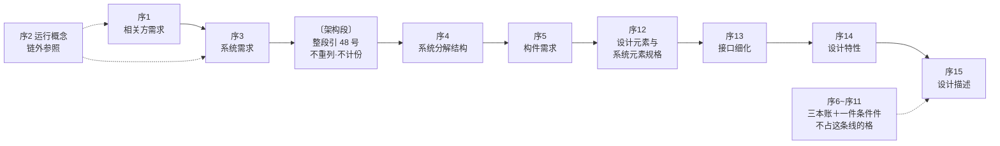
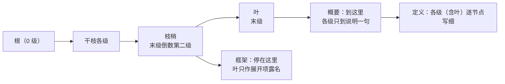

# 47 · 系统设计：从相关方需求到设计描述范例

### 两份产品数据，一份一份摆出来

> **落料位**：03-ch4·ch5·ch6·ch7（备料）＋ch17·ch20（备料）｜04（—）——接口定义见 `90-治理登记/20-47号设计与取料单.md` §六。
> **性质**：**研究报告（范例型）**。本件交的是**产品数据本体**，不描述过程；过程在 20 号，判据在 48 号。**报告不作教材正文。**
> **状态（2026-11-19 v1.0）**：**全件已写完**——上编说明四节（§一~§四）＋例一十三节（§五）＋例二十三节（§六）＋收口一节（§七）＋**附录 A~E**；正文 **19,581** 汉字、附录 **4,213** 汉字，合计 **23,794** 汉字／1,323 行。图按出现顺序编：图 1 数据位置（§一）／图 2 形态三档（§二）／图 3 三把尺（§四）／图 4 设计段三形态（§五 5.8）。
> **口径**：结论标档——**【A】直读**（正本字面）／**【B】单句推论**（一句可推）／**【C】本报告读法**（本库立，标准无原话）。英中并列，逐字引文紧随「（中译：…）」。未登记的数一律〈待定〉，并在括注写解锁条件。

---

## 一、这份范例是什么

**本报告交的是一摞产品数据，不是一套做法。**

从相关方需求走到设计描述，这条链上该交的东西是固定的；每一份长什么样、哪几栏必须齐、被打回时该改哪一份，是可以摆出来给人看的。本报告摆出来的就是这一摞，**两个产品各一套**：医疗冷链温控箱（下文称**例一**）与跨部门合同审批系统（下文称**例二**）。每一节只放一份产品数据——它的表、它的栏、它的改动痕；不放"某一步做了什么"，因为走法不在这里。

### 1.1 三份报告各管一段

| 报告 | 管什么 | 一句话 |
|---|---|---|
| **48 号** | **判据** ＋ 上半程（问题与机会→架构描述） | 凭什么算关键、凭什么算基本、切到哪儿停 |
| **20 号** | **机制**（需求-方案结对，逐对生成） | 一对怎么求值：承接、分解、覆盖检查 |
| **本报告** | **下半程的产品数据本体** | 一份一份是真的，栏是齐的，打回留着痕 |

一句话：**判据在 48，机制在 20，数据在本报告。**〔C〕

### 1.2 给三种读者，按"手上那摊活"分

| 读者 | 手上有什么 | 看哪里 |
|---|---|---|
| **照抄的** | 自己也要交这几份 | 两例全节 → 附录 A 长表 |
| **备料的** | 要讲给人听、要给教材取料 | §二 → 两例 → 附录 D 称名 |
| **审账的** | 要判这摞数据站不站得住 | §三 三关 → §四 接榫 → §七 → 附录 B／E |

按身份分没有用：同一个头衔的人，手上可能什么活都没有。

### 1.3 三样不写

**图样、工艺、供应商、产线**——这四样是去实现它，不是写清它。设计定义交到的是 *the 'implement-to' level of the definition, such as drawings and detailed design descriptions*（中译：定义的"实现级"，例如图样与详细设计描述）【A：15288:2023 §6.4.5.1 注1】；再往下的选供应商、定工艺、开工，属实现过程与开发线【A：同标准 §6.4.7】。**本报告止于设计描述，不进实现。**

### 1.4 一处交代，防两种读法

本报告**不描述"应该怎么走"**。走法在 20 号；判据在 48 号。凡本报告自立的说法，逐条标〔C〕并收在附录 C；凡引正本的，句后带条款号。两类话在正文里必须一眼分得开——**"标准说的"与"本报告这么读的"，是两种责任**。



**图 1 · 这一摞数据的位置**：横线上的每一格是"要交的一份"，虚线是"参照"与"账"。**运行概念不占派生链的格**（§二 2.5），**架构段整段引、不算本报告的一份**（§四）。

---

## 二、这一摞数据怎么读

### 2.1 十五份：主要五份＋其余十份

**主要产品数据五份**〔C〕——**相关方需求**、**运行概念**（ConOps, operational concept）、**系统需求**、**系统分解结构**（SBS, system breakdown structure）、**构件需求**：五段各交一份，构成这条链的主干。

**其余十份**（一份不少，只是不当主干）：**其余产出件六份**——决策与理由、未应对声明、设计元素与系统元素规格、接口细化、设计特性、设计描述；**登记件三份**——跨层对应关系（位↔系统元素）、分配去向登记（allocation register）、评审记录与结论；**条件件一份**——需求质量核查。

合计 **十五份**。这个数是按 48 号 §12.1 的判据选的：**删掉它，链上哪一步垮？垮的那一步就是它必要的理由**〔C〕。它与 48 号的十五件**不是同一套编号**——那边一件可以装两半（同一件里既有相关方需求又有系统需求），本报告摊成两份，故**份序 15 ≠ 件号 15**；两套数的逐件对账进附录 B，**正文只用"份"**。

**分轻重三层**（是分量，不是去留）：

| 层 | 哪几份 | 正文给多少 |
|---|---|---|
| **给全** | 主要五份 | 各一节；示范两节点**写全栏**，其余进附录 A 露名 |
| **给节选** | 设计段四份、分配去向登记、决策与理由 | 各半节；表头＋示范行 |
| **只给账** | 跨层对应关系、评审记录与结论、未应对声明、需求质量核查 | 正文两节（与邻份合节）＋附录 B 一行 |

### 2.2 形态三档：框架、概要、定义

同一份产品数据，按**定义到多深**分三档〔C〕：

| 档 | 树的形状 | 每级节点带什么 | 叶在哪 |
|---|---|---|---|
| **框架**（xx框架） | **根 → 枝梢** | 各级带物理意义；**枝梢另带承接判据与分解源判据** | 叶尚未出生，**只作展开项露名** |
| **概要**（xx概要） | **根 → 叶** | 各级（含叶）**只到说明一句**，不再另设展开清单 | **叶在这里出生**——就是多出来的那一级 |
| **定义**（xx定义） | 概要 ＋ 各级详细定义 | 断言·取值·判据·来源 | 叶已入树，且带详细定义 |

**两条界线是判据，不是"写多细"**：**末级有没有再往下分一级**（框架／概要之界）、**逐节点有没有详细定义**（概要／定义之界）。故**枝梢＝叶的父级＝末级倒数第二级**；叶以外的各级统称**干枝**（含根），**"枝末"不是本库术语**。三档由三级动作产出——框架设计、概要设计、详细定义——**相邻两级可以合做，也可以按需裁剪**。



**图 2 · 形态三档与位置关系**

**逐份的本次档位**：**相关方需求只一档**（一产出即其最深形态）；**运行概念与系统需求到定义**；**系统分解结构与构件需求是同一份方案的两档**——SBS 是它的**框架档**、构件需求是它的**定义档**，**中间那档不出现**（相邻两级裁剪，**不是漏做**）；**三档全现身的只有设计段**（元素清单→逐元素规格→描述成册）。

**"三档"在库里有三义，各称其名**〔C〕：**形态三档**（定义到多深，本节）／**交付三档**（48 号 §10.7：只定内容、部分描述、完整描述，问的是"交哪几件"）／**场景三档**（正常、异常、应急，是运行概念的树轴）。**三处不许简称"三档"。**

### 2.3 每份必看的栏

一份做完没做完，看栏；空栏带解锁条件的，是"待定"；空栏什么都不带的，是"没做完"〔C，依据 48 号 §12.6「每件里分几栏，栏不齐，件就没做完」〕。

| # | 栏 | 长什么样 | 少了它就怎样 |
|---|---|---|---|
| 1 | **版本与资格**（节首） | `v2｜已进基线`／`v3｜条件性通过` | 看不出这是第几版、算不算数 |
| 2 | **承接档**（节首） | 取哪份资产·哪一档（直接／改进后／新增）·**为什么没有现成的** | "基于资产"没法核，"新增"成了偷懒的出口 |
| 3 | **判定栏**（表里） | 验证方法／确认准则与谁来认／评审结论与认下人 | 验证、确认、评审三样在报告里无处现形 |
| 4 | **空栏带解锁条件** | `〈待定〉——待压测（质量负责人，压测后补）` | 待定与没做完分不开 |
| 5 | **补项带责任岗位与期限** | 补什么·责任方·期限 | 补项永远补不完 |
| 6 | **判否留档**（节末） | 原版一句／改因一句／新版一句＋"未完项"一行 | 把自己写成"一次就写对了" |

**六栏都不出现人名，只写岗位**：质量负责人、货主方代表、法务负责人、内控负责人、开发负责人、运维负责人、采购负责人。岗位与栏的对应见附录 D。

### 2.4 需求与方案是相对的

**同一份产品数据，对上它是方案，对下它是需求**——身份由它在哪一对里定，不由它的名字定〔C，依据 20 号 §6.2〕。

| 这一份 | 对上：是方案（相对谁） | 对下：是需求（相对谁） |
|---|---|---|
| 相关方需求 | ——（链首，无上游那一对） | 是需求，相对系统需求 |
| 系统需求 | 是方案，相对相关方需求 | 是需求，相对架构与设计 |
| 构件需求 | 是方案，相对系统需求 | 是需求，相对设计描述 |
| 设计描述 | 是方案，相对构件需求 | 再往下（模块设计）又成需求——**本报告止于此** |

**三条禁令**：① 不许把某一层的身份说死——"设计描述是方案"只在"相对构件需求"那一对里成立；② **名字带"需求"不构成身份**（构件需求在那一对里恰恰是方案）；③ 讲一对必须说清**相对于谁**，否则那句话没有意义。

### 2.5 一处要点破：运行概念

**运行概念是五份主要产品数据之一，但它在派生链上不占格。** 它框定的是"系统要怎么被用"，用来**判**需求写得对不对；它不被任何一条需求派生出来，也不派生任何一条需求〔C〕——清单问的是"要不要交"，派生链问的是"从谁派生"，两件事不矛盾。**所以图 1 里它是虚线，不是漏画。**

---

---

## 三、三关：定义与落地、专业领域、与 48 号一致

**这份范例要过三关**〔C〕：做法上，它得是"需求变细"的一次；内容上，它得是这个行业该有的样子；数上，它得与 48 号一个字不差。**三关任一不过，这一份不算交；写不出就退回，不许就地补写**——与 20 号 §5.3 的违规处理同形：先判类型，再退回。就地补写只会把不合格的东西留在基线里。

### 3.1 关一：这一份是"需求变细"的一次吗

**判据是定义，不是习惯**【A】：设计开发是 *set of processes that transform requirements for an object into more detailed requirements for that object*（中译：把某客体的需求转换为对该客体更详细的需求的一组过程）【ISO 9000:2026 §3.3.11】。故**每一对相邻数据都必须是它的一次求值**——上一份的叶成为下一份的需求，下一份交出更细的一批；**本链四对，就是四次**，不是"一条大流程走了四步"。

**落地三样，每份里都要看得见**〔C：本方法的读法，不是标准的 shall〕：

| 落地的哪一样 | 在范例里长在哪 | 出处 |
|---|---|---|
| **三档承接**（复用→改进→新增，Reuse＞Improve＞Add） | 每份节首"承接档"一行 | 20 号 §5.2 |
| **两道关口**（单承接检查／承接覆盖检查） | 序 1 的覆盖检查；序 5 的三支下限与覆盖检查 | 20 号 §5.3、§5.5 |
| **形态三级动作**（框架设计→概要设计→详细定义） | 每份节首"停在哪一档"；设计段三档全现身 | 20 号 §1.3 |

**一条引用纪律**：单承接、N:1 的方向、三形态、覆盖检查五查，这四条是**本方法的读法〔C〕**，标准里没有这四句。正文凡引它们，句前必带"本报告约定"或"本方法的读法"，**不许写成"标准要求"**。

### 3.2 关二：这一句，这个行业站得住吗

两条歪路都要避开：把领域写成一堆"系统应支持……"的空句；或者为了显得专业，随手引条款号。

**取料分四级**，写每条领域断言前先对号：

| 级 | 是什么 | 怎么用 | 例 |
|---|---|---|---|
| **甲 已登记** | 48 号 §14 与案例设定里已登记的数与事 | **照抄，一数不改** | 冷链：−20~8℃、偏差 ≤±0.5℃、断电保温 ≥72 h；恒信：月底对账 ≤2 h、金额四档 |
| **乙 库内正本可核** | 库里有正本、可核到条的规章 | 可引条款号，**须回正本核到条** | GSP 附录 3 第二条＝监测系统四种组成（测点终端／管理主机／不间断电源／相关软件）；附录 5＝四类验证＋质量负责人审批；附录 2＝共享数据修改须申请—审核—留痕 |
| **丙 库外不可核** | 正本不在库 | **只写类别、不引条款号**；非引不可时标"库外·不可核" | 药品经营与疫苗管理的强制义务（只到"法规强制留存与可审计"这一层）；签章合规（只写"须合规"） |
| **丁 未取到** | 想写但查不到 | 〈待定〉＋解锁条件 | 二代新增的运行场景；v2.3 迁移期双跑安排 |

**三条纪律**：

1. **术语不自造**：断链、测点终端、条款集、判定表、例外单、留痕事件都是行业现成词，**照原样用**；要给同义说法写在括号里，不改主词。
2. **两处必对齐（都是"两个量不许混"）**：**断链判定门槛 ≥N 分钟**与**告警时延 p95 ≤30 s** 是两个量，**采样周期 ≤30 s 是留给设计的前提、不是门槛**；**金额四档 L1~L4**与"重要合同 ≥500 万或三年期以上"是两个数，**各管一件事，不可互替**。
3. **不许"看起来像"**：每条领域断言在附录 E 里注明属甲／乙／丙／丁哪一级；注不出来的，就不许写。

**一处已处理**：会计档案的两个令号在库里对不上（一处记财政部·国家档案局令第 79 号，一处记国家档案局令第 10 号），而库内无正本可核。故正文**不写令号**，只说"**留档十年＝照抄法定最低档**"；待核一条进附录 B。

### 3.3 关三：数与号对得上 48 号吗

**凡位、数、编号、事件，一律以 48 号 §14 为唯一来源；对不上只报冲突、等裁，不另起一套。** 四条落法：**位**——冷链十位、恒信十二位，一字不改、一数不动；**数**——48 号自标"示例值"，照抄并标同一性质，书侧登记的数是书侧数，两套各归各户；**编号**——需求与系统需求的号逐例随原（一例阿拉伯、一例圈码，**不统一字形**），本报告新增的号自成一套；**事件**——三处打回所依据的事件都取自 §14 与书侧登记，不新编。

**一处定案：关键需求＝系统需求的子集**〔C：本库定名选择，不是标准原话〕。

- 正本原文是 *key architecturally-relevant stakeholder and system requirements*（中译：关键的、与架构相关的相关方需求和系统需求）【A：15288 §6.4.4.2 e)】——"关键"同时修饰两半。**本报告把"关键需求"这个名字给系统需求那半，把相关方需求那半称"追溯对象"。**
- 于是三件事各归各名：**被满足**＝系统需求（§6.4.4.1 第 2 段）；**被筛、进架构内容**＝系统需求里关键的那几条；**必须挂到架构元素上**＝关键的、与架构相关的相关方需求。
- **"满足／分配"与"追溯"两句分写，不并成一句。**
- 本报告**不复做这道筛**：筛在 48 号的卡 9（需求分流与关键需求），本报告只承接它的结果与层别。**一处交代**：48 号 §14 两例的分流表以**相关方需求**编号标注（需求1~8／需求1~9），与本报告的层别口径不同——**照引不改**，见附录 B。

### 3.4 三关怎么查

不靠通读，靠两张表：**每份三行**——节首两行（版本与资格、承接档与停在哪一档）＋节末一行（改动痕与未完项）；**附录 E 三关校核表**——两例各一张，逐份三列（关一／关二／关三），末列一行结论"过／退回"。

---

## 四、两端与接榫

### 4.1 两端

**起点**：48 号件 3「需求（相关方→系统）」**整件取**——只在左半（相关方需求）做文章，右半（系统需求）不重编、往下一层递归。

**终点**：**设计描述**。四层台阶，看写到哪一层，就看"写不写得出那一样东西"：

| 台阶 | 产出 | 到这一层的判据 |
|---|---|---|
| 一 · 需求 | 相关方需求、系统需求 | 可判真假、可测量、不暗示实现 |
| 二 · 分配 | 构件需求 | 指得回一条系统需求或一条派生理由；**不写型号也说得清** |
| 三 · 设计 | 设计元素与规格、接口细化、设计特性、设计描述 | **必须写得出型号、材料、尺寸、协议——写得清才算设计** |
| （止） | 图样、工艺、供应商、产线 | **不写**：属 15288 §6.4.7 实现过程【A】 |

**同一把尺子，两层用法相反**：台阶二**写不出型号才合格**（写了就滑层）；台阶三**写不出型号就不合格**（没写就没设计）。判据没变，**变的是这一层该不该定**。

### 4.2 三把尺：段、对、份

| 尺 | 谁在用 | 切什么 |
|---|---|---|
| **段** | 48 号（六段） | 按**位置**切整条链；本链只碰段①（件 3 两半）与段⑥ 末的"交设计"，其余整段引、不重列 |
| **对** | 20 号（结对与三类步） | 按**两端**切相邻两份数据；本链四对（4.3） |
| **份** | 本报告（十五份） | 按**交付物**切；一份一处，翻到就是它 |

```
段（48 号）：  ① 讲清现实问题 ─ ② 立住成功判据 ─ ③ 认下内容 ─ ④ 定读写约定 ─ ⑤ 切基本角色 ─ ⑥ 交出架构描述
                ↑本链只碰段①（件3 两半）                                              段⑥ 末"交设计"↑
对（20 号）：  [对Ⅰ 相关方需求→系统需求][对Ⅱ →架构描述·整段引][对Ⅲ →构件需求][对Ⅳ →设计描述]
份（本报告）：  序1·序2·序3·序4·序5·序6~11·序12·序13·序14·序15
```

**图 3 · 三把尺一张图**：**48 号按位置切、20 号按两端切、本报告按交付物切——三把都是"切"的尺，没有一把是"流程"的尺；同一份数据在三把尺上各有一个位置。**

### 4.3 四对与一处增补

| 对 | 需求侧 | 方案侧 | 步型 | 本报告怎么处置 | 对应 20 号 |
|---|---|---|---|---|---|
| **对Ⅰ** | 相关方需求 | 系统需求 | **转换步**（本链独有） | 一段做到底：每条带验证方法 | 对①＋对② 压成一对 |
| **对Ⅱ** | 系统需求 | 架构描述 | 分配步 | **整段引 48 号**，只交两端、不计份 | 对③（同型） |
| **对Ⅲ** | 系统需求（落点由架构段校准） | 构件需求（骨架＝SBS） | 分配步 | 全做，含 SBS 与位×节点交叉映射 | 无 |
| **对Ⅳ** | 构件需求 | 设计描述 | 分配步＋取点 | 全做，交到"定义" | 无 |

**为什么第一步要另立一类**：20 号的三类步（分配步／整段搬入步／形态轴步）在**它那条链**上是封闭分类；本链链首多出一步——相关方需求→系统需求。正本用 `transform` 定名【A】：*to transform the stakeholder, user-oriented view of desired capabilities into a technical view of a solution*（中译：将相关方以用户为导向的所需能力视图，转换为满足用户运行需要的解的技术视图）【15288:2023 §6.4.3.1】。追溯条款**双向都是 *one or more***【A：同标准 §6.4.3.3 d)3) 注23】：*all achievable stakeholder requirements are met by one or more system requirements, and all system requirements meet or contribute to meeting at least one stakeholder requirement*（中译：所有可实现的相关方需求都由一项或多项系统需求予以满足，并且所有系统需求都满足或有助于满足至少一项相关方需求）——**一条相关方需求可由多条系统需求满足**，恰是分配步**禁止**的 1:N。故本报告增第四类**转换步**，只此一处用，不改 20 号那三类对那条链的封闭性。

**术语各归其户**〔C〕：不许把"份"叫"件"、把"对"叫"份"，也不许把 20 号的"阶段一／阶段二"搬来给本报告分节编号。

### 4.4 主线走需求，旁路走空间

**架构段给的是落点与约束，不是"上一份需求"**——故 对Ⅲ 的需求侧仍是系统需求，只是落点被架构段校准过。依据【A】：架构定空间、架构描述把空间说成能核对的、设计在其中选一点（48 号 §9.7）；**需求分配给架构元素、内容分配给位**，两张单子、两个对象（48 号 §9.28）。**主线走需求，旁路走空间，两线在对账时接上。**

**一句边界**：本报告把设计与开发落地写成"四步一环、跑到可实现"〔C〕，**这只是落地方式之一，可能还有其他**——同一套过程可按交付节奏裁剪；判据不是"像不像这一种"，而是"能不能把需求一路推到可实现"。过程本体见 20 号 §5.1。

---

---

## 五、例一 · 冰链 M3 二代

**这一章是把一摞产品数据摆在桌上**：从上游的问题与机会起，到一份可交接的设计描述止。**节题就是那一份产品数据的名字**；每节首两行给"在哪条链、从哪来、停在哪一档"，节末给"改动痕与未完项"。全章无一处人名——"谁认下"只写岗位。

### 5.0 上游料 ＋ 底本复核

**本节不出产品数据。** 它做两件事：把 48 号那一半（上半程）的**入口**接过来，再交代本半程的底本。

**48 号 与 47 号 是同一个范例的两半**：同一对案例、同一套编号。48 号交到架构描述，本报告从相关方需求接到设计描述。没有下面这张上游料，序 1 的每一条需求都成了"凭空来的"。

**上游料（引 48 号 §14.1 件1、件2；只摘录，不改一字）**

| 项 | 内容 |
|---|---|
| **问题1** | **断链不可自证**——运输途中超温无法证明，货到后判不了这批药还能不能用；现状靠承运方口头与纸质记录 |
| **问题2** | **交接责任不清**——药厂→干线→区域仓→药店多段转运，出问题互相推 |
| **机会1** | 监管要求电子化留痕，**可借机把证据链做成对外服务** |
| **约束** | GSP 类规范要求全程温度记录留存（不可协商）；部分线路无稳定网络 |
| **相关方（五个）** | 货主｜承运方｜区域仓与药店｜监管（**强制型**）｜司机 |
| **归并后的五条关切** | 断链可判性｜证据可信｜责任可追｜离线自持｜服务化 |

**出处**（示例值）：承运方温控事故 3 起＋货主投诉 2 起＋上年度内审"温控记录不完整"1 项。

**本半程的底本复核**（"先复核资产再动笔"〔C〕）：取来的一代 BOM 与一代装配图**本来就对不上**——压缩机 BOM 记 A 型号、装配图记 B 型号；另有两处料号不一致。

| 差异 | 是什么 | 按哪份为准 | 凭什么 | 谁认下 | 处置 |
|---|---|---|---|---|---|
| 差 1 | 压缩机型号：BOM 记 A、装配图记 B | 以装配图为线索，回实物核 | 装配图带出厂批次，BOM 是报价版 | 质量负责人 | 回实物核后改 BOM |
| 差 2 | 料号两处不一致（接头、密封件） | 以 BOM 为准 | 料号是采购与库存的键 | 采购负责人 | 改装配图标注 |

**一句结论**：**先对平，再切树。** 底本不干净时直接画树，分出来的节点一半按物料、一半按装配，切法混轴。
**未完项**：差 1 待回实物核，下一轮关闭。

### 5.1 序 1 相关方需求

**在链上**：段一 · 交序 1 · 门＝覆盖检查（直接承接也要过）。
**承接档**：取 48 号 §14.1 件 3 左半（一代需求 1~8）——**直接承接 7 条、改进后承接 1 条**（需求 6：一代只写到"尽量不依赖"，二代写成可判的）。
**停在哪一档**：一产出即其最深形态，不分三档。

| 号 | 陈述（谁·何时·要什么·到什么程度） | 来源 | 由哪档场景确认 | 谁来认 | 承接档 |
|---|---|---|---|---|---|
| 需求1 | 超温后 30 秒内能判并通知责任人 | 问题1、关切1 | 异常 | 货主方代表 | 直接 |
| 需求2 | 全程温度记录不可篡改、可离线自证 | 问题1、关切2 | 异常 | 质量负责人 | 直接 |
| 需求3 | 每段交接有唯一责任人与时点，不得事后补录 | 问题2、关切3 | 正常 | 货主方代表 | 直接 |
| 需求4 | 异常给出处置指引 | 问题1、关切1 | 异常 | 质量负责人 | 直接 |
| 需求5 | 可对监管出具报表 | 机会1、关切5 | 正常 | 法务负责人 | 直接 |
| 需求6 | 不依赖承运方持续在线 | 约束、关切4 | 应急 | 质量负责人 | **改进后** |
| 需求7 | 司机端操作不超过三步 | 关切3 | 正常 | 货主方代表 | 直接 |
| 需求8 | 报表格式符合监管模板 | 机会1、关切5 | 正常 | 法务负责人 | 直接 |

**必填栏**：每一条都过三项——可判真假（能设想一次检验证明它未被满足）／不暗示实现（不写型号、不写协议）／有来源（指得回上面那张上游料）。
**一处保留**：需求1 那句"30 秒内能判并通知"，**一句话里含两个量**（判定多久、叫多久）。本报告照原样摘录，**到序 3 才拆开**——见 5.3 的"两量分家"。
**未完项**：需求7 的"三步"在二代是否仍成立，待司机端场景定稿后复核。

### 5.2 序 2 运行概念

**在链上**：段二 · 交序 2 · 门＝确认准则先行。
**承接档**：**改进后承接**——取一代运行概念的半段（出库—在途—到货，带异常栏），补二代场景。**为什么不能直接承接**：一代只写了"抛锚两小时"一类笼统异常，既没分档，也没判据。
**停在哪一档**：**本次到定义**（框架与定义都示出；概要不单独出）。

**框架**（根 → 枝梢三类；叶只作展开项露名）

| 类别（枝梢） | 承接判据（接住哪几条相关方需求） | 分解源判据（往下展开成哪类场景） | 展开项（场景名·只露名） |
|---|---|---|---|
| **正常** | 需求3、5、7、8 | 按运输阶段展开 | 出库装车｜干线在途｜区域仓中转｜到店签收 |
| **异常** | 需求1、2、4 | 按失效形态展开 | 超温｜交接缺项｜信号中断 |
| **应急** | 需求6 | 按断供形态展开 | 车辆抛锚｜冷库接入排队｜长时间断电 |

**定义**（逐场景写到底）

| 场景 | 触发条件 | 参与者与角色 | 操作时序 | 判据（确认准则） | 谁来认 |
|---|---|---|---|---|---|
| 异常·超温 | 箱温越出 −20℃~8℃ 且持续 ≥N 分钟 | 司机、货主方、承运方 | 判定→告警→处置指引→记录留存 | 判定成立后 30 秒内通知到责任人 | 质量负责人 |
| 应急·车辆抛锚 | 车辆不可继续行驶 | 司机、承运方、冷库 | 报警→转移或接冷库→补记 | **≥4 小时，或冷库接入排队＞2 小时** | 货主方代表 |
| 正常·干线在途 | 无越限、无中断 | 承运方、司机 | 定时上报→断点补传 | 在运时段记录覆盖率 ≥99.9% | 质量负责人 |

**打回①（确认不认）**

- **原版**：确认准则写"抛锚 2 小时算异常"。
- **改因**：货主方实测抛锚常见四小时；且冷库接入要排队，两小时的口径会把一半真实情况判成正常。
- **新版**：改为"**≥4 小时，或冷库接入排队＞2 小时**"；**并回改序 1 需求 6 的程度**（"不依赖承运方持续在线"补上"含长时间断电与冷库排队"）。
- **留痕**：序 8 记一行——客体＝运行概念 v1→v2；既定目标＝异常档能判；结论＝条件性通过；认下人＝货主方代表。

### 5.3 序 3 系统需求

**在链上**：段三 · 交序 3 · 门＝双向追溯＋验证方法栏。
**承接档**：**直接承接 7 条＋新增 1 条**。新增的是"换供应商后仍能自证"——**为什么没有现成的**：一代只有单一供应商，这条需求在一代不可能出现。
**停在哪一档**：到定义。

| 号 | 陈述（可测量） | 类 | 承自哪条相关方需求 | 验证方法（方法·验什么·成功准则） |
|---|---|---|---|---|
| 系统需求1 | 采样周期 ≤30 s | 性能 | 需求1 | 检查·设计文件与配置·逐条对得上 |
| 系统需求2 | 记录链式签名、单条可独立验真 | 质量 | 需求2 | 测试·实际系统·任取一条记录能独立验真 |
| 系统需求3 | 交接为单次扫码事件 | 功能 | 需求3 | 演示·实际系统·补录入口不存在 |
| 系统需求4 | 离线缓存 ≥72 h，联网自动补传且补传可判真伪 | 功能＋性能 | 需求6 | 测试·原型·断网 72 h 后数据完整且真伪可判 |
| 系统需求5 | 告警通道 ≥2 条 | 可靠性 | 需求1 | 演示·实际系统·断开一条仍有另一条送达 |
| 系统需求6 | 报表按监管字段映射 | 接口 | 需求5、8 | 检查·报表与模板·逐字段对齐 |
| 系统需求7 | 司机端交互 ≤3 步 | 过程 | 需求7 | 演示·实际系统·三步内完成交接 |
| 系统需求8 | 换供应商后记录仍可自证（**新增**） | 质量 | 需求2 | 分析·模型·换供应商后验真链不断 |

**两量分家（本节的关口）**：序 1 需求1 那句"30 秒内能判并通知"里有两个量，本节拆成两处——**断链判定门槛写 ≥N 分钟**（N 待压测，质量负责人定），**告警时延写 p95 ≤30 s**；**采样周期 ≤30 s 是留给设计的前提**，不是门槛。三者不许互相冒充【A：依据 48 号 §14.1 末"一处口径"】。

**必填栏**：每条三格齐（方法、验什么、成功准则）；**设计约束单列**——GSP 留痕要求登记在约束栏，**不进"关键"表**，否则会被拿去和别的准则做取舍。
**未完项**：N 待压测；采样率与去抖留到序 12／序 14。

---

### 5.4 架构段·整段引

**在链上**：架构那一段 · **不交份** · 无门。
**进**：系统需求 1~8，外加**关键的、与架构相关的相关方需求**——后者在本报告里作**追溯对象**，不作"关键需求"（§三 3.3）。
**出**：位×系统元素的那一端（十位），供序 6／序 7 对账时用。

**一句界**：48 号那一段（六段十五件）**本报告不重列、不计份**；此处只留两行进出口。
**一处交代**：48 号 §14.1 的卡 9 分流表以**相关方需求**编号标注（需求1~8），与本报告的层别口径不同——**照引不改**，对账见附录 B。

### 5.5 序 4 系统分解结构

**在链上**：段四 · 交序 4 · 门＝四独立之一＋位×节点交叉映射＋切法挂决策。
**承接档**：**改进后承接**——取对平后的一代 BOM 与装配图。**为什么不是"新增"**：一代确有原料（BOM 行、装配关系），只是**形态不可用**——BOM 按物料排、装配图按装配顺序排，本处按"**造／买／装**"切，故取来先重排形态。
**停在哪一档**：**框架**——它是构件需求那一份方案的**框架档**；中间那档（概要）本次不出现（§二 2.2）。

**树（L1 整机 → L2 可独立交付·试验单元 → L3 可独立制造·采购单位，共 27 节点）**

| L2 节点 | 切法 | 怎么独立试验 | L3 枝梢（末级倒数第二级） |
|---|---|---|---|
| **M3-S1 箱体与保温** | 造＋装 | 保温性能台架试验（空箱＋满载） | M3-S1.1 箱体骨架｜M3-S1.2 保温层与门封｜M3-S1.3 包装与标识 |
| **M3-S2 温控机组** | 造＋买 | 温控闭环台架（−20℃／8℃ 两端） | M3-S2.1 压缩与制冷｜M3-S2.2 冷凝与风道｜M3-S2.3 供电与电池 |
| **M3-S3 采集与记录** | 买＋造 | 温场回放（标准源比对） | **M3-S3.1 传感器通道**｜M3-S3.2 记录与签名链｜M3-S3.3 本地判定｜M3-S3.4 本机告警与提示 |
| **M3-S4 通信与定位** | 买 | 弱网与断网场景演练 | M3-S4.1 蜂窝通信｜M3-S4.2 定位与时间源｜M3-S4.3 断网缓存与补传 |
| **M3-S5 司机端** | 造 | 三步操作法走查 | M3-S5.1 扫码交接｜M3-S5.2 告警与处置指引｜M3-S5.3 离线界面 |
| **M3-S6 云端追溯与出具** | 造 | 端到端对账（记录↔运单↔出具） | M3-S6.1 运单与绑定｜**M3-S6.2 证据包封包**｜M3-S6.3 验真与对账｜M3-S6.4 对外出具接口 |

**两个示范节点的两判据与展开项（其余节点见附录 A）**

| 枝梢 | 承接判据（能接哪一类需求） | 分解源判据（往下展开成哪类叶） | 展开项（叶名，只露名） |
|---|---|---|---|
| **M3-S3.1 传感器通道** | 接"采什么、多久采一次、断电容不容易"这一类 | 展开成"采样／时基／断电续记／接口承诺／环境适应"五类条目 | 采样周期｜链式签名｜断电续记｜断链判定成立｜持续超限判法｜共用时基｜时间戳连续｜承运方接口承诺｜工作温度内精度档｜介质温循可读（共 10 条） |
| **M3-S6.2 证据包封包** | 接"什么时候封、封什么、封了还能不能改"这一类 | 展开成"封包触发／内容对应／验真／不可更改／出具承诺"五类条目 | 关单即封｜证据集与运单一一对应｜对监管与货主同源出具｜封包触发判定｜验真值随包｜补传真伪可判｜只追加不改｜出具接口承诺与失败处理｜断网排队补传｜留档十年可行（共 10 条） |

**位 × 节点交叉映射**（行＝48 号 §14.1 第14张卡的十位；格＝承担／—）

| 位 | 箱体 | 温控 | 采集 | 通信 | 司机端 | 云端 |
|---|---|---|---|---|---|---|
| 功能位1 采样与判定 | — | — | **承担** | — | — | — |
| 功能位2 告警与升级 | — | — | 承担 | 承担 | 承担 | — |
| 功能位3 交接确认 | — | — | — | — | **承担** | 承担 |
| 信息位1 温度记录 | — | — | **承担** | — | — | 承担 |
| 信息位2 交接事件 | — | — | — | — | 承担 | **承担** |
| 信息位3 证据包 | — | — | — | — | — | **承担** |
| 接口位1 承运方接入 | — | — | 承担 | **承担** | — | 承担 |
| 接口位2 出具接口 | — | — | — | — | — | **承担** |
| 结构位1 采集通道 | — | — | **承担** | — | — | — |
| 关系位1 记录—运单关系 | — | — | 承担 | — | — | **承担** |

**这张表的两条读法**：**两棵树不一一对应**——27 个节点对十位，同量级但不等数〔A：48 号 §8.5〕；**加粗格是主承担，其余是参与**，凡"两位争一格"或"一位跨两节点"都算走样，须写结论而不能留空。

**切法决策（续 38 号决策号，`D-M3-12`）**

- **定什么**：按"造／买／装"切，不按物料类别切。
- **凭什么**：切完要能让每个 L3 独立采购或独立制造、并独立试验；按物料切会把"同一个可采购件"劈到两处。
- **否了谁**：否了"按供应商分区"（那样 SBS 会跟着采购组织走，一换供应商就得重画）与"按装配工序"（那是工艺，属实现）。

**打回②（评审补项）**

- **结论**：SBS 评审判**条件性通过**。
- **补项两项**：① **接口位1「承运方接入」横跨两节点**（采集与通信）——归属要在节点表里写清"主承担是谁、另一处只作参与"；② **证据包封包节点补"可独立制造"判据**（原文只写了可独立试验）。
- **留痕**：责任方＝系统工程师与采购负责人（岗位），期限＝下一轮；第二轮关闭，序 8 记两行。

### 5.6 序 5 构件需求

**在链上**：段五 · 交序 5（序 11 需求质量核查随册、序 7 分配去向登记同册一节）· 门＝三支下限＋验证方法栏＋覆盖检查。
**承接档**：**新增承接**。**为什么没有现成的**：一代只有 BOM 行与整机规格，没有按节点成文的构件需求；料全部来自序 1~4，**一条不许凭空来**。
**停在哪一档**：**定义**；同时**把"切叶"这一步并在此做**——把 L3 再分一级，多出来的那一级就是构件需求条目（§二 2.2）。

**切叶记录**

- **切成哪几条**：每个 L3 切 10 条（示范两节点各 10 条，其余见附录 A）。
- **切点沿什么边界**：沿"**能独立判、能独立交**"的边界——一条只讲一件事，且指向一个验收载体。
- **否了哪几种切法**：① 按传感器型号切（那是设计件，**滑层**）；② 按装配工序切（那是工艺）；③ 一条里塞多个判据（不可独立验证）。

**示范节点一 · M3-S3.1 传感器通道**

| 条目号 | 陈述（要它做到什么） | 支 | 承自 | 验证方法（方法·验什么·成功准则） | 验收载体 |
|---|---|---|---|---|---|
| M3-S3.1-01 | 按 ≤30 s 的周期采样并留痕 | allocated | 系统需求1 | 检查·配置与日志·周期可逐条核 | 原型 |
| M3-S3.1-02 | 每条记录带链式签名、可单条独立验真 | allocated | 系统需求2 | 测试·实际系统·任取一条能独立验真 | 实际系统 |
| M3-S3.1-03 | 断电后 ≥72 h 内继续记录 | allocated | 系统需求4 | 测试·原型·断电 72 h 后数据连续 | 原型 |
| M3-S3.1-04 | 断链判定成立：超温持续 ≥N 分钟 | decomposed | 系统需求1（判定部分） | 测试·原型·按 N 注入边界用例全过 | 原型 |
| M3-S3.1-05 | 两次读数之间持续超限的判法 | decomposed | 系统需求1 | 分析·模型·边界序列逐条有结论 | 模型 |
| M3-S3.1-06 | 采样与判定共用同一时基 | decomposed | 系统需求1 | 检查·设计文件·时基只此一处 | 设计文件 |
| M3-S3.1-07 | 断电前后时间戳连续、不跳变 | decomposed | 系统需求4 | 测试·原型·断点前后时间戳可续 | 原型 |
| M3-S3.1-08 | 对承运方接入只承诺收流、不承诺对方在线 | derived | 接口位1 的合同口径 | 检查·接口契约·承诺与不承诺都写明 | 接口契约 |
| M3-S3.1-09 | −20~8℃ 内保持标称精度档（**取值进序 12 规格**） | derived | 派生（环境适应性） | 分析·模型·全温区偏差不劣于标称档 | 模型 |
| M3-S3.1-10 | 记录介质经温循后仍可读（**不写型号**） | derived | 派生（可实现性） | 测试·原型·温循后抽读全过 | 原型 |

**示范节点二 · M3-S6.2 证据包封包**

| 条目号 | 陈述（要它做到什么） | 支 | 承自 | 验证方法（方法·验什么·成功准则） | 验收载体 |
|---|---|---|---|---|---|
| M3-S6.2-01 | 运单关闭即封包，不靠人工触发 | allocated | 系统需求3 | 演示·实际系统·关单即出包 | 实际系统 |
| M3-S6.2-02 | 包内证据集与本运单一一对应 | allocated | 系统需求3 | 检查·对账表·逐运单可核 | 实际系统 |
| M3-S6.2-03 | 同一份证据可对监管与货主出具 | allocated | 系统需求6 | 检查·报表与模板·两侧同源 | 实际系统 |
| M3-S6.2-04 | 封包触发的判定（关单事件是否到达） | decomposed | 系统需求3 | 分析·模型·漏触发与重复触发各有对策 | 模型 |
| M3-S6.2-05 | 验真值随包保存 | decomposed | 系统需求2 | 测试·实际系统·抽包可验真 | 实际系统 |
| M3-S6.2-06 | 补传后包内内容的真伪可判 | decomposed | 系统需求2、4 | 测试·原型·补传段逐条可判真伪 | 原型 |
| M3-S6.2-07 | 封包后只追加、不改 | decomposed | 系统需求2 | 检查·设计文件·无修改接口 | 设计文件 |
| M3-S6.2-08 | 对外出具接口的承诺与失败处理 | derived | 接口位2 | 检查·接口契约·失败路径写明 | 接口契约 |
| M3-S6.2-09 | 断网期间封包排队、联网按序补传 | derived | 派生（弱网运营场景） | 演示·实际系统·断网恢复后顺序不乱 | 实际系统 |
| M3-S6.2-10 | 留档十年（**照抄法定最低档**）在存储与成本上可行 | derived | 派生（可负担性） | 分析·模型·成本与容量算得出来 | 模型 |

**覆盖检查（本节的关口）**：两节点承接的全部需求语义 ⊆ 其 10 条叶语义之并——逐条比对通过；**三支下限**（allocated ≥1／decomposed ≥1／derived ≥2）两节点均满足。

**打回③（验证退回）**

- **原版**：「断电后 ≥72 h 且可离线自证」写的是"模型算得过即视为验证通过"，验证方法＝**分析**。
- **改因**：模型给的是容量与时长的**可行**，证明不了实物能不能扛住 72 h；原写法把"算得出"当成了"验过"。
- **新版**：验证方法由**分析改为测试**，验什么由**模型改为原型**，该条**降为待验**；原版留档。
- **留痕**：本条原文、改因、新版三句入册；未完项＝原型到位后补测。

### 5.7 序 7 分配去向登记 ＋ 序 6 跨层对应关系

**在链上**：段三→段五（序 7）／段四（序 6）· 两本账 · 无门（它们是账）。

**序 7 分配去向登记**（系统需求 → 落点 → 支别 → 怎么核）

| 系统需求 | 落点（L3 节点） | 支别 | 怎么核 |
|---|---|---|---|
| 1 采样周期 ≤30 s | M3-S3.1 传感器通道 | allocated | 日志与配置逐条对 |
| 2 链式签名可独立验真 | M3-S3.1／M3-S6.2 | allocated＋decomposed | 抽条验真 |
| 3 交接为单次扫码事件 | M3-S5.1 扫码交接 | allocated | 补录入口不存在 |
| 4 离线 ≥72 h 与补传真伪 | M3-S3.1／M3-S4.3 | allocated＋decomposed | 断网 72 h 演练 |
| 5 告警通道 ≥2 条 | M3-S3.4／M3-S4.1 | allocated＋derived | 断开一条仍送达 |
| 6 报表按监管字段映射 | M3-S6.4 对外出具接口 | allocated | 逐字段对齐 |
| 7 司机端 ≤3 步 | M3-S5.1／M3-S5.2 | allocated | 三步走查 |
| 8 换供应商仍可自证 | M3-S3.1（派生） | derived | 换件后验真链不断 |

**序 6 跨层对应关系**（位 ↔ 承担它的系统元素／节点；每格给"成立"或"违例"）

| 位 | 承担处 | 结论 |
|---|---|---|
| 功能位1 采样与判定 | M3-S3.1＋M3-S3.3 | 成立（判据在 3.3，采样在 3.1，接口写清） |
| 功能位2 告警与升级 | M3-S3.4＋M3-S4.1＋M3-S5.2 | 成立（两条通道＋端上提示） |
| 功能位3 交接确认 | M3-S5.1＋M3-S6.1 | 成立 |
| 信息位1 温度记录 | M3-S3.2＋M3-S6.1 | 成立 |
| 信息位2 交接事件 | M3-S5.1＋M3-S6.1 | 成立 |
| 信息位3 证据包 | M3-S6.2 | 成立 |
| 接口位1 承运方接入 | M3-S3.1＋M3-S4.1 | **违例（跨两节点，归属未定）**——已入打回②补项① |
| 接口位2 出具接口 | M3-S6.4 | 成立 |
| 结构位1 采集通道 | M3-S3.1 | 成立 |
| 关系位1 记录—运单关系 | M3-S6.1＋M3-S6.3 | 成立 |

**两本账不许合成一本**〔C：依据 48 号 §12.5〕：序 7 分的是**需求**，对象是**系统元素**；序 6 查的是**位**与**承担处**之间成不成立。**一个分需求、一个查对应**，合起来才是跨层追溯。

---

### 5.8 序 12 设计元素与系统元素规格

**在链上**：段六 · 交序 12 · 门＝元素指得回位、规格指得回一条构件需求。
**承接档**：**改进后承接**——取 48 号 §14.1 第20张卡（功能位1→设计元素、结构位1→系统元素规格）。**为什么不直接**：那张卡给的是"往哪个位翻"的方向，没有元素清单，也没有规格。
**停在哪一档**：**框架（元素清单）＋概要（逐元素规格）都示出**；定义态并入序 15。**本报告只有这一处三档全现身**。


**图 4 · 设计段三形态**

**元素清单（框架档）**——按"能不能单独买、单独造"分件，**不按 SBS 节点数分摊**〔C：依据 15288 §6.4.5.3 b)2) 与 §6.4.5.2 d)〕：

| L2 | L3 数 | 元素数 | 元素名（只露名） |
|---|---|---|---|
| M3-S1 箱体与保温 | 3 | 6 | DE-M3-01 箱体骨架｜02 门体与锁具｜03 保温层｜04 门封条｜05 包装箱｜06 标识与随机文件 |
| M3-S2 温控机组 | 3 | 6 | DE-M3-07 制冷机组｜08 冷凝器与风道｜09 主控板｜10 电池组｜11 电源管理｜12 线束与接插件 |
| M3-S3 采集与记录 | 4 | 9 | DE-M3-13 传感器与线束｜14 记录仪本体｜15 记录介质｜16 时钟与守时｜17 判定固件｜18 固件升级通道｜19 蜂鸣与指示｜20 本机按键屏｜21 采集支架 |
| M3-S4 通信与定位 | 3 | 5 | DE-M3-22 蜂窝模组｜23 天线｜24 定位模组｜25 补传服务端组件｜26 缓存存储 |
| M3-S5 司机端 | 3 | 6 | DE-M3-27 交接扫码页｜28 处置指引页｜29 离线界面｜30 提示与告警页｜31 会话与鉴权｜32 端侧缓存 |
| M3-S6 云端追溯与出具 | 4 | 10 | DE-M3-33 运单与绑定服务｜34 证据包封包服务｜35 验真服务｜36 对账服务｜37 出具模板引擎｜38 出具接口适配｜39 监管字段映射表｜40 留档存储｜41 审计查询｜42 运营配置 |
| **合计** | **20** | **42** | — |

**两条纪律**：**元素名不许用位名**（"功能位1"不是元素，"判定固件"才是）；**每个元素指得回一个位**，指不回去的是臆造。

**逐元素规格（概要档，示范 3 个）**

| 元素 | 指回哪个位 | 含哪些系统元素 | 规格要点（写到"不写型号也说得清"止） |
|---|---|---|---|
| DE-M3-13 传感器与线束 | 结构位1 采集通道 | 温度探头、线束、接插件 | 通道数与冗余、布点位置、线束耐温等级、可换供应商（**型号进序 15**） |
| DE-M3-14 记录仪本体 | 信息位1 温度记录 | 主控、介质槽、时钟 | 记录容量与时长口径、断电续记方式、介质可更换（**容量与型号进序 15**） |
| DE-M3-34 证据包封包服务 | 信息位3 证据包 | 封包组件、验真值计算 | 触发条件、包内清单、只追加不改、留档十年（**法定最低档**） |

**未完项**：42 个元素的完整规格表进附录 A；元素与系统元素的对应粒度待第 13 章（建模实体）重写时复核。

### 5.9 序 13 接口细化

**在链上**：段六 · 交序 13 · 门＝四样齐（协议·字段·失败处理·回执）。
**承接档**：**改进后承接**——取接口位1／接口位2 的"承诺与失败处理"两栏，扩成四样。**为什么不直接**：那两栏只写了承诺，没写字段、失败路径与回执。
**停在哪一档**：定义。
**一条允许**：**架构段没处理的接口，此处可以补识别**〔A：15288 §6.4.5.3 b)6) 注10〕——本条用了一次（IF-M3-03 冷库接入）。

**接口台账 14 条**（示范 2 条写全四样，其余进附录 A）

| 接口号 | 两端 | 四样（协议·字段·失败处理·回执） |
|---|---|---|
| IF-M3-01 承运方数据接入 | 承运方系统 ↔ M3-S4.1 蜂窝通信 | 协议：推流＋确认；字段：运单号、时点、温度、设备号；失败处理：断流即缓存、重传须验签；回执：逐帧确认，缺帧可查 |
| IF-M3-02 对外出具 | M3-S6.4 ↔ 监管平台／货主门户 | 协议：出具请求—应答；字段：证据包号、时段、记录集、验真值；失败处理：失败重试三次并落异常单；回执：出具编号＋接收时间 |
| IF-M3-03 冷库接入（**补识别**） | 冷库系统 ↔ M3-S4.1 | 协议与字段同上，另加"接入排队登记"；失败处理：排队超时转人工；回执：排队位次 |

**未完项**：其余 11 条待与集成线对齐后定稿。

### 5.10 序 14 设计特性

**在链上**：段六 · 交序 14 · 门＝六类覆盖；与序 5 不矛盾。
**承接档**：**改进后承接**——取 48 号 §14.1 第20张卡"属性3→设计特性（采样精度与功耗预算）"。**停在哪一档**：定义。
**量**：每个系统元素 8 条，覆盖六类（功能·行为·尺寸形状·材料·关键质量·数据处理结构）〔A：15288 §6.4.5.3 b)3) 注6〕。

| 元素 | 功能 | 行为 | 尺寸形状 | 材料 | 关键质量 | 数据处理 | 裕度 | 备注 |
|---|---|---|---|---|---|---|---|---|
| DE-M3-13 传感器与线束 | 温感采集 | 上电自检 ≤5 s | 探头 φ4×30 mm | 不锈钢探头套 | 标称精度档 −20~8℃ 内不劣化 | 采样值编码与校验 | 精度留 30% 余量 | 与序 5 的"≤30 s"不矛盾：那是周期，这是精度 |
| DE-M3-14 记录仪本体 | 记录与续记 | 掉电切换 ≤1 s | 120×80×35 mm | 阻燃 PC＋铝内衬 | 断电 72 h 后数据完整 | 链式签名、单条可验真 | 容量留 100% 余量 | — |

**一条禁令**：设计特性**不许与序 5 的构件需求打架**——序号 5 定"要它做到什么"，本节定"做到时是什么样"；两者冲突时以序 5 为准，回改本节。

### 5.11 序 15 设计描述

**在链上**：段六 · 交序 15 · 门＝**能算成本·能下采购·能开工**。
**承接档**：**改进后承接＋改形态**——取序 5 与序 12~14，外加一代的结构文档。**改的是形态**：一代那份把方案当架构写（书侧第 6 章的毛病），本处重排为"技术方案 1＋实现方案 34"。
**停在哪一档**：**定义**——三形态里的最深一档；本节交的就是它。

**册目**

| 册 | 内容 | 判据 |
|---|---|---|
| **技术方案 1 册** | 总体构成、位×元素×系统元素三段链、接口总表、设计特性汇总、依从声明 | 指得回系统需求 1~8，指得回架构描述（48 号那一段） |
| **实现方案 34 册** | 按独立采购／制造包拆——每册 1 个包，含该包元素规格、接口细化、特性表、验收判据 | 每册能算成本、能下采购、能开工 |

**三形态交代**：本报告的框架档＝序 12 的元素清单（42 个），概要档＝序 12 的逐元素规格，定义档＝本册。**中间两档不省，只是不单独成册**。

**两条可核的判据**：**算得出成本**（34 册各有材料与工时口径）／**下得了采购**（每册的元素名与数量可成单）。**两头指得回去**：每册首页写"满足哪几条系统需求、依从架构描述的哪几条内容"。

**一处未完项**：34 册的册名与包划分随采购口径定稿；`IF-M3-03` 归属哪一册待定。

### 5.12 四件账

**在链上**：全程 · 四份账 · 无门。

**序 8 评审记录与结论**（汇总各节的评审栏）

| 客体 | 既定目标 | 结论 | 补项·责任方·期限 | 认下人 |
|---|---|---|---|---|
| 运行概念 v1→v2 | 异常档能判 | 条件性通过 | 准则改口径并回改需求6｜货主方代表｜当轮关闭 | 货主方代表 |
| SBS v1→v2 | 27 节点可独立制造／采购 | 条件性通过 | ①接口位1 归属 ②证据包补"可独立制造"｜系统工程师、采购负责人｜下一轮 | 质量负责人 |
| 构件需求 v1→v2 | 每条有验证方法与载体 | 退回（验证方法不成立） | 03 号条目方法改测试、降待验｜开发负责人｜原型到位后 | 质量负责人 |

**序 9 决策与理由**（续 38 号决策号，本报告只用两条）

| 号 | 定什么 | 凭什么 | 否了谁 |
|---|---|---|---|
| D-M3-12 | 按"造／买／装"切，不按物料类别切 | 每 L3 要能独立采购／制造／试验 | 否"按供应商分区"、"按装配工序" |
| D-M3-13 | 记录"一次生成永不改"，不设修改接口 | 篡改检出须在无第三方在场时也成立 | 否"留人工更正入口" |

**序 10 未应对声明**

| 缺口 | 为什么没做 | 归到哪 |
|---|---|---|
| 二代新增的两类运行场景 | 未取到（〈待定〉，产品经理给） | 下一轮运行概念 |
| v2.3 迁移期双跑安排（例二侧） | 未定 | 例二对应节 |
| 42 个元素的完整规格 | 篇幅限制，只示范 3 个 | 附录 A |
| 其余 11 条接口 | 待与集成线对齐 | 下一轮接口细化 |

**序 11 需求质量核查**（条件件，随册）：按十一项单条特性＋四项集合特性逐条对本报告的每条需求给出结论；**本册只留结论行**，明细见附录 A。结论：8 条相关方需求、8 条系统需求、20 条示范构件需求**全部有结论**，无"部分符合"这类合话。

---

---

## 六、例二 · 恒信合同审批 v2.3

**这一章是同一副骨架换一个行业**：十三节的顺序、每节的栏、每份的档位，与例一相同；**不同的只有处置**——每一节开头一句"与例一的差别"，就是全部差异。**两例各自可单独读通**，不必来回翻。

### 6.0 上游料 ＋ 底本复核

**与例一的差别**：取来的不是资产，是**缺口**。

**上游料（引 48 号 §14.2 件1、件2；只摘录，不改一字）**

| 项 | 内容 |
|---|---|
| **问题1** | **审核标准不一致**——同类合同，不同法务给不同结论 |
| **问题2** | **周期不可预测**——卡在哪个节点、由谁、多久，都不知道 |
| **问题3** | **风险漏检**——必备条款靠记性审，漏了到履约才暴露 |
| **机会1** | 把高频标准合同做成"自助起草＋自动预检"，法务只审例外 |
| **约束** | 金额分级授权制度（不可协商）｜电子签章须合规｜集团统一模板库 |
| **相关方（六个）** | 业务提交人｜法务｜财务｜采购｜授权人｜审计内控 |
| **强制型三条** | 授权制度（公司治理侧）｜电子签章合规（监管侧）｜集团模板库（集团标准侧） |

**出处**（示例值）：上年度合同抽查 137 份（同类结论不一致 9 份）｜法务周期台账（节点停留 p95 11 天）｜履约阶段条款缺失 5 起｜内控审计建议 1 项。

**本半程的底本复核**：v2.2 的"**部署那一段一直空着**"；另有一处：审批流上线后改过四次，**谁改的、为什么改、有没有记录，都查不到**。取来的是缺口，不是资产。

| 缺口 | 缺到什么程度 | 处置 | 谁认下 | 期限 |
|---|---|---|---|---|
| 部署一节 | 只有一个占位标题 | 本轮序 15 首次写成 | 运维负责人 | 下一轮 |
| 四次改流无记录 | 有改，无痕 | 归入序 10 缺口声明 | 内控负责人 | 下一轮 |

**一句结论**：**缺口不是资产，档位只能记"改进后承接（待核）"。**
**未完项**：v2.2 是否有过运行概念——已核：**没有**（下一节据此记"新增承接"）。

### 6.1 序 1 相关方需求

**与例一的差别**：**先把十二位与四视角摆出来，看哪几处不动**，再标承接档——不许新起一套。

**在链上**：段一 · 交序 1 · 门＝覆盖检查。
**承接档**：取 48 号 §14.2 件 3 左半（需求 1~9）——**直接承接 8 条、改进后 1 条**（需求 4：自助起草的比例口径随 v2.3 调整）。
**停在哪一档**：一产出即最深形态。

| 号 | 陈述（谁·何时·要什么·到什么程度） | 来源 | 由哪档场景确认 | 谁来认 | 承接档 |
|---|---|---|---|---|---|
| 需求1 | 同类合同结论唯一 | 问题1、关切"口径一致" | 正常 | 法务负责人 | 直接 |
| 需求2 | 随时可查卡在谁、还要多久 | 问题2 | 正常 | 业务方代表 | 直接 |
| 需求3 | 必备条款缺失必须拦住 | 问题3 | 异常 | 法务负责人 | 直接 |
| 需求4 | 标准合同自动预检、只审例外 | 机会1 | 正常 | 法务负责人 | **改进后** |
| 需求5 | 越权不可提交 | 约束"授权制度" | 异常 | 内控负责人 | 直接 |
| 需求6 | 每条意见可追到条款与依据 | 关切"可追责" | 正常 | 内控负责人 | 直接 |
| 需求7 | 紧急合同 4 h 内出结论 | 关切"快" | 应急 | 业务方代表 | 直接 |
| 需求8 | 对接签章与归档 | 约束"电子签章合规" | 正常 | 法务负责人 | 直接 |
| 需求9 | 意见须给条款号与修改建议 | 关切"口径一致" | 正常 | 法务负责人 | 直接 |

**必填栏**：可判真假／不暗示实现／有来源。**一处保留**：需求 1 与需求 7 都涉及"结论多久出"，本报告照原样摘录，**到序 3 才把它拆成"节点停留"与"紧急档"两个量**。
**未完项**：需求 4 的"高频标准合同占 62%"这一口径待法务确认。

### 6.2 序 2 运行概念

**与例一的差别**：**新增承接**——恒信从来没有过运行概念（§六 6.0 已核）；本报告这一轮是**它第一次成文**。

**在链上**：段二 · 交序 2 · 门＝确认准则先行。
**承接档**：**新增承接**。**为什么没有现成的**：书侧第 4 章主案例即"ConOps 没人写、跳过问题域直接写 SRS 条款"；后来只补过「运行支持」一栏（替代流程、备份、监控、谁升级），**没成文**。本轮把它补成一份。
**停在哪一档**：到定义。

**框架**（根 → 枝梢三类；叶只作展开项露名）

| 类别（枝梢） | 承接判据 | 分解源判据 | 展开项（场景名·只露名） |
|---|---|---|---|
| **正常** | 需求1、2、4、6、8、9 | 按审批链阶段展开 | 提交与归类｜必备条款核查｜判定出结论｜授权定级｜签署与归档 |
| **异常** | 需求3、5、9 | 按失效形态展开 | 要素不齐｜必备条款缺｜判定表未命中（转例外单）｜越权提交 |
| **应急** | 需求7 | 按运行事件展开 | 签章平台不可用｜月末高峰｜审批人休假交接 |

**定义**（逐场景写到底）

| 场景 | 触发条件 | 参与者与角色 | 操作时序 | 判据（确认准则） | 谁来认 |
|---|---|---|---|---|---|
| 异常·必备条款缺 | 条款集比对出缺失项 | 业务提交人、系统 | 拦下→列缺项→退回补正 | 缺一即拦，无绕过入口 | 法务负责人 |
| 异常·判定表未命中 | 判定表无对应行 | 系统、法务 | 转例外单→须绑条款号与理由 | 例外单须带条款号与理由方可提交 | 法务负责人 |
| 应急·月末高峰 | 月末三日并发超基线 | 系统、运维 | 限流→排队提示→峰值后批量出结论 | 高峰期间结论不丢、可排队 | 运维负责人 |
| 应急·签章平台不可用 | 签章接口连续失败 | 运维、法务 | 切替代流程→补签→留痕 | **替代流程与补签路径写在部署节** | 运维负责人 |

**打回①（确认不认）**

- **原版**：确认准则写"月底对账 ≤2 小时"。
- **改因**：这条判在**人脑**里——"25 号之后签的合同归属下个统计月"是人的规则，系统判不出；准则写成系统判据，一验就落空。
- **新版**：准则改写为"**月末对账所需数据在系统内一次取齐，取数口径与人工规则一致**"；**并回改序 1 需求 2 的程度**（"随时可查"补上"含跨月归属的判定依据可查"）。
- **留痕**：序 8 记一行——客体＝运行概念 v1→v2；既定目标＝月末对账可用；结论＝条件性通过；认下人＝业务方代表。

### 6.3 序 3 系统需求

**与例一的差别**：编号用**圈码**（逐例随原，不统一字形）；改一条的适用范围。

**在链上**：段三 · 交序 3 · 门＝双向追溯＋验证方法栏。
**承接档**：**直接承接 8 条＋改进后 2 条**（⑤节点超时提醒与升级、⑨状态变更留痕）；**为什么没有新增**：v2.2 的系统需求已覆盖本轮范围，改的是适用范围，不是新造需求。
**停在哪一档**：到定义。

| 号 | 陈述（可测量） | 类 | 承自哪条相关方需求 | 验证方法（方法·验什么·成功准则） |
|---|---|---|---|---|
| 系统需求① | 先归类到合同类型（类型决定条款集与审核路径） | 功能 | 需求1、4 | 检查·判定表·每条合同恰一个类型 |
| 系统需求② | 条款集按类型固定 | 功能 | 需求3 | 检查·条款集·缺项能逐条列出 |
| 系统需求③ | 缺必备条款即强制拦截 | 功能 | 需求3 | 演示·实际系统·缺一即无提交入口 |
| 系统需求④ | 金额×类型 → 授权级别，越权路径不存在 | 功能＋安全 | 需求5 | 测试·实际系统·路径可达性全负 |
| 系统需求⑤ | 节点超时提醒并按规则升级（**本轮扩适用范围**） | 过程 | 需求2、7 | 演示·实际系统·超时即提醒并升级到岗 |
| 系统需求⑥ | 意见须绑定条款号与依据 | 质量 | 需求6、9 | 检查·审核意见·无条款号不可提交 |
| 系统需求⑦ | 同类型同条款的结论由判定表给出 | 功能 | 需求1 | 检查·判定表·抽样比对一致 |
| 系统需求⑧ | 签署后回写归档 | 接口 | 需求8 | 演示·实际系统·回写成功且编号一致 |
| 系统需求⑨ | 状态变更全留痕（**本轮扩适用范围**） | 质量 | 需求6 | 检查·留痕表·任一次变更可追到人 |
| 系统需求⑩ | 非标条款走例外通道并须理由 | 功能 | 需求9 | 演示·实际系统·无理由不可提交 |

**两个量分家（本节的关口）**：序 1 需求 7 那句"紧急合同 4 h 内出结论"，本节拆成两处——**节点停留 p95 ≤24 h**（常规档）与**紧急 ≤4 h**（紧急档），两档各有判据；**不许把"4 h"套到所有合同上**。
**必填栏**：三格齐；**强制型三条单列**（授权制度、电子签章合规、集团模板库）——登记为约束，**不进"关键"表**。
**未完项**：节点停留的实测基数待试点给（下一节打回②由此而来）。

### 6.4 架构段·整段引

**与例一的差别**：引的是 48 号 §14.2 的十二位、四视角与三条对应关系。

**在链上**：架构那一段 · **不交份** · 无门。
**进**：系统需求①~⑩ ＋ 相关的相关方需求（作**追溯对象**）。
**出**：位×系统元素的那一端（十二位）。
**一句界**：不重列、不计份。
**一处交代**：48 号 §14.2 的分流表以**相关方需求**编号标注（需求1~9），与 §三 3.3 的层别口径不同——照引不改，见附录 B。

### 6.5 序 4 系统分解结构

**与例一的差别**：**信息位3 判定表横跨两节点 → 回改架构**，不在 SBS 里悄悄合并。

**在链上**：段四 · 交序 4 · 门＝四独立之一＋位×节点交叉映射＋切法挂决策。
**承接档**：**改进后承接（待核）**——底本取 v2.2 的部署与模块清单。**为什么不直接**：那份清单是"能部署"的切法，本处要的是"能独立部署、独立回滚"，两者不完全对得上。
**停在哪一档**：**框架**。

**树（22 节点＝L1 一＋L2 五＋L3 十六）**

| L2 节点 | 切法 | 怎么独立试验 | L3 枝梢 |
|---|---|---|---|
| **HX-S1 受理与归类** | 造 | 要素不齐样本回放 | HX-S1.1 提交与要素包｜HX-S1.2 合同类型归类｜HX-S1.3 条款集版本取用 |
| **HX-S2 条款与判定** | 造 | 缺失样本集＋判定表抽样比对 | HX-S2.1 必备条款核查｜**HX-S2.2 判定表判定**｜HX-S2.3 例外单处理｜HX-S2.4 判定表版本回滚 |
| **HX-S3 授权校验** | 造 | 越权路径可达性测试 | HX-S3.1 金额×类型定级｜**HX-S3.2 越权拦截**｜HX-S3.3 授权留痕 |
| **HX-S4 留痕与审计** | 造 | 变更审计抽查 | HX-S4.1 事件追加｜HX-S4.2 审计查询｜HX-S4.3 归档回写 |
| **HX-S5 集成适配** | 买＋造 | 三方联调（签章／归档／目录） | HX-S5.1 签章平台适配｜HX-S5.2 归档系统适配｜HX-S5.3 组织目录同步 |

**两个示范枝梢的两判据与展开项**

| 枝梢 | 承接判据 | 分解源判据 | 展开项（叶名，只露名） |
|---|---|---|---|
| **HX-S2.2 判定表判定** | 接"结论凭什么出、能不能回滚"这一类 | 展开成"命中／未命中／版本／回滚／留痕"五类条目 | 命中即出结论｜未命中转例外｜判定表版本可追｜回滚不动历史结论｜每次判定留痕｜同类型同条款结论唯一｜例外须绑条款号｜判定表变更须评审｜判定审计可查（共 9 条） |
| **HX-S3.2 越权拦截** | 接"谁能提交、越权怎么拦"这一类 | 展开成"定级／拦截／旁路／留痕／口径"五类条目 | 金额×类型定级｜越权无提交路径｜无旁路入口｜拦截留痕｜定级口径单源｜级别变更留痕｜紧急合同不破级｜代理审批受限｜越权尝试可查（共 9 条） |

**位 × 节点交叉映射**（行＝十二位；格＝承担／—；只列有承担的格）

| 位 | 受理 | 条款判定 | 授权 | 留痕审计 | 集成 |
|---|---|---|---|---|---|
| 功能位1 合同归类 | **承担** | — | — | — | — |
| 功能位2 必备条款核查 | — | **承担** | — | — | — |
| 功能位3 判定 | — | **承担** | — | — | — |
| 功能位4 例外处理 | — | **承担** | 参与 | — | — |
| 功能位5 授权校验 | — | — | **承担** | — | — |
| 信息位1 合同 | **承担** | 参与 | 参与 | 参与 | — |
| 信息位2 条款集 | **承担** | 参与 | — | — | — |
| **信息位3 判定表** | — | **承担** | **承担（取用定级依据）** | — | — |
| 信息位4 审核意见 | — | **承担** | — | 参与 | — |
| 信息位5 留痕事件 | — | — | — | **承担** | — |
| 接口位1 签章归档接口 | — | — | — | 参与 | **承担** |
| 关系位1 合同—授权级别 | — | — | **承担** | 参与 | — |

**一处必须写出的走样与处置**：**信息位3 判定表在两个节点上都"承担"**——一半是"判据"（条款与判定），一半是"定级依据"（授权校验）。**不许在 SBS 里把它悄悄并进其中一个节点**〔A：48 号 §8.4 末〕。处置是**回改架构**：把"类型决定授权级别"登记为**关系位1 的内容**，两个节点各自只写"取用"、不写"拥有"；节点表相应把 HX-S3.1 的持有项改为"取用判定表中的级别映射"。

**切法决策（续 38 号决策号，`D-HX-06`）**

- **定什么**：按"能不能独立部署、独立回滚"切，不按四视角切。
- **凭什么**：四视角是**读法**，不是部署单元；切完要能单独回滚。
- **否了谁**：否了"按四视角切"（那样一个视角跨三个部署单元）与"按组织部门切"。

**打回②（评审补项）**——本轮第二次打回，落在本节

- **结论**：SBS 评审判**条件性通过**。
- **补项两项**：① **判定表归属**按上面那句处置写进节点表（取用不拥有）；② **归档回写节点补"可独立部署"判据**（原文只写了可独立试验）。
- **留痕**：责任方＝系统架构师与运维负责人（岗位），期限＝下一轮；第二轮关闭，序 8 两行。

### 6.6 序 5 构件需求

**与例一的差别**：打回落在本节——**节点停留 p95 ≤24 h 试点压不下，回系统需求改分档**。

**在链上**：段五 · 交序 5（序 11 随册、序 7 同册一节）· 门＝三支下限＋验证方法栏＋覆盖检查。
**承接档**：**新增承接**。**为什么没有现成的**：v2.2 只有系统需求与判定规则，没有按节点成文的构件需求。
**停在哪一档**：**定义**；切叶这一步并在此做。

**切叶记录**

- **切成哪几条**：每个 L3 切 9 条（示范两节点各 9 条，其余见附录 A）。
- **切点沿什么边界**：沿"**能独立判、能独立交**"——一条只讲一件事，且指向一个验收载体。
- **否了哪几种切法**：① 按判定表行切（那是数据，不是需求）；② 按部门切（审批链跨三部门）；③ 一条塞多个判据。

**示范节点一 · HX-S2.2 判定表判定**

| 条目号 | 陈述 | 支 | 承自 | 验证方法（方法·验什么·成功准则） | 验收载体 |
|---|---|---|---|---|---|
| HX-S2.2-01 | 命中判定表即出结论 | allocated | 系统需求⑦ | 检查·抽样比对·逐条有对应行 | 实际系统 |
| HX-S2.2-02 | 同类型同条款结论唯一 | allocated | 系统需求①⑦ | 测试·实际系统·双人独立判定一致 | 实际系统 |
| HX-S2.2-03 | 未命中转例外单，须绑条款号与理由 | allocated | 系统需求⑩ | 演示·实际系统·无理由不可提交 | 实际系统 |
| HX-S2.2-04 | 判定表的行可追版本 | decomposed | 系统需求⑦ | 检查·版本表·每次判定指得到版本 | 设计文件 |
| HX-S2.2-05 | 回滚判定表不改历史结论 | decomposed | 系统需求⑦ | 测试·原型·回滚后历史结论不变 | 原型 |
| HX-S2.2-06 | 每次判定留痕（谁·何时·依据行） | decomposed | 系统需求⑥ | 检查·留痕表·逐次可追 | 实际系统 |
| HX-S2.2-07 | 判定表变更须经评审 | decomposed | 系统需求⑦ | 检查·变更记录·无评审不改 | 设计文件 |
| HX-S2.2-08 | 判定接口对授权校验只读、不写 | derived | 接口位／关系位1 | 检查·接口契约·写权限为零 | 接口契约 |
| HX-S2.2-09 | 判定耗时不劣于端到端响应口径 | derived | 派生（可实现性） | 分析·模型·单次判定耗时可算 | 模型 |

**示范节点二 · HX-S3.2 越权拦截**

| 条目号 | 陈述 | 支 | 承自 | 验证方法（方法·验什么·成功准则） | 验收载体 |
|---|---|---|---|---|---|
| HX-S3.2-01 | 越权无提交路径 | allocated | 系统需求④ | 测试·实际系统·路径可达性全负 | 实际系统 |
| HX-S3.2-02 | 金额×类型定级，级别单源 | allocated | 系统需求④ | 检查·定级表·只此一处定义 | 实际系统 |
| HX-S3.2-03 | 无旁路入口（含代理审批） | allocated | 系统需求④ | 测试·实际系统·旁路构造全被拦 | 实际系统 |
| HX-S3.2-04 | 级别变更留痕 | decomposed | 系统需求⑨ | 检查·留痕表·变更可追 | 实际系统 |
| HX-S3.2-05 | 紧急合同不破级 | decomposed | 系统需求④⑤ | 测试·实际系统·紧急档仍受级约束 | 实际系统 |
| HX-S3.2-06 | 代理审批受限并在留痕中区分 | decomposed | 系统需求⑤⑨ | 检查·留痕表·代理与本人分得开 | 设计文件 |
| HX-S3.2-07 | 拦截发生时不泄露合同内容 | decomposed | 系统需求④ | 检查·提示文案·只报级别不给内容 | 设计文件 |
| HX-S3.2-08 | 定级依据取自判定表、只读 | derived | 关系位1 | 检查·接口契约·只读取用 | 接口契约 |
| HX-S3.2-09 | 高并发下拦截判定不降级 | derived | 派生（可实现性） | 分析·模型·峰值并发下判定路径不变 | 模型 |

**覆盖检查**：两节点承接需求语义 ⊆ 其 9 条叶语义之并，逐条通过；三支下限均满足。

**打回②（验证退回）**——本轮第三次打回，落在本节

- **原版**：「节点停留 p95 ≤24 h」作为**单一判据**写进每条相关构件需求。
- **改因**：试点数据压不下来——紧急合同被常规队列拖住，单一 p95 既罚了常规也放过了紧急。
- **新版**：**回系统需求改分档**——常规档 p95 ≤24 h、紧急档 ≤4 h；构件需求相应拆成"常规档停留"与"紧急档停留"两条，各带自己的验收载体（试点日志）。
- **留痕**：原版·改因·新版三句入册；未完项＝分档后重跑试点。

### 6.7 序 7 分配去向登记 ＋ 序 6 跨层对应关系

**与例一的差别**：分配去向登记的**宾语由"内容"换成"需求"**（沿用 48 号那张表式）。

**序 7 分配去向登记**

| 系统需求 | 落点（L3 节点） | 支别 | 怎么核 |
|---|---|---|---|
| ① 归类 | HX-S1.2 | allocated | 判定表比对 |
| ② 条款集固定 | HX-S1.3／HX-S2.1 | allocated＋decomposed | 缺项逐条列出 |
| ③ 缺即拦 | HX-S2.1 | allocated | 缺一即无提交入口 |
| ④ 授权定级 | HX-S3.1／HX-S3.2 | allocated＋decomposed | 路径可达性测试 |
| ⑤ 超时提醒与升级 | HX-S1.1／HX-S4.1 | allocated＋derived | 超时即提醒并升级到岗 |
| ⑥ 意见绑条款号 | HX-S2.2／HX-S2.3 | allocated | 无条款号不可提交 |
| ⑦ 判定表出结论 | HX-S2.2 | allocated | 抽样比对一致 |
| ⑧ 签署后回写归档 | HX-S4.3／HX-S5.2 | allocated＋derived | 回写成功且编号一致 |
| ⑨ 状态变更全留痕 | HX-S4.1 | allocated | 任一次变更可追到人 |
| ⑩ 例外须理由 | HX-S2.3 | allocated | 无理由不可提交 |

**序 6 跨层对应关系**（每格给"成立"或"违例"）

| 位 | 承担处 | 结论 |
|---|---|---|
| 功能位1 合同归类 | HX-S1.2 | 成立 |
| 功能位2 必备条款核查 | HX-S2.1 | 成立 |
| 功能位3 判定 | HX-S2.2 | 成立 |
| 功能位4 例外处理 | HX-S2.3 | 成立 |
| 功能位5 授权校验 | HX-S3.1＋HX-S3.2 | 成立（定级与拦截分离） |
| 信息位1 合同 | HX-S1.1 | 成立 |
| 信息位2 条款集 | HX-S1.3 | 成立 |
| 信息位3 判定表 | HX-S2.2（判据）＋HX-S3.1（取用） | **违例（跨两节点、归属未定）**——已按 6.5 处置：节点写"取用不拥有"，关系位1 承担 |
| 信息位4 审核意见 | HX-S2.3＋HX-S4.1 | 成立 |
| 信息位5 留痕事件 | HX-S4.1 | 成立 |
| 接口位1 签章归档接口 | HX-S5.1＋HX-S5.2 | 成立 |
| 关系位1 合同—授权级别 | HX-S3.1 | 成立（本轮新增承担） |

**两本账一句**：本节的两处"参与"与一处"违例"都不是瑕疵，是**必须留结论**的格子——留空才是走样。

### 6.8 序 12 设计元素与系统元素规格

**与例一的差别**：元素 **24** 个（不是 42）；示范 3 个按"能独立部署／回滚"拆。

**在链上**：段六 · 交序 12 · 门＝元素指得回位、规格指得回一条构件需求。
**承接档**：**改进后承接**——取 48 号 §14.2 第20张卡。
**停在哪一档**：**框架＋概要都示出**，定义并入序 15。

| L2 | L3 数 | 元素数 | 元素名（只露名） |
|---|---|---|---|
| HX-S1 受理与归类 | 3 | 4 | DE-HX-01 提交表单｜02 要素校验｜03 类型归类器｜04 条款集版本库 |
| HX-S2 条款与判定 | 4 | 6 | DE-HX-05 条款集比对器｜06 判定引擎｜07 判定表库｜08 例外单应用｜09 判定审计适配｜10 回滚工具 |
| HX-S3 授权校验 | 3 | 4 | DE-HX-11 定级表｜12 拦截器｜13 代理审批限制｜14 授权留痕适配 |
| HX-S4 留痕与审计 | 3 | 5 | DE-HX-15 事件追加器｜16 审计查询｜17 归档回写适配｜18 留痕存储｜19 报表取数 |
| HX-S5 集成适配 | 3 | 5 | DE-HX-20 签章适配｜21 归档适配｜22 组织目录同步｜23 接口网关｜24 监控与告警点 |
| **合计** | **16** | **24** | — |

**逐元素规格（概要档，示范 3 个）**

| 元素 | 指回哪个位 | 含哪些系统元素 | 规格要点（写到"不写型号也说得清"止） |
|---|---|---|---|
| DE-HX-06 判定引擎 | 功能位3 判定 | 判定器、规则加载器 | 命中即出结论、未命中转例外、单次判定耗时有上限（**口径进序 15**） |
| DE-HX-12 拦截器 | 功能位5 授权校验 | 定级取用、路径阻断 | 越权无提交路径、无旁路、拦截提示不泄内容 |
| DE-HX-17 归档回写适配 | 接口位1 签章归档接口 | 回写适配、编号对账 | 回写成功且编号三方一致、失败可重试并落异常单 |

**未完项**：24 个元素完整规格进附录 A；部署形态（单机／集群）待序 15 定。

### 6.9 序 13 接口细化

**与例一的差别**：11 条（不是 14）；**用了一次"补识别"**（与归档系统的对账接口）。

**在链上**：段六 · 交序 13 · 门＝四样齐。
**承接档**：**改进后承接**——取接口位1「承诺提交结果与回执」这一栏，扩成四样。
**停在哪一档**：定义。

| 接口号 | 两端 | 四样（协议·字段·失败处理·回执） |
|---|---|---|
| IF-HX-01 签章提交 | HX-S5.1 ↔ 签章平台 | 协议：提交—异步回调；字段：合同ID、签署人、时点、摘要；失败处理：失败重试并落异常单；回执：签章流水号＋状态 |
| IF-HX-02 归档对账（**补识别**） | HX-S5.2 ↔ 归档系统 | 协议：按合同ID查询；字段：合同ID、归档号、页数、校验值；失败处理：查不到即报缺口；回执：对账结论 |

**未完项**：其余 9 条待与集成线对齐；对账频次待定。

### 6.10 序 14 设计特性

**与例一的差别**：凡**新增监测点各写"判据来自哪一条需求"**（书侧第 20 章那条要求）。

**在链上**：段六 · 交序 14 · 门＝六类覆盖；与序 5 不矛盾。**承接档**：改进后承接。**停在哪一档**：定义。
**量**：每元素 8 条，覆盖六类〔A：15288 §6.4.5.3 b)3) 注6〕。

| 元素 | 功能 | 行为 | 尺寸形状 | 材料（或等价约束） | 关键质量 | 数据处理 | 监测点 | 判据来自 |
|---|---|---|---|---|---|---|---|---|
| DE-HX-06 判定引擎 | 出结论 | 单次判定 ≤响应口径 | 无（软件） | 依赖版本锁定 | 同类型同条款结论唯一 | 判定行＋版本指纹 | 判定耗时、未命中率 | 系统需求⑦、准则2 |
| DE-HX-12 拦截器 | 阻断越权 | 拦截即返回 | 无（软件） | — | 越权提交 0 次 | 定级依据只读取用 | 越权尝试次数 | 系统需求④、准则3 |

### 6.11 序 15 设计描述

**与例一的差别**：**部署一节这次写下来**（填上书侧"部署那一段还空着"）；本轮第三次打回落在此。

**在链上**：段六 · 交序 15 · 门＝能算成本·能下采购·能开工。
**承接档**：**改进后承接＋改形态**。**停在哪一档**：定义。

| 册 | 内容 | 判据 |
|---|---|---|
| **技术方案 1 册** | 总体构成、位×元素×系统元素三段链、接口总表、特性汇总、依从声明 | 指得回系统需求①~⑩，指得回架构描述 |
| **实现方案 20 册** | 按独立部署／回滚包拆 | 每册能算成本、能下采购、能开工 |
| **部署一节**（本轮新增） | 上线顺序、回滚条件、监测点三处阈值与收件人、**容灾与回滚**（下一轮补） | 上线顺序排得出、回滚能指到具体一版 |

**打回③（评审补项）**——本轮第三次打回，落在本节

- **结论**：成册评审判**条件性通过**。
- **补项一项**：**部署一节的"容灾与回滚"**——现在只有上线顺序与回滚条件，缺"坏到什么程度算必须回滚、回滚到哪一版、谁批"。
- **留痕**：责任方＝运维负责人（岗位），期限＝下一轮；序 8 记一行。

### 6.12 四件账

**与例一的差别**：评审三行的次序不同——**先验证退回（序 5）、后评审补项（序 15）**。

**序 8 评审记录与结论**

| 客体 | 既定目标 | 结论 | 补项·责任方·期限 | 认下人 |
|---|---|---|---|---|
| 运行概念 v1→v2 | 月末对账判定可用 | 条件性通过 | 准则改口径并回改需求2｜业务方代表｜当轮关闭 | 业务方代表 |
| SBS v1→v2 | 22 节点可独立部署／回滚 | 条件性通过 | ①判定表归属（取用不拥有）②归档回写补"可独立部署"｜系统架构师、运维负责人｜下一轮 | 法务负责人 |
| 设计描述 v1→v2 | 部署一节可交接 | 条件性通过 | 容灾与回滚｜运维负责人｜下一轮 | 内控负责人 |

**序 9 决策与理由**（续 38 号决策号）

| 号 | 定什么 | 凭什么 | 否了谁 |
|---|---|---|---|
| D-HX-06 | 按"能不能独立部署、独立回滚"切 | 四视角是读法、不是部署单元 | 否"按四视角切"、"按部门切" |
| D-HX-07 | 判定表"取用不拥有"，级别映射归关系位1 | 一位不许跨两节点静默合并 | 否"把判定表并进授权节点" |

**序 10 未应对声明**

| 缺口 | 为什么没做 | 归到哪 |
|---|---|---|
| v2.3 迁移期双跑安排 | 未定（〈待定〉，业务方给） | 下一轮 |
| 部署一节的容灾与回滚 | 本轮未完成（打回③） | 下一轮序 15 |
| 其余 9 条接口 | 待与集成线对齐 | 下一轮接口细化 |
| 24 个元素完整规格 | 篇幅限制，只示范 3 个 | 附录 A |

**序 11 需求质量核查**：9 条相关方需求、10 条系统需求、18 条示范构件需求**全部有结论**，无"部分符合"这类合话；明细进附录 A。

---

## 七、这摞数据的边界与欠账

**两例把"该交什么"摆清了，但摆清不等于保证。** 这一章分三层说：这份范例能保证什么、不能保证什么；欠着哪几处；模块那一段怎么接。

### 7.1 能保证什么

**保证的是"过程的可核性"，不是"产品选对"**〔C〕。

| 能保证 | 凭什么 |
|---|---|
| **每一对都是"需求变细"的一次** | 与 ISO 9000:2026 §3.3.11 的三条对得上：过程性、映射性、终点收口（§三 3.1） |
| **每一份都到得了它该到的形态** | 框架／概要／定义三档有结构界线（§二 2.2），不靠"写多细"判 |
| **每一份的栏都齐得起来** | 六栏＋两道关口（§二 2.3、§三 3.1），栏空即未做完 |
| **每条需求都有验证方法与验收载体** | 三格齐；构件需求另有验收载体（5.6、6.6） |
| **两棵树对不上时能查出来** | 位×节点交叉映射（5.5、6.5）；两本账不合成一本（5.7、6.7） |

**但以下四条不是标准的 shall，是**本报告的约定〔C〕——单承接（N:1 允、1:N 禁）／N:1 的方向／三形态／覆盖检查五查。正文凡引它们，都带了"本报告约定"或"本方法的读法"。

### 7.2 不能保证什么

**两处外接、一处内弱，环自己兜不住。**

| 类 | 内容 | 后果 |
|---|---|---|
| **外接一：叶的来源** | 这一环只能保证"给定这批叶，方案接住了"——**叶切得对不对不在环内** | **局部正确，不是全局正确**；全局正确要靠上一对做过的同一套检查，与最上游的问题域（48 号件1／件2） |
| **外接二：确认判据** | 链只保证 **verification** 侧（对不对得上规定需求）；**validation（预期用途）不在链上** | **跑完这条链 ≠ 做对了产品** |
| **内弱：横切内容** | 一条约束压多分支、共享定义、循环引用，只能靠"独立分支＋影响面标注" | 环里**没有强制检查点**，靠"约束继承"那一查兜，兜得住与否看人 |

**最脆的一处**：**叶的原子性是人判断的，没有机械判据**。叶切粗 → 覆盖检查会"假通过"（粗叶被粗节点"覆盖"）。这是本方法失效的主通道，而它恰好落在环外。

### 7.3 能不能被证伪

**三条当场可验的否证**——故这套东西不是空话：

1. 一条需求落两个节点、且不能归为"切不动的整体" → **单承接破**；
2. 某节点承接的语义超出其叶语义之并 → **覆盖检查破**；
3. 设计描述算不出成本、下不了采购、开不了工 → **终点判据破**。

### 7.4 可行性：单环可行，全链是线性工程量

**工作量倒推**（用本例的定值）：例一 = 27 节点＋270 叶＋42 元素＋每元素 8 特性＋14 接口 ≈ **500~800 个字段级判断**；一条链四对 → **2,000~3,000**。**一个熟练团队一对 3~10 人能跑；全链是线性放大，不是复杂度爆炸。**

**四个前置**（缺了仍能跑，但会退化成"摊派"）：① 需求叶已原子；② 有一份可复用的方案起点；③ 每个节点的物理意义与两判据写得出；④ 术语与判据先统一。四条任一缺位，就会滑向三条明禁：**按条数算术分／按部门切／按选型切**。

**五个失效样**（可对号入座）：叶切粗→覆盖假通过｜落点按位置不按语义→承载量爆掉｜改进后不复查影响面→隐性失配留到符合性审查｜只做阶段一不做阶段二→方案叶缺失｜把登记件当产出件→追溯矩阵画齐就算完。

**最经济的用法**：不必整链跑——**只用在承载量大、跨团队、接口密的节点上**。这是"落地方式之一"的实际含义。

### 7.5 一句总判

> **它保证"过程的可核性"，不保证"产品选对"**：正确性在过程侧成立（骨架与标准三条对齐、环内逻辑闭合、三条否证可验），价值侧要另设确认（不在链上）；可行性在单环成立，全链是线性工程量，**成败取决于四个前置**。**它是一条"能把需求一路推到可实现、且每一步都留得下证据"的路；不是一条"能保证结论对"的路。**

### 7.6 欠着三处，等同一批改

| # | 欠在哪 | 欠什么 | 为什么本报告不改 |
|---|---|---|---|
| 1 | **20 号**（§1.1、§6.4 末） | "设计线产品数据链**止于框架**"这句的适用范围——本报告走到设计描述，理由是**设计描述＝交接件**，不属"设计线内部" | 改它要动 20 号的方法链端点，须与 20 号 同批 |
| 2 | **书侧两处数字** | 第 13 章"满十分钟"与案例设定"本地判定 30 秒（实测 28 秒）"——均以 48 号 §14.1 末"门槛 ≥N 分钟"为准 | 报告不作教材正文，随该章重写时改 |
| 3 | **48 号三处**（5.4 已点） | ① 件3「什么算成立」只写系统需求建双向追溯；② P4 把 §6.4.4.2 e) 的两半压成"关键需求"；③ §14 两例卡 9 分流表按相关方需求编号 | 照它引、不动它；是否同批补一句待人裁（附录 B） |

### 7.7 模块那一段

**模块设计不另立一套**：过程同、形态同、判据同，**只把对象从"系统"换成"模块"**〔A：15288 §6.4.5.3 b)1) 分配可逐层递归；§6.4.3.3 b)4) 注12 需求在系统结构中迭代与递归〕。故本报告只给这一句指针，**不另开一节、不另做一张粒度账**。

---

## 附录 A 全量长表

> **A 的分两类**：**树类只露名**（SBS 全树与叶名——框架只以展开项露名，写全定义就成第二份正文）；**条目类给全行**（元素、接口、特性——本就一行一件）。

### A.1 例一 · M3 二代：SBS 全树（27 节点）

L1 `M3` 整机（装）｜**L2 六个**：M3-S1 箱体与保温／M3-S2 温控机组／M3-S3 采集与记录／M3-S4 通信与定位／M3-S5 司机端／M3-S6 云端追溯与出具｜**L3 二十个**：见 5.5 树表（M3-S1.1~S1.3、S2.1~S2.3、S3.1~S3.4、S4.1~S4.3、S5.1~S5.3、S6.1~S6.4）。

**叶名（构件需求条目）**：示范两节点 20 条已全列（5.6）；**其余 18 个 L3 节点按每节点 10 条生成**，其条目提纲＝**三支各写什么**（allocated：本节点直接承接的系统需求；decomposed：本节点上再分的判定与时序；derived：接口承诺、环境适应性、可实现性各一条以上）。**逐条叶名与三格验证方法随项目落库时生成**——本附录不逐条命名，理由见 A.3。

### A.2 例二 · 恒信 v2.3：SBS 全树（22 节点）

L1 `HX` 平台（装）｜**L2 五个**：HX-S1 受理与归类／HX-S2 条款与判定／HX-S3 授权校验／HX-S4 留痕与审计／HX-S5 集成适配｜**L3 十六个**：见 6.5 树表（HX-S1.1~S1.3、S2.1~S2.4、S3.1~S3.3、S4.1~S4.3、S5.1~S5.3）。

**叶名**：示范两节点 18 条已全列（6.6）；其余 14 个 L3 同样按每节点 9 条生成，提纲同上。

### A.3 为什么不全列

**270＋198 条逐条命名，是一份真项目的工作量，不是一份报告的篇幅**。本附录给到的是**可生成的规则（三支提纲＋两节点示范写全）**，让读者能自己生成剩下那批；把 468 条都编出来，等于用报告篇幅冒充项目成果，且两处必然漂移（报告里的条目名与项目落库的条目名不会一致）。**这一条已登记在附录 B 的〈待定〉里。**

### A.4 条目类全行

| 类 | 例一 | 例二 | 在哪 |
|---|---|---|---|
| 设计元素 | 42 | 24 | 5.8／6.8（全表已列，只露名） |
| 逐元素规格 | 示范 3 | 示范 3 | 5.8／6.8 |
| 接口台账／细化 | 14 | 11 | 5.9／6.9（示范 2 条四样齐，其余待对齐） |
| 设计特性 | 每元素 8 条 | 每元素 8 条 | 5.10／6.10（示范 2 元素） |
| 决策 | 2 条（D-M3-12、13） | 2 条（D-HX-06、07） | 5.12／6.12 |
| 缺口 | 4 项 | 4 项 | 5.12／6.12 |

---

## 附录 B 索引与对账

### B.1 轮次索引（R0~R10 与"份"的对应）

| 轮 | 这一轮交哪几份（序） | 过哪道门 | 在 20 号 §五 的哪一步 |
|---|---|---|---|
| R0 | —（底本复核记录，不进十五份） | 复用复核：仍相关否·够细否 | 预处理第 0 步 |
| R1 | 序 1 | 覆盖检查（直接承接也要过） | 预处理承接 |
| R2 | 序 2（含确认准则） | 确认准则**先定义** | 规则定义 |
| R3 | 序 3 | 双向追溯＋验证方法栏 | 阶段一承接 |
| R4 | —（架构段整段引，不计份） | — | —（48 号那一段） |
| R5 | 序 4 | 四独立之一＋位×节点映射＋切法挂决策 | 阶段一调树 |
| R6 | 序 5、序 11；序 7 同册一节 | 三支下限＋验证方法栏＋覆盖检查 | 阶段二分解 |
| R7 | 序 12 | 元素指得回位、规格指得回一条构件需求 | 下一对的阶段一 |
| R8 | 序 13 | 四样齐 | 同上 |
| R9 | 序 14 | 六类覆盖；与序 5 不矛盾 | 同上 |
| R10 | 序 15（＋序 8、9、10 归账） | 能算成本·能下采购·能开工 | 下一对的阶段二 |

> **这张表只作查**：正文按"份"排，不按轮排（§二 2.1）。想知道"哪几份一起交、卡在哪个门"，看这里。

### B.2 与 48 号十五件逐件对账

| 48 号件 | 本报告怎么要 | 落在哪 |
|---|---|---|
| 件1 问题或机会 | **引用并摘录**（作上游料） | 5.0／6.0 |
| 件2 相关方与关切 | **引用并摘录** | 5.0／6.0 |
| 件3 需求（相关方→系统） | **取＋摊开**：左半→序 1、右半→序 3 | 5.1／5.3、6.1／6.3 |
| 件4 架构目标 | 引用（判据侧） | 5.3、6.3 |
| 件5 关键成功准则 | 引用（判据侧） | 同上 |
| 件6 因子清单 | 引用（判据侧） | 同上 |
| 件7 内容 | 不涉及（不重定内容） | — |
| 件8 视角与模型种类 | 不涉及 | — |
| 件9 位与分配 | **引用**：位作交叉映射一端；分配表式作序 7 的底 | 5.5／5.7、6.5／6.7 |
| 件10 模型 | 不涉及 | — |
| 件11 视图组件 | 不涉及 | — |
| 件12 视图 | 不涉及 | — |
| 件13 对应关系 | 不涉及（件13 是描述元素之间） | — |
| 件14 决策与理由 | **寄居**：序 9（续 38 号号） | 5.12／6.12 |
| 件15 未应对声明 | **寄居**：序 10 | 5.12／6.12 |

**合计**：引用 **6**（件1、2、4、5、6、9）＋取 **1**（件3）＋寄居 **2**（件14、15）＋不涉及 **6**（件7、8、10、11、12、13）＝**15**，逐件对得上。**注**：件1／件2 在旧口径里记"不涉及／引用"，本轮按令五**改成"引用并摘录"**——它们仍不重做、不改一字，但在正文里有摘录，因为两份报告是同一范例的两半。

**另一套账**：本报告自己数 **15 份**（主要五＋其余十）；48 号数 **15 件**。件3 一件装两半，本报告摊成序 1 与序 3，故**份序 15 ≠ 件号 15**——两套数只在上面这张表里接上。

### B.3 冲突与待核（只登不改）

| # | 冲突／待核 | 现状 | 处置 |
|---|---|---|---|
| 1 | **断链判定门槛** | 48 号 §14.1 表内「持续 40 秒」／同节末「≥N 分钟」／书侧第13章「满十分钟」／案例设定「本地判定 30 秒（实测 28 秒）」四方不一致 | 正文一律写 **N**；其余三处随各章改 |
| 2 | **会计档案令号** | 案例设定记财政部·国家档案局令第 79 号；40 号记国家档案局令第 10 号；**库内无正本** | 正文只写"法定最低档"、**不写令号** |
| 3 | **48 号三处不足** | 见 7.6 第 3 行 | 照引不改，是否同批补一句待人裁 |
| 4 | **卡 9 分层** | 分流表按相关方需求编号，与"关键需求＝系统需求子集"口径不同 | 照引＋一句交代（5.4、6.4） |

### B.4 〈待定〉清单与解锁条件

| 项 | 为什么不定 | 谁在哪一步定 |
|---|---|---|
| 断链门槛 N | 48 号明写"待压测" | 质量负责人，压测后 |
| 采样率／去抖／器件 | 留给设计 | 序 12／序 14 |
| 二代新增的两类运行场景 | 未登记 | 产品经理 |
| v2.3 迁移期双跑 | 未登记 | 业务方 |
| 34／20 册的包划分 | 随采购口径 | 采购负责人 |
| 其余 11／9 条接口 | 待与集成线对齐 | 集成线 |
| 468 条叶名与三格 | 项目工作量 | 项目落库时（见 A.3） |

---

## 附录 C 引文与取值

> **两栏分列**：**标准栏**（可引条款号的规范／技术报告）与**规章栏**（专业领域的规章，按甲／乙／丙／丁分级）。**自写读法另列一栏**——它是本报告的约定，不是标准原话。

### C.1 标准栏（逐字，英中并列）

| # | 出处 | 逐字（中译） | 用在哪 |
|---|---|---|---|
| 1 | ISO 9000:2026 §3.3.11 | *set of processes that transform requirements for an object into more detailed requirements for that object*（把某客体的需求转换为对该客体更详细的需求的一组过程） | §3.1 关一 |
| 2 | 15288:2023 §3.36 | *statement which translates or expresses a need and its associated constraints and conditions*（转化或表达需要及其相关约束和条件的陈述） | §三 3.3（"需求"只有这一条术语） |
| 3 | 15288:2023 §6.4.3.1 | *to transform the stakeholder, user-oriented view of desired capabilities into a technical view of a solution*（将相关方以用户为导向的所需能力视图转换为满足用户运行需要的解的技术视图） | §4.3 转换步 |
| 4 | 15288:2023 §6.4.3.3 d)3) 注23 | *all achievable stakeholder requirements are met by one or more system requirements, and all system requirements meet or contribute to meeting at least one stakeholder requirement*（所有可实现的相关方需求都由一项或多项系统需求予以满足，并且所有系统需求都满足或有助于满足至少一项相关方需求） | §4.3 转换步 |
| 5 | 15288:2023 §6.4.4.1 第2段 | *satisfy, as far as possible, the problem or opportunity expressed by a set of system requirements (traceable to mission, business and stakeholder requirements)*（尽可能满足由一组系统需求——可追溯至任务、业务和利益相关方需求——所表达的问题或机会） | §三 3.3（满足的对象＝系统需求） |
| 6 | 15288:2023 §6.4.4.2 c) | *concepts, properties, characteristics, behaviours, functions, or constraints … allocated to architectural entities*（概念、属性、特性、行为、功能或约束被分配到架构实体） | §三 3.3（分配的不是需求） |
| 7 | 15288:2023 §6.4.4.2 e) | *traceability of system architecture elements to key architecturally-relevant stakeholder and system requirements is established*（架构元素对关键的、与架构相关的相关方需求和系统需求的追溯性得以建立） | §三 3.3（追溯对象） |
| 8 | 15288:2023 §6.4.5.1 注1 | *Design provides the 'implement-to' level of the definition, such as drawings and detailed design descriptions*（设计提供定义的"实现级"，例如图样与详细设计描述） | §一 1.3、§四 4.1 |
| 9 | 15288:2023 §6.4.5.3 b)1) | *Allocate system requirements to system elements*（将系统需求分配到系统元素） | 5.6／6.6 分配的宾语 |
| 10 | 15288:2023 §6.4.5.3 b)6) 注10 | *It is possible that additional interfaces need to be identified and defined that were not addressed in the system architecture definition process*（可能需要识别并定义架构定义过程中未予处理的附加接口） | 5.9／6.9 补识别 |
| 11 | 15288:2023 §6.4.9.3 a)1) 注1 | *actual system, model, mock-up, prototype, procedure, plan, or other document*（实际系统、模型、实物模型、原型、程序、计划或其他文件） | 验证三格"验什么"七值 |
| 12 | 15288:2023 §6.4.9.3 a)3) 注3 | *inspection, analysis, demonstration, and testing*（检查、分析、演示与测试） | 验证三格"方法"四值 |
| 13 | 15288:2023 §6.4.11.3 a)3) 注4 | 确认八法（检查·分析·类比相似性·演示·仿真·同行评审·测试·认证） | 运行概念的确认准则 |
| 14 | 15288:2023 §6.3.1.3 a)4) 注4（**资料性**） | *Typical breakdown structures include … system breakdown structure …*（典型分解结构包括……系统分解结构……） | 5.5／6.5（SBS 只此一处提及） |
| 15 | 42020:2019 §10.4.4 e) | *concepts, properties, characteristics, behaviors, functions, features or constraints*（概念、属性、特性、行为、功能、特性或约束——七样） | §三 3.3、5.5 |
| 16 | 42020:2019 §10.4.5 c) | *Identify areas for potential reuse of existing architecture elements and the risks associated with this reuse*（识别可潜在复用现有架构元素的领域以及与此复用相关的风险） | 5.0／6.0 底本复核 |
| 17 | 42020:2019 §10.4.5 d) | *Partition, align and allocate requirements to architecture elements and these related entities*（对需求加以划分、对齐并分配给架构元素及这些相关实体） | §三 3.3、5.7 |
| 18 | 42010:2022 §3.2 | *fundamental concepts or properties of an entity in its environment and governing principles for the realization and evolution of this entity and its related life cycle processes*（实体在其环境中的基本概念或属性，以及为实现和演化该实体及其相关生存周期过程的管控原则） | §四 4.4 旁路（架构是内容） |

### C.2 规章栏（按甲／乙／丙／丁分级）

| 级 | 出处 | 要什么 | 用在哪 |
|---|---|---|---|
| **乙** | GSP 附录 3 第二条 | 监测系统的四种组成（测点终端／管理主机／不间断电源／相关软件）及其功能分配 | 5.5 SBS 的"造／买／装"**不等于**这四种组成，正文要说清 |
| **乙** | GSP 附录 5 | 四类验证（使用前／定期／超停用时限／超设定条件或改造后）＋质量负责人审批 | 5.2 确认准则、5.12 评审认下人 |
| **乙** | GSP 附录 2 第五条（五）、第六条（二） | 共享数据修改须申请—审核—留痕 | 5.0 约束、5.6 "只追加不改" |
| **乙（待核令号）** | 会计档案保管期限 | 定期一般 10 年／30 年，"最低保管期限" | 5.6、6.11（正文只写"法定最低档"） |
| **丙** | 药品经营与疫苗管理的强制义务 | 只到"法规强制留存与可审计"这一层 | 5.0 约束 |
| **丙** | 电子签章合规 | 只写"须合规"，不引条款号 | 6.0 约束 |

### C.3 自写读法清单〔C〕（本报告的约定，不是标准要求）

| # | 读法 | 为什么必须标〔C〕 |
|---|---|---|
| 1 | 单承接（N:1 允、1:N 禁） | 由"设计＝函数"这个建模选择来，标准无此条 |
| 2 | N:1 的方向（定义域取叶、值域取可负责节点） | 同上；两侧理由不同源 |
| 3 | 形态三档（框架／概要／定义）与"枝梢＝叶的父级" | 库内读法；48 号另有"交付三档"，不同物 |
| 4 | 覆盖检查五查（覆盖完整·不超出·逻辑一致·约束继承·指标不低于） | 合成自多处工程实践 |
| 5 | 四步一环（跑到可实现） | 落地方式之一，不排他 |
| 6 | 三关（定义与落地／专业领域／48 号一致）与四级取料 | 本报告立 |
| 7 | "关键需求＝系统需求的子集" | 本库定名选择（正本 e) 原话两半并称） |
| 8 | 六栏（版本与资格／承接档／判定栏／空栏解锁／补项期限／判否留档） | 本报告立（依据 48 号 §12.6 的"栏齐"口径） |
| 9 | 序／件两套数不并排 | 本报告体例 |
| 10 | 附录 A 分两类（树类只露名／条目类给全行） | 本报告体例；守"框架只以展开项露名" |

---

## 附录 D 称名

### D.1 树的三词（不互换）

| 词 | 指什么 |
|---|---|
| **干枝**（干枝节点） | **叶以外的各级**（**总称**，含根） |
| **枝梢**（枝梢节点） | **本次框架的最深一级**；在同一份的完整树里＝**叶的父级＝末级倒数第二级** |
| **叶**（叶节点） | **末级**，可被独立解释、独立验证、可唯一交出去 |

**"枝末"不是本库术语**；**"枝干"是旧异名**，已统一为"干枝"。

### D.2 三处"三档"（不许简称"三档"）

| 名 | 问什么 | 出处 |
|---|---|---|
| **形态三档** | 这一份**定义到多深**（框架／概要／定义） | 20 号 §1.3 |
| **交付三档** | **交哪几件**（只定内容／部分描述／完整描述） | 48 号 §10.7 |
| **场景三档** | 运行概念的树轴（正常／异常／应急） | 15288 §6.4.2.3 b) 4) c) |

### D.3 五个近名的分家

| 词 | 属于哪一侧 | 例 |
|---|---|---|
| **位** | 被架构实体的**构成**在模型里的代表 | 功能位1 采样与判定 |
| **架构元素** | **需求**的落点（=位在模型侧的称呼） | 与位同一批单位的两种读法 |
| **系统元素** | **设计**才定下的件 | 探头型号、某块电池 |
| **构件** | 工程惯用词，与 §3.47 系统元素对齐（**不是新的一类**） | 采集与记录这个可采购单位 |
| **组件** | 42010 的 **view component**（视图组件），与"构件"不是一件事 | 判定链组件 |

### D.4 编号体系

| 族 | 形 | 例 | 纪律 |
|---|---|---|---|
| SBS 节点 | `<案>-S<层><序>` | `M3-S3.1`／`HX-S2.2` | 三层，不设第四层 |
| 构件需求 | `<节点号>-<两位序>` | `M3-S3.1-01` | **支别是一栏，不进号** |
| 设计元素／系统元素 | `DE-<案>-<序>`／`SE-<案>-<序>` | `DE-M3-14` | **不许用位名** |
| 接口 | `IF-<案>-<序>` | `IF-HX-02` | 台账与细化同号 |
| 决策 | `M3-Dnn`／`HX-Dnn` | `D-M3-12` | **续 38 号那套**，不另立 `D-<案>-<序>`（会与 `HX-D01` 逆序撞号） |

### D.5 岗位—栏对照（替代人名）

| 岗位 | 认哪一栏 | 出在哪几份 |
|---|---|---|
| 质量负责人 | 确认准则"谁来认"；评审"认下人" | 序 2；序 8 |
| 货主方代表 | 相关方需求的程度（例一） | 序 1、序 2 |
| 业务方代表 | 相关方需求的程度（例二） | 序 1、序 2 |
| 法务负责人／内控负责人 | 强制型约束落点；授权档位 | 序 1、序 4 |
| 系统工程师／系统架构师 | SBS 的切法与两判据 | 序 4 |
| 开发负责人 | 构件需求的验收载体可否实现 | 序 5 |
| 采购负责人 | 元素命名与包的划分 | 序 12、序 15 |
| 运维负责人 | 部署一节的容灾与回滚 | 序 15 |

---

## 附录 E 三关校核表

> **三关任一不过，这一份不算交**（§三）。逐份给三列结论，末列给"过／退回"。

### E.1 例一 · M3 二代

| 份（节） | 关一 定义与落地 | 关二 专业领域（取料级别） | 关三 与 48 号一致 | 结论 |
|---|---|---|---|---|
| 上游料＋底本（5.0） | —（不出数据） | 乙：GSP 约束 | 件1／件2 摘录不改；事件取自 §14.1 | **过** |
| 序 1 相关方需求（5.1） | 未被派生，是链首 | 甲：登记数与事 | 需求1~8 原号原字 | **过** |
| 序 2 运行概念（5.2） | 到定义；三类枝梢 | 乙：附录 5 四类验证 | 场景与判据取自 §14.1 | **过**（打回①后） |
| 序 3 系统需求（5.3） | 转换步的一次 | 甲；两量分家 | 系统需求1~7 原号＋新增 1 条声明 | **过** |
| 架构段（5.4） | —（整段引） | — | 只两行进出口，不计份 | **过** |
| 序 4 SBS（5.5） | 框架档；四独立 | 乙：附录 3 四种组成≠造买装 | 十位不动，交叉映射 | **过**（打回②后） |
| 序 5 构件需求（5.6） | 定义档；切叶记录 | 乙：附录 2 只追加不改 | 三支标来源，指得回系统需求 | **退回→过**（打回③：验证方法改测试、降待验） |
| 两本账（5.7） | —（账） | — | 十二位／十位原号 | **过** |
| 序 12 元素与规格（5.8） | 框架＋概要 | 乙：留档十年＝法定最低档 | 元素指得回位 | **过** |
| 序 13 接口细化（5.9） | 定义 | 甲 | 补识别 1 条已声明 | **过** |
| 序 14 设计特性（5.10） | 定义 | 甲 | 与序 5 不矛盾 | **过** |
| 序 15 设计描述（5.11） | 定义；三形态交代 | 甲 | 两头指得回去 | **过** |
| 四件账（5.12） | — | — | 决策续 38 号号 | **过** |

### E.2 例二 · 恒信 v2.3

| 份（节） | 关一 定义与落地 | 关二 专业领域（取料级别） | 关三 与 48 号一致 | 结论 |
|---|---|---|---|---|
| 上游料＋底本（6.0） | — | 丙：签章合规（不引条款） | 件1／件2 摘录不改 | **过** |
| 序 1 相关方需求（6.1） | 链首 | 甲 | 需求1~9 原号原字 | **过** |
| 序 2 运行概念（6.2） | 到定义；**新增承接** | 甲＋丙（人脑规则） | 场景取自 §14.2 | **过**（打回①后） |
| 序 3 系统需求（6.3） | 转换步 | 甲；两量分家 | ①~⑩ 圈码随原 | **过** |
| 架构段（6.4） | — | — | 十二位／四视角／三条对应关系 | **过** |
| 序 4 SBS（6.5） | 框架档；判定表跨节点 | 甲 | 十二位不动；**违例已判** | **过**（打回②后） |
| 序 5 构件需求（6.6） | 定义档；切叶记录 | 甲＋乙（留痕只追加） | 指得回系统需求 | **退回→过**（打回②：改分档） |
| 两本账（6.7） | — | — | 十二位原号 | **过** |
| 序 12 元素与规格（6.8） | 框架＋概要 | 甲 | 元素指得回位 | **过** |
| 序 13 接口细化（6.9） | 定义 | 甲 | 补识别 1 条已声明 | **过** |
| 序 14 设计特性（6.10） | 定义 | 甲 | 新增监测点各带判据来源 | **过** |
| 序 15 设计描述（6.11） | 定义；部署一节 | 乙：会计档案（待核令号） | 两头指得回去 | **条件性过**（打回③：补容灾与回滚） |
| 四件账（6.12） | — | — | 决策续 38 号号 | **过** |

**两处"退回"的记法**：退回不等于重写——原版留档、改因写清、新版另立，**三样齐才算过**（§三 总则）。例二序 15 记"条件性过"，是因为补项未关，不是因为它不合格。

---

**版本**：**v1.0（2026-11-19）**——**正文 §一~§七 与附录 A~E 全部写完**：正文 **19,581** 汉字 ＋ 附录 **4,213** 汉字 ＝ 全件 **23,794 汉字／1,323 行**；纯 LF、无 BOM；星号成对与表格列数两关通过。**待提交，等令推送。** 附录 A.3 明写一条边界：468 条叶名与三格不逐条命名，逐条随项目落库生成。
