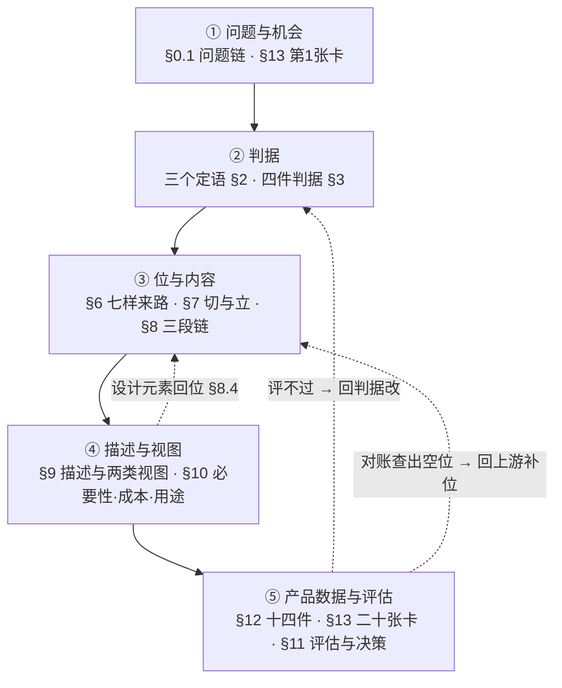
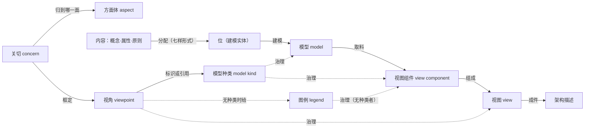

# 架构定义

**从问题与机会到架构描述**

**研究报告 · 第 48 号**

| 项 | 内容 |
|---|---|
| 编号 | 48 |
| 日期 | 2026-11-06（v3.23，修订复验） |
| 关键词 | 三个定语（关键／基本／相关）；架构目标；质量模型；关键成功准则；评估准则；需求分流；变换；建模实体（位）；八类位；守恒四条；切的规则；架构描述；两类视图（物理·功能）；模型种类；产品数据链；二十张卡转换规则；架构定义过程（15288 §6.4.4）；最小集十四件（十四份产品数据文档）；三档交付；评估；冷链；合同审核 |
| 适用对象 | 架构师、系统工程师、需求与产品数据管理者、评审与评估组织者、方法论研究者 |

> **落料位**：03-ch11（备料：判据与"基本"口径）｜03-ch13（备料：位与建模实体、清单与视图）｜04（—）

> **依据（判据只取正本）**：**ISO/IEC/IEEE 42010:2022**｜**42020:2019**｜**ISO/IEC/IEEE 15288:2023**｜**42030:2019**（库内件为 CSA 2020 采标本，故文件名作 `42030-2020`；引国际标准一律写 42030:2019）。
> **旁证件（不入依据位，只作对照）**：INCOSE《系统工程手册》5.0 中译注版（与 15288:2023 同版同年，属**同版同年二手**）；SEBoK v2.14（INCOSE／IEEE-CS／SERC 共同主持的知识体，属**权威团体公开件**）；OMG 业务激励模型（**转引**：库内无正本，措辞取自符合该模型的工具文档）。凡引此三件，逐处标性质。
> **三条纪律**（承 `claude-memory/feedback-no-own-reports-as-authority.md`）：① **不搬本库既有报告的结论，也不搬它的操作化**——"三把尺""一把尺三形态""三去向分流卡"之类只能算读法，用前必须回正本看"这个词、这条判据标准自己给了什么"；② **判据必须可操作**——祈使句不算，要能填句、能复核、两人各做一遍能对上；③ **结论式论证一经指出就认并重做**——拆成依据／推理／反证／边界，或承认该句错并改。
> **号形细则**：标准条款一律带标准名（如 42020 §8.4.4 f)）；**裸书写的「§x.y」一律指本报告自己的节**；本报告读法标〔读法〕，不得写成标准规定。
> **术语纪律**：正式名是「**建模实体**」（`modeled entity`），正文口语简称「**位**」；「关系」是模型单位之一，**本身不称位**——它若背内容、以元素身份进表（升格，见 §6.9、§13 第14·16张卡），那时称「**关系位**」，本篇其余各处不得把普通关系写成"位"；按 42020:2019 §3.6 的 `architecture entity` 必须写全「**架构实体**」，不得裸写「实体」。**「关切」（`concern`）是正名**——国标 42010 §3.10 译作「关注点」，本报告只在首次出现处括注一次，行文一律「关切」（2026-11-06 用户裁）。

---

## 摘要：判什么

> **读法**：六组即六段链——**判据 → 位 → 描述与视图 → 产品数据 → 评估 → 台账**。每条末括号内是本节号，末尾"台账 #n"指附录 B 的条号（取证用）；正文的节序与这里的组序不同：正文按"做什么"排，摘要按"判什么"排。

**一 判据（三个定语·四件判据·需求分流）**

1. **三个定语的参照物不同，不可互相渗透**（§2）。关键判的是"需求要不要进架构这条链"，参照是**关键成功准则的因子**；基本判的是"这条内容够不够格当架构内容"，参照是**删去它哪条准则立不起来／哪一句说不清**；相关判的是"这一次落位要不要留"，参照是**这一处要答的那一问**（台账 #1）。

2. **判"关键"不能"量"**（§2.2、§5.1）。正本给的是**追溯与流**（15288 §6.4.4.2 e) 的 *traceability*；42020 §8.4.3 g) 的 *how they would flow to the evaluation criteria*），不是度量。需求与目标**同源两枝**（42020 §8.4.4 a) 以问题为需求依据，f) 让目标应对同一批问题），故不能互量；正确动作是"**对位＋留痕**"（台账 #2）。

3. **覆盖≠不关键**（§2.2）。已被现有内容答了的关键需求**仍进追溯表**——15288 §6.4.4.2 e) 要的是追溯成立，不是"有变化才追"（台账 #3）。

**"判否"不等于"出局"**（§2.2、§5.3）。不关键的需求仍留需求基线，只记"未挂接＋理由"（缺口声明的义务见 42010 §6.2 末段）（台账 #4）。

4. **"基本"没有判定式**（§2.3）。四本正本只给一个形容词加一个参照物（42010 §3.2、附录 A.2），**不给阈值、不给裁定人、不给公式**。判据本体在本报告只有**一支填句**：概念问"能否共同陈述"、属性问"四量是否任一实质动"、原则问"许可与可检"——**三句是同一支填句的三种填法，不是三把尺，也不是第二套判据**（台账 #79）。

5. **"基本"不是候选的判据**（§2.3、§13 第12张卡）。三道门次序固定：**种类门**（概念／属性／原则）→ **可判门**（能给分类、度量、许可三种判定之一）→ **基本门**（删去后哪一句垮）。基本门**只分栏不删条**：非基本内容仍是内容，只是进模型与视图的补充面（台账 #5）。

6. **"相关"与"基本"是两道门**（§2.4）。42020 §10.4.4 e) 的 *relevant* 与 42010 §3.2 的 *fundamental* 不同；混起来会让环境、假设、表达层构造永远进不了模型（台账 #6）。

7. **实质＝越线或改选**（§3.4）。越过一条事前立好的线（42030 §4.2 注 3 的资料性原话：通过线 *could need to be* 事前建立），或翻转一个已记录的决策（42010 §6.10.1）。**四量任一实质动即算基本**（不是四量全动）；**两种"成本／时间"必须分开**——附录 A.2 的主语是 *its … within its environment*，改架构自身的花费不算那条"成本"。另两处常错：**按条目判、标题不入分类**；**"不够具体"不是判据轴**——具体度既不必要也不充分，判据靠改种类、不靠加详细（§10.8）（台账 #80、#81、#82、#83）。

8. **关切不是"基本"的判据**（§2.10）。关切可主观、可冲突，凭它判不出"缺这一条就立不起来"；它与"基本"是两道门。**权责三分并有留痕**：提（相关方）／判（架构师）／裁（治理），一次判定写成一行——结论、理由、人、日期（42010 §6.2、§6.10；42020 §6.4.4 d)~f)）（台账 #84、#85）。

9. **架构目标没有定义条，只有行为定义**（§3.1）。四本正本 §3 全无 `objective` 条；通用户口在 **ISO 9000 §3.7.11**（*result to be achieved*，要实现的结果）；架构目标的行为定义在 42020 §8.4.4 f)，工作产品在 42020 §8.5；据通用户口，**系统目标＝以被架构实体（通常为系统）为范围的结果、架构目标＝以架构工作为范围的结果**（§3.1 两条解释性说明与小结句）。四个同名物必须分开：架构目标（f)）／评估目标（42030 §6.1.2，宾语是评估工作）／项目·质量·分析目标（15288 他处）／架构管理目标（42020 §7.4.3）（台账 #8、#9）。

10. **质量模型＝度量＋关系**（42010 §3.2）。42020 §8.4.4 g) 要求"把握相关质量度量并定义度量之间的关系"；三层结构（特性→因子→度量）见 E.6（**资料性**）。它与"关切清单"的分界只有一条：写不写得出"同向／反向／无影响"（台账 #10）。

11. **关键成功准则没有定义条、没有工作产品**（42010 §3.3）。全库只有一处行为定义（42020 §8.4.4 h)）加两条注；42020 §8.5 的工作产品清单里**没有它**。它住在架构目标那一件里；**由目标＋质量模型配出**（直接输入两件、第7卡六步），目标卡末列“预留准则号”只是指针、不是准则本体（42010 §3.3 生成段）；**“关键”的判据只有相对权重**（i)），本库落成权重＋最低准则集（第7卡），critical 不是条条否决（台账 #11、#12）。

**"成功准则"是目标的对偶**（42010 §3.3）。同族四处（42020 §8.4.6 h) 的 means 侧、42020 §7.4.3 的架构管理目标、42020 §9.4 的过程实例、42020 §9.4.3 c) 的关键成功因素）证明：哪套目标配哪套准则，准则随目标批生成（台账 #12）。

12. **评估准则是四件里唯一有实质定义的**（15288 §3.4）。42020 §9.4.3 注 1：分价值评估准则与架构分析准则，各自是"被评对象须满足的条件或须通过的检验"（台账 #13）。

**谁判谁已有条款**（42020 §3.5）。价值评估准则判"关切与**架构目标**被满足到什么程度"；架构分析准则判"相关方需要与**需求**被满足到什么程度"。**目标归价值侧，需求归分析侧。**（台账 #14）

13. **"架构目标"与"系统目标"在语义上不可区分，可区分的是用途链**（42010 §4）。42020 §8.4.4 f) 的谓词里没有"架构"在起作用；标准靠"下游用不用得上"筛，不靠定义筛。**冠名随链走**：喂给架构概念化的叫架构目标（台账 #16）。

14. **架构没有成功学**（§4.4）。15288 §5.9：架构关注 *suitability, viability, desirability*（合宜、可行、可欲），设计关注兼容与可实现；"成功"属于系统与事业。42020 E.6.3 那句说的是 *the success of the architecting effort*（架构**工作**的成功）（台账 #17）。

15. **判关键有两条入口**（§5.1）。主判据是"挂得上某条准则的某个因子"；并列入口是**强制项与外部给定约束**（42020 §8.4.4 e)、§9.4.3 a)、15288 §6.4.4.2 b)）。前者判分，后者登记，不共用一张表；**去向四张清单**＝关键（覆盖／变换）｜约束｜转交｜未挂接（§5.5），约束登记后走传导→分配→核验（42020 §5.6）；三栏全空（覆盖／变换／转交）＝漏账（台账 #19、#57、#58）。

16. **"第二问"（架构层可定）两次尝试均失败，最终取消**（§5.2）。四承诺形态（立位／定界／立禁令／定分配）仍以"已有的位、边界、禁令"为前提，循环未破。**破法是换对象：不判需求，判因子**——"要判这个因子，架构上非说清不可的是哪几句"（台账 #20）。

17. **概念最容易漏**（§13 第11张卡）。关键需求多是"度量"与"许可"，概念藏在词义里；触发问句只有一句——**这条需求里有没有一个词，不同人理解不同？**有，就先立概念，再立属性与原则（台账 #67）。

18. **不是所有需求都要变换，但所有需求都要有去向**（§5.3、§5.5）。三处限量词（*as far as possible*、*relevant*、*critical*）只管"要不要动"，追溯全覆盖是另一件事（15288 注 23）。**按需求类别批量分流是实务建议**——标准只给五类（15288 §6.4.3.2 b)），不给默认路由；**敏感性一击**（改了它架构会不会变）可作判据，依据是 42010 §6.10.1 选"要记录的决策"的两项特征（台账 #86、#87、#88）。

**二 位（含模型与模型种类）**

19. **位住在架构模型里，进描述即成描述元素**（§7.4）。42020 §10.4.4 b) 注 1：模型元素代表"作为个别且离散单位存在的东西"；42010 §5.2.9：描述里出现的模型实例**即描述元素**（台账 #22）。

20. **切的对象是被架构实体的构成，不是内容条目**（§7.1）。概念定"断在哪儿"、属性定"这块要背多少"、原则定"这块不许怎么造"——内容是切口的依据与切完后的负担，随后被**分配**上去。切的规则七条（R0 定轴、R1 单位、R2 五断口、R3 合、R4 三禁、R5 停、R6 留痕）＋守恒四条（覆盖、不重、无空壳、需求兑现）见 §7.6（台账 #23、#24）。

**切分的轴就是模型种类**（§6）。模型有词条但在过程标准里（42020 §3.13：对实体或实体集合的抽象表示）；模型种类有词条在描述标准里（42010 §3.15：按关键特征与建模约定区分的模型类别），其实质是**引入元素类型**（42010 §5.2.9）。**轴由视角标识、边界由视角定**（15288 §3.8、42020 §10.4.4 a)）；**一条轴一份位**，跨轴走对应关系（42010 §6.9）不合并。标准**不枚举**种类（42010 §6.6 注 1：不要求特定视角）；本报告另给十五类**工程惯用示例**并标"非标准枚举"（42010 §6.5），含"功能分解 vs 流程"这一最常混的分别。另须分清：42020 §3.13 注 4 的架构模型／架构实体模型／概念模型／参考模型是"模型指什么对象"的**四分，不是种类**；标准自己列的候选来源见 42010 §6.7（附录 B.3／F，资料性）（台账 #31、#32、#33、#34、#35）。

21. **"落在模型里"有具体形态**（§13 第15张卡附释）。概念→**种类的构造**；属性→**元素的槽＋值或值域**；原则→**元素或关系上的约束**；关系→**关系行**（背内容时升格关系位）。种类必须，位看内容层级；轻量形态三不能缺（有种类／有元素或关系／有槽或约束）（台账 #70）。

22. **一行不是一份模型**（§13 第16张卡）。一行＝一个元素（位在模型里的代表，含该种类要求的构造与所挂内容）；整张表（元素表＋关系表，按一种种类）才是一份模型。把一行当模型＝一个位一份模型，退化成位清单（台账 #68）。

23. **四层两道界**（§8.1、§8.2）。描述／模型／设计／实现四层，两道界把"架构侧实体"与"系统元素"分开；**分配落不到系统元素上**——42020 §10.4.4 e) 的宾语是"要建模的实体与关系"，15288 §5.9 末段说这两种是**不同的概念**（台账 #105）。

24. **三套名字不可串，位有四性质**（§8.11、§7.2、§7.7）。架构实体（被架构的那个事物）／架构侧实体（要转换进设计的那批）／描述元素（描述里的构件）三词三家；位＝**可指认·可承担·可替换·离散**，三辨（vs 件／vs 名／vs 规格）与一句判据（**立住＝说得出它担了什么**）。**立位的规范化程序**（合／拆／弃跑到不动点）使"换个人给出同一套位"（台账 #106、#107、#108）。

25. **位的生成是四件事**（§8.12）：**选—容—落**（名字从哪来）、**两种触发**（内容没有落点／下游回灌）、**三栏台账**（内容｜位｜组件）、**实例化四道**（选槽·取值·对缝·挂承）。**三栏分开记，就不会把"框"当承担位、把"承担位"当位**（台账 #109）。

26. **八类位与视图的分布不是映射**（§9.33）。种类由视角定、露面由视图给：功能位住功能视图、信息位住信息视图、接口位住接口视图。**八类位对应八种"可能"的视图，一份描述不必八张都建；但空的要挂账**——不写"为什么现在不建"，下一个人会以为漏了。同一个位可在多张视图露面（1:N），那时要挂**对应关系**；两个位长得像而不是同一个，要挂**分配关系**（台账 #104）。

27. **两样与七样是两个轴；分配项全表有五处**（§6.15、§9.28）。两样是内容的**模态**（算什么），七样是**形式词表**（挂成什么形）——接口不增添内容。标准里点名的 allocate 有五处、对象各不相同：**七样只服务建模那一步；需求挂元素、内容挂位**；标准自己不封闭清单（有 *other attributes* 兜底）（台账 #95、#96）。

**三 描述与视图**

28. **架构描述＝用来表达某个架构的可交付信息体**（§9）。两本标准措辞一致（42010 §3.3／42020 §3.5 *work product used to express an architecture*）；它是"提供给相关方的信息的有形表示"，且被当作**信息部件**（42010 §3.14）。**须齐十项**（42010 §6.1~42010 §6.10），由**描述元素**组成（15288 §3.4）。四处边界：架构是本体、描述是表达（**定稿是内容定稿**）；描述包含视图且**可含不在视图里的部件**（42010 §6.7 EXAMPLE 2）；一份架构**可有数份描述**（42010 §5.2.2）；"构成一份描述"是满足可判性最常用最省事的做法，**不是唯一手段**〔读法，推翻旧说〕。"够不够"看到预期用途所需程度（42020 §10.2 b)），"合不合"按 §5 五种符合性主张判（台账 #36、#37、#38、#39、#40）。

29. **本库采用的新定义与三元组**（§9.6、§9.7）。**架构描述＝对「架构所确定的设计空间」的规范性表达**（用户 2026-11-04 裁定；与 42010 §3.3 的对象定义同义而非相斥——标准句给对象、本定义给效力）。三条合格判据：**界内**（是不是架构确定的空间）／**规范性**（能否排除做法）／**表达**（第三方能否读出同一空间）；落笔须补**空间由概念划界·属性定线·原则禁许三者划定**。三元组：**架构定空间／架构描述规范性表达空间／设计描述表达空间中的一点**——"点"的依据是 **15288 §3.13 的"一次合规实现"**（*a compliant implementation of the architecture*）。判据一条：**这句话在说空间还是说点**（"可替换"＝空间，"用某中间件"＝点）。三件价值**各归其主**（**本报告定性**）：架构＝收窄；架构描述＝可读可交接；**设计描述＝可采购可建造**——“把一点定到可实现”记在**设计描述**名下（15288 §3.13、§6.4.5.1），**不是架构的价值**；标准里“架构的价值”另有一义（42020 §9.2 e) 注：应对关切与预期运行使用的程度）。两处不可破的界：架构描述里不得出现"点"，设计描述里不得动"空间"（台账 #41、#42、#43、#44、#45）。

**术语处置：「架构描绘」作废**（42020 §9.5）。三条理由：无户口（`portray` 只属模型能力 42020 §3.13；`depiction` 只指外部图纸 42020 §10.4.6 d)）／与 express 的宾语错位／没有工作产品身份。四词替代：架构描述·表达·表现再现·图示（9.5）（台账 #56）。

30. **描述的用途是"传递·共享·记录"**（§10.3）。42010 附录 E.2 逐字：AD 是架构工作的产物，用途是*to **transmit, share and record** the architecture … and **associated decisions** across the life cycle*（传递、共享、记录架构及**相关决策**）；附录 D.2（**资料性**）另列 **21 项用途**——**"收窄设计空间"只占 a) 一项**。清单少的正是"**相关决策**"（决策不在 42010 §3.2 的两样里，D.2 e) 4) 明写要记决策与理由），而它服务下一次变更，**不是管理开销**（9.3）（台账 #52、#53）。

**描述对收窄的贡献是"把名义收窄变成实得收窄"**（42020 §9.2）。**名义收窄**＝命题上排除了什么；**实得收窄**＝下游实际被排除了什么；差值就是"绕道"。九项三分：理由＝**放大器**、对应关系＝**合成器**、已知问题与未应对＝**边界器**（三样只改名义）；**视图与组件只改实得**（阻断绕道）；其余（选区与受控）两者都不改。例证：无落点时"人工只是兜底"即可绕开，实得≈0（9.2）（台账 #50、#51）。

31. **"必须经视图"是条件必要，不是必然**（42020 §9.1）。四缺口（归属／读法／问／覆盖）＋原子与分子之别（清单给原子、视图给联合）；逻辑强度当且仅当 C2（判断须在作者不在场时可重做）与 C3（多人各持不同问句）成立。**标准自己说它是"基本前提"而非推论**（A.5 逐字 *a fundamental premise*；且不要求预定义视角集）——本报告此前多轮误当推论论证，已更正（9.1）（台账 #47、#48、#49）。

32. **该花多大代价由四条件定厚度**（42020 §9.4）。A 下游非本人／B 有绕道风险／C 判断多次重做／D 约束会变 → 四者全立编全套、A+B 立编薄、只 A 立一页说明、全不立不编；三条降本与成本判据（绕道损失×概率 vs 编造成本）。**"大代价"来自把合格性下限误当工作量清单**（42010 §1、§6.1 注 2／注 3）。另：AD 十项按读者分**三堆**（直接服务开发六项／防漏四项／受控一项），并按读者取料（9.4）（台账 #54、#55）。

33. **AD 与 DD：过程上是转换，产品上是约束与合规**（§9.8）。`transform` 的主语是**设计定义过程**（15288 §6.4.5.1、§6.4.5.3 b) 2)），不是"AD 这份文件"；产品关系四层：种类不同（空间／点）、单向刚性约束＋双向维护、**DD 不可由 AD 推导**（分解不唯一）、合规判定三角。说过程用"转换"，说产品用"约束与合规"（台账 #62、#63）。

34. **三档交付＝同一把四条件尺量出的三种形态**（§10.7）。只定内容／部分描述／完整描述；件数上落 1~7／8~14 按读者取（**第14件必带**）／1~14 齐＋版本基线。**完整≠十项都厚，部分≠不合格，不写描述≠没有架构。**（台账 #69、#75）

35. **从关切到视角：默认选、必要时改、最后才造（R0~R9）**（42010 §6.8）。选四条判据（射程／治理者／规格／读者）；改三种；造三个触发。规则不保证"找到唯一正确的视角"，只保证**选／改／造的视角可复核**（台账 #66）。

**常用视角与常用种类都不是标准枚举**（42010 §6.7）。42010 附录 B.3、F 是**候选资源**（B.3 自注"并非全部按本文件要求记录"）；十五类工程惯用种类是本报告示例，不保证互斥或穷尽；落项目须写"本项目视角标识的种类"并补 42010 §8.2 四件规格（台账 #35）。

**逐条依据与论证位置见附录 B「结论台账」**；条款索引见附录 A。
---

36. **清单与视图是两根正交的轴**（§9.24、§9.25、§9.26）。清单按类别排、视图按关切排；两者"**交叠**"不是"同一批字"，落点三处（组件自身／两组件之间／一圈之外）。**视图身份由四问判**：在描述里／受视角治理／组件标明种类或给了图例／它里头有没有东西体现着这个实体的概念、属性或与环境的关系——前三问判"是不是视图"，第四问判"是不是**这个架构**的视图"。**清单不等于描述**（四项一测、过一项挂三项）；**视图也不是清单的细化**（两种读法都不成立）（台账 #90、#91、#92、#93）。

37. **组件与意图**（§8.13、§10.12）。组件八步、三种失败（无治理者／不可分／越出词汇）；顺序不可颠倒但活动可交错，**硬依赖只有一条：组视图以模型为料**。**架构意图**＝下游必须理解、且改动即改变架构的那部分约定与理由——四处出处、三条检验、四种失效；它与"预期用途"（朝运行）、"预期目的"（朝评估）是三个近词，不可互替（台账 #110、#111）。

**四 产品数据**

38. **最小集是十四件，不是七件**（§12.1）。**内容最小集七件**（问题或机会的陈述／相关方与关切／需求／架构目标／关键成功准则／内容／位与分配）＋**描述最小集七件**（视角与模型种类／模型／视图组件／视图／对应关系／决策与理由／未应对声明）＝**十四件**；质量模型、权重、评估准则、关键特征、评估件按条件才要。**十四件＝十四份产品数据文档**（内容侧七份＋描述侧七份）；其中三份不单独成册（件5 寄居第4件，件13、件14 是描述里的节，§12.2），但一份不能少。"只定内容"是不出描述的**降档**，只交 1~7，不称最小集（§10.7）。判据仍是"删掉它链上哪一步垮"，容器可合、判据不可合（台账 #72、#73）。

39. **产品数据必须分产出件与登记件**（§12.3）。产出件回答"有什么"，登记件回答"这两件之间成立不成立"；**只收产出件，空位·越界·假齐套三种病一律不可见**。三件配套：**三条判法**（有名字·有条款要它·有下家）、**五处"看着像转换、其实不是"的接缝**、**三张对账单**（关切／内容／需求）与四条纪律；**边界是查得出缺、查不出"缺得对不对"**。五件表达数据各有几栏（视角 7＋1／种类 4／组件 3／视图 4／描述 6 组）——**缺 b) 的视角不是视角，缺 d) 的视图放了缺口**（台账 #122、#123、#124、#125、#126）。

**五 评估**

40. **评估是就指定评估目标所作的判断**（§11.4、§11.5）。三个对象三套依据（架构／描述／架构实体），不可混——*built right*（建对了）与 *the right solution is built*（建的是对的那一个）是两句不同的话。依据**四组十五项**（实体侧 2／对象侧 5／评价者侧 4／程序侧 4），另有"不算依据的四样"。三条边界：**只判断不处置／评架构不评描述／可不依赖成文描述**（台账 #115）。

41. **四件输出与次序**（§11.7、§11.8）。评估的应产出四件，另有三样留存；三层（评估综合／价值评估／架构分析）不可互替——**分析给事实，评估作判断**。次序上标准**允许"内容先行、视图后出"**（42020 §8.3 注 a)~e)），**后出的视图不是清单的升级版**；还须补一步"关切—内容覆盖对账"（台账 #116）。

42. **评估不代替决策**（§11.9、§11.10）。判断（评估）／建议（评估方）／选择与处置（决策者）三动作分开——**"评估通过"从不等于"决定通过"**。决策对象三分（内容项·架构单元·候选架构），判据看"受影响的描述元素"指向什么；**"选哪一套架构"不在那十二项清单里**（台账 #117、#118）。

**六 台账（结论凭什么）**

43. **词先钉户口，再问关系**（附录 C）。有户口的只有十五个左右，其余（七样·设计空间·目标·原则·组件）一律无定义条目，只能标"使用处"。问关系之前先钉三件：**户口·侧别·治理者**；钉住后只剩四种可答的问法。另：**"模型元素"不是术语**（正名是 AD 元素），八个生词靠三把快手分辨——**它们没有一个是"图"，都是"图怎么被造出来、怎么被读懂"的中间件**（台账 #127、#129、#130）。

44. **全书是一条线，不是十四件并排**（42010 §1）。**五段为骨**——讲清问题、定好判据、落成结构、说给读者、留好账，段内按十四件的步序走：问题与机会→相关方与关切→需求→目标→准则→分流→关键特征与内容→**视角与模型种类**→位→分配→模型→组件→视图→对应关系→决策与未应对＝架构描述；三处回路（准则集漏了回问题空间／空位回分配／设计冲突回目标）是设计好的复核，不是返工（台账 #77）。

**三本账与两档粒度**。本报告自带三本账：**附录 A 条款索引**（138 行、129 个标准条款号，正文每一个标准 § 都在册）、**附录 B 结论台账**（130 条，逐条给级·依据·论证位置）、**§15.1 被推翻的论断 13 条＋§15.4 未决 14 条**。**同案同数是一条纪律**：冷链编号一律归 §14.1 的十位（功能位1~3／信息位1~3／接口位1~2／结构位1／关系位1），功能分解展开时的细分层只标 F1~F5（§9.20）——**切法可以不唯一，编号只许一套**。

## 目次

- 零、起点与体例
  - 0.1 问题链：原问落在哪里
  - 0.2 取证纪律：按什么档引用
  - 0.3 新立了什么
  - 0.4 编号怎么叫
  - 0.5 结论怎样分级记账
- 一、总览：从问题与机会到架构描述
  - 1.1 交付分段：每段交什么
  - 1.2 产品数据清单
  - 1.3 从哪读起
  - 1.4 最容易漏的关节
  - 1.5 主线：从目的到决策
  - 1.6 入口与回路
  - 1.7 速览：从目的到视图
  - 1.8 通俗版：先有画面
- 二、关键、基本与相关的重排
  - 2.1 先立锚：准则写成什么话
  - 2.2 关键：需求凭什么算关键
  - 2.3 基本：填句与判句
  - 2.4 相关：何时算相关
  - 2.5 定语为何不能互换
  - 2.6 总纲
  - 2.7 接缝：推不过去的地方
  - 2.8 谁说了算：提、判、裁
  - 2.9 留痕：判定怎么写
  - 2.10 关切不是基本的判据
  - 2.11 准入速查
- 三、判据的户口
  - 3.1 架构目标：标准话怎么读
  - 3.2 质量模型：度量与层次
  - 3.3 关键成功准则：目标的对偶
  - 3.4 评估准则：价值侧与分析侧
  - 3.5 谁判谁：各样归谁
  - 3.6 近词怎么分
- 四、架构目标与系统目标之争
  - 4.1 标准话怎么切开
  - 4.2 旁证与外查
  - 4.3 属差：为何都撤回
  - 4.4 裁定：按系统层理解
  - 4.5 定稿指内容不是描述
- 五、需求分流与变换
  - 5.1 判关键：主判据与入口
  - 5.2 判据为何自相循环
  - 5.3 判否不等于丢弃
  - 5.4 强制项与关切：双写
  - 5.5 去向：判据与留痕
  - 5.6 约束登记后怎么用
  - 5.7 变换怎么做
  - 5.8 去向差分卡
  - 5.9 批量分流
- 六、模型与模型种类
  - 6.1 模型：词条在过程标准里
  - 6.2 模型种类：定义与规格
  - 6.3 架构模型名不是种类
  - 6.4 轴就是模型种类
  - 6.5 常用种类：工程惯用
  - 6.6 标准边界：能说与不能说
  - 6.7 视角与种类的候选
  - 6.8 从关切到视角
  - 6.9 被分配的形态名单
  - 6.10 形态不是类
  - 6.11 为什么必须有这几样
  - 6.12 内容从哪来
  - 6.13 内容与系统需求
  - 6.14 东西指什么，挂指什么
  - 6.15 模态与形式
  - 6.16 元素怎么切出来
- 七、位：定义、切法与种类
  - 7.1 切的是什么
  - 7.2 位的定义与性质
  - 7.3 位并不抽象
  - 7.4 位住在哪件产品数据
  - 7.5 位怎么生成
  - 7.6 切的规则与守恒
  - 7.7 立位的规范化程序
  - 7.8 何时新立位
  - 7.9 粒度停在哪儿
  - 7.10 位的种类从哪来
  - 7.11 位对研发有什么用
- 八、位的下游与分界
  - 8.1 分层与分界
  - 8.2 分配为何落不到元素
  - 8.3 位与系统元素怎么分
  - 8.4 位到系统的链
  - 8.5 系统分解结构不是架构
  - 8.6 设计元素是什么
  - 8.7 数量关系与不变量
  - 8.8 位与元素为何必混
  - 8.9 怎么防混同
  - 8.10 给新手怎么起步
  - 8.11 名字不可串用
  - 8.12 位怎么落地
  - 8.13 组件怎么生成
- 九、架构描述与视图
  - 9.1 描述的定义
  - 9.2 描述由什么构成
  - 9.3 描述的边界
  - 9.4 够不够与合不合
  - 9.5 可填的检查句
  - 9.6 描述的定义与讲法
  - 9.7 空间、表达与取点
  - 9.8 描述与设计描述
  - 9.9 清单视图描述的分工
  - 9.10 每样各管什么
  - 9.11 为什么必须并存
  - 9.12 各样答什么
  - 9.13 先把问题问准
  - 9.14 视图怎么装
  - 9.15 视图干哪几件事
  - 9.16 为什么是位加形态
  - 9.17 视图的必要性
  - 9.18 失败链与灵活处
  - 9.19 物理视图
  - 9.20 功能视图
  - 9.21 功能单位算不算位
  - 9.22 定义推不出视图
  - 9.23 体现是资料性注
  - 9.24 正交轴：清单与视图
  - 9.25 身份由什么定
  - 9.26 视图不是细化
  - 9.27 视图还要回应什么
  - 9.28 分配项全表
  - 9.29 架构元素与近邻词
  - 9.30 模型、元素、组件、视图
  - 9.31 实体与描述元素
  - 9.32 功能分到功能算循环吗
  - 9.33 各类位落在哪张图
- 十、描述的必要性、成本与用途
  - 10.1 为何必须经视图
  - 10.2 名义与实得收窄
  - 10.3 描述的用途
  - 10.4 该写多厚
  - 10.5 架构描绘作废
  - 10.6 总账
  - 10.7 交付分几档
  - 10.8 收窄链
  - 10.9 视图只标边界
  - 10.10 分配展示什么
  - 10.11 标准话怎么改
  - 10.12 写到哪儿停
- 十一、评估：依据、过程与决策
  - 11.1 评估是什么
  - 11.2 为什么要评估
  - 11.3 评估的意义
  - 11.4 评什么：对象与依据
  - 11.5 凭什么判
  - 11.6 活动与顺序
  - 11.7 交出什么
  - 11.8 什么时候出
  - 11.9 评估与决策
  - 11.10 决策的宾语
  - 11.11 评估怎么做：看例
  - 11.12 与卡怎么分工
- 十二、产品数据：最小集与查缺
  - 12.1 最小集与条件件
  - 12.2 寄居：不单独成册
  - 12.3 产品数据的判法
  - 12.4 接缝：像转换其实不是
  - 12.5 空位与越界怎么查
  - 12.6 每件里分几栏
- 十三、转换规则：每件怎么做
  - 13.0 通则
  - 第1张卡 问题空间定义报告
  - 第2张卡 相关方清单与关切清单
  - 第3张卡 相关方需求集
  - 第4张卡 系统需求集
  - 第5张卡 架构目标
  - 第6张卡 质量模型
  - 第7张卡 关键成功准则与权重
  - 第8张卡 评估准则
  - 第9张卡 需求分流与关键需求
  - 第10张卡 关键特征
  - 第11张卡 内容候选（概念、属性、原则）
  - 第12张卡 内容过门
  - 第13张卡 视角与模型种类
  - 第14张卡 位
  - 第15张卡 分配
  - 第16张卡 模型、组件与视图
  - 第17张卡 架构描述
  - 第18张卡 评估计划、报告与结果
  - 第19张卡 对账
  - 第20张卡 设计侧的件
- 十四、全链范例：冷链与合同审核
  - 14.1 冷链（冷藏药品干线运输）
  - 14.2 合同审核（企业合同审核与审批）
- 十五、台账与待办
  - 15.1 被推翻的论断
  - 15.2 自己撤回的尝试
  - 15.3 各产品数据的户口
  - 15.4 没定的事与待办
- 附录 A 条款索引
- 附录 B 结论台账
- 附录 C 速查与术语
  - C.0 整链总图
  - C.1 速查表
  - C.2 术语与档位
  - C.3 可裁下贴墙的判定卡片
- 附录 D 改号对照表（v1.20~v3.0 → v3.23）

## 零、起点与体例

**本章交代五件体例：问什么（§0.1）、按什么档取证（§0.2）、本报告新立了哪几件（§0.3）、编号怎么叫（§0.4）、结论按什么标准分级并记账（§0.5）。** 后三条是全文的纪律，后面每一条判据都要按这三条读。

### 0.1 问题链：原问落在哪里


本报告是一轮连续问答的**完整整理**，问题本身就是它的目录。原问依次为（保留原措辞）：

| # | 问句 | 落在本报告 |
|---|---|---|
| 1 | 从架构目标与关键成功准则开始，重排"需求之关键／概念或属性之基本／内容七种形态之相关" | §2 |
| 2 | 先把架构目标及关键成功准则这两个概念搞清楚 | §3.1、42010 §3.3 |
| 3 | "架构目标就相关方关切、需求或质量属性而言应对问题与机会"怎么理解？"就……而言"是什么意思？ | §4.1、§4.2 |
| 4 | 结合英文原文理解；结论是什么 | §4.1、§4.3 |
| 5 | 架构目标究竟是什么？换成系统目标是否也成立？ | §4.3、§4.4 |
| 6 | 架构定稿，是内容定稿还是描述定稿 | §4.5 |
| 7 | 若把架构换成系统，从语义上也没问题呀 | §4.3 |
| 8 | 我们暂且把架构目标理解为系统目标；接着讨论关键成功准则，先找它的定义或说明 | 42010 §3.3 |
| 9 | 架构目标和关键成功准则可以理解为系统目标和系统的关键成功准则，而不是架构的；架构怎么会有成功不成功的 | §4.4 |
| 10 | 以此为假设，需求分流时"关键"的判据是什么，是不是系统目标和关键成功准则 | §5.1 |
| 11 | 第二问是标准给出的吗；这一问好像无法落地；狗咬自己的尾巴 | §5.2 |
| 12 | 那结论是：系统目标和关键成功准则是判断需求是否关键的唯一依据 | §5.1 |
| 13 | 强制项和外部给定约束，都应该在关切中体现 | §5.4 |
| 14 | 给出各产品数据的定义或说明；各产品数据要独立 | 42020 §10.2、§12.1 |
| 15 | 位在哪个产品数据中，给位一个详细定义或说明 | §7.4、§7.2 |
| 16 | 详细给出各产品数据之间输入输出关系，以及从输入转化为输出的规则；太简单了，要详细至可理解、可执行 | §13 |
| 17 | 以冷链为例／以合同审核为例，给出详细范例 | §14 |
| 18 | 不要用类似 P/O 简称 | 全文编号一律中文（§0.4） |
| 19 | 架构的价值是收窄设计空间，那架构是确定了设计空间吗 | §9.6、§9.7 |
| 20 | 把空间中一点定到可实现，这是架构的价值之一，查一查有没有出处（标准里） | §9.7 |
| 21 | 目标，在 9000 标准中有；系统目标与架构目标各给一条说明 | §3.1 |
| 22 | 系统目标和架构目标，二者都由系统及其运行兑现？请核到条款，不要臆想 | §3.1 |
| 23 | 关键成功准则是什么、怎么来的、输入与转换规则是什么；是不是目标卡的最后一列 | 42010 §3.3、§13 第7张卡 |
| 24 | 改动这条需求、哪条准则的哪个因子会动——"因子"是什么；"关键"的判据是什么 | 42010 §3.2、§3.3 |
| 25 | 四种去向（覆盖／变换、约束、转交、未挂接）怎么用；登记为约束的需求后续怎么用 | §5.5、42020 §5.6 |
| 26 | 常用视角与常用种类不能直接用现成结论，要按标准或权威资料 | 42010 §6.7 |
| 27 | 位→分配→模型→组件→视图，整链不得压缩、不得有内容损失 | §7、§13 第16张卡 |
| 28 | 架构描述与设计描述的关系是什么，是转换关系吗 | §9.8 |
| 29 | 已讨论的内容在本报告里有没有损失（逐条查漏） | §15.1、§15.2 |
| 30 | 什么情况下定内容／给部分视图／给完整描述；"落在模型里"是什么意思 | §10.7、§13 第15张卡 |
| 31 | 从问题与机会到架构描述，必要的产品数据应包括哪些 | §12.1 |
| 32 | 必要产品数据的最小集是几件（定为十四件） | §12.1 |
| 33 | 两份全链范例是否完整；范例除产品数据结构外，还要说明如何从输入转换为输出 | §14 |
| 34 | 位与系统元素怎么分、中间那一层（设计元素）是什么 | §8.1~§8.7 |
| 35 | 位的种类有几类、各住哪张视图、露面多了怎么对账 | §7.10、§9.33 |
| 36 | 为什么要经视图、不到视图行不行 | §9.17、§9.22、§10.1 |
| 37 | 评估怎么走：评什么、凭什么、什么时候出结果、谁说了算 | §11 |
| 38 | 一件产品数据怎么算一件；缺的账怎么查出来 | §12.3、§12.5 |
| 39 | 两套件数怎么并、旧号还留不留、术语用哪个字 | §0.4、§12.1、附录 C、附录 D |
| 40 | 全书结论怎么记账、条款怎么编索引 | 附录 A、附录 B、§15.4 |

**原问 33 条之后又添 7 问**（施工期陆续提出，编号接上）：它们把 §8~§15 与三个附录立起来。**摘要按六组读**（判据→位→描述与视图→产品数据→评估→台账），与上表的原问顺序不同——一按"问的顺序"，一按"判什么"。

### 0.2 取证纪律：按什么档引用


| 档 | 写法 | 含义 |
|---|---|---|
| ① 标准逐字 | 引原文并标条款，如"42020 §8.4.4 f) 逐字：…" | 可作依据 |
| ② 标准可支持的读法 | 标〔读法〕＋所读条款＋边界 | 可作判据，但须说明是读法 |
| ③ 本报告定性 | 明写"本报告定性" | 只作组织方式，不作依据 |
| ④ 旁证 | 标"二手""权威团体公开件""转引" | **不入依据位**，只作对照 |

结论的分级与台账用法见 §0.5。

### 0.3 新立了什么


**本报告新立的有九件**（其余判据是对四本正本的读法与条款重述，逐处带标准名或标〔读法〕）：① 三个定语的参照物与三道门的次序；② 四件判据的户口与"目标的对偶"结构；③ 需求分流判据的两次修正与最终取消（改为"不判需求，判因子"）；④ 切的对象＝被架构实体的构成；⑤ 产品数据二十张卡转换规则（含不成立判定、留痕与常见错误）；⑥ **切分的轴＝模型种类**，并给出十五类工程惯用种类与"一条轴一份位"的规则（§6）；⑦ **架构描述的十项构成与四处边界**，含"可分多份""可含不在视图里的部件""不是唯一手段"三条（§9）；⑧ **本库采用的新定义与三元组**（§9.6、§9.7）；⑨ **描述的必要性·成本·用途三组结论**——四缺口与条件必要、名义／实得收窄、D.2 二十一项用途与四档厚度、以及"架构描绘"作废（§10）。

### 0.4 编号怎么叫


本报告不使用拉丁字母缩写作对象名。对象一律写中文名并带序号：问题1、机会1；相关方1、关切1；需求1（相关方需求）、系统需求1；目标1、准则1（关键成功准则）、评估准则1；关键特征1、视角1、模型种类1；概念1、属性1、原则1；功能位1、信息位1、接口位1、结构位1、关系位1；本报告的节用「§x」，转换规则的卡用「第N张卡」。

**两套 R 规则同前缀、不同套**：§6.8 的 **R0~R9** 是**选视角**的细则，§7.6 的 **R0~R6** 是**切法**规则。两组编号形似而所指不同，**引用一律带节号**（如「§7.6 的 R0」），不得裸写「R0」——裸号会在两章之间指错。

---

### 0.5 结论怎样分级记账

**三级论证体例**（凡结论一律进附录 B 的结论台账，按同一标准分三级；A 级必须四段齐全，缺一段即视为未论证）

| 级 | 什么结论归此级 | 必须给什么 |
|---|---|---|
| **A 级（承重／反直觉）** | 与通行说法相反、或全书靠它承重的结论（如"基本无判定式""视图不是细化""分配不落系统元素"） | **四段齐全**：依据（逐条引条款）｜推理（可逐句反驳）｜反证（结论不成立会出什么事，或对立说法撞上哪条原文）｜边界（不覆盖什么） |
| **B 级（条款直引可支持）** | 把条款逐字转成中文即成立的结论 | **条款直引＋性质标记**；不必写推理（推理就是翻译，重复无益），但**须给条款位置** |
| **C 级（本报告读法／方法）** | 标准无原话、由本报告归拢或操作的结论（如"三栏台账""去向差分卡""实质＝越线或改选"） | **标〔读法〕＋所读的条款＋边界**；不得写成标准规定 |

**节首性质行的两种写法**（同属 C 级）：陈述型写"本节判断属本报告读法〔读法〕"，步骤型写"本节步骤与判法属本报告读法〔读法〕（步骤为操作化）"——**只有这两个名字，不再并出第三个**。

**为什么"一视同仁"不等于"条条写长"**：若每条都铺四段，A 级的论证反而被稀释——读者分不出哪里是承重墙。**一视同仁的实质是"同一本账、同一个标准、每一项都填得出凭什么"**，不是"每条一样厚"。

**台账怎么用**：查一条结论凭什么，去附录 B 找到它，看"级／依据／论证位置"三栏；某条标 A 而论证位置对不上，说明它还没达到发布标准——那一条挂在 §15.4 的未决里，**不装作已经论证过**。

---

## 一、总览：从问题与机会到架构描述

**本章要解决一件事：让读者先看见整条链，再决定细读哪一章。** 本章只给"位置与来路"，不给判据（判据在 §2~§5）、不给步骤细节（§13）、不给完整数据（§14）；任何一句都能跳到正文的那一节。

### 1.1 交付分段：每段交什么

**先记五段；十四件是每一段里要交的东西，用的时候再查。**

```
① 讲清问题 ────── 件1 问题或机会的陈述 · 件2 相关方与关切 · 件3 需求
        ↓              现状＋出处＋根因／谁在乎、什么不可协商／要什么、到什么程度
② 定判据 ──────── 件4 架构目标 · 件5 关键成功准则
        ↓              把问题推向什么状态／到什么程度算解决
③ 定结构与落点 ── 件6 内容 · 件7 位与分配
        ↓              概念·属性·原则／每条内容挂到哪个单位、怎么核
④ 说出来 ──────── 件8 视角与种类 · 件9 模型 · 件10 组件 · 件11 视图 · 件12 对应关系
        ↓              按读者的问重排、每样有约定、跨视图对得上账
⑤ 留账 ────────── 件13 决策与理由 · 件14 未应对声明
        ↓              为什么这么定／哪里还没定
   架构描述（可交接）──→ 评估 · 对账 · 交设计
```

**背这五句就够**：**讲清问题、定好判据、落成结构、说给读者、留好账。**

段内可以少交，但不许空着——少交的那一件，写进第⑤段的未应对声明。两处不在这十四件里：件6 之前有一道**需求分流**（卡9，关键／约束／转交／未挂接四张清单）是工序；**关键特征**（卡10）按条件才要。**一件由哪张卡做出来，见 1.2 末列。**

**三处回路**（不是返工，是这一步要求的复核）：

```
  ⤴ 准则集漏了：需求挂不上任何准则 → 回①补问题空间（卡9 的三出口②）
  ⤴ 空位／重复记账：内容无位承担、两位背同一句 → 回③重分配，或补内容（卡19 第一·二道）
  ⤴ 设计冲突：设计侧发现架构做不到 → 回②改目标或回③改内容，并记决策（卡20 回写）
```

**三处要有数**：① **件7 一步两块**——先切位、再分配，同属一件；② **件8 在件7 前**——先定轴才谈得上切（R0 先定轴），这是"件号序"与"执行序"唯一一处交叉；③ **回路是设计好的**——卡9 的三出口、卡19 的四道对账、卡20 的回写，本来就是"这一步要复核"的机制。

### 1.2 产品数据清单

**先说清"件"是什么**：一件＝**一份产品数据文档**，十四件即十四份；表里"交什么"一列，就是那一份要写的内容。三份不单独成册（件5 寄居第4件，件13、件14 是描述里的节，§12.2），但计数照算——寄居只是不成册，**仍是十四份里的三份**，只是住在别的文档里。

| 件 | 交什么 | 从哪来（输入） | 什么算成立（一句） | 由哪张卡做 | 细讲 |
|---|---|---|---|---|---|
| **① 讲清问题** | —— | —— | —— | —— | —— |
| 1 | 问题或机会的陈述 | 业务或任务分析、现状材料、约束来源、机会来源 | 有可观察现状＋出处＋根因两环；机会写出抓住它的条件 | 卡1 | §13 |
| 2 | 相关方与关切 | 件1 | 每问题至少一个相关方、每相关方至少一条关切，双向无空行 | 卡2 | §13 |
| 3 | 需求（相关方→系统） | 件2＋生命周期概念 | 可判真假、不暗示实现、有来源；系统需求建双向追溯 | 卡3·4 | §13 |
| **② 定判据** | —— | —— | —— | —— | —— |
| 4 | 架构目标 | 件1、件2、件3、约束 | 三槽齐：坐标／宾语／方向，且能指回坐标 | 卡5 | §13 |
| 5 | 关键成功准则 | 件4＋质量模型 | 每条＝因子＋值或值域，并有两用途（判解决程度／指方向） | 卡6·7 | §13 |
| **③ 定结构与落点** | —— | —— | —— | —— | —— |
| 6 | 内容（概念·属性·原则） | 件3＋件5＋约束 | 逐条过三槽句；只分栏不删条 | 卡9~12 | §13 |
| 7 | 位与分配 | 件8（先行）＋件6＋外部接口 | 三列（名字·边界·承担）写得出、守恒四条不破；每条内容有落点与怎么核 | 卡14·15 | §7、§13 |
| **④ 说出来** | —— | —— | —— | —— | —— |
| 8 | 视角与模型种类 | 件2＋件6＋已有视角库 | 每条关切至少被一个视角框定；每视角标识种类或图例并写四件规格 | 卡13 | §6、§13 |
| 9 | 模型 | 件7＋件8 | 元素指得回位表、关系两端在表内、一种模型不混两种构造 | 卡16 | §13 |
| 10 | 视图组件 | 件9＋件8 的答哪几问 | 有治理者、有取自、有覆盖关切 | 卡16 | §13 |
| 11 | 视图 | 件10＋件8 | 有治理视角、有覆盖声明、有已知问题 | 卡16 | §13 |
| 12 | 对应关系 | 件11（共享组件处） | 写“成立”或列出全部已知违例 | 卡16 | §13 |
| **⑤ 留账** | —— | —— | —— | —— | —— |
| 13 | 决策与理由 | 件9~12＋被否的备选 | 编号、陈述、权限人、约束与假设、关联、理由、时间戳 | 卡17 | §13 |
| 14 | 未应对声明 | 件11 的已知问题＋件2 关切全集 | 未处理的逐条写原因；偏离记理由·期限·批准人 | 卡17 | §13 |

**这张表不必一次记住**：先记 1.1 的五句口诀，做到哪一段查哪一段的件。十四件的权威口径与条款依据在 §12.1（含"缺了会怎样"）；"怎么做出来"看末列那张卡。两表分工：本表给位置与来路，§12.1 给依据与判据。

### 1.3 从哪读起

**三处入口**：要**判据**（关键／基本／相关怎么判）去 §2~§5；要**步骤与判否**（每件怎么走、什么算不成立）去 §13；要**能照着做的样子**（两份全链范例，含逐环节转换）去 §14。

**三条读法路径**：

- **判据读者**（想知道"凭什么这么判"）：§1 →§2（三个定语）→§3、§4（四件判据与目标之争）→§5（需求分流）→§12.1（十四件）。
- **执行读者**（手上就有一摊活）：§1.1（五段与十四件）→§14.2（合同审核，件序照做）或 §14.1（冷链，卡序照做）→ 遇判据回查 §2~§5。
- **教学与备料读者**（要讲给人听、或给教材取料）：§1 →§14 →§10（描述值不值得写、写多厚）→§15（推翻与未决）。

**读到哪算懂**：

| 你的目的 | 读哪几处 | 读到哪算懂 |
|---|---|---|
| **先有画面**（没做过、术语太多） | §1.7 速览 → §1.5 十节点 → §14 两例 | 能用自己的话把"关切→需求→内容→模型→视图→描述"讲一遍，不用术语 |
| **要落地做一遍** | §13 二十张卡 → §7 位 → §14.2 合同审核 | 能对自己的项目填出三样：谁在意什么／到什么算成／这一页给谁看、答哪几问 |
| **要判、要引条款** | §2~§5（判据）→§3.6（四个词）→§11（评估）→附录 B 台账 | 每条结论说得出依据、反证与边界 |

**一份报告的四个层次**：**概念层**（§2~§10：内容·位·视图·描述）｜**产品数据层**（§12~§14：每一步交出什么、怎么变）｜**判据层**（§2、§5、附录 B：怎么判、凭什么）｜**入门层**（§1.5~§1.7：先看懂）。

### 1.4 最容易漏的关节

1. **判关键不判层级**——"关键"判的是需求挂不挂得上准则的某个因子，不是"它属于架构层还是设计层"（§5.1）。
2. **轴先于切**——先有视角与模型种类，才谈得上切位；表现在件序上是**件8 先于件7**（§6、§7.5）。
3. **描述不增加收窄，只让收窄生效**——收窄由内容完成；描述把"名义收窄"变成"实得收窄"，并让它在作者不在场时仍然有效（§10.2、§10.8）。

### 1.5 主线：从目的到决策

**五段说的是"交什么"，这条主线说的是"每一步之后动词落在哪"。** 十节点：

| # | 节点 | 它是什么 | 到下一步的动词 | 条款 |
|---|---|---|---|---|
| 1 | **目的** | 实体为什么存在——标准里以三种化身出现：业务或使命目标、预期用途、问题或机会 | 化成目标与需求 | 15288 §6.4.1、§6.4.2、§6.4.4.1 |
| 2 | **目标** | 可判的准则（到不到、好不好） | 导出需求；也直接进评估 | 42020 §9.1；42030 §1 f) |
| 3 | **需求** | 可测量，**不宜暗示实现**（42020 §10.4.2 一带用的是 *should not*，不宜，不是禁止） | **变换**为内容 | 15288 §6.4.3.1 |
| 4 | **关切** | 相关方"对其而言重要或相关的事项"（可主观、可冲突） | **框定**视角；供评估因子 | 42010 §3.10、§6.6；42030 |
| 5 | **内容** | 概念或属性＋管控原则——它既是定义句里的那个东西，也是**被分配的东西** | **分配**到位上 | 42010 §3.2；42020 §10.4.4 e) |
| 6 | **位**（模型里的实体与关系） | 离散的承担单位 | **组成**视图组件 | 42020 §10.4.4 b)、d)；42010 §5.2.8 |
| 7 | **视角** | 一组惯例（怎么造、怎么读） | **框定**关切、**治理**视图 | 42010 §3.8、§6.6、§6.7 |
| 8 | **视图** | 描述里的信息部件 | 被评估、被签收 | 42010 §3.7、§6.7 |
| 9 | **评估** | 就**被指明的评估目标**所作的判断 | 交决策者 | 42030 §3.4 |
| 10 | **决策** | 一组选择，并承担处置 | 改内容或改架构，**记理由** | 42010 §6.10；42030 §3.4 注 1 |

**主线与五段的分别**：五段管交付件（件1~14，§1.2），主线管步序与动词；主线比五段多出来的一刀，是把"内容"依定义句展开成**内容**与**位**两步。**五段查到"要交哪一件"，主线查到"这一步之后该做什么"。**

### 1.6 入口与回路

```
目的 ─→ 目标 ─→ 需求 ──变换──→ 内容 ──分配──→ 位 ──组成──→ 视图 ──→ 评估 ──→ 决策
关切 ──────────框定─────────→ 视角 ─────────────────────↑              │
  └────────────────────── 供评估因子 ────────────────────────────────┘
                                           决策 ──改内容或改架构──→ 回到内容
```

**两个入口**：**需求**走**内容路径**（变换→内容→位→组件）；**关切**走**表达路径**（框定→视角→视图）。**两条路在视图处会合，不在内容处会合**——这是全链最容易画错的一处。

**三条回路**（都是设计好的复核，不是返工）：

| 回路 | 依据 |
|---|---|
| ① 评估→决策→改内容或改架构→再评估 | 42020 §9.4 的迭代条款；42010 §6.7 注 2（未决问题引出待做的决策） |
| ② 设计回灌 | 15288 §5.9 末段；42020 §5.6（约束需求常由下游过程发现，资料性） |
| ③ 关切再识别 | 42010 附录 A.3 逐字 *Some stakeholders are often not known until creation of some architecture views…*（中译：有些相关方常要等某些视图作出来才为人所知）——**先出视图、后收关切**是标准承认的正序之一 |

**两处最常被压成一步的地方**（压了必错）：**关切 ≠ 需求**（前者可主观、可冲突、可无对应需求）；**目的 ≠ 评估目标**（前者给方向，后者给尺子）。

### 1.7 速览：从目的到视图

**本节只给速览与判据；范例的实体在 §14**（冷链的十四件落点与逐卡转换一览、合同审核的逐件走法）。每步给"做什么／判据／冷链本例"：

| # | 做什么 | 判据（不合即停） | 冷链本例 |
|---|---|---|---|
| 1 | **写清目的** | 答得出"系统不存在，谁的什么状况不会改善" | 让生鲜在全程不断链的前提下运出去，出事能自证 |
| 2 | **目的化成目标** | 每个目标都能进评估：**指标＋期望水平（含方向与范围）＋判定时机** | 发现时延期望 ≤30 s／最差 60 s｜可追溯率 ≥99.5%｜误报率 ≤2%｜换承运方 ≤3 人日 |
| 3 | **目标化成需求** | 可测量，且**不宜暗示实现**（*should not*） | 断电保温 ≥72 h｜判定延迟 ≤30 s｜箱号全程可追 |
| 4 | **同时收关切** | 有名单、有事由；**关切不进需求那条路** | 货主（别断链·能索赔）｜承运方（不被绑死）｜监管（留存·不可篡改）｜运维（升级不破坏） |
| 5 | **需求过分流卡**（卡9） | 每条都必须有去向：关键·覆盖／关键·变换／约束／转交／未接 | 保温 ≥72 h →变换｜"唯一权威源"→覆盖｜上岗培训 →转交 |
| 6 | **定内容** | 只落两样：**概念或属性＋管控原则**；每条过 §2.3 的三槽句 | 概念"断链判定"｜属性"保温余量 ≥72 h""≤30 s""箱号唯一不复用"｜原则"唯一权威源·箱号不随承运方变·原始读数只追加" |
| 7 | **设计视角** | 写得出"允许哪些构造＋记号＋边界＋这张图答哪几问" | 功能视角（要做什么）｜信息视角（谁记什么）｜接口视角（谁对谁承诺什么） |
| 8 | **内容落位** | 每个位填得出**对象·形式（七种）·怎么核**（第15张卡） | "保温余量 ≥72 h"挂到**保温位**，形式＝属性，附取值与判定条件 |
| 9 | **模型→组件→视图** | 每个组件讲得出"从哪份模型取什么料、谁治理"；模型要有**元素表＋关系表** | 功能分解模型（功能位1~5＋关系）与信息模型 → 四个组件 → 三张视图 |
| 10 | **四问验身份** | 在描述里／受视角治理／组件标种类或图例／**体现检验** | 前三问过而第四问不过＝一张图；四问全过才叫架构视图 |
| 11 | **拿它判一次** | 判得出"成立／出局"；判不出则缺口在部分性·极性·合成性之一 | 拿功能视图判"缺一条读数要不要立刻报警"——判得出 |
| 12 | **对账**（卡19） | 需求↔内容、内容↔位、位↔单位、关切↔视图，四道各一张 | 监管"不可篡改"若无人在答＝空位；视图里出现内容清单没有的硬件名＝越界 |

**三条最容易走错的岔路**：

| 岔路 | 走上去会怎样 | 正路 |
|---|---|---|
| **把关切当需求用** | 为"某某很在意"造出一条不该有的属性，内容虚胖 | 关切的去处是**视角与评估**，不是内容（§1.6、§3.6） |
| **把内容当全集** | 硬要视图把内容画全，画到型号材料，滑成设计 | 视图可只覆盖一部分，原则可整块不入视图（§10.1、§9.3） |
| **先画图再补模型** | 组件标不出模型种类，那张图拿不到"视图"身份 | 可以先把关切与视角写出来，**不能先画图再倒推模型**（§6.4、§6.8） |

**一句**：**目的化成目标与需求，需求经分流进内容，关切分组定视角，内容落位成模型，模型按关切取料成组件，组件排成视图，视图再回头对四张账。**

**另有一节 §1.8 是通俗版**（不用条款、只给人画面，不含判据）。**本章四张图各管一件事，别当成四套结构**：**§1.1 五段是主图**（一段交什么）、**§1.2 十四件是主图的明细**（每段里那几件）；**§1.5 十节点管步序与动词**（每一步之后该做什么）、**本节十二步是速览**（照着走一遍的样子，实体在 §14）。**交付件与判据一律看 §1.1／§1.2 与正文各章**；四张图若与正文冲突，以正文为准。**本速览止于对账**——评估与决策不在其中，它们要一整章（§11）。

**两处最容易写成"名目"的判据**（第 2 步与第 9 步）：

- **目标**：三件套缺一不可——指标｜期望水平（含方向与范围）｜判定时机；缺任何一件，目标就进不了评估（42020 §9.1；42030 §1 f)）。**其中「判定时机」一条是本报告加的〔读法〕**——四本正本都不要求它（见 §2.1）；加它，是因为不把「何时判」定死，评估就会被拖到结论之后。四条读法：① 目标与需求可以**同题**，角色不同（目标进评估出达成度，需求进验证出达标与否）——同题不是重复；② 目标可以**没有**对应需求，别为凑对硬造一条；③ 定性目标必须先转尺度（"客户满意"判不了，"货主索赔时能自证的箱次占比 ≥99.5%"判得了）；④ 期望水平容许区间与方向，**单点值是需求的做法**。
- **模型**：① **列由种类给，行由内容与信息来源给**——三列（构造／输入输出／条件）是种类规定的语法，行里的取"超限持续 ≥30 s"是属性分配下来的取值（"种类给语法，模型给取值"）；② **元素与关系都要建**：只有元素表没有关系表，那是一张清单，不是模型；③ **模型里可以有"还没定"**：某格写〈待定〉是**合法的模型内容**，它进"已知问题"（42010 §6.7 d)），不是被删掉。

### 1.8 通俗版：先有画面

> **先说清这一节的性质**：**不用条款、不引标准**，全部用生活语言讲一遍"从需求与关切到视图与描述"这条路。**它不含判据**——要判、要引用、要签字，仍回各节的技术版；**这一节不是范例集，是入口**——范例在 §14。这里只解决一件事：**让你先有画面**。

**先把术语换成装修里的话**。你没做过架构，但大概率参与过装修，这套流程与装修**几乎一一对应**：

| 装修里 | 架构里 | 一句话 |
|---|---|---|
| 业主说"要住得舒服、孩子过敏、钱不多" | **关切** | 在意的几件事，**彼此会打架**（舒服要钱、过敏要材料） |
| "三室、厨房能同时站两个人" | **需求** | 能验收的说法：到没到，量得出 |
| "玄关要放得下 60 双鞋""承重墙不能动" | **内容**（概念·属性·原则） | 这套东西**是什么、必须到多少、什么一律不许** |
| 图纸上的"冰箱位""餐桌位" | **位**（建模实体） | 一个**位置**——不写买哪个牌子、多大尺寸 |
| 按制图规范画好的平面图 | **模型** | 一份**画出来的**图，有元素也有关系 |
| 给水电工的点位图／给家人的布置图／给物业的改动图 | **视图** | **一页**，专门答**一类人**的问题 |
| 动笔前先讲定的画法（比例、符号、哪些不画） | **视角** | 这一页的**读法约定** |
| 一张图里能单独取下来的一块（平面块、剖面块） | **视图组件** | 一块**料**，能贴到另一张图上 |
| 装订成册的那一份（封面、图、改动记录、"为什么这么定"） | **架构描述** | 能**交出去、能签字**的一整份 |
| 拿图去对"预算够不够、材料能不能擦洗" | **评估** | 下**判断**——不是签字 |
| 业主看三套方案、选一套、签字 | **决策** | 选哪个、谁担责、为什么 |

**记住一句话**：**你做的不是"几张图"，是"一册能交出去的东西"；图只是那一册里的几页。**

**真正走一遍（用冷链那件事）**。场景：一家送生鲜的公司，路上断过三次链，索赔全输。老板说"上一套监控系统"——**注意，这句话不能当起点。**

**第一幕：先弄清"到底为谁、为什么"（别急着画图）**

1. **把"问题"写下来，而不是把"方案"写下来。** 你写的是"断链平均 6 小时才发现，索赔时拿不出可采信的读数链"——**不是**"要买监控系统"。为什么较真：写成"买系统"，后面所有取舍都围着那个系统转，问题永远没被看清。
2. **问"到什么算成"。** 老板说"要靠谱"，这不能验收；把它拆成四句能量的：发现时延 ≤30 秒（最差 60 秒）、可追溯率 ≥99.5%、误报率 ≤2%、换承运方 ≤3 人日。每句再补两样：**看到多少算好**、**什么时候看**（每批次？每月？）。三样齐了，将来才判得出"成没成"。
3. **列"谁在意什么"。** 货主：别断链、出事能拿证据去索赔；承运方：别把我绑死在你们一家系统上；监管：记录要留得住、改不了、查得到；运维：升级别把老数据弄坏。**不要急着把这些改写成需求**——有些永远写不成需求（"不想被绑死"就很难写），而它们照样有用：将来决定"图给谁看"就靠它。

**第二幕：把话变成能验收的句子**

4. **先想"这事会在哪发生"。** 装车、途中、换承运方、入库；隧道里没网；司机两班倒。把情节列出来，你会发现漏掉的需求（比如"隧道里也要能判"）——**需求表是列不出这个的**。
5. **把"需要"翻成"要求"，每一句都要能测。** "马上知道"→"从超限到给出结论 ≤30 秒"；"拿得出证据"→"每条温度记录能按箱号追到装箱单"。**凡是写不出怎么量的，都不算数。**
6. **再翻一次，这次是给做的人看。** 用户那句话是给业务听的；做的人要的是五类：功能、性能、过程、质量、接口，另加"不能动的前提"（比如：不改承运方的单据格式、判不判不能依赖它在不在线）。
7. **给每条要求写个"去处"。** 这是最省事也最容易漏的一步——对每条要求问一句"**现在这套东西答得出吗？**"：答得出 → 记下"由第几条答"，**别重复造**；答不出、且该由架构来答 → 就是它逼出了架构上的决定，记下来；压根不归架构管（"司机要培训"）→ **交给别人**，也要写清交给谁。三条路都要写下来。**这一步做完，你就有了"要画什么"的清单。**

**第三幕：把要求变成"这套东西是什么"**

8. **用三句话回答："这套系统是什么？必须到多少？什么一律不许？"** 是什么：它判的是**"断链"**，不是"温度"——这一句定了整套东西的性质；必须到多少：保温余量 ≥72 小时、判定 ≤30 秒、可追溯率 ≥99.5%；一律不许：原始记录只能追加不能改、同一个箱子只能有一份权威记录、箱号不随承运方变、判定不许依赖对方在线。**到这一步你手上还没有一张图，但你已经能跟人吵架构了**——因为你说的是"这套东西是什么"，不是"我想要什么"。

**第四幕：决定"给谁看、怎么画"**

9. **先定"图给谁看"，再动手。** 运维和货主要看的是"它怎么干活"——功能视角；监管要的是"记录留不留得住"——信息视角；接口那边要的是"谁对谁承诺什么"——接口视角。**一张图给所有人看，等于谁都不满意。** 定完还要写清"这张图答哪几问"，否则画着画着就跑偏（常见：画到型号、材料、参数去了，那是设计，不是架构）。
10. **把位置摆出来，再画图。** 先列出"这套系统里必须有人站的位置"：温度采集、断链判定、本地告警、上报归档、审计导出；再加上"保温箱体"这个结构位、"箱号"这个信息位。**位置只写"担什么"，不写"买哪个牌子"。** 这一步叫立位（§7.7）。
11. **画图：从一个位置取一块料。** 拿"功能分解表"当一块料（列出五个功能与它们的关系），再拿"功能流"当另一块料（读数怎么流、结论怎么触发告警）。两块料可以放在一张图上，也可以分别放进两张图——**这是"组件"，不是"切图"**：它来自哪份模型、由谁管，都要写清。
12. **一页一页交出去。** 功能视图一页：表清单＋流图＋一段"判定口径"的说明，末尾必须写"这一页还有哪些没定"（比如采样周期待定）。**没有"还没定"这一栏的图，是骗人的图**——读者以为它是完整的。

**第五幕：成册、判断、拍板**

13. **装订成册。** 封面三行：这套东西叫什么、它在什么环境里用、**这一册是给谁干什么用的**。里面除了图，还要有：谁在意什么（关切清单）、怎么对上的（哪条关切由哪张图答）、**为什么这么定**（决策与理由）、**哪些还没定**。
14. **拿它去判一次，而不是拿它去签字。** 评估要问的是"该看的都看了吗、每条关切都被答了吗"。冷链这一遍判下来，结果是：**留多久**这条没人答（漏了）；**保温余量**落在箱体上，可功能视图里没有结构那一块（缺一页）；流图里冒出"探头、箱体"字样（越界）。这三处不是"水平低"，是**一定会发生**——发现它们才是这一步的成果。
15. **最后才是拍板。** 定哪套方案、谁批、理由是什么，写一页。**评估报告里不写"批准"**，批准是拍板那一页的事。

**走完你手上有什么**——不是一堆图，是**一册＋几张账**：

| 手上有的 | 通俗说 |
|---|---|
| 一册描述 | 封面＋几页图＋"谁在意什么"＋"怎么对上的"＋"为什么这么定"＋"哪些还没定" |
| 三张账 | ①每条关切有没有人答；②每条要求有没有去处；③每个元素能不能追到要求 |
| 一页决策 | 选了哪套、谁批的、凭什么 |

**有这三样，换个人来也接得住；缺一样，那一册就只是"图册"。**

**新手最常犯的四个错**：① **把方案当问题**——老板说"上一套系统"，你就照着买，问题从来没被看清，后面全在替那个系统辩护；② **把"在意"当"要求"**——"承运方不想被绑死"是关切不是需求，硬翻成需求会翻出一条没人认的规矩，**关切另有去处：它决定图给谁看**；③ **一张图给所有人看**——结果运维嫌它太粗、监管嫌它没写留存、施工的嫌它没有型号；**一页答一类人的问题，才叫视图**；④ **只画图不写"为什么"**——半年后你自己都不记得那条"只追加"为什么这么定，于是下一个项目重来一遍。

**第一次做，就从这三件开始**：① 先写满一页"谁在意什么"（不用术语，写成句子，写清是谁在说）；② 再把"到什么算成"写成三列（拿什么量｜到多少｜什么时候看）；③ 动笔之前先写一句话——"这一页给谁看、答哪几问、哪些不画"。**这三件做完，图是自然长出来的**；反过来先画图，几乎一定要返工——返工的不是线，是"这张图到底要答什么"。

**一句**：**架构不是把图画漂亮，是把"谁在意什么"一步一步变成"这套东西是什么"，再变成"一页页给人看懂的东西"，最后交出一册能签字、也能被下一个人接住的东西。**

**换一个行当再看一遍：两段对照**。上面走的都是冷链（工业物流的一条线）；把行当换成小面馆、再换成仓库，这套东西照样成立——**说明它不依赖具体行业，它是"决定早于实物"这件事的普遍形态**。

**其一｜一个位配一个最像的件（只用来讲"填充者"）**：

| 位（架构侧，写"该有人担"） | 填它的件（实现侧，要采购要验证） |
|---|---|
| 汤锅位（熬汤、保温、撇沫） | 那口 40 L 的某个牌子汤锅 |
| 留样位（留样、标注、交接） | 那个不锈钢留样盒＋标签机 |
| 冷藏柜这一处位（≤3℃、留样 48 小时） | 那台双门风冷冰箱 |
| 出菜口（交接、核对、保温） | 那张不锈钢出菜台 |

左边换一换不心疼（换锅、换盒、换冰箱），右边一换就要走采购和验证——**这就是两道界：左边是"该有人担"，右边是"真能造出来"**（§8.1）。**但注意**：这张表是"一个位配一个最像的件"的写法，**只用来讲填充者，不能用来推数量关系**——面馆太小，职责与件几乎同构；工程系统里位与件常是 1:N 与 N:1（§8.7）。**拿这张表推"一位一件"，就是拿小尺子量大象。**

**其二｜换个行当，同一套动作**（库房布置图）：**规矩**——冷藏区必须 −18℃｜打包台必须能扫码｜退货区必须单独隔断；**立位**——收料台、冷藏区、打包台、待发区、退货区，规矩一条条挂到具体区域上，才第一次能追责；**视图**——给仓管的动线图、给质检的冷链图、给消防的通道图，同一批位、三种问法；**一个位上不止规矩那两样**——打包台这一处还挂着功能（收单、扫码、封箱）、特性（每小时 600 件）、接口（运输车、称重台、标签机）、约束（不许跳过扫码）。

---

## 二、关键、基本与相关的重排

**本章把三个定语按参照物重排：关键判"这条需求进不进架构链"，基本判"这条内容够不够格当架构内容"，相关判"这一行落位要不要留"。** 判据本体在 §2.2~§2.4，三词不可互换的后果在 §2.5；引子是一条关键成功准则该长成什么话（§2.1）。

### 2.1 先立锚：准则写成什么话


42020 §8.4.4 给链条 a)~j)：需求（a、b）→ 边界·根因·驱动·场景（c）→ 差距（d）→ 假设·自由度·约束·条件·挑战（e）→ **架构目标 f)** → **质量模型 g)** → **关键成功准则 h)** → 权重 i) → 评估准则 j)。42030 §6.1.2 a)~d) 另给"一条评估目标必须长成什么样子"。合起来，锚是一句**四槽必填**的话：

> 就【关切／驱动】而言，【因子】达到【期望值或值域】时，问题【P】算被解决到【程度／能否入选】。

四槽各有条款锁定：关切与驱动（42030 §6.1.2 a)、b)）；因子（c) 与 15288 §3.8 的 `factor`＝对结果或成果有因果贡献的境况、事实或影响）；期望值或值域（d)）；对象与用途（42020 §8.4.4 f)、h)）。另可加"最低准则集"标记（42020 §9.4.1 例 1 的 *minimum criterion set*）与权重（42020 §8.4.4 i)）。**判定时机四本正本都不要求**〔读法〕。

**⚠ 一处归属更正**：上一轮曾把 42030 §6.1.2 的四槽直接当作关键成功准则的规范形式。**归属要改**：四槽是**评估目标**（AE objective）的规范形式，宾语是评估工作；关键成功准则借它来"可判化"属〔读法〕。标准给的正当路径是 42020 §8.4.4 j) 那次**翻译**（关键成功准则 → 评估准则），而评估准则的形状才归 42030 §6.1.2 管。

### 2.2 关键：需求凭什么算关键

**性质**：本节判断属**本报告读法〔读法〕**；条款逐字处已标。


**宾语**：一条需求陈述。15288 §3.36：需求是"把需要及其相关约束与条件转译或表达出来的**陈述**"。

**参照物**：锚的因子动没动。

**两道填句（顺序不可换）**

- **A 显著（事前，对着准则）**："改动本条需求的【哪一处】，【准则编号】的【因子】会随之动到【新值或新值域】；不改则该条准则的判定是【达成／不达成／无法判】。"填不出准则号 → 不关键，留痕一句"不触及任何准则"。
- **B 去向（事后，对着内容）**："本条需求由【内容编号】承接／须新立或改动【内容编号】／转交【过程名】。"

**四条纪律**

1. **覆盖≠不关键**：A 命中而 B 写"已由现有内容承接"的，**仍进关键追溯表**。依据：15288 §6.4.4.2 e) 要求建立的是可追溯性；42020 §9.4.2 f) 要求维护结果到源材料的可追溯性；42020 §8.4.7 d) 注 3 另要"驱动到关键特征"的映射。
2. **判否仍留基线**，只记"未挂接＋理由"（缺口声明的义务见 42010 §6.2 末段）。
3. **两档失败分记**：写不成陈述（无主语、无动作、不可判）＝**过不了入场**；陈述成立但填不出准则＝**判为不关键**。混起来会把"判输了"记成"判过了、只是次要"。
4. **不能用"量"**：正本给的是追溯与流，不是度量。需求与目标同源（42020 §8.4.4 a) 对 f)），不是尺与物。

**复核办法**：两人各自独立填 A 句，只比对准则编号。对不上时先查那条准则的因子与值写清了没有——没写清是锚的毛病，退回锚，不在这一层争。

**标准给的三处参照物，都没有判据**（三处都无定义条目、无阈值、无裁定人）：

| 出处 | 逐字（中译） | 它把"关键"挂在什么上 |
|---|---|---|
| 15288 §6.4.4.2 e) | 系统架构元素对**关键的、与架构相关的**相关方需求与系统需求的追溯性得以建立 | 与架构元素有追溯关系的那批 |
| 15288 §6.4.4.2 c)、§6.4.4.3 b) 6) | 对系统**架构决策而言显著的**概念、属性、特征、行为、功能或约束，被分配到架构实体 | 对决策显著（同一支判句，用在内容侧） |
| 42010 §6.10.1 决策选取准则第 1 项 | 涉及**架构上重要的**要求的（决策） | 架构上重要 |

**判据只有一套，就是本节开头那两道填句**；本节的标准条款只用来回答"凭什么这么填"。上面那三处能回答的是"关键挂在哪一头上"，不是"怎么判"。**B 句怎么落，三选一**（任一成立即算有去向）：

- **甲｜新立一条内容**——这条需求要求说清的东西，内容清单里没有；
- **乙｜改一条已有内容**——改它的取值、范围或边界；
- **丙｜逼出一个新的位**——新的位、接口位或外部实体。

**甲、乙、丙都不是第四种判据**，它们是 B 句【内容编号】那一格填不出来时的三种写法：填得出编号（已由现成内容承接）就是"覆盖"，填不出而落成甲乙丙之一就是"变换"。**A 句与 B 句的顺序照旧不可换**（先对准则、再对内容）。

**为什么"重要""优先级"不能当判据**：优先级由相关方给、可主观（42010 §5.2.4：关切常带主观性）——高优先级里会塞满"只改界面文案"的需求，而"低优先级但逼出新接口"的需求被漏掉，结果是内容虚胖与真空位同时出现；把分流权交给"最会说话的一方"，治理就失去了仲裁位（§2.8 的权责三分）。**反过来的错**：把"实现难"当关键——难实现但不动架构的需求（如"培训要跟上"），仍不关键，它该转交。

**四条边界**：① 判据**不判价值高低**（关键≠重要≠优先，只回答"要不要变换"）；② 只对**这份架构**成立——系统层的"关键"，到子系统层要重判；③ 判不出来按**非关键**处理并写理由，**不许写"待定"**（与 §2.9 的留痕纪律一致）；④ 判据**不含实现难度与成本**——那是评估与决策的事，不是分流的门。

**操作卡（可直接抄）**：

```
【A 句怎么填】
本句改动的【哪一处】→ 让【准则编号】的【因子】动到【新值或新值域】；不改则该条判定为【达成／不达成／无法判】
  填出准则号 → 关键，进 B 句
  填不出     → 不关键，留痕一句"不触及任何准则"
【B 句怎么落】（三选一，任一成立即算有去向）
  覆盖：填出【内容编号】——已由现成内容承接
  变换：甲 新立一条内容 ／ 乙 改一条已有内容 ／ 丙 逼出一个新的位
  转交：写【过程名】＋一句理由
【两条否决】
  需求本身写着实现（"用某技术"）→ 不是关键需求，是设计约束 → 转交设计并降为约束
  与另一条需求冲突且无仲裁口径 → 先交治理裁，不替它拍板
【记】结论写进第9张卡的"理由"栏——动了哪一条／为什么不动
```

**一句**："关键"不问你有多重要，只问"**动了它，这套架构要不要跟着动**"。

### 2.3 基本：填句与判句


**宾语**：一条内容条目（概念／属性／原则），条目不是标题。42010 附录 A.2 的宾语是 *elements／properties／principles*。

**边界（算不算内容）**：42010 §3.2——实体在其环境中的基本概念或属性，以及治理该实体及其相关生存周期过程之实现与演进的原则；射程见 42010 §5.2.2 五类（构成要素／要素间关系／与环境的关系／行为与结构／管设计·使用·运行·演进的原则）。

**判据（一支填句，三槽）**

> 本条目为【准则编号／射程类别】提供【分类｜度量｜许可】这一种判定；删去它，【哪一句变得说不清／哪个因子失去落点】。

- 第一槽：填准则编号（掌控侧）或五类射程之一（理解侧）。依据 A.2 那句"需要对实体中在其环境内贡献于其效用、成本、时间与风险的诸要素加以理解与掌控"——**理解侧与掌控侧两支，不是按概念·属性·原则分三把尺**。
- 第二槽：分类＝这条做法算不算此实体的一类；度量＝多大算达标；许可＝允许怎么造、禁止什么（原则的活，见 42020 §8.4.7 e)、h)）。
- 第三槽：必须写出具体那一句、那一个因子，不接受"会影响质量"。

**三处不合格三种处置**：第一槽填不出 → 不属架构内容（可能属设计或项目管理）；第二槽填不出 → **没过入场**（是一句有价值的话，不是内容）；第三槽填不出 → **判为不基本**（量过、结论为否）。**"没过入场"与"判否"必须分记。**

**五处易错**〔读法；本报告归纳，标准无原话〕：① **把“重要”当“基本”**——重要是关切与权重的语言，基本只答“删去后哪一句垮”；② **把非基本当“删除”**——只分栏不删条，非基本进补充面；③ **把关切当内容过门**——关切是坐标，不是条目；④ **把“不够具体”当判据轴**——具体度既非必要也非充分，判据靠改判定种类得来；⑤ **拿“贵／难改／不可逆”当准入**——那是代理，只管排序与时机，不管准入。

**原则专用一问**：本原则允许【做法 A】、禁止【做法 B】；违例的样子是【可指认的形态】。

**概念的"成对"要求**：本概念与【相邻概念】构成【什么区分】；没有这个区分，【准则编号】的因子只能写成【一个模糊词】。

**逐条判，不整句判**：A.2 的宾语是**条目**——*Properties can also be the **fundamental characteristics** of an entity, its elements and their relationships*（属性也可以是一个实体、其要素及其关系的本质特征）；被判对象是元素／属性／原则，**不是标题**。⇒ 同一句"低耦合"落地成三条，可一条基本、两条只是惯例——**没有整体答案，只有逐条的答案**。

**留痕表＝缺口声明**：42010 §6.2 *An AD shall include a statement of known resource limitations or other constraints that prevented the AD from addressing identified stakeholders and architecture considerations*（须写明有哪些已知资源限制或其他约束，致使本描述未能应对已识别的相关方与架构考量）。⇒ **没进来的也要记，且记理由**——"判否仍留基线"这一条在描述侧的落点就是它。

**复核办法（两人各做一遍）**：第二人只做一件事——**逐条攻第三槽**（删去后那个因子真失去落点吗）；答"其实还有别的条目能顶" ⇒ 不是基本，或两条重复。再拿关键成功准则的**因子**反查内容清单：每个因子须能指回至少一条条目，指不回＝锚与内容脱钩。

**标准给的三处，全是方向、没有判定式**：

| 出处 | 给了什么 |
|---|---|
| 42010 §3.2／42020 §3.3／15288 §3.5 | *fundamental concepts or properties…*（基本概念或属性）——**只给形容词，无参照物** |
| 42010 §6.2 | 识别"其**关切**被认为**对架构是基本的**"相关方——参照物＝关切；"被认为"的主语**不写** |
| 42010 附录 A.2（**资料性**） | ① *fundamental or essential to the **understanding***（对理解而言基本或本质的）；② *elements … that **contribute to its utility, cost, time and risk within its environment***（贡献实体**在其环境中**的效用、成本、时间与风险的要素） |
| 42020 §3.3 注 1 | *usually intended to be **embodied in***（通常意在被体现于）组件、组件间关系、与环境关系（**资料性**） |

**为什么说标准没给判定式**〔论证〕：

- **结论**：三份正本的定义句都不给"基本"的判定式；而且修饰不同名词时，判据不同质。
- **依据**：三份定义句均以 *fundamental concepts or properties* 起首、**无相对从句**（42010 §3.2／42020 §3.3／15288 §3.5）；42010 §6.2 只写 *considered fundamental*（被认为基本），**不写由谁认为**；42010 附录 A.2 把两句分列——"对**理解**是基本的"与"**贡献于**效用·成本·时间·风险的要素"；引言说架构"通过**概念**、属性与原则被理解"，定义句说"**管控**（governing）原则"。
- **推理**：① **该写而不写，只能读成"有意留给判断"**——42010 对需要判据的地方写得极细（§6.7 的覆盖、§6.4 的识别、§8.1 的七项），唯独"基本"只给形容词；② 三个名词的语义角色不同：概念是"用什么说"、属性是"它有什么"、原则是"不许怎样"——**同一条尺不可能同时量这三件事**，A.2 分列两句正是把这个区别写出来了。
- **反证**：设存在统一判定式（例如"去掉它目的不成"）。它在**概念**上立即失效：去掉一个用于共同陈述的区分，目的未必落空（换个词照样谈），但**这个实体就说不成一套了**。一条尺子在九处给出错答案，与"标准要对一切使用者成立"的体例相悖。
- **边界**：否认的是"标准给了判定式"，**不否认工程上可以有**——下面这一层就是补法〔读法〕。

**判据还是开头那一支填句；三类对象只是它的三种填法**（不是三支判据，也不是三把尺〔读法；所读＝42010 附录 A.2 那两句（理解／贡献）；三槽填法为本报告归纳〕）：

| 对象 | 第一槽怎么填 | 第二槽怎么填 |
|---|---|---|
| **概念** | 填**五类射程之一**（理解侧）：没有它，这个实体就说不成一套 | **分类**——这条做法算不算此实体的一类 |
| **属性** | 填**准则编号**（掌控侧） | **度量**——多大算达标；四量（效用／成本／时间／风险）任一实质动即算（见下） |
| **原则** | 填**准则编号**（掌控侧） | **许可＋完备性追问**——允许怎么造、禁止什么；再问一句"这条许可管得住实现与演化吗"（**这是第二槽的完备性追问，不是第三条判据**） |

**判的是条目，不是标题**：附录 A.2 的被判对象是 *elements、properties、principles* 一类**条目**；一句口号式标题（如"要高内聚低耦合"）先得成为可填值或可指违例的条目，才过得了这道门。

**"去掉它还能不能成就目的"为什么不成立**：

| 错 | 说明 |
|---|---|
| **把结果当构成** | 目的成不成取决于实现、验证、运行与外部条件；架构阶段判不了 |
| **把贡献当必要** | 附录 A.2 说 contribute（贡献），不说 necessary（必要）：去掉后目的或仍勉强成就，但代价、时间或风险实质变差——**仍是基本** |
| **把条当类** | 现实常见"必须有一条，但不必是这一条"；逐条判会把冗余两条都判掉 |

**正确形态（三种问法各一句）**：概念——去掉它，"这个实体是什么"的说法还成不成套？相关方能共同陈述吗？属性——去掉它，实体在其环境中的效用／成本／时间／风险会不会**实质改变**？原则——去掉它，某种实现或演化会不会变成被允许的？违规看不看得出（42020 §10.2 d)）？

**"实质"＝越线或改选**：

| 形态 | 判法 |
|---|---|
| **越线** | 变化是否使既有阈值／限值／准则的判定翻转。**线须事前立**——但须照实标性质：42030 §4.2 注 3（**资料性**）原话是 *Pass/fail criteria **could need to be** established prior to performing the evaluation*（中译：可能需要在实施评估之前建立合格／不合格准则）——是"可能需要"的指南，不是 shall／should 的义务。工程上仍应事前立线，理由是"事后设线必向着结论靠"（**本报告定性**），不在标准命令 |
| **改选** | 变化是否使某个已记录的决策、或"架构上重要的需求"的取舍翻转（42010 §6.10.1；15288 §6.4.4.2 c)） |

**两者都不成立＝微动，不算实质。** 立线次序：法定或合同限值 → 目标与关键成功准则 → 需求值 → 量级估计并留痕（这一档必须写下数或区间，且请相关方确认）。

**判定要写成一个可核的句子**：

> 去掉【这条属性】→ 在【环境条件】下，【效用／成本／时间／风险】从【有它时】变为【去掉后】；故判【基本／非基本】，理由【一句】。

例：去掉"偏差 ≤±0.5℃"→ 在疫苗运输（2~8℃ 与 −20℃ 两区间）环境下，效用从"到站活性 ≥95%〈示意〉"变为"失活率不可控"，并连带成本与召回风险上升；判为基本。**写成"影响很大"就等于没说。**

**四个量：部分动即算**。附录 A.2 的四量是**四条贡献通道**，不是四个合取条件；**任一实质动即判基本**——否则只动风险或时间的属性会被大面积误判：

| 属性 | 只动哪个量 | 若按"四个都动" | 实际 |
|---|---|---|---|
| 审计记录保留 10 年 | 风险（合规、追溯） | 判非基本 | **基本** |
| 断链告警 ≤30 秒 | 时间＋风险 | 判非基本 | **基本** |
| 物料复用率 | 成本 | 判非基本 | **基本** |
| 温控偏差 ≤±0.5℃ | 四量全动 | 基本 | 基本（构成性，理由最硬） |

这**不是等级表**：标准只有一个 `fundamental`，动几个只影响理由的分量与写法。

**两种"成本／时间"必须分清**（混起来会拿错尺子还说赢了）：

| 种 | 指什么 | 判别力 |
|---|---|---|
| **变更代价** | 改这条内容所花：改文档、重验证、返工 | **对所有条目都成立 → 不算判据** |
| **实体在其环境中的代价与时间** | 去掉后，实体在运行与使用中多付的成本、延迟、周期 | **只对基本条目成立 → 有判别力** |

附录 A.2 的主语写明了：*contribute to **its** utility, cost, time and risk **within its environment***——四量属于**实体在其环境中**，不属于"做架构这件事"。同理"时间"有两义：架构工作进度（项目侧，不属 A.2）与实体响应或周期（运行侧，属 A.2）。判"动"要有线（预算容差、工期节点、量级差）；立不出线，这两个量只作备注。经验上"基本"的判断绝大多数落在**效用与风险**上。

### 2.4 相关：何时算相关

**性质**：本节判断属**本报告读法〔读法〕**；条款逐字处已标。


**宾语**：一次**落位**（内容×位×七种形式之一），不是内容本身、不是位本身。七种形式逐字见 42020 §10.4.4 e)：概念·属性·特性·行为·功能·特征·约束。

**标准形状**：42020 §10.4.4 首段"限于那些足以应对所指明的关切、问题，以及架构细化计划所定目的、范围、广度与深度的模型与视图"；b)、d) 被建模的实体与关系须"能够应对关键相关方关切并应对架构目标"；注 2 是一次复核义务："是否仍然相关、细节是否足够"。

**四槽填句**

> 【位编号】以【七种形式之一】承载【内容编号】。删去本行，【模型或视图编号】要答的那一问——原文"【问句】"——的答案会从【现答案】变成【什么】。

第三槽必须指向内容清单里已有的条目；指不到就退回上一道门（防"分配凭空造内容"）。第四槽写"答案不变"即不相关。

**"相关"的判据从哪里来**：42020 §10.4.4 e) 只说分配 *relevant*（相关的）内容，**标准不给判据，只给三处参照物**：

| # | 参照物 | 原文要点 |
|---|---|---|
| 1 | **已指明的关切与问题** | 42020 §10.4.4 首段：模型与视图须 *adequately address the **specified concerns, questions***（足以应对**已指明的关切与问题**） |
| 2 | **关键相关方关切与架构目标** | 42020 §10.4.4 b)、d)：识别要建模的实体与关系，须能应对**关键相关方关切**并应对**架构目标** |
| 3 | **这份描述的目的·范围·广度·深度** | 42020 §10.4.4 首段后半：*the purpose, scope, breadth and depth specified in the **architecture elaboration plan***（细化计划里指明的目的、范围、广度与深度）；42010 §6.3~§6.5 反复用的公式是"与该实体的架构相关，**且与该描述的目的相符**" |

**判据自己立**〔读法〕：**"去掉它，本模型要答的那一问，答案会不会变？"** 会变 → 相关；不变 → 不相关（或只算"更清楚"）。它与 §10.8 那把尺**同形**——那边问"能不能指认违例"，这边问"能不能指认哪一问会变"；**判据的统一形态是"能不能指认一处变化"**，指认不出就只是感觉。它把"相关"变成可核：任一行分配都要写出"服务哪一问／哪条关切"，**填不出这一列，那一行就不相关**。

**"相关"是双向的**：*relevant* 修饰**内容**，而"能应对关键关切与目标"修饰**实体与关系**——**同一把尺量两边**：内容要问"这条值得挂上去吗"，实体要问"这个实体值得建吗"。

**三档，以及两向的错**：

| 档 | 判法 | 漏／滥的后果 |
|---|---|---|
| **必分配** | 没有它，某条关切或目标答不上 | 漏 → **空位**，判的时候才发现答不出 |
| **可分配** | 有它更清楚，没有也能答 | 滥 → 模型变厚，但代价只是篇幅 |
| **不分配** | 与任何已识别关切／目标无关，或属下游设计 | 滥 → **滑成设计**，砍掉替代 |

**最容易混的一处：*relevant* ≠ *fundamental***。**两道不同的门**：**基本**判的是"算不算这个实体的架构内容"；**相关**判的是"要不要在这份模型上建模"。由此两个推论：**非基本的内容可以相关**（环境条件、假设、约束、为某视图服务的表达层构造）；**基本的内容在某份模型上可以不相关**（某个补录流有内容、也基本，但不在那张视图要答的几问之内）。

### 2.5 定语为何不能互换

**性质**：本节判断属**本报告读法〔读法〕**；条款逐字处已标。


| 词 | 宾语 | 参照物 | 判什么 |
|---|---|---|---|
| 关键 | 需求陈述 | 锚的因子动没动 | 进不进架构链、追到哪个因子 |
| 基本 | 内容条目 | 删去后哪条准则立不起来 | 够不够格进架构本体 |
| 相关 | 一次落位 | 这一处要答的那一问 | 这一行要不要留 |

三处不可换及其后果：① 拿"基本"量需求 → 把需求当内容（需求是陈述，内容是概念/属性/原则），清单里塞指标；② 拿"相关"量关键 → 用"现有内容答得出吗"当关键判决，已答的需求退出追溯，违 15288 §6.4.4.2 e)；③ 拿"关键"量相关 → 只分配支撑准则的行，非基本但相关的环境、假设、约束无处安放（42020 §10.4.4 e) 的词表含 *constraints*，42020 §8.4.4 e) 又把假设、自由度、约束、条件与挑战列为输入）。

**边界**：三词各管自己那一步的准入（需求进不进链／内容进不进本体／这一行留不留），**不主张三者有共同刻度**——它们量的本不是同一个东西；故本节只说"不可换"，不说"哪个更严"。

### 2.6 总纲

**① 一条总判法**：**定义句只发准入证。** 准入即"什么算架构"——概念或属性＋管控原则（42010 §3.2，逐字·规范）。其余各证各有发证者：落点证在 42020 §10.4.4 e)；读法证在 42010 §3.8、§5.2.8、§6.8；覆盖证在 42010 §6.6、§6.7；深浅证在预期用途（42020 §5.6）；表现证在模型种类或图例；填人证在设计定义过程（15288 §6.4.5.3 b) 2)）。

**② 五项关系词**（各归各的位，不许都叫"层"）：

| # | 关系词 | 出处 | 性质 | 对象 | 归属 |
|---|---|---|---|---|---|
| 1 | **comprises**（构成） | 42010 §3.2（定义句）＋42020 §3.3；注：42010 §5.2.2 首句只给"概念或属性"，原则不在该句 | 定义 | 基本概念或属性（＋原则，据定义句） | 本体 |
| 2 | **can pertain to**（可以关乎） | 42010 §5.2.2 列表 | 概念陈述 | 五类射程 | 本体 |
| 3 | **embodied in**（体现于） | 42020 §3.3 注 1，**资料性** | 惯例说明 | 组件／组件间关系／与环境关系 | 本体（资料性） |
| 4 | **express**（表达） | 42010 §3.3、§5.2.2 | 定义＋义务 | 架构 → 描述或视图 | 表达 |
| 5 | **allocate**（分配） | 42020 §10.4.4 e) | **过程任务** | 内容 → 要建模的实体与关系 | 过程 |

两条纪律：① 不得把同一段里的两个并列谓语称作"层"；② 不得把过程任务与本体关系并列为"层"。

**③ 三套数目，交叉不可合并**：

| 套 | 内容 | 轴 | 常被误当成 |
|---|---|---|---|
| **两样** | 概念或属性／管控原则 | 内容种类（模态） | "架构的全部内容清单" |
| **五类** | 元素·元素间·与环境·行为与结构·原则 | 关乎对象（射程） | "架构必须有的五个部分" |
| **七种** | 概念·属性·特征·行为·功能·特性·约束（分配词表） | 分配项 | "架构的七种内容" |

`behaviour` 同时在五类之 4 与七种之中；`principles` 只在两样与五类之 5，**不在七种里**（由 42020 §10.4.4 f) 单列识别，不分配到元素）。

**④ 关乎五类逐条**：

| # | 原文 | 中译 | 包含什么 |
|---|---|---|---|
| 1 | *constituent elements* | 构成元素 | 由哪些东西构成——但**不是实物清单**：模型元素可以是组织、活动、角色、能力、节点、链路、数据元素、协议（42020 §10.4.4 b) 注 1） |
| 2 | *interactions or interrelationships among its elements* | 元素之间的交互或相互性 | 谁与谁相接、按什么相接、依赖与约束——落到描述上主要是**接口与关系** |
| 3 | *interactions … with its environment, including with other entities in that environment* | 与环境的交互，含与环境中的其他实体 | 外部系统、监管机构、供电与场地、上下游——**环境是具体的别人，不是抽象背景** |
| 4 | *behaviour and structure* | 行为与结构 | 两样并列，**且行为写在结构前面**：行为不是结构的附属 |
| 5 | *principles governing its design, use, operation and evolution* | 管控其设计·使用·运行·演进的原则 | **四个动词＝四个射程**；原则不只管"怎么造" |

**三处常见误读**：把"可以关乎"当"必须包含"；把"构成元素"当系统元素清单（15288 §5.9 末段：两种不同的概念）；把"某某架构"当另一种架构（42030 §3.1 注 5：安全、功能、物理、韧性架构是**关注面的命名**）。**第五项与前四项的关系**〔读法〕：前四类由概念或属性断言，第五类本身就是原则的射程。

### 2.7 接缝：推不过去的地方

**全书最初就是从六处"推不过去"的接缝长出来的。六张单子，一处一句**——它们是全书的地图：

| # | 接缝 | 一句结论 | 落在 |
|---|---|---|---|
| 一 | 内容 ↔ 视图 | 两根轴：内容类别 vs 关切；**内容是按类别排的那一批，视图是按关切读的那一装置** | §9、§10 |
| 二 | 定义句 → 视图 | **推不出**：定义句里没有关切，也没有人；视图是**规范义务**，不是定义推论 | §9 |
| 三 | 关切 → 基本 | 关切是**识别实体与授权来源**，**不是判据**；判据是 §2.3 的一支填句、三槽两句，不是另立一把尺 | §2.3 |
| 四 | 定义句 → 体现 | 42020 §3.3 注 1 是**资料性注 ＋ usually intended**，强读不成立；只剩"体检提示" | §9 |
| 五 | 内容 → 系统元素 | 分配到的是**模型层**"要建模的实体与关系"；四层两道界，中间还过设计定义 | §7、§8 |
| 六 | 视角规格 → 具体元素 | 规格只给种类与约定；元素靠**视图方法点名＋模型种类语法＋对应方法**生成 | §6、§13 |

**这六处共用一个病理**：拿"关于这个实体说了什么"的定义句，去担保**落在哪、谁读、怎么算基本、怎么体现、怎么实现**。六张单子合起来，就是 §2.6 那条总判法的六次应用。

**为什么说它们是"同一个病理"**〔论证〕：

- **结论**：六处不是六个错误，是同一个错误在六个位置上的复发。
- **依据**：六处的两端分别是——（一）内容（按类别）与视图（按关切）；（二）定义句与视图；（三）关切与"基本"；（四）定义句与"体现"；（五）内容与系统元素；（六）视角规格与具体元素。
- **推理**（三条判据，逐处验过）：

| 判据 | 含义 | 命中的处 |
|---|---|---|
| **跨轴** | 两端按不同原则排序或分域，一端的结论不携带另一端的信息 | 一（类别轴 vs 关切轴）、三（授权轴 vs 计量轴） |
| **跨层** | 两端分处描述／模型／设计／实现四层中的不同层 | 五（内容→模型 vs 系统元素）、六（规格 vs 元素）、二（定义 vs 表达） |
| **跨身份** | 一端是"关于实体的说法"，另一端是"这些说法的落点或读法" | 四（内容 vs 存在方式）、全部六处 |

三条里命中任意一条，就足以让"从 A 推出 B"失效；六处分别命中一至三条。

- **反证**：若六处真属同一病理，则**修法应当同形**——事实正是如此：每处的修法都是"**指出 B 另有发证者，并给出发证条款**"（第一处给 42010 §6.7 的四项；第二处给 §6.6、§6.7 的 shall；第三处给 42010 附录 A.2 的理解与贡献；第四处给 42020 §10.4.4 e) 的分配；第五处给 15288 §5.9 的"两种概念"；第六处给 42010 §5.2.9、§8.3 的引入路径）。**六处修法同形，是同一病理的最强证据。**
- **边界**：这条"同一病理"的判断**不主张六处在内容上等价**——每处的对象、条款与后果都不同，只是**推理失效的形式相同**。所以六节仍要各写各的，不能合并成一节了事。

### 2.8 谁说了算：提、判、裁

| 动作 | 谁做 | 产出 |
|---|---|---|
| **提** | 相关方（含架构师；42010 附录 A.3 逐字 *Stakeholders, **including the architect** … hold these concerns*，中译：相关方——**包括架构师**——持有这些关切） | 关切清单：谁在意什么；这条属性对应哪条关切 |
| **判** | 架构师或架构团队 | 贡献分析：动哪个量、往哪动、越没越线 |
| **裁** | 治理或有权的那一处 | 裁定记录：结论、理由、裁定人、日期（治理侧条款落点：42020 §6.4.4 d)~f) 的任务、§6.5 的工作产品） |

**三点补充**：① **裁定不是共识投票**——关切常带主观性且可互相冲突（42010 §5.2.4），冲突需要仲裁动作；② **法定与环境硬条件不可被否掉**——相关方可确认、可解释，但不能判它"不基本"；③ **判定必须留痕**，否则事后无法复核。

**两种失效与挡法**：**把重要当基本**（挡：必须附贡献分析，不接受"很重要"）；**沉默方缺席**（挡：每类属性点名可能沉默的持有者；无代表的由治理**代持**并记录）。

**标准不给的三样**：**阈值、裁定人、公式**。理由：跨实体、跨行业时任何固定判据都会在多数场合给出错答案。所以"基本"的判定永远是**判断**——标准只保证这件判断有参照物、有方向、有落点、要留理由（42010 §6.10）。

### 2.9 留痕：判定怎么写

| 属性 | 对应关切（持有者） | 贡献分析（量／线） | 裁定 | 裁定人·日期 |
|---|---|---|---|---|
| 偏差 ≤±0.5℃ | 到站活性（客户）／批次有效（监管·沉默） | 效用断崖＋成本与召回风险；越"活性 ≥95%"〈示意〉 | 基本 | 〈治理〉·〈日期〉 |
| 外壳白色 | 工艺（产线） | 温升约 0.1℃〈示意〉，不越 ±0.5℃ 容差 | 非基本；另立"辐射反射率" | 同上 |
| 审计留存 10 年 | 可追溯（监管·沉默，治理代持） | 风险：不达法定最低期限 | 基本 | 同上 |
| 合同状态单源 | 对账（财务）／可追（审计） | 四量全动 | 基本；改造成本另列工程决策 | 同上 |

**与 §2.3 的"留痕表＝缺口声明"互为两面**：§2.3 那一处记的是**没进来的**（缺口声明，42010 §6.2 末段）；本表记的是**进来了的每一条凭什么**——一处判、一处缺，合起来才是完整的账。

### 2.10 关切不是基本的判据

**42010 §6.2 那句"其关切被认为对架构是基本的"，给的是"识别实体与合法性来源"，不是属性清单的判定式。**

| 问 | 尺子 | 落点 |
|---|---|---|
| 属性或原则是否基本 | **"目的必要性"不可用**（§2.3）；用贡献分析（§2.3 掌控侧） | 内容清单 |
| 关切是否"基本" | **标准连"由谁裁定"都不写** | 识别与授权 |

**为什么关切不能当尺**〔论证，四步〕：

1. **关切之间会冲突，且冲突不可由关切自身消解**。依据：42010 §5.2.4 明说关切 *are often subjective in nature*（常带主观性）；同节又说相关方常因角色、经验、信念而**成组**，组与组之间对同一件事的要紧程度可以相反。**冲突是常态，不是例外。**
2. **用其中一方当尺，尺就随人变**。设尺为"关切 K"，则 K 的持有者变了、权重变了，同一批内容的基本性判定就跟着变。**判定不可复核＝判定不成立**（42010 §6.10 要求决策留理由，恰恰为了可复核）。
3. **故须有一把高于个体关切的参照**。标准自己是这么处理的：§6.2 只写"**被认为**是基本的"，**不写由谁认为**——把"高于个体的裁定"留给组织与治理。这不是偷懒，是承认"这一处只能是治理裁量"。
4. **工程上可操作的替代参照是"目的与贡献"**：把"多方认为基本"换成"去掉它，该实体的说法还成不成套／效用与风险会不会实质变"，好处是**可核、可争、可追**；代价是**裁定权从"关切的多方"移向"目的的解释者"**。这是本报告的补法〔读法〕，不是标准规定。

**反证**：若真能以某一方关切为尺，则"成本 vs 安全"这类冲突将永远判不出结论——两方各自裁出相反的清单，且都"有据"。**这就是治理必须存在的技术理由。**

**边界**：不否认关切的作用——它是**范围与覆盖**的坐标（§3.6），也是**评估因子的来源**（42030）。它只是**不能当基本性的判据**。

### 2.11 准入速查

五张单子，各一句定式；判"这一条能不能进、进了算不算"时用它：

| # | 判什么 | 问句 |
|---|---|---|
| 1 | **内容清单** | 这条是概念／属性／原则之一吗？能不能填出三槽句（§2.3）？ |
| 2 | **需求** | 是陈述句、可判真假、不暗示实现吗？挂得上某条准则的某个因子吗（§2.2）？ |
| 3 | **视图** | 在描述里吗？受某个视角治理吗？组件标了模型种类或图例吗？应对其视角框定的全部关切吗（§9.2）？ |
| 4 | **组件** | 取自说得清吗？治理者是谁？覆盖哪几条关切？ |
| 5 | **位** | 名字、边界、承担三列填得出吗？守恒四条守得住吗（§7.6）？ |

**一条通用判法**：**答不出"它由哪一条条款／哪一条上游编号发证"，就不算过了准入**——五张单子问的是同一件事：这一件凭什么成立。

---

## 三、判据的户口

**本章给四件判据立户口：架构目标（§3.1）、质量模型（§3.2）、关键成功准则（§3.3）、评估准则（§3.4）。** 四件里三件没有术语条，只有行为定义或工作产品；最实用的一条是"谁判谁"（§3.5）。

### 3.1 架构目标：标准话怎么读


#### 3.1.1 户口与三个要件

**户口**：四本正本 §3 全无 `objective` 术语条；行为定义在 42020 §8.4.4 f)；工作产品在 42020 §8.5（`architecture objectives`）。

**行为定义（逐字）**：*Identify and define architecture objectives that address the problem(s) and opportunities with respect to the stakeholder concerns, requirements or quality attributes, or that take advantage of identified opportunities.*（确定并定义架构目标，这些目标就相关方关切、需求或质量属性而言应对问题与机会，或利用已识别的机会。）

**三个要件**：宾语＝问题或机会（15288 §3.26 `problem`＝须调查与纠正的困难、不确定性，或已实现的不受欢迎的事件、事件集、状况或情形）；坐标＝关切／需求／质量属性（在 *with respect to* 之后）；方向＝改善或利用。**机会型目标也是目标**：42020 §8.4.4 的 EXAMPLE 用质量属性语言写"跨技术、协议、平台、运行场所、细分市场复用"。

#### 3.1.2 同名物的分辨

**四种同名物必须分开**

| 名称 | 出处 | 宾语 |
|---|---|---|
| 架构目标 | 42020 §8.4.4 f) | 被架构的问题与机会 |
| 评估目标 | 42030 §6.1.2 | 这次评估工作要判什么 |
| 项目／质量／分析目标 | 15288 他处（42010 §6.3、15288 §6.4.6.3 等） | 项目、组织、某次分析 |
| 架构管理目标 | 42020 §7.4.3（可度量的架构管理目标） | 架构管理这份工作 |

**三问定身份**：宾语是谁？有没有"就……而言"？用途是定向还是要判？

#### 3.1.3 系统目标与架构目标

**系统目标**（解释性说明·本库归纳〔读法〕）：系统目标不是标准术语——42010／42020／15288／42030 四本 §3 皆无 `objective` 条，通用户口在 **ISO 9000 §3.7.11**：*objective — result to be achieved*（中译：要实现的结果；结果为某事物的后果，可为输出或成效，§3.7.1）。据此，**系统目标＝以被架构实体（通常为系统）为范围、要实现的结果**——即该实体建成后在其环境中要造成的输出或成效；必填三件：对象（该实体面对的问题或机会）／坐标（就哪些关切、需求或质量属性而言）／目标态。**兑现与判定在实体一侧、以实义为据**：验证判“实现后的系统满足规定要求、架构与设计”（15288 §6.4.9.1、§6.4.9.2 e)）；确认判“系统在使用中达成其业务或任务目标与相关方需要”（15288 §6.4.11.1 逐字 *when in use, fulfils its business or mission objectives…*）。**两处收窄**：① 解类不是系统时（15288 §6.4.1 注 7：可为运行变更、对现有产品或服务的更改，或新系统），“系统运行”这一兑现场不成立，应改说“被架构实体的使用或运行”；② ISO 9000 §3.7.13 的 `success`（实现目标）标 `<organization>`（组织义），不宜直接套“系统成功”；15288 亦无“系统成功”条款。

**架构目标**（解释性说明·本库归纳〔读法〕）：**架构目标＝以架构工作（工作域）为范围、要实现的结果**；规范形态取 42020 §8.4.4 f)：“就【关切/需求/质量属性】而言，应对【问题或机会】，把它推向【某状态】。”必填三件（f) 三要件）：宾语＝问题或机会；坐标＝*with respect to* 之后那串；方向＝改善或利用。**它的“兑现”是条件兑现**——标准注原文：*the entity that is being architected, when implemented, will be capable of providing some degree of satisfaction **if that entity is implemented in accordance with the architecture description***（中译：若该实体按架构描述实施，则该实体在被实现后将能提供某种程度的满足；42020 §9.2 e) 注）；“问题被解决到什么程度”由关键成功准则判、指导备选探索与选择（42020 §8.4.4 h)），必要时 j) 译成评估准则；架构评估判“架构在多大程度上达成其目标、应对关切、满足需求”（42020 §9.1），42030 判“相关方预期能从架构获得的价值”。**架构不是兑现者**——架构是内容不是能动者（42010 §3.2、§3.3），标准里“将能提供满足”的主语是**实体**；架构的“成功”只挂在架构工作上（42020 E.6.3 **资料性**），架构的判词是合宜/存续/可欲（15288 §5.9）。

**小结句**（本报告读法）：**系统目标是“做出来看结果”——实义兑现（15288 §6.4.11.1 的 *when in use*）；架构目标是“若照此实施，问题将被解决到什么程度、凭哪些判据可判”——条件兑现（42020 §9.2 e) 注的 *if implemented in accordance with the architecture description*，加 42020 §8.4.4 h) 的关键成功准则）；二者都不由架构兑现。**

#### 3.1.4 两词关系·拆词·谁先

**两词关系一句**：同中心词（要实现的结果）、同对象（问题/机会）、同坐标（关切/需求/质量属性）；差别在**限定语与兑现者**——系统目标挂客体、由被架构实体兑现；架构目标挂工作域、由架构工作定成可判、兑现仍归被架构实体（且为条件兑现）。**不是父子**，同一句可两账（§4.3 冠名随链）。

**拆词看两词**（本报告读法；条款处逐字/注已标）：中心词“目标”的标准定义在 **ISO 9000 §3.7.11**：*objective — result to be achieved*（中译：要实现的结果；§3.7.1 结果＝某事物的后果，可为输出或成效）。四条注给的是修饰语的位置：**层级**（战略／战术／运行）、**范围**（组织／项目／产品／服务／过程）、**表述**（目的·运行准则·质量目标·aim／goal／target）、**设定者**（质量目标由组织设定）。左修饰语两种：“系统”指**实体**（15288 §3.46：部分安排，合起来呈现部分所不具备的行为或意义）；“架构”指**内容／工作域**（42010 §3.2：概念或属性＋管控原则；42020 §3.6：架构工作中被处理的事物）。⇒ **“架构目标”不能按“架构的 target”读**——内容不是能动者；正读是“**架构工作中的目标**”；“系统目标”是“实体要达成的结果”。两词同中心词、同对象、同坐标，差在限定语与兑现者。

**目标与需求，谁先？**（逻辑先后，不是工序先后；本报告读法，条款逐字处已标）

- **根上**：问题或机会与需要（needs）在前——15288 §6.4.1 先定问题／机会空间；15288 §6.4.2 把需要转换为相关方需求（*analyses and transforms these needs into a common set of stakeholder requirements*，中译：分析这些需要，转换为共同的一组相关方需求）。
- **目标以需求／关切为参照**：42020 §8.4.4 f) 逐字 *…objectives that address the problem(s) and opportunities **with respect to the stakeholder concerns, requirements or quality attributes***（中译：……目标就相关方关切、需求或质量属性而言应对问题与机会）——需求是目标的参照物；标准没有反向条款说需求以目标为参照。
- **需求与目标是需要的两条出口**：42020 §8.4.4 i) *translate these into **requirements or objectives***（中译：把这些转换为需求或目标）；概念化实施指导注 *Needs can either be designated as objectives or stated as requirements*（中译：需要能被指定为目标，或被表述为需求）。⇒ 严格说二者**同源**、不能互为先后；若只在这两件之间排，**相关方需求先于系统（架构）目标**。
- **业务／任务目标更早**：15288 §6.4.1 以组织任务、愿景、目标与目的为语境；它不叫“系统目标”。
- **防反向误读**：判“需求关键不关键”要用目标／准则当尺（§2.2、§5.1），但那是**判定依赖**，不是来源先后；拿目标判需求、又拿需求生成目标，就是 §5.2 破过的循环。

### 3.2 质量模型：度量与层次

**性质**：本节判断属**本报告读法〔读法〕**；条款逐字处已标。


**户口**：无术语条；工作产品在 42020 §8.5（`quality model`）。

**行为定义（逐字）**：42020 §8.4.4 g) *Develop a quality model that captures the relevant quality measures and defines the relationships between the measures.*（建立质量模型，把握相关质量度量并定义度量之间的关系。）

**三层结构（42020 附录 E.6，资料性）**：高层质量特性 → 中间层质量因子（可移植性·可靠性·效率·可用性·可测试性·可理解性·灵活性）→ 底层质量度量（设备无关·准确·完整·健壮·一致·可问责……），每一层都对总体质量有贡献。注 1 另说模型可显示度量之间的关系、有时可示相对优先级。

**评估侧的对等物**：42030 §4.3.2 注 1 的 *value model*＝"为价值评估因子组织度量的信息结构"。

**与关切清单的分界只有一条**：写不写得出"同向／反向／无影响"。写不出，就还是清单。

**因子在准则里的位置**：因子是**准则里那个被量的量**——准则＝因子＋值或值域（如“判定及时性”＋“告警时延 p95 ≤30 s”）。它住在质量模型的中层（特性→因子→度量），是“关心的性质”被落成可取值的那一层。第9卡问“改动这条需求，哪条准则的哪个因子会动”，问的就是它：需求一变，哪个被量的量的取值或门槛会跟着变。

### 3.3 关键成功准则：目标的对偶


**户口**：无术语条；**无工作产品**（42020 §8.5 未列）；全库仅两处出现（15288 §6.4.4.3 b) 2) 只给任务名；42020 §8.4.4 h) 给一条任务句）。

**六处说明**

| 处 | 原话要点 | 补了什么 |
|---|---|---|
| 42020 §8.4.4 h) | 用来评估问题被解决到什么程度，并指导备选探索与选择 | 唯一带 *critical* 的任务句；双用途 |
| 42020 §8.4.4 注 2 | 直接关涉问题空间中问题诸方面，主旨在于达到期望的 *ends*，故又称 ends objectives | 空间归属；与 means 相对 |
| 42020 §8.4.4 注 3 | ends objectives 有时被称为 *"fundamental"* objectives；细节见 Parnell 2013、OMG BMM | 别名；细节在本标准之外 |
| 42020 §8.4.4 i) | 给成功准则加相对权重，以区分更关键与较不关键 | **它是一组、可分级**；*critical* 非条条否决 |
| 42020 §8.4.4 j) | 必要时把关键成功准则译成评估准则 | **它不是评估准则**；中间一次翻译、非强制 |
| 42020 §9.4.1 e) | 客户与用户在帮助确定架构目标与成功准则上起关键作用 | 产生方式：相关方参与，不是架构师独写 |

**四处同族（同词不同宾语）**：① 42020 §8.4.6 h)＋注 7：解空间的 *success criteria* → means objectives；② 42020 §7.4.3 第 7 项：架构**管理**目标的 *related success criteria*；③ 42020 §9.4：**过程实例**的 *specific success criteria*，由产品需求导出；④ 42020 §9.4.3 c)：价值评估目标与准则须贡献于 *key success factors*、关键指标。

**结构结论**：**"成功准则"是目标的对偶**——哪套目标配哪套准则，准则随目标批生成，不单独存在。这解释了它为何没有定义条、没有工作产品，也解释了手册凭什么把 42020 的 f) 与 h) 压成一句。

**可用定义（本报告归纳，非条文）**：关键成功准则是**为某套目标配的一组判据**：① 对象是该套目标针对的问题（问题空间）；② 能答"解决到什么程度"；③ 能在备选之间指方向；④ 可按关键程度加权。四条分别出自注 2、h)、h)、i)。

**生成（输入与规则）**：关键成功准则不是单独写的，是**从目标与质量模型配出来的**——直接输入两件：**架构目标**（§13 第5卡，每条目标配一组）＋**质量模型**（第6卡：因子、度量、单位、取法、关系）；间接输入是第1卡的问题（准则判的就是它的解决程度）与第2卡的关切（经目标传上来）。转换规则见 §13 第7卡六步：① 每条目标选一至三条度量作判据，写成“因子＋值或值域”；② 两条用途各写一句（判解决到什么程度／在备选之间指方向），缺一不成准则；③ 定“必过”标记（最低准则集）；④ 只对互相牵制且都需保留的准则加权，归一化、总和为一；⑤ 编号并标必过与权重；⑥ 自检（删任一条看目标是否失去判据、有无两条量同一件事）。**不成立判定**：只写“达标与否”而无“指方向”→退回补用途二；两条量同一件事→合并（分别删，看同一问变不变）；权重和不为或不给非牵制项加权→退回。**它与目标卡末列的关系**：目标卡最后一列“预留准则号”只是**指针**，不是准则本体；**准则本体在第7卡的表里**（编号｜因子｜值或值域｜用途一｜用途二｜必过｜权重），两边的号必须**双向回填**（通则①：产出写上上游编号；卡5 的预留号 ↔ 卡7 的编号）。**它没有独立工作产品**（42020 §8.5 未列），寄居在“架构目标”这一件里——问“准则在哪份文件”，答案是“架构目标那件里；卡7 只是它的表”。

**“关键”的判据**：标准没有给判定式，只给了**相对权重**——42020 §8.4.4 i) 逐字 *to help **distinguish more critical items from less critical items***（中译：帮助区分较为关键的事项与不太关键的事项）。⇒ “关键”是**相对、可分级**的，不是二值门槛，也无阈值、无条数。本库落成两件可判的东西：**权重**（归一化，只对互相牵制且都需保留的准则加）与**必过标记**（不达即出局的最低准则集，第7卡步骤③④）。**critical 不等于必过**——i) 只要求“区分得出来”，不要求条条否决；也别与关键成功因素（KSF：逐解、相对该解自身目的，42020 §8.4.5 j) 注 9）或“判需求关键”的尺子（§2.2）混为一谈。

**反证**：若准则能独立存在，标准该给它定义条或工作产品——两者都没有（本节户口段已核：42020 §8.5 未列、全库只两处任务句）；而"为某套目标配的一组判据"正好解释这个空位，也解释了手册凭什么把 42020 的 f) 与 h) 压成一句。

**与四邻的界**：不是需求（需求判满足，进分析侧）；不是架构目标（目标给方向、准则给判据；按业务激励模型谱系相当于 Goal 与 Objective，差一级）；不是评估准则（42020 §8.4.4 j) 的翻译）；不是关键成功因素与关键绩效指标（42020 §8.4.5 j) 注 9：逐解、相对该解自身目的；42030 §4.5 把 Key Success Factors 列作价值评估层的评价量，与 MOE、ROI 同列）。

### 3.4 评估准则：价值侧与分析侧

**性质**：本节判断属**本报告读法〔读法〕**；条款逐字处已标。


**户口**：无术语条，但**有唯一一处实质定义**——42020 §9.4.3 注 1（注释性）：

- 价值评估准则＝"被评对象须满足的条件或须通过的检验"，判的是"相关方关切与**架构目标**将被满足到什么程度"；
- 架构分析准则＝"就被分析对象中那些对价值评估有所贡献的概念与属性而言，须满足的条件或须通过的检验"，判的是"相关方需要与**需求**将被满足到什么程度"。

**42030 侧的三层目标**：评估目标（§6.1.2）→ 价值评估目标（§6.2.2）→ 架构分析目标（§6.3.2），各带因子与准则。**两层标准切分不同，不宜当同一件。**

**两处正本自身的瑕疵**：① 42030 §6.2.2 b) 写 *value assessment factors*、c) 却写 *for the AE factors*（按层级读应作价值评估因子）；② 42020 §8.4.4 h) 写 *critical success criteria*、i) 写 *success criteria*，同物两名。

### 3.5 谁判谁：各样归谁

**性质**：本节判断属**本报告读法〔读法〕**；条款逐字处已标。


42020 §9.4.3 注 1 已把两套准则的分工写明：**价值评估准则判"关切与架构目标被满足到什么程度"；架构分析准则判"相关方需要与需求被满足到什么程度"**，后者的依据是"对价值评估有贡献的那些概念与属性"。⇒ **目标归价值侧，需求归分析侧。**

四件的分工一句话：**目标说往哪去；质量模型说拿什么量；关键成功准则说算不算解决、选哪个；评估准则说这次拿什么判。** 缺任一件的失败样：缺目标→质量模型无坐标、度量退化成抄通用模型；缺质量模型→准则无可判形态、只剩形容词；缺准则→评估准则无来源、备选之间指不出方向；缺评估准则→无法执行评估（42030 §3.4 要求"就所指明的评估目标作判断"）。

### 3.6 近词怎么分

| 词 | 属于 | 它的作用 | 条款 |
|---|---|---|---|
| **需求** | 需求侧（输入） | 被变换为内容；被分配到元素；被追溯 | 15288 §6.4.3、§6.4.4.1；42020 §10.4.5 d) |
| **关切** | 相关方侧 | 定范围、定覆盖、供评估因子、做对账 | 42010 §6.2、§6.6、§6.7；42030 因子段 |
| **目的**（purpose） | **描述与视图侧** | 定这份描述、这张视图的**用途** | 42010 §5.2.2、§3.8 注 2；42020 §10.4.3 e) |
| **目标**（objectives） | 可判的准则 | 判"到没到" | 42030 §1 f)；42020 §9.1 |

**关键**："目的"在本报告所引的 AD 类条款里几乎不指实体本身，而指描述、视图、评估工作的用途——所以"架构承接目的"在变换句里没有位置（变换的输入清单里没有 purpose）。**但"目的"有两义，别读成一处矛盾**：**实体之意**（实体为何存在；15288 §6.4.1、§6.4.2 的业务与使命目标、预期用途）与**作品之意**（这份描述、这张视图、这次评估拿它做什么；42010 §3.8 注 2；42020 §10.4.3 e)）。两义分开用就不打架——**用错的是把实体之意拿去当"基本"的判定式**（§2.3）。

**关切怎么用：六处**。① 识别（42010 §6.2、§6.4；相关方与关切之间**多对多**——42010 §6.4 注 1（资料性）逐字 *In general, the association of concerns with stakeholders is many-to-many*，中译：一般情况下，关切与相关方的关联是多对多的）｜② 框定（42010 §6.6）｜③ 应对（§6.7，组件须应对其视角框定的**全部**关切）｜④ 取舍（42020 §10.4.4 b)、d)）｜⑤ 评估因子来源（42030）｜⑥ 对账（42010 §5.2.11 EXAMPLE 1：视图内元素 ↔ 它所应对的关切）。

**两条出口**：关切 → 经需求开发变**内容**（15288 §6.4.2→§6.4.3）；关切 → 经视角变**视图**（42010 §6.6）。**关切不判"哪条需求要变换"。**

**目的与目标都不是视图的判据**。视图的义务是"**应对其视角框定的全部关切**"（42010 §6.7 c)），**不是"回应目的"**；目的定的是这份描述、这张视图**拿它做什么**（42020 §10.4.3 e)）；目标只在**评估**里当尺子（42030 §1 f)）。**把目的塞进视图判据，会把"分片"错成"成败"。**

**为什么目的与目标都不是视图的判据**〔论证〕：

- **结论**：视图的合格判据是"应对其视角框定的全部关切"；目的与目标只分别在**描述用途**与**评估**两处当尺。
- **依据**：42010 §6.7 c) 逐字——组件须 *address all of the **concerns** framed by its governing architecture viewpoint*（中译：应对其治理视角所框定的全部关切）——**宾语是关切，不是目的**；`purpose` 在 42010 里出现在 §5.2.2（每份描述 *created for a purpose*，为某个目的而作）与 §3.8 注 2（相对"描述的目的"）；目标（objectives）只出现在评估侧（42030 §1 f)；42020 §9.1）。
- **推理**：① **判合格看义务条款的宾语**——42010 §6.7 的四项没有一项提到 purpose；② 目的在标准里是**用途**：它决定"写来给谁干什么"，从而决定深浅（42020 §10.4.3 e)），但"打算拿它做什么"不能判定"做成了没有"；③ **架构本身没有"目标达成度"**——那是评估这一动作才产生的量。
- **反证**：若以目的为视图的合格判据，则同一份视图在"目的表述不同"的两处（采购评审 vs 运维审计）会有两种合格结论——**视图将无法签收**。而标准的做法恰是把读法写死（42010 §6.7、§5.2.8），使合格性不依赖目的表述。
- **边界**：不否认目的的重要——它是评估的参照之一（42030 §1 b)、d)），也是描述用途的来源；**只是它不是视图的判据**。

**一条链条**：

```
关切 ─┬→ 需求 ──变换──→ 内容（概念/属性/原则） ──分配──→ 位（实体与关系） ──组成──→ 视图组件
      └→ 视角 ──────────── 框定 ──────────────────────────────────────────────→ 视图
目的 ──→ 定描述与视图的用途；目标 ──→ 评估时定尺子
```

---

## 四、架构目标与系统目标之争

**本章只追一件事：把"架构"换成"系统"是否成立。** 结论是语义上成立、可区分的是用途链而非定义；顺带把"架构定稿是内容定稿"定死（§4.5）。

### 4.1 标准话怎么切开

**性质**：本节判断属**本报告读法〔读法〕**；条款逐字处已标。


原句（42020 §8.4.4 f)）分层如下：

> Identify and define [architecture objectives [that address [the problem(s) and opportunities] ⟨with respect to the stakeholder concerns, requirements or quality attributes⟩], or [that take advantage of [identified opportunities]]]

争议只有一处：⟨…⟩ 挂谁。三种读法：① 挂 `address`（目标**就坐标而言**去应对问题）；② 挂 `the problem(s) and opportunities`（即"就坐标而言的**问题与机会**"）；③ 挂 `architecture objectives`——介词短语在关系从句内、位于 `address` 之后，**挂不到主句宾语，句法出局**。

**判定：①**。四条硬证据：

1. **第二分支没有这个短语**：`or that take advantage of identified opportunities` 里一个介词短语也没有。若坐标是"问题与机会"的限制语，第二分支的"已识别的机会"就没有坐标，须开例外；挂 `address` 则无例外——`take advantage of` 是另一个动词、另一套配价。
2. **同一三元组的对照**：42020 §8.4.5 a) 逐字 *Define more specific objectives, where necessary, to be achieved in **addressing the problems and opportunities** and relate these to the established architecture objectives and success criteria*——"应对问题与机会"在这里是完整一节、不带坐标；坐标只在 f) 出现，说明它是 f) 给"目标怎么被说出来"添的。
3. **用词分工**：42020 §8.4.3 f) 用 `corresponding to` 表达"关切与问题／机会"的对应；42020 §8.4.6 j) 一句里两词并用——*with respect to the purpose of each solution that **corresponds to** the stakeholder concerns, relevant requirements and constraints, and quality attributes*。**"就……而言"用 `with respect to`，"挂靠关切"用 `corresponds to`。**
4. **链条不重复**：42020 §8.4.3 i) 已在 f) 之前把"与这些相关方关切相关联的质量度量"挂到问题空间上；f) 若再挂一遍是重复，f) 真正新增的是"目标"这件东西，故介词短语属目标的表述。

**必须让的一处**：纯句法在英语里本就两可，正本也不给解析注；上述四条是**标准内部对照**的结论，不是语法定理。而读法②的全部内容已由 42020 §8.4.3 i)、15288 §6.4.4.1（"由一组系统需求所表达的问题或机会"）、42020 §8.4.3 注 3（问题空间含初始状态与**目标态**）承担。**两读唯一有工程后果的差别**：发现"目标缺坐标"时，改目标句（读法①）还是改问题的刻画（读法②）。

### 4.2 旁证与外查

**性质**：本节判断属**本报告读法〔读法〕**；条款逐字处已标。


- **手册 5.0（同版同年二手，中文译注版）**：全书 `架构目标` 仅三处；核心那条把 42020 的 f) 与 h) **压成一句**——"定义架构目标和关键成功标准，以评估问题和机会的解决程度"，**只保留第一半用途，砍掉了"指导备选的探索与选择"**。⇒ 手册在此处比正本弱，不能替代正本。手册另补两件：① **三层三套名**（业务或任务分析层的"任务·目标·目的＋关键业务成功指标"／架构层的"架构目标＋关键成功标准"／解层的"关键成功因素＋关键绩效指标"）；② **目标属意图层**（架构治理概念清单里目标与战略、方针、指令并列）。另有一句可用的三分：架构评估旨在"确定一个或多个架构在多大程度上达到其目标、满足相关方的关切以及满足相关要求"。**译注警告**：库内件含"译者注"，不是 INCOSE 原文，不得入依据位；库内无英文原版，英文措辞不引。
- **SEBoK（权威团体公开件）**：业务或任务分析一条给出四级（任务→目标→目的→度量），并给写法——按问题刻画"现状"，再按**问题的解决**刻画"目标态"；与 42020 §8.4.3 注 3 的"初始状态与目标态"对齐。
- **OMG 业务激励模型（转引）**：Ends 三件为愿景→目标（*a statement about a state or condition … to be brought about or sustained through appropriate Means*，须借恰当手段促成或维持的状态或状况）→目的（*attainable, time-targeted, and measurable*，可达到、有期限、可度量）。

**层级错位（本条最有用）**：同一个词在两条谱系里**差一级**——业务激励模型的"目标"近于 42020 的**架构目标 f)**（持续满足的状态）；业务激励模型的"目的"近于 42020 的**关键成功准则 h)**（可达到、有期限、可度量）。⇒ **架构目标与关键成功准则不是同义词，而是同一层谱系的两级**；42020 把"可度量"下推到 g) 质量模型与 h) 准则（再由 j) 译成评估准则，形状才由 42030 §6.1.2 c)、d) 管）。

### 4.3 属差：为何都撤回


**第一版（加了属差）**："……且这个状态必须在架构定稿时就能判定，并能拿候选架构比出强弱。"

**用户指出**：这半句是我加的，标准没有；并追问"标准中为啥没有"。核查后认账，三条原因：

1. **标准写的是过程任务，不是概念定义**；且"架构目标"里的"架构"更近**作业域标记**（"这次架构工作里的目标"），不是"目标必须由什么兑现"的语义修饰——依据是 42020 §3.6 `architecture entity`：在架构工作中被考虑、描述、讨论、研究或处理的实体。把"架构"读成语义形容词，是我的偏差。
2. **时点不能写进目标句**：42020 §10.3 与 §8.4 实施条款说活动可任意顺序；42020 §8.4.8 注 1 说细化常在后；42020 §10.4.4 e) 注 2 说分配可能早在概念化做过、此处只复核。给一条陈述加时点约束，等于给整个过程加顺序约束。
3. **"能不能比"另有分工**：42020 §8.4.4 h)（准则指导选择）、42020 §8.4.6 注 2（tradespace）、42020 §9.4（评估过程）已承担；标准不重复写同一约束。

**第二版（属差降为读法）**：定义取"能在概念与属性这一层写出承诺"，判据另给两问（能否在候选架构之间比出强弱／兑现它是否需先选定设计做法）。

**第三版（整句撤回，改为冠名规则）**：用户再指出"按标准原文，把架构换成系统也成立"。**认：语义上确实成立**——f) 的谓词里没有"架构"在起作用。故正确的说法不是定义上有属差，而是**标准靠用途链筛，不靠定义筛**：

> 架构目标＝进入架构概念化那条用途链、并被它下游（质量模型→关键成功准则→评估准则→候选架构比较）消费的、"就某坐标把某问题推向某状态"的陈述。

**冠名随链走**：喂给架构概念化的叫架构目标；喂给业务或任务分析的叫任务目标或业务目标；喂给项目管理的叫项目目标；喂给运行运营的叫运营指标。同一个句子可同时出现在两条链里，各冠各的名。

**机制说明**：喂不进去的陈述自己就掉出去——比如"市场占有率 3%→8%"，不是有条款宣布它"不是架构目标"，而是质量模型接不住、tradespace 比不出、建模实体挑不中，它在那条链上自然落选。**靠链筛，不靠词筛。**

### 4.4 裁定：按系统层理解


**裁定（2026-11-04）**：把架构目标理解为系统目标；关键成功准则同理理解为"系统的关键成功准则"，**不是"架构的成功准则"**——"架构怎么会有成功不成功的"。

**标准支持这一裁定的三处**

1. **宾语是世界**：42020 §8.4.4 h) 逐字 *assess the extent to which the problem(s) are resolved*——被判的是**问题被解决的程度**；注 2 又说这些准则直接关涉问题空间中问题的诸方面。
2. **"架构的成功"这个词在标准里不存在**：唯一与架构并列的"成功"是 42020 E.6.3（**资料性**）那句 *the extent to which the architecture handles a combination of quality attributes indicates **the success of the architecting effort***（架构处理一组质量属性的程度，表明**架构工作**的成功）。
3. **架构的判词另有专名**：15288 §5.9 逐字 *Architecture focuses on **suitability, viability, and desirability**, whereas design focuses on compatibility with technologies and other design elements and on feasibility of construction and integration*（架构关注合宜性、可行性与可欲性；设计关注与技术及其他设计元素的兼容性、以及建造与集成的可行性）。⇒ **架构被问"合宜吗、站得住吗、值得要吗"，不被问"成功吗"；成功属于系统与事业。**

**但账目与宾语要分开**：账目侧标准确实把目标与准则挂在架构名下——42020 §8.5 的工作产品叫 `architecture objectives`，42020 §9.1 目的写 *determine the extent to which one or more architectures **meet their objectives***，42030 §3.4 的评估宾语也确是架构。故"架构目标"作**账目名**合法。**叫法建议**：台账名随账，判据宾语写世界；若只留一个名字，用"系统／业务成功准则"歧义最小，须注明它由架构概念化过程产出、喂给架构评估。

### 4.5 定稿指内容不是描述

**性质**：本节判断属**本报告读法〔读法〕**；条款逐字处已标。


标准把两样东西分开：42010 §3.2 的架构是"实体在其环境中的基本概念或属性，以及治理原则"（**本体**）；42010 §3.3 的架构描述是"用来表达某个架构的**工作产品**"（**表达**）。且描述以内容为准：42020 §10.2 c) 要求视图与模型准确保全地表达基本概念与属性，且只到预期用途所需的程度；42020 §10.4.6 b) 要求"把细化后的架构对回概念化时那个架构的意图"。

**取"描述定稿"会在三处出错**：① 时点被拖错——视图本就允许晚出（§7.6、42020 §10.8）；② 没有描述就判不了，与"没有描述收窄仍在、只是不可交接"冲突；③ 描述本可多份、可部分、可各有目的（42010 §5.2.2），以描述为准先要争"哪份算定稿"。

**"定稿"的准确含义**：不是永不变，是**定到"允许哪些做法、排除哪些做法"不再动**（会变是正常的：42020 §5.7、§10.4.4 l)、42010 §6.10）。判法是：拿两个候选架构来比，这条内容还会不会改。

---

## 五、需求分流与变换

**本章给需求分流立判据，并给出一条能落地的走法。** 主判据是准则的因子（§5.1），并列入口是强制项与外部给定约束（§5.4）；第二问取消的过程与理由（§5.2）比结论更值得读；四类处置与五类去向在 §5.3、§5.5，约束登记后的用法在 §5.6。

**边界**：本节只回答"定稿指哪一种"，不回答"内容何时算齐"（后者看 §9.4 的够不够与 §10.4 的四条件）；也不主张描述可有可无——没有描述，收窄仍在，只是不可交接。

### 5.1 判关键：主判据与入口

**性质**：本节判断属**本报告读法〔读法〕**；条款逐字处已标。


用户提"系统目标与关键成功准则是判关键的**唯一**依据"。**要改成两条**：

| 候选依据 | 成不成立 | 依据 |
|---|---|---|
| **关键成功准则（因子）** | ✓ **主判据**——唯一能给出可判性的 | 42020 §8.4.4 h)、§8.4.3 g) |
| **强制项／外部给定约束** | ✓ **并列入口**（不进关键表也能进链，身份是约束） | 42020 §8.4.4 e)、§9.4.3 a)（*mandates and imperatives, including relevant policies and standards*）；15288 §6.4.4.2 b)（与政策·指令·目标·约束对齐） |
| 架构目标 | ✗ **是索引，不是尺**——它决定该看哪几条准则 | 42020 §8.4.4 f) 无值、无判据 |
| 关切 | ✗ 坐标与来源，不是判据 | 42020 §8.4.4 f) 的 *with respect to*；42020 §9.4.3 注 1 判的是目标而非关切 |
| 关键成功因素／关键绩效指标 | ✗ 逐解、解空间（手段侧） | 42020 §8.4.5 j) 注 9；42030 §4.5 列作评价量 |
| 方案优劣 | ✗ 那是选择，不是关键性 | 42030 §3.4 判的是架构 |

**挂不上准则时的三个出口（缺一个就会误判）**：① 真不关键（留基线，记未挂接理由）；② **准则集漏了**（问题空间未识别全，回 42020 §8.4.3 补；42020 §9.4.3 注 3 亦说准则可增可改）；③ **它是约束**（走登记＋传导）。**一句**：目标是索引，准则是尺，强制项另开一道门。

**标准自己用三处限量词说了"只做一部分"**：

| 出处 | 原话 | 限掉了什么 |
|---|---|---|
| 15288 §6.4.4.2 e) | *traceability … to **key architecturally-relevant** … requirements*（追溯到**关键的、与架构相关的**需求） | 与架构元素挂钩的是**关键**那批 |
| 15288 §6.4.5.3 注 4 | *Some … often allocated … **to the extent necessary***（有些需求常被分配，**到必要程度**为止） | 只分配**一部分**，且到必要程度为止 |
| 42020 §10.4.4 首段 | 模型与视图 *should be **limited to those** that adequately address the specified concerns…*（宜限于足以应对所指定关切者） | 建模与描述也够用即止 |

### 5.2 判据为何自相循环


**第一版（架构层可定）**："这条需求的答案，能不能只在概念／属性／原则这一层定下来，而不必先选定某个设计、技术、采购或运营做法？"——**档位更正**：此问不是标准给的，标准只给**门槛词**、不给判法，三处变体：15288 §6.4.4.2 e) *key architecturally-relevant*；15288 §6.4.4.2 c) *significant to architecture decisions*；42010 §6.10.1 *architecturally significant requirements*。可援引的只是 15288 §6.4.4.1（架构产出＝概念·属性·原则）与 15288 §5.9（架构＝合宜·可行·可欲／设计＝兼容·可实现）两**陈述句**。并补一处例外：需求有两类——**要回答的**（能在这层关门）与**要接纳的**（外部给定，只能登记与传导），依据 42020 §8.4.4 e)。

**用户指出落不了地**："这一问好像无法落地"——原因具体：它问"这一层能不能定"，可架构成形之前"这一层"没有指称物，只能靠想象架构来回答，**循环**；且"能定"不是有界概念，任何话都能在某一层被说出来。

**第二版（四承诺形态）**：把"能不能定"换成"它要求你作出哪一种承诺"——立位／定界／立禁令／定分配，四种形态各挂条款（42020 §10.4.4 b)、d)／§10.4.4 a)／42020 §8.4.7 e)、42020 §10.4.4 f)／42020 §10.4.4 e)、42020 §8.4.7 f)），四行都写得出即进链。

**用户再指出"狗咬自己的尾巴"**：这一版仍以"已有的位、边界、禁令"为前提，而它们正是要从这批需求长出来的——**循环搬家，未破**。

**最终版（取消第二问，换对象）**：标准自身也把这一层设成**事后可核**——15288 §6.4.4.2 e) 在 outcome 条款里要求"追溯被建立"，"关键"由追溯关系存在与否事后验证。故：

- **第一步（事前，落地）**：只问"改动本条需求，哪条准则的哪个因子会动"。
- **第二步（中段，从因子长出必须说清的话）**：要判这个因子，架构上**非说清不可的是哪几句**（由哪个单位负责／边界划在哪／哪类做法被禁止／挂到哪个单位上）。
- **第三步（事后，反查，不判层级）**：这条需求供了哪几句的哪一部分？剩下的部分（具体取什么值、用什么型号）留给设计。

**循环为何断了**：不再问"这条需求属于哪一层"，而问"这个因子要判，非说清不可的是哪几句"；后者的参照是因子（第一步已给），不依赖架构存在。**结论：第二问取消。**

**边界**：三步只解决"判据可落地"，**不主张**它是标准原文——标准只给门槛词（三处变体已列），判法属本报告读法；也不主张所有需求都走这三步（强制项与外部给定的走 §5.4 登记）。

### 5.3 判否不等于丢弃

**性质**：本节步骤与判法属**本报告读法〔读法〕**（步骤为操作化）；所引标准条款逐处已标。


| **对准则的影响** | 在架构层关得了门 | 关不了门（须先选设计／技术／采购） |
|---|---|---|
| **影响某条准则** | **关键需求** → 进架构链（变换成内容／分配到架构元素） | **设计输入** → 转设计定义过程，挂系统元素 |
| **不影响任何准则** | 内部质量要求（命名风格等）→ 记"未挂接"，留基线 | 留基线；属资源·工期·法规 → 转交相应过程 |

**不变的一条**：无论判否，需求都须有去向（15288 注 23 双向追溯全覆盖；42020 §8.4.3 g) 的流），"不关键"≠ 出局。

**变换与去向要分开记**：**变换**（需求→内容）是**挑**——只做关键的那批；**去向**（这条需求落在哪、由谁承接）是**全**——一条都不能消失。15288 注 23 要求系统需求与架构元素之间保持双向追溯（全覆盖），§6.4.4.2 e) 又说追溯对象是 *key* 那批；**解法**是：追溯记录覆盖全部，架构定义过程的"成果申报"只针对关键那批。

### 5.4 强制项与关切：双写


用户裁："强制项和外部给定约束，都应该在关切中体现。" **判：可行且一半有条款支撑，但不是唯一通道，且必须补一个属性。**

- **支撑**：42010 §5.2.3 明列关切可关涉 *legal, regulatory, economic … influences*；42010 §6.4 的 EXAMPLE 直接举"能否符合国家法规"；42030 §3.6 关切例含 PESTEL 的法律项。⇒ 把法规与政策建模为"监管方或标准方的关切"，合法。
- **但标准另给三条独立通道**：42020 §8.4.4 e)（假设·自由度·约束·条件·挑战单列一任务）、42020 §8.4.3 g)（正式与非正式需求单列）、42020 §9.4.3 a)（评估阶段单独识别强制项与指令）；15288 §6.4.4.2 b) 另要求与政策·指令·约束对齐。⇒ **不是必须经关切。**
- **必须补的属性**：关切是可权衡的"重要"（42020 §8.4.4 f) 用 *with respect to*，i) 还要加权分级）；强制项是不可权衡的"必须"。42010 的关切条**没有"可协商性"属性**，故把强制项写成关切会丢掉它的不可让度——加此属性属〔读法〕扩充，须标。
- **落地：双写互指**。关切侧建档（相关方＝监管或标准方，获得覆盖义务，进视角与视图）；约束侧登记（标"不可协商"，且必须传导为内容条目或原则）。两边同号。**只挂关切，它会变成可让的；只挂约束，它进不了视角、也没人认领。**

### 5.5 去向：判据与留痕


**性质**：本节四去向与三边界属**本报告读法〔读法〕**（操作化）；所引条款逐处已标。

**总图**：两个判据——**问一**“改这条，哪条准则的哪个因子会动”（主判据）与**问二**“是不是强制项／外部给定”（并列入口），再加**三出口检查**（真不关键／准则集漏了／其实是约束）——落到第9卡的**四张清单**：**关键（覆盖／变换）｜约束｜转交｜未挂接**。§5.3 的两轴表是粗分；“设计输入”是“转交”里最常见的一类（转设计定义过程）。**每条需求必须有去向**：三种去向全空即漏账（第9卡不成立判定）；判否≠出局，覆盖≠不关键。**四张清单与"三种去向"不是两套**：卡9 第④步要填的只有覆盖／变换／转交三种——**约束在第③步登记、未挂接在第⑤步判**；故凡说"三种去向全空"，指的就是第④步那三栏，不是清单只有三张。

**5.5.1 关键·覆盖**：问一成立、且现有内容已答 → 写**内容编号**（哪条概念／属性／原则承担）。下游：第10卡关键特征、第19卡对账。例：需求“记录须可验真”已由属性4（篡改检出率 100%）与原则1（补传须可判真伪）承担。纪律：仍进追溯表（15288 §6.4.4.2 e)）；判“覆盖”却填不出编号 → 退回，多为准则集漏了。

**5.5.2 关键·变换**：问一成立、现有内容答不了 → 写**内容编号＋变哪一种**（**分类**落成概念／**度量**落成属性／**许可**落成原则）。下游：第11卡内容候选 → 第12卡过门 → 第14／15卡位与分配。例（冷链）：需求1→属性“告警时延 p95 ≤30 s”（度量）；需求3→原则2（许可）；需求6→原则1（许可）。纪律：必须落到一种判定，“会影响质量”不算；变出来的是内容，不是设计。

**5.5.3 约束**：问二成立（法规、合同、集团制度、平台边界）→ 写“**登记为约束＋传导为哪条内容**”。下游：约束栏 → 内容（原则或属性门槛），**不进“关键”表**。例：GSP 留存 → 原则1；合同审核的金额分级授权制度 → 功能位5 与关系位1。纪律：不可协商、标“强制型”；下游用法见 42020 §5.6。

**5.5.4 转交**：挂不上因子、不是约束、但属另一过程 → 写**过程名＋理由**。下游：该过程（设计定义、运行支持、配置管理、项目管理）。例：需求4“异常给出处置指引”→运行支持过程，另册。纪律：写不出过程名＝还没定性；转交≠丢弃（仍留基线）。

**5.5.5 未挂接**：问一、问二皆否，且三出口检查确认真不关键 → 写“**未挂接＋理由**”；若对应未被应对的关切，另写**缺口声明**（42010 §6.2 末段）。下游：留需求基线、未挂接清单。例：需求8“报表格式符合监管模板”（属交付格式，不影响问题解决程度）。纪律：判否≠出局；不写理由 → 退回。

**5.5.6 三条边界与拆段**：**关键 vs 约束**看能不能拿去取舍（加权 vs 不可协商）；**转交 vs 未挂接**看有没有接手的过程；**覆盖 vs 变换**看现有内容答没答。**一条需求可按段拆**：冷链需求7“司机端 ≤3 步”→准则4，架构约束“交接单次扫码”进链、其余转设计；合同审核需求9 同法——去向写在段上，不写在条上。

**去向登记四列**：**需求号｜去向类别（关键·覆盖／关键·变换／约束／转交／未挂接）｜落点（哪条内容／哪个位／哪个过程）｜理由（后两列必填）**。缺后两列，就等于这条需求消失。

### 5.6 约束登记后怎么用


**性质**：本节七条属**本报告读法〔读法〕**（操作化）；所引条款逐处已标。

**一句**：登记不是归档，是**换一条通道**——从关键表转到“约束栏 → 内容 → 位 → 评估”的传导链。固定三动作：**传导、分配、核验**；两条纪律：**不可权衡、变更回源**。

1. **传导到内容**（第11／12卡）：落成原则（许可型）或属性门槛；写“传导为哪条内容”。约束传导出的条目通常判**基本**（删去即违反强制项，哪条准则都立不起来）。例：GSP → 原则1“记录不得依赖承运方持续在线；补传须可判真伪”。
2. **分配到承担者**（第14／15卡）：分配到建模实体与关系，写“怎么核”（审查／演练／测试）。例：原则1 → 功能位1／信息位1／接口位1。**约束无位承担＝空位**（与第5卡同一把尺）。
3. **进视图与描述**（第16／17卡）：可整块入视图，也可留在视图外（42010 §6.7 EXAMPLE 2）；但须有落点、覆盖声明或已知问题（42010 §6.7 d)）。
4. **进评估作门槛**（第8／18卡）：**不参与加权、作必过／合规核对**（42020 §9.4.3 a) 的 *mandates and imperatives* 是评估准则的并列入口；15288 §6.4.4.2 b) 要求与政策·指令·约束对齐）。**双写互指**：约束可同时落成一条必过准则（如“越权提交次数＝0”，准则3）用于判定；它的身份仍是约束，不能拿去与别的准则做取舍。
5. **进追溯与对账**（第19卡）：约束 → 内容 → 位 → 评估一条链；断一处即漏传导。
6. **两条纪律**：① **不可协商、不参与权衡**——三态是“满足／不满足／例外偏离”，不是打分；与关键需求不共用一张表。② **变更回源，偏离留痕**——改约束回来源（法规／合同／制度／平台边界）或走例外与偏离（42010 §6.7 d)：记偏离、理由、期限、批准人）；强制型必须标（§5.4 的可协商性属性）。
7. **冷链例串一遍**：GSP 留存 → 约束栏 → 原则1 → 功能位1／信息位1／接口位1（怎么核：断网演练 72 h、篡改注入）→ 描述（接口承诺与已知偏离）→ 评估作**门槛**；全程不进关键表，也不参与准则加权。

### 5.7 变换怎么做

**分流判完，回过头看"变换"这个动词本身**——它是本章标题里的那一步。

**输入清单**（15288 §6.4.4.1 逐字）：*This process **transforms** related architectures …, organizational and project policies and directives, life cycle concepts and constraints, stakeholder concerns and requirements, and system requirements and constraints **into the fundamental concepts and properties** of the system and **the governing principles** for evolution of the system and its related life cycle processes.*（中译：本过程把相关架构、组织和项目方针与指令、生存周期概念与约束、相关方关切与需求、系统需求与约束，**变换为**该系统的基本概念或属性，以及……管控原则。）

**三点观察**：① 输入多样，输出只有两样；② **"目的"不在输入清单里**；③ 动词是 *transforms*，不是 select／filter。

**"变换"是判断，不是推导**：

| 证 | 原话 | 排除了什么 |
|---|---|---|
| **多解** | *generate system architecture **alternatives**, select one or more…*（15288 §6.4.4.1；生成架构**备选**，选一个或多个） | 排除"演绎"——同一组前提只能得一个结论 |
| **不必全满足** | *satisfy, **as far as possible***（尽力满足；同节） | 排除"必真"——可能做不到位，须回头改需求 |
| **须记理由** | 42010 §6.10：*rationale expresses why decisions have been chosen*（理由陈述这些决定为何被选中） | 排除"机械换算"——推导不需要理由，判断才需要 |

**推论**：需求与内容对应 **N:M**；变换**不可逆**（从架构反读不出原始需求集合），故追溯必须双向（15288 注 23）。

**三道动作**：

| 动作 | 做什么 | 冷链例 |
|---|---|---|
| **区分化** | 把一句要求变成几个必须被承认的类别 | "全程可追溯" → 必须承认"批次标识／事件／记录／承运方变更" |
| **约束化** | 把它变成对实现的**约束**（属性或原则），不是实现方案 | "≥72 h" → 属性"保温余量 ≥72 h"；"升级不得破坏已出厂" → 原则 |
| **落位化** | 把内容挂到**单位**上，否则它没有成立之处 | "持续 ≥30 s 才算断链" → 分配到"断链判定"这个功能位 |

**合起来看：一条要求散成四样**。三道动作常常一次同时发生。取冷链的一条要求——"断链要能当场判出来，并在 ≤30 s 内叫到责任人"——走一遍：

| 输出形态 | 这一条要求散成了什么 |
|---|---|
| **概念**（区分） | 「断链」这个类别（超温持续 ≥N 分钟才算断链，区别于瞬时越界）；两类**载具**判据不同（保温箱与冷藏车） |
| **属性**（构成性） | 告警时延 p95 ≤30 s；采样周期 ≤30 s（"判得出来"的前提）；保温余量 ≥72 h（断电后仍守得住） |
| **原则**（管控） | 记录不得依赖承运方持续在线，补传须可判真伪（管"演进与换供应商"） |
| **落到单位** | 功能位1 采样与判定（承担 30 s 判定）｜接口位1 承运方数据接入（承诺接收，不承诺对方在线）｜结构位1 采集通道（可换供应商） |

**一句**：需求是一条要求，输出是四样——**一条要求散成四类东西，所以"内容是从需求里挑出来的子集"这种说法不成立**（§5.5 的四类去向、§6.15 的两样与七样都建立在这一条上）。

### 5.8 去向差分卡

"会逼出架构决策"这句话循环、难落地（要先定义什么叫架构决策）。**破法是差分**——把"要不要变换"换成"用现有内容答得出吗"：

```
这条需求 → 用现有概念／属性／原则答得出吗？
  能     → 关键·覆盖：写"由第 K 条 / 第 X 条覆盖"
  不能   → 该由它们回答吗？
             该    → 关键·变换：写"新立／改动 概念·属性·原则 第 K 条"
             不该  → 属强制项或外部给定？ → 约束（登记＋传导）
             不该  → 属另一过程？         → 转交（写交谁＋一句理由）
             都不沾 → 未挂接（写理由）
自检：改了这条需求，架构会变吗？会 → 必须能指到具体那一条内容
```

**它比"重要／不重要"硬**，因为产物是一句可核的话（动哪一条、转给谁）。**定"动哪一样"的五个分箱**：类别或边界→**概念**；构成性→**属性**；许可→**原则**；环境给定→**约束**；都不沾→**转交**。

**与 §5.5 的关系**：这张卡是**判的过程**，§5.5 的四张清单是**记的结果**——卡走完，四张清单上各得其所；两者是同一件事的两面，不是两套去向。**数目口径（四张清单／第④步三种）见 §5.5 末。**

**同一张卡，四种命运各一例**：

| 需求 | 现有内容答得出吗 | 判 | 写什么 |
|---|---|---|---|
| 冷链：超温后 30 s 内能判并通知责任人 | 答不出，且该由属性回答 | **关键·变换** | 新立概念1「断链」＋属性1「告警时延 p95 ≤30 s」 |
| 合同：审核意见须给条款号与修改建议 | 答得出——原则2 已要求"意见绑定条款号" | **关键·覆盖** | 写"由原则2 覆盖"，**不新增内容** |
| 冷链：异常给出处置指引 | 答不出，且不该由概念／属性／原则回答 | **转交** | 交运行支持过程，**理由一句** |
| 冷链：报表格式符合监管模板 | 答不出，且不影响任何准则 | **未挂接** | 留需求基线，**写理由**；不写就等于丢失 |

**四行的差别只在"现有内容答不答得出、该不该由它答"**。两处最容易被跳过：**覆盖也是合法去向**——不必为每条需求新造内容，硬造出来的就是 §2.3 第三槽填不出来的那种；**转交与未挂接必须写理由**——不写，这条需求就从账上消失了，对账时谁也查不出它曾经存在（§5.5 的"去向登记四列"）。

### 5.9 批量分流

15288 §6.4.3.2 b) 把系统需求分为功能、性能、过程、质量、接口五类＋设计约束。批量默认去向如下——**本表是本报告实务建议，标准只给类别、不给默认路由**；落到每一条仍要过 §5.8 那张卡：

| 需求类 | 默认去向 | 需单条判的例外 |
|---|---|---|
| 功能 | 关键·覆盖或关键·变换：多落已有功能位 | 引入新类别、新边界、新外部关系 → 关键·变换 |
| 性能 | 关键·变换：落已有属性**填值** | 逼出新属性（如"时基一致性"） |
| 过程 | 转交：多转运行／保障／管理 | 涉"允许怎么造"→ 原则 |
| 质量 | 关键·变换：属性或原则 | 与已有属性语义不同则另立 |
| 接口 | 关键·覆盖：落接口位（一条承诺） | 逼出新接口位或新外部实体 |
| 设计约束 | 关键·变换：多为原则 | — |

**敏感性一击**（这张表的自检句）：**"改了这条需求，架构会跟着改吗？"** 会 → 必是关键，且要能指到具体那一条内容；不会 → 不在这里。依据：42010 §6.10.1 选"要记录的决策"时列有"**对变更高度敏感**""**改动代价大**"两项。

---

## 六、模型与模型种类

**本节回答三问**：模型是什么、模型种类是什么、切分该沿哪些轴。用户裁定「对被架构实体进行切分，要选轴，这个轴就是架构模型种类」——**成立**，本节把它精确化并补上常用种类。

### 6.1 模型：词条在过程标准里

**性质**：本节判断属**本报告读法〔读法〕**；条款逐字处已标。


**42020 §3.13 有词条**（逐字）：

> *abstract representation of an entity or collection of entities that provides the ability to portray, understand or predict the properties or characteristics of the entity or collection under conditions or situations of interest*
> （对某个实体或实体集合的抽象表示，能在感兴趣的条况下表征、理解或预测该实体或集合的属性或特征。）

四条注各补一件：

- **注 1**：可用基于数学或科学原理的形式化；可由既有**元模型**生成（元模型的用处是让模型准确、完整、一致、可懂）；
- **注 2**：**可用于构造或表达架构视图**；**描述型与解析型是两类模型**；**模型宜受模型种类治理**（*should be governed by a model kind*）；
- **注 3**：参考模型——捕获一般情形，作为特例模型的基础；
- **注 4**：可为架构模型、架构实体模型、概念模型或参考模型。

**一处反常必须记**：**42010 没有 `model` 术语条**（其术语表只有 model kind）。⇒ 描述标准只管"种类的规格"，模型的定义落在过程标准 42020；引用"模型"的定义时，条款来源只能是 42020 §3.13。

### 6.2 模型种类：定义与规格

**性质**：本节判断属**本报告读法〔读法〕**；条款逐字处已标。


**42010 §3.15 有词条**（逐字）：

> *category of model distinguished by its key characteristics and modelling conventions*
> （按**关键特征**与**建模约定**区分的模型类别。）

EXAMPLE 列七项：功能模型、活动模型、结构模型、用例模型、地缘政治模型、解析模型、经济模型——**注意其中三项与架构无关**，说明这是"模型种类"这一概念的举例，不是"架构模型种类"的清单。

**它的实质是"引入元素类型"**：42010 §5.2.9 逐字 *As viewpoints, model kinds and legends are specified and applied, **additional AD elements are introduced***（视角、模型种类与图例一经指定与应用，即**引入额外的描述元素**），其语法与语义由该治理者决定。EXAMPLE 给两种构造：活动模型引入 activities／inputs／outputs／controls／mechanisms；用例模型引入 preconditions／actors／boundaries／systems。

**规格必须写四件**（42010 §8.2 a)~d)）：① 约定（语言、记号或建模技法，可用元模型、文法或模板实现）；② 与之相关的**视图方法**与对应方法；③ 版本标识；④ 信息来源。

**它治理谁**：42010 §5.2.8——视角**标识**一个模型种类或图例，种类决定"基于模型的视图组件"的约定；**组件也可以不基于模型**，那时由**图例**治理（图例＝约定的非正式文档，15288 §3.19 注 1）。

**进视图要交代翻译**：42010 §8.3——模型作为视图的信息来源时，视图方法应界定"元素如何被描绘、模型数据如何变换或翻译、不同来源的信息如何关联"。

### 6.3 架构模型名不是种类

**性质**：本节判断属**本报告读法〔读法〕**；条款逐字处已标。


**架构模型无术语条**，它只以两种身份出现：① 42020 §10.5 的 shall 工作产品（与架构视角、模型种类、架构视图、架构描述并列）；② 42020 §3.13 注 4 里"模型可以是架构模型⋯⋯"的一分。

**定义只能三句合成**：**架构模型＝按模型种类的约定组织起来的一份抽象表示，它表达的是某个实体的架构**——模型（42020 §3.13）＋它表达的是架构（42010 §3.2）＋它是细化过程必须产出的工作产品（42020 §10.5、§10.4.4 g)）。

**一处必须分开**：42020 §3.13 注 4 的"架构模型／架构实体模型／概念模型／参考模型"**不是种类**，是"这个模型指什么对象"的**四分**。把四分当种类，是本主题最常见的混淆。

**为什么是两把尺**：**种类**按"构造与记号约定"分（同一对象可换不同种类建模），**四分**按"这个模型指什么对象"分（同一构造可指不同对象）——两把尺切法不同，故四分既不是种类的子集，也不是其枚举。**反证**：若四分是种类，"概念模型"与"参考模型"就该各有一套构造约定；实际它们都由既有种类建成，只是对象不同。

### 6.4 轴就是模型种类


1. **轴＝模型种类的构造集**。种类引入元素类型（42010 §5.2.9），决定"有哪些形状可切"。
2. **但轴由视角标识，边界与问题也由视角给**：42010 §5.2.8 视角**标识**种类或图例；42020 §10.4.4 a) 每个视角以接口与交互**界定上下文与边界**，以确立其目的与范围。⇒ **视角定"从哪儿开始、到哪儿为止、切出来要答哪几问"；种类定"用什么形状切"。**

准确的句子：**切分＝在某个视角下，沿它标识的模型种类这一根轴，对架构实体的构成做划分。**

**一条轴一份位**：同一份架构可有多根轴，但每根轴各自一套位，不共用编号；跨轴一律走**对应关系**（42010 §6.9），不是把位合并。

**混轴四症**：① 一张图里既按"做什么"切又按"用什么件"切；② 一个位同时是"活动"又是"数据"；③ 跨轴复用同一编号；④ 同一内容在两轴各切一次（重复记账）。

**标识 ≠ 定义**：视角**点名**（标识一个或多个模型种类或图例），模型种类**定规矩**（自己的 42010 §8.2 四件）——两件描述元素分开写；一个视角可标识一个或多个种类，同一模型种类可被多个视角标识；组件无模型时由**图例**治理；缺种类规格→补规格，缺治理者→不能用。

### 6.5 常用种类：工程惯用

**性质**：本节步骤与判法属**本报告读法〔读法〕**（步骤为操作化）；所引标准条款逐处已标。


| # | 种类 | 它引入的元素类型 | 切出来的位是什么 | 通常答什么 |
|---|---|---|---|---|
| 1 | 功能分解 | 活动、分解关系、输入/输出、条件 | 功能位（一次完整变换） | 要做哪些事、事怎么分层 |
| 2 | 功能流／数据流 | 流、源、汇、携带物、条件 | 流位（一次完整传递） | 东西怎么走、在哪断、谁补 |
| 3 | 信息／数据模型 | 业务对象、属性、关系、生命周期 | 信息位（可独立引用、唯一生命周期） | 有哪些对象、谁唯一、谁能改 |
| 4 | 结构／组成 | 件、装配关系、约束 | 结构位（至少承担一条内容） | 由什么组成、怎么拼 |
| 5 | 接口 | 接口、操作/消息集、承诺、失败处理 | 接口位（一次对外承诺） | 对外答应什么、怎么失败 |
| 6 | 行为／状态 | 状态、事件、转移、守卫 | 状态位或行为位 | 什么时候会怎样 |
| 7 | 时序／交互 | 生命线、消息、片段、条件 | 交互位（一次对话） | 谁先谁后、并发怎么撞 |
| 8 | 部署／节点 | 节点、链路、分配 | 部署位（一处运行环境） | 跑在哪、怎么连、断网怎么办 |
| 9 | 组织／角色 | 角色、职责、汇报关系 | 角色位（可归责的一个人或岗位） | 谁负责、出事找谁 |
| 10 | 能力 | 能力、能力依赖 | 能力位 | 能做成什么、靠什么支撑 |
| 11 | 流程 | 步骤、角色、输入输出、控制 | 流程位（一次编排） | 谁按什么次序做 |
| 12 | 决策与规则 | 规则、条件、动作、优先级 | 规则位（一张判定表或一类判定） | 什么条件下判成什么 |
| 13 | 度量与指标 | 指标、公式、关系、取法 | 指标位 | 拿什么量、谁影响谁 |
| 14 | 风险与失效 | 失效模式、后果、控制措施 | 风险位 | 会怎么坏、拦在哪 |
| 15 | 地点与空间 | 场所、区域、路径 | 地点位 | 在哪、怎么到达 |

**三句免责**：① 这不是标准清单（42010 §3.15 的 EXAMPLE 只给七项且混着架构外的模型）；② 不保证互斥或穷尽；③ 写进项目文件时必须写成"**本项目视角标识的种类**"，并逐类补 42010 §8.2 的四件规格。另：标准自己列的候选来源见 42010 §6.7（附录 B.3／F，资料性）。

**第 1 与第 11 的差别**（最常混）：功能分解答"**做什么**"，流程答"**谁按什么次序做**"。同一件事可以既有一条功能位、又有一条流程位——那是两根轴，允许，但要各挂各的编号。

### 6.6 标准边界：能说与不能说


1. **标准不要求任何特定视角**（42010 §6.6 注 1）——"常用种类"是工程惯例，不是合规要求。
2. **种类之间没有分类法**：不要求互斥、也不要求穷尽；一份模型可否同时受两个种类治理，标准未规定（42020 §3.13 注 2 只用 *should*）。
3. **模型"够不够"没有判据**，只有 42020 §10.2 b) 的"到预期用途所需程度"；跨轴的对应方法须写明"成立"或列出全部已知违例（42010 §6.9.3 注 1）。

**本节一句**：**视角定"从哪切、切到哪、切出来答什么"，种类定"用什么形状切"，位是那一次切出来的可指认单位；一根轴一份位，跨轴靠对应，不靠合并。**

### 6.7 视角与种类的候选


**出处性质**：42010 附录 **B.3（资料性）**"Resources for specifications of architecture viewpoints"、附录 **F（资料性）**；42020 §10.4.4 b) 注 1。**开篇一句必须带**：B.3 明说 *Not all of these are documented in accordance with the requirements of this document*（中译：并非全部按本文件的要求记录）——所以下表是**候选资源**，不是合规清单，也不是标准枚举。

| 来源（42010 正本所列） | 它列了什么 |
|---|---|
| Eeles & Cripps（IEEE 1471-2000 模板） | 需求、功能、部署、验证、应用、基础设施、系统管理、可用性、性能、安全性（十项）＋每项的模型种类规格 |
| Kruchten 4+1 | 逻辑、开发、过程、物理四个视角；由**场景**集成 |
| Rozanski & Woods | 功能、信息、并发、开发、部署、运行六个视角；另给安全、性能与可伸缩、可用性与韧性、演进四个**角度**（见下界 1） |
| Clements 等（Views and Beyond） | 三类**视图类型**：模块、组件与连接件、分配；每类内若干风格 |
| Callo-Arias 等（执行视角） | 执行概貌、执行部署、资源使用、执行并发（四个） |
| 42010 附录 F | NAF 方面体（分类／结构／连通性／过程／状态／序列／信息／约束／路线图）；UAF 模型种类（动机／分类／结构／连通性／过程／状态／序列／信息／参数／约束／路线图／追溯）；Zachman 疑问词（what／how／where／who／why） |
| 42010 附录 A.7 示例 | ArchiMate：业务／应用／技术三层 × 结构／行为／信息三方面；SysML：活动、序列、状态机、用例、块定义、内部块、包、参数、需求九类图（按本文件术语，每类图＝一种视图类型）；UAFP／UAF：预定义视角集 |
| 42020 §10.4.4 b) 注 1 | 模型元素示例：组织、设施、活动、角色、人员、技术、过程、方针、规则、原则、目标、能力、节点、链路、系统、系统元素、接口、数据元素、层、协议、硬件项、软件项 |

**常用视角族 → 典型模型种类（示例性对照，非标准枚举）**

| 视角族 | 典型模型种类（示例） | 依据 |
|---|---|---|
| 功能 | 活动模型（活动、输入、输出、控制、机制） | 42010 §5.2.9 EXAMPLE；A.7 SysML Activity |
| 结构／组成 | 块定义模型、组件—连接件模型 | SysML Block Definition；Clements 的模块／组件与连接件 |
| 信息／数据 | 信息模型（实体、属性、关系、生命周期） | R&W 信息视角（B.3）；42020 元素示例 |
| 接口 | 接口／契约模型（接口、操作或消息集、承诺、失败处理） | 42020 元素示例（interfaces）；A.7 |
| 部署／物理 | 部署模型（节点、链路、分配） | R&W 部署视角（B.3）；SysML／UML Deployment |
| 行为／状态 | 状态机模型（状态、事件、转移、守卫） | SysML State Machine（A.7） |
| 时序／交互 | 序列模型（生命线、消息、片段） | SysML Sequence（A.7） |
| 用例／场景 | 用例模型（参与者、前置条件、边界） | SysML Use Case（A.7）；4+1 的场景 |
| 参数／度量 | 参数模型（参数、约束、公式） | SysML Parametric（A.7） |
| 需求 | 需求模型（需求、满足／验证关系） | SysML Requirement（A.7） |
| 动机／能力 | 动机、能力类模型种类 | UAF 模型种类（附录 F） |

**一条提醒**：这张对照只是“视角族与常见形状”的示例；落项目仍要写“本项目视角标识的模型种类”并补 42010 §8.2 四件。

**两处必须让的边界**：① **R&W 的“角度”不符合 42010 的定义**——B.3 有专门注 *Rozanski and Woods’ perspectives do not fit the definition in this document*（中译：……不符合本文件中的定义）；“角度”是贯穿多个视角的质量考虑，宜落成关切或质量属性，再另立视角，别当视角用。② **“完整视角集”不存在**——42010 A.5 与 §6.6 注 1 不要求任何预定义视角集；B.3 只是资源目录。

**怎么用**：① 从表里挑**射程覆盖**的候选（表只给名字，射程要回原文献）；② 过四判据（射程／治理者／规格／读者），缺规格补、缺治理者不能用；③ 落成“**本项目视角标识的模型种类**”，逐类写 42010 §8.2 四件。

**与 42010 §6.5 的关系**：十五类是本报告按工程惯例写的“形状”示例；本节是标准自己列出的“来源”。两张表都只作候选，不互斥、不必穷尽。

### 6.8 从关切到视角

**四步给走法，R0~R9 给每一步怎么算过；两者同源，不互相替代。**

**四步（粗流程）**


1. **列关切**：本项目有哪些关切（第2张卡产出）。
2. **聚类**：哪些关切要一起答 → 候选视角；每视角写"框定哪几条关切、答哪几问、边界在哪"（42010 §3.8；42020 §10.4.4 a)）。
3. **标识轴**：每个视角标识一个模型种类（或图例），并写 42010 §8.2 的四件规格；写不齐 → 这个轴还不成立。
4. **覆盖与去重**：每条关切至少被一个视角框定（42010 §6.6）；两视角答同一问 → 合并或声明分工。

**细则（R0~R9）**


**性质**：本节规则属**本报告读法〔读法〕**（操作化）；标准只给要求与边界（表中“依据”列），规则是把它们排成可执行的顺序。

**默认选、必要时改、最后才造**。标准不规定视角集（42010 A.5、§6.6 注 1），B.3 的目录是候选；复用优先的四条理由：读者共识、规格现成、工具与培训现成、跨项目可比可审计。

**选（四条判据）**：射程（框定的是不是这批关切）｜治理者（有没有标识模型种类或图例）｜规格（42010 §8.2 四件齐不齐）｜读者（答的那几问是不是本次要判的）。四条齐→选用并写“覆盖哪几条关切”；缺规格→补规格再用；缺治理者→不能用。

**改（三种，最常见的中间态）**：射程够但规格缺件→补四件；读者问法不同→在现有视角上加一段读法或声明分工；边界不清→按接口重新界定。

**造（三条触发，任一成立才造）**：①射程缺（有关切没有任何现有视角框得住，且现有模型种类答不了那一问）；②读者异（本次判断的读者／问法与现有视角不一致，改造不可行）；③治理者缺（找不到能治理组件的模型种类或图例，且补不出规格）。三条都不成立，就不该造。

**规则 R0~R9**（顺序执行；**与 §7.6 的切法 R0~R6 是两套，同前缀不同套，引时带节号**）：

| # | 规则 | 怎么算过 | 依据 |
|---|---|---|---|
| R0 | 先查库，选用优先 | 已有视角库/框架里，有射程覆盖、有治理者、规格四件齐、读者一致的吗？有→选用；缺规格→补；射程不够→才造 | 42010 §5.2.8、§8.2；第13卡输入“已有框架与视角库” |
| R1 | 聚问不聚人 | 按“要一起答的问”聚类；一个相关方可持多条关切、分属多个视角；不得按相关方/部门一人一视角 | 42010 §6.4、§6.6；42010 §6.8 步骤1~2 |
| R2 | 立问句 | 每个视角写“答哪几问”，用问句原文，不写名词 | 42010 §6.6、§6.7；第13卡判否 |
| R3 | 定读法 | 每个视角标识至少一个模型种类或图例，并写 42010 §8.2 四件 | 42010 §5.2.8、§8.2、§3.19 注 1；第13卡判否 |
| R4 | 定边界 | 用接口与交互写清“从哪进、到哪出、不含什么” | 42020 §10.4.4 a)；第13卡步骤② |
| R5 | 查覆盖 | 每条关切至少被一个视角框定；漏的被退回补视角，或写缺口声明 | 42010 §6.6、§6.2 末段；第13卡步骤④ |
| R6 | 写分工，不合并 | 两视角答同一问→合并或声明分工；同一模型种类可被多视角共用，但两侧读法不混 | 第13卡步骤⑤；42010 §6.4“一条轴一份位，跨轴走对应” |
| R7 | 一视角一读法 | 一个视角标识的种类/图例要能治理它全部组件；混两类读法→拆，或按组件分段声明 | 42010 §5.2.8；42010 §6.4 |
| R8 | 够用即止 | 覆盖过了、组件答得出，就停；不为“完整视角集”造视角 | 42010 A.5（资料性）、42010 §6.7 注 3 |
| R9 | 留痕复核 | 视角表＋模型种类表＋覆盖矩阵＋分工声明＋缺口声明；换人按规格读同一张图，结论一致 | 42010 §8.2、§6.7 d)、§6.2 末；第13卡输出与留痕 |

**常见误用**：按人分（“给货主一个视角”）、按图分（“系统架构图”当视角）、不标种类（“用 UML”当标识）、为每项目重造一套、把框架视角当合规清单照搬。

**一句**：规则的用处不是“找到唯一正确的视角”，而是让**选/改/造出来的视角可复核**——覆盖矩阵防漏、规格四件防漂、分工声明防重。

### 6.9 被分配的形态名单

| 正本 | 逐字 | 列几样 |
|---|---|---|
| **42020 §10.4.4 e)**（规范） | *Allocate relevant **concepts, properties, characteristics, behaviors, functions, features or constraints** to the entities and relationships to be modeled*（中译：把相关的**概念、属性、特性、行为、功能、特征或约束**分配到要建模的实体与关系上） | **七样** |
| **15288 §6.4.4.2 c)**（规范） | *concepts, properties, characteristics, behaviours, functions, or constraints that are significant to architecture decisions of the system are **allocated to architectural entities***（中译：对系统架构决策重要的概念、属性、特性、行为、功能或约束，被**分配到架构实体**） | **六样（无 features）** |

**处置**〔读法〕：分配按 42020 的七样走（它管分配），但**"特征"必须单列**——因为它的验收法与"特性"完全不同：特性是"量到多少"，特征是"有／没有"。混成一样，就会出现"断网自证 95%"这种判不了的写法。

### 6.10 形态不是类

**这一节是整章的地基，也是最容易卡住的地方。**

**定式**：**清单是"这套东西是什么"；位上的七样是"这一处位要担什么"。前者是内容，后者是形态。形态没有独立户口，它的籍贯是内容、户口落在位上。**

**三秒判**：看到一个名词拿不准时，只问一句——

> 它是**"这一处位要担的东西"**，还是**"这一处位本身"**？

前者是**形态**（挂在位上）；后者是**位或关系**（是宿主）。用"接口"试一次就通：**接口本身是宿主，接口上"承诺什么"才是形态。**

**为什么这个问句能解一半的惑**：把它问成"这条东西算不算内容"时，答案永远找不到（因为内容只有两样，别的都不算）；改成"它挂在哪一位上、以哪种形态"，每一问都有答案。

| 错误问法 | 病根 | 正确问法 |
|---|---|---|
| "为什么除了清单内容，还要分配其他内容" | 把**形态**当成了**类别** | "这些形态挂在哪一位上" |
| "它们从哪里来、怎么来的" | 把**两条链**并成了一条 | 籍贯问内容、户口问位（§6.12） |
| "接口为什么算在里面" | 把**地方**当成了**说法** | 接口是宿主；接口上的"承诺什么"才是形态 |

### 6.11 为什么必须有这几样

**命题**：分配到位上的东西，**不可能只有概念与属性**；功能／行为／特性／特征／约束必须同类出现。这不是取舍，是**逻辑必要条件**。

**依据（四条前提，逐字）**：

- **P1｜架构是什么**：架构＝*fundamental concepts or properties … and governing principles*（42010 §3.2，规范）。
- **P2｜设计是什么**：设计＝系统元素及其关系的规格，*sufficiently complete to support a **compliant implementation** of the architecture*（15288 §3.13，规范）——**"合规"是二值判定，这是全篇的支点**。
- **P3｜分配已有明文**：42020 §10.4.4 e)（规范，见 §6.9）；15288 §6.4.4.2 c) 同旨（列六样，无 features）。
- **P4｜满足与追溯**：架构须 *satisfy, **as far as possible*** 系统需求（15288 §6.4.4.1，规范）；且须建立系统架构元素对关键需求的追溯（§6.4.4.2 e)，规范）。

**推理（三步，每步只用一个前提）**：

**推理一｜从 P2 得：合规判定要求"可判谓词"。** 合规是**二值**的：符合／不符合；二值判定要求被判对象有**真值**。"这一处是不是这个概念"——没有二值答案；"这一处是否在 30 s 内给出结论"——有二值答案。概念与属性描述"是"，不描述"做到"。**所以只要 P2 成立，架构侧必须出现能承载"做到／不到"的陈述类**——即特性（可量）、约束（可指认违反）、特征（有／无）、功能与行为（可核）。这一步只依赖 P2，不依赖任何工程经验。

**推理二｜从 P4 得：追溯的宾语必须能承接需求的谓词。** 系统需求的谓词形式是"须做到 X"（功能、性能、接口）。追溯要求"元素 → 需求"这条边成立；一条边要成立，两端必须同类：**若元素一侧只承接"是什么"，而需求一侧要求"做到什么"，这条边无处附着**，追溯只能靠硬挂——那是伪造的边。

**推理三｜从 P3 的语义得：分配物必须"可兑现"。** 分配（*allocate*）＝把某物归给某承担者；归给的成立条件是**承担者能够兑现它**。概念与属性不可"兑现"——你可以"采纳一个概念"，但不能"兑现一个概念"。**可兑现的才是可分配的**；而可兑现的，只能是"做什么／到多少／不许怎样"这一族。

**反证（两重，都指向矛盾）**：

- **反证一｜假设只允许概念与属性**：那么 P4 的追溯要么不可满足，要么只能伪造；而追溯是 P2 合规判定的依据。伪造的追溯使合规判定失去依据 ⇒ **合规不可判定 ⇒ 与 P2 直接矛盾**。假设不成立。
- **反证二（自指型）｜假设只允许概念与属性，则"基本性"自身不可判**：§2.3 掌控侧要求判"对效用／成本／时间／风险有无**实质动**"，而"实质动"必须落到"**哪一处的哪个量发生了变化**"——这个"哪一处、哪个量"，正是**特性与约束在位上的分布**。若七样不存在，"实质动"无处可指，掌控侧那支不可操作 ⇒ 与它存在相矛盾。**一个用来判定分配物是否合法的判据，自身依赖于被它排除的那类东西——这是逻辑上的自相矛盾。**

**边界**：① 不主张"每位必须挂满五样"，只主张"必须存在可承接谓词的那一类"；具体某位挂几样，由"它要答哪几问"定，允许只挂一条约束；② 六样／七样差异不影响论证；③ **无下游设计的场合（纯参考架构、研究性架构）P2 弱化**，本条要求随之减弱，只保留"可理解"这一档——这解释了参考架构为什么可以只写概念与原则；④ 若把合规判定外包给别的机制（如形式化验证直接对需求），架构侧形态可减少但不消失——验证仍要问"这一处的什么必须成立"，只是问的人换了。

**形式化收尾**：

> **P1：架构只提供"是"。P2：设计须被判"合规"。合规判定需要二值陈述；二值陈述需要可判谓词；概念与属性只提供名词。**
> **⇒ 架构陈述必须含谓词性分配物（功能／行为／特性／特征／约束），且谓词须有主语（位）。**

**结论**：七样不是"额外的内容"，是**使"架构"这种陈述成为可判陈述的语法必要条件**。少了谓词，架构仍然可以被读懂，但**"合规"这个词就没有对象**——而 P2 是标准对设计的定义，不能放弃。

**这几样对产品研发的意义**：**研发不能对着"概念"派活。** 研发要干的是分工、下指标、定接口、排计划、验、改、复用、追责——这八件事，没有一件能对着"概念、属性、原则"干。你不能把"可追溯率 ≥99.5%"这句话派给一个人，他会问："我负责哪一块？输入什么、输出什么、什么时候算成、越线怎么判？"**能派的单位是"有边界、有产出、有责任的那一处"，也就是位**；而位要能被派出去，身上必须挂着他要交的东西。

| 研发活动 | 靠位上的哪几样 | 没有它会怎样 |
|---|---|---|
| **分工与派活** | 功能＋边界（担什么／不担什么） | 任务书写成"参与架构工作"，分工靠人际协调 |
| **任务书与指标** | 特性（量什么、到多少、怎么测） | 指标写不出，只能写"要可靠、要快" |
| **设计红线** | 约束（违反时长什么样） | 约束留在评审口头，设计方不知道底线 |
| **接口与并行开发** | 承诺（功能／约束）挂承诺方位，对接挂关系 | 两个团队没法并行，集成阶段必返工 |
| **验证与测试** | 五样各有验收法：功能跑一遍、行为核时序、特性量值、特征查有无、约束指认违反 | 只能"整体评审"，问题在集成时爆 |
| **需求追溯** | 位的某个形态（需求语言↔形态） | 覆盖率数不出来，漏项查不到 |
| **变更影响分析** | 这个形态出现在哪些位上 | 改一条 30 s→10 s，说不清影响谁、回归到哪 |
| **质量门禁** | 特性（线）＋约束（红线） | "这模块行不行"只能吵 |
| **复用与平台化** | 位＋形态＝可整体搬走的责任模式 | 经验停在个人脑子里，换型号重来 |
| **运维与追责** | 位＋约束（哪一处越线） | 事故只能归因到"系统" |

**最深的一层是时机**：这几样若不在架构阶段定下来，它们不会消失——会被设计阶段**某个具体的人**默默定掉。后果有三：① 架构对下游**失去杠杆**；② 一旦设计定错，改的是**架构本可以早定的事**，代价按"下游人数×时间"放大；③ 两个人对同一处位的理解不同，直到联调才发现。**架构的全部作用，就是在动手之前把"谁担什么、到什么程度、什么不许"定下来**——所以标准把它放在架构定义过程（42020 §10.4.4 e)），而不是留给设计。

### 6.12 内容从哪来

**第一路：从需求翻过来（有上游）。** 两条走法都合法：需求 → 变换成内容 → 再分配到该位（"断链 ≤30 s" → 属性"判定延迟 ≤30 s" → 挂到断链判定位）；或需求**直接**分配到该位——15288 §6.4.5.3 b) 1) 的注 4（规范·注）明说 *Some of the system requirements are often **allocated to system elements during the system architecture definition process***（中译：部分系统需求常在**架构定义过程**中就分配到系统元素）。

**第二路：从规矩自己长出来的（无上游需求）。** 见下。

**第三路：从外面压进来的（无上游需求，也无规矩）。** 法规、标准、方针、接口契约、环境限制、既有资产的承诺——没法谈判，直接落成**约束**。例：留档十年（法规）；数据不得出境（合规）；箱号不由对接方生成（与承运方的契约）；探头装于箱内（既有结构资产）。

**回灌口：从后头倒回来的。** 42020 附录 E.2.1（**资料性**）：*In many cases, needs for constraining a design space are discovered by the "downstream" processes, particularly (but not only) the processes of implementation, verification, validation and operation*（中译：许多情况下，约束设计空间的需求由"下游"过程发现，尤其（但不限于）实现、验证、确认与运行过程）；42020 §10.4.4 i)（规范）：*Identify risks and opportunities that have become apparent in the architecture views and modify the architecture*（中译：识别在架构视图中已显现的风险与机遇，并酌情修改架构）。

**四路合起来**：位上七样不是一条线，而是**三进一出**。分辨一条形态属于哪一路，看追溯账上写的那一栏：**"派生自哪条内容"／"来自哪条需求"／"来自哪条外部约束"**——写不清来源的，就地标〈待定〉并挂账（§15.4），**不许写"待补"**。

**第二路里那个"规矩"是什么**：**规矩＝清单（内容）＝概念或属性＋管控原则。它不是需求。**

| | 谁给的 | 判它什么 | 说的是谁 |
|---|---|---|---|
| **需求** | **外面给的**（相关方、系统级、法规转来的） | 量得出来吗、是否暗示实现 | 整个系统 |
| **规矩**（＝内容） | **我们自己立的**（架构师判、治理裁） | 基本（§2.3） | 这套东西是什么 |

**需求是别人要的，规矩是我们认下的**——这个区别是钥匙：需求长不出东西来，它只会被变换、被覆盖、被转交（§5.8）；**能自己往下长要求的，只有规矩**。

**规矩往下长，有三种长法**：

| 哪一类规矩 | 怎么长 | 冷链例 | 位上得到什么 |
|---|---|---|---|
| **概念**（这套东西是什么） | **长结构** | 立住"断链＝超温持续 ≥N 分钟"，就必然要有采样、判定、告警三处，以及"判定→告警"这一段接 | 功能（告警）、接口（判定↔告警） |
| **属性**（必须到多少） | **长分摊** | 立住"告警时延 p95 ≤30 s"，摊到各段：采样 ≤10 s、传输 ≤10 s、判定与通知 ≤10 s | 特性（各段各担多少） |
| **原则**（不许怎样） | **长禁令** | 立住"记录不得依赖承运方在线"，**每一个**经手记录的位各长一条约束；立住"一次生成永不改"，记录位长"不许提供修改接口" | 约束（逐位一条） |

**三种长法对应三种问句**：概念问"**立了它，就必然带来哪些位和哪些接**"；属性问"**这个总量，摊到各段各是多少**"；原则问"**这条禁令，落在这处位上是什么说法**"。

**为什么这算"派生"而不是"又收了条需求"——三个检验，全过才算**：① **有没有上游？** 没有那条写明来源的需求，它的依据是**我们已经认下的那条规矩**；② **能不能反查？** 说得出"它从哪条规矩长出来的"，说不出就是拍脑袋；③ **拿掉它，谁受伤？** 把"记录位不许提供修改接口"拿掉，受伤的是"一次生成永不改"这条原则本身——**原则废了**。受伤的是那条规矩，才证明它是从那条规矩长的。

**两处很实用的后果**：① **派生来的要求没有独立权威**：它在位上站不住（做不到、装不下、成本离谱）时，只有两条路——**改这一位的做法**（设计自由），或**回头改那条规矩**（架构变更，要走评审）；**不能悄悄把这处位的说法删掉**（删掉的是症状，病在规矩上，下回换个位还会犯）。② **追溯账上要写"派生自哪条内容"，不能写"派生自某条需求"**——后者是造假账：那条需求本来没提过这事，硬挂上去，将来查"这要求谁提的"，谁也认不下来。

**最容易出的事是过度派生**——把"好架构"的偏好写成要求。"模块要高内聚低耦合"这类话，长不出任何一处位上的可核要求，因为**去掉它，这一位要答的那一问并不变**。尺子是同一把：**去掉它，这一位要答的那一问会不会变？** 会变 → 是真派生；不变 → 是偏好，别往位上挂（这条尺子与 §2.4 的"相关"判据同源）。

### 6.13 内容与系统需求

**一句话**：**系统需求是对"整个系统"说的话；位上那几样是对"某一位"说的话。同一批话，换了主语、换了尺、换了负责人。**

| 换掉了什么 | 对整系统说的需求 | 对某一位说的七样 |
|---|---|---|
| **判据** | 量得出来吗（可测量；且不宜暗示实现——42020 §10.4.2 一带用的是 *should not*） | 这一位兑现得了吗、查的时候看什么 |
| **负责人** | 没人能一个人负责 | 指得到人（该位的责任人） |
| **改动成本** | 改一句，全体重议 | 改一处的说法，别的位不动 |

**所以分配不是抄表**：把需求原句抄到位上，那是抄表；要写成"这一位担成什么样、查的时候看什么"，才算分配。

**要说准，得把四层分开**：

| 层 | 说的是谁 | 用哪把尺判 | 谁担 |
|---|---|---|---|
| **系统需求** | 整个系统 | 可测量，且不宜暗示实现 | 需求侧／系统工程 |
| **内容（两样）** | 这套东西**是什么** | 基本（§2.3） | 架构师判、治理裁 |
| **位上七样** | **这一处位** | 兑现得了（可实现）＋查得到（能指认违例） | 该位的责任人 |
| **设计规格** | 具体怎么造 | 足以支撑一次合规实现（15288 §3.13） | 设计工程师 |

这一层一分开，"七样是不是就是需求"这个问题就消了：**它们在同一列里，但不在同一行。**

**三条最容易混的界**：① **"需求分配到元素" ≠ "内容分配到位"**——前者是**需求换了主语**（同一句话，从"系统必须"变成"这一位必须"）；后者是**需求被变换成了概念／属性／原则**（换了性质，从"要做到"变成"是什么"）。两件事会在同一个位上同时发生，但**账要分开记**：内容→位归架构侧（42020 §10.4.4 e)）；需求→系统元素归设计定义过程（15288 §6.4.5.3 b) 1)、2)）。② **架构侧分配 ≠ 设计侧分配**——架构侧把内容与需求的形态分到**位**上；设计侧把需求分到**系统元素**上，并把位与关系**转换**成设计元素（§9.8）。两条轴，各有各的判据。③ **七样不都是需求，也不都是内容**——它是"这一位要担成什么样"的清单：同一处位上一部分追得到需求（来路一）、一部分是派生的（来路二）、一部分是外压的（来路三）。这也正是为什么必须有一条**追溯账**：没有这本账，"需求都落下了"这句话就没人证得住。

**还有一条反向的线**：需求下派给位，位也会回头改需求——这一位兑现不了（做不到、装不下）→ 需求得放宽或改判据；评估时发现某条需求根本判不出来 → 退回需求侧；深度上写着写着滑进设计 → 需求侧补清楚边界。所以是**双向的：下派一次，回改一次**。只画下派那支箭，就会得到一堆"写在图上却兑现不了"的条目——那是纸面架构。

**数量关系**：**一条需求可以落在好几个位上（1:N），一个位也可以担好几条需求（N:1）。** 这张多对多的账，就是分配矩阵与追溯矩阵的用处——它把"看起来分配过了"变成"指得出谁担的"。

### 6.14 东西指什么，挂指什么

**"东西"是四类，最后都要说成七样之一**：

| 哪一类 | 具体是什么 | 例（冷链） |
|---|---|---|
| **内容** | 清单那两样：概念或属性、管控原则 | "唯一权威源"（原则）、"箱号唯一不复用"（属性） |
| **需求的兑现说法** | 同一条需求落到不同位上，换成的功能／行为／特性／特征／约束 | "判定 ≤30 s"（特性）；"断网仍可判"（特征） |
| **外部约束** | 法规、标准、方针、接口契约、环境限制 | "留档十年"；"数据不得出境" |
| **派生要求** | 由规矩自己长出来的（§6.12） | "不许依赖承运方在线"（从原则长出来的禁令） |

**七样不是内容的分类，是"说法"的分类。** 任何一类东西挂到某个位上，最后都得说成七样里的一样——否则就没挂住，只是写了一句感想。

**"挂"是三个动作合成一个动作**（标准用的词是**分配** *allocate*）：

1. **判定归属**——"这条由这一位负责兑现"。这是**判断**，不是搬运；依据是那把尺子：**去掉它，这一位要答的那一问会不会变？**
2. **换形式说**——同一条东西，挂到不同位上换一种说法："留样 48 小时"在留样位是**特性**、在冷藏柜是**约束**、在"留样—台账"这段关系上是**约束**。
3. **留可核的痕**——写清"谁担的、凭什么挂、查的时候看什么"。三条缺一条，这挂就还是悬的。

**一句话**：**挂＝判定"这一位负责兑现它"＋说清"以哪种形式兑现"＋留下"怎么核"的痕。**

**挂不是这五件事**：

| 不是 | 反例 |
|---|---|
| **不是复制** | 把需求原文整句抄到位上的表格里——抄完还是"系统必须…"，看不出这一位担了什么 |
| **不是细化** | "把这条要求切小一点放上去"——切小是设计阶段的活；挂不改要求的大小，只换说法与归属 |
| **不是存放** | "这条归这个文件夹"——那是归档；挂是归属，不是收纳 |
| **不是满足** | 挂上 ≠ 做到了；挂是**承诺**，兑现要靠设计与验证 |
| **不是一对一** | 一条东西可挂好几个位（1:N），一个位可挂好几条（N:1）；正因为多对多，才需要一本台账 |

**挂在哪：两个宿主**（42020 §10.4.4 e) 的宾语原文是 *entities **and relationships***，即要建模的实体**与关系**）——① **位**；② **位与位之间的关系**（流、触发、对应、承诺对接）。

**三类东西不往位上挂**，各有各的去处：**全局性约束**（对所有位一律，如"不许明火"）→ 写成一条约束并写明**适用面**，别给每个位复制一份；**关切** → 挂在**视角／视图**上（视图答关切，不是位答关切）；**决策、理由、已知问题** → 挂在**描述**里，它们与元素是"**链接**"关系，不是"分配"。**这三条最容易混**：把关切挂到位上，就成了"这一位对某人不满意"；把决策挂到位上，就成了"这一位自己决定了自己"。

**怎么算挂住了：三问全过**——① **指名**：说得出挂在哪一位（或哪一段关系）上；② **指形**：说得出用七样里的哪一样；③ **指核**：说得出凭什么归它（去掉它，哪一问会变）＋查的时候看什么。三问全过，挂住；只过一两问，那就是"写过"，不是"挂上"。

**接口的两重身份**：**接口不是一种"形态"，它是被分配的宿主之一**。① **作为一段关系**：接口是两方之间的一段，42020 那句的宾语本来就是"实体**与关系**"，所以约束可以直接挂到这段关系上（"同一份记录不许两边各写一份"）；② **作为一处位**（接口位）：当这段关系**必须有人承诺**时，为它立一个位，承诺内容以功能／行为／约束的形态挂在这个位上。**一句话：接口是被分配的"地方"，不是被分配的"说法"。**


### 6.15 模态与形式

**问题**：既然定义句说架构是"基本概念或属性"＋"管控原则"，为什么分配时要多出功能、行为、特征、特性、约束？

**结论**：因为它们**不与两样并列**。两样是**内容的模态**（这东西算概念、算属性、还是算原则）；七样是**分配时的形式词表**（把这条内容挂到这个实体的哪种形式上）。**同一件事在两个层上有两个名字，不是两件事。**

**依据**：① **定义句是种类陈述，不是内容清单**——42010 附录 A.2 逐字说明该措辞的用意：*The phrase "concepts or properties" is used in the definition of architecture (3.2) **to allow two differing philosophies to use this document without prejudice***（中译："概念或属性"这一措辞的用意是**让两种不同哲学都能无偏见地使用本文件**），随即点明两种哲学是 *architecture as concept*（架构作为概念）与 *architecture as property*（架构作为属性）——**它是包容性括语，不是项目清单**。② 七样由 42020 §10.4.4 e) 给出，是**同一节里"分配"这个动作的宾语**；同节 b) 注 1 说明模型元素是**离散单位**（组织、活动、角色、能力、节点、链路、接口、数据元素、层、协议……）——**形式词表的来源是模型语言，不是架构本体论**。③ 42010 §5.2.2 的五类是**射程**（*can pertain to*）：构成元素／元素之间／与环境／**行为与结构**／原则——行为与结构在这里是"架构可以关乎什么"，与"内容算哪种模态"是两个轴。

**三层映射**：

| 两样（模态） | 落到模型上的形式（七样） | 为什么必须换形 |
|---|---|---|
| **概念**——这个实体算哪一类 | *concepts* | 分类要落到单位上才成立 |
| **属性**——必须具有什么 | *properties*／*characteristics*（可度量，要值域）／*features*（显著能力，要存在性） | 性质在模型上只能以"值""能力""行为"的样子出现 |
| **原则**——允许怎么造、怎么变 | *constraints*（及功能与行为里的"应当"部分） | 原则的执行形态就是允许／禁止 |
| （**同一批内容的另一种读法**） | *behaviors*／*functions* | 性质要**发生**才看得见——"保温 ≥72 h"落成"保温"这个行为与"判定"这个功能才有表达式 |

**关键在最后一行**：行为与功能既不是第四种模态，也不是属性的补充，而是**性质被读成"会发生什么"时的语法位置**。所以分配七样并不扩张架构的内容，它做的是**换语言**——把"必须具有什么"换成模型语言里能渲染的槽。

**反证（两侧）**：**若"只有概念与属性就够"**——则 42010 §5.2.2 五类里的"元素之间的交互／与环境的交互／行为与结构"三类全成了某条属性的赘语；但标准把它们与"构成元素"**并列为五类**，说明它们**是被架构关乎的对象**，不是性质的修饰语。**若七样真是七种内容**——则定义句逐字（两样）当即被否，而这句是 42010 §3.2 的正文、[SOURCE] 记其对 42020 的改动只在"删去条内注"。**两侧同时成立，只能因为轴不同**：一个轴问"算什么"，一个轴问"挂成什么形"。

**边界（一处必须让）**：七样是**词表**不是分类法——42020 §10.4.4 e) 用的是 *or*（或），既没要求七样齐全，也没给七样之间的界限。故**机械地把每条内容标成七样之某一是过度形式化**；实务上只要求一句"挂到哪个实体的哪种形式上"说得出来。**真正要判的另一个问题——哪些功能、行为算架构的、哪些只是设计细节——七样答不了，只有两样与"基本"那道门答得了**：七样说"能挂什么形"，两样说"什么值得挂"。

**一句**：**两样问"算什么"，七样问"挂成什么形"；前者是本体，后者是接口——接口不增添内容。**

**七样落地长什么样：四个对象，各用各的几样**（冷链，同案同数）。四个被分配对象——一个功能位、一个信息位、一个接口位、一条关系——**每个只放它真有的那几样**：

**其一 · 功能位1 采样与判定**

| 形式（42020 §10.4.4 e)） | 具体写法 | 依据：去掉它哪一问会变 | 怎么核 |
|---|---|---|---|
| *concepts* | 属「判定」一类，**不是「采集」**——出的是结论与证据指针，不是原始读数 | "这套系统判的是什么"答不出 | 拿它答"这是什么功能"，答案唯一 |
| *functions* | 读数序列进 → 超温结论＋证据指针出；**条件：超限持续 ≥N 分钟** | "断链怎么算"答不出 | 给任一组输入，输出与条件唯一定 |
| *behaviors* | 缺一条读数时进「持续观察」**不立刻判断**；恢复后回补缺失段 | 误警与漏警两侧都说不清 | 把"缺一条读数"喂进去，看是否误判 |
| *properties* | 自末条有效读数起 ≤30 s 内给出结论 | "多久能知道"（需求1、准则1） | 计时可测 |
| *characteristics* | 判定延时：目标 ≤30 s、上限 60 s（取值域） | 同上 | 数出实际值，比域 |
| *features* | **支持离线自证**（能／不能） | "断网时还判不判"（需求2、需求6） | 断网后能否给出结论与证据 |
| *constraints* | 不得依赖承运方系统在线状态；不得改写原始读数 | 原则1 的落点 | 出现反向做法即违例 |

**其二 · 信息位1 温度记录**

| 形式 | 写法 | 依据 | 怎么核 |
|---|---|---|---|
| *concepts* | 属「留痕记录」一类，**不是设备日志**——一次生成、永不修改 | "换设备后记录还认不认" | 换设备后重查 |
| *properties* | 全局唯一、**只追加**、带时基与签名 | 原则1"补传可判真伪" | 重复率＝0；改写路径数＝0 |
| *constraints* | **一处生成、多处引用**；不得由下游自行编造 | 同上 | 数生成点＝1 |

**其三 · 接口位1 承运方数据接入**——**接口是对象，不是内容**

| 形式 | 写法 | 依据 | 怎么核 |
|---|---|---|---|
| *concepts* | 对外**承诺**类接口，不是内部调用通道 | "换供应商要不要重做" | 越界调用即违例 |
| *functions* | 接受两类请求：某运单的记录序列查询／补录提交 | 追溯这一链 | 请求种类可枚举 |
| *behaviors* | 未知运单的补录 → **拒绝并留痕**；重复提交 → 幂等 | 原则1 | 两个反例测试 |
| *characteristics* | 查询响应 ≤2 s（p95） | "追得到" | 测分位值 |
| *constraints* | 只接受已存在运单；不得返回明文个人信息 | 合规关切 | 出现即违例 |
| （**无** *features*） | —— | —— | 该对象不承载"有没有某能力"这类判断 |

**其四 · 关系位1 记录—运单关系**

| 形式 | 写法 | 怎么核 |
|---|---|---|
| *concepts* | 「承担」关系——记录挂在运单上，**不是复制一份** | 出现第二份权威副本即违例 |
| *constraints* | 一条记录**只能挂一个**运单；移挂须留痕 | 多对多数＝0；移挂有无留痕 |

**四条读法**：① **七样不是七条，是七种形式**——四个对象合起来用满了七种，但每个只用它真有的那几样：**接口没有 *features*，信息位没有 *behaviors***，求齐就是上文的过度形式化。② **同一内容可以落在两种形式上**——"≤30 s 出结论"既是 *properties*（必须有）又是 *characteristics*（多大算有）：**一个说"要"，一个说"多少"，不是重复。** ③ **约束几乎总来自原则**——四张表里每条 *constraints* 都追得回一条原则，**没有一条是新内容**。④ **接口与关系都是对象，不是内容**——其三、其四整张都在说"它们被分配了什么"，没有人把"接口"写进内容清单。

**反过来看：三处"分配不下去"**：

| 想分配的 | 卡在哪 | 结果 |
|---|---|---|
| "要高内聚低耦合" | 七样里挑哪个形式都填不出值、指不出违例 | 这一行是空的 |
| "功能位1 要可靠" | 落到 *features* 只能填"是／否"，但没有判据说什么是可靠 | 先改写成"连续 30 天误报 ≤1 次" |
| "用某中间件做事件总线" | 这是**设计决定**，不是分配内容 | 写进架构即越界，替代被砍 |

**一句**：分配的可操作形态就是一张三列表——**对象是谁、内容是哪种形式、怎么核**；三列里任一列写不出，那一行其实还没分配。

### 6.16 元素怎么切出来

**先说一句最要紧的**：**标准不给"元素推导算法"，元素不是推出来的，是切出来的**——**切法由模型种类定轴，切到停由"相关"与"完整单位"定。**

| 清单 | 切分轴（由种类定） | 完整的单位长什么样 | 切到哪停 |
|---|---|---|---|
| **功能模型**（功能位1~3） | **一次完整的变换** | 输入 → 输出 → **条件**三项齐全 | 停在"做什么"，不落硬件 |
| **流**（工序之间的传递） | **一次传递** | 源 → 汇 → 携带什么 → 条件四项齐全 | 停在"谁把什么交给谁" |
| **结构模型**（结构位1 等） | **一次承担** | 承担**至少一条**已分配内容 | 停在"承担哪条内容"，不写型号 |
| **组件** | **一次取料（要答哪几问）** | 受某视角治理 ＋ 有模型种类或图例 ＋ 答得住那一问 | 停在"答得住"，不多画 |

**一、功能位怎么来的：从"要判的事"倒推必需环节**。不是先想"系统有几个功能"，是问**"要把这几件事判下来，必须有人干什么"**。

**左列叫"倒推链"，它是必要条件倒推，不是推导**：正向是"有这些环节 → 因此能达到目标"，倒推是"要达到目标 → 因此必须有某环节"。它只登记**必要条件**（少了它不行），**不证明充分**（有了它就够）。写法固定为「**因为要……（某条需求／目标／关切）→ 所以必须先有人做……**」。

| 倒推链：要成事，必须先有人做什么 | 由此得到的位 | 出处（流入侧编号） |
|---|---|---|
| 要"断链在 ≤30 s 内被发现" → 先得**有读数** | 功能位1 采样与判定（采样那一半） | 需求1、准则1 |
| → 还得有人**下结论**（否则只有数据没有判断） | 功能位1 采样与判定（判定那一半） | 概念1"断链"、属性1 |
| → 结论得**到达人**（否则 30 s 白算） | 功能位2 告警与升级 | 需求1、准则1 |
| 要"事发后能追、能索赔" → 得把结论与读数**送出去并存住** | 信息位1 温度记录、信息位3 证据包 | 需求2、准则2 |
| 要"每段有唯一责任人"（能追责） → 得让**交接成为一次扫码事件** | 功能位3 交接确认 | 需求3、准则4 |

**每切一刀要过三问**：① **单位完整吗**——输入、输出、条件三样缺一，说明切粗或切早了（见 §13 第14张卡的细切）；② **去掉它，哪一问会变**（§2.4 的相关判据）——去掉功能位2，"30 s 内发现"立刻答不上；③ **它是不是"做什么"**——一旦写到"用声光还是推手机"，就越界到结构／部署。

**它不唯一**：把告警与判定合成一处、或把上报与归档拆开，都是合法切法。**所以必须记理由**——这就是 §5.7 那条"变换是判断不是推导"在位层上的样子。

**倒推链的入链条件**。**总则**：**左列只许写"已立的上游"**——即已经过准入与分流的东西；**不许写"现成的功能目录、行业模板、竞品清单、惯例做法"**：这些既未经 42010 §3.2 的准入，也未经 §5.8 去向差分卡的分流，**来源不明的条目一旦进链，后面三张对账单永远查不出空位**——因为它们本来就没有对应的判据。

**四条入链条件（全过才进）**〔读法；本报告立，标准无原话〕：

| # | 条件 | 不过的样子 |
|---|---|---|
| **① 有出处** | 左列必须能**指到具体编号**，且只接受**流入侧**的四类：需求／目标／关切／目的（受限，见下） | "业界通行""客户肯定要"——指不到编号；或拿概念／属性／原则当出处（那是流出侧） |
| **② 是缺它答不出，不是它有用** | 写成反事实：**没有这个环节，那条判据的答案会不会变**（§2.4 的同一把尺） | "有了更完善"——答案并不变 |
| **③ 落在"做什么"，不在"怎么做"** | 手段一旦写入（用什么协议、装什么模块），就滑到结构或设计 | "用 4G 传数据" |
| **④ 一行一个环节** | 一行只登记**一个**元素；一次写两个以上，说明还没切干净 | "采集并判定"合成一行 |

**先定一件事：42020 §10.4.4 b)、d) 只给"判据"，不给"出处清单"。** 那两条原文只说，要建模的实体与关系须能应对**关键相关方关切**并应对**架构目标**——**里面既没有需求，也没有概念与属性**。所以不能从 b)、d) 推出"哪些东西配当出处"；它们回答的是"挑哪些实体"，不是"每条依据从哪来"。

**出处只在"流入侧"；概念·属性·原则在"流出侧"。** 这一层不分开，倒推链一定写乱：

| 侧 | 里面有什么 | 条款 |
|---|---|---|
| **流入侧（凭什么建这个实体）** | **需求·目标·关切·（受限的）目的** | 需求 15288 §6.4.3；目标 15288 §6.4.1、§6.4.2；关切 42010 §6.4；目的 15288 §6.4.1 |
| **中间态（内容）** | **概念·属性·原则**——需求经变换后成为它们（15288 §6.4.4.1），种类由 42010 §3.2 定 | 它**不是出处**，是"这个实体承担什么" |
| **流出侧（分到什么形式）** | 七种：概念·属性·特征·行为·功能·特性·约束 | 42020 §10.4.4 e) |

**所以倒推链左列只写需求／目标／关切（目的受限）**；概念、属性、原则写在**"这一条承担什么"那一栏**。§14.1 的表里"出处"列若出现内容编号，那是**并引**（该位已承担的内容），严格说属第二栏的事，不作出处。

**四类流入侧的准入各不相同**：

| 出处类型 | 能进链，但须先满足 | 不许进的形态 |
|---|---|---|
| **需求** | **可测量**、**不暗示实现**，已过 §5.8 那张卡；**引它时并引其已变换的内容**，未变换的标"待变换" | 该转交却拿来当出处（白造环节）；只引需求、不指内容（链与清单脱钩，对账单查不出问题） |
| **目标与准则** | **三件套齐全**：指标＋期望水平＋判定时机（§1.7） | "提升质量"这类无指标的话 |
| **关切** | **有名单＋有事由**，且**不得作唯一出处**——须与一条需求或准则同行 | 单引一条关切建环节（关切可主观可冲突，凭它判不出"缺它答不上"） |
| **目的** | **受限准入**：只在**尚无对应目标与需求**时暂作出处，随行标"**待转为目标或需求**" | 拿目的直接建一串环节 |

**需求在这一族条文里的三处落点（都不在 b)、d)）**：42020 §10.4.4 h)——组视图以表达架构**如何**应对关切、原则、目标，**且满足相关方与系统需求**；42020 §10.4.5 d)——**划分、对齐并把需求分配到架构元素**及相关实体；42020 §10.2 g)——结果要求：架构与**相关需求**及设计特性达成一致。

**为什么建模那一步只提关切与目标**：因为到 §10.4.4 时，**需求通常已经变换成内容了**（15288 §6.4.4.1）——它的身份从"要求"变成"属性与原则"。**需求不会消失，它换了身份**；对账时靠 §10.4.5 d) 的分配与 15288 注 23 的双向追溯把它找回来。

**为什么"目的"要受限**：它是全链的起点，却**恰恰最不可判**——判据要求"缺这个环节，某条答案会变"，而目的层面的答案（"不断链运出去"）不因某一个环节而变。目的的正规出路是**化成目标与需求**（15288 §6.4.1~§6.4.4）后再进链；允许它作"临时出处"，只是为了在目标还没成形时不至于卡住，**但必须挂账待转**。

**一条反向条件（删的条件）**：**同一件事被记账两次的要合并**——若两个环节服务同一组判据、且合并后没有任何一问变糟，就合成一个。**判法**：分别去掉，看答案变不变；两个都让同一问变 → 合并。

**操作顺序**：① 把上游的需求／目标／关切编号摊成清单；② 逐条问"要判下这一条，必须有人干什么"，写下环节＋**出处编号**；③ 全表写完后**横向看**：同一环节被多条判据同时需要 → 多半是核心环节（保留）；某条判据一行都没人要 → 要么**漏了环节**，要么它**本来不需要环节**（如误报率靠判定逻辑调参，不产生新环节）；④ 过四条条件与那条删的条件，把"为什么按这个颗粒度切"写成**一句理由**。

**诚实一处**：**标准里没有"倒推链"这个东西**——它由本书立（C 级），能援引的只有两条参照物：要建模的实体与关系须应对关键关切与架构目标（42020 §10.4.4 b)、d)），以及相关性以**已指明关切·问题·目标·描述目的**为准（§2.4）。故本节写的是**可操作的规矩，不是标准条文**。

**一句**：**左列写"凭什么必须有它"——有编号、缺了不行、只说做什么、一行一个；凭不出编号的，不许进链。**

**二、流怎么来的：把功能位之间的依赖逐条写成流**。元素不是功能，是**功能之间的传递**。做法是把功能模型里每一处"前者的输出＝后者的输入"抽出来，写成四项齐全的流；**抽不全就说明关系没建完**。主链三条（采样→判定、判定→告警、判定→记录），**恢复路径一条**（补录→判定）——它不是主链，但**存在且必须建**（否则"恢复后回补"没有表达式），而它**不进功能视图**——因为那张视图要答的三问里没有它（相关判据的现场示例）。**判据**：**不留无源之流、不留无汇之流**；某条流的"条件"写不出，就说明它还没定——写〈待定〉并进已知问题，不要删掉假装没有。

**三、结构位怎么来的：由属性反查载体**。结构元素不是"系统里有哪些硬件"的盘点，是**"谁扛着哪条内容"**的反查：

| 内容要有人扛 | 反查出的位 | 反向验证 |
|---|---|---|
| 属性"保温余量 ≥72 h" | **结构位1 保温箱体／采集通道** | 去掉它，这条属性无处落（正是对账查出的空位） |
| "要有读数"（采样的前提） | **结构位1 采集通道** | 去掉它，采样无输入 |
| "要把结论送出去"（上报的前提） | **接口位1 承运方数据接入** | 去掉它，联网路径不存在 |

**判据**：① **它承担至少一条已分配内容**——不承担任何内容的件属下游设计，不进架构层（否则结构模型退成物料清单）；② **它得是种类允许的构造**（组成件）；③ **停在"承担哪条内容"**，写到型号／材料就滑成设计。

**四、组件怎么来的：从"要答哪几问"反推，不从模型切**。组件的切法在**视图这一侧**：先有视角（读法）与它要答的几问，再决定拿哪份模型的哪一部分去答。

| 视图要答的 | 于是需要一段可分离的东西 | 它取什么料 | 治理者 |
|---|---|---|---|
| "超温怎么判、告警给谁" | 一份判定链 → 组件1 | 功能模型的元素与分解关系 | 模型种类：功能分解 |
| "记录是什么、谁能改、凭什么自证" | 一段记录与证据 → 组件2 | 信息模型的元素与关系 | 模型种类：信息模型 |
| "谁扫码、何时、留什么" | 一段叙述 → 组件3 | **不取模型** | **图例** |
| "对外答应什么、对方离线怎么办" | 一张承诺表 → 组件4 | 接口位与相关约束 | 模型种类：接口模型 |

**判据（就是 §8.13 八步验收的后四步）**：① **有父**（受哪个视角治理）② **有约定**（模型种类或图例）③ **被点名**（视图方法写了它）④ **取舍**（只呈现本视图要答的，不呈现"落在哪个硬件上"）⑤ **复用**（这段料别的视图也要用 → 才值得做成可分离组件）。**组件的数量由"要答几问＋有没有别的视图要复用"定，不由模型个数定。**

**一句**：**元素不是推出来的，是切出来的——轴由种类定，单位由完整定，停由相关定，理由必须写下来。**

## 七、位：定义、切法与种类

**本章把"位"这一件立住：切的对象是什么（§7.1）、位是什么（§7.2、§7.3）、它住在哪件产品数据里（§7.4）、怎么生成（§7.5）、切的规则与守恒（§7.6）。** 一句话记：位＝（视角定轴）×（内容定落点）×（交互定断口）×（特征定范围）。

### 7.1 切的是什么

**性质**：本节判断属**本报告读法〔读法〕**；条款逐字处已标。


**不是切内容条目**。切的对象＝**被架构实体的构成**——要素及要素间关系、与环境的关系、行为与结构（42010 §5.2.2 五类射程中的前四类；第五类"原则"不切、只立）。**位是这些构成单位在模型里的代表**（"代表"不是"是"）。

**内容是切口的依据与切完后的负担**：概念定"断在哪儿"、属性定"这块要背多少"、原则定"这块不许怎么造"，随后经 42020 §10.4.4 e) **分配**上去。货位与货的分别：切的是货架分区，不是货。

**为什么不能按内容逐条切**：① 一条内容一个位 → 位退化成内容的名字（有位无承载）；② 两条内容硬绑 → 合错；③ 按内容条数定边界 → 块都不完整、不可替换。

**四样不可混**：被架构实体（切它）／架构（它的概念·属性·原则）／内容（被分配的条目）／描述（表达架构的工作产品）。

**反证**：若按内容逐条切，位就退化成内容的名字——正是 §7.9 三种立错之首（有位无承载）；若按组织切，组织一变位就该变，而架构不随组织变（§7.6 的 R4 三禁）。

### 7.2 位的定义与性质

**性质**：本节判断属**本报告读法〔读法〕**；条款逐字处已标。


> 位是：**被架构实体身上某个离散构成单位在模型里的代表**——在某个模型种类下被单独切出、能被单独指认、单独承担已分配内容、单独替换的那个单位。

六个要素确定一个位：种类（该模型种类的合法构造）／名字（能指认，不是类别名或产品名）／边界（从哪到哪归它，谁在外面）／来路（谁要求它存在）／承担（哪几条已分配内容）／可替换性（换掉它的改动能否关在内部）。

**它不是哪三样**：不是内容条目（内容是负担）；不是设计元素（那是位被变换之后的结果）；不是规格（型号、材料、参数值属设计）。

**记录形态**：模型里的一行或一个节点，一行至少三列——**位名｜边界｜承担哪条内容**。三列写不出，那一行还不是位。

**四条性质**〔读法〕：**① 可指认**（说得清它从哪到哪）、**② 可承担**（担得下一条内容）、**③ 可替换**（换掉它不牵动别的位）、**④ 离散**（是能停下来不再分的一处）。它们不是审美标准，是"决定早于实物"投下来的四个影子（§7.11）。

**三处要分辨**：**位 ≠ 内容**（内容是负担，位是承担者）；**位 ≠ 设计元素**（那是位被变换之后的结果，见 §8）；**位 ≠ 规格**（型号、材料、参数值属设计）。

**一句判据**：**位立住了＝说得出它担了什么；立错＝只说得清它长什么样。**

### 7.3 位并不抽象

**性质**：本节步骤与判法属**本报告读法〔读法〕**（步骤为操作化）；所引标准条款逐处已标。


"位"听起来抽象，是因为它被当成新造的一层。其实**团队早就在切，只是没这么叫**：

| 你在做的事 | 实际上在切什么 |
|---|---|
| 画一张框图，说"这里是采集、这里是判定、这里是告警" | 切**功能位** |
| 分派任务时说"这块归你，那块归他" | 切**归责单位**（同一个位） |
| 评估换供应商时说"换掉它会不会连累别的" | 切**可替换单位** |

**不抽象版的位＝能回答三问的一句话**：**谁负责它？它从哪到哪？换掉它，谁会受连累？** 三问答得出 → 它是位；答不出（只能说"就是那个模块""就是那部分"）→ 那还不是位，是一个模糊地带。

**为什么非切不可（唯一硬理由）**：**约束必须有落点；落点必须是单位。** 一条约束若落在"整个系统"上，就无法判违反——违反发生在哪一处？谁该被问？

**所以切多少：不追求切完，只切到"每条关键约束都有地方落，且落得住"为止**（42020 §10.4.4 首段"够用即止"；42010 §6.7 注 3 位不必都进视图）。两例的规模：冷链 **10 个位**、合同审核 **12 个位**。

### 7.4 位住在哪件产品数据

**性质**：本节判断属**本报告读法〔读法〕**；条款逐字处已标。


位不单独立件，出现在三处以三种身份：

| 身份 | 住哪件产品数据 | 依据 |
|---|---|---|
| **模型元素** | **架构模型**（42020 §10.5 的 shall 件） | 42020 §10.4.4 b) 注 1：模型元素代表"作为个别且离散单位存在的东西"；b)、d) 挑的是 *the entities and relationships to be modeled* |
| **描述元素** | **架构描述**（42010 §3.3） | 42010 §5.2.9：描述里出现的模型实例**即描述元素** |
| **视图的组成材料** | **视图组件 → 架构视图** | 42010 §5.2.8（组件可基于模型或不基于）、42010 §6.8；组件可进多张视图 |

**⇒ 找位时看架构模型，不是找"位清单"**；它随模型存在，进描述成为描述元素，在视图里经组件露面。

### 7.5 位怎么生成

**性质**：本节步骤与判法属**本报告读法〔读法〕**（步骤为操作化）；所引标准条款逐处已标。


**输入四件**（先摆齐再切）：

| 输入 | 从哪来 | 定什么 |
|---|---|---|
| **视角与模型种类** | 第13卡 | **定轴**：从哪切、用什么形状切（42010 §5.2.8、§5.2.9；42020 §10.4.4 a)、b)） |
| **过门后的内容** | 第12卡 | **定落点**：每条内容挂在哪个位上（“承担哪条内容”） |
| **外部交互与接口** | 第3/4卡需求、接口清单 | **定断口**：对外承诺在哪、接口边界在哪 |
| **关键特征** | 第10卡 | **定范围**：这次切到哪、不管什么（42020 §10.4.4 d)） |

外加一条对象界定：**切的对象是“被架构实体的构成”**，不是内容条目——构成要素／要素间关系／与环境关系／行为与结构（42010 §5.2.2 前四类；第五类“原则”不切、只立）。

**动手之前先有词汇**：先定"这张图上**允许出现哪几类东西**"——功能？信息？接口？结构？词汇里没有的那一类，你想画也画不出来，只能硬塞成别的类，后面全拧。判据：说得出允许出现哪几类，且这些类别在选定的模型种类或图例里都有定义（42010 §5.2.8）。**没有词汇，先补词汇，不许直接画。**

1. **定轴**：本次在哪个模型种类下切（由视角标识，42010 §5.2.8；合法构造见 42010 §5.2.9 的 EXAMPLE）；依据 42020 §10.4.4 b)、c)。**这一轴还得容得下**——这位要表达的信息，现有模板里要有栏位可放；没有栏位就先改元模型与视图模板，42020 §10.4.4 c)（规范）逐字 *Modify the metamodels and view templates … to ensure the relevant modeling elements and relationships can be accommodated*（中译：修改元模型与视图模板，以确保相关的建模元素与关系能被容纳）。例：要标"保温时段 11:00—14:00"而模板只有"备注"一列——先给模板加"时段"这一列，别写进备注（写进备注的东西，将来查不出来）。
2. **定单位**：一位＝可单独指认、单独承担、单独替换的单位（42020 §10.4.4 b) 注 1）。四类"完整"不同：功能位＝一次完整变换（输入→输出→条件）；信息位＝一个可独立引用、有唯一生命周期的业务对象；结构位＝至少承担一条已分配内容；接口位＝一次对外承诺（两端＋操作或消息集）。**定单位同时要定界**：两句话都得说得出——**它担什么、它不担什么**；第二句说不出，这位会越长越大，最后成了"整个后厨"（点名之后填不出"它担什么"，说明它还只是个想法，不是位）。
3. **定来路**：反向依据最实用——每条要落地的属性与行为须有载体，无载体即空位；正向依据＝须应对关键关切与架构目标（42020 §10.4.4 b)、d)）。**切的方向由种类定，切的落点由内容定。**
4. **三规则收口**：合／拆／停（见 §7.6 的 R3、R5）。**收口的验收动作是"挂承载"**——至少一条内容或一条关系落在它身上；一条都挂不上＝空壳，删（或者它其实是条关系，见 §7.6 的 R4 与 §7.4）。
5. **位与关系**：标准说 entities **and relationships**；**关系不是位**，但关系若需被分配内容（有承诺、时延、规则），须**升格为位**（典型是接口）。

### 7.6 切的规则与守恒

**⚠ 撞号防呆**：本节 R0~R6 是**切法**规则（§7.6），§6.8 的 R0~R9 是**选视角**的细则（§6.8），两组同前缀、互不相通，引用时一律带节号，不得裸写「R0」。


| 规则 | 内容 | 依据 |
|---|---|---|
| **R0 先定轴** | 按哪种构造切（视角→模型种类），否则切法无穷多且不可比 | 42010 §5.2.8、§5.2.9；42020 §10.4.4 b) |
| **R1 单位** | 能被单独指认／承担／替换；操作判据＝名字·边界·承担三问答得出 | 42020 §10.4.4 b) 注 1 |
| **R2 断口（五条并列，任一成立即断）** | ①**判定**变化（谁判／判什么／按什么线）②**生命周期**变化（创建·变更·失效·删除时机不同）③**承诺**变化（对外承诺什么变了）④**可替换**变化（换技术或供应商的改动是否关在块内）⑤**归责**变化（出事找谁、谁签） | ①③见 42020 §10.4.4 a)、b)；②④⑤为本报告读法 |
| **R3 合** | 分别去掉看同一问变不变；或永远一起改、一起坏、同一责任人 | 42020 §10.4.4 e) 注 2 的复核口径 |
| **R4 三禁** | 不按内容条数切、不按组织部门切、不按技术选型切 | 42020 §10.4.4 b) 注 1（离散单位非内容） |
| **R5 停** | 所服务的准则已答得出即停，不追穷尽 | 42020 §10.4.4 首段 *limited to those … adequately address* |
| **R6 留痕** | 切法不唯一，须记断口与理由 | 42010 §6.10 |
| **守恒四条**（少一条不算切完） | ①**覆盖**：无一条已分配内容无位承担；②**不重**：无两位承担同一句（并引除外）；③**无空壳**：无一个位一条内容也不承担；④**需求兑现**：每条变换过的需求至少有一处兑现（追溯），全局约束写"适用面"、不逐位复制 | ①④ 见 15288 §6.4.4.2 e)、42020 §8.4.4 e)、42020 §8.4.7 d) 注 3；②③ 见 42020 §10.4.4 e) |

#### 7.6.1 七条规则的判法与反例


- **R0 先定轴**：不先定轴，切法无穷多且互不可比（按活动、按数据、按部门切都“有道理”）。判法：写下“本模型受哪个模型种类治理”。反例：一张图既按“做什么”切又按“用什么件”切（混轴四症之一）。
- **R1 单位**：三问——能单独指认吗？能单独承担内容吗？能单独替换吗？四类“完整”不同：功能位＝一次完整变换；信息位＝可独立引用且有唯一生命周期；结构位＝至少承担一条内容；接口位＝一次对外承诺。反例：把“系统”当一个位（不可替换）、把技术选型当位（那是设计）。
- **R2 五断口**：①判定变化（谁判、判什么、按什么线）②生命周期变化③承诺变化④可替换变化⑤归责变化。**任一成立即断**；沿一条轴过一遍，五刀任一落就断。前三条有条款（42020 §10.4.4 a)、b)），后两条为本库读法。
- **R3 合**：两块像不像一块？判法：分别去掉看同一问变不变；或看是否“永远一起改、一起坏、同一责任人”——硬绑就是合错。
- **R4 三禁**：不按内容条数切（一条内容一个位→位退化成内容的名字，有位无承载）；不按组织部门切（组织是投影，不是架构）；不按技术选型切（选型是点，进设计描述）。
- **R5 停**：所服务的准则已答得出即停，不追穷尽（42020 §10.4.4 首段）。
- **R6 留痕**：切法不唯一，记“用了哪几条断口、为何不选另一种切法”（42010 §6.10）；目的是换个人能复现同一套位——不是保证零分歧，是保证分歧可见。
- **守恒四条**：①**覆盖**——逐条内容指位，指不回＝空位；②**不重**——每条内容反查位，两位就合并或声明并引、并留理由；③**无空壳**——每个位反查内容，一条也没有＝空壳，删或并（这是"覆盖"的反向：少了它，画上去的方块永远查不出来）；④**需求兑现**——回到 §5.5 的四张清单，每条"关键·变换"的需求都要指到一处已分配的落点，指不到就是漏传导。

**复核清单三条**（与守恒四条一起用，不求新判据）：① 不存在两个位"总是同时变"（否则应合）；② 不存在一个位"担着两件互不相关的事"（否则应拆）；③ **位名＝职责名，"换填充者、位名不变"**——名字跟着件变，说明这个位是按件立的，不是按职责立的。

**一句**（本报告读法）：**位＝（视角定轴）×（内容定落点）×（交互定断口）×（特征定范围）**；判三条——三列填得出、指得回内容、守得住守恒四条。

### 7.7 立位的规范化程序

**为什么需要程序**：同样的规矩、视角与需求，换个人就给出不同的位。三个分叉源——**① 切维自由**（同一批内容可按职责、按变化频率、按数据归属、按组织边界、按技术分层切，不同的人默认不同的切维，这是最大的分叉源）；**② 判据是形容词**（"可指认、可承担、可替换、离散"没有操作定义，十个人十个标准）；**③ 两头没定死**（立位的输入是什么、"立完了"用什么判，没这两头过程必飘）。

**工程化要做四件事**：

| 要定死的 | 具体做什么 |
|---|---|
| **定输入** | 立位前必须有三张表：内容清单（每条待落）、需求去向表（§5.5）、约束表（全局／局部）。**缺一张不动手** |
| **定切维序** | 事先声明"本轮主切维是哪一条"并给**字典序**：变更轴 → 责任轴 → 数据归属 → 状态或周期 → 组织地理 → 技术（技术排最后，非必要不用） |
| **定规则** | 合并／拆分／弃位三条规则，写成可判问句（见下） |
| **定验收** | 双向对账＋守恒四条＋命名纪律（§7.6、下） |

**切维那条最要紧**：让两个人各按直觉切，必然两套；让他们都先按"会一起变的"切、再按"谁负责"修，结果就会收敛。

**三条规则（全是问句，不靠判断力）**：

- **规则 A｜合并测试（三条全过则合为一个位）**：① **变更同步**——改了这一条，另一条是否**必改**？② **责任同人**——同一个人或角色能不能同时保证这两条？③ **填充同物**——有没有可能由**同一批**填充者履行？
- **规则 B｜拆分测试（任一成立则拆）**：① 位里有两条内容**从不一起变**，且分别有不同责任人；② 位名**写不成一个职责动词短语**（要写"并且"才能说完）；③ 填充者列表里出现**两类互不替代的东西**（换掉一类，另一类毫无影响）。
- **规则 C｜弃位测试（任一成立则不立）**：① 挂不上任何内容；② 指不出责任人；③ 要写清它必须写型号／品牌／尺寸；④ 它其实是两方之间的一段（→ 改为关系；若确需有人负责，另立一个真担事的位）。

**程序的八步**：

| 步 | 做什么 | 过关条件 | 产出 |
|---|---|---|---|
| **0** | 摆三张表，声明主切维与切维序 | 三表齐；主切维写明并锁死（中途不许换） | 口径声明 |
| **1** | **按主切维归堆**：对每条内容问"它服务哪一件事"，服务同一件的归一堆 | 每条内容都有堆（没堆的单独成堆，别丢） | 候选块 v0（**先编号 v01、v02，不起名**） |
| **2** | **合并到不动点**：对任意两块跑规则 A，能合就合，反复直到没有可合的 | 任意两块跑 A 至少一问不过 | 候选位 v1 |
| **3** | **拆分检查**：对每块跑规则 B | 三问全不过 | 候选位 v2 |
| **4** | **弃位检查**：对每块跑规则 C | 四问全不过 | 位清单 |
| **5** | **定界与命名**：名字从职责动词生成（禁型号）；写"担什么＋**不担什么**" | "不担"至少一条，且说得出 | 位定义 |
| **6** | **挂载与守恒核对** | 见 §7.6 守恒四条 | 位定表 |
| **7** | **留痕**：每条切法标"强制／折中" | 折中项必须写理由 | 判定记录 |

**顺序不能颠倒**：先合并（粗）再拆分（细）。反着来必分叉——先拆会一路拆出无数碎块，谁也不知道该在哪停。

**验收除守恒四条外，再加 §7.6 末那三条复核**（不另编号、不新立判据）：两个位"总是同时变"→应合；一个位"担着两件互不相关的事"→应拆；**位名＝职责名**——换填充者，位名不变；名字跟着件变，说明这个位是按件立的，不是按职责立的。

**为什么这套程序能收敛**〔论证 · A 级〕：

- **结论**：在**输入相同、切维序相同、规则相同**的前提下，"先合后拆、跑到不动点"能把结果收敛到"块数、块内内容、块间关系"一致，只剩命名差异；残余分歧必然落在**折中项**上，可被指名、可被评审。
- **依据**：四定（输入／切维序／规则／验收）＋三条规则（A／B／C 都是问句，不是判断力）＋顺序（先合后拆）。
- **推理**：① **合并为什么收敛**——每次合并减少一块，块数有限，必停在有限步（终止性）；② **为什么结果一致**——规则 A／B 的第 1、2 问（变更同步、责任同人）**不依赖个人偏好**，它们问的是"改一条另一条必不必改""同一角色能不能同时保证"，是**事实问题**；③ **为什么只剩命名差异**——块数、块内内容、块间关系由①②决定，名字由第 5 步从职责动词生成，属**同构内的重命名**。
- **反证**：假设不这样做也能收敛，那么必须有个环节能替代"共同规则"：要么靠**共识讨论**（回到"谁声音大听谁的"），要么靠**权威裁定**（那不叫程序，叫裁决）。二者都不保证"换个人给出同一套位"。更强的一重：若先拆后合，拆的路径依赖个人习惯，**中间态不可比**，后续合并补不回来——**路径依赖一旦发生，收敛性即失效**。
- **边界**：① **不承诺绝对唯一**——规则 A 第 3 问、规则 B 第 3 问都含"填充者"判断，属折中项，不同人会有不同答案；程序承诺的是**分歧可见、位置确定、可评审**，不是零分歧。② **切维序不能随便选**——把"技术"当主切维，不同技术背景的人必然给出不同位，这一条是纪律不是偏好。③ **系统极小时程序可简化**，但守恒四条与命名纪律不减。

**位定表（六列，缺一列不算完）**：

| 位号 | 职责短语（担什么） | **不担什么** | 挂载内容（编号） | 变更轴（与谁同步变） | 填充者（≥2 候选／〈待定〉） | 切法档位 |
|---|---|---|---|---|---|---|
| 功能位1 | 断链判定：判定口径与证据指针 | 不担采集、不担上报 | 概-1、属-2、则-4 | 阈值与判据 | 判定模块／规则引擎（≥2） | **强制**（由则-4 与概念"判定口径"逼出） |
| 功能位5 | 审计导出：按批次成档 | 不担实时上报 | 则-3、属-4 | 导出格式 | 导出服务／离线工具 | **折中**（监管节奏所致，理由：留档十年） |

**"切法档位"这一列是这套程序的关键**：**强制**的谁来做都一样；**折中**的必须写理由——评审只审这一列，分歧就藏不到暗处。

### 7.8 何时新立位

**三个信号**：**① 有东西挂不上**——一条规矩、一条要求、一处约束，转一圈挂到哪个已有位上都别扭（不是"没人答"，就是"答了不是那个意思"），这就是内容没有落点；**② 下游倒回来一件事，现有位接不住**——运行出了个事、评估发现个风险，回头一看没有一个位该为它负责（42020 附录 E.2.1、§10.4.4 i)）；**③ 同一个位被两件总一起变的事占着**——最常被忽略也最实用的一条：**两件事总是同时变 → 一个位；只有一件会变 → 两个位**，硬捏在一起将来一定互相拖累。

**五问决策链（按顺序问，问到"是"就停）**：

1. **能挂到已有位上吗？** 能挂且不别扭 → **不立新位，挂上去**（挂法见 §6.14 的"挂"）。
2. **挂上去以后，这两件事是不是总一起变？** 总一起变 → 还是一个位；只有一件会变 → **拆**，立新位。
3. **它是不是"两方之间的一段"？** 是关系 → **关系不立位**；但若这段**必须有人负责**，则**另立一个位来担这个责任**，而不是给关系填一个负责人。
4. **它现在需要被单独承诺、单独替换、单独指认吗？** 需要 → **立**；不需要 → **先不立**，记成名义的，留给设计（42020 §5.6 的"名义性"）。
5. **要写清它，是否必须写型号、尺寸、材料？** 是 → 那是**件**，不是位（前四问全过也别立）。

**什么时候不立位：四种替代**：

| 看到的病 | 该做的 | 不该做的 |
|---|---|---|
| 一条要求没处落，但它是**全局性**的（对所有位一律） | 立**一条约束**，写明适用面 | 给每个位复制一份（会生出一堆重复） |
| 两方之间的一次交互，没人需要为它负责 | 立**一条关系** | 立一个位，然后给关系填负责人 |
| 已有位担得下，只是说法不清 | 把这一位的说法**写清**（担什么、不担什么） | 拆成两个位 |
| 现在只有整体，没人单独问它 | 记**名义的**，留给设计 | 硬提前立，逼自己编一个责任 |

**立完怎么知道立错了：四种反相**：① **挂不上东西**——一圈内容都挂不上去 → 空壳，删；② **和另一个位总是一起变**——换个填充者两个都换 → 该并成一个；③ **换个填充者它就没了**——它其实是件（"这台机器"），不是位；④ **它其实是一段关系**——你说不出"谁站在这儿担事"，只说得清"两边之间有这回事" → 撤位，改成关系。**还有一条隐形反相**：**它只有靠写型号才说得清** → 那是设计件，提前滑层了。

### 7.9 粒度停在哪儿

**粒度停在"能被替换的最小承担单位"**：太粗（一个位担两件互不相干的事），换不掉其中一件，将来改动必然牵动另一件；太细（把一个件拆成三个位），位多到没人记得住，也没人担得起。

**三种最常见的立错**：① **把件当位**——写"某某牌汤锅""采集模块"，换个牌子这位就没了，说明它是件；② **把内容当位**——写"原则位""方针位"，那是把内容错当承担者（原则要挂到受它约束的位上，作为约束）；③ **把关切当位**——关切是读者的问，挂在视角与视图上（§6.14）。

**两条纪律**：

1. **关系不是位**：关系是模型单位之一，但没有承担者——它不担责任，也不能给一条关系填"负责人"。若这段关系必须有人负责，**另立一个位**（如"衔接位"）。
2. **位名跟着件变，就说明这个位是按件立的**：名字里出现型号、品牌、"模块"字样的，回头改职责短语。

### 7.10 位的种类从哪来

**标准只要求"识别种类"，不枚举种类。** 42020 §10.4.4 b)（规范）只要求 *identify the **kinds of entities** and their relationships to be modeled that will address key stakeholder concerns and architecture objectives*（中译：识别要建模的**实体种类**及其关系，以应对关键相关方关切与架构目标）；四本正本都没有"位的种类表"。所以下面这张表是**工程约定**，必须自己立、自己写进模型种类。

**最容易误读的一处：42020 §10.4.4 b) 注 1 不是"位的种类表"。** 那条**资料性**注释列了一长串"可建模的东西"（组织、设施、活动、角色、人员、技术、过程、方针、规则、原则、目标、能力、节点、链路、系统、系统元素、接口、数据元素、层、协议、硬件项、软件项……）——注意它把 `policies`、`rules`、`principles` 也列进去了，但**它们是内容，不是位**（原则是清单里的两样之一）。这条注释说的是"什么可以被建模"，不是"什么可以立成位"。**照抄它会立出一堆"原则位""方针位"。**

**种类的真正来源：视角 → 模型种类 → 允许的构造 → 位的种类。** 42010 §5.2.8（规范）：每个组件受一个模型种类或图例治理——"位的种类"由视角的模型种类声明，**不是全库统一的一张枚举表**。准确说法：**位的种类＝各视角各自允许的构造集合**；一份描述里有几个视角，就有几套种类。

**工程上常备的八类**（从"承担物有几种性质"归纳，够用即可）：

| # | 种类 | 它担什么 | 定义〔读法〕 | 成立判据 | 不该担 |
|---|---|---|---|---|---|
| 1 | **功能位** | 做事 | 把"系统必须做的一件事"落成的承担单位——只说做什么、输入什么、输出什么、什么条件触发，不说用什么做 | 说得出"输入→输出→触发条件"；指得出责任主体；换实现它不动 | 型号、算法、模块划分、协议 |
| 2 | **信息位** | 记什么、怎么记 | 把"系统必须管住的那一份信息"落成的承担单位——说的是知识的单位与它的权威性，不是存储技术 | 说得出唯一权威持有者；说得出实例怎么唯一标识；换库换表它不动 | 表名、索引、分库分表、存储引擎 |
| 3 | **接口位** | 对谁承诺什么 | 把"一方对另一方的承诺"落成的承担单位——说的是承诺面（提供什么、拒绝什么、什么算违例），不是协议实现 | 说得出两个端点；说得出承诺与**拒绝**；换协议换网关它不动 | 协议版本、报文格式、端口、鉴权 |
| 4 | **结构位** | 由什么构成、装在哪 | 把"物理上由什么构成、装在哪儿"落成的承担单位——说构成与安装职责，不写具体件 | 说得出它承担哪组物理职责；换供应商、换材料它不动；说得出"不担什么" | 型号、材料牌号、尺寸公差、工艺 |
| 5 | **部署位** | 跑在哪、放在哪 | 把"跑在哪儿、放在哪个环境"落成的承担单位——说部署职责与环境约束，不写服务器型号 | 说得出运行职责；说得出环境条件（断网·弱网·温度·供电）；换云厂商换机型它不动 | 机型、可用区、镜像版本、编排配置 |
| 6 | **行为／状态位** | 何时、什么状态下 | 把"一段时间里必须遵守的一段过程或状态约定"落成的承担单位——**跨多个功能时才值得独立立位**，否则并回功能位 | 说得出状态与迁移条件；说得出谁负责；换实现它不动 | 代码里的状态枚举、线程模型、重试算法 |
| 7 | **角色／组织位** | 谁来做 | 把"由谁担这件事"落成的承担单位——人、岗位、外部组织；说职责与权责边界，不写姓名 | 说得出职责与权限边界；换人不影响；说得出它对哪些位有承诺权或审批权 | 姓名、工号、办公室 |
| 8 | **能力／服务位** | 能提供什么 | 把"对外能提供的一项能力或服务"落成的承担单位（平台层、体系层常用）——说能提供什么、到什么程度，不说怎么实现 | 说得出能力边界（含哪些、不含哪些）；说得出度量；换引擎换实现它不动 | 引擎版本、模块清单、部署拓扑 |

**五类不能立成位（最常见的误立）**：

| 不能立成位的东西 | 它其实是什么 | 该在哪 |
|---|---|---|
| 原则、规则、方针 | **内容**（清单两样之一） | 挂到受它约束的位上，作为约束 |
| 属性、特性本身 | **形态** | 挂在位上（§6.10） |
| 关切 | **读者的问** | 挂在视角与视图上（§6.14） |
| 关系（流、触发、对应） | **模型单位，无承担者** | 挂约束到关系上；需要人负责时另立一个真担事的位 |
| 系统元素、件 | **实现层** | 设计（填充者） |

**判据一句话**：**它是不是"必须有人担"的那一处？** 不是——就在上面那张表里找它真正的归属。

**一张纸带走的判据（总表）**：

| 种类 | 一句话判据 | 一句话边界 | 命名形态 |
|---|---|---|---|
| 功能位 | 说得出"输入→输出→触发条件" | 不写拿什么做 | 动词＋对象（断链判定） |
| 信息位 | 说得出唯一权威源与标识 | 不写存哪、怎么存 | 业务对象名（箱号） |
| 接口位 | 说得出承诺与**拒绝** | 不写协议 | 承诺面名（装箱单服务接口） |
| 结构位 | 说得出构成与安装职责 | 不写型号材料 | 物理职责短语（保温箱体） |
| 部署位 | 说得出运行职责与环境条件 | 不写机型与区域 | 节点职责（云端汇聚节点） |
| 行为位 | 说得出状态与迁移条件 | 不写代码状态 | 过程名（告警状态） |
| 角色位 | 说得出权责边界 | 不写姓名 | 岗位名（值班调度岗） |
| 能力位 | 说得出能力边界与度量 | 不写版本与拓扑 | 能力名（追溯能力） |

**三条使用纪律**：① **这八类必须写进你的模型种类里**（42020 §10.4.4 b)、c)，规范）——不声明，就等于每人一套，换个人就换一套位。② **一份视图通常只用 2~3 类**：功能视角主要出功能位，信息视角主要出信息位；一次全上八类，说明视角没框住。③ **一个位只能属于一个种类**——若它非同时当"功能位"和"结构位"不可，那是**两个位**，用关系连起来（"功能分配到结构上"）；这一条是防"位变成万能框"最有效的一刀。

### 7.11 位对研发有什么用

**一句话**：**位是"在实物还不存在的时候，用来承载判断、分工与责任的那个名义单位"。** 它的全部道理，都从"决定早于实物"这一个事实长出来。

**目的（它为什么存在）**：**① 让判断有落点**——概念、属性、原则说的都是"关于整体"的判断，判断要能被兑现必须落到某处，**位是落点的最小单位**；**② 让工作可分派**——可分派的单位既不能是"整机"（太大），也不能是"一条原则"（太虚），只能是**一处有边界、有产出、有责任的地方**；**③ 让替换成为可能**——研发里绝大多数决定是"用谁来实现"，要能换就必须有一层"承诺不变、填充可换"的稳定层。

**意义（它把什么变了性质）**：

| 立了位之后 | 变的是什么 |
|---|---|
| 产品从**一个整体** → **一组可独立讨论、独立承诺、独立替换的单元** | 研发可分工的认识论前提 |
| 约束从**一句要求** → **对某一处的义务** | 约束有了对象，才谈得上服从 |
| 变更从**全局事件** → **局部事件** | 改一处不动别处（前提是位按"变化轴"切，§7.7） |
| 复用从**抄经验** → **搬单元** | "位＋它担的东西"是可以整体搬走的责任模式 |

**价值（对研发的七项，都可检验）**：

| 谁用它 | 用在哪 | 没有它，会怎样 |
|---|---|---|
| 项目／计划 | WBS 的节点、任务书的主语 | 任务书写成"参与架构工作"，派不下去 |
| 采购／自制 | 决定"这一处自研、外购还是复用" | 自研／外购决策无单位，只能按整机谈 |
| 设计 | 接手时知道"我负责哪一处、担到什么程度" | 设计方各自理解，接口靠猜 |
| 验证／测试 | 用例按位展开、按形态判 | 只能整体评审，问题在集成时爆 |
| 变更管理 | 影响分析以位为节点 | 改一条说不清影响谁，回归靠猜 |
| 复用／平台 | 把"位＋形态"整体搬到新型号 | 换型号重来，经验停在个人脑里 |
| 组织／能力 | 位对应岗位与技能，成为人员能力地图 | 培训与招聘说不出"要会什么" |

还有一项容易被忽略的：**位是不同专业之间的公共语言**——结构、软件、工艺能围绕"这一处"对话而不必等实物出现；**并行研发的语言条件，就是位。**

**底层理由：决定早于实物**〔论证 · A 级〕：

- **结论**：位之所以是产品研发的必需对象，**不因为"架构需要分类"，而因为"决定早于实物"这一事实**；由此推出的四条约束，恰好就是位的四个性质。
- **依据（四条事实）**：① **时间差**——研发的决定必须在实物出现之前做，越晚越贵（42020 附录 E.2.1 的五个约束理由，**资料性**）；② **名义性**——42020 §5.6（规范）：*the elements of the architecture entity are **initially notional** until Design Definition process … has occurred*（中译：架构实体的元素**最初是名义性的**，直至设计定义过程完成）；③ **分散**——研发是多专业、多团队并行的产业事实，且 `system element` 与 `architecture entity` 在标准里被明确分开（15288 §5.9）；④ **可归责**——承诺必须有承诺方，42010 §6.10.1（规范）要求决策含三个时间戳与权属方。
- **推理（四条事实各投影出一个性质）**：

| 事实 | 它逼出的要求 | 投影出的性质 |
|---|---|---|
| **时间差**（决定早于实物） | 必须有"名义对象"才能讨论 | **① 可指认** |
| **名义性**（实物未出现） | 对象不能是件，否则自由丧失 | **③ 可替换** |
| **分散**（多人并行） | 需要**共同的指认物**，且能分得下去 | **① 可指认**＋**④ 离散** |
| **可归责**（承诺有承诺方） | 对象必须能担事、能落责任 | **② 可承担** |

  四条合起来：**位是唯一同时满足"可指认、可承担、可替换、离散"的对象种类**——所以在实物出现之前，它是唯一合法的工作单位。
- **反证**：假设存在另一种对象能满足这四条，它必须同时：实物不存在时可指认、能承担承诺、可替换、可分派到底。逐一看候选人——**概念／属性**可指认但**不可承担**（不可兑现）、**不可分派**（一条原则派不给一个人）；**系统元素／件**可承担、可分派，但**不可替换**（换件即换这一处）、且**在实物前不可指认**；**关系****无承担者**；**规格**是"怎么造"的陈述，属设计层、时点在后。**四个候选人各缺一条，故不存在替代物。**
- **边界**：① **价值随系统规模与并行度上升**（系统越大、并行越多、供应商越多，位的价值越高）；② **一次性、单人、无复用的小项目**价值下降但**不归零**——仍需要最小位集来对账；③ **填充被完全锁死时**（唯一供应商、认证件）"可替换"的价值下降，但"可指派、可归责"的**不减**——这也是为什么认证类产品里位照样要立；④ **位立过头**（按件的边界立、一个件一个位）→ 价值反转：换件就要改架构，位反而成了维护成本。

**四种"单位"各自的适用时点**：

| 单位 | 什么时候用 | 能干什么 | 不能干什么 |
|---|---|---|---|
| **概念／属性（内容）** | 架构判断时 | 描述整体"是什么" | 不能分派、不能验、不能换 |
| **位（建模实体）** | **实物之前** | 指认、分派、承诺、替换、追责 | 不能造、不能采、不能测 |
| **设计元素** | 设计规格期 | 承载技术决定、定接口、定设计特性 | 不能签收（还不是实物） |
| **系统元素／件** | 选型或造出来之后 | 可造、可采、可验 | 换它就可能动架构 |

**位是"中间那段"的唯一合法单位**——这段恰好是研发决定密度最高、返工代价最大的那段。

**收束**：**它是在"东西还不存在"的时候，唯一能让判断有落点、让工作分得下去、让承诺找得到人、让实现换得掉的那个单位**；因为研发的全部困难都集中在"决定早于实物"这段时间里——要提前判断、要分头做、要留出更换的余地、还要有人负责。

---

## 八、位的下游与分界

**本章交代位的上下两头：往上是四层与两道界，往下是设计元素与系统元素，往外是组件。** 四层各是什么、两道界划在哪、设计元素为什么必须单列一层、组件凭什么从模型里切出来——这四条是本报告给的判据；"位→设计元素→系统元素"那条三段链在 §8.4。

**四块读法**：§8.1 四层两道界｜§8.2~§8.7 元素链（分配落到哪、三段链、设计元素）｜§8.8~§8.11 混同与防呆｜§8.12~§8.13 位的生成与组件的生成。

### 8.1 分层与分界

| 层 | 装什么 | 它的合格判据 |
|---|---|---|
| **① 描述层** | 描述元素：相关方、关切、方面体、视角、视图、模型种类、图例、视图组件、决策、理由、对应关系（42010 §3.4 注 1，**资料性**） | 满足 42010 第 6 章（规范） |
| **② 模型层** | **要建模的实体与关系**——本书说的"位"住在这里 | 可指认·可承担·可替换·离散（§7.2） |
| **③ 设计层** | **设计元素**：设计规格里的构成单位 | 足以支撑一次合规实现（15288 §3.13，规范） |
| **④ 实现层** | **系统元素**：可被实现以满足规定要求的离散部分（15288 §3.47，规范） | 可被实现、可被验证 |

**两道界**：

- **界一（描述 ↔ 模型）**：描述元素是**描述本身的零件**。位在一份描述里可以**出现**多次（1:N）——视图里的一个框，是某个位的一次露面，不是这个位。
- **界二（架构侧 ↔ 实现侧）**：15288 §5.9 正文（规范）——*an architecture entity … and a system element … represent **two different notions***（中译：架构实体与系统元素**代表两种不同的概念**）。**位在②，系统元素在④，中间还隔着③。**

**一句记法**：**② 是"理解单位"，④ 是"实现单位"。**

### 8.2 分配为何落不到元素

**结论**：42020 §10.4.4 e) 的落点是**模型层**"要建模的实体与关系"，不是系统元素，也不是被架构的那个事物。

**依据**：① 该条原文写的是 *to the entities and relationships **to be modeled***（要建模的实体与关系）；② 15288 §5.9 逐字：*an architecture entity … and a system element … represent **two different notions***；③ 系统元素的标准是 *discrete part of a system that can be implemented to fulfil specified requirements*（15288 §3.47）；④ 架构元素**最初可以是名义的**（42020 §5.6：*initially notional*）。

**推理（三步，每步可单独被驳）**：① **若直接落到系统元素，则 b)、d) 两步失去对象**——42020 §10.4.4 先要求"识别种类"（b），再要求"识别具体实体与关系"（d），然后才分配（e）；若分配直接落到系统元素，b)、d) 识别出来的东西无处安放。② **若两者同一，15288 §5.9 那句"两种不同的概念"就没有必要写**——标准不解释差异，除非差异存在并影响判断。③ **名义的东西扛不住"可被实现"的判据**——架构阶段的元素可以只是名义的；而系统元素的判据是"可被实现"。**一个东西若能"尚未存在而先被分派内容"，它就不可能是"必须已被实现"的那一类。**

**反证**：设分配真落到系统元素，那么在设计定义过程之前架构就已规定了系统元素——但 15288 §5.9 恰恰说，架构实体到系统元素的分配、划分与对齐是由设计定义过程**回补确认**的。两者不能同时成立。再加一条：若架构已定系统元素，则"元素最初是名义的"这句将无处适用——名义指的是"填者未定"，而系统元素本身就是填者。

**边界**：本节不否认架构**可以提到**系统元素。15288 §6.4.4.2 g) 确实把"系统元素及其接口被定义"列为架构定义过程的**成果**之一——但那是**过程成果**，且只定到"传达架构意图"的程度（§10.7），**不等于"架构的内容里包含系统元素"**（42010 §5.2.2 用的是 *can pertain to*，不是 comprises）。

### 8.3 位与系统元素怎么分

| 判据 | 如果答"是" | 如果答"否" |
|---|---|---|
| **换个填充者，它还在吗？** | **是位**（换成别家的件、别家的模块，这一处还在） | **是件**（"这台 40 L 的某某牌箱体"） |
| **能不能不写型号、尺寸、品牌？** | **是位** | **是件**（必须写清才知道在说什么） |
| **它现在是名义的，还是已实现的？** | **是位**（还没东西填它，只有"该有谁担"） | **是系统元素**（已有实物、有选型、有供应商） |
| **判它合格用哪套判据？** | **是位**：可指认／可承担／可替换／离散 | **是元素**：可被实现／满足规定需求／可验证 |

**四个都指向"件"，它就不是位；有一个指向"位"，还要再问一句"它现在该不该被单独承诺、单独替换"（§7.8 第四问）。**

### 8.4 位到系统的链

**标准给的不是一段，是三段**：

```
位（架构侧，名义的）
   │ ① transform（15288 §6.4.5.3 b) 2)，规范）
   ▼
设计元素
   │ ② 规格化（15288 §3.13：设计＝系统元素及其关系的规格，规范）
   ▼
系统元素（被定义：几块、接口、设计特性）
   │ ③ 实现（造／买）（15288 §3.47：可被实现以满足规定要求，规范）
   ▼
系统元素（真的存在）
```

**逐条依据**：**① transform**（规范）——*Transform architectural entities and relationships **into design elements***（中译：把架构实体与关系**转换进设计元素**）；其注 5 补一句：*This task helps to ensure that each architectural entity … and relationship is **mapped** into the appropriate system design elements*（中译：本任务有助于确保每个架构实体与关系被**映射**到适当的设计元素中）。**平行的另一条**（规范）：*Transform architectural characteristics **into design characteristics***（把架构特性**转换进设计特性**），注 6 说明设计特性含功能、行为、尺寸、形状、材料、关键质量等。**② 规格化**（规范）：`design` ＝ *specification of system elements and their relationships, that is sufficiently complete to support a compliant implementation of the architecture*（15288 §3.13）。**③ 实现**（规范）：`system element` ＝ *discrete part of a system that **can be implemented** to fulfil specified requirements*（15288 §3.47）。

**所以准确说法是：位不会被"转换"成系统元素；位被转换进"设计元素"，再由系统元素实现。** 中间那层不能省——省了就会把"设计规格"与"实现件"混成一件事。

**这一步的 transform 不是改名，是再判断一次**（§5.7 已立：变换是判断不是推导）。判断的内容就是 15288 §5.9 那句（规范）：*design focuses on **compatibility with technologies and other design elements** and on **feasibility of construction and integration***（中译：设计关注**与技术和其它设计元素的相容**、以及**可建造与可集成的可行性**）。**转换的实质，是把"必须做到什么"补成"用这套技术怎么做到"。**

**方向不是单向：转换下派，对齐回改。** 15288 §5.9（规范）：设计定义过程要向架构定义过程反馈——*to consolidate or confirm the **allocation, partitioning and alignment of architectural entities … to system elements that comprise the system***（中译：巩固或确认**架构实体到构成系统的系统元素**的分配、划分与对齐）。于是：往下，位 → 设计元素 → 系统元素；往上，实现可行性、元素划分不合理 → **回改架构的位划分**（架构变更，不是设计偷偷改）。

**这条决定了"谁改谁"的规矩**：设计发现位分得不合理，必须回到架构改，**不能在系统分解结构里悄悄合并两个位**。

### 8.5 系统分解结构不是架构

**标准的态度**：15288 只在项目策划过程的一条注释里列举分解结构（**资料性**）——*Typical breakdown structures include work breakdown structure, functional breakdown structure, **system breakdown structure**, and organizational breakdown structure*（中译：典型的分解结构包括工作分解结构、功能分解结构、**系统分解结构**与组织分解结构）。**它既不给定义，也不规定它与架构的对应关系。**

**所以严谨地说**：系统分解结构里的"元素"是**策划与实现的组织单位**（便于分派任务、分包、试验、装配），不是架构单位。把它当架构单位用，就是把"怎么造"当成了"必须做到什么"。

**两棵树的差别一句话**：**位按"责任与变化边界"分**（谁担什么、什么总一起变）；**系统分解结构按"造／买／装"的边界分**（能独立制造、独立采购、独立试验、独立装配）。两把刀切同一只动物，切面不会重合——**只能交叉映射，不能一一对应**。

### 8.6 设计元素是什么

**先说一句实话：它不是术语条。** 15288 第 3 章有 `design`（§3.13）、`design characteristics`（§3.14）、`system element`（§3.47），**没有 `design element`**；它只出现在正文。**它与"建模实体"一样，是"有位置、没户口"的概念**——先承认这一点，否则会去找一个并不存在的定义。

**从四处正文反推它是什么**：

| 出处 | 逐字 | 它说了什么 |
|---|---|---|
| 15288 §6.4.5.3 b) 2)（规范） | *Transform architectural entities and relationships into design elements* | 它是**架构实体转换后的产物** |
| 15288 §6.4.5.2 b)、c)（规范） | *system requirements are allocated to **the system design or its elements**；interfaces between **system design elements** comprising the system are defined* | 它是**设计规格的构成单位**，彼此之间**有接口** |
| 15288 §3.14＋§6.4.5.2 d)（规范） | `design characteristics`＝*design attributes or distinguishing features that pertain to a measurable description of a product or service*；*design characteristics of each system element are defined* | 它承载**设计特性**（尺寸、形状、材料、关键质量特性） |
| 15288 §5.9（规范） | *design focuses on **compatibility with technologies and other design elements*** | 它**已经带技术决定** |

**一句话定义**〔读法；本报告立，四本正本无此词条〕：**设计元素＝设计规格里被规格的那一"块"：技术决定已经落进去，但还没有造出来。** 三个关键词缺一不可：**在纸上**（不是实物）、**有技术决定**（选型、协议、材料、参数）、**是规格的单位**（能被分配需求、能与别块定接口）。

**三层对照：一张分辨器**：

| 问它 | **位**（模型层） | **设计元素**（设计层） | **系统元素**（实现层） |
|---|---|---|---|
| 有技术选型吗 | **不许有** | **有**（技术栈、协议、材料） | 有（具体型号、件号） |
| 有尺寸、材料、参数吗 | **不许有** | **有**（尺寸、形状、材料、关键质量特性） | 有（规格书、实测值） |
| 能造或能买吗 | 不能 | **还不能**（只是规格） | **能** |
| 名字长什么样 | **职责短语**（"断链判定"） | 部件／模块名（"判定模块"） | 型号／件号（"某某主控板"） |
| 谁担 | 责任人（角色） | 设计专业／团队 | 制造、采购、供应商 |
| 改它谁疼 | 架构变更（最贵） | 设计变更（中） | 换件（最便宜） |

**这张表就是分辨器**：一个东西一旦出现"选型、协议、尺寸、材料、型号"，它就已经离开位的世界；而它只要还只是规格、造不出来，就还没到系统元素。

**为什么必须有这一层（不能从位直接跳到件）**：① **技术相容性必须有人判，而架构不许判**——15288 §5.9 明说设计关注"与技术和其它设计元素的相容"，而架构被要求 *as design-agnostic as possible*（尽可能与设计无关）；**技术相容性这个判断，只能在"技术决定已经落进去、但还没造出来"的那一层做**。② **接口是在这一层协商出来的**——架构侧只有"接口这一处位"加它的承诺与约束；协议、时序、电气特性、错误码是设计元素之间定下的（15288 §6.4.5.2 c) 是设计过程的成果项）；跳过这一层，"接口"永远停在"谁对谁承诺什么"，落不到能联调的东西上。③ **设计特性必须在这一层被定义**——§6.4.5.2 d)（规范）要求"每个系统元素的设计特性被定义"，架构阶段写这些就是滑层，不写又没有下家，**这一层是它们的合法住所**。

**形状**：位 → 设计元素通常接近 1:1（转换是判断一次）；设计元素 → 系统元素常常 1:N（一个模块由固件＋配置表＋库组成）。**这也是为什么用系统元素去替位，会把 1:N 硬压成 1:1。**

**常见病：跳过这一层。** 很多组织的设计文档只有两样——架构图（其实抄了件清单）与件清单（BOM），中间那层没落纸，后果是：**技术相容性没人判**（选型与架构约束相抵，集成期才发现）；**接口没协商记录**（两边各写一套协议，联调对不上）；**设计特性无处定义**（尺寸、材料散落在图纸里，没有"这一块的关键特性是什么"的账）；**需求追溯断在中间**（只好直接分到件上，于是"为什么是这个件"永远说不清）。

### 8.7 数量关系与不变量

**关系是映射，不是等于。** 15288 §5.9 用的三个动词就是三种情形：*allocation*（分配）、*partitioning*（划分）、*alignment*（对齐）。

| 位 | 设计元素 | 系统元素（填充者） |
|---|---|---|
| 功能位2 断链判定：功能＋行为＋特性＋特征＋约束 | 判定模块规格 | 主控 MCU 上的判定任务（或规则引擎） |
| 功能位1 温度采集 | 采集通道规格 | 探头＋ADC＋采样任务 |
| 接口位1 装箱单接口：承诺与约束 | 接口契约 | API 服务＋网关＋鉴权 |

**三条不变量（缺一条就会脱钩）**：① **每个位至少被一个设计元素承接**——否则没人实现（缺口）；② **一个设计元素承接多个位时，必须写清它分别担了哪几位的哪几条形态**——否则责任散掉；③ **一个位由多个设计元素实现时，必须指定"哪条形态由谁兑现"**——否则出了问题互相推。

### 8.8 位与元素为何必混

**结论**：在没有专门机制的组织里，**位一定会被系统元素顶替**；这不是偶然失误，而是三个稳定机制共同作用的结果，因此**必须靠机制纠正，不能靠觉悟**。

**依据**：① **词的贫困**——四本正本没有"建模实体"词条（§0.3 第 2 条另说三处限制）；`architecture entity` 的原话是"被架构的那个事物"（42020 §3.6），而 `system element` 是"可被实现的离散部分"（15288 §3.47）——**手上现成的词全是件词**。② **标准只给概念不给交付物**——42020 §10.4.4 b) 只要求"识别种类"，不给表、不给模板；42010 只要求描述合规，不规定"位清单"这一交付物。③ **评审压力的方向**——报"这是我们的模块划分"，没人质疑；报"这是职责承担处"，立刻被问"那具体谁来做？"——**这一问会逼人当场落到件上**。④ **可指认的诱惑**——件是看得见、摸得着、能选型的；位是名义的（42020 §5.6）。**人本能地抓住看得见的那一端。**

**推理**：① 立位需要一套**件词之外的词汇**，而组织里现成的词汇、模板、评审问题**全部是件词**——于是"用什么词"这一问题的答案在**环境**里而不在判断者身上：**环境给什么词，就立出什么位。**② 立位需要**交付物**作载体；没有交付物，就没有"必须要交"的压力，也没有评审的抓手——**概念靠交付物活着**：名词一没有表格承载，一年内必然消失。③ 评审压力把"提前决定"逼成"当场选型"，这是**时点压缩**：把"决定期"与"填充期"两段压成一段，于是只能给出件。

**反证**：假设混同只是判断水平问题（懂了就不会混），那么同一批人做过架构视图之后应当不再混同。事实相反方向更强：**越熟实现的人越容易混**——他们的词汇与经验全在件上，且评审时正是被问"具体怎么做"的一方。故"懂了就不会混"不成立；**必须改变环境（词、模板、交付物、评审问句）**，而不是只改变认识。

**边界**：① 不否认"有实物经验的人立位更快"——他们对"谁担什么"其实更清楚，只是**输出时用了件名**，故纠正的重点是**改名字与改模板**，不是重新教判断；② 不主张"永远不许多写一个型号"——**设计元素层本就该写**，错的只是把它写进架构侧；③ 前提是"组织没有位清单这一交付物"；若已有且模板里不设型号列，混同率显著下降（这正是 §8.9 防呆条的用处）。

**三条结论（接 §8.9 的机制）**：混同的根在**词**（现成词全是件词）→ 纠正靠**命名纪律**；载体在**交付物缺位** → 纠正靠**一页位清单**；触发在**评审问句** → 纠正靠**只问四句**。

### 8.9 怎么防混同

**① 命名纪律（杠杆最高）**：位名必须是**"动词＋对象"的职责短语**——"断链判定""留样与标注""审计导出"；禁止名词性产品名（"采集模块""主控板""网关"）。**名字一改，思维自己就跟着改了**，这一条比任何培训都管用。

**② 硬顺序**：先立位、后填件。**架构评审只审位，不审件**；填件是设计阶段的事，评审时问"这块怎么实现"应当被挡回去。

**③ 模板不设"型号"列**：架构侧表格里**没有**型号、尺寸、品牌这些列，只有一列"**填充者（≥2 候选／〈待定〉）**"。想不出两个候选，就写〈待定〉并挂账——**这一栏逼人承认"位不是件"**。

**④ 两本账分开**：架构侧记"内容↔位"，设计侧记"需求↔系统元素"，不许合并成一栏（§6.13）。

**⑤ 一对一反查**：看到一处 1:1，就问一句"**把那个件换掉，这个位名要不要改？**"要改 → 它是按件立的位，改回来。

**⑥ 一条禁问**：评审时**不许问"你这块怎么实现"**，只许问 §8.10 那四句。

**⑦ 禁词表**：在架构侧表格与评审单里，把"模块、板卡、器件、网关、服务实例"列为**待改名**词，出现即要求改写成职责短语。

### 8.10 给新手怎么起步

**从件清单反推位（四步，可教可练）**。不要要求零基础的人从白纸开始立位——那等于要求他凭空造词；给一条**从现有件清单反推**的路：**第一步**拿现有件清单（BOM、模块表、系统组成表都行），列 10~15 个件；**第二步**对每个件问一句"它担的是哪一件事"，写成"动词＋对象"，不许写产品名（"温度采集模块"→担的是**采集**；"主控板"→担的是**判定＋告警＋上报**三件事；"通信模块"→担的是**上报**）；**第三步**两件合一、一件拆二（两件担同一件事→并成一个位；一件担两件事→拆成两个位——因为告警要换器件时判定不该跟着动）；**第四步**1:1 反查（剩下几处 1:1 逐个问"换件位名改不改"，改的合并回去或重新起职责名）。**走完这一趟会得到 6~10 个位，而它们跟件已经不是一回事了**——这个过程不需要"懂架构"，只需要会问"它担的是哪件事"。

**评审只问四句**：① **谁担？**（说得出责任人与处所）；② **担什么、不担什么？**（"不担"必须说一条，防膨胀）；③ **换填充者，它还在吗？**（在＝位；不在＝件）；④ **要写型号才说得清吗？**（要＝滑层了）。**四句里任何一句答不上，就不是位。**

**最深的一条——概念靠交付物活着**：**如果组织从来没有"必须交一份位清单"的交付要求，那么"位"这个说法一定会死。** 标准给的是概念，让概念活下来的是**交付物**——哪怕只是一页表（§7.7 的六列）。有了这页表，评审就有话说、问题就查得出；没有这页表，再好的判据也只会停在文章里。**所以真正的落地顺序是：先要那页表（一页即可）→ 再要四条评审问句 → 再谈判据精细度**；反过来、从判据讲起，几乎一定滑回系统元素。

### 8.11 名字不可串用

**三套名字不可串**：

| 写法 | 所指 |
|---|---|
| `architecture entity`（42020 §3.6／42030 §3.3） | **被架构的那个事物** |
| `architectural entities`（15288 §6.4.5.3） | 要被转换进设计的**那批单位** |
| `elements in the model`（42020 §10.4.4 注 1） | 模型层"特定而离散的单位" |

本书一律用"**要建模的实体与关系**"指②层，避免"架构实体"一词的两义；按 42020 §3.6，`architecture entity` 一律写全"**架构实体**"（§0 术语纪律）。

**四条关系与两条边界**：**关系**是转换（15288 §6.4.5.3 b) 2)）、一致（§6.4.5.1）、双向追溯（§6.4.5.3 注 19）、反馈（§5.9）；**边界**是**不必然 1:1**（注 5 用的是复数）、**最初名义**（42020 §5.6 的 *initially notional*）。

### 8.12 位怎么落地

**选—容—落**：① **有词汇**——实体只能长在已有词汇里，模型种类（或图例）给术语、记法、语法语义（42010 §5.2.8）；② **选种类**——按关键关切与架构目标选要建模的实体种类与关系种类（42020 §10.4.4 b)）；③ **容得下**——现有元模型装不下，先改元模型与视图模板（§10.4.4 c)）；④ **落成具体**——在种类下识别**具体的**实体与关系，它才有名字（§10.4.4 d)）。这四件与 §7.5 的五步是同一件事的两种切法：§7.5 管"切到哪停"，这里管"名字从哪来"。

**两种触发**：**内容没有落点**（分配反推，〔读法〕）；**下游回灌**（42020 附录 E.2.1：约束需求常由实现、验证、确认、运行发现，**资料性**）。

**三栏台账：内容｜位｜组件**。**视图元素不承接内容，它表达位；位承接内容。** 三栏分开记，就不会把"框"当"承担位"、把"承担位"当"位"：

| ① 内容（分配词表） | ② 位（建模实体或关系） | ③ 视图元素（组件） |
|---|---|---|
| 断链"持续 30 秒才算" | 温度记录位（时序） | 追溯视图的"告警"列 |
| "箱号不变、记录不断" | 箱号位 ↔ 装箱单的关系 | 追溯视图的"标识"列＋挂接说明 |
| "同一事实只有一个权威源" | 两个写入点之间的关系 | 逻辑视图的"写入点"组件 |
| 原则"升级不得破坏已出厂设备" | **不落位**（原则不分配到元素） | 可落成组件上的约束句，或留在视图外 |

**三问**：① 它表达哪个位？② 那个位上分配了什么？③ 它服务哪条被框定的关切？

**另有一层不要混**：**对应（correspondence）**属描述层——视图内某元素与**它所应对的关切**之间可建立对应（42010 §5.2.11 EXAMPLE 1）；**承接（分配）**属模型层（42020 §10.4.4 e)）。两层各记各的账。

**实例化四道**：① **选槽**——在词汇表里选出该占的实体；② **取值**——每个实体的值从**信息源**翻译过来；③ **对缝**——实体与关系按**对应方法**说清"按什么对上"，记成立或违反（42010 §6.9.3）；④ **挂承**——说得出承担了什么，或服务哪条被框定的关切。**机制核心在第 3 道**：42010 §6.9.2 要求对应关系清单标明**参与其中的描述元素**——写一句"怎么对上"，就等于点了几个名。

**四道在例上走一遍：从一页规格到四行数据**（冷链，同案同数）。先看规格——它只给四栏（42010 §8.2）：框定关切＝"判得准／追得到／换承运方不推倒重来"｜模型种类＝"温度时间序列＋符号表"｜**对应方法**＝"温度记录按运单挂到装箱单；换承运方，运单号不变、记录不断"｜信息来源＝装箱单、承运交接记录。

**注意：规格里没有"运单号"这个元素**——它只在"对应方法"那一栏里被提到。四道就是把这句话里的名点齐、把值取到、把缝对上、把承挂住：

| 道 | 这一例怎么走 |
|---|---|
| **选槽** | 对应方法点了三个名：温度记录、装箱单、**运单号**——写一句"怎么对上"，等于点了几个参与其中的描述元素 |
| **取值** | 运单号取自**装箱单**（信息源）；**不设计编号规则**——编规则是设计定义过程的事 |
| **对缝** | 温度记录挂**运单号**上，不挂货上、不挂承运方上；"**换承运方而运单号不变**"是这条对应关系的**验收条款**（§6.9.3：记成立，或列出全部已知违例） |
| **挂承** | 运单号承担属性"**批次标识不随承运方改变**"，对应关切"跨主体追溯不闭环" |

**走完是这样一张表**（数值示意）：

| 运单号 | 时间 | 温度℃ | 承运方 | 事件 |
|---|---|---|---|---|
| M3-0417 | 09:12 | 4.8 | 甲 | — |
| M3-0417 | 09:42 | 9.1 | 甲 | 超限读数 |
| M3-0417 | 09:52 | 9.4 | 甲 | **持续 40 秒 → 断链告警** |
| M3-0417 | 11:30 | 4.6 | 乙 | **承运方变更，运单号不变** |

**四句解读**：表头四列＝语法允许的构造（模型种类给的）；每一行＝一个取值（信息源给的）；"运单号不变、记录不断"＝对应方法在实据上的**成立**；"持续 40 秒才告警"＝属性"持续才算断链"**落到了实体上**。

**一处必须讲清："一圈之外"**。承运方出现在表里，却不属于这一圈——它不是箱子的组成部分，是箱子所处的环境。它在追溯视图里只以**事件**身份出现（"承运方变更"），真正的实体在语境与组织那一侧（谁在运、谁签收、谁有权改）。**这就是落点三处的第三处：有的内容挂在一圈之外，不挂在某个框上**（§9.24 收窄二）。

**三问反向验**（这一份实例化过没有）：① 这条断链判定，凭什么 40 秒算、30 秒不算？② 承运方换了，这张表凭什么还认？③ 运单号的值谁给的？——**三问都答得出，才叫实例化过；有一问答不出，说明某处还是"画上去的"**（三栏台账的用处，见本节上文）。

### 8.13 组件怎么生成

**组件定义**（42010 §3.19，逐字·规范）：*separable portion of one or more architecture views that is **governed by the applicable model kind or legend***（中译：一张或多张视图里可分离的一部分，受适用的模型种类或图例治理）。两个关键词即全部答案：**separable** 管怎么切，**governed** 管凭什么算数。

**八步**：

| 步 | 动作 | 正本（42010:2022） |
|---|---|---|
| ① 有父 | 视图由一个或多个组件组成，依其治理视角 | §6.8 |
| ② 有约定 | 视角标识每个组件受哪个模型种类或图例管辖 | §5.2.8 |
| ③ 被点名 | **视图方法**写明造这张视图用哪些描述元素 | §5.2.10、§8.3 |
| ④ 被引入 | 组件是某概念的一次出现；新增构造随约定被引入 | §5.2.9 |
| ⑤ 取材 | 可基于模型也可不；非模型的配图例 | §5.2.8、§6.8；42020 §10.4.4 h) |
| ⑥ 取舍 | **有选择地呈现**该视角要求信息的一部分或全部 | §6.8 |
| ⑦ 复用 | 可属多张视图；跨视图关系靠对应关系表达 | §5.2.8、§6.9.2 |
| ⑧ 验收 | 标明模型种类（无则图例）；遵视角约定；服务框定关切 | §6.8、§6.7 c) |

**三种失败**：**无治理者**（违 42010 §6.8 的 shall，还不是组件）／**不可分**（与 §3.19 相反）／**越出词汇**（**不是违规，是偏离**，按 §6.7 d) 记已知问题）。

**七步总目与总式**：三输入分工——**关切管分片**（frame，42010 §6.6）、**视角管读法**（governs，§6.7）、**内容管料**（allocate，42020 §10.4.4 e)）。总式：**视图＝在某个视角的语法里，把与这批关切相关的那部分内容，分配到实体与缝上，按对应方法缝起来、按信息源把值填上。** 七步：配实体 → 订契约 → 定深浅 → 取内容 → 立实体与缝 → 赋值 → 对账成件。**三处易错**：按"内容×视角"笛卡尔积建视图（判据只有"下游要不要拿它判"）／先画图再挂视角（规格未写即偏离）／把内容整张贴进视图（组件须受模型种类管）。

**顺序与迭代**：**顺序不可颠倒**——视角规格 → 模型种类与图例 → 模型 → 视图组件 → 视图 → 覆盖与对应关系核对；**但活动可交错**，42020 §10.3 明说 §10.4 的活动"可按任何视为适当的顺序执行"。**硬依赖只有一处：组视图以模型为料**——落点是 42020 §10.4.4 g)（选、适配或开发架构的模型）→ h)（按已识别的视角由模型组成视图）；§10.4.4 e) 注 2 说的恰是反面（分配可能早在概念化过程已做，此处只复核是否仍相关）——**引它来证硬依赖是引反了**。

**"设计"一词要剥清**："实例化就是设计"若读作 15288 的设计定义过程，就跳层了。架构侧剩下来的动作准确说是**承认与布置**——**实例化是"承认"，不是"发现"。**

**一刀切在哪：四个动作定一个组件**（判据在上表第 ⑤⑥⑦ 步）。组件不是"把模型切开"，是"**按这一问取一次料**"：

| 动作 | 问什么 | 冷链例（组件2 记录与证据） |
|---|---|---|
| **先看有没有料** | 这一问的内容有没有落点？落不到任何位上，说明它还不是内容 | "证据不可改""离线自持"两段各有落点（信息位1、3） |
| **按词汇切** | 这个种类只允许哪些构造？越出即不是本组件 | 信息模型只允许实体·属性·关系，故"断网时谁负责缓存"进不来（这正是 §14.1 第18张卡查出的空位） |
| **按复用面切** | 这段料别的视图还要不要用？要用，才值得做成可分离组件 | 组件2 同时进视图2 与视图3，故单独成块并挂对应关系 |
| **标治理者再验收** | 它受哪个模型种类或图例管？答得住那一问吗？ | 受信息模型治理；"证据不可改""离线自持"两问都答得住 |

**三条反例**（都出在同一例上）：**组件3 交接说明不取模型**——它是叙述，受图例治理；这不算缺陷，42010 §5.2.8 明说组件"可基于模型也可不"。**组件4 对外出具只取一个接口位**——组件大小由"要答几问"定，不由模型里元素的多少定。**组件1 判定链跨两个功能位**——一个组件可以取多个位的料，反过来一个位也可以进多个组件。

**组件的数量由"要答几问＋有没有别的视图要复用"定，不由模型个数定**——模型三个、组件四个的错账，就是按模型个数切出来的（§9.30）。


---

## 九、架构描述与视图

**本章先给描述这件工作产品立位置：它是表达不是本体（§9.1、§9.3）、由十项构成（§9.2）、四处边界且可分多份（§9.3）、两套定义与三元组怎么配合（§9.6、§9.7）、与设计描述是"空间—点"不是"转换"（§9.8）。** 后半章把 §6、§7 的结论落到最常用的两张视图上：物理视角最容易滑成件，功能视角最容易滑成模块。

**本章三十三节，按六组读**（节号一位不动，组只作读法与检索用）：

| 组 | 节 | 读法 |
|---|---|---|
| 一 描述是什么 | §9.1~§9.8 | 定义、十项构成、四处边界、够不够、两套定义与三元组、与设计描述是“空间—点” |
| 二 三物分工 | §9.9~§9.12 | 清单·视图·描述各答哪一问、为什么必须三样、三句最常见的混同 |
| 三 视图的构成 | §9.13~§9.18 | 先把问题问准 → 装配（位＋边界＋可判谓词）→ 五个职能 → 排除法 → 必要性 → 失败链 |
| 四 两类视图 | §9.19~§9.21 | 物理视角防滑成件、功能视角防滑成模块 |
| 五 视图与清单 | §9.22~§9.27 | 推不出、体现是资料性注、两根正交轴、身份由装置判、不是细化、为什么还要回应 |
| 六 元素·组件·位 | §9.28~§9.33 | 分配五处、架构元素三词三家、四者关系、要建模的实体、循环之辨、八类位分布 |

### 9.1 描述的定义

**性质**：本节判断属**本报告读法〔读法〕**；条款逐字处已标。


**42010 §3.3 逐字**：

> **AD** *work product used to express an architecture*
> （架构描述：用来**表达**某个架构的**工作产品**。）

两条注：**注 1** 工作产品＝由过程产生的工件（引 ISO/IEC 20246:2017, 3.18）；**注 2** AD 是**提供给相关方的信息的"有形表示"**，并且**被当作一个"信息部件"**。

**42020 §3.5 同义**（引 42010:2011 §3.3 并改："缩写词已删"）：*work product used to express an architecture*。

**"信息部件"有词条**（42010 §3.14）：*separately identifiable body of information that is produced, stored, and delivered for human and machine use*（可单独识别、为**人与机器**使用而生产、存储与交付的信息体）。⇒ 描述不是"一叠图"，是一件**可交付的信息体**。

### 9.2 描述由什么构成


42010 §6 逐节规定了描述必须包含或引用什么：① 标识与总览（42010 §6.1）；② 相关方（42010 §6.2）；③ 相关方视角（42010 §6.3）；④ 关切（42010 §6.4）；⑤ 方面（42010 §6.5）；⑥ 视角（42010 §6.6）；⑦ 视图（42010 §6.7）；⑧ 视图组件（42010 §6.8）；⑨ 对应关系（42010 §6.9）；⑩ 架构决策与理由（42010 §6.10）。

它由**描述元素**组成（42010 §3.4）：*identified or named part of an architecture description*（描述中被识别或命名的部分），注 1 列的构件是相关方、关切、相关方视角、方面、视角、视图、组件、模型种类，以及对应关系与对应方法。

**两条从构成推出来的义务**（本报告读法，依据见括注）：① **未应对的必须声明**——未处理的关切与相关方，逐条写原因（§13 末段）；② **决策与理由必须入册**——编号、陈述、权限人、约束与假设、关联、理由、时间戳（42010 §6.10.1）。

### 9.3 描述的边界


| 界 | 分界 |
|---|---|
| **架构 vs 描述** | 架构是**本体**（概念或属性＋治理原则，42010 §3.2）；描述是**表达**（42010 §3.3）。⇒ 定稿是**内容定稿**，不是描述定稿（§4.5） |
| **描述 vs 视图** | 视图是描述里的一个**信息部件**（42010 §3.7）；描述包含视图，且**可以包含不在任何视图里的信息部件**（42010 §6.7 EXAMPLE 2：概览、原则、模式与风格、参照的领域或参考架构、视图间对应关系、理由） |
| **描述 vs 清单** | 清单是内容的组织形态；描述要满足 §6 的十项，其中含视角治理、组件治理、对应关系与决策理由（42010 §6.6~42010 §6.10） |
| **一份 vs 多份** | **同一个架构可由一份或多份描述来表达**，各为其目的而设（42010 §5.2.2：*The architecture of an entity of interest can be understood through one or more distinct ADs, each created for a purpose relative to the architecture and stakeholder needs*） |

**一处必须让的旧说**：曾写"描述实体是表达架构的**唯一手段**"——**错**。42010 §6.7 EXAMPLE 2 允许若干信息部件不在任何视图之内（含参考架构、原则、模式与理由），它们照样是可交付的表达；规则性表达（如"禁止反向依赖"）也可判。**正确说法**：构成一份描述，是满足可判性**最常用最省事**的做法，不是唯一手段〔读法〕。

### 9.4 够不够与合不合

**性质**：本节判断属**本报告读法〔读法〕**；条款逐字处已标。


**够不够**：不追穷尽，追"到预期用途所需程度"——42020 §10.2 b) 要求视图与模型"到其预期用途所需的细节程度"；42010 §6.7 注 3 明说**视图不必覆盖被架构实体的全部**，但**缺口必须可知**（用覆盖声明与已知问题记）。

**合不合**：42010 §4 列五种符合性主张——对**描述**、对描述框架、对描述语言、对**视角**、对**模型种类**；且该标准**不要求也不允许**为符合性主张而裁剪。

**生成与评述**：描述据相关模型与视图生成或修改（42020 §10.4.4 k)）；对描述本身要评述——对意图一致性、是否被理解、一致性完整性正确性、是否如实反映架构概念、视图是否与视角一致（42020 §10.4.6 c) 五问），且**评估描述与评估架构是两件事**（42020 §10.4.6 注）。

### 9.5 可填的检查句

**性质**：本节步骤与判法属**本报告读法〔读法〕**（步骤为操作化）；所引标准条款逐处已标。


1. **"这份描述按 42010 §6 的十项，缺哪一项？"**——缺项须补或写未应对声明（42010 §6.2 末）。
2. **"每条视图有没有治理视角与覆盖声明？"**——42010 §6.7：视图须标识其治理视角（b)），组件须应对该视角框定的**全部**关切（c)），并记已知问题（d)）。
3. **"跨视图的对应关系在不在册，且写明成立或列出全部违例？"**——42010 §6.9、§6.9.3 注 1。
4. **"决策与理由有没有权限人和时间戳？"**——42010 §6.10.1。

**本节一句**：**架构描述＝用来表达某个架构的可交付信息体；它由描述元素组成、须齐十项、以内容为准、可分多份，且"够不够"看到预期用途、"合不合"按五种主张判。**

### 9.6 描述的定义与讲法


**定义（本库采用，用户 2026-11-04 裁定）**：

> **架构描述＝对「架构所确定的设计空间」的规范性表达。**

**与标准的关系（须标性质）**：42010 §3.3 与 42020 §3.5 的对象定义**不废**——本定义是**功能定义**，与对象定义同义而非相斥。两者的分工：标准句给**对象**（表达什么），本定义给**效力**（排除了什么）。落笔时定义用标准句（有"某个实体的架构"这一区别项，可与合同、法规、SOP 分开），检验时用本定义（有判据）。

**一处更正留痕**：本报告起初以"丢了种差"批过这个定义——**看漏了限定语"架构确定的"**。这四个字正是种差：它把"由架构确定的空间"与"由法规、合同、组织政策确定的空间"分开。故该定义**属＋种差齐备**，可作对象定义使用。

**三条合格判据**

| 问 | 过不了时 |
|---|---|
| **界内**：这部分空间是"架构确定的"吗？ | 写进设计决定、管理政策或法规 → 越界 |
| **规范性**：这一条能排除做法或给出判据吗？ | 排不出 → 是形容词，不是规范 |
| **表达**：第三方能读出同一个空间吗？ | 读不出 → 缺记号、缺落点、缺覆盖 |

**落笔必须补的一句**：定义里没有"用什么划定空间"。补如下——**空间由三样划定：概念划界（哪两类做法必须分开）／属性定线（多大算达标）／原则禁许（允许怎么造）**。没有分类，禁令没有对象；没有度量，"够不够"无从判；只有禁令，空间只剩一张黑名单。

**42010 §6 十项在本定义下的重解释（十项全部自然安放，这是本定义相对"表达架构"的覆盖力优势）**

| 十项 | 在新定义下是什么 |
|---|---|
| 标识与用途（42010 §6.1） | **空间的作用域**（对哪个实体、干什么用） |
| 相关方·相关方视角·关切·方面（42010 §6.2~42010 §6.5） | **被规范做法的坐标系**（谁的做法被规范了） |
| 视角·视图·组件（42010 §6.6~42010 §6.8） | **规范的分片呈现**（让不同人读出同一空间） |
| 对应关系（42010 §6.9） | **分片后的一致性**（否则同一空间在两处读出两个） |
| 决策与理由（42010 §6.10） | **边界为何如此**（给后来者） |
| 已知问题·未应对声明（42010 §6.7 d)、42010 §6.2 末） | **尚未规范的区域** |

**两句话的讲法（2026-11-06 定；讲解与对外口径用，判据仍以本节与 §9.7 为准）**

| 句 | 管哪一侧 | 谁在做 | 怎么做 |
|---|---|---|---|
| **架构确定设计空间的边界** | 外延侧——哪儿算数 | 内容（概念·属性·原则） | 经**分类／度量／合规**三条通道把边定下；**不是禁令画的线** |
| **架构描述说明设计空间的样子** | 内涵侧——按什么判 | 描述（视图·组件·对应关系·决策理由） | 落点、承诺、违例形态、覆盖声明、理由；**未写到的要留名** |
| 设计在判据里取点（§9.7） | 点 | 设计定义 | 定到可实现 |

**为什么这两句站得住**：**确定**（determine）是**内容**的效力，**说明**（state）是**描述**的效力——正对上 §2.3 那支判句的“作出／给出”两面，**不另立判据**。两句各说一面：边界讲“这一族到哪儿为止”，样子讲“合什么才算在这一族里”。

**四条护栏（讲的时候一并带上，防读歪）**：① 只及**架构确定的**那部分（本节定义的种差——法规、合同、需求同样在划界）；② 边界**不是闭合线**，要留缺口（§10.8 四条件之一）；③ “收窄设计空间”只是 42010 附录 D **21 项用途里的 a) 一项**（§10.3）；④ **空白不是“没有”，是“未处置、须声明”**（42010 §6.7 d)、§6.2 末）。

### 9.7 空间、表达与取点


| 件 | 是什么 | 依据 |
|---|---|---|
| **架构** | **确定空间的规则**（概念划界·属性定线·原则禁许）；空间是它的**效果** | 42020 E.2.1（**资料性**）：*The constraint is on the design space available to the design definition process* |
| **架构描述** | **对该空间的规范性表达**（**仍是集合级，不是点**） | 本报告 §9.6 采用定义；对象侧挂 42010 §3.3 |
| **设计描述** | **空间中一个点的规格**，且须"定到可实现" | 15288 §3.13 逐字：*specification of system elements and their relationships, that is **sufficiently complete to support a compliant implementation of the architecture***（系统元素及其关系的规格，完整到足以支撑**对该架构的一次合规实现**） |

**"一次合规实现"＝"空间中的一个点"**——15288 §3.13 是本三元组最硬的外部支撑：标准自己把设计说成"对该架构的一次合规实现"，只是没把"空间"这个词说出来。

**三次下降**

```
规则（架构：概念·属性·原则）
   ↓ 它的效果
空间（所有合规做法的集合 —— 不可枚举）
   ↓ 规范性表达（仍是集合级）
架构描述（把空间读得出来、核得出来）
   ↓ 选定一点
设计（一次合规实现）
   ↓ 定到可实现
设计描述（系统元素及其关系的规格）
```

**一条判据：这句话在说"空间"还是说"点"**

| 句子 | 空间／点 | 该写在哪 |
|---|---|---|
| "消息总线必须可替换" | **空间**（排除绑死一类做法） | 架构描述 |
| "用某款消息中间件" | **点** | 设计描述 |
| "接口失败须重试，重试须幂等" | 空间（对一切实现都成立） | 架构描述 |
| "重试三次、指数退避、上限 30 s" | 点 | 设计描述 |
| "箱号全局唯一、不复用" | 空间 | 架构描述 |
| "箱号 18 位数字＋校验位" | 点 | 设计描述 |

**这条判据同时解决两个老问题**：① 为什么架构描述里不能出现具体技术（那是点）；② 为什么设计描述不能自己改约束（改的是空间，须回架构并留痕）。

**三件价值与失效样**

| 件 | 价值 | 失效样 |
|---|---|---|
| 架构 | **收窄**——把空间缩小 | 没有排除项 → 空间等于全部做法，等于没有架构 |
| 架构描述 | **使空间可被第三方规范读出**（可判·可交接） | 只有形容词 → 读出的空间每人一个样 |
| 设计描述 | **把空间中一点定到可实现**（可采购·可建造·可集成） | 停在"设计意图" → 建不出来，或建出来的不是那个点 |

**性质与口径**（2026-11-04 核四本正本后补记）：本表“价值”一列是**本报告定性**（§0.2 第③档）——标准不给“价值清单”，也不把这三句叫作价值；“收窄”的依据是 42020 §E.2.1（**资料性**）第七隐喻与 §6，属读法，须标档。

- **标准里“架构的价值”另有一义**：42020 §9.2 e) 与注——*The “value of the architecture” … is a determination of the extent to which the architecture **addresses stakeholder concerns and intended operational uses***（中译：所谓“架构的价值”，是对架构在多大程度上应对相关方关切与预期运行使用的判定）；15288 §6.4.4.3 c) 4) 把它列为活动——*Analyse architecture concepts and properties and **assess the value of the architecture***（中译：分析架构的概念与属性，并评定架构的价值）；42030 §4.3.2——价值评定是“关于相关方可从架构预期获得的价值数量与种类的判定”。
- **“把空间中一点定到可实现”记在**设计描述**名下，不记在架构账上**：15288 §3.13 逐字 *specification of system elements and their relationships, that is sufficiently complete to support a compliant implementation of the architecture*（中译：系统元素及其关系的规定，其完整程度足以支撑对架构的合规实现）；15288 §6.4.5.1 目的 *provide sufficient detailed data and information about the system and its elements to realise the solution in accordance with the system requirements and architecture*（中译：提供关于系统及其元素的足够详细的数据与信息，以按照系统需求与架构实现解）；42020 §5.6 逐字 *Design, as defined in ISO/IEC/IEEE 15288, is a technical process providing sufficient details about the architecture entity and its elements to enable an implementation consistent with architecture*（中译：如 ISO/IEC/IEEE 15288 所定义，设计是一种技术过程，提供关于架构实体及其元素的充分细节，以支撑与架构一致的实施），同节并写明有效架构 *allows for maximum flexibility in the design tradespace*（中译：使设计权衡空间具有最大的灵活性）。⇒ **定点到可实现是设计定义过程的活，不是架构的价值。**

**两处不可破的界**：**架构描述里不得出现"点"**（具体技术／型号／参数值）；**设计描述里不得动"空间"**（改约束须回架构并留痕）。前一处破了，空间被偷偷缩到一个点，下游没有选择；后一处破了，空间被下游重划，架构描述失效且无人知道。

**本节一句**：**架构定空间，架构描述把空间规范性地说清，设计在其中选一点，设计描述把那一点定到可实现；判据一条——这句话在说空间，还是在说点。**

### 9.8 描述与设计描述

**性质**：本节判断属**本报告读法〔读法〕**；条款逐字处已标。


**两层分开答**：**过程动作**上，标准用 `transform`；**两份工作产品的关系**上，不是"转换"，是"空间—点"的约束与合规。

**一、标准的"转换"说的是过程**

- 15288 §6.4.5.1 逐字：设计定义过程 *transforms architecture and requirements into a design of the system that can be realised*（把架构与需求**转换**为一个可实现的系统设计）；
- 15288 §6.4.5.3 b) 2)：*Transform architectural entities and relationships into design elements*（把架构实体与关系**转换**为设计元素）。

⇒ `transform` 的主语是**设计定义过程**，不是"AD 这份文件"；"AD 转换成 DD"把过程动词安到了产品上。

**二、产品关系是四层，不是一条"转换"**

① **种类不同**：AD 表达**空间**（集合级），DD 表达空间中的**一点**（15288 §3.13 的"一次合规实现"；§9.7）；**不是粒度**——不是"AD 是粗的 DD"（24 号）。

② **约束关系**：**单向刚性约束＋双向维护**——AD 约束 DD（判定合规的基准是**架构**，15288 §5.9 *compliant implementation of the architecture*）；DD 反向维护 AD（设计反馈、发起 ACR、让架构重做权衡；24 号 §8.1 关系 5、6）。

③ **变换有增量**：设计要做出架构没做的决定（具体技术、参数、结构、接口协议），所以 DD **不能被 AD 推导出来**（分解不唯一、备选多个：15288 §6.4.4.1；42020 §8.4.7 的 decompose／allocate 是**选择**不是推导）。⇒ "AD 转成 DD"会滑成"架构只是粗一点的设计"。

④ **合规判定三角**：DD 的每条承诺 → 上溯 AD 中的可引用对象或约束条目 → 回溯源架构；三段断任一段，"合规"退化为印象（24 号 42020 §9.1）。合规最终由**实现**举证，DD 只是**第一个可行性检验器**（在实现之前）。

**三、用词规则**

- 说**过程**：设计定义过程把"架构＋需求"**转换**为"可实现的系统设计"——对；
- 说**产品**：AD 与 DD 之间是**"空间—点"的约束与合规关系**——不说"转换""细化""派生"；
- 判一句：这句话在说**过程**（转换、变换）还是在说**两份产品的关系**（约束、合规、上溯）？说错层，就把种类关系说成了粒度关系。

**四、一句**

**过程上，架构与需求被转换成一个可实现的系统设计；产品上，AD 交出"允许怎么造"的空间与约束，DD 交出"就怎么造"的一个点——点不是空间的下一版。** 二者之间能走的只有三条：上溯（DD→AD）、相容判定（实现→架构）、回写（设计冲突→架构变更）。

---

**组二 · 三物分工（§9.9~§9.12）**

### 9.9 清单视图描述的分工

**把三样放回链条上看**（本章 §9.1~§9.8 讲的是"描述"这一件的内部；这一段讲三件之间怎么分工）：

| 产物 | 标准给它的动词（逐字） | 产出在哪 | 谁消费、怎么消费 |
|---|---|---|---|
| **清单（内容）** | 15288 §6.4.4.1：*transforms … **into** the fundamental concepts and properties of the system and the governing principles*（中译：把相关架构、方针指令、生存周期概念与约束、相关方关切与需求、系统需求与约束，**转换进**该系统的基本概念与属性以及管控原则；规范） | 架构定义过程（42020 §8 概念化＋§10 细化） | **设计定义过程**，方式是"**遵照相容**"：15288 §3.13 把 design 定义为"系统元素及其关系的规格，**足够完整到足以支撑对架构的一次合规实现**"（规范）；42020 §5.6 补一句 *An effective architecture guides the design activities in such a way that it allows for maximum flexibility in the design tradespace*（中译：有效的架构引导设计活动，使设计权衡空间保持最大灵活性；规范） |
| **视图** | 42010 §6.7 c)：视图须含 *one or more view components that **address all of the concerns** framed by its governing architecture viewpoint*（中译：一个或多个视图组件，它们应对其治理视角所框定的**全部**关切；规范） | 42020 §10.4.4 h)：*Compose views from the models in accordance with identified viewpoints to express how the architecture addresses stakeholder concerns…*（中译：按已识别的视角由模型组成视图，以表达架构如何应对相关方关切；规范） | **相关方与评估者**，方式是"**逐条对账**"：42010 §6.7 连续四个 shall——每个相关方角度、每条关切、每个方面体**至少被一张视图应对**（规范）；42030 §1 a) 把"确认架构应对了相关方关切"列为评估用途（规范） |
| **描述** | 42010 §3.3：*work product used to **express** an architecture*（中译：用于**表达**架构的工作产品；规范）；注 2：*a **tangible** representation of information provided to the stakeholders … considered an **information part***（中译：提供给相关方的信息的**有形**表示……被视为**信息部件**；规范） | 42010 §6 全章（标识与用途、相关方、关切、视角、视图、模型种类、对应关系、决策与理由） | **组织**，方式是"**合规判定＋基线＋归档**"：42010 §4 开篇五种符合性情形，第一种就是 *when conformance is claimed for an architecture description*（中译：当声称为某份架构描述符合本文件时；规范）；42010 附录 D.2 的二十一项用途（**资料性**，见 §10.3）里，从 a) 设计开发依据、i) j) 采购与合同谈判，到 q) 全生存周期评审、s) 架构知识复用、t) 培训 |

**一句话记法**：**清单是给设计过程用的，视图是给相关方用的，描述是给组织用的。** 三个读者不同，判据就不可能相同。

**三样各发哪一种证**〔读法；本报告立，标准无原话〕：

| 产物 | 它发的证 | 它答的那一问 |
|---|---|---|
| **清单** | **准入证**：哪条内容够格算架构 | 这条够格吗？违反时长什么样？ |
| **视图** | **覆盖证**：哪条关切有人答 | 这一页上的这些位，各自担了哪几条、又答了谁的哪一问？ |
| **描述** | **符合证**：这份工作产品满足 42010 第 6 章，决策与理由在账上 | 能不能签字、能不能被查、换个人接不接得住？ |

**这三种证不能互相顶替**——这是全书结论的地基，论证在 §9.11。

### 9.10 每样各管什么

**清单的目的：把设计空间收窄。** 42020 附录 E.2.1（**资料性**）：*Architecture as constraint. The constraint is on the **design space available to the design definition process***（中译：架构即约束，该约束施加于**可供设计定义过程使用的设计空间**）。它给了约束的五个理由（**资料性**）：关掉那些已显露易出现不良涌现属性的部分设计空间／避免把实体演进逼进死角／避免妨碍实体复用／避免造成跨不同能力平台与技术的实现之间的不兼容／避免失去对未来演进中的相关方需求的灵活响应。**反向那条同样重要**：*Architectures as constraint are limited by the counter-balancing desire to maximize the available design space*（中译：架构作为约束，受"尽量扩大可用设计空间"这一反向愿望的制约）——**这一句是"架构不该写实现"的标准依据**。

15288 §6.4.4.1 的目的句三件事（规范）：*generate alternatives, **select** one or more, and **express** this in consistent views and models*（中译：生成架构备选、选定一个或多个、并在**一致的视图与模型**中表达）——三个动词分属三样：生成与选定落在**内容**，表达落在**视图与模型**，合起来装进**描述**。

**视图的目的：应对关切**。三段逐字叠起来才是完整目的：42010 §3.8（视角）——*set of conventions for the creation, interpretation and use of an architecture view **to frame** one or more concerns*（中译：为创建、解释与使用架构视图以**框定**一项或多项关切而设立的一组约定；规范）；其注 1 点出层次（**资料性**）：*framing concerns by a viewpoint* 与 *addressing those concerns in a resulting view* 是两件事，且"这类似于**界定问题**与**解决那个问题**的区别"。42010 §3.7（视图）——*information part comprising portion of an AD*（中译：构成架构描述之一部分的信息部件；规范），**视图的属概念是"信息部件"，它本身不含架构**。42010 附录 A.5（**资料性**）——*A view is a **way** of expressing the architecture of an entity of interest from a particular viewpoint*（中译：视图是从某个特定视角表达所关注实体之架构的**一种方式**）。**结论：视图的目的不是"把清单画出来"，而是把"谁的事"接过来答——它答的是关切，不是内容。**

**描述的目的：让架构可移交给组织**。42010 §3.3 的属概念是 **work product**；注 1 引 ISO/IEC 20246:2017 3.18：*A work product is an artifact **produced by a process***（中译：工作产品是由过程**产生**的人工制品；规范）。42010 §6.1 头两条 shall 把描述的目的钉死（规范）：*An AD **shall identify** the entity of interest and the expected environment* ＋ *An AD **shall include a statement of its intended purpose***（中译：架构描述应识别所关注实体及其预期环境；应包含对其预期用途的陈述）。42020 §8.4.8 l)（规范）：*Develop an architecture description consisting of relevant viewpoints, views, models, model correspondences and express them in the specified form with a level of detail, correctness and completeness **suitable for their intended use***（中译：开发由相关视角、视图、模型与模型对应关系构成的架构描述，并按指定形式表达，其详细程度、正确性与完整性**以适合其预期用途为准**）。

**三样的意义：它在链条上改变了什么性质**〔读法；本报告立，标准无原话〕：

| 产物 | 入 | 出 | 性质上换掉了什么 |
|---|---|---|---|
| **清单** | "要什么"（可测量、不宜暗示实现的需求） | "是什么"（概念／属性／原则） | **可测量 → 可违例**：需求的判据是"到没到"，内容的判据是"能不能指认违例"。这一换，架构才第一次成为能被"违反"的东西——也就是第一次成为**约束** |
| **视图** | 内容（按概念·属性·原则组织，即**作者的结构**） | 一页页按关切组织（**读者的结构**） | **可核 → 可查**：内容的真伪只能靠逐条辩论；一旦按关切分片，"这条关切有没有人答"就成了可数的事实 |
| **描述** | 内容＋视角＋视图＋决策与理由＋已知问题 | 一份可基线、可签字、可审计的工作产品 | **无形 → 可移交**：架构是无形的、抽象的，须通过其概念、属性与原则来理解（42010 引言，**资料性**）；组织只能对工作产品行使配置管理、评审、符合性声明 |

**一句更狠的说法**：**清单是把设计空间写成可违例的命题；视图是把这些命题按读者的关切重新索引一遍；描述是把它们连同"谁定的、凭什么、还有哪些没定"一起放进时间与责任。**

### 9.11 为什么必须并存

**结论**：清单、视图、描述三者**不可合并、不可互推**；合并任两者，都会使某一类判据失去对象。

**依据**：

- 42010 §3.2（规范）：定义句主语只有**一个**（这个实体），谓语只有**两项**（基本概念或属性、管控原则）。
- 42010 §4（规范）：*When conformance is claimed for an architecture description, the claim shall demonstrate that **the specification of the architecture description** meets the requirements listed in Clause 6*（中译：当声称为架构描述符合本文件时，须证明**该架构描述的规格**满足第 6 章的要求）——符合性的对象是**规格**。
- 42010 §6.7 四条 shall（规范）：每个相关方角度／每条关切／每个方面体，至少被一张视图应对；每张视图须遵守其治理视角的约定——**覆盖的对象是关切**。
- 42010 §3.2 ＋ 附录 A.2（附录**资料性**）："基本"的判据挂在实体在其环境中的效用·成本·时间·风险上——**准入的对象是内容条目**。

**推理**：

① **三处判据的宾语互不相同**：§4 判的是**规格**，§6.7 判的是**关切**，附录 A.2 判的是**内容条目**。判据的宾语不同，被判的对象就不能是同一个东西——否则一条判据会去量它不认识的宾语。

② **定义句只给一个主语、两项谓语**：从"架构是概念或属性＋原则"只能推出"必须有表达"（否则无法被读），**推不出"表达里必须有视图这一档"**，也推不出"体现"（§9.3）。既然三样都不能互推，它们各自必须由**各自的判据**来保证。

③ **三种可核形态彼此不可替代**：内容是可核命题（能指认违例）；视图是可查分片（关切逐条可对应）；描述是可签装置（符合性可声明）。**"能否指认违例"不能回答"关切有没有人答"；"关切有没有人答"不能回答"这份规格符不符合第 6 章"。**

**反证**：假设三样可以合成一样（比如"一份完整的架构文档"），那么必须给它一套统一判据，取哪一套都会崩：

- 取**内容**判据（§2.3 那支判句）：则该文档里"未答的关切"与"不符合第 6 章的栏目"都判不出来——内容判据只判条目够不够格，不判覆盖、不判规格；
- 取**视图**判据（覆盖）：则"这条概念是否基本"判不出来——覆盖只问"有没有人答"，不问"答的内容够不够格"；
- 取**描述**判据（第 6 章符合性）：则"这些内容是否真能支撑设计"判不出来——符合性判的是**这份规格写得合不合规**，不判**架构本身对不对**。42030 §1 的注（**资料性**）把这条界线划死：*This document addresses the evaluation of an architecture and **not** an evaluation of the architecture description's suitability …*（中译：本标准处理的是对**架构**的评估，**不是**对架构描述适宜性的评估；对描述的评估属 42020 的概念化与细化过程）。

**故假设不成立**：三样合成一样，必有一套判据失去对象。

**边界**：① 不主张"三者必须由三个人做"——同一人可以做三样，但**判据不能混**；② 不主张"描述必须完整"——42010 §6.7 注 3（**资料性**）明说不要求每张视图覆盖整个实体，描述也可按用途裁剪；③ 不涉及"评估"这一环：评估的对象是**架构**（42030 §3.4，规范），不是描述。

### 9.12 各样答什么

| | 清单（内容） | 视图 | 描述 |
|---|---|---|---|
| **一句话目的** | 把设计空间收窄成可违例的命题 | 把内容按关切重新索引，使"答没答"可数 | 把架构连同责任放进时间，使合规与交接成立 |
| **合格问句** | 这条成立吗？违反时长什么样？ | 这条关切在这页被答了吗？还有哪些没定？ | 这份规格符合第 6 章吗？谁定的、凭什么、改过没有？ |
| **判据所在** | 42010 §3.2＋附录 A.2；42020 §10.4.4 b)、d) | 42010 §6.7 c)、d)；§6.6 | 42010 §4（第 1 情形）、§6.1、§6.10.1 |
| **典型失效** | 虚胖、把解当需求、条目不成套 | 空位（关切无人答）、越界（图里有清单没有的） | 合规无从声明、决策成孤条、无人认领 |
| **谁最该读** | 设计定义过程的工程师 | 各类相关方与评估者 | 治理、配置管理、采购、审计 |

**三句最常见的混同，以及它们错在哪**：

1. **"把清单画成图就是视图"**——错在丢掉了**关切**这一维。42010 §6.7 c) 的宾语是关切，不是内容；内容画得再全，也可能一条关切都没答上。
2. **"描述＝把清单和图订起来"**——错在丢掉了**决策与理由、权属方、时间戳、已知问题**（42010 §6.10.1、§6.7 d)）。订起来的只是信息部件，不是能签字的东西。
3. **"评估架构＝评估描述"**——错在把两条判据线并成一条（42030 §1 的注明分；§3.4 的宾语是架构）。

**两条边界**：① **"架构清单"不是标准词**——42010 只有"架构＝两样内容"与"描述元素"；本书说"清单"时，指的始终是**内容这一侧的那个集合**，不是某份表格。② **42010 附录 A.2 与 D.2 都是资料性附录**：用它们讲"目的与意义"合适（标准自己的表述），但**不能当判据引用**；判据只在第 4、6、7、8 章。

---

**组三 · 视图的构成（§9.13~§9.18）**

### 9.13 先把问题问准

**"这套概念能否支撑这个系统"这句话其实不成立。** "支撑"是关系谓词，要求两端都是具体的东西；一端是"这套概念"（一个集合）、另一端是"这个系统"（一个整体）——**两端都不具体，这句话没有真值**，只能被判成印象。

更实在的是：它把三件判断揉成了一句，而这三件的对象、判据、判者都不同。

| 真正在判什么 | 判的对象 | 用哪套判据 | 谁判 |
|---|---|---|---|
| **一、逐条够不够格** | **一条**内容 | 基本性（§2.3 那支填句） | 架构师判、治理裁 |
| **二、有没有断链** | **一本账**（需求↔内容） | 有去向、有来路（不判真假，§5.8） | 需求与架构两侧对账 |
| **三、摆到具体处兑现得了吗、会不会打架** | **一处位** | 可实现＋相容 | 设计与架构联合评审 |

研发嘴里说的"这套概念撑不撑得住"，指的**几乎总是第三件**——因为一、二两件在架构阶段就能过，唯独第三件要等到"摆开"才知道。**所以"支撑"要能被判，必须把它限定到一处："这一处，靠它能兑现吗？"——这就是"装配"。**

### 9.14 视图怎么装

装配的具体对象，不是"这个系统"，也不是"这条概念"，而是：

> **一处位 ＋ 它的边界 ＋ 挂在它身上的那些可判谓词。**

三样缺一不可：**① 有限范围**——"整个系统能否实现"无答案，"这一处在 30 s 内、断网时给出结论能否实现"有答案，**可实现性只在有限范围里有真值**；**② 承担者**——必须有一处"谁担这个事"，否则"能不能"没人答、"错了"没人认；**③ 可判谓词**——做什么、怎么走、到多少、有没有、不许怎样（§6.9）；没有谓词，"这一处"是空壳。

**为什么不能是"系统"**：范围无限，任何判断都能被反问"哪一部分？"。**为什么不能是"概念"**：概念是命题本身，没有范围、没有承担者，也没有"兑现"这件事。

**装配前后对照（冷链，断链判定位）**——装配前是一堆命题（概念"断链判定"、属性"≤30 s"、原则"唯一权威源"、原则"不依赖承运方在线"、特征"离线自证"），问"这套东西撑不撑得住"没有答案：没说清是谁、多大范围、跟什么打架。装配后：

| | 内容 |
|---|---|
| **主语（哪一处）** | **功能位2 断链判定** |
| **边界（不含什么）** | 不含采集、不含上报、不含告警 |
| **谓词** | 功能：做判定并出证据指针｜行为：先攒读数、持续 ≥30 s 才判、输出结论与证据｜特性：≤30 s（上限 60 s）｜特征：断网仍可判｜约束：不许依赖承运方在线、不许另立第二套判定口径 |

于是可判的问题变成一句：**"这一处，靠现有填充者，能不能在 30 秒内、断网时、按唯一口径给出结论？"**——这一问有答案，而且答"不能"时，你知道该改哪里。

**判完得到什么（三类发现，正好是研发的三个返工源）**：

| 发现 | 长什么样 | 研发里它晚了会怎样 |
|---|---|---|
| **冲突** | 同一处位上两条要求在同一预算上打架（"30 s" vs "省电"） | 设计时才发现，两边都做了 |
| **缺口** | 某条谓词没人担（"离线自证"落在哪一处？） | 集成时才发现少一整块 |
| **越界** | 这条谓词已经是设计细节（要写型号了） | 架构替设计拍了板，选择空间锁死 |

**这三类都不在"命题层"暴露，只在"装配层"暴露。**

### 9.15 视图干哪几件事

| 研发活动 | 视图提供什么 | 没有它，失败长什么样 |
|---|---|---|
| **并行开工** | 一份**共同的参考页**：两个团队各自照同一页做承诺 | 各队脑内各一套模型，集成期对不上 |
| **过评审门** | 一个**可问的对象**："这条关切在这一页被答了吗" | 评审只能问"文档齐不齐"，问不出"答没答" |
| **暴露缺口** | 装到一页上之后，**空位与越界才看得见** | 没人负责的那一块留到集成才炸——最贵的那种错 |
| **变更定位** | 改一条，查它出现在**哪些页、哪些位**上 | 影响范围说不清，回归靠猜，改一处崩三处 |
| **交接与复用** | 可移交的底本（设计、工艺、测试用例从这里长出来） | 交接靠口头，换人重来；复用无单元可搬 |

**这五项没有一项能由"内容清单"顶替**：清单能回答"有什么"，回答不了"谁在这一处担、担到没有、改了动谁"。

### 9.16 为什么是位加形态

要能进研发的流程，一种表示必须同时满足三个条件：**能当工作分解的节点、能当集成的判据、能当采购／制造的对象。**

| 候选表示 | 当 WBS 节点？ | 当集成判据？ | 当采购／制造对象？ |
|---|---|---|---|
| 散文叙述 | ✗ 无法派活 | ✗ 判不了 | ✗ |
| 内容条目列表（概念／属性／原则） | ✗ 一条原则派不给一个人 | ✗ "是否一致"无从判 | ✗ |
| 图形但无承诺方（方块与线） | 半个：能派"画这块" | ✗ 出了事指不到人 | ✗ |
| **位＋承接形态** | ✓ 每一位是一份可派的任务 | ✓ "这一处是否做到 30 s"是二值的 | ✓ 填充者就是采购／制造对象 |

**只有最后一个同时过三关。** 所以在研发里它不是"更好的表示"，是**唯一能进流程的表示**。

### 9.17 视图的必要性

**先按本书口径把两件事分开**：**"要不要视图"是条件必要，不是必然**（§10.1 的四缺口与 C2、C3；42010 A.5 逐字 *a fundamental premise*）；而**"一旦要有视图，为什么必须用位＋承接形态来写"是另一件事**，它有独立的论证——这一节论证的是后者。

**命题**：用"位＋承接形态"表示，在可判性约束下是**唯一解**，不是偏好。

**依据（五条前提）**：**P1** 架构是概念或属性＋管控原则（42010 §3.2，规范）——它是一组**命题**，不是一个**对象**；**P2** 架构必须被判定（评估＝*judgment about one or more architectures with respect to the specified evaluation objectives*，42030 §3.4，规范；设计须被判"合规实现"，15288 §3.13，规范）；**P3** 判定是二值的（合规、达成、符合都是"是／否"）；**P4** 判定者是多人、各持不同关切（42010 §3.10；多对多，§5.2.3 资料性）；**P5** 判定程序落在视图上（*Each concern identified by the AD … **shall be addressed by at least one view***，42010 §6.7，规范；组件须应对其治理视角框定的**全部**关切，§6.7 c)，规范）。

**推理（四步）**：① **判定需要一个"可把握的整体"，而内容不是**——命题集合的组织原则是"基本性"，不是"某一问"；要把命题**装配到某个具体对象上**（§9.14），一页视图＝一次装配＝一个可判对象。② **没有视图，"答没答"没有判定程序**——关切是读者侧、多对多的；只有内容时，一条关切是否被答只能靠逐条辩论，**这一条的实质是把"答没答"从修辞变成计数**。③ **"用位＋承接形态"是唯一解——排除法**（§9.16 那张表：三种表示各缺一条，都不满足 P3 的二值可判；只有"位＋形态"同时给出主语与谓词）。④ **视图还有一项独立职能：装配之后缺口才显形**——分散的命题永远不会自己露出"这里没人答"；把一位摆到一页上、把该担的逐条摆上去，**空位与越界才成为可见事实**（42010 §6.7 d) 要求记录已知问题；42020 §10.4.4 i) 要求识别"在视图中显现的风险"，均为规范）。**这一条独立于沟通：即便只有作者一人看，视图仍然必要——它是自检装置。**

**反证（三重）**：**① 假设没有视图**——则 42010 §6.7 四条 shall 无对象，与 §4 的符合性矛盾；即便抛开符合性，评估要"读"架构，没有视图只能读成一段文字，**判断不可复现**。**② 假设有视图但只贴内容条目**——则不满足 §6.7 c)（要应对的是**关切**，不是条目），**它不是视图，只是清单换了个版式**。**③ 自指型**——"不要视图"若成立，则"架构描述"违反它自己的定义：42010 §3.3 说描述是 *work product used to **express** an architecture*，"表达"必有受体、必须按受体的问法组织；不组织就只是记录，不是表达——**去掉视图，动词从 *express* 退化为 *record***。

**边界（四条，按本书口径收）**：① **不主张"视图要多"**——42010 §6.7 注 3 明说不要求每张视图覆盖整个实体（资料性）；一张也够，只要它应对了被框定的关切。② **视图不等于画图**——视图是信息部件（§3.7），可为表、清单、叙述、决策记录；"我们不用画图"不是反驳，**视图的实质是"按关切装配"，不是"用图形"**。③ **没有读者、不进入任何判定的场合（个人草稿、一次性探索），视图可省**——但它也就不承担"表达"职能。④ **小系统里一张视图可同时应对多类关切**，"多视图"的必要性弱化；但"以位＋形态表示"的必要性**不弱化**，因为判定仍需主语与谓词。

**形式化收尾**：

> **P1 架构是命题集；P2 架构必须被判定；P3 判定是二值的；P4 判定者多人、各持关切；P5 判定程序落在视图上。**
> **⇒ 判定需要"可判对象"与"可判陈述"；对象由视图装配提供，陈述由"位＋承接形态"提供（主语＋谓词）。**

**两者缺一，架构都只能被理解，不能被判定。**

### 9.18 失败链与灵活处

**研发的六条事实**：R1 研发是并行的（结构、硬件、软件、工艺、测试、采购同时开工，决定分散做）；R2 分散决定必须相容，不相容的代价不在架构期显现而在**集成期**一次性爆发；R3 相容不能靠沟通（沟通带宽小、不传判据、不可复核）；R4 每阶段要过关（评审门、验证、确认、转阶段，**都是二值判定**）；R5 越往后改越贵；R6 研发的产出是移交物（架构组→设计组→工艺→制造／运维）。**从六条到五职能**：R1+R3 → 共同参考页（§9.15 职能一）；R4 → 可问的对象（职能二）；R2+R5 → 提前暴露缺口（职能三）；R6 → 影响定位与可移交底本（职能四、五）。

**三条真实发生过的失败链**：① **没有视图 → 接口不兼容**：两个团队各自照"内容"做，"记录只追加"在 A 队落成"数据库只 insert"、在 B 队落成"文件只 append"——**同一句话在位上落成两种形态**，分歧只能在联调时暴露。② **没有视图 → 集成返工**：研发最贵的一类错不是"做错了"，是"**没人负责的那一块**"；没有一页把"这个位该担什么"摆开，空位就永远不显形。③ **没有视图 → 变更失控**：改一条约束，没有视图就无法回答它影响哪些位、哪些接口、哪些件，于是要么全量回归（浪费）、要么漏改（事故）。

**研发里该灵活的地方**：① **小项目**——视图可以只有一页，甚至就是一张表，**但"一页"仍不可省**，它承担对账；② **探索／预研**——可以先出**最小视图**（只覆盖最危险的几条关切），其余留已知问题，但"以后补"要写进账，否则就是集成债；③ **纯集成／纯外购型产品**——视图可退成"接口承诺页＋部署视图"，仍不可省，**承诺还是要有落点**；④ **一人项目**——可以省"给别人看的视图"，但省不掉"给自己对账的视图"，因为**缺口只有装配时才显形**，这条与人数无关。

**收束**：**研发的本质是：把决定分散给很多人，再在集成处把它们收回来。** 分散靠分工，收回靠对账；而**对账必须有对象**——视图提供那个对象（一页一页装配好、可以指着问"这里答没答"的东西），位＋承接形态提供对象里的主语与谓词。一句话：**没有架构视图，研发不是"少了一张图"，是"少了对账的场所"；而对账一旦没有场所，就只能在集成现场对——那是研发里最贵的对账方式。**

---

**组四 · 两类视图（§9.19~§9.21）**

### 9.19 物理视图

**一句话**：**物理架构视图里的建模实体，仍然是"名义的、按物理职责与变化边界立的承担单位"，不是选型后的硬件件。** 它与设计元素的关系还是那条三段链（§8.4）。

**这个问题为什么特别难**：物理视角**借用的构造词本身是实物词**——节点、机柜、安装面、供电、散热、通道、连接器；而功能视角的词是"活动／流／触发"，信息视角的词是"实体／属性／关系"——**只有物理视角，语法里全是实物的名字**。所以画着画着，手就伸到"件"去了。**这不是人的毛病，是这套语法的引力。**

**标准怎么说的：一放一收**。**放**：42020 §10.4.4 b) 注 1（资料性）明确把实物类东西列入"可以被建模的东西"（组织、设施、活动、角色、人员、技术、过程、方针、规则、原则、目标、能力、**节点、连接**、系统、**系统元素、接口**、数据元素、层、协议、**硬件件、软件件**等）。**收**：42020 §5.6（规范）——架构实体的元素 *are **initially notional** until Design Definition process … has occurred*（最初是**名义性的**，直至设计定义过程完成）。**两句合起来就是答案**：物理视图里出现"节点、硬件件"**完全合法**，但它们在架构阶段是**名义的占位**——说的是"这里必须有一个承担物理职责的单位"，不是"这里放这块板"。

**物理视角下三层各是什么（以冷链的机柜为例）**：

| 层 | 具体是什么 | 名字长什么样 | 有型号吗 |
|---|---|---|---|
| **位**（架构侧） | 主控计算节点｜采集接入节点｜本地告警装置位｜供电域｜机柜安装面｜散热通道 | **物理职责短语** | **没有** |
| **设计元素**（设计侧） | 单板规格：MCU 选型、供电 24 V、尺寸 100×80、安装孔位、SPI 走线、连接器型号、功耗 2 W、散热方式 | 部件／模块名＋参数 | **有技术决定，没件号** |
| **系统元素**（实现侧） | 那块板（件号）、那个电源模块、那根线束 | 型号／件号 | **有** |

**注意中间那格的形状**：物理视角下设计元素这一层最"厚"——尺寸、材料、安装、供电、散热、EMC 全在这一层被定下来（15288 §6.4.5.2 d)：每个系统元素的设计特性被定义，规范）。架构阶段写这些就滑层，不写又没人接——**这一层是它们的合法住所**（§8.6）。

**关系是"转换"不是"改名"**：一个物理位 →（transform）→ 一个或几个设计元素（"供电域"转换后成了"配电板规格＋电源模块规格＋线束规格"三个）；一个设计元素可能承接多个位（一块带温控与记录功能的主板同时实现"控温位"与"记录位"两条职责）；设计元素 →（规格化）→ 系统元素（规格说"24 V 输入、100×80"，采购单上就是那个件号）。**数量关系在物理视角下更明显**：位上写 1，件上常常是 3~5（§8.7）——这正是"用件替位"最容易把 1:N 压成 1:1 的地方。

**四条判据（物理视角专用）**：① **要写型号／尺寸／材料才说得清吗？** 要 → 已是设计元素或系统元素。② **换个供应商，这个名字还成立吗？** 成立 → 仍是位；不成立 → 是件。③ **名字里出现"板、卡、箱、柜、线束、连接器"吗？** 高度可疑——这些通常就是件；若确需用具象词，必须加限定（"机柜安装面（不指具体型号）"）。④ **它是按"物理职责与变化边界"分的，还是按"能独立造／买／装"分的？** 后者是系统分解结构，不是架构（§8.5）。

**物理架构视图存在的理由（最容易被忽略）**：**物理约束必须有承担处。** 尺寸、重量、功耗、散热、安装、供电、EMC、可维修性——这些约束一条都不能悬空：不立物理位，"总功耗不得超过 8 W"就只能等设计阶段由某个工程师默默分摊；"滤网要能免工具拆换"就没人担，最后变成一句招标要求；"探头装在哪一侧"到装配现场才定，返工就在那时发生。**所以物理视图不是"提前把件画出来"，而是"把物理约束的承担处定下来"**——它服务的仍是"在实物不存在之前让判断有落点"（§7.11）。

**边界：什么时候它其实不是架构视图**——若一份"物理架构"满足任一条，它**不是架构视图**（可以是设计图，仍有用，但不能自称架构视图）：① 图上每个框都能对应一个采购件或图纸件（那是布置图／BOM 视图）；② 说不出每个框"担什么、不担什么"，只有位置与形状；③ 换掉任一框里的填充者，整张图就得重画（说明它按件立，不是按职责立）。**代价要说清**：这样的图交出去会被当成"架构承诺"来执行（因为叫架构），而真正的物理约束反而没人管——**两头都落空**。

### 9.20 功能视图

**一句话**：**功能视图要表达什么，不由"你想画什么"定，而由"功能视角框定了哪些关切"定。** 所以第一件事不是画，而是把视角规格写出来（问哪几问、允许哪些构造、边界在哪）。

**四件必备骨架（所有视图共有，规范）**：42010 §6.7 每份视图须包含或引用四样——**a)** 识别与补充信息（谁、何时、什么版本）；**b)** 它所受的**治理视角**（一张视图只受一个视角治理）；**c)** 一个或多个**视图组件，应对该视角框定的全部关切**，并覆盖所关注实体的部分或全部；**d)** 该视角方面的**已知问题**（未决项、风险、例外与偏离）。这四样是底线，**少了 d)，这页图会骗人**——读者以为它完整。

**功能视角的语法**：功能／活动、流、触发、条件、输入→输出。在这个语法里——**① 位＝功能单位**：每个必须写清做什么（功能）、怎么走（行为：时机、顺序、状态）、到多少（特性：时延、吞吐、精度）、有没有某项能耐（特征：离线能不能干）、不许怎样（约束）、**不担什么**（防膨胀）。**② 关系（不是位）**：分解（系统→功能单位）、流（数据／物料）、触发（结论→动作）、使能（前置条件）；**每条关系要有方向与语义**，只连线不写语义的图不成立。**③ 分配的结果**：功能、行为、特性、特征、约束挂在各功能单位上（42020 §10.4.4 e)，规范）；功能需求由此获得落点（15288 §6.4.4.2 c)、e)，规范）。**④ 外部交互**：与环境、其他系统的输入输出以"流"的形式出现在功能视图里；至于"谁对谁承诺什么"，那是**接口视角**的事——别把承诺写进功能图。

**栏目清单（可直接当模板）**：

| 栏目 | 写什么 |
|---|---|
| 目的与范围 | 这份视图答哪几问、覆盖哪一部分（不必覆盖全系统） |
| 框定的关切 | 逐条列出（这就是它要应对的清单） |
| 功能单位表 | 编号｜功能（做什么）｜输入→输出｜触发条件｜**不担什么**｜挂在它身上的特性／特征／约束 |
| 关系表 | 类型（分解／流／触发／使能）｜起点｜终点｜携带什么｜条件 |
| 分层与分解 | 系统→子系统→功能单位，以及每层的边界 |
| 覆盖对账 | 每条关切由哪个功能单位或关系承接（空位要露出来） |
| 已知问题 | 未定项、风险、偏离、暂不展开的部分 |
| 治理信息 | 治理视角、模型种类或图例、版本、编制与批准 |

**三样不该出现**：型号、材料、尺寸、供应商（该在物理视图／设计元素）；模块划分、调用关系、协议、算法（该在设计）；"谁记什么、存多久、能不能改"（该在信息视角）。**判据很朴素**：图上的每一块，说的是"**做什么**"就对了；一旦开始说"**拿什么做**"，它已经离开功能视角。

**四条合格判据**：① 每个功能单位说得出"输入→输出→触发条件"吗（说不出＝还是想法）？② 每条关系有方向与语义吗（只有线没有词＝装饰）？③ 每条被框定的关切至少被一个功能单位或关系承接吗（答不出＝空位）？④ "还有哪些没定"写出来了吗（没写＝骗人的完整）？

**冷链例（同案同数，与 §14.1 一致）**——本表用的是**功能分解展开时的那一档细分单位**，标 F1~F5，以免与 §14.1 十位的编号相撞（两档的对应见表后）：

| 功能单位 | 输入 → 输出 | 条件 | 挂在它身上的 |
|---|---|---|---|
| **F1 温度采集**（功能位1 的下级） | 探头信号 → 带时基的读数 | 采样周期〈待定〉 | 特性：采样间隔 |
| **F2 断链判定**（功能位1 的下级） | 读数序列 → 结论＋证据指针 | 超限持续 ≥N 分钟 | 特性 ≤30 s；特征：断网仍可判；约束：不许依赖对方在线 |
| **F3 本地告警**（功能位2 的下级） | 结论 → 声光／屏显 | 判定为断链 | 约束：不许静默失败 |
| **F4 上报与归档**（并入信息位1、3 的职责） | 结论＋读数 → 云端记录 | 联网／离线分路 | 约束：只追加 |
| **F5 审计导出**（并入接口位2 出具接口） | 归档 → 可导出档案 | 按批次 | 特性：留档十年 |

**关系**：分解（系统→功能位1~3；功能位1 下分 F1 与 F2）｜流（F1→F2 读数序列）｜触发（F2→F3 超温结论）；主链三条进本视图，**补录流（F4→F2）不进**——它属异常处置视图，这就是"不必覆盖全部"的实例（42010 §6.7 注 3，资料性）。**不该出现的**：主控板的型号、探头是哪个厂家、协议用什么、"判定算法用滑动窗口"——**这些全在设计侧**。

**两档粒度，同一台系统**：§14.1 的十位是**交付用的那一档**（切到"一个位能单独被分配内容"为止：功能位1 采样与判定、功能位2 告警与升级、功能位3 交接确认）；本表是**功能视角展开时的那一档**（把"采样与判定"拆成采集与判定两段，把告警、上报归档、审计导出分开写）。**切法不唯一，两档都合法**（§6.16 末句），但同一份报告里必须交代哪一档在占编号——**编号归 §14.1 那套十位**，细分层只在这里以 F1~F5 露面。

**一行是怎么长出来的：六步，第三步最容易跳过**。以 F2 为例：① **词汇**——模型种类是功能分解；② **选种类**——构造取"活动"；③ **定单位**——它是一次完整变换（读数序列进、结论＋证据指针出、**条件是持续性**）；④ **命名**——断链判定；⑤ **挂内容**——"超限持续 ≥N 分钟"作为判定条款；⑥ **连关系**——与 F1 是流关系、与 F3 是触发关系。

**第③步是分界**：不写"条件"，F2 就从"一次判定"退成"断链判定"四个字，判定口径无处落——而"口径含糊"正是这张视图要答的关切。**一行有没有生成，就看这一行写不写得出条件。**


**四种常见的画歪**：① **画成纯数据流图**——只有流、没有承担者，出了问题指不到人；② **按部门分功能**——销售功能、生产功能……那是组织图，不是功能架构；③ **画成模块调用图**——一出现"调用""接口函数"，已经滑到设计；④ **只画正常路径**——断网、断电、超限持续、上游缺失都不画，功能视图等于没答（这些恰是集成期最贵的问题）。

**收束**：**功能视图表达三样**——功能单位（谁担什么、输入输出与触发条件）、功能之间的关系（分解／流／触发／使能）、以及挂在这些单位上的功能·行为·特性·特征·约束；再加两样纪律：关切逐条对账、已知问题写清。一句话记：**功能视图回答"这套东西要做哪些事、每件事到哪一步、什么条件下做"，不回答"用什么东西做"。**

### 9.21 功能单位算不算位

**是——但那个"是"要加一个限定：功能单位是"位"在这一视角下的"种类名"，不是"位"这个词的全部。**

**三个词分三层，别压成一层**：

| 层 | 是什么 | 例子 |
|---|---|---|
| **位（建模实体）** | **类**：必须有人担的那个单位 | —— |
| **功能单位** | 位在**功能视角下的种类**（由该视角的模型种类规定） | "功能单位"这一种类 |
| **功能位1／2／3……** | 具体的**个体** | 功能位2 断链判定 |

**换个视角，种类就换**——这不是改名，是模型种类在起作用（42010 §5.2.8，规范）：

| 视角 | 建模实体的种类 | 构造词 |
|---|---|---|
| **功能** | **功能单位**（活动、功能、流程） | 功能、流、触发、条件、输入输出 |
| **信息** | 信息实体（业务对象、数据结构） | 实体、属性、关系、生命周期 |
| **接口** | 接口单位（承诺面） | 提供／消费、契约、违例 |
| **物理／部署** | 物理节点、安装面、连接 | 节点、链路、位置、容量 |

**最容易错的一处：功能位 ≠ 物理位。** "做判定"与"装在哪"通常是**两个不同的位**，它们靠**关系**连，不是同一个位换了个名字：

| 内容 | 落在哪个位 | 种类 |
|---|---|---|
| 概念"断链判定" | **功能位：断链判定**（十位里是功能位1「采样与判定」的判定那一半） | 功能位 |
| 属性"保温 ≥72 h" | **结构位：保温箱体** | 结构位 |
| 属性"箱号唯一" | **信息位：箱号**（正文以它作追溯键；§14.1 那一版取运单作追溯键——两者都成立，同一份描述里择一） | 信息位 |
| 原则"不依赖对方在线" | **接口位：装箱单服务接口**（§14.1 作接口位1「承运方数据接入」） | 接口位 |

**四条内容，落在四种不同的位上**，它们之间用"功能分配到结构上""数据由信息位承载"这类关系连起来——**这正是分层的必要性：让每条内容落到它真正该落的那一处，而不是全塞进功能图。**

**那什么时候是"同一个位出现在多个视图里"？** 有的——同一个位可以在一份描述的多份视图里反复露面（1:N，§8.1 界一），比如"主控计算节点"可能同时出现在物理视图和部署视图里。**判据只有一句：是不是同一个承担者？** 同一个责任主体既"做这件事"又"占这个位置"（如"采集单元"），可以是同一个位在两张视图各露面一次，但要写清两次露面各自答什么；若"做判定"的责任人与"装在哪"的责任人不同，**就是两个位**，靠分配关系连。**不要为了"图好看"把两个位并成一个**：一旦并了，换硬件就要改功能图、换功能就要改物理图，两头都被绑死。

**命名纪律（直接防滑层）**：功能位的名字必须是"**动词＋对象**"的职责短语——对：断链判定、温度采集、本地告警、上报与归档、审计导出；错：采集模块、判定单元、主控板、通信模块（这些是件名，会把人拖到物理去）。名字一写成"模块""单元"，下一步就会问"它用什么实现"，然后就落到件上了。**名字是防呆的第一道闸**（§8.9 ①）。

---

**组五 · 视图与清单（§9.22~§9.27）**

### 9.22 定义推不出视图

定义句三截（42010 §3.2，逐字·规范）的主语只有**一个**：这个实体。**相关方、关切、读者、判定人，一个都不在句里。** 从"架构是概念、属性、原则"加引言那句（*an architecture is intangible and abstract, understood through its concepts, properties and principles*，逐字·资料性）只能推出**必须有表达**（描述），推不出"表达里必须有视图这一档"。

**视图必要性的三跳**：① 这批内容是拿去**判**的（定义句"管控"义给动机，落到动作靠 42020 §10.2 d)、15288 §6.4.5.3）；② 判要能**换人重判、结论不变**（**标准无原话**——本报告论证）；③ 同解要求读法搬出读者脑子 → 视角约定＋记号（42010 §3.8、§5.2.8、§6.8）。

**三跳为什么一跳也省不掉**〔论证〕：

- **跳一为什么必要**：定义句只给"这个实体是什么、允许怎么造与变"，**不给"被谁判、判到什么程度算成"**。若不承认"这批内容要拿去判"，视图就只是"让文件好看一点"的可选项——必要性问题根本不必谈。**第一跳不是让步，是起点：它把"表达"从审美问题变成判定问题。**
- **跳二为什么最硬**：假设判定只要求"读得懂"、不要求"不同的人读出同一个意思"，那么一份写得清楚的说明、一次口头交底、一张幻灯片都能满足——**视图立刻变成多余**。反过来，一旦要求"换人重判、结论不变"，**语义就不能留在读者处**，必须由规则给定。标准之所以要"每张视图应遵循其视角的约定"（42010 §6.7 的 shall），正因为存在这条要求。
- **跳三为什么落在"读法"而不是"内容"**：既然语义必须外置，它就得写在**规则**里而不是内容里。42010 §5.2.8 把模型种类与图例的约定说得很具体——预期用途、术语、记法及其语法语义、符号体系，五样全在"怎么说"这一侧。**这就是视图买"读法"而不买"内容"的条款依据。**
- **反证（最强的一击）**：若说"不用视图也能同解"，那替代物必须满足两件事——**受某一组约定治理**、**被写定并可签收**；而按 42010 §6.8，受模型种类或图例管辖的可分离部分就叫视图组件，由组件组成的就叫视图。**你造出的替代物，按定义就是视图** ——要同解，就需要视图这一档，只是名字可以换。
- **边界**：三跳只证明"**要判且要同解**时视图必需"，**不证明任何时候都必需**；若只判"是否适配目的"或判断由同一批人当面完成，视图可以很小甚至没有（§9.18 的四条边界）。

**承重的是第二跳，而它不在定义句里。** 标准对视图是**下义务**（42010 §6.6、§6.7 的 shall），不是做推导：**真从定义句推出来的，缺了就不叫架构；视图是规范义务，缺了叫不合规。** 由此还得一句更硬的话：**"必须有描述"不是逻辑必然，是一个工程立场**——42010 附录 A.2 给的就是这个立场（首要的是"需要理解并控制"那些要素，且架构本质上基于多相关方、多关切）。接受这个立场，描述就是必需品；不接受，整份 42010 对它无用。

### 9.23 体现是资料性注

42020 §3.3 注 1（逐字·**资料性**）：*The fundamental concepts or properties … are **usually intended to be embodied in** the entity's components, the relationships between components, and the relationships between the entity and its environment.*（中译：这些基本概念或属性通常意在被体现于该实体的各组件、组件间关系，以及实体与其环境的关系之中。）

**三个标记**：它是注；句带 *usually intended to be*（通常意在）；**第三处、也是最硬的一处**——42010 §3.2 词条下的 [SOURCE] 明写 *ISO/IEC/IEEE 42020:2019, 3.3, **modified — The notes to entry have been removed***（中译：来源 42020:2019 第 3.3 条，有修改——**条内注已删除**）。即 **42010 从 42020 §3.3 派生定义句时，刻意把这条注删掉了**——标准自己就表过态：这条注不随定义走。

**强读（概念"存在于"组件中）有三处反例**：to-be 架构无组件可存；"实现无关性"靠"不出现"体现；组件里大量非基本的东西。**弱读有据，但依据在过程条款**：42020 §10.4.4 e)（分配）＋15288 §6.4.5.3 b) 2)（映射到系统设计元素）。

**剩下什么用**：它是**体检提示**——一条内容若在元素与关系上找不到落点，多半写虚了。当闸门用会生两种误判：逼着每条都在视图里看得见；凡看见的就以为基本。

**边界**：本节只否掉"体现"的**推论**地位，不否掉"落点"本身——内容仍须在元素与关系上有着落，只是那着落的依据在分配条款（42020 §10.4.4 e)），不在这条注。

### 9.24 正交轴：清单与视图

| 件 | 按什么排 | 它保证什么 |
|---|---|---|
| **清单**（概念·属性·原则） | 按**内容类别** | **内容一条不少** |
| **视图** | 按**关切** | **每条问有页可答，且读得一样** |

依据：42010 §3.7（视图＝信息部件，规范）；42020 §10.4.4 e)（分配到元素与关系）。

**为什么说"正交"**〔论证〕：

- **结论**：清单与视图不是同一件东西的粗细两版，而是**同一批内容的两种排法**，两种排法互不决定。
- **第一步，两种排法各自可独立完成**：按类别排不必知道任何人关心什么（只要知道这条是概念、属性还是原则）；按关切排不必改变内容（只是把同一条放到"谁要判什么"的位置上）。**两种排法都不需要对方先完成**——这是正交的第一要件。
- **第二步，两种排法互不携带信息**：排好类别，推不出"谁要判、在哪一页答"（这是清单的结构性缺口）；排好关切，推不出"内容一条不少"（视图可只覆盖一部分、可含非基本内容、原则还可整块留在视图外）。**两边都推不出对方**——第二要件。
- **第三步，两者各有独立的完备判据**：清单的完备＝"这条内容有登记、有落点"；视图的完备＝"每条被框定的关切至少被一张视图应对，且组件应对其视角框定的全部关切"（42010 §6.7 c)）。**两个判据用不同的量、查不同的东西**——第三要件。
- **反证**：若两者不是正交而是同一件东西的两版，则必然"一版的完备蕴含另一版的完备"——事实恰恰相反：**一份内容齐备的清单可以一张合格视图都没有；一套视图齐备的描述可以漏掉一整类内容**。两种失配都能发生，说明它们是两根轴。
- **边界**：正交**不等于互不相干**——它们共用同一批内容（交叠），并由描述负责装订。"正交"说的是**排序原则与完备判据不同**。

**三句分工**：**清单管"一条不少"，视图管"一问一答"，描述管"签收与对账"。** 第三句依据：可交付的是描述（42010 §3.3；§3.14 **信息部件**＝为供人与机器使用而生成、存储与**交付**的可单独识别的信息体），描述须带标识与预期用途（42010 §6.1）。**注意译名**：`information part`＝**信息部件**（42010）；15289 的 `information item`＝**信息项**，是另一词，不可混。

**两处收窄**：**收窄一**——视图与清单不是"同一批字"，是"交叠"：清单那批按基本性裁（§2.3），视图那批按**预期用途**裁（42020 §5.6），且可含**非基本内容**与**表达层构造**（元素、接口、记号由视角与模型种类引入，42010 §5.2.9）。**收窄二**——落点三处，有一处不落元素：组件自身／两组件之间／**一圈之外**（环境条件）；原则还可整体留在视图外（42010 §6.7 EXAMPLE 2）。

### 9.25 身份由什么定

**多数视图表现为表格而非图。但形态重合≠身份相同**：挂了视角约定、记号定死、有覆盖声明的表，就是视图最常见的形态。

**判身份看四问**：

| # | 问 | 依据 |
|---|---|---|
| 1 | 它在一份**描述**里吗 | 42010 §6.7 首句 |
| 2 | 它受**某个视角**治理吗 | 42010 §6.7 |
| 3 | 它的组件标明**模型种类**、或给了**图例**吗 | 42010 §6.8 |
| 4 | **它里头有没有东西，体现着这个实体的概念、属性，或它与环境的关系** | 42010 §3.3 的 *express*；§6.7 c) 的"覆盖" |

**前三问判"是不是视图"，第四问判"是不是这个架构的视图"**：三问过、四问不过 → **那是一张图**；四问都过 → 才叫架构视图。

**为什么它还叫"架构视图"**：`architecture view` 是**属格**——`view **of** an architecture`，不是"带有架构风味的视图"；而且这个属格**隔着一层**：架构 →（由）描述表达（42010 §3.3）→ 视图是**描述的一部分**（§3.7）。**严格叫法是"架构描述里的视图"，名字省掉了"描述"两字。**

**清单不等于描述：四项一测**。42010 §6.7 要求每张视图包含或引用四样，拿一份写尽写清的三张清单去测：

| 项 | 要求 | 清单能不能满足 |
|---|---|---|
| a) | 标识与补充信息 | **能**（文件属性，加抬头即可） |
| b) | **治理它的视角的标识** | **不能**：清单没有"这一部分归哪个视角管"这一栏 |
| c) | **组件应对其视角框定的全部关切、并覆盖实体部分或全部** | **不能**：清单无"关切—组件"映射，也无覆盖声明 |
| d) | **已知问题记录**（未决、风险、例外、偏离） | **不能**：清单语法里没有"这一处还没定""这一处偏离了模型种类" |

**过一项，挂三项**——后三项全属"读的人怎么分、怎么判、对不上时查什么"，**不是"内容写没写清"**。两处佐证：**符合性只能对件声明**（42010 §4 的五处对象全是规格件——描述／框架／语言／视角／模型种类，**没有一处是"架构"**）；**两问分开**（42010 附录 A.1：判定"由一份合格描述所描述的那个架构"的质量，与判定"描述本身"的质量，是两件事）。

**一句**：**清单是内容的全集，描述是读取的装置；全集不等于装置。** 描述的身份来自**角色**（被评估的基据、设计的对照、可声明符合的东西），不来自**文体**。

**一个思想实验**：把清单改造到能过 b、c、d——给每条标视角、按关切重排并声明覆盖、标定记号并单列已知问题——**它就成了视图**（42010 §6.8）。

### 9.26 视图不是细化

| 读法 | 细化指什么 | 成立吗 |
|---|---|---|
| **过程读** | 细化过程（elaboration）：识别元素与关系、分配内容、识别原则、造模型（42020 §10.4.4） | **不成立**：细化发生在内容侧，视图是这条链的**表达产物** |
| **关系读** | *refinement*：对应关系的类型之一（42010 §3.11 EXAMPLE） | **不成立**：对应关系参与方须为描述元素（42010 §6.9.2），清单不在 §3.4 注 1 的十一类里 |

**一句记住：视图不是内容更细，是读法更死。** 细化是**深度轴**（42020 §8.4.8 只要求写到 *suitable for its intended users*，适合其预期用途）；视图买的是**读法轴**。**双向反证**：若视图是细化，"把清单写细"就该能替代它（答不出"哪一页负责答"）；若视图是细化，它就该覆盖清单全部（实际可只覆盖一部分）。**一处局部要认**：某条内容在某张视图上被具体化是真的，但那是逐条、局部的，且受预期用途封顶。

**边界**：本节只否"细化"这一说，不否"视图与清单有关"——视图的料取自有内容的模型，对应关系把两者连起来；否掉的只是"同一批东西的更细一版"这个形状。

### 9.27 视图还要回应什么

**结论**：因为**清单窄、分配宽、关切更宽**，三层各答一问；功能、行为、接口、特性属**分配层与视图层**的语言，不是清单层的漏项。

**依据**：42020 §10.4.4 e)（七样逐字见 §6.9；分配的对象本就是七样，比清单的两样宽）；42020 §10.4.4 a)（每个视角以**接口与交互**界定架构上下文与边界——接口是**框定视角边界**的语言）；42020 §10.4.4 b) 注 1（模型元素明列接口、数据元素、层、协议、能力、活动等）；42010 §6.7 c)（每条视图**须应对**已识别的关切——**视图的判据是关切，不是清单**）；42010 §3.3 的 *express*（视图表达内容，不是复述内容）。

**三层各答一问**：

| 层 | 它回答什么 | 用的语言 | 条款 |
|---|---|---|---|
| **清单**（两样） | 这条算不算**这个实体的**架构内容 | 概念／属性／原则 | 42010 §3.2 |
| **分配**（七样） | 这条内容**挂在哪**个实体上的哪种东西 | 功能·行为·特性·特征·约束 | 42020 §10.4.4 e) |
| **视图** | 哪一条**关切**在**哪一页**被应对 | 结构·行为·接口 | 42010 §6.7 c)；42020 §10.4.4 h) |

**所以功能与行为不是清单的补充，是性质的成立之处**：清单说"必须具有什么"（如断电保温 ≥72 h），视图说"它**以什么方式、在哪一处**发生"——保温是行为，判定是功能，通道与门是接口与结构。**不在行为与功能上说，"≥72 h"在架构里无处落脚**，只剩一句愿望。这也正是 §10.8 那三样（边界对象·可数指标·违例形态）为什么必须落到接口上：**没有接口这一层，可数指标没有可数的地方。**

**反证（两侧同时成立）**：**若视图只回应清单**——42010 §6.7 c) 立刻被违：清单的位置上根本没有"并发下的响应""谁能调什么""断电后怎么恢复"，这些只能出现在行为与接口上；**若视图要把系统的功能与行为穷举进去**——越界成设计，违"留缺口"与 42020 §10.4.4 首段（*should be limited to those … that adequately address the specified concerns*）。故正解既不是"回应清单"也不是"回应系统"，是**回应到关切被应对为止**。

**边界（两个词别混）**：42020 §10.4.4 e) 把 *characteristics* 与 *features* **并列为两个词**，中文"特性／特征"极易并成一个——***characteristics*＝可度量的性质面向**（响应时延、容量、功耗，问"多大"）；***features*＝可辨识的显著能力**（"支持离线补录"，问"有没有"）。两者都可被分配，判定方式不同：前者要**值域**，后者要**存在性**。另一点：视图回应功能与行为，不等于架构变成功能清单——**功能清单是元素目录，视图是读法**（§9.26）。

**一句**：**清单管"算不算"，分配管"挂在哪"，视图管"哪一页答哪一问"——功能、行为、接口属后两层，不是第一层的漏项。**

---

**组六 · 元素·组件·位（§9.28~§9.33）**

### 9.28 分配项全表

**结论：要建模的实体与关系上就分七样，一字不多**——概念、属性、特征、行为、功能、特性、约束（42020 §10.4.4 e)）；分给的对象是**要建模的实体与关系**，即**位**。**需求不在这七样里**：它由 42020 §8.4.9 c)、§10.4.5 d) 分给**架构元素**，是另一张单子、另一个对象。所以"要建模的实体与关系上被分配什么"这个问题的答案是封闭的：这七样。

**全表（42020 逐条查得）**：

| # | 条款 | 分配什么（逐字） | 分给谁 | 所在活动 |
|---|---|---|---|---|
| 1 | §8.4.7 f) | *the **key characteristics***（**关键特征**） | 构成每个候选架构的**组件·过程·其他元素** | 形成候选架构 |
| 2 | §8.4.9 c) | ***requirements***（**需求**） | **架构元素**与相关实体 | 与其他架构及相关实体的关系 |
| 3 | §8.4.9 d) | *concepts, properties and **other attributes***（概念·属性及**其他特性**——**带兜底词**） | 把受影响的实体与其他架构**映射**到相关概念与属性 | 同上 |
| 4 | §10.4.4 e) | *concepts, properties, characteristics, behaviors, functions, features or constraints*（**七样**） | **要建模的**实体与关系＝**位** | 建模与视图 |
| 5 | §10.4.5 d) | ***requirements***（**需求**） | **架构元素**与这些相关实体 | 与其他架构及受影响实体的关系 |

**三条读法**：① **七样只服务"建模"这一步**——它不是"架构内容总清单"，也不是"架构元素要承接的全部"；凡把七样当"架构元素承接事项全集"的，都漏掉了需求那两处。② **需求的两处分配，对象是"架构元素"而不是"位"**——这与"位≠系统元素"（§8.3）互相印证：**需求挂在元素上，内容挂在位上，两条线在对账时接上**（§10.10 说的那次转译）。③ **标准自己不封闭这个清单**：§8.4.9 d) 与 §10.4.5 e) 都用了 *other attributes*（其他特性）作**兜底词**；所以正确说法是"标准点名了五处分配动作"，不是"分配事项只有这些"。

**一处常被漏掉的注**（42020 §10.4.4 e) 注 2，**资料性**）：*This allocation **could have been done in** the Architecture Conceptualization process. If so, this allocation is checked to see if it is **still relevant** and of **sufficient detail** to use here*（这次分配可能在架构概念化过程就已做过；若是，本步只是**复核**它**是否仍相关**、**是否够细**）。两点后果：**分配不是一次性动作**，是"先做—后复核"；**复核的两个轴正是"相关"（§2.4）与"够用即止"（§10.4）**——一条判据管该不该挂，一条管挂到多细。

**一句**：**要建模的实体与关系上就分七样；需求分的是架构元素——这两句话不能互换。**

### 9.29 架构元素与近邻词

**结论：四份正本都没有"架构元素"的定义条目。** 42010 §3.4 定义的近邻是 **`AD element`（描述的构成部分）**；42020 九处、15288 两处**使用** `architecture elements`，**两处都不定义**。唯一站得住的用法是：**架构元素＝被架构的那个事物身上，被点名、被当作一个单位来谈的那一部分；它的形态由所选的模型种类决定。**

| 正本 | 事实 |
|---|---|
| 42010 | §3.4 只定义 **AD element**（*identified or named part of an architecture description*，架构描述里被识别或命名的部分），其注 1 列的全是**描述自身的构件**（相关方·关切·视角·方面·对应关系·对应方法·视图·视图组件·模型种类） |
| 42020 | **术语表无 "architecture element" 条**；它出现在 §8.4.9、§10.4.5 等九处的**使用**里，最要紧的是 *allocate requirements to architecture elements*（把需求分配到架构元素） |
| 15288 | 无 "architecture element" 定义；在注 23 与 §6.4.5 的追溯条款用 *system architecture elements*；**定义了的是 §3.47 `system element`** |

**三套名字必须分开**：

| 词 | 属于哪一侧 | 例 |
|---|---|---|
| **架构元素**（architecture element） | **被架构的那个事物**（构成） | 断链判定、箱号、保温箱体 |
| **系统元素**（system element） | **被设计的那个系统**（件） | 探头型号、某台服务器、某块电池 |
| **描述元素**（AD element） | **描述**（文档里的构件） | 视角、视图、视图组件、对应关系、模型种类 |

**三问定身份**：① 它说的是"**被架构事物的构成**"吗 → 架构元素；② 它是**描述自身的部件**吗 → 描述元素；③ 它是**设计定义过程才定下的件**吗（型号／材料／供应商件）→ 系统元素。

**关键后果**：**需求分配到架构元素**（42020 §8.4.9 c)、§10.4.5 d)），**内容分配到建模实体**（§10.4.4 e)）——**架构元素是需求的落点，位是内容的落点**；两者在对账时由那一次转译接上。

**反证**：若把架构元素当成描述元素——则视角、视图也会被当作架构的构成，"把需求分配到架构元素"就变成"把需求分配到视角"，荒谬；若当成系统元素——则架构元素只能在设计之后才存在，而 §10.4.5 d) 要求**在架构阶段**就把需求分给它，时序不成立。

**边界**：本条不定义粒度。**粒度为"能被点名、能被分配"即止**：再细就进设计，再粗就说不清。

**示例里的对实体**：功能位（活动）是；流（关系形态）是——对应 §10.4.4 e) 里"实体**与关系**"的**关系**那一半，流是元素之间的交互；组成件是，**只有它们的型号、材料、供应商件才降到系统元素**；箱号与温度记录（信息读法下的构成）是；接口是（模型元素的一类，接口是**被分配到的对象**，不是被分配的内容，§10.11）。**三条不能反推的**：① 不是所有架构元素都在同一份模型里（某条属性落在箱号上，它不在功能模型上）；② **位是架构元素在模型里的代表**，二者对得上才算落地，对不上就是空位或臆造；③ **"〈待定〉"不是元素**——它是一条未定的取值，进已知问题。

### 9.30 模型、元素、组件、视图

**先说一句总纲**：**元素是"被表示的东西"，模型是"它的抽象表示"，视图组件是"从表示里按关切取的一份额"，视图是"这些份额排成的一页、受视角治理"。**

**模型与视图之间隔着组件这一层**：链条是 视角 → 标识**模型种类**或**图例** → 治理**视图组件** → 组件组成**视图**。**中间隔着组件，而组件可以不基于模型**（叙述、符号表，受图例治理）。

**两组关系不要混成一张表**：

- **构成与代表**：元素被模型代表（一实体可被多份模型代表）、被组件取自、被视图排成一页——这一组说的是"谁由谁来"；
- **治理**：视角标识种类、种类或图例治理组件、视角治理视图——这一组说的是"谁管谁"。

**两者正交**：一个元素可以被多张视图的组件各自取一份，治理关系并不因此改变；反过来，治理关系成立也不决定元素取多少。**把"从\到"的构成关系与治理链画成同一张表，就会得出"视图包含元素"这类错话**——视图包含的是**组件**，元素是通过组件进去的。

**再走一遍链条，看五个数各不相同**（冷链，同案同数）：关切 → 视角（给边界与读法）→ 模型种类或图例（给语法）→ 模型（给取值）→ 视图组件（一次取料的封装）→ 视图（几份取料排成一页）。本例的家底：模型 **3**（功能分解、信息、接口）｜模型种类 **3** ＋图例 **2**（交接说明、判定口径）｜组件 **4**｜视图 **3**。**五个数互不相等**——"模型:组件:视图＝1:1:1"的直觉，错就错在这里。

**取料表（谁从哪儿取、谁治理、进哪张视图）**：

| 组件 | 从哪儿取料 | 治理者 | 进哪张视图 |
|---|---|---|---|
| **组件1 判定链** | 功能分解模型的功能位1、2 ＋"超温结论"这条信息流 | 模型种类：功能分解 | 视图1 |
| **组件2 记录与证据** | 信息模型的信息位1、3 ＋"记录集"引用关系 | 模型种类：信息 | 视图2，**也进视图3** |
| **组件3 交接说明** | **不取模型**——取材于原则2（单次扫码、不许补录） | **图例** | 视图1、视图2 |
| **组件4 对外出具** | 接口模型的接口位2 ＋"出具→回执"消息 | 模型种类：接口 | 视图3 |

**"不是切分"的四条证据（都出本例）**：

| 现象 | 本例事实 | 说明 |
|---|---|---|
| **一个组件进多张视图** | 组件2 同时进视图2、3 | 复用是设计出来的，不是切出来的（42010 §5.2.8 首段末句） |
| **一个组件不基于模型** | 组件3 纯叙述，只受图例治理 | 42010 §5.2.8 的 *can be based on a model or not*（中译：可基于模型，也可不） |
| **一个组件跨多个位** | 组件1 取功能位1、2 两个位的料 | 组件不是某份模型的切片 |
| **有模型里的东西没进任何组件** | 信息位2 交接事件在模型里有、在任何组件的取值里没有，只以一段叙述露面 | 取舍——这正是"部分性缺口"（§10.10） |

**为什么不能说"把模型切成组件"**：切分预设**一次分完、互不重叠、不增不减**；而取料是**按关切挑、可重叠、可以只挑一部分、也可以根本不取模型**。标准给的治理关系是"每个组件受某个模型种类或图例治理"（§5.2.8）——**治理者不是模型，是种类或图例**。一句记法：**种类给语法，模型给取值，视角给边界，组件是那一次取料的封装。**（顺序与那一处硬依赖见 §8.13。）

**反证**：若视图包含的是元素而不是组件，"一个组件进多张视图"就无从表达——元素按定义属于一份模型，而例中组件2 同时进视图2、3 是常态；包含关系只能落在组件这一层。

### 9.31 实体与描述元素

**它们是描述元素吗？是——但有一个条件，条件写在条款里：得已经"在一份描述里"。** 还在"要建模"清单上、尚未进入任何描述的单位，**还不是**描述元素。

| 问 | 一句话答 | 关系词 |
|---|---|---|
| 实体与**描述元素** | 不是"是"，也不是"属于"，是"**出现**"：实体在描述里每出现一次，就落成一个描述元素——**一实体对多元素** | 出现 |
| 实体与**模型** | 实体是"被代表的东西"，模型是"代表它的那份抽象表示"——**一实体可被多份模型代表** | 代表 |
| "要建模的实体与关系" 与"实体" | 前者是标准给的**全集**（实体＋关系两半），后者是其中**实体那一半**；**关系是单位，但不是位** | 全集／一半 |
| "要建模的实体"指什么 | **"在模型里被当作特定且离散单位来代表的事物"**——人、组织、活动、规则、目标、能力、接口、数据元素都算，**不必是实物**；既不是数据库里那个"实体"，也不是 `architecture entity` | — |

**四条推论**：① **关系不称位**（它是模型单位，但没有承担者；若这段关系必须有人负责，另立一个位来担那个责任，§7.9）；② 位**不单独立件**，它随模型存在（§7.4）；③ 同一位在描述里**露面多次**（1:N），视图里的框是它的一次露面（§8.1 界一）；④ "要建模"与"已建模"是两态：**前者是清单，后者才是元素**。

### 9.32 功能分到功能算循环吗

**结论：不是循环。** 被分配的功能与作为架构元素的功能**是同一类东西**，而它不构成循环的理由不在"同一个词有三个身份"，而在**分配关系是反对称的、且可以逐级**：

```
系统功能 ⊃ 断链判定 ⊃ 持续观察 ⊃ ……
```

每一级都是功能，每一级把**下一级**挂到自己头上——**这叫层级，不叫循环**。循环会是"F2 分配给 F2"，那不会发生，因为**分配的两端永远不在同一级，也不在同一侧**。

**分配只有三种形态，看两端各在哪一级、哪一侧**：

| 形态 | 两端关系 | 冷链例 | 写法 |
|---|---|---|---|
| **分解** | **同侧不同级**（功能→下级功能） | 断链判定 ⊃ 持续观察／出结论 | 把"持续观察"分配给"断链判定" |
| **功能分配** | **同级不同侧**（功能→承载者） | 属性"保温 ≥72 h" → 保温箱体；"判定" → 组件 | 把"判定"分配给那个组件 |
| **重复记账** | **同级同侧** | "采集"与"读探头" | **不许写两行**，合并并说明 |

**判据不是"这个名称是不是功能"，而是"两端分别在哪一级、哪一侧"**：同侧不同级合法（分解）；同级不同侧合法（功能分配）；同级同侧非法（重复记账）。

**要防的真 bug 是"不写两端的位置"**——只说"功能分配到功能"，会依次出三种后果：① 每条需求都能被"某个功能"接住，**对账单查不出空位**；② **分解到第几层无从判定**，模型可以无限自我闭合；③ 评审指不出"这一行挂的是哪一级"，签不了收。

**反证**：若"功能→功能"本身就是循环，则**功能分解这种模型种类根本不成立**；而 42020 §10.4.4 e) 明确把 *functions* 列为可分配形式，两条不能同时为假。**不循环的保证来自反对称（级与侧不对齐），不来自"名词换身份"。**

**三处标准依据（挂上标准的词）**：① **两个标准的分配清单只差一个词**——42020 §10.4.4 e) 七样（含 features）、15288 §6.4.5.3 d) 2) c) 六样（无 features），分给"要建模的实体与关系"与"架构侧实体"；**挑实体的判据也不同**：42020 看"关键相关方关切与架构目标"，15288 明写 *that address key stakeholder concerns and **critical system requirements***——**需求在 15288 的判据里，在 42020 的不在**，引用时必须分标。② **"功能分配给功能"在 15288 里有明确位置**：§6.4.5.3 d) 2) c) 把 *functions* 列为可分配内容，而 §5.9 与 §6.4.6.3 注 5 给的架构侧实体举例正是"战略目标、**能力与效果**、**运行活动**、**资源功能**"——**本身就是功能型实体**。③ **标准把三个动作分开、跨的是三道不同的界**：**partition／decompose**（架构侧内部逐级细化：功能→下级功能）／**allocate**（内容→架构侧实体）／**transform／map**（架构侧实体→系统元素或设计元素，需求在这一步才分到系统元素）。

**一句**：**功能分配给功能是分解，功能分配给组件与结构件是分配；两者都不是循环——循环只在"同级同侧"出现，而那时它不是循环，是重复记账。**

**边界**：本节只解"是不是循环"，不管"功能分到哪一级为止"（那是 §9.20 的功能单位表与 §14.1 的粒度示范）；也不主张 15288 与 42020 的判据一致（两处"挑实体"的判据不同，见本节 ①）。

### 9.33 各类位落在哪张图

**这一节补的两问**：§7.10 只说了"位是哪八类"，没说它们**住哪儿**、露面之后**怎么对上账**。本节用冷链走一遍，再换 §14.2 的合同审核验一次。

**一、分布不是映射。** 位与视图不是"一类对一类"，而是**种类由视角定、露面由视图给**——**视图是位出现的场所，位是视图里那些框的本体**。三件事分开答：哪类位**允许**出现在哪种视图、一个位**露面**几次、露面之后**怎么对账**。

**二、八类位各住哪张视图**：

| 位种类 | 这套系统里的具体位 | 露面的视图 | 在图里以什么构造出现 |
|---|---|---|---|
| **功能位** | 功能位1 采样与判定｜功能位2 告警与升级｜功能位3 交接确认 | 视图1 功能 | 活动＋流＋触发＋条件 |
| **信息位** | 信息位1 温度记录｜信息位2 交接事件｜信息位3 证据包 | 视图2 信息 | 实体＋属性＋生命周期＋关系 |
| **接口位** | 接口位1 承运方数据接入｜接口位2 出具接口 | 视图3 接口 | 承诺面（提供／拒绝／违例） |
| **结构位** | 结构位1 采集通道 | 结构视图（本例未建） | 组成件＋安装面＋装配关系 |
| **部署位** | 车载终端节点｜云端汇聚节点 | 部署视图（本例未建） | 节点＋链路＋环境条件（断网、弱网） |
| **行为／状态位** | 断链告警状态（正常→观察→告警→恢复） | 行为视图（本例并入视图1） | 状态机＋迁移条件 |
| **角色／组织位** | 值班调度岗｜承运方（外部方） | 组织／语境视图（本例未建） | 岗位＋权责＋外部对接 |
| **能力／服务位** | 对外出具能力（平台层看时才有） | 能力／平台视图（本例不建） | 能力面＋服务水平 |

**关键一句**：**八类位对应八种"可能"的视图，但一份描述不必八张都建**——上表里行为状态并进视图1，能力视图根本不建。**但空的要挂账**：本例的三张视图之外那五类，都该在已知问题里各留一句"为什么现在不建"；不写，下一个人会以为漏了（§9.4 的"缺口必须可知"）。

**三、放错会怎样**（同一张表看反面）：

| 把这类位放错 | 病是什么 |
|---|---|
| 功能位放进结构视图 | 变成"谁来做"的布置图，职责丢失 |
| 信息位塞进功能视图 | 功能图变成数据字典，读不出"做什么" |
| 接口承诺写进功能图 | 功能图替接口图背承诺，改一处动两处 |
| 结构位出现在功能视图 | 滑层——型号、材料随即出现 |
| 角色位放进功能视图 | 变成"按部门分功能"，那不是架构 |
| 几类位混在一页 | 读者判不出"这页到底在答哪一问"，这张图拿不到"视图"身份 |

**四、同一个位露面三次：温度记录（1:N）**：

| 露面的视图 | 露面形态 | 它在那一页干什么 |
|---|---|---|
| **视图2 信息** | 实体构造：`温度记录`（只追加、带时基与签名） | 它是证据的**载体** |
| **视图1 功能** | 流的携带物：超温结论＋证据指针按它归集 | 它是**追溯键**，让流能被追 |
| **视图3 接口** | 承诺的宾语："同一份证据对货主与监管出具" | 它是**承诺边界** |

**三处露面，一个位**——要挂一条**对应关系**（42010 §5.2.11、§6.9，规范）：

> **对应关系**：视图1 的"记录"、视图2 的"温度记录实体"、视图3 的"出具的那份证据"指**同一个位**（信息位1）；三处一致，不得各写一套留存与验真规则。

**不挂会出什么事故**：功能视图写"按记录归集"，接口视图写"按对方要求重编"——两边各自成立、放一起就矛盾，联调时才发现，而那时两边都已完成。

**五、反例：两个位长得很像，但不是同一个**：

| 看着像同一个 | 其实是两个位 | 怎么连 |
|---|---|---|
| **功能位1 采样与判定**（功能位） | **车载终端节点**（部署位） | 靠"功能分配到部署节点上"这条**关系**连；换实现不动功能位1，节点换机型也不动它 |
| **结构位1 采集通道**（结构位） | **信息位1 温度记录**（信息位） | 一个是"物理上装什么"，一个是"记什么"；靠"记录由谁承载"这类关系连 |

**判据只有一句**（§9.21）：**是不是同一个承担者？** 是 → 一个位多次露面，挂对应关系；不是 → 两个位，挂分配关系。**为了"图好看"并成一个，代价是换硬件要改功能图、换功能要改结构图。**

**六、一份视图里坐着几个位**：视图1 坐着 **3 个功能位**＋若干关系；视图2 坐着 **3 个信息位**；视图3 坐着 **2 个接口位**＋1 个信息位（复用）。数量关系在同一例里就齐了：**一个位 → 多份视图**（温度记录 1:3）；**一份视图 → 多个位**（视图1 1:3）；**一类位 → 多类视图**（信息位可进视图2、视图1、视图3）。

**七、对账：三张账在这一页上交汇**。以关切「断链可判」为例：

| 账 | 这一条落在哪 |
|---|---|
| **关切 → 视图**（42010 §6.7，规范） | 由视图1（功能位1 判定 ≤30 s）＋视图2（记录只追加、可验真）＋视图3（承诺查询与出具）承接 |
| **内容 → 位**（42020 §10.4.4 e)，规范） | 属性1「告警时延 p95 ≤30 s」→ 功能位1；原则1「不依赖对方在线」→ 接口位1 |
| **需求 → 去向**（§5.8） | 需求1 → 关键·变换 → 属性1 → 分配 → 功能位1 |

**再看关切「合规留痕」**：视图2 答了"改不了、留得住"，但**"留存年限"这一条没有任何位承接**——这是**空位**，必须补一条属性（留档十年，挂在信息位1 上），或转交档案管理。**空位靠这张对账表露出来，不靠看图看出来**（§12.5 三张对账单）。

**八、五种错法**：

| 错法 | 在这一例上长什么样 | 后果 |
|---|---|---|
| **框无主** | 视图1 里画一个"备用电源"方框，挂不上任何内容 | 指不到责任人；它其实是件（电源模块），属设计 |
| **越界** | 视图1 里冒出"主控板型号 X-300" | 清单里没有，结构视图与设计才有；架构替设计选了型 |
| **串视图** | 在视图1 里写"接口承诺：按运单查询、拒绝写入" | 承诺该挂接口位1；放视图1 会让功能图替接口图背责任 |
| **该进的位没进、也没挂账** | 断链告警状态只在模型里有，视图1 与行为视图都没露面，已知问题里也没写 | **静默空位**：状态迁移没人答，集成时才暴露（漏警／误警两侧都说不清） |
| **几类位混一页** | 一张图里同时出现功能位1、结构位1、运单、接口位1 | 读者判不出这页在答哪一问；这张图拿不到"视图"身份 |

**九、换一个行当再验一遍：合同审核这套**（§14.2）：

| 位种类 | 具体位 | 视图 | 备注 |
|---|---|---|---|
| **功能位** | 功能位1 合同归类｜功能位2 必备条款核查｜功能位3 判定｜功能位4 例外处理｜功能位5 授权校验 | 视图1 审核流程 | — |
| **信息位** | 信息位1 合同｜信息位2 条款集｜信息位3 判定表｜信息位4 审核意见｜信息位5 留痕事件 | 视图2 条款与判定、视图4 留痕与审计 | — |
| **接口位** | 接口位1 签章归档接口 | 接口视图（本例未单列） | 承诺"提交签署结果"，不承诺归档内容 |
| **结构位** | **—（纯软件可省）** | **不建** | 若建也只能是"部署环境的结构"，那属部署位 |
| **部署位** | 私有化部署域 | 部署视图（本例未建） | 约束"数据不得出境" |
| **行为／状态位** | 合同状态（草稿→审批中→已签→归档） | 行为视图（可并入视图1） | 约束"归档后不可编辑" |
| **角色／组织位** | 三方共签（业务·财务·法务） | 组织视图（本例未建） | 约束"不得单方改权威源定义" |
| **能力／服务位** | 审核能力（平台层看时才有） | 能力／平台视图（不建） | 特性"同类型结论一致率 ≥99%" |

**同一个配方，换个行业照样成立**；而**结构位那一格空了**，正好说明下一条：八类不必齐，但**空的要挂账**——一句"本系统无结构职责，故不建结构视图"就够了。接口位与能力位这两格在本例也空着，同此办理。

**十、三条"看图就能判"**：① **一页只答一类人**——功能视图里出现型号 → **越界**；出现"接口承诺" → **串视图**；出现"谁批准" → 那是**组织视图**。② **每个框都得有主**——指着框问"它担什么、谁担"，答不出就是涂鸦。③ **跨图必须挂对应关系**——同一个位在两页露面 → 挂**对应关系**；不同位长得像 → 挂**分配关系**。**这两条挂不上，图和图之间就只是"长得像"，不是"对得上"。**

**三处边界**：① **八类不必齐**——可以不建组织视图、不建能力视图，缺哪类要在已知问题里写清"为什么现在不建"。② **参考架构可以只写概念与原则**——此时"可判性"要求弱化，视图也可以只有一页（§2.3 边界）；**但一旦要判，缺的那类位就得补**。③ **"行为／状态位"最容易错位**——它跨多个功能时才值得独立立位（§7.10），否则应并回功能位；**并进去就写在功能视图里，拆出来就要有行为视图，两者不能各写一半**。

---

## 十、描述的必要性、成本与用途

> 本章收拢"为什么必须经视图与视图组件""描述的用途是什么""值不值得花钱编""术语怎么处置"四组问答。**性质**：其中 §10.1 的缺口与反证、§10.2 的两个量、§10.4 的厚度档位为本报告读法〔读法〕；§10.3 为**标准明文**（附录 D、E 均为**资料性**，但为标准自己的清单）。

### 10.1 为何必须经视图

**性质**：本节判断属**本报告读法〔读法〕**；条款逐字处已标。


**先问准**：不是"能不能只有一份文件"（可以——清单加版本与批准栏就是描述，**容器可合**），而是"**能不能只留内容这一套判据**"（不行，**判据不可合**）。

**四个缺口，各挂条款**

| 缺口 | 缺口内容 | 条款 |
|---|---|---|
| **① 归属** | 清单按内容类别排，**没有"谁要判什么"这根轴**；每条关切须挂相关方、须被视角框定、须被视图应对 | 42010 §6.4、§6.6、§6.7 |
| **② 读法** | 清单不带**记号**；元素边界、关系、取值依赖读者脑中的约定 | 42010 §5.2.8（组件受模型种类或图例治理）、42010 §8.2（种类须给约定） |
| **③ 问** | 清单只有"是什么"，没有"要答哪几问"；而 42020 §10.4.4 h) 要表达"架构**如何**应对…"，42020 §10.4.6 a) 要"据目的与**问题**评视图与模型" | 42020 §10.4.4 h)、§10.4.6 a) |
| **④ 覆盖** | 清单只有"有／没有"；视图才有"覆盖到哪儿"与"缺口可知" | 42010 §6.7 c) 的 *some or all*、注 3、42010 §6.7 d) |

**更深一层：原子与分子**。清单能给**原子**（单条命题的真值）；视图给**分子**（几条内容在同一处**联合**成立与否）。架构对**行为与交互**负责（42010 §5.2.2 第 4 类），而联合效应只能"摆在一起"才看得见。⇒ **视图是关系性与联合性内容的唯一可读形态，不是"清单的另一种排版"。**

**逻辑上的强度是"条件必要"，不是必然**：设 C1 架构抽象不可观察；C2 判断须**在作者不在场时可重做**；C3 判断由多人、各持**不同问句**执行。清单能兑现 C1，但缺两项能力——**(i) 检索键缺失**（清单排序键是"内容类别"，读者检索键是"我那几问"，两键不同 ⇒ 每次检索须扫全表）；**(ii) 约定缺失**（读法在读者脑中 ⇒ 换人换结论）。⇒ **当且仅当 C2 与 C3 成立时，必须补"按读者的键重排"（视图）与"把约定写在载体上"（组件）**。单人、一次性、无需复现时，视图可省（42010 §6.7 注 3 亦允许部分覆盖）。

**标准自己的说法（须标性质）**：42010 A.5 逐字——*The use of multiple views to express an architecture is **a fundamental premise** of this document. … While the use of multiple views is widespread, **authors differ on what views are needed, based on audience**, … **this document does not require a predefined set of architecture viewpoints**.*（多视图是**本文件的基本前提**；但各家对"需要哪些视图"意见不一，**本文件不要求任何预定义的视角集**。）⇒ **多视图是"选定前提"，不是"逻辑推论"**——这一点本报告起初多轮误当推论来论证，已按此更正。

### 10.2 名义与实得收窄

**性质**：本节判断属**本报告读法〔读法〕**；条款逐字处已标。


**两个量**：**名义收窄**＝命题上排除了什么；**实得收窄**＝下游实际被排除了什么。二者不等，**差值就是"绕道"**。

**42010 §6 十项对这两个量的贡献分三类**

| 类 | 项 | 作用 |
|---|---|---|
| **只改名义收窄** | 决策与理由 | **放大器**——把单条禁令按同理由**泛化**成一族排除 |
| | 对应关系 | **合成器**——让分处两页的约束**联合**生效 |
| | 已知问题与未应对声明 | **边界器**——声明"这里不收窄"，防过度收窄 |
| **只改实得收窄** | 视图、视图组件 | **阻断绕道**：给出落点与可判形态 |
| **两者都不改** | 相关方·相关方视角·关切·方面体（选区）；标识与补充信息（受控） | 决定"收窄什么"／服务组织受控 |

**例证**：内容"处置不得依赖人工"——名义上排除了人工处置；**无落点**时下游可说"这是自动提醒、人工只是兜底"，**实得≈0**；落在功能位1／接口位1／原则1 并声明"任何处置路径不含人工节点"后，绕道被阻断，**实得＝名义**。⇒ **同一条内容，有无落点，实得收窄差一个量级。**

**结论**：**描述对收窄的贡献不是"增加排除项"，而是"把名义收窄变成实得收窄"；清单给名义，视图给实得。**

**反证**：若没有绕道，名义与实得两量会相等——凡两量不等处，就是有人替内容做了决定；两量之差因此是"收窄没生效"唯一可核的证据形态（差值不为零即可指认）。

### 10.3 描述的用途

**性质**：本节判断属**本报告读法〔读法〕**；条款逐字处已标。


**42010 附录 E.2 逐字**：

> *ADs are the work product resulting from the execution of architecting efforts **to transmit, share and record the architecture of the entity and associated decisions** across the life cycle.*
> （架构描述是架构工作执行结果的工作产品，用途是**在生命周期中传递、共享并记录该实体的架构以及相关决策**。）

三个动词（**传递·共享·记录**）、两个宾语（**架构**、**相关决策**）。

**42010 附录 D.2（资料性）逐条列用途，共 21 项**（原表字母 a)~v)，**n) 缺号**——正本如此，本书照录不改）：a) 实体设计与开发活动的依据｜b) 分析评估架构备选实现｜c) 开发与维护文档｜d) 支持知情的技术·投资·战略决策并降低风险｜e) 记录实体本质特征（1 预期用途与环境／2 引导未来变化的原则·假设·约束／3 未来的灵活性点或限制／**4 架构决策及其理由与影响**／5 架构风格）｜f) 仿真·生成·分析的自动化工具输入｜g) 规定共享特征的实体族（参考架构·参考模型·产品线架构）｜h) 开发·生产·部署·运行·维护各方沟通，拉直从架构与系统工程到开发的流程｜i) 采购文件准备依据｜j) 合同谈判沟通｜k) 向潜在客户·采购方·业主·操作者·集成者记录特征与设计｜l) 遗留架构向新架构迁移的规划｜m) 运行与基础设施支持·配置管理的指南｜o) 建立判定实现是否合规的准则｜p) 对外部与项目政策的合规机制｜q) 全生命周期评审·分析·评估的依据｜r) 分析评估备选架构｜s) 通过视角·模式·风格共享经验与复用架构知识｜t) 培训与教育｜u) 作为实体功能与非功能性质的证据｜v) 基于场景的仿真。

**由此得一句**：**"收窄设计空间"在那张表里只占 a) 一项**；其余二十项与"收窄"无直接关系，而与**传递·共享·记录**有关。

**清单少的正是"决策"**：E.2 的第二个宾语是"相关决策"，而决策不在 42010 §3.2 的两样里（两样是概念或属性、治理原则）——决策是"为什么这么定"，不是"内容是什么"。D.2 e) 4) 明写要记录**架构决策及其理由与影响**。**这一块不是管理开销**：它服务的是**下一次变更**（这条约束能不能改、改了谁受影响、当初为什么这么定）；对产品开发而言，这是需求变更、技术选型、接口改动时唯一能查的依据。

### 10.4 该写多厚


**收益全部条件化**：① 阻断绕道 → 只在"下游有动机绕"时值钱；② 判断可重做 → 只在"多人／多轮"时值钱；③ 变更可裁 → 只在"会变更"时值钱；④ 缺口可知 → 只在"有下游接力"时值钱。**条件不成立则收益为零、成本照付。**

**成本项**：写（条目化·落点·取料·画图·对应·决策）＋维持（随架构变而变，42020 §10.4.4 l)）＋协调（多人不同读法对齐，最大隐性成本）＋机会成本（时间从"想清楚"转"写清楚"）。

**四档厚度**〔读法；本报告立，标准无原话〕：条件 A＝下游不是作者本人？B＝有绕道风险？C＝判断会被多次重做？D＝约束会变？

| 条件 | 厚度 |
|---|---|
| 四者全立 | 编全套十项 |
| A+B 立、C 部分 | 清单＋落点表＋接口与原则，视图做薄 |
| 只 A 立 | 清单＋一页说明 |
| 全不立 | 不编，清单即可 |

**三条降本**：① 只对**关键**内容落位（关键需求→关键内容→关键位），其余留清单；② 视图按问句取最小集（42020 §10.4.4 首段 adequate；42010 §6.7 注 3）；③ 组件复用、对应关系只记跨视图关键处，能机器生成的图不手写（42010 §6.1 注 3）。

**成本判据**：**绕道一旦发生的损失 × 概率 vs 编造成本。** 集成复杂、下游多家、约束多、变更频繁 → 编，且要厚；集成极简、单一团队、一次交付 → 不编。

**"大代价"多半来自把"合格性下限"误当"工作量清单"**：42010 §1 与 §6.1 注 2／注 3 明说标准不规定格式、也不规定如何创建。

**AD 十项按读者分三堆**（决定"给谁看哪一堆"）：

| 堆 | 项 | 对开发的意义 |
|---|---|---|
| **直接服务开发（六项）** | 视角（读法与边界）、视图（按问取料）、组件（记法与复用）、对应关系（缝合）、决策与理由（变更依据）、已知问题与未应对（防私自补） | 有实质价值 |
| **防漏（四项）** | 相关方·相关方视角·关切·方面体 | 服务覆盖义务，不直接给开发输入 |
| **受控（一项）** | 标识与补充信息 | 服务组织签收·入库·基线 |

**按读者取料的四件套（给开发）**：位表（谁承担）＋分配表（背哪几条·怎么核）＋接口与原则清单＋已知问题；相关方·关切矩阵·视角规格·标识页**留档不塞给开发**。

**三样对齐一张表**（把本节四条件、四档厚度与 §10.7 的三档交付接起来）：

| 四条件（A 下游非本人／B 有绕道风险／C 判断多次重做／D 约束会变） | 四档厚度（42020 §9.4） | 三档交付（§10.7） | 件数（§12.1） |
|---|---|---|---|
| 四者全立 | 编全套十项 | 完整描述 | 1~14 齐＋版本基线 |
| A＋B 立、C 部分 | 清单＋落点表＋接口与原则，视图做薄 | 部分描述 | 1~7＋8~14 按读者取，第14件必带 |
| 只 A 立 | 清单＋一页说明 | 部分描述（最薄的一档） | 1~7＋视图 1 张＋第14件 |
| 全不立 | 不编，清单即可 | 只定内容（降档，不称最小集） | 1~7 |

### 10.5 架构描绘作废

**性质**：本节判断属**本报告读法〔读法〕**；条款逐字处已标。


**结论：作废。** 三条理由：

1. **无户口**。四本正本 §3 皆无"描绘"词条。中文"描绘"在本库其实对应两个不同的英文词：`portray` 只出现在 **42020 §3.13 模型定义**里（*provides the ability to **portray**, understand or predict…*，那是**模型的能力**）；`depiction／description` 只出现在 **42020 §10.4.6 d)** 的核对对象清单里（"系统设计图、运行概念、施工图、用户手册"这类**外部图形工件**）。**两者都不是架构描述的身份。**
2. **与"表达"错位**。`express` 的宾语只有架构（42010 §3.3、§5.2.2）；"描绘"极易滑成"把系统画出来"，宾语被换成实体或系统。
3. **与"描述"混**。描述是**工作产品**（可签收·版本化·被引用）；"描绘"是动作或图形，**没有工作产品身份**。

**四词替代**：这件工作产品→**架构描述**；这个动作→**表达**（express）；有形表示→**表现／再现**（representation）；一张图→**图示／图纸**（drawing，如 42020 §10.4.6 d) 的清单）。

**轨迹留痕**：本库唯一相关记录在 `claude-memory/pending-ch13-rewrite.md` §9（2026-10-26 第 6 次修订）——用户判"没理解架构清单、架构视图、架构描述的关系，以及为什么要写架构视图和架构描绘"；随后的更正不是改词，而是把三者改成**两根正交的轴＋一个装法**（清单按类别排／视图按关切排／描述装成一件＋账）。该轮完整对话记录库内未存。

### 10.6 总账

**性质**：本节判断属**本报告读法〔读法〕**；条款逐字处已标。


> **清单定解（收窄），描述呈现解（可读、可交接、可追溯、带决策史），设计细化解（选一点、定到可实现）。**
> **必须经视图不是必然，是条件必要**：条件是"判断要在作者不在场时可重做"且"多人各持不同问句"。
> **值不值得编，由四条件定厚度**，不由标准定；十项是合格性下限，不是工作量清单。
> **术语只留四个**：架构描述（件）、表达（动作）、表现／再现（有形表示）、图示（图纸）。

### 10.7 交付分几档


**性质**：本节三档与判据属**本报告读法〔读法〕**（操作化）；所引条款逐处已标。

**总则**：三形态不是“成熟度三档”，是**同一把尺（42020 §9.4 四条件）量出的三种交付形态**——内容总是要定，描述按“读者与用途”裁剪，完整按“覆盖与留痕”判。**件数上分别落在最小集的 1~7／8~14 按读者取／1~14（§12.1）**。

**决策表**

| 情形 | 形态 | 依据 |
|---|---|---|
| 单团队、短寿命、无下游、无采购/合规、几乎不变更 | **只定内容**（概念／属性／原则；可只落模型、决策记录、评审规则，不写独立描述；**件数上只交最小集 1~7**，见 §12.1） | 42010 不强制每个项目有 AD；42020 §5.6 元素可先是名义性的；42 号“可以没有家训，不能没有家风” |
| 有下游读者，但只为一两个用途（采购要接口、运维要部署与告警、合规要决策与理由） | **部分描述**（按读者取料：清单＋落点＋1~2 张视图＋覆盖声明＋已知问题） | 42010 §5.2.2 一架构可有多份描述、各为用途；42010 §6.7 注 3 允许部分覆盖；§13 末段未应对声明 |
| 多团队并行、长寿命、强集成、要采购/合同、要合规审计、频繁变更 | **完整描述**（十项齐、每关切有视角或声明、对应关系、决策与理由、版本基线） | 42010 §6.1~§6.10；42020 §10.2 b)；第17卡 |

**逐档**

**① 只定内容**：条件是 A/B/C/D 全不立，且系统短寿命、小范围、无接力；形态是概念/属性/原则几条，落在模型里、决策记录里、评审规则里，必要时一页清单；风险是“**架构被默认了，却查无此人**”——判据、责任、留痕三组落空（§4.4；42 号家风论）。不写描述可以，“内容真的没有”不行。**件数上它只交 1~7，缺描述侧 7 件，属降档**——最小集是十四件（§12.1）。

**② 部分描述**：条件是 A 立、B 低、C/D 部分成立；形态是相关方与关切清单、关键内容与落点、1~2 张关键视图（各带治理视角、覆盖声明、已知问题）、接口与原则清单、未应对声明；判据是**缺口可知**，不是覆盖全部（42010 §6.7 注 3、§6.7 d)、§13 末段）。**部分 ≠ 不合格**——标准允许，只要缺口声明齐。**件数上它在 8~14 里按读者取，但第14件未应对声明必带**——"缺口可知"就是这一件。

**③ 完整描述**：条件是 A+B+C+D 全立；形态是十项齐＋未应对声明＋版本基线（第17卡）；判据是**覆盖完整＋缺口声明完整＋可签收**，不是页数——**完整 ≠ 十项都厚**（42020 §10.2 b)；42010 §6.7 注 3）。**件数上 1~14 齐**，即最小集十四件（§12.1）。

**三条容易混的界**

1. **完整 ≠ 十项都厚**：厚是工作量，完整是覆盖与留痕；标准只要求“到用途所需”（42020 §10.2 b)）。
2. **部分 ≠ 不合格**：42010 明许部分覆盖，条件是缺口可知；真正的错是“没覆盖又不声明”。
3. **不写描述 ≠ 没有架构**：内容默认存在；风险是它无人负责、无法复核、无法解释（§4.4）。

**为什么很多项目看起来“没做架构也没事”**（本报告读法）

- “没做架构定义”多是**没写架构描述**，不是没有架构内容：隐含在平台、框架、惯例、负责人脑中（42 号家风类比；42020 §5.6 名义元素）。
- 条件让显式架构的边际价值低：小系统、单团队、技术栈稳定、无接力、少变更（与 42020 §9.4 同一把尺）。
- 平台代偿：成熟框架/产品线/参考架构，等于借用了别人的架构决定。
- 问题延后：代价在集成、变更、交接、审计时出现；短寿命项目可能一辈子不撞上。
- 幸存者偏差与归因错位：出事的项目把原因记在“需求变更”“集成问题”账上，不记在“没做架构”账上。
- 标准允许裁剪：15288 过程可迭代、并发、按项目裁剪；42020 允许 tailoring；42010 不强制每个项目有 AD——所以“不做全套”合法，“架构内容真的没有”不成立。

**判断顺序（三步）**：① 先过四条件（A/B/C/D）定档；② 再问读者与用途（谁读、读来干什么、读到什么为止；42020 §10.4.4 首段）；③ 最后问留痕（决策与理由、未应对声明、已知问题、版本）定厚度。

**两个例子**：冷链（五关切、五相关方、监管合规、长寿命、多段交接）四条件全立 → 完整描述，但可按读者分多份（给承运方的接口份、给监管的合规份；42010 §5.2.2）；内部小工具（单团队、单人维护、无接力、无合规）四条件全不立 → 只定内容，一页清单足够。

**一句**：**内容总是要定（哪怕隐含）；描述按“读者与用途”裁剪；完整按“覆盖与留痕”判——三者是同一把四条件尺量出的三档，不是三档成熟度。**

### 10.8 收窄链

**结论**：**收窄设计空间的是内容（概念·属性·原则），不是描述或视图；描述与视图的作用是让这次收窄生效。**

**依据**：42020 附录 E.2.1（资料性）：架构作为约束，*The constraint is on the **design space available to the design definition process***（约束施加于**可供设计定义过程使用的设计空间**）；同节给五类正当理由，并说 *Architectures as constraint are limited by the **counterbalancing desire to maximize the available design space***（受"最大化可用设计空间"这一对冲愿望的限制）；15288 §5.9：有效架构 *as **design-agnostic** as possible*（尽可能与设计无关）；42020 §5.6：有效架构使设计权衡空间具有最大灵活性。

**推理（收窄的机制＝改分类，不是加禁令）**：

| 内容 | 判定机制 | 排除方式 |
|---|---|---|
| **概念**（这个实体算哪一类） | **分类判定** | **异类的做法自己就不在这个集合里**——无需谁去禁止 |
| **属性**（必须具有什么） | **度量判定** | 兑现不了这些性质的实现出局 |
| **原则**（允许怎么造、怎么变） | **合规判定** | 一类实现被**事前**挡住 |

三条共有的性质是它为什么能收窄：**不需执行**（在下游动手前就生效）、**可事前判**（候选不必造出来就能判）、**可逐条核**（每条收窄指得到具体内容与违例）。

**与需求对照**：需求也"可判"，但判的是"达标不达标"——**判的宾语不是"做法"**；所以一个做法再达标，只要不是"这个实体该有的样子"，需求就排不掉它。**这是架构能收窄而需求不能的原因。**

**怎么做到（四个必要条件）**：① **内容可判**——说不出的（概念去掉它还是不是它、属性无取值域、原则无违例情形）**不是判据，是方向**：方向仍有用（生成候选、框定关切），但不排除任何做法；② **有落点**——内容不落到元素与接口上，下游不知道落在自己哪一处（42020 §10.4.4 e) 的分配即为此）；③ **读法写死**——视角约定与模型种类不定死，各人各读，"同一条收窄"变成不同禁令（42010 §6.7、§5.2.8）；④ **留缺口**——每条锁到底，收窄成唯一实现，失去替代与演进。

**反证（两个方向都能证）**：**若不收窄**——设计空间里"技术上可能的"全都成立，下游没有参照，选择退化为个人偏好，不一致直到集成才暴露；**若收窄过头**——某一实现被锁死，架构降级成设计，替代被提前砍掉，演进时只能推倒。"两个方向都错"正说明收窄的性质：**它把可行集从"技术上可能"改成"与这个实体相容"，不是越多越好、也不是越少越好。**

**判据与祝愿：一句原则什么时候才算收窄**。**原则收窄与否，不看它说得对不对、重不重要，看它能不能指认违例**——指认得出违例的是判据；指认不出的是方向（方向有用，但不收窄）。

| 档 | 判据长什么样 | 举例 | 收窄落在谁身上 |
|---|---|---|---|
| **可判** | 能点出**具体做法**违例 | "模块之间只经已声明的接口通信；任一模块不得直接访问另一模块的持久化存储" | 落在**内容**上——换谁读都排掉同一批做法 |
| **半可判** | 要约定尺度与行家眼力才判得出 | "以业务能力为模块边界" | 落在**人**上——人一换、尺度一松，收窄就没了 |
| **不可判** | 无指标、无违例形态，任何方案都可自称满足 | "要高内聚、低耦合" | 落在**语气**上——名义收窄，实际不收窄 |

**检验法一句话**：**这句话能把哪个具体做法排除出去？说得出来是判据，说不出来是祝愿。** "高内聚低耦合"答不出这一问：它不指认任何做法，只表态赞成某类结果；两个人对同一份设计可以一个说它高内聚、一个说它低耦合，两句都不构成对事实的断言。**这不是它说得不明确，是它没有可判的宾语。**

**改造成判据，补三样**（不是删掉它，是让它落地）：**边界对象**（哪两个单位之间——"模块之间"，不写"系统内部"，后者无处查）、**可数指标**（跨模块调用只落在接口清单内；共享持久化存储的模块对数＝0）、**违例形态**（出现即违例的做法——"任一模块出现对另一模块存储的直连读写"）。补完就变成 42020 §10.4.4 e) 的**分配**对象，可以进视图去数、进评审去指。**祝愿不是被否掉，是被翻译。**

**两条附带的分辨**：① **它算不算"基本属性"**——那句话的形态是祈使（管做法），是**原则**；它的题名（内聚、耦合）是**属性名**，所以它是"以属性为对象的一句原则"，不是一条属性。作为属性它缺取值域，作为原则它缺违例形态，于是它**落在分类之外**——不是"非基本属性"（拿判据量过、结论为否），而是**还没过入场**（连量的动作都做不成）。两件事不是一个动作，混起来会把"判输了"记成"判过了、只是次要"。② **"不够具体"不是判据轴**——这类话过不了入场，根子在**没有判据**，不在"不够具体"；具体度**既非必要条件也非充分条件**：写得更细不产生判据（加形容词仍是祝愿），写到实现则滑成设计。**判据靠"改种类"得来，不靠"加详细"得来。**

**边界**：**内容可判且有落点**才收窄；原则可整块留在视图外而不失其约束力（42010 §6.7 EXAMPLE 2），但它仍在**描述**之内，否则仍只是某个人脑子里的规矩。

### 10.9 视图只标边界

**问题**：视图是不是用来"展示被架构内容收窄之后的设计空间的样子"？**结论：不是。设计空间是收窄的效果，不是描述的对象。** 视图表达的是**架构**，不是下游那个集合；它能让收窄**可查**，但不能把收窄**画成一张空间的图**。

**依据**：① "设计空间"在四份正本里只出现于一处——42020 附录 E.2.1（**资料性**），讲的是架构对下游的"作用面"，不是视图的内容；② 视图的对象由两个定义锁定（42010 §3.3 描述是"用来表达架构的工作产品"、§3.7 视图是描述里的一部分**信息部件**）——**同一个对象，不是下游集合**；③ 42020 §10.4.4 首段：模型与视图 *should be limited to those … that adequately address the specified concerns*（宜限于足以应对所定关切者）。

**推理（两处错位，各自致命）**：

| 若照这个说法做 | 会发生什么 |
|---|---|
| **对象错位**：把"设计空间"当描述对象 | 这张东西的对象已不是架构，**过不了 §9.12 的四问**（无视角治理、模型种类与内容对应关系都失去所指），它拿不到"架构视图"的身份 |
| **形态错位**：设计空间是**集合**，视图是**读法** | 集合只能靠枚举或划界来"展示"；枚举撞"够用即止"与"留缺口"——**画得越全，越像设计** |

**更要紧的一层**：**收窄的核心内容是否定性的**——它排除的是做法；而**视图只摆肯定的东西**（这里有哪些元素、它们怎么交互、承诺什么）。**视图画不出不存在的做法。**

**但直觉对的那一半要认足**：视图确实要让"这里被锁住了什么"看得见。做到这点靠三件，不靠画空间形状——**落点**（这个实体承担哪条内容，42010 §6.9）／**承诺**（这个接口答应什么，42010 §6.7 b)、42020 §10.4.4 h)）／**边界与偏离**（什么算违例、哪些偏离已知未处置，42010 §6.7 d)）。这三件正是 §10.8 三样（边界对象·可数指标·违例形态）在描述里的落地形态——**判据进了视图，才从"一句话"变成"一页可查"。**

**反证（两条，各自独立）**：**时序**——若视图的职责是"展示收窄结果"，它就不可能晚于内容而存在；而"清单→评估→决策→后出视图"可行（§9.18），故视图不是结果的画像。**可判性**——若视图要展示"设计空间的样子"，视图好坏便无从判定（没有人能证明空间画全了）；现口径可判：每条视图**须应对**已识别的关切（42010 §6.7 c)），故可核、可签收。

**边界**：不否认视图与收窄的关系——**视图正是收窄的入口**：要问"这条禁则在哪一页查"，只能靠它。**它只是不承担"空间画像"这一职。**

**一句**：**设计空间是收窄的效果，不是描述的对象；视图给得出的是收窄的凭据，不是它的画像。**

**与 §9.6 末两句讲法的对齐**：本节说的“不是描述的对象”，指的是**不是枚举对象、不是画像对象**；描述的**内容**恰恰是“这个空间按什么判”（§9.6 末）。三个动作分开看即不相抵——**内容确定边界／视图把边界标出来（落点·承诺·边界与偏离三件）／描述说明样子（判据铺开）**。故本节结论**不作废**，只加这一层限定。

### 10.10 分配展示什么

**结论：按"条目"义成立，按"空间"义不成立。** 分配把收窄从"一句话"变成**一组可核的命题**（哪一条、以哪种形式、承担哪条内容）；这组命题足以拿去判一个具体做法成立与否——**这就是视图能给的"展示"**。但它不是空间形状，也画不全。

**依据**：42020 §10.4.4 e)（分配的对象是**要建模的实体与关系**，形式为七样）；42020 §10.4.4 b) 注 1（模型元素是**离散单位**）；42010 §6.9（对应关系与一致性）、§6.7 b)、c)、d)、§5.2.2 与 §6.7 注 3（视图可只覆盖一部分）。

**成立的那一半**：分配做完之后，每条内容都有了**可指认的落点与形式**——"某个功能位的接口承诺哪些字段"是一个命题，能被下游某个做法比对出真假。**命题可判，这就是"展示"的最低含义：能拿来判。**

**三处缺口（哪些收窄没被展示）**：

| 缺口 | 为什么会有 | 后果 |
|---|---|---|
| **部分性** | 视图可只覆盖一部分（42010 §5.2.2、§6.7 注 3）；原则可整块不入任何视图（§6.7 EXAMPLE 2） | 未入视图的内容**照样收窄**——展示的只是被表达的那部分 |
| **极性** | 分配说的是"这一条承担什么"（**肯定**）；收窄问的是"哪种做法出局"（**否定**） | 缺违例形态与已知偏离（§6.7 d)）时，视图只能证明"符合"，不能证明"排除" |
| **合成性** | 收窄还包括规则之间的**联合锁死**，以及架构师知而未写的那部分 | 分处两页的规则要经对应关系（§6.9）才显出联合效应；否则单看每页都允许 |

**一次转译（最容易忽略的）**：分配的对象是"要建模的实体与关系"，**不是系统元素**（§8.2）——视图里的实体是**位**，下游设计是另一套单位，两者之间隔着一次对应。所以"展示"里必然含一次**翻译**，不是直接映照。

**可判性检验法（与 §10.8 同一把尺，只是对象从"一句话"换成"一份视图"）**：**拿这张视图去判一个具体做法——判得出"成立"或"出局"，那部分收窄就被展示了；判不出，或只能答"看情况"，缺口就在上表三处之一。**

**反证（两侧）**：若"分配即完整展示"无条件成立，则任何分配过的模型都自动等于收窄全集，可现实里集成期仍会撞出"这条到底允不允许"，说明展示有缺口；若反过来否认一切展示，则视图对收窄毫无作用，与 42010 §6.7 d) 与 42020 §10.4.4 h)（视图须表达架构**如何**应对原则与准则）冲突。

**边界**：不要求视图展示收窄全集——标准明说"够用即止"；要求是**缺口可知**：哪些收窄在视图里、哪些不在、不在的那部分记在哪里（已知问题、挂账、决策记录），说得出来即可。

**一句**：**分配把收窄变成一组可核的命题；视图展示的是这组命题，不是它排除掉的那片空间。**

### 10.11 标准话怎么改

**被校的句子**：「架构视图中要建模的实体与关系，被分配了系统的基本概念、基本属性、功能、特征、特性、接口与约束。」

**标准原话**（42020 §10.4.4 e)，逐字·规范）：*Allocate **relevant** concepts, properties, characteristics, behaviors, functions, features or constraints to the entities and relationships to be modeled*（对要建模的实体与关系，分配**相关的**概念、属性、特征、行为、功能、特性或约束）。

**结论：方向对，五处要改**——两处实质（把"模型"写成"视图"、把"相关"换成"系统的"并加"基本"），两处清单不对齐（漏"行为"、把"接口"混进内容）。

| # | 原句这一处 | 差在哪 | 后果 |
|---|---|---|---|
| 1 | **「架构视图中」** | 分配发生在**建模**（42020 §10.4.4 b)~e)）；视图是**从模型组成**的（§10.4.4 h)）。视图里的单位叫视图组件（42010 §3.19），模型里的叫元素与关系 | 两侧关系词不同：**模型侧是分配（allocate），视图侧是表达与体现（express／embody）**；互换就把一个过程说成了一种表达 |
| 2 | **「系统的」** | 标准的限定是 *relevant*（相关的），不是"系统的"；架构实体不必是系统——42020 §10.3 明说该过程可能处理 system／software／enterprise 三类架构；相关性由关切与架构目标判（§10.4.4 b)、d)） | "系统的"会把内容说成从系统身上**采集**的东西；**架构内容是被断言的，不是采集的** |
| 3 | **「基本概念、基本属性」** | §10.4.4 e) 的门槛是 *relevant*，**不是** *fundamental*。"基本"是 42010 §3.2 定义句那一侧的门槛——判的是"算不算架构内容"（§2.3）。**两道不同的门** | 把"基本"当分配的准入条件，则**非基本的属性·特征·约束无处落地**（七样里 *characteristics*／*features* 常属此类）；反过来只分配基本的，建模会出现"有位无内容"的空壳 |
| 4 | **漏「行为」** | 七样是概念·属性·特征·**行为**·功能·特性·约束 | 漏 `behaviors` 就漏掉"会发生"的那一面；"特征／特性"须按 *characteristics*（可度量，要值域）／*features*（显著能力，要存在性）分开（§6.9） |
| 5 | **「接口」** | 接口**不在七样里**——它是**模型元素的一类**（42020 §10.4.4 b) 注 1 明列 *interfaces*），属"要建模的实体与关系"那一侧 | 把接口写进内容清单，等于把**分配的载体**混进**分配的宾语**，方向反了：是"把内容分配到接口"，不是"把接口分配下去" |

**改法（两版，按用途取）**：**贴标准版**——"在架构模型中，对要建模的实体与关系，分配相关的概念、属性、特征、行为、功能、特性或约束（42020 §10.4.4 e)）；接口是这些单位里的一类，不是被分配的内容。"**中文顺读版**——"架构模型里那些要建模的实体与关系，各自承担了相关的内容：概念、属性、可度量的特征、行为、功能、显著能力，或约束；接口本身是这些单位中的一类。"

**边界（为什么这不是抠字眼）**：第 1 处决定**过程名与产出**（分配在模型侧、表达在视图侧），第 3 处决定"**基本**是筛子还是判决"（若当筛子，非基本的内容全部失实体），第 5 处决定**方向**，第 4 处是漏项。改对之后，这句话才承得住 §10.10 的结论。

### 10.12 写到哪儿停

**"写到能传达架构意图为止"是标准定深浅的原话**（42020 §5.6、15288 §6.4.5.3 注 10）。"架构意图"这个词**标准没有定义**，只在四处短语里出现：

| 出处 | 用法透露了什么 |
|---|---|
| 42020 §5.6：接口与交互只定到 *a level of detail **necessary to convey the architectural intent***（传达架构意图所需的细节程度） | 它有一个"传达到位"的程度：少于此别人接不住，多于此就是设计 |
| 42020 §5.6：用**名义元素**造参考架构 *as a means to convey architectural intent*（作为传达架构意图的手段） | 它可以靠"实体的结构"传达，不必靠确定的实现 |
| 42020 §10.4.6 b)：*Validate elaborated architecture **against the intent of the conceptualized architecture***（按概念化架构的意图验证细化后的架构） | 它**先在**；细化可换形式，不许换意图 |
| 15288 §6.4.5.3 注 10：定到 *needed for the **architecture intent and understanding***（架构意图与理解所需者） | 成功标准是"别人懂了"，不是"写得全" |

**定义**〔读法，非原话；四本正本无此词条〕：**架构意图＝这个架构交给别人接着做时，必须被理解、且一旦改动架构就变的那部分约定与理由——它划界，不填充。**

**由什么承载**：概念与属性／原则与准则／约束／**架构理由**（42010 §6.10）／名义元素＋参考架构。

**在意图里／不在意图里**：

| 在 | 不在 |
|---|---|
| 关键区分（这算哪一类） | 规格与取值（尺寸、型号、数量、接口字段） |
| 关键性质（必须具有什么） | 选定了哪种实现 |
| 不可越的线（原则、约束） | 交付物的形态与编排 |
| **为什么**（理由） | "希望它好用、先进"这类不可判的愿望 |

**三条检验**：**换人接手**——没参与的人往下做还要回来问你几件事？要问的都该在意图里；**走样**——改掉它，架构还是不是同一个；**可判**——违规时看得出样子吗。

**四种失效**：只写规格不写理由／只写理由不写落点／写满细节／写口号。**三个近词分开**：**架构意图**朝下游；**预期用途**（intended use）朝运行（15288 §6.4.11）；**预期目的**（intended purpose）朝评估（42030 §3.4 例）。

---

## 十一、评估：依据、过程与决策

**本章把评估立成一整章：评估判什么、凭什么判、什么时候出、与决策怎么分工。** 三个被评对象（架构、架构描述、架构实体）各有一套依据，混起来即错；四组十五项依据、十项活动、四件输出、产物什么时候出，以及"评估是决策的依据与回路，不是它的代理人"。

**四块读法**：§11.1~§11.3 是什么·为什么·有何意义｜§11.4~§11.5 三个对象与四组依据｜§11.6~§11.8 十项活动与产物次序｜§11.9~§11.12 与决策的分工、两例、第18张卡。

### 11.1 评估是什么

42030 §3.4（逐字·规范）：*judgment about one or more architectures with respect to the **specified evaluation objectives***（中译：就**被指明的评估目标**对一个或多个架构所作的**判断**）。

| 要件 | 内容 |
|---|---|
| **客体** | **一个或多个架构** |
| **判据** | **被指明的评估目标**（事前写明） |
| **动作** | **判断**——不是决定、批准、认证 |
| **锚点** | 目标落到因子与准则上；结果可追溯 |

**三条边界**：① **只判断不处置**（42030 §3.4 注 1）；② **评架构不评描述**（42020 §9.3 d)）；③ **可不依赖成文描述**（42030 §3.2 注 1）。

### 11.2 为什么要评估

| 层 | 内容 | 条款 |
|---|---|---|
| **过程目的** | 判定架构在多大程度上**达成目标、应对关切、满足需求** | 42020 §9.1 |
| **这类评估用来干什么** | 确认关切被处理／就预期目的评架构质量／评价值／判实体是否达成预期目的／提供知识信息／评目标进展／澄清问题空间与相关方需要／识别风险与机会／支持决策 | 42030 §1 的 a)~i) **九项** |

**必须分清**：**目的**答"为什么评"；**评估目标**答"这次判到什么算成"。

### 11.3 评估的意义

| # | 意义 | 靠什么成立 |
|---|---|---|
| ① | 把"意见"变成"判断" | 目标、因子、准则、通过线事前定；结果可追溯（三处 shall） |
| ② | 支撑决策不代替决策 | 42030 §3.4 注 1 |
| ③ | 成型前暴露风险、发现机会 | 42030 引言 |
| ④ | 澄清问题空间与相关方需要 | 42030 引言 |
| ⑤ | 让候选可比、权衡可见 | 客体可为多个；综合层专做权衡 |
| ⑥ | 让相关方看清"哪儿不足、为什么" | 42020 §9.2 d) |
| ⑦ | 让组织长能力、可供复用与审计 | 42030 引言末段；42020 §9.3 |
| ⑧ | 使评估独立于文档工作 | 42030 §3.2 注 1 |

### 11.4 评什么：对象与依据

| 评谁 | 依据 | 判据形态 | 正本 |
|---|---|---|---|
| **架构** | 评估目标／因子／准则；参照含**预期目的** | 就评估目标所作的**判断**（价值＋分析） | 42030 §3.4、§1 b) |
| **架构描述** | **符合性**＋**适用性** | 是否满足 42010 第 6／7／8 章要求；是否满足预期使用者需要、可理解、一致完整正确、忠实反映架构概念 | 42010 §4；42020 §10.4.6 c) |
| **架构实体**（`architecture entity`＝**被架构的那个事物**，**不是模型层那个②**） | **规定需求**（验证）／**预期用途**（确认） | 是否满足其规定要求与特性；在预期运行环境中是否达成预期使用 | 15288 §6.4.9.1、§6.4.11.1；42030 §1 d) |

**两句口诀**：验证判"*solution is built right*（把解做对了）"，确认判"*right solution is built*（做的是对的那个解）"。

**三处边界**：① 42020 §10.4.6 的注明说"对描述的这项评估"**与**架构评估**分开**，但可并行、会互相影响；② 评实体价值在 42030 里属"由架构反推"的**推论用途**；③ 三种混用各有事故——用描述合格冒充架构好／用架构好冒充实体成／用实体成冒充架构好。

### 11.5 凭什么判

**A. 上实体（2）**：① **评估的目的与范围**（评估计划记明，目标须与其相容）；② **被评对象声明**（42030 §3.4、42020 §9.3 d)）。

**B. 对象侧（5）**：③ **架构目标**（42030 §1 f)，可化为问题）；④ **相关方关切**（§1 a)，因子由其建立；§4.2）；⑤ **相关需求**（42020 §9.1）；⑥ **预期目的**（§1 b) 判**架构**／§1 d) 判**架构实体**——**两处主语不同，不可并成一把**；§4.2、§4.5）；⑦ **架构原则**（§4.2）。

**C. 评价者侧（4）**：⑧ **评估目标**（§3.4、§6.1.2）；⑨ **评估因子**（依关切建立，对应一条或多条目标）；⑩ **准则与通过线**（价值评估结果＋技术可行性、运行适用性、前后向兼容性、成熟度、预算、时限、机会窗口、知识产权等；**通过线宜事前定**）；⑪ **价值模型**（可选用）。

**D. 程序侧（4）**：⑫ **评估方法**；⑬ **可追溯性**（三处 shall）；⑭ **工作产品与入库**（42020 §9.3）；⑮ **评估者的职业判断**（42030 §4.3.1 注 1）。

**不算依据的四样**：**架构描述**（可不存在）／单一"目的"（给方向不给尺度）／**事后设定的通过线**／未登记的偏好。

**一处更正**：**"预期目的"确有标准出处**——42030 §1 b)（就架构的预期目的评架构质量）与 d)（确定架构实体是否达成其预期目的），并由 §3.4 例 1、§4.2、§4.5 呼应；**两处主语不同：b) 判架构，d) 判架构实体。** 但它仍是**参照**，须化成评估目标与准则才可判。

### 11.6 活动与顺序

| # | 活动（42020 §9.4） | 做什么 |
|---|---|---|
| 1 | 准备与计划 | **由待支持的决策倒推要作什么判断**；定目的、范围、目标、详略；产出评估计划；获批准与资源 |
| 2 | 监控、评估与控制 | 报状态、查指令遵循、管风险、保持结果可追溯 |
| 3 | 确定评估目标与准则 | 准则分**价值评估准则**与**架构分析准则**；明许"评估目标可不同于概念化时的目标" |
| 4 | 定方法并与目标准则整合 | 方法与目标必须对齐 |
| 5 | 建立测量技术、方法与工具 | 怎么量 |
| 6 | 收集与评审评估信息 | 证据从哪来 |
| 7 | 分析架构概念与属性、评估相关方价值 | 架构分析＋价值评估 |
| 8 | 依评估结果刻画架构 | 下判断（评估综合） |
| 9 | 形成发现与建议 | 发现要验证、评估影响、对接决策与里程碑 |
| 10 | 捕获与沟通结果 | 出报告、获批准、向决策者陈述、捕获回应、归档、必要时迭代 |

**顺序纪律**：**评估不是从"架构好不好"开始，是从"这次要支持什么决策"开始。**

### 11.7 交出什么

**四件（42020 §9.5 明写 shall produced）**：**架构评估计划**（目的与范围、目标、方法、进度资源、大纲）／**架构评估报告**（发现与建议、**以及这些是怎么得出的**；经批准；向决策者与相关方陈述；归档回应）／**架构价值评估结果**／**架构分析结果**。另三样须留存：结果的可追溯记录、计划的批准与资源记录、入库。

**三层（42030 §4.3）**：

| 层 | 它判什么 | 与另外两层的分野 |
|---|---|---|
| **评估综合** | 多份价值评估结果合起来，判到评估目标达成什么程度；权衡在此被重访 | 目标达成度 |
| **价值评估** | 架构对相关方的**价值**（关切是否被应对、目标是否被满足） | 终点目标·作出判断·效用与价值·排序权衡 |
| **架构分析** | **手段性的事实判断**：性能、极限、约束 | 手段目标·事实问题·方式手段·性能测定与界限识别 |

**两层不可互替**：分析给事实，评估作判断——上表的分野就是这两句话的条款化（42030 §4.5）。

### 11.8 什么时候出

**常被问的一句**：能不能"先出内容清单 → 评估决策 → 再出视图"？**可行，标准有依据**，但要走准。

**① 标准允许"内容先行、视图后出"**：依据在 42020 §8.3 实施指南 a)~e)（**注，资料性**）——b) 早期架构描述*可以不过是草图*，若干轮快速评估与概念化之后，只有较少数值得以更完整形式记录；e) 此时生成的视图集*不必完整*，**最小视图集可能足以**判定候选架构是否合用；另 42020 §10.4.6 b)——细化出的架构要**回头对"概念化时的架构意图"**校验（该条为规范条文）。**三条性质不同，不得一律标"规范"。**

**② 修一处说法**：后出的视图**不是清单的升级版**。清单按内容类别排、视图按关切排，两轴交叠而非同一批字的两个版本（§9.24~§9.27）。准确说法：**先出的是"内容"，后出的是"同一批内容按关切的排法，加上新增的表达层构造"**。

**③ 补一步：关切—内容覆盖对账。** 清单没有"这条关切由谁答"这一栏（42010 §6.7 四项里只过 a)）。所以拿清单评估，**判得出"内容齐不齐"，判不出"关切应答了没有"**；缺这一步，评估会退化成内容完备性审查，"关切应对／价值／目的达成"那几类用途就都没判。

**④ 六步序列**：

| 步 | 做什么 | 产物 |
|---|---|---|
| ① | 立**关切台账**（相关方持有，多对多）＋内容草案 | 关切表、内容草案 |
| ② | **覆盖对账**：每条关切 → 有无内容或原则应答；有问无答＝空位 | 对账表（缺口清单） |
| ③ | **评估**：内容＋证据（当面判断、实测、访谈）；要比较候选则加**最小视图集** | 发现与建议 |
| ④ | **决策**：选定；记决策与理由（42010 §6.10.1） | 决策记录 |
| ⑤ | **细化**：按视角出视图、出账、标已知问题；回头对"概念化意图" | 视图与组件、账 |
| ⑥ | **成件**：标识与用途、进配置控制；此后**改而不重出** | 可签收的描述 |

**⑤ 两种事故与挡法**：

| 事故 | 症状 | 挡法 |
|---|---|---|
| **拿"内容齐"当"架构好"** | 内容齐备就通过，最后没人能判"值不值" | 42010 附录 A.1 的两问分开用；②③ 把"应答关切"单列出来判 |
| **视图沦为誊清稿** | 决策已定，视图只是把内容画一遍，缺口再也检不出来 | ⑤ 的"覆盖与对应关系核对"必须真做；**一处空位也查不出，多半是没核** |

**⑥ 何时该反过来（决策前就给最小视图集）**：三条触发——**判的人不止一批**（要换人重判）／**要留据被审计**／**候选要放一张桌子上比**。任一成立，读法就得写死，视图提前到决策前（哪怕只一张）。

### 11.9 评估与决策

**一句话**：**评估是决策的依据与回路，不是它的代理人；决策是评估的出口，也是下一次评估的标的。**

| 动作 | 谁做 | 产出 | 条款 |
|---|---|---|---|
| **判断** | 评估 | 架构好不好的判定 | 42030 §3.4、注 1 |
| **建议** | 评估 | 发现＋建议交决策者 | 42020 §9.2 a) |
| **选择与处置** | 决策者 | 选定、承担后果 | 42010 §5.2.12（决策＝*a collection of choices*，一组选择）；42030 §3.4 注 1 |

**方向**：评估 → 决策者；决策者可纳入评估**未考虑的其他因素**——**"评估通过"从不等于"决定通过"**。

**回路**：① 评估发现的问题（未决项、风险、例外、偏离）**引出待做的决策**（42010 §6.7 注 2）；② 决策与理由**记入架构描述**（42010 §6.10.1；宜记被否决的备选及理由）；③ 评估工作产品**入库**（42020 §9.3）。**两本册子不同**：决策入描述，评估入仓库。

**三处混用**：把评估当决定（越权）／把决定当评估（无参照、不可复核）／把评估意见写进架构内容。

**反证**：若评估替决策拍板，"谁承担后果"就落空——决策者要担的是被否决的备选与全部权衡（42030 §3.4 注 1 把判断与处置分列）；反过来，若决策不回评估，下一次评估就没有标的。

### 11.10 决策的宾语

**一句话**：决策的对象是**"架构里的某处"**，不是"某个方案"；"在几个候选架构里挑一个"只是这一大类里最显眼的一种，**而且标准连它都没单列**。

**依据**：

| 出处 | 逐字（中译） | 它说了什么 |
|---|---|---|
| 42010 §6.10.1 | 描述应记录在所关注实体**架构**的范围与预期目的内被认为必不可少的架构决策 | 判据句的主语是**架构**，不是"方案" |
| 42010 §6.10.1（记录要素） | 把决策链接到**受该决策影响的描述元素** | **对象就是这一栏指向的东西**——对象由它定，不由标题定 |
| 42010 §5.2.12 | 架构决策是**在架构总体语境中所做选择的一个集合**；这些选择通常涉及各类描述元素、实体要求或对架构的环境影响 | 决策是一**组**选择，不是"一次拍板一件事" |
| 15288 §6.4.4.1 | 过程的目的是生成系统**架构备选**，**选定**一个或多个，并在一致的视图与模型中表达 | "整体挑选"那一类的宾语是 **architecture alternatives** |
| 15288 §6.4.4.3 c) 5) | 把各项分析与评定综合为总体评估，以**选定优选的系统架构解** | 出现 solution，但修饰语是 **system architecture**——指架构层的解 |

**42010 §5.2.12 例 1 的原清单**（这一串最能说明对象是什么）：架构概念的选择、描述元素的选择、描述框架的选择、**分层方案**的选择、**底层技术**的选择、业务组件的选择、达成系统质量的**策略**的选择、业务流程的选择、适用**模式**的选择、拟应用**风格**的选择、**拟考虑的实现技术或其他实现方式的范围**的选择、拟考虑的**选项集**的选择。**两件要注意**：① 这串里**没有"选哪一套架构"这一项**——整体挑选属"选项集的选择"那一档；② 它允许选**底层技术**与**实现技术的范围**，但用的是 *range of*（范围）——**分界是"范围 vs 具体"，不是"碰不碰技术"**。

**决策对象三分**〔读法；本报告归纳，所读＝42020 §5.2.12 的十二项〕：

| 类 | 对象是什么 | 冷链例 | 记录里"受影响的描述元素"指向 |
|---|---|---|---|
| **① 内容项** | 一条概念·属性·原则（立不立、取多少、边界在哪） | 立原则"不得依赖承运方系统在线" | 该条本身＋受它约束的实体 |
| **② 架构单元** | 一个实体、一处接口、一段边界、一种分层或风格 | 装箱单服务接口只做"按箱号查询"，不做推送 | 该接口实体与相关组件 |
| **③ 整体候选** | 若干**候选架构**里选一个 | 甲"边缘判定＋云端归档" vs 乙"纯云端" | 全部视图与内容（"这一套"） |

**判据**：看决策记录里**"受影响的描述元素"那一栏指向什么**——指向一条 → 对象是内容项；指向一片 → 是架构单元；指向全部或写"本套" → 才是"选候选架构"。

**两条数量上的实情**：① **① 占绝大多数**——工程上大部分架构决策是"这条原则立不立""这个属性取多少"，不是"选哪套方案"；把所有决策都写成"选了方案甲"，等于把几十条小决策压成一条大决策，半年后没人说得清某条原则为什么这么定。② **"方案"不能当对象**——含具体实现的选择属**设计定义过程**（15288 §6.4.5）；标准允许架构决策选"实现技术的**范围**"，一旦写成"用某中间件"就落到具体实现，决策越界到设计，架构评审会于是开始替设计拍板。**方案可以是决策的语境，不能是决策的对象。**

**一处必须承认的模糊**：`architecture solution` 这个复合词在 15288 里确实出现（§6.4.4.3 c) 5)"优选的系统架构解"），也确有"选定一个"的意味。**它不是错，是层级压缩**：当被选的是"整套架构"时，说"选了这套架构解"是通的；但它仍停在架构这一层，**不含实现细节**。

**三处常见误用**：① **把评估结论当决策对象**（评估判"好不好"，决策定"选哪个／怎么处置"）；② **只记整体决策、不记内容决策**（内容里每条原则的来路就断了）；③ **把"对象"写成会议名或人名**——那是**权属方**（§6.10.1 的一栏），不是对象；对象要能指到元素或内容。

**一句**：**决策的对象是"架构里的哪一处改了主意"，不是"哪套方案上了会"。**

### 11.11 评估怎么做：看例

两例的评估都已写进 §14.1 第18张卡与 §14.2 的收尾段——**章内不再重复**，这里只说读法上的分工：**本书第18张卡是"作业册"**（评估计划·报告·结果怎么填，五步、不成立判定、留痕），**本章是"依据与次序"**（判什么、凭什么判、什么时候出、与决策怎么分工）。两处同案同数：冷链的准则1~6 就是评估的通过线，合同审核的准则1~6 同理。

### 11.12 与卡怎么分工

| 你要什么 | 看哪 |
|---|---|
| **判一次要做什么、缺什么不成立** | §13 第18张卡（作业册） |
| **凭什么这么判、依据有几组** | 本章 §11.4、§11.5 |
| **什么时候出、先后怎么排** | 本章 §11.8 |
| **评估与决策谁干哪一段** | 本章 §11.9、§11.10 |

**一句话**：**卡管"怎么做"，章管"凭什么、什么时候、谁说了算"。**

---

## 十二、产品数据：最小集与查缺

**本章给产品数据立清单：必要集十四件（内容七＋描述七，§12.1）、逐件给定义与条款、以及寄居的那几件怎么查（§12.2）。** 判据是"删掉它，链上哪一步垮"，不是"标准列了多少件"。

### 12.1 最小集与条件件


**性质**：本节选取是**本报告读法**——按“删掉它，链上哪一步垮”选，不按“标准列了多少件”算。这些是**十四份产品数据文档**——一件即一份，内容侧七份＋描述侧七份；其中三份不单独成册（件5 寄居第4件；件13、件14 是描述里的节，§12.2），但**一份也不能少**（**容器可合、判据不可合**，42020 §9.1）。**口径**：**最小集＝十四件**（内容侧 1~7 ＋描述侧 8~14）；"只定内容"是不出描述的**降档**，只交 1~7，不称最小集（§10.7）。

**一、内容最小集（七件：不出描述也绕不过）**

| # | 产品数据 | 定义（一句） | 缺了会怎样 | 依据 |
|---|---|---|---|---|
| 1 | **问题或机会的陈述**（现状、根因、驱动、与目标态的差距、约束） | 把待解决的问题与要抓的机会写清的文档：现状（含出处）、根因、驱动与场景、边界条件、与目标态的差距 | 目标无锚，内容无来路 | 42020 §8.4.3 n)、§8.4.4 c)~e)；15288 §6.4.1 |
| 2 | **相关方与关切**（含强制型标记） | 一份文档里两张互指的清单：对感兴趣实体拥有利益、权利、份额或主张的角色（相关方，42010 §3.17），与对某个相关方而言相关或重要的事项（关切，42010 §3.10）；两者多对多 | 目标无坐标，内容无人认领 | 42010 §3.10、§6.4；42020 §8.4.3 f) |
| 3 | **需求**（至少系统需求；可与件 2 合并成一份） | 从相关方角度说"他们要什么"的一组陈述，加上工程团队把它变换成的系统需求；每条可判真假、不暗示实现、有来源（15288 §3.36） | 内容无来源，验证无参照 | 15288 §6.4.2、§6.4.3、§6.4.3.3 注 18（必要且充分的输入） |
| 4 | **架构目标** | 一句陈述：就某组关切、需求或质量属性而言，把某个问题或机会推到什么状态；给方向、不给数 | 方向无，关键成功准则无锚 | 42020 §8.4.4 f) |
| 5 | **关键成功准则**（至少一条可判："哪个因子、什么值或值域"） | 为某套目标配的一组判据：判"问题被解决到什么程度"，并在备选之间指方向；寄居在第4件里、不单独成册（§12.2） | 判不了"关键"与"解决到什么程度"，内容无判据 | 42020 §8.4.4 h) |
| 6 | **内容**（概念／属性／原则，逐条过门） | 实体在其环境中的基本概念或属性，以及治理其实现与演进的原则（42010 §3.2）；是一组关于实体的断言，不是文件 | 架构没有，设计空间未划 | 42010 §3.2；42020 §8.4.7 b)、e) |
| 7 | **位与分配**（内容挂到哪个元素/关系、以哪种形式、怎么核） | 位＝被架构实体身上某个离散构成单位在模型里的代表（§7.2）；分配＝把这个单位该背的内容逐条挂上去、并写清怎么核 | 内容无落点，谈不上承担、可替换、归责 | 42020 §10.4.4 b)、e)；§7.5、第15卡 |

第 5 件最常被省——省了它，“关键需求”与“问题解决程度”都无从判；它可以只有一行。

**二、描述最小集（再加七件，与前七件合为十四件）**

| # | 产品数据 | 定义（一句） | 何时必须 |
|---|---|---|---|
| 8 | **视角与模型种类**（含 42010 §8.2 四件） | 视角＝创建、解释与使用一张视图的一套约定，用来框定一项或多项关切（42010 §3.8）；模型种类＝按关键特征与建模约定区分的模型类别，实质是引入元素类型，规格写四件（42010 §3.15、§5.2.9、§8.2） | 有读者要按某种读法读（42010 §3.8、§5.2.8、§8.2） |
| 9 | **模型**（元素表＋关系表） | 按模型种类的约定组织起来的一份抽象表示，表达的是某个实体的架构（模型定义见 42020 §3.13，架构定义见 42010 §3.2） | 有组件要从模型取料（42020 §3.13） |
| 10 | **视图组件**（取自、治理者、覆盖关切） | 一张或多张视图里可分离的一部分，受适用的模型种类或图例治理；可基于模型，也可不基于（42010 §3.19、§5.2.8） | 有视图要组（42010 §3.19） |
| 11 | **视图**（治理视角、覆盖声明、已知问题） | 构成本描述一部分的信息部件，由若干组件组成，在某个视角下答一组已框定的关切，并写明覆盖声明与已知问题（42010 §3.7、§6.7） | 有读者要看（42010 §3.7、§6.7） |
| 12 | **对应关系** | 记录本描述里各元素之间关系的条目，以及建立它们的方法；每条写"成立"或列出全部已知违例（42010 §3.11、§6.9、§6.9.3 注 1） | 视图/模型不止一处、需跨处一致（42010 §6.9） |
| 13 | **决策与理由** | 把被认为对架构必不可少的决定记录下来，连同理由与被否掉的备选；须有编号、权限人、约束与假设、关联与时间戳（42010 §6.10、§6.10.1） | 会变更、要审计、要交接（42010 §6.10） |
| 14 | **未应对声明**（有缺口时） | 逐条写清没有被应对的关切与相关方以及原因（资源限制或其他约束），并记偏离的理由、期限与批准人（42010 §6.2 末段、§6.7 d)） | 有未被应对的关切或限制（42010 §6.2 末段） |

8~14 是**描述侧**的件，不是内容侧的件——没有描述，内容仍成立（只是不可交接、不可复核）。

**合计十四件**：1~7 是内容侧、8~14 是描述侧；两者合起来才是"可交接的架构描述"的最小集。十四份都是**产品数据文档**：第 5 件关键成功准则寄居第 4 件架构目标（42010 §3.3），第 13 件决策与理由、第 14 件未应对声明也是描述里的节而不是独立件——**寄居说的是不成册，不是不算一份**；查账按"那一份里有没有这一节"找（42020 §10.2 末段）。

**三、按条件才必要的件**

- **质量模型**（42020 §8.4.4 g)）：多度量、要看度量间同向/反向时才要；单指标可省。
- **权重**（42020 §8.4.4 i)）：有取舍、要比较备选时才要。
- **评估准则**（42020 §8.4.4 j)、42020 §9.4.3 注 1）：要评估、要选备选时才要。
- **关键特征**（42020 §8.4.7 d)）：范围大、多团队、要划“管到哪”时才要；小系统可省。
- **评估计划／报告／结果**（42020 §9.5）：做正式评估时才有。

**四、与三档交付的对应**（§10.7）：**只定内容**＝第 1~7 件（降档，不称最小集）；**部分描述**＝1~7＋8~14 中该读者要用的那几件，且**第14件未应对声明必带**；**完整描述**＝1~14 齐＋版本基线（第17卡）。

**五、两句判据**

- **必要性**：删掉它，链上哪一步垮？垮的那一步，就是它必要的理由；不垮，就是条件件。
- **形态**：一份可以很短（一页即够），但一份不少一件；**容器可合、判据不可合**。

**一句**：**最小集十四件——内容侧七件（问题/机会、关切、需求、目标、可判的准则、内容、落点）不出描述也绕不过；描述侧七件（视角与种类、模型、组件、视图、对应关系、决策、未应对声明）是把这套内容交得出去所必需的。按读者裁剪的只是描述侧；裁掉哪一件，就在第14件未应对声明里写明缺了什么。**

### 12.2 寄居：不单独成册

**最小集里有一件寄居**：关键成功准则（件5）住在第4件架构目标里——42020 §8.5 的工作产品清单未列它（42010 §3.3 的生成段只把"预留准则号"记在目标卡末列作指针，准则本体在 §13 第7张卡的表里）。**另两件是描述里的节**：决策与理由（件13）、未应对声明（件14），跟着描述走、不单独成册。

**条件件也不成册**（§12.1 三）：权重与关键成功准则同住一张准则表，评估准则落评估计划，关键特征定细化计划的范围〔读法：42020 §8.4.7 d) 只要求"挑一小批特征＋建驱动到特征的映射"，未列独立工作产品〕。

**查账时不能按"有没有这份文件"找，要按"那件里有没有这一节"找**（42020 §10.2 末段）。

### 12.3 产品数据的判法

**先定名。** 标准里与"一件东西"对应的词条有三个，各在自家那本里立了口径：

| 词 | 正本 | 逐字（中译） | 要件 |
|---|---|---|---|
| **信息项** `information item` | 15288 §3.18 | 为供人使用而生成、存储和交付的、**可单独识别**的信息体 | 可单独识别／被生成·存储·交付／供人用 |
| **信息部件** `information part` | 42010 §3.14 | 为供**人和机器**使用而生成、存储和交付的、**可单独识别**的信息体 | 同上，多"供机器用"一项 |
| **工作产品** `work product` | 42020 §3.26 | 与**过程的执行**相关联的人工制品 | 挂过程 |

**本书的用法**〔读法；本报告立，标准用词是工作产品与信息项〕：**产品数据＝这条链上每一个"能被单独签收或被单独核对"的数据件**。三个词条的要件合起来正好是"可单独识别＋随过程产生＋供人（或机器）使用"，而"能被签收或核对"是它在这条链上的用途。

> **与"架构本身不是工作产品"不冲突**：那句说的是**架构**（无形而抽象，42010 §3.2）；本条说的是**过程执行产出的那一件件东西**（42020 §3.26 与六处工作产品清单）。主语不同，两句都成立。

**三条判法**〔读法；本报告立，来路是三处 shall 义务，见 ②〕——三条全过才算一件：① **有名字**——能被单独引用（"那份视角规格"，不是"那份材料里关于视角的部分"）；② **有条款要它**——标准里有 `shall be produced`／`shall include`／`shall record` 之类义务指向它，没有义务的是工作记录，不是产品数据；③ **有下家**——链上另一步把它当进件。

**二分：产出件与登记件**〔读法；本报告立，标准无这两类之分〕。本书的产品数据清单与查法都建立在这个二分上：

| | **产出件** | **登记件** |
|---|---|---|
| 它是什么 | 由某个动词**新造出来**的一件数据 | 对**已有两件之间关系**作的登记 |
| 例 | 视角规格、模型、视图、架构描述、评估报告 | 需求去向登记、对应关系清单、追溯矩阵、已知问题、已知不一致 |
| 谁要求它 | 42020 §8.5、§9.5、§10.5、§6.5、§7.5、§11.5 六处工作产品清单；42010 §6.7 a)~d) | 42010 §6.9.1、§6.9.2、§6.7 d)；15288 注 23 |
| 合格标准 | 有版本、有批准、可签发 | **每条都有结论**：成立，或违例（42010 §6.9.3 注 1） |
| 缺了会怎样 | 那一步没做完 | **缺口看不见**（见下） |

**为什么必须二分**〔论证 · A 级〕：

- **结论**：这条链上的数据必须分成**产出件**与**登记件**两类；只收产出件，**空位与越界永远查不出来**。
- **依据**：**产出件的义务到处都有**，且都是"产出／包含"——42020 §8.5、§9.5、§10.5、§6.5、§7.5、§11.5 六处一律 `The following work products shall be produced`（应产出下列工作产品，**规范**），42010 §6.7 规定每个视图**须**包含 a)~d) 四样（**规范**）；**"应对是否成立"另有一条义务**，而它说的不是某一件产品的内容，是两件之间的关系——42010 §6.7 c) 要求视图组件 **address all of the concerns framed by its governing architecture viewpoint**（应对其治理视角所框定的**全部**关切）、§6.4 第 2 句要求描述使每个关切与持有它的相关方**关联**、§6.6 第 4 句要求每个关切**至少被一个视角框定**（三句都是 `shall`）；**关系本身要成件**——42010 §6.9.2 逐字 `An AD shall include or reference a list of AD element correspondences`（描述应包含或引用一份对应关系清单）、§6.9.1 逐字 `An AD shall record any known inconsistencies`（描述应记载任何已知的不一致）；**缺口要先能写出来**——42020 §10.4.6 e) 要求更新描述以处理已识别的冗余、缺口和不足（先"已识别"才谈处理）。
- **推理**：① 产出件回答"有什么"，它**自己不携带"缺什么"**——一份齐全的关切清单与一张齐全的视图，各自都合格；② "监管那条不可篡改有没有人答"这句话的主语，是**两条记录之间的关系**（关切 ↔ 视角／视图／内容），不是其中任何一件的内容；③ 同理"这条内容有没有落位""这条需求有没有去向""这张视图有没有越界"，主语都在两件之间；④ 故必须有一类数据，其内容就是"这两件之间成立或不成立"；⑤ 登记件的合格标准不是"写全"，而是**每条有结论**（42010 §6.9.3 注 1 逐字 `an AD shall record whether the method holds (is satisfied) or otherwise record all known violations`）。
- **反证**（不分两类，三种病一律不可见）：

| 病 | 现场 | 为什么看不见 |
|---|---|---|
| **空位** | 关切清单齐全、两张视图齐全，但"监管的不可篡改由哪张视图答"没人写过 | 两份产出件都在，缺的那一项在两者之间 |
| **越界** | 视图里出现内容清单没有的硬件名 | 两份产出件都在，多出来的那一项没有出处 |
| **假齐套** | 内容清单 12 条、视图 2 张，按 42010 §6.7 a) 与 §6.8 一测全过 | 过的是"在描述里／受视角治理／标了模型种类"，**§6.7 c) 的"全部关切"无从核** |

  第三行正是 §9.25「清单过 a)、过不了 b) c) d)」的数据侧另一面：**四项一测测的是描述的形式，登记件测的才是内容与关切的对应。**
- **边界**：二分**不主张登记件也是内容**。登记件不新增架构内容，也不因它完整而使架构变好——它只让缺口可指认。反过来，产出件齐全也不等于对账齐全（两件事各有条款，不能互相顶替）。

### 12.4 接缝：像转换其实不是

链上最容易画错的不是漏一条线，是**多画一条线**。五处：

| # | 看着像 | 实际 | 依据 |
|---|---|---|---|
| 一 | **关切 → 需求** | **不是转换**：关切可主观、可冲突、可无对应需求；只有"能被写成需求的那部分"走需求那条路 | 42010 §3.10、§5.2.4；15288 §6.4.2.2 e) |
| 二 | **目的 → 视图** | **没有这条边**：视图的义务是应对关切（宾语是**关切**）；目的只定这份描述／这张视图**拿它做什么**，从而定深浅 | 42010 §6.7 c)；42020 §10.4.3 e) |
| 三 | **内容 → 视图** | **不是细化**：内容按类别排、视图按关切排，两轴交叠；细化在内容侧，且细化的参与方须为描述元素 | §9.24、§9.26；42020 §10.4.4、42010 §3.11 |
| 四 | **位 → 系统元素** | **隔一次设计定义**：分配的宾语是"要建模的实体与关系"，系统元素是设计产物 | 42020 §10.4.4 e)；15288 §5.9、§6.4.5 |
| 五 | **评估 → 决策** | **不是代理**：评估给判断与建议，决策给选择与处置 | 42030 §3.4 注 1；42020 §9.2 |

**两条防线**：**第一处防"内容虚胖"**——把关切当需求用，就会为"某某很在意"造出一条不该有的属性；**第五处防"签字幻觉"**——评估报告写得再好也不构成批准，批准是决策记录里"权属方"那一栏（42010 §6.10.1）。

### 12.5 空位与越界怎么查

对账不是凭印象比一遍，是**拿编号对**。三张表，各查一件事：

| 账 | 左列（源） | 右列（应答） | 判法 | 依据 |
|---|---|---|---|---|
| **一·关切账** | 每条关切 | 哪个视角框定 → 哪张视图应对 → 哪条内容承担 | **左有右无＝空位** | 42010 §6.6、§6.7 c)、§5.2.11 例 1 |
| **二·内容账** | 每条内容 | 落哪个位 → 进哪个组件、哪张视图 | **右有左无＝越界**（视图里出现清单没有的东西） | 42020 §10.4.4 e)、§10.4.6 e) |
| **三·需求账** | 每条需求 | 去向 → 对应与追溯 | **左有右无＝无去向**；**右有左无＝孤儿元素** | 15288 §6.4.4.2 e)、注 23；42010 §6.9.2 |

**四条纪律**：① **一行一个对象**——一份"关切—视图"合并行，等于两处都没查；② **结论只有三种**：成立／违例／缺口待补，**写"基本覆盖"等于没查**；③ **缺口要留名**——空位写成"第 3 条『留存多久』无应答"，不写"部分关切未覆盖"；④ **对账可复算**——同一批编号，换个人加一遍应得同一结果，否则改的是账不是表。

**一处必须承认的边界**：三张账**查得出缺，查不出"缺得对不对"**——某条关切确实不该被答（超出描述目的）、某条内容确实不必入视图（原则可整块不入，42010 §6.7 EXAMPLE 2），这些都要在已知问题与已知不一致里写明理由，**否则对账会把"有意的空"当成"漏掉的空"**。

这三张账与第19张卡的四道对账是同一件事的两种排法：**卡给"怎么跑"（四道：需求↔内容、内容↔位、位↔单位、关切↔视图），本节给"拿什么对"（三张表与三列编号）。**

### 12.6 每件里分几栏

"中间过程要详细"，最实的落法是**看每件东西内部有几栏**——栏不齐，件就没做完，转换也接不上：

| 件 | 栏 | 逐项 |
|---|---|---|
| **视角规格** | **7＋1** | a) 相关角度｜b) 框定的关切｜c) 方面体｜d) 典型相关方｜e) 模型种类与图例｜f) 对应方法｜g) 信息来源；**另宜**标识视图方法与至少一个模型种类（42010 §8.1） |
| **模型种类规格** | **4** | a) 约定（语言／记法／建模技术）｜b) 视图方法与对应方法｜c) 版本标识｜d) 信息来源（42010 §8.2） |
| **视图组件** | **3** | 版本标识｜治理模型种类（无则给图例）｜遵循视角约定（42010 §6.8） |
| **视图** | **4** | a) 标识与补充信息｜b) 治理视角标识｜c) 一个或多个组件（应对**全部**框定关切）｜d) 已知问题（42010 §6.7） |
| **架构描述** | **6 组** | ① 标识与概述（所关注实体、预期环境、**预期目的**、标识与补充信息）② 相关方·角度·关切·方面体（含资源限制与不符合项）③ 视角（含版本与规格）④ 视图与组件 ⑤ 对应关系与对应方法 ⑥ 决策与理由（42010 §6.1~§6.10） |

**四条"栏与件"的判法**：① **栏是语法，内容是取值**——视角七栏里填什么由关切与需求给，栏本身不写内容（与"种类给语法、模型给取值"同一句）；② **缺 b) 的视角不是视角**——不写"框定哪些关切"，这张视角就不能承担 42010 §6.6 的义务；③ **视图缺 d) 最常被放过**——已知问题不记，缺口就从"已知"变成"未知"，这是 12.3 那三种病里"假齐套"的常见来源；④ **描述里的"预期目的"是唯一允许把目的写进描述的地方**（42010 §6.1 第 2 句 `shall include a statement of its intended purpose`）——**它不进视图判据**（§3.6）。

---

## 十三、转换规则：每件怎么做

**本章是每件的做法册：二十张卡，逐卡给输入、步骤、输出形态、不成立判定、留痕与常见错误。** 通则三条在先（§13.0）；件与卡的对照见 §1.2。

### 13.0 通则


**通则三条**：① 每条产出必须写上上游编号；② 每张卡必须留痕（引用、映射、理由或缺口声明），否则不算产出；③ **规则必须可判**——写不出"填哪几张卡、缺哪张卡即不成立"的，不是规则。

编号一律中文（承 §0.4）。**本章是每件的做法册**——按件查：件1→卡1、件2→卡2、件3→卡3·4、件4→卡5、件5→卡6·7、件6→卡9~12、件7→卡14·15、件8→卡13、件9~12→卡16、件13·14→卡17（件—卡对照见 §1.2）。

**一表看全二十张卡**（只作翻检——从哪来、交出什么、什么情况下不成立；逐卡的步骤、留痕与常见错误在下）：

| 卡 | 输入（从哪来） | 输出形态 | 不成立判定（首句） |
|---|---|---|---|
| 1 | 业务或任务分析输出｜现状材料｜约束来源｜机会来源（四件） | 一表：类型·现状（含出处）·根因链·驱动与场景·约束·差距 | 现状无出处 → 退回补证据 |
| 2 | 卡1 问题与机会表｜组织与合同关系｜既有相关方名单 | 相关方表＋关切表 | 用人名或部门名当关切名 → 退回（那不是“方面”） |
| 3 | 卡2 相关方与关切｜生命周期概念 | 表：陈述句·来源·初步验收方式 | 不可判真假 → 退回（不是需求） |
| 4 | 卡3 需求集｜既有系统与平台限制｜法规 | 表：技术侧陈述·来源·衍生依据·量纲或验收方式 | 有需求无人承接且无理由 → 退回 |
| 5 | 卡1 问题与机会｜卡2 关切（含强制性）｜卡3·卡4 需求｜约束登记｜质量属性候选 | 表：坐标·宾语·方向句·预留准则号 | 缺坐标 → 口号 |
| 6 | 卡5 用到的质量属性｜卡2 关切｜行业通用模型（仅骨架） | 度量表＋层次表＋关系表 | 度量取不到值（无单位或无取法）→ 退回（那是形容词） |
| 7 | 卡5 目标（每条至少配一条准则）｜卡6 质量模型 | 表：因子·值或值域·用途一·用途二·必过标记·权重 | 只有“达标与否”而无“指方向”→ 退回补用途二 |
| 8 | 卡7 准则｜评估目的与所支撑的决策｜方法库 | 表：所属侧·条件或检验·测量方法·通过线·证据来源·责任人与时机 | 通过线事后才给 → 退回 |
| 9 | 卡3·卡4 需求｜卡7 准则表｜约束与强制项登记 | 主表：挂哪条准则的哪个因子·去向·内容编号·理由 | 三种去向全空 → 漏账 |
| 10 | 卡2 关切｜卡4 系统需求｜卡5 目标｜质量属性｜卡9 关键需求 | 特征表（特征·范围句·分解去向）＋映射表 | 特征名是笼统词或设计决定 → 退回 |
| 11 | 卡9 关键需求与约束｜卡10 关键特征｜卡5 目标（方向约束） | 表：种类·一句话形态·来路·拟定落位提示 | 写不出“一句话形态”→ 退回（口号） |
| 12 | 卡11 候选表 | 原表加两列：过门结论·支撑 | 用“很重要”代替第三槽 → 退回 |
| 13 | 卡2 关切｜卡12 过门后的内容｜已有框架与视角库 | 视角表（框定关切·答哪几问·构造·边界·种类或图例）＋模型种类表 | 视角未标识模型种类或图例 → 退回（组件将无治理者） |
| 14 | 卡13 视角与模型种类（定轴）｜卡12 内容（定落点）｜接口（定断口）｜卡10 关键特征（定范围） | 位表：种类·名字·边界·承担内容·来路·可替换性说明 | 三列任一写不出 → 退回（还不是位） |
| 15 | 卡14 位表｜卡12 过门内容｜接口清单 | 表：位编号·形式（七种之一或接口宿主）·内容·怎么核·复核结论 | 缺“怎么核”→ 未分配 |
| 16 | 卡15 分配表｜卡13 视角与种类｜卡14 位表｜该视角的“答哪几问”与关切 | 模型表（元素＋关系，按种类各一份）＋组件表＋视图表 | 三段各有不成立条件：元素指不回位／组件无治理者／视图无覆盖声明 |
| 17 | 卡13~16 全部产出｜架构决策与理由 | 一份描述：概述·相关方·视角关切矩阵·视图·对应关系·决策·未应对声明·版本 | 有视图无治理视角或无覆盖声明 → 退回 |
| 18 | 卡17 描述（证据之一）｜卡8 评估准则｜评估目的与所支撑的决策 | 计划（目标四件＋方法＋准则＋因子＋日程）＋报告 | 评估目标缺四件任一 → 退回 |
| 19 | 卡9 分流表｜卡11·卡12 内容｜卡14 位表｜卡15 分配表｜卡16 视图表 | 四张对账清单，一行一条 | 四道有一道未跑 → 对账未完成 |
| 20 | 卡17 描述｜卡14 位表｜卡4 系统需求｜既有设计与技术条件 | 设计元素表·设计特性表·分配表·接口定义·设计描述 | 设计元素指不回位 → 臆造或无源改动 |

### 第1张卡 问题空间定义报告


**输入**（四件）：业务或任务分析的输出（任务、目标、候选方案类别，15288 §6.4.1）｜现状材料（运行数据、投诉、事故、审计发现）｜约束来源（法规、制度、既有系统边界）｜机会来源（新规、新技术、新市场）。

**步骤**：① 穷举候选问题与机会，逐条写"现状一句话"，须是可观察事实并写出处；② 写根因链（至少两环：直接原因→成因），只写有证据的环，无证据标〈待核〉；③ 写驱动与场景（何时、在哪个环节、由谁触发）；④ 写须满足的约束（引编号）与与目标态的差距（缺什么能力或证据）；⑤ 判"算不算问题"：须符合 15288 §3.26；机会须写"抓住它的条件"；⑥ 编号并冻结第一版。

**输出形态**：一表，列＝编号｜类型｜现状（含出处）｜根因链｜驱动与场景｜须满足的约束｜与目标态的差距。

**不成立判定**：现状无出处 → 退回补证据；根因链缺失或只有症状 → 退回（否则目标会治症状）；机会未写抓住它的条件 → 视为愿景，不入表。
**留痕**：出处与〈待核〉标记。**常见错误**：把方案写进现状；把目标写进差距。
**依据**：42020 §8.4.3 a)~n)、§8.5。

### 第2张卡 相关方清单与关切清单


**输入**：第1张卡的问题与机会表｜组织与合同关系信息｜既有相关方名单。

**步骤**：① 每个问题或机会至少列一个"受影响或能影响"的相关方，写角色不写人名；② 每个相关方至少一条关切，关切用"方面"命名，可用问句形式；③ 交叉检查（每个问题至少被一个关切覆盖；每个相关方至少挂一个问题或机会）；④ 标记强制型（法规或合同）与可协商型〔读法：42010 无此属性，须自加〕；⑤ 冻结编号。

**输出形态**：相关方表（编号｜角色｜相关的问题或机会）＋关切表（编号｜关切名或问句｜持有相关方｜强制性）。

**不成立判定**：用人名或部门名当关切名 → 退回（那不是"方面"）；双向有空行 → 退回补；强制型未标 → 退回（后面会被当可协商处理）。
**留痕**：多对多关系表；强制型标记。**常见错误**：把"用户"当一个相关方（应拆成使用、维护、采购、处置）。
**依据**：42020 §8.4.3 f)；42010 §5.2.3、§6.2、§6.4。

### 第3张卡 相关方需求集


**输入**：第2张卡的相关方与关切｜生命周期概念（业务、运行、支持、退役）。

**步骤**：① 每条写成陈述句：谁、在什么条件下、要什么、到什么程度；② 检查可判真假（能否设想一次检验证明它没被满足）；③ 检查不暗示实现（出现具体技术、产品或算法即剔除）；④ 挂来源（至少一条关切编号或问题编号）；⑤ 编号并与关切双向对照。

**输出形态**：表，列＝编号｜陈述句｜来源｜初步验收方式。

**不成立判定**：不可判真假 → 退回（不是需求）；暗示实现 → 拆成"要求"与"建议实现"，后者不入表；无来源 → 退回。
**留痕**：来源列；被拆出的实现建议另册。**常见错误**：把关切原文抄成需求（"要可靠"不是需求）。
**依据**：15288 §3.36、§5.9、§6.4.2。

### 第4张卡 系统需求集


**输入**：第3张卡需求集｜既有系统与平台限制｜法规。

**步骤**：① 逐条变换为技术侧陈述（换语言与量纲）；② 建双向追溯（每条系统需求指来源；每条相关方需求至少被一条承接，或注明"本阶段不承接＋理由"）；③ 衍生需求标"衍生"并写推出依据；④ 编号；⑤ 冲突检查（同一对象上互斥的两条标冲突，交决策）。

**输出形态**：表，列＝编号｜技术侧陈述｜来源｜衍生标记与依据｜量纲或验收方式。

**不成立判定**：有需求无人承接且无理由 → 退回；衍生需求写不出依据 → 退回；两条互斥未标冲突 → 退回。
**留痕**：双向追溯表；冲突清单。**常见错误**：复制相关方需求（没换语言）；把选型写成需求。
**依据**：15288 §5.9、§6.4.3。

### 第5张卡 架构目标


**输入**：第1张卡的问题与机会｜第2张卡的关切（含强制性）｜第3、4张卡的需求｜约束登记｜质量属性候选。

**步骤**：① 逐个问题或机会起一条目标，不复用"一个大目标管所有问题"；② 挑一至三个被该问题直接压着的坐标，写编号；③ 抄第1张卡的现状原文，不许重写；④ 写方向句（从 X 推到 Y），可为定性，但须指向"哪条准则会判它"；⑤ 三槽齐检（坐标／宾语／方向），缺一退回；⑥ 机会型目标写"利用它的方式"；⑦ 编号并标预留准则号。

**输出形态**：表，列＝编号｜坐标｜宾语（问题或机会编号）｜方向句（现状→目标态）｜预留准则号。

**不成立判定**：缺坐标 → 口号；现状非原文 → 愿景；方向写成"达标与否" → 这是需求，退回第3或第4张卡；一条目标覆盖两个互不相关的问题 → 拆〔判法：删掉其中一个，看这条目标是否还成立〕。
**留痕**：坐标引用编号；拆并理由。**常见错误**：目标里塞数字与验收条件；把机会当问题写。
**依据**：42020 §8.4.4 f)；坐标的正当性见 42020 §8.4.3 i)。

### 第6张卡 质量模型


**输入**：第5张卡目标用到的质量属性｜第2张卡关切｜行业通用模型（仅作骨架）。

**步骤**：① 为每个坐标列候选度量，每条写清量什么、单位、怎么取（一次测得／统计得／抽样得）；② 分层（顶层特性→中层因子→底层度量），每层写"由下一层哪几个合成"；③ 写关系（每对标同向／反向／无影响并写一句理由）；④ 剔除不可取的度量（无法测、无来源）；⑤ 标出互相牵制的度量对（后面进权重）。

**输出形态**：度量表（编号｜度量｜单位｜取法）＋层次表＋关系表（度量甲｜度量乙｜关系｜理由）。

**不成立判定**：度量取不到值（无单位或无取法）→ 退回（那是形容词）；关系表有度量未与任何其他度量发生关系 → 标"独立"但须一句理由；顶层算不出来（底层拼不出中层）→ 退回。
**留痕**：关系表理由列；被剔除度量及理由。**常见错误**：直接抄通用质量模型全套（无关系、无取法）。
**依据**：42020 §8.4.4 g) 及注 1；结构见 E.6（资料性）。

### 第7张卡 关键成功准则与权重


**输入**：第5张卡目标（每条目标至少配一条准则）｜第6张卡质量模型。

**步骤**：① 每条目标选一至三条度量作判据，写成"因子＋值或值域"；② 两条用途各写一句（判哪个问题被解决到什么程度／在两个备选之间怎么指方向），缺一不成准则；③ 定"必过"标记（不达即出局，即最低准则集），其余为可权衡型；④ 加权（只对互相牵制且都需保留的准则加权，归一化，总和为一）；⑤ 编号并标必过与权重；⑥ 自检（删任一条是否有目标失去判据；有无两条在量同一件事）。

**输出形态**：表，列＝编号｜因子｜值或值域｜用途一｜用途二｜必过标记｜权重。

**不成立判定**：只有"达标与否"而无"指方向" → 验收条款，退回补用途二；两条准则量同一件事 → 合并（判法：分别删，看同一问变不变）；权重总和不为一或给非牵制项加权 → 退回。
**留痕**：必过标记；权重理由；**卡5 的“预留准则号”与本卡“编号”双向回填**（通则①：产出写上上游编号）。**常见错误**：一条目标配十条准则（那是需求清单）；把逐解的评价量当准则；目标卡预留了号、本卡却没有这条（指针断了一头）。
**依据**：42020 §8.4.4 h)、i)、注 2、注 3。

### 第8张卡 评估准则


**输入**：第7张卡准则｜评估目的与所支撑的决策｜方法库。

**步骤**：① 把每条准则译成"须满足的条件或须通过的检验"，分入价值侧或分析侧（42020 §9.4.3 注 1）；② 写测量方法（压测／抽样／演练／对账）与通过线（**事前立，不许事后调**）；③ 写证据来源；④ 写责任人与判定时机；⑤ 编号并与准则双向对照。

**输出形态**：表，列＝编号｜所属侧｜条件或检验｜测量方法｜通过线｜证据来源｜责任人与时机。

**不成立判定**：通过线事后才给 → 退回；无测量方法 → 退回；一条准则既判价值又判事实 → 拆。
**留痕**：立线时间与批准人。**常见错误**：拿目标当评估准则（目标没线）；通过线写成"尽量"。
**依据**：42020 §8.4.4 j)、§9.4.3 注 1；42030 §6.1.2、§6.2.2、§6.3.2。

### 第9张卡 需求分流与关键需求


**输入**：第3、4张卡需求｜第7张卡准则表｜约束与强制项登记。

**步骤**：① 过入门前置（陈述句、可判真假、不暗示实现），不过者退回第3或第4张卡；② 问一（挂准则）：改动本条，哪条准则的哪个因子会动？填不出 → 走第⑤步；③ 问二（是否约束）：属强制项或外部给定？是 → 进约束栏，写"登记为约束＋传导为哪条内容"；④ 写去向，三种去向之一：覆盖（写内容编号）／变换（写内容编号＋变哪一种）／转交（写过程名＋理由）；⑤ 判"不关键"的仍留基线，写未挂接理由，并做三出口检查（真不关键／准则集漏了／其实是约束）；⑥ 汇总四张清单（关键需求、约束、转交、未挂接）。

**输出形态**：主表，列＝需求编号｜挂哪条准则的哪个因子｜去向｜内容编号｜理由。

**不成立判定**：三种去向全空 → 漏账；判"不关键"未写理由 → 退回；判"覆盖"却填不出内容编号 → 退回（多为准则集漏了）。
**留痕**：三出口检查记录；未挂接清单。**常见错误**：把"不关键"当"删除"；把强制项塞进关键表参与取舍。
**依据**：42020 §8.4.3 g)、§8.4.4 e)、42020 §9.4.3 a)；15288 §6.4.4.2 e)。

### 第10张卡 关键特征


**输入**：第2张卡关切｜第4张卡系统需求｜第5张卡目标｜质量属性｜第9张卡关键需求清单。

**步骤**：① 归纳四至七条特征（多于此失去范围作用）；② 每条写范围句（这次架构管这些、不管那些）与分解去向；③ 建驱动到关键特征的映射表；④ 写不出范围句 → 合并或删；写不出分解去向 → 太笼统，退回；⑤ 编号。

**输出形态**：特征表（编号｜特征名｜范围句｜分解去向）＋映射表（驱动编号｜特征编号）。

**不成立判定**：特征名是笼统词（"性能好"）→ 退回；是设计决定（"用某技术"）→ 退回；有特征无驱动或有驱动无特征 → 退回。
**留痕**：映射表；被并／删的特征及理由。**常见错误**：把关键特征写成关键需求的复制。
**依据**：42020 §8.4.7 d) 及注 3、f)。

### 第11张卡 内容候选（概念、属性、原则）


**输入**：第9张卡关键需求与约束｜第10张卡关键特征｜第5张卡目标（作方向约束）。

**步骤**：① 从每条关键需求或约束出发，问"它要求说清什么"（分类？度量？许可？）；② 按答案定种（分类→概念；度量→属性；许可→原则，含违例长什么样）；③ 一条需求可产多样，逐样各起一行，不许合并；④ 每行写来路与一句话形态（填值域／写区分／写违例形态）；⑤ 编号；⑥ 自检（有无两行说同一件事）。

**输出形态**：表，列＝编号｜种类｜一句话形态｜来路｜拟定落位提示。

**不成立判定**：写不出"一句话形态"（只能写成"要注意某方面"）→ 退回（口号）；无来路 → 退回（后面对不了账）；一条需求只产一样且明显遗漏 → 重做该条。
**留痕**：来路列；合并记录。**常见错误**：把需求改个说法就当内容（没换判定种类）。
**依据**：42020 §8.4.7 b)、e)、§8.4.8；42010 §3.2。

**概念最容易漏**（本报告读法）：关键需求多是“度量”与“许可”，概念藏在词义里，不遇到“同一个词两种理解”或“两类做法混在一起”就不显形。触发问句只有一句：**这条需求里有没有一个词，不同人理解不同？**有，就先立概念（分类判定），再立属性与原则。例：需求1“超温后 30 s 内能判”——“超温”是否等于“断链”？瞬时越界算不算？→ 概念1 断链（持续 ≥N 分钟）；需求2“记录不可篡改”——“记录”指采集值、整包证据，还是运单？→ 先立概念再立属性4；需求3“每段交接”——“交接”是扫码、签字，还是状态变更？→ 先立概念（交接事件）。概念过门仍用三槽句：第一槽填不出＝只是名词解释；第二槽填不出（不能排除做法）＝没过入场。

### 第12张卡 内容过门


**输入**：第11张卡候选表。

**步骤**：① 对每行填三槽句："本条目为【准则编号或架构可关乎的类别】提供【分类／度量／许可】这一种判定；删去它，【哪一句说不清，或哪个因子失去落点】。"；② 三槽齐 → 标基本；第三槽写成"还有别的条目能顶" → 合并或标非基本；③ 第一槽填不出 → 不属架构内容，退回或转交；④ 第二槽填不出 → 没过入场，记"有价值但不是内容"；⑤ **只分栏不删条**，非基本内容标"进补充面"。

**输出形态**：原表加两列——过门结论（基本／非基本／退回）、支撑（准则编号或类别）。

**不成立判定**：用"很重要"代替第三槽 → 退回；把非基本当"不要"删掉 → 退回（否则视图只剩基本内容）；同一句被两条内容重复支撑 → 合并。
**留痕**：第三槽原文与合并记录。**常见错误**：把关切当内容来过门。
**依据**：42010 §3.2、§5.2.2、A.2（资料性）；42020 §10.2 c)。

### 第13张卡 视角与模型种类


**输入**：第2张卡关切｜第12张卡过门后的内容｜已有框架与视角库。

**步骤**：① 按关切聚类 → 候选视角；② 每个视角写四项（框定哪几条关切／答哪几问，写问句原文／构造／边界，以接口界定）；③ 每个视角标识至少一个模型种类或图例，并写其约定；④ 覆盖检查（每条关切至少被一个视角框定）；⑤ 重叠检查（两视角答同一问 → 合并或声明分工）；⑥ 编号。

**输出形态**：视角表（编号｜框定关切｜答哪几问｜构造｜边界｜模型种类或图例）＋模型种类表（编号｜元素类型｜关系类型｜命名约定）。

**不成立判定**：视角未标识模型种类或图例 → 退回（组件将无治理者）；有关切未被任何视角框定 → 退回或记缺口声明；视角只写"用来画架构图" → 退回（没答哪几问）。
**留痕**：覆盖矩阵（关切×视角）；重叠声明。**常见错误**：先画图后补视角。
**依据**：42010 §3.8、§5.2.8、§6.6、§8；42020 §10.4.4 a)。

### 第14张卡 位


**输入**：第13张卡视角与模型种类（定轴）｜第12张卡内容（定落点）｜外部交互与接口（定断口）｜第10张卡关键特征（定范围）。

**步骤**：① 定轴（本次在哪个模型种类下切，写下来）；② 粗切（先按对外承诺切出接口边界，再按生命周期切出信息对象）；③ 细切（区内按判定再切：谁判、判什么、按什么线，判定不同即断）；④ 校准（按可替换、归责各查一遍）；⑤ 试填三列（名字｜边界｜承担哪条内容），填不出即合或弃；⑥ 收口（过 R3、R5，写明用了哪几条断口、为何不选另一种切法）；⑦ 守恒自检（覆盖＋不重）。

**输出形态**：位表，列＝编号｜种类｜名字｜边界｜承担内容编号｜来路｜可替换性说明。

**不成立判定**：三列任一写不出 → 退回（还不是位）；有内容无位承担 → 空位；两位承担同一句（并引除外）→ 重复记账，合并；按内容条数切或按部门切 → 作废重切。
**留痕**：断口使用记录；合、拆、弃的理由。**常见错误**：把选型当位；把"系统"当一个位；位里写规格。
**依据**：42020 §10.4.4 a)、b)、d)、注 1；42010 §5.2.9。

### 第15张卡 分配


**输入**：第14张卡位表｜第12张卡过门内容｜接口清单。

**步骤**：① 逐行确认"哪个内容挂哪个位"（一条可挂多位，分别成行）；② 换形式（概念→分类判定；属性→可度量的性质，要值／可度量的面向，要值域／显著能力，要存在性；原则→约束）；③ 写"怎么核"（测量、评审、测试、演练），写不出即未分配；④ 接口单列，作为宿主（承担指标类内容）；⑤ 检查（有无内容未挂＝漏分配；有无行挂的内容在第12张卡找不到＝伪造内容）；⑥ 复核标记（若分配早在概念化做过，此处只写"仍相关／细节不足需补"）。

**输出形态**：表，列＝行号｜位编号｜形式（七种之一或接口宿主）｜内容编号｜怎么核｜复核结论。

**不成立判定**：缺"怎么核" → 未分配；形式栏还填着"概念／属性／原则"（未换形式）→ 退回；行的内容编号查无此条 → 退回。
**留痕**：复核结论；漏分配清单。**常见错误**：把接口当七种形式之一；一行挂两样而没法核。
**依据**：42020 §10.4.4 e)、b) 注 1、注 2；42020 §8.4.7 f)。

**附释：什么叫“落在模型里”**

“落在模型里”＝把内容变成模型元素或关系上的**构造、槽、取值或约束**，让每条内容有可指认的承载体与可核形态；不是另写一段话，也不是把内容抄进文档。

| 内容 | 在模型里落成什么 | 是否必须先切位 |
|---|---|---|
| 概念 | **种类的构造**：元素类型、分类、枚举、词汇 | 不必 |
| 属性 | **元素的槽＋值或值域** | 必须 |
| 原则 | **元素或关系上的约束**（生命周期、接口承诺、禁止/允许） | 必须 |
| 关系 | **关系行**；若关系本身背内容，升格为关系位 | 视情况 |

**链条**：视角 → 标识模型种类（形状约定）→ 切位（元素）＋列关系 → 内容挂到槽/约束 → 模型（元素表＋关系表）。**种类必须**（否则不知道概念是类型还是分类、属性是槽还是值域、原则是约束还是规则）；**位看内容层级**（概念可只落在种类构造；属性、原则必须落到元素或关系）。位是“要素级内容”的最小承载体；有它才谈得上承担、可替换、归责。

**轻量形态**：一张分类表＋若干元素＋槽与约束＋关系行，也是一份模型；但三样不能缺：**有种类**（形状约定）、**有元素/关系**（承载体）、**有槽或约束**（内容的具体形态）。缺种类形状不定，缺元素无处挂，缺槽/约束只剩标签。

**一句**：**种类定“用什么形状”，位与关系定“挂在哪”，槽与约束定“挂成什么”；三者齐，才叫落在模型里。**

### 第16张卡 模型、组件与视图


**输入**：第15张卡分配表｜第13张卡视角与模型种类｜第14张卡位表｜该视角的“答哪几问”与关切清单。

**步骤**：分三段走——**① 组模型（七步）**：取构造→落元素→挂内容→建关系→命名编号→一致性检查→留痕；**② 切组件（六步）**：列问→圈料→成块→写三样（取自／治理者／覆盖关切）→查治理者→查切法与覆盖；**③ 排视图（六步）**：选治理视角→排组件→按答问次序排→写视图头→共享处挂对应→自检。三段各给步骤与判否，见下。

**前置三不要**：模型**不是图**（可一张图都不出）；**不是位清单**（位只是元素，模型还要构造、关系与内容槽）；**不是视图**（组模型时不做读者取舍，取舍在切组件时做）。

**一、组模型（七步）**

1. **取构造**：从模型种类的约定里读出“元素类型、关系类型、命名约定、属性槽”（即 42010 §5.2.9 的“引入元素类型”）。例：功能分解＝功能／输入／输出／控制／机制，关系＝分解与信息流。
2. **落元素**：每个位→一个元素，按种类补足该元素必须有的构造（功能位补输入、输出、控制、机制；信息位补属性、生命周期状态；接口位补操作、消息、承诺、失败处理）；补不出的构造＝信息缺口，标出。
3. **挂内容**：把分配表里“该位背的内容”按七种形式填进槽（概念→分类；属性→值或值域；原则→约束）。**元素是内容的承载体，不是内容本身**；一条内容可挂多个元素。
4. **建关系**：按种类列关系，每条写名字、两端、方向；关系若需被分配内容（承诺、时延、规则），**升格为关系位**（第14卡），以元素身份进表。
5. **命名与编号**：元素用位名（可指认，不是类别名或产品名）；关系用“两端＋动词”；编号与位表一致。
6. **一致性检查**：元素覆盖位表（无漏、无凭空）；每个元素的内容编号指得回第12卡；每条关系两端在元素表内；**一种模型不混两种构造**（混轴四症）。
7. **留痕**：模型↔位表↔分配表的对应记录；空位（暂无内容的元素）标出。

**一行不是一份模型**（本报告读法）：一行＝一个**元素**（位在模型里的代表，含该种类要求的构造与所挂内容）；整张表（元素表＋关系表，按一种种类）才是一份**模型**；把一行当模型，等于“一个位一份模型”，退化成位清单——视图取料时就没有关系可取。

**冷链三份模型**：三份模型表（功能分解／信息／接口）与关系行见 **§14.1 第16张卡**——同一例，此处不重复列表。

**组模型的判否**：元素指不回位表→臆造；元素无内容（空壳）→空位或回第15卡；关系两端不在元素表→退回；一种模型混两种构造→拆或声明分段；模型里出现型号、参数值、技术选型→越界（进设计描述）。

**二、切组件（六步）**

**输入**：模型（元素表＋关系表）｜视角与模型种类（治理者）｜该视图要答哪几问（问句原文）｜关切清单（42010 §6.7 c) 覆盖义务）。

1. **列问**：把该视角“答哪几问”逐条摆出（问句原文）。
2. **圈料**：对每一问，在模型里圈出能答它的元素与关系；只圈这一问需要的（够用即止，42020 §10.4.4 首段）。
3. **成块**：圈出的“元素＋关系”＝候选组件；边界＝这一问所需范围。
4. **写三样**：**取自**（哪几个元素/关系）｜**治理者**（模型种类或图例）｜**覆盖哪几条关切**。
5. **查治理者**：指不出治理者→退回（42010 §6.8：组件须标识治理模型种类；无模型时须有图例）。
6. **查切法与覆盖**：按问切还是按模型结构切？两组件有无重复答同一问？该视角框定的每条关切是否都有组件应对（42010 §6.7 c)）？

**三种取法都合法**：取一个模型的一部分（最常见）｜**不取模型**（叙述、符号表，受图例治理，15288 §3.19 注 1）｜跨模型（治理者须是一个；跨模型对应留第⑤步）。

**冷链四组件**：组件表（取自｜治理者｜覆盖关切｜进哪张视图）见 **§14.1 第16张卡**。

**切组件的判否**：无治理者→退回；组件未覆盖其视角框定的全部关切→补组件或写缺口；按模型结构切块→错（那是模型切块，不是组件）；一个组件包打所有问→覆盖声明写不出；两组件重复答同一问→合并或声明分工；取自说不清→退回（无法维护、无法对账）。

**三、排视图（六步）**

1. **选治理视角**：一张视图只受一个视角治理（42010 §6.7 b)）；该视角框定的关切＝这张视图要答的。
2. **排组件**：把这组关切对应的组件排进来；组件须应对该视角框定的**全部**关切（42010 §6.7 c)），不够→补组件或写缺口声明。
3. **按问排序**：组件顺序按“答问的次序”排，不按模型结构；组件可来自不同模型，但每个组件都要有治理者。
4. **写视图头**：编号、名称、**治理视角**、组件清单、**覆盖声明**（哪些关切被答、哪些没答）、**已知问题与偏离**（42010 §6.7 d)）。
5. **共享组件挂对应关系**：组件进多张视图时，两侧挂**对应关系**（42010 §6.9），写“成立”或**列出全部已知违例**（42010 §6.9.3 注 1）。
6. **自检**：每条被视角框定的关切至少一个组件应对；无治理视角或无覆盖声明→退回；组件答的不是视角框定的问→移出或换视角。

**两条允许**：覆盖可部分（视图不必覆盖实体全部，但缺口须可知，42010 §6.7 注 3）；视图不是图（视图是信息部件，图是表现；叙述型组件也是视图的一部分）。

**冷链三视图与共享处**：视图表（治理视角｜组件｜覆盖声明｜已知问题）与"记录↔出具：同一份证据"那条对应关系见 **§14.1 第16张卡**。

**排视图的判否**：视图无治理视角→退回（42010 §6.7 b)）；视图无覆盖声明→退回；组件未覆盖视角框定全部关切→补或缺口；组件与视角不匹配→移出或换视角；共享组件无对应关系→退回；视图里出现型号、参数值、技术选型→越界（属设计）。

**输出形态**：模型表（元素表＋关系表，按种类各一份）＋组件表（编号｜取自｜治理者｜覆盖关切）＋视图表（编号｜治理视角｜组件清单｜覆盖声明｜已知问题）。

**不成立判定**：本卡三段合并——组模型段（元素指不回位、元素无内容、关系两端不在表、混轴、出现规格）；切组件段（无治理者、覆盖不全、按结构切块、重复答问、取自说不清）；排视图段（无治理视角、无覆盖声明、组件与视角不匹配、共享无对应关系、出现设计）。

**留痕**：模型↔位表↔分配表对应；覆盖矩阵（关切×视图）；已知问题清单；对应关系表；空位清单。

**常见错误**：把“模型切块”当组件（组件按关切取料，不是切分）；先画图后补模型；一个组件包打所有问；同一问两个组件重复答；组件无治理者；视图无覆盖声明。

**依据**：42010 §3.7、§3.13、§3.15、15288 §3.19、42010 §5.2.8、§5.2.9、§6.7、§6.8、§6.9；42020 §3.13、§10.4.4 e)、g)、h)。

### 第17张卡 架构描述


**输入**：第13至16张卡全部产出｜架构决策与理由。

**步骤**：① 按十项逐条对（标识与总览、相关方、相关方视角、关切、方面、视角、视图、组件、对应关系、决策与理由）；② 写未应对声明（未处理的关切与相关方，逐条写原因）；③ 写已知问题与偏离；④ 决策记录（编号、陈述、权限人、约束与假设、关联关切或元素、理由、时间戳）；⑤ 版本标识与交叉引用。

**输出形态**：一份描述，含节：概述｜相关方｜视角与关切矩阵｜视图（含覆盖声明与已知问题）｜对应关系｜决策与理由｜未应对声明｜版本。

**不成立判定**：有视图无治理视角或无覆盖声明 → 退回；有未覆盖关切却无未应对声明 → 退回；决策无权限人、理由或时间戳 → 退回。
**留痕**：未应对声明；决策台账。**常见错误**：描述里混入历史沿革与待办（那是修订记录的事）。
**依据**：42010 §3.3、§4、§6；42020 §10.4.4 k)、§10.4.6。

### 第18张卡 评估计划、报告与结果


**输入**：第17张卡架构描述（作为证据来源之一）｜第8张卡评估准则｜评估目的与所支撑的决策。

**步骤**：① 写评估目标四件（应对哪些关切／应对哪些业务或任务驱动／用哪些因子表述／期望值或值域），四件齐；② 选方法（价值评估＋架构分析），写明方法、因子、通过线、参与人、日程；③ 执行与留据（按准则逐条给结果，标证据来源与不确定性）；④ 写结论与建议，**处置决定不写进评估**（只报决策者）；⑤ 结果可追溯（每条结果可指回输入与所用准则）。

**输出形态**：计划（目标四件＋方法＋准则＋因子＋日程）＋报告（结论、发现、建议、不确定性、证据来源）。

**不成立判定**：评估目标缺四件任一 → 退回；结果不可追溯 → 退回；报告里替决策者拍板 → 删（越权）。
**留痕**：通过线、方法选择理由、证据清单。**常见错误**：用描述的好坏代替架构的好坏（描述只是证据之一）。
**依据**：42020 §9.4、§9.5；42030 §3.4、§6.1.2、§6.1.4、42010 §6.1.5。

### 第19张卡 对账


**输入**：第9张卡分流表｜第11、12张卡内容表｜第14张卡位表｜第15张卡分配表｜第16张卡视图表。

**步骤**：① 第一道（需求对内容）：每条关键需求须指到某句可判陈述，指不到 → 空位或漏挂；② 第二道（内容对位）：每条已分配内容须有位承担；③ 第三道（位对单位）：每个位须对应被架构实体上一个真实单位，对不上 → 臆造；④ 第四道（关切对视图）：每条关切至少被一张视图应对；⑤ 出四张清单（空位、臆造、重复记账、缺口声明），各带编号与处置建议。

**输出形态**：四张清单，一行一条。

**不成立判定**：四道有一道未跑 → 对账未完成；发现空位就直接改内容而不回上游 → 违反留痕（须先判是漏还是准则集不全）。
**留痕**：四张清单与处置结果。**常见错误**：只跑一道就宣布齐了。
**依据**：15288 §6.4.4.2 e)；42020 §8.4.3 g)、§8.4.9 c)、42020 §10.4.5 d)；42010 §5.2.9、§6.7 c)。

### 第20张卡 设计侧的件


**输入**：第17张卡描述｜第14张卡位表｜第4张卡系统需求｜既有设计与技术条件。

**步骤**：① 变换架构实体与关系（每个位 → 一个设计元素，写"用了哪个位的哪部分"）；② 变换架构特性（内容里的属性 → 设计特性：具体参数、材料、结构）；③ 分配需求（系统需求分配到系统元素；架构阶段已分部分，此处补到必要程度并标"补分配"）；④ 细化接口（协议、字段、鉴权、失败处理）；⑤ 评审后落设计描述（经**设计评审**，不是架构评审）；⑥ 回写（设计侧发现的冲突反馈到第17张卡，可能改内容或改目标）。

**输出形态**：设计元素表｜设计特性表｜需求与系统元素分配表｜接口定义｜设计描述。

**不成立判定**：设计元素指不回位 → 臆造或无源改动；需求分配后仍有系统需求无系统元素承担 → 退回；接口无失败处理 → 退回。
**留痕**：位到设计元素的映射；补分配标记；回写记录。**常见错误**：把架构内容直接当设计特性（没换量纲）；设计里改架构而不回写。
**依据**：15288 §6.4.5.1、§6.4.5.2、§6.4.5.3 b) 1)~8)、注 4；42020 §10.4.5。

## 十四、全链范例：冷链与合同审核

**说明**：两例均为**说明用范例，本报告自建，不取自任何研究报告**；数值为示例值。两例编排各随其用：**冷链按二十张卡的卡序**走（最小集十四件的落点在 §14.1 首表），**合同审核按最小集十四件的件序**走（每件括注对应卡号）——同一套链，一个照"规则怎么走"读，一个照"要交哪些件"读。**两例都不止给"长什么样"，还给"怎么变出来的"**：每例各附一张**逐环节转换一览**（输入｜按哪几步转｜输出｜判否），步骤本体在 42010 §6.2，一览里只记本例取的是哪几步、按哪条判否落地。

### 14.1 冷链（冷藏药品干线运输）


**最小集十四件的落点**（本范例是"十四件齐"的一例；件号与判据见 §12.1）：

| 件 | 产品数据 | 本范例的哪一段 |
|---|---|---|
| 1 | 问题或机会的陈述 | 第1张卡（现状＋出处＋根因两环） |
| 2 | 相关方与关切 | 第2张卡（含强制型与交叉检查） |
| 3 | 需求 | 第3、4张卡 |
| 4 | 架构目标 | 第5张卡（末标预留准则号） |
| 5 | 关键成功准则 | 第7张卡（因子＋值或值域，寄居第4件） |
| 6 | 内容 | 第11、12张卡 |
| 7 | 位与分配 | 第14、15张卡（含守恒自检） |
| 8 | 视角与模型种类 | 第13张卡（含答哪几问与规格义务） |
| 9 | 模型 | 第16张卡·三份模型 |
| 10 | 视图组件 | 第16张卡·四组件 |
| 11 | 视图 | 第16张卡·三视图 |
| 12 | 对应关系 | 第16张卡·共享组件的那条对应关系 |
| 13 | 决策与理由 | 第17张卡的决策记录（决策1） |
| 14 | 未应对声明 | 第17、18张卡的缺口声明 |

**逐卡转换一览**（输入｜转换｜输出｜判否；步骤本体见 42010 §6.2）：

| 卡 | 输入 | 转换（按该卡步骤） | 输出 | 判否 |
|---|---|---|---|---|
| 1 | 业务或任务分析输出·温控事故与投诉记录·GSP 法规·机会来源 | ①穷举问题与机会并写现状出处 ②补根因两环 ③写驱动与场景 ④列约束与差距 ⑤按 15288 §3.26 判"算不算问题" ⑥编号冻结 | 问题1~2＋机会1＋约束两条＋出处与根因 | 现状无出处／根因只写症状／机会无抓住条件 |
| 2 | 卡1 的问题与机会·组织与合同关系 | ①每问题至少一个相关方 ②每相关方至少一条关切 ③双向交叉检查 ④标强制型 ⑤冻结编号 | 五相关方×关切＋强制型一条（监管） | 用人名或部门当关切名／双向有空行／强制型未标 |
| 3、4 | 卡2 相关方与关切·生命周期概念·既有平台·法规 | ①写成"谁·何时·要什么·到什么程度" ②查可判真假 ③剔实现暗示 ④挂来源 ⑤系统需求换量纲并建双向追溯 ⑥冲突检查 | 需求1~8（带来路）＋系统需求1~7 | 不可判真假／暗示实现／无来源／有需求无人承接 |
| 5 | 卡1 问题·卡2 关切·卡3/4 需求·约束·质量属性候选 | ①逐问题起一条目标 ②挑一至三个坐标 ③抄卡1 现状原文 ④写方向句 ⑤三槽齐检 ⑥机会型写利用方式 ⑦编号并预留准则号 | 目标1~5（坐标·宾语·方向·预留准则号） | 缺坐标＝口号／现状非原文／写成达标与否＝其实是需求 |
| 6 | 卡5 坐标与质量属性·卡2 关切·行业模型骨架 | ①每坐标列候选度量（量什么·单位·怎么取） ②分层（特性→因子→度量） ③写两两关系 ④剔除不可取 ⑤标牵制对 | 六组因子与度量＋三条关系（同向／反向）＋取法 | 度量无单位或无取法／关系无理由／顶层拼不出 |
| 7 | 卡5 目标·卡6 质量模型 | ①每目标选一至三条度量写"因子＋值或值域" ②两条用途各一句 ③定必过（最低准则集） ④只对牵制项加权归一 ⑤编号 ⑥自检 | 准则1~6（必过标记＋权重和 1.00）＋与卡5 双向回填 | 只有达标与否而无指方向／两条量同一件事／权重和不为 1 |
| 8 | 卡7 准则·评估目的与所支撑决策·方法库 | ①译成"须满足的条件或须通过的检验" ②分价值侧与分析侧 ③写方法与通过线（事前立） ④写证据来源 ⑤写责任人与时机 | 价值侧五项＋分析侧五法＋通过线·证据·责任人 | 通过线事后才给／无测量方法／一条准则既判价值又判事实 |
| 9 | 卡3/4 需求·卡7 准则·约束与强制项 | ①过入门前置 ②问一挂因子 ③问二判约束 ④写去向（覆盖写内容号／变换写变哪种／转交写过程名） ⑤判否留基线并做三出口检查 ⑥汇总四张清单 | 关键需求清单＋约束栏＋转交一件＋未挂接一件 | 三种去向全空＝漏账／判否未写理由／判覆盖却填不出内容号 |
| 10 | 卡2 关切·卡4 系统需求·卡5 目标·卡9 关键需求 | ①归纳四至七条 ②每条写范围句与分解去向 ③建驱动→特征映射 ④写不出就并或删 ⑤编号 | 五条关键特征＋范围句＋映射（←目标与需求） | 特征名笼统／特征即设计决定／有特征无驱动 |
| 11 | 卡9 关键需求与约束·卡10 关键特征·卡5 目标 | ①每条需求问"要求说清什么"（分类／度量／许可） ②按答案定种 ③一条可产多样、逐样一行 ④写来路与一句话形态 ⑤编号 ⑥自检 | 内容候选十一条（概念2·属性5·原则2·非基本1） | 写不出一句话形态／无来路／一条只产一样而明显遗漏 |
| 12 | 卡11 候选表 | ①逐行填三槽句 ②三槽齐→基本 ③第一槽填不出→不属内容 ④第二槽填不出→没过入场 ⑤只分栏不删条 | 基本十一条＋补充面一条（属性9） | 用"很重要"代第三槽／把非基本当删掉／同一句两条重复支撑 |
| 13 | 卡2 关切·卡12 过门内容·已有视角库 | ①按关切聚类 ②每视角写四项（框定关切／答哪几问／构造／边界） ③标识种类或图例并写四件规格 ④覆盖检查 ⑤重叠检查 ⑥编号 | 三视角＋三种类（R0 选用）＋规格义务 | 视角未标识种类／有关切未被框定／视角只写"用来画图" |
| 14 | 卡13 视角与种类（定轴）·卡12 内容（定落点）·外部交互与接口（定断口）·卡10 特征（定范围） | ①定轴 ②粗切（按对外承诺、按生命周期） ③细切（五断口任一成立即断） ④校准（可替换、归责） ⑤试填三列 ⑥收口 R3／R5 ⑦守恒自检 | 十位＋守恒自检 | 三列写不出／有内容无位＝空位／两位承担同一句 |
| 15 | 卡14 位表·卡12 过门内容·接口清单 | ①逐行确认"哪条内容挂哪个位" ②换七种形式 ③写怎么核 ④接口单列作宿主 ⑤查漏分配与伪造内容 ⑥复核标记 | 分配五行（带怎么核）＋接口位2 挂属性5 | 缺"怎么核"／形式栏未换／内容编号查无此条 |
| 16 | 卡15 分配表·卡13 视角与种类·卡14 位表·答哪几问与关切 | 组模型七步（取构造·落元素·挂内容·建关系·命名编号·一致性检查·留痕）→ 切组件六步（列问·圈料·成块·写三样·查治理者·查切法与覆盖）→ 排视图六步（选治理视角·排组件·按问排序·写视图头·共享挂对应·自检） | 三份模型表＋四组件表＋三视图表＋一条对应关系 | 元素指不回位／组件无治理者／视图无覆盖声明／出现型号参数值 |
| 17 | 卡13~16 全部产出·架构决策与理由 | ①按十项逐条对 ②写未应对声明 ③写已知问题与偏离 ④决策记录（编号·陈述·权限人·约束与假设·关联·理由·时间戳） ⑤版本与交叉引用 | 描述本体（十项对位）＋决策1 | 有视图无治理视角／有未覆盖关切却无声明／决策缺权限人或理由或时间戳 |
| 18 | 卡17 描述·卡8 评估准则·评估目的 | ①写评估目标四件 ②选方法与通过线 ③执行留据 ④出结论与建议（不拍板） ⑤结果可追溯 | 评估发现：空位一、越界一、缺口一 | 目标缺件／结果不可追溯／报告替决策者拍板 |
| 19 | 卡9 分流·卡11~16 内容与位·位表·分配表·视图表 | 四道对账（需求↔内容·内容↔位·位↔单位·关切↔视图）→ 出四张清单 | 四道结论＋缺口一（司机端交互） | 四道未跑全／发现空位不回上游而直接改内容 |
| 20 | 卡17 描述·卡14 位表·卡4 系统需求·既有设计与技术条件 | ①变换架构实体与关系→设计元素 ②变换特性→设计特性 ③补分配需求 ④细化接口 ⑤经设计评审落设计描述 ⑥回写 | 设计元素·系统元素规格·接口细化·设计特性＋回写记录 | 设计元素指不回位／有系统需求无元素承担／接口无失败处理 |

**第1张卡 问题空间**：问题1 **断链不可自证**（运输途中超温无法证明，货到后判不了这批药还能不能用；现状：靠承运方口头与纸质记录）｜问题2 **交接责任不清**（药厂→干线→区域仓→药店多段转运，出问题互相推）｜机会1 监管要求电子化留痕，**可借机把证据链做成对外服务**｜约束：GSP 类规范要求全程温度记录留存（不可协商）；部分线路无稳定网络。

**出处与根因两环**（示例值）：出处＝承运方温控事故记录 3 起＋货主投诉 2 起＋上年度内审"温控记录不完整"1 项。问题1 的根因链＝直接原因"运输段无独立温度留痕"→成因"留痕依赖承运方自有系统，其在线与可靠性不向我方承诺"；问题2 的根因链＝直接原因"交接凭证只有签字"→成因"多段转手，签收动作与责任主体未绑定"。机会1 的抓住条件＝监管电子化留痕要求落地＋货主侧愿为对外出具付费。

**第2张卡 相关方与关切**：货主（断链可判性、证据可信、责任可追）｜承运方（实施成本、司机可操作性、线路可行性）｜区域仓与药店（到货即用、异常处置指引）｜监管（合规留痕、可审计）｜司机（操作步数少）。

**强制型与交叉检查**：监管＝**强制型**相关方（GSP 留存与可审计是硬要求，不可协商，登记入约束栏时不参与准则加权）；五个相关方各挂一个问题或机会，五个关切分别被问题1、问题2 与机会1 覆盖，无空行（双向检查过）。

**第3、4张卡 需求与系统需求**：需求1 超温后 30 秒内能判并通知责任人｜需求2 全程温度记录不可篡改、可离线自证｜需求3 每段交接有唯一责任人与时点，不得事后补录｜需求4 异常给出处置指引｜需求5 可对监管出具报表｜需求6 不依赖承运方持续在线｜需求7 司机端操作不超过三步｜需求8 报表格式符合监管模板。系统需求：系统需求1 采样周期 ≤30 s｜系统需求2 记录链式签名、单条可独立验真｜系统需求3 交接为单次扫码事件｜系统需求4 离线缓存 ≥72 h、联网自动补传且补传可判真伪｜系统需求5 告警通道 ≥2 条｜系统需求6 报表模板按监管字段映射｜系统需求7 司机端交互 ≤3 步。

**第5张卡 目标**：目标1 就「断链可判性」而言，把"到货才知道"推到"任一时刻可判、30 s 内通知"｜目标2 就「证据可信度」而言，把"口头/纸质"推到"记录不可改、可离线验真"｜目标3 就「责任可追」而言，把"多段推诿"推到"每段有唯一责任人与时点"｜目标4 就「离线自持」而言（约束压出），把"断网即丢数据"推到"断网 72 h 内照常记录"｜目标5（机会型）就「服务化」而言，把"报表只能内部看"推到"同一份证据可对货主与监管出具"。

**指针与兑现口径**：每条目标末标预留准则号（目标1→准则1、4；目标2→准则2、3；目标3→准则4；目标4→准则5；目标5→准则6），与第7张卡的编号**双向回填**；末列只是指针、准则本体在第7张卡。这五条是**架构目标**，属**条件兑现**——若按本描述实施，问题将被解决到准则所判的程度（§3.1）；实义兑现（使用中达成业务或任务目标）仍归建成的系统。

**第6张卡 质量模型**：因子与度量——判定及时性（告警时延 p95，秒）｜证据完整（在运时段记录覆盖率，%）｜证据可信（篡改检出率，%）｜交接可追（交接事件齐备率，%）｜离线能力（断网可用时长，小时）｜出具完备（同源证据对外出具覆盖率，%；2026-11-04 补，目标5 的因子）。关系：采样周期↓→时延↓但功耗↑（反向）；离线缓存时长↑→覆盖率↑（同向）；签名链长度↑→篡改检出↑但性能↓（反向）。

**取法（怎么取）**：时延＝压测日志取 p95；覆盖率＝运单时段与记录时段逐段对账；篡改检出率＝注入篡改样本后回放；交接齐备率＝逐段核对扫码事件；断网可用时长＝断网演练计时；出具覆盖率＝按监管字段逐项比对。**因子在准则里的位置**：上列六个因子即准则1~6 的"被量的量"，准则＝因子＋值或值域（42010 §3.2）。

**第7张卡 准则与权重**：准则1 告警时延 p95 ≤30 s（**必过**，权重 .30）｜准则2 在运时段记录覆盖率 ≥99.9%（必过，.30）｜准则3 篡改检出率 100%（必过，.30）｜准则4 交接事件齐备率 ≥99%（.05）｜准则5 离线可用 ≥72 h（门槛，并入准则2 判定）｜准则6 同源证据对外出具覆盖率 100%（必过，.05；2026-11-04 补，目标5 的准则）。

**第8张卡 评估准则**：价值侧判目标1~5 的达成度；分析侧——时延＝压测＋日志回放；覆盖率＝抽样对账（记录 vs 运单时段）；篡改＝注入篡改攻击演练；离线＝断网演练 72 h；出具＝按监管字段逐项比对模板。

**通过线与责任（事前立、事后不许调）**：通过线即准则1~6 的值或值域；证据来源＝压测报告、对账表、演练记录、监管字段比对表；判定人＝质量负责人，时机＝首次上线前 1 次＋此后每季度 1 次；一条准则只判一侧（不在同一条里既判价值又判事实）。

**第9张卡 分流**：需求1→准则1（关键→变换）｜需求2→准则2、3（关键→变换）｜需求3→准则4（关键→变换）｜需求4→**转交**（异常处置指引归运行支持过程，另册）｜需求5→准则6（关键→变换）｜需求6→准则2（关键→立原则）｜需求7→准则4（**部分进链**：架构约束"交接必须单次扫码"＋其余转界面设计）｜需求8→**挂不上任何准则，判不关键，留基线**，理由"属交付格式，不影响问题解决程度"｜GSP 留痕要求→**约束栏**（不可协商，传导为内容条目）。

**第10张卡 关键特征**：①断链可判（←目标1、需求1）②证据不可改（←目标2、需求2）③交接单一责任人（←目标3、需求3）④离线自持（←目标4、需求6）⑤证据可对外出具（←目标5、机会1）。范围作用：只管这五件；车辆调度、路径优化、包装设计不进。

**第11、12张卡 内容与过门**：概念1「断链」＝超温持续 ≥N 分钟（区别于瞬时越界）→分类→**基本**｜概念2 保温箱与冷藏车是两类**载具**，判据不同→分类→基本（决定位如何分）｜属性1 告警时延 p95 ≤30 s→度量→基本｜属性2 在运时段记录覆盖率 ≥99.9%→度量→基本｜属性3 采样周期 ≤30 s（准则1 的成立前提）→基本｜属性4 篡改检出率 100%→基本｜原则1 记录不得依赖承运方持续在线；补传须可判真伪→许可→基本｜原则2 交接须有唯一责任人与时点，不得事后补录→许可→基本｜属性5 同源证据对外出具覆盖率 100%→度量→基本（准则6 的承载，2026-11-04 补）｜属性9 报表导出格式按监管模板→**非基本**（不影响准则1~6）→补充面。

**第13张卡 视角与模型种类**：视角1 功能视角（框定断链可判、交接、处置指引；功能分解）｜视角2 信息视角（证据不可改、离线自持；信息模型）｜视角3 接口视角（对外出具、承运方接入；接口模型）。

**答哪几问与规格义务**：视角1 答「谁在什么时候采样、超温怎么判、告警给谁」；视角2 答「记录是什么、谁能改、凭什么自证」；视角3 答「对外答应什么、对方离线怎么办」。三个种类是工程现成的形状（功能分解／信息模型／接口模型），按 R0「先查库、选用优先」**直接选用**，不另造；落项目时须逐类补 42010 §8.2 的四件规格（约定／视图方法与对应方法／版本标识／信息来源）——**补不齐，这根轴还只是"拟用"，组件没有治理者就不能用**（42010 §6.2、§6.8）。

**第14张卡 位**：功能位1 采样与判定（断口①判定：输入传感器读数→输出超温结论，条件持续 ≥N 分钟）｜功能位2 告警与升级（断口①：谁通知、按什么升级）｜功能位3 交接确认（断口①：扫码即生事件，不许补录）｜信息位1 温度记录（断口②生命周期：一次生成永不改）｜信息位2 交接事件（断口②：与运单绑定，一次一段）｜信息位3 证据包（断口②：运单关闭时封包）｜接口位1 承运方数据接入（断口③承诺：接收其温度流，不承诺其可靠性）｜接口位2 出具接口（断口③：对货主/监管出同一份证据）｜结构位1 采集通道（断口④可替换：传感器＋记录仪可换供应商）｜关系位1 记录—运单关系（断口⑤归责：挂接与解挂须留痕，升格为位）。

**守恒自检**：准则1~4、6 均有位承担（准则5 并入准则2 判定）；功能位1 与功能位2 承担不同句子（不重）。

**第15张卡 分配（节选）**：功能位1—功能／行为／属性／特征—概念1 与属性1——怎么核：压测＋异常注入｜接口位1—概念／功能／特征／约束—对外承诺接收、不承诺对方在线、重传须验签——接口契约测试｜信息位1—概念／属性／约束—一次生成永不改、单条可独立验真——篡改注入演练｜关系位1—概念／约束—挂不是复制、一记录只挂一运单、移挂留痕——抽样对账｜接口位2—属性5—对外承诺同一份证据可对货主与监管出具、按监管字段——接口契约测试。

**第16张卡 组件与视图**：组件1 判定链（取功能位1、2，受功能分解治理，进视角1）｜组件2 记录与证据（取信息位1、3，受信息模型治理，进视角2 并进视角3）｜组件3 交接说明（**不取模型**，受图例治理，进视角1、2）｜组件4 对外出具（取接口位2，受接口模型治理，进视角3）。覆盖声明：视角1 覆盖"断链可判、交接"；视角2 覆盖"证据不可改、离线自持"；视角3 覆盖"对外出具、承运方接入"。已知问题：组件3 为叙述型，未建模型。

**三份模型**（各按各的轴，跨轴不合并；这就是"落在模型里"的样子——概念的构造、属性的槽与值域、原则的约束都落在表里，见第15张卡附释）：

功能分解模型（受功能分解种类治理）：

| 元素 | 输入 | 输出 | 控制 | 机制 |
|---|---|---|---|---|
| 功能位1 采样与判定 | 传感器读数 | 超温结论 | 持续 ≥N 分钟 | 记录仪 |
| 功能位2 告警与升级 | 超温结论 | 告警 | 通知对象与升级规则 | 告警通道 ≥2 |
| 功能位3 交接确认 | 扫码 | 交接事件 | 单次扫码、不许补录 | 司机端 |

关系：功能位1→功能位2 信息流（超温结论）；分解关系（功能位1 下分采样、判定）。

信息模型（受信息模型种类治理）：

| 元素 | 属性 | 生命周期 | 关系 |
|---|---|---|---|
| 信息位1 温度记录 | 记录ID、时间、温度值、签名 | 生成→封包→归档，一次生成永不改 | 与运单绑定 |
| 信息位2 交接事件 | 事件ID、责任人、时点、运单号 | 一次一段，不许补录 | 绑定运单 |
| 信息位3 证据包 | 包ID、时段、记录集、验真值 | 运单关闭时封包 | 引用记录集 |

接口模型（受接口模型种类治理）：

| 元素 | 操作 | 消息 | 承诺 | 失败处理 |
|---|---|---|---|---|
| 接口位1 承运方接入 | 推流 | 温度帧 | 接收其流，不承诺对方在线 | 重传须验签 |
| 接口位2 出具接口 | 出具 | 证据包＋回执 | 对货主与监管出同一份证据 | 重试、回执 |

**四组件**（按问取料，不按模型结构切块）：

| 组件 | 取自 | 治理者 | 覆盖关切 | 进哪张视图 |
|---|---|---|---|---|
| 组件1 判定链 | 功能位1、2＋“超温结论”信息流 | 功能分解模型 | 断链可判、交接（判定侧） | 视图1 |
| 组件2 记录与证据 | 信息位1、3＋“记录集”引用关系 | 信息模型 | 证据不可改、离线自持 | 视图2；也进视图3 |
| 组件3 交接说明 | **不取模型**（叙述：谁扫码、何时、留什么） | 交接说明图例 | 交接（叙述侧） | 视图1、2 |
| 组件4 对外出具 | 接口位2＋“出具→回执”消息 | 接口模型 | 对外出具、承运方接入 | 视图3 |

**三视图**：

| 视图 | 治理视角 | 组件 | 覆盖声明 | 已知问题 |
|---|---|---|---|---|
| 视图1 功能 | 视角1 功能 | 组件1 判定链＋组件3 交接说明 | 断链可判、交接 | 组件3 叙述型、未建模 |
| 视图2 信息 | 视角2 信息 | 组件2 记录与证据 | 证据不可改、离线自持 | “断网时谁负责缓存”无组件专答（补组件5） |
| 视图3 接口 | 视角3 接口 | 组件2＋组件4 对外出具 | 对外出具、承运方接入 | 组件2 与视图2 共享，挂对应关系 |

**共享处（第12件：对应关系）**：组件2 同时进视图2、3，挂对应关系"记录↔出具：同一份证据"，写"成立"或列违例。

**第17张卡 架构描述（描述本体，按十项成件）**：①标识与用途——本实体＝冷藏药品干线运输的温控与证据链，用途＝对货主与监管出具、供设计起步；②相关方＝五个（第2张卡）；③相关方视角＝视角1~3 的读者侧；④关切＝六条；⑤方面体＝温控、留痕、出具三面；⑥视角＝三个（第13张卡）；⑦视图＝三张（第16张卡）；⑧视图组件＝四个；⑨对应关系＝组件2 跨视图2、3 那条；⑩决策与理由——首条决策记录：**决策1「记录一次生成永不改，不设修改接口」**；理由＝篡改检出须在无第三方在场时也成立，开改接口等于开后门；权限人＝质量负责人；约束与假设＝GSP 留存要求、断网 72 h；关联关切＝证据不可改、离线自持；时间戳＝示例 T0。

**第18张卡 评估（发现回写第17张卡）**：评估发现**空位1**——"离线自持"在视角2 只出现在约束里，无组件专门答"断网时谁负责缓存"（补组件5）；**越界嫌疑**——组件1 里出现"传感器型号"，属设计，移出；**缺口声明**——本描述未覆盖"司机端交互"，因资源限制（42010 §6.2 末）。

**第19张卡 对账**：需求↔准则——需求1~7 全部有落点，需求8 未挂接已记；内容↔需求——每条内容可指回来路；位↔单位——十位逐一对应真实单位，无臆造；**关切↔视图（第四道）——五关切逐一对视图1~3，皆至少一张视图应对，唯一缺口是"司机端交互"，已在第17张卡作缺口声明。**

**第20张卡 交设计**：功能位1 → 设计元素（采样策略＋判定算法，含 N 取值与去抖）｜结构位1 → 系统元素规格（记录仪型号、存储与电池规格）｜接口位1、2 → 接口细化（协议、字段与鉴权）｜属性3 → 设计特性（硬件采样精度与功耗预算）。

**空间与点（判据示范，§9.7）**：属性3"采样周期 ≤30 s"是**空间**（对一切满足它的实现都成立），留在架构描述里；"采样精度 0.1 ℃、去抖 30 s、记录仪型号 A"是**点**，进设计描述。设计侧因此要做出架构没做的决定（具体技术、参数、结构、接口协议）——**DD 不可由 AD 推导**，AD 与 DD 之间能走的只有上溯、相容判定、回写三条（§9.8）。

**本例三处教学点**：① **判否仍留基线**——"报表导出格式"挂不上准则，判不关键但留基线记理由；② **部分进链**——"司机端 ≤3 步"劈成"架构约束（交接必须单次扫码）＋设计输入（界面步数）"两段；③ **强制项走约束栏**——GSP 类要求不进"关键"表，否则会被拿去和别的准则做取舍。

### 14.2 合同审核（企业合同审核与审批）


**说明**：本范例按**最小集十四件**逐件走（件号与判据见 §12.1），从问题与机会一直走到一份**可交接的架构描述**；每件括注对应的张卡号，规则在 42010 §6.2。数值为示例值。

**逐件转换一览**（输入｜转换｜输出｜判否；步骤本体见 42010 §6.2）：

| 件（卡） | 输入 | 转换（按该卡步骤） | 输出 | 判否 |
|---|---|---|---|---|
| 件1（卡1） | 抽查 137 份与周期台账·履约缺失 5 起·内控建议·授权制度与签章法规·机会来源 | ①穷举并列现状出处 ②补根因两环 ③写驱动与场景 ④列约束与差距 ⑤按 15288 §3.26 判"算不算问题" ⑥编号冻结 | 问题1~3＋机会1＋约束三条＋出处与根因 | 现状无出处／根因只写症状／机会无抓住条件 |
| 件2（卡2） | 件1 的问题与机会·组织与合同关系 | ①每问题至少一个相关方 ②每相关方至少一条关切 ③双向交叉检查 ④标强制型 ⑤冻结编号 | 六相关方×关切＋强制型三条（治理·监管·集团标准） | 用人名或部门当关切名／双向有空行／强制型未标 |
| 件3（卡3、4） | 件2 相关方与关切·合同生命周期·模板库与签章平台限制·授权制度 | ①写成"谁·何时·要什么·到什么程度" ②查可判真假 ③剔实现暗示 ④挂来源 ⑤系统需求换量纲并建双向追溯 ⑥冲突检查 | 需求1~9（带来路）＋系统需求①~⑩ | 不可判真假／暗示实现／无来源／有需求无人承接 |
| 件4（卡5） | 件1 问题与机会·件2 关切·件3 需求·约束登记·质量属性候选 | ①逐问题起一条目标 ②挑一至三个坐标 ③抄件1 现状原文 ④写方向句 ⑤三槽齐检 ⑥机会型写利用方式 ⑦编号并预留准则号 | 目标1~5（坐标·宾语·方向·预留准则号） | 缺坐标＝口号／现状非原文＝愿景／写成达标与否＝其实是需求 |
| 件5（卡6、7） | 件4 目标与坐标·行业质量模型骨架·件2 关切 | ①每坐标列候选度量（量什么·单位·怎么取） ②分层（特性→因子→度量） ③写两两关系 ④剔除不可取 ⑤标牵制对；再每目标选一至三条度量写成"因子＋值或值域"、两条用途各一句、定必过、只对牵制项加权归一、编号、自检 | 五组度量＋准则1~6（必过标记＋权重和 1.00）＋与件4 双向回填 | 度量无单位或无取法／只有达标与否而无指方向／权重和不为 1 |
| 件6（卡9、10、11、12） | 件3 需求·件5 准则·约束登记·件2 关切·件1 机会 | ①卡9：过入场、问一挂因子、问二判约束、写去向四张清单 ②卡10：归纳四至七条特征，写范围句与来路 ③卡11：按判定种类定种（分类→概念／度量→属性／许可→原则）并带来路 ④卡12：三槽句过门、只分栏不删条 | 分流四张清单＋关键特征六条＋内容候选十一条 | 三去向全空＝漏账／判覆盖却填不出内容号／特征无驱动／内容无来路／用"很重要"代第三槽 |
| 件7（卡14、15） | **件8 视角与种类（定轴，先行）**·件6 过门内容（定落点）·外部交互与接口（定断口）·件6 关键特征（定范围） | ①定轴 ②粗切（按对外承诺、按生命周期） ③细切（五断口任一成立即断） ④校准（可替换、归责） ⑤试填三列 ⑥收口 R3／R5 ⑦守恒自检；再逐行分配：换七种形式、写怎么核、接口单列作宿主、查漏分配与伪造内容 | 十二位＋守恒自检＋分配表六行 | 三列写不出／有内容无位＝空位／两位承担同一句／缺"怎么核" |
| 件8（卡13） | 件2 关切·件6 过门内容·已有视角库（工程现成形状） | ①按关切聚类 ②每视角写四项（框定关切／答哪几问／构造／边界） ③标识种类并写四件规格（R0 先用现成） ④覆盖检查 ⑤重叠检查（视角2 与 4 读法不同故不合并） ⑥编号 | 四视角＋四种类的约定与答哪几问 | 视角未标识种类／有关切未被框定／视角只写"用来画图" |
| 件9（卡16·组模型） | 件7 位表与分配表·件8 种类与约定 | ①取构造 ②落元素（按种类补足构造） ③挂内容（概念→分类·属性→值或值域·原则→约束） ④建关系（须背内容则升格关系位） ⑤命名编号 ⑥一致性检查 ⑦留痕 | 四份模型表＋关系（流程·条款与判定·授权规则·留痕） | 元素指不回位＝臆造／元素无内容＝空壳／关系两端不在表／混两种构造／出现选型与参数值 |
| 件10（卡16·切组件） | 件9 模型·件8 答哪几问·关切清单 | ①列问 ②圈料（只圈这一问要的） ③成块 ④写三样（取自／治理者／覆盖关切） ⑤查治理者 ⑥查切法与覆盖 | 四组件表（含"进哪张视图"） | 无治理者／覆盖不全／按模型结构切块／两组件重复答同一问／取自说不清 |
| 件11（卡16·排视图） | 件10 组件·件8 视角 | ①选治理视角 ②排组件 ③按答问次序排序 ④写视图头（编号·治理视角·组件·覆盖声明·已知问题） ⑤共享挂对应 ⑥自检 | 四视图表 | 无治理视角／无覆盖声明／组件与视角不匹配／共享无对应关系／出现选型 |
| 件12（卡16·第⑤步） | 件11 四视图的共享组件处（功能位5、信息位3） | ①两侧挂对应关系 ②写"成立"或列全部已知违例 ③写明对应方法（按条款号联结） | 三条对应关系（已知违例 0 条） | 共享组件无对应关系／只写"相关"不写成立或违例 |
| 件13（卡17·④） | 件9~12 全部产出·过程中被否的备选与理由 | ①编号 ②陈述 ③权限人 ④约束与假设 ⑤关联关切或元素 ⑥理由 ⑦时间戳 | 三条决策记录 | 缺权限人、理由或时间戳 |
| 件14（卡17·②③） | 件11 视图的已知问题·件2 关切全集 | ①对未处理的关切与相关方逐条写原因 ②记已知问题与偏离（理由·期限·批准人） | 未应对两条＋已知偏离一条 | 有未覆盖关切却无声明／偏离未记期限与批准人 |
| 收尾（卡18 评估） | 件11~13 描述·件5 准则·评估目的 | ①写评估目标四件 ②选方法与通过线（事前立） ③执行留据 ④出结论与建议（不拍板） ⑤结果可追溯 | 评估发现：空位一、越界一 | 目标缺件／结果不可追溯／报告替决策者拍板 |
| 收尾（卡19 对账） | 件6 分流·件7 位与分配·件9~11 模型组件视图 | 四道对账（需求↔准则／内容↔需求／位↔单位／关切↔视图）→ 出四张清单 | 四道结论＋缺口一（例外界面） | 四道未跑全／发现空位不回上游而直接改内容 |
| 收尾（卡20 交设计） | 件11 描述·件7 位表·件3 系统需求·既有技术条件 | ①变换实体与关系→设计元素 ②变换特性→设计特性 ③补分配需求 ④细化接口 ⑤经设计评审落设计描述 ⑥回写 | 设计元素·系统元素规格·设计特性·接口细化＋回写记录 | 设计元素指不回位／有系统需求无元素承载／接口无失败处理 |

**执行序说明**：十四件的编号是**交付件清单**的目录序，不是严格执行序——**件8（视角与模型种类）先于件7（位）**（R0 先定轴），件6 的分流须件5 先立、内容须件6 后出；其余按号走。表中"输入"列已按实际先后标注。

#### 件1 问题或机会的陈述


问题1 **审核标准不一致**（同类合同，不同法务给不同结论）｜问题2 **周期不可预测**（卡在哪个节点、由谁、多久，都不知道）｜问题3 **风险漏检**（必备条款靠记性审，漏了到履约才暴露）｜机会1 把高频标准合同做成"自助起草＋自动预检"，法务只审例外｜约束：公司**金额分级授权制度**（不可协商）、电子签章须合规、集团有统一模板库。

**出处**（示例值）：上年度合同抽查 137 份（同类合同结论不一致 9 份）｜法务周期台账（节点停留 p95 11 天）｜履约阶段发现的条款缺失 5 起｜内控审计建议 1 项（"审核标准未固化"）。

**根因两环**：问题1＝直接原因"同类合同靠个人经验判断"→成因"条款集与判定标准未固化成可查的表"；问题2＝直接原因"节点状态无留痕、无时限"→成因"审核跨三个系统，无统一状态源"；问题3＝直接原因"必备条款靠人记"→成因"条款集未按合同类型版本化，流程里没有强制核查点"。

**机会的抓住条件**：高频标准合同占总量 62%｜集团模板库可用｜电子签章已上线。

#### 件2 相关方与关切


业务提交人（快、少打回）｜法务（风险覆盖、口径一致、可追责）｜财务（付款条件、税务、预算）｜采购（供应商资质与责任条款）｜授权人（授权合规、重大风险可见）｜审计内控（全程留痕可查）。

**强制型标记**：授权制度（公司治理侧）、电子签章合规（监管侧）、集团模板库（集团标准侧）＝**强制型**关切；写成关切的同时另在约束栏登记"不可协商"，两处同号（§5.4 双写互指）。

**交叉检查**：六个相关方各挂至少一个问题或机会；问题1~3 每一个都至少被一条关切覆盖；无空行。

#### 件3 需求


需求1 同类合同结论唯一（←问题1、关切"口径一致"）｜需求2 随时可查卡在谁、还要多久（←问题2）｜需求3 必备条款缺失必须拦住（←问题3）｜需求4 标准合同自动预检、只审例外（←机会1）｜需求5 越权不可提交（←约束"授权制度"）｜需求6 每条意见可追到条款与依据（←关切"可追责"）｜需求7 紧急合同 4 h 内出结论（←关切"快"）｜需求8 对接签章与归档（←约束"电子签章合规"）｜需求9 意见须给条款号与修改建议（←关切"口径一致"）。

系统需求：①先归类到**合同类型**（类型决定条款集与审核路径）②条款集按类型固定 ③缺必备条款即**强制拦截** ④金额×类型→授权级别，越权路径不存在 ⑤节点超时提醒并按规则升级 ⑥意见须绑定条款号与依据 ⑦同类型同条款的结论由**判定表**给出 ⑧签署后回写归档 ⑨状态变更全留痕 ⑩非标条款走例外通道并须理由。

**可判与不暗示实现**：九条需求都写成"谁、在什么条件下、要什么、到什么程度"，都可设想一次检验证明其未被满足；含具体产品、引擎、协议名的句子已剔出（"用某某办公自动化引擎"那条留作第18张卡的越界示范）。

#### 件4 架构目标


目标1 就「判定一致性」而言，从"看人"推到"同类型同条款结论唯一"｜目标2 就「周期可查」而言，从"不知道卡住"推到"任一时刻可查节点、责任人、剩余时限"｜目标3 就「风险漏检」而言，从"靠记性"推到"必备条款缺一即拦，例外须留理由"｜目标4 就「授权合规」而言，从"越权可提交"推到"越权在提交前不可达"｜目标5（机会型）就「法务产能」而言，从"标准合同也人审"推到"自助起草＋自动预检，只审例外"。

**指针与兑现口径**：末标预留准则号（目标1→准则2；目标2→准则5；目标3→准则1；目标4→准则3；目标5→准则1、6），与第7张卡**双向回填**；末列只是指针，准则本体在第7张卡的表里。五条是**架构目标**、属**条件兑现**——若按本描述实施，问题解决到准则所判的程度（§3.1）；实义兑现归建成的系统。

#### 件5 关键成功准则


**质量模型**：判定一致（同类型结论一致率、条款命中判定表比例；判定表覆盖↑→一致↑、灵活性↓）｜漏检（必备条款漏检率、例外留理由率；条款清单越细→漏检↓、误拦↑）｜周期（节点停留 p95、紧急出结论 p95；预检覆盖↑→周期↓、例外压力↑）｜授权（越权提交次数）｜可追（留痕完整率）。**取法**：一致率＝同一合同两人独立判定对比；命中比例＝抽样比对判定表行；漏检率＝"故意缺条款"样本集回放；周期＝流程日志取 p95；留痕完整率＝随机抽查 50 单。

**准则**：准则1 必备条款漏检率 = 0（必过，.30）｜准则2 同类型结论一致率 ≥99%（必过，.25）｜准则3 越权提交次数 = 0（必过，.20）｜准则4 留痕完整率 100%（必过，.15）｜准则5 节点停留 p95 ≤24 h、紧急 ≤4 h（.05）｜准则6 标准合同预检通过率 ≥70%（.05）。

**口径**：上列五组度量即准则1~6 的**因子**（42010 §3.2）；权重和 = 1.00，只加在互相牵制的准则上；**必过≠critical 的别名**——必过是"不达即出局"的最低准则集（准则1~4），准则5、6 可权衡（42010 §3.3）。

#### 件6 内容


**分流（第9张卡，件6 的来料）**：需求1→准则2·关键｜需求3→准则1·关键｜需求5→准则3·关键（立位＋立禁令）｜需求6→准则4·关键｜需求2、7→准则5·关键｜需求4→准则1、6·关键（自助界面部分转设计）｜需求9→准则2（部分进链：内容"意见必须绑定条款号"；其余转界面）｜需求8→**挂不上判定类准则，判不关键，留基线**（属集成通路，不改变审核质量）｜授权制度、签章法、模板库→**约束栏**。

**关键特征（第10张卡；属条件件，本例用到）**：①判定唯一（←目标1、需求1）②缺失即拦（←目标3、需求3）③授权不可越（←目标4、需求5）④全程可查（←目标2、需求2）⑤例外须留理由（←目标3、需求9）⑥标准合同可自助（←目标5、需求4）。**范围句**：这次架构只管"标准合同的判定与授权"；合同条款文本的撰写、相对方谈判、履约与争议处置不进。

**内容候选（第11张卡）**：概念1 合同**类型**是判定主体，条款集随类型走→基本（←需求1、系统需求①）｜概念2 "必备条款"与"非标条款"是两个类，判定路径不同→基本（←需求3、需求9）｜概念3 授权级别是**合同**属性，不是审核人属性→基本（←需求5、约束"授权制度"）｜属性1 必备条款漏检率 = 0→基本（←需求3）｜属性2 同类型结论一致率 ≥99%→基本（←需求1）｜属性3 越权提交次数 = 0→基本（←需求5）｜属性4 节点停留 p95 ≤24 h→基本（←需求2、需求7）｜原则1 必备条款缺失不得以"人工确认"跳过→基本（←需求3）｜原则2 例外须绑定条款号与理由，无理由不可提交→基本（←需求9）｜原则3 **判定以判定表为准**，个人意见只作例外输入→基本（←需求1、系统需求⑦）｜属性9 归档编号规则→**非基本**（不影响准则1~6，进补充面）（←需求8）。

**过门（第12张卡）**：示例一条三槽句——原则1 为**准则1**提供**许可**这一种判定；删去它，"漏检率＝0"这条准则失去落点，样本集里"人工确认跳过"那一类将无法判违例 ⇒ 判基本。**只分栏不删条**：属性9 非基本，仍留在清单与补充面。

#### 件7 位与分配


**位（十二个）**：功能位1 合同归类（断口①：要素不齐不出结论）｜功能位2 必备条款核查（断口①对象是条款集：缺一即拦）｜功能位3 判定（断口①依据是判定表：命中即出结论）｜功能位4 例外处理（断口①路径不同：无理由不通过）｜功能位5 授权校验（断口⑤归责：越权无路径）｜信息位1 合同（断口②唯一）｜信息位2 条款集（断口②按类型版本化、可审）｜信息位3 判定表（断口②版本化、可审、可回滚）｜信息位4 审核意见（断口②绑定条款号）｜信息位5 留痕事件（断口②只追加不改）｜接口位1 签章归档接口（断口③：对外提交签署结果，不承诺归档内容）｜关系位1 合同—授权级别（断口⑤：判定须留痕，改动留痕）。

**守恒自检**：**覆盖**——准则1→功能位2／准则2→功能位3／准则3→功能位5／准则4→信息位5／准则5→功能位1、3、4／准则6→功能位1＋信息位2，六条准则均有位承担；十一条内容逐条有位（属性9 落信息位2 的补充面）。**不重**——功能位2 只报缺失、功能位3 只出结论，承担的不是同一句；关系位1 背"授权级别判定"、信息位4 背"意见绑定条款号"，两不相犯。

**分配（七种形式，节选六行）**：

| 位 | 形式（七种之一） | 内容 | 怎么核 |
|---|---|---|---|
| 功能位2 | 功能／行为／属性 | 只报缺失、不做判断、缺一即拦、≤2 s 出清单 | 缺失样本集回放 |
| 功能位3 | 功能／属性／约束 | 命中判定表即出结论、未命中转例外 | 双人独立判定对比 |
| 功能位5 | 属性／约束／特性 | 越权在提交前不可达、无旁路 | 路径可达性测试 |
| 信息位2 | 概念／属性／约束 | 按类型版本化、只经评审可改 | 变更审计 |
| 信息位3 | 概念／属性／约束 | 一条判定一行、版本可追、可回滚 | 变更审计 |
| 接口位1 | 概念／功能／特征／约束 | 对外承诺提交结果与回执 | 接口契约测试 |

#### 件8 视角与模型种类


视角1 审核流程视角（周期、卡点、升级；流程模型）｜视角2 条款与判定视角（一致、漏检；信息模型）｜视角3 授权视角（授权合规；规则模型）｜视角4 留痕与审计视角（可追、可查；信息模型）。

**答哪几问**：视角1 答「现在卡在谁、还要多久、超时谁接」；视角2 答「这类合同该有哪些条款、缺哪条、按什么结论」；视角3 答「这份合同该谁批、能不能提交」；视角4 答「谁在什么时候改了什么、查不查得到」。

**选用与规格义务**：四个种类都是工程现成形状，按 R0「先查库、选用优先」**直接选用**；落项目须逐类补 42010 §8.2 四件规格（约定／视图方法与对应方法／版本标识／信息来源），补不齐则该轴只是"拟用"（42010 §6.2、§6.8）。**一视角一读法**：视角2 与视角4 同受信息模型治理，但读法不同（判 vs 查），故分两个视角，不合并。

#### 件9 模型


流程模型（受流程模型种类治理）：

| 元素 | 输入 | 输出 | 角色 | 超时与升级 |
|---|---|---|---|---|
| 功能位1 合同归类 | 合同文本＋要素包 | 合同类型＋条款集版本 | 业务提交人 | 4 h 未归类升级法务 |
| 功能位2 必备条款核查 | 条款集＋合同文本 | 缺失清单（≤2 s） | 系统 | 即时 |
| 功能位3 判定 | 缺失清单＋判定表 | 逐条结论 | 系统（例外转法务） | 停留 24 h 升级 |
| 功能位4 例外处理 | 非标条款＋理由 | 例外单（须绑条款号） | 法务 | 24 h 升级授权人 |
| 功能位5 授权校验 | 金额×类型 | 授权级别／拦截 | 系统 | 提交前 |

关系：功能位1→2→3→5 顺序流；功能位3→功能位4 为例外分支，功能位4 回功能位3 重判。

信息模型·条款与判定（受信息模型种类治理）：

| 元素 | 属性 | 生命周期 | 关系 |
|---|---|---|---|
| 信息位1 合同 | 合同ID、类型、金额、相对方、生效日 | 起草→提交→审核→签署→归档，归档后只读 | 归一个类型；挂一组条款 |
| 信息位2 条款集 | 类型、条款号、必备／非标、版本 | 按类型版本化，只经评审可改 | 属一个类型；被判定表引用 |
| 信息位3 判定表 | 条款号、条件、结论、优先级、版本 | 版本化、可审、可回滚 | 引用条款集 |
| 信息位4 审核意见 | 意见ID、条款号、依据、结论、时点 | 随合同流转，签署后冻结 | 绑条款号；可引判定表行 |

规则模型·授权（受规则模型种类治理）：

| 元素 | 规则（条件→动作） | 触发点 | 失败处理 |
|---|---|---|---|
| 授权级别 L1 | 金额 ≤50 万 ∧ 标准类型 → 预检即过 | 提交前 | 命中即放行并留痕 |
| 授权级别 L2 | 50 万 < 金额 ≤200 万 → 法务审批 | 提交前 | 无法务签批不得提交 |
| 授权级别 L3 | 200 万 < 金额 ≤1000 万 → 分管副总 | 提交前 | 越权路径不存在 |
| 授权级别 L4 | 金额 >1000 万 → 总经理 | 提交前 | 越权路径不存在 |

关系：授权级别由"金额×类型"决定，每份合同恰一个级别（由关系位1 承担）。

信息模型·留痕（受信息模型种类治理）：

| 元素 | 属性 | 生命周期 | 关系 |
|---|---|---|---|
| 信息位5 留痕事件 | 事件ID、合同ID、动作、主体、时点、前后状态 | 只追加不改，永久保留 | 引用合同与审核意见 |

#### 件10 视图组件


| 组件 | 取自 | 治理者 | 覆盖关切 | 进哪张视图 |
|---|---|---|---|---|
| 组件1 流程说明 | **不取模型**（叙述：谁在什么节点做什么） | 流程说明图例 | 快、周期可查 | 视图1 |
| 组件2 条款与判定 | 信息位2、3＋"判定表引用条款集"关系 | 信息模型 | 口径一致、风险覆盖 | 视图2 |
| 组件3 授权校验 | 功能位5、关系位1＋授权级别 L1~L4 | 规则模型 | 授权合规 | 视图3；也进视图1 |
| 组件4 留痕 | 信息位5 | 信息模型 | 可追责、留痕可查 | 视图4 |

#### 件11 视图


| 视图 | 治理视角 | 组件 | 覆盖声明 | 已知问题 |
|---|---|---|---|---|
| 视图1 审核流程 | 视角1 审核流程 | 组件1 流程说明＋组件3 授权校验 | 快、周期可查、授权合规 | 组件1 叙述型、未建模；"业务方怎么提例外"无组件（见件14） |
| 视图2 条款与判定 | 视角2 条款与判定 | 组件2 条款与判定 | 口径一致、风险覆盖 | 判定表身兼两职（内容＋治理者），须版本化（决策2） |
| 视图3 授权 | 视角3 授权 | 组件3 授权校验 | 授权合规 | 金额取财务提交值，与预算口径未对齐（记偏离） |
| 视图4 留痕与审计 | 视角4 留痕与审计 | 组件4 留痕 | 可追责、留痕可查 | 留痕不覆盖相对方谈判（件14 未应对） |

#### 件12 对应关系


**对应关系1**：组件3 同时进视图1、3——"视图1 里的卡点"与"视图3 里的授权矩阵"是功能位5 的两种读法，写**成立**。

**对应关系2**：信息位3 判定表既是视图2 的内容、又是视图3 授权规则的条款来源——对应方法写"按条款号联结"，当前**已知违例 0 条**（须列全，42010 §6.9.3 注 1）。

**对应关系3**：组件4 留痕引用视图2 的意见编号——写"成立"（事件只追加，不改意见）。

#### 件13 决策与理由


| # | 决策陈述 | 理由 | 权限人 | 关联 | 时间戳 |
|---|---|---|---|---|---|
| 决策1 | 判定以判定表为准，个人意见只作例外输入 | 一致率须可复算；人的口径不可审 | 法务负责人 | 目标1、准则2、原则3 | T0 |
| 决策2 | 判定表版本化、可审、可回滚 | 它身兼内容载体与该位的治理者，一处错两处坏 | 法务负责人＋内控 | 视图2、信息位3 | T0 |
| 决策3 | 必备条款缺失不得以"人工确认"跳过 | 漏检率＝0 是必过准则，开一个口子即破 | 法务负责人＋合规 | 目标3、准则1、原则1 | T0 |

#### 件14 未应对声明与已知问题


**未应对1**：未覆盖"相对方谈判过程"——理由：不在本次范围，涉外部沟通与商务策略（42010 §6.2 末段）。

**未应对2**："业务方怎么提例外"目前只有规则、没有界面承载——理由：资源限制，留待下一迭代，先由法务代收代录（42010 §6.7 d) 已知问题）。

**已知偏离**：授权金额取财务提交值，与预算口径未对齐——须记理由、期限、批准人（42010 §6.7 d)）：期限＝下次迭代对齐，批准人＝财务负责人。

#### 收尾：评估、对账与交设计


**第18张卡 评估**：价值侧判目标1~5；分析侧——漏检＝构造"故意缺条款"样本集跑一遍；一致＝同一合同两人独立判定对比；越权＝路径可达性测试；周期＝流程日志统计；留痕＝随机抽查 50 单。通过线即准则1~6 的值或值域（**事前立**）；证据来源＝样本集回放记录、对比表、可达性报告、日志统计、抽查表；判定人＝内控负责人，时机＝上线前 1 次＋每季度 1 次。评估发现**空位**——"例外须留理由"只有规则、没有界面承载，视角1 里无组件答"业务方怎么提例外"（补组件5）；**越界**——视角2 里出现"用某某办公自动化引擎"，属选型，移出。

**第19张卡 对账（四道）**：需求↔准则——需求1~7、9 有落点，需求8 未挂接已记；内容↔需求——十一条内容逐条可指回来路（件6 的括注即来路）；位↔单位——十二位逐一对应真实单位，无臆造；关切↔视图——六条关切逐一对视图1~4（快→视图1；口径一致、风险覆盖→视图2；授权合规→视图3；可追责、留痕可查→视图4），无未被应对者；无重复记账。

**第20张卡 交设计**：功能位3 → 设计元素（判定表引擎：规则表达、优先级、冲突处理）｜信息位3 → 系统元素规格（表格结构、版本与审批流）｜功能位5 → 设计元素（授权矩阵与拦截点）｜接口位1 → 接口细化（签章平台接口、回调与失败重试）｜属性4 → 设计特性（超时提醒的分级时长与提醒渠道）。

**空间与点（判据示范，§9.7）**："越权在提交前不可达"是**空间**（对一切实现都成立，排除"先提交后补批"一类做法）；"用某平台的工作流引擎、审批节点三个、超时 24 h 提醒"是**点**，进设计描述。设计侧因此要做出架构没做的决定——**DD 不可由 AD 推导**（§9.8）。

**本例三处教学点**：① **判定表身兼两职**——它既是内容（概念·属性·原则的载体），又是"判定"这个位的**治理者**；所以必须版本化、可审、可回滚，两栏都要记；② **判否仍留基线**——"对接签章归档"挂不上判定类准则，判不关键但留基线；③ **强制项与可判指标不是一回事**——授权制度走约束栏（不可协商），"越权提交＝0"是准则（可判指标）；两者都指向同一件事，但约束不能拿去取舍，指标可以。

---

## 十五、台账与待办

**本章留四份账：被推翻的论断（§15.1）、本报告自己撤回的尝试（§15.2）、各产品数据的户口（§15.3）、未决与待办（§15.4）。**

### 15.1 被推翻的论断


| # | 原论断 | 谁推翻／依据 | 改法 |
|---|---|---|---|
| 1 | "判关键＝拿架构目标与关键成功准则去量需求" | 用户追问；四本正本无"度量"条款 | 改为**对位＋留痕**：42020 §8.4.3 g) 的"流"与 15288 §6.4.4.2 e) 的追溯；"量"改"对位／指定对应项" |
| 2 | "架构目标必须能在架构定稿时判定，并能比出强弱"（我加的属差） | 用户："标准中没有，那需要思考标准为啥没有" | 整句撤回；只保留为〔读法〕判据，并给出标准不写的三条原因（42010 §3.3） |
| 3 | "属差可写成能在概念与属性这一层写出承诺" | 用户："把架构换成系统也成立" | 撤回属差，改**冠名随链**（42010 §3.3） |
| 4 | "判关键的第二问：架构层可定" | 用户：标准给的？／无法落地／狗咬尾巴 | 三次修订后**取消**，改为"不判需求、判因子"（§5.2） |
| 5 | "系统目标与关键成功准则是判关键的**唯一**依据" | 用户的说法，我据条款纠正 | 改**主判据＋并列入口（强制项）**（§5.1） |
| 6 | "强制项只走关切一条通道" | 用户主张"都应在关心中体现" | 认：关切可承载且有条款支撑，但标准另给三条通道；补"可协商性"属性与双写互指（§5.4） |
| 7 | "内容过门＝按基本筛选" | 用户追问"是不是筛选结果" | 改**只分栏不删条**（§2.3、第12张卡） |
| 8 | "候选内容的判据是基本" | 用户追问 | 改三道门：种类→可判→基本（§2.3） |
| 9 | "切的对象是内容条目" | 用户追问"切的对象是什么" | 改**被架构实体的构成**（§7.1） |
| 10 | "42030 §6.1.2 四槽＝关键成功准则的规范形式" | 自查（四槽宾语是评估工作） | 归为**评估目标**的形式；准则借它可判化属〔读法〕（§2.1） |
| 11 | 旧记忆"主管架构须被判定：15288 §3.13 合规" | 本轮实查 | **15288 §3.13 是 `design, noun`（设计）**；15288 的 §4 Conformance 只讲"对这份标准本身的符合"。该引用作废，凡"合规"不挂 15288 §3.13 |
| 12 | "描述实体是表达架构的**唯一手段**" | 上一轮的讨论中已认错，本节因 §9 重提而保留在册 | 改"**构成一份描述是满足可判性最常用最省事的做法，不是唯一手段**"——反例见 42010 §6.7 EXAMPLE 2（参考架构、原则、模式与理由可不在任何视图内）与规则性表达（"禁止反向依赖"照样可判）〔读法〕 |
| 13 | 本报告曾把"全清单（六组）"与"逐件定义"列为正文两节 | 用户 2026-11-04："报告中不再有全集相关内容，最小集就够了" | 撤全清单与定义章；十四件的定义并入 §12.1，其余条目随全集离场 |

### 15.2 自己撤回的尝试


1. **属差三版**（42010 §3.3）：加属差 → 降读法 → 整句撤回改冠名规则。
2. **第二问三版**（§5.2）：架构层可定 → 四承诺形态 → 取消。
3. **四槽归属**（§2.1）：从"准则的规范形式"改为"评估目标的形式"。

**共同教训（三条）**：① **给陈述加过程顺序约束**是加属差最容易犯的错——时点属流程（42020 §10.3、§8.4、§10.4.4 e) 注 2），不属定义；② **换对象**比**换说法**有效——第二问两次改名都还在"以已有架构为前提"，直到把被问对象从"需求"换成"因子"才破循环；③ **命名规则与语义定义是两件事**——"架构目标"里的"架构"是账目名，用它做语义区分必然与标准原文冲突。

### 15.3 各产品数据的户口


**有术语条（可逐字引）**：相关方 42010 §3.17｜关切 42010 §3.10｜架构 42010 §3.2｜架构描述 42010 §3.3｜视图 42010 §3.7｜视角 42010 §3.8｜方面 42010 §3.9｜对应关系 42010 §3.11｜感兴趣实体 42010 §3.12｜环境 42010 §3.13｜信息部件 42010 §3.14｜模型种类 42010 §3.15｜规格 42010 §3.16｜相关方视角 42010 §3.18｜视图组件 42010 §3.19｜架构实体 42020 §3.6｜架构视角 42020 §3.25｜工作产品 42020 §3.26｜模型 42020 §3.13｜问题 15288 §3.26｜需求 15288 §3.36｜接口 15288 §3.19｜信息项 15288 §3.18｜质量特性 15288 §3.35｜系统元素 15288 §3.47｜追溯性 15288 §3.52｜基线 15288 §3.8｜设计（名词）15288 §3.13｜设计特性 15288 §3.14。

**无术语条（只能给说明）**：问题空间定义报告、相关方清单、关切清单、相关方需求集、系统需求集、架构目标、关键成功准则、架构决策与理由、未应对声明、位（建模实体〔读法〕）。条件件同理：质量模型、权重、评估准则、关键特征。

**只有注释性定义**：评估准则（42020 §9.4.3 注 1）。

**易错两点**：① 架构本身**不是工作产品**（42010 §3.2 是概念或属性；可交付的是描述）；② **设计元素无术语条**，只以 *transform* 的宾语出现；"设计描述"是库内名，标准说 *capture the design*。

---

### 15.4 没定的事与待办


1. **"四承诺形态"虽被取消作为第二问，但四个形态本身（立位／定界／立禁令／定分配）各挂条款，可另作"内容的承诺形态表"使用**——是否单独立节，待定。
2. **合同审核例里的"判定表"具双重身份**（内容载体＋位的治理者），与 42010 §5.2.8"模型种类或图例治理组件"的关系尚可再挖一层：判定表究竟算"模型种类""图例"还是"内容条目"，本报告只指出双重身份，未定身份归属。
3. **手册 5.0 的压句问题**（把 f) 与 h) 压成一条并砍掉第二用途）是一处可援引的"二手比正本弱"的证据；若要写进教材侧"标准与手册并用"的取料纪律，须另立条目。
4. **本报告未做**：把二十张卡与旧号轨的"四十四件产品数据／二十九条转换关系"逐条对齐（两套编号体系不同：旧号轨按数据件编号，本报告按处理卡编号）；对齐表排在附录 D 表首。
5. **15288 §3.8 有两处引法**——§2.1 的"`factor`＝对结果或成果有因果贡献的境况、事实或影响"与 §15.3 的"基线"；**待以正本核一次，只留一种**（附录 A 该行已如实并记）。
6. **A 级台账「四段齐全」已逐条读判（2026-11-06）**：45 条 A 级——**14 条**原齐；**17 条**论证在节内、四段可逐段指认（**未加标**，若日后要求形式化，须逐条补标）；**12 条**已补缺段（缺边界 6：§2.5、§4.5、§5.2、§9.23、§9.26、§9.32；缺反证 4：§3.3、§9.30、§10.2、§11.9；缺推理＋反证 1：§6.3；缺反证 1：§7.1）；**2 条位置订正**（#80、#81 → §2.3、§3.4）；**降级 0 条**。**余下风险**：17 条"可指认而未标"是读判结论，不是形式保证；附录 B 的 A 级判法（四段齐全）不变。
7. **「登记件」二分的档位**：本条按 A 级论证（§12.3），但它立的是"操作上必须分开"，不是"标准里有两类工作产品"；若认为这属读法，宜降 C 并把四段论证保留为附录。
8. **「设计元素」要不要登记成正式词条**：四本正本都没有；本报告按 §8.6 的定义使用。若立，须与附录 C 术语表同批。
9. **八类位是否收进模型种类模板**：§7.10 的八类是工程约定，不是标准枚举；进项目模板时须一并定。
10. **位定表模板的落地形态**：§7.7 的六列要不要做成可填表、进流水线槽位；其签发人与留痕格式随此定。
11. **规范化程序的工具化**：合／拆／弃三规则目前靠人跑；是否做成脚本（读内容清单与需求去向表，输出候选位），先人工跑几轮再定。
12. **`concern` 译名已裁（2026-11-06，用户「用关切」）**：正名一律**关切**；国标 42010 §3.10 的译名「关注点」只在首次出现处括注一次。本报告已改净；**全库报告已于同日晚一次扫净**（报告库与 01／02 共 33 个文件、约 700 处）——**标准正本（中英对照版）、对话记录、治理登记历史件与版本史行一律不动**。**`stakeholder` 的另一套（相关方／利益相关方）仍未裁。**
13. **「产品数据」与 `information item`／`work product` 的用法**：本报告取"产品数据"作统称，标准词是信息项（15288 §3.18）与工作产品（42020 §3.26）；是否在附录 C 加一行并在全库统一，与第 12 项同批。
14. **「特征」是否单列**：42020 §10.4.4 e) 列七样（含 *features*），15288 §6.4.4.2 c) 列六样（无）。本报告按 42020 走并单列，理由见 §9.27；落项目模板时若采 15288 口径，须改这一处。

---

## 附录 A 条款索引

> 按标准分四段（另收 ISO 9000 一条通用口径）。同一标准条款只列一行；“本报告用在”里的裸 § 指本报告自己的节。

| 条款 | 本报告用在 |
|---|---|
| **ISO/IEC/IEEE 42010:2022（架构描述）** | —— |
| 42010 A.3（资料性） | 按视图分离关切：聚焦、组织与复杂度管理（42020 §9.1） |
| 42010 A.5（资料性） | 多视图是"基本前提"；各家对所需视图意见不一；不要求预定义视角集（42020 §9.1） |
| 42010 §1 | 本文件的对象是描述，不是架构（42020 §9.1） |
| 42010 §3.10、§3.11、§3.15、15288 §3.19 | 关切／对应关系／模型种类／视图组件（42010 §6.1、§6.3） |
| 42010 §3.12 | 感兴趣实体定义（§15.3） |
| 42010 §3.13 | 环境定义（§15.3） |
| 42010 §3.14 | 信息部件定义（§9.1） |
| 42010 §3.15 | 模型种类定义（42010 §6.2、§12.1 件8） |
| 42010 §3.16 | 规格定义（§15.3） |
| 42010 §3.17、§3.10 | 相关方／关切（42010 §6.3） |
| 42010 §3.18 | 相关方视角定义（§15.3） |
| 42010 §3.19 注 1 | 图例＝约定的非正式文档（42010 §6.2） |
| 42010 §3.2 | 架构定义；两样＋治理原则；不是工作产品（§3.1、§4.5、42010 §8.3） |
| 42010 §3.3 | 架构描述定义（§4.5、§9.1） |
| 42010 §3.4 | 描述元素定义（42010 §8.2）；注 1 的十一类清单（**资料性**）——相关方·关切·方面体·视角·视图·模型种类·图例·视图组件·决策·理由·对应关系（§9.2、§8.1 四层表） |
| 42010 §3（整章） | 术语章：本报告查"某词有没有户口"的依据（§6.1 模型无条目、§9.29 架构元素无条目） |
| 42010 §3.7、§3.8 | 视图定义／视角定义（§2.4、42010 §6.4、§6.3） |
| 42010 §3.9 | 方面体定义（§15.3） |
| 42010 §4 | 五种符合性主张、不许裁剪（§9.4） |
| 42010 §5.2.2 | 描述是架构的表达；一架构可有多份描述（42010 §8.3）；五类射程（§2.3、§7.1） |
| 42010 §5.2.3 | 关切可关涉法律与监管影响（§5.4） |
| 42010 §5.2.4 | 关切常带主观性、相关方常成组（§2.2、§2.8、§2.10） |
| 42010 §5.2.8 | 视角标识模型种类或图例并治理组件（§7.5、§13 第16张卡） |
| 42010 §5.2.9 | 种类引入元素类型（42010 §6.2、§6.4、§7.1）；描述里出现的模型实例即描述元素（§7.4） |
| 42010 §5.2.10 | 视图方法：造这张视图用哪些描述元素（§8.13） |
| 42010 §5.2.11 | 视图内元素与它所应对关切的对账（§3.6） |
| 42010 §6.10 | 决策与理由留痕（§7.6 R6） |
| 42010 §6.1~§6.10 | 描述须齐的十项（42010 §8.2） |
| 42010 §6（整章） | 描述"须包含或引用什么"的章级依据（§9.2 十项、§9.5 四条检查句） |
| 42010 §6.2 | 缺口声明义务（§2.2、§5.3、§14.1 第17张卡） |
| 42010 §6.6 注 1 | 不要求任何特定视角（42010 §6.5、§6.6） |
| 42010 §6.7 | 覆盖义务与已知问题（§2.4、§13 第16张卡） |
| 42010 §6.7 例 2 | 可含不在任何视图里的信息部件（42010 §8.3） |
| 42010 §8.2 | 模型种类规格四件（42010 §6.2、§6.8） |
| 42010 §8.3 | 模型作为信息来源时的翻译义务（42010 §6.2） |
| 42010 附录 A.1 | "架构好不好"与"描述全不全"两问分开用（§9.25 过一项挂三项；§11.9 评估≠决策） |
| 42010 附录 A.2 | 理解侧与掌控侧（§2.3） |
| 42010 附录 A.7 | 预定义视角集与"每类图＝一种视图类型"的示例（ArchiMate、SysML、UAFP／UAF）（42010 §6.7） |
| 42010 附录 B.3、附录 F | 候选资源而非标准枚举；B.3 自注"并非全部按本文件要求记录"（42010 §6.6 注 1、§6.7） |
| 42010 附录 D.2（资料性） | 描述的 21 项用途；"收窄"只占 a) 一项（§10.3） |
| 42010 附录 E.2 | AD 用途＝transmit·share·record 架构与相关决策（§10.3） |
| 42010 §1 | §10.4 |
| 42010 §4 | §9.4 |
| 42010 §6.1.5 | §13.0 |
| 42010 §6.3 | §3.1.2、§9.2 |
| 42010 §6.4 | §5.4、§6.8、§9.2、§10.1、§12.1 |
| 42010 §6.5 | §6.7、§9.2、§9.6 |
| 42010 §6.8 | §6.8、§7.4、§9.2、§9.6、§12.1、§13.0 |
| 42010 §6.9 | §6.4、§9.2、§9.5、§9.6、§12.1、§12.1 |
| 42010 §6.9.2 | 对应关系清单须标明参与其中的描述元素（§8.12、§8.13） |
| 42010 §6.9.3 | §6.6、§13.0、§14.2 |
| 42010 §6.9.1 | 记载任何已知的不一致（§12.3、§12.5） |
| 42010 §6.10.1 | §5.2、§9.2、§9.5 |
| 42010 §8.1 | 视角规格七项（§2.3） |
| ISO 9000 §3.7.1 | §3.1 |
| **ISO/IEC/IEEE 42020:2019（架构过程）** | —— |
| 42020 E.2.1（资料性） | 架构即约束，约束施加于可供设计定义过程使用的设计空间（§9.6、§9.7） |
| 42020 §10.2 b) | 模型充分性＝到预期用途所需程度（42010 §6.6） |
| 42020 §10.4.2 | 需求不宜暗示实现（用的是 *should not*，不宜、不是禁止）（§1.5） |
| 42020 §10.4.3 | 描述与视图的用途：决定写来给谁干什么、以及深浅（§3.6） |
| 42020 §10.2 c)、d) | 描述须准确保全地表达内容（§4.5） |
| 42020 §8.4、§10.3、§10.4.4 e) 注 2 | 活动可任意顺序（时点不进目标句）；分配可早做后复核（42010 §3.3、§5.2） |
| 42020 §10.4.4 a)~h)、注 1 | 视角边界、实体与关系、七种形式、从模型组视图（§7、42010 §6.2） |
| 42020 §10.4.4 k)、§10.4.6 | 据模型与视图生成描述；对描述的评述五问（§9.4） |
| 42020 §10.4.4 首段 | 够用即止（§7.6 R5） |
| 42020 §3.13 | 模型定义与四条注（42010 §6.1、§12.1 件9、§6.3） |
| 42020 §3.24 | 视图＝信息项（`information item`）；与 42010 §3.7 的 `information part` 两处并存定义（§9.24 三句分工、§9.30） |
| 42020 §3.25 | 架构视角定义（§15.3） |
| 42020 §3.26 | 工作产品（42010 §6.1） |
| 42020 §3.5 | 架构描述同义定义（§9.1） |
| 42020 §3.6 | 架构实体（42010 §3.3） |
| 42020 §5.6 | 设计提供实施细节；有效架构使设计权衡空间最大（§9.7） |
| 42020 §6.4.4 d)~f)、§6.5 | 治理侧条款落点：判定任务与工作产品（§2.9 留痕表"裁"那一行） |
| 42020 §8.3 实施指南 a)~e)（**资料性**） | 早期描述可以是草图；快速评估后才值得完整记录；最小视图集可能足以判定合用（§11.8 ①） |
| 42020 §9.3 | 评架构不评描述（d)）；评估依据与工作产品入库（§11.1、§11.5） |
| 42020 §7.4.3 | 架构管理目标（§4.1） |
| 42020 §8.4.3 g)、i) | 需求到准则的流；关切到质量度量（§2.1、§2.2、§4.1） |
| 42020 §8.4.4 a)、e) | 问题作需求依据；假设与约束（§2.2、§5.1、§5.4） |
| 42020 §8.4.4 f)、g)、h)、i)、j) | 四件判据的生成链（§2.1、§3） |
| 42020 §8.4.5 a) | 同三元组不带坐标（§4.1） |
| 42020 §8.4.5 j) 注 9 | 关键成功因素逐解（42010 §3.3） |
| 42020 §8.4.6 h) 注 7 | 解空间的成功准则＝手段目标（42010 §3.3） |
| 42020 §8.4.7 d) 注 3、f) | 关键特征与分解分配（§7.5、§13 第10张卡） |
| 42020 §8.4.8、§8.4.9 c) | 概念与属性捕获；需求分配（42010 §6.1） |
| 42020 §8.5、§9.5、§10.5 | 三张 shall 工作产品清单（42010 §6.1） |
| 42020 §9.2 | “架构的价值”＝应对关切与预期运行使用的程度（§9.7） |
| 42020 §9.4.3 注 1、a) | 评估准则定义；强制项识别（15288 §3.4、§5.1） |
| 42020 §5.7 | §4.5 |
| 42020 §9.1 | §3.1.3、§4.4、§9.8、§12.1 |
| 42020 §9.4 | §3.3、§4.3、§10.4、§10.7、§13.0 |
| 42020 §9.4.1 | §2.1、§3.3 |
| 42020 §9.4.2 | §2.2 |
| 42020 §10.4.5 | §12.1、§13.0 |
| 42020 §10.8 | §4.5 |
| 15288 §6.4.6.3 | §3.1.2（四种同名物） |
| **ISO/IEC/IEEE 15288:2023（系统生存周期过程）** | —— |
| 15288 §3.13 | design＝系统元素及其关系的规格，完整到足以支撑**对该架构的一次合规实现**（§9.7 的"点"） |
| 15288 §3.26、§3.36 | 问题；需求（§2.2、§3.1） |
| 15288 §3.5 | 架构定义句（*fundamental concepts or properties*，无相对从句）（§2.3） |
| 15288 §3.8 | `factor`＝对结果或成果有因果贡献的境况、事实或影响（§2.1）；另有"基线"一处引法（§15.3）——**两处引法待以正本核**（§15.4 第 3 项） |
| 15288 §3.14 | `design characteristics`＝对产品可度量描述所涉的设计属性或显著特征（§8.9 命名纪律、§9.8 设计特性） |
| 15288 §3.18 | 信息项＝为供人使用而生成、存储和交付的可单独识别的信息体（§9.24 三句分工的译名辨析） |
| 15288 §3.35 | 质量特性定义（§15.3） |
| 15288 §3.52 | 追溯性定义（§15.3） |
| 15288 §5.9 | 架构＝合宜·可行·可欲；需求变换（15288 §3.4、§5.2） |
| 15288 §6.4.11.1 | 确认：使用中达成业务或任务目标（§4.1） |
| 15288 §6.4.11 | 确认（使用中达成业务或任务目标）；预期用途朝运行（§10.12） |
| 15288 §6.4.4.1、§6.4.4.2 b)、c)、e) | 架构产出；与政策对齐；架构决策相关；追溯（§2.2、42010 §3.3、§5.1） |
| 15288 §6.4.5.1~§6.4.5.3 | 设计侧五件与变换（§13 第20张卡） |
| 15288 §6.4.5、§6.4.6.3 注 5 | 架构侧实体举例（战略目标·能力与效果·运行活动·资源功能）；allocate／partition／transform 三动作分属三道界（§9.32、§9.29） |
| 15288 §6.4.9.1 | 验证：实现后的系统满足规定要求（§4.1） |
| 15288 §6.4.9.2 | 验证 outcome（§4.1） |
| 15288 §3.46 | §3.1.4 |
| 15288 §3.47 | §12.1、§15.3 |
| 15288 §5 | §10.7、台账 #71（可裁剪） |
| 15288 §6.4.1 | §3.1.3、§3.1.4、§12.1、§13.0 |
| 15288 §6.4.2 | §3.1.4、§12.1、§12.1 |
| 15288 §6.4.2.2 e) | 把已排优先次序的需要转换为需求（§12.4 第一处接缝） |
| 15288 §6.4.3 | §12.1 |
| 15288 §6.4.3.1 | 需求被变换为内容（§1.5） |
| 15288 §6.4.3.2 b) | 系统需求五类＋设计约束（§5.9） |
| 15288 §6.4.4 | 题名与关键词（架构定义过程） |
| 15288 §6.4.4.3 | §3.3、§9.7 |
| 15288 §6.4.3.3 | §12.1（件3 的注 18：必要且充分的输入） |
| 15288 §6.4.5.2 | 设计特性（§13 第20张卡）、§9.8 |
| **ISO/IEC/IEEE 42030:2019（架构评估）** | —— |
| 42030 §3.4、§3.8、§4.3.2 注 1 | 评估定义；因子；价值模型（42010 §3.2、15288 §3.4） |
| 42030 §3.1 注 5 | 安全·功能·物理·韧性架构是**关注面的命名**，不是另一种架构（§2.3） |
| 42030 §3.3 | 架构实体（`architecture entity`，被架构的那个事物）（§8.11 三套名字） |
| 42030 §3.6 | 关切示例含 PESTEL 的法律项（§2.2 支持：法规与政策可作监管关切） |
| 42030 §4.2 注 3（**资料性**） | 通过／不通过准则 *could need to be* 事前建立——**"宜"不是 shall**（§3.4 实质判据的"线须事前立"） |
| 42030 §4.3 | 三层（综合／价值评估／架构分析）（§11.7） |
| 42030 §6.2.2 b)、c) | 正本自身瑕疵：b) 写 *value assessment factors*、c) 写 *for the AE factors*（§3.2 质量模型处） |
| 42030 §3.4 注 1、§3.2 注 1、§4.3.1 注 1、§4.5、§1 a)~i)、§6.1.2 | 评估只判断不处置；可不依赖成文描述；职业判断；三层不可互替；九项用途；评估目标的形式（§11.1~§11.7） |
| 42030 §4.5 | 关键成功因素列为评价量（42010 §3.3） |
| 42010 §5.2.12 | 架构决策＝一组选择；例 1 的十二项原清单；决策对象三分（§11.9、§11.10） |
| 42030 §6.1.2、§6.2.2、§6.3.2 | 三层目标的形式规定（§2.1、15288 §3.4） |
| 42030 §6.3 | 架构分析侧的依据（§13 第18张卡） |
| 42030 §6.1.4 | §13.0 |
| **ISO 9000:2026（质量管理和质量保证——术语）** | —— |
| ISO 9000 §3.7.11 | objective＝result to be achieved（§4.1） |
| ISO 9000 §3.7.13 | success＝实现目标（§4.1） |

## 附录 B 结论台账


**级**：A＝承重（四段齐全：依据·推理·反证·边界）｜B＝条款直引可支撑｜C＝读法或方法（标本报告读法＋所读条款）。

**现状（2026-11-06 逐条读判）**：45 条 A 级已逐条读过——**14 条**原就四类齐；**17 条**论证在节内、四段可指认（未加标）；**12 条**已补足缺段（**缺边界 6**：§2.5、§4.5、§5.2、§9.23、§9.26、§9.32；**缺反证 4**：§3.3、§9.30、§10.2、§11.9；**缺推理＋反证 1**：§6.3；**缺反证 1**：§7.1）；**2 条**（#80、#81）论证位置由 §3.4 改指 **§2.3、§3.4**（实质＝越线与四量都在 §2.3）。**降级 0 条**。

| # | 结论 | 级 | 依据 | 论证位置 |
|---|---|---|---|---|
| 1 | 三个定语的参照物不同，不可互换 | A | 42020 §8.4.4 h)、§8.4.3 g)、42010 §3.2、§10.4.4 e) | §2.5 |
| 2 | 判关键只能"对位＋留痕"，不能"度量" | A | 15288 §6.4.4.2 e)；42020 §8.4.3 g)；42020 §8.4.4 a) 与 f) 同源 | §2.2、§5.1 |
| 3 | 覆盖≠不关键 | B | 15288 §6.4.4.2 e)；42020 §9.4.2 f) | §2.2 |
| 4 | 判否仍留基线 | B | 42010 §6.2 末段；15288 注 23 | §2.2、§5.3 |
| 5 | 三道门次序：种类→可判→基本 | A | 42010 §3.2（准入）＋附录 A.2（资料性，基本） | §2.3、第12张卡 |
| 6 | 基本门只分栏不删条 | A | 42020 §10.4.4 e) 的 *relevant* 与 42010 §3.2 的 *fundamental* 两道门 | §2.3、第12张卡 |
| 7 | 相关只判"这一次落位" | B | 42020 §10.4.4 e)、注 2 | §2.4 |
| 8 | 架构目标无定义条，只有行为定义 | B | 四本正本 §3 皆无；42020 §8.4.4 f) | §3.1 |
| 9 | 四个同名物必须分开 | B | 42020 §8.4.4 f)、§7.4.3；42030 §6.1.2；15288 他处 | §3.1 |
| 10 | 质量模型＝度量＋关系 | B | 42020 §8.4.4 g) 及注 1；E.6（资料性） | §3.2 |
| 11 | 关键成功准则无定义条、无工作产品 | B | 42020 §8.4.4 h)；42020 §8.5 | §3.3 |
| 12 | "成功准则"是目标的对偶 | A | 同族四处（42020 §8.4.6 h)、42020 §7.4.3、§9.4、§9.4.3 c)）＋42020 §8.5 未列 | §3.3 |
| 13 | 评估准则是四件里唯一有实质定义的 | B | 42020 §9.4.3 注 1 | §3.4 |
| 14 | 目标归价值侧、需求归分析侧 | B | 42020 §9.4.3 注 1 | §3.5 |
| 15 | f) 的介词短语挂 `address` | A | 第二分支无该短语；42020 §8.4.5 a) 对照；42020 §8.4.3 f) 用 `corresponding to`；42020 §8.4.3 i) 已挂过 | §4.1 |
| 16 | 架构目标与系统目标语义不可分，可分的是用途链 | A | f) 谓词无"架构"；42020 §3.6；靠下游消费筛 | §4.4、§3.1.4 |
| 17 | 架构没有成功学，只有合宜学 | B | 15288 §5.9；42020 E.6.3（资料性） | §4.4 |
| 18 | 架构定稿＝内容定稿 | A | 42010 §3.2 对 §3.3；42020 §10.2 c)、§10.4.6 b) | §4.5 |
| 19 | 判关键有两条入口（主判据＋强制项） | A | 42020 §8.4.4 h) 与 e)、42020 §9.4.3 a)；15288 §6.4.4.2 b) | §5.1 |
| 20 | 第二问取消，改"不判需求、判因子" | A | 15288 §6.4.4.2 e) 在 outcome 条款；循环论证无法破 | §5.2 |
| 21 | 强制项与关切可双写，但须补"可协商性" | C〔读法〕 | 42010 §5.2.3、§6.4；42020 §8.4.4 e)、§9.4.3 a) | §5.4 |
| 22 | 位住在架构模型；进描述成描述元素 | B | 42020 §10.4.4 b) 注 1、42020 §10.5；42010 §5.2.9 | §7.4 |
| 23 | 切的对象是被架构实体的构成 | A | 42010 §5.2.2；42020 §10.4.4 b)、d)、注 1；42020 §10.4.4 e) 的分配 | §7.1 |
| 24 | 七条切法规则与守恒四条 | C〔读法〕 | R0 见 42010 §5.2.8；R1 见 42020 §10.4.4 b) 注 1；余为本报告读法 | §7.6 |
| 25 | 二十张卡各有可判的不成立判定 | C〔读法〕 | 逐张卡所挂条款见 42010 §6.2 | §13 |
| 26 | 最小集里只有一件寄居（关键成功准则住架构目标）；件13·14 是描述里的节 | B | 42020 §8.5 清单未列关键成功准则；42010 §3.3 只记指针 | §12.2 |
| 27 | 架构本身不是工作产品 | B | 42010 §3.2、§3.3 | §9.7、§12.1 件6 |
| 28 | 判否仍留基线／部分进链／强制项走约束栏 | C〔读法〕 | §14.1、§14.2 两例示范 | §14 |
| 29 | 属差三次尝试均撤回 | A | 42010 §3.3 三条原因（定义 vs 任务、时点、分工） | §4.3 |
| 30 | 四槽属评估目标的形式，非准则的形式 | B | 42030 §6.1.2 的宾语是评估工作；42020 §8.4.4 j) 的翻译 | §2.1、§9.1 #10 |
| 31 | 切分的轴就是模型种类（由视角标识） | B | 42010 §3.15、§5.2.9、§5.2.8；42020 §10.4.4 a)、b) | §6.4 |
| 32 | 模型定义在 42020（有词条），描述标准 42010 无 model 条 | B | 42020 §3.13 及注 1~4；42010 §3 术语表 | §6.1 |
| 33 | 42020 §3.13 注 4 的"四分"不是模型种类 | A | 注 4 列的是模型所指对象；42010 §3.15 才是"按约定分的类别" | §6.3 |
| 34 | 一条轴一份位，跨轴走对应关系不合并 | C〔读法〕 | 42010 §6.9、§6.9.3 注 1；42010 §5.2.9 的引入元素 | §6.4 |
| 35 | 十五类常用种类为工程惯例，非标准枚举 | C〔读法〕 | 42010 §3.15 的 EXAMPLE 只七项且含架构外模型；42010 §6.6 注 1 | §6.5 |
| 36 | 架构描述是"用来表达架构的可交付信息体" | B | 42010 §3.3 及注 1、2；15288 §3.14；42020 §3.5 | §9.1 |
| 37 | 描述须齐十项、由描述元素构成 | B | 42010 §6.1~§6.10；15288 §3.4 | §9.2 |
| 38 | 一份架构可有数份描述；描述可含不在视图里的部件 | B | 42010 §5.2.2；42010 §6.7 EXAMPLE 2 | §9.3 |
| 39 | "构成描述"是最常用做法，不是表达架构的唯一手段 | A | 42010 §6.7 EXAMPLE 2 的反例；规则性表达可判 | §9.3、§9.1 #12 |
| 40 | 描述"够不够"与"合不合"是两件判据 | B | 42020 §10.2 b)；42010 §4、§6.7 注 3 | §9.4 |
| 41 | 架构描述＝对架构确定的设计空间的规范性表达（**本库采用**） | A | 用户 2026-11-04 裁定；与 42010 §3.3 同义分工；空间由三样划定 | §9.6 |
| 42 | 检验用力的三问：界内／规范性／表达 | C〔读法〕 | 由 §9.6 定义直接推出；判据落点是"能否排除做法" | §9.6 |
| 43 | 42010 §6 十项在"空间"语义下全部可安放 | A | 逐项映射见 §9.6；比"表达架构"解释力更强 | §9.6 |
| 44 | 三元组：架构定空间／描述表达空间／设计描述表达一点 | A | 42020 E.2.1（资料性）＋本库定义＋15288 §3.13 的"一次合规实现" | §9.7 |
| 45 | 判据"说空间还是说点"可把两份文件分开 | C〔读法〕 | 由 42020 §3.13 与定义推出；六例示范 | §9.7 |
| 46 | 两处不可破的界：描述不出现"点"、设计不动"空间" | B | §9.7；越界后果两句 | §9.7 |
| 47 | 四缺口（归属·读法·问·覆盖）是视图不可省的实用理由 | A | 42010 §6.4、§6.6、§6.7、§5.2.8、§8.2；42020 §10.4.4 h)、§10.4.6 a) | §10.1 |
| 48 | 清单给原子、视图给联合（分子） | A | 42010 §5.2.2 第 4 类（行为与结构）＋联合不可线性化 | §10.1 |
| 49 | "必须经视图"是条件必要（C2＋C3），不是必然；标准说它是"基本前提" | A | 42010 A.5 逐字 *a fundamental premise*、不要求预定义视角集；C1~C3 | §10.1 |
| 50 | 名义收窄与实得收窄是两个量，差值即绕道 | A | 例证：无落点时"人工兜底"可绕开；§9.6 三判据之"规范性" | §10.2 |
| 51 | 九项对两量的贡献三分（放大器／合成器／边界器；只改实得；两者都不改） | C〔读法〕 | 逐项对照 42010 §6.10、§6.9、§6.7 d)、42010 §6.2 末、42010 §6.6~42010 §6.8 | §10.2 |
| 52 | 描述的用途＝传递·共享·记录；收窄只占 D.2 的 a) 一项 | B | 42010 E.2 逐字；D.2 a)~v)（资料性） | §10.3 |
| 53 | 清单少了"相关决策"，而决策服务下一次变更、非管理开销 | B | 42010 §3.2（两样不含决策）；42010 §6.10；D.2 e) 4) | §10.3 |
| 54 | 厚度由四条件定（A~D），十项是合格性下限不是工作量清单 | C〔读法〕 | 42010 §1、§6.1 注 2／注 3；成本判据 | §10.4 |
| 55 | AD 十项按读者三堆；按读者取料四件套 | C〔读法〕 | 42020 §9.4 表；D.2 h)、k) 佐证"对不同读者有不同用途" | §10.4 |
| 56 | 「架构描绘」作废，四词替代 | A | 42020 §3.13（portray 属模型）、42020 §10.4.6 d)（depiction 指外部图纸）；42010 §3.3 | §10.5 |
| 57 | 需求四去向：关键（覆盖／变换）／约束／转交／未挂接；每条需求必须有去向 | C〔读法〕 | 15288 §6.4.4.2 e)；42020 §8.4.3 g)、§8.4.4 e)、42020 §9.4.3 a) | §5.5 |
| 58 | 约束登记后走传导→分配→核验→对账；不作加权项、变更回源 | C〔读法〕 | 42020 §8.4.4 e)、§9.4.3 a)；15288 §6.4.4.2 b)；42010 §6.7 d) | §5.6 |
| 59 | 组模型七步：取构造·落元素·挂内容·建关系·命名编号·一致性检查·留痕 | C〔读法〕 | 42010 §3.15、§5.2.9、§8.2；42020 §3.13、§10.4.4 b) | §13 第16卡 |
| 60 | 组件的唯一依据是“这张视图要答哪几问”；按模型结构切块不等于组件 | C〔读法〕 | 42010 §3.19、§5.2.8、§6.7 c)、42010 §6.8 | §13 第16卡 |
| 61 | 视图＝治理视角＋组件清单＋覆盖声明＋已知问题；共享组件挂对应关系 | B | 42010 §3.7、§6.7、§6.9 | §13 第16卡 |
| 62 | AD 与 DD：过程上是"转换"，产品上是"空间—点"的约束与合规；DD 不可由 AD 推导 | B | 15288 §6.4.5.1、§6.4.5.3 b) 2)、42020 §3.13、15288 §5.9；42020 §8.4.7；24 号 §8.1、42020 §9.1 | §9.8 |
| 63 | "AD 转成 DD"是把过程动词安到产品上，会滑成"架构是粗一点的设计" | C〔读法〕 | 15288 §6.4.5.1 的主语是过程；42010 §3.3（AD 是工作产品） | §9.8 |
| 64 | 目标与需求：根上是问题/机会与需要；需求与目标是需要的两条出口；两件之间排则需求先于系统（架构）目标 | B | 15288 §6.4.1、§6.4.2；42020 §8.4.4 f)、i) | §3.1 |
| 65 | 视角“标识”模型种类，模型种类“定规矩”；一对多、图例兜底 | B | 42010 §5.2.8、§8.2、§3.19 注 1 | §6.4 |
| 66 | 从关切到视角：默认选、必要时改、最后才造（三条触发）；规则 R0~R9 | C〔读法〕 | 42010 A.5、§6.6 注 1、§5.2.8、§6.4、§6.7；42020 §10.4.4 a) | §6.8 |
| 67 | 概念最易漏：触发问句“有没有一个词不同人理解不同”；先立概念再立属性与原则 | C〔读法〕 | 42020 §8.4.7 b)、e)；42010 §3.2 | §13 第11卡 |
| 68 | 一行＝元素，整表＝模型；一行不是模型 | C〔读法〕 | 42020 §3.13；42010 §3.15、§5.2.9 | §13 第16卡 |
| 69 | 三档交付形态：只定内容／部分描述／完整描述，由四条件定；完整≠十项都厚、部分≠不合格 | C〔读法〕 | 42010 §5.2.2、§6.2 末、§6.7 注 3；42020 §10.2 b)、§10.4.4 首段 | §10.7 |
| 70 | “落在模型里”＝内容的构造/槽/取值/约束；模型种类必须，位看层级 | C〔读法〕 | 42020 §3.13、§10.4.4 b)、e)；42010 §3.15、§5.2.9 | §13 第15卡 |
| 71 | “没做架构”多是没写描述：隐含架构＋平台代偿＋问题延后＋幸存者偏差＋标准允许裁剪 | C〔读法〕 | 15288 §5（可裁剪）、42020 §5.6；42010 不强制 AD；42 号家风论 | §10.7 |
| 72 | 最小集＝内容七件＋描述七件（共十四件）；其余按条件件 | C〔读法〕 | 42020 §8.4.3 n)、§8.4.4 c)~j)、42020 §8.4.7 b)、e)；15288 §6.4.1~§6.4.3、注 18；42010 §3.2、§6 | §12.1 |
| 73 | 必要性判法：删掉它链上哪一步垮；容器可合、判据不可合 | C〔读法〕 | 同上；42020 §9.1 | §12.1 |
| 74 | 三档交付按件数落位：1~7／8~14 按读者取（第14件必带）／1~14 齐 | C〔读法〕 | 42010 §5.2.2、§6.2 末、§6.7 注 3；42020 §10.2 b) | §10.7 |
| 75 | 十四件是交付件清单序，非严格执行序（件8 先于件7） | C〔读法〕 | R0 先定轴（42010 §6.4、§6.8）；第14、15张卡 | §2.1、§14.2 |
| 76 | 范例须给“怎么变出来的”：每环节记输入·转换·输出·判否 | C〔读法〕 | §14.1／§14.2 的逐卡／逐件一览 | §14 |
| 77 | 五段一条线（十四件按段落位）＋三处回路＝全书骨架 | C〔读法〕 | 逐件步骤见 §13；回路见第9、19、20张卡 | §1.1 |
| 78 | 三个定语用三支不同的填法，判据本体只有那一支填句 | C〔读法〕 | 42010 §3.2、附录 A.2 两句分列；42020 §10.4.4 e) | §2.3 |
| 79 | "基本"无判定式：标准只给形容词与参照物，不给阈值·裁定人·公式 | A | 42010 §3.2／42020 §3.3／15288 §3.5 三处定义句无相对从句；42010 §6.2；42020 §8.4.4 h) | §2.3 |
| 80 | 实质＝越线或改选；两种"成本／时间"必须分开 | A | 42010 附录 A.2 的主语是 *its … within its environment*；42030 §4.2 注 3；42010 §6.10.1 | §2.3、§3.4 |
| 81 | 四量任一实质动即算基本（不是四量全动） | A | 42010 附录 A.2 的并列式 | §2.3、§3.4 |
| 82 | 基本性按条目判：标题不入分类；"非基本"≠"不成立为内容"；变更代价不是 A.2 的成本 | B | 42010 附录 A.2、§3.2；三槽句见 §2.3 | §2.3 |
| 83 | "不够具体"不是判据轴（具体度既不必要也不充分；判据靠改种类，不靠加详细） | A | 42020 §10.4.4 首段；四个必要条件见 §10.8 | §10.8 |
| 84 | 关切不是"基本"的判据 | A | 42010 §5.2.4、§6.2；42020 §3.3 注 1 | §2.10 |
| 85 | 基本性权责三分（提／判／裁）；判定须留痕（结论·理由·人·日期） | C〔读法〕 | 42010 §6.2、§6.10；42020 §6.4.4 d)~f) | §2.8、§2.9 |
| 86 | 不是所有需求都要变换（三处限量词），但所有需求都要有去向 | A | 15288 §6.4.4.2 e)、§6.4.5.3 注 4；42020 §10.4.4 首段；15288 注 23 | §5.3、§5.5 |
| 87 | 按需求类别批量分流是实务建议；标准只给五类、不给默认路由 | C〔读法〕 | 15288 §6.4.3.2 b) | §5.9 |
| 88 | 敏感性（改了它架构会不会变）可作判据 | B | 42010 §6.10.1 选"要记录的决策"的两项特征 | §5.9 |
| 89 | 变换是判断不是推导（多解·尽可能·须记理由）；不可逆，故追溯必须双向 | A | 15288 §6.4.4.1；42010 §6.10；15288 注 23 | §5.7 |
| 90 | 清单与视图是两根正交轴；两者"交叠"不是"同一批字"；落点三处（组件自身／两组件之间／一圈之外） | A | 42010 §3.2、§3.7、§6.7；42020 §5.6、§10.4.4 e) | §9.24 |
| 91 | 视图身份由四问判：前三问判"是不是视图"，第四问判"是不是这个架构的视图" | B | 42010 §6.7、§6.8、§3.3 | §9.25 |
| 92 | 清单不等于描述：四项一测，过一项挂三项 | A | 42010 §6.7 a)~d)、§4、附录 A.1 | §9.25、§9.9 |
| 93 | 视图不是清单的细化（过程读与关系读都不成立） | A | 42020 §8.4.8；42010 §3.11、§6.9.2 | §9.26 |
| 94 | 视图还要回应功能·行为·接口·特性：清单窄／分配宽／关切更宽，三层各答一问；*characteristics* 要值域、*features* 要存在性 | A | 42020 §10.4.4 e)、a)、b) 注 1；42010 §6.7 c) | §9.27 |
| 95 | 两样与七样是两个轴（模态 vs 形式）；定义句是种类陈述不是内容清单 | A | 42010 附录 A.2、§3.2、§5.2.2；42020 §10.4.4 e) | §6.15 |
| 96 | 分配项全表：五处 allocate 对象各不相同；七样只服务建模那一步；需求挂元素、内容挂位；标准有兜底词 | B | 42020 §8.4.7 f)、§8.4.9 c)、d)、§10.4.4 e) 注 2、§10.4.5 d)、e) | §9.28 |
| 97 | 架构元素无定义条目；三词三家（架构元素／系统元素／描述元素）；元素是需求落点、位是内容落点 | C〔读法〕 | 42010 §3.4；42020 §10.4.4 b) 注 1；15288 §3.47 | §9.29 |
| 98 | 功能分配到功能不是循环（反对称＋可逐级）；三种形态；真 bug 是不写两端位置 | A | 42020 §10.4.4 e)、§8.4.7 f)；15288 §6.4.5.3 d) 2) c) | §9.32 |
| 99 | 两标准的分配清单与判据不同，必须分标（七样看关切与目标／六样看关键系统需求） | B | 42020 §10.4.4 e)、b)、d)；15288 §6.4.5.3 d) 2) b)、c)、§5.9 | §9.32 |
| 100 | 模型·元素·组件·视图：两组关系正交；视图包含的是组件，不是元素 | A | 42010 §5.2.8、§3.19、§3.7；42020 §3.13、§3.24 | §9.30 |
| 101 | "要建模的实体与关系"成为描述元素的条件是"已在一份描述里"；关系是单位不是位 | B | 42010 §3.4、§5.2.9 | §9.31 |
| 102 | 从定义句推不出视图；承重的是第二跳且它不在定义句里；"必须有描述"是工程立场，不是逻辑必然 | A | 42010 §3.2、引言；附录 A.2 的 *understand and control* | §9.22 |
| 103 | 体现是一条资料性注，不是推论（三个标记；强读有三处反例） | A | 42020 §3.3 注 1；42010 §3.2 的 [SOURCE] 记"条内注已删除" | §9.23 |
| 104 | 八类位与视图的分布不是映射：种类由视角定、露面由视图给；八类不必齐，但空的要挂账 | C〔读法〕 | 42020 §10.4.4 b) 注 1；42010 §6.7 c)、§5.2.11；八类表见 §7.10 | §9.33 |
| 105 | 四层两道界；分配落不到系统元素上 | A | 15288 §5.9 末段、§3.47；42020 §10.4.4 e)、§5.6 | §8.1、§8.2 |
| 106 | 三套名字不可串（架构实体／架构侧实体／AD 元素） | B | 42020 §3.6、§10.4.4 b) 注 1；15288 §6.4.5.3；42010 §3.4 | §8.11 |
| 107 | 位有四性质、三分辨、一句判据；粒度停在"可替换的最小承担单位" | C〔读法〕 | 42020 §10.4.4 b) 注 1、§5.6 | §7.2、§7.9 |
| 108 | 立位的规范化程序（合／拆／弃跑到不动点）使"换个人给出同一套位" | A | 42020 §10.4.4 b)~d)；42010 §5.2.8 | §7.7、§7.6 |
| 109 | 位生成四件：选—容—落、两种触发、三栏台账（内容｜位｜组件）、实例化四道 | B | 42020 §10.4.4 b)~d)、E.2.1；42010 §5.2.8、§8.2、§8.3、§6.9 | §8.12 |
| 110 | 组件八步、三种失败、七步总目；顺序不可颠倒但活动可交错，硬依赖只有"组视图以模型为料" | B | 42010 §3.19、§5.2.8~§5.2.10、§6.7、§6.8；42020 §10.3、§10.4.4 e) 注 2、g)、h) | §8.13 |
| 111 | 架构意图：四处出处、三条检验、四种失效；三个近词分开（架构意图／预期用途／预期目的） | C〔读法〕 | 42020 §5.6、§10.4.6 b)；15288 §6.4.5.3 注 10、§6.4.11 | §10.12 |
| 112 | 四个词各在哪一侧：需求·关切·目的·目标 | B | 42010 §3.10、§3.8 注 2、§5.2.2；42030 §1 f) | §3.6 |
| 113 | 关切六用（识别·框定·应对·取舍·因子·对账） | B | 42010 §6.2、§6.4 注 1、§6.6、§6.7、§5.2.11 例 1；42020 §10.4.4 b)、d) | §2.6、§2.7 |
| 114 | 目的与目标都不是视图的判据 | A | 42010 §6.7 c)；42020 §10.4.3 e)；42030 §1 f) | §10.1 |
| 115 | 评估三对象三依据（架构／描述／架构实体）；四组十五项；不算依据的四样 | A | 42030 §3.4、§1 b)、d)；42010 §4、附录 A.1；42020 §10.4.6 c)、§9.3 | §11.4、§11.5 |
| 116 | 评估四件输出；三层不可互替；次序允许内容先行、视图后出 | A | 42020 §9.5、§8.3 注 a)~e)、§10.4.6 b)、§10.3；42030 §4.3、§4.5 | §11.7、§11.8 |
| 117 | 评估不代替决策（判断／建议／处置三分） | A | 42030 §3.4 注 1；42020 §9.2 a)；42010 §6.10.1 | §11.9 |
| 118 | 决策对象三分；"候选架构"不能当决策对象 | C〔读法〕 | 42010 §5.2.12 例 1 的十二项原清单 | §11.10 |
| 119 | 五张准入与一条通用判法（凡解释"为什么还需要它"，须说出它不在同一根轴上） | C〔读法〕 | 综合 §2.3、§5.8、§9.25、§8.13、§7.8 各处判据 | §2.11 |
| 120 | 元素不是推出来的，是切出来的；倒推链是必要条件倒推，其入链四条件与删的条件 | C〔读法〕 | 42020 §10.4.4 b)、d)、e)；42010 §5.2.8、§5.2.10；相关判据见 §2.4 | §6.16 |
| 121 | 42020 §10.4.4 b)、d) 只给判据不给出处；流入侧才作出处，概念·属性·原则属流出侧 | B | 42020 §10.4.4 b)、d)、e)、h)、§10.4.5 d)、§10.2 g) | §6.16 |
| 122 | 产品数据必须分产出件与登记件（只收产出件，空位·越界·假齐套一律不可见） | A | 42020 §8.5、§9.5、§10.5、§6.5、§7.5、§11.5；42010 §6.7 a)~d)、§6.9.1 | §12.3 |
| 123 | 一件产品数据的三条判法（有名字·有条款要它·有下家） | C〔读法〕 | 15288 §3.18；42010 §3.14；42020 §3.26 | §12.3 |
| 124 | 五处"看着像转换、其实不是"的接缝 | B | 42010 §3.10、§5.2.4、§6.7 c)；42020 §10.4.3 e)、§10.4.4 e)；15288 §5.9；42030 §3.4 注 1 | §12.4 |
| 125 | 三张对账单（关切／内容／需求）＋四条纪律；边界是"查得出缺，查不出缺得对不对" | C〔读法〕 | 42010 §6.6、§6.7 c)、§6.9.1、§5.2.11 例 1；42020 §10.4.4 e)、§10.4.6 e)；15288 注 23 | §12.5 |
| 126 | 五件表达数据各有几栏；缺 b) 的视角不是视角，缺 d) 的视图放了缺口 | B | 42010 §8.1 a)~g)、§8.2 a)~d)、§6.8、§6.7 a)~d)、§6.1~§6.10 | §12.6 |
| 127 | 八个生词的辨识法＋三把快手；收口一句"八个词没有一个是图" | C〔读法〕 | 逐词户口见附录 C；治理链见 42010 §5.2.8、§6.6、§6.8 | 附录 C |
| 128 | 七个范例：一条需求散成四样／功能表的行／追溯视图四行数据／三组件怎么切／差分卡四种命运／一个模型上的七样分配／模型→组件→视图的取料链 | C〔读法〕 | 示意数据，做法均落前述条款 | §5.7、§9.20、§8.12、§8.13、§5.8、§6.15、§9.30 |
| 129 | 词的户口表与"问关系三钉"（户口·侧别·治理者） | B | 四本正本 §3 逐本核过（42010 §3、42020 §3、15288 §3、42030 §3） | 附录 C |
| 130 | "模型元素"不是术语；标准给的正名是 AD 元素 | B | 42010 §3.4、§5.2.9；42020 §10.4.4 b) 注 1、c) | 附录 C、§9.29 |

**本台账 1~77 条是主线结论（按章序排）；78~130 条是**补挂**：凡前 77 条未单列、而正文已立判据的，逐条在此补上户口（同一格式：级·依据·论证位置），使"每条结论凭什么"不留空档。**分档口径不变**：A 者四段齐全，B 者条款直引可支撑，C 者本报告读法与所读条款。**

**摘要条与本台账的对应**：摘要共 44 条，每条末尾已带"台账 #n"的取证件；未带者（如第 38、39 条这类综合条目）为**一行一组结论**，按本台账相应条与正文相应节取证。

## 附录 C 速查与术语

> **本附录收四样速查料**：**C.0 一页总图**（整链一张图：判据 → 位 → 描述 → 产品数据 → 评估）＋**C.1 速查表**（三样各问什么·五张准入·位立住没有·七样怎么定形·立位七步·要立新位吗·三段链·三句定式）；**C.2 术语与档位**（主表·词的户口·问关系三钉·八个生词的详解·建模实体与模型元素的分工·新立或改过档位的词）；**C.3 可裁下贴墙的判定卡片**。正文写"怎么叫"，本附录写"叫法的来路与档位"。

### C.0 整链总图

**这张图只做一件事：把五站与三条回边摆在一页上，每站标"讲全它的节"。** 读法：顺箭头走一遍＝从问题与机会走到评估与决策；虚线的回边是"这一步的结果必须能退回去改上一步"，不是流程循环——顺序与触发时机见 §11.8。



**三个最容易走断的地方**（回边就是为它们画的）：① 评估发现判据本身错，却只改结论不改判据（§11.9 的"判断／建议／处置"三分）；② 对账查出空位就地补一句，不回上游找是漏还是准则集不全（§12.5）；③ 设计侧改了架构定过的东西，不回写架构（§8.4 第三段链的"对齐回改"）。

### C.1 速查表

**C.1.1 三样各问什么**

| 件 | 它答的那一问 | 违反时长什么样 |
|---|---|---|
| **清单**（概念·属性·原则） | 这条够格吗？ | 缺一条，某个词就说不成句 |
| **视图** | 这一页上这些位，各自担了哪几条、又答了谁的哪一问？ | 框无主／越界／串视图（§9.33） |
| **描述** | 能签字吗？能被查吗？换人接得住吗？ | 缺项无声明／决策无理由／对应关系没写"成立或违例" |

**C.1.2 五张准入**

| # | 判什么 | 问句 |
|---|---|---|
| 1 | **清单准入** | 这条内容是不是基本？（概念：能否共同陈述；属性：四量是否**任一**实质动；原则：许可与可检） |
| 2 | **需求去留** | 现有内容答得出吗？→ 覆盖／变换／转交 |
| 3 | **视图准入** | 在描述里吗／受视角治理吗／组件标明模型种类或给了图例吗／**它里头有没有东西体现着这个实体的概念、属性或与环境的关系** |
| 4 | **组件准入** | 可分离吗／有治理者吗／服务框定关切吗／可复用与可对应吗 |
| 5 | **实体准入** | 离散可指认吗／有来路吗／边界一句话吗／担了内容或关系吗 |

**C.1.3 位立住没有（四问）**：谁担？｜担什么、不担什么？｜换填充者，它还在吗？｜要写型号才说得清吗？（四性质与三分辨见 §7.2）

**C.1.4 七样怎么定形（拿到一条东西，五步）**：① 它是不是"必须有人担"的那一处？——不是 → 它是**形态**，往下走；是 → 它是**位或关系**。② 归哪一位（或哪段关系）？——**指得出名字才算挂上**。③ 用七样里的哪一样（功能／行为／特性／特征／约束／概念／属性）？④ 凭什么归它？——**去掉它，这一位要答的那一问会不会变**。⑤ 怎么核？——查的时候看什么。（表样见 §6.15）

**C.1.5 立位七步**：有词汇 → 定种类 → 容得下 → 落成具体 → 定界 → 定来路 → 挂承载。**规范化程序与验收见 §7.7。**

**C.1.6 要立新位吗（五问）**：能挂已有位吗 → 两件事总一起变吗 → 是关系吗 → 需要单独承诺或替换吗 → 必须写型号吗。（§7.8）

**C.1.7 三段链**：位 →（转换，补技术决定）→ 设计元素 →（规格化）→ 系统元素被定义 →（造或买）→ 系统元素存在。（§8.4）

**C.1.8 三句定式与一条通用判法**：**清单管"一条不少"、视图管"一问一答"、描述管"签收与对账"**；元素服务关切、条目要求落点、位由设计填人；内容 → 位 → 填者，关切 → 视角 → 视图。**通用判法**：**凡解释"为什么还需要某件东西"，必须能说出它与已有东西不在同一根轴上**——说成"另一个抽屉"，就永远答不出"为什么还需要它"。

### C.2 术语与档位

**C.2.1 主表：词、用法、档位**

| 词 | 本报告的用法 | 档位与来路 |
|---|---|---|
| **要建模的实体与关系** | 模型层那些离散单位及其相互性 | 由 42020 §10.4.4 b) 注 1、e) 合读（§9.31） |
| **架构实体**（`architecture entity`） | **被架构的那个事物**（企业、系统、产品、服务……），**不占四层里的任何一层** | 42020 §3.6；42030 §3.3（§8.11） |
| **架构侧实体**（`architectural entities`） | 要被**转换进设计**的那批单位；与上一行**不是同一个词** | 15288 §6.4.5.3 b) 2) 与注 5（例：企业或项目目标、能力与效果、运行活动、资源功能）（§8.11） |
| **建模实体**（`modeled entity`；下文简称**位**） | 必须有人承担的那个单位：**可指认·可承担·可替换·离散**。**只指实体那一半**——关系不称位（§9.31）。**在②模型层与④设计层都成立**；与"架构元素"是同一批单位的两种读法（构成 vs 承担）；**不得读成物理位置** | 〔读法〕。正本最接近的两处：`architectural entities`（15288 §6.4.4.2 c)、§6.4.5.3 b) 2)，**使用而不定义**）与 *particular and discrete units*（42020 §10.4.4 b) 注 1 的**描述**，非术语）（§7.2、§7.11） |
| **位**（简称） | **「建模实体」的正文简称**；首次出现写全，后文用「位」。固定搭配里的"位"（落位·空位·对位·档位·岗位·单位·位置·到位·错位）各按本义，不算术语 | 〔读法·简称纪律〕（§0.4） |
| **体现／embody** | 概念与属性"体现于"组件与关系 | 42020 §3.3 注 1（逐字·**资料性**）；强读不成立；42010 §3.2 的 [SOURCE] 记"条内注已删除"（§9.23） |
| **实质** | 越过一条事前立好的线，或翻转一个已记录的决策 | 〔读法〕非标准词（§3.4） |
| **架构意图** | 下游必须理解、且改动即改变架构的那部分约定与理由 | 〔读法〕标准无定义（§10.12） |
| **同解** | 不同的人、不同时间读出同一个意思 | 〔读法〕正本无此词（§9.22） |
| **空位／越界** | 清单有、视图无＝空位；视图有、清单无（内容层）＝越界 | 本报告读法（§12.5） |
| **谓述** | 架构是关于这个实体的一种说法，不占位置 | 本报告定性（§8.1 四层表） |
| **工作产品**（`work product`） | **架构描述**才是工作产品；架构本身无形而抽象 | 42010 §3.3、§5.2.2（§9.7） |
| **目的**（`purpose`，两义） | ① **实体之意**：实体为何存在；② **作品之意**：这份描述／这张视图／这次评估拿它做什么。**两义都有正本**，读别人的句子先看是哪一义 | ① 15288 §6.4.1、§6.4.2；② 42010 §3.8 注 2、42020 §10.4.3 e)（§3.6） |
| **特性／特征**（`characteristics`／`features`） | **两个词不能并成一个**：*characteristics*＝可度量的性质面向（多大——时延、容量、功耗，要**值域**）；*features*＝可辨识的显著能力（有没有——"支持离线补录"，要**存在性**） | 42020 §10.4.4 e) 把两词**并列**（§9.27） |
| **接口**（`interface`） | 元素之间相接的那一处；**两重身份**：既是框定视角上下文与边界的语言，又是模型元素的一类 | 42020 §10.4.4 a)、b) 注 1（§9.19、§9.20） |
| **七样（分配词表）** | 概念·属性·特征·行为·功能·特性·约束；**是分配时的形式词表，不是内容分类法**——`or` 连接、不要求齐全、也不给彼此界限；与"两样"是两个轴 | 42020 §10.4.4 e)（§6.15） |
| **设计空间**（`design space`） | 收窄**效果**的所在，**不是描述对象**；正本里只出现于 42020 附录 E.2.1（资料性），且明确属**设计定义过程**一侧。故"视图＝设计空间的画像"不成立 | 42020 附录 E.2.1（资料性）（§10.9） |
| **模型**（`model`） | **42010 §3 未定义此词**（只定义*模型种类*）；模型的身份来自"被哪个模型种类治理"。故行文写"某模型种类下的模型" | 42020 §3.13；42010 §5.2.8、§3.15（§6.1） |
| **相关**（`relevant`） | 相对**三处参照物**判：已指明的关切与问题／关键关切与架构目标／描述的目的·范围·广度·深度。判据〔读法〕＝**去掉它，本模型要答的那一问答案会不会变**。**与"基本"是两道门** | 42020 §10.4.4 e)、b)、d)、首段；42010 §6.4（§2.4） |
| **模型单位**（`model unit`） | **「要建模的实体与关系」的统称**：实体＋关系两半（*units* 是 42020 §10.4.4 b) 注 1 的原话）。**建模实体**只指其中实体那一半 | 〔读法〕＋42020 §10.4.4 b) 注 1、e)（§9.31） |
| **模型元素**（本报告用法） | 与"位"**交叉、不等同**，分工见 **C.2.6**。**四本正本没有 `model element` 这个术语**（只用不立）；标准给的正名是 **AD 元素**（42010 §3.4；§5.2.9 末句：模型里实体·属性·关系·约束的**实例**在一份描述里就是 AD 元素） | 〔读法〕＋42020 §10.4.4 b) 注 1、c)；42010 §3.4、§5.2.9（§9.29） |
| **形态**（`allocation form`） | 内容落到位上时的说法：概念·属性·特性·行为·功能·特征·约束 | 〔读法〕＋42020 §10.4.4 e)（§6.10） |
| **设计元素**（`design element`） | 设计规格里的构成单位；**技术决定已落进去、还没造出来** | 〔读法〕；四本正本无词条（§8.6） |
| **系统元素**（`system element`） | **可被实现以满足规定要求的系统的离散部分** | 15288 §3.47（正本词条）（§8.6） |
| **系统分解结构**（`system breakdown structure`） | 策划与实现的组织单位，**不是架构单位** | 标准只在项目策划注释里列举（**资料性**）（§8.5） |
| **切法档位** | **强制**（谁做都一样）／**折中**（必须写理由） | 〔读法〕（§7.7） |
| **规范化程序** | 合／拆／弃三规则跑到不动点，使**换个人给出同一套位** | 〔读法〕（§7.7） |
| **挂（分配）**（`allocate`） | **判定归属＋换形式说＋留可核的痕**，三样缺一，那一行其实还没分配 | 42020 §10.4.4 e)（正本动词）（§8.12、§6.15） |

**两处"不占位置"要分开**：这里说的"谓述不占位置"，讲架构不是实体身上的一层；本报告说的"位"是承担关系里的逻辑位置。**两处"设计"要分开**：本报告的"实例化＝承认与布置"属架构侧判断；15288 的设计定义过程是另一个过程、另一个产出（§8.13）。

**C.2.2 词的户口：哪本正本定义了它**

**用法**：写"标准规定"之前，先查这张表——**有户口**的才能带标准名引；**没户口**的只能写成本报告用法，或直接引使用处的句子。

| 词 | 42010:2022 | 42020:2019 | 15288:2023 | 42030:2019 |
|---|---|---|---|---|
| **架构** architecture | §3.2 | §3.3 | §3.5 | §3.1 |
| **架构描述** AD | §3.3 | §3.5 | — | §3.2 |
| **架构实体** | —（近似：`entity of interest` §3.12） | **§3.6** | — | **§3.3** |
| **架构元素** | — | — | — | — |
| **模型** model | —（只有 `model kind`） | **§3.13** | — | — |
| **模型元素** model element | — | — | — | — |
| **模型种类** model kind | **§3.15** | — | — | — |
| **视图** view | §3.7 | **§3.24** | — | — |
| **视角** viewpoint | §3.8 | **§3.25** | — | — |
| **视图组件** view component | **§3.19** | — | — | — |
| **AD 元素** AD element | **§3.4** | — | — | — |
| **图例** legend | —（无条目，仅使用） | — | — | — |
| **对应关系** correspondence | **§3.11** | — | — | — |
| **架构决策** architecture decision | —（§5.2.9 列为 AD 元素，无条目） | — | — | — |
| **关切** concern | **§3.10** | **§3.8** | **§3.10** | **§3.6** |
| **相关方** stakeholder | **§3.17** | **§3.21** | **§3.44** | — |
| **系统元素** system element | — | — | **§3.47** | — |
| **接口** interface | — | —（仅 §10.4.4 b) 注 1 举例） | **§3.19** | — |
| **需求** requirement | — | — | **§3.36** | — |
| **设计空间** design space | — | —（仅附录 E.2.1 使用） | — | — |
| **七样**（概念／属性／功能／行为／特征／特性／约束） | — | —（仅 §10.4.4 e) 列为分配形式） | —（§3.14 `design characteristics`、§3.35 `quality characteristic` 是另两个词） | — |
| **目标** objective | — | — | — | — |
| **原则** principle | — | — | — | — |
| **组件** component（不带 view） | — | —（仅 §8.4.7 f) 使用） | — | — |
| **架构组件** | — | — | — | — |

**三条读法**：① **有户口的只有十五个左右**——架构、架构描述、架构实体、模型、模型种类、视图、视角、视图组件、AD 元素、对应关系、关切、相关方、系统元素、接口、需求；**其余一律无定义条目**。② **同一个词在两本都有户口时要分标**——`view` 在 42010 是 *information part*、在 42020 是 *information item*；`architecture` 在 15288 的射程是 `system`，在 42010／42020 是 `entity`。**照哪本写，就照哪本引。** ③ **"无条目"不等于"不能用"**——七样、设计空间、目标、原则都在标准正文里被**使用**，只是没被立为术语。**使用时标"使用处"（条款）而不标"定义处"。**

**一句**：**先查户口再引标准；查不到户口的，就写"标准在 §x.y 这样用"，不写"标准规定"。**

**C.2.3 问"X 与 Y 是什么关系"之前，先钉三件事**

| 钉什么 | 怎么钉 | 钉不住会怎样 |
|---|---|---|
| **① 户口** | 这个词有没有定义条目？有 → 带条款引；无 → **先约定**或改用有户口的词 | 落进"两本都查不到"的泥里，答案只能靠各人约定 |
| **② 侧别** | 它属**被架构的事物**／**描述**／**模型**／**过程**／**评价**哪一侧 | 把描述构件与架构构成混谈（如把视角当架构元素） |
| **③ 治理者** | 它受**视角**／**模型种类**／**图例**／无 管辖 | 关系词用错：该问"组成"的问了"表达" |

钉住之后，"是什么关系"只剩四种可答的问法：**同侧不同层 → 问"包含还是组成"；同侧同层 → 问"谁治理谁"；异侧 → 问"表达还是转译"；跨标准 → 问"两本各自怎么叫"**。

**拿一个原问做示范**："架构模型、架构元素（模型元素）、架构组件、架构视图是什么关系"——**这句混了两类**：模型／视图有户口（42020 §3.13、§3.24），架构元素／架构组件没有条目，"（模型元素）"又是把无定义用法括在另一个词后面。**这样问，答案必然分成几支，各支还都得先立约定**。改问成下面这句即可：

> **"在架构描述这一侧，模型（42020 §3.13）、视图组件（42010 §3.19）、视图（42010 §3.7／42020 §3.24）三者的构成关系与治理关系是什么？而被架构事物的构成单位（本报告称架构元素），在哪一步与它们接上？"**

这一句的好处：**三个词有户口、一个词先约定并说明、问题分两段（构成与治理／接上）**——每题都有条款可指，答完可核。

**一句**：**问关系先钉词——户口、侧别、治理者；钉不住的词，要么先约定，要么别放进同一个问句。**

**C.2.4 八个生词的详解**

**为什么这几个词难认**：它们大多不指"一件东西"，而指**东西之间的那一层**——你摸不到它，只能从"它管什么、被谁管"认出它。故每个词给六样：**一句大白话（配一个日常物）·标准定义或"无条目"声明·它管谁·谁管它·三条常见误用·一句记法**。

**先看一眼它们在这条链上各站哪儿**（实线是加工，虚线是治理）：



**一分钟对照**：

| 词 | 大白话 | 户口 | 它管谁 | 谁管它 | 冷链例 |
|---|---|---|---|---|---|
| **方面体** aspect | 实体身上的"面"：功能面·信息面·结构面 | 42010 §3.9 | 把关切归到面上，供建模分面 | 无（由关切引出） | 功能面（关切1、运维关切）｜信息面（关切1、合规） |
| **建模实体（位）** | "谁承担什么"的那个位置，**不写型号与尺寸** | 〔读法〕无条目 | 承接内容分配 | 模型种类的构造 | 结构位1 保温箱体、功能位1 采样与判定、箱号 |
| **模型种类** model kind | 一类模型的**画法规范**（语法） | 42010 §3.15 | 治理模型与基于模型的组件 | 视角（标识或引用） | 功能分解 v1、功能流 v1 |
| **模型** model | 按某份规范画出来、**并且填了值**的那一份 | 42020 §3.13 | 供组件取料 | 模型种类（宜） | 功能分解模型的元素表＋关系表 |
| **视图组件** view component | 从模型（或资料）里**取下来的一块**，可贴到多页 | 42010 §3.19 | 组成视图 | 模型种类或图例 | 组件1 判定链、组件2 记录与证据、组件3 交接说明 |
| **视图** view | 按视角排给某类人看的**一页** | 42010 §3.7／42020 §3.24 | 被评估、被签收 | 视角 | 视图1 功能 |
| **视角** viewpoint | 这一页的**读者契约**：给谁看、答哪几问、用什么记号 | 42010 §3.8／42020 §3.25 | 框定关切、治理视图 | 无（由关切与角度引出） | 功能视角 v1（七栏） |
| **图例** legend | 没有正式画法时，页脚写的那段"本页约定" | 42010 §3.19 注 1（**资料性**） | 治理"无模型种类"的组件 | 视角（可给） | 组件3 的叙述型图例 |

**一、方面体（`aspect`）**

**大白话**：同一栋房子，可以看结构、看水电、看采光——**房子一栋，面有好几面**。方面体就是"看哪一面"，不是"怎么画"。

**定义**：〔规范·42010 §3.9 逐字〕"实体特性或本质的组成部分"，示例列出功能方面体、结构方面体、信息方面体。注 2 说明：方面体使架构师能分析、处理和构造关切，**方面体与关切一般是多对多**（资料性）。

**它管谁／被谁管**：把关切归纳到"面"上，供建模分面；**它不管读法**（那是视角的事）；它自己**没有治理者**，由关切引出。

**三条常见误用**：① **当模块划分用**——方面体不承担任何职责、不分配工作，把它当"功能模块"，下一步就会给"信息面"派个负责人；② **当视角用**——方面体只说"看哪一面"，视角才说"这份图怎么画、怎么读"；③ **以为一个关切只能属一个面**——是多对多，同一个关切既在功能面也在信息面。

**一句记法**：**方面体是实体自己的属性，不是你画的那张图。**

**二、建模实体（位）**

**大白话**：**是岗位，不是人。** 岗位写清"担什么责、能换谁来"，但不写"谁来、穿什么衣服"。位就是架构里"必须有人承担的那个位置"。

**定义**：〔读法·四本正本无此条目〕本报告的用法＝**被架构事物身上被点名、被当单位谈的那一部分，形态由模型种类给**；其正式对应物是 42020 §10.4.4 e) 分配句的宾语——"要建模的实体与关系"。

**与描述元素是什么关系**：不是"是／属于"，是"**出现**"——位在描述里每出现一次就落成一个描述元素，**一位对多元素**（§9.31）。**与模型是什么关系**：是"**代表**"——模型里的元素代表位（42020 §10.4.4 b) 注 1），一位可被多份模型代表（§9.30）。

**三辨（判断一个东西是不是位）**：

| 辨什么 | 问法 | 判 |
|---|---|---|
| **位 vs 件** | 换个填充者，位还在不在？ | 还在＝位（换成另一家箱体，位仍是"保温箱体"） |
| **位 vs 名** | 有没有东西挂上去？ | 没有也能立（"待定的第四个功能位"可以先立着） |
| **位 vs 规格** | 能不能不写多重多大？ | 能＝位；一旦写型号尺寸就是规格，越界成设计 |

**它的位置**：位在**模型层**，系统元素在**设计层**，中间隔一次设计定义（15288 §5.9："架构实体与系统元素代表两种不同的概念"）。

**三条常见误用**：① **把位写成规格**（"型号某某的探头"）——那是设计决定；② **把位当系统元素**——位是"要有人担的位置"，系统元素是"设计后定下的件"；③ **只立位不写来路**——说不清它担了什么，位就没立住。

**一句记法**：**位立住＝说得出它担了什么；立错＝只说得清它长什么样。**

**三、模型种类（`model kind`）**

**大白话**：一类图的**制图规范**——允许用哪些词、怎么连、用什么符号。规范本身不画任何具体东西，可以拿去给下一个项目用。

**定义**：〔规范·42010 §3.15 逐字〕"以其关键特征与建模惯例相区分的模型的类别"。其规格**四栏**：a) 约定（语言·记法·建模技术）｜b) 视图方法与对应方法｜c) 版本标识｜d) 信息来源（42010 §8.2 a)~d)）。

**它管谁／被谁管**：治理**模型**（宜，42020 §3.13 注 2）与**基于模型的视图组件**（42010 §5.2.8 首段）；由**视角**标识或引用（42010 §8.1 e)）。

**三条常见误用**：① **把一份模型当种类**——种类可复用、可进组织库；模型是本项目按种类填的那一份；② **在种类里写业务取值**——"≤30 s"是取值不是语法，写进种类，这个种类就只服务一个项目了；③ **一个组件标两个种类**——应择一，或把组件拆开，否则"受哪个种类治理"说不清。

**一句记法**：**种类给语法，模型给取值。**

**四、模型（`model`）**

**大白话**：按某份"制图规范"画出来、**并且填了值**的那一份东西。

**定义**：〔规范·42020 §3.13 逐字〕"实体或实体集合的抽象表示，它提供在关注的条件下或情形下刻画、理解或预测该实体或实体集合的性质或特性的能力"。注 2：模型能用于构建或表达架构视图，**宜**按 42010 由模型种类来管控；注 4：视情形可为架构模型、架构实体模型、概念模型或参考模型。（42010 §3 未定义 `model`，只定义 `model kind`——所以判身份看"被哪个种类治理"。）

**长什么样**：**元素表＋关系表，两张合起来才算模型**。列由种类给，行由内容与信息来源给。

**三条常见误用**：① **只有元素表**——那是一张清单，不是模型；没有关系，视图里就无从"连起来"；② **关系两端在元素表里找不到**——孤儿关系，多半是复制粘贴带进来的；③ **把"还没定"删掉**——应写〈待定〉并进已知问题（42010 §6.7 d)），删掉等于把风险藏起来。

**一句记法**：**元素＋关系，两张表合起来才叫模型。**

**五、视图组件（`view component`）**

**大白话**：从模型（或资料）里**取下来的一块**，带着"出处"和"治理者"，可以贴到一页，也可以贴到好几页。

**定义**：〔规范·42010 §3.19 逐字〕"一个或多个架构视图中受适用的模型种类或图例所支配的可分离部分"。

**它管谁／被谁管**：由**模型种类或图例**治理；自身**组成视图**；一个组件可属**多张**视图（42010 §6.8 第 4 段）；无种类时**必须给图例**（42010 §6.8 末段）。

**三条常见误用**：① **当"整张图的一块拼图"理解**——组件是**一次取料的封装**，可以独立成件、被多页引用，不是把大图剪小；② **不标治理者**——既无模型种类也无图例，违 42010 §6.8，这张图就拿不到"视图"身份；③ **以为组件越大越省事**——组件是按"要答哪几问"切的，一个大组件塞满三件事，评审时没法逐件判。

**一句记法**：**组件不是切图，是取料——取哪份、取哪几行、谁治理，三样都要写。**

**六、视图（`view`）**

**大白话**：按某套读法、排给某类人看的**一页**，用来答它那一组问题。

**定义**：〔规范·42010 §3.7 逐字〕"包含架构描述的一部分的信息部件"；42020 §3.24 另立一条：从特定相关方角度、针对架构实体及其环境的特定方面体表达架构的**信息项**（两本并存，引用分标）。

**四样齐**（42010 §6.7 a)~d)）：标识与补充信息｜治理视角｜一个或多个组件（应对该视角框定的**全部**关切）｜已知问题。四条中缺任何一条，它就不是"架构视图"，只是一张图。

**三条常见误用**：① **把"图"当视图**——缺已知问题那一栏最常见，缺口于是从"已知"变成"未知"；② **一张视图塞三个不相干关切**却没有组件去应对，违 42010 §6.7 c)；③ **以为视图必须覆盖全部内容**——不必：视图可只覆盖一部分，原则也可以整块不入视图（42010 §6.7 例 2）。

**一句记法**：**视图不是内容更细，是读法更死。**

**七、视角（`viewpoint`）**

**大白话**：这一页的**读者契约**——给谁看、允许画什么、用什么记号、答哪几问。写下来，两个人才画得一样。

**定义**：〔规范·42010 §3.8 逐字〕"用于创建、解释和使用架构视图以框定一项或多项关切的一组惯例"；注 1 区分两件事：**框定**关切（视角干的事）与**应对**关切（视图干的事）——"框定问题"不同于"解决问题"。42020 §3.25 另立一条。

**七栏齐**（42010 §8.1 a)~g)）：相关角度｜框定的关切｜方面体｜典型相关方｜模型种类与图例｜对应方法｜信息来源。

**它管谁／被谁管**：**框定关切、治理视图**；自己不设治理者，由关切与角度引出。

**三条常见误用**：① **写成一句口号**（"功能视角：描述系统的功能"）——七栏缺栏，就无法承担 42010 §6.6 的义务；② **不写框定哪些关切**——42010 §6.6 第 4 句是 `shall`：每个关切**应由**至少一个视角框定，视角不写，这条就无从核；③ **以为视角与图一一对应**——一个视角可管多张视图；一张视图只受一个视角治理。

**一句记法**：**视角是契约，图是按契约交付的一页。**

**八、图例（`legend`）**

**大白话**：没有正式画法时，页脚写的那段"本页约定"。

**定义**：〔规范·42010 §3.19 注 1 逐字，**资料性**〕"在架构描述的语境中，图例是对约定的非正式记录"。用途：当视图组件**没有**治理模型种类时（如一段专家意见、一页叙述），须给图例（42010 §6.8 末段）。

**两条常见误用**：① **有图例就以为免了视角**——视角仍必须，图例只管那一件组件的约定；② **图例写成"见正文"**——那就不是约定，是把读者推回去。

**一句记法**：**有种类用种类，没种类给图例——不许两者都没有。**

**C.2.5 分辨这八个词的三把快手**

1. **问"它管谁"**——治理者是**视角／模型种类／图例／无**（C.2.3 的三钉法：户口、侧别、治理者）。管不住的，多半是你把两个词并成了一个。
2. **问"它在哪一侧"**——**被架构的事物**（位、架构元素）／**描述**（视角·视图·组件·图例·模型种类·描述元素）／**模型**（模型、要建模的实体与关系）／**过程**（分配、评估、决策）。跨侧比较就会出"位等于系统元素"这类错。
3. **问"换个人来还认得出同一个吗"**——**视角、模型种类、图例**是跨项目可复用的（可进组织库）；**模型、组件、视图**是本项目的那一份。前者是"规矩"，后者是"这一份"。

**一句收口**：**这八个词没有一个是"图"；它们都是"图怎么被造出来、怎么被读懂"的中间件。**

**C.2.6 "建模实体（位）"与"模型元素"怎么分工**

**一句话**：**不是同义词，是同一件事在两层上的名字**——"位"回答"它占什么承担位置"，"模型元素"回答"它在模型里以什么为单位出现"。两者**交叉**，谁也不能替谁。

**一、"模型元素"确实更容易懂**：① 它直接贴着标准措辞——42020 §10.4.4 b) 注 1：*Elements in the model of the architecture will **represent** things that exist as particular and discrete units*（中译：架构模型中的元素将代表作为特定且离散单位而存在的事物）；② 与"模型"的关系一目了然（**模型里**的元素），不用先绕"承担"这层抽象；③ 中文里"元素"没有"位"那种拼音位／座次的歧义。

**二、但它替不了"位"（四条）**：① **撞层**——描述元素在**描述侧**、模型元素在**模型侧**，差一层（§9.31），把位改叫"模型元素"，读者极易把这两层读成一层，"位 ↔ 描述元素＝**出现**"那条关系就没处挂了；② **丢掉三辨**（位 vs 件／位 vs 名／位 vs 规格）——"模型元素"一句也说不出其中的"可替换"与"不写规格"；③ **加剧串名**——已有"架构元素""描述元素"，再加"模型元素"当主词，三个"元素"并存，正是 §8.11 明令不许的事；④ **换词不涨权威**——四本正本对"模型元素"**同样没有定义条目**（C.2.2 该行记为"—"，只有使用）。

**三、两者是交叉，不是等同**（四象限，最要紧的一张表）：

| 象限 | 情况 | 该怎么叫 |
|---|---|---|
| 位 ∧ 已有模型 | 平时说的那种 | **位**（模型元素身份同时成立） |
| 位 ∧ **还没有模型** | 只在"要建模"清单上 | **只是位**——还没有模型元素身份（无形态、无户口） |
| 模型元素 ∧ **是位** | 代表某个承担位置 | 模型元素（其本体即某位） |
| 模型元素 ∧ **不是位** | 标注、图例符号、装饰性构造、纯说明性图元 | **只是模型元素**——不是位（没有承担者） |

一句话：**位是语义判断（谁承担），模型元素是表示判断（在模型里以什么为单位出现）**；两个判断可以同时成立，也可以各自单独成立。

**四、建议的分工（不改词，改用法）**：

| 场景 | 用哪个词 |
|---|---|
| 给外行或首次介绍 | 先说白"**模型里代表某个承担位置的那种元素**"，再由它引出简称"位" |
| 判"算不算、能不能换、该不该写规格" | **位**（三辨只有它能承载） |
| 讲模型／视图／组件那一层 | **模型元素**（或"模型里的元素"） |
| 引标准 | 模型侧写 42020 §10.4.4 e) 的"要建模的实体与关系"；描述侧写 **AD 元素** |

**一条纪律**：**同一段里不混用**；跨节引用时给一次等价关系即可（"位（即模型元素，§9.30）"），不反复换名。

**一句**：**"模型元素"是入口词，"位"是判据词——入口用前者更易懂，判据只能靠后者。**

### C.3 可裁下贴墙的判定卡片

```
【这条内容算不算"基本"】
  概念 → 去掉它，"这个实体是什么"还成不成套？还能不能共同陈述？
  属性 → 去掉它，效用／成本／时间／风险有没有一条"实质"动？
         实质 = 越过一条事前立好的线，或翻转一个已记录的决策
  原则 → 去掉它，某种实现／演化会不会变成被允许的？违规看不看得出？
  注意：① 四量任一实质动即算，不是全动
        ② 改架构的花费不算 A.2 的"成本"
        ③ 判"类"不判"条"（冗余时问这一类还有没有承担者）

【这条需求要不要变换】
  现有内容答得出吗？ 能→覆盖（写由谁覆盖）｜不能→该由它答吗？
     该→变换（写动第几条）｜不该→转交（写交谁＋一句理由）
  还有两条出口：强制项→约束（登记＋传导）｜都不沾→未挂接（写理由）
  自检：改了它，架构会变吗？会→必须指到具体那一条内容

【一份视图站不站得住】
  在描述里吗／受某视角治理吗／每个组件标明模型种类或给了图例吗
  它里头有没有东西体现着这个实体的概念、属性或与环境的关系？
  每张视图是否应对了其视角框定的全部关切？已知问题记了吗？

【一次评估是不是评估】
  评估目标事前写了吗？因子挂在关切上了吗？通过线定了吗？
  结果能逐条追溯回输入、准则、方法吗？结论交决策者了吗？

【产物什么时候出】
  内容先成形（清单级）→ 关切—内容覆盖对账 → 评估 → 决策（记理由）→ 细化出视图 → 成件入配置控制
  若：换人重判／要留据／候选比较 —— 视图须提前到决策前（最小集即可）
```

## 附录 D 改号对照表（v1.20~v3.0 → v3.23）

> 本表供查旧引与新号的对应；旧号只作历史查对用，正文一律用新号。**分两段**：一、v1.20~v1.23 → v2.0（历史，不再变）；二、v2.4 → v3.0（并入后的章号重排）。

**一、v1.20~v1.23 → v2.0（历史，不再变）**

| 旧章 | 新章 | 说 明 |
|---|---|---|
| 零、起点与体例 | 零、起点与体例 | 不动（原拟 0.5"两张入口表"取消，并入 §1.3） |
| —— | 一、总览：从问题与机会到架构描述 | **新增**（v2.0），原一~十四各后移一章 |
| 一、三个定语的重排 | 二、三个定语的重排 | 节号 +1（1.x→2.x） |
| 二、四件判据的户口 | 三、四件判据的户口 | 节号 +1（2.x→3.x）；3.1 内分 3.1.1~3.1.4 |
| 三、架构目标与系统目标之争 | 四、架构目标与系统目标之争 | 节号 +1（3.x→4.x） |
| 四、需求分流的判据 | 五、需求分流的判据 | 节号 +1（4.x→5.x） |
| 五、位（含 5.1~5.5.1） | 七、位 | 号动＋章内重排（定义先于规则） |
| 五 的 5.6 模型与模型种类 | 六、模型与模型种类 | 升章（5.6.x→6.x）；5.6.7 与 5.6.8 对调；5.6.6＋5.6.9 并为 6.8 |
| 五 的 5.7 架构描述 | 八、架构描述 | 升章（5.7.x→8.x） |
| 五之二 描述的必要性、成本与用途 | 九、描述的必要性、成本与用途 | 升章并去畸形二级（5.8.x→9.x）；9.7 内增桥表 |
| 六 的 6.1.1 必要产品数据 | 十.1 | 提前（最小集先于全清单） |
| 六 的 6.1 清单 | 十.2 全清单 | 号动 |
| 六 的 6.1 末段"四件没有独立文件" | 十.3 四件没有独立文件：宿主与查账法 | **独立成节**并补宿主 |
| 六 的 6.2 二十张卡转换规则 | 十一、二十张卡转换规则 | 升章；**卡号一位不动**，通则改 11.0 |
| 六 的 6.3 各产品数据的定义 | 十四、各产品数据的定义或说明 | 升章 |
| 七、两份全链范例 | 十三、两份全链范例 | 节号 7.1/7.2→13.1/13.2 |
| 八、本轮的推翻与更正台账 | 十四.1~14.3 | 节号 8.x→14.x |
| 九、未决与待办 | 十四.4 未决与待办 | 并入章 |
| 附录 A 条款索引 | 附录 A | 按标准分四段重排 |
| 附录 B 结论台账 | 附录 B | 只改"论证位置"列 |
| —— | 附录 C 改号对照表 | **新增**（本表） |

**节号旧→新（只列跨章的，章内不变者见上表）**：

| 旧 | 新 |
|---|---|
| §1 | §2 |
| §2 | §3 |
| §3 | §4 |
| §4 | §5 |
| §5 | §7 |
| §7 | §13 |
| §1.1 | §2.1 |
| §1.2 | §2.2 |
| §1.3 | §2.3 |
| §1.4 | §2.4 |
| §1.5 | §2.5 |
| §2.1 | §3.1 |
| §2.2 | §3.2 |
| §2.3 | §3.3 |
| §2.4 | §3.4 |
| §2.5 | §3.5 |
| §3.1 | §4.1 |
| §3.2 | §4.2 |
| §3.3 | §4.3 |
| §3.4 | §4.4 |
| §3.5 | §4.5 |
| §4.1 | §5.1 |
| §4.2 | §5.2 |
| §4.3 | §5.3 |
| §4.4 | §5.4 |
| §4.5 | §5.5 |
| §4.6 | §5.6 |
| §5.1 | §7.4 |
| §5.2 | §7.1 |
| §5.3 | §7.5 |
| §5.4 | §7.6 |
| §5.5 | §7.2 |
| §5.6 | §6 |
| §5.7 | §8 |
| §5.8 | §9 |
| §6.1 | §10.2 |
| §6.2 | §11 |
| §6.3 | §12 |
| §7.1 | §13.1 |
| §7.2 | §13.2 |
| §8.1 | §14.1 |
| §8.3 | §14.3 |

---

**二、v2.4 → v3.0（并入版）**

章号：零~七 不动；**新增 八（位的下游与分界）、十一（评估）**；原 八 → 九（并入两类视图）、原 九 → 十、原 十~十四 → 十二~十六。
节号：§8.x → §9.x｜§9.x → §10.x｜§10.x → §12.x｜§11.x → §13.x｜§12 → §14｜§13.x → §14.x｜§14.x → §15.x。**卡号一位不动**（第1~20张卡）、件号一位不动（件1~14）、定义 1~38 与台账 1~77 一位不动。

| 旧（v2.4） | 新（v3.0） | 说明 |
|---|---|---|
| 零、起点与体例 | 零、起点与体例 | 不动 |
| 一、总览 | 一、总览 | 不动 |
| 二、三个定语的重排 | 二、三个定语的重排 | 不动 |
| 三、四件判据的户口 | 三、四件判据的户口 | 不动 |
| 四、架构目标与系统目标之争 | 四、架构目标与系统目标之争 | 不动 |
| 五、需求分流的判据 | 五、需求分流与变换 | 章题扩容（并入变换与来路） |
| 六、模型与模型种类：切分所沿的轴 | 六、模型与模型种类 | 章题收短，节不动 |
| 七、位：切的对象、住在哪、切的规则 | 七、位：定义、确定程序、种类 | 章题改，节不动 |
| —— | 八、位的下游与分界 | **新增**（四层两道界·设计元素·系统元素·组件） |
| 八、架构描述：表达的位置、构成与边界 | 九、架构描述与两类视图 | 号 +1，并收两类视图 |
| 九、描述的必要性、成本与用途 | 十、描述的必要性、成本与用途 | 号 +1 |
| —— | 十一、评估：依据·过程·次序·决策 | **新增**（插在描述之后、清单之前） |
| 十、产品数据清单与必要集 | 十二、产品数据清单与必要集 | 号 +2 |
| 十一、二十张卡转换规则 | 十三、二十张卡转换规则 | 号 +2；卡号不动 |
| 十二、各产品数据的定义或说明 | 十四、各产品数据的定义或说明 | 号 +2；条号不动 |
| 十三、两份全链范例 | 十五、全链范例（冷链·合同审核） | 号 +2 |
| 十四、台账与待办 | 十六、台账与待办 | 号 +2 |
| 附录 A 条款索引 | 附录 A 条款索引 | 不动（M9 取三号并集） |
| 附录 B 结论台账 | 附录 B 结论台账 | 不动（号 1~77 不动） |
| —— | 附录 C 速查与术语 | **新增**（承接旧件的五张准入与一页速查、术语与档位、判定卡片） |
| —— | 附录 D 旧号轨（PD-01~PD-44、T01~T29） | **新增**（承接旧件的四十四件与二十九条原号定义） |
| 附录 C 改号对照表 | 附录 E 改号对照表 | 号改为 E，并扩 v3.0 一段 |

**三、v3.0 内撤销（2026-11-04 用户令）**

| 撤销项 | 时间 | 去向 |
|---|---|---|
| §12.2 全清单（原按环节分六组） | 2026-11-04 | 撤销；"件数"只留 §12.1 的最小集（十四件） |
| 第十四章 各产品数据的定义或说明 | 2026-11-04 | 撤销；最小集十四件的定义并入 §12.1 两张表 |
| 附录 D 旧号轨（PD-01~PD-44、T01~T29） | 2026-11-04 | 撤销；旧号不再逐件定义 |
| 原第十五、十六章 | 2026-11-04 | 顺延为第十四、十五章（§14.x→§14.x、§15.x→§14.x） |

**节号对照（v2.4 → v3.0，只列跨章的；章内节序不变）**

| 旧 | 新 | 旧 | 新 |
|---|---|---|---|
| §8.1~§8.8 | §9.1~§9.8 | §11.x | §13.x |
| §9.1~§9.7 | §10.1~§10.7 | §12 | §14 |
| §10.1~§10.3 | §12.1~§12.2 | §13.1~§13.2 | §14.1~§14.2 |
| §11.0 | §13.0 | §14.1~§14.4 | §14.1~§14.4 |

---

**四、v3.0 → v3.1（2026-11-05，无章号变动，只加节与附录）**

| 处 | 变 化 |
|---|---|
| 章号 | **一位不动**（零~十五、附录 A~D 全同 v3.0）；**卡号 1~20、件号 1~14 一位不动** |
| §9 | 末尾**新增 §9.33**（八类位与视图的分布）；§9.20 的冷链功能表改标 **F1~F5** 并补"两档粒度"一段；§9.21 四行表去掉编号 |
| §5、§6、§8 | §5.7、§5.8、§6.15、§8.12、§8.13、§9.30 各处**末尾补范例**（不新增并列块） |
| 附录 A | 补 12 条、修 2 处错引；现 138 行／129 个条款号 |
| 附录 B | **1~77 不动**，**新增 78~130**（补挂），分档 A 45／B 43／C 42 |
| 附录 C | 由空壳填实：**C.1 速查表／C.2 术语与档位／C.3 判定卡片** |
| 摘要 | **35 条 → 六组 44 条**；§0.1 问题链接上 34~40 共 7 问 |
| §15.4 | 未决与待办 4 条 → **14 条** |

**一句话**：v3.1 只做"填实"，不动骨架——**章、节、卡、件的编号一律沿用 v3.0**，故 v3.0 的引用在 v3.1 全部照用。

---

**五、v3.1 → v3.2（2026-11-06，只加讲法与对齐段，编号一位不动）**

| 处 | 变 化 |
|---|---|
| 章号·节号·卡号·件号 | **一位不动**；未新增节，目次不动 |
| §9.6 | 末尾加「**两句话的讲法：架构确定设计空间的边界／架构描述说明设计空间的样子**」（三条对照行 ＋ 为什么站得住 ＋ 四条护栏） |
| §10.9 | 末尾加「与 §9.6 末两句讲法的对齐」一段（限定“不是描述的对象”＝不是枚举／画像对象） |
| 摘要·附录 A·附录 B | **不动**——两句讲法是 §9.6、§9.7 既有结论的讲法，不新增结论、不新增条款 |
| 附录 D | 本节即所加；另修一处序号重复（原两个“三”，后一个改“四”） |

**一句话**：v3.2 只把“怎么对自己人说”这两句写进 §9.6，并给 §10.9 补一层限定——**结论一条未添，编号一处未动**。

**六、v3.2 → v3.3（2026-11-06，整理轮：分组·总表·一页图·体例，编号一位不动）**

| 处 | 变 化 |
|---|---|
| 章号·节号·卡号·件号 | **一位不动**；未新增节（附录 C 内只加 C.0 一张图，不占节号）；目次只加 C.0 一行 |
| §9 | 章导语加**六组读法表**（9.1~9.8／9.9~9.12／9.13~9.18／9.19~9.21／9.22~9.27／9.28~9.33）；组二~组六前各加一行加粗分隔；**二十九节正文一字未动** |
| §8·§11 | 导语各加一行"四块读法"（只标节号区间，不动正文） |
| §13 | §13.0 末加**「一表看全二十张卡」**（21 行：输入·输出形态·不成立判定首句）；二十张卡的正文一字未动 |
| 附录 C | 新增 **C.0 一页总图**（mermaid 五站＋三条回边＋三处最容易走断的地方）；导语"收三样"改"收四样" |
| §0.5 | 加一句「节首性质行的两种写法」（陈述型／步骤型，同属 C 级，**不再并出第三个名字**） |
| 性质行 9 处 | "本报告操作化"并入「本报告读法〔读法〕（操作化）」，称名归一 |
| 行内〔读法〕12 处 | 各补来路半句（**标准无原话**／**四本正本无此词条**／**所读＝哪条**） |
| §7.7 末 | 撤 ④⑤⑥ 编号，改为「再加 §7.6 末那三条复核（不另编号）」——**同一件事两套号，本轮修掉** |
| 引文中译标号 | **判"译文紧随即合规"**：199 处长引文里 92 处行内译文不加"中译"二字（实质要求＝译文紧随）；**新写段落**按「（中译：…）」标号式 |
| §9.27 | 七样逐字引文改指 §6.9（重复引文收一处，依据位仍在） |
| **核过未改（A 类留证）** | 定界 8 处／画像 6 处／三把尺 4 处／格 194 处／`方案空间` 0 处／架构描绘 6 处——**逐条核过：全属否定式、历史式、合法复合词或作废语境，一处未动** |
| 摘要·附录 A·附录 B | **不动**（44 条／138 行 129 号／130 行） |

**一句话**：v3.3 只做"归位与体例"——加分组、加总表、加一页图、并称名、补来路、修一处两套号；**判据一条未改，章·节·卡·件编号一处未动，摘要与两个附录未增删**。

**七、v3.3 → v3.4（2026-11-06，一致性审查轮：口径对齐与术语去同名，编号一位不动）**

| 处 | 变 化 |
|---|---|
| §5.5 | 补一句"**四张清单与「三种去向」不是两套**"：卡9 第④步只填覆盖／变换／转交三种，**约束在第③步登记、未挂接在第⑤步判**——凡说"三种去向全空"处（§5.5、§13 总表、第9张卡、§14.1、§14.2）一律指第④步那三栏 |
| §5.8 | 题名撤"三"：**三去向差分卡 → 去向差分卡**（卡的判别树有五个出口：覆盖／变换／约束／转交／未挂接，原名与内容不符）；关系段补"数目口径见 §5.5 末" |
| 摘要第 15 条 | 原句"去向四张清单＝…；**三种去向**全空＝漏账"同句两套数——改为"**三栏全空（覆盖／变换／转交）**＝漏账" |
| §6.12 | 题名与四处分段改"门"为"**来路**"（三个门，加一个回灌口 → 三个来路，加一个回灌口）：与 §0.3、§15.1／§15.4 的"**三道门**＝种类→可判→基本（准入次序）"同名不同物，去同名 |
| §8.12 | 表内"位（**模型实体**或关系）"改"**建模实体**"（术语笔误：正式名是建模实体、简称位） |
| §10.3 | D.2 条目补提示：**原表字母 a)~v)、n) 缺号**——正本如此（已核 42010:2022 附录 D.2 原文），本书照录不改 |
| §1.7 | 末段补一句"**本速览止于对账**——评估与决策不在其中，它们要一整章（§11）"（速览只到视图与对账，主线 §1.5 才走到决策） |
| **冗余审查** | 三重量尺核过：**节级**（去引文后字符三元组）最高 0.16＝§3.3 与第7张卡（户口 vs 做法）；**段级** ≥0.30 的 17 对全属摘要／§14 两例／一处编号缺陷（已修）；**严格同文引文** 18 组中 13 组是术语片段、5 组全句均在 A 级论证的"依据"段上。故**一段未删**——依据义务不是重述（判据见 §0.5 A 级） |
| 章号·节号·卡号·件号 | **一位不动**；摘要仍 44 条（只改第 15 条半句）、附录 A／B 未动 |

**一句话**：v3.4 只修"口径与名"，不添不改判据——一处同句两套数（三去向／四张清单）、一处同名不同物（门）、一处术语笔误（模型实体）、一处原文缺号（D.2 的 n)、一处速览边界（不含评估决策）；**冗余经三重量尺复核后一处未删**。

**八、v3.4 → v3.5（2026-11-06：`concern` 定名与 A 级台账粗筛）**

| 处 | 变 化 |
|---|---|
| 术语纪律（头部） | 补一句：「**关切**」（`concern`）是正名，国标 42010 §3.10 的译名「关注点」只在首次出现处括注一次——**2026-11-06 用户裁「用关切」** |
| 正文 5 处 | 「关注点」改「关切」：摘要（42020 §9.2 e) 注的自家转述）、§4.2（二手件转述）、§9.7（42020 §9.2 e) 中译；另 §3.3、§9.7 两处 42030 转述中的「利益相关方」也按本报告用词改「相关方」——**`stakeholder` 的库级裁仍未定，此处只求本报告内部一致**）、附录 A 同行、§15.4 第 12 项 |
| §15.4 第 12 项 | 由「待裁」改为「已裁＋全库待扫」：**全库其余报告须按同一规则一次扫**（不许分次改，分次会生第三套）；`stakeholder` 一套（相关方／利益相关方）**仍未裁** |
| 附录 B | 加「现状（2026-11-06 粗筛）」一段：45 条 A 级中 14 条四类线索齐、31 条缺 1~3 段；缺段者按**承重候选**读 |
| §15.4 第 6 项 | 由「未逐条复核」改为**粗筛结果**：缺一段 11 条（缺反证 6／缺边界 4／缺推理 1）、缺两段 17 条、只余依据 3 条；**判读口径**＝能逐段指认的补标四段，指认不出的降 B 或 C |
| 章号·节号·卡号·件号 | **一位不动**；摘要仍 44 条、附录 A 未动 |

**一句话**：v3.5 只落两件——**一个名的裁定**（关切，正文改净、全库待一次扫）与**一本账的体检**（A 级四段粗筛出 31 条缺段，判读留待逐条）；**没有一条结论因此改动**。


**九、v3.5 → v3.6（2026-11-06：A 级台账逐条读判，缺段者补足）**

| 处 | 变 化 |
|---|---|
| 读判范围 | **45 条 A 级逐条读过**（不是抽样）：14 条原齐；17 条论证在节内、四段可逐段指认；12 条缺段；2 条论证位置写错 |
| 补段 12 处（**缺边界 6**） | §2.5（三词各管一步、不共刻度）｜§4.5（只答"定稿指哪一种"）｜§5.2（三步不主张是标准原文）｜§9.23（只否"推论"地位、不否"落点"）｜§9.26（只否"细化"一说、不否"视图与清单有关"）｜§9.32（不主张两本正本判据一致） |
| 补段 12 处之（**缺反证 5 ＋ 缺推理 1**） | §3.3（准则若可独立存在，标准该给定义条或工作产品——两者都没有）｜§9.30（元素按定义属一份模型，否则"一组件进多视图"无从表达）｜§10.2（无绕道则两量相等，差值处即有人替内容做决定）｜§11.9（评估替决策则"谁承担后果"落空）｜§7.1（按内容逐条切→位退化成内容的名字）｜§6.3（种类按构造约定分、四分按指什么对象分，两把尺不同） |
| 台账订正 2 条 | #80、#81 的论证位置由 **§3.4** 改为 **§2.3、§3.4**——"实质＝越线或改选"与四量都在 §2.3，§3.4 是评估准则的户口 |
| 附录 B·§15.4 | 两处披露同步改为逐条读判的结果（含 17 条"可指认而未标"的**余下风险**）；**降级 0 条**、A 级总数仍 45 |
| 「关切」全库扫（同日补记） | 报告库与 01／02 共 **33 个文件、约 700 处**「关注点」改「关切」；**不动**标准正本（中英对照版）、对话记录、治理登记历史件与版本史行；38／37／06 号原「两套译名并存、只登记不改词」的登记段同批改为「已裁」 |
| 章号·节号·卡号·件号 | **一位不动**；摘要 44 条、附录 A 未动 |

**一句话**：v3.6 把"承重候选"读成账——**12 条补上缺的那一段（每一段都从该节已有的话里长出来，不新立依据）、2 条把指错的节号改对、0 条降级**；剩 17 条如实记为"四段可指认但未加标"。

**十、v3.6 → v3.7（2026-11-06：标题与目次改写——只看目录就知道报告讲什么）**

| 处 | 变 化 |
|---|---|
| **改写规则** | ① **主标题说"这一节给什么"**（动词或疑问），副题给关键内容，去掉只可意会的比喻；② 节号、卡号、件号**一律不动**；③ **〔论证〕〔论证 · A 级〕等体例标记一律保留**（它们本身是目录信息）；④ 术语按本报告口径（关切／位／建模实体／内容／视图／描述） |
| 节标题 | **178 节全部重写**（如 9.9「三物的分工：清单·视图·描述」→「清单·视图·描述的分工」；9.22「推不出视图」→「从定义推不出视图：那还要视图干什么」；2.6「四张底牌」→「本章总纲：四个词、五类射程、三道门」）；**目次镜像同改**，共 336 行 |
| 章标题 | **章名一字不动，只换／加副题**：如 二「三个定语的重排」+「关键·基本·相关各按什么判」；四「架构目标与系统目标之争」→「架构目标是系统目标吗：一句标准话的读法与裁定」 |
| 目次 | 新增 **20 张卡**逐行（原先只有 13.0 一行——第13章的心脏在目次里是隐形的）；附录 C 的 C.0~C.3 原有 |
| 1.8 | 标题撤去旧的步数说法（该数已按口径归零，不再复活），改「通俗版五幕：不用条款，先有画面」 |
| 一处校验 | 目次新增的卡行不匹配"节号"正则，故 `check48.py` 的"目次节条＝正文节数"校验不受影响；标题改写后**目次与正文仍逐条对位**（全过） |
| 章号·节号·卡号·件号 | **一位不动**；摘要 44 条、附录 A／B 未动 |

**一句话**：v3.7 只动"名字"——**178 节题目、16 章副题、目次补 20 张卡**；判据、论证、编号一概未动；改动全部可逆（只改标题行）。

**十一、v3.7 → v3.8（2026-11-06：节题与章题按《逐章修订手册》的标题规则重拟）**

**依据**：`03-架构师是个怎样的物种/00-逐章修订手册.md` **§2.6 标题整理的规则**（统一句式／易懂五条／八条硬规则／两道把关）＋`00-风格参考.md` **§6.8 标题四律**、**§6.16 标题即框架**。v3.7 那轮是"我自己觉得好读"，本轮按章法过。

| 硬规则 | 怎么落 |
|---|---|
| 统一句式 `核心说：补充说` | 保留冒号式；无补充就单说（如「总纲」「批量分流」） |
| **≤15 汉字**（只数汉字） | 178 节题**条条复算**：现最长 15、主体 5~11；章题同名受此限 |
| **数字名不进题** | 撤掉「四个词·五类射程·三道门」「四十个原问」「六处标准说明」「五处接缝」等计数式；**报告自定义集合名按"数字即内容"豁免**：十四件／二十张卡／八类位／三个定语／四件判据／两类视图／七种形式／设计侧五件 |
| **上下文指代不进题** | 撤「那一份／这一步／这句」；「原问落在哪里」「从哪来」「哪几件事」这类型保留（疑问词不受限） |
| **标签腔起首** | 撤「本章总纲」「本章总账」「通则三条」「本报告新立了什么」；改「总纲」「总账」「通则」「新立了什么」 |
| **喻体不撑标题** | 撤「四张底牌」（v3.7 已改「本章总纲」，本轮再改「总纲」）、「先有画面」只留通俗版那一节作**做法说明**不再命名 |
| 符号表达式 | 标题内不用 vs／≠／＝；「清单·视图·描述」的间隔点改为无分隔的「清单视图描述」 |
| 显性支撑上一级 | 各节题带上所属章的实词（如第九章各题带"描述／视图"、第十一章带"评估／判"） |

**改了什么**：178 节题全改、16 章题收短（**章名一字不变**，只去副题的计数式）；目次镜像同改 **336 行**；**节号、卡号、件号、〔论证 · A 级〕标记一律不动**。

**三处判法（写在这里，免得下一轮再争）**：① **成语式"一"不忌**——一条线／一览／走一遍／哪一问／一个位／一件／一页总图；② **自定义集合名视为"数字即内容"**（同手册对"级号"的豁免）；③ **「总纲」「通则」作独立题面不算标签腔**——标签腔指的是"本章总纲"这种把书的方位塞进题里。

**复核**：`check48.py` 全过（目次↔正文逐条对位）；正文里仍用「三档交付」「四处边界」这类**概念名**（摘要、附录 C 各处）——**概念名与节题不必同形**，不动。

**十二、v3.8 → v3.9（2026-11-06：题面去尽数词——上一轮的两处"豁免"作废）**

**用户裁**：「**一条线、十四件，这些都不符合要求**」——上一轮立的"三处判法"里，① **成语式"一"不忌** 与 ② **自定义集合名按"数字即内容"豁免**，**两项作废**；**题面一律不带数词**（卡号是编号，不计；"第15张卡"照旧）。

| 撤掉的 | 改成 |
|---|---|
| 1.1 一条线：交出什么 | 1.1 交付分段：每段交什么 |
| 1.2 十四件一览 | 1.2 产品数据清单 |
| 1.7 速览：走一遍的样子 | 1.7 速览：从目的到视图 |
| 2.3 基本：填一句判一句 | 2.3 基本：填句与判句 |
| 2.4 相关：看哪一问会动 | 2.4 相关：何时算相关 |
| 7.5 怎么生出一个位 | 7.5 位怎么生成 |
| 7.10 八类位从哪来 | 7.10 位的种类从哪来 |
| 8.4 位到系统的那条链 | 8.4 位到系统的链 |
| 9.7 三元组 | 9.7 空间、表达与取点 |
| 9.11 缺一样行不行 | 9.11 为什么必须并存 |
| 9.12 各答哪一问 | 9.12 各样答什么 |
| 9.24 正交的两根轴 | 9.24 正交轴：清单与视图 |
| 9.33 八类位落在哪张图 | 9.33 各类位落在哪张图 |
| 11.11 评估例子走一遍 | 11.11 评估怎么做：看例 |
| 12.1 最小集十四件 | 12.1 最小集与条件件 |
| 12.3 怎么算作一件 | 12.3 产品数据的判法 |
| 摘要：四十四条（按六组读） | 摘要：判什么 |
| C.0 一页总图（整链一张图） | C.0 整链总图 |
| C.1 一页速查 | C.1 速查表 |
| 第15张卡 分配（七种形式） | 第15张卡 分配 |
| 第20张卡 设计侧五件 | 第20张卡 设计侧 |
| 第12张卡 内容过门（基本／相关但非基本） | 第12张卡 内容过门 |
| 二、三个定语的重排 | 二、关键、基本与相关的重排 |
| 三、四件判据的户口 | 三、判据的户口 |
| 九、架构描述与两类视图 | 九、架构描述与视图 |
| 十三、二十张卡：每件怎么做 | 十三、转换规则：每件怎么做 |

**复核口径（题面，卡号除外，200 条零违规）**：汉字 ≤15｜**无中文数词**｜无上下文指代（那一份／这一步）｜无问号｜无 vs／≠／＝｜无"本章／本节"式标签腔。脚本随本轮落 `.ai-agent/work/`（不入库）。

**PDF 暂不重出**（2026-11-06 用户令「先不要出 pdf」）：现 PDF 停在 v3.8，**md 为 v3.9**——要 PDF 时再跑一次 `node .ai-agent/tools/md2pdf/md2pdf.js <md>`。

**十三、v3.9 → v3.10（2026-11-06：题面过"名实关"——逐题对首段核一遍）**

**做什么**：把 **200 条题面**逐条与其**所属节的首段**对读（手册 §2.6 第二道把关的①名实相符），看"题是否说中了这一节真正讲的事"。

**改的 14 条**（题面不通、或与首段对不上）：

| 旧 | 新 |
|---|---|
| 6.1 模型：词条在过程标准 | 6.1 模型：词条在过程标准里 |
| 6.3 模型指向什么不是种类 | 6.3 架构模型名不是种类 |
| 6.9 被分配的形态 | 6.9 被分配的形态名单 |
| 6.14 东西与挂 | 6.14 东西指什么，挂指什么 |
| 8.11 名字不可串 | 8.11 名字不可串用 |
| 8.12 位的生成凭据 | 8.12 位怎么落地 |
| 9.4 够与合 | 9.4 够不够与合不合 |
| 9.6 本库采用的定义 | 9.6 描述的定义与讲法 |
| 9.21 功能单位之辨 | 9.21 功能单位算不算位 |
| 9.27 还要回应什么 | 9.27 视图还要回应什么 |
| 9.29 架构元素住在哪 | 9.29 架构元素与近邻词 |
| 9.30 模型元素组件视图 | 9.30 模型、元素、组件、视图 |
| 12.6 栏与件 | 12.6 每件里分几栏 |
| 第20张卡 设计侧 | 第20张卡 设计侧的件 |

**其余 186 条对得上**：题面与首段说的是同一件事，只是措辞长短不同——不再动。

**没做的（另一层）**：**逐章通读**（16 章正文逐段读，核与摘要／台账／前后章一致）与**冷读**（标回头找／重读／卡住／断线）不属"标题关"，是手册的阶段四与阶段七的活；本轮只过了标题这一关。**PDF 仍未重出**（用户令）。

**十四、v3.10 → v3.11（2026-11-06：首轮通读——三处高风险交叉位 ＋ 全篇节号体例）**

**读法与量**：① **结构核**——十四件的件名与"件→卡"映射（§1.2／§12.1／§13.0 三处）、二十张卡的步骤数与 §14.1 逐卡一览、相邻论证节的文本重合度（§9.17↔§10.1 相似 0.07、§10.2↔§10.8 0.04、§9.10↔§9.11 0.07、§9.11↔§9.12 0.06）；② **逐节读**——§1 整章八节通读。

**查出并修好的**：

| 类 | 发现 | 修法 |
|---|---|---|
| **相互矛盾** | §1.2 首段"**三份**不单独成册……但计数照算——寄居只是不成册，**四份仍是四份**产品数据"（§12.1 同一句话说"三份……一份也不能少"，两处对不上） | 改"**仍是十四份里的三份**" |
| **读不下去（断线）** | §1.4 两处指针指错：①"判关键不判层级"指 §5.2（那是"判据为何自相循环"），应在 **§5.1**；②"描述不增加收窄"指 §9.3（那是描述的边界），应在 **§10.2、§10.8** | 两处改指 |
| **体例（校验盲区）** | 全篇 **89 行**用中文数字节号（`§十三`／`§二~§五`／`§十四.2`／`§十二.1`…），与正文的 `§x.y` 混用；**`check48.py` 的裸 § 校验只认阿拉伯数字**，这类引用此前**逃过校验** | 全部转阿拉伯（**89 处，零悬空**）；转换后这些引用**首次纳入** check48 的户口校验，全部通过 |

**没查出的**（如实记）：三处高风险交叉位——§13 卡与 §14 范例的件名／卡号／步数、§1 与 §9 的落点、§10 与 §11 的两张用途表（42010 附录 D.2 二十一项 vs 42030 §1 a)~i) 九项）——**结构上没打架**，也未见重复论证。

**未做**：其余 **十五章** 的逐章通读与冷读（断点五型）。**PDF 仍未重出**。

**十五、v3.11 → v3.12（2026-11-06：读到判据章——§2 逐节读，§3~§5 结构核）**

| 章 | 读法 | 结果 |
|---|---|---|
| §2 关键、基本与相关（十一节） | **逐节读全文** | 判据与边界自洽：2.2 的「两道填句」与 2.3 的「三槽」不混；2.6 的**三套数目**（两样／五类／七种）交叉不并；2.7 六处接缝的「同一病理」四段齐。**未发现矛盾** |
| §3 判据的户口（六节） | 计数与指针核 | 四件判据口径一致；§3.4 户口定义与 §3.5 分工一句话不重复（相似度 0.31，但两者各说一件事） |
| §4 架构目标与系统目标（五节） | 关键位核 | §4.4 裁定与 §3.1 户口不打架 |
| §5 需求分流（九节） | 计数与指针核 | 「三种去向」三处一致（＝第④步三选一），与 §5.5 四张清单口径一致 |

**查出并修好一处口径不一致**：**「判定时机」四处照用、只有一处标了读法**——§1.7 目标三件套（指标／期望水平／判定时机）当硬判据用，卡8 步骤④与卡12 的「三件套齐全（§1.7）」跟着用；而 §2.1 明写「判定时机四本正本都不要求〔读法〕」。修法：在 §1.7 那处补一句「**其中「判定时机」一条是本报告加的〔读法〕**——四本正本都不要求它（见 §2.1）；加它，是因为不把「何时判」定死，评估会被拖到结论之后」。

**未做**：§3~§5 的逐节读（本轮只做计数与指针核）；余十二章。**PDF 仍未重出**。

**十六、v3.12 → v3.13（2026-11-06：读到分流章——§3/§4/§5 逐节读，子节题纳入审计）**

| 章 | 结果 |
|---|---|
| §3 判据的户口（六节＋四个子节） | **查出三处**：① **3.1.1 的标题丢了**——附录 D 自己写着「3.1 内分 3.1.1~3.1.4」，实际只有 3.1.2／3.1.3／3.1.4，节首的「户口·行为定义·三个要件」三段成了无题段落 ⇒ 补 `#### 3.1.1 户口与三个要件`；② 3.1.3 子节题「系统目标与架构目标（两条解释性说明＋小结句）」**19 汉字且括注带内容** ⇒ 改「系统目标与架构目标」；③ 3.1.2「四种同名物」**带数字** ⇒ 改「同名物的分辨」 |
| §4 架构目标与系统目标（五节） | 逐节读，**未发现问题**（4.1 的四种读法取舍、4.2 旁证三件、4.3 三版撤回、4.4 裁定、4.5 定稿） |
| §5 需求分流（九节） | 逐节读，**未发现问题**（5.4 双写互指的三条独立通道、5.5 的四张清单／三种去向口径、5.6 的七条与两纪律、5.7 变换三观察） |
| 顺带 | §14.2 的 **17 个子节题**（`件N …（第N张卡…）`）去掉括注——括注里还夹着「组模型／切组件／排视图／决策记录／缺口」等**内容词**，不合「括号只放指针」；件号↔卡号的对照在 §1.2 与 §13.0 本来就有 |

**方法补一处**：此前的标题审计只扫 `##`／`###`，**漏了 `####` 子节**——本轮补扫，全篇 20 个子节题按同一口径复核（汉字≤15、无数字、无括注内容）。

**余**：§6~§12（七章）、§13~§15 与三个附录。**PDF 仍未重出**。

**十七、v3.13 → v3.14（2026-11-06：§6~§12 结构核＋§6.10、§9.10~§9.12 精读）**

| 核什么 | 怎么核 | 结果 |
|---|---|---|
| **节间重复** | §6~§12 全部 70 余节两两比（去表格去引文后的文本重合度） | **≥0.16 的一对也没有**——这七章没有互相复述的段落 |
| **八类位名单** | §7.10（定义处）↔§9.33（分布例）↔附录 C.2（术语） | §7.10 八类齐；**§9.33 只出现七类**（缺「行为位」）——该节「三处边界」已声明「八类不必齐」，**不算缺口** |
| **七样名单** | §6.9（名单与标准差异）↔§6.15（模态与形式）↔§2.6（三套数目） | 三处**七样逐词一致**（概念·属性·特征·行为·功能·特性·约束） |
| **精读** | §6.10（形态不是类，整章地基）、§9.10（每样各管什么）、§9.11（为什么必须并存，A 级四段齐）、§9.12（各样答什么） | **未发现矛盾**；9.11 的反证按"取哪一套判据都会崩"三路走全，是全书论证的样板 |

**未做**：§6~§12 其余各节的**逐字读**（本轮是结构核＋四处精读）；§13~§15 与三个附录的读。**PDF 仍未重出**。

**十八、v3.14 → v3.15（2026-11-06：§13~§15 与三附录核完——**整本读了一遍**）**

| 核什么 | 结果 |
|---|---|
| 二十张卡的四段（输入／步骤／输出形态／不成立判定） | **查出卡16 缺「步骤」行**——它是最大的一张，用「一、组模型（七步）／二、切组件（六步）／三、排视图（六步）」分三段走，与其余十九张的**单行步骤**不同体例 ⇒ 补一行总步骤（三段串成一条，与 §14.1 的卡16 行一致），三段细节不动 |
| 附录 A／B | 附录 A **138 行**、附录 B **130 行**（A45／B43／C42），与 `check48` 一致 |
| 附录 D | **小节从「二」开始**——导语写着「分两段：一、v1.20~v1.23 → v2.0；二、v2.4 → v3.0」，但「一」只在导语里，正文没有对应小节题 ⇒ 补 `**一、v1.20~v1.23 → v2.0（历史，不再变）**`；节序现为 一~十八，无重无缺 |
| §15.4 未决 | **14 条**，与 §15.4 自称一致 |
| §13／§14／§15 与附录 A~C | 结构、计数、版本号（头部与附录 D 题名）核对，**未见矛盾** |

**至此整本过了一遍**：§1 八节、§2 十一节、§3~§5 逐节读、§6~§12 结构核＋四处精读、§13~§15 与三附录核完。**未做**：§6~§12 的逐字读（只有结构核与四处精读）。**PDF 仍未重出**。

**十九、v3.15 → v3.16（2026-11-06：逐字读 §6~§7——内容从哪来、位怎么切）**

| 节 | 结果 |
|---|---|
| 6.4 轴就是模型种类 / 6.5 常用种类 / 6.6 标准边界 / 6.7 视角与种类的候选 | 逐字读，**未发现问题**（6.6 的「本节一句」把 6.4~6.6 收成一句，与三节内容对得上） |
| 6.10 形态不是类 / 6.12 内容从哪来 / 6.13 内容与系统需求 | **查出一处**：6.12 里「**四门**合起来……属于哪一**门**」——v3.4 把 §6.12 的「门」改「来路」（与「三道门＝种类→可判→基本」去同名）时，**这一句漏了**，成了路／门混用 ⇒ 改「四路」「哪一路」 |
| 7.6 切的规则与守恒 / 7.7 立位的规范化程序 | 逐字读，**未发现问题**；7.6 开头那句「⚠ 撞号防呆」（R0~R6 切法 vs R0~R9 选视角，引用必带节号）是好制度 |

**未做**：§7 其余各节、§8~§12 的逐字读。**PDF 仍未重出**。

**二十、v3.16 → v3.17（2026-11-06：§7 位章逐字读毕）**

| 节 | 结果 |
|---|---|
| 7.4 位住在哪件产品数据 / 7.5 位怎么生成 | 逐字读。7.5 的「输入四件」（视角定轴／内容定落点／接口定断口／特征定范围）与 §7.6 末那句「位＝（视角定轴）×（内容定落点）×（交互定断口）×（特征定范围）」**逐项对得上** |
| 7.9 粒度停在哪儿 / 7.10 位的种类从哪来 | **查出一处错指**：7.9 说「关切是读者的问，挂在视角与视图上（**§9.9**）」，而 §9.9 讲的是清单·视图·描述的分工，**没讲关切的去处**；真正写明「关切 → 挂在视角／视图上（视图答关切，不是位答关切）」的是 **§6.14**（三类东西不往位上挂）。§7.10 的"五类不能立成位"表里同一句话指的正是 §6.14 ⇒ 7.9 改指 §6.14 |
| 7.8 何时新立位 / 7.11 位对研发有什么用 | 逐字读，**未发现问题**（7.11 的七项价值与「底层理由：决定早于实物」四段齐） |

**未做**：§8~§12 的逐字读。**PDF 仍未重出**。

**二十一、v3.17 → v3.18（2026-11-06：§8 位的下游与分界逐字读毕）**

| 节 | 结果 |
|---|---|
| 8.1 分层与分界 | 逐字读。四层（描述／模型／设计／实现）＋两道界（描述↔模型 1:N、架构侧↔实现侧 15288 §5.9 的「两种概念」）——与 §8.4 的三段链**同一套层**，对得上 |
| 8.2~8.3 分配为何落不到元素／位与系统元素怎么分 | 逐字读，未发现问题（8.3 的四个判据与 §7.2 的四性质同源） |
| 8.4 位到系统的链／8.5 系统分解结构不是架构／8.6 设计元素是什么 | 逐字读。8.4 的三段（transform→规格化→实现）与 8.6 的四处正文反推、8.5 的「两把刀切同一只动物」——口径一致；8.6 的「在纸上／有技术决定／是规格的单位」三关键词与 §8.1 设计层判据对得上 |
| 8.8 位与元素为何必混 | 逐字读。四段齐（结论／依据两条／推理两条／反证「越熟实现的人越容易混」／边界三条），**是全书论证的又一样板** |
| 8.9~8.10 怎么防混同／给新手怎么起步 | 逐字读，未发现问题（防呆七条按杠杆排序，8.10 从件清单反推四步） |
| 8.11 名字不可串用／8.12 位怎么落地／8.13 组件怎么生成 | 逐字读。8.11 的三套名字（架构实体／架构实体们／模型里的元素）与 §0 术语纪律对得上；8.12 的选—容—落＋两触发＋三栏台账＋实例化四道，四道在冷链例上走了一遍；8.13 的八步与 §6.8／§5.2.8 条款逐条对上 |

**本章未查出需要改的地方**——这是通读以来第一个「整章干净」的章。

**未做**：§9~§12。**PDF 仍未重出**。

**二十二、v3.18 → v3.19（2026-11-06：§9 前半逐字读毕——9.1~9.16）**

| 节 | 结果 |
|---|---|
| 9.1~9.2 定义与构成 | 两本标准的定义句、十项构成、描述元素——与 §9.3 的四处边界同一套口径，未发现矛盾 |
| 9.3 描述的边界 | 四处界（架构↔描述／描述↔视图／描述↔清单／一份↔多份）＋「一处必须让的旧说」（唯一手段→最常用做法）——与 §4.5「定稿指内容」呼应得上 |
| 9.4 够不够与合不合 | 「够」按预期用途、「合」按 42010 §4 五种主张；与 9.2 的「十项须齐」不冲突（缺项须补或写未应对声明） |
| 9.5 可填的检查句 | 四句各挂条款，节末一句收得住 |
| 9.6~9.8 定义·三元组·是不是转换 | 与 §10.8 的收窄链、§10.9 的对齐段一致 |
| 9.9~9.12 三物的分工与必要性 | 9.11 的反证（取哪一套判据都会崩，三路走全）此前已核；9.12 的五栏对照（目的／合格问句／判据所在／典型失效／谁最该读）与三节口径一致 |
| 9.13 先把问题问准 | 「支撑」是关系谓词、两端不具体即无真值 → 拆成三件判断（逐条够不够格／有没有断链／摆到具体处兑现得了吗）——把模糊问句变成可判问句的**样板手法** |
| 9.14 视图怎么装 | 装配对象＝一处位＋边界＋可判谓词；前后对照（冷链断链判定位）与三类发现（冲突／缺口／越界）——与 §10.10 的三处缺口同源 |
| 9.15~9.16 视图干哪几件事／为什么是位加形态 | 逐字读，未发现问题 |

**本章前半未查出需改处**。**未做**：§9 后半（9.17~9.33）、§10~§12。**PDF 仍未重出**。

**二十三、v3.19 → v3.20（2026-11-06：§9 后半逐字读毕——9.17~9.33，全章完）**

| 节 | 结果 |
|---|---|
| 9.17 视图的必要性 | 五前提＋四步推理＋三重反证（含**自指型**）＋四条边界；「唯一解」只针对「一旦要有视图，为什么必须是位＋承接形态」，与 §10.1 的「条件必要」分工明确 |
| 9.18 失败链与灵活处 | 六条事实（R1~R6）→ 三条失败链（无视图→接口不兼容／集成返工／无人负责的一块）→ 四条该灵活处；收束句「没有视图不是少一张图，是少了对账的场所」 |
| 9.19 物理视图 | 「这套语法的引力」——只有物理视角的构造词全是实物词，故最容易滑成件；一放（42020 §10.4.4 b) 注 1）一收（§5.6 的 *initially notional*）说得清 |
| 9.20~9.21 功能视图与功能单位 | 9.21 的三层（位是类／功能单位是种类名／功能位是个体）分开得干净；「功能位 ≠ 物理位」四条内容落四类位；**箱号与运单作追溯键两说并陈、注明「同一份描述里择一」**，处理得诚实 |
| 9.22~9.26 推不出／体现／两根轴／身份／细化 | 此前已核（9.23 与 9.26 曾补四段）；本轮复读口径一致 |
| 9.27~9.28 还要回应什么／分配项全表 | 「清单窄、分配宽、关切更宽」三层各答一问；分配项全表五处 allocate 逐条对条款 |
| 9.29 架构元素与近邻词 | 三套名字（架构元素／系统元素／描述元素）＋三问定身份＋关键后果（**需求分配到架构元素，内容分配到建模实体**）＋反证两条（不当描述元素、不当系统元素各自的荒谬）＋边界（不定义粒度） |
| 9.30~9.32 四者关系／实体与描述元素／功能分到功能 | 9.32 的「反对称＋可逐级」把循环之辨说透：分配两端**永不同级不同侧**，三种形态（分解／分配／重复记账）各归其位 |
| 9.33 各类位落在哪张图 | 冷链走一遍；三处边界（八类不必齐／同一句在两处露面的判据／编号统一以 §14.1 十位为准） |

**§9 全章读完，未查出需改处**。**未做**：§10~§12。**PDF 仍未重出**。

**二十四、v3.20 → v3.21（2026-11-06：§10 逐字读毕——10.1~10.12）**

| 节 | 结果 |
|---|---|
| 10.1 为何必须经视图 | 四个缺口（归属·读法·问·覆盖）各挂条款；「原子与分子」把清单与视图的分工说透；逻辑强度定在**条件必要**（C1~C3 与两条能力缺失），与 §9.17「唯一解」分工不冲突 |
| 10.2 名义与实得收窄 | 十项按三个量分三类（放大器／合成器／边界器／阻断绕道／都不改）；差值＝绕道；反证（无绕道则两量相等）齐 |
| 10.3 描述的用途 | 42010 附录 D.2 二十一项（字母 n) 缺号已在本书注明）——与 §11.2 的 42030 §1 九项**分属两本正本、未混** |
| 10.4 该写多厚 | 四条件→四档厚度→三档交付→件数，**一张表把四组口径接起来**，与 §10.7、§12.1 逐项对得上 |
| 10.5~10.6 描绘作废／总账 | 三条理由＋四词替代；总账「清单定解、描述呈现解、设计细化解」 |
| 10.7 交付分几档 | 三档是同一把四条件尺量出的形态，不是成熟度；三条容易混的界（完整≠都厚／部分≠不合格／不写描述≠没有架构）＋六条"看起来没做架构也没事"的解释 |
| 10.8 收窄链 | A 级：三类内容各按分类／度量／合规判定；「与需求对照」把*为什么架构能收窄而需求不能*说清；三档判据（可判／半可判／不可判）与"改造成判据补三样" |
| 10.9 视图只标边界 | 两处错位（对象／形态）＋「视图只摆肯定的东西，画不出不存在的做法」＋与 §9.6 末两句的对齐段（v3.2 落） |
| 10.10 分配展示什么 | 三处缺口（部分性／极性／合成性）＋一次转译＋可判性检验法（与 §10.8 同一把尺） |
| 10.11 标准话怎么改 | 五处要改（模型≠视图／relevant≠系统的／基本是另一道门／漏行为／接口不是内容）——**逐处给后果与改法**，是全书"校句"的样板 |
| 10.12 写到哪儿停 | 架构意图＝划界不填充；四条正本短语反推；三条检验（换人／走样／可判）＋三种近词分开 |

**§10 全章读完，未查出需改处**。**未做**：§11、§12。**PDF 仍未重出**。

**二十五、v3.21 → v3.22（2026-11-06：§11 评估与 §12 产品数据逐字读毕——全章读完）**

| 节 | 结果 |
|---|---|
| 11.1 评估是什么 | 四要件（客体／判据／动作／锚点）＋三条边界（只判断不处置／评架构不评描述／可不依赖成文描述）——与 §10.2 的"两件事"呼应 |
| 11.2 为什么要评估 | 过程目的（42020 §9.1）与「这类评估用来干什么」（42030 §1 a)~i) **九项**）分列；**与 §10.3 的 42010 D.2 二十一项不混**（两本正本、两张清单） |
| 11.3~11.5 意义／对象／依据 | 八条意义各挂条款；三对象三依据（架构／描述／架构实体）配"两句口诀"（*built right* vs *right solution is built*）；四组十五项**A2+B5+C4+D4＝15**，另列"不算依据的四样" |
| 11.6~11.8 活动／输出／次序 | 十项活动＋顺序纪律（从"支持什么决策"开始）；四件输出与三层（综合／价值／分析）；11.8 的**六步序列**（关切台账→覆盖对账→评估→决策→细化→成件）与两种事故、三条反向触发 |
| 11.9~11.10 评估与决策／决策的宾语 | 判断·建议·处置三分；决策对象三分（内容项／架构单元／整体候选）以"受影响的描述元素"那一栏为判据；① 占绝大多数、"方案"不能当对象 |
| 11.11~11.12 看例与分工 | 卡是作业册、章是依据与次序——分工一句话 |
| 12.2~12.6 寄居／判法／接缝／对账／栏件 | 三份不单独成册（件5 寄居、件13·14 是描述里的节）与 §1.2 一致；三个词条（信息项／信息部件／工作产品）与本书用法（产品数据＝能被签收或核对的数据件）；三张对账单与五件表达数据的栏数 |

**至此全书逐字／逐节读完**（§1~§15＋附录 A~D）。**未做**：重出 PDF（下一步）。**PDF 仍未重出**。

**二十六、v3.22 → v3.23（2026-11-06：对"查出即修"的复验——18 项逐项回查）**

**为什么加这一节**：通读轮陆续修了 20 余处，读完之后**逐项回查一遍**，确认每处真的落到了文件里（不是只记在附录 D 就算改过）。

**回查结果（18 项全过）**：§1.2 三份/四份矛盾／§1.4 两处错指／§7.9 关切去处／台账 #80·#81 位置／§1.7 判定时机标读法／§6.12 四门→四路／卡16 步骤行／附录 D「一、」小节题／§3.1.1 标题／§3.1.2·§3.1.3 子节题／§14.2 十七个件题去括注／中文数字节号清零／「逐格」改「逐项」／版本三处一致／§9.27 引文改指／§7.7 撤 ④⑤⑥。

**初查"未过"的四项，逐项查明是假阳性**：① §1.2 的旧句「四份仍是四份」**已在正文改掉**，残留的一处在附录 D 十八**引用问题原样**；② §3.1.3 长题同理（附录 D 十八 引用旧题）；③ 「逐格」全文 **0 处**（校验脚本预期值写错）；④ 中文数字节号**正文已清零**，残留全在附录 D 的留痕里——其中 5 处是**引用问题原样**（`§十三`／`§二~§五`…），其余 76 处属我自己写的章序号，**已统一为阿拉伯**。

**一处遗留的区分要写清**：`§十三` 这类**带反引号的引用**是"问题的原样"，**永远不改**——否则留痕会变成"改完之后的样子"，看不出当初错在哪。

**PDF 按用户令暂不重出**（2026-11-06「先不要转成 pdf」）：**PDF 停 v3.22、md 已 v3.23**；两者差别只在附录 D 的章序号写法（内容一致）。
