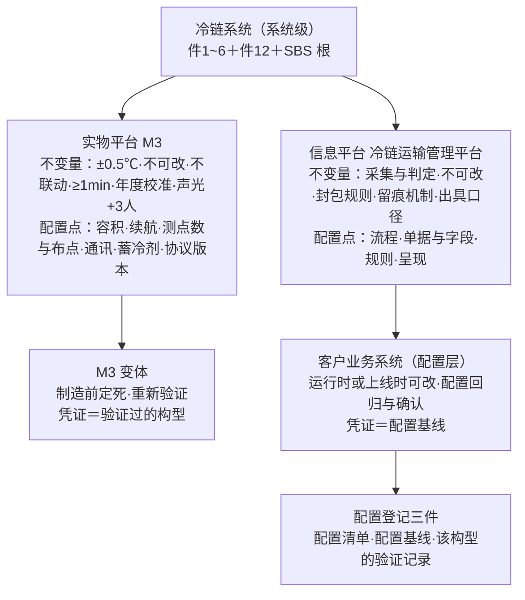

# 00 · 47 号正文（逐件推进稿）与施工底稿

> **性质**：**进度台账**（正文已按文档序移出为 `04-产品数据范例/01`~`16`，每份一文件；本件只记写到哪了）。原：**正文推进稿**——按件1、件2、件3……的次序，一件一交。它的写法、判据与这一册的排布全在 [`00-产品数据范例编制规程.md`](00-产品数据范例编制规程.md)（B 篇逐份卡・C1 判据与自检・D1 排布与取料）；成稿的 47 号本体仍在 v1.2，等本稿全件过完再整本替换。
> **推进纪律**（用户令 2026-11-19，现收在规程 4.3）：**一次只交一份产品数据**，交完即停；每件**节首写"进什么"、节末写"出什么·交给下一件什么"**；件内走**三遍**（立表头→逐格填→回核转换），不许合成一遍；**写着发现上游要改，不在本节就地补**，落打回台账。
> **标档**：**【A】直读**／**【B】单句推论**／**【C】本库读法**。示例值一律标"（示例值）"；未登记的写〈待定〉＋解锁条件。英中并列，逐字引文紧随「（中译：…）」。
> **编号规则（用户令 2026-11-19；按 25 号 v4 的 16 份定案收口）**：**正文一律写文档序 1~16**（＝节号）；**不用字母记号**；48 号件号只在对账时用，正文不写。
> **本册体例**：节题＝那份产品数据的名字；**节首两行**（版本与资格／承接档·停在哪一档）＋**节末一行**（改动痕与未完项）；**不出现人名，只写岗位**。
> **范例体例（用户令 2026-11-19）**：这是**范例**，不是台账——每份**给代表性内容**：关键行写全（示范行），同类其余**占号不占行**，用一句交代（如"从略三条，占号不占行"）；人、事、位、叶**不穷举**（位不列满、叶不列满、接口不全列）。**验收只看四条**：① 三个相关方层各到场（外部／委托方内部岗／承制方）② 每类判据到场（强制型、只能写一半、易实现性、可配置性）③ 每条有来路 ④ 每条有判定。**条数与矩阵不在要求里**。**声明**：范例册只列代表，全量登记在案例设定与附录，两处不互当依据。
> **结构化优先（用户令 2026-11-19）**：凡"**多个对象 × 同一组字段**"的一律落表——**列名即判据名、一行一个对象**；**节首户头、节末改动痕与未完项、每节判否项—结论—凭据一律上表**。**只三类不结构化**：一句判据或收束句、逐字引文（含中译）、表间过渡句（每次≤一句）；**取值格仍写判据句，不许压成两个字**。
> **取用与留下的资产（原题「资产三问」，2026-11-19 按《逐章修订手册》§2.6 形式关改题；用户令：产品数据类文档＝**文档 1~16**，判等不是举例）**：**文档 1~16 每一份**的节首除四行户头外，另给一张**取用与留下的资产**表——**① 取哪份资产（写户名，不许只写"既有平台"）② 走哪一档（直接承接 reuse／改进后 improve／新增 add）③ 留下什么资产**；写"新增"必须答"为什么没有现成的"；**上一份"留下"与下一份"取"逐号对得上**。资产四条（可积累・可复用・可转移・可评价〔14 号〕）按本份能落的落、不硬凑；不编号的登记件与配置登记三件不另给。见 `claude-memory/feedback-资产线贯穿.md`。
> **做法以规程为准（2026-11-19）**：文首这几行与各节的体例做法，已收进 [`00-产品数据范例编制规程.md`](00-产品数据范例编制规程.md)（写作体例・资产回路・需求三要素・文风八忌・逐份要点・验收自检）。本处留作本册的即时约定；与规程冲突时以规程为准，并回改本处。

---

## §〇 进度台账（本册唯一的进度处）

> **先过清单，再写这一件**：每写一节前，先在 [`00-产品数据范例编制规程.md`](00-产品数据范例编制规程.md) C4 找到那一行（性质・件号・层・成册・执笔・认下・下家・依据），写完回来**回勾一行**。清单没点到的，不许写；清单说"不占件"的，不许给编号。

| 序 | 文档 | 48 件（对账） | 状态 | 字 | 门（过没过） |
|---|---|---|---|---|---|
| **1** | 问题与机会清单 | 件1 | **已出·待点头**（**v7.3**：随规范 v0.12 重判门表（扩到四类指向格，C1・C4 记缺口）；v7.2：过评审两关后修订（目的表拆行作七行・出处补部位・级与数档分家・变换表补 R12~R17・改题八处）；v7.1：题面整理（件名换「取用与留下的资产」・去括注・账外件去序号），取值与字段未动；v7：按《01-问题与机会清单规范》v0.6 修订；问题 5・机会 4・约束 4・目的 5 行＋综合目的一句＋使命一句；名称九条改名词短语；账外件十一节不加序号；v6.1 见 git；v15 见门列） | 不设上限（750 已取消）；实测正文 **2796** 汉字、账外 6443 | 门：五条不合格条件逐条判**二十条**（问题 5・机会 4・约束 4・目的 7），**成立 14／缺口待补 6／违例 0**；四张表表头与规范 3.2 逐字一致（脚本核过）；缺口六处——问题表「现状出处」两处（问题3・问题5）、机会表「现状出处」两处（机会2・机会4）、约束表「来源」两处（C1・C4 条号未取到），解锁人与时机落打回第 43 行；正文（示例值）十八处＝示例值登记十八行。**v8（2026-11-20 七阶段重出，已出·待点头）**：约束字段名归一作「走满足的约束」；约束登记表四行改**五行**、新立 **C5 版本基线**，问题4 挂 C5、问题5 改挂「无」；温度读数来路由教材改指 48 号 §8.12，删「超限满十分钟」这一句判断（判例库第 1、7 条原在 v7.3 上成立）；补「下游待改」一节，题面十九行改**二十行**；示例值立册二十条、与正文二十处对齐；变换表二十一条带状态列。门：二十一条记录 **14／7／0**（C2 观测主体待核记缺口待补，比 v7.3 多一条，是旧判据没判到底）；**v14（2026-11-23 按 01 规范 v0.22 与 5.1 重判）**：二十一条里判过 8 条、判不过 11 条、疑点 2 条，判不过的改法与规范侧 12 处见打回第 90 行；**v15（2026-11-23 改齐后复核）**：二十一条判过即过，当场改不了的三条在未完项；**册侧 v0.23（2026-11-23）**：规则号改 R1~R17・3.2.2 八格逐行・抓住它的条件的判法三处同改・散文层收口；四年工程师审本册定稿三张表卡九条，七条已改、三条待裁（打回第 121 行） |
| **2** | 相关方与关切 | 件2 | **已出·待点头**（**v9.2**：按《02-相关方与关切规范》v0.6 复核——判决节改逐条记录判四十二条、题面去括注与序号、级与数档分家、构造清单一行一处、补第六道留痕、户头与文末版本归一；v9.1 与 v9 见 git） | 不设上限；实测正文 **3,191** 汉字、账外 3,484 | 门：四条不合格条件逐条判**四十二条记录**（相关方 14・关切 19・双向 9），**成立 41／缺口待补 1／违例 0**；缺口一条在关切表的「到什么程度算达到要求」（关切15 两处〈待定〉）；双向核对表按文档1 v7.3 的九条名称同改；**册侧 v0.16（2026-11-23）**：规则号作 R1~R12（R10 拆两行）、六处字段名照表头改齐、3.2.2 补最小形声明、5.1 第一条补编号判否、八处改「暂无判例」、附录 A 指 v9.9、散文层收口；四年工程师审本册定稿三张表卡九条，已改、四条方向疑点待裁（打回第 122 行） |
| **3** | 相关方需求 | 件3 | **已出·待点头**（**v0.30**：按《03-相关方需求规范》v0.2 复核（质量特性行三处改“不适用”・门补结论句）+ v0.29：按 v0.1 过一遍——表头九栏改**十一栏**（加主角色・触发事件），新增**触发事件词表三十行**与**坐标归并表二十九行**，5 与 29 收窄、监管侧出具另立**需求51**，18・19 改写事件、13 统一触发；**五十一条**：功能性二十一・质量特性二十・易实现性十） | 不设上限；实测正文见文件头 | 门：卡3 三条判否**成立**；**坐标唯一成立**（三十一条坐标需求各出现一次、业务二十九条）；覆盖检查**缺口一条**（关切20 待文档2 补）；质量特性二十条不占坐标、约束号待文档5／9 立户。**2026-11-23 册侧已重写**：本册按《03-相关方需求规范》**v0.9** 判；新版四组记录（主表十栏・词表・业务候选・关切对账）、两条承接路、T1~T15、准则五条，旧名与改名清单见其附录 B；数据仍 v0.30 旧形，待重排为 v0.31，重排前按旧册 v0.8 判且按打回第 93 行三处同批改。**2026-11-23 凌晨收工：七阶段走至第二阶段**——一（阅读材料清单・三行定框・一条分界）与二（输入文档清单・转换规则・表间对账・资产落点・取用与留下的资产）已交、均过四年工程师评审；判据改用《产品数据范例编制规程》（元规范停用，第 96 行）；册侧 4.2／4.3 覆盖不到节点候选清单落第 97 行、生命周期节反例与五值相抵落第 98 行；**数据一字未动**，第三阶段（表头方案）起待续；**册侧 v0.12（2026-11-23）**：承接单位改承接坐标、卡3 最小形声明（超二十九处）、三栏改名（承接方式・对账结论・缺口去向）、5.1 第五条与第一条改齐、附录 A 指 v0.37、散文层收口；四年工程师审本册定稿三张表卡九条，全改，另有十四条同批落、三条疑点待裁（打回第 123 行） |
| 4 | 生命周期概念（核心＝运行概念） | 件3 | 待写（2026-11-19 用户令更名，见打回第 21 行；正文结构定案见第 22 行；**完整版在文档3 之后、细化到场景活动**） | 不设上限 | 门：每节确认准则先行；**五节分界一句不漏**（哪一节给谁当判据）；三段不跳档；**业务数按触发定**；**每个 IPO 有前序与触发**；**每条活动有执行者与完成判据**（**打回①** 落此） |
| 5 | 系统需求 | 件3 | 待写 | 1,200 | 门：双向追溯＋验证三格；变体需求不进 |
| 6 | 架构目标（含系统目标列） | 件4 | 待写 | 500 | 门：三要件齐（宾语・坐标・方向）＋预留准则号；**写成达标与否即退回** |
| 7 | 关键成功准则 | 件5（寄居 6） | **预告已给（§一.6）** | 400 | 门：**双用途**齐／必过与权重只加牵制项／权重和 1.00 |
| 8 | 因子清单 | 件6 | 待写 | 400 | 门：每个因子有单位与取法；与文档7 号双向回填 |
| 9 | 架构内容 | 件7 | 待写 | 1,600 | 门：三槽齐（分块：系统级／平台级） |
| 10 | 视角与模型种类 | 件8 | 待写 | 1,200 | 门：视角标识种类（平台层主・配置层附） |
| 11 | 位与分配 | 件9 | 待写 | 1,800 | 门：守恒四条（两组位表）＋配置登记三件首现 |
| **12** | 架构视图（四节） | 件10~13 | 待写 | 2,200 | 门：元素指得回位／组件有治理者／视图覆盖全关切／对应关系成立或违例 |
| **13** | 架构描述（六节） | 件14・15 | 待写 | 2,200 | 门：索引不漏项／决策有权限人与理由／缺口有声明／版本基线齐 |
| **14** | 系统分解结构 | — | 待写 | 2,200 | 门：四独立之一＋交叉映射无空格（**打回②** 落此） |
| **15** | 构件需求 | — | 待写 | 4,600 | 门：三支下限＋覆盖检查（**打回③** 落此） |
| **16** | 设计描述（四目） | — | 待写 | 6,200 | 门：算得出成本・下得了采购；配置清单与依从声明齐 |

**下一句该说**：`确认`（进第二道资产），或指出道一改哪一条。

---

## §一 打回台账（写某一份时发现上游要改，记这里，不在本份就地补）

| # | 打回对象 | 问题 | 来路 | 现状处置 |
|---|---|---|---|---|
| 1 | 规程 D1 8.1 字数预算（2.1＝750） | 用户令取消 750：正文按数据写到齐，不为字数砍条目 | 2026-11-19 用户令 | **已改**：规程该行改"不设上限"并加一句；小计 15,200 与合计 38,700 待重算 |
| 2 | 规程 B1 卡栏表 | 漏"名称"栏，而 A6 的转化要求"补名称"，v5 底料也有这一栏 | 文档1 第一道（2026-11-19） | 文档1 按底料补"名称"栏；请规程补这一栏 |
| 3 | 规程 B1 卡 | 机会表的"直接原因・成因"两栏填什么未给读法；照问题表字面填会与"抓住它的条件"重复 | 同上 | 文档1 暂按问题表字面留栏；请规程给读法或删这两栏 |
| 4 | 规程 4.2／B1 卡 | 下游只给"下家 2 与 6"，未给下游动词定名 | 同上 | 文档1 用"认领"与"取现状原话"，并声明是描述性说法、不作判据词 |
| 5 | 规程 门与 v5 底料 | v5 门结论第六条"编号已冻结"没有编号级判据，且它是一条纪律、不是一次判否 | 同上 | 已移出文档1 正文门表，进门表外一行；请规程定它算不算门 |
| 6 | 20 号 §二 2.2之一、§三 3.2 | 记"问题×2＋机会×1＋约束×2"，本册按案例为 3／2／3 | v5 未完项 4 | 文档1 不改上游；改 20 号两处并重算字数 |
| 7 | 规程 4.2 第一·二道・A1 开工提示词・D1 口径 9 | 第一、二道原写"读书与理解：三问＋三样"与"资产开发"；用户令两改：先"取料清单"，再定「第一道：确定要阅读的材料清单／第二道：阅读理解材料清单，确定输入文档清单，给出转换规则」 | 2026-11-19 用户令 | **已改（final）**：第一道＝阅读材料清单（材料｜类别｜读哪一部分｜为什么读）＋三行定框；第二道＝输完材料后定输入文档清单＋转换规则表＋资产三问。**规则在第二道立、条目留第四道填**。A2 表两道与节题、A2 末段"两道为什么这样切"、A1 提示词、D1 口径 9、记忆 `feedback-先读书再编范例` 同步 |
| 8 | 规程 4.2 全表・A1 提示词・A3・D1 口径 9 | 八道并作六道（材料・输入与规则・表头・数据・追溯与门・收口）；并要求资产原则贯穿每道、每道输出前先过四年工程师 | 2026-11-19 用户令 | **已改**：A2 整表重写为六道（新增"资产面"一列），六道为什么这样切、A1 提示词、A3 颗粒度、D1 口径 9 同步；原八道里的门与账外件・自检・收工合为"收口"四行固定。版本号仍 v4.0，待用户定结构后再升 |
| 9 | 规程 篇 B（B0＋B1~B16 十六张卡） | 十六卡把 48 号 §13 二十卡抄一遍且走样；用户令「只要确定产品数据清单就 OK」「到时间读相关材料不就可以了」 | 2026-11-19 用户令 | **已撤**：篇 B 整篇换成一段指针（原文见 git，撤除登记在附 E）；十六份点名与「读哪一卡」并入 C4 之二；栏与门回 48 号对应卡与 §12.6；规程升 **v4.1**；文首读法、A1 提示词、A2 判据行、C1/A5/D1 内 B 卡指针一并改；三份产品数据文件头的「B1/B2/B3 卡」改指 C4 行与 48 号卡 |
| 10 | 00 号 §二 7.2 A 记「箱号 M3-0417」 | 教材 §13.6.2 那张表表头作「运单号」，底料 v5 又自编了「运单号 YD-260417」，同一个号三处三说 | 文档1 第四道（2026-11-19） | 本份按教材原文取「运单号 M3-0417」；24 号那一格与 v5 的 YD-260417 两处待改，本份不改上游 |
| 11 | 底料 v5 表头「出处（哪份资产）」 | 原始记录不是资产（A6 只认两类），出处栏写成资产名是串型 | 文档1 第二道 | 本份表头改**「现状出处」**，只写组织自己的记录名与部位；级与库内登记处进账外件**取料底账**（一格一行），已写进规程 4.2 道四 |
| 12 | 底料 v5 自编「运单号 YD-260417」 | 库内无任何登记，属自编未标 | 文档1 第二道 | 作废，本份不引 |
| 13 | 底料 v5 问题3 出处引「书侧治理一章」一句 | 教材是判据与方法，进出处即把判据当证据 | 文档1 第二道 | 本份出处改组织记录；「约六成重复」移出标〈待定〉，挂解锁（产品与商务・文档7 之前） |
| 14 | 资产缺口：一代无《问题与机会清单》；经验与教训清单・需求资产库・问题与需求台账三册未立册 | A6 只认两类资产，取不到即缺口 | 文档1 第二道 | 本份按「新增」走原料，缺口如实登记；**不在本份现补**，立册归组织 |
| 15 | 底料 v5 账外件自称「七件」，表内只有 6 行 | A10 数要数对 | 文档1 第一道 | 重出时按 6 行记 |
| 16 | 文档3 关切6（准入与协议合规）挂「问题3」 | 底料问题3 是「每接一单重做」，两处不是一件事，编号对不上上游 | 文档1 第二道 | 重出时一并核；本册问题3 仍为「每接一单重做」，关切6 的承接由文档3 与文档5 处置 |
| 17 | 本台账第 6 行（20 号计数 2・1・2） | 该两处已随施工底稿搬入 00 号 §二 2.2 之一，按 3／2／3 记，原行所指已不存在 | 文档1 第三道 | 第 6 行失效，待销 |
| 18 | 00 号 §二 7.5 的 2.1 行 | 只列 48 号示范的 2／1，未列机会2 与 C2、C3；本册定稿计数为问题 5、机会 4、约束 4 | 文档1 第三·四道 | 补列，或注明该行只作 48 号示范；§二 2.2 之一同改 5／4／4 |
| 19 | 48 号 §3.1.3 与两本标准的「目标」词条位置 | 15288 与 42020 里 goals／objectives 是正文用词，未核到独立词条；「系统目标」「架构目标」在标准侧的落脚待核 | 文档1 第四道（用户提问） | 回 15288 §3 与 42020 §3 正本查，核到后补 48 号 §3.1.3；本册暂按 48 号裁定用 |
| 20 | 案例合并清单 §二 信息平台不变量行 | 该行列五样（判定算法・数据不可改・封包规则・留痕机制・出具口径），本册只并前三样成 C4 | 文档1 第四道（用户令「依照你的建议」） | C4 已立；出具口径不并进约束，归文档9 原则与文档13 决策 |
| 21 | 文档4 的册名与范围（原"运行概念"） | 用户令「把文档4 更名为生命周期概念」。正本里这一族的信息部件名是"系统生存周期概念（运行・获取・保障・部署・安全等）"〔A：15288 §6.4.2.3 b) 与过程信息部件表〕，运行概念只是族中一员〔A：§3.23〕；原册名把成员当族，且部署・保障・退役三员在 16 份线里无落点 | 2026-11-19 用户令 | **已改**：规程 §〇 示例文件名、C4 之二第 4 行、C4 之三 节题与第 4 行栏，并新增五节分界表（运行核心・部署・保障・退役・安全按需）与三条命名规则；00 号台账第 4 行、§二 2.2 之一第 3~5 行、2.3 一处不占件、2.3 末编号规则、3.4 打回①、3.6 定值、7.5 的 2.4 行同改。**不动三处**：3→4→5 三条边（4→5 的确认准则落点只由运行一节出）、文档3 末列的三档语义（正常・异常・应急）、教材书 §4.5.2 的名称与判据（教材侧不改名）。**未完三项**：① 获取概念（acquisition concept）本册不立节、启用条件写在规程 5.4 之三；② 四节的料未登册——部署与模块清单・工单与备件台账・回收记录・资质与协议档案在文档2 §3.2 列了户名，本体未收；③ 实现方案里的"部署与运维"与本册四节的分界未写死（概念答"打算怎么用、在什么条件下用"，方案答"打算怎么做"），待文档16 开工时落 |
| 22 | 文档4 的正文结构（树与表） | 用户逐条定：一个主角色可发起多类端到端业务；IPO＝角色向系统输入、系统处理、角色接收输出；L2 是端到端业务的**主角色**或该业务的**需求提出者（或代理者）**，其余角色是参与者。原定"三段交＋三档场景"装不下 1:N 的扇出，也说不清树与链 | 2026-11-19 用户令 | **已改**：结构定为**五级树＋一张 IPO 表**（生命周期概念→族员→主角色→端到端业务→IPO）；**树只表达分类与拆分**，档・次序与分支・平台・人机分工・业务域一律作列；**IPO 去重做**〔通用规范 §5.1〕，去重后为共享节点，故树上到业务为止、本体落一张表（全局唯一号，业务行写 IPO 链）。三词分家（主角色／参与者／用户角色・相关方角色，"操作角色"作括注别名）；三条规则（一条业务只挂一个主角色、提出者与代理者并见取代理者；每个 IPO 指回主角色与目标；I/O 按实际交接写、实物侧实物与随行信息成对）。**一处对本规范的引申要登记**：入树判据是"有没有自己的端到端业务"，而 §4.3.4 判"能不能提 FR"用的是"是否直接操作"，两条轴各管一件事，本册两者并用。**落笔**：规程升 v4.13（C4 之三 第 4 行＋树与列两张表＋三词表＋三条规则＋去重口径），本节 2.2 之一 第 4 行、3.6 定值同改。**未完**：31 号"文档4 五节×五级树"的计数（主角色数・业务类数・IPO 数）待文档4 开工时回填；流程图作附件一条待定（画在文档4 末，还是只在文档12 画）。**2026-11-19 用户再裁**：**不做"框架段先交"**；**生命周期概念完整版一次性交，位置仍在文档3 之后**；文档3 不引业务号，改由文档4 开工时反读两条键（"谁来认"里标（主）的那个、描述句里的事件从句）补核。**2026-11-19 用户再裁（二）**：「生命周期概念的**完整版要细化到场景活动**，因此应该放在相关方需求后面」→ **树回到六级**（加回场景活动），**活动只写"谁在什么条件下做什么、产出什么"，不写系统内部实现**；**执行者改由活动表的列承担**（人机分工不再单列）；**确认准则挂 IPO，活动只给完成判据**。次序理由〔A：15288 §6.4.2.3 注5——初步概念在具体利益相关方需要的语境中进一步开发〕。规程升 **v4.14**；两张表栏见规程 5.4 之三 |
| 23 | 文档3 的条目形态无专册 | 用户令「文档名称：00-相关方需求规范」——相关方需求的条目规范（坐标・触发事件・唯一性・归并表）此前散在规程 5.4、24 号纪律10 与记忆里，三条需求类文档共用又各说一版 | 2026-11-19 用户令 | **已立** `04-产品数据范例/03-相关方需求规范.md` **v0.1**：只管文档3（文档5／15 不自动继承）；内容＝通则指针（三要素・三类・指标两型仍留规程 4.5，规范不重复，防两份通则走样）＋**坐标两格**（主角色・触发事件）＋触发事件定义与受控词表＋**落点唯一与判据独立**＋**坐标归并表**（需求号只出现一次即为唯一性可核）＋拆并守恒＋接口＋三条禁令＋附五十条判读草案（约三十条业务）。**规程升 v4.15**：A1 先读加第 9 条、C4 之三 文档3 行改**十一栏**（加主角色・触发事件）并指规范。**待办**：文档3 正文要加这两栏与两张附档（触发事件词表・坐标归并表），现 v0.28 不动，等归并表逐行确认后升 v0.29；`claude-memory/需求三要素与三类.md` 改指针件 |
| 24 | 00 位规范的户口与门槛 | 用户令「后面还有 00-生命周期概念规范等」——若每份都立一册会失控；且文档4 的结构规则已把规程 5.4 之三 撑到五十余行 | 2026-11-19 用户令 | **已立**：规程文首加**「00 位户口表」**（规程・判例库・需求条目规范・生命周期概念规范）与**「立规范的四个条件」**（装不下・多份引用・可核判据・不抄 48 号）；**新件** `04-产品数据范例/04-生命周期概念规范.md` **v0.1**——整段迁自规程 5.4 之三（五节分界・六级树・两表栏・三词・三规则・去重・次序・三禁令），**不新增规则**；规程 5.4 之三 文档4 行缩成指针、A1 先读第 9 条改写、书名版本改 **v4.16**。**按四条件判为不立的**：架构侧文档9~13（48 号卡11~17 即其规范）、设计侧 14~16（48 号卡20 与 §8.5）、文档5／15（沿用各自节与 24 号 纪律10） |
| 25 | 文档3 按条目规范重过 | 用户问「文档3 是不是按照相关方需求规范给规范一下」——v0.28 的九栏装不下坐标，5 与 29 各带两个角色，18・19 用时段与时点当事件 | 2026-11-19 用户令 | **已改 v0.29**（50 → **51 条**，功能性二十改二十一）：表头十一栏（加主角色・触发事件，位置在来源与谁来认之间）、新增 **§3.3 触发事件词表**（三十行）与 **§3.4 坐标归并表**（二十九条业务、三十一条坐标需求各出现一次）、门加**第五条坐标唯一**；5 收窄为货主侧＋新立 51 监管侧、29 收窄为监管侧、18 改“装车完成上电起采”、19 改“组装完成标定结果返回”、13 触发统一为工单到达；质量特性二十条写“约束：文档5／文档9（号待立）”；关切9 承接补 51、来路对账证据出具补 51、变换与追溯补 51、改动痕与未完项各补、版本行接 v0.29 |
| 26 | 通例“三段与同批”与相关方需求规范改名 | 用户四令：文档4 不分框架・概要・定义三段、直接一步到位；不与前序后序同步设计；整个通例作废、由各文档自己的规范取代；相关方需求条目规范改名相关方需求规范 | 2026-11-19 用户令 | **已改**：规程 **v4.17**（A1 通例整条撤除并写撤因三条；文首改“一份一规范”＋规范骨架三节＋一条判据；C4 之三 文档4 行去三段、改一步到位）；**《生命周期概念规范》v0.2**（§六 三段交与两处同批删除，改“一步到位”四条：六道照走・业务与 IPO 全列・活动代表性展开・回填走自己的表；§七 接口改一读一填、加“与前序后序不设接口条款”）；本文 §二 2.2 之一 的**同批点表注销**（留撤因与取代物）；`00-相关方需求条目规范.md` → **`03-相关方需求规范.md`**（七处引用同改、英名改 Stakeholder Requirements Rulebook）。**文档4 展开策略**：业务 29 条全列・IPO 去重后全列・活动只对八条代表业务展开・回填另出表不改文档3 |
| 27 | 文档1 的名称 | 用户令「把问题与机会的陈述文档更名为问题与机会清单」——原名把“陈述”当文档名，与正本人工制品“问题或机会陈述”同名不同层，易被读成同一件 | 2026-11-19 用户令 | **已改名**：`04-产品数据范例/01-问题或机会的陈述.md` → **`01-问题与机会清单.md`**；文件题名与 00 号台账第 1 行、规程 5.4 之二第 1 行同改；文档1 升 **v6.1**（正文、栏与门未动），改动痕记明**正本人工制品仍作“问题或机会陈述”〔A：15288 §6.4.1〕、本册文档名改称清单**“两处不同名、不是同一层”。记忆件里旧名照旧存史（挂账件与索引旧条目不改写） |
| 28 | 文档1 的形态无专册 | 按“一份一规范”（第 26 行）文档1 也应有规范；其九栏与三条判否散在 48 号卡1、规程 5.4 之二第 1 行与本册正文里 | 2026-11-19 用户令「总结并编制 00-问题与机会清单规范」 | **已立** `04-产品数据范例/01-问题与机会清单规范.md` **v0.1**：一 是什么与不管什么（与需求・目标・方案・关切四分界＋名分界：正本制品仍作“问题或机会陈述”）；二 栏与门（问题九栏・机会八栏・约束四栏含要求型/事实型・目的四栏＋综合目的一句与使命一句・三条判否・编号冻结・问题机会约束目的须列全不占号）；三 与前序后序（链首无上游，只读资产与原料；文档2／3／6 三条读入边；不设同批；下游照抄现状原字）；四 常见错法点名；附 A 指向文档1 v6.1 的实做。**规程升 v4.18**：户口表加该册（待立十二改十一）、A1 先读第 9 条补文档1。通则与工序不入该册 |
| 29 | 文档2 的形态无专册 | 按“一份一规范”文档2 也应有规范；其相关方三栏、关切八栏、双向核对与三条判否散在 48 号卡2、规程 5.4 之二第 2 行与本册正文里；另有 2026-11-19 的三条用户裁（承制方岗必列・“易xx性”命名・关切须有说明与持有方名称）无正式户口 | 2026-11-19 用户令「总结并编制 00-相关方与关切规范」 | **已立** `04-产品数据范例/02-相关方与关切规范.md` **v0.1**：一 是什么与不管什么（与需求・问题清单・组织架构・验收表四分界；“用户”须拆・易实现性子类一律“易xx性”・经济可承受性不改）；二 栏与门（相关方三栏与三层排法・可占号不占行须给号名挂靠・关切八栏与两个族・双向核对三方向与“空行即违”・四条判否，第四条规定为“关切无说明或持有方无名”・承制方十条一律可协商型・**关切编号即全链钥匙**）；三 与前序后序（上游文档1；下游文档3/4/5/6/9/12/13 七条读入边；不设同批；下游不得加号改名）；四 常见错法；附 A 指文档2 v9 的实做。**规程升 v4.19**：户口表加该册（待立十一改十）、A1 先读第 9 条补文档2 |
| 30 | 文档5 的形态无专册 | 按“一份一规范”文档5 也应有规范；其五栏原形在 47 号本体、转换动作在 00 号 §二 行 5、验证三格取值在 15288 §6.4.9.3 注引；“主落平台”“变体需求不进”无正式户口；验证三格第三格原名“成功准则”与文档6 的关键成功准则撞名 | 2026-11-19 用户令「总结并编制」→「你直接立先」 | **已立** `04-产品数据范例/05-系统需求规范.md` **v0.1**：一 是什么与不管什么（与文档3/6/16/15 四分界；三条转化规矩；**类不换**——类栏用技术类名，与文档3 按“谁在问”分的三类不是一套）；二 栏与门（六栏：号・陈述可测量・类＋**设计约束单列**・承自（含**衍生**标记与依据）・**验证三格**（方法四值・验什么七值・**通过线**）・**主落平台**；**两量分家**；**变体需求三条去向**表；五条判否；结论三值）；三 与前序后序（上游文档3 转换 1:N、文档4 确认准则不并账、文档2 强制型落约束；下游文档6/9/11/14/15；不设同批；**验证≠确认**一条分界）；四 常见错法。**本轮三处判断待复核**：① 主落平台取“一个主承担＋可注参与”；② 变体三条去向写进门；③ 验证三格第三格定名**通过线**（原“成功准则”与文档6 撞名）。**规程升 v4.20**：户口表加该册（待立十改九）、A1 先读第 9 条补文档5 |
| 31 | 规范自身的写法无册 | 已立五册规范，其骨架（头部四件・三节・附 A・版本行）、每栏“写法｜不成立”、门的条数与结论三值、体量与“不抄卡不抄规程”全靠各册照抄前册，未成文；规程里那一段“固定骨架三节”只是节名清单 | 2026-11-19 用户令「总结并编制 00-产品数据规范编制规范」 | **已立** `04-产品数据范例/00-产品数据规范编制规范.md` **v0.1**（*Rulebook for Product Data Rulebooks*）：一 是什么与不管什么（与产品数据／规程／48 号卡／判例库四分界；每条栏与门须能对具体格子判）；二 骨架（头部四件含“一条分界或钥匙”并给四例・三节各写什么・四 常见错法・附 A・版本行）；三 六条内容判据（可判・门可数・不抄卡・不抄规程・体量 100~160 行・栏名与数据逐字一致）与三问自查；四 立改与登记（一份一规范按开工顺序・改的三触发・**三处同批登记**（规程户口表／A1 第 9 条／24 号）・现况五册已立九份待立）；五 可复制模板。**规程升 v4.21**：户口表加该册；原“固定骨架三节”与“一条判据”整段缩为指向该册的一句；A1 第 9 条补“立或改任何一份规范都读该册”。**待复核**：体量 100~160 行为经验值（五册实测 105~154），是否作硬线 |
| 32 | 五册规范对编制规范的合规审计 | 用户问「已有的四份产品数据规范是否符合产品数据规范编制规范」（实为五册）；查出：**文档3 规范的附 A 装了二十九行坐标归并表草案**（规范不装数据）、文档3 与文档4 两册仍是八节且无门表与三值、头部第④件四册三种词形（一条分界／一张钥匙／教材侧不改名／名分界） | 2026-11-19 用户令「改」 | **已整改**：**相关方需求规范 v0.2**（八节压三节；补十一栏全表与门四条＋结论三值；**删附 A 的二十九行归并表**改指数据 §3.3／§3.4；补一条分界“需求挂业务不挂 IPO”；补常见错法）；**生命周期概念规范 v0.3**（八节压三节；补门五条＋三值；补附 A 写明“文档4 待建、栏形见本册 §二、不许拿报告或别份数据充数”；改词形）；**编制规范 v0.2**（附 A 两条硬规矩：只指路不装条目・数据未建写待建；第④件词形钉死“一条分界”；本文不自适用）；**问题与机会清单规范**“名分界”→一条分界、**相关方与关切规范**“一张钥匙”→一条分界。**复算**：六册里五册产品数据规范全绿（头部四件齐・骨架三节・门表＋三值・常见错法・附 A 指路・体量 105~129 行）；编制规范自身门与三值不设，属“不自适用”已写明。**规程升 v4.22**（户口表两行按新内容改写） |
| 33 | 产品数据按各自规范复核 | 用户令「你用各产品数据规范，审查并修订对应的产品数据」——已开工的三份（01・02・03）逐份对其规范复核 | 2026-11-19 用户令 | **复核结果**：**01 问题与机会清单 v6.1 无不合**（问题九栏・机会八栏・约束四栏含两型・目的四栏＋两句收束・门三条判否与结论三值・编号冻结・无占号）；**02 v9 → v9.1**（三处改：强制型补出处（法规·GSP／合同·委托运输协议）、门补第④条“关切无说明或持有方无名”、门后补“四条成立・缺口四条・违例 0”）；**03 v0.29 → v0.30**（两处改：二十条质量特性行的主角色・触发事件・由哪档场景确认三处写“不适用”、约束落点写进触发事件格；门补“门结论”一句）；台账第 2、3 行同批改。**04・05 数据未建**，待开工时按其规范写 |
| 34 | 规范缺转换关系与规则 | 用户令「各产品数据规范中要包括其数据与输入数据的转换关系和规则」——原五册的 §三 只有上下游表（谁读谁），没有“从哪一份的哪一部分变成这一栏、怎么判、反例是什么”，执笔仍要回 00 号 §二 与 48 号卡去拼 | 2026-11-19 用户令 | **已改**：**编制规范 v0.3** 把“转换表”列为 §三 必写件（五列：规则号｜从哪份输入的哪一部分｜变成本份哪一栏｜判法｜反例｜规则出处），立三条——① 关系写规范、判法可引卡**不抄卡**；② **须覆盖本份每一栏**，不转换的栏要在表后写明由何定；③ **每条规则至少一个反例**。**五册各补转换表**：01 T1~T6（含“不转换的三栏”）、02 T1~T5（不转换的两栏）、03 T1~T6（不转换的三栏）、04 T1~T6（不转换的三栏）、05 T1~T6（不转换的两栏）；五册版本各升一档（01・02・05 → v0.2，03 → v0.3，04 → v0.4）。**规程升 v4.23**（户口表五册行补转换表）。**未动**：判据正本仍在 48 号卡，规范不抄原文 |
| 35 | 规范编号不一致 | 用户令「把各产品数据规范的编号与产品数据的编号保持一致」——五册规范原先都挂 00 前缀，与它们所管的 01~05 数据不同号，看名字对不上是管哪一份 | 2026-11-19 用户令 | **已改**：五册改名 `00-XX规范.md` → **`01-XX规范.md`…`05-XX规范.md`**（规范的号＝数据的文档序），文件题名同号（`# 03 · 相关方需求规范`）；**编号规则改写两处**——文首号位说明（00＝跨份口径件：本册・判例库・编制规范；01~16 每号两份＝数据＋规范）与 A1“文件怎么放”；跨件引用全库同改（规程 5.4 之三两处、数据 02／03 的户头与说明、编制规范另立“文件与编号”一条并升 v0.4）；规程升 **v4.24**。**不动**：历史行的旧名为存史（版本行引述用户原令、记忆件旧条目），不改写 |
| 36 | 五册规范的上位口径件（编制规范）与各册实做不一 | 用户令「新开对话，讨论修订各产品数据规范，首先是产品数据规范编制规范」；挂账件查出十处——全篇仍称《00-XX规范》（v0.4 已把编号改成随数据）、模板缺转换表块、模板首行仍是 `# 00 · <文档名>规范`、内容判据缺版本互指、三问自查不可数、§四 现况明细与“唯一登记处是规程户口表”自相矛盾、何时改漏“数据升版同批核规范”、第④件四例缺文档3、模板“三条”实做有四条、一条体例未要求写证据形态 | 2026-11-19 用户令 | **已改，编制规范升 v0.5**（落九条）：全篇《00-XX规范》改《NN-XX规范》且 §一 写明 N＝所管数据的文档序；§五 模板补转换表块（六列＋“不转换的栏”一句）、首行改 `# NN · <文档名>规范` 并加“文件按 §四 命名”一行、内容规矩改“三条上下”；§三 判据加第 7 条**版本互指**（数据版本行写“按《NN-XX规范》vX 复核”，规范版本行写“实做见 NN 数据 vY”）；三问自查改作**过门表七项**；§四 何时改加“数据升版同批核规范：改了栏或门同批改，只改值不动栏的不升规范”；§二 第④件的例补第五例（文档3）；§一 一条体例加“判法要写清看哪一格、数什么”。**另改正三处**：§二 转换表原写“五列”而列了六个栏名（改“六列”）；版本行链式归位（v0.4 及其下不带“版本：”，v0.1 与 v0.2 按序对调）；适用边界那句“五节排法”的括注原只列四样（补“是什么”）。**未落一条**：§四 现况明细（十条的第 6 条），与三处待裁（体量作不作硬线・规范设不设评审闸・现况明细删否）一并等用户裁。**同批三处登记**：规程文首户口表该册行与“每份规范怎么写”一句改写、A1 先读第 9 条加“交之前按它的过门表七项逐项打勾”，规程升 **v4.25** |
| 37 | 《编制规范》v0.5 的四年工程师评审 | 用户令「你让那个工程师阅读下」；按规程 4.2 五步另开一只代理（只给草稿与判据、不告诉来由），评 v0.5 与一份“元规范该包括什么”的提案。结论两份都不认可：A 卡在 §四 现况段（同段列十一个名称却写“九份”、与规程户口表同句同错、与第 24 行“判为不立”的裁定相抵），B 卡在判断尺子第 4 条（变更率无登记、无出处） | 2026-11-19 用户令 | **处置逐条**。**采纳十四条**：户口三分改分工四处（原句称三分、实列五处）｜§二 标题改“七个位置”（原“三节固定，头尾各一”与表列七位不符）｜判据七条与门七项并作一张**十二项打勾单**（两张不同构，判据 3・4・7 无处可勾）｜栏表三列・门补处置列・编号三件写进“二 栏与门”（原表只给栏名与写法、门无处置、编号无户口）｜行数撤出判据改结构量（总行 120~144・非空 83~97 两套口径已差出一截，判不了）｜内容规矩“三条上下”改“三到五条”｜何时立“或至少已列为待立”改可判写法｜登记三处改四处（门结论落 00 号 §〇 该文档行的门列）｜版本行四样必写＋待复核出口（跨两个次版本未销算违例）｜加“改本文一条，已立各册全部同批核”｜模板五处同步（卡号按 C4 之二查且注明卡号≠文档序・首栏统一“规则号”・门给三列带处置・编号三件・“不设同批”给一句解释）｜第④件例缩二例并照原字抄（原五例中三例非原字）｜近邻表括注缩为指针（原与判据 4 两处清单不同）｜现况明细删、只留规程户口表指针（原待裁第三处，按建议落，用户不认即回退）。**不采纳一条**：提案“编号三件单立一条规矩”——01・02・03 的栏表与转换表已管，改作门项一句。**转第二步**：各册与数据的待改项见第 38 行。**未裁**：规范设不设评审闸。**第一轮复核结论**：不认可，卡两条（第④件首例非原字、近邻表括注未缩）＋连四处（版本行①括注无出处、本行“采纳十三条”与正文差项、规程 5.4 行叫法、户口表缺“何时立”）。**第二轮已落**：首例照原字抄（含英文对照与〔A：15288 §6.4.1〕，删节处标省略号）、近邻表括注缩为指针、“改了十四处”⑭ 补列、①括注改“原句称三分、实列五处”、门项改“门与编号齐”并把“判否不在三到五条・编号三件缺一”写进不成立、门结论落点写实到“00 号 §〇 该文档行的门列”、规程三处同改（C4 之二该行・写明何时立）。**落笔**：编制规范升 **v0.6**（151 行）、规程升 **v4.26** |
| 38 | 五册与三份数据按 v0.6 的待改清单（第二步用） | 第 37 行评审顺带查出、且按 v0.6 的十二项打勾单会判不成立的项；本行只登记，不在元规范里补，也不改各册（第二步逐册核时落） | 2026-11-19 评审（第 37 行） | **① 01 规范** 表二“与问题同前六栏”与 `01-问题与机会清单.md` 机会表实八栏不符（数据无两根因栏，多驱动与场景・须满足的约束）——二选一：规范照数据写实，或数据回补两根因栏｜**② 05 规范** 附 A 指向 47 号研究报告且文档5 数据未建，违元规范附 A 硬规矩②——改“待建＋栏形出处”，并补 47 号版本与节号｜**③ 04 与 03 的边单向**（04 下游含文档3 回填，03 上游表无文档4）｜**④ 五册版本行无“实做见 NN 数据 vY”**，且 02 附 A 指数据 v9（实 v9.1）、03 附 A 指 v0.29（实 v0.30）｜**⑤ 五册常见错法未挂判例库号**（合计 43 条，判例库 25 行无一对应）｜**⑥ 01 表三・表四与 04 两张表缺第三列（写法｜不成立）**｜**⑦ 五册头部“户口三分”按 v0.6 改“分工四处”**｜**⑧ 三份数据的版本行要写“按《NN-XX规范》vX 复核”** |
| 39 | 01 规范仍是旧四章，第 38 行的①与⑥未落，反例与错法的大量待补从未落账 | ① 该册还是题头四件＋三节＋错法的老布局，与《编制规范》v0.18 的六章不符；② 第 38 行①（机会表“与问题同前六栏”与数据八栏不符）与⑥（约束・目的两表缺第三列）挂着未落；③ 4.2 的转换表与 6.3 的错法里，判例库暂无的共二十二处，从未在哪一处落过账 | 2026-11-19 用户令重编 01 规范；同日四年工程师照它做一遍，交回二十四条、十七条挡住结论 | **已改**：`01-问题与机会清单规范.md` 升 **v0.3**（235 行／正文约 5,980 汉字），重排为题头四条交代＋六章＋附录 A・B；术语换新名并在第 2 章给旧名对号；四张表字段名与文档1 v6.1 逐字一致（脚本核过）；机会表照数据写实八字段（本行②前半落）；约束表与目的表补第三列（本行②后半落）；转换表由六条扩到 **T1~T17**，覆盖四张表二十五个字段出现处；验收准则重写为**五条**（册级一条＋表级四条）并一律改判数据；6.3 十一条逐条挂判例库号。按评审改定：3.1 补“记录进哪张表”、4.1 补业务或任务分析输出与平台级不变量两行、4.2 加 T17（取不到值）、5.2 写明三个取值的落法与按记录计数、5.3 处置改两型并把解锁人移出数据格、6.1 补文档6 读目的陈述。**本行③的账落第 40 行**。**同日后半接一轮题面换名**（用户指出「再逐表写字段」「表与字段分两层写」「字段的来路单独交代」口语化，问是不是元规范要求；查后元规范 4.1 只要白话不要口语，而这批题名带工序词与作者视角词，撞《逐章修订手册》§2.6 第 5 条）：六章题与十一节题共十七处换名，《编制规范》升 **v0.20**（5.1 章目表、6.1~6.8 节题、7.1 模板、7.2 骨架四处同改），01 册升 **v0.4**，正文里跟着旧题名的三处口语（现状材料的来路・机会条件的来路・错法只点名）换成实词。**再一轮**：用户令「元规范的内容，包括范例需要稍微去口语化，稍微再提升下专业性」→《编制规范》升 **v0.21**：章题七处、节题九处换名，正文把「常漏的是」「写到位的样子」「写三件」「只点名」「告诉别人…」「看本文即可」一类口语标签换成规范用语（前两个各八处），并清破折号引总结一处；7.1 模板、7.2 骨架、7.3 的范例说明同批收干净。判据未动，01 册按 v0.21 复核零处。**再一轮**：用户令「完了，再用对标题的要求过一遍，包括范例中的标题」→ 把《编制规范》与 01 册的全部题面连同 7.1、7.2 范例内的题面机械全量过一遍（原检查只到三级题）→《编制规范》升 **v0.22**、01 册升 **v0.5**：元规范改十处（适用范围与读法・适用对象、依据与登记・适用于全部数据・标题、文风与引用・标题的关口・文风的自定要求・引用的核对・逐章的要求・骨架模板・文件即范例），两册的章题同改（规范的适用对象・册内专用术语），7.1、7.2 的样例同步。读数：01 册十一题硬违规 0 项；元规范四十一题硬违规 1 项，那 1 项是“附录 B 版本记录”里的“本”属“版本”一词的字、非代词，二字面误报各配改法（删第X章三字・改“版次记录”），登记为例外。**再一轮**：用户令「依据新的元规范，修订问题与机会清单规范」→ 拿《编制规范》v0.22 逐章对 01 册，改四处并升 **v0.6**：第 2 章的六行新旧名对号表与《编制规范》第 3 章“旧称”一栏重复、按 6.2 收成一句指路；4.1 表头对齐 6.4 的“读谁的哪张表的哪一字段”；4.3 由四句压成一句（6.4 要“一句”）；5.1 两处“塞”改“写”。其余各章逐条对得上，不改。 |
| 40 | 判例库待补：01 规范 4.2 十五条反例与 6.3 七条错法，库中暂无对应条目 | 《编制规范》6.4 要每条规则至少配一个反例、库中尚无的写“暂无判例”并在此落一行写明何时补；6.6 要错法每条挂判例库号，尚无的同样落一行。两处合计二十二处 | 01 规范 v0.3（2026-11-19） | **待补**：已挂上条号的不动（4.2 的 T2 挂第 1・7 条、T7 挂第 23 条；6.3 四行挂第 1・7・21・23・9・12 条），其余二十二处现写“暂无判例”。**补入时机：下一份数据开工前**，由元流水线开发者定人同批补；补时改 01 规范该格并把本行划销 |
| 41 | `01-问题与机会清单.md` 一处文件两个版本号 | 户头写“v6.1，本册定稿”（第 8 行），文末版本行写“v6（2026-11-19）”（第 154 行）；判例库第 18 条即此形 | 01 规范 v0.3 的四年工程师评审（小卡） | **待组织归一**：按 6.2 与规程 4.1，下游不得替本份补条，本册只登记不改数据；改哪一处归文档1 下一轮，改时同批把本行划销。**已销**：文档1 v7 同批归一——户头与文末版本行同写 v7，一处文件一个版本号；本行划销 |
| 42 | 文档1 v6.1 → v7（按规范修订） | 用户令「依照问题与机会清单规范，修订或重构问题与机会清单」。逐格对规范 v0.6 查出十四处不合：名称八条是谓语句；机会3 现状无读数・版本・时点・批次之一；出处五处缺部位；问题5 出处写「无此目录」不是「未取到」形；机会2 缺什么写成动作；户头与文末两个版本号；门只判三条判否、只判九行、缺缺口句；正文（示例值）两处对不上底账六处、无构造清单；账外件缺从略清单与构造清单 | 2026-11-19 用户令 | **已改**（文档1 升 **v7**）：九条名称改名词短语（问题1 断链的自证缺口・问题2 多段交接的责任断点・问题3 一客一版的定制交付・问题4 图纸与物料清单的双权威・问题5 非标选配的验证空白・机会1 对外出具的冷链记录・机会2 平台加配置的交付・机会3 按场景编排的经验清单・机会4 现场换件的服务网）；机会3 现状补版本与生效日期一处锚（标示例值）；问题4・机会3・机会4 出处补部位、机会1 与问题5 出处改写取法或「未取到」、机会2 缺什么去掉「定下来」这一动作；C1・C3 来源补到条与项；门按 5.1 五条重排十八行＋结论计数＋缺口在何表何字段一句；账外件十一节补齐；户头与文末归一 v7 |
| 43 | 文档1 四处缺口与两处观测主体的解锁 | 四条缺口（问题3・问题5・机会2・机会4 的出处未取到）与 C1 留档义务条号、C2 观测主体按规范 5.3 要把解锁人与时机落本台账 | 2026-11-19 文档1 v7 门结论 | **待解锁**：问题3・机会2 的三家客户交付台账与部署模块清单（产品与商务，文档7 之前）；问题5 已验证构型目录（开发，文档7 之前）；机会4 服务工单与备件台账（运维与支持，文档11 之前）；C1 协议留档义务条号（商务与合同，文档5 之前）；C2 观测主体（承运方与运维与支持，文档5 之前）。销时在本行划掉并写明由谁销 |
| 44 | 文档2 表三九条名称随文档1 v7 重读 | 文档1 v7 九条名称改成名词短语，文档2 表三「问题1 断链不可自证」起九行是按 v6.1 的名称逐字抄的；同表另有问题4・5 与机会3・4 的号无落点、C4 与关切16 待对齐 | 2026-11-19 文档1 v7 | **待下游重读**：按规范 6.2 下游不得代补、本份只登记；文档2 下次复核实改该表九行名称并补挂号、对齐 C4；改完在本行划销 |
| 45 | 01 规范两处（附录 A 已改・5.1 缺一条判据） | ① 附录 A 原指文档1 v6.1，数据升 v7 即断链；② 本册 3.2.3「不成立」列有「来源不到部位」，而 5.1 四条表级准则没有一条判它——约束四行的来源部位按本册判不到 | 2026-11-19 用户令修订文档1 | **①已改**：规范升 **v0.7**，附录 A 改指 v7 并写明门判十八行、缺口句在那一节；第 2 章末句「旧名换齐另开一轮」改作现状陈述（数据 v7 已换齐）。**②已销**（2026-11-19，规范 v0.12）：不加条数，把 5.1 册级第一条扩到四类指向格（问题与机会的现状出处・约束的来源・目的行的挂号），3.2.3 与 3.2.4 的「不成立」由此都有判据；文档1 门表同批重判，C1・C4 记缺口，读数 14／6／0。本行划销 |
| 46 | 规程两处 | ① 文首 00 位户口表该册行仍写「按《编制规范》v0.20 重排…v0.4」，规范已 v0.7；② A1 先读第 9 条写「验收准则六条」，规范 5.1 实为五条（册级一条＋表级四条） | 2026-11-19 文档1 v7 | **已改**：规程 00 位户口表该册行改「已按《编制规范》v0.22 重排为六章，v0.7」，A1 先读第 9 条改「验收准则五条」；规程升 **v4.29**；本行划销 |
| 47 | 文档1 的题面与件名（按《逐章修订手册》§2.6 过一遍） | 用户令「你需要好好打磨下问题与机会清单中的各章节标题」。过形式关九项查出七处：四张表与账外件的题带括注（五行／四行／四条／只作参照／不进正文／逐格记级与登记处／与正文（示例值）逐一对应），其中两处是数字名、一处括号套括号；正文用一~四、账外件又用一~十一，同一份两套序号；节首件的件名「资产三问」是动作加数量，单读不知问什么 | 2026-11-19 用户令 | **已改**：文档1 升 **v7.1**（取值、字段与门读数未动）——七处题去括注，账外件十一节去中文序号，件名改「取用与留下的资产」、判决那一节改「验收准则与判定结论」（三份数据的节题同改；规程 4.5 件名与台账「门」列不动，只补一句指针）；同批换件名的还有《编制规程》A2・A3・A5・C2・C4 与自检 `grep` 口径（规程升 **v4.30**）、`CLAUDE.md` 工作风格该条、本文文首段与自检第 11 条、文档2 与文档3 的节题（后者由二级题归到三级题）、《01-问题与机会清单规范》1 章近邻表与附录 A（规范升 **v0.8**）、判例库第 14 条；判据内容未动 |
| 48 | 02 规范仍是旧四章，第 29 行的 v0.1 立过之后三样没落账 | ① 该册还是题头四件＋四章（一 是什么、不管什么／二 栏与门／三 与前序后序／四 常见错法）＋附 A 的老布局，与《编制规范》v0.22 的六章不符；② 4.2 转换表五条与 6.3 错法九条未挂判例库号，库中暂无的十处从未落账；③ 数据侧的门表由数据自己判，规范侧无读数 | 2026-11-19 用户令重编 02 规范；同日四年工程师照它做一遍，交回十条、一条不认可（第二轮改齐后零条） | **已改**：`02-相关方与关切规范.md` 升 **v0.3**（203 行／正文约 6,400 汉字，不计版本记录），重排为题头四条交代＋六章＋附录 A・B；第 2 章只留一句指路到《编制规范》第 3 章的「旧称」栏，不重列对号表；新增 3.1 表的张数与级次（三张平面表・进哪张表・挂靠方向・号段与唯一性・占号不占行的三样），旧版无这一层；3.2 三节字段名与文档2 v9.1 逐字一致（脚本核过十四处），关切表照数据写实八字段；旧版四条判否改写成 5.1 四条准则（册级一条＋相关方・关切・双向核对各一条），一律判数据；转换表由五条扩到 **T1~T11**，覆盖三张表十二个字段出现处，两个编号另写 4.3；4.1 落到张与格，6.1 落到字段一级，6.2 收「不设同批」与按号引用两句；6.3 十八条逐条挂判例库号。按评审改定：强制性由三值改两型并写明法规与合同并存、持有相关方的「逐字同一」改按落点算（表内一行或从略句那一条）、现状取法移到账外件构造清单、5.1 第一条的「本册」改指所管的那份数据文件、第三条补现状与到什么程度与能不能写成需求三格、5.2 补按张判与占号不占行各算一条记录、5.3 由两型改三路各给执行人、占号不占行的口径一处定死三处括注。**本行②的账落第 49 行，数据侧三处落第 50 行，待裁三处落第 51 行** |
| 49 | 判例库待补：02 规范 4.2 十条反例与 6.3 十条错法，库中无对应条目 | 《编制规范》6.4 要每条规则至少配一个反例、库中尚无的写「暂无判例」并落一行写明何时补；6.6 要错法每条挂判例库号，尚无的同样落一行。两处合计二十处 | 02 规范 v0.3（2026-11-19） | **待补**：已挂上条号的不动（4.2 的 T2 挂第 21 条；6.3 八行挂第 1・3・7・11・12・21・27・28 条），其余二十处现写「暂无判例」。**补入时机：文档3 开工前**，由元流水线开发者定人同批补；补时改 02 规范该格并把本行划销 |
| 50 | `02-相关方与关切.md` 三处待改（两处版本号与指针、一处缺层） | ① 户头写「按《02-相关方与关切规范》v0.1 复核」，规范已升 v0.3；② 户头写 v9.1、文末版本行写 v9，一处文件两个版本号（判例库第 18 条即此形）；③ 从略三类「第 8 药企财务与结算・第 9 药企内控审计・第 13 冰链·运维与支持」的岗名缺「层·」，而关切表七行（6・7・9・11・13・14・18）的持有方与双向核对表四行（问题2・问题3・机会2・机会4）按这些号引用，按 02 规范 v0.3 的 5.1 第二条判不合格 | 02 规范 v0.3 的四年工程师评审 | **待下游重读**：按规范 6.2 下游不得代补、本册只登记不改数据；文档2 下次复核实改三处，改时同批把本行划销 **已销**（2026-11-19，数据 v9.2）：户头与文末同写 v9.2、复核指针改指规范 v0.6、从略句三条补「层·」 |
| 51 | 02 规范的三处待裁（需元流水线开发者或用户定） | ① 双向核对表按数据单列为第三张数据表，卡2 输出形态只给两张表，交叉检查原是步骤③的检查动作；单列后它成了一份要逐行判合格的产品数据。② 关切表八栏超出卡2 的四栏基本形（编号・关切名或问句・持有相关方・强制性），本册按数据写实到八栏。③ 「能不能写成需求」这一格判的是文档3 的可写性，放在文档2 是否等于替文档3 先判一半；同问：承制方五岗列为相关方，是否把设计约束的一部分装进了文档2 | 02 规范 v0.3 的四年工程师评审（方向层疑点，只标不改） | **待裁**：①与②若认，回 48 号卡2 补一句或补栏；若不认，本册照卡收窄并把数据八栏改回四栏。③若不认，该格改作指针句、判法归文档3。裁前本册按 v0.3 执行 |
| 52 | 数据里判决那一节的题 | 用户问「门结论，这个标题是什么意思」——「门」是编制规程 4.5 的工序件名（关口之意），读者单读不知是哪道门；按形式关 ③（非喻体）与自足一条，它与「资产三问」同病，v7.1 只治了半份 | 2026-11-19 用户问答 | **已改**：三份数据的该节题改作 **「验收准则与判定结论」**（名取《01-问题与机会清单规范》第 5 章章题，01・02 `##` 同名、03 账外件内那节改「判定结论与凭据」）；规程 4.5 该行补一句指针（件名仍作「门」，那是工序件的名）、A2 道六四行固定改为「验收准则与判定结论（五条准则逐条判，结论取三值）」；文档1 的核对结果行名改「验收准则过」、回执同改；01 规范第 2 章与附录 A 两处措辞同改。台账「门」列不动 |
| 53 | 元规范未要求各册对本份数据的题面与表达负责 | 用户令「元规范应要求各产品数据规范，对对应的产品数据各章节标题和文字表达要符合逐章修订手册中的相关要求」。旧版《编制规范》4.1 与 4.3 只管规范自己的题面，数据的题面无人要（本轮我是借规程那本去判的，判据对、户口错位）；4.3 第二件只抄一页题面；5 章只到 5.3，没有一节讲所管数据的题面与表达 | 2026-11-19 用户令 | **已改**：《编制规范》升 **v0.23** —— 4.1 扩射程（三关管两处题面）、4 章首补一段写明这套判据管三层（本文自身・各册规范・各册所管数据，三层只有落点不同；表内取值不按文风判，按 3.2 的字段判据判）并立件名与数据节题的对照表五行；4.3 第二、三件扩到两处题面；5.1 章目表与 6.5 增 **5.4 所管数据的题面与表达**（只写引哪几条与怎么核，不做判据表）；6.5 补一句台账「门」列与数据节题的关系；7.1 模板题头分工句与模板、7.2 骨架各加 5.4；2.3 触发补「数据改题面或表达，规范同批核 5.4 与附录 A」。《01-问题与机会清单规范》升 **v0.9**：补 5.4、题头分工加指针、6.3 错法增两条。规程 4.9 末补一句指路（题面与表达判据不在本册）。**待办**：02・03 两册同补 5.4（按《编制规范》2.3 的回头核），列入下一批；判例库第 26 条的适用面要从条目名称扩到节题 |
| 54 | 规范里另五处该改、本轮未改 | 分别是：① 《编制规范》要立一条「3.2 的『不成立』与 5.1 的准则一一对应」，凡写了判否的 5.1 必须有一条兜住；② 据此在《01-问题与机会清单规范》5.1 加第六条判约束「来源」到部位（本行与第 45 行是同一件事的两面）；③ 5.2 写死射程（四张表每条记录都给结论，目的表按「谁的目的」一行一判），现有措辞只写到「逐条判定」，下一个人容易只判问题与机会；④ 3.2.1 名称的「不成立」列补一句判法（遮住题目单念，念成「这事怎么样」即没有名词头）；⑤ 判例库第 26 条的适用面由条目名称扩到节题 | 2026-11-19 用户令那一批分析里已列出、本轮只落题面与表达这一支 | **待裁**：①与②是同一件事，加条会撞《编制规范》6.5 的「三到五条」上限（01 册现五条），故不自行加，等元流水线开发者定「加准则」还是「删 3.2.3 那条不成立」；③④⑤不受该限制，下一轮可直接落 |
| 55 | 五册规范缺「所管数据题面与表达」这一要求 | 用户令「要安排专门的步骤，对标题和文字表达进行符合性检查和优化」＋「在相应的规范中要有这个要求」。此前只有 01 册 5.4 一处、且写成指针句；02 册无 5.4；03・04・05 三册仍是旧三节形（一 是什么／二 栏与门／三 与前序后序／四 常见错法），没有 5 章可言 | 2026-11-19 用户令 | **已改**：① 编制规程由**六道改七道**（升 **v4.31**）——题面与表达单列为第六道（符合性检查与优化两半，机械读数 `00-标题-形式关.py` 硬违规须 0，读者关另开代理，改后重跑），收口推为第七道；② 《编制规范》升 **v0.24**：4.3 末点明数据侧那一套另有一道专用核查；6.5 的 5.4 段改成**须写成要求句、须答三问**（须按哪几条・须走哪一道・须达到什么与不过怎么办），并写明「这一节缺了，那份规范就不合本章」；③ **五册同补**：《01》升 **v0.10**（5.4 由指针句改成要求句，含硬违规 0 的命令行与合格标志）、**02 升 v0.4**（新增 5.4）、**03 升 v0.4／04 升 v0.5／05 升 v0.3**（旧形册在「四 常见错法」前新增第五节，重排六章时并入 5.4）|
| 56 | 02~05 四册的旧形与数据侧第六道未走 | 《02》已六章，《03》《04》《05》仍是旧三节形 + 新第五节；四册所管数据里已建的 02・03 两份题面带括注（`（十四行，正文列十一行）`、`（五十一条全列）` 一类），照新的第六道过不了 | 2026-11-19 审查 | **待办**：四册的六章重排与两份数据的第六道（题面与表达）列入下一批；本轮只落要求与那一道本身，未代它们改建制 |
| 57 | 02 规范按元规范 v0.24 修订 | 用户令「按照新的元规范，修订相关方与关切规范」。逐章对《编制规范》v0.24 查出七处不合：题头分工缺「题面与文字表达」一行；第 1 章近邻表仍写「六道怎么走」（规程已七道）；第 2 章「两套叫法」还说数据判决那一节与账外件都写旧名（判决那节已改名）；3.1 末句仍称「门那张表」；5.2 末句缺「『门』列是台账列名、数据节题作验收准则与判定结论」那一句（v0.24 的 6.5 新加）；5.4 仍是 v0.4 的模板句，未按 6.5 的三问写成，且没写文档2 的题面现状；6.3 一条错法与附录 A 一处仍用旧名 | 2026-11-19 用户令 | **已改**（02 规范升 **v0.5**）：七处逐条改定，5.4 重写为三问（须按哪几条・须走哪一道・须达到什么与不过怎么办），写进文档2 题面十三行、两处已改名的对应、三处括注题与账外件括注判不合格并指到打回第 56 行，机械读数给出本份命令行；T10「号栏」改「编号那一字段」，6.3「四栏」改「四字段」。形式关读数：12 题、硬违规 0。**待复核照旧**：v0.3 那五处（双向核对表单列・关切八栏超卡2・可写性一格跨份・二十处判例库待补・数据三处待改） |
| 58 | 文档1 过评审两关（四年工程师・读者关），按意见出 v7.2 | ① 四年工程师**不认可**，卡三条：门没判到每条记录（问题1・机会1・机会3 出处不到部位、目的表两行各写两件以上的事，门却判成立）；上下游号自相抵（核对结果判号全对上，未完项还挂着补挂与九条名称重读）；工序计数仍按六道，第六道的三张清单与读数没留痕。另列十一处内容不足与三处文风术语。② 读者关**不过**：十八行题面里六行读不懂（目的参照・账外件・取料底账・构造清单・覆盖表与抽测回执・回执）、两行要回看（取用与留下的资产・转换规则） | 2026-11-19 用户问「文档1的评审两关还没走？」后另开两只代理（只给稿与判据、不给来由） | **已改**（文档1 升 **v7.2**）：目的表第 1・3 行各拆两行作七行，门改判**二十条**、计数 16／4／0；目的拆行后综合目的按七行取交集；问题1 现状补事故 3 起、出处把温区指到说明书贮藏项；机会1 出处删「内部记录使用惯例」、指到最近一次报送那一行；机会3 出处指到第 1 页判断依据栏；C1 来源补法规名与条号位置、删「硬要求」；C2 来源写明观测主体与定的人；C3 判定列四项、C4 列三项并给封包规则一句注；机会3 缺什么把「五样齐」写实为五格；核对结果改「字段齐」并写明文档3 缺机会3、名称九条；取值的来路拆「级」与「数档」两列、问题4 与机会4 降回登记值、补目的陈述与 C2・C3 三行；变换表补 R12~R17、末句改「十九个由 T1~T17 变来」；示例值登记拆成九行与正文九处对齐；改题八处（各方的目的・登记与留痕・取值的来路・示例值登记・散文句覆盖与抽测・交稿回执・取值的变换与追溯・取用与留下的资产升二级题），题面页十九行逐条记汉字数与机械读数，盲读第二轮判改后八行读得懂；⑧ 带词的三行例外各附改法、容器节九行记不适用；英文改中英并列两处。**待裁**：⑧ 那三条例外改不改（改法则把题面拉长） |
| 59 | 目的陈述的取材两度走错 | 用户先问「目的陈述取不到吗」，再令「不要从书里取」。两处都是我的错：一是把「访记未立册」当成「取不到」（A10 的次序是先造、造不成才标待定）；二是接着把案例设定当来源（书里的材料不作来源，规程 4.6 与判例库第 1 条都管这个） | 2026-11-19 用户两问 | **已改**（文档1 v7.2 内）：按 A10 造出《访谈走访记录》一册并立户——被访岗位・时点・三问・原话四样齐，标示例值，进输入与依据栏、不列资产；七行目的陈述全标（示例值），底账记「丙 | 示例值」一行，示例值由九处变十六处，示例值登记同步十六行；正文仍无一处书名（教材・研究报告・案例设定零处），出处格只写组织自己的记录名与部位。**用户再答「如果没有，你可以自造所需材料」**：底账书名不动（工作账记库内登记处，不是取值来源）；缺料处一律由本份造出并标（示例值）；四处组织的账（三家客户交付台账与部署模块清单・已验证构型目录・服务工单与备件台账）仍记缺口待补——那是该立而未立，自造替代不了；若也要造，改成示例值后门读数由 16／4／0 变 20／0／0 |
| 60 | 两册规范是否都已按元规范 v0.24 修订 | 用户问「问题与机会清单规范、相关方与关切规范是否都按照最新的元规范修订过了」。做成三十二项检查项逐册机械核：题头四件・六章二十八节・规程七道・台账门列说明・5.4 三问・附录 A 版本・附录 B 四样 | 2026-11-19 用户问 | **结果**：02 规范（v0.5）全过，只差附录 A 的版本指针已对（v9.1）；**01 规范查出四处缺**，已补并升 **v0.11**——① 第 1 章近邻表仍写「六道怎么走」；② 5.2 缺「『门』列是台账列名、数据节题作验收准则与判定结论」那一句（v0.24 的 6.5 新加）；③ 5.4 仍是四段要求句、未按 6.5 的三问写；④ 附录 A 仍指 v7.1（数据已 v7.2）。改后两册三十二项全过；形式关读数各 12 题、硬违规 0。**仍在挂的**（不属这两册）：02 数据户头仍写「按《02-相关方与关切规范》v0.1 复核」（第 50 行）、03・04・05 三册仍旧三节形（第 56 行）、判例库待补二十二处（第 40 行）、5.1 缺约束来源一条待裁（第 45 行） |
| 61 | 文档1 是否已按规范 v0.11 修订过 | 用户问「问题与机会清单是否按照问题与机会清单规范修订过了」。拿规范 v0.11 逐条对数据：四张表表头逐字・行数（问题 5・机会 4・约束 4・目的 7）・门 20 行与计数句・缺口句・目的表读法「同上」・九条驱动与场景三项齐・九处现状各带读数或版本・四条约束两型与来源部位・示例值处数与登记行・变换表 R1~R17 与末句 | 2026-11-19 用户问 | **结果**：条文层面全过；只剩一处软点——C3 与 C4 的来源写「平台级不变量（实物侧／信息侧）」不到部位（规范 3.2.3 的「不成立」列有这一条，但 5.1 没给判据，即本台账第 45 行那处待裁）。**已补**：按用户「可以自造所需材料」，自造《平台级不变量登记》一册（实物侧第 1~2 条・信息侧第 1~3 条，标示例值），C3・C4 两条来源指到条号；示例值由十六处变十八处、示例值登记十八行。**仍在挂**：规范 5.1 要不要加「约束来源到部位」一条（第 45 行，加则撞三到五条上限） |
| 62 | 两册继续修订：01 规范 v0.12（准则扩到四类指向格）・02 规范 v0.6（错法补三条＋四道记录） | 用户令「继续修订问题与机会清单规范，以及相关方及关切规范」。两册各查出一笔账：01 册 3.2.3 与 3.2.4 的「不成立」列各写着「来源不到部位」「挂查不到的号」，而 5.1 五条没有一条判它们（本台账第 45 行悬着的那条）；02 册的题面两条错法（节题用件名・题面带括注）与「出处只有号或名」未进 6.3，另四道结论未记 | 2026-11-19 用户令 | **已改**：**01 规范 v0.12** —— 5.1 册级第一条扩到四类指向格（问题与机会的现状出处・约束的来源・目的行的挂号），**不加条数、仍五条**，绕开元规范 6.5 的三到五条上限；5.2 改写（表头不合整表违例、指向格空着只该行缺口待补）；6.3 错法 13→16 条；第 45 行销。**02 规范 v0.6** —— 6.3 错法 18→21 条（节题用件名・题面带括注・出处只有号或名）；附录 B 补交稿四道结论（第四件未做，故未算过四道）。**文档1 同批重判**（元规范 2.3：改了准则数据同批跟）：门表 ① 列填约束与目的行，C1・C4 条号未取到记缺口待补，读数 **14／6／0**；户头、核对结果、计数句、缺口句、未完项同改，台账第 1 行读数同改 |
| 63 | 文档1 按规范 v0.12 修订（升 v7.3） | 用户令「按照最新的问题与机会清单规范，修订问题与机会清单」。逐条对 v0.12：四类指向格、五条准则判到每条记录、三值计数、缺口句、示例值与登记对齐（18＝18）、R1~R17 与末句、四张表表头逐字 | 2026-11-19 用户令 | **已改**：数据升 **v7.3**——门表 ① 列填实（约束四行与目的七行），C1・C4 法规条号未取到记缺口待补，读数 **14／6／0**；计数句、缺口句、未完项（补 C4）同改；户头与文末版本归一 v7.3；改动痕加 v7.2→v7.3 一段。**规范 v0.13**：附录 A 指针改指 v7.3、行数改「二十行（问题五・机会四・约束四・目的七）」并补读数。**仍在挂**：03・04・05 三册旧三节形（第 56 行）、判例库二十二处（第 40 行）、两册四年工程师复看未送 |
| 64 | 文档2 按规范 v0.7 修订（升 v9.2） | 用户令「按照最新的相关方与关切规范，修订相关方与关切」。逐条对规范 v0.6 查出七处：户头复核指针仍指 v0.1、户头 v9.1 与文末 v9 两处不一、判决节仍是四条判否的旧形（规范 5.2 要逐条记录判）、取料底账把级与数档写一格、构造清单十五行多处写「两处／四处」与正文处数对不上、双向核对表抄文档1 旧名（断链不可自证等）、题面带行数括注与「不进正文」且各节带中文序号 | 2026-11-19 用户令 | **已改**（文档2 升 **v9.2**）：判决节按 5.2 逐条记录判**四十二条**（41／1／0），缺口一条在关切15 的两处〈待定〉；户头与文末归一 v9.2、复核指针改指规范 v0.6；底账拆级与数档两列、四张分表归一；构造清单一行一处十八行、与正文十八处对齐；双向核对表改按文档1 v7.3 的九条名称；题面去括注与序号、账外件改「登记与留痕」、两节改「取值的来路」「示例值登记」（与文档1 同名）；补题面与表达清单（第六道留痕）；双向与关切的〈待定〉补解锁人。**规范升 v0.7**（附录 A 指 v9.2、删两处版本号不一那句）。本台账第 50 行销 |
| 65 | 《00-产品数据范例编制规程》v4.32 → **v5.2**（按元规范 v0.24 与 01／02 两册重构） | 用户令「按挂账件重构编制规程」。十二条病：件名三套说法（元规范 4.1 五行／规程五件套／数据四块＋登记与留痕）、账外件四行与实做（文档1 十二节・文档2 八节）不符、道六与实做未对齐、题面未从文风拆出、门与节末一行无落点、户口表版本停旧、先读九条过期、C2／C4 件名与计数、03・04・05 过渡口径、第 54 行三处、判例库处数、版本行万字长链 | 2026-11-20 用户令；依据元规范 v0.24・01 册 v0.13・02 册 v0.7・数据 v7.3／v9.2 | **已改**：1.5 改作形态与落点（五件落点表・六行件名对照，第六行账外件作登记与留痕）｜新增 1.11 登记与留痕十三节（必有十・按有无三）｜1.8 削为三律与排法｜1.2 增题面关小节与七道读法表｜1.9 只留文风与散文句｜2.1 删两行、2.2 换名续三条、2.3 去双题头与悬引、2.4 之十四改正四处指路｜文首删编号理由、号位表压四行、户口表补版本与形态｜全册栏改字段、判否改不合格条件｜**章号改通用模式**（1／2／3・1.1~1.11・2.1~2.4・附录）｜题面按《逐章修订手册》§2.6 重拟三十三题，盲读两轮六成→七成半｜表达：破折号 66→0、加粗汉字占比 15.6%→6.8%、元话语清五处｜版本行改段式（v5.0／v5.1／v5.2 各四样）｜**别件指针同批改**：规程内 138・判例库 25・元规范 13・五册 41・数据 4・24 号 30 | **登记七笔**：①元规范 4.1 缺「账外件→登记与留痕」第六行（本册已补，请该件同批补）；②01 册 5.4 称登记与留痕「十一节」，实为十二小节；③02 册 5.4 称「13 行・六节题」，实为十四行・八小节；④02 数据缺五节（核对结果・取值的变换与追溯・从略清单・散文句覆盖与抽测・交稿回执），期限文档3 开工前，不专开修订轮；⑤03 册把三要素指到规程 A5，实为 1.7；⑥03・04・05 三册「五」在「四」之前，随第 56 行改；⑦判例库处数：01 册 23（十五反例＋八错法）、02 册 20，第 40 行的 22 改 23。**待裁三件**：两处「本」属词素改不改、盲读 ✗ 八条改法用不用、逐句优化与抽测另开一轮否。**未做**：逐句优化五步与抽测。**未提交、未推送**。**2026-11-20 再改**：用户令纲目按通用规范排，规程升 **v6.0**：第 1 章概述・第 2 章使用范围・第 3 章术语，原第 1 章作第 4 章（4.1~4.11）、原第 2 章作第 5 章（5.1~5.4）、原第 3 章作第 6 章；别件指针八十二处同批改（规程内 138 处由 1.x／2.x 改 4.x／5.x）。**2026-11-20 再改（二）**：用户令「把道改成阶段」，规程升 **v6.1**：七道作七个阶段、第 N 道作第 N 阶段、逐道交付作逐阶段交付、道内五步作阶段内五步，第 3 章「道・步」改「阶段与步」；三道关（读者关・形式关・名实关）与元规范 4.3 那四道不属工序单位，不动；别件指针同批改（元规范 3 处・五册 7 处・两份数据 5 处・判例库 6 处）。**2026-11-20 再改（三）**：用户问本册与各产品数据规范的关系，第 2 章增「与相邻件的分工」一节（四列表・六行件・四条边），规程升 **v6.2**；第 1 章那句指针同改。**2026-11-20 再改（四）**：用户令「把本规范的改成规程，包括文件名和文本的题目」，册名改《产品数据范例编制规程》、文件名改 `00-产品数据范例编制规程.md`，手册升 **v6.3**；正文自称改「本规程」；别件指路同批改（元规范・五册・两份数据・判例库・24 号・项目 CLAUDE.md）；改时误改《逐章修订手册》，已逐处修回。**2026-11-20 再改（五）**：第 4 章题由「写一份的规矩」改「写一份产品数据的规矩」（补宾语，十字），规程升 **v6.4**；节题仍作「X的规矩：Y」，与章题同句式。**2026-11-20 再改（六）**：题面里「一份」换具体对象——章题「写产品数据的规矩」，4.3/4.4/4.5/4.7/4.10 各改；规程升 **v6.5**；4.1 补充位「一次对话一份」未动（那是规矩本身的名）。**2026-11-20 再改（七）**：4.1 开工提示词模板由二千六百字符压到五百（汉字 280），细则退到 4.2・4.5~4.11・5.2 的指路，规程升 **v6.6**。**已提交 `d766f3fe` 并双推（GitHub 与 Gitee 同哈希）**，工作区干净。**2026-11-20 再改（八）**：用户令「如果找不到对应的产品数据规范，应提示先编制对应的规范」，第 2 章增「找不到该份规范时」一段（判该不该立四条・该立的先编册再写数据・判不立的以卡代册・三条不许），规程升 **v6.7**；**登记一笔**：《产品数据规范编制规范》2.3 仍留「确实尚未立的，开工命令中注明按卡写」，与本条有张力，待该件下一版对齐（不代改）。**已提交 `d8067f60`・修坏账 `facd9029`，并双推**；其中一环是：01 数据在早前的批量替换里被打坏（「编号」成「制号」、「第 N」成「七 N」，共 63 行），已按基线 `51724056` 复原后重放本轮改动 |

---

---

| 66 | 01 规范 3.2.1 与 48 号第1张卡的字段名不一 | 规范写「走满足的约束」，48 号卡写「须满足的约束」 | 文档1 v8 第三阶段 | **待归一**：本份照规范 3.2.1 逐字用「走满足的约束」，卡1 那一列名由元流水线开发者定，改完划销 |
| 67 | 打回第 43 行缺两处 | C1 的 GSP 留存条与 C4 的留痕条不在那一行，而文档1 v8 的缺口句把两处都算了进去 | 文档1 v8 门结论 | **待补行**：第 43 行补这两处（解锁人＝商务与合同・质量与合规，时机＝文档5 之前），补完划销 |
| 68 | 约束表缺一条变体验证代价 | 问题5 的 96 小时・12 测点・北斗双通道与 C3 的四项不重合，本册判它「无」，真正压着的是变体要重做温度分布与保温验证 | 文档1 v8 第四阶段 | **待文档9／13**：要么立一条约束，要么把变体凭证写进文档9 原则与文档13 决策；定前本册照「无」记 |
| 69 | 01 规范 5.4 的题面行数 | 写「文档1 的题面现为十九行」，本份补「下游待改」后为二十行 | 文档1 v8 第六阶段 | **待改规范**：下一版 5.4 改二十行并写出构成式（文件题名一・件名一・四表四・登记与留痕其一节十二） |
| 70 | 题面脚本的覆盖面 | `00-标题-形式关.py` 读文档1 只报 12 题，题面实为二十行，脚本数的题比题面少八 | 文档1 v8 第六阶段 | **待定**：由元流水线开发者定脚本改成与题面同数，或在规程 4.2 第六阶段写明脚本只数某一级题、题面行数当场数 |
| 71 | 文档2 的关切17、18 无号可挂 | 文档2 v9.2 已请求本册补一条机会（交付认证与退役回收）；补则机会段由四条变五条，且下游已按旧号写完 | 文档1 v8 第五阶段 | **待产品与商务定**：补不补由业务裁；不补则在文档2 记判否并写理由。规程 4.2 第五阶段只写「接不上单列缺口」，未写上游新加条目要不要回填下游号段表 |
| 72 | 文档6 与文档13 未建 | 本册十二处字段的「谁取」点到它们，接不上 | 文档1 v8 第五阶段 | 登记待开工：文档6 按本册问题号与现状原话取，文档13 按目的陈述取，本册保号与原话不改 |
| 73 | 盲读未跑 | 规程 4.2 第六阶段要另开一只代理，只给题面不给背景，让它复述每节 | 文档1 v8 第六阶段 | **待下一轮复核**，期限交稿前 |

| 74 | 各产品数据的章序与章名 | 用户令「第一章概述，第二章术语，第三章及后续才是正文」，并要求章题用阿拉伯数字（2 术语，不写第二章 术语） | 2026-11-20 用户令 | **第一批已改**：元规范 §5.1 立规矩句（1 写概述・2 写术语・3 及后续才是正文）、课目表两行改「1 概述」「2 术语」、§5.2 措辞改「正文第 1 章之前」、§6.1~§6.3 节题与两处模板底稿的章题同改；01 规范两章名、02 规范两章名同改。**第二批待做**：03・04・05 三册仍是旧四节形（一 是什么・二 栏与门・三 与前序后序・五 题面表达 插在四之前・四 常见错法），要重排为六章并补 5 章门表与三值、4 章转换表；按册分三次做，每册做完停下给用户看。本行与第 56 行同一件事，**第二批已完成**（2026-11-20）：03 升 v0.5、04 升 v0.6、05 升 v0.4，三册均重排为六章（1 概述・2 术语・3 表的张数与字段写法・4 字段的来源与转换・5 验收准则与判定结论・6 下游用法与错法），错法清单逐条挂判例库号，三册标题形式关均报硬违规 0（03 15 题・04 ? 题・05 13 题）；03 的 3.4 题面「唯一性怎么核」因「怎么」属疑问词改作「唯一性的核法」，05 附 A 的「系统序程」错字改回。本行与第 56 行一并划销 |

| 75 | 登记与留痕一章太厚，两类内容混装 | 一章十三节四百余行，随数据进基线的四节（取值的来路・示例值登记・变换与追溯・从略清单）与只对这一轮负责的九节（门・核对结果・散文句覆盖与抽测・题面与表达清单・上下游待改・改动痕・未完项・交稿回执）装在一起；下游按号倒查来路要穿过门表、覆盖表与改动痕 | 2026-11-20 用户问「是不是把不属于产品数据的内容单独拎出来独立为第五章」，答依我意 | **规矩已改**：规程 4.5 三处落点（门改「过程与交付记录的第一节」・节末一行改落该章・件名对照表「账外件」行改「数据与附录・过程与交付记录」）、4.11 补一段「十三节分两块写」并给四加九的归属；01 规范 5.4 的题面行数改二十五行并写明两章。**数据待改**：文档1 的第四章拆成「4 数据的来路」（4.1~4.4）与「5 过程与交付记录」（5.1~5.9），题面由二十五行改二十六行；改完升 v10。**连带**：02・03 两份数据的同名节随各自修订同批改（第 44、50 行） |
| 76 | 《产品数据规范编制规范》v0.32 | 元规范按五个阶段重构为九章，旧 4.1・4.4・6.5 三处换号（4.1→8.1、4.4→6.4、6.5→7.3 的表），规程与五册的指路要同批跟 | 2026-11-20 用户令「同意你的建议」 | **已改**：元规范 v0.32；规程 v6.9 七处指路与两处「先读」；五册各一处指路与版本行；判例库与两份过程记录各一处 |
| 77 | 《产品数据规范编制规范》v0.40 | 四年工程师审阅：必改十四条、疑点五条，结论不认可（卡在 2.4 与规程 2 相抵、6.2 同节两个三栏、7.1 只立固定无过渡） | 2026-11-20 审阅 | **已改** v0.41：十二条全采纳、两条部分采纳（⑦ 模板表头不改、⑭ 门列不改，理由记在 v0.41 段；本文 6.4 读数改为三处各跑一次） |
| 78 | 《产品数据范例编制规程》v6.10 | 四年工程师审阅：必改十五条、疑点六条，结论不认可（卡在户口表七处版本与实况不符、阶段六题面页两页与三页打架、未完项三类与盲读合格标志相抵） | 2026-11-20 审阅 | **已改** v6.11：十二条全采纳、两条部分采纳（⑦ 24 号只登实名不逐处改名、① 补判法）；驳回一条（4.5 体例五条实列五项） |
| 79 | 元规范 v0.41・规程 v6.11 | 四年工程师复核：结论不认可，卡三条（登记三处与四处相抵、阶段六表达引号、两处指旧号 4.1） | 2026-11-20 复核 | **已改** 元规范 v0.42・规程 v6.12：九处改净，登记统一为三处，表达引号改 §6.4・§6.6・§6.7，两处旧号改 4.2 与 8.1 |
| 80 | 元规范与规程第 1 章首句 | 用户定：从问题与机会清单，一直到产品设计描述，即详细设计方案（原「从问题到机会清单，再到」） | 2026-11-20 用户令 | **已改** 元规范 v0.43・规程 v6.13，两处同批 |
| 81 | 元规范 v0.44・规程 v6.14・01 册 v0.19・02 册 v0.13 | 用户令「最好是改到位」，落两条疑点：近邻四行改六行（增同号过程记录件与 24 号）、5.2 与 5.3 分工切开；另落规程两条（判例库版本联动、延伸适用只管产品数据） | 2026-11-20 用户令 | **已改** 元规范 v0.44（五处近邻、三处 5.2/5.3）、规程 v6.14（两处）、01・02 册近邻表各加两行 |
| 82 | 元规范 v0.45・规程 v6.15・五册 | 用户裁「删槽位」：被管规范第 5 章不再设 5.4，题面与表达三问收归元规范 8.1 | 2026-11-20 用户令 | **已改** 元规范六处（7.1・7.3 两处・8 章首段・8.1・8.3 模板・2.4）、规程八处改指 8.1、五册各删 5.4 并与版本行升一号（01 v0.20・02 v0.14・03 v0.8・04 v0.9・05 v0.7） |
| 83 | 元规范 v0.46・规程 v6.16 | 落余下疑点三条：附录 A 的待建射程、立册待裁（执笔不自决）、5.4 的成册数与回勾表归 24 号 | 2026-11-20 用户令「继续」 | **已改** 元规范 7.3 附录 A 行补待建射程；规程 2 章两句加待裁、成册数改指、回勾表整节搬入本件 §二（第 418 行起） |
| 84 | 编制规程附录与七阶段 | 余下两条疑点：附录史档 1,373 字占满篇幅；七阶段刀口是否必要 | 2026-11-20 用户令「继续」 | **已改** 附录压成六行表（1,373→930 字），两行 git 取法与裁定来由表保留；七阶段一条裁「不改」，理由记在 v6.17 段 |
| 85 | 元规范第 3 章术语表 | 用户判「有些术语太单薄而应该特指，比如表、写法等，如果不特指则不应该是术语」 | 2026-11-20 用户令 | **已改** v0.47：按「换一个词就对不上才收」重筛，收词二十一降十九——删「写法」「处置」（列名，表内就地定义）、「表」改特指、「字段」补旧称一层、「节点」改特指、「字段表」补三列、「24 号」补实名 |
| 86 | 元规范与规程的版本记录 | 用户令「版本记录的内容太多，最多留下三条」 | 2026-11-20 用户令 | **已改** 元规范升 v0.48（33 段压到 3 段）、规程升 v6.18（25 段压到 3 段），各留最新三条，余者移出并注明见 git 历史与本台账；数据文件的改动痕按 4.11 照旧逐版保留 |
| 87 | 元规范第 1 章 | 用户问「我怎么没有看出产品数据规范的编制阶段是五个」：五阶段原只以一张表夹在概述行文里，无目录位 | 2026-11-20 用户问 | **已改** v0.49：第 1 章增设 1.1「编制阶段」，表与阶段对章句移入其下；4、5、6 章属阶段句补阶段名；1.1 与章题「概述」带不出上级词，登记为例外并备改法 |
| 88 | 01 册对元规范的符合性 | 五处不符：5.2 写了处置、5.3 悬引 5.8、4.2 说五件事而表六列、三处表头列名与元规范不同名、版本行仍按 v0.45 | 2026-11-20 用户令「4，只改 01 规范」 | **已改** 01 册 v0.21：三列表头改字段名・写法・不成立，5.1 改处置，4.2 六件事六列，5.2 只判结论，5.3 悬引改指过程记录件未完项，版本行按 v0.49 复核；列名与标题读数均 0 违规。**新挂账**：元规范 8.3 模板的两列名含疑问代词「哪」，与 4.4 形式关第 2 项相抵，须元规范下一轮改 |
| 89 | 元规范模板列名与 02 册符合性 | 元规范 8.3 模板两列名含疑问代词「哪」，与 4.4 相抵；02 册同 01 册五处不符（5.2 写处置、5.3 悬引 5.8、4.2 五件事、表头列名、版本行按 v0.45） | 2026-11-20 用户令「按照你的意见办理」 | **已改** 元规范 v0.50（模板两列名去代词）；02 册 v0.15（同 01 册五处）；01・02 转换表列名统一为 规则号・输入的处与部分・落到的表与字段・判法・反例・出处；读数均 0 违规 |
| 90 | 01 册 v0.21 与 01 数据 v14（按 5.1 审视） | 按 5.1 五条判二十一条：判不过 11 条——约束表表头与 3.2.3 字段名不逐字（C1~C5 全表）、机会1 现状出处不到部位、问题3・问题5・机会2・机会4 的出处未标未取到、目的参照第 2 行一行两件。另规范侧 12 处自相抵：3.2.3 首字段误名、4.2／5.1／6.1 引字段名不逐字、两型取「走」与规程 4.7 及数据取「须」相抵、3.1 末段留「计数与缺口违例两句」、附录 A 指 v13 且留 14／6／0 已废读数、附录 B 四样不齐、5.3 三类与规程四类相抵、6.1 无一列约束下游、T11~T14 出处不在卡上、3.1 旧节号、判例库第 26 条适用面、规程 4.11 两处列名不合 4.4 与户口表六行版本脱节 | 2026-11-23 用户令「依照问题与机会清单规范，审视问题与机会清单」→「发现的规范侧的问题，怎么处理」→「按照你的意见修改」 | **规范侧已落**：01 册升 v0.22（八处）、48 号升 v5.5（卡1 步骤④ 补两型，判据回卡）、规程 4.11 两列名与户口表六行、判例库第 26 条、`00-列名-形式关.py` 的 CARD_NAMES；**数据待改**：01 数据 v14 的 11 条判不过与 11 处规程层不合（4.2 示例值三处不等・4.1 取值域与未取到・4.3 列与下家・C3・C5 书号进正文・改动痕两处・过程记录自相矛盾），另批落｜**数据侧已落（2026-11-23）**：本体与同号件升 v15——3.4 题面改「目的参照」、示例值登记重排三十六行并补「打的标记」「入册的件名」两列、四处原未取到的出处按规程 4.10 造出、C3・C5 的来源去案例设定、4.1 增七行并删三行「不适用」、4.3 改作规程 4.11 的形并改 C 行下家为文档6 与文档9、本体末尾版本段移入改动痕；读数 本体列名 46 项・标题 9 题硬违规均 0，正文（示例值）三十六处＝登记三十六行 |
| 91 | 02 数据 v9.8 的 4.3 与元规范 7.3 的附录 A 行 | 02 的 4.3 列名作「判法与反例」（取值是 T 号），下家单一而表内无节首一句；元规范 7.3 的附录 A 行仍写「已出数据两份」，现为三份（01・02・03） | 2026-11-23 规程 4.11 改作按份定行单位后复核 | **待 02 那一轮改**：列名改「规范规则号」，下家写节首一句（02 题面关未过、第 5 条待裁，随那一轮走）；元规范那一行若改，按 2.4 末条要五册全回头，故先记不改 |

## §二 四十七号册施工底稿（2026-11-19 由范例编制规程撤下，搬入本件留用）

> 来源：规程 v4.1 的 C1（判据摘录）、C5（与 48 号对账・旧链换算）、C6（与其他件的关系）、篇 D（47 号册排布与取料）。撤下的判据：**换一册还用它吗——不用，故不是规程的料**；它们是这一册的施工数据与 48 号的副本，留在本件备查，**规程不再留副本**。

### C1 判据、反例与自检（原 23 号收编）

> 收编说明：本节是把「写某一份时查什么判据、反例长什么样、落在哪一节」摘成一页一页的表（原 23 号）。**本规程不新立判据**：凡标〔C〕者都是 48 号、20 号或本书已立的读法，这里只摘录与归位；判据有疑问，按「户口」回 48 号正本核。**做法与体例在 A 篇与 C6，本节只供查。**
> **用法三条**（原件用法，照留）：① 写某份前，查该份落点所在的行；② 写完某份，用本节之十 的自检十一条过一遍；③ 判据有疑问，按「户口」列回 48 号与 15288 正本核，不在这里裁。
> **标档**：结论标 **【A】直读**（正本字面）／**【B】单句推论**／**【C】本库读法**（标准无原话）。原件那句「文档序 1~21」的编号说明已作废（现为 1~16，见 C4）；原件的版本行不入本节，历史在 git。

#### 一 什么叫"掌握了"

**三条全过才算掌握，缺一条只是背过**〔C〕：

| # | 检验 | 过不了的典型样子 |
|---|---|---|
| 1 | **说得出判据**——一句，可判真假，不含"很重要""要重视" | 只会说"位是可指认、可承担、可替换的单位"（那是形容词三连，不是判据） |
| 2 | **举得出反例**——这条判据在什么情况下会被误用、会判错 | 说不出"把重要当基本""把关切当内容"这两种错法 |
| 3 | **指得到落点**——本册哪一节、哪张表用它 | 概念背得熟，写某一节时用不上，或用了却不留栏 |

**第四条检验（复算）**：**同一批编号，换个人加一遍应得同一结果**（48 号 §12.5 四条纪律之四【B】）。落在本册＝附录 B／C 的每一张账都要能被人照着重算一遍。

---

#### 二 结构侧：链、件、形态

| 概念 | 一句话（含户口） | 判据／界线 | 反例（怎么错） | 本册落点 |
|---|---|---|---|---|
| **需求-方案结对** | 取一对相邻产品数据（各取最深形态），上序＝需求、下序＝方案，一次 Y=F(X) 的求值〔20 §1.5〕 | 一对＝设计与开发的一次（ISO 9000:2026 §3.3.11【A】：*transform requirements for an object into more detailed requirements for that object*／把某客体的需求转换为对该客体更详细的需求）；**框架与概要不是对的一端**，它们是方案侧的中间形态 | 把"一份文档写完"当一对走完；把框架当端点 | §二 各节节首"承接档·停在哪一档"两行 |
| **链上三类步** | **分配步**（两侧叶不是同一批，须映射）／**整段搬入步**（两侧叶是同一批）／**形态轴步**（同一份数据的两个形态）〔20 §2.4〕 | 分配步做承接、受单承接约束；另两类不做映射 | 把形态轴步当承接，于是"细化"被写成"分配" | §二 2.3→2.5、§三 3.1→3.2 |
| **转换步**（本链第四类） | 相关方需求→系统需求，正本用 `transform` 定名【A：15288:2023 §6.4.3.1】 | 追溯**双向都是 *one or more***【A：§6.4.3.3 d)3) 注23】⇒ 一条相关方需求可由多条系统需求满足，恰是分配步**禁止**的 1:N | 把这条当分配步，于是硬压成"一条对一条" | §二 2.5；附录 D 待核一行 |
| **需求是相对的** | 同一份数据，对上它是方案、对下它是需求；身份由它在哪一对里定〔20 §6.2〕 | 名字含"需求"不构成身份 | 把"构件需求"一口咬定是需求（在对Ⅳ 里它是方案） | §一 1.2；§三 3.2 |
| **产品数据** | 这条链上每一个"能被单独签收或被单独核对"的数据件〔C：48 §12.3〕 | 三条全过才算一件：有名字／有条款要它／**有下家** | 把工作记录当产品数据（无条款、无下家） | §一 1.3 |
| **产出件 / 登记件** | 产出件答"有什么"；登记件答"这两件之间成立不成立"〔48 §12.3【B】〕 | 登记件的合格标准是**每条都有结论**（成立或违例），不是"画齐了就算完"【A：42010 §6.9.3 注1】 | 只收产出件 ⇒ **空位、越界、假齐套**三种病一律不可见 | §二 2.11／§三 3.1 的位×节点映射；附录 B |
| **十五件与寄居・条件件** | 内容侧＝件1~5、7、9；判据侧＝件6；描述侧＝件8、10~15〔48 §12.1〕 | 判据是"**删掉它，链上哪一步垮**"，不是"标准列了几件"；**容器可合、判据不可合** | 按"有没有这份文件"查账（应查"那件里有没有这一节"） | §二 2.1~2.12；§一 1.3 |
| **六段** | 讲清现实问题／立住成功判据／认下架构内容／定住读写约定／切成基本角色／交出架构描述〔48 §1.1】 | **段序＝执行序**，跨段只许向前依赖 | 把段当"章节"，于是段④（件8）跑到段③（件7）前面 | §一 1.2 的对应列 |
| **决策是一条带** | 决策在每段"定"处发生、在⑥成册为件14，**不立段**【A：42010 §5.2.5、§6.10；42020 §5.7；15288 §6.3.3】 | 它的义务只是**记录**，且只记 *essential* | 把决策做成第七段（于是"决策过程"与"决策记录"混为一谈） | §二 2.11；§四 4.3 |
| **六条回路** | 准则集漏了／空位与重复记账／未决项引出决策／关切再识别／设计回灌／评估→处置〔48 §1.6】 | 回路**不是返工**，是"这一步要求的复核" | 把回路画成"打回重做"（于是留痕变成道歉） | §四 4.2 图4 |
| **链外三道** | **评估**（对架构作判断、不含处置）／**对账**（查两件之间）／**交设计**（换的是种类）【A：42030 §3.4 及注1；42010 §6.9；15288 §6.4.5】 | 三道都要求"描述已成"，故不在链内 | 把评估当决策（报告写"批准执行"） | §四 4.3 三处换手 |
| **形态三档** | 框架＝根→枝梢／概要＝根→叶（各级只到说明）／定义＝概要＋各级详细定义〔20 §1.3〕 | 两条界线是判据：**末级有没有再往下分一级**、**逐节点有没有详细定义** | 把"写多细"当形态判据 | §二 2.4；§三 3.1／3.2 节首 |
| **枝梢・叶・干枝** | 枝梢＝本次框架最深一级＝**叶的父级＝末级倒数第二级**；干枝＝叶以外各级（含根）〔20 §1.3〕 | **框架有阶**：枝梢取哪一级由这次框架设计定 | 立"枝末"这个词（库内不立）；或让叶在框架里占树位 | §三 3.1 节点表 |
| **三处"三档"** | **形态三档**（定义多深）／**交付三档**（交哪几件，48 §12.1 五）／**场景三档**（正常·异常·应急，15288 §6.4.2.3 b)4) c)【A】） | **不许简称"三档"** | 一处简称，三义互串 | 文档4 的运行一节（场景）；文档9 的形态（框架档）；附录 E.2 |
| **栏（件内分几栏）** | 视角规格 7＋1／模型种类规格 4／视图组件 3／视图 4／架构描述 6 组【A：42010 §8.1·§8.2·§6.8·§6.7·§6.1~§6.10】〔48 §12.6】 | **栏不齐，件就没做完**；栏是语法、内容是取值 | 视图缺 d) 已知问题（"假齐套"最常见的来源） | §二 2.8／2.10／2.12 |
| **本册体例：每件五行** | 节首四行（在链上／版本与资格／承接档／停在哪一档）＋节末一行（改动痕与未完项）〔C：依据 48 §12.6 栏齐口径〕 | 五行写不全＝这件没做完 | 写得整整齐齐、一处痕也没有（整齐的文件是没干过活的文件） | 全册各节；验收第 2 条 |

---

#### 三 判据侧：关键、基本、相关

| 概念 | 一句话（含户口） | 判据／界线 | 反例（怎么错） | 本册落点 |
|---|---|---|---|---|
| **一支填句、三槽** | 本条目为【准则编号／射程类别】提供【分类｜度量｜许可】这一种判定；删去它，【哪一句变得说不清／哪个因子失去落点】〔48 §2.3【C】〕 | **判据只有这一支填句**；概念・属性・原则**不是三支判据，只是它的三种填法** | 按"概念一把尺、属性一把尺、原则一把尺"分三套判据 | §二 2.7 内容表 |
| **三种不合格，三种处置** | 第一槽填不出→**不属架构内容**；第二槽填不出→**没过入场**；第三槽填不出→**判为非基本**〔48 §2.3〕 | **"没过入场"与"判否"必须分记** | 把"没过入场"写成"非基本"（两笔账并成一笔） | §二 2.7；附录 C |
| **"实质"＝越线或改选** | 变化是否使既有阈值判定翻转（**越线**），或使某条已记录的决策／架构重要需求的取舍翻转（**改选**）〔48 §2.3【C】〕 | **线须事前立**；两者都不成立＝微动，不算实质 | 用"影响很大"代替判定句 | §二 2.6（准则值＝越线依据） |
| **四量：部分动即算** | 效用／成本／时间／风险是**四条贡献通道**，不是四个合取条件；任一实质动即基本【A：42010 附录 A.2 资料性】〔48 §2.3】 | **不是等级表**：标准只有一个 `fundamental` | 要求"四个都动"才判基本（只动风险的属性被大面积误判） | §二 2.7 |
| **两种"成本／时间"** | **变更代价**（改这条内容所花）**对所有条目都成立→不算判据**；**实体在其环境中**的代价与时间**只对基本条目成立→有判别力**【A：附录 A.2 *within its environment*】 | 混用＝拿错尺子还说赢了 | 拿"改起来贵"当准入 | §十 第 1 条 |
| **原则专用一问** | 本原则允许【做法 A】、禁止【做法 B】；违例的样子是【可指认的形态】〔48 §2.3】 | 原则的活＝许可（允许怎么造、禁止什么） | 写成"要注意合规"（无 A、无 B、无违例形态） | §二 2.7 原则三条 |
| **概念成对** | 本概念与【相邻概念】构成【什么区分】；没有这个区分，【准则编号】的因子只能写成【一个模糊词】〔48 §2.3】 | 概念是"用什么说" | 给一个孤立新词（无相邻、无区分） | §二 2.7 概念二条 |
| **判的是条目，不是标题** | 同一句"低耦合"可落地成三条，一条基本、两条只是惯例〔48 §2.3】 | **没有整体答案，只有逐条的答案** | 拿口号式标题过门 | §二 2.7 |
| **关键（需求凭什么算关键）** | 关键需求＝筛出来的那一批，判据在卡9 的"问一挂因子"〔48 §2.1、§5.1；卡9】 | 三种去向（覆盖写内容号／变换／转交）全空＝漏账 | 把"客户说要紧"当关键 | §二 2.6；附录 C |
| **关键需求＝系统需求的子集** | 「关键需求」这名只给**系统需求**那半；相关方需求那半称**追溯对象**【C：22 号 §3.5 定案；正本原话两半并称，见 15288 §6.4.4.2 e)【A】】 | **"满足／分配"与"追溯"两句分写** | 用"关键需求"指代相关方需求全集 | §二 2.5 表头；§五 5.4 |
| **件4／5／6 的界** | 目标给方向不给数；准则＝**因子＋值或值域**（可判"到什么程度"）；因子单列成件好"按号寻址"〔48 §12.1】 | 因子清单是准则的左半边；件5 只写因子号，**因子本体住件6** | 把目标写成达标与否（那已是需求）；准则只有一句话、无因子 | §二 2.6 |
| **相关（何时算相关）** | 相关性的判断属 48 号读法〔48 §2.4】 | 与本册的关系：**配置层"相关"到什么程度**由配置点表定（客户真会动的才列） | 把所有可配项都列成"相关"，配置点表膨胀成愿望清单 | §二 2.7 配置点表（每平台只取三行示范） |

---

#### 四 内容—位—树

| 概念 | 一句话（含户口） | 判据／界线 | 反例（怎么错） | 本册落点 |
|---|---|---|---|---|
| **位** | 被架构实体身上某个**离散构成单位在模型里的代表**——能单独切出、单独指认、单独承担、单独替换〔48 §7.2【C】〕 | **一句判据：位立住了＝说得出它担了什么；立错＝只说得清它长什么样。** 记录形态三列：位名｜边界｜承担哪条内容 | 把"系统"当一个位（不可替换）；把技术选型当位（那是设计） | §二 2.9；附录 A |
| **位的两个面** | 本体面（这一处必须守哪几条内容）／表达面（描述里可指认的那一个单位）〔48 §7.2】 | 只有本体面说不清它在哪；只有表达面不知道它守什么 | 只画方块、不填承担 | §二 2.9／2.10 |
| **位的四条性质** | 可指认／可承担／可替换／离散〔48 §7.2【C】】 | 它们是"决定早于实物"的四个影子，**不是审美标准** | 拿四条当打分表 | §二 2.9 |
| **位不是哪三样** | 不是内容条目／不是设计元素／不是规格〔48 §7.2】 | 内容是负担、位是承担者；设计元素是位被变换之后的结果 | 把 `DE-PT-14` 当位 | §三 3.3.1；附录 E.3 |
| **切法七规则 R0~R6** | R0 先定轴／R1 单位／R2 五断口（判定・生命周期・承诺・可替换・归责，**任一成立即断**）／R3 合／R4 三禁（不按内容条数、不按部门、不按选型）／R5 停（准则答得出即停）／R6 留痕〔48 §7.6】 | 引用一律带节号（§7.6 的 R0~R6 与 §6.8 的 R0~R9 两组同前缀、互不相通） | 裸写"R0"；或按条数切位（位退化成内容的名字） | §二 2.9 位定表的"断口"列 |
| **守恒四条** | 覆盖（无内容无位承担）／不重（无两位承担同一句）／无空壳（无位一条内容也不承担）／需求兑现（每条变换过的需求至少一处兑现）〔48 §7.6】 | **少一条不算切完** | 只查覆盖不查空壳（画上去的方块永远查不出来） | 附录 A.1／A.2 表末自检行 |
| **SBS 不是架构** | 系统分解结构是项目规划侧的树，不是架构内容〔48 §8.5】 | 树回答"谁造、谁买、谁装"；位回答"这系统是什么样子" | 用 SBS 节点当位（于是"架构＝结构分解") | §三 3.1 节首 |
| **位与元素必混** | 位（架构侧）→ 设计元素（设计侧）：**隔一次设计定义**，不是细化【A：42020 §10.4.4 e)；15288 §5.9、§6.4.5】〔48 §8】 | 分配落不到系统元素上；分配落到位上 | 把"元素指得回位"写成"元素就是位" | §三 3.3.1 元素表"指回哪个位"列 |
| **两棵树不一一对应** | 节点数与位数同量级不等数；交叉映射逐格给"承担／参与／违例"〔48 §8.5；旧链 5.5 交叉映射〕 | 一格"两位争"或"一位跨两节点"都要写结论，**不许留空** | 给每个节点配一个位（凑数） | §三 3.1 交叉映射；打回② |

---

#### 五 描述侧：视角、视图、描述、空间

| 概念 | 一句话（含户口） | 判据／界线 | 反例（怎么错） | 本册落点 |
|---|---|---|---|---|
| **视角（viewpoint）** | 创建、解释与使用一张视图的**一套约定**，用来框定一项或多项关切【A：42010 §3.8】 | 规格 7＋1 栏：相关角度・框定关切・方面体・典型相关方・模型种类与图例・对应方法・信息来源 | 把"画图习惯"当视角；**缺 b) 框定关切那一栏＝不是视角** | §二 2.8 |
| **模型种类（model kind）** | 按关键特征与建模约定区分的模型类别，实质是**引入元素类型**；规格 4 件（约定・视图方法与对应方法・版本标识・信息来源）【A：42010 §3.15、§8.2】 | 不标识种类＝组件没有治理者，不能进视图 | 把"架构视图名"当种类 | §二 2.8／2.10 |
| **视图组件** | 视图里可分离的一部分，受适用的**模型种类或图例**治理；三栏：版本标识・治理者・遵循视角约定【A：42010 §3.19、§6.8】 | **"组件"＝视图组件，不是"构件"** | 把视图组件与系统构件混成一个词 | §二 2.10；附录 E.3 |
| **视图** | 构成本描述一部分的信息部件，在某个视角下答一组已框定的关切；四栏：标识・治理视角・组件・**已知问题**【A：42010 §3.7、§6.7】 | 组件须应对**全部**框定关切 | 视图当图（"图就是视图"） | §二 2.10 |
| **对应关系** | 记录描述里各元素之间关系的条目，以及建立它们的方法；每条写"**成立**"或"列全部已知违例"【A：42010 §3.11、§6.9.3 注1】 | 只写"相关"＝没写 | 两组件共享却不挂对应关系 | §二 2.10；附录 C |
| **内容→视图不是细化** | 内容按**类别**排、视图按**关切**排，两轴交叠〔48 §9.24、§9.26】 | 细化在内容侧，且参与方须为描述元素 | 拿内容清单逐条配一张视图 | §二 2.10 |
| **架构描述（成品）** | 六组栏：标识与概述（含**预期目的**）｜相关方・角度・关切・方面体｜视角｜视图与组件｜对应关系与对应方法｜决策与理由【A：42010 §6.1~§6.10】〔48 §12.6】 | "预期目的"是**唯一允许把目的写进描述的地方**，且**不进视图判据** | 描述里塞目的当判据 | §二 2.12 |
| **空间与点** | **架构**＝定空间的规则（概念划界・属性定线・原则禁许）；**架构描述**＝把空间说成可核的（仍是集合级）；**设计**＝选一点；**设计描述**＝把点定到可实现【A：15288 §3.13；42020 §5.6】〔48 §9.7】 | **一条判据：这句话在说"空间"还是说"点"。** 架构描述里不得出现点；设计描述里不得动空间 | 视图里出现型号参数值（点混进空间）；设计里悄悄改约束（空间被下游重划） | §三 3.3 节首；打回③ |
| **交付三档** | 只定内容（件1~7＋件9，降档不称最小集）／部分描述（按读者取描述侧，**件15 必带**）／完整描述（1~15 齐＋版本基线）〔48 §12.1 五】 | 裁掉哪一件，就在件15 写明缺了什么 | 裁了描述侧却不写缺口声明 | §二 2.11／2.12 |
| **"够不够／合不合"** | 描述"够不够"与"合不合"是两个判（42010 §6.9、48 §9.4】 | 够＝有无；合＝成立或违例 | 用"文档齐"代替"够"与"合" | §四 4.1 读法三式 |

---

#### 六 下游与设计侧

| 概念 | 一句话（含户口） | 判据／界线 | 反例（怎么错） | 本册落点 |
|---|---|---|---|---|
| **五名分家** | 位（架构侧构成）／架构元素（需求落点的称呼）／系统元素（设计才定下的件）／构件（工程惯用词，对齐 `system element`）／组件（**视图组件**）〔48 §9.29；附录 E.3】 | 五名不许互换 | "构件＝组件＝系统元素"一混，前半与后半对不上 | 附录 E.3；全册用词 |
| **分配三支** | `allocated`（承接的系统需求）／`decomposed`（本节点上再分）／`derived`（接口承诺・环境适应・可实现性）；支别是一栏，**不进号**【C：旧链 5.6；48 §12.1 四】 | 三支下限（allocated ≥1／decomposed ≥1／derived ≥2） | 把支别编进条目号 | §三 3.2 条目标 |
| **四把尺** | **验证**（判据＝规定需求；**人工制品也是验证对象**【A：15288 §6.4.9.1 第2段】）／**确认**（判据＝预期用途＋确认准则【A：§6.4.11.2 a)】）／**评审**（对客体适宜性・充分性・有效性的确定，判据＝为客体确立的目标【A：ISO 9000:2026 §3.11.2】）／**评估**（对象是架构，不含处置） | 验证方法四值（检查・分析・演示・测试）／验什么七值【A：§6.4.9.3 a)3) 注3、a)1) 注1】；确认八法【A：§6.4.11.3 a)3) 注4】 | "验证只针对实物、文档只配评审"（错读）；"评审＝开会"；确认下沉到构件 | §二 2.3／2.5 验证栏；§四 4.2 台账 |
| **设计描述** | 技术方案 1＋实现方案 N；**定到 implement-to 级**，不进图样・工艺・供应商・产线【A：15288 §6.4.5.1 注1】〔旧链 5.11】 | 两条可核判据：**算得出成本**／**下得了采购** | 停在"设计意图"（建不出来，或建出来的不是那个点） | §三 3.3.4 |
| **DD 不可由 AD 推导** | 设计侧要做出架构没做的决定（具体技术、参数、结构、接口协议）；AD 与 DD 之间只有上溯、相容判定、回写三条〔48 §9.8】 | 交接**不是接力，是换手**：交出去的是约束，接住的是依从 | 把设计当"架构的下一级精度" | §四 4.3 换手① |
| **SBS 四独立** | 节点是能独立制造／独立采购／独立试验／独立装配的单位（四独立之一即成立）〔C：旧链 5.5；48 §8.5】 | 切完要让每个 L3 独立采购或制造、并独立试验 | 按物料类别切（同一可采购件被劈到两处）；按装配工序切（那是工艺） | §三 3.1；决策 `D-M3-14` |
| **框架档与定义档裁剪** | SBS＝构件需求那份方案的**框架**档；构件需求＝同一份的**定义**档；**中间那档不出现**（相邻两级裁剪，不是漏做）〔20 §1.3〕 | 三档全现身的只有设计段 | 以为"概要不出现"＝少做一步 | §三 3.1／3.2 节首 |
| **模块设计同尺套用** | 只把对象从"系统"换成"模块"〔A：15288 §6.4.5.3 b)1) 可逐层递归；§6.4.3.3 b)4) 注12】 | 不另立清单、不另做粒度账 | 为模块级另开一节、另立一套件号 | §三 末注；§一 1.3 |

---

#### 七 平台与配置（本册新立，五条要进附录 A／E 立户）

> **这一节是本册与旧链最实质的增量**：两个平台各自配出变体。**五条术语是本库新立（〔C〕）**，都须在附录 E.3 立户、在正文首现处给一句话定义；**红线三条同时生效**：不写配置引擎实现／不写选配全矩阵／不搬 EOS 术语。

| 概念 | 一句话（含户口） | 判据 | 反例（怎么错） | 本册落点 |
|---|---|---|---|---|
| **产品平台** product platform | 一组可被配置出多个变体的**共享能力与约束**〔C〕 | 平台＝能力的边界；**能力不是变体** | 把"能配出很多种"当成平台的定义（那是结果，不是构成） | §二 2.7 平台级内容；附录 A.4 |
| **变体** variant | 平台配置出的一个具体构成，各自要**凭证**〔C〕 | 凭证只有两种：**验证过的构型**（实物）／**配置基线**（信息） | 变体无凭证＝没人认的构型 | §二 2.9；§三 3.3.4 |
| **配置点** configuration point | 平台留出的、**允许在变体上取不同值**的地方〔C〕 | **一句判据**：客户管理员改一格就能满足 ⇒ 是配置；动它要让所有客户一起变 ⇒ 是**不变量** | 把不变量列进配置点（温区、告警门槛被当成"可配"） | §二 2.7 配置点表；附录 A.4 |
| **配置包** / **配置基线** | 一个变体的配置集合／被批准・被冻结・能当参照的那一份配置〔C〕 | 配置基线须有版本、批准人（岗位）、冻结时点 | 把"最新那一版"当定下来的那一版 | §三 3.3.4；附录 A.3 |
| **平台级不变量** | 任何变体都不能动的那几条，由法规与安全压着〔C，本书立名；事实见 GSP 附录3 第七・十一条，乙级·待核】 | 判据同上表"配置点"格的第二句 | 把不变量写进配置清单（清单变成愿望） | §二 2.7；§四 4.2 打回① |
| **三处不对称** | 定死时点／再验证代价／谁有权动〔C：内容清单 §二〕 | 三条各给一句可核的话，**不许合成一句** | 把"配置"当"改参数"（于是再验证被跳过） | §二 2.5 表末；§三 3.2 打回③ |
| **配置层不占十五件** | 配置层出的是**配置登记三件**（配置清单／配置基线／该构型的验证记录）〔C】 | 三件之一才算变体凭证；"配置说明会上的口头确认"不算 | 给配置层另立十五件（成套变两套） | §二 2.9；附录 A.3 |
| **分层两式** | **分块**（件7・8・9・10~13，同件两栏）／**逐条标**（件14・15）〔C：交接件 §二 表末列＋口径五条并读】 | 件1~6 不标；件12 不标；设计件三份**按平台成两份**、不叫层 | 把层写进件号或件名（第三式，禁用） | §一 1.4；§二 2.4 |
| **共享数据修改须申请—审核—留痕** | 法规要求：不可改的那批数据，连"清洗"也要走申请—审核—留痕〔GSP 附录2 第五（五）・第六（二），**乙级·待核**；正文表述按丙级：只写"法规要求××"】 | 它横跨信息平台四域，**是第19章治理那一章的对撞点** | 引条号（现行性未核）；或把它当"管理动作"写成流程（它是**不变量**侧的机制） | §二 2.7 原则；§二 2.9 横切位 `PT-S12.3` |

---

#### 八 方法怎么跑（十个方法：跑法・落点・机械查法）

**M1 结对循环（五步）**：选一组相关联的需求叶 → 承接设计（复用→改进→新增）→ 分解产出方案叶 → 承接覆盖检查 → 更新追溯〔20 §5.1〕。
**落点**：§二 2.3→2.5、§三 3.1→3.2。**机械查法**：每对能否指回"这一步是哪一步"。

**M2 承接三档＋影响面复查**：Reuse＞Improve＞Add；**改进（Extend／Split／Merge）后必须做影响面复查**，失配则批量重分配或回退〔20 §5.2、§5.4〕。
**落点**：各节首"承接档"行。**反例**：写"新增承接"却给不出"为什么没有现成的"（＝没去找）。

**M3 两道关口**：① **单承接检查**（一条需求只归一个节点，N:1 可、1:N 禁）〔20 §5.3〕；② **承接覆盖检查**（该节点承接的全部需求语义 ⊆ 其叶语义之并）〔20 §5.5〕。
**本册加一处〔C〕**：覆盖检查五查＝覆盖完整・不超出・逻辑一致・约束继承・指标不低于（旧链 附录 C.3 之四）。
**反例**：叶切粗 → 覆盖检查"假通过"（这是失效的主通道）。

**M4 四道对账＋三张账＋四条纪律**：四道＝需求↔准则／内容↔需求／位↔单位／关切↔视图〔48 卡19〕；三张账＝关切账／内容账／需求账〔48 §12.5〕；纪律＝一行一个对象・结论只三种・缺口要留名・可复算。
**落点**：附录 C。**反例**：写"基本覆盖"（等于没查）。

**M5 六条回路**：见 §二 表末三行；**回路要写进件14**（未决项引出决策）〔A：42010 §6.7 d) 注2】。
**落点**：§四 4.2 图4（图只画三条最常用的：准则漏／空位／未决引出决策；余三条入附录 F）。

**M6 三处打回**：确认不认（判据＝确认准则）／评审补项（判据＝为客体确立的目标）／验证退回（判据＝规定需求）。**留痕四句**：原版・改因・新版・留痕去向〔C〕。
**落点**：§四 4.2。**反例**：打回被抹掉（＝把自己写成"一次就写对了"）。

**M7 形态三档的落法**：逐份写"停在哪一档"；SBS＝框架档、构件需求＝定义档、**概要不出现**；设计段三档全现身。
**落点**：§二 各节首、§三 3.1／3.2、3.3。**反例**：把"写到多细"当档位判据。

**M8 生长五动作（"全覆盖＋缺口可核"）**：因子反查／关切对账／第二人复核（**逐条攻第三槽**）／换目的重判／缺口登记〔48 §12.3〕。
**落点**：附录 C（前两件）＋§二 2.7（第三件）＋§四 4.2 台账（后两件）。
**一句话**：**没有哪条判定是白写的（有据），也没有哪条判定是悄悄漏掉的（有账）**【48 §12.3】。

**M9 两种读法**：**卡序**（二十张卡，48 号 §14 保留的那一种）与**件与层**（本册）。同一套数据的两种读法，**数与号只有一个来源**。
**落点**：§一 1.2；§五 5.2（同源同数声明的三句逐字）。**反例**：两种读法各改一次数。

**M10 三关＋四级取料**：关一 定义与落地（每对是 §3.3.11 的一次）／关二 专业领域（甲・乙・丙・丁）／关三 与 48 号一致（位・数・编号・事件以 §14 为唯一来源）。
**落点**：附录 D。**★ 两套级分开记**：取料级别（甲／乙／丙／丁）与**正文表述级**（GSP 一律降丙：只写"法规要求××"）——**同一句话可以"乙级取料、丙级表述"**，不矛盾。

---

#### 十 掌握自检（十一条，写完每节逐条打勾）

1. □ 这一节交的**是那一份产品数据**吗（不是关于它的说明）？
2. □ 节首四行齐吗（在链上／版本与资格／承接档／停在哪一档）＋节末一行（改动痕与未完项）？
3. □ 这一份的**每一栏**都填了吗（按 §二 栏表；视图四栏、视角 7＋1、描述六组）？
4. □ 每条需求/内容/准则**指得回它的来路**吗（编号级，不是"大概来自需求"）？
5. □ 有没有把**点**写进架构侧、把**空间**改在设计侧？
6. □ 分配是**函数**吗（一条只归一处）？覆盖检查过得了吗（语义 ⊆ 叶之并）？
7. □ 位与节点交叉映射里，**每格都有结论**吗（承担／参与／违例，无空格）？
8. □ 两层数据有没有**越界**（配置层的东西按平台层写／平台层的东西按客户写）？
9. □ 三处打回**各打了不同的一份**吗（不挤同一份）？每处四句齐吗？
10. □ 数只有一个来源吗（48 号 §14 或本册定值表）？有没有出现"看起来像"的领域断言？
11. □ **文档 1~16 每一份**的节首都有**取用与留下的资产**吗（取哪份资产**写户名**，且**只写同类本子与沉淀清单**／走哪一档 reuse·improve·add／留下什么资产）？资产栏里出现原始记录与台账（事故・投诉・工单・BOM・验证记录）即不算过？写"新增"有没有答"为什么没有现成的"？**上一份的"留下"与本份的"取"逐号对得上吗**？（2026-11-19 用户令：产品数据类文档＝文档 1~16；见 `claude-memory/feedback-资产线贯穿.md`）

---

#### 十一 与旧链（两例结构）的四处理解差异

| # | 旧链怎么理解 | 本册怎么理解 | 差在哪 |
|---|---|---|---|
| 1 | **两个产品各一套**完整数据（两例、各十三节） | **一套数据、一条链、两个平台、一处配置** | 旧链"完整"＝两套各自完整；本册"完整"＝**一套之内两个交付面都到场** |
| 2 | 合同审核是**另一家公司的一件事**（48 §14.2） | 它是**药企委托方的配置层业务**（委托运输协议与承运方准入） | 位名原号原字照引、**只换域读法**；不另起一套 |
| 3 | 设计段四份**各占一节**（序12~15） | 折叠为**设计描述的四个目** | 号只一套；"册"还原成"册"，不是减薄 |
| 4 | 副题「两份产品数据，一份一份摆出来」 | 副题「一套数据，两个平台，一处配置」 | "两份"现在指两个交付面；再说"两份数据"就把成套又拆回去 |

**一句总括**〔C〕：**旧链交的是"两家公司各一套东西"的样子；本册交的是"一家公司一样东西有两个面"的样子**——后者才谈得上"两层数据同处一条链"那件事，也才长得出"平台层与配置层，同一位视角两张图不一样"这条判据。

---
---

### C5 与 48 号对账・与旧链换算
#### 十一 与 48 号十五件的对照（件号只在这里出现）

| 48 号件 | 本册 |
|---|---|
| 件1 | **文档1** |
| 件2 | **文档2** |
| 件3 | **文档3・4・5**（一件三文档） |
| 件4 | **文档6** |
| 件5 | **文档7**（寄居文档6） |
| 件6 | **文档8** |
| 件7 | **文档9** |
| 件8 | **文档10** |
| 件9 | **文档11** |
| 件10 | **文档12 第一节** |
| 件11 | **文档12 第二节** |
| 件12 | **文档12 第三节** |
| 件13 | **文档12 第四节**＋文档13 第三节引用 |
| 件14 | **文档13 第四节** |
| 件15 | **文档13 第五节** |
| （装订） | **并入文档13 册头⑥**，不再是独立文档（**成对签发**在附录 A.4） |

**一句**：**件号是与 48 号对齐的钥匙，不是本册的编号。**

---

#### 十二 与旧链十五序的换算（旧序号一律作废）

| 旧链 | 本册 | 备注 |
|---|---|---|
| 序1 相关方需求 | **3** | —— |
| 序2 运行概念 | **4** | 现名**生命周期概念**（2026-11-19 更名），运行概念是其中核心一节 |
| 序3 系统需求 | **5** | —— |
| 序4 系统分解结构 | **14** | —— |
| 序5 构件需求 | **15** | —— |
| 序6 跨层对应关系 | 登记件 | 2.14＋2.16.1＋附录 B.2 |
| 序7 分配去向登记 | 登记件 | 附录 B.1 |
| 序8 评审记录与结论 | 登记件 | §三 3.2 |
| 序9 决策与理由 | **13 第四、五节** | 决策＋未应对 |
| 序10 未应对声明 | **13 第五节** | —— |
| 序11 需求质量核查 | 条件件 | 2.15＋附录 D |
| 序12 设计元素与规格 | **16 目一** | 2.16.1 |
| 序13 接口细化 | **16 目二** | 2.16.2 |
| 序14 设计特性 | **16 目三** | 2.16.3 |
| 序15 设计描述 | **16 目四** | 2.16.4 |

---

#### 十三 五处易错

| # | 错法 | 后果 | 对法 |
|---|---|---|---|
| 1 | 只交文档13、不带文档12 | 描述不含视图（42010 §6.7） | **成对签发**：AD 版本号一张单；交接单写"两件" |
| 2 | 两件各编各的版本，互不知情 | "视图 v3＋描述 v2"是哪份描述说不清 | 签发单写`AD-1.0 ＝ 视图 v1.0 ＋ 描述 v1.0`，同一批准人同一日期 |
| 3 | 在文档13 另编一套图号 | 两套号并排 | 视图号与组件号**只在文档12 分配**，文档13 只引用 |
| 4 | 把视角挪进文档12 | R0（先定轴后切位）当场破 | 视角留**文档10**，位**文档11** |
| 5 | 把 3・4・5 数成三件 | 件数变 17 | **15 件／16 份文档**，两个数是两件事 |

---

### C6 与其他件的关系

| 件 | 是什么 | 与规程的关系 |
|---|---|---|
| `04-产品数据范例/01`~`16`（每份一文件） | 47 号正文与账外件的存放处 | 规程 5.4 之二点名表；**正文本身不属编制文档，保留** |
| 原 20 号 设计与取料单 | 这一册的施工计划（结构・逐节取料・字数・分工・取料清单・连带・待裁） | **已并入 D1，该件取消（2026-11-19）** |
| 原 23 号 概念与方法掌握表 | 判据查表（概念判据・反例・十二处一次就错・自检十一条・方法跑法） | **已并入 C1，该件取消（2026-11-19）** |
| 原 25 号 产品数据清单 | 点名与对账 | **已并入 C4，该件取消（2026-11-19）** |
| 原 21 号 正文讨论稿 | 轮次表・两例轮次明细・数字落定・引文与自写清单・接榫・方法判别 | **已并入 E，该件取消（2026-11-19）** |
| 原 22 号 重新构思稿 | 七问七答・立题与读者・三关・骨架规模・待裁逐条裁决・对 21 号的处置 | **已并入 E，该件取消（2026-11-19）** |
| 原"逐件推进不一次成稿"记忆件 | 一件一交・不一次成稿・四条风险 | **已并入 A3，该记忆件已删（2026-11-19）** |
| 记忆里的四条工作方式 | 正文只装干货／结构化优先／资产线贯穿／先读书再编范例 | **已被 A6・A8・A8・A9 收编**，记忆只留指针 |

**冲突处理**：本规程与上述任一件冲突，以规程为准并回改那一件；规程没写的，按 C2 自检与 C3 红线办。

**收编原则（2026-11-19 用户令）**：凡**与编制产品数据相关**的文档，内容一律并入本规程，原文档**取消**；唯正文本体（24 号）保留——它是数据，不是编制文档。

---

### 点名的回勾表（自编制规程 5.4 搬入，2026-11-20）

#### 核完回勾一行
这张表核的是 47 号册的排布。第 2・6・7 三行里的附录 A.3・B.1・B.2・C 是 47 号册自己的附录，施工数据与它们的定值在 24 号 §二。
| # | 查什么 | 如何查 |
|---|---|---|
| 1 | 文档 1~16 各一节，节题＝文档名 | 节题表 16 行 |
| 2 | 文档12 四节、文档13 六节 | 5.4 之四那张表 |
| 3 | 无字母记号 | `grep "3[ABC]"` ＝ 0 |
| 4 | 件号不在正文出现 | `grep "件[0-9]"` 只命中 5.4 之二的「48 件」一列与 24 号 §二 |
| 5 | 两处节点各有一句 | `grep "换手\|配置出口"` |
| 6 | 配置登记三件各一张表 | 47 号册附录 A.3 |
| 7 | 登记四件各有落点 | 47 号册 3.2／附录 B.1／B.2／C |
| 8 | 条件件七行有"用／不用＋理由" | 5.4 之七 |
| 9 | 旧序号零命中 | `grep "序 [0-9]"` ＝ 0 |
| 10 | 废号零命中 | `grep "PD-0"` ＝ 0 |
| 11 | **文档 1~16 每节的节首有"取用与留下的资产"表**（取哪份资产・走哪一档・留下什么资产），且**上一份的"留下"与下一份的"取"逐号对得上** | `grep "取用与留下的资产"` 命中数＝**16**；逐节对号 |
## 篇 D · 按册施工（47 号册）

### D1 47 号册的排布与取料（原 20 号收编）

> 收编说明：原 20 号是这一册的施工计划（结构、逐节取料、字数、与 48／46 的分工、取料清单、连带、待裁）。**它按一册一份：本节只对 47 号有效**，别的范例另立同型一节。写法与体例在 A 篇与 C6，判据查 C1。
> **替掉的两处旧称**：文中出现的「25 号」一律指本规程 5.4（原 25 号已取消）；「设计单」指本节自身。 原件的版本行不入本节，历史在 git。

#### 〇 一句话

**这本册子交的是一套产品数据，不是两套，也不是一套做法。**

一家公司（冰链科技）＋一个系统（药品冷链运输温控与追溯系统）＋**两个交付面**（M3 医用冷链温控箱／冷链运输管理平台）＋**一处配置层**（由平台配出的客户业务系统）——从**问题与机会**一路走到**设计描述**，十五件一件不少、两层数据一份不乱、三处打回一笔不抹。**判据在 48，机制在 20，数据在本册。**〔C〕

**为什么要它**：批次一（ch11~20）是架构篇，全篇取的就是这套完整范例；47 不先行，批一会取到"两个不相干的例子"的旧料〔〔依据 `pending-47号完整范例改造.md` §四〕〕。

---

#### 一 定位与题名

#### 1.1 题名与副题

| 项 | 内容 |
|---|---|
| **题** | **《47-系统设计范例：从问题与机会到设计描述》** |
| **改题的两处** | ① 起点由"相关方需求"改为**"问题与机会"**（本册自段①起，不再只做下半程）；② **"范例"由题尾移到"系统设计"之后**，性质词前置——它是最先要读到的四个字，不是附录式的后缀 |
| **副题**（建议，待人点头） | **「一套数据，两个平台，一处配置」** |
| **旧副题的处置** | 旧副题「两份产品数据，一份一份摆出来」随"两例"作废（见 `22-47号重新构思稿.md` §1.4）——"两份"现在指**两个交付面**，其数已在一套之内，再叫"两份数据"就把成套又拆回去了 |
| **文件名** | 随之改名为 `47-系统设计范例：从问题与机会到设计描述.md`（连带见 §九 9.1） |

#### 1.2 定位：唯一完整范例册

**四项"唯一"**〔C〕：

1. **唯一一套数据**——一套件号、一条链、一本册子；两个平台在这条链上**分段出现**，不另起套（口径 §四 4.1／4.2）。
2. **唯一一处全链**——从件1（问题与机会）到设计描述，48 号管到架构描述为止，20 号给机制不给数据，本册是**唯一把整条链的数据摆在一处**的地方〔B〕。
3. **唯一一套配置层的位与凭证**——平台层十位守不变量、配置层十二位调变量，配置层出的东西走**配置登记三件**（§四 4.3）。
4. **唯一一处留痕的打回**——三处打回（确认不认／评审补项／验证退回）各配"原版·改因·新版·留痕去向"，别的报告只讲判据、不留痕〔C〕。

**书里怎么用**（三种用法，不重写那几章）〔依据 `00-产品数据范例编制规程.md` 旧链 §6.2〕：① **一条编号不变的贯通线**（ch1 走到 ch21 都能对上号）；② **章末一张全链图**（先给全景、再给回望）；③ **附录长表**（供查不供读）。**只随章取料，不整段搬进正文。**

#### 1.3 与 48、46、20 的分工

| 报告 | 管什么 | 本册取它什么 | 本册不重复什么 |
|---|---|---|---|
| **48 号** | 从问题与机会到架构描述：**判据**＋六段十五件＋二十张卡 | 位、数、编号、事件、准则、卡序走法（§五） | 不重立判据、不重算位、不改 48 一个字 |
| **46 号** | 内容是要求、描述是方案；位／设计元素／系统元素三层；四道工序四把判据 | "同一位视角、两层出两张图"的判据（§六） | 不重讲八条主线 |
| **20 号** | 需求与方案结对开发（Y=F(X)）：预处理／循环、两道关口、三档承接 | 承接档与两道关口**在栏里**的落法 | 不写走法、不给过程 |
| **本册** | **产品数据本体**：每一份的表、栏、来路、改动痕 | —— | 不写实现（图样·工艺·供应商·产线，15288:2023 §6.4.7【A】） |

#### 1.4 不写什么（红线五条）

| # | 红线 | 破了会怎样 |
|---|---|---|
| 1 | **不写配置引擎实现**（元模型·规则引擎·字段级配置·配置器） | 册子变成平台选型书，与 48 号撞位 |
| 2 | **不写选配全矩阵**（两平台各取两三行做判据） | 组合爆炸吃掉主线（选配组合数＝判据的**面**，不是数据） |
| 3 | **不搬 EOS 术语、不引 EOS 文档**（只共用"平台＋配置"这一手法） | 教材自足性破，读者被引向主线工程 |
| 4 | **GSP 条款号只挂底账**：取料记**乙级·待核**，正文首现只写「法规要求××」、不引条号（丙级表述） | 引错现行版＝"看起来像"（§七 7.1 的两套级） |
| 5 | **不新增视角种类**（配置点以清单·台账出现，不当新视角） | 视角膨胀，ch15 判据失灵 |

#### 1.5 读者三档与读完能做什么

| 档 | 手上有什么 | 读哪里 |
|---|---|---|
| **照抄读者** | 自己也要交这几份 | §二／§三全节 → 附录 A·B 长表 |
| **备料读者** | 给教材取料、讲给人听 | §一 1.2 → §四 4.1 三种读法 → 附录 E 称名 |
| **审账读者** | 判"这套数据站不站得住" | §四 4.2 打回台账 → 附录 C 对账 → 附录 D 取料级别 |

**读完能做的三件（都可验）**：① 拿自己项目的一份产品数据，判"**栏缺哪几栏、停在哪一档、在平台的哪一层**"；② 说清"这一份**从哪份既有资产来**（直接／改进后／新增）"；③ 指出**哪三处被打回过、回改了哪一份、留了什么痕**。

---

#### 二 一套的结构

#### 2.1 骨架：一条线（线号＝节号）

**一册一线**：从问题与机会到设计描述**一条线排下去**，**不再分"上半程／下半程"**（用户令 2026-11-19「把设计件与架构件连成一条线」）。线上 **21 个文档**，一文档一节，**线号即节号**（§二 2.1~2.21）；中间只有三个"非普通文档"的节点：**装订点（18）／换手点（19）／配置出口（21）**。

> **三个数不许混**：**件 15**（48 号十五件）／**文档 17 份**（件3 拆成三份文档，用户令同日）／**线 21 个**（再加装订 1＋设计件 3）。**全册只用一套编号＝文档序 1~21**；**48 号件号只在"对账用"那一列出现，正文不写件号、不用字母记号**。逐文档点名见 本规程 5.4 §二。

| 部分 | 节 | 内容 | 字数 | 小计 |
|---|---|---|---|---|
| **§一 说明** | 1.1~1.5 | 这套数据是什么／链序怎么读（线号）／件号口径／层怎么标／取料与标档 | 3,200 | **3,200** |
| **§二 一条线** | 2.1~2.21 | 文档 1~21，一文档一节（架构件与设计件同线） | 28,200 | **28,200** |
| **§三 收口** | 3.1~3.3 | 怎么被读／三处打回台账／怎么换手（含三种换手） | 2,000 | **2,000** |
| **附录 A~F** | A~F | 位表与配置登记／分配表／追溯矩阵／取料级别／术语／轮次索引 | 5,000 | **5,000** |
| **合计** | | 文首 300＋正文 33,700＋附录 5,000 | | **38,700** |

**线号表见 C4 之二点名表**：16 行的文档序、48 号件、性质与读哪一卡；字数见 8.1。本节只留下面的图与两处节点。

**图 1 · 一条线与两件并列**（装订点已并入文档13 册头，故只余两处节点）

**两处节点各一句**：**14 换手点**——架构→设计换的是**种类**不是精度〔A：15288 §5.9、§6.4.5；42020 §10.4.4 e)】；**16 配置出口**——配置层从设计描述出配置清单与依从声明，**不上线、不占件**。**装订点消失**：文档13 的册头就是装订动作，它的门不变——"件1~15 齐才装得上"。

**★ 一处计数（已定，原待裁 1 结案）**：① **件3 拆三文档**（文档3 相关方需求・文档4 生命周期概念・文档5 系统需求），**件号仍是一个**；正本依据：*the stakeholder needs, stakeholder requirements, and operational concept are typical artefacts that are **baselined***（中译：利益相关方需要、利益相关方需求与运行概念是通常被纳入基线的典型人工制品）【A：15288:2023 §6.4.2.3 注33】。**文档4 于 2026-11-19 更名**：册名取族名**生命周期概念**（正本信息部件作"系统生存周期概念（运行・获取・保障・部署・安全等）"〔A：§6.4.2.3 b) 与过程信息部件表〕），**运行概念是族中一员**〔A：§3.23〕、作本册核心一节；其余四节（部署・保障・退役・安全）与不立节的获取概念，分界见《04-生命周期概念规范》§一。② **架构侧两件并列**（用户令 2026-11-19，撤销更早的"两卷"框法）：**文档12《架构视图》**（四节）、**文档13《架构描述》**（六节）；两件平级、各自封面与目录、各自的门，"合为一份描述"靠**一张签发单** `AD-1.0 ＝ 视图 v1.0 ＋ 描述 v1.0`（同一批准人、同一日期，缺一件另一件不得单独进基线），不靠层级。③ **份数 16 而不是 15**：**视角不能进文档12**——切法第一条是"先定轴、后切位"（48 号 §7.6 R0），视角若进文档12 就落到位之后，故**文档10 视角、文档11 位仍独立**。④ 册内一律说"**文档**"与"**件**（只在对账时）"，"段"留给 48 号六段；"卷"字已全数清出。

#### 2.2 之一 逐环节转换一览（这套数据的"思路"就这一张表）

> **用法**：正文写某一件之前，先看这一行——**进什么、怎么转、出什么、过哪道门**。四格缺一，这一件写出来必与上下件脱节。**这一张表就是"产品数据的大概思路"**〔C〕。

| # | 环节 | 进什么（输入） | 怎么转（动作与判据） | 出什么（输出） | 过哪道门／停在哪档 |
|---|---|---|---|---|---|
| 1 | **件1 问题与机会** | 既有资产：一代事故记录・投诉・内审项・交付台账・法规要求・机会来源 | 穷举问题与机会→每条写**现状含出处**→补**根因两环**（直接原因→成因）→写驱动与场景→列约束与**与目标态的差距**→编号冻结〔48 卡1〕 | 问题×3＋机会×2＋约束×3＋出处与根因 | 门：现状无出处／根因只写症状／机会无**抓住条件** |
| 2 | **件2 相关方与关切** | 件1 | 每问题至少一个相关方→每相关方至少一条关切→**双向交叉检查**→标**强制型**→归并关切〔卡2〕 | 九类相关方×关切＋强制型 | 门：双向有空行／强制型未标／拿人名当关切 |
| 3 | **件3 上·相关方需求** | 件2＋文档4 运行一节的场景档 | 写成"谁·何时·要什么·到什么程度"→查可判真假→剔实现暗示→挂来源→标承接档〔卡3/4〕 | 需求 1~N（带来源・承接档） | 门：**覆盖检查**（直接承接也要过） |
| 4 | **生命周期概念**（不占件；核心＝运行概念） | 文档2 不可协商关切＋文档3 需求号（参照）＋15288 族内五员分界 | **五节同构、每节一棵六级树＋两张表**：主角色（取文档2 十四类）→端到端业务（1:N，按**触发类型**分）→IPO（角色向系统交一次）→场景活动（IPO 内按序、逐条标执行者）；树只表达分类与拆分，**档・次序与分支・平台・业务域作列，执行者作活动行的一列**；IPO 去重后共享，**树上到业务为止、IPO 与活动落两张表**（业务行写 IPO 链）。**只有运行一节**的 IPO 场景号**回填文档3 的「由哪档场景确认」**；部署・保障・退役・安全四节的准则挂**文档5 验证三格**与**文档9／13 约束与决策** | 五节分界表＋主角色清单×业务类清单＋IPO 表＋活动表（写法见 48 号第2卡、《04-生命周期概念规范》） | 门：每节**确认准则先行**；**分界一句不漏**；业务数按触发定；每个 IPO 有前序与触发；每条活动有执行者与完成判据 |
| 5 | **件3 下·系统需求** | 件3 上＋文档4（运行一节出确认准则，其余四节出前提与约束）＋约束 | 换量纲→**拆两量**（判定门槛／告警时延）→建双向追溯→每条挂**验证三格**→标**主落平台**〔卡3/4〕 | 系统需求 1~N＋验证三格＋主落平台 | 门：双向追溯＋验证方法栏；**变体需求不进**（三条去向） |
| 6 | **件4／5／6** | 件1 问题・件2 关切・件3 需求・约束 | 逐问题起一条目标（坐标＋方向＋**预留准则号**）→每坐标列**因子与度量**→写成"因子＋值或值域"→定必过与权重〔卡5/6/7〕 | 目标・因子表・准则 | 门：缺坐标＝口号；度量无单位或无取法 |
| 7 | **件7 架构内容** | 件3 关键需求＋约束＋件4/5/6 判据＋关键特征 | 每条需求**先挂因子**→再问"非说清不可的是哪几句"→**定种**（分类→概念／度量→属性／许可→原则）→**三槽句过门**→只分栏不删条→**按层分栏**（系统级／平台级）〔卡11/12〕 | 内容十条＋平台级内容＋配置点表 | 门：三槽齐；**"没过入场"与"判否"分记** |
| 8 | **件8 视角与模型种类** | 件2 关切＋件7 内容 | 按关切聚类→每视角写四项→**标识种类并写四件规格**→覆盖检查→重叠检查〔卡13〕 | 平台层三视角三种类＋配置层四视角 | 门：视角未标识种类／有关切未被框定 |
| 9 | **件9 位与分配** | 件8（**定轴**）＋件7（**定落点**）＋外部交互与接口（**定断口**）＋关键特征（**定范围**） | 定轴→粗切→细切（**五断口任一即断**）→校准→**守恒四条自检**→逐行分配（七形式・怎么核）→配置层标**配置点**并出**配置登记三件**〔卡14/15〕 | 两组位定表＋分配表＋配置登记三件 | 门：三列写得出；守恒四条（少一条不算切完） |
| 10 | **件10~13 模型・组件・视图・对应关系** | 件9 位与分配＋件8 种类与约定 | 组模型（取构造・落元素・挂内容・建关系・命名・一致・留痕）→切组件（列问・圈料・成块・写三样）→排视图（选治理视角・排组件・写视图头・共享挂对应）〔卡16〕 | 模型／组件／视图／对应关系（**两层各一套**） | 门：元素指不回位＝臆造；组件无治理者；视图无覆盖声明 |
| 11 | **件14／15 决策・未应对** | 件7~13 全部产出＋过程中被否的备选＋已知问题 | 每条决策写"定什么・凭什么・**否了谁**"＋编号/权限人/约束假设/关联/时间戳；未应对逐条写原因与归处〔卡17〕 | 决策＋未应对＋已知偏离 | 门：缺权限人/理由/时间戳；有未覆盖关切却无声明 |
| 12 | **架构描述（成品）** | 件1~15 | 按**六组栏十项对位**装订→写覆盖声明与已知问题→版本与交叉引用〔卡17〕 | 一册（两层数据集装在一起） | 门：有视图无治理视角；有未覆盖关切却无声明 |
| 13 | **系统分解结构** | 架构描述（边界与内容）＋件3 系统需求＋既有资产（一代 BOM／装配图） | **先对平底本**→定切法（造/买/装 或 可独立部署/回滚）→粗切 L2→细切 L3（**四独立之一**）→写两判据＋展开项→**位×节点交叉映射**→**变体不进树** | 树（12 L2／38 L3）＋节点表＋交叉映射＋切法决策 | 门：四独立之一＋交叉映射**无空格**＋切法挂决策 |
| 14 | **构件需求** | SBS＋件3 系统需求（落点经架构段校准） | 每个 L3 **再分一级得叶**（定义档）→三支标来源→验证三格→验收载体→覆盖检查〔15288 §6.4.5.3 b)1)】 | 两册（每 L3 ×10／×9）＋切叶记录 | 门：三支下限＋验证方法栏＋覆盖检查 |
| 15 | **设计描述** | 构件需求＋架构描述＋件9 位与分配＋既有设计与技术条件 | 位→设计元素→系统元素规格→接口细化（**四样齐**）→设计特性（六类八条）→成册（技术方案＋实现方案）→**配置清单与依从声明** | 两平台各一册＋配置清单 | 门：**算得出成本／下得了采购／开工**；两头指得回去 |

**★ 同批点：已注销（2026-11-19 用户令「整个通例作废，取代它的有各文档自己的规范」）**

原“每份分框架・概要・定义三段、上序分解配下序框架、上序概要配下序框架”的通例**整条撤除**，含 3↔4、4↔5 两对示例。撤因：串行交付（一份一次对话、逐道确认）下没有并行排程，同批无从落地；各份的形态改由各自的《00-…规范》管（文档3 有《相关方需求规范》、文档4 有《生命周期概念规范》，其余十二份待立）。

**取代它的**：各份之间只有两条边——**读入**（读上游已定稿的那一份）与**回填表**（本份出一张，由上游自己择时照抄）。**不许重立同批**；需要协同的写进该份规范的门。

**这张表的三处用法**（正文写作时守）：

1. **逐行核对**——写完某件，回头核这一行的四格：**进的对不对（上游是不是这一份）、转的判据用了没有、出的形态对不对（档位）、门过了没有**。
2. **"怎么转"列是判据，不是步骤**——它写的都是 48／20 号的判据名（双向交叉检查、拆两量、三槽句过门、五断口、守恒四条、四独立、三支下限）。**写正文时不许自己发明转法**。
3. **一行的"门"就是该件的**节末"未完项"与 §四 打回台账**的来处**——门没过，这件不算交；过了，也要在节末留一行痕。

#### 2.3 号只一套：五处不占件

**件号只有一套＝48 号十五件。** 凡本册新出的东西，一律**不编件号**，按下列五处归位〔C〕：

| 处 | 是什么 | 怎么称呼 | 为什么不占件 |
|---|---|---|---|
| **一处不占件** | **生命周期概念**（用户令后**＝件3B**，文档级独立；2026-11-19 由"运行概念"更名，运行概念作核心一节） | 叫"生命周期概念"或"件3B" | 它是件3 的第二个文档、不被任何需求派生；**文档独立、件号仍归件3** |
| **三份设计件** | 系统分解结构／构件需求／设计描述 | 叫名字（可记 `S`／`R`／`D`） | 48 号十五件的终点是架构描述；设计侧三份不是 48 号的最小集 |
| **三份配置登记** | 配置清单／配置基线／该构型的验证记录 | 叫"配置登记三件" | 它们登记的是**变体凭证**，不是系统架构的内容 |
| **一处成册** | 架构描述（成品） | 叫"架构描述" | 它是件1~15 的**装订动作**，不是第十六件（48 号 §12.1 五：完整描述＝1~15 齐＋版本基线） |
| **一张参照表** | **系统目的理解清单**（见 2.3 之一） | 叫"目的清单" | **目的可虚、不可判**（纯价值侧）：既不是件也不是文档，是给文档1／文档6／文档18 对口径用的**参照表** |

> **★ 编号规则（用户令 2026-11-19）**：**全册只用一套编号＝文档序 1~21**，按出现次序编；**不用任何字母记号**（`3A`／`3B`／`D1` 一律不许）；**48 号件号只在"对账用"栏出现**，正文不写件号。**件3 拆成的三份文档＝文档3 相关方需求／文档4 生命周期概念／文档5 系统需求**（拆的依据见 2.3 之一 末）。

#### 2.3 之一 目的与目标：哪张单列、哪张不单列

**目的可虚、不可判**，只能定一处，否则会在文档1／文档6／文档13 各长一个版本：目的＝**参照表**（谁的目的｜目的陈述｜读法｜挂在哪个问题或机会上），**不占件、不成文档、不编序**；在描述里只写一次（文档13 册头的"预期目的"栏）。
**系统目标不另立清单**：它与架构目标同中心词、同对象、同坐标，差别只在限定语与兑现者；另立必生两个病（拿系统目标去判架构、拿架构目标顶替系统目标）。故**一张表两列**：客体侧（系统目标，实义兑现）｜工作域侧（架构目标，条件兑现）——见 **C4 之二第 6 行与 48 号第5卡**。
**四层不越级**：目的（不判）→ 系统目标（实体在使用中判）→ 架构目标（条件兑现）→ 关键成功准则（因子＋值或值域，见 48 号第7卡）。

#### 2.4 层怎么标：分层两式

**"分层"在本册只两式**〔C〕，第三式（把层写进件号或件名）不许用：

| 式 | 长什么样 | 用在哪 |
|---|---|---|
| **分块** | 同一件里分两栏（平台层／配置层各一表），**块内按链序** | **件7、8、9、10~13** |
| **逐条标** | 一件只一表，**每条记录后带一个层标记**（`〔平台〕`／`〔配置〕`） | **件14、15** |
| （不标） | 不出现层字 | **件1~6**（系统级）、件12 架构描述（系统级成册）、设计件三份（**按平台成两份**，不叫层） |

**为什么件14／15 是"逐条标"而不是"分块"**：决策与未应对天然是散点（一条决策落哪一层，由它改的是什么定），分块会把同一次决策的两半劈开。**依据**：交接件 §二 表末列已写"同册逐条标层"；口径五条写"分层只在件7、8、9、10~13 标"，指的是**分块**那四件——两处并读即本节这一句（§十 待裁 2）。

**两平台在层上的位置**：实物平台与信息平台**都在平台层**（同级，各有平台与变体）；配置层**不是第三个平台**，是信息平台配出来的**一处取值**（图 2）。

#### 2.5 两个平台与一处配置层

**图 2 · 一套数据的三层与两处凭证**

**三处不对称（本册最硬的证据链，须在 2.9 与 3.3 各露一次）**〔依据 `00-案例合并-内容清单.md` §二〕：

| 不对称 | 实物平台 | 信息平台／配置层 |
|---|---|---|
| **定死时点** | 制造前（型号＋选配→物料→生产→该构型重新验证） | 上线时或运营中（客户管理员改一格→配置回归与确认） |
| **再验证代价** | 重做温度分布与断电保温验证（周级、成本高、不可回滚） | 配置回归与确认（日级、可回滚） |
| **谁有权动** | 工程变更与生产流程 | 客户配置与运维审批 |

**一句判据（进件7，与 48 号 §14.1 的"空间与点"接得上）**：**温区与三条告警指标不配**——它们是平台级能力与原登记需求；**续航·测点数·通讯是配置点**——它们只改构型、不改能力〔C〕。

#### 2.6 贯穿实景：四个对象与一条事件

**一套数据的验伪器不是"数据多"，是"同一批对象在十五件里追得下来"**〔C〕。本册钉死一组示例值，凡出现处一律同号同数：

| 对象 | 值 | 级 | 首次出场 | 回声链 |
|---|---|---|---|---|
| **箱号** | `M3-0417` | **甲**（案例设定·ch13/14 正文温度记录表） | 件1 | 件3（记录归属）→件7（不可改）→件9（记录—运单关系位）→件12（信息视图）→3.1（`M3-S3.1`／`PT-S6`）→3.3（配置清单） |
| **运单号** | `YD-260417` | **丙**（示例值，本册立；尾号与箱号同，便于读者对上） | 件1 | 件3→件6（覆盖率取法）→件9（交接事件绑定）→3.2（封包条目）→附录 B |
| **证据包号** | `BP-260417-01` | 丙 | 件7（封包原则） | 件9（信息位3）→件12（视图）→3.3（对外出具） |
| **协议号** | `XY-2026-003` | 丙 | 件2（相关方与关切·承运方准入） | 件3（准入与协议）→件7（配置点：单据与字段）→件9（配置层十二位）→3.3（配置清单） |
| **一条事件** | 09:12 `4.8℃`→09:42 `9.1℃`→09:52 `9.4℃`→11:30 `4.6℃` | **甲**（案例设定·ch13/14） | 件1（现状与出处） | 件3（两量分家）→件7（门槛＝不变量）→3.2（断链判定条目）→4.2（打回①） |
| **承运方变更** | 甲→乙，**运单号不变** | 甲 | 件2 | 件9（责任转移点）→3.1（`PT-S6` 交接） |

**一处必须点破**：`YD-260417`／`BP-260417-01`／`XY-2026-003` 是**本册新立的示例值**（丙级、不可当实测），须随正文一起回登 `00-案例设定.md` §八（§九 9.6）。**断链门槛仍写 `N`**（〈待定〉，待压测），**不许用 4.8/9.1/9.4/4.6 那四点反算门槛**——那四点是**测量值**，门槛是**判定条件**，两个量。

#### 2.7 图与表清单

**图 5 张**：图1 骨架四段（§一）／图2 三层与两处凭证（§一）／图3 分层两式（§一 1.4）／图4 三处打回与回路（§四 4.2）／图5 设计段三件四目（§三 3.3）。

**表约 32 张**：骨架／十五环节／不占件四处／分层两式／三层与凭证／三处不对称／贯穿实景／读者三档／红线五条／分工四栏／说清 §一 的六个小节表；上半程十二节各 1~3 张真表（相关方×关切、需求×来源×谁来认×承接档、场景×触发×确认准则、系统需求×验证三格×主落平台、目标×准则指针、因子×取法、内容×三槽、视角×答哪几问、位×断口×主承担、模型×3＋组件×4＋视图×3（平台层）与 ×4／×4（配置层）、决策表、未应对表、描述十项对位）；下半程 SBS 节点表／位×节点交叉映射／构件需求示范两表／元素表／接口台账／特性表／册目；附录 A~F 各 1~3 张。**一张表只答一件事；表头列数逐表核（旧链两次栽在这里）。**

---

#### 三 逐节清单（节号·节题·交哪份·件号·层·从哪来·取料级·字数）

**列的读法**：**件号**列的空＝不占件（§二 2.3）；**取料级**用甲／乙／丙／丁四级（§七 7.1），`—` 表示该节不出领域断言；**从哪来**列的 `5.1`／`6.1` 指旧链 47 v1.2 相应节，`卡n` 指 48 号 §14 的卡。**本节「节」列的 2.x／3.x 是 47 号册旧版两段结构的行号（2.4 即文档4），与 D1 自己的小节号无关**——两者同号不同物，读时按本句换算。

**字数只在 §八 8.1**：本节五张表原有的"字"列已移入该表（数字一字未改）；表题括注里的分节合计数与 8.1 的小计是同一组数，以 8.1 为准。

> **★ 节号一律以 §二 2.1 的线号为准（线号＝节号）。**本节两表的"节"列是**上一版（两段结构）的旧节号**，只作"从哪来・取料级・字数"三列的行号用，**不许据它写正文**。换算（旧→新）：1.1~1.5 不变｜2.1~2.5 → 线 1~5｜旧 2.6（件4・5・6 合一）→ **线 6・7・8 三节**｜旧 2.7 内容 → 线 9｜旧 2.8 视角 → 线 10｜旧 2.9 位与分配 → 线 11｜旧 2.10（件10~13 合一）→ **线 12~15 四节**｜旧 2.11（件14・15）→ 线 16・17｜旧 2.12 架构描述 → 线 18｜旧 3.1 → **线 19**｜旧 3.2 → **线 20**｜旧 3.3（含旧 3.3.1~3.3.4 四目）→ **线 21**（目改记 2.21.1~2.21.4）｜旧 4.1~4.3 收口 → **§三 3.1~3.3**。**逐文档点名见 本规程 5.4 §二。**

#### 3.1 §一 说明（5 节，3,200 汉字）

本节逐项（交什么・栏・件号・层・从哪来・取料级）**见 C4 之二与 7.5**：数据本体与栏见 **48 号对应卡**，取料见 **7.5**，字数见 **8.1**。
#### 3.2 §二 上半程（12 节，15,200 汉字）

同上：交什么与栏见 **C4 之二第 1~13 行与 48 号对应卡**，取料见 **7.5**，字数见 **8.1**。
#### 3.3 §三 下半程（3 节·4 目，13,000 汉字）

同上：交什么与栏见 **48 号第20卡（交设计）与 C4 之二第 14~16 行**，取料见 **7.5**，字数见 **8.1**。
#### 3.4 §四 收口（3 节，2,000 汉字）

| 节 | 节题 | 交什么 | 件 | 从哪来 |
|---|---|---|---|---|
| 4.1 | 这套数据怎么被读 | **三种读法**：① 按件（十五件＋三份设计件，翻到就是它）② 按层（哪几件分块、哪两件逐条标、哪几件不标）③ **按贯穿件**（跟着一票货走：运单→箱号→证据包→协议） | — | 本册新立（读法三式为 C） |
| 4.2 | 三处打回（台账） | 打回①确认不认／②评审补项／③验证退回：各给"落哪一份·原版·改因·新版·留痕去向·谁认下·期限"；**图4 回路** | 序 8 评审记录（登记件，寄居） | 旧链 **5.12／6.12**（评审三行写法）＋新立两处（待裁 3） |
| 4.3 | 怎么换手（三处） | ① **交设计**（架构描述→系统分解结构：换种类）② **交开发线**（设计描述→实现：换实现级）③ **交配置**（平台基线＋配置说明书→配置包：换取值，不是换种类） | — | 48 §9.8／§10／§12.5＋内容清单 §三 |

**打回三处的分工（各占一个不对称，不许三处挤一份）**〔C〕：

| 打回 | 落在哪 | 原版 | 改因 | 新版 | 回改了谁 |
|---|---|---|---|---|---|
| **① 确认不认** | 文档4 生命周期概念·运行一节 | 应急档"抛锚 ≥2 小时算异常" | 实测常见四小时，冷库接入还要排队；两小时口径会把一半真实情况判成正常 | "**≥4 小时，或冷库接入排队＞2 小时**" | 回改文档3 需求6 的程度；并在文档9 立"**断链门槛是平台级不变量、客户不可配**" |
| **② 评审补项** | 文档14 系统分解结构 | ① 每个变体各占一枝 ② 配置层另起一棵客户侧树 ③ 司机端节点两平台都算主承担 | 组合爆炸；配置层不出节点、出配置清单；一位不得跨两节点静默合并（48 §8.4【A】） | 变体**不进树**（走验证过的构型）、配置层**不进树**（走配置清单）、司机端**主承担＝信息平台 `PT-S6`、参与＝实物 `M3-S5`** | 回改文档9（立"变体凭证"原则）与文档11（位定表补"主承担／参与"栏） |
| **③ 验证退回** | 文档15 构件需求 | 实物构型"96h＋12 测点＋北斗"验证方法写**分析** | 模型只给可行，证不了实物；"算得出"不是"验过" | 改**测试**、验什么由模型改原型，该条**降为待验**；**同一条客户要求的信息侧**（审批加一级质量放行＋ERP 对齐报表）走**配置回归与确认** | 原版留档；两句并置成"同一副骨架、不同血肉"的正面照 |
#### 3.5 附录 A~F（5,000 汉字）

| 附录 | 内容 | 从哪来 | 级 |
|---|---|---|---|
| **A 位表与配置登记** | A.1 平台层十位（原号原字＋断口＋主承担节点）／A.2 配置层十二位（原号原字＋**域读法**＋主承担平台节点＋配置点）／A.3 配置登记三件（清单 12 行·基线头·该构型验证记录 6 条准则）／A.4 配置点清单（两平台各 6 个，只取三行示范） | 48 §14.1 卡14／§14.2 件9＋内容清单 §二·§三 | 甲 |
| **B 分配表** | B.1 分配去向登记（系统需求→系统元素→支别→怎么核）／B.2 位×节点交叉映射（10×12 与 12×平台节点）／B.3 两本账不合成一本 | 48 §14.1 卡15／§14.2 件9＋旧链 5.7·6.7 | 甲 |
| **C 追溯矩阵** | C.1 四道对账结论（需求↔准则／内容↔需求／位↔单位／关切↔视图）／C.2 双向追溯表（需求↔准则↔内容↔位↔节点↔元素↔接口） | 48 §14 卡19 | 甲 |
| **D 取料级别** | D.1 逐节取料级别表（甲·乙·丙·丁各带出处）／D.2 **三关校核表**（一棵链一张，按十五件＋三设计件逐份三列＋结论） | 22 §3.2~3.4＋旧链 附录 E | C |
| **E 术语** | E.1 树三词（干枝·枝梢·叶）／E.2 三处三档（形态·交付·场景，不许简称）／E.3 五名分家（位·架构元素·系统元素·构件·组件）＋**新立五条**（产品平台·变体·配置点·配置包·配置基线）／E.4 编号体系／E.5 岗位—栏对照 | 旧链 附录 D＋内容清单 §五 | C |
| **F 轮次索引** | R0~R10 与环节的对应（轮｜交哪几件｜过哪道门｜在研究报告 20 号 §五 哪一步）＋**两平台双线次序**（实物线与信息线各五步、并线在哪） | 旧链 附录 B.1 | C |
#### 3.6 定值（落笔时锁死，改数先改这里再改正文）

| 项 | 锁死值 |
|---|---|
| 全链环节 | **15**（其中生命周期概念不占件）／交件 15 |
| 文档4 结构 | **五节 × 六级树＋两张表**（IPO 表・活动表；台账第 22 行）；**主角色数・业务类数・IPO 数・活动数＝〈待定〉**，文档4 开工时按触发、去重与活动序回填本行 |
| SBS | L1 **1**／L2 **12**（实物 5＋信息 7）／L3 **38**（实物 16＋信息 22）／**节点合计 51** |
| 每 L3 构件需求 | 实物 **10** 条／信息 **9** 条 ⇒ 叶 **358**（160＋198） |
| 设计元素 | 实物 **30**／信息 **36** ⇒ **66** |
| 接口 | 实物 **12**／信息 **14** ⇒ **26**（各含一条"补识别"） |
| 设计特性 | 每元素 **8** 条；示范 **4** 个元素全八条，其余 62 个逐行要点 |
| 设计描述册 | 技术方案 **2**（实物 1／信息 1）＋实现方案 **44**（24＋20）＋配置清单 1＋依从声明 1 |
| 位 | **十位＋十二位**，原号原字，一个不动 |
| 权威位表 | 平台层十位／配置层十二位，分别落在 A.1／A.2 |
| 正文示范节点 | 构件需求：`M3-S3.1`／`PT-S8.2`（实物）＋`PT-S6.2`／`PT-S9.3`（信息） |
| 运行场景 | **合计 4**（正常・异常・应急三档共四条，每档至少一条；场景名写正文时定）（示例值）；**确认准则条数＝场景条数**，不许一条准则管两档 |

**两条口径**：**节点数与叶数各报一次、不许合成一句**（"51 个节点 358 条"会被读成每节点七条的算术）；**"个"只给数、"条"只给叶**。

---

#### 四 口径五条

#### 4.1 一套数据一套件号

**一条链、一套件号、一本册子。** 两个平台在这条链上**分段出现**：件1~6 不分平台（系统级）；件7 起分平台；SBS 起按平台成两份。**不另起套**——不许有"实物平台的十五件"与"信息平台的十五件"两套。

#### 4.2 两平台分段不另起套

**分段出现，不分组落座**：件7 起才有"平台的哪一边"这件事；件1~6 若出现平台字样，**只作背景**（如现状里说"箱按批次量产、平台按客户配置"，但不标层、不分块）。

#### 4.3 配置层走配置登记三件

**配置层不占十五件**，它出的东西走**配置登记三件**：

| 件 | 是什么 | 落哪 | 判据 |
|---|---|---|---|
| **配置清单** | 这个客户版系统用到了哪些配置点、各取什么值、用到平台的哪些能力 | 3.3.4（依从声明前）＋附录 A.3 | 每行指得回一个**配置点**号与一个**平台节点**号 |
| **配置基线** | 被批准、被冻结、能当参照的那一份配置 | 件9 配置层小节＋附录 A.3 | 有版本、批准人（岗位）、冻结时点 |
| **该构型的验证记录** | 这个构型跑过的验证：准则·通过线·证据·判定人 | 附录 A.3（六条准则全列） | 每条准则只判一侧；通过线**事前立** |

**一条判据**：**配置层的"变体凭证"必须是这三件之一**，不许用"配置说明会上的口头确认"充当凭证（48 号 §12.6 栏齐口径【B】）。

#### 4.4 变体需求不进件3

**件3 只收对任一平台变体都成立的需求。** 三条去向〔C〕：

| 这一条要求的性质 | 去哪 | 判据一句话 |
|---|---|---|
| 对任一变体都成立 | **进件3 系统需求** | "换一个客户、换一个选配组合，它还成立吗？"成立则进 |
| 只对某客户成立 | **进配置点／配置清单**（配置层） | 客户管理员改一格就能满足 ⇒ 是配置，不是需求 |
| 撞平台级不变量 | **升级平台变更**：回改**件3 与件7** | 动它要让所有客户一起变 ⇒ 变更，不是配置 |

**示范（三场面，各落一处）**〔依据 `00-案例合并-内容清单.md` §四〕：
① **实物配置**——"96h 续航＋12 个测点＋北斗"→ 配置点组合，但**该组合没验过** ⇒ 走**再验证**（周级、不可回滚）；② **信息配置**——"审批加一级质量放行＋一张和 ERP 对齐的报表"→ **配置两天出来**，走配置回归与确认；③ **撞不变量**——"断链判定改成 15 分钟"→ **配不了**，它是平台级不变量 ⇒ 平台变更（回改件3 与件7）。**①与②并置是本册最好的正面照；③是打回①的引信。**

#### 4.5 分层只在件7、8、9、10~13（分块）＋件14、15（逐条标）

见 §二 2.4。**补一句界**：件1~6 **不标层**；件12 架构描述**不标层**（系统级成册）；设计件三份**按平台成两份**（叫"实物侧／信息侧"，**不叫平台层／配置层**——层是架构侧的词，设计侧只说"哪一份"）。

#### 4.6 一条禁令与一张号族表

**禁令**：不写配置引擎实现、不写选配全矩阵（§一 1.4 红线 1、2）。

**号族表**（一段一次性钉死，正文照用；待人点头，§十 待裁 3）：

| 族 | 形 | 例 | 纪律 |
|---|---|---|---|
| 实物平台节点 | `M3-S<层><序>` | `M3-S3.1` | 沿用旧链 |
| 信息平台节点 | `PT-S<层><序>` | `PT-S6.2` | `PT`＝platform；**不用 `HX-S`**（恒信已并入，树前缀让给配置层域读） |
| 构件需求条目 | `<节点号>-<两位序>` | `PT-S6.2-03` | 支别是一栏，不进号 |
| 设计元素 | `DE-M3-nn`／`DE-PT-nn` | `DE-PT-14` | 不许用位名 |
| 接口 | `IF-M3-nn`／`IF-PT-nn`／`IF-HX-nn` | `IF-HX-02` | 配置层与客户侧系统对接用 `IF-HX` |
| 决策 | `D-M3-nn`／`D-HX-nn` | `D-M3-12` | **续 38 号**（`M3-D01~D11`／`HX-D01~D05`）；不另编 `D-<案>-<序>`（会撞号） |
| 配置点 | `CP-nn` | `CP-07 续航 96h` | 配置点只有号与名，不带宽表 |
| 配置包／基线 | `CFG-<客户简称>-<版本>` | `CFG-YQ-1.2` | 随配置基线登记 |
| 贯穿实景 | 见 §二 2.6 | `M3-0417`／`YD-260417`／`BP-260417-01`／`XY-2026-003` | 同号同数，改一处即改全册 |

**`PD-01~PD-44` 已撤不复用**；**不编"件16~20"**；**不用 `Q1~Q5`／`R0~R6`**（库内同域已占，34 号 L420–424 与 48 号 §7.6 各一处）。

---

#### 五 与 48 号分工

#### 5.1 §14 保留什么、压缩什么

**已移出**：48 号 §14 怎么压、域映射表、照引三处、压缩后验收——四条都在 `claude-memory/pending-47号完整范例改造.md`「§九」。本节只留 **5.2 同源同数声明**（正文要照抄那三句）。
#### 5.2 同源同数声明（逐字给出，正文照抄）

> **同源**：本册与 48 号 §14 是**同一套数据的两种读法**——它按**二十张卡**读，本册按**件与层**读。**数与号只有一个来源：48 号 §14。**〔C〕
>
> **同数**：凡**位、数、编号、事件**，本册**照抄不改**；本册新增的号（SBS 节点、构件需求、元素、接口、配置点、贯穿实景）**自成一套**，与 §14 无号可撞（件号除外——件号只用它那一套）。〔C〕
>
> **同一套**：48 号 §14.1（冷链）在本册作**平台层**、§14.2（合同审核）作**配置层**；两例域不同、层不同，**数据是一套**——一次判断只此一处，别处只引。

#### 5.3 域映射（十二位与六相关方怎么搬进配置层）

（已移出，见「五 与 48 号分工」。）
#### 5.4 照引不改三处 ＋ 一处待核

（已移出，见「五 与 48 号分工」。）
#### 5.5 压缩后的验收（同批交付时照查）

（已移出，见「五 与 48 号分工」。）
#### 六 与 46 号分工

**已移出**：46 号 §十 现状、四处改法、保留什么，见挂账件「§九」。只留一句：46 号改的是"同一位视角、两层出两张图"那一段，与本册同批改、互不等待。
#### 6.1 46 号 §十 现状

（已移出。）
#### 6.2 四处改法

（已移出。）
#### 6.3 46 号保留什么

（已移出。）
#### 七 取料清单

#### 7.1 两套级，别混用

| 套 | 问什么 | 值 |
|---|---|---|
| **取料级别**（附录 D 逐节记） | 这条料的**户**在哪 | **甲** 已登记照抄／**乙** 库内正本可核（可引条款号，须核到条）／**丙** 库外不可核（只写类别）／**丁** 未取到（〈待定〉＋解锁条件） |
| **正文表述级** | 正文里**怎么写**它 | 甲／乙级**可写数与条**；**GSP 类一律降丙级表述**：只写"法规要求××"，不引条号 |

**★ 这就是"乙级·待核 vs 丙级表述"的分家**：GSP 正本（`GSP-附录3-温湿度自动监测.pdf`）在库，故**取料记乙**；但其实施版本每年复核一次未做，故**正文表述降丙**（不引条号）。两行都写，免得下一个人以为矛盾。

#### 7.2 甲级·已登记（可直接用，一数不改）

**A. 书侧（户＝`03-架构师是个怎样的物种/00-案例设定.md`）**

| 数／事 | 值 | 户 |
|---|---|---|
| 箱温 | −20℃~8℃，偏差 ≤±0.5℃ | §二 A（目的行） |
| 断链告警 | 30 秒内告警（**作"告警时延 p95 ≤30 s"，不作门槛**） | 同上 |
| 断电保温 | ≥72 小时 | 同上 |
| 到站活性 | ≥95% | 同上 |
| 箱号 | `M3-0417` | ch13/14 正文温度记录表 |
| 四点读数 | `4.8／9.1／9.4／4.6℃`（09:12／09:42／09:52／11:30） | 同上 |
| 承运方变更 | 甲→乙，运单号不变 | 同上 |
| 月底对账 | ≤2 小时；逐笔一致率 100% | §二 B（目的行） |
| 合同编号 | 三方一致；25 号后签归下月 | 同上 |
| 审批通知／进下一节点 | 各 5 分钟内 | 同上 |
| 合同留档 | "十年"（**只作"法定最低档"**，档位须自己判到） | 同上 |
| 本地判定 | 30 秒（实测 28 秒）——**只作"判定耗时实测"，不作门槛** | §十 ch7 块 |
| 重要合同 | 金额 ≥500 万或三年期以上（**与 48 号 L1~L4 各管一件事**） | 同上 |
| BOM／装配图 | 压缩机 A 型号 vs B 型号 | §十 |
| 装机量 | 一万台；早修／用修 1／30~70 倍 | §十 |

**B. 报告侧（户＝48 号 §14；**数值性质＝说明用范例、示例值**）**

| 数／事 | 值 | 户 |
|---|---|---|
| 冷链准则1~6 | p95 ≤30 s／覆盖率 ≥99.9%／篡改检出 100%／交接齐备 ≥99%／离线 ≥72 h／出具覆盖 100% | §14.1 卡7 |
| 冷链权重 | .30／.30／.30／.05／（并入）／.05，和 1.00 | 同上 |
| 样本出处 | 事故 3 起＋投诉 2 起＋内审 1 项 | §14.1 卡1 |
| 十位 | 功能位1~3／信息位1~3／接口位1~2／结构位1／关系位1 | §14.1 卡14 |
| 三模型·四组件·三视图·一对应 | 功能分解／信息／接口 | §14.1 卡16 |
| 合同准则1~6 | 漏检 0／一致 ≥99%／越权 0／留痕 100%／停留 p95 ≤24 h 与紧急 ≤4 h／预检 ≥70% | §14.2 件5 |
| 金额四档 | L1 ≤50 万／L2 50~200 万／L3 200~1000 万／L4 >1000 万 | §14.2 件10 |
| 合同样本 | 抽查 137 份（不一致 9）／p95 11 天／缺失 5 起／内控建议 1 项／高频标准合同 62% | §14.2 件1 |
| 十二位 | 功能位1~5／信息位1~5／接口位1／关系位1 | §14.2 件9 |
| 时间戳 | `T0` | 两例决策记录 |

#### 7.3 乙级·库内正本可核（GSP；正文表述降丙）

| 出处 | 要什么 | 本册用在哪 |
|---|---|---|
| **GSP 附录 3 第二条** | 监测系统**四种组成**（测点终端／管理主机／不间断电源／相关软件）及其功能分配 | 3.1：SBS 的"造／买／装"**不等于**这四种组成，正文要说清 |
| **GSP 附录 3 第五·六·七·八·九·十七·十一条** | 报警升级与指定人员、记录不可改与按日备份、封包与留痕、留档、远程监管报送 | 2.7 原则（不可改·封包·留痕）、2.9 信息位1~3、3.2 条目 |
| **GSP 附录 5** | 四类验证（使用前／定期／超停用时限／超设定条件或改造后）＋质量负责人审批 | 2.4 确认准则、4.2 打回①、3.2 打回③、附录 A.3 验证记录 |
| **GSP 附录 2 第五（五）·第六（二）** | 共享数据修改须**申请—审核—留痕** | 2.7 原则、2.9 横切位（`PT-S12.3`）、4.3 配置层不得改留痕 |
| **GSP 附录 1 第三·十·十三条** | 验证确定的参数据此制定操作规程；委托前与定期审计；冷藏车与设备要求 | 2.2 承运方关切、5.3 协议必备条款 |
| **会计档案保管期限** | 定期一般 10 年／30 年，**"最低保管期限"** | 3.2 留档十年＝法定最低档（**不写令号**：令号库内两说、无正本可核） |

**一处须核冲突（只登不改）**：会计档案令号——案例设定记**财政部·国家档案局令第 79 号**，40 号记**国家档案局令第 10 号**，库内无正本 ⇒ 正文不写令号。

#### 7.4 丙级·库外不可核（只写类别）与丁级·未取到

| 级 | 料 | 怎么写 |
|---|---|---|
| **丙** | 药品经营与疫苗管理的强制义务 | 只写"法规强制留存与可审计"这一层 |
| **丙** | 电子签章合规 | 只写"须合规"，不引条款号 |
| **丙** | 委托运输的业务惯例（承运方准入、干线自有＋末端委托） | 写"行业惯例如此"，不挂条号 |
| **丁** | 断链判定门槛 `N` | 〈待定〉——待压测（质量负责人，压测后补） |
| **丁** | 二代新增的两类运行场景／迁移期双跑 | 〈待定〉，产品经理／业务方给 |
| **丁** | 44／20 册的实现包划分 | 随采购口径定 |

#### 7.5 逐节取料（节 → 取什么 → 出处 → 级）

> **「节」列读法**：本节 2.x／3.x／4.x 是 47 号册**旧版两段结构**的行号（2.4 即文档4，2.11＋2.12 即文档13），与 D1 自己的小节号**同号不同物**；按本节取料时以「2.4（＝文档4）」这种写法为准。

| 节 | 取什么 | 出处 | 级 |
|---|---|---|---|
| 2.1 | 问题1~2／机会1／约束／出处与根因两环 | 48 §14.1 卡1；案例设定 §十（BOM 对不上、量产翻车）；内容清单 §四 三场面 | 甲＋丙 |
| 2.2 | 五外部相关方×关切＋强制型 | 48 §14.1 卡2；§14.2 件2（四内部）；内容清单 §一 六域 | 甲 |
| 2.3 | 需求1~8 | 48 §14.1 卡3/4 | 甲 |
| 2.4（＝文档4 生命周期概念） | 五节分界＋运行一节的三档场景框架与确认准则＋打回① | 确认准则取料＝**文档3 每条需求的"到什么程度"＋文档2 不可协商关切**（旧链 5.2；案例设定 ch4 "ConOps 没人写"）；部署・保障・退役・安全四节的料取**产品数据**（部署与模块清单・工单与备件台账・回收记录・资质与协议档案，见文档2 §3.2 的资产列）；**GSP 附录5 只作再验证时机，落附录 A.3 该构型验证记录，不作确认准则出处** | 乙 |
| 2.5 | 系统需求1~7＋两量分家＋主落平台 | 48 §14.1 卡3/4；旧链 5.3；内容清单 §二 | 甲＋C |
| 2.6 | 目标1~5／因子6／准则1~6 | 48 §14.1 卡5/6/7 | 甲 |
| 2.7 | 内容十条＋平台级内容＋配置点表 | 48 §14.1 卡10/11/12；内容清单 §二；§14.2 卡7 | 乙＋C |
| 2.8 | 三视角三种类（平台层）／四视角（配置层） | 48 §14.1 卡13；§14.2 件8 | 甲 |
| 2.9 | 十位／十二位＋分配＋配置登记三件 | 48 §14.1 卡14/15；§14.2 件9；内容清单 §二·§三 | 甲＋C |
| 2.10 | 三模型四组件三视图（平台层）／四模型四组件四视图三对应（配置层） | 48 §14.1 卡16；§14.2 件10~13 | 甲 |
| 2.11 | 四条决策＋未应对四条＋偏离一条 | 48 §14.1 卡17；§14.2 件14/15；旧链 5.12/6.12 | 甲＋C |
| 2.12 | 十项对位 | 48 §14 卡17 | 甲 |
| 3.1 | L2 十二／L3 三十八节点名＋两判据＋交叉映射 | 旧链 5.5；内容清单 §一；48 §8.5 | C |
| 3.2 | 示范四节点各九~十条＋切叶记录＋打回③ | 旧链 5.6／6.6；48 §14.1 卡20（交设计） | C |
| 3.3 | 元素 66／接口 26／特性八条／册目 2＋44＋配置清单 | 旧链 5.8~5.11、6.8~6.11；内容清单 §三 | 甲＋C |
| 4.2 | 三处打回的事件 | 旧链 5.2／5.6／6.6（前两处）＋内容清单 §四（场面1·2·3） | C |
| 附录 A~C | 位表·分配·对账 | 48 §14.1 卡14/15/19；§14.2 件9/收尾 | 甲 |

**逐字引文库**（旧链 §8.2 的 22 条**整份沿用**，不重抄；本册**新增引**三条，落 2.4／2.5／3.3 各一处）：① `15288:2023 §6.4.4.1 第2段`（satisfy the problem or opportunity…）；② `15288:2023 §6.4.5.1 注1`（implement-to 级）；③ `42020:2019 §10.4.4 e)`（七样内容）。**新增三条须回正本核到条后再入册**（本轮未取到正本页，记〈待核〉）。

---

#### 八 体量与验收

#### 8.1 字数预算（逐节，合计 38,700）

**本节是全册唯一的字数处**（其余各表不再列"字"列）。

| 部分 | 节 | 字 | 小计 |
|---|---|---|---|
| 文首 | 头注·口径·读法 | 300 | 300 |
| **§一** | 1.1 500／1.2 900／1.3 700／1.4 700／1.5 400 | | **3,200** |
| **§二** | 2.1 不设上限／2.2 700／2.3 950／2.4 1,300／2.5 1,200／2.6 1,300／2.7 1,600／2.8 1,200／2.9 1,800／2.10 2,200／2.11 950／2.12 1,250 | | **15,200** |
| **§三** | 3.1 2,200／3.2 4,600／3.3 6,200（目一 2,000·目二 1,200·目三 1,500·目四 1,500） | | **13,000** |
| **§四** | 4.1 600／4.2 800／4.3 600 | | **2,000** |
| **附录** | A 1,500／B 850／C 700／D 750／E 650／F 550 | | **5,000** |
| **合计** | | | **38,700** |

**★ 2.1 不设上限**（2026-11-19 用户令：「取消 750 这个限制」）：**文档1 正文按数据本身写到齐，不为字数砍条目**；该行小计 15,200 与合计 38,700 **待重算**，重算前不得据本表卡文档1 的字数。**取消的是字数上限，不是干货律**：正文仍只装数据，判据与口径已有的表不重复（A8 律一）。

**列的是节号还是文档序**：本表 §二 一行的 2.1~2.12 是**上一版两段结构的节号**（行号用，不许据它写正文）；对应的文档序见 §二 2.1 的线号表与 §三 各表的换算注。字数只在此一处，别处不再列。

**占比**：上半程 39%／下半程 34%／说明与附录 21%／收口 5%。**若需压到 35,000**：先压 2.10 与附录 A 的示范行（各 −1,000），**不压打回、不压两份位表、不压设计段**。

#### 8.2 表与图与行

| 项 | 目标 |
|---|---|
| 图 | 5 张（§二 2.7） |
| 表 | 约 32 张 |
| 行数 | 1,500~1,700 行 |
| 文件 | 纯 LF、无 BOM（旧链实测 LF；本件新建同样） |
| 星号成对／表列数 | 两关逐表核（旧链三次栽在表格列数与版本行重复） |

#### 8.3 验收五条（逐条给机械查法）

| # | 验收 | 判据 | 机械查法 |
|---|---|---|---|
| 1 | **十五件齐** | 件1~15 各有一节，各带"版本与资格"行 | 查节题表 15 行 ↔ 正文节数；每节首行匹配 `^\*\*版本` 或本节末"未完项" |
| 2 | **逐件五行** | 节首四行（在链上／版本与资格／承接档／停在哪一档）＋节末一行（改动痕与未完项） | `grep -c "承接档"` ＝ 节数；`grep -c "未完项"` ＝ 节数；`grep -c "停在哪一档"` ＝ 节数 |
| 3 | **每处改动有痕** | 三处打回各四句（原版·改因·新版·留痕去向）＋台账三行 | `grep -c "打回"` ≥ 9；台账行数＝3 |
| 4 | **两份位表分属两层** | A.1 十行／A.2 十二行，位号原号原字 | 行数查＋逐号对 48 §14（脚本比号） |
| 5 | **无配置引擎实现** | 禁词零命中：元模型／规则引擎／字段级配置／配置器／选配全矩阵 | `grep -n` 五词零命中 |

#### 8.4 两套计数口径（分开写，不许互指）

- **正文＋附录**：33,700＋5,000＝**38,700**（本设计单的对外数）。
- **全文含文首与版本行**：约 **39,000**（版本行不计入正文）。
- **数据件数**：**十五件**（＋三份设计件＋三份配置登记，**不并进十五**）。

#### 8.5 推进纪律：先给思路，再逐件推进（用户令 2026-11-19）

> **用户原话**：「你可以先给出产品数据的大概思路，再从问题与机会开始，逐一产品数据推进。如果一次全部搞定，恐怕产品数据的细节和前后转换关系的准确性会难以确保」。
> **故本册正文不一次成稿**：**先交 §二 2.2 之一那张转换一览（思路），再从件1 起一件一交**。

| # | 纪律 | 内容 |
|---|---|---|
| 1 | **一件一交** | 一次只交**一份产品数据**（一份＝一件／一节），交完即停，等人一句"继续"；不连写第二件 |
| 2 | **每件带转换三句** | 节首写"**进什么**（上游是哪一份的哪一段）"，节末写"**出什么、交给下一件什么**"；中间是数据本体。**三句缺一件就不算交** |
| 3 | **件的内部用三遍法** | ① 先立这一件的表头与行数（骨架）；② 再逐格填数据（含出处与来路）；③ 最后**回核前后转换**（与上一件的编号对不对得上、与下一件的入口接不接得上）。**三遍不许合成一遍** |
| 4 | **不许边写边改上游** | 写着发现上游要改（如某条需求判不了真假），**不在本节就地补**——落 §四 4.2 打回台账，回头改上游那一件，本节只留一句痕 |
| 5 | **每件交完给三行体检** | 栏齐否（§二 栏表）／门过否（2.2 之一的"门"列）／与上下游编号对得上否。三行写在交付说明里，不写进正文 |
| 6 | **进度台账单立** | 逐件状态记在 `04-产品数据范例/01`~`16`（每份一文件） §〇，本单不记进度 |
| 7 | **能落表的不写段落**（2026-11-19 用户令「建议所有文档能够结构化的就结构化」） | 凡"**多个对象 × 同一组字段**"的，一律落成表：**列名即判据名、一行一个对象**；**固定户头也上表**——节首四行（在链上／版本与资格／承接档／停在哪一档）、节末（改动痕与未完项），以及每节的判否项—结论—凭据。**只三类不许结构化**：**一句判据或收束句**、**逐字引文**（含中译）、**表与表之间的过渡句**（每次≤一句）。**结构化不等于把句子切碎**——取值格仍写判据句（"缺坐标＝口号"不许压成"其它"）。规则正文见 [`../../CLAUDE.md`](../../CLAUDE.md) 工作风格节与 `claude-memory/feedback-结构化优先.md` |
| 8 | **资产三问放节首**（2026-11-19 用户令「在所有文档中要体现基于资产的特征」→ 范围「产品数据类文档」→ 判等句「**1～16号就是产品数据类文档**」） | **产品数据类文档＝文档 1~16**（判等，不是举例）。**文档 1~16 每一份**的节首除四行户头外，另给一张**资产三问**表：**① 取哪份资产（写户名，不许只写"既有平台"）② 走哪一档（直接承接 reuse／改进后 improve／新增 add，取一〔§5.2〕）③ 留下什么资产（下游能直接引用的号·表·判据·登记）**；**写"新增"必须答"为什么没有现成的"**；**资产四条**（可积累・可复用・可转移・可评价〔14 号〕）按本份能落的落、不硬凑；**上一份"留下"与下一份"取"逐号对得上**（对不上＝断链，与编号断链同严重度）。**不编号的登记件与配置登记三件不另给**（只登记、不新增资产）。规则正文见 [`../../CLAUDE.md`](../../CLAUDE.md) 工作风格节与 `claude-memory/feedback-资产线贯穿.md`；旧 v2.1 的 §3.6 十五份资产来路总表**不再单设**，落到各节首 |
| 9 | **先读材料、再定输入与规则、最后先给栏后填值**（2026-11-19 用户令「这是一条规则」；同日逐条定六道） | 写某一份之前，先交**阅读材料清单**（材料｜类别：判据与方法／底料与参照／候选资产｜读哪一部分｜为什么读）＋三行定框；读完再交**输入文档清单**（户名｜可用部分｜级｜落到哪一栏｜档）与**转换规则表**（规则号｜从哪份资产哪一部分｜转成本份哪一栏｜判法｜反例），并交资产三问；确认后**先交表头方案（只给栏不给值）**，再逐行填值；追溯与门、收口见 A2。六道不交不许开笔；**不许凭上下文记忆写**。各份必读映射见 `claude-memory/feedback-先读书再编范例.md` §各份的必读 |
| 10 | **需求的三要素与三类**（2026-11-19 用户定） | **需求＝需求名称＋需求描述＋性能指标**（名称是名词短语；描述一句可判真假、含谁・何时・要什么・到什么程度、不暗示实现；指标要可量，确无指标写"无指标"及理由；**三样缺一不是需求**）。**分类＝功能性需求／质量特性需求／易实现性需求**（第三类 2026-11-19 同日由"可实现性"改称"易实现性"，与文档2 的定名一致）。文档3 的表按此排**七列**：号｜需求名称｜需求描述｜性能指标｜需求种类｜来源｜谁来认（"由哪档场景确认"留空待文档4 回填）；文档5 与文档15 同此三要素。旧口径"功能／环境适应性／可实现性"中的中间一类本令称**质量特性**，术语待统一（附录 E.3 立户时定并回改 09 号与 20250326） |
**为什么这样排**（用户给的理由，照抄）：**一次全部搞定，产品数据的细节与前后转换关系的准确性难以确保**。转换成可查的风险，就是四个：**细节变糊**（栏填不满、来路写不出）、**转换断链**（上游编号到下游对不上）、**门形同虚设**（过没过看不出来）、**打回无处可留**（一次成稿没有"改过"的位置）。逐件推进正好一件挡住一个风险。

**做法已收编（2026-11-19 用户令）**：纪律 1~10 的**写法**（体例・资产回路・需求三要素・文风・验收）已收进 [`00-产品数据范例编制规程.md`](00-产品数据范例编制规程.md)（本目录的入口件）；本表留作 47 号册的推进约定，与本册的字数・取料・连带的约定同处。写法与规程冲突时以规程为准。

---

#### 九 连带清单（本件不办，只点名；与本册正文同批或随后落）

**已移出**：教材各章、48／46／08 号、案例设定、内容清单、附录等九项连带，见挂账件「§九」。它们与 47 号正文同批落，不属编制做法。
#### 十 待裁事项（逐条：问题·建议·理由·若否的代价）

**已移出**：十二条待裁（含已裁结论与理由）见挂账件「§九」。本节保留 10.1 与 10.2。
#### 10.1 三处需当面说清的重头（其余按上表落）

（已移出，与「十 待裁事项」同处。）
#### 10.2 旧稿里仍要用的三样（原 21・22 号已取消，原文见附 E）

**（一）引文与自写清单**（原 21 号 §四）：**必引逐字 8 处**（凡位・数・编号・事件，一数不许改）；**其余只回引**——十五件的定义一句不重抄，只写件名＋§号；**自写 10 项**逐项标〔C〕，不许冒称标准原话。写正文时"引的"与"写的"分栏列。

**（二）方法判别的底稿**（原 21 号 附一；用户已裁"收为正文 §十 一节"，正文未写，底稿在此）：保证的是**过程的可核性**，不保证**产品选对**；**单承接／N:1 方向／三形态／覆盖检查五查**四条是**本方法读法〔C〕**，不是标准里的 shall；成败在三处前置（需求叶已原子／有可复用的方案起点／每节点的物理意义与两判据写得出）；三条可当场验的否证——一条需求落两个节点且不能归为"切不动的整体"、某节点承接语义超出其叶语义之并、设计描述算不出成本或下不了采购。

**（三）三路已否**（原 21 号 §1.5、原 22 号 §6.1）：**按轮次排**（拿 R0~R10 当骨架）／**按件三份并列**（两例各自成套）／**两例并列**（两家公司各一套）——均已否，理由分别是"轮次是过程单位、读者要的是数据""一份可短可合、不必按节均分""本册交的是一家公司一样东西的两个面"。后来人重提这三路，先看这一行。

**一条纪律**：旧稿原文已不入库，此处只留判断；要原文按附 E 的 git 路径取。

---

| 92 | 01 与 02 的数据（可配置性关切） | 用户令：信息系统的可配置性关切应表达出「业务实现必须以配置方式实现，不允许以开发代码方式实现」 | 2026-11-23 用户令 | **已落**：02 数据升 v9.9（关切16 的说明补一句并标示例值、到什么程度补门槛量「业务实现落在代码分支的 0 处」；4.1 两行各拆两行、4.2 增第 19・20 条、4.3 两格的料同改、本体末尾五段版本记录移入改动痕）；01 数据升 v16（加 C6 要求型约束并立户《平台实现规则登记》，问题3 挂 C3・C6、机会2 挂 C3・C4・C6；4.1 加 C6 行、4.2 加第 37 条、4.3 加 C6 行、4.4 与户头改约束六条与二十二条；过程记录第 1・2・7・9 条与 01 册附录 A 同批） |
| 93 | 03 册 v0.9（重写后同批要办的三处上游） | ① **承接单位一栏卡3 上无**：卡3 输出形态只四栏（编号・陈述句・来源・初步验收方式），主角色・触发事件・被度对象・质量特性、以及承接单位、业务候选、关切对账三张表的多数栏都不在卡上；按《产品数据规范编制规范》6.5，卡上未有的栏须落本台账一行、由元流水线开发者裁后同批改 48 号与本册。② **字段名与数据有十一处不同**（号→编号、来源→需求来源、谁来认→认领的岗位、由哪档场景确认→场景确认档、主角色与触发事件移入业务候选、词表行→触发类型编号、何时算接到→接收时点判定、需求号→关联需求编号、落哪一节→生命周期节、条数→需求条数、关切对账补四栏），须 03 数据那一轮同批改。③ **通用特性表・末级节点・节点号**三样由文档5 立，本册只引；文档5 现为旧形（v0.7）无此三样。 | 2026-11-23 03 册重写 | **待裁**：三处均由元流水线开发者裁后同批办；本册已在 3.2 节首、附录 B 与 4.1 写明指针，不自行补卡、不改数据。**2026-11-23 更新**：②里的「主角色与触发事件移入业务候选」半句随第 99 行作废——用户裁拆栏后，主角色与触发事件回到主表，与 被度对象・质量特性分作两栏 |
| 94 | 03 册 v0.9 的两件账 | ① **二十一处「暂无判例」须各落一行**（4.2 十五条里的九处反例、6.3 二十一条里的十二处），按《产品数据规范编制规范》6.3 与规程 5.2 第 16 条，库中尚无判例的要落本台账一行写明补入时机；② **规程 4.7 三类称名须改**：该行现作「质量特性需求」，03 册按用户 2026-11-23 定名作「通用质量特性需求」，两处须同批改齐（规程不在 03 册轮次）。 | 2026-11-23 03 册 v0.9 交稿 | **待补**：二十一处汇成这一行，补入时机定在 03 数据开工前；规程那一行随 04・05 册轮次同批改，改后 03 册无需动。**2026-11-23 更新**：03 册 v0.10 的 4.2 由九条反例改二十二格、逐格标「判例库暂无」；6.3 由二十一条改二十二条，其中十一条挂条号、十一条标「暂无判例」。两处合计三十三处待补判例（原记二十一处），补入时机照旧定在 03 数据开工前 |
| 95 | 元规范 8.4 一句不全 | 该句只写「文档3 是坐标对，唯一性靠主角色与触发事件这一对」，没写它同时有三张平面表（需求主表・触发事件词表・关切对账表）；03 册 v0.9 按「平面表与坐标对并存、三张表加两处坐标对清单」写，读者照 8.4 会以为整册只有坐标对 | 2026-11-23 03 册 v0.9 | **待裁**：建议元规范那一句补半句「另有平面表三张，见其 3.1」；本册不动规范，先落此一行 |
| 96 | 元规范与规程的分工：**数据线改用规程，规范线仍以元规范为准** | 用户 2026-11-23 两句原话：「产品数据规范编制规范 已经不用了」→「改用规程了」。当时按宽读落账（整份停用、全线清指针），同日用户问「元规范停用了吗，我怎么不知道」，改按窄读：**写数据这一线不再读元规范，判据改以《产品数据范例编制规程》为准；写规范这一线（章目六章两附录、题面、列名的取名法、交稿四道、登记三处）仍以元规范为准**。这与元规范 2.1 自己的范围句一致——「数据本体与过程记录件的写法不在本文范围之内，数据那条线的工序列于编制规程」 | 2026-11-23 用户令与追问 | **已按窄读改**：① 03 数据第一阶段的阅读材料清单删元规范一行（数据线不读它），规程那一行补到 4.2 的题面关・4.9・5.2，题面与表达的判据仍回《逐章修订手册》§2.6・§2.13・§2.7.2 与《风格参考》§6.4・§6.6・§6.7；② 03 册的四处元规范指针**保留不改**（第 1 章近邻表、5.3、6.3 末行、附录 B 版本行）——元规范没废，指示仍在；③ 规程 4.8 那句「取名法见元规范 6.4」有效，先前记的「取名法落空」作废，`00-列名-形式关.py` 只作形式读数；④ 全线 334 处称名不清、文件不动，元规范照旧在户。**读法一句**：数据侧与规范侧各用各的册，互不代替 |
| 97 | 03 册 v0.9 的 4.2 与 4.3 覆盖不到节点候选清单 | 册 3.1 立了「节点候选清单五栏」，册 4.2 的 T1~T15 无一条落到它的被度对象・质量特性・承接需求编号・需求条数（T13 与 T14 的字面只写业务候选清单）；册 4.2 末句「二十七个字段出现处，十五个由 T1 至 T15 变来，十个见 4.3，两个照抄」是按三张平面表加一组坐标对数的，五节全立之后实为三十二处：转换类九处、表间对账八处、不转换十三处、照抄两处，其中两处待补 T 号（节点候选的承接需求编号与需求条数）、两处待入 4.3（被度对象・质量特性，均为回填或提炼所得）、节点候选号一处未入 4.3 | 2026-11-23 03 数据 v0.31 第二阶段 | **待补**：① 4.2 补四条规则号——节点候选清单的承接需求编号・需求条数，加业务候选清单的主角色・触发事件（后两条按主表那两栏归并，随第 99 行同批立）；② 4.3 补一处（节点候选号），处数随之改；被度对象・质量特性两样不再入 4.3——第 99 行拆栏后它们作表间取值，并入本条①；③ 4.2 末句三个数同批改。裁前数据按册 3.1 的写法列写，待补处写「待册补」。**2026-11-23 已落 v0.10**：4.2 补 R19~R22 四条（节点候选的四栏），4.3 补节点候选号成十一处，4.2 末句改作「三十三个字段出现处，二十二处由 R1 至 R22 变来，十一处见 4.3」；规则号一册之内改称 R 号，与词表的触发类型编号 T01 起分家 |
| 98 | 03 册 v0.9 的 3.1 生命周期节反例与五值相抵 | 3.1 的五值作「运行／部署／保障／退役／安全」，同表「不成立」列却写「写安全或写场景三档」。安全既是合法取值又被列为不成立，同表自相抵 | 2026-11-23 03 数据 v0.31 第二阶段 | **待裁**：删「写安全」三字，保留「写场景三档」与「与文档4 的族员对不上」；或从五值里去掉安全。裁定前数据按五值写，不写场景三档。**2026-11-23 已落 v0.10**：按第一案删「写安全」，保留「写场景三档」与「与文档4 的族员对不上」 |
| 99 | 03 册 v0.9 的 3.2.1 承接单位一号化，与属性合在一起的设计相抵；用户再裁拆成两栏 | 字段方案 v3 把两类需求的属性合进承接单位一格（功能性写主角色・触发事件，非功能写被度对象・质量特性）；v4 改号化后两对属性整体移出主表，落到业务候选清单与节点候选清单，册 3.2.1 照 v4 写「一格一个号」。用户 2026-11-23 两次指出这一处（先问被度对象与质量特性为何不在主表，再裁「承担单位应拆分为两个字段：主角色・被度对象和触发事件・质量特性」，分隔号用「・」、号不进主表） | 2026-11-23 用户令，03 数据 v0.31 第三阶段 | **待改七处**：① 3.2.1 由十栏改十一栏，承接单位一栏拆成「主角色・被度对象」「触发事件・质量特性」两栏：功能性行前者写主角色、后者写触发类型编号；非功能行前者写被度对象、后者写质量特性；② 3.2.1 的触发事件・质量特性那一栏补半句「词表内的编号，不是承接单位的候选号」，免得与号化裁相撞；③ 3.2.1 的非功能行在场景确认档那一格定约束的落点（不适用（非业务判据）；强制型关切的约束落文档5 约束列与文档9 原则，号未立写〈待立〉），旧数据这一句寄在触发事件格，拆栏后无格可落；④ 第 2 章的承接单位一条改成「那两栏合成的一对值，凭这一对定一条业务或一个末级节点」；册内仍在用「承接单位」的处数逐处改作「主表那两栏」——第 2 章拆解一句；3.1 五句（靠承接单位那一栏分开・表间挂靠只两个方向・号段与唯一性・承接两条路・拆解两条界）；3.2 节首那句（承接单位与关切对账两栏卡3 上都没有）；3.2.1 需求描述的不成立列（一句话里写两个承接单位的动作）；4.1 调研记录那一行；6.1 下游两行；6.3 错法两条；5.1 第一行括注；3.2.3 末那句跨表共用（业务候选清单的主角色・触发事件与主表那两栏指同一条业务或同一个节点）。另两处把主角色只挂在业务候选清单上的指针同批改：4.1 相关方表那一行与 5.1 第一行括注里的「认领的岗位与业务候选清单的主角色→文档2 相关方表」改作「认领的岗位与主表·主角色・被度对象的功能性行→文档2 相关方表」。其中 3.1 的唯一性一句改作「一条需求只填一对值、凭这一对唯一」，5.1 括注改作「主表那两栏→业务候选清单或节点候选清单」，5.1 第二行两处「十栏」改十一栏；⑤ 4.2 的 T1 拆两半（功能性半与非功能半）；T8・T13 的进的处改作主表那两栏（功能性行那一对）；T9・T10 的落到的字段改作主表那两栏，T10 的判法与反例同批把「填词表行号」「两个行号」改作「触发类型编号」「两个编号」；业务候选清单的主角色与触发事件两栏自此无 T 号可落，改为按主表那两栏归并、另立两条表间规则，与节点候选清单的两条一并补进第 97 行①；⑥ 3.1 的两处清单改作按主表那两栏归并，节点候选清单的被度对象与质量特性的表间规则并入第 97 行①；⑦ 5.1 承接条按行上那两栏判，「占一格」的判据落回行。**已知风险照记**：两栏名各含一个「・」（U+30FB），与「层·角色」的「·」（U+00B7）肉眼同形，四年工程师复看时提过；用户已裁用「・」，故保留，并在 3.1 写一句「段数按「・」切分计数」。**2026-11-23 已落 v0.10**：七条逐处改完——3.2.1 十一栏与两栏写法、3.1 两处清单归并与唯一性、4.2 的 T 号重编（T1~T22）、场景确认档改 T7、第 2 章三条术语、5.1・6.1・6.3・4.1・3.2.3・两附录同批；「按方向预拆」未用，册上只说按承接单位拆；两栏名已登进 `00-列名-形式关.py` 的例外名单。读数：列名 39 项、标题 11 题，硬违规均 0 |
| 100 | 可实现性需求与易实现性需求的对照缺在 06 号；项目 CLAUDE.md 的三类名与 03 册不同字 | 用户 2026-11-23 问「易实现性需求与实现性需求的差异」，答以两张三分表的对照，用户裁「同意你的建议」。**定下三样**：① 可实现性需求 ≡ 易实现性需求，同一类两个名，「实现性需求」无户；② 字面差一层——可实现性＝能不能（二值门槛，进可采判据与设计约束），易实现性＝多容易（程度，带指标，八方向）；③ 中间那一类不可互当——通用质量特性需求（客户与环境共担，含可用性・容量・易用性・时点）与教材的环境适应性需求是一宽一窄。**现况两处不同字**：项目 CLAUDE.md §三 仍写「质量特性需求／可实现性需求」；规程 4.7 仍写「质量特性需求」 | 2026-11-23 用户问答与裁 | **待改两处**：① 06 号通用术语对照表补一句——易实现性需求即可实现性需求（同一类两名），八个易xx性方向，门槛与程度之别；② 项目 CLAUDE.md §三 的三类名改作「功能性需求／通用质量特性需求／易实现性需求」，与 03 册同字。教材与培训材料那一套（功能／环境适应性／可实现性）不改，属它们各自轮次；**本份数据与 03 册只按「易实现性」写** |
| 101 | 03 册 3.2.1 的「易实现性」判据没体现「更加容易」 | 用户 2026-11-23 判「易实现性就是更加容易的实现，要体现更加容易，而非能实现就 OK 了」。册 3.2.1 需求种类那一格现写「承制方问造不造得出来、造不造得起即易实现性」——前半句是「能实现」，与「更加容易」相抵。连带数据侧：五十四条里现行十条易实现性，47 与 48 两处缺容易度量（47 只有送检 12 周与一次通过率，未写相对什么更容易；48 移出成本量后只剩回收率与齐备率） | 2026-11-23 用户令 | **待改**：① 3.2.1 需求种类那一格的易实现性半改作「承制方问造得多容易：更少专用件、更少工时、更少产线改造、更低成本，且至少有一个容易度量」；② 3.2.1 的写法列补一条判法——全是 0 处与 100% 的门槛量时，不算易实现性，判回功能性或补量；③ 数据侧第四阶段按此自查，47 补「复用既有报告项占比」或「补测项 ≤N」，48 补「单台回收工时」或「专用拆解工具 0 具」 |
| 102 | 规则号一册之内改称 R 号，与 01・02 两册及判例库第 7 条的自查查法相撞 | 03 册 v0.10 把 4.2 的规则号由 T1~T22 改作 R1~R22，理由是词表的触发类型编号自 T01 起，一册之内 T 兼两义（2026-11-23 通读时查出，T10~T22 两义同形）。连带两处：① 01 册仍作 T1~T17、02 册仍作 T 号，三册两套；② 判例库第 7 条的自查查法写「取处列搜 R.+」，本册的规则号列与 4.1 的「（R7）」会被它误打 | 2026-11-23 03 册 v0.10 | **待裁**：全线规则号要不要统一改 R——改则 01 册 T1~T17、02 册各 T 号与判例库第 7 条自查查法同批改；不改则 03 册回到 T 号、词表的触发类型编号另想办法分家（如触发类型编号改「受控词表行号」）。裁定前 03 册按 R 写，其余两册按 T 写 |
| 103 | 48 号卡3 步骤④ 的来源要求把调研记录压成次要 | 卡3 步骤④ 现写「挂来源（至少一条关切编号或问题编号）」，03 册 v0.10 的 3.2.1 照卡写成「四类号至少一处，其中至少一处须是关切编号或问题编号」。用户 2026-11-23 判「相关方需求除了承接关切、问题、机会之外，还可以承接需求调研记录呢，而且后者可能是大头」——料的大头在访谈记录，硬卡这一条会让以访谈原话为料的需求要么硬凑一个关切号（假账），要么进不了表。连带数据侧：55 行的来源原只挂上游号，一半以上的料其实来自《访谈走访记录》 | 2026-11-23 用户令 | **册已改（v0.11）**：3.2.1 需求来源改作「四类号至少一处；能挂到关切与问题的，须并列挂上；调研记录是料的大头，条号须指到被访岗位、时点与原话」，不成立列改两条。**待裁（卡）**：48 号卡3 步骤④ 同批改作「挂来源：关切编号、问题编号、机会编号或调研记录条号，至少一处；能挂到关切与问题的，须并列挂上」。**数据侧重填**：55 行的来源按料的实处补 B-2 条号（造出、标示例值、登记进《访谈走访记录》），只挂访谈的行不再硬凑关切，改记「无关切承接」缺口——这一改之后缺口只剩「有关切而无人接」一个方向。**评审两轮已收口（v0.11）**：R3 的判法与反例、6.3 那条错法、附录 B 的引文与待复核四处同批改齐；规程 4.2 那条例外早写「来源列却仍只挂编号」，故调研记录作取处不算资产与本册不抵，不另立账 |
| 104 | 册 5.1 第五条的「档数等于承接需求那一格的号数」与承接档的取值相抵 | 03 册 5.1 第五条把不合格条件写成「承接档与承接需求那一格的号数对不上」，而 3.2.3 的承接档取值是「一档或数档，顿号连」——一条关切可被数条需求以不同档承接，档数与号数本不必相等。照字面判，03 数据 v0.31 约十五行当场判不过。另有第二件：九条易实现性行（9~14、49、50、54）只给绝对量，未给「相对既有基线」的容易度量，册 3.2.1 的写法要相对量 | 2026-11-23 03 数据 v0.31 终审 | **待裁两件**：① 5.1 第五条改作「承接档的每一档在承接需求里都找得到对得上的那条需求，档数与号数不强求相等」（或删该半句）；② 3.2.1 的容易度量是否硬要相对量——若是，九条要各补一条相对量，而相对量须有基线台账（现有基线只有报价与现工艺窗两处），改法二选一：放宽为「有相对量或相对量标〈待定〉」，或先立基线台账再补 |
| 105 | 「格子」一词正名作「数据项」；端到端业务的定义按用户口径改写 | 用户 2026-11-23 判「格子这个术语不太准确，建议更换」，并给出端到端的定义「从接到正式的需求（或要求）开始到需求被正式确认得到满足为止的这段业务」、判「正式＝书面或等同书面」「参与者不落格」「系统可以是主角色」「事件处置业务不要加」「事件记录视为等同书面」。**已改**：03 册与 03 数据的「一格」「格内」「那一格」「格里」共四十一处改作「数据项」一族说法；两册第 2 章各加「数据项」一条（表里一个可填值的位置，即某一行与某一列相交那一处）；端到端业务两处定义改作用户的句子并加「平台内留痕的事件记录视为等同书面」；参与者一条只在册 2 章定义、不设数据项；主角色允许设备或系统担任 | 2026-11-23 用户令 | **本轮已落（03 册与 03 数据）**；**待办两件**：① 规程、元规范、01・02 两册与列名脚本的注释仍用「格子」「一格一个判据」一类说法，全线改名须单列一轮；② 册 3.2.4 的主角色写法要补系统一路（系统名册未立时写〈待立册〉），5.1 第一条的名册对照同批加系统这一路，落册下一轮 |
| 106 | 术语须逐条讨论确认，此规则已落元规范与规程；「表头」「清单」两条已补上 | 用户 2026-11-23 判「术语要逐条讨论确认，这是一条规则，要落在相关规范/规程中」。**已落**：元规范升 **v0.51**——第 3 章新增 3.1「术语的确认」四步一落账（抄原文・三问・给判断・人回一句），未确认的标「待确认」并在该份过程记录件挂一行，一个次版本未销按违例记；「表」那条补一句（表头是它的第一行，行与列相交那一处叫数据项）；新增「清单」一条（按坐标对定位、不作表计）。规程 4.1 加一句指针，指元规范 3.1。**另记一笔**：元规范自身列名的形式关旧账 15 处（阶段・停点・术语・所指・旧称・步・做什么・项目・关・要求・改法・章・项），一直没过关，属旧形遗留 | 2026-11-23 用户令 | **待办一件**：元规范这 15 处列名要不要按 6.4 改齐，或因它是口径件而不适用——由元流水线开发者裁；裁前不动 |
| 107 | 「末级节点」这个名含糊，改作「枝梢节点」，并补「叶节点」 | 用户 2026-11-23 提醒「树形结构的产品数据的节点，有枝梢节点、叶节点两个概念」，查得 20 号 §1.3 与 §1.4 定「末级干枝节点称枝梢节点，其下最后是叶节点层级，框架不含叶节点」，94 号 §1.3 是级语义正本，教材第 6 章与 11 号分说「枝干可导航、枝梢可承接、叶子可验证」。本份原用「末级节点」一词，既可能读作枝梢也可能读作叶，且承接落在枝梢、不落在叶。**已改**：03 数据与 03 册的「末级节点」共 14 处改「枝梢节点」；两件第 2 章各补「枝梢节点」与「叶节点」两条；元规范第 3 章同批加这两条通用名（枝梢节点旧称「架构末级节点」） | 2026-11-23 用户令 | **本轮已落**；**待办一件**：文档5 立册时，它的框架要按元规范这两条自查级语义（哪一级是干枝、哪一级是枝梢、叶在哪），并回填本份二十九个 J 号的被度对象与质量特性名 |
| 108 | 承接单位·端到端业务·枝梢节点三条对齐：承接的落点统一是枝梢节点 | 用户 2026-11-23 判「功能性需求归一条业务，这条业务必须是端到端业务，而且这条端到端业务也是枝梢节点」，并确认「承接的落点统一是枝梢节点，两种需求只是落在两棵不同树的枝梢上」。**已改三处**：① 端到端业务改作「文档4 生命周期树的枝梢节点：起于一份正式的需求或要求，止于该需求被正式确认得到满足」；② 枝梢节点改作「树里最深一级的干枝节点，即承接落点；文档4 的枝梢节点是端到端业务，文档5 的枝梢节点是一个被度对象乘一项质量特性」；③ 承接单位改作「指代一个枝梢节点的那一对值：功能性行定文档4 的枝梢节点，非功能行定文档5 的枝梢节点，一条需求只落一个枝梢节点」。另在 03 册 3.1 补一句「两处清单同属枝梢节点候选，分属两棵树，故同构」 | 2026-11-23 用户令 | **本轮已落（03 数据・03 册）**；**待办一件**：册里两处清单的字段表可不可以并作一张同构表（业务侧多主角色与暂名、质量侧多被度对象与特性），属结构方向，待下一轮裁 |
| 109 | 术语里的「文档4」「文档5」读者查不到是哪一份，须带书名 | 用户 2026-11-23 判「文档4，估计不会被人知道是什么」。**已改**：03 数据第 2 章首句列出四份的名字（文档1《问题与机会清单》、文档2《相关方与关切》、文档4《生命周期概念》、文档5《系统需求》）；第 2 章三条术语（端到端业务・枝梢节点・承接单位）在第一次出现处带上「那棵树」的书名；03 册第 1 章首句同批列名 | 2026-11-23 用户令 | **本轮已落**；**待办一件**：册内其余各处仍裸写「文档4」「文档5」（约三十处），要不要逐处带名，须判——带名则句句长，不带则读者要靠第 1 章那一句。建议只在每节首次出现处带名，其余留给第 1 章那一句，下一轮裁 |
| 110 | 03 数据第 2 章的术语表删去「关切对账」一条；03 册第 2 章同名条目待删 | 用户 2026-11-23 判「这个作为术语管理，好像有点过」。按《产品数据规范编制规范》第 3 章的收词门槛（换一个词就对不上的才收；只在某张表内自明的列名不收，就地定义），表名属自明一类：本份 3.3 与册 3.2.3 的节题都作「关切对账表」，表头六列自陈装什么，正文无一处借这个名区分别的物。我先前按「改名作关切对账表＋十二处连带」处置，属过了一道——补字只在给表名正名时才需要，而节题早有了 | 2026-11-23 用户令 | **已落**：03 数据升 v0.32，第 2 章由九条降八条；正文、取值与四个登记件一字不动，4.1 首栏的五个定位词仍作简称（主表・词表・关切对账・业务候选・节点候选），故不给它补表字；过程记录件第 5・7・9 条同批（第 5 条挂册侧一行）。**待办一件**：册第 2 章那一行（旧措辞「一条关切与承接它的需求之间的对账，一行一条关切」）按同一门槛也须删，落册下一轮 |
| 111 | 03 数据第 2 章删去「容易度量」一条；用户定另收需求・相关方需求・功能性需求・通用质量特性需求・易实现性需求五条 | 用户 2026-11-23 判「其实，这条术语可以取消，还不如增加这样四条术语呢：需求、相关方需求、功能性需求、通用质量特性需求、易实现性需求」（列五名、口称四条）。判据：容易度量是册 3.2.1 的判据用词，本份收它既不落任何数据项、也没有一条认法，删了读者仍回册去查；而本份真正缺的是需求与三类名，它们在本份五十余处与三个登记件里说来说去，术语表里却一条没有 | 2026-11-23 用户令 | **已落**：03 数据升 v0.33，第 2 章由八条降七条；正文、取值与四个登记件一字不动；过程记录件第 5・7・9 条同批。**待办两件**：① 五条照《产品数据规范编制规范》3.1 四步逐条过（从需求起），过齐后一次排到表首（需求、相关方需求、三类名、原四条），按批记改动痕；② 三条类名属全线通用，本份收了之后文档5 与文档15 是各收各的还是指回本份，留到那两份开工时裁；若裁定入通名，再补《产品数据规范编制规范》第 3 章 |
| 112 | 03 数据第 2 章加五条术语（需求・相关方需求・功能性需求・通用质量特性需求・易实现性需求）；册与规程的「造」字窄于实现 | 本轮三处裁定都出自用户：① 「实现，不只是制造，还包括物料采购、制造、测试、交付、部署、运行、运维和退役」——易实现性的被度是全生命周期各段，不止制造；② 「本份五十五条都归此类，此类内容不应该出现在所有的文档中」——术语定义只划内涵之界，不带本份、行数、落点，否则一条定义移不到别的文档；③ 「三类之一，这让我们怎么理解」——分类关系不是定义，只在需求那条说一次 | 2026-11-23 用户令 | **已落**：03 数据升 v0.34，五条排表首，术语表十二条；第 2 章首句改作两类并收（全线通用的词照抄在此不另生一版＋本份特有的词）；过程记录件第 5・7・9 条同批。**待办一件**：册 3.2.1 需求种类格的「承制方问比现有多容易造」与规程 4.7 的判语同用「造」字，窄于实现（采购・制造・测试・交付・部署・运行・运维・退役八段），并入第 101 行② 同批改；三条类名是否入元规范第 3 章通名表仍在第 111 行② |
| 113 | 03 数据第 2 章删去「访谈条号」一条 | 用户 2026-11-23 判「访谈条号作为一个术语，也有点太过」。判据：它是册 3.2.1 需求来源那一格的写法（条号照抄调研记录里的条号，回记录核那一条带被访岗位、时点与原话），照抄进术语表即把判据当概念；《访谈走访记录》B-2 各条的名册与条号格式由附录 B 与册 3.2.1 自带，本份不必再立一条 | 2026-11-23 用户令 | **已落**：03 数据升 v0.35，第 2 章由十二条降十一条；正文、4.1 与四个登记件一字不动；过程记录件第 5・7・9 条同批。**同批待你一句**：数据项一条已完成四步（现文三处、三问、判断为删），你未回话，裁前不动，现表仍留着它 |
| 114 | 03 数据第 2 章删去「数据项」一条；术语逐条确认到此收口 | 用户 2026-11-23 判「删」。判据三句：① 它是全线通用词，元规范第 3 章谈表那一条已给定义，并把表头、字段、记录各分一层；② 本份那句后半截「本份正文的取值都装在这里」是落点，按三条口径本也该去，去后只剩与元规范同义异版的一句，两处各养一句迟早对不上；③ 第 2 章首句「通用词只指路」正向它 | 2026-11-23 用户令 | **已落**：03 数据升 v0.36，第 2 章十条（起初九条＋增五条－删四条：关切对账・容易度量・访谈条号・数据项）；过程记录件第 5・7・9 条同批；记忆两处。**收口挂账**：① 册第 2 章同类三条（关切对账・数据项・容易度量）要不要同批清，与第 110 行那条一并留册下一轮；② 本份两件未裁照旧（承接单位换名、两处清单字段表并一张，第 108 行）；③ 五条需求类术语是否入元规范第 3 章通名表（第 111 行②） |
| 115 | 03 数据第 3 章五个节题去掉行数括注；题面清单记的「规程 4.11 要的」无出处 | 用户 2026-11-23 令「相关方需求（五十五条），标题中不要（五十五条）」。查得规程体例五条（4.11）写着「括号只放指针不放内容」，五节的行数括注正是内容进括号，与体例相抵；另查规程 4.2 第三阶段只要求行数写明在表头方案里，没有一条要它进节题，故 03 数据过程记录件第 4 条原记的「带行数括注，规程 4.11 要的」为无据之词 | 2026-11-23 用户令 | **已落**：03 数据升 v0.37，五节题去掉括注（用户只点 3.1，同一毛病其余四节一并去，与体例五条对齐）；过程记录件第 3 条删括注那一行、第 4 条 3.1 那格改作例外一、第 5・7・9 条同批。**待办一件**：01 与 02 两份数据若也有同形的行数括注，随各份下一轮同批核，本份不改别份 |
| 116 | 文字样板（吴军《数学之美》）此前只管教材书，产品数据这一线没引它；本轮接上并首次量了册与规程 | 用户 2026-11-23 三句：判「我们好像确定了范例」→「是范例文字，好像是吴军的数学之美」→「对产品数据也应该有参考或依据作用」。查得现成三件：`03-架构师是个怎样的物种/00-风格范例-数学之美.md`（六段范例・六条技法・句段尺）、`00-风格参考.md` §4.4・§6.12 与 §七（文字样板指它）、`00-风格参考-样本.md` 二·5（999 字原文供复核）；而元规范 8.1 的文风一行只引《风格参考》四节，规程 4.9 也未提它，故产品数据那一侧无依据 | 2026-11-23 用户令 | **已落**：元规范升 **v0.52**（8.1 文风段补样板指针与三条落法：术语定义与节首句照「一句话说到底再形式化」、数值处照「数量级落地」、表内取值不量句段尺也不用连演三遍与口语判词）；规程升 **v6.19**（4.9 加指路一句，不重复）。**未加 8.2 第 8 条**，故五册自核那句「8.2 的七条」仍成立。**首次基线（临时量尺量化，剔表格与标题）**：03 册段中位 85・句中位 25・破折号 16；元规范 51・20・6；规程 62・27・1；03 数据散文六句段 49・20・0；样板《数学之美》段 39.5・句 19.5（红线段 ≤45）。**故册与规程的段普遍偏长**，03 册最重。**待办两件**：① 量尺并入正式脚本（现为 `临时量尺`，未入库）；② 册与规程的段长改法（一段一意、段末落地）留各册下一轮，不在本轮动正文 |
| 117 | 工程师阅读改成每份规范一处；八份文档的修订次序定下 | 用户 2026-11-23 判「工程师阅读这个环节特别慢，我希望一个规范保留一处」→ 我提一处放「结构定稿、取值未填」那一刻，只给他三页（字段表・转换表・验收准则），其余阶段靠四道机械关（列名与标题读数、示例值三处对账、号段与挂源核、门自核），末道加一次代理盲读；用户裁「我同意你的建议」。同批定八份的次序：元规范・元规程先冻结，再 01~03 三册同轮，再 01~03 三数据同轮，末收口 | 2026-11-23 用户令 | **已记**：交接件 `claude-memory/pending-修订八份-顺序与评审.md`（对象・四段次序・评审一处・四关・段一待裁四件・可粘提示词）；本行只登记。**待办两件**：① 规程 4.1 提示词与 4.2 五步同批改成「一处」，属段一；② 此条推翻 2026-11-23 上午的「七阶段一律先过四年工程师」，`pending-重写03数据.md` 评审口径一节已注明 |
| 118 | 段一：元规范 v0.52 升 v0.53・规程 v6.19 升 v6.20；四件裁（93①・102・104②・108） | 用户判「工程师阅读这个环节特别慢，我希望一个规范保留一处」，并定八份修订由两件口径件起（交接件 `claude-memory/pending-修订八份-顺序与评审.md`）。本段办四样：① 评审改成每份规范一处，位次定在结构定稿处，写进规程 4.1 与 4.2；② 四道机械关落成一小节；③ 术语三条空白（量词・自指・符号单位）判不落 8.2，各补已有户口的半句；④ 裁 93①・102・104②・108 | 2026-11-23 用户令 | **已落**：元规范 **v0.53**（6.5 改作「卡给最小形，加栏由册定」——卡那几栏是最小集，册写到几栏看数据实形，超出的栏在 3.2 节首写依据并落台账备案，只有判法缺才回卡；8.1 自足补量词半句、标题与正文分工补自指半句、落法由三条改四条加「取值带单位」；9.1 第四件补评审一处的时点与交付物，只交定稿三张表，第三件补「读的人只答读得懂读不懂，不作认可，认可只在第四件那一处给一次」；9.2 末句补四关指针、1.1 阶段四停点补半句「9.1 的第四件即这一处，交稿不再重复」；题名行由 v0.50 归一 v0.53，版本段压回三条）；规程 **v6.20**（4.1 时点表加「结构定稿处」一行、开工提示词那一句改；4.2 走法首句改五步两种走法、五步表②行加括注、表后补结构定稿处四条、改因段改作位次理由、新增「工序的关口：四道机械关」一小节、补判例那句的送他时点、三级颗粒度表第三行与附录裁定来由表两处旧说法同改；题名行由 v6.18 归一 v6.20，版本段压回三条）；判例库第 7 条自查查法改作只看取处那一列。**四件裁**：93① 不回改 48 号卡3，改元规范 6.5——卡那几栏为最小形，册加栏在 3.2 节首写依据并落台账备案，只有判法缺才回卡；102 全线规则号统一作 R（R 归规则、T 归触发事件），01 与 02 两册及两份数据共一百八十一处归段二段三，04 与 05 各十处随各自重写；104② 放宽为「带一处参照」——相对量，或绝对量加现值对照，两样都写不出标〈待定〉，九条数据不动；108 承接单位改名作承接坐标（连带十一处归段二段三），两处清单不并表，册 3.1 补半句「同构不同表」。**待复核**：① 五册的「按本文 vX 复核」随各册下一轮写；② 01・02・03 三册引 4.2 五步的六处随段二核；③ 48 号卡3 的最小形声明待该号下一轮；④ 03 册 3.2 节首那句・3.2.1 的承接坐标与容易度量参照・3.1 的同构不同表，四处归段二 |
| 119 | 产品数据线的散文层量尺入库；《风格参考》§6.12 两行旧数与后判相抵 | 段一收口后用户问「那文字表达风格呢，什么时间优化」。查得产品数据线只有题面与列名两只形式关脚本，散文层无量具，台账第 116 行② 那件「量尺入库」还挂着。查判据时又撞一处相抵：§6.12 五把尺写「段 >150 汉字 0 段（硬线）」「破折号 ≤5.5‰」，教材侧 `00-阈值.py`（2026-11-09）却记「段长红线 2026-10-28 已由 150 改判为 200（须 0），150 只记数」与破折号 10‰；§6.12 立于 2026-10-21，两行未随那次裁更新 | 2026-11-23 用户问；口径取自教材侧阈值件 | **已落**：新脚本 `04-产品数据范例/00-文风-量尺.py`，口径写在文件头（只量散文段，豁免标题・表格・围栏・引用・清单・章前件・版本段；句界只取 。！？；给段中位・句中位・段 >45・段 >150・段 >200・破折号‰・加粗块/千字・括号对与嵌套・括号装内容・元话语命中；破线退出码 1）。**口径取较新的裁决**：段中位 ≤45・句中位 ≤24・加粗 ≤6 块/千字仍取 §6.12（三样只在那里）；段 >200 才是硬线、段 >150 只记数、破折号 ≤10‰ 取 `00-阈值.py`。**首读数**（本尺口径与 116 行的临时量尺不同，以本尺为准，116 行那三个数作废）：元规范 散文 93 段・6,136 字・177 句，段中位 58・句中位 30・段 >200 一段・段 >150 四段・括号装内容 5・破折号 0.3‰・加粗 0.7；规程 115 段・6,095 字・164 句，段中位 48・句中位 36・段 >200 两段・段 >150 四段・括号装内容 17・破折号 0.7‰・加粗 5.4；判例库无散文段，不必过。**待裁一件**：《风格参考》§6.12 那两行要不要同批改作「按 00-阈值.py」并补日期（教材侧文件，不在本线本轮，先落此一行）；元规范 8.1 的指针仍指 §6.12，不改——段中位・句中位・加粗三样确实只在那里。**已落（同日）**：两份口径件的散文层收口——元规范 散文 93 段升至 180 段・6,155 字，段中位 58→**33**・句中位 30→**18**・段 >200 归零・段 >150 归零・括号装内容 5→**0**・破折号 0.0‰・加粗 0.6；规程 115 段升至 172 段・5,928 字，段中位 48→**34**・句中位 36→**21**・段 >200 归零・段 >150 归零・括号装内容 17→**0**・破折号 0.0‰・加粗 4.7。手法：拆段 69 块・拆句 48 块・去括号 23 块・并回残句若干（按 diff 块计，见覆盖表）。**判据零改动的机械核**：两件的关键术语计数逐一相同（结构定稿处・定稿三张表・四道机械关・须・不得・字段・验收准则・判定结论等二十二词），数字串两稿同数（元规范 392／392、规程 936／936），表格・标题・引用・围栏・清单・版本段零删改。**代理交稿后我又改的**：① 十二处从属句独立成段（元规范），并回上段或补主语，另把 9.3 三处登记补回「一是・二是・三是」的枚举；② 规程一处错字「两者可以在存」改回「并存」（原稿即并存，拆段时误作）。**覆盖表**落 `.ai-agent/work/wenfeng-coverage.md`（不入库；141 块一行一块，含判留十处逐条），判留总述一句：三十汉字以上的句子留三十一处，都是并列清单・目录行・命令与逐字引文，断了只剩碎块。**抽测**（4.9）：抽四十八段，只给句子不给背景。结果读得懂 **38**、读不懂 5、半截话 5。逐条对回原文，**五处真缺陷已修**：① 第5章引导句「…清单如何写法。」无谓语，补「三节各答一件」；② 「例如文档5 那句…」单独立段成了无被例证的残段，并回上段；③ 「三层之间只有落点不同」的「落点」无所指，改「核的位置」；④ 规程「一在移入附录」不成词，正作「一并移入附录」（原稿即误，非本轮所致）；⑤ 规程「去向是评审记录／…」单独立段不知所指，改「去处分五处：…」。**判留五处**：三处是冒号引出下表的引导句（六样・五条判据・五列），盲读未见表故判半截；一处承前段主语（改因段「放在结构定稿处看一遍」）；一处是 5.4 点名段的〔C〕标档与在列装订，本规程自有定义在前。**终读数**：元规范 179 段・6,163 字，段中位 33・句中位 18；规程 172 段・5,930 字，段中位 34・句中位 21；两件段 >200・>150・括号装内容・元话语全零，破折号 0.0‰，加粗 0.6 与 4.7；形式关复跑与改前同数（元规范 39 题 0・列名 42 个 15；规程 15 题 2・列名 143 个 148）。**另记一处口径差异**：本轮段数与 116 行的临时量尺不可比（豁免规则不同），以 `00-文风-量尺.py` 为准。
| 121 | 01 册 v0.23（规则号作 R・评审九条・散文层收口）；卡1 的三处判法缺口；两名待裁 | 四年工程师审 01 册定稿三张表（字段表・转换表・验收准则），结论不认可，卡九条：① 5.1 五条只判得到 3.2 二十五格里的九格，其余十六格的不成立列在交付判定上无落点；② 抓住它的条件的判法三处都写「写得出一条」，量尺即被测物；③ 3.2.2 把「在库、在岗、量已够摊薄」写进规范，那是数据 01 v15 机会3・机会4 两格原值；④ 5.1 第二条「环环有证据」与卡1「无证据标〈待核〉」相抵；⑤ 约束登记表两格与目的参照表三格的判法在卡1 上无正本，R14 还引到无关的卡7（卡7＝关键成功准则与权重）；⑥ 3.2 节首缺元规范 6.5 的加栏声明与台账备案行；⑦ 字段名两处与卡1 不同名；⑧ 3.2.2 八格只列两行、其余以「与 3.2.1 同」带过；⑨ R17 一条规则管四格，且与 R1 对同一格判法相抵 | 2026-11-23 段二第一册 | **已改七条**：5.1 表后补「本表五条与 3.2 各表第三列同判」一句（不加条数）；抓住它的条件三处（3.2.2 写法・5.1 第三条・R9）同改可判并删去真取值；5.1 第二条改作可标〈待核〉；3.2 节首补最小形声明；3.2.2 八格逐行落字；R1 补取不到值的造出与标法、R17 收作现状出处一处。**另同批改不卡本轮的八条**：R5 与 3.2.1 的成因写法改可判；读法一句禁「同上」；3.2.3 与 3.2.4 两条不成立改成「写成什么样」；5.1 第五条改可数；R3・R12・R16 三条反例改写；十五处「（判例库暂无）」改「（暂无判例）」；占号不占行按规程 4.5 五类重写；规程 4.11 的「只写 T 号」与户口表该册行的「T1~T17」同批改 R。**驳回两条**：一条说 5.1 第一条与第五条对挂号判两遍且处置相反（两条判的是不同情形——一格空着／号查不到或写两件，处置都是退回补或改）；一条说事实型把观测主体与出处分在一格是串型（卡1 无观测主体栏，按 6.5 由册自定，改要动栏）。**已裁三件（同日，用户令「自己定」）**：① 两名照卡改——「须满足的约束」「与目标态的差距」，册内十八处同改，第 66 行销；② 不补卡：R13 的出处改挂元规范 6.3 的三型来源、R15 改挂本册 4.1 与规程 4.4 体例五条、R16 补本册 3.2.4、R14 留「本册」并备案（卡1 与通则都无该格判法）；48 号卡1 的最小形声明随该号下一轮；③ 三疑点判掉——拆两表维持（6.1 判据是同一组字段：问题多根因两环）；五条不放开（落差由「与 3.2 第三列同判」一句合上，第三列由此进判定）；目的参照表按 6.5 判为册加表一张、备案在 121 行，不必等谁裁。**另记一处候选改动**：元规范 8.2 第 2 条现只认「判据的正本在 48 号卡上」，而 R13・R15 的正本在元规范 6.3 与规程 4.4 体例五条，宜补半句「通则里已定的挂通则，卡与通则都无的按 6.5 备案」——属元规范下一轮，本段不动。**读数**：题面 11 题 0・列名 35 个 0・散文 62 段・2,461 字，段中位 40・句中位 23，段 >200 与括号装内容与元话语归零；附录 B 的版本记录按存史不改写落在量尺豁免里 |
| 122 | 02 册 v0.16（规则号 R・字段名照表头・评审九条・散文层收口）；数据侧 R 号未同批；四条方向疑点 | 四年工程师审 02 册定稿三张表，结论不认可，卡九条。**A 类（判例库已犯过的错法又犯）**：① 4.2 六处落点字段名与本册 3.2 及数据表头不逐字同一（第 12 条），4.1 与 6.1 同病；② R1 反例写成病的名字（第 13 条）；③ R9 输入处写「上一格判出的可判性」，是回指（第 7 条）；④ R10 一行管两个字段（第 16 条）；⑤ 册改 R 号而数据 02 的 4.3 与变换表仍 T 号（第 11 条）。**B 类**：⑥ 3.2.2「达到要求的程度」许「一组带单位的量」与本册 6.3 禁「关切写成需求，带指标与门槛」自相抵；⑦ 3.2.2 无 6.5 的最小形声明；⑧ R9 出处自认「卡2 只到四栏」，判法无正本；⑨ 5.1 一条也判不到编号的不成立；⑩ 5.1 判不到「格空着」与「一行写两条」；⑪ 5.1 合格条件不是不合格条件的正反面；⑫ 「全标强制型」「全填能」两条判不出真假；⑬ R7 判法「指得回那一处」未指名；⑭ R9 判法「三值之一」未列三值；⑮ 八处「（判例库暂无）」；⑯ 5.1 第一条处置漏了回卡；⑰ 「待定」「未取到」两种自造标记 | 2026-11-23 段二第二册 | **已改**：A1~A4 与 B2、B4~B17 全落（判例库第 12・13・16 条三条同批改齐；八处改「暂无判例」；R10 拆两行、原 R11 改 R12、末句改「十二个由 R1 至 R12 变来」；5.1 第一条补编号判否与回卡处置；第二至四条补「格空着」与「一行写两条」）。**两处不照评审改**：一是 B1——评审要 3.2.2 禁带单位的量，照改会把数据 19 行里的门槛值（≥70%・≤24h 等）全打回〈待定〉；改另一头：把 6.3 那条错法收窄作「抄了需求的指标・动作・对象三样或整句照抄」，矛盾消在错法一侧，数据不动。二是 B3——评审要该栏取〈待定〉到判法补上为止；判法已在 3.2.2 写法列写死，属「册定判法」而非「缺判法」，按段一裁的 6.5 一枚（栏由册定、判法缺才回卡）落备案即可，不降〈待定〉。**A5 归段三**：数据 02 的 4.3 与变换表 T 号与册的 R 号一时两套，判例库第 11 条成立，期限定在段三开工首件。**四条方向疑点（待裁，不进认可条件）**：关切表八栏该不该析出（现状与文档1 同源、程度与文档3 同源）、需求可写性是否越份、双向核对表作第三张数据表而卡2 只给两张、承制方五岗必有号是否把设计约束装进文档2。**读数**：题面 11 题 0・列名 32 个 0・散文 72 段・2,373 字，段中位 32.5・句中位 20，段 >200 与括号装内容与元话语归零 |
| 123 | 03 册 v0.12（承接坐标・卡3 最小形・三栏改名・评审九条） | 四年工程师审 03 册定稿三张表（五张字段表・R1~R22 转换表・5.1 五条），结论不认可，卡九条。**A 类（判例库已犯过的错法）**：① R2 反例「三个量全是门槛型」是判例库第 25 条，首现正是文档3，未挂条号；② R4 反例「承运方、司机」是第 21 条一格两事，未挂条号；③ 3.2.3 与 3.2.4 的「承接档」「结论」「去向」「主角色」二至三汉字，违 6.4 形式关第 5 条，且被塞进 `00-列名-形式关.py` 的例外名单，硬违规 0 由此而来；④ 3.2.1 需求种类一格并列五事、五个分号（第 16 条）。**B 类十三条要点**：3.2.5 全表与 R19~R22 指望「文档5 立通用特性表与节点树」，而 05 册现为六栏平表、无此节；3.2.3「与承接需求号数对不上」与 5.1 第五条「档数与号数不强求相等」直接相抵；未立户关切四处口径各一；承接方式与对账结论无判法；5.1 第五条缺「缺一行」判否；标记与落点相抵；三栏漏「空着」；节首只报十九处实为二十九处；卡3 暗示实现那条无去向；出处十条不到件名；R17／R21 判法未写数什么；R13 反例作「无」 | 2026-11-23 段二第三册 | **已改**：A1・A2（反例挂上第 25・21 条）、A4（格瘦身、八段与参照入术语）、B1（3.2.5 节首写明名册与节点树由文档5 规范另立一节，未立前两栏写〈待回填〉、R19 与 R20 不判）、B2（相抵那半句改可判）、B3（未立户口径统一）、B4（承接方式与对账结论补判法）、B5（5.1 第五条补「号数与本表行数不等」）、B6~B13（标记与落点改齐、三栏补空着、节首改二十九处、处置补去向、出处补件名、R17／R21 写清数什么、两条反例改写）、B16~B19（需求描述补一条判否、触发事件栏名实、5.1 第三条指格与处置、场景确认档去括注）。**A3 分两半**：承接档・结论・去向三栏照改作承接方式・对账结论・缺口去向，并从列名例外名单删去这三个名；「主角色」判保留（全线术语，贯穿文档2／3／4 与两份数据，改名成本与收益不成比，按 6.4 已定名一支登记为例外）。**两处未落**：B14 需求来源与卡3 步骤④ 两套（册按用户 2026-11-23 的判保留，卡待改，即第 103 行）；B15 触发类型缺记录条号（归段三与 3.2.2 表头一并定）。**三条疑点（请人裁）**：触发事件词表该不该独立成表（与主表 1:1、字段无别、数据里 T18 与 T19 各只用一次）；关切对账表装的是文档2 关切全集再挂文档3 的判、该归谁；4.2 十一条出处只到「本册」，深度够不够、要不要先把卡3 补到能承载触发事件与两处清单。**读数**：题面 11 题 0・列名 39 个 0・散文 92 段・3,509 字，段中位 37・句中位 23，段 >200 与括号装内容与元话语归零 |
| 124 | 元规范 v0.54・规程 v6.21：段的口径由「段中位 ≤45」改为「只守段 >200」；量尺删段中位读数 | 用户 2026-11-25 指出「有些连续的段落太零散」，举规程第 1 章开头十段一句一段为例；又问「段的中位 45，怎么来的」；再判「每段不超过 200 就 ok 了，不需要设定段中位」，最后判「也不需要报」。查得 45 的来历＝《风格参考》§6.12 五把尺第 1 尺（2026-10-21 半长化期）的压字上限，同行括注已写明表达阶段另按范本取下限（叙事 34~40、判据 18~40、样板 39.5）；而 §6.20（2026-10-29）已立「段落：一段一意与碎段」，R8 把段中位 ≤45 的适用范围划走，明写「只对半长化期成立，表达期以语体下限为准」，理由「同一条线不能既当上限又当下限」；其 R4′ 的范本对照是《数学之美》二·5 段中位 40／≥100 汉字占比 25%，本书段中位 42／占比 3.9%，中位持平而尾部差 6.4 倍，故验线看尾部、不看中位。产品数据线的 `00-文风-量尺.py` 只引 §6.12、未引 §6.20，段中位成了拆段的推手 | 2026-11-25 用户三问；口径正本在《风格参考》§6.20 与 §6.12 | **已落**：元规范升 **v0.54**——8.1 增「段」三条（一段装一件事、事情换了才分段；段的长度不设线，段中位与短段占比不作判据；段超过 200 汉字才拆，拆按事情拆，同一件事被拆成两段的并回）；8.1 文风那句补「段的分合另按 §6.20」；5.2 末句「读解不充任判据」并入上一段；概述「本文分两层」与 2.3「其 5.4 之二」两处并段。**规程升 v6.21**——第 1 章概述十段并作四段（管什么与不管什么合一段、它办三件事合一段、如何读与正文合一段，最长段 128 汉字）；4.9 八忌增第九条「一句一段」并补 200 与并段判法；判据只写节号那句补 §6.20；5.4 之三段两句合一。**量尺改口径**：`00-文风-量尺.py` 删段中位与段 >45 两行读数，文件头与红线句改写，只留段 >200（硬线）、段 >150（记数）、句中位 24、加粗 6、破折号 10‰。读数：元规范 177 段・6,245 字，最长段 81 字；规程 165 段（原 172）・5,940 字，最长段 128 字；两件段 >200 与 >150 与括号装内容与元话语全零，量尺退出码 0；列名与题面读数与改前同数。**待复核两件**：① 01・02・03 三册的散文层随段三按新口径通扫，五册版本行写「按本文 v0.54 复核」（9.3）；② 元规范 7.3 附录 A 的「已出数据两份」改三份仍挂（第 91 行），改则五册全回头，与本条一并办。 |
| 125 | 段规则改为全局：《风格参考》§6.12／§6.20 与手册、表达手册同批改；规则适用全部文档；全线 >200 段的底数 | 用户 2026-11-25 判「这个规则适用全部文档」，即段只有一条线（每段 ≤200 汉字、一段一意、段中位不设线不报），不止产品数据那两份口径件。教材侧此前 §6.12 第 1 尺仍写「段长中位 ≤45（半长化压字上限）」、第 5 尺仍写「段 >150 = 0（硬线）」，与 `00-阈值.py`（2026-10-28 裁：150 只记数）和 §6.20（2026-10-29 立）都不齐；`00-四项对表.py` 仍在报段长中位并按 45 判超线 | 2026-11-25 用户令；口径正本《风格参考》§6.20（R4′／R8）与 §6.12 | **已落**：《风格参考》升 **v1.41**（§6.12 第 1 尺改「每段 ≤200 硬线；段中位不设线不报」、第 5 尺改只记数；§6.20 R4′ 与 R8 同改；§6.2 两处语体检查单、§6.9 三条实话 ③ 与段落范例对表的目标列同批改）；《逐章修订手册》§1.7 目标行、三条实话 ③、§4 第 31 条、§5 友好与优雅那条同改；《逐章表达优化手册》升 **v1.10**（§1.3 两行、表下那句、§5.4 复算行）；`00-四项对表.py` 删段中位读数与「超线」判定；产品数据线三份过程记录件里三处 >200 字段按项拆开（已归零）。`00-阈值-核对.py` 复跑：8 个键全对。**全线底数（产品数据线那把尺的口径，>200 汉字段）**：产品数据 **0**；01 课件 13 段／1 文件；03 教材书 **129** 段／26 文件（其中正文章节 39、装置与附录 90，最重 `21-附录.md` 39 段、`00-逐章修订手册.md` 17 段）；00 研究报告 **192** 段／42 文件（最重 48 号 32 段、最长 964 字）；02 培训材料 **322** 段／20 文件（最重 13 单元 23 段、最长 797 字）。**一处口径待统一**：教材书 18 章按它自己的 `00-表达-量尺.py`（口径 v1）报 **0** 段 >200，按产品数据这把尺报 **39**——两把尺的段池与豁免不同（教材尺剔引用块、案例块的处理另有一套），§6.20 R7 早写过「段池统一」这件事，本轮未动；故教材书那一行是两把尺的差额，不是已确认的违例。**待裁**：扫哪一条线先（建议 01 课件 13 段→03 教材书→00 研究报告→02 培训材料），后三条各是独立线，须各开一轮。 |
| 126 | 正文不写前序版本：元规范 v0.55（8.2 增第 8 条）・规程 v6.22（删附录旧稿、六处旧版描述改现状）；01・02 两册的「两套叫法」段改现状句 | 用户 2026-11-25 判「所有文档都不许提及与前序版本的相关内容，除了版本记录外」，并举规程第 2 章「旧三节形的读法」那段为例——该段讲 03 册已按 v0.50 改齐、04・05 仍沿用旧节名、待各自重写轮改齐，全是沿革。既有口径在 `20-eos-engineering/00-generalspec/00-doc-conventions.md` §8.10（正文只写现在是什么，过去归变更记录、将来归工作流、考据归 Git），本项目此前未把它落到本线的判据件 | 2026-11-25 用户令 | **已落**：元规范升 **v0.55**——8.2 增第 8 条「正文不写前序版本」（旧版名、改过什么、撤了什么不进正文，只进版本记录与台账；已废规定直接删），8.2 由七条改八条，8.1 三处与五册自核那句同批改；7.1 末段改作现状陈述。规程升 **v6.22**——第 2 章那段改作「章目一律六章」，04・05 的 5.2・5.3 题名与未立附录 B 直写现状；户口表六处去旧版标记；删附录「已撤的做法与旧稿」与「裁定来由」两张表（撤因归台账与 git）；5.4 收编说明、3 章末移入附录一句、5.1「同批作废」引子、第 6 章那段的搬家说明同删；4.9 忌表增第十条「旧版残留」。01 册与 02 册的「两套叫法」段改作现状句。教材侧《逐章修订手册》增 §2.7.5「正文不写前序版本（适用所有文档）」。**全线底数（强标记扫，269 文件 1,595 行命中）**：最重的是 SOSA 标准原文与其对照版（各 74~83 行，标准条文自身的「旧版」不可改）、24 号对话记录（14 行，讨论史本身是内容）、研究报告（48 号 38 行、24 号 33 行、06 号 26 行等）；教材书装置件《逐章修订手册》32 行、《全书框架》23 行，章节本身各行数少。**射程已裁（同日）**：标准原文（含对照与译本）・对话记录・判读单豁免，**研究报告在内不豁免**；已写进元规范 8.2 第 8 条与手册 §2.7.5。**研究报告底数**：剔豁免三类后 54 份、762 行，前四名 48 号 50 行・24 号 45 行・06 号 41 行・07 号 40 行；做法是正文里的「本版／上一版／原某某作废／旧号新号对照」搬进该份修订记录一节，勘误记录只对本版负责的同样搬。**仍待裁一件**：元规范术语表「旧称」一栏留不留，意见是留（术语对照位，不是版本沿革）。 |
| 127 | 48 号正文去沿革（研究报告第一批）：旧条号改「要点 N」，十二处版本叙述改成现状句；术语表「旧称」一栏裁定保留 | 用户 2026-11-25 裁「标准原文、对话记录、判读单豁免，研究报告不在此列」并「同意」从 48 号起手、术语表旧称一栏留。48 号正文（不含附录 D 修订记录）原有五十处命中，分两类：一类是「原 N」旧摘要条号（摘要九条之下四十四要点与八条续段都标它，读法里还写着它是 v3.37 的条号），一类是本版／上一版／原写作的叙述 | 2026-11-25 用户令 | **已改**：① 六十九处「原 N」改「要点 N」（正文范围内，附录 D 的历史表不动），读法与附录 B 的对应说明同改，只留「要点号管摘要、台账号管结论」；② 十二处版本叙述改现状句——九4 前的「本条在 v3.37 的 44 条里没有独立的号」与重复的补记两条删去、九5 那句承接改写、段序一段的「本版与五段最实质的一处不同」与「两处出位已随 v5.3 重编消除」改陈述、§6.17 的「原来没有它、本版单立本节」改「由本节承担」、§9 性质那处去日期、§15 的旧号轨撤销句改「该项不作」、§0.6 的「本版只追加本节」改并列陈述、件号三处「v5.2 及以前／v5.3 重编」删去。**段长已清**：正文 18 段超 200 汉字，逐段按句或按项拆开，现 **正文 0 段**；§10.9 的 42010 附录 D.2 二十一项清单原是一段 339 字，改排成两列二十一行表（n) 缺号照录），另拆 14 段（§2.3 准入参照两段、§10.5 概念漏法、§4 系统目标与架构目标三段、§8 位与视图两段、§10 清单与视图、§13 流、§12 件到位的三层、§14 从件清单反推位、§6 流动判据、四条标准依据、第 3・4 张卡、第 11・12 张卡、第 17 张卡等）。**余三件**：① 户头日期行仍带 v5.5 与 v5.4 的版本说明，属版本记录，未动；② 附录 D 修订记录里 14 段仍超 200 字——那是版本记录，量尺本意不量它，但它以「**四十六、v5.2 → v5.3…**」起行，量尺的行式豁免没认出这一种，报出而不作缺陷；③ 本份句中位 28（线 24）与加粗 36.6 块/千字（线 6）是旧有状况，未在本轮处理。 |
| 128 | 24 号正文去沿革（研究报告第二批）：头部重构说明与文档版本行、三块术语废止声明、六处旧口径指针、两段超长；新旧号对照装置留待一批 | 用户 2026-11-25 裁研究报告在内并「ok」继续推 24 号。24 号正文旧版痕迹有三层：头部「v2.0 以八条主结论为主线重构」「重构说明（v2.0）」与四百余字的文档版本行；三层术语（架构构成物／实体构成／要建模的实体与关系）的废止声明、追注、名册三块；六处「旧口径废止记录见附录 C」「本版 §4.7」一类指针 | 2026-11-25 用户令 | **已改**：① 头部编号行去「v2.0 以八条主结论为主线重构」、日期行只留一日、主题句改现状句、删整段重构说明、四百字文档版本行改作「**版本**：v2.4；逐版变更见修订记录」；② 三块术语声明并为一段「这一层的名」，只留现行名与「实体构成是体现语、不作层名」两句，废止与追注的时间线删去；③ 六处旧口径指针删去（§1.3 两处、§2.3 三处、§1.5 标题问句、§1.3 本版二字）；④ 段长两段拆开，现 0 段超 200。**旧号换代已办（同日第二批）**：① 全库 **19 行**「24 号 §x.y」按 24 号附录 F 的 115 条映射改到现行号（涉 11 个文件；版本记录行不改）；22 号 L1784 的悬空「§13.5」删去，只留附录 D 第 2 项；② §1.5「节号全改，旧号怎么读」改作「号形约定」，旧号读法整段删；③ **附录 F 移入修订记录**，题作「附表 v1.17 → v2.0 节号对照（存史）」——它属版本记录，不属正文；④ 1.1 表去掉「旧号落点」列（八行）；⑤ 附录 C／D 的节号说明改指修订记录末附表，摘要与目次的附录 F 指针删去，90 号登记第 24 行同改。**余**：19 号规程台账行与 22・23 号版本记录行里的旧号按版本记录留；24 号破折号 12.1‰・加粗 48.5・嵌套括号 2 是旧状况。**另记**：24 号破折号 12.1‰（线 10）、加粗 48.5（线 6）、嵌套括号 2，是旧有状况，未动。 |
| 129 | 06 号去沿革（研究报告第三批）：头部三十七条历史搬进修订记录、附录 F 改为存史附表、摘要去旧号列、四块「★ 更正」与一处勘误搬进更正存档、十三段超长拆开 | 用户 ok 继续推 06 号。06 号旧痕五处：头部文档版本行是四百余字的逐版链、其下三十七条历史列在最前（读者读摘要前先读完全部沿革）；目次与正文多处指附录 F 新旧节号对照；摘要表带「v5.22 旧号落点」列；正文四块「★ 更正」与一处「勘误（2026-10-12）」；§一 有「本版节号与 v5.22 全不相同」一段 | 2026-11-25 用户令 | **已改**：① 头部文档版本行压成「**版本**：v6.4；逐版变更见文末修订记录」，三十七条历史搬进文末「修订记录·逐版变更」，头部只留一句指针；② 附录 F 移入修订记录，题作「附表 v5.22 → v6.0 节号对照（存史）」，附录号说法由「附录 A~F」改「附录 A~E」，目次行删，两处指路改「修订记录末附表」；③ 摘要表去掉「v5.22 旧号落点」列（九行）；④ 四块「★ 更正」搬进修订记录「更正存档」，§7 那处「勘误（2026-10-12）」改成现状句（保留「不可逆性是排序代理」这条判断）；⑤ §一「本版节号与 v5.22 全不相同」段改一句「按文末修订记录的节号对照表换算」；⑥ 十三段超 200 汉字拆开，现正文 0 段。**读数**：476 段・29,028 汉字，段 >200 归零；段 >150 二十五段（记数）。**余（文风旧账，未动）**：括号装内容 78、元话语 8、破折号 12.0‰、加粗 20.6 块/千字、嵌套括号 5、句中位 26——06 号未过散文层那一道，属另开一轮的活。 |
| 130 | 07 号去沿革（研究报告第四批）：头部文档版本链与十条轮次记录搬进修订记录、附录 E 改存史附表、§1.5 摘要对位表搬走、§1.6 改「节号与图号」、摘要去旧号列、三处旧口径叙述改现状 | 用户「继续」。07 号旧痕六处：头部是数百字的文档版本链，其下十条修订记录（第十一轮至第二十八轮）压在摘要之前；附录 E 新旧节号与图号对照；§1.5「摘要与正文对照（旧 14 条 → 新 7 条）」整表；§1.6「一处提请注意：节号与图号全改」；摘要表带「旧号落点（v1.20）」列；正文三处旧口径叙述（口径注的 2026-10-12 日期、「本书早期稿件曾按 2011 句拆成…已废弃」、「本报告旧稿曾以 IEV 831-01-01 Note 2…该口径作废」） | 2026-11-25 用户令 | **已改**：① 文档版本链压成「**版本**：v2.7；逐版变更见文末修订记录」，**十条轮次记录搬到文末「修订记录·逐版变更」**；② **附录 E 移入修订记录**，题作「附表 v1.20 → v2.0 节号与图号对照（存史）」，目次链接与两处指路同改；③ **§1.5 的摘要 14 条→7 条对位表搬进修订记录**，题作「附表 摘要 14 条 → 7 条逐条对位（存史）」，原 §1.5 位置让给节号说明（原 §1.6 改作 §1.5「节号与图号」，旧号换算段改成一句「照文末对照附表换算」）；④ 摘要表去掉「旧号落点（v1.20）」列（七行）；⑤ 三处旧口径叙述改现状句：「口径注」去日期、「早期稿件曾拆两条已废弃」删去、「旧稿曾以必要且充分作判据—作废」改作「『必要且充分』不作判据（只作历史对照）」。**读数**：192 段・7,530 汉字，段 >200 归零（拆一段 276 字）。**余（文风旧账，未动）**：括号装内容 45・嵌套括号 8・元话语 2・加粗 34.5 块/千字，与 06 号同属未过散文层的旧账。 |
| 131 | 10 号去沿革（研究报告第五批）：版本链与日期括注清掉、沿革与已废止口径归 §11.6／§11.7、四段超长拆开 | 用户「好的」续推 10 号。10 号的沿革本就集中在 §11.6「沿革（旧版记录，不改写）」与 §11.7「已废止口径对照表」，结构比 06／07 好；散在正文的是三类：头部文档版本链（v1.0 到 v3.1 十一版）、正文里二十余处「（2026-xx-xx 补）」「（2026-09-21 第二轮收口）」一类日期括注、以及四段超 200 汉字 | 2026-11-25 用户令 | **已改**：① 文档版本链压成「**版本**：v3.1（2026-11-16）；逐版变更见 §11.6『沿革』」；② §0 那句「本版既有节号一处未动（保持 v2.9 编号）」改「本节号自 §1 至 §11 固定」；③ 正文日期括注批量清——「（日期 补）」整条删、「（日期 补，见 X）」留见 X、其余去日期前缀（保「依 22 号对齐」一类出处语），27 处；④ §7／§8 并读那条去掉「早期稿件曾按 2011 句拆成两条，已废弃」；⑤ 四段超长拆开，正文 0 段超 200。**读数**：99 段・5,204 汉字，段 >200 与元话语归零。**余（文风旧账，未动）**：括号装内容 32・嵌套括号 9・加粗 36.3・句中位 32・破折号 10.7‰。**一处留判**：§11.8 前后两张称名对照表仍留「~~架构构成物~~」「~~位（位置）~~」两条删除线旧名——那是「哪几个名不许用」的读法，属称名指引，不是版本沿革，未动。 |
| 132 | 16 号去沿革（研究报告第六批）：版本链压成指针、§11.3 旧称对照与附录 E 并入附录 D、四处日期括注清掉、一段超长拆开 | 用户「继续」。16 号已有附录 D「沿革」与附录 E「新旧节号对照」两块版本记录区，散在正文的是：头部版本链（v2.8 到 v3.1）；正文 §11.3「旧称与新称对照（含已废止口径）」整节（旧 A/B/C/D 四层对照、七行废止口径表、原 D 层清单）；§四「本版把它上提到 §三」「本版节号全改」；§六 一处「勘误（2026-10-12·全库对齐轮）」；四处日期括注；一段 246 字 | 2026-11-25 用户令 | **已改**：① 版本链压成「**版本**：v3.1（2026-11-18）；逐版变更见附录 D『沿革』」；② **§11.3 整节移入附录 D**，题作「D.2 旧称与新称对照（含已废止口径）」，原 §11.4 核对状态升 §11.3、§11.5 结论与未决升 §11.4，两处「见 §11.4」同改（42020:2019 §11.4.3 e) 属标准条款不动）；③ **附录 E 并入附录 D 作「D.3 新旧节号对照」**，目次行删；附录 D 首段加「D.1 逐版记录」小标题；④ §四 两处「本版…」改现状句，§六 勘误句改作「架构与架构描述不是一回事」直陈；⑤ 四处日期括注去日期（用语约定、来源、立九条、问题的抽选）；⑥ 一段 246 字拆开。**读数**：89 段・3,657 汉字，段 >200 归零。**余（文风旧账，未动）**：括号装内容 40 上下・嵌套括号 2・加粗 46.5・句中位 32.5・破折号 12.9‰。 |
| 133 | 12 号去沿革（研究报告第七批）：头部三十二条修订与补充记录搬进文末修订记录、版本链压成指针、正文日期括注清掉、四段超长拆开 | 用户「继续」。12 号没有修订记录区，全部沿革压在头部：一条 v1.0 起的版本链，加三十余条带日期的「修订记录」「补充记录」（2026-08-26 至 2026-11-16 逐轮），读者进正文（§0 总览）之前要先过完 | 2026-11-25 用户令 | **已改**：① 头部保留「版本：v3.3（2026-11-16）；逐版变更见文末『修订记录』」一行，**三十二条修订与补充记录整体搬到文末新建的「修订记录」**，其中的日期与起因一并带过去；② 头部只留定位、术语约定、概念依据、用语约定四条；③ 正文日期括注清掉——「用语约定（2026-09-21 第二轮收口）」去日期、「（国标定名关注点；2026-11-06 裁用关切…）」改「本报告用『关切』」、「轴注（…；2026-11-11 加）」去尾部、「purpose drift（目的漂移，2026-08-26 补）」去日期；④ 四段超 200 汉字（328・340・232・266）拆开。**读数**：81 段・5,428 汉字，段 >200 归零。**余（文风旧账，未动）**：括号 152 对・嵌套 5・加粗 33.2・句中位 33.5・破折号 13.1‰・最长句 198。 |
| 134 | 13 号去沿革（研究报告第八批）：头部 28 条修订与补充记录搬进文末修订记录、两处正文更正注改现状、两段超长拆开 | 用户「继续」。13 号与 12 号同病：修订记录无独立区，一条 v1.4 起的版本链加二十八条带日期的补记压在头部（第十轮依 23 号、依库内正本核改、30 号、29 号、27 号、28 号、24 号、15288 版本锚定、46 号对齐、19 号规程批六批十等）；正文另有两处旧的更正注（2026-09-24 的引文更正、2026-10-12 的术语定义更正） | 2026-11-25 用户令 | **已改**：① 头部只留版本行「**版本**：v3.6；逐版变更见文末修订记录」与定位件，**二十八条搬到文末「修订记录」**；② 日期行「2026-08-25（v1.4：补充 §6.4…）」只留日期，来源行去日期；③ **2026-09-24 引文更正注改作现状陈述**（只留「正本作 address／and／views and models」与 address 的义项提醒），**2026-10-12 术语定义更正注改作「TOGAF 只作行业参考、定义取 42020 附录 G.1」**；④ 两段超 200（312・204）拆开。**读数**：64 段・2,287 汉字，段 >200 归零。**余（文风旧账，未动）**：括号 93 对・嵌套 1・加粗 38.9・句中位 25・破折号 11.7‰。 |
| 135 | 30 号去沿革（研究报告第九批）：头部十三条修订记录与附录 E 搬进文末修订记录、§1.5 改号形约定、摘要去旧号列、三处更正注改现状 | 用户「继续」。30 号与 12／13 同病：无独立修订记录区，v1.3 起的版本链与十三条带日期的修订记录压在头部；另附录 E 新旧节号对照、§1.5「节号全改，旧号怎么读」、摘要表「旧号落点」列、三处更正注（09-24 定义句更正、09-24 引文更正、24 号待核项的结清） | 2026-11-25 用户令 | **已改**：① 头部只留版本行「**版本**：v2.2；逐版变更见文末修订记录」与编号／日期／用语与定名政策／约定／论证体例，**十三条修订记录搬到文末**；② **附录 E 移入修订记录**作「附表 v1.x → v2.0 节号对照（存史）」，目次行删；③ **§1.5「节号全改，旧号怎么读」改作「号形约定」**，旧号读法段删；④ 摘要表去「旧号落点」列（九行）；⑤ 三处更正注改现状——2011 句法还原的引文更正改作「2022 定义句为裸名词短语」一条按语（保住 creation／an architecture view／one or more concerns 四处差别）、「正本逐字，2026-09-24 核」去日期、「24 号曾列待核」改「GB/T 45630-2025 确为等同采用（IDT）」。**读数**：66 段・2,964 汉字，段 >200 归零。**余（文风旧账，未动）**：括号 70 对・嵌套 2・加粗 26.4・句中位 31。 |
| 136 | 34 号去沿革（研究报告第十批）：头部十条修订记录与附录 F 搬进文末修订记录、摘要十六条「原摘要第 N 条」搬进存史附表、摘要表去旧号列、一段拆开 | 用户「继续」。34 号的旧痕：头部十条带日期的修订记录压在最前；摘要九条下挂十六条「原摘要第 N 条」旧条目（老十二条的逐条对位）；两张表带「旧号落点」列；附录 F 新旧节号对照；正文「本版按九条主线重排，节号与上一版全不相同」一句 | 2026-11-25 用户令 | **已改**：① 头部只留版本行与编号／日期／主题／依据／取证纪律，**十条修订记录搬到文末**；② **附录 F 移入修订记录**作「附表 v1.x → v2.0 节号对照（存史）」；③ **十六条「原摘要第 N 条」整体搬到修订记录**作「附表 摘要 12 条 → 9 条逐条对位（存史）」，摘要九条只留主条；④ 两张表去「旧号落点」列；⑤ 「本版按九条主线重排…」改一句「凡 11-13 前写『34 号 §x.y』的按文末附表换算」；⑥ 「本版加归主线列」改「带归主线列」；⑦ 一段 243 字拆开。**读数**：156 段・4,902 汉字，段 >200 归零。**余（文风旧账，未动）**：括号 136 对・加粗 51.9・破折号 12.6‰。 |
| 137 | 35 号去沿革（研究报告第十一批）：头部六条修订与勘误记录搬进文末修订记录、附录 C 判错留痕与附录 D 节号对照改存史附表、摘要 24 处「原 N」改「要点 N」 | 用户「继续」。35 号旧痕：头部六条「勘误记录」「修订记录」压在正文前；附录 C「判错留痕：七处原判与纠正」与附录 D「新旧节号对照」两块整章沿革；摘要九条之下二十四个「原 N」旧条目号；正文四处「见附录 C 之几」与「旧号→新号见附录 D」指针；「本版把原十六节按九条重排为十二章，节号全改」一句 | 2026-11-25 用户令 | **已改**：① 头部只留版本行「**版本**：v2.0；逐版变更与勘误见文末修订记录」与编号／日期／主题／依据／取证纪律／身份／留痕那条，**六条记录搬到文末**；② **附录 C 与附录 D 一并移入修订记录**，分别作「附表 判错留痕：七处原判与纠正（存史）」与「附表 v1.10 → v2.0 节号对照（存史）」；③ **摘要 24 处「原 N」改「要点 N」**（沿用 48 号先例：内容是现行事实，去掉的只是旧条目号），读法那句同改；④ 四处「见附录 C 之几」改「见文末判错留痕附表之几」，「旧号→新号见附录 D」「按附录 D 换算」改指文末附表；⑤「本版把原十六节…节号全改」删去。**读数**：100 段・3,806 汉字，段 >200 归零。**余（文风旧账，未动）**：加粗 44.9・句中位 25・括号若干。 |
| 138 | 37 号去沿革（研究报告第十二批）：头部版本链、附录 C 判错留痕与附录 G 节号对照搬进文末修订记录、摘要去旧号列 | 用户「继续」。37 号原有修订记录区（文末），但三样仍散：头部文档版本链（v1.0 起十一条）、附录 C「判错留痕」（五处越权引用）、附录 G「新旧节号对照（v1.25 → v2.0）」；摘要九条表带「旧号落点」列；正文多处「见附录 C」「按附录 G 换算」；另「本版节号全改」段 | 2026-11-25 用户令 | **已改**：① 版本链压成「**版本**：v2.3；逐版变更见文末修订记录」；② **附录 C 与附录 G 移入修订记录**，作「附表 判错留痕（存史）」与「附表 v1.25 → v2.0 节号对照（存史）」，附录号说法由 A~G 改 A~F，目次两行删；③ 摘要表去「旧号落点」列（九行，表头与分隔行重建过一遍）；④ 正文四处指路改指文末附表，「节号全改」段与「旧号与新号对照见附录 G」句删改；⑤ 一行超长拆开。**读数**：211 段・9,878 汉字，段 >200 归零。**余（文风旧账，未动）**：加粗 43.0・句中位 27・括号 260 对。 |
| 139 | 46 号去沿革（研究报告第十三批）：头部版本链与重构说明、号位说明、附录 D 收回与修正与附录 E 节号对照搬进文末修订记录、附录 F 改作 D | 用户「继续」。46 号的旧痕：编号行带「v2.9；v2.6 以八条主结论为主线重构」；主题行讲「本版以这八条为主线……不再分前后两半」；一条「★ 号位说明」讲旧 46 号并入 48 号、本体删除；文档版本链；附录 D「本版的收回与修正」与附录 E「新旧节号对照」两块整章沿革；正文六处日期括注与「v2.6 再进一步」 | 2026-11-25 用户令 | **已改**：① 编号行去版本与重构注，主题行改「八条各立一章」现状句；② 「号位说明」整条删（属号位史）；③ 文档版本链压成「**版本**：v2.9；逐版变更见文末修订记录」；④ **附录 D 与 E 移入修订记录**作两张存史附表，原附录 F「开工自检六问」改作附录 D，目次与两处指路同改；⑤ 六处日期括注去日期；⑥「本版节号与 v2.5 全不相同…」段改一句换算指路；⑦ 一段超长拆开。**读数**：206 段・9,916 汉字，段 >200 归零。**余（文风旧账，未动）**：括号与加粗未计。 |
| 140 | 22 号去沿革（研究报告第十四批）：头部 21 条补充与修订记录、附录 13 逐轮要点、附录 14 报告元数据搬进文末修订记录；一处更正注改现状 | 用户「继续」。22 号是术语上游件，正文几乎全是表；沿革压在头部——文档版本链加二十一条「补充记录」「修订记录」（域名分界、依 29 号、依 24 号、依 23 号、依 22 号等），文末另有「13. 附录：逐轮要点摘要」「14. 报告元数据」两块记录性附录；另有一处「本原则的执行与更正」讲原表双重失实 | 2026-11-25 用户令 | **已改**：① 文档版本行压成「**版本**：v1.7；逐版变更见文末修订记录」；② **头部二十一条记录搬到文末「修订记录·逐版变更与补充」**；③ **附录 13 与 14 移入修订记录**，作「附表 逐轮要点摘要（存史）」与「附表 报告元数据（存史）」；④ 「本原则的执行与更正」改作现状句：ISO 9000 现行第 5 版为 2026（2026-05-27 发布），characteristic 锚 §3.10.1，governance 不属其术语、权威在 38500:2024 §3.3。**读数**：62 段・1,141 汉字（余为表），段 >200 为零。**说明**：本件正文标准版本对照表里的「已废止」「2015 版」是所论对象（标准版本史），不属本文档沿革，照留。 |
| 141 | 23 号去沿革（研究报告第十五批）：头部版本链压成指针、三处更正注与旧口径叙述改现状 | 用户「继续」。23 号已有文末修订记录（v1.1 起三十余行），散在正文的沿革仅四处：文档版本链；「〔原按『目的必要性』作答，该读法已废——48 号 §2.3 判它三处错…〕」；「〔按（2026-09-21 依 24 号对齐；2026-10-31 依 48 号 §2.3 更正换尺）…〕」；「『由目的裁』已废，见 48 号 §2.3」 | 2026-11-25 用户令 | **已改**：① 文档版本链压成「**版本**：v3.2（2026-11-16）；逐版变更见文末修订记录」；② 三处改现状——第一处只留「〔按那一支填句三槽作答（48 号 §2.3）〕」，第二处去掉两次更正的时间线、留「按（依 24 号对齐；48 号 §2.3 定尺）」与三种填法，第三处删「『由目的裁』已废」半句；③ 「口径分工（2026-09-21 依 29 号补；2026-10-12 依正本校正输出口径）」去日期。**读数**：112 段・2,735 汉字，段 >200 为零。**说明**：正文里 ISO 标准版本对照（15288 2015/2023、ISO 9000 两版）是所论对象，照留。 |
| 142 | 40 号去沿革（研究报告第十六批）：附录 E 节号对照并入修订记录、摘要 39 处「原 N」改「要点 N」、版本链与日期括注清理 | 用户「继续」。40 号已有文末修订记录；散在外的：文档版本行、附录 E「新旧节号对照」、摘要九条下 39 条「原 30~33」一类旧条目号（读法里还写着「『原 N』是 v1.6 摘要四十条的逐字原文」）、「版本状态（2026-10-14 实测）」一处 | 2026-11-25 用户令 | **已改**：① 版本行压成「**版本**：v1.1（2026-10-31）；逐版变更见文末修订记录」；② **附录 E 移入修订记录**作「附表 新旧节号对照（存史）」，目次行与两处指路改指文末附表；③ **摘要 39 处「原 N」改「要点 N」**，读法那句同改；④ 「版本状态（2026-10-14 实测）」去日期；⑤「本版节号全改」半句删。**读数**：289 段・14,108 汉字；段 >200 余 2 段，均在修订记录内（版本记录，量尺那句未豁免 `**v1.x（…）**` 行式，报出不作缺陷）。**余（文风旧账，未动）**：括号与加粗未计。 |
| 143 | 29 号去沿革（研究报告第十七批）：头部修订记录表与附录 E 搬进文末修订记录、两处更正叙述改现状、六段拆开；量尺补一条版本记录豁免 | 用户「继续」。29 号的修订记录是一张表，压在头部（v1.0~v1.10 十行）；附录 E「新旧节号对照」在文末；正文两处旧叙述——「本版节号全改（旧号→新号见附录 E）」与「一个需要记录的更正（2026-10-12）：原文写『架构治理在 ISO/IEC/IEEE 体系里没有正式术语定义』……该结论已被正本推翻」 | 2026-11-25 用户令 | **已改**：① 文档版本行压成「**版本**：v1.10（2026-11-14）；逐版变更见文末修订记录」（原写 v1.3，与修订记录末行不符）；② **头部修订记录表整块搬到文末**新建「修订记录」，去掉 blockquote 前缀成为正文表；③ **附录 E 移入修订记录**作「附表 新旧节号对照（存史）」，目次行删、指路同改；④ 「本版节号全改（旧号→新号见附录 E）」删；⑤ 那处更正改现状——只留「定义在标准里的位置：第 3 章术语表无该词条、第 6 章是过程正本、定义见附录 G.1（资料性）」，以及 42010 排除过程与方法工具、38500 不用该词两句；⑥ 六段超长拆开。**同批工具**：`00-文风-量尺.py` 的版本记录豁免补一行 `**v数字.数字` 式（此前只认 `**版本**：`／`版本：`／`v数字.`，把 48 号附录 D、40 号修订记录里的大段误报为超长；这一式正是修订记录的条目写法）。**读数**：146 段・10,612 汉字，段 >200 归零。 |
| 144 | 38 号去沿革（研究报告第十八批）：头部七条修订与版本链、附录 J 搬进修订记录；旧目录与「节号怎么读」中旧号一栏删；摘要去旧章落点列 | 用户「继续」。38 号旧痕六处：头部七日条修订记录加版本链；目录后有「怎么生成」说明与整块 v2.2 旧目录（二十九行链接）；附录 J 新旧节号对照；§1.1 摘要表带「旧章落点」列；§1.8「节号怎么读」表里两行讲旧号；摘要「原 15」一类旧条目号；「译名登记（2026-11-06 裁用）」 | 2026-11-25 用户令 | **已改**：① 版本链与七条修订记录搬到文末「修订记录」，头部只留版本行；② **附录 J 移入修订记录**作存史附表，目录里 J 及其两小节链接删；③ **「怎么生成」说明与整块 v2.2 旧目录删**；④ 摘要表去「旧章落点」列（九行），表注与「须先同意」那句里的旧号说明同改；⑤ §1.8 的节号怎么读表由四行改三行，旧号一行改「按文末修订记录末的节号对照表换算」；⑥ 「原 15」类改「要点 N」；⑦「译名登记（2026-11-06 裁用…原关注点 35 处）」改现状；⑧ 一段超长拆开。**读数**：195 段・8,649 汉字，段 >200 归零。 |
| 145 | 08 号去沿革（研究报告第十九批）：头部 21 条补充与修订记录搬进文末修订记录、正文日期括注清掉、五段超长拆开 | 用户「继续」。08 号的沿革全压在头部——文档版本链加「修订记录」一行加二十一条「补充记录」「修订记录」（2026-08-26 至 11-15，依 30 号、29 号、28 号、24 号、23 号、22 号、46 号、19 号规程），读者读第一章词源前要先过完；正文另有十余处日期括注（如「一句话核心判据（…2026-09-01 对齐 38500）」「架构治理深化（2026-08-26 增补）」）与一处「本报告上一版作『问责』，现统一作『担责』」 | 2026-11-25 用户令 | **已改**：① 头部只留编号／日期／主题／权威来源／相关报告／概念依据／用语差异与版本行「**版本**：v2.2（2026-09-24）；逐版变更见文末修订记录」，**二十一条记录搬到文末「修订记录·逐版变更与补充」**；② 正文日期括注清掉（含「下午的主线（…2026-09-01 对齐）」「（2026-08-26 增补）」等）；③ 「上一版作问责、现统一作担责」改现状；④ 文末「整理自 2026 年 8 月 17 日的完整对话讨论」去日期；⑤ 五段超长拆开。**读数**：137 段・8,178 汉字，段 >200 归零。**说明**：本件主体是词源与翻译史，正文里的历史语料（统治／治理的词义演变）是所论对象，照留。 |
| 146 | 42 号去沿革（研究报告第二十批）：附录 D 判错留痕、附录 E 类比取舍、附录 G 节号对照并入修订记录；摘要 50 处「原 N」改「要点 N」；§1.7 节号全改节删 | 用户「继续」。42 号旧痕六处：头部文档版本两段（v1.0 创建与 v4.0 重构）；三块整章沿革附录（D 判错留痕、E 类比取舍、G 新旧节号对照）；摘要九条下 50 条「原 N」旧条目号；摘要表带「原落点（v3.7 旧号）」列；§1.7「一处提请注意：节号全改」整节；多处「见附录 G／E」指路 | 2026-11-25 用户令 | **已改**：① 版本链压成「**版本**：v4.0（2026-11-11）；逐版变更见文末修订记录」；② **附录 D、E、G 移入修订记录**作三张存史附表，目次的附录行与正文指路同改；③ **摘要 50 处「原 N」改「要点 N」**；④ 摘要表去「原落点（v3.7 旧号）」列（九行），表上说明改现状；⑤ **§1.7 整节删**（只讲旧号换算，已在文末附表说明）；⑥「译名的分工」一处去日期。**读数**：331 段・13,650 汉字；段 >200 余 1 段，在修订记录内（版本记录）。 |
| 147 | 18 号去沿革（研究报告第二十一批）：头部十条修订与补充记录搬进文末修订记录；一处「问法已废」删 | 用户「继续」。18 号是短对照卡，沿革在头部：文档版本链与十条「修订记录」「补充记录」（依 30 号、22 号、15288 锚定、29 号、24 号、46 号、19 号规程批六等）；正文一处「架构侧『基本与否』按一支填句三槽判……『去掉它还能不能成就目的』这个问法已废」 | 2026-11-25 用户令 | **已改**：① 头部只留系列卡说明、时间、版本行与两条概念依据，**十条记录搬到文末「修订记录」**；② 版本行由 v1.11 归一 v1.13（与记录末行同数）；③ 用语约定去日期；④ 表内「问法已废」半句删，只留「见 48 号 §2.3」。**读数**：15 段・644 汉字，段 >200 为零。 |
| 148 | 03 号去沿革（研究报告第二十二批）：头部九条修订与版本链搬进文末修订记录、正文日期括注与「旧稿作」清理 | 用户「继续」。03 号沿革在头部（修订记录一条加版本链，另六轮对齐记录）；正文散着「（2026-08-27 补）」五处、「（2026-09-21 依 24 号补）」、「（第十一轮·依 22 号；第十二轮·2026-09-24 修订术语纪律）」一类，以及「术语注（2026-10-28）……旧稿作『操作目标』，同指」 | 2026-11-25 用户令 | **已改**：① 头部九条记录搬到文末「修订记录」，头部留说明一行与版本行「**版本**：v1.10（2026-10-09）」；② 正文日期括注清掉（五个节题去「（2026-08-27 补）」、一处「依 24 号补」、一处第十一／十二轮全称压缩为「按」）；③ 术语注去日期与「旧稿作操作目标」半句；④ 文末「整理自 2026-08-18 概念讨论」去日期。**读数**：69 段・2,174 汉字，段 >200 为零。 |
| 149 | 21 号去沿革（研究报告第二十三批）：头部八条记录与文末四行补记搬进修订记录、两处日期括注清理 | 用户「继续」。21 号是短卡，沿革两块：头部文档版本链加八条「修订记录」「补充记录」（依 22 号、27 号、24 号、15288 锚定、第九轮等）；文末另有四行斜体补记（卡片创建、2026-08-30 更新、两轮收口）散在参考文献之后 | 2026-11-25 用户令 | **已改**：① 头部八条搬到文末「修订记录」，头部留对话线索、独立新卡声明、版本行与治理口径；② **文末四行斜体补记搬进修订记录**；③「归属判据（产品化三态口径，2026-08-30 统一）」与「补充（2026-10-12·层级图定案）」去日期。**读数**：42 段・1,840 汉字，段 >200 为零。 |
| 150 | 26 号去沿革（研究报告第二十四批）：头部一条修订记录搬进文末修订记录、两处「原处置（已废）」改现状、附节去 v1.6 括注 | 用户「继续」。26 号是 ISO 9000:2026 导航图，正文大量「2015 版」是所论对象；真正属本文档沿革的只有三处：头部一条 2026-09-21 第四轮对齐记录；「术语夹注（2026-09-21；同日纠错）」；两处「原处置（已废）：v1.x 曾要求…该限制解除」；附节题「本报告未做的事（v1.6 结清情况）」 | 2026-11-25 用户令 | **已改**：① 那条记录搬到文末新建「修订记录」；② 术语夹注去日期；③ 两处「原处置（已废）」改现状——「引用术语数量时直接写 172 条（2015 为 138 条；146 是索引项数）」「条款号对照表已建全：全 138 条映射见 27 号附 A，两侧实测核验」；④ 附节题去「（v1.6 结清情况）」。**读数**：54 段・1,848 汉字，段 >200 为零。**判留**：正文里 ISO 9000 的发布日、转版日、2015/2026 两版对照一律照留（所论对象）。 |
| 151 | 01 号去沿革（研究报告第二十五批）：头部整理日期与八条逐轮记录搬进文末修订记录、两处勘误注改现状、四处轮次括注去轮号 | 用户「从 01 号起」。01 号沿革全压在头部——一条 2026-08-19 起的整理日期串（并入两份旧稿、两轮对齐与收口）、七条带日期与轮次的施工记录、一条四百余字的文档版本链（v1.0~v1.11）；正文另有两处「勘误」块（2026-10-12·全库对齐轮）与三处「〔按（第十轮·依 23 号…）」 | 2026-11-25 用户令 | **已改**：① 头部只留「**版本**：v1.11（2026-10-12）；逐版变更见文末『修订记录』」，**整理记录与八条逐轮施工记录搬到文末新建「修订记录」**（分版本链／并稿与整理记录／逐轮施工记录三节，每条记录前冠版本号 v1.1~v1.9）；② 两处正文**勘误注改现状**——§3.2 的「另一条链（不是上表的第 ④ 行）…本表原列 4 行、第 ④ 行已移出、两处错」改作「另一条链：架构 → 设计…这条链与需求链（①→③）并列、不可串成四级」，§6.5.6 的「原句续作…已删」改作「架构内容不是需求的一支」直陈（保住 AD 是工作产品、引擎／服务／台账是设计元素两条判断）；③ 三处「〔按（第十轮·依 23 号…）」去轮号作「〔按（依 23 号…）」；④「（2026-09-21 与 30 号对齐）」改「（依 30 号对齐）」，「（2026-08-25 补）」「（2026-08-25 精炼）」两处只带日期的括注删；⑤ 文末「整理自 2026-08-19…并入…」斜体行整行删（其内容已入修订记录）。**读数**：80 段・3,402 汉字，段 >200 归零。**余（文风旧账，未动）**：句中位 27・破折号 11.5‰・加粗 24.7・嵌套括号 1・括号装内容 22・元话语 2。**判留**：正文里 ISO 9000 的 2015／2026 两版对照与 15288:2023、GB/T 45630-2025 等标准版本是所论对象，照留。 |
| 152 | 02 号去沿革（研究报告第二十六批）：头部八条记录搬进文末修订记录、ConOps 图下勘误注改现状、三处轮号括注去轮号 | 02 号是需求工程精讲，正文几乎全为表与图，沿革全压在头部——一条 2026-09-04 修订、一轮 09-21 第二轮收口、第四／第六／第十／第十一轮各条、四百字文档版本链（v1.0~v1.5）与一条 2026-10-08 第十二轮；正文另有一处「勘误（2026-10-12·以 35 号为基准的全库对齐轮）」夹在 §3 ConOps 图下〔按〕里，与三处「〔按（第十轮·依 23 号…）」 | 2026-11-25 用户令 | **已改**：① 头部保留整理日期／主题／说明，另加「**版本**：v1.5（2026-10-08）；逐版变更见文末『修订记录』」，**八条记录搬到文末新建「修订记录」**（版本链／v1.1 之前的修订与收口／逐轮施工记录三节，逐轮各条冠 v1.1~v1.5 版本号）；② **§3 ConOps 图下勘误注改现状**——删「本句原续作『且其输出对下游同样是规定需求』已废」，留正面口径（架构与设计各自的输出是两类工作产品，本身不是规定需求，须经明示化才成下游可对照的条目）；③ 三处「〔按（第十轮·依 23 号对齐／补缺位）：」去轮号作「〔按（依 23 号）：」。**读数**：35 段・1,303 汉字，段 >200 归零。**余（文风旧账，未动）**：句中位 27・加粗 25.3・括号装内容 7。**判留**：正文里 ISO 9000 的 2015／2026 两版对照与 15288:2023 条款号是所论对象，照留；「（2026-08-17）」「（2026-08-19）」两处是姊妹篇与整理日，不是本文档沿革。 |
| 153 | 03 号去沿革（研究报告第二十七批）：修订记录整节重排为四节并补 v1.1／v1.2 两条、两处「原文作」改现状、文末整理语删 | 03 号已有文末修订记录区，但录法仍是平铺 blockquote、无序、缺 v1.1 与 v1.2 两条，且第一条把 08-27 增补、09-04 修订、第二轮收口、第四轮、第五轮五桩事压成一段三百八十五字；版本链停在 v1.6 与头部 v1.10 不符；正文另有两处「〔按（第十一轮·依 22 号）：原文作…」的更正注 | 2026-11-25 用户令 | **已改**：① 头部版本行归一「**版本**：v1.10（2026-10-09）；逐版变更见文末「修订记录」」；② **修订记录整节重排成四节**——版本链（补到 v1.10，v1.6 注明为中间版）、整理记录（08-18 初稿＋08-27 增补）、未编版修订与收口（09-04 修订、09-21 第二轮收口）、逐轮施工记录（v1.1 第四轮至 v1.10 第十四轮，每条冠版本号，平铺 blockquote 改正文段）；③ **两处更正注改现状**——§13 那处只留「§3.3.11 定义句通篇是要求而非特性…§3.3.11 是同一类别内的细化」，§14 那处只留「`properties` 译属性、`characteristic` 才译特性…29148 所列为需求的质量特性」；④ 文末斜体行去「整理自一场概念讨论」，交修订记录。**读数**：72 段・2,386 汉字，段 >200 归零。**余（文风旧账，未动）**：句中位 25.5・破折号 15.1‰・加粗 30.2・括号装内容 15。 |
| 154 | 04 号去沿革（研究报告第二十八批）：头部十一条记录搬进文末修订记录、两处「★ 更正」改现状陈述 | 04 号沿革压在头部（初稿、与 30 号对齐、第二轮收口、第六／七／十／十一／十二／十三／十四轮各条、v2.0~v2.8 版本链）；正文另有两块「★ 更正（2026-10-16·随第 15 章重写）」——一块讲基线三分法的来源状态，一块讲「本节原题四大活动、今按正本改齐五项」；另有一处引用块小标题带「（2026-09-21 第十轮·依 23 号对齐）」 | 2026-11-25 用户令 | **已改**：① 头部只留「**版本**：v2.8（2026-10-16）；逐版变更见文末「修订记录」」，**十一条记录搬到文末新建「修订记录」**（版本链／初稿与未编版修订／逐轮施工记录三节，逐轮各条冠 v2.1~v2.8）；② 两块「★ 更正」改现状——§8.3 改题作「上表三分法的来源状态」（三名按正本／库外逐条分清），§12 改题作「五项与四项执行性活动两套名的对应」（一一对应关系与 ISO 10007 属库外来源一句留下，删「本节原题…今按…」与「照录存史，不抹去」）；③「⚠ 一处同名不同物」小标题去轮号与日期。**读数**：36 段・1,153 汉字，段 >200 归零。**余（文风旧账，未动）**：句中位 27・破折号 12.1‰・加粗 33.0・括号装内容 3・元话语 1。 |
| 155 | 05 号去沿革（研究报告第二十九批）：头部六条记录搬进文末修订记录、§1 表内的口径注改现状、两处轮号与一处节题日期清掉 | 05 号沿革在头部（09-04 修订、与 30 号对齐、第二轮收口、第十／十一轮各条、版本链 v1.0~v1.3）；正文最重的一处在 §1 表「系统方法」行的口径注——它把「本链原文作需求→设计…那一版是 09-04 改来的、本轮补回架构一环并留痕」整段历史压在表格单元格里；另有两处引用块小标题带「（2026-09-21 第十轮·依 23 号对齐）」、一处节题带「（2026-08-19 补充）」 | 2026-11-25 用户令 | **已改**：① 头部只留「**版本**：v1.3（2026-10-12）；逐版变更见文末「修订记录」」，**六条记录搬到文末新建「修订记录」**（版本链／v1.1 之前的修订／逐轮施工记录三节，逐轮各条冠 v1.1、v1.2）；② **§1 表口径注改现状**——只留「链上「架构」这一环不能省：§6.4.4 与 §6.4.5 是两个并列过程、架构不是设计的粗细一级」，删「原文作…那一版是…本轮补回并留痕」；③ 两处「（2026-09-21 第十轮·依 23 号对齐）」去轮号与日期；④ §5.1 节题去「（2026-08-19 补充）」。**读数**：47 段・1,956 汉字，段 >200 归零。**余（文风旧账，未动）**：破折号 10.7‰・加粗 17.9・括号装内容 1。 |
| 156 | 09 号去沿革（研究报告第三十批）：头部五条记录搬进文末修订记录、三处日期括注与一处「定案」注清掉 | 09 号沿革在头部（版本链 v1.0~v1.3 与第七轮／第二轮收口／第六轮／第十轮四条）；正文三处带日期的〔按〕夹注（「（2026-09-21 依 23 号补·三支落位）」「（2026-09-21 依 23 号对齐·两处同名不同义）」）与一处「**定案（2026-09-21）**」并列「原『功能样机』为早期草稿用词，已随本轮全部改为『原理样机』」 | 2026-11-25 用户令 | **已改**：① 头部只留「**版本**：v1.3（2026-09-21）；逐版变更见文末「修订记录」」，**五条记录搬到文末**（版本链／v1.1 之前的修订／逐轮施工记录三节，逐轮各条冠 v1.1、v1.2、v1.3）；② 两处〔按〕去掉日期保「依 23 号」；③ 「定案（2026-09-21）」去日期，「原功能样机…已随本轮全部改为」一句删、留「§3 判据四图内一处同用此名」。**读数**：62 段・3,479 汉字，段 >200 归零。**余（文风旧账，未动）**：句中位 33・破折号 10.6‰・加粗 24.4・括号装内容 8・元话语 1。 |
| 157 | 11 号去沿革（研究报告第三十一批）：头部六条记录搬进文末修订记录、末段长段拆开 | 11 号头部把八行记录压成整段（第二轮收口、第四／十／六轮、11-11 随 46 号对齐、11-19 补能力形成机制、版本链 v1.0~v1.5），记录与「主题」「说明」两行交错，读者进目录前先过沿革；末段 224 字 | 2026-11-25 用户令 | **已改**：① 头部按「整理日期／版本／主题／说明」四行重排，只留「**版本**：v1.5（2026-11-19）；逐版变更见文末「修订记录」」，**六条记录搬到文末新建「修订记录」**（版本链／v1.1 之前的修订／逐轮施工记录三节，各条冠 v1.1~v1.5）；② 末段 224 字按句拆成两段（六把尺子一句收、产品数据作最终载体另起一段）。**读数**：66 段・2,532 汉字，段 >200 归零。**余（文风旧账，未动）**：句中位 27.5・破折号 15.0‰・加粗 20.9・括号装内容 16。 |
| 158 | 14 号去沿革（研究报告第三十二批）：编号行的状态串与七条逐轮记录搬进文末修订记录、两处勘误注改现状、一段长段拆开 | 14 号头部把「状态 v1.14」写成整段千余字（初稿、09-04 修订、与 30 号对齐、第二轮收口、第四轮、再到 v1.8~v1.14 的版本链，全挤在一对括号里），其下七条带日期的逐轮记录；正文两处历史注——§1 的「勘误（2026-10-12·全库对齐轮）：上文原引 system 定义句作…已废」，§6 的「〔2026-09-24 结清：…『未核』撤销〕」，§13 一条「（用户既定欠项）：已结清」 | 2026-11-25 用户令 | **已改**：① 头部只留「编号 ｜ 日期 ｜ **版本**：v1.14（2026-11-19）；逐版变更见文末「修订记录」」与主线一行，**状态串作版本链、七条记录搬到文末新建「修订记录」**（版本链／逐轮施工记录两节，各条冠 v1.6~v1.13）；② 三处改现状——§1 只留「『为达成一个或多个既定目的而组织的相互作用元素组合』是 15288:2015／42020:2019 §3.22 的口径，15288:2023 全文零命中，引它须明标 42020」，§6 只留「stakeholder 为 §3.44」，§13 删「（用户既定欠项）：已结清」并把 `confirmation`＝证实一段改成按语；③ 232 字段按句拆开。**读数**：51 段・1,558 汉字，段 >200 归零。**余（文风旧账，未动）**：加粗 41.1・括号装内容 15。 |
| 159 | 17 号去沿革（研究报告第三十三批）：头部十三条记录与版本链搬进文末修订记录、三处引文注与一处「已核」注改现状 | 17 号是短对照卡，沿革全压在头部——v1.0~v1.12 版本链加十三条带日期的逐轮记录（依 30 号、第二轮收口、依 29 号、第五轮、依 27 号、第六轮、第七轮、第九轮、第十轮、第十一轮、依 20 号、第十三轮、第十四轮），而头部版本行还停在 v1.5，与记录末条 v1.13 不符；正文三处引文注带轮次（「〔2026-09-24 第十四轮：引文内『全生命周期』按定译改…并与 04 号统一为同一译文〕」「本卡已随之改（2026-09-21 第二轮收口）」「〔2026-09-24 第十四轮按定译改…〕」）、一处「6.4.1–6.4.14 全段 2026-09-24 依库内正本直核」；文末另有「卡片创建：2026-08-27」斜体行 | 2026-11-25 用户令 | **已改**：① 头部只留「**版本**：v1.13（2026-09-24）；逐版变更见文末「修订记录」」，**版本链补到 v1.13、十三条记录按版本序搬到文末新建「修订记录」**（各条冠 v1.1~v1.13，末条至第十四轮）；② 三处引文注改现状——两处只留「译文与 04 号同为一版／一致」与库内替代锚，一处「本卡已随之改」改「本卡同此」；③「全段 2026-09-24 依库内正本直核」去日期；④ 文末「卡片创建：2026-08-27」斜体行并入修订记录作 v1.0 建卡一条。**读数**：23 段・653 汉字，段 >200 归零。**余（文风旧账，未动）**：句中位 28・加粗 41.3・嵌套括号 2・括号装内容 2。 |
| 160 | 19 号去沿革（研究报告第三十四批）：头部八条记录搬进文末修订记录、一处〔按〕去轮号、两段超长拆开 | 19 号头部压着「第二轮收口」一条、v1.0~v1.8 版本链与六条「修订记录（2026-…第 N 轮）」；头部版本行停 v1.2，与记录末条 v1.8 不符；正文一处「（第十一轮·依 22 号：D7 要求…）」；另有两段超 200 汉字（256・212） | 2026-11-25 用户令 | **已改**：① 头部只留「**版本**：v1.8（2026-11-16）；逐版变更见文末「修订记录」」，**版本链与七条记录搬到文末新建「修订记录」**（版本链／v1.1 之前的修订／逐轮施工记录三节，各条冠 v1.2~v1.8）；②「（第十一轮·依 22 号：…）」去轮号作「（依 22 号 D7：…）」；③ 256 字段在「判据有两段落」处拆开、212 字段在「承接关系也可以用 13 号的委托—协商—验收闭环描述」处拆开。**读数**：44 段・2,167 汉字，段 >200 归零。**余（文风旧账，未动）**：句中位 44・加粗 22.6・嵌套括号 5・括号装内容 6。 |
| 161 | 20 号去沿革（研究报告第三十五批）：文末记录区立起三节与一张存史附表、头部版本链压成一行、五处「（…补）」去日期、八段超长拆开 | 20 号已有文末记录区但无节题、无版本冠名——八条记录平铺在「与其他报告的关系」之后，第十二轮的五条子块与旧新节号对照表同处一段；头部版本行停在 v2.0 而记录末条 v2.2；正文五处带日期的「（2026-11-19 补）」「（2026-11-19 补钉·随 47 号取料轮）」；另有八段超 200 汉字 | 2026-11-25 用户令 | **已改**：① 头部只留「**版本**：v2.2（2026-11-19）；逐版变更见文末「修订记录」」（v2.0~v2.2 逐版全链搬进版本链）；② 文末立起「**## 修订记录**」四节——版本链／v2.0 之前的记录（冠 v1.2、v1.4、v1.5）／v2.0 重构与之后（冠 v2.0、v2.1、v2.2，第十二轮的五条子块改有序列表）／附表 旧新节号对照（存史）；③ 五处「（…补）」去日期与「补」字，只留判断；④ 八段超 200 汉字按句拆开（§〇 首段、链外两物、承载量约束、一句收束、与其他报告的关系等）。**读数**：88 段・6,035 汉字，段 >200 归零。**余（文风旧账，未动）**：句中位 37・破折号 11.3‰・加粗 17.9・嵌套括号 4・括号装内容 17。 |
| 162 | 43 号去沿革（研究报告第三十六批）：头部两条修订记录搬到文末、版本行压成指针 | 43 号的沿革是两条 blockquote「修订记录」压在头部（v1.1 随 46 号 v2.6 严格对齐、v1.2 逐段比照），另有一张「版本」表行写着 v1.0→v1.1→v1.2 的全链；正文无散落沿革 | 2026-11-25 用户令 | **已改**：① 头部「版本」表行改作「**v1.2**（2026-11-14）；逐版变更见文末「修订记录」」；② **两条记录搬到文末新建「修订记录」**（版本链／逐轮施工记录两节，各条冠 v1.1、v1.2）。**读数**：143 段・7,202 汉字，段 >200 归零（本号此前即 0）。**余（文风旧账，未动）**：句中位 27・加粗 15.4・括号装内容 7・元话语 1。 |
| 163 | 41 号去沿革（研究报告第三十七批）：头部版本链与两条修订记录搬到文末、版本行压成指针 | 41 号沿革在头部——一条 v1.0~v1.6 的文档版本链（含 v1.5「依 48 号 v3.25 扫描、判不改」与 v1.6「补资产一层」）加两条「修订记录（…；版本 v1.2 → v1.3／v1.3 → v1.4）」；正文与摘要无散落沿革 | 2026-11-25 用户令 | **已改**：① 头部只留「**版本**：v1.6（2026-11-19）；逐版变更见文末「修订记录」」；② **版本链与两条记录搬到文末新建「修订记录」**（版本链／逐轮施工记录两节，各条冠 v1.3、v1.4，并去掉原标题里重复的轮次名）；③ 文末「**报告完**」标记保留在修订记录之前。**读数**：73 段・2,199 汉字，段 >200 归零（本号此前即 0）。**余（文风旧账，未动）**：加粗 42.7。 |
| 164 | 44・45 号去沿革（研究报告第三十八批）：两件的「本版节号未动」声明改现状 | 44 与 45 号都已带文末「修订记录」表（44 至 v3.0、45 至 v2.0），正文残留同一句沿革——44 的「本版**节号一处未动**（v3.0 只重排摘要、加本节与附录 E）」、45 的「本版**章题与节号一处未动**（…其余节号与 v1.6 完全一致）」，另有两处附录题与目次带「（本版节号未动）」、44 附录 E 的「一句声明」讲 v3.0 轻重构；两件各有 2~5 段超 200 汉字 | 2026-11-25 用户令 | **已改**：① 44 号「节号怎么读」改作「全篇节号自 §0 至附录 E 固定，凡引「§x.y」即本节号」，附录 E 题与目次去括注，「一句声明」删 v3.0 轻重构那句；② 45 号同句改作「全篇章题与节号固定（含 §0.0 与附录 E）」，附录 E 题与目次同改；③ 两件的超 200 汉字段落按句或分项拆开（44 号五处、45 号几处）。**读数**：44 号 59 段・2,387 汉字、45 号 72 段・3,101 汉字，段 >200 均归零。**余（文风旧账，未动）**：44 号句中位 32.5・加粗 35.6；45 号句中位 33・破折号 13.5‰・加粗 41.6。 |
| 165 | 33 号去沿革（研究报告第三十九批）：头部版本链搬进文末修订记录、三处日期括注与一处勘误注改现状、一段长段拆开 | 33 号已有文末修订记录表（v1.0~v1.3），散在正文的是：头部文档版本链；§1 首段的「〔按：这句是承 2026-09-24 用户对术语词性的裁定…原句作…〕」；「**先把这个词性定死**（2026-09-24 用户裁定）」；「**一条术语口径注**（2026-09-24 补）」；术语表「（用户 2026-09-24 裁定，原话作『动名词』，实质同）」；另有一处 228 字段的「勘误（2026-10-12·全库对齐轮）：本句原用旧派名 Conception／Perception…」 | 2026-11-25 用户令 | **已改**：① 头部只留「**版本**：v1.3（2026-11-16）；逐版变更见文末「修订记录」」，**版本链搬进修订记录作第一节**（原表改作第二节「逐版变更」）；② 四处去日期，其中「〔按：…改写过的：原句作…〕」改作「〔按：这句照 §1.1 的动名词读法写——『哲学管的…』这类说法把哲学当成主管者…〕」；③ 228 字段的勘误注改现状（只留「这两名是正本 42010:2022 附录 A.2 的逐字派名，2011 口径的二手转述不用」），并按句拆成两段。**读数**：104 段・6,018 汉字，段 >200 归零。**余（文风旧账，未动）**：句中位 26・加粗 21.3・括号装内容 13・元话语 4。 |
| 166 | 量尺补节级豁免（口径 v4）：「修订记录」整节不进段池；两件待裁自定 | 待裁 ① 原记：行首式认法认不全（`**判留 14 条**`、`**未编版·…**`、`**一、…**` 这类记录条目屡被报超长）。2026-11-25 用户「你自己定」→ 判**补节级豁免**，理由同该脚本自己的口径句——那一节是查着看的，不属顺着读的正文；行首式认法只能穷举形状，形状一多就漏。待裁 ② 产品数据三册的散文层通扫 → 判**不在本轮做**：它与去沿革判据不同（一个管沿革出正文，一个管句段尺度与括号元话语），混做会把读数搅在一起，仍归「三数据同轮」那批 | 2026-11-25 用户令「你自己定」 | **已改**：`04-产品数据范例/00-文风-量尺.py` 的文件头口径加第 v4 条，`prose_lines()` 增标题级跟踪——遇「修订记录」标题即整节豁免（含其下各小节），到同级或更高级标题止；行首式三条仍留（管把记录写在别处的件）。**复跑读数**：48 号段 >200 由 14 归 0（原报数全在附录 D 修订记录内）；42 号由 1 归 0；全库研究报告余 >200 的只剩 33／32／15 各 1 段（33 已在本轮拆开，32 待做；15 号是他人原文收录件，判豁免、不改字）。**仍留一行注意**：节级豁免会把误放进修订记录节的正文段一并豁免，属可接受的代价，写作时勿把正文段落放进那一节。 |
