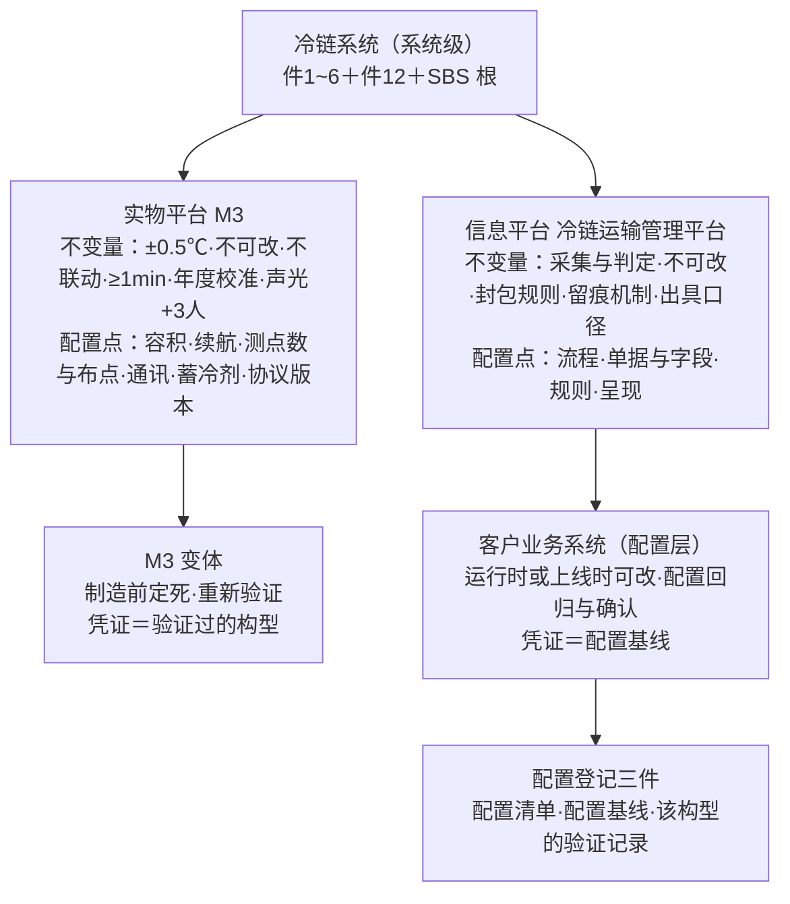

# 00 · 产品数据范例编制手册（v3.1）

> **性质**：**手册**，本目录的**入口件**。管的是**一份**——手上拿起某一份产品数据（比如文档3 相关方需求），照这本把它写出来。**不管全册怎么排、谁执笔、下家是谁**（那在 [`00-产品数据范例编制手册.md（§十二）`](00-产品数据范例编制手册.md（§十二）) 与 [`00-产品数据范例编制手册.md`](00-产品数据范例编制手册.md)）。判据查 [`00-产品数据范例编制手册.md`](00-产品数据范例编制手册.md)，正文存 [`24-47号正文逐件推进稿.md`](24-47号正文逐件推进稿.md)；那三件是数据与账，本手册是**一份的写法**，冲突以本手册为准。
> **编号理由**：取 00 不接着往下排，因为读它的位置在 01~25 之前。本目录 **00＝入口与口径**（本手册），**01~26＝事件与登记**（每次对齐、处置、台账各编一号），手册不占事件序，修订只改版本号。
> **立册理由**（2026-11-19 用户令）：做法原先散在四五个文件与七八条记忆里，写着写着就各说各话；并且用户两次校正了范围——手册是**指导开发每一份产品数据**的，不是指导全套怎么设计的。
> **工作模型**（2026-11-19 用户定）：**开发每一份都照本手册做一遍，每开发一份新开一个对话**，一个对话只做一份。开工提示词、写前写中写后各做什么、收工必须写回哪三处，见 §〇。

---

## §〇 开工协议：一份＝一次对话

**工作模型（2026-11-19 用户定）**：**开发每一个产品数据范例，都照本手册做一遍；每开发一份，新开一个对话。** 一个对话只做一份，交完即停。这条不是为了整齐，是因为一份要读的东西（体例、上游、判据、取料、教材章）已经够多，两份混在一个对话里，读的会互相盖掉，写的会串味。

| 时点 | 做什么 | 落在哪 |
|---|---|---|
| **开工** | 新开对话，粘下面那段提示词（只改份号与名字） | —— |
| **八道** | 按 §〇之二 走：**每道的结果交出来 → 讨论修订 → 确认 → 才进下一道** | 对话里逐道交 |
| **写中** | 守 §一~§八（一份的判据、五件套、资产回路、条目形态、体例、文风、取料） | 24 号正文 |
| **收工** | 三写：① 24 号该节与账外件；② 台账那一行回勾（字・门・状态）；③ 记忆一条（顶行）＋未完项与打回进对应件 | 三处都要写，缺一换对话就断料 |
| **交接** | 下一份在新对话里开工，只靠这三处接上，不靠上一个对话的记忆 | —— |

**为什么收工三写不能省**：每一份都新开对话，上一个对话的内容一概不传；断了这三处，下一份要么重读全库，要么凭印象写错。

**开工提示词模板**（把【】里的替换掉即可）：

```text
【47 号范例 · 文档N 〇〇〇〇】

工作目录：E:\mywork\business-engineering\10-系统工程研究

任务：照《00-产品数据范例编制手册》写文档N 〇〇〇〇这一份，只交这一份，交完即停，等我发话。

第一步只做读书与理解，别动笔：读相关研究报告与本书对应章节，答三问——① 这份产品数据是什么（定义・边界・由哪些栏构成）② 它的前置输入是什么（上游那一份・哪些既有资产）③ 从输入到本份的转换关系与规则是什么（参照／转换／确认准则落点・这一步的动词・按什么规则从输入得出本份）。答完再交三样（定义与边界一句／上游取哪份・下游交给谁・中间什么动词／展开哪几条・哪些从略）。

八道工，每一步都把结果交出来给我看（§〇之二）：读书三问与三样 → 资产三问表与逐条原料转化 → 空骨架 → 数据本体（可分批）→ 门结论 → 账外件与未完项 → 体检三行与核对结果 → 收工回执。**每道交完即停，等我说"确认"或"改哪一条"；不许连交两道，也不许把下一道的成果提前塞进这一道。**

**每道交付前先过四年工程师，他认可了才交给我**：请一名约四年工作经验的工程师（固定这个角色，不是执笔人自己、也不是架构师）读这一道的结果，逐条提"哪一条・为什么・改成什么"；你按意见改完，请他复核给一句**认可／不认可**——**不认可不出门**（同一条最多复改两轮，仍不认可则把卡住的那条与他的原话一并交我裁）。他把的是内容层（数有没有出处、描述能不能判真假、指标是不是勾选框、栏有没有串型、编号对不上上游），方向层他只标疑点、不拦。**交给我的时候要带三样**：改后版本、评审意见与处置（改了什么、没改什么、为什么）、他的认可结论（认可了哪一版）。评审与认可都不进正文，进账外件。

先读（按序；大件只读指定节，别遍读）：
1. 00-系统工程相关研究报告/90-治理登记/00-产品数据范例编制手册.md——**必读 §〇 开工协议・§〇之二 八道工・§〇之三 逐件推进・§一 一份五判据・§二 五件套・§三 资产・§四 条目形态・§五 排法・§六 体例三律・§七 文风八忌・§八 取料标档・§九 第 N 行・§十 自检・§十一 六条红线＋§十二 点名表；查用 §十四 判据（按需）・§十五 排布（按需）；§十六・§十七 是旧稿存要，不必读**
2. claude-memory/MEMORY.md 最前三条
3. **相关研究报告**：48 号对应卡（按手册 §九 第 N 行的"资产→转化"与"门"列指的节）＋该份对应的专题报告（如文档3 读 09 号三类需求与验证载体）
4. **本书对应章节**：按手册 §十 第 N 行"必读"列指明的教材章与节
5. 同目录 24-47号正文逐件推进稿.md：文首体例＋上游那一份（文档〇）＋§〇 台账＋版本行
6. 同目录 00-产品数据范例编制手册.md（§十二） 只读 §二（16 份线表）与对应那一行、§十四（核对法）
7. 同目录 00-产品数据范例编制手册.md 只读与该份相关的行、§九 红线、§十 自检

要交：文档N 〇〇〇〇——（按手册 §九 第 N 行的"数据本体交什么"一句写清）。

纪律（照手册）：
- 节首两行＋资产三问表＋数据本体＋门＋节末一行；账外件另置并写去向。
- 正文只装干货；结构化优先；不造引号词、不用元话语、不加粗轰炸、破折号压到零；英中并列。
- 不出现人名，只写岗位；编号只用文档序 1~16；正文不写件号、不用字母记号。
- 资产只写组织已有的产品数据（研究报告、教材、同册上游文档都不算资产）；每条写得出转化动作。
- 需求三要素齐、不得占号不占行；指标至少一条度量型；数取登记值或标（示例值）或〈待定〉＋解锁。
- 发现上游要改，落打回台账，不在本节就地补。

自检：门逐条判＋机械核对十条；三行体检（栏齐／门过／编号对得上）写在交付说明里，不写进正文。

停止点：每道交完即停；全部八道确认完才收工；不提交、不推送，等我发话。
```

**一份写不动的信号**：读到上游那一份时发现它的栏缺了、编号断链、或它的数与 48 号对不上，那不是本份的问题，是上游的问题——落打回台账、写一句痕，不在本份里替它补。

---

**这本手册怎么读（20 节分三档）**：**必读**——§〇（开工协议）・§〇之二（八道工）・§〇之三（逐件推进）・§一~§十一（一份的判据、五件套、资产、条目形态、排法、体例、文风、取料、每份怎么写、自检、红线）＋§十二 的点名表。**查用**——§十三（与件关系）・§十四（判据、反例、自检十一条）・§十五（47 号这一册的排布与取料）。**不必读**——§十六・§十七（旧稿存要，查「当时为什么这么定」时才翻）。开工时照 §〇 模板那一行读，别整本翻。

## §〇之二 八道工（第一道是读书；**每道都交、每道都确认**）

**逐步交付原则（2026-11-19 用户定）**：**每一道的结果都交出来给用户看，讨论、修订，直到确认为止；没确认不进下一道。** 八道不是内部动作，是八次交付。

| 道 | 做什么 | 交出来给人看的东西 | 确认后才做什么 |
|---|---|---|---|
| **一 读书与理解** | 读**相关研究报告**与**本书对应章节**，答三问：① **这份产品数据是什么**（定义・边界・由哪些栏构成）② **它的前置输入是什么**（上游那一份・哪些既有资产）③ **从输入到本份的转换关系与规则是什么**（参照／转换／确认准则落点；这一步的动词；按什么规则从输入得出本份） | 三问各一句＋"交三样"（定义与边界一句／上游取哪份・下游交给谁・中间什么动词／展开哪几条・哪些从略） | 进第二道（资产） |
| **二 资产开发** | 取原料（组织已有产品数据）→ 转化（台账・记录・抱怨→可判条目）→ 入库（过门才编号）→ 复用（先问能否取现成号改） | 资产三问表＋逐条原料・转化・复用面 | 进第三道（骨架） |
| **三 搭骨架** | 节首两行＋资产三问表＋表头与行数＋门＋节末一行；空栏留白 | 空骨架（表头与行数，栏名即判据名） | 进第四道（填数据） |
| **四 填数据本体** | 一栏一个判据；条目认清是哪一型（需求／内容／位／视图组件／决策缺口／设计）；三要素齐、度量型优先、数三档 | 数据本体（可分批交，一批一张表） | 进第五道（过门） |
| **五 过门** | 拿本份的门逐条判；结论只三种：成立／违例／缺口待补 | 门结论表（逐条判否） | 进第六道（账外件） |
| **六 账外件** | 门结论・从略清单・上游待改・改动痕・未完项，逐件写去向 | 账外件块＋未完项表 | 进第七道（自检） |
| **七 自检** | 门五问＋机械核对十条＋三行体检（写在交付说明，不写正文） | 体检三行＋核对结果 | 进第八道（收工） |
| **八 收工三写** | ① 24 号该节与账外件 ② 台账回勾 ③ 记忆一条＋未完项与打回 | 回执（三处各写了什么、台账行状态） | 收工，等下一份开工令 |

**每道交完就停**，等一句"确认"或"改哪一条"；**不许连交两道**，也不许把第二道的成果当第一道交（读书那道只交三问与三样，不带数据）。

### 每一道内部五步：他认可了才给你看

（2026-11-19 用户令：「每一步都先让那个工程师阅读提意见，并根据他的意见修改后，再给我展示，讨论和确认」；「那个工程师，就是工作了四年左右的工程师」；「他认可了，才给我看」。）

| 步 | 谁做 | 做什么 | 判法 |
|---|---|---|---|
| **① 起稿** | 本对话（执笔人） | 按这一道的要求作出结果 | 够不够看，按本节"交出来给人看的东西"列 |
| **② 工程师评审** | **一名约四年工作经验的工程师**（固定这个角色；不是执笔人自己，也不是架构师） | 只按手册 §一~§十一 与 §十四 判据挑错，逐条给"**哪一条・为什么・改成什么**"；不夸、不给面子分 | 评审能另开一只代理更好——只把草稿与判据给它，不告诉它草稿的来由，免得自己给自己打分 |
| **③ 按意见改** | 本对话 | 采纳的改；不采纳的写一句理由 | 每条意见都要有交代，不许默默忽略 |
| **④ 工程师认可** | 同一名工程师 | 复核后给一句结论：**认可／不认可**；不认可要写清卡在哪一条、按哪条判据卡 | **不认可不出门**：改到认可为止（同一条最多两轮，见下）；认可要注明认可的是哪一版 |
| **⑤ 交用户** | —— | 交**改后版本＋评审意见与处置＋工程师的认可结论**（改了什么、没改什么、为什么、他认可了哪一版） | 用户看不见评审与认可，就等于没评审 |

**他要卡的和不该卡的**：他被授权卡的是**内容层**（数没出处、描述判不了、指标是勾选框、栏串型、编号对不上上游）——这些不认可就是不放行。**方向层他只能标疑点**（这一份该不该这么切、要不要加一类、权重怎么定），疑点不算不认可，连同他的原话一起交用户裁。角色一混，四年的人就成了挡住方向的墙。

**卡住怎么办（不许无限循环，也不许悄悄放行）**：同一条意见最多复改两轮；两轮仍不认可，把卡住的那条、他的原话、我的判断一并交用户，由用户裁。放行与否都要留痕。

**为什么是四年**：四年的人做过几个项目，常见坑都见过，挑得出内容层面的错；但四年的人没有决策权，也不该让他判方向。故他的意见是**建议**，他的认可是**内容层的闸门**，方向仍归用户与架构师。

| 他挑得出（内容层，可卡） | 他挑不出，留给你与架构师（方向层，只标疑点） |
|---|---|
| 这个数从哪来、有没有出处 | 这一份该不该这么切分、要不要并或拆 |
| 这句话能不能判真假（"要可靠"过不去） | 要不要加一类需求、换一个视角 |
| 指标是度量型还是勾选框（只有 0／100%） | 必过与权重怎么定、门槛取值 |
| 栏有没有串型（需求写成内容、关切写成条目） | 这一份的深度够不够、值不值得这么细 |
| 编号对不上上游、来路只写到"相关方需求" | 方向对不对、有没有做该做的事 |

**为什么这一道不能省**：写的人容易只对着"够不够齐"看，看不出"这一条其实判不了""这个数其实没出处"。让四年工程师先看一遍、认可了再出门，用户看到的就只是"方向上的取舍"，不用再替内容兜底。

**评审意见与认可结论都不写进正文**：记录进账外件的"评审记录"或打回台账，正文只留改后的数据。

**第一道的三问是全文的钥匙**：答不出"它是什么"，其余七道都是在猜；答不出"前置输入是什么"，资产栏只能写空话；答不出"转换关系与规则"，本份的栏就会按印象排，而该按上游能供出什么排。

**一次只交一份，交完即停。**

---

## §〇之三 逐件推进：三级颗粒度

**令**（2026-11-19 用户）：「先给出产品数据的大概思路，再从问题与机会开始，逐一产品数据推进。如果一次全部搞定，恐怕产品数据的细节和前后转换关系的准确性会难以确保。」→ **不一次成稿**。

**四条风险，逐件推进正好一件挡住一个**：

| 风险 | 现场 |
|---|---|
| **细节变糊** | 栏填不满、来路写不出 |
| **转换断链** | 上游编号到下游对不上 |
| **门形同虚设** | 过没过看不出来 |
| **打回无处可留** | 一次成稿没有"改过"的位置 |

**三级颗粒度，同时成立**：

| 级 | 颗粒 | 规矩 |
|---|---|---|
| 一 | **件与件** | 一次只交一份，交完即停，等人一句"继续／下一份" |
| 二 | **件内八道**（§〇之二） | 道道有交付、道道有确认；不许连交两道 |
| 三 | **道内五步**（§〇之二 之一） | 起稿→四年工程师评审→按意见改→**他认可**→交用户，带三样 |

**延伸适用**：凡**大件正文**（多件一套的产品数据、成书章节整批重写）都按此办——先出思路表，再逐件推进。**不许再出现"一次交全篇"的交付**；尤其不许把"设计单过了"当成"正文可以一口气写完"。

**与八阶段的关系**：`feedback-八阶段不得跳关` 管"每章按八阶段走"，本节管"一份之内怎么切"，两条不冲突。

---

## §一 一份产品数据是什么

**是物，不是事。** 一份产品数据交的是"那一份数据本身"（表与取值），不是"怎么做出它的过程"。过程只能以**留痕**的形式长在物上：版本、空栏的解锁条件、判补项、判否留档、打回记录。

**一份合格的判据五条**（缺一条这一份就没做完）：

| # | 判据 | 反例 |
|---|---|---|
| 1 | 交的是那份数据（表与取值） | 交了一段"本标准要求应……"的说明 |
| 2 | 栏齐（按 §九 那一份的栏表） | 视角不写"框定哪些关切" |
| 3 | 每条有来路（**编号级**，不是"大致来自需求"） | 写"来源于相关方需求" |
| 4 | 每条有判定（过渡门结论或判否留档） | 写"基本覆盖" |
| 5 | 有指标或值（需求类）、有三槽句（内容类）、有怎么核（位与分配类） | 出现形容词当判据 |

**三条禁令**：不搬 EOS 术语、不引 EOS 文档；不写配置引擎实现、不写选配全矩阵；判据不在本册重写（判据在 48 号正本与 §十四）。

---

## §二 每一份都有的五件套

| 件 | 写什么 | 判法 |
|---|---|---|
| **节首户头两行** | 版本与资格／承接档·停在哪一档 | 缺一行即不合格 |
| **资产三问表** | 取哪份资产（**写户名**）｜走哪一档（直接承接・改进后・新增）｜留下什么资产；另加"资产四条"按本份能落的落 | 写"沿用既有平台"＝没写；写"新增"必须答"为什么没有现成的" |
| **数据本体** | 这一份的那张表（或那几张表），一格一格填（形态见 §四、逐份见 §九） | 每条有来路・有判定・有值 |
| **门** | 这一份的判否（§九 末列） | 结论只有三种：成立／违例／缺口待补 |
| **节末一行** | 改动痕与未完项（谁・几时・改哪・去向） | 痕迹不许写在正文，进账外件 |

**体例四条**：节题＝那份产品数据的名字；**不出现人名，只写岗位**；括号只放指针不放内容，交叉引用不作主干谓语；正文只写"现在是什么"，不写历史与待办。

---

## §三 资产：只有组织已有的产品数据

（2026-11-19 用户令：**研究报告不是资产**。）

| 是资产（可作原料、可复用） | 不是资产（只作判据・依据・上游） |
|---|---|
| 上一代／在役**产品数据**：需求规格、BOM 与装配图、架构与设计描述、验证与测试记录、部署记录与模块清单、配置清单与配置基线、工单与备件台账、采购台账与供应商名录、工装与工艺文件、成本与报价核算、事故・投诉・内审记录、客户侧协议与资质档案、积累成的**需求资产库** | ① **研究报告与教材**（48／20／09／教材）＝判据・机制・方法，决定"怎么写"；② **同一册的上游文档**（文档1、文档2…）＝同一套数据的上游，只要求编号对得上；③ **法规正本**＝外部约束，标（外部）并挂取料级别 |

**判法**：写"取自 48 号卡3 的需求1 原句"是错位，应写"取自一代需求规格的功能条目／事故台账 3 起"。研究报告只出现在**判据依据**或**取料级别**栏，**不进"资产"栏**。

**资产是回路，不是取料单**（四步，每份都要走）：

| 步 | 做法 | 判法 |
|---|---|---|
| ① 取原料 | 只取组织已有产品数据里有出处的东西 | 没有出处的数字不进表 |
| ② 转化 | 把一句抱怨、一条台账、一份记录改成可判条目：补名称、补"到什么程度"的量、剔掉实现暗示 | 这一步是主要工作量；写得出转化动作才叫开发 |
| ③ 入库 | 过了本份的门才编号入库；没过门的留〈待定〉并挂解锁方式与人 | 不入库的不许被下游引用 |
| ④ 复用 | 下一条先问"能不能取现成的号改" | 上一份"留下"与本份"取"逐号对得上 |

**两笔账对不上＝断链**，与编号断链同严重度。

---

## §四 条目有六种形态，各有各的齐

写每一份，先认清它的条目是哪一型；**型不对，栏就填不对**。

| 形态 | 几样齐 | 出现在哪几份 | 最常缺哪一样 |
|---|---|---|---|
| **需求条目** | 名称＋描述＋指标（三样缺一不是需求） | 3、5、15 | 指标（写成形容词） |
| **内容条目** | 三槽句：来路｜一句话形态｜过门结论（删去后哪个因子失去落点） | 9 | 第三槽（用"很重要"代） |
| **位条目** | 种类・名字・边界・承担内容・来路・可替换性 | 11 | 边界与可替换性 |
| **视图与组件条目** | 组件：取自・治理者・覆盖关切・进哪张视图；视图：标识・治理视角・组件・已知问题 | 12 | 已知问题（缺口从"已知"变"未知"） |
| **决策与缺口条目** | 决策：编号・陈述・权限人・约束与假设・关联・理由・时间戳；未应对：缺口・原因・期限・批准人 | 13 | 权限人与理由 |
| **设计条目** | 元素指回位・规格・接口四样（协议・字段・失败处理・回执）・特性八条覆盖六类 | 16 | 失败处理与回执 |

**需求条目的三类**（按"谁在问"分）：**功能性需求**（客户与使用者）／**质量特性需求**（客户与环境共担）／**易实现性需求**（承制方自己提，客户不会提）。一个特性归哪类看谁在问，不看名字；两个主人就拆两条。

**指标分两型**：**度量型**（≤30 s（p95）、≥72 h、≤3 步、≥60%、≤20 周）承载程度差；**门槛型**（0 家、覆盖率 100%、生效数 0）只承载有无。**每条需求至少一条度量型**；只有门槛型的，等于勾选框。

---

## §五 数据本体怎么排

| 规矩 | 说明 |
|---|---|
| 列名即判据名 | 列头写清"量什么""怎么判"，一行一个对象 |
| 一栏一个判据 | 一格里不塞两件事；要放指针就只放指针 |
| 取值格写判据句 | "缺坐标＝口号"这类句子保留，不许压成"其它" |
| 不许为排版切句 | 一条事实拆成三行，读者拼不回来 |
| 固定户头也上表 | 节首两行、节末痕迹、每节判否项，一律表 |

**范例体例（代表性优先）**：关键行写全，同类其余**占号不占行**，用一句"从略 N 条，占号不占行"交代。**验收四条**：三个相关方层各到场（外部／委托方内部岗／承制方）、每类判据到场（强制型、只能写一半、易实现性、可配置性）、每条有来路、每条有判定。

> **一处例外**：**需求不得占号不占行**。只有号与名称、没有描述与指标的，按三要素不算需求；需求要全列。相关方、关切、目的、位、叶可以占号不占行。

---

## §六 体例三律与账外件

**律一 正文只装干货**：正文只放那份数据（表与取值）。自检结论、口径、改动痕、未完项、转换说明、对下游的预告，一律进**账外件**，并逐件写**去向**（评审记录／打回台账／设计单／追溯矩阵／附录 D）。判据与口径表已有的，正文不重复。

**律二 能结构化就结构化**：凡"多个对象 × 同一组字段"一律落表。**只三类不许结构化**：一句判据或收束句、逐字引文（含中译）、表与表之间的过渡句（每次≤一句）。

**律三 次序是干货＞结构＞文风**：先保证正文只装数据，再保证可扫读，最后才是措辞。

**账外件块四行是标配**：门结论｜从略清单｜上游待改（若发现）｜改动痕；再加一张未完项表（谁・几时・补什么）。

---

## §七 文风八忌

| 忌 | 长什么样 | 改成 |
|---|---|---|
| 自造引号词 | "独立留痕""允许客户改的那一格" | 行业实词直说：运输段没有独立于承运方的温度记录 |
| 排比模板 | 三行同以"差在××这一环"收尾 | 每行按事实用自己的说法 |
| 元话语 | "★ 必须点破""一句：""本轮只立三样" | 全删，直接说 |
| 粗体轰炸 | 几乎每句加粗 | 只加粗编号与关键词，全文一成以内 |
| 破折号引总结 | 每格"——…；…都无从立足" | 破折号压到零 |
| 对仗口号 | "料在、形态不在" | 改陈述句 |
| 英文不并列 | 只给英文或只给中文 | 英文与中文并列；逐字引文紧随（中译：…） |
| 括号装内容 | 括号里塞解释 | 括号只放指针 |

**判据**：每句话都要能对着事实核对；对不上的就是文风问题。

---

## §八 取料与标档

| 级 | 含义 | 怎么写 |
|---|---|---|
| **甲** | 已登记、可照抄（原号原字） | 直引，注出处 |
| **乙** | 库内有正本、可核 | 引条款号，标"乙级·待核"直到核到现行版 |
| **丙** | 库外、不可核 | **只写类别**（"法规要求××"），不写条款号 |
| **丁** | 未取到 | 标〈待定〉＋解锁条件 |

**数的三档**：**登记值**（库内已登记，直接写并注出处指针）／**（示例值）**（案例可编、库里没登记，值后必须标）／**〈待定〉**（须实测，写解锁方式与人，并进未完项）。**〈待定〉要少**，一多就是把没想清的部分推给下游。

**三条纪律**：术语不自造；两处必对齐（同一个量不许一处一个值）；不许"看起来像"。

---

## §九 每一份怎么写

先认份，再看那一行；六列分别对"交什么、栏怎么填、资产从哪来、两边交给谁、门与最常见错"。

| 份 | 数据本体交什么 | 栏与判法 | 资产→转化 | 上下游两条边 | 门・最常见的错 |
|---|---|---|---|---|---|
| **1 问题或机会** | 问题表・机会表・约束表 | 号｜现状（含出处）｜出处（哪份资产）｜直接原因｜成因｜缺什么；机会多一列"抓住它的条件"；约束多一列"为什么不能协商" | 事故・投诉・内审记录→现状一句话＋根因两环；交付台账→"每接一单重做一遍"的量 | 上：无（链首）；下：2 与 6 | 门：现状有出处・根因两环・机会有抓住条件。错：把方向句（从X到Y）写在这里（那是文档6） |
| **2 相关方与关切** | 相关方表・关切表・双向核对・强制型标记 | 相关方：角色・内外・关系・为什么列进来；关切：谁提・不可协商・来自哪条问题・能否成需求（能／只能写一半／写不成） | 协议档案・客诉・内审→关切；组织关系→相关方（含承制方四岗） | 上：1；下：3 与 6 | 门：双向无空格・强制型已标。错：拿部门名当关切名；把"用户"当一方（须拆成使用／维护／采购／处置） |
| **3 相关方需求** | 需求表（八列，场景列留空待4）＋资产回路两表 | 号｜名称｜描述｜指标｜种类｜来源｜谁来认｜场景；名称是名词短语，描述一句可判真假不暗示实现，指标可量 | 一代需求规格／事故台账／交付台账／BOM／工单／报价台账→可判条目 | 上：2；下：4（参照）与 5（转换，1:N 允） | 门：覆盖检查＋三要素齐。错：拿关切原话当需求（"要可靠"不是需求）；占号不占行 |
| **4 运行概念** | 三枝场景表（正常・异常・应急），每场景一行 | 触发｜参与者｜时序｜**确认准则**｜谁来认 | 一代现场记录・司机反馈・到货处置做法→场景 | 上：3（参照）；下：5（只落确认准则） | 门：确认准则先行。错：写成流程说明，没有"用完不成"的判据 |
| **5 系统需求** | 系统需求表，每条带验证三格 | 号｜技术侧陈述（可测）｜类＋设计约束｜承自｜验证方法・判据・载体｜主落平台 | 文档3 的需求（换语言与量纲）＋既有平台限制 | 上：3（转换）＋4（确认准则）；下：6・11・14 | 门：双向追溯＋验证方法栏。错：照抄相关方需求（没换语言）；把选型写成需求 |
| **6 架构目标** | 目标表 | 号｜坐标｜宾语（问题或机会号）｜方向句（现状→目标态）｜预留准则号 | 问题现状原话（作坐标与宾语）＋一代同类目标 | 上：1・2；下：7 | 门：三要件齐。错：缺坐标＝口号；写成达标与否（那已是需求） |
| **7 关键成功准则** | 准则表（寄居文档6） | 因子｜值或值域｜用途一｜用途二｜必过标记｜权重 | 因子清单＋一代登记值＋质量模型 | 上：6；下：8・9・评估 | 门：两条用途齐・权重和 1.00。错：必过与权重加到不牵制的准则上；通过线事后才给 |
| **8 因子清单** | 因子表 | 因子号｜量什么｜单位｜取法｜所属特性 | 质量模型骨架＋一代验证记录里的量法 | 上：7；下：6／7／9／11 四处共用 | 门：每个因子有单位与取法。错：写形容词当因子 |
| **9 架构内容** | 内容表（概念・属性・原则）＋补充面 | 三槽：来路｜一句话形态｜过门结论（删去后哪个因子失去落点） | 关键需求＋关切＋行业现成概念（仅骨架）＋一代不变量清单 | 上：6・7；下：10（定轴）・11（定落点） | 门：三槽齐。错：用"很重要"代第三槽；把非基本当删掉（只分栏不删条） |
| **10 视角与模型种类** | 视角表＋种类表 | 视角：框定关切・答哪几问・构造・边界・种类或图例；种类：约定・视图方法与对应方法・版本标识・信息来源 | 关切聚类＋既有视角库（先查库、选用优先，不另造） | 上：9；下：11（定轴）、12（治理者） | 门：有关切未被框定即退回。错：视角只写"用来画图" |
| **11 位与分配** | 位表（两组）＋分配表 | 位：种类・名字・边界・承担内容・来路・可替换性；分配：位编号・形式（七种之一）・内容・怎么核・复核 | 内容条目→落位；对外交互与接口→断口；一代模块清单与配置清单 | 上：9・10；下：12（组件取材）・13（索引） | 门：守恒四条。错：缺"怎么核"＝未分配；位与元素混（元素名不许用位名） |
| **12 架构视图** | 模型表・组件表・视图表・对应关系（四节） | 组件：取自・治理者・覆盖关切・进哪张视图；视图：标识・治理视角・组件・覆盖声明・**已知问题** | 只从位取料建模；视角定治理者 | 上：11；下：13（只引用，不另编号） | 门：元素指得回位・组件有治理者・视图覆盖全关切。错：缺已知问题；型号参数值混进视图 |
| **13 架构描述** | 册头与预期目的・索引・对应关系引用・决策・未应对・覆盖与基线 | 决策七样（编号・陈述・权限人・约束假设・关联・理由・时间戳）；未应对四样（缺口・原因・期限・批准人） | 12 的产出＋一代既有决策记录（续号不另编） | 上：12（成对签发绑一起）；下：14 | 门：索引不漏项・决策有权限人与理由・缺口有声明・基线齐。错：两件版本各编各的 |
| **14 系统分解结构** | 一树＋节点表＋位×节点交叉映射 | 每叶：四独立之一＋两判据；每格给结论（承担／参与／违例） | 一代模块与部件清单＋交付台账（哪些件常一起换） | 上：13（换手点，换的是种类）；下：15 | 门：交叉映射无空格。错：把树当架构；元素名与位名混 |
| **15 构件需求** | 每叶一支需求（两册） | 号｜陈述｜指标｜类｜承自｜验证三格；三支下限（allocated ≥1／decomposed ≥1／derived ≥2） | 系统需求分配＋一代零件与工艺文件＋供方目录 | 上：14；下：16 与开发线 | 门：覆盖检查（语义 ⊆ 叶之并）。错：把支别编进条目号 |
| **16 设计描述** | 四目：元素与规格｜接口细化｜设计特性｜成册与配置清单 | 元素指回位；接口四样（协议・字段・失败处理・回执）；特性八条覆盖六类；配置清单与依从声明齐 | 一代 BOM・选型・工艺・成本核算 | 上：15；下：实现、采购、配置（配置出口，不上线） | 门：算得出成本・下得了采购。错：设计元素指不回位；接口无失败处理 |

**已交样例**（可当写法参照）：文档1（问题或机会，v5）／文档2（相关方与关切，v8）／文档3（相关方需求，v1.6），都在 24 号。

---

## §十 写完自检

**门五问**：交的是那份数据吗？栏齐吗？每条有来路吗（编号级）？有判定吗（判否留档）？与上下游编号对得上吗？

**体检三行**（写在交付说明里，不写进正文）：栏齐否／门过否／与上下游编号对得上否。

| # | 机械核对 | 怎么查 |
|---|---|---|
| 1 | 节题＝文档名 | 节题表逐行 |
| 2 | 无字母记号 | `grep "3[ABC]"` ＝0 |
| 3 | 件号不在正文出现 | `grep "件[0-9]"` 只命中对账表 |
| 4 | 旧序号零命中 | `grep "序 [0-9]"` ＝0 |
| 5 | 废号零命中 | `grep "PD-0"` ＝0 |
| 6 | 版本行只一条 | 数 `^\*\*版本\*\*` |
| 7 | 表格列数一致 | 每行竖线数＝列数+1 |
| 8 | 每份节首有资产三问表 | 命中数＝份数 |
| 9 | 资产栏里没有研究报告 | 资产列不许出现 48／20／09／教材 |
| 10 | 字数登记实测值 | 台账写实测，不写预算 |

**字数口径**：预算与实测分开写，正文与账外两栏都不许拿预算凑。

---

## §十一 最常撞的六条红线

摘自判据台账的十二处"一次就错"（全表见 §十四 之九），写一份时撞得最多：

| # | 错法 | 后果 | 对法 |
|---|---|---|---|
| 1 | 把"重要"当"基本" | 内容表被要紧的话填满 | 第三槽写出"删去后哪个因子失去落点" |
| 2 | 把关切当内容或当需求 | 坐标变成条目，内容虚胖 | 关切进文档2，内容进文档9，需求进文档3 |
| 3 | 把 1:N 当分配 | 一条需求散到多个节点，变更传播 | 单承接；切不动的走节点拆分或横切承接 |
| 4 | 位与元素混 | 架构侧与设计侧对不上，追溯断 | 元素名不许用位名 |
| 5 | 把"架构"当"架构描述" | "架构评审"退成"文档评审" | 架构＝那份内容，描述＝把内容说成可核的 |
| 6 | 验证当确认／评审当评估 | "UAT 跑了就算确认" | 四把尺各带判据（§十四 之六） |

---

## §十二 十六份一览与对账

> 收编说明：本节整段收自原 25 号 产品数据清单（点名在前・16 份定案）。写某一份时查本节的点名表与栏；编号规则・两件并列・为什么 16 份这三段贴在下面。原件的版本行不入本节，历史在 git。

> **性质**：**清单件**。本册要交的产品数据，一份一份点名。
> **编号规则**：**全册只用一套编号＝文档序 1~16**，按出现次序编，**不用字母记号**；**48 号件号只在 §十一 对账表里出现**，正文不写。
> **★ 装订定案（用户令 2026-11-19）**：架构侧那一块**分两件并列**——**文档12《架构视图》**（模型・视图组件・视图・对应关系）与**文档13《架构描述》**（册头与预期目的・索引・十项对位・决策・未应对・覆盖声明与版本基线）。**两件平级、各自封面与目录、各自的门**。**判据＝读者的思维习惯**：读者要能立刻答出"我手上这份东西叫什么、该看哪一份"——层级（部—卷）答不了这一问。**"合为一份描述"这件事不靠层级、靠一张签发单**：`AD-1.0 ＝ 架构视图 v1.0 ＋ 架构描述 v1.0`，同一批准人、同一日期，缺一件另一件不得单独进基线。
> **★ 为什么是 16 份而不是 15 份**：**视角与模型种类不能挪进卷②**——切法第一条是"**先定轴、后切位**"（48 号 §7.6 R0），视角是"轴"，位是"切"；视角若进卷②，它就落到位之后，R0 当场破。故**视角仍独立（文档10）、位紧随（文档11）**，两卷在后。
> **三条禁令**：① 不编第 17 份以后（新增先改本清单）；② 不复活 `PD-01~PD-44`；③ 不许两套编号并排。

---


### 一 先报数

| 类 | 数 | 是哪些 | 编号 |
|---|---|---|---|
| **文档线** | **16** | 见 §二 | **1~16** |
| **配置登记** | **3** | 配置清单／配置基线／该构型的验证记录（线外并行） | 不编号 |
| **登记与记账** | **4＋2 栏** | 评审记录／分配去向登记／跨层对应关系／追溯矩阵＋（已知问题・已知不一致） | 不编号 |
| **条件件** | **用到 5／未用 5** | 质量模型・权重・关键特征・需求质量核查・设计备选与权衡 | 不编号 |
| **管理文档** | **两类** | 项目与过程管理件（§八）＋领域侧管理文档（§九） | 不编号 |
| **参照表** | **1** | 系统目的理解清单（§二之二；数据在正文推进稿 §一.7） | 不编号 |

**成册数（对外只说这四个）**：**架构描述 1 份（两卷）**：卷③正卷 1 册＋卷②附卷 1 册｜**构件需求 2 册**（实物／信息）｜**设计描述 2 册**（技术方案 2＋实现方案 44 夹在册内）｜**配置登记 1 表组**（三件三张表）。

**判等一句（用户令 2026-11-19）**：**"产品数据类文档"＝本文档线的那 16 份（文档 1~16），判等不是举例**。其余各类——**配置登记三件・登记四件＋两栏・条件件・管理文档两类・一张参照表**——**随线走、不编号，不称"产品数据类文档"**：它们是**账与登记**，不新增资产，故不给"资产三问"（三问只落在文档 1~16 每份节首）。

**算术**：**15 件 → 16 份文档**（件3 拆一为三 ＋2；件10~15 合为两卷 −4；＋装订并入卷③；＋设计件 3）＝ 16。

---

### 二 一条线：文档 1~16（文档序＝正文节号）

| 序 | 文档 | 48 件（对账） | 性质 | 层 | 成册 | 执笔 → 认下 | 下家 |
|---|---|---|---|---|---|---|---|
| **1** | 问题或机会的陈述 | 件1 | 产出件・链首 | 系统级 | 入卷③ | 产品经理 → 产品开发经理 | 2 |
| **2** | 相关方与关切 | 件2 | 产出件 | 系统级 | 入卷③ | 需求分析 → 业务与合规 | 3、6 |
| **3** | 相关方需求 | 件3 | 产出件 | 系统级 | 入卷③ | 需求分析 → 货主方代表 | 4、5 |
| **4** | 运行概念 | 件3 | 产出件 | 系统级 | 入卷③ | 系统工程师 → 每节末"谁认" | 3、5 |
| **5** | 系统需求 | 件3 | 产出件 | 系统级；逐条标主落平台 | 入卷③ | 系统工程师 → 质量负责人 | 6、11、14 |
| **6** | 架构目标（含系统目标列） | 件4 | 产出件 | 系统级 | 入卷③ | 架构师（两平台）→ 产品开发经理 | 7 |
| **7** | 关键成功准则 | 件5 | **寄居 6** | 系统级 | 寄生 | 架构师（信息）→ 质量负责人 | 8、9、评估 |
| **8** | 因子清单 | 件6 | 判据侧产出件 | 系统级 | 一张表 | 架构师（信息）→ 质量负责人 | 6/7/9/11 **四处共用** |
| **9** | 架构内容（概念・属性・原则） | 件7 | 产出件 | **分块**：系统级语义＋平台级内容 | 入卷③ | 架构师（实物）·（信息）→ 质量负责人 | 10、11 |
| **10** | 视角与模型种类 | 件8 | 产出件 | 平台层（主）＋配置层（附） | 入卷③ | 架构师（信息）→ 质量负责人 | 12 |
| **11** | 位与分配 | 件9 | 产出件（一步两块） | **两组**：平台层十位／配置层十二位 | 入卷③＋附录 A·B | 架构师（实物）写位定表 → 产品开发经理 | 12、13 |
| **12** | **架构视图**｜四节：模型｜视图组件｜视图｜对应关系 | **件10・11・12・13** | 产出件 | 按层 | **1 册** | 架构师（信息）／配置实施 → 质量负责人 | 13 |
| **13** | **架构描述**｜六节：册头与预期目的｜索引（相关方・关切・十项对位）｜对应关系引用｜决策与理由｜未应对声明｜覆盖声明与版本基线 | **件14・15**（＋件1~13 的索引） | 产出件（成册） | 系统级 | **1 册** | 架构师（信息）→ 产品开发经理 | 14、评估、对账 |
| **14** | 系统分解结构 | —（设计件） | 设计件（构件需求的**框架**档） | 系统级→两平台 | 一树＋节点表＋交叉映射 | 系统工程师 → 质量负责人 | 15 |
| **15** | 构件需求 | —（设计件） | 设计件（同一份的**定义**档，概要不出现） | 两平台各自 | **2 册** | 开发负责人（信息）／制造与采购（实物）→ 质量负责人 | 16、开发线 |
| **16** | 设计描述（四目） | —（设计件） | 设计件（implement-to 级） | 两平台各自＋配置层一份 | **2 册**＋配置清单 | 开发＋配置实施／硬件＋制造 → 产品开发经理 | 实现、采购、配置 |

**两处节点（装订点已消失，并入卷③ 的册头）**：**换手点＝文档14**（架构→设计，**换的是种类**不是精度）｜**配置出口＝文档16**（配置层出配置清单与依从声明，**不上线**）。

---

### 三 前三份文档：3 相关方需求・4 运行概念・5 系统需求

**为什么拆三份**：*the stakeholder needs, stakeholder requirements, and operational concept are typical artefacts that are **baselined***（利益相关方需要、利益相关方需求与运行概念是通常被纳入基线的典型人工制品）【A：ISO/IEC/IEEE 15288:2023 §6.4.2.3 注33】——三者同出一过程、同批进基线。

| 序 | 文档 | 交什么（栏） | 缺了会怎样 | 门 |
|---|---|---|---|---|
| **3** | 相关方需求 | 号｜陈述（谁・何时・要什么・到什么程度）｜来源｜由哪档场景确认｜谁来认｜承接档 | 全链无起点 | **覆盖检查** |
| **4** | 运行概念 | 框架（正常／异常／应急三枝梢＋两判据）＋定义（触发・参与者・时序・**确认准则**・谁来认） | 确认无判据载体 | **确认准则先行** |
| **5** | 系统需求 | 号｜陈述（可测量）｜类＋设计约束｜承自｜**验证三格**｜**主落平台** | 只有用户视角 | **双向追溯＋验证方法栏** |

**三句分写（不许并）**：**3→4 参照**（不派生需求）｜**3→5 转换**（`transform`，1:N 允）｜**4→5 确认准则落点**（不构成派生边）。

---

### 四 两件并列：文档12 架构视图 ｜ 文档13 架构描述（用户定，2026-11-19）

**按读者直觉办：它们就是两份并列的文档**，平级、各自封面与目录、各自的门。**理由**：读者要的不是"部—卷"的层级，是"我手上这份东西叫什么、看哪一份"。**层级是账上的事，并列是读者的直觉**——两者可以并存，代价只是多一张签发单。

**为什么能这样分**：**48 号自己的两把卡就是这条缝**——**卡16** 出"模型・组件・视图・对应关系"（可看图的那一半）／**卡17** 出"描述本体十项"（册头・索引・决策・缺口・版本）。两件的分工与两把卡一一对应。

| 文档 | 名字 | 装什么（节） | 读者 | 门（各节各带） |
|---|---|---|---|---|
| **12** | **架构视图** | ① 模型（按层）｜② 视图组件（取自・治理者・覆盖关切・进哪张视图）｜③ 视图（标识・治理视角・组件・覆盖声明・**已知问题**）｜④ 对应关系（成立或列全部违例） | 看图的人（评审・设计・集成） | 元素指得回位／组件有治理者／视图覆盖全关切／对应关系成立或违例 |
| **13** | **架构描述** | ① 册头与**预期目的**｜② 索引（相关方・关切・十项对位）｜③ 对应关系引用（指向文档12）｜④ 决策与理由（权限人・理由・约束假设・时间戳）｜⑤ 未应对声明（缺口・原因・期限・批准人）｜⑥ 覆盖声明与**版本基线** | 审账的人（评估・对账・交接） | 索引不漏项／决策有权限人与理由／缺口有声明／版本基线齐 |

**两件并列之后，靠三条机制把"一份描述"这件事接住**（不再用"卷"这个词）：

1. **成对签发**（最关键）——一份**签发单**把两件绑成一条基线：`AD-1.0 ＝ 架构视图 v1.0 ＋ 架构描述 v1.0`；**同一批准人、同一日期**；**缺一件，另一件不得单独进基线**。签发单是一张表（版本号·批准人·日期·两件的件内目录指纹），落附录 A.4。
2. **互指只用一套号**——视图号与组件号**只在文档12 分配**，文档13 只引用；视角号在文档10 分配。**不许在文档13 另编一套图号。**
3. **各自首行一句**——文档13 册头首行写"**本描述与文档12《架构视图》合为一份架构描述（AD-1.0）**"；文档12 首行写"**本视图集是 AD-1.0 的视图部分**"。

**一处必须标档（不藏）**：**把"描述"读作"两件合一的成品"是〔C〕本库读法**——42010 §6.7 的字面是"描述应**包含**视图"，而我们把两件并列装订、用签发单落实"包含"。**若将来要对外声明符合性**，做法是把两件**装订成一册印发**（同一套内容，只改装订，不改一字）。**登记**：附录 D 待核一行。

**一条正本内的对照（说明为什么对应关系可以"引用"）**：标准对不同成分用了不同动词——对应关系 `An AD shall **include or reference** …`（**可包含或引用**）【A：42010 §6.9.2，48 号 §12.3 逐字引】；视图只能被包含。**故本册：文档12 装对应关系（与视图同处），文档13 只引用；视图不拆到第三处。**

---

### 五 配置登记三件（线外并行）

| 件 | 是什么 | 触发点 | 落点 |
|---|---|---|---|
| 配置清单 | 某一变体用到哪些**配置点**、各取什么值、用到平台哪些能力 | 文档16 目四 | 2.16.4＋附录 A.3 |
| 配置基线 | 被批准・被冻结・能当参照的那一份配置 | 上线或运营变更时 | 附录 A.3 |
| 该构型的验证记录 | 该构型跑过的验证：准则・通过线・证据・判定人 | 交配置时 | 附录 A.3 |

**一条判据**：变体凭证必须是这三件之一；口头确认不算。

---

### 六 登记与记账四件＋两栏

| 件 | 是什么 | 落点 |
|---|---|---|
| 评审记录与结论 | 逐件判"对哪件・按哪个目标・判成什么・谁认下・补什么与几时补" | §三 3.2 |
| 分配去向登记 | 系统需求 → 系统元素 → 支别 → 怎么核 | 附录 B.1 |
| 跨层对应关系（位↔系统元素） | 逐格成立／违例 | 2.14 交叉映射＋2.16.1 指回位＋附录 B.2 |
| 追溯矩阵 | 需求↔准则↔内容↔位↔节点↔元素↔接口 | 附录 C |
| 已知问题（栏） | 每张视图的 d 栏 | 卷② 视图表 d 列 |
| 已知不一致（栏） | 对应关系逐条 | 卷② 对应关系表 |

**纪律**：登记件的合格标准是**每条都有结论**；写"基本覆盖"等于没查。

---

### 七 条件件

| 条件件 | 用不用 | 落点 |
|---|---|---|
| 质量模型 | **用** | 2.7 准则上方（三层只把"证据可信"一条写全） |
| 权重 | **用** | 2.7 权重列，和归 1.00 |
| 关键特征 | **用** | 2.9 内容来路＋2.11 范围句 |
| 需求质量核查 | **用** | 2.15 册末结论行＋附录 D |
| 设计备选与权衡 | **用** | 2.16.4 内一节 |
| 评估准则・计划・报告・结果 | **不用**（只引两处发现） | §三 3.2 引一行 |
| 过程管理件 4 | **不用** | §八 |

---

### 八 管理文档（一）：项目与过程管理件——三户

| 户 | 哪些 | 判据 | 户口 |
|---|---|---|---|
| **进册** | 评审记录・分配去向登记・跨层对应・追溯矩阵・配置登记三件・文档13 的决策节 | 它们**就是链上的判定与登记** | §三 3.2、附录 A.3/B/C、卷③ |
| **链外成册** | 验证记录与报告・确认记录与报告・评估计划/报告/结果 | 垮的是**链下游的可核性** | 项目侧单独成册 |
| **不出** | 概念化计划・状态报告・细化计划・状态报告 | 是**过程可控性** | 对外声明符合 42020 时另附 |

**三条"不许代填"**：验证记录**不许用测试报告顶**／确认记录**不许用 UAT 结论顶**／评估报告**不许替决策拍板**。

---

### 九 管理文档（二）：领域侧管理文档——只对接、不代写

质量管理制度・操作规程・验证方案与报告・承运方资质与审计记录・委托运输协议档案・留样与追溯档案。**本册只做三件事**：作**文档2 的关切来路**｜作**文档5 约束栏与文档9 原则栏来路**（写"法规要求××"，条款号只挂底账·乙级待核）｜作**附录 A.3 的对接面**。**红线：不替客户写管理制度。**

---

### 十 判定侧四把尺的家

| 尺 | 判据 | 长在栏里 | 链内／链外 |
|---|---|---|---|
| 验证 | 规定需求（对象含**人工制品**） | 5 与 15 每条**验证三格** | 方法准则进册；记录链外 |
| 确认 | 预期用途＋确认准则 | **4** 的"确认准则＋谁来认" | 准则进册；记录链外 |
| 评审 | 为客体确立的目标 | 每件"谁认下・补什么・几时补" | **进册**（3.2） |
| 评估 | 被指明的评估目标（不含处置） | 只引两处发现 | **链外** |

---

### 十一 与 48 号十五件的对照（件号只在这里出现）

| 48 号件 | 本册 |
|---|---|
| 件1 | **文档1** |
| 件2 | **文档2** |
| 件3 | **文档3・4・5**（一件三文档） |
| 件4 | **文档6** |
| 件5 | **文档7**（寄居文档6） |
| 件6 | **文档8** |
| 件7 | **文档9** |
| 件8 | **文档10** |
| 件9 | **文档11** |
| 件10 | **文档12 第一节** |
| 件11 | **文档12 第二节** |
| 件12 | **文档12 第三节** |
| 件13 | **文档12 第四节**＋文档13 第三节引用 |
| 件14 | **文档13 第四节** |
| 件15 | **文档13 第五节** |
| （装订） | **并入文档13 册头⑥**，不再是独立文档（**成对签发**在附录 A.4） |

**一句**：**件号是与 48 号对齐的钥匙，不是本册的编号。**

---

### 十二 与旧链十五序的换算（旧序号一律作废）

| 旧链 | 本册 | 备注 |
|---|---|---|
| 序1 相关方需求 | **3** | —— |
| 序2 运行概念 | **4** | —— |
| 序3 系统需求 | **5** | —— |
| 序4 系统分解结构 | **14** | —— |
| 序5 构件需求 | **15** | —— |
| 序6 跨层对应关系 | 登记件 | 2.14＋2.16.1＋附录 B.2 |
| 序7 分配去向登记 | 登记件 | 附录 B.1 |
| 序8 评审记录与结论 | 登记件 | §三 3.2 |
| 序9 决策与理由 | **13 第四、五节** | 决策＋未应对 |
| 序10 未应对声明 | **13 第五节** | —— |
| 序11 需求质量核查 | 条件件 | 2.15＋附录 D |
| 序12 设计元素与规格 | **16 目一** | 2.16.1 |
| 序13 接口细化 | **16 目二** | 2.16.2 |
| 序14 设计特性 | **16 目三** | 2.16.3 |
| 序15 设计描述 | **16 目四** | 2.16.4 |

---

### 十三 五处易错

| # | 错法 | 后果 | 对法 |
|---|---|---|---|
| 1 | 只交文档13、不带文档12 | 描述不含视图（42010 §6.7） | **成对签发**：AD 版本号一张单；交接单写"两件" |
| 2 | 两件各编各的版本，互不知情 | "视图 v3＋描述 v2"是哪份描述说不清 | 签发单写`AD-1.0 ＝ 视图 v1.0 ＋ 描述 v1.0`，同一批准人同一日期 |
| 3 | 在文档13 另编一套图号 | 两套号并排 | 视图号与组件号**只在文档12 分配**，文档13 只引用 |
| 4 | 把视角挪进文档12 | R0（先定轴后切位）当场破 | 视角留**文档10**，位**文档11** |
| 5 | 把 3・4・5 数成三件 | 件数变 17 | **15 件／16 份文档**，两个数是两件事 |

---

### 十四 核对法（写完一节回勾一次）

| # | 查什么 | 怎么查 |
|---|---|---|
| 1 | 文档 1~16 各一节，节题＝文档名 | 节题表 16 行 |
| 2 | 卷② 四节、卷③ 六节 | §四 表 |
| 3 | 无字母记号 | `grep "3[ABC]"` ＝ 0 |
| 4 | 件号不在正文出现 | `grep "件[0-9]"` 只命中 §十一 与附录对账 |
| 5 | 两处节点各有一句 | `grep "换手\|配置出口"` |
| 6 | 配置登记三件各一张表 | 附录 A.3 |
| 7 | 登记四件各有落点 | 3.2／附录 B.1／B.2／C |
| 8 | 条件件 8 行有"用／不用＋理由" | §七 |
| 9 | 旧序号零命中 | `grep "序 [0-9]"` ＝ 0 |
| 10 | 废号零命中 | `grep "PD-0"` ＝ 0 |
| 11 | **文档 1~16 每节的节首有"资产三问"表**（取哪份资产・走哪一档・留下什么资产），且**上一份的"留下"与下一份的"取"逐号对得上** | `grep "资产三问"` 命中数＝**16**；逐节对号 |

---
## §十三 与其他件的关系

| 件 | 是什么 | 与手册的关系 |
|---|---|---|
| [`24-47号正文逐件推进稿.md`](24-47号正文逐件推进稿.md) | 47 号正文与账外件的存放处 | 手册 §九 的样例指针；**正文本身不属编制文档，保留** |
| 原 20 号 设计与取料单 | 这一册的施工计划（结构・逐节取料・字数・分工・取料清单・连带・待裁） | **已并入 §十五，该件取消（2026-11-19）** |
| 原 23 号 概念与方法掌握表 | 判据查表（概念判据・反例・十二处一次就错・自检十一条・方法跑法） | **已并入 §十四，该件取消（2026-11-19）** |
| 原 25 号 产品数据清单 | 点名与对账 | **已并入 §十二，该件取消（2026-11-19）** |
| 原 21 号 正文讨论稿 | 轮次表・两例轮次明细・数字落定・引文与自写清单・接榫・方法判别 | **已并入 §十六，该件取消（2026-11-19）** |
| 原 22 号 重新构思稿 | 七问七答・立题与读者・三关・骨架规模・待裁逐条裁决・对 21 号的处置 | **已并入 §十七，该件取消（2026-11-19）** |
| 原"逐件推进不一次成稿"记忆件 | 一件一交・不一次成稿・四条风险 | **已并入 §〇之三，该记忆件已删（2026-11-19）** |
| 记忆里的四条工作方式 | 正文只装干货／结构化优先／资产线贯穿／先读书再编范例 | **已被 §三・§五・§六・§七 收编**，记忆只留指针 |

**冲突处理**：本手册与上述任一件冲突，以手册为准并回改那一件；手册没写的，按 §十 自检与 §十一 红线办。

**收编原则（2026-11-19 用户令）**：凡**与编制产品数据相关**的文档，内容一律并入本手册，原文档**取消**；唯正文本体（24 号）保留——它是数据，不是编制文档。

---

## §十四 判据、反例与自检（原 23 号收编）

> 收编说明：本节是把「写某一份时查什么判据、反例长什么样、落在哪一节」摘成一页一页的表（原 23 号）。**本手册不新立判据**：凡标〔C〕者都是 48 号、20 号或本书已立的读法，这里只摘录与归位；判据有疑问，按「户口」回 48 号正本核。**做法与体例在上文 §〇~§十三，本节只供查。**
> **用法三条**（原件用法，照留）：① 写某份前，查该份落点所在的行；② 写完某份，用本节之十 的自检十一条过一遍；③ 判据有疑问，按「户口」列回 48 号与 15288 正本核，不在这里裁。
> **标档**：结论标 **【A】直读**（正本字面）／**【B】单句推论**／**【C】本库读法**（标准无原话）。原件那句「文档序 1~21」的编号说明已作废（现为 1~16，见 §十二）；原件的版本行不入本节，历史在 git。

### 一 什么叫"掌握了"

**三条全过才算掌握，缺一条只是背过**〔C〕：

| # | 检验 | 过不了的典型样子 |
|---|---|---|
| 1 | **说得出判据**——一句，可判真假，不含"很重要""要重视" | 只会说"位是可指认、可承担、可替换的单位"（那是形容词三连，不是判据） |
| 2 | **举得出反例**——这条判据在什么情况下会被误用、会判错 | 说不出"把重要当基本""把关切当内容"这两种错法 |
| 3 | **指得到落点**——本册哪一节、哪张表用它 | 概念背得熟，写某一节时用不上，或用了却不留栏 |

**第四条检验（复算）**：**同一批编号，换个人加一遍应得同一结果**（48 号 §12.5 四条纪律之四【B】）。落在本册＝附录 B／C 的每一张账都要能被人照着重算一遍。

---

### 二 结构侧：链、件、形态

| 概念 | 一句话（含户口） | 判据／界线 | 反例（怎么错） | 本册落点 |
|---|---|---|---|---|
| **需求-方案结对** | 取一对相邻产品数据（各取最深形态），上序＝需求、下序＝方案，一次 Y=F(X) 的求值〔20 §1.5〕 | 一对＝设计与开发的一次（ISO 9000:2026 §3.3.11【A】：*transform requirements for an object into more detailed requirements for that object*／把某客体的需求转换为对该客体更详细的需求）；**框架与概要不是对的一端**，它们是方案侧的中间形态 | 把"一份文档写完"当一对走完；把框架当端点 | §二 各节节首"承接档·停在哪一档"两行 |
| **链上三类步** | **分配步**（两侧叶不是同一批，须映射）／**整段搬入步**（两侧叶是同一批）／**形态轴步**（同一份数据的两个形态）〔20 §2.4〕 | 分配步做承接、受单承接约束；另两类不做映射 | 把形态轴步当承接，于是"细化"被写成"分配" | §二 2.3→2.5、§三 3.1→3.2 |
| **转换步**（本链第四类） | 相关方需求→系统需求，正本用 `transform` 定名【A：15288:2023 §6.4.3.1】 | 追溯**双向都是 *one or more***【A：§6.4.3.3 d)3) 注23】⇒ 一条相关方需求可由多条系统需求满足，恰是分配步**禁止**的 1:N | 把这条当分配步，于是硬压成"一条对一条" | §二 2.5；附录 D 待核一行 |
| **需求是相对的** | 同一份数据，对上它是方案、对下它是需求；身份由它在哪一对里定〔20 §6.2〕 | 名字含"需求"不构成身份 | 把"构件需求"一口咬定是需求（在对Ⅳ 里它是方案） | §一 1.2；§三 3.2 |
| **产品数据** | 这条链上每一个"能被单独签收或被单独核对"的数据件〔C：48 §12.3〕 | 三条全过才算一件：有名字／有条款要它／**有下家** | 把工作记录当产品数据（无条款、无下家） | §一 1.3 |
| **产出件 / 登记件** | 产出件答"有什么"；登记件答"这两件之间成立不成立"〔48 §12.3【B】〕 | 登记件的合格标准是**每条都有结论**（成立或违例），不是"画齐了就算完"【A：42010 §6.9.3 注1】 | 只收产出件 ⇒ **空位、越界、假齐套**三种病一律不可见 | §二 2.11／§三 3.1 的位×节点映射；附录 B |
| **十五件与寄居・条件件** | 内容侧＝件1~5、7、9；判据侧＝件6；描述侧＝件8、10~15〔48 §12.1〕 | 判据是"**删掉它，链上哪一步垮**"，不是"标准列了几件"；**容器可合、判据不可合** | 按"有没有这份文件"查账（应查"那件里有没有这一节"） | §二 2.1~2.12；§一 1.3 |
| **六段** | 讲清现实问题／立住成功判据／认下架构内容／定住读写约定／切成基本角色／交出架构描述〔48 §1.1】 | **段序＝执行序**，跨段只许向前依赖 | 把段当"章节"，于是段④（件8）跑到段③（件7）前面 | §一 1.2 的对应列 |
| **决策是一条带** | 决策在每段"定"处发生、在⑥成册为件14，**不立段**【A：42010 §5.2.5、§6.10；42020 §5.7；15288 §6.3.3】 | 它的义务只是**记录**，且只记 *essential* | 把决策做成第七段（于是"决策过程"与"决策记录"混为一谈） | §二 2.11；§四 4.3 |
| **六条回路** | 准则集漏了／空位与重复记账／未决项引出决策／关切再识别／设计回灌／评估→处置〔48 §1.6】 | 回路**不是返工**，是"这一步要求的复核" | 把回路画成"打回重做"（于是留痕变成道歉） | §四 4.2 图4 |
| **链外三道** | **评估**（对架构作判断、不含处置）／**对账**（查两件之间）／**交设计**（换的是种类）【A：42030 §3.4 及注1；42010 §6.9；15288 §6.4.5】 | 三道都要求"描述已成"，故不在链内 | 把评估当决策（报告写"批准执行"） | §四 4.3 三处换手 |
| **形态三档** | 框架＝根→枝梢／概要＝根→叶（各级只到说明）／定义＝概要＋各级详细定义〔20 §1.3〕 | 两条界线是判据：**末级有没有再往下分一级**、**逐节点有没有详细定义** | 把"写多细"当形态判据 | §二 2.4；§三 3.1／3.2 节首 |
| **枝梢・叶・干枝** | 枝梢＝本次框架最深一级＝**叶的父级＝末级倒数第二级**；干枝＝叶以外各级（含根）〔20 §1.3〕 | **框架有阶**：枝梢取哪一级由这次框架设计定 | 立"枝末"这个词（库内不立）；或让叶在框架里占树位 | §三 3.1 节点表 |
| **三处"三档"** | **形态三档**（定义多深）／**交付三档**（交哪几件，48 §12.1 五）／**场景三档**（正常·异常·应急，15288 §6.4.2.3 b)4) c)【A】） | **不许简称"三档"** | 一处简称，三义互串 | §二 2.4（场景）；§三 3.2（形态）；附录 E.2 |
| **栏（件内分几栏）** | 视角规格 7＋1／模型种类规格 4／视图组件 3／视图 4／架构描述 6 组【A：42010 §8.1·§8.2·§6.8·§6.7·§6.1~§6.10】〔48 §12.6】 | **栏不齐，件就没做完**；栏是语法、内容是取值 | 视图缺 d) 已知问题（"假齐套"最常见的来源） | §二 2.8／2.10／2.12 |
| **本册体例：每件三行** | 节首两行（版本与资格／承接档·停在哪一档）＋节末一行（改动痕与未完项）〔C：依据 48 §12.6 栏齐口径〕 | 三行写不全＝这件没做完 | 写得整整齐齐、一处痕也没有（整齐的文件是没干过活的文件） | 全册各节；验收第 2 条 |

---

### 三 判据侧：关键、基本、相关

| 概念 | 一句话（含户口） | 判据／界线 | 反例（怎么错） | 本册落点 |
|---|---|---|---|---|
| **一支填句、三槽** | 本条目为【准则编号／射程类别】提供【分类｜度量｜许可】这一种判定；删去它，【哪一句变得说不清／哪个因子失去落点】〔48 §2.3【C】〕 | **判据只有这一支填句**；概念・属性・原则**不是三支判据，只是它的三种填法** | 按"概念一把尺、属性一把尺、原则一把尺"分三套判据 | §二 2.7 内容表 |
| **三种不合格，三种处置** | 第一槽填不出→**不属架构内容**；第二槽填不出→**没过入场**；第三槽填不出→**判为非基本**〔48 §2.3〕 | **"没过入场"与"判否"必须分记** | 把"没过入场"写成"非基本"（两笔账并成一笔） | §二 2.7；附录 C |
| **"实质"＝越线或改选** | 变化是否使既有阈值判定翻转（**越线**），或使某条已记录的决策／架构重要需求的取舍翻转（**改选**）〔48 §2.3【C】〕 | **线须事前立**；两者都不成立＝微动，不算实质 | 用"影响很大"代替判定句 | §二 2.6（准则值＝越线依据） |
| **四量：部分动即算** | 效用／成本／时间／风险是**四条贡献通道**，不是四个合取条件；任一实质动即基本【A：42010 附录 A.2 资料性】〔48 §2.3】 | **不是等级表**：标准只有一个 `fundamental` | 要求"四个都动"才判基本（只动风险的属性被大面积误判） | §二 2.7 |
| **两种"成本／时间"** | **变更代价**（改这条内容所花）**对所有条目都成立→不算判据**；**实体在其环境中**的代价与时间**只对基本条目成立→有判别力**【A：附录 A.2 *within its environment*】 | 混用＝拿错尺子还说赢了 | 拿"改起来贵"当准入 | §十 第 1 条 |
| **原则专用一问** | 本原则允许【做法 A】、禁止【做法 B】；违例的样子是【可指认的形态】〔48 §2.3】 | 原则的活＝许可（允许怎么造、禁止什么） | 写成"要注意合规"（无 A、无 B、无违例形态） | §二 2.7 原则三条 |
| **概念成对** | 本概念与【相邻概念】构成【什么区分】；没有这个区分，【准则编号】的因子只能写成【一个模糊词】〔48 §2.3】 | 概念是"用什么说" | 给一个孤立新词（无相邻、无区分） | §二 2.7 概念二条 |
| **判的是条目，不是标题** | 同一句"低耦合"可落地成三条，一条基本、两条只是惯例〔48 §2.3】 | **没有整体答案，只有逐条的答案** | 拿口号式标题过门 | §二 2.7 |
| **关键（需求凭什么算关键）** | 关键需求＝筛出来的那一批，判据在卡9 的"问一挂因子"〔48 §2.1、§5.1；卡9】 | 三种去向（覆盖写内容号／变换／转交）全空＝漏账 | 把"客户说要紧"当关键 | §二 2.6；附录 C |
| **关键需求＝系统需求的子集** | 「关键需求」这名只给**系统需求**那半；相关方需求那半称**追溯对象**【C：22 号 §3.5 定案；正本原话两半并称，见 15288 §6.4.4.2 e)【A】】 | **"满足／分配"与"追溯"两句分写** | 用"关键需求"指代相关方需求全集 | §二 2.5 表头；§五 5.4 |
| **件4／5／6 的界** | 目标给方向不给数；准则＝**因子＋值或值域**（可判"到什么程度"）；因子单列成件好"按号寻址"〔48 §12.1】 | 因子清单是准则的左半边；件5 只写因子号，**因子本体住件6** | 把目标写成达标与否（那已是需求）；准则只有一句话、无因子 | §二 2.6 |
| **相关（何时算相关）** | 相关性的判断属 48 号读法〔48 §2.4】 | 与本册的关系：**配置层"相关"到什么程度**由配置点表定（客户真会动的才列） | 把所有可配项都列成"相关"，配置点表膨胀成愿望清单 | §二 2.7 配置点表（每平台只取三行示范） |

---

### 四 内容—位—树

| 概念 | 一句话（含户口） | 判据／界线 | 反例（怎么错） | 本册落点 |
|---|---|---|---|---|
| **位** | 被架构实体身上某个**离散构成单位在模型里的代表**——能单独切出、单独指认、单独承担、单独替换〔48 §7.2【C】〕 | **一句判据：位立住了＝说得出它担了什么；立错＝只说得清它长什么样。** 记录形态三列：位名｜边界｜承担哪条内容 | 把"系统"当一个位（不可替换）；把技术选型当位（那是设计） | §二 2.9；附录 A |
| **位的两个面** | 本体面（这一处必须守哪几条内容）／表达面（描述里可指认的那一个单位）〔48 §7.2】 | 只有本体面说不清它在哪；只有表达面不知道它守什么 | 只画方块、不填承担 | §二 2.9／2.10 |
| **位的四条性质** | 可指认／可承担／可替换／离散〔48 §7.2【C】】 | 它们是"决定早于实物"的四个影子，**不是审美标准** | 拿四条当打分表 | §二 2.9 |
| **位不是哪三样** | 不是内容条目／不是设计元素／不是规格〔48 §7.2】 | 内容是负担、位是承担者；设计元素是位被变换之后的结果 | 把 `DE-PT-14` 当位 | §三 3.3.1；附录 E.3 |
| **切法七规则 R0~R6** | R0 先定轴／R1 单位／R2 五断口（判定・生命周期・承诺・可替换・归责，**任一成立即断**）／R3 合／R4 三禁（不按内容条数、不按部门、不按选型）／R5 停（准则答得出即停）／R6 留痕〔48 §7.6】 | 引用一律带节号（§7.6 的 R0~R6 与 §6.8 的 R0~R9 两组同前缀、互不相通） | 裸写"R0"；或按条数切位（位退化成内容的名字） | §二 2.9 位定表的"断口"列 |
| **守恒四条** | 覆盖（无内容无位承担）／不重（无两位承担同一句）／无空壳（无位一条内容也不承担）／需求兑现（每条变换过的需求至少一处兑现）〔48 §7.6】 | **少一条不算切完** | 只查覆盖不查空壳（画上去的方块永远查不出来） | 附录 A.1／A.2 表末自检行 |
| **SBS 不是架构** | 系统分解结构是项目规划侧的树，不是架构内容〔48 §8.5】 | 树回答"谁造、谁买、谁装"；位回答"这系统是什么样子" | 用 SBS 节点当位（于是"架构＝结构分解") | §三 3.1 节首 |
| **位与元素必混** | 位（架构侧）→ 设计元素（设计侧）：**隔一次设计定义**，不是细化【A：42020 §10.4.4 e)；15288 §5.9、§6.4.5】〔48 §8】 | 分配落不到系统元素上；分配落到位上 | 把"元素指得回位"写成"元素就是位" | §三 3.3.1 元素表"指回哪个位"列 |
| **两棵树不一一对应** | 节点数与位数同量级不等数；交叉映射逐格给"承担／参与／违例"〔48 §8.5；旧链 5.5 交叉映射〕 | 一格"两位争"或"一位跨两节点"都要写结论，**不许留空** | 给每个节点配一个位（凑数） | §三 3.1 交叉映射；打回② |

---

### 五 描述侧：视角、视图、描述、空间

| 概念 | 一句话（含户口） | 判据／界线 | 反例（怎么错） | 本册落点 |
|---|---|---|---|---|
| **视角（viewpoint）** | 创建、解释与使用一张视图的**一套约定**，用来框定一项或多项关切【A：42010 §3.8】 | 规格 7＋1 栏：相关角度・框定关切・方面体・典型相关方・模型种类与图例・对应方法・信息来源 | 把"画图习惯"当视角；**缺 b) 框定关切那一栏＝不是视角** | §二 2.8 |
| **模型种类（model kind）** | 按关键特征与建模约定区分的模型类别，实质是**引入元素类型**；规格 4 件（约定・视图方法与对应方法・版本标识・信息来源）【A：42010 §3.15、§8.2】 | 不标识种类＝组件没有治理者，不能进视图 | 把"架构视图名"当种类 | §二 2.8／2.10 |
| **视图组件** | 视图里可分离的一部分，受适用的**模型种类或图例**治理；三栏：版本标识・治理者・遵循视角约定【A：42010 §3.19、§6.8】 | **"组件"＝视图组件，不是"构件"** | 把视图组件与系统构件混成一个词 | §二 2.10；附录 E.3 |
| **视图** | 构成本描述一部分的信息部件，在某个视角下答一组已框定的关切；四栏：标识・治理视角・组件・**已知问题**【A：42010 §3.7、§6.7】 | 组件须应对**全部**框定关切 | 视图当图（"图就是视图"） | §二 2.10 |
| **对应关系** | 记录描述里各元素之间关系的条目，以及建立它们的方法；每条写"**成立**"或"列全部已知违例"【A：42010 §3.11、§6.9.3 注1】 | 只写"相关"＝没写 | 两组件共享却不挂对应关系 | §二 2.10；附录 C |
| **内容→视图不是细化** | 内容按**类别**排、视图按**关切**排，两轴交叠〔48 §9.24、§9.26】 | 细化在内容侧，且参与方须为描述元素 | 拿内容清单逐条配一张视图 | §二 2.10 |
| **架构描述（成品）** | 六组栏：标识与概述（含**预期目的**）｜相关方・角度・关切・方面体｜视角｜视图与组件｜对应关系与对应方法｜决策与理由【A：42010 §6.1~§6.10】〔48 §12.6】 | "预期目的"是**唯一允许把目的写进描述的地方**，且**不进视图判据** | 描述里塞目的当判据 | §二 2.12 |
| **空间与点** | **架构**＝定空间的规则（概念划界・属性定线・原则禁许）；**架构描述**＝把空间说成可核的（仍是集合级）；**设计**＝选一点；**设计描述**＝把点定到可实现【A：15288 §3.13；42020 §5.6】〔48 §9.7】 | **一条判据：这句话在说"空间"还是说"点"。** 架构描述里不得出现点；设计描述里不得动空间 | 视图里出现型号参数值（点混进空间）；设计里悄悄改约束（空间被下游重划） | §三 3.3 节首；打回③ |
| **交付三档** | 只定内容（件1~7＋件9，降档不称最小集）／部分描述（按读者取描述侧，**件15 必带**）／完整描述（1~15 齐＋版本基线）〔48 §12.1 五】 | 裁掉哪一件，就在件15 写明缺了什么 | 裁了描述侧却不写缺口声明 | §二 2.11／2.12 |
| **"够不够／合不合"** | 描述"够不够"与"合不合"是两个判（42010 §6.9、48 §9.4】 | 够＝有无；合＝成立或违例 | 用"文档齐"代替"够"与"合" | §四 4.1 读法三式 |

---

### 六 下游与设计侧

| 概念 | 一句话（含户口） | 判据／界线 | 反例（怎么错） | 本册落点 |
|---|---|---|---|---|
| **五名分家** | 位（架构侧构成）／架构元素（需求落点的称呼）／系统元素（设计才定下的件）／构件（工程惯用词，对齐 `system element`）／组件（**视图组件**）〔48 §9.29；附录 E.3】 | 五名不许互换 | "构件＝组件＝系统元素"一混，前半与后半对不上 | 附录 E.3；全册用词 |
| **分配三支** | `allocated`（承接的系统需求）／`decomposed`（本节点上再分）／`derived`（接口承诺・环境适应・可实现性）；支别是一栏，**不进号**【C：旧链 5.6；48 §12.1 四】 | 三支下限（allocated ≥1／decomposed ≥1／derived ≥2） | 把支别编进条目号 | §三 3.2 条目标 |
| **四把尺** | **验证**（判据＝规定需求；**人工制品也是验证对象**【A：15288 §6.4.9.1 第2段】）／**确认**（判据＝预期用途＋确认准则【A：§6.4.11.2 a)】）／**评审**（对客体适宜性・充分性・有效性的确定，判据＝为客体确立的目标【A：ISO 9000:2026 §3.11.2】）／**评估**（对象是架构，不含处置） | 验证方法四值（检查・分析・演示・测试）／验什么七值【A：§6.4.9.3 a)3) 注3、a)1) 注1】；确认八法【A：§6.4.11.3 a)3) 注4】 | "验证只针对实物、文档只配评审"（错读）；"评审＝开会"；确认下沉到构件 | §二 2.3／2.5 验证栏；§四 4.2 台账 |
| **设计描述** | 技术方案 1＋实现方案 N；**定到 implement-to 级**，不进图样・工艺・供应商・产线【A：15288 §6.4.5.1 注1】〔旧链 5.11】 | 两条可核判据：**算得出成本**／**下得了采购** | 停在"设计意图"（建不出来，或建出来的不是那个点） | §三 3.3.4 |
| **DD 不可由 AD 推导** | 设计侧要做出架构没做的决定（具体技术、参数、结构、接口协议）；AD 与 DD 之间只有上溯、相容判定、回写三条〔48 §9.8】 | 交接**不是接力，是换手**：交出去的是约束，接住的是依从 | 把设计当"架构的下一级精度" | §四 4.3 换手① |
| **SBS 四独立** | 节点是能独立制造／独立采购／独立试验／独立装配的单位（四独立之一即成立）〔C：旧链 5.5；48 §8.5】 | 切完要让每个 L3 独立采购或制造、并独立试验 | 按物料类别切（同一可采购件被劈到两处）；按装配工序切（那是工艺） | §三 3.1；决策 `D-M3-14` |
| **框架档与定义档裁剪** | SBS＝构件需求那份方案的**框架**档；构件需求＝同一份的**定义**档；**中间那档不出现**（相邻两级裁剪，不是漏做）〔20 §1.3〕 | 三档全现身的只有设计段 | 以为"概要不出现"＝少做一步 | §三 3.1／3.2 节首 |
| **模块设计同尺套用** | 只把对象从"系统"换成"模块"〔A：15288 §6.4.5.3 b)1) 可逐层递归；§6.4.3.3 b)4) 注12】 | 不另立清单、不另做粒度账 | 为模块级另开一节、另立一套件号 | §三 末注；§一 1.3 |

---

### 七 平台与配置（本册新立，五条要进附录 A／E 立户）

> **这一节是本册与旧链最实质的增量**：两个平台各自配出变体。**五条术语是本库新立（〔C〕）**，都须在附录 E.3 立户、在正文首现处给一句话定义；**红线三条同时生效**：不写配置引擎实现／不写选配全矩阵／不搬 EOS 术语。

| 概念 | 一句话（含户口） | 判据 | 反例（怎么错） | 本册落点 |
|---|---|---|---|---|
| **产品平台** product platform | 一组可被配置出多个变体的**共享能力与约束**〔C〕 | 平台＝能力的边界；**能力不是变体** | 把"能配出很多种"当成平台的定义（那是结果，不是构成） | §二 2.7 平台级内容；附录 A.4 |
| **变体** variant | 平台配置出的一个具体构成，各自要**凭证**〔C〕 | 凭证只有两种：**验证过的构型**（实物）／**配置基线**（信息） | 变体无凭证＝没人认的构型 | §二 2.9；§三 3.3.4 |
| **配置点** configuration point | 平台留出的、**允许在变体上取不同值**的地方〔C〕 | **一句判据**：客户管理员改一格就能满足 ⇒ 是配置；动它要让所有客户一起变 ⇒ 是**不变量** | 把不变量列进配置点（温区、告警门槛被当成"可配"） | §二 2.7 配置点表；附录 A.4 |
| **配置包** / **配置基线** | 一个变体的配置集合／被批准・被冻结・能当参照的那一份配置〔C〕 | 配置基线须有版本、批准人（岗位）、冻结时点 | 把"最新那一版"当定下来的那一版 | §三 3.3.4；附录 A.3 |
| **平台级不变量** | 任何变体都不能动的那几条，由法规与安全压着〔C，本书立名；事实见 GSP 附录3 第七・十一条，乙级·待核】 | 判据同上表"配置点"格的第二句 | 把不变量写进配置清单（清单变成愿望） | §二 2.7；§四 4.2 打回① |
| **三处不对称** | 定死时点／再验证代价／谁有权动〔C：内容清单 §二〕 | 三条各给一句可核的话，**不许合成一句** | 把"配置"当"改参数"（于是再验证被跳过） | §二 2.5 表末；§三 3.2 打回③ |
| **配置层不占十五件** | 配置层出的是**配置登记三件**（配置清单／配置基线／该构型的验证记录）〔C】 | 三件之一才算变体凭证；"配置说明会上的口头确认"不算 | 给配置层另立十五件（成套变两套） | §二 2.9；附录 A.3 |
| **分层两式** | **分块**（件7・8・9・10~13，同件两栏）／**逐条标**（件14・15）〔C：交接件 §二 表末列＋口径五条并读】 | 件1~6 不标；件12 不标；设计件三份**按平台成两份**、不叫层 | 把层写进件号或件名（第三式，禁用） | §一 1.4；§二 2.4 |
| **共享数据修改须申请—审核—留痕** | 法规要求：不可改的那批数据，连"清洗"也要走申请—审核—留痕〔GSP 附录2 第五（五）・第六（二），**乙级·待核**；正文表述按丙级：只写"法规要求××"】 | 它横跨信息平台四域，**是第19章治理那一章的对撞点** | 引条号（现行性未核）；或把它当"管理动作"写成流程（它是**不变量**侧的机制） | §二 2.7 原则；§二 2.9 横切位 `PT-S12.3` |

---

### 八 方法怎么跑（十个方法：跑法・落点・机械查法）

**M1 结对循环（五步）**：选一组相关联的需求叶 → 承接设计（复用→改进→新增）→ 分解产出方案叶 → 承接覆盖检查 → 更新追溯〔20 §5.1〕。
**落点**：§二 2.3→2.5、§三 3.1→3.2。**机械查法**：每对能否指回"这一步是哪一步"。

**M2 承接三档＋影响面复查**：Reuse＞Improve＞Add；**改进（Extend／Split／Merge）后必须做影响面复查**，失配则批量重分配或回退〔20 §5.2、§5.4〕。
**落点**：各节首"承接档"行。**反例**：写"新增承接"却给不出"为什么没有现成的"（＝没去找）。

**M3 两道关口**：① **单承接检查**（一条需求只归一个节点，N:1 可、1:N 禁）〔20 §5.3〕；② **承接覆盖检查**（该节点承接的全部需求语义 ⊆ 其叶语义之并）〔20 §5.5〕。
**本册加一处〔C〕**：覆盖检查五查＝覆盖完整・不超出・逻辑一致・约束继承・指标不低于（旧链 附录 C.3 之四）。
**反例**：叶切粗 → 覆盖检查"假通过"（这是失效的主通道）。

**M4 四道对账＋三张账＋四条纪律**：四道＝需求↔准则／内容↔需求／位↔单位／关切↔视图〔48 卡19〕；三张账＝关切账／内容账／需求账〔48 §12.5〕；纪律＝一行一个对象・结论只三种・缺口要留名・可复算。
**落点**：附录 C。**反例**：写"基本覆盖"（等于没查）。

**M5 六条回路**：见 §二 表末三行；**回路要写进件14**（未决项引出决策）〔A：42010 §6.7 d) 注2】。
**落点**：§四 4.2 图4（图只画三条最常用的：准则漏／空位／未决引出决策；余三条入附录 F）。

**M6 三处打回**：确认不认（判据＝确认准则）／评审补项（判据＝为客体确立的目标）／验证退回（判据＝规定需求）。**留痕四句**：原版・改因・新版・留痕去向〔C〕。
**落点**：§四 4.2。**反例**：打回被抹掉（＝把自己写成"一次就写对了"）。

**M7 形态三档的落法**：逐份写"停在哪一档"；SBS＝框架档、构件需求＝定义档、**概要不出现**；设计段三档全现身。
**落点**：§二 各节首、§三 3.1／3.2、3.3。**反例**：把"写到多细"当档位判据。

**M8 生长五动作（"全覆盖＋缺口可核"）**：因子反查／关切对账／第二人复核（**逐条攻第三槽**）／换目的重判／缺口登记〔48 §12.3〕。
**落点**：附录 C（前两件）＋§二 2.7（第三件）＋§四 4.2 台账（后两件）。
**一句话**：**没有哪条判定是白写的（有据），也没有哪条判定是悄悄漏掉的（有账）**【48 §12.3】。

**M9 两种读法**：**卡序**（二十张卡，48 号 §14 保留的那一种）与**件与层**（本册）。同一套数据的两种读法，**数与号只有一个来源**。
**落点**：§一 1.2；§五 5.2（同源同数声明的三句逐字）。**反例**：两种读法各改一次数。

**M10 三关＋四级取料**：关一 定义与落地（每对是 §3.3.11 的一次）／关二 专业领域（甲・乙・丙・丁）／关三 与 48 号一致（位・数・编号・事件以 §14 为唯一来源）。
**落点**：附录 D。**★ 两套级分开记**：取料级别（甲／乙／丙／丁）与**正文表述级**（GSP 一律降丙：只写"法规要求××"）——**同一句话可以"乙级取料、丙级表述"**，不矛盾。

---

### 九 跨概念的十二处"一次就错"（正文红线，逐条给错法与后果）

| # | 错法 | 后果 | 对法 |
|---|---|---|---|
| 1 | 把"重要"当"基本" | 重要是关切与权重的语言；内容表被"要紧的话"填满 | 第三槽写出"删去后哪个因子失去落点" |
| 2 | 把非基本当删除 | 补充面消失，后来"看起来像"删对了 | **只分栏不删条** |
| 3 | 把关切当内容过门 | 关切是坐标，不是条目 | 关切进件2，条目进件7；两处不互串 |
| 4 | 把 1:N 当分配 | 一条需求散到多个节点；变更传播、重复实现 | 单承接；切不动的整体走"节点拆分／横切式承接"两个出口 |
| 5 | 位与元素混 | 架构侧与设计侧对不上，追溯断 | 位→（隔一次设计定义）→设计元素；元素名**不许用位名** |
| 6 | 把"架构"当"架构描述" | 于是"架构评审"变成"文档评审" | 架构＝那份内容；描述＝把内容说成可核的 |
| 7 | 把架构描述当设计描述 | 型号参数值混进视图（点混进空间） | 空间的句子留描述，点的句子进设计描述 |
| 8 | 验证当确认／评审当评估 | "UAT 跑了就是确认过了"；"文档齐＝架构好" | 四把尺各带判据（§六） |
| 9 | 把"份"叫"件"／两套数并排 | 读者记两个数，跨章引用必错 | 只用一个数（十五件）；设计件与配置登记**称名不称号** |
| 10 | 变体需求塞进件3 | 系统需求表变成客户愿望清单；必过准则失去意义 | 三条去向（进件3／进配置点／升级平台变更） |
| 11 | 把配置层当第三个平台 | 层变三级、位表三套、15 卡对不上 | 层只有两层；配置层是**一处取值**，不是平台 |
| 12 | 把配置当"改参数" | 再验证被跳过；变体无凭证 | 变体须凭证（验证过的构型／配置基线）；三处不对称各写一句 |

---

### 十 掌握自检（十一条，写完每节逐条打勾）

1. □ 这一节交的**是那一份产品数据**吗（不是关于它的说明）？
2. □ 节首三行齐吗（版本与资格／承接档·停在哪一档／节末改动痕与未完项）？
3. □ 这一份的**每一栏**都填了吗（按 §二 栏表；视图四栏、视角 7＋1、描述六组）？
4. □ 每条需求/内容/准则**指得回它的来路**吗（编号级，不是"大概来自需求"）？
5. □ 有没有把**点**写进架构侧、把**空间**改在设计侧？
6. □ 分配是**函数**吗（一条只归一处）？覆盖检查过得了吗（语义 ⊆ 叶之并）？
7. □ 位与节点交叉映射里，**每格都有结论**吗（承担／参与／违例，无空格）？
8. □ 两层数据有没有**越界**（配置层的东西按平台层写／平台层的东西按客户写）？
9. □ 三处打回**各打了不同的一份**吗（不挤同一份）？每处四句齐吗？
10. □ 数只有一个来源吗（48 号 §14 或本册定值表）？有没有出现"看起来像"的领域断言？
11. □ **文档 1~16 每一份**的节首都有**资产三问**吗（取哪份资产**写户名**／走哪一档 reuse·improve·add／留下什么资产）？写"新增"有没有答"为什么没有现成的"？**上一份的"留下"与本份的"取"逐号对得上吗**？（2026-11-19 用户令：产品数据类文档＝文档 1~16；见 `claude-memory/feedback-资产线贯穿.md`）

---

### 十一 与旧链（两例结构）的四处理解差异

| # | 旧链怎么理解 | 本册怎么理解 | 差在哪 |
|---|---|---|---|
| 1 | **两个产品各一套**完整数据（两例、各十三节） | **一套数据、一条链、两个平台、一处配置** | 旧链"完整"＝两套各自完整；本册"完整"＝**一套之内两个交付面都到场** |
| 2 | 合同审核是**另一家公司的一件事**（48 §14.2） | 它是**药企委托方的配置层业务**（委托运输协议与承运方准入） | 位名原号原字照引、**只换域读法**；不另起一套 |
| 3 | 设计段四份**各占一节**（序12~15） | 折叠为**设计描述的四个目** | 号只一套；"册"还原成"册"，不是减薄 |
| 4 | 副题「两份产品数据，一份一份摆出来」 | 副题「一套数据，两个平台，一处配置」 | "两份"现在指两个交付面；再说"两份数据"就把成套又拆回去 |

**一句总括**〔C〕：**旧链交的是"两家公司各一套东西"的样子；本册交的是"一家公司一样东西有两个面"的样子**——后者才谈得上"两层数据同处一条链"那件事，也才长得出"平台层与配置层，同一位视角两张图不一样"这条判据。

---
---

## §十五 47 号这一册的排布与取料（原 20 号收编）

> 收编说明：原 20 号是这一册的施工计划（结构、逐节取料、字数、与 48／46 的分工、取料清单、连带、待裁）。**它按一册一份：本节只对 47 号有效**，别的范例另立同型一节。写法与体例在上文 §〇~§十三，判据查 §十四。
> **替掉的两处旧称**：文中出现的「25 号」一律指本手册 §十二（原 25 号已取消）；「设计单」指本节自身。 原件的版本行不入本节，历史在 git。

### 〇 一句话

**这本册子交的是一套产品数据，不是两套，也不是一套做法。**

一家公司（冰链科技）＋一个系统（药品冷链运输温控与追溯系统）＋**两个交付面**（M3 医用冷链温控箱／冷链运输管理平台）＋**一处配置层**（由平台配出的客户业务系统）——从**问题与机会**一路走到**设计描述**，十五件一件不少、两层数据一份不乱、三处打回一笔不抹。**判据在 48，机制在 20，数据在本册。**〔C〕

**为什么要它**：批次一（ch11~20）是架构篇，全篇取的就是这套完整范例；47 不先行，批一会取到"两个不相干的例子"的旧料〔〔依据 `pending-47号完整范例改造.md` §四〕〕。

---

### 一 定位与题名

### 1.1 题名与副题

| 项 | 内容 |
|---|---|
| **题** | **《47-系统设计范例：从问题与机会到设计描述》** |
| **改题的两处** | ① 起点由"相关方需求"改为**"问题与机会"**（本册自段①起，不再只做下半程）；② **"范例"由题尾移到"系统设计"之后**，性质词前置——它是最先要读到的四个字，不是附录式的后缀 |
| **副题**（建议，待人点头） | **「一套数据，两个平台，一处配置」** |
| **旧副题的处置** | 旧副题「两份产品数据，一份一份摆出来」随"两例"作废（见 `22-47号重新构思稿.md` §1.4）——"两份"现在指**两个交付面**，其数已在一套之内，再叫"两份数据"就把成套又拆回去了 |
| **文件名** | 随之改名为 `47-系统设计范例：从问题与机会到设计描述.md`（连带见 §九 9.1） |

### 1.2 定位：唯一完整范例册

**四项"唯一"**〔C〕：

1. **唯一一套数据**——一套件号、一条链、一本册子；两个平台在这条链上**分段出现**，不另起套（口径 §四 4.1／4.2）。
2. **唯一一处全链**——从件1（问题与机会）到设计描述，48 号管到架构描述为止，20 号给机制不给数据，本册是**唯一把整条链的数据摆在一处**的地方〔B〕。
3. **唯一一套配置层的位与凭证**——平台层十位守不变量、配置层十二位调变量，配置层出的东西走**配置登记三件**（§四 4.3）。
4. **唯一一处留痕的打回**——三处打回（确认不认／评审补项／验证退回）各配"原版·改因·新版·留痕去向"，别的报告只讲判据、不留痕〔C〕。

**书里怎么用**（三种用法，不重写那几章）〔依据 `00-产品数据范例编制手册.md` 旧链 §6.2〕：① **一条编号不变的贯通线**（ch1 走到 ch21 都能对上号）；② **章末一张全链图**（先给全景、再给回望）；③ **附录长表**（供查不供读）。**只随章取料，不整段搬进正文。**

### 1.3 与 48、46、20 的分工

| 报告 | 管什么 | 本册取它什么 | 本册不重复什么 |
|---|---|---|---|
| **48 号** | 从问题与机会到架构描述：**判据**＋六段十五件＋二十张卡 | 位、数、编号、事件、准则、卡序走法（§五） | 不重立判据、不重算位、不改 48 一个字 |
| **46 号** | 内容是要求、描述是方案；位／设计元素／系统元素三层；四道工序四把判据 | "同一位视角、两层出两张图"的判据（§六） | 不重讲八条主线 |
| **20 号** | 需求与方案结对开发（Y=F(X)）：预处理／循环、两道关口、三档承接 | 承接档与两道关口**在栏里**的落法 | 不写走法、不给过程 |
| **本册** | **产品数据本体**：每一份的表、栏、来路、改动痕 | —— | 不写实现（图样·工艺·供应商·产线，15288:2023 §6.4.7【A】） |

### 1.4 不写什么（红线五条）

| # | 红线 | 破了会怎样 |
|---|---|---|
| 1 | **不写配置引擎实现**（元模型·规则引擎·字段级配置·配置器） | 册子变成平台选型书，与 48 号撞位 |
| 2 | **不写选配全矩阵**（两平台各取两三行做判据） | 组合爆炸吃掉主线（选配组合数＝判据的**面**，不是数据） |
| 3 | **不搬 EOS 术语、不引 EOS 文档**（只共用"平台＋配置"这一手法） | 教材自足性破，读者被引向主线工程 |
| 4 | **GSP 条款号只挂底账**：取料记**乙级·待核**，正文首现只写「法规要求××」、不引条号（丙级表述） | 引错现行版＝"看起来像"（§七 7.1 的两套级） |
| 5 | **不新增视角种类**（配置点以清单·台账出现，不当新视角） | 视角膨胀，ch15 判据失灵 |

### 1.5 读者三档与读完能做什么

| 档 | 手上有什么 | 读哪里 |
|---|---|---|
| **照抄读者** | 自己也要交这几份 | §二／§三全节 → 附录 A·B 长表 |
| **备料读者** | 给教材取料、讲给人听 | §一 1.2 → §四 4.1 三种读法 → 附录 E 称名 |
| **审账读者** | 判"这套数据站不站得住" | §四 4.2 打回台账 → 附录 C 对账 → 附录 D 取料级别 |

**读完能做的三件（都可验）**：① 拿自己项目的一份产品数据，判"**栏缺哪几栏、停在哪一档、在平台的哪一层**"；② 说清"这一份**从哪份既有资产来**（直接／改进后／新增）"；③ 指出**哪三处被打回过、回改了哪一份、留了什么痕**。

---

### 二 一套的结构

### 2.1 骨架：一条线（线号＝节号）

**一册一线**：从问题与机会到设计描述**一条线排下去**，**不再分"上半程／下半程"**（用户令 2026-11-19「把设计件与架构件连成一条线」）。线上 **21 个文档**，一文档一节，**线号即节号**（§二 2.1~2.21）；中间只有三个"非普通文档"的节点：**装订点（18）／换手点（19）／配置出口（21）**。

> **三个数不许混**：**件 15**（48 号十五件）／**文档 17 份**（件3 拆成三份文档，用户令同日）／**线 21 个**（再加装订 1＋设计件 3）。**全册只用一套编号＝文档序 1~21**；**48 号件号只在"对账用"那一列出现，正文不写件号、不用字母记号**。逐文档点名见 [`00-产品数据范例编制手册.md（§十二）`](00-产品数据范例编制手册.md（§十二）) §二。

| 部分 | 节 | 内容 | 字数 | 小计 |
|---|---|---|---|---|
| **§一 说明** | 1.1~1.5 | 这套数据是什么／链序怎么读（线号）／件号口径／层怎么标／取料与标档 | 3,200 | **3,200** |
| **§二 一条线** | 2.1~2.21 | 文档 1~21，一文档一节（架构件与设计件同线） | 28,200 | **28,200** |
| **§三 收口** | 3.1~3.3 | 怎么被读／三处打回台账／怎么换手（含三种换手） | 2,000 | **2,000** |
| **附录 A~F** | A~F | 位表与配置登记／分配表／追溯矩阵／取料级别／术语／轮次索引 | 5,000 | **5,000** |
| **合计** | | 文首 300＋正文 33,700＋附录 5,000 | | **38,700** |

**线号表（21 个文档，线号＝节号）**

| 文档序 | 文档 | 48 号件（对账用） | 字 |
|---|---|---|---|
| 1 | 问题或机会的陈述 | 件1 | 750 |
| 2 | 相关方与关切 | 件2 | 700 |
| 3 | **相关方需求** | 件3 | 950 |
| 4 | **运行概念** | 件3 | 1,300 |
| 5 | **系统需求** | 件3 | 1,200 |
| 6 | 架构目标（含"系统目标"客体侧一列） | 件4 | 500 |
| 7 | 关键成功准则（寄居 6） | 件5 | 400 |
| 8 | 因子清单 | 件6 | 400 |
| 9 | 架构内容（分块：系统级语义＋平台级内容） | 件7 | 1,600 |
| 10 | 视角与模型种类（平台层主＋配置层附） | 件8 | 1,200 |
| 11 | 位与分配（两组） | 件9 | 1,800 |
| **12** | **架构视图**（四节：模型｜视图组件｜视图｜对应关系） | 件10・11・12・13 | 2,200 |
| **13** | **架构描述**（六节：册头与预期目的｜索引与十项对位｜对应关系引用｜决策与理由｜未应对声明｜覆盖声明与版本基线） | 件14・15（＋件1~13 的索引） | 2,200 |
| **14** | **系统分解结构**（设计件·框架档） | — | 2,200 |
| **15** | **构件需求**（设计件·定义档・两册） | — | 4,600 |
| **16** | **设计描述**（设计件·四目・两册＋配置清单） | — | 6,200 |
| | **合计** | | **28,200** |


**图 1 · 一条线与两卷**（装订点已并入卷③ 册头，故只余两处节点）

**两处节点各一句**：**14 换手点**——架构→设计换的是**种类**不是精度〔A：15288 §5.9、§6.4.5；42020 §10.4.4 e)】；**16 配置出口**——配置层从设计描述出配置清单与依从声明，**不上线、不占件**。**装订点消失**：卷③ 的册头就是装订动作，它的门不变——"件1~15 齐才装得上"。

**★ 一处计数（已定，原待裁 1 结案）**：① **件3 拆三文档**（文档3・4・5），**件号仍是一个**；正本依据：*the stakeholder needs, stakeholder requirements, and operational concept are typical artefacts that are **baselined***（中译：利益相关方需要、利益相关方需求与运行概念是通常被纳入基线的典型人工制品）【A：15288:2023 §6.4.2.3 注33】。② **《架构描述》分两卷**（用户令）：**卷②《架构视图》＝文档12**（四节）、**卷③《架构描述》＝文档13**（六节）；**卷② 是附卷，两卷合为一份**（42010 §6.7 要求"描述应**包含**视图"），册头一句声明。③ **份数 16 而不是 15**：**视角不能进卷②**——切法第一条是"先定轴、后切位"（48 号 §7.6 R0），视角若进卷② 就落到位之后，故**文档10 视角、文档11 位仍独立**。④ 册内一律说"**文档**"与"**卷**"，"段"留给 48 号六段。

### 2.2 之一 逐环节转换一览（这套数据的"思路"就这一张表）

> **用法**：正文写某一件之前，先看这一行——**进什么、怎么转、出什么、过哪道门**。四格缺一，这一件写出来必与上下件脱节。**这一张表就是"产品数据的大概思路"**〔C〕。

| # | 环节 | 进什么（输入） | 怎么转（动作与判据） | 出什么（输出） | 过哪道门／停在哪档 |
|---|---|---|---|---|---|
| 1 | **件1 问题与机会** | 既有资产：一代事故记录・投诉・内审项・交付台账・法规要求・机会来源 | 穷举问题与机会→每条写**现状含出处**→补**根因两环**（直接原因→成因）→写驱动与场景→列约束与**与目标态的差距**→编号冻结〔48 卡1〕 | 问题×3＋机会×2＋约束×3＋出处与根因 | 门：现状无出处／根因只写症状／机会无**抓住条件** |
| 2 | **件2 相关方与关切** | 件1 | 每问题至少一个相关方→每相关方至少一条关切→**双向交叉检查**→标**强制型**→归并关切〔卡2〕 | 九类相关方×关切＋强制型 | 门：双向有空行／强制型未标／拿人名当关切 |
| 3 | **件3 上·相关方需求** | 件2＋运行概念的三档场景 | 写成"谁·何时·要什么·到什么程度"→查可判真假→剔实现暗示→挂来源→标承接档〔卡3/4〕 | 需求 1~N（带来源・承接档） | 门：**覆盖检查**（直接承接也要过） |
| 4 | **运行概念**（不占件） | 件2 关切＋件3 上 | 定框架（正常／异常／应急三枝梢，各带两判据）→逐场景写触发・参与者・时序・**确认准则**・谁来认 | 场景框架＋定义表＋确认准则 | 门：**确认准则先行**（先定义、后判） |
| 5 | **件3 下·系统需求** | 件3 上＋运行概念＋约束 | 换量纲→**拆两量**（判定门槛／告警时延）→建双向追溯→每条挂**验证三格**→标**主落平台**〔卡3/4〕 | 系统需求 1~N＋验证三格＋主落平台 | 门：双向追溯＋验证方法栏；**变体需求不进**（三条去向） |
| 6 | **件4／5／6** | 件1 问题・件2 关切・件3 需求・约束 | 逐问题起一条目标（坐标＋方向＋**预留准则号**）→每坐标列**因子与度量**→写成"因子＋值或值域"→定必过与权重〔卡5/6/7〕 | 目标・因子表・准则 | 门：缺坐标＝口号；度量无单位或无取法 |
| 7 | **件7 架构内容** | 件3 关键需求＋约束＋件4/5/6 判据＋关键特征 | 每条需求**先挂因子**→再问"非说清不可的是哪几句"→**定种**（分类→概念／度量→属性／许可→原则）→**三槽句过门**→只分栏不删条→**按层分栏**（系统级／平台级）〔卡11/12〕 | 内容十条＋平台级内容＋配置点表 | 门：三槽齐；**"没过入场"与"判否"分记** |
| 8 | **件8 视角与模型种类** | 件2 关切＋件7 内容 | 按关切聚类→每视角写四项→**标识种类并写四件规格**→覆盖检查→重叠检查〔卡13〕 | 平台层三视角三种类＋配置层四视角 | 门：视角未标识种类／有关切未被框定 |
| 9 | **件9 位与分配** | 件8（**定轴**）＋件7（**定落点**）＋外部交互与接口（**定断口**）＋关键特征（**定范围**） | 定轴→粗切→细切（**五断口任一即断**）→校准→**守恒四条自检**→逐行分配（七形式・怎么核）→配置层标**配置点**并出**配置登记三件**〔卡14/15〕 | 两组位定表＋分配表＋配置登记三件 | 门：三列写得出；守恒四条（少一条不算切完） |
| 10 | **件10~13 模型・组件・视图・对应关系** | 件9 位与分配＋件8 种类与约定 | 组模型（取构造・落元素・挂内容・建关系・命名・一致・留痕）→切组件（列问・圈料・成块・写三样）→排视图（选治理视角・排组件・写视图头・共享挂对应）〔卡16〕 | 模型／组件／视图／对应关系（**两层各一套**） | 门：元素指不回位＝臆造；组件无治理者；视图无覆盖声明 |
| 11 | **件14／15 决策・未应对** | 件7~13 全部产出＋过程中被否的备选＋已知问题 | 每条决策写"定什么・凭什么・**否了谁**"＋编号/权限人/约束假设/关联/时间戳；未应对逐条写原因与归处〔卡17〕 | 决策＋未应对＋已知偏离 | 门：缺权限人/理由/时间戳；有未覆盖关切却无声明 |
| 12 | **架构描述（成品）** | 件1~15 | 按**六组栏十项对位**装订→写覆盖声明与已知问题→版本与交叉引用〔卡17〕 | 一册（两层数据集装在一起） | 门：有视图无治理视角；有未覆盖关切却无声明 |
| 13 | **系统分解结构** | 架构描述（边界与内容）＋件3 系统需求＋既有资产（一代 BOM／装配图） | **先对平底本**→定切法（造/买/装 或 可独立部署/回滚）→粗切 L2→细切 L3（**四独立之一**）→写两判据＋展开项→**位×节点交叉映射**→**变体不进树** | 树（12 L2／38 L3）＋节点表＋交叉映射＋切法决策 | 门：四独立之一＋交叉映射**无空格**＋切法挂决策 |
| 14 | **构件需求** | SBS＋件3 系统需求（落点经架构段校准） | 每个 L3 **再分一级得叶**（定义档）→三支标来源→验证三格→验收载体→覆盖检查〔15288 §6.4.5.3 b)1)】 | 两册（每 L3 ×10／×9）＋切叶记录 | 门：三支下限＋验证方法栏＋覆盖检查 |
| 15 | **设计描述** | 构件需求＋架构描述＋件9 位与分配＋既有设计与技术条件 | 位→设计元素→系统元素规格→接口细化（**四样齐**）→设计特性（六类八条）→成册（技术方案＋实现方案）→**配置清单与依从声明** | 两平台各一册＋配置清单 | 门：**算得出成本／下得了采购／开工**；两头指得回去 |

**这张表的三处用法**（正文写作时守）：

1. **逐行核对**——写完某件，回头核这一行的四格：**进的对不对（上游是不是这一份）、转的判据用了没有、出的形态对不对（档位）、门过了没有**。
2. **"怎么转"列是判据，不是步骤**——它写的都是 48／20 号的判据名（双向交叉检查、拆两量、三槽句过门、五断口、守恒四条、四独立、三支下限）。**写正文时不许自己发明转法**。
3. **一行的"门"就是该件的**节末"未完项"与 §四 打回台账**的来处**——门没过，这件不算交；过了，也要在节末留一行痕。

### 2.3 号只一套：五处不占件

**件号只有一套＝48 号十五件。** 凡本册新出的东西，一律**不编件号**，按下列五处归位〔C〕：

| 处 | 是什么 | 怎么称呼 | 为什么不占件 |
|---|---|---|---|
| **一处不占件** | **运行概念**（用户令后**＝件3B**，文档级独立） | 叫"运行概念"或"件3B" | 它是件3 的第二个文档、不被任何需求派生；**文档独立、件号仍归件3** |
| **三份设计件** | 系统分解结构／构件需求／设计描述 | 叫名字（可记 `S`／`R`／`D`） | 48 号十五件的终点是架构描述；设计侧三份不是 48 号的最小集 |
| **三份配置登记** | 配置清单／配置基线／该构型的验证记录 | 叫"配置登记三件" | 它们登记的是**变体凭证**，不是系统架构的内容 |
| **一处成册** | 架构描述（成品） | 叫"架构描述" | 它是件1~15 的**装订动作**，不是第十六件（48 号 §12.1 五：完整描述＝1~15 齐＋版本基线） |
| **一张参照表** | **系统目的理解清单**（见 2.3 之一） | 叫"目的清单" | **目的可虚、不可判**（纯价值侧）：既不是件也不是文档，是给文档1／文档6／文档18 对口径用的**参照表** |

> **★ 编号规则（用户令 2026-11-19）**：**全册只用一套编号＝文档序 1~21**，按出现次序编；**不用任何字母记号**（`3A`／`3B`／`D1` 一律不许）；**48 号件号只在"对账用"栏出现**，正文不写件号。**件3 拆成的三份文档＝文档3 相关方需求／文档4 运行概念／文档5 系统需求**（拆的依据见 2.3 之一 末）。

### 2.3 之一 目的与目标：哪张单列、哪张不单列

**用户问**（2026-11-19）：**系统目的理解清单、系统目标清单是否需要单列**？**答**：**目的——单列（参照表，不占件）；系统目标——单列一张表，但并进文档6（件4）的两列，不另立件。**

**（一）为什么目的必须有一张单列的理解清单**：**目的可虚、不可判**——案例设定写的就是"纯价值侧·可虚"（让疫苗在冷链运输中一路不失活、安全送达）。**不可判的东西若不定在一处，就会在文档1／文档6／文档18 各长一个版本**。它的口径三条：**① 目的不是输入**——"目的与目标是**准绳**不是输入"（书侧架构定义那一章）；**② 目的不进视图判据**；**③ 目的在描述里只写一次**——架构描述六组栏之① 含**预期目的**【A：42010 §6.1 *shall include a statement of its intended purpose*】，这是**唯一允许把目的写进描述的地方**〔48 §12.6 ④】。

**（二）为什么系统目标不另立一张清单**：**它与架构目标同中心词、同对象、同坐标，差别只在限定语与兑现者**——"不是父子，同一句可两账"〔48 §3.1.4【C】〕。**另立一张清单必生两个病**：① 读者拿**系统目标**去判架构（系统目标是实义兑现，架构判不了）；② 读者拿**架构目标**顶替系统目标（漏了"由实体在使用中兑现"这一层）。故**一张表两列**：**客体侧（系统目标，实义兑现）｜工作域侧（架构目标，条件兑现）**。

**（三）四层口径一张表（正文照此排，不许越级）**

| 层 | 是什么 | 判 / 不判 | 兑现 | 本册落点 |
|---|---|---|---|---|
| **目的** purpose | 一句价值侧的话：这系统为谁、为什么存在 | **不判**（可虚） | —— | **目的理解清单**（参照表）＋文档18 的"预期目的"栏 |
| **系统目标** system objectives | 被架构实体**建成后要实现的结果**【B：ISO 9000:2026 §3.7.11 *result to be achieved*】 | **由实体在使用中判**（实义兑现）【A：15288 §6.4.11.1 *when in use…*】 | **实体** | 文档6（件4）表的**客体侧**列 |
| **架构目标** architecture objectives | 就【坐标】而言把【问题或机会】推向【某状态】，**给方向不给数**【A：42020 §8.4.4 f)】 | **条件兑现**：若按描述实施，实体将能提供满足【A：42020 §9.2 e) 注】 | **实体（条件）** | 文档6（件4）的**工作域侧**列 |
| **关键成功准则** | 为某套目标配的一组判据＝因子＋值或值域，**双用途** | 判"解决到什么程度"＋在备选间指方向 | —— | 文档7（件5） |

**（四）两条清单的表头（照此列，不多不少）**

- **系统目的理解清单**（参照表，不占件）：`谁的目的｜目的陈述（一句，可虚）｜读法（价值侧·准绳不是输入·不进判据）｜挂在哪个问题/机会/关切上`
- **文档6（件4）一张表两列**：`号｜坐标｜现状原文（抄文档1）｜系统目标（客体侧）｜架构目标（工作域侧）｜预留准则号｜类型（改善/利用）｜谁认下`

**（五）若要一张"对外可交付的系统目标页"**：那是**派生件**（不占件、不成册、**全书只出一处**），建议放在**文档18 架构描述的"预期目的"节末**——因为它正是 42010 §6.1 要求的那一栏；**不许**在文档1 或文档6 再出一份。

> **★ 清单的正式户口**：本册要点名的产品数据（十五件・三设计件・三配置登记・一处不占件・四件登记记账・条件件）逐行点名于此——[`00-产品数据范例编制手册.md（§十二）`](00-产品数据范例编制手册.md（§十二）)。本节只讲"为什么不能另编号"的道理，**清单本体不在这里**。**写正文前先过清单、写完一节回勾一行。**

**一条禁令**：**不许把"份"叫"件"**（旧链 v1.2 就是栽在"序 15 ≠ 件 15"，附录 B 专门做了一张对账表）。本册**只用一个数**：**十五件**；设计侧三份与配置登记三件**一律称名不称号**。

### 2.4 层怎么标：分层两式

**"分层"在本册只两式**〔C〕，第三式（把层写进件号或件名）不许用：

| 式 | 长什么样 | 用在哪 |
|---|---|---|
| **分块** | 同一件里分两栏（平台层／配置层各一表），**块内按链序** | **件7、8、9、10~13** |
| **逐条标** | 一件只一表，**每条记录后带一个层标记**（`〔平台〕`／`〔配置〕`） | **件14、15** |
| （不标） | 不出现层字 | **件1~6**（系统级）、件12 架构描述（系统级成册）、设计件三份（**按平台成两份**，不叫层） |

**为什么件14／15 是"逐条标"而不是"分块"**：决策与未应对天然是散点（一条决策落哪一层，由它改的是什么定），分块会把同一次决策的两半劈开。**依据**：交接件 §二 表末列已写"同册逐条标层"；口径五条写"分层只在件7、8、9、10~13 标"，指的是**分块**那四件——两处并读即本节这一句（§十 待裁 2）。

**两平台在层上的位置**：实物平台与信息平台**都在平台层**（同级，各有平台与变体）；配置层**不是第三个平台**，是信息平台配出来的**一处取值**（图 2）。

### 2.5 两个平台与一处配置层



**图 2 · 一套数据的三层与两处凭证**

**三处不对称（本册最硬的证据链，须在 2.9 与 3.3 各露一次）**〔依据 `00-案例合并-内容清单.md` §二〕：

| 不对称 | 实物平台 | 信息平台／配置层 |
|---|---|---|
| **定死时点** | 制造前（型号＋选配→物料→生产→该构型重新验证） | 上线时或运营中（客户管理员改一格→配置回归与确认） |
| **再验证代价** | 重做温度分布与断电保温验证（周级、成本高、不可回滚） | 配置回归与确认（日级、可回滚） |
| **谁有权动** | 工程变更与生产流程 | 客户配置与运维审批 |

**一句判据（进件7，与 48 号 §14.1 的"空间与点"接得上）**：**温区与三条告警指标不配**——它们是平台级能力与原登记需求；**续航·测点数·通讯是配置点**——它们只改构型、不改能力〔C〕。

### 2.6 贯穿实景：四个对象与一条事件

**一套数据的验伪器不是"数据多"，是"同一批对象在十五件里追得下来"**〔C〕。本册钉死一组示例值，凡出现处一律同号同数：

| 对象 | 值 | 级 | 首次出场 | 回声链 |
|---|---|---|---|---|
| **箱号** | `M3-0417` | **甲**（案例设定·ch13/14 正文温度记录表） | 件1 | 件3（记录归属）→件7（不可改）→件9（记录—运单关系位）→件12（信息视图）→3.1（`M3-S3.1`／`PT-S6`）→3.3（配置清单） |
| **运单号** | `YD-260417` | **丙**（示例值，本册立；尾号与箱号同，便于读者对上） | 件1 | 件3→件6（覆盖率取法）→件9（交接事件绑定）→3.2（封包条目）→附录 B |
| **证据包号** | `BP-260417-01` | 丙 | 件7（封包原则） | 件9（信息位3）→件12（视图）→3.3（对外出具） |
| **协议号** | `XY-2026-003` | 丙 | 件2（相关方与关切·承运方准入） | 件3（准入与协议）→件7（配置点：单据与字段）→件9（配置层十二位）→3.3（配置清单） |
| **一条事件** | 09:12 `4.8℃`→09:42 `9.1℃`→09:52 `9.4℃`→11:30 `4.6℃` | **甲**（案例设定·ch13/14） | 件1（现状与出处） | 件3（两量分家）→件7（门槛＝不变量）→3.2（断链判定条目）→4.2（打回①） |
| **承运方变更** | 甲→乙，**运单号不变** | 甲 | 件2 | 件9（责任转移点）→3.1（`PT-S6` 交接） |

**一处必须点破**：`YD-260417`／`BP-260417-01`／`XY-2026-003` 是**本册新立的示例值**（丙级、不可当实测），须随正文一起回登 `00-案例设定.md` §八（§九 9.6）。**断链门槛仍写 `N`**（〈待定〉，待压测），**不许用 4.8/9.1/9.4/4.6 那四点反算门槛**——那四点是**测量值**，门槛是**判定条件**，两个量。

### 2.7 图与表清单

**图 5 张**：图1 骨架四段（§一）／图2 三层与两处凭证（§一）／图3 分层两式（§一 1.4）／图4 三处打回与回路（§四 4.2）／图5 设计段三件四目（§三 3.3）。

**表约 32 张**：骨架／十五环节／不占件四处／分层两式／三层与凭证／三处不对称／贯穿实景／读者三档／红线五条／分工四栏／说清 §一 的六个小节表；上半程十二节各 1~3 张真表（相关方×关切、需求×来源×谁来认×承接档、场景×触发×确认准则、系统需求×验证三格×主落平台、目标×准则指针、因子×取法、内容×三槽、视角×答哪几问、位×断口×主承担、模型×3＋组件×4＋视图×3（平台层）与 ×4／×4（配置层）、决策表、未应对表、描述十项对位）；下半程 SBS 节点表／位×节点交叉映射／构件需求示范两表／元素表／接口台账／特性表／册目；附录 A~F 各 1~3 张。**一张表只答一件事；表头列数逐表核（旧链两次栽在这里）。**

---

### 三 逐节清单（节号·节题·交哪份·件号·层·从哪来·取料级·字数）

**列的读法**：**件号**列的空＝不占件（§二 2.3）；**取料级**用甲／乙／丙／丁四级（§七 7.1），`—` 表示该节不出领域断言；**从哪来**列的 `5.1`／`6.1` 指旧链 47 v1.2 相应节，`卡n` 指 48 号 §14 的卡。

> **★ 节号一律以 §二 2.1 的线号为准（线号＝节号）。**本节两表的"节"列是**上一版（两段结构）的旧节号**，只作"从哪来・取料级・字数"三列的行号用，**不许据它写正文**。换算（旧→新）：1.1~1.5 不变｜2.1~2.5 → 线 1~5｜旧 2.6（件4・5・6 合一）→ **线 6・7・8 三节**｜旧 2.7 内容 → 线 9｜旧 2.8 视角 → 线 10｜旧 2.9 位与分配 → 线 11｜旧 2.10（件10~13 合一）→ **线 12~15 四节**｜旧 2.11（件14・15）→ 线 16・17｜旧 2.12 架构描述 → 线 18｜旧 3.1 → **线 19**｜旧 3.2 → **线 20**｜旧 3.3（含旧 3.3.1~3.3.4 四目）→ **线 21**（目改记 2.21.1~2.21.4）｜旧 4.1~4.3 收口 → **§三 3.1~3.3**。**逐文档点名见 [`00-产品数据范例编制手册.md（§十二）`](00-产品数据范例编制手册.md（§十二）) §二。**

### 3.1 §一 说明（5 节，3,200 汉字）

| 节 | 节题 | 交什么 | 件 | 层 | 从哪来 | 级 | 字 |
|---|---|---|---|---|---|---|---|
| 1.1 | 这套数据是什么 | 立题＋"三项唯一"＋一条自陈 | — | — | 旧链 §一 · 22 §1.1 | — | 500 |
| 1.2 | 链序怎么读 | 十五环节表＋图1＋与 48 号六段对应＋一处计数点破 | — | — | 交接件 §二 · 48 §1.1 | — | 900 |
| 1.3 | 件号口径 | 十五件／四处不占件／"份"不叫"件" | — | — | 旧链 §1.2·§1.3 · 48 §12.1 | — | 700 |
| 1.4 | 层怎么标 | 分层两式表＋图3＋两层一配置层＋四个贯穿对象 | — | — | 交接件 §二 层列 · 内容清单 §二 | — | 700 |
| 1.5 | 取料与标档 | 四级取料一段＋【A/B/C】三档＋三条纪律＋不写什么 | — | — | 22 §3.2 · 旧链 §三 3.2 | — | 400 |

### 3.2 §二 上半程（12 节，15,200 汉字）

| 节 | 节题 | 交哪一份产品数据 | 件 | 层 | 从哪来 | 级 | 字 |
|---|---|---|---|---|---|---|---|
| 2.1 | 件1 问题或机会的陈述 | 问题×2＋机会×1＋约束×2，带出处与根因两环 | 1 | 系统级 | 48 §14.1 **卡1**（问题1~2／机会1／约束）＋案例设定 §二 A（目的行）＋内容清单 §四（场面1／2／3 作现状） | 甲＋丙 | 750 |
| 2.2 | 件2 相关方与关切 | 九类相关方×关切，标强制型，双向无空行 | 2 | 系统级 | 48 §14.1 **卡2**（五外部）＋48 §14.2 **件2**（四内部）＋内容清单 §一（六域各自的相关方） | 甲 | 700 |
| 2.3 | 件3 上·相关方需求 | 需求1~8：条款｜程度｜由哪档场景确认｜谁来认｜承接档 | 3 左半 | 系统级 | 48 §14.1 **卡3/4**（需求1~8 原号原字） | 甲 | 950 |
| 2.4 | 运行概念（不占件） | 框架（正常／异常／应急三类枝梢＋两判据）＋定义（四场景：触发·参与者·时序·确认准则·谁来认）＋**打回①** | —（件3 的输入） | 系统级 | 旧链 **5.2**（框架与定义两张表）＋旧链 **6.2**（恒信"从没有 ConOps"→改作**新增承接**并保留）＋48 §14.1 卡2 关切 | 乙（GSP 附录5 四类验证） | 1,300 |
| 2.5 | 件3 下·系统需求 | 系统需求1~9（新增 1 条平台/变体判据）：陈述｜类｜承自｜**验证三格**｜**主落平台** | 3 右半 | 系统级＋每条标主落平台 | 48 §14.1 **卡3/4**（系统需求1~7）＋旧链 **5.3**（两量分家）＋内容清单 §二（平台需求 vs 变体需求） | 甲＋C | 1,200 |
| 2.6 | 件4／5／6 目标·准则·因子 | 目标1~5（坐标·宾语·方向·预留准则号）｜准则1~6（必过＋权重和 1.00）｜因子6 个（号·量什么·单位·取法·所属特性） | 4·5·6 | 系统级 | 48 §14.1 **卡5/6/7**（原号原数） | 甲 | 1,300 |
| 2.7 | 件7 架构内容 | **系统级语义**（承接 48 号十条：概念2／属性1~5／原则2）＋**平台级内容**（实物：温区·±0.5℃·采样·校准·报警·不间断；信息：采集与判定·不可改·封包·留痕·出具）＋**一张配置点表**（两平台各 6 个，只取两三行示范） | 7 | **分层（分块）** | 48 §14.1 **卡11/12**（十条原号原字）＋卡10（关键特征五条作内容来路）＋内容清单 §二（不变量／配置点）＋48 §14.2 卡7（判定表原则，供关系位1） | 乙 | 1,600 |
| 2.8 | 件8 视角与模型种类 | **平台层**：视角1 功能／视角2 信息／视角3 接口（+三种类＋四件规格义务＋答哪几问）｜**配置层（附栏）**：视角1 审核流程／2 条款与判定／3 授权／4 留痕与审计 | 8 | **平台层（主）＋配置层（附）** | 48 §14.1 **卡13**（三视角三种类）＋48 §14.2 **件8**（四视角四种） | 甲 | 1,200 |
| 2.9 | 件9 位与分配 | **平台层十位定表**（位｜担什么｜断口｜主承担节点｜参与节点）＋**配置层十二位定表**（位｜域读法｜主承担平台节点｜配置点）＋**分配表**（七形式·怎么核）＋**配置登记三件**首现（清单／基线／该构型的验证记录） | 9 | **两组** | 48 §14.1 **卡14/15**（十位＋分配五行）＋48 §14.2 **件9**（十二位＋分配六行）＋内容清单 §二·§三（配置点／变体凭证／四类合件） | 甲＋C | 1,800 |
| 2.10 | 件10~13 模型·组件·视图·对应关系 | 平台层：三份模型表（功能分解／信息／接口）＋四组件＋三视图＋一条对应关系｜配置层：四份模型（流程／条款与判定／规则·授权／留痕）＋四组件＋四视图＋三条对应关系 | 10·11·12·13 | **按层出** | 48 §14.1 **卡16**（三模型四组件三视图＋共享组件那条）＋48 §14.2 **件10~13**（四模型四组件四视图三对应） | 甲 | 2,200 |
| 2.11 | 件14／15 决策与理由·未应对声明 | 决策 4 条（`D-M3-12`／`D-M3-13`／`D-HX-06`／`D-HX-07`，续 38 号）＋未应对 4 条＋已知偏离 1 条 | 14·15 | **逐条标层** | 48 §14.1 **卡17**（决策1）＋48 §14.2 **件14/15**（决策1~3）＋旧链 **5.12／6.12**（四件账） | 甲＋C | 950 |
| 2.12 | 架构描述（成品） | 按十项成件：标识与用途｜相关方｜视角｜关切｜方面体｜视角表｜视图表｜组件表｜对应关系｜决策索引；**两层数据集装在一册** | —（成册） | 系统级 | 48 §14 **卡17**（十项对位）＋§14.1／§14.2 各自视图集 | 甲 | 1,250 |

### 3.3 §三 下半程（3 节·4 目，13,000 汉字）

| 节 | 节题 | 交什么 | 设计件 | 层 | 从哪来 | 级 | 字 |
|---|---|---|---|---|---|---|---|
| 3.1 | 系统分解结构 | 一棵树：L1 冷链系统 → L2 **十二个**（实物五＋信息七）→ L3 **三十八个**；每 L3 给"四独立之一＋两判据＋展开项露名"；**位×节点交叉映射**；**切法决策一条**（续 `D-M3-14`）；**打回②** | `S` | 系统级→两平台 | 旧链 **5.5**（M3 六 L2／20 L3 节点名与两判据）＋内容清单 §一（信息平台六域＋横切＝七 L2）＋48 §8.5（树不是架构） | C | 2,200 |
| 3.2 | 构件需求 | 两册（实物／信息）；每 L3 一支十条（实物）／九条（信息）；**示范两节点各写全**（实物 `M3-S3.1`／`M3-S6.2`→改 `M3-S3.1`／`PT-S8.2`；信息 `PT-S6.2`／`PT-S9.3`）；**切叶记录**；三支下限；覆盖检查；**打回③** | `R` | 两平台各自 | 旧链 **5.6**（示范两节点各十行＋切叶记录＋打回③）＋旧链 **6.6**（示范两节点各九行＋切叶记录） | C | 4,600 |
| 3.3 | 设计描述 | 两平台各自一册＋配置层一份；含四目 | `D` | 两平台各自；配置层只出配置清单与依从声明 | 旧链 **5.8~5.11**（元素表 42→拆成实物30／信息36；概要素描；接口 14→拆成实物12／信息14；特性八条；册目 1＋34／1＋20） | 甲＋C | 6,200 |
| 3.3.1 | （目一）设计元素与系统元素规格 | 元素清单（框架档）＋示范 3 个逐元素规格（概要档）；两平台各一张 | 同 3.3 | — | 旧链 **5.8**／**6.8** | C | 2,000 |
| 3.3.2 | （目二）接口细化 | 接口台账：实物 12 条／信息 14 条，四样分列（协议·字段·失败处理·回执），各标一条"补识别" | 同 3.3 | — | 旧链 **5.9**（14 条全列）／**6.9**（11 条全列） | 甲 | 1,200 |
| 3.3.3 | （目三）设计特性 | 每元素八条覆盖六类；示范 4 个元素写全八条，其余逐行要点（关键质量｜主要类别｜裕度｜判据来自） | 同 3.3 | — | 旧链 **5.10**／**6.10** | 甲 | 1,500 |
| 3.3.4 | （目四）成册与配置清单 | 技术方案 2 册＋实现方案 44 册（实物 24／信息 20）＋**配置清单示范 12 行＋依从声明 1 份**；三形态交代；两条可核判据（算得出成本／下得了采购） | 同 3.3 | — | 旧链 **5.11／6.11**（册目与三形态）＋内容清单 §三（四类合件） | C | 1,500 |

**说明（§十 待裁 7）**：交接件 §二 的下半程只列"系统分解结构／构件需求／设计描述"三件，未列设计段四份（元素与规格·接口细化·设计特性）。本设计单把它们**折叠为设计描述的四个目**（3.3.1~3.3.4），**不另立节、不另编号**——理由：① 号只一套；② 旧链已把这四份"真做"了（用户令"设计段要真做"），折叠后数据一行不丢；③ ch17／ch20 取料要的正是这四样，节题不写也查得到。

### 3.4 §四 收口（3 节，2,000 汉字）

| 节 | 节题 | 交什么 | 件 | 从哪来 | 字 |
|---|---|---|---|---|---|
| 4.1 | 这套数据怎么被读 | **三种读法**：① 按件（十五件＋三份设计件，翻到就是它）② 按层（哪几件分块、哪两件逐条标、哪几件不标）③ **按贯穿件**（跟着一票货走：运单→箱号→证据包→协议） | — | 本册新立（读法三式为 C） | 600 |
| 4.2 | 三处打回（台账） | 打回①确认不认／②评审补项／③验证退回：各给"落哪一份·原版·改因·新版·留痕去向·谁认下·期限"；**图4 回路** | 序 8 评审记录（登记件，寄居） | 旧链 **5.12／6.12**（评审三行写法）＋新立两处（§十 待裁 3） | 800 |
| 4.3 | 怎么换手（三处） | ① **交设计**（架构描述→SBS：换种类）② **交开发线**（设计描述→实现：换实现级）③ **交配置**（平台基线＋配置说明书→配置包：换取值，不是换种类） | — | 48 §9.8／§10／§12.5＋内容清单 §三 | 600 |

**打回三处的分工（各占一个不对称，不许三处挤一份）**〔C〕：

| 打回 | 落在哪 | 原版 | 改因 | 新版 | 回改了谁 |
|---|---|---|---|---|---|
| **① 确认不认** | 2.4 运行概念 | 应急档"抛锚 ≥2 小时算异常" | 实测常见四小时，冷库接入还要排队；两小时口径会把一半真实情况判成正常 | "**≥4 小时，或冷库接入排队＞2 小时**" | 回改件3 需求6 的程度；并在件7 立"**断链门槛是平台级不变量、客户不可配**" |
| **② 评审补项** | 3.1 SBS | ① 每个变体各占一枝 ② 配置层另起一棵客户侧树 ③ 司机端节点两平台都算主承担 | 组合爆炸；配置层不出节点、出配置清单；一位不得跨两节点静默合并（48 §8.4【A】） | 变体**不进树**（走验证过的构型）、配置层**不进树**（走配置清单）、司机端**主承担＝信息平台 `PT-S6`、参与＝实物 `M3-S5`** | 回改件7（立"变体凭证"原则）与件9（位定表补"主承担／参与"栏） |
| **③ 验证退回** | 3.2 构件需求 | 实物构型"96h＋12 测点＋北斗"验证方法写**分析** | 模型只给可行，证不了实物；"算得出"不是"验过" | 改**测试**、验什么由模型改原型，该条**降为待验**；**同一条客户要求的信息侧**（审批加一级质量放行＋ERP 对齐报表）走**配置回归与确认** | 原版留档；两句并置成"同一副骨架、不同血肉"的正面照 |

### 3.5 附录 A~F（5,000 汉字）

| 附录 | 内容 | 从哪来 | 级 | 字 |
|---|---|---|---|---|
| **A 位表与配置登记** | A.1 平台层十位（原号原字＋断口＋主承担节点）／A.2 配置层十二位（原号原字＋**域读法**＋主承担平台节点＋配置点）／A.3 配置登记三件（清单 12 行·基线头·该构型验证记录 6 条准则）／A.4 配置点清单（两平台各 6 个，只取三行示范） | 48 §14.1 卡14／§14.2 件9＋内容清单 §二·§三 | 甲 | 1,500 |
| **B 分配表** | B.1 分配去向登记（系统需求→系统元素→支别→怎么核）／B.2 位×节点交叉映射（10×12 与 12×平台节点）／B.3 两本账不合成一本 | 48 §14.1 卡15／§14.2 件9＋旧链 5.7·6.7 | 甲 | 850 |
| **C 追溯矩阵** | C.1 四道对账结论（需求↔准则／内容↔需求／位↔单位／关切↔视图）／C.2 双向追溯表（需求↔准则↔内容↔位↔节点↔元素↔接口） | 48 §14 卡19 | 甲 | 700 |
| **D 取料级别** | D.1 逐节取料级别表（甲·乙·丙·丁各带出处）／D.2 **三关校核表**（一棵链一张，按十五件＋三设计件逐份三列＋结论） | 22 §3.2~3.4＋旧链 附录 E | C | 750 |
| **E 术语** | E.1 树三词（干枝·枝梢·叶）／E.2 三处三档（形态·交付·场景，不许简称）／E.3 五名分家（位·架构元素·系统元素·构件·组件）＋**新立五条**（产品平台·变体·配置点·配置包·配置基线）／E.4 编号体系／E.5 岗位—栏对照 | 旧链 附录 D＋内容清单 §五 | C | 650 |
| **F 轮次索引** | R0~R10 与环节的对应（轮｜交哪几件｜过哪道门｜在 20 号 §五 哪一步）＋**两平台双线次序**（实物线与信息线各五步、并线在哪） | 旧链 附录 B.1 | C | 550 |

### 3.6 定值（落笔时锁死，改数先改这里再改正文）

| 项 | 锁死值 |
|---|---|
| 全链环节 | **15**（其中运行概念不占件）／交件 15 |
| SBS | L1 **1**／L2 **12**（实物 5＋信息 7）／L3 **38**（实物 16＋信息 22）／**节点合计 51** |
| 每 L3 构件需求 | 实物 **10** 条／信息 **9** 条 ⇒ 叶 **358**（160＋198） |
| 设计元素 | 实物 **30**／信息 **36** ⇒ **66** |
| 接口 | 实物 **12**／信息 **14** ⇒ **26**（各含一条"补识别"） |
| 设计特性 | 每元素 **8** 条；示范 **4** 个元素全八条，其余 62 个逐行要点 |
| 设计描述册 | 技术方案 **2**（实物 1／信息 1）＋实现方案 **44**（24＋20）＋配置清单 1＋依从声明 1 |
| 位 | **十位＋十二位**，原号原字，一个不动 |
| 权威位表 | 平台层十位／配置层十二位，分别落在 A.1／A.2 |
| 正文示范节点 | 构件需求：`M3-S3.1`／`PT-S8.2`（实物）＋`PT-S6.2`／`PT-S9.3`（信息） |

**两条口径**：**节点数与叶数各报一次、不许合成一句**（"51 个节点 358 条"会被读成每节点七条的算术）；**"个"只给数、"条"只给叶**。

---

### 四 口径五条

### 4.1 一套数据一套件号

**一条链、一套件号、一本册子。** 两个平台在这条链上**分段出现**：件1~6 不分平台（系统级）；件7 起分平台；SBS 起按平台成两份。**不另起套**——不许有"实物平台的十五件"与"信息平台的十五件"两套。

### 4.2 两平台分段不另起套

**分段出现，不分组落座**：件7 起才有"平台的哪一边"这件事；件1~6 若出现平台字样，**只作背景**（如现状里说"箱按批次量产、平台按客户配置"，但不标层、不分块）。

### 4.3 配置层走配置登记三件

**配置层不占十五件**，它出的东西走**配置登记三件**：

| 件 | 是什么 | 落哪 | 判据 |
|---|---|---|---|
| **配置清单** | 这个客户版系统用到了哪些配置点、各取什么值、用到平台的哪些能力 | 3.3.4（依从声明前）＋附录 A.3 | 每行指得回一个**配置点**号与一个**平台节点**号 |
| **配置基线** | 被批准、被冻结、能当参照的那一份配置 | 件9 配置层小节＋附录 A.3 | 有版本、批准人（岗位）、冻结时点 |
| **该构型的验证记录** | 这个构型跑过的验证：准则·通过线·证据·判定人 | 附录 A.3（六条准则全列） | 每条准则只判一侧；通过线**事前立** |

**一条判据**：**配置层的"变体凭证"必须是这三件之一**，不许用"配置说明会上的口头确认"充当凭证（48 号 §12.6 栏齐口径【B】）。

### 4.4 变体需求不进件3

**件3 只收对任一平台变体都成立的需求。** 三条去向〔C〕：

| 这一条要求的性质 | 去哪 | 判据一句话 |
|---|---|---|
| 对任一变体都成立 | **进件3 系统需求** | "换一个客户、换一个选配组合，它还成立吗？"成立则进 |
| 只对某客户成立 | **进配置点／配置清单**（配置层） | 客户管理员改一格就能满足 ⇒ 是配置，不是需求 |
| 撞平台级不变量 | **升级平台变更**：回改**件3 与件7** | 动它要让所有客户一起变 ⇒ 变更，不是配置 |

**示范（三场面，各落一处）**〔依据 `00-案例合并-内容清单.md` §四〕：
① **实物配置**——"96h 续航＋12 个测点＋北斗"→ 配置点组合，但**该组合没验过** ⇒ 走**再验证**（周级、不可回滚）；② **信息配置**——"审批加一级质量放行＋一张和 ERP 对齐的报表"→ **配置两天出来**，走配置回归与确认；③ **撞不变量**——"断链判定改成 15 分钟"→ **配不了**，它是平台级不变量 ⇒ 平台变更（回改件3 与件7）。**①与②并置是本册最好的正面照；③是打回①的引信。**

### 4.5 分层只在件7、8、9、10~13（分块）＋件14、15（逐条标）

见 §二 2.4。**补一句界**：件1~6 **不标层**；件12 架构描述**不标层**（系统级成册）；设计件三份**按平台成两份**（叫"实物侧／信息侧"，**不叫平台层／配置层**——层是架构侧的词，设计侧只说"哪一份"）。

### 4.6 一条禁令与一张号族表

**禁令**：不写配置引擎实现、不写选配全矩阵（§一 1.4 红线 1、2）。

**号族表**（一段一次性钉死，正文照用；待人点头，§十 待裁 3）：

| 族 | 形 | 例 | 纪律 |
|---|---|---|---|
| 实物平台节点 | `M3-S<层><序>` | `M3-S3.1` | 沿用旧链 |
| 信息平台节点 | `PT-S<层><序>` | `PT-S6.2` | `PT`＝platform；**不用 `HX-S`**（恒信已并入，树前缀让给配置层域读） |
| 构件需求条目 | `<节点号>-<两位序>` | `PT-S6.2-03` | 支别是一栏，不进号 |
| 设计元素 | `DE-M3-nn`／`DE-PT-nn` | `DE-PT-14` | 不许用位名 |
| 接口 | `IF-M3-nn`／`IF-PT-nn`／`IF-HX-nn` | `IF-HX-02` | 配置层与客户侧系统对接用 `IF-HX` |
| 决策 | `D-M3-nn`／`D-HX-nn` | `D-M3-12` | **续 38 号**（`M3-D01~D11`／`HX-D01~D05`）；不另编 `D-<案>-<序>`（会撞号） |
| 配置点 | `CP-nn` | `CP-07 续航 96h` | 配置点只有号与名，不带宽表 |
| 配置包／基线 | `CFG-<客户简称>-<版本>` | `CFG-YQ-1.2` | 随配置基线登记 |
| 贯穿实景 | 见 §二 2.6 | `M3-0417`／`YD-260417`／`BP-260417-01`／`XY-2026-003` | 同号同数，改一处即改全册 |

**`PD-01~PD-44` 已撤不复用**；**不编"件16~20"**；**不用 `Q1~Q5`／`R0~R6`**（库内同域已占，34 号 L420–424 与 48 号 §7.6 各一处）。

---

### 五 与 48 号分工

### 5.1 §14 保留什么、压缩什么

**分工一句**：**48 号 §14 降为「卡序读法」的说明用范例**——同一套数据的另一种读法（按二十张卡），只留走法示范；**六段、十五件、判据、结论台账一字不动**〔依据交接件 §一 2〕。

| §14 里的一类 | 处置 | 理由 |
|---|---|---|
| 说明段（两例自建、数值示例）＋"按卡序走"的口径 | **留**（补一句"两例在本册合成一套"） | 卡序读法的入口 |
| 十五件落点表（段｜件｜产品数据｜本范例哪一段） | **留** | 卡序读法的索引 |
| 逐卡转换一览（输入｜转换｜输出｜判否） | **留** | 这就是"卡序怎么走"的示范本体 |
| **位清单（十位／十二位）＋断口** | **留，一字不动** | 关三以 §14 为唯一来源，位在它这里 |
| **数与号**（准则六条值·权重·出处样本·金额四档·时间戳·编号字形） | **留，一字不动** | 同上 |
| 三份模型表／四组件表／三视图表／四视图表／决策表／接口与元素细节 | **压掉**，改一行"展开见 47 §三 相应节" | 这些是**方案侧编制**，不是数与号；本册已整份交齐 |
| 两处口径讨论（两量分家、空间与点） | **留要点、压展开**（各留一句＋指针） | 它们是判据，只是不必在 §14 里重讲 |
| 各处教学点（三处教学点 ×2） | **留** | 判据侧，一字不动 |

**压缩目标**：§14 现约 **12,000** 汉字 → **6,500~7,000**（−42%~−46%）；**四张骨架表全留**，删的是展开表与叙述。

### 5.2 同源同数声明（逐字给出，正文照抄）

> **同源**：本册与 48 号 §14 是**同一套数据的两种读法**——它按**二十张卡**读，本册按**件与层**读。**数与号只有一个来源：48 号 §14。**〔C〕
>
> **同数**：凡**位、数、编号、事件**，本册**照抄不改**；本册新增的号（SBS 节点、构件需求、元素、接口、配置点、贯穿实景）**自成一套**，与 §14 无号可撞（件号除外——件号只用它那一套）。〔C〕
>
> **同一套**：48 号 §14.1（冷链）在本册作**平台层**、§14.2（合同审核）作**配置层**；两例域不同、层不同，**数据是一套**——一次判断只此一处，别处只引。

### 5.3 域映射（十二位与六相关方怎么搬进配置层）

**一条总口径**：**位名原号原字照引，只换域读法**——§14.2 的"合同"在本册读作**委托运输协议（含承运方准入申请）**这一族单据；不改名、不改号（改名即破关三）。

| 48 §14.2 位 | 本册域读法 | 主承担（平台节点） | 配置点 |
|---|---|---|---|
| 功能位1 合同归类 | 协议／准入申请按类型归类 | `PT-S9.1` 合规档案·协议与准入 | 单据与字段 |
| 功能位2 必备条款核查 | 协议必备条款核查（GSP 委托前审计等） | `PT-S9.3` 协议档案 | 单据与字段 |
| 功能位3 判定 | 准入判定（判定表命中即出结论） | `PT-S9.1` | 规则 |
| 功能位4 例外处理 | 例外准入单（须绑条款号与理由） | `PT-S9.1` | 流程 |
| 功能位5 授权校验 | 金额×类型→授权级别，越权无路径 | `PT-S9.1` | 规则 |
| 信息位1 合同 | 委托运输协议 | `PT-S9.3` | 单据与字段 |
| 信息位2 条款集 | 协议条款集（按类型版本化） | `PT-S9.3` | 单据与字段 |
| 信息位3 判定表 | 准入判定表（版本化·可审·可回滚） | `PT-S9.1` | 规则 |
| 信息位4 审核意见 | 准入与协议审核意见 | `PT-S9.1` | 流程 |
| 信息位5 留痕事件 | 留痕事件（只追加不改） | `PT-S12.3` 共享数据修改留痕 | **不配**（不变量） |
| 接口位1 签章归档接口 | 签章与归档接口 | `PT-S9.3` | 单据与字段 |
| 关系位1 合同—授权级别 | 协议—授权级别（判定须留痕） | `PT-S9.1` | 规则 |

**六相关方 → 岗位**：业务提交人→**商务与合同经办**；法务→**药企法务**；财务→**结算与财务**；采购→**承运方管理**；授权人→**授权人**；审计内控→**内控审计**。**合并后不再有"恒信"这家公司**——这一族相关方是**药企委托方的内部岗**，件2 里作"内部四类"登记（§二 2.2）。

### 5.4 照引不改三处 ＋ 一处待核

**照引不改（旧链 §7.4 第 3 行仍在）**：① 件3"什么算成立"只写系统需求建双向追溯；② 48 号把 §6.4.4.2 e) 两半压成"关键需求"；③ §14 两例卡 9 分流表按相关方需求编号。

**本册口径（承接 22 §3.5 定案）**：**关键需求＝系统需求的子集**；相关方需求那半称**追溯对象**；**"满足／分配"与"追溯"两句分写**；本册**不复做这道筛**（筛在 48 号卡9）。

**★ 一处待核（本轮实查所得，只登不改）**：48 号 §14.1 卡11／卡12 记"**内容候选十一条**／基本十一条"，而逐条点名只有**十条**（概念2＋属性1~5＋原则2＋非基本 属性9）；§14.2 的十一条与其点名**对得上**。故 47 承接 §14.1 内容时**按点名十条走**，48 号不动，登附录 D 一行待核。

### 5.5 压缩后的验收（同批交付时照查）

| # | 查什么 | 怎么查 |
|---|---|---|
| 1 | 四张骨架表全在 | 落点表／逐卡一览／位表／数与号表，四表行数不少 |
| 2 | 数与号一字未动 | 准则值·权重·金额四档·出处样本·位号，逐格对 Git 上一版 |
| 3 | 展开表已移 | §14 里不再有模型表·组件表·视图表；每处留一行指 47 |
| 4 | 字数落到区间 | 计数＝6,500~7,000（**两次数分开写**：正文／附录） |
| 5 | 六段・十五件・判据・台账零改动 | 逐段 diff，只许"留/压/加指针"三类改动 |

---

### 六 与 46 号分工

### 6.1 46 号 §十 现状

§10.1 冰链 M3 温控箱／§10.2 恒信合同审核／§10.3 八条在两例上的落点（表，两列：冰链／恒信），**末句为"同一位视角，两台系统长出的图不一样——名字只给主题，内容由关切定"**。

### 6.2 四处改法

| # | 位置 | 改什么 | 改成什么 |
|---|---|---|---|
| ① | §10.1／§10.2 | 两例**不再自带数据** | 各压成一段：只留"关切四条／视角规格不画图只立规矩／视图四样齐全／已知问题栏"，数据处写"**数据见 47 号 §2.7~§2.10**" |
| ② | §10.3 表头两列 | "冰链／恒信" | "**平台层／配置层**" |
| ③ | §10.3 末句 | 结论改写 | **「平台层与配置层，同一位视角两张图不一样」** |
| ④ | §十 首 | 加一句分工 | "本节只用结论，数据在 47 号；两处不重列。" |

### 6.3 46 号保留什么

**八条主线（§二~§九）一字不动**；§10.4 的"位与视图分工（1:N）"、§10.5 的"错误示范"两条判据**留**（它们不依赖两例的数据）；K 级结论台账（§十一）**不动**。

---

### 七 取料清单

### 7.1 两套级，别混用

| 套 | 问什么 | 值 |
|---|---|---|
| **取料级别**（附录 D 逐节记） | 这条料的**户**在哪 | **甲** 已登记照抄／**乙** 库内正本可核（可引条款号，须核到条）／**丙** 库外不可核（只写类别）／**丁** 未取到（〈待定〉＋解锁条件） |
| **正文表述级** | 正文里**怎么写**它 | 甲／乙级**可写数与条**；**GSP 类一律降丙级表述**：只写"法规要求××"，不引条号 |

**★ 这就是"乙级·待核 vs 丙级表述"的分家**：GSP 正本（`GSP-附录3-温湿度自动监测.pdf`）在库，故**取料记乙**；但其实施版本每年复核一次未做，故**正文表述降丙**（不引条号）。两行都写，免得下一个人以为矛盾。

### 7.2 甲级·已登记（可直接用，一数不改）

**A. 书侧（户＝`03-架构师是个怎样的物种/00-案例设定.md`）**

| 数／事 | 值 | 户 |
|---|---|---|
| 箱温 | −20℃~8℃，偏差 ≤±0.5℃ | §二 A（目的行） |
| 断链告警 | 30 秒内告警（**作"告警时延 p95 ≤30 s"，不作门槛**） | 同上 |
| 断电保温 | ≥72 小时 | 同上 |
| 到站活性 | ≥95% | 同上 |
| 箱号 | `M3-0417` | ch13/14 正文温度记录表 |
| 四点读数 | `4.8／9.1／9.4／4.6℃`（09:12／09:42／09:52／11:30） | 同上 |
| 承运方变更 | 甲→乙，运单号不变 | 同上 |
| 月底对账 | ≤2 小时；逐笔一致率 100% | §二 B（目的行） |
| 合同编号 | 三方一致；25 号后签归下月 | 同上 |
| 审批通知／进下一节点 | 各 5 分钟内 | 同上 |
| 合同留档 | "十年"（**只作"法定最低档"**，档位须自己判到） | 同上 |
| 本地判定 | 30 秒（实测 28 秒）——**只作"判定耗时实测"，不作门槛** | §十 ch7 块 |
| 重要合同 | 金额 ≥500 万或三年期以上（**与 48 号 L1~L4 各管一件事**） | 同上 |
| BOM／装配图 | 压缩机 A 型号 vs B 型号 | §十 |
| 装机量 | 一万台；早修／用修 1／30~70 倍 | §十 |

**B. 报告侧（户＝48 号 §14；**数值性质＝说明用范例、示例值**）**

| 数／事 | 值 | 户 |
|---|---|---|
| 冷链准则1~6 | p95 ≤30 s／覆盖率 ≥99.9%／篡改检出 100%／交接齐备 ≥99%／离线 ≥72 h／出具覆盖 100% | §14.1 卡7 |
| 冷链权重 | .30／.30／.30／.05／（并入）／.05，和 1.00 | 同上 |
| 样本出处 | 事故 3 起＋投诉 2 起＋内审 1 项 | §14.1 卡1 |
| 十位 | 功能位1~3／信息位1~3／接口位1~2／结构位1／关系位1 | §14.1 卡14 |
| 三模型·四组件·三视图·一对应 | 功能分解／信息／接口 | §14.1 卡16 |
| 合同准则1~6 | 漏检 0／一致 ≥99%／越权 0／留痕 100%／停留 p95 ≤24 h 与紧急 ≤4 h／预检 ≥70% | §14.2 件5 |
| 金额四档 | L1 ≤50 万／L2 50~200 万／L3 200~1000 万／L4 >1000 万 | §14.2 件10 |
| 合同样本 | 抽查 137 份（不一致 9）／p95 11 天／缺失 5 起／内控建议 1 项／高频标准合同 62% | §14.2 件1 |
| 十二位 | 功能位1~5／信息位1~5／接口位1／关系位1 | §14.2 件9 |
| 时间戳 | `T0` | 两例决策记录 |

### 7.3 乙级·库内正本可核（GSP；正文表述降丙）

| 出处 | 要什么 | 本册用在哪 |
|---|---|---|
| **GSP 附录 3 第二条** | 监测系统**四种组成**（测点终端／管理主机／不间断电源／相关软件）及其功能分配 | 3.1：SBS 的"造／买／装"**不等于**这四种组成，正文要说清 |
| **GSP 附录 3 第五·六·七·八·九·十七·十一条** | 报警升级与指定人员、记录不可改与按日备份、封包与留痕、留档、远程监管报送 | 2.7 原则（不可改·封包·留痕）、2.9 信息位1~3、3.2 条目 |
| **GSP 附录 5** | 四类验证（使用前／定期／超停用时限／超设定条件或改造后）＋质量负责人审批 | 2.4 确认准则、4.2 打回①、3.2 打回③、附录 A.3 验证记录 |
| **GSP 附录 2 第五（五）·第六（二）** | 共享数据修改须**申请—审核—留痕** | 2.7 原则、2.9 横切位（`PT-S12.3`）、4.3 配置层不得改留痕 |
| **GSP 附录 1 第三·十·十三条** | 验证确定的参数据此制定操作规程；委托前与定期审计；冷藏车与设备要求 | 2.2 承运方关切、5.3 协议必备条款 |
| **会计档案保管期限** | 定期一般 10 年／30 年，**"最低保管期限"** | 3.2 留档十年＝法定最低档（**不写令号**：令号库内两说、无正本可核） |

**一处须核冲突（只登不改）**：会计档案令号——案例设定记**财政部·国家档案局令第 79 号**，40 号记**国家档案局令第 10 号**，库内无正本 ⇒ 正文不写令号。

### 7.4 丙级·库外不可核（只写类别）与丁级·未取到

| 级 | 料 | 怎么写 |
|---|---|---|
| **丙** | 药品经营与疫苗管理的强制义务 | 只写"法规强制留存与可审计"这一层 |
| **丙** | 电子签章合规 | 只写"须合规"，不引条款号 |
| **丙** | 委托运输的业务惯例（承运方准入、干线自有＋末端委托） | 写"行业惯例如此"，不挂条号 |
| **丁** | 断链判定门槛 `N` | 〈待定〉——待压测（质量负责人，压测后补） |
| **丁** | 二代新增的两类运行场景／迁移期双跑 | 〈待定〉，产品经理／业务方给 |
| **丁** | 44／20 册的实现包划分 | 随采购口径定 |

### 7.5 逐节取料（节 → 取什么 → 出处 → 级）

| 节 | 取什么 | 出处 | 级 |
|---|---|---|---|
| 2.1 | 问题1~2／机会1／约束／出处与根因两环 | 48 §14.1 卡1；案例设定 §十（BOM 对不上、量产翻车）；内容清单 §四 三场面 | 甲＋丙 |
| 2.2 | 五外部相关方×关切＋强制型 | 48 §14.1 卡2；§14.2 件2（四内部）；内容清单 §一 六域 | 甲 |
| 2.3 | 需求1~8 | 48 §14.1 卡3/4 | 甲 |
| 2.4 | 三档场景框架＋确认准则＋打回① | 旧链 5.2；GSP 附录5；案例设定 ch4（ConOps 没人写） | 乙 |
| 2.5 | 系统需求1~7＋两量分家＋主落平台 | 48 §14.1 卡3/4；旧链 5.3；内容清单 §二 | 甲＋C |
| 2.6 | 目标1~5／因子6／准则1~6 | 48 §14.1 卡5/6/7 | 甲 |
| 2.7 | 内容十条＋平台级内容＋配置点表 | 48 §14.1 卡10/11/12；内容清单 §二；§14.2 卡7 | 乙＋C |
| 2.8 | 三视角三种类（平台层）／四视角（配置层） | 48 §14.1 卡13；§14.2 件8 | 甲 |
| 2.9 | 十位／十二位＋分配＋配置登记三件 | 48 §14.1 卡14/15；§14.2 件9；内容清单 §二·§三 | 甲＋C |
| 2.10 | 三模型四组件三视图（平台层）／四模型四组件四视图三对应（配置层） | 48 §14.1 卡16；§14.2 件10~13 | 甲 |
| 2.11 | 四条决策＋未应对四条＋偏离一条 | 48 §14.1 卡17；§14.2 件14/15；旧链 5.12/6.12 | 甲＋C |
| 2.12 | 十项对位 | 48 §14 卡17 | 甲 |
| 3.1 | L2 十二／L3 三十八节点名＋两判据＋交叉映射 | 旧链 5.5；内容清单 §一；48 §8.5 | C |
| 3.2 | 示范四节点各九~十条＋切叶记录＋打回③ | 旧链 5.6／6.6；48 §14.1 卡20（交设计） | C |
| 3.3 | 元素 66／接口 26／特性八条／册目 2＋44＋配置清单 | 旧链 5.8~5.11、6.8~6.11；内容清单 §三 | 甲＋C |
| 4.2 | 三处打回的事件 | 旧链 5.2／5.6／6.6（前两处）＋内容清单 §四（场面1·2·3） | C |
| 附录 A~C | 位表·分配·对账 | 48 §14.1 卡14/15/19；§14.2 件9/收尾 | 甲 |

**逐字引文库**（旧链 §8.2 的 22 条**整份沿用**，不重抄；本册**新增引**三条，落 2.4／2.5／3.3 各一处）：① `15288:2023 §6.4.4.1 第2段`（satisfy the problem or opportunity…）；② `15288:2023 §6.4.5.1 注1`（implement-to 级）；③ `42020:2019 §10.4.4 e)`（七样内容）。**新增三条须回正本核到条后再入册**（本轮未取到正本页，记〈待核〉）。

---

### 八 体量与验收

### 8.1 字数预算（逐节，合计 38,700）

| 部分 | 节 | 字 | 小计 |
|---|---|---|---|
| 文首 | 头注·口径·读法 | 300 | 300 |
| **§一** | 1.1 500／1.2 900／1.3 700／1.4 700／1.5 400 | | **3,200** |
| **§二** | 2.1 750／2.2 700／2.3 950／2.4 1,300／2.5 1,200／2.6 1,300／2.7 1,600／2.8 1,200／2.9 1,800／2.10 2,200／2.11 950／2.12 1,250 | | **15,200** |
| **§三** | 3.1 2,200／3.2 4,600／3.3 6,200 | | **13,000** |
| **§四** | 4.1 600／4.2 800／4.3 600 | | **2,000** |
| **附录** | A 1,500／B 850／C 700／D 750／E 650／F 550 | | **5,000** |
| **合计** | | | **38,700** |

**占比**：上半程 39%／下半程 34%／说明与附录 21%／收口 5%。**若需压到 35,000**：先压 2.10 与附录 A 的示范行（各 −1,000），**不压打回、不压两份位表、不压设计段**。

### 8.2 表与图与行

| 项 | 目标 |
|---|---|
| 图 | 5 张（§二 2.7） |
| 表 | 约 32 张 |
| 行数 | 1,500~1,700 行 |
| 文件 | 纯 LF、无 BOM（旧链实测 LF；本件新建同样） |
| 星号成对／表列数 | 两关逐表核（旧链三次栽在表格列数与版本行重复） |

### 8.3 验收五条（逐条给机械查法）

| # | 验收 | 判据 | 机械查法 |
|---|---|---|---|
| 1 | **十五件齐** | 件1~15 各有一节，各带"版本与资格"行 | 查节题表 15 行 ↔ 正文节数；每节首行匹配 `^\*\*版本` 或本节末"未完项" |
| 2 | **逐件三行** | 每节首两行（版本与资格／承接档·停在哪一档）＋节末一行（改动痕与未完项） | `grep -c "承接档"` ＝ 节数；`grep -c "未完项"` ＝ 节数 |
| 3 | **每处改动有痕** | 三处打回各四句（原版·改因·新版·留痕去向）＋台账三行 | `grep -c "打回"` ≥ 9；台账行数＝3 |
| 4 | **两份位表分属两层** | A.1 十行／A.2 十二行，位号原号原字 | 行数查＋逐号对 48 §14（脚本比号） |
| 5 | **无配置引擎实现** | 禁词零命中：元模型／规则引擎／字段级配置／配置器／选配全矩阵 | `grep -n` 五词零命中 |

### 8.4 两套计数口径（分开写，不许互指）

- **正文＋附录**：33,700＋5,000＝**38,700**（本设计单的对外数）。
- **全文含文首与版本行**：约 **39,000**（版本行不计入正文）。
- **数据件数**：**十五件**（＋三份设计件＋三份配置登记，**不并进十五**）。

### 8.5 推进纪律：先给思路，再逐件推进（用户令 2026-11-19）

> **用户原话**：「你可以先给出产品数据的大概思路，再从问题与机会开始，逐一产品数据推进。如果一次全部搞定，恐怕产品数据的细节和前后转换关系的准确性会难以确保」。
> **故本册正文不一次成稿**：**先交 §二 2.2 之一那张转换一览（思路），再从件1 起一件一交**。

| # | 纪律 | 内容 |
|---|---|---|
| 1 | **一件一交** | 一次只交**一份产品数据**（一份＝一件／一节），交完即停，等人一句"继续"；不连写第二件 |
| 2 | **每件带转换三句** | 节首写"**进什么**（上游是哪一份的哪一段）"，节末写"**出什么、交给下一件什么**"；中间是数据本体。**三句缺一件就不算交** |
| 3 | **件的内部用三遍法** | ① 先立这一件的表头与行数（骨架）；② 再逐格填数据（含出处与来路）；③ 最后**回核前后转换**（与上一件的编号对不对得上、与下一件的入口接不接得上）。**三遍不许合成一遍** |
| 4 | **不许边写边改上游** | 写着发现上游要改（如某条需求判不了真假），**不在本节就地补**——落 §四 4.2 打回台账，回头改上游那一件，本节只留一句痕 |
| 5 | **每件交完给三行体检** | 栏齐否（§二 栏表）／门过否（2.2 之一的"门"列）／与上下游编号对得上否。三行写在交付说明里，不写进正文 |
| 6 | **进度台账单立** | 逐件状态记在 [`24-47号正文逐件推进稿.md`](24-47号正文逐件推进稿.md) §〇，本单不记进度 |
| 7 | **能落表的不写段落**（2026-11-19 用户令「建议所有文档能够结构化的就结构化」） | 凡"**多个对象 × 同一组字段**"的，一律落成表：**列名即判据名、一行一个对象**；**固定户头也上表**——节首四行（在链上／版本与资格／承接档／停在哪一档）、节末（改动痕与未完项），以及每节的判否项—结论—凭据。**只三类不许结构化**：**一句判据或收束句**、**逐字引文**（含中译）、**表与表之间的过渡句**（每次≤一句）。**结构化不等于把句子切碎**——取值格仍写判据句（"缺坐标＝口号"不许压成"其它"）。规则正文见 [`../../CLAUDE.md`](../../CLAUDE.md) 工作风格节与 `claude-memory/feedback-结构化优先.md` |
| 8 | **资产三问放节首**（2026-11-19 用户令「在所有文档中要体现基于资产的特征」→ 范围「产品数据类文档」→ 判等句「**1～16号就是产品数据类文档**」） | **产品数据类文档＝文档 1~16**（判等，不是举例）。**文档 1~16 每一份**的节首除四行户头外，另给一张**资产三问**表：**① 取哪份资产（写户名，不许只写"既有平台"）② 走哪一档（直接承接 reuse／改进后 improve／新增 add，取一〔§5.2〕）③ 留下什么资产（下游能直接引用的号·表·判据·登记）**；**写"新增"必须答"为什么没有现成的"**；**资产四条**（可积累・可复用・可转移・可评价〔14 号〕）按本份能落的落、不硬凑；**上一份"留下"与下一份"取"逐号对得上**（对不上＝断链，与编号断链同严重度）。**不编号的登记件与配置登记三件不另给**（只登记、不新增资产）。规则正文见 [`../../CLAUDE.md`](../../CLAUDE.md) 工作风格节与 `claude-memory/feedback-资产线贯穿.md`；旧 v2.1 的 §3.6 十五份资产来路总表**不再单设**，落到各节首 |
| 9 | **先读书、再编范例**（2026-11-19 用户令「这是一条规则」） | 写某一份之前，先读**当前版本**的教材书对应章节（`00-目录.md`／`00-全书框架.md` 定章）与相关研究报告（判据在 48 号、机制在本单），**读概念与转换关系**（参照・转换・确认准则落点・换手）；**构思前先交三样**（定义与边界一句／上游取哪份・下游交给谁・中间什么动词／展开哪几条・哪些从略），三样不清不许开笔；**不许凭上下文记忆写**。各份必读映射见 `claude-memory/feedback-先读书再编范例.md` §各份的必读 |
| 10 | **需求的三要素与三类**（2026-11-19 用户定） | **需求＝需求名称＋需求描述＋性能指标**（名称是名词短语；描述一句可判真假、含谁・何时・要什么・到什么程度、不暗示实现；指标要可量，确无指标写"无指标"及理由；**三样缺一不是需求**）。**分类＝功能性需求／质量特性需求／易实现性需求**（第三类 2026-11-19 同日由"可实现性"改称"易实现性"，与文档2 的定名一致）。文档3 的表按此排**七列**：号｜需求名称｜需求描述｜性能指标｜需求种类｜来源｜谁来认（"由哪档场景确认"留空待文档4 回填）；文档5 与文档15 同此三要素。旧口径"功能／环境适应性／可实现性"中的中间一类本令称**质量特性**，术语待统一（附录 E.3 立户时定并回改 09 号与 20250326） |
**为什么这样排**（用户给的理由，照抄）：**一次全部搞定，产品数据的细节与前后转换关系的准确性难以确保**。转换成可查的风险，就是四个：**细节变糊**（栏填不满、来路写不出）、**转换断链**（上游编号到下游对不上）、**门形同虚设**（过没过看不出来）、**打回无处可留**（一次成稿没有"改过"的位置）。逐件推进正好一件挡住一个风险。

**做法已收编（2026-11-19 用户令）**：纪律 1~10 的**写法**（体例・资产回路・需求三要素・文风・验收）已收进 [`00-产品数据范例编制手册.md`](00-产品数据范例编制手册.md)（本目录的入口件）；本表留作 47 号这一册的推进约定，与本册的字数・取料・连带的约定同处。写法与手册冲突时以手册为准。

---

### 九 连带清单（本件不办，只点名；与本册正文同批或随后落）

| # | 件 | 改什么 | 同批还是随后 |
|---|---|---|---|
| 9.1 | **47 本体** | 题名改《47-系统设计范例：从问题与机会到设计描述》＋**文件改名**＋文首落料位行改 `03-ch11~ch21（备料）｜04（—）`＋版本 v1.2→**v2.0**＋正文按本单重写 | 同批（本单点头后） |
| 9.2 | **48 号 §14** | 压缩为卡序读法（§五 5.1）；留四表、删展开表、每处加指针；说明段补"两例在本册合成一套"一句；版本升 | 与 47 同批 |
| 9.3 | **46 号 §十** | 四处改法（§六 6.2）；版本升 | 与 47 同批 |
| 9.4 | **08 号用途登记** | 46／47／48 三行：47 备注改写（一套数据·全链·ch11~ch21）；48 备注改"§14 降为卡序读法"；46 备注改"§十 指 47" | 与 47 同批 |
| 9.5 | **15 号章级取料卡** | 22 张卡改指新结构；**第 145／146 两行**归属由"两例"改为**「实物平台／信息平台（含配置层）」**；案例事实登记加一行（新 47 作两例的第二轮来源） | 与 47 同批 |
| 9.6 | **案例设定** | §二 合并（一家公司＋两交付面＋十二人）；§七 时间线加"平台从单客户到多客户"一段；§八 贯穿物件加 **运单号·证据包号·协议号·配置点清单·配置包·配置基线**；两位编号登记加**层次归属一句**（十位＝平台层／十二位＝配置层） | 随后（随书元文件层） |
| 9.7 | **书侧** | `00-全书框架.md`／`00-目录.md`／`00-主线与各章支撑.md`／`00-三条线索.md`／`00-前言.md`·`00-序言.md`（"两家民用公司"那句）／`00-书中产品与人物.md`；ch11~ch21 取料随章（不预改） | 随后（随章） |
| 9.8 | **20 号（机制）** | §1.1／§6.4 末"设计线产品数据链止于框架"的适用范围（旧账第 6 条，仍在） | 随后（须人点头） |
| 9.9 | **GSP 底账** | 在 `90-治理登记/` 登一条：GSP 附录 1／2／3／5 的引用点与"乙级·待核→正文丙级表述" | 同批 |
| 9.10 | **21／22 两件** | 21 已降备料（文首状态注已加）；**22 随新结构降备料**——"两例各十三节"作废，料仍可取（文首加一行状态注） | 同批 |

---

### 十 待裁事项（逐条：问题·建议·理由·若否的代价）

| # | 问题 | 建议 | 理由 | 若否的代价 |
|---|---|---|---|---|
| **1** | "十四段"与"十五环节"两说 | 册内一律说**十五个环节**，一句点破"运行概念不占件"；**不启用"段"这个计量词** | "段"已属 48 号六段；两个"段"并存即撞 | 读者数节数时永远差一 |
| **2** | 分层到底标在哪几件 | **分块**＝件7·8·9·10~13；**逐条标**＝件14·15；件8 分两栏（平台层主／配置层附） | 第二处依据是交接件 §二 表末列"同册逐条标层"；件8 两栏因"视角先于视图"（48 §7.6 R0），配置层视图不许无轴 | 配置层四张视图无视角治理，ch15 判据落不下来 |
| **3** | 号族（尤其 `PT` 与 `HX`） | 信息平台节点 `PT-S…`；**`HX` 留作配置层族**（决策 `D-HX-nn`／接口 `IF-HX-nn`），首现一句交代 | 决策号必须续 38 号（`M3-D01~D11`／`HX-D01~D05`）；树前缀未占可自由取名 | 号族一乱，15 卡与正文对不上 |
| **4** | 贯穿实景示例值 | 采 `YD-260417`／`BP-260417-01`／`XY-2026-003`（丙级示例值，尾号与箱号同） | 一套数据要有"追得下来"的锚；尾号相同便于读者对上 | 同一票货在十五件里换号，成套感立刻散 |
| **5** | 48 §14.2 的域怎么搬 | **位名原号原字照引，只换域读法**（合同→委托运输协议族）；六相关方→岗位（§五 5.3 表） | 改名即破关三；不改域则配置层与冷链无关 | 配置层成孤儿，合并白做 |
| **6** | 件7 平台级新增内容的编号 | 新立 `PF-Cn`／`PF-An`／`PF-Pn`（平台层概念／属性／原则），**不填 48 号的 属性6~8 空号** | 填空号会被读成"48 号本来有这条" | 两报告的数与号对不上 |
| **7** | 设计段四份的落法 | **折叠为设计描述的四个目**（3.3.1~3.3.4），不另立节 | 号只一套；旧链已"真做"，数据一行不丢；ch17／ch20 取料照查 | 要么多出四个无名号，要么丢掉已做厚的四份 |
| **8** | 配置层准则落哪 | 件5 **不收**；随**配置基线**登记（附录 A.3"该构型的验证记录"六条全列）；件9 配置层小节一句指针 | 客户侧业务指标不是产品架构准则；与"变体凭证"同一户口 | 系统级准则表混进变量，件5 失去"必过"性质 |
| **9** | 体量 38,700 还是 35,000 | **38,700**（正文 33,700＋附录 5,000） | 上下半程各占三成半，再压只能砍示范行或打回 | 压到 35,000 须砍附录示范，查表读者受损 |
| **10** | 副题 | **「一套数据，两个平台，一处配置」** | 一句话说清"为什么不是两个例子" | 旧副题"两份产品数据"会把成套又拆回去 |
| **11** | 48 §14 压多少 | **12,000 → 6,500~7,000**（−42%~−46%），四表全留 | 卡序读法要留得住，删的是展开表 | 压过头则"卡序读法"读不成，压不够则两处重复 |
| **12** | 48 §14.1"十一条"与点名十条不符 | **只登不改**：本册按点名十条承接，登附录 D 待核一行 | 两处只能有一个对；改 48 号不在本轮 | 承接时数与条对不上，附录 B 对账出缺口 |

### 10.1 三处需当面说清的重头（其余按上表落）

**（一）为什么"一套"不等于"删掉一半"**：48 号 §14.2 那套（合同审核）**整份留下**，只是**换了户口**——从"另一家公司的一件事"变成"药企委托方的配置层业务"。它的十二位、四视角、四模型、四条对应关系、三条决策，一件不少地进本册 2.8~2.10 与附录 A。**合并的代价只有一个**：它的"业"，从独立案例降为配置层域；**收益是**：它第一次与平台层同处一条链上，于是"平台/配置"这条判据有了**同一副骨架上的两副血肉**（打回③ 正面照）。

**（二）为什么两份位表不合并**："合并两份位表"看起来省事，实则毁掉三样：① **不变量与变量的界线**（十位守不变量、十二位调变量）；② **关三**（位号原号原字，改即改全书）；③ **ch13／ch14 的判据**（同一位在两层露面是不是同一个位——这正是书里要讲的那一问）。故**两表并列、各标层，一句"同一位视角两张图不一样"挂 46 §十**。

**（三）为什么下半程只三节**："三节"不是砍料，是**换装法**：设计段的四份（元素与规格·接口细化·设计特性·设计描述）**本来是一册的四个目**，旧链把它们摆成四节，是因为那时只有下半程；现在上十五件占了十二节，再摆四节就成"上下一样重"的比例失衡。**折叠不是减薄，是把"册"还原成"册"。**

---

---

## §十六 旧稿存要（原 21 号 正文讨论稿）

> 收编说明：原 21 号是正文讨论稿——轮次表 R0~R10、两例轮次明细、三次打回各在哪一轮、编号与数字落定、引 48 号原文与自写清单、与设计单的接榫（转换步）、方法正确性与可行性判别。它在原 22 号里已被判「降为备料」；**写作时基本不必读**，但其中的定值与轮次是取料底账，故整段仍可用。文中提到的旧「20 号」指本手册 §十五。

### 〇 五件事，先各给一句结论

| # | 事 | 一句结论 |
|---|---|---|
| ① | 骨架 | **三编十一块**：上编方法与账（§一~§四）／中编两例**按轮次排**（§五§六，共用 **R0~R10 轮次表**）／下编账与收口（§七~§十）；目标 **1.9~2.3 万汉字**。全篇以**主要产品数据五份**为主干（相关方需求／运行概念／系统需求／系统分解结构／构件需求），其余十份作账与成文件（§1.0） |
| ② | 轮次明细 | 两例各 **11 轮 × 四块固定件**（交出件节选／必填栏／承接档／打回痕）；**全篇无人名、无对话、无场面**；三次打回仍叠在轮上——M3 在 **R2／R5／R6**，恒信在 **R2／R6／R10** |
| ③ | 数字 | SBS **27 节点（M3）／22 节点（恒信）**；构件需求 **每节点 10／9 条＝270／198 条**；验证方法栏＝**四值方法＋七值验什么＋一句成功准则**（三格全出自 15288 逐字） |
| ④ | 引文 | 48 号只在 **8 处**逐字进正文（位·数·编号·事件必引）；**十五件的定义一句不重抄**，只回引件名＋§号；47 自写 **9 项**，逐项标〔C〕 |
| ⑤ | 接榫 | **不是重排三对，也不止多一对**：20 号对①②**压成一对且步型改判**（新增**第四类步·转换步**）、对③同型同位置、对①（业务流程）在 47 链上**无位**、47 在链尾**续两对** |

---

### 一 正文骨架：三编十一块，中编按轮次排

### 1.0 主要产品数据五份（本稿的称名与计数对账）

**结论（用户 2026-11-19 令）**：这条链的**主要产品数据是五份**——**相关方需求／运行概念／系统需求／系统分解结构／构件需求**，逐段各一份，**五段对五份**：

| 段 | 主要产品数据 | 在 §一 清单的序 | 在 48 号十五件的位 |
|---|---|---|---|
| 段一 | 相关方需求 stakeholder requirements | 序 1 | 件3 **左半** |
| 段二 | 运行概念 operational concept（ConOps） | 序 2 | 件3 的输入之一（生命周期概念） |
| 段三 | 系统需求 system requirements | 序 3 | 件3 **右半** |
| 段四 | 系统分解结构 system breakdown structure（SBS） | 序 4 | **不在十五件内**（项目规划过程的资料性提及，48 号 §8.5） |
| 段五 | 构件需求 component requirements | 序 5 | **不在十五件内**（15288 §6.4.5.3 b)1) 分配的产物） |

**其余十份**（不进"主要"这一档，但仍是产出件或账，一份不少）：**其余产出件 6**（序 9 决策与理由／序 10 未应对声明／序 12~15 设计段四份）｜**登记件 3**（序 6 跨层对应关系／序 7 分配去向登记／序 8 评审记录与结论）｜**条件件 1**（序 11 需求质量核查）。

> **一处防误读（与 §1.0 之二 合读，v1.5 改）**：五份里**四份被当树读写**（运行概念／系统需求／SBS 与构件需求），故它们都有形态可谈；**相关方需求本链只当"被取用"，一产出即最深**（20 号 §1.1）。**另一处最易错**：**SBS 与构件需求不是两份互不相干的方案，是同一份方案的框架档与定义档**（且概要不出现）。**"主要"与"有没有形态"是两条轴，别叠着读。**

**计数对账（一处必须写清，否则读者必疑"到底几份"）**：

- **47 自己数：5 ＋ 6 ＋ 3 ＋ 1 ＝ 15 序**（序＝本报告的清单位次，不是件号）。
- **对 48 号的账：交 14 引 1 ＝ 15 件**——因为 48 号把「相关方需求／系统需求」装在**一件**（件3）里，**47 号把它摊成两份**（序 1 与序 3，这就是"放大镜"那一句）；所以**序 15 ≠ 件 15**，两套数只在"对账"这一处接上（设计单 §1.5 的取 1／引用 5／寄居 2／不涉及 7）。
- **一条禁令**：正文**不许用"主要产品数据五份"去点数 48 号的十五件**，也不许反过来拿十五件的号去点这五段——两套口径各归各的账（同"件是种不是份"那条纪律）。

**一处要点破（否则读者会以为它掉档）**：**运行概念是五份主要产品数据之一，但它在派生链上不占格**——清单位次有它、派生位次无它（15288 §6.4.2.3 b) 要它交出来；14 号 L389／02 号 L159／20 号 L150 判它承载的是确认判据、不上派生链）。**两件事不矛盾**：清单问"要不要交"，派生链问"从谁派生"。正文首次出现"链外参照"四个字时，紧接一句"它仍是五份主要产品数据之一"。

### 1.0 之二 形态：凡「当树读写」的份都有三档；本次停哪一档由下家定

**用户 2026-11-19 两处校正（v1.5 已照改，并**推翻我前一稿的一条推论**）**：
1. **「系统分解结构就是框架，构件需求则是系统分解结构各节点的详细定义，但系统分解结构不需要再分解为概要」**——即**同一份方案只停两档**：框架＝SBS、定义＝构件需求，**概要不出现**（相邻两级裁剪，20 号 §1.3）。
2. **「运行概念、系统需求则各自都有三个形态」**——**运行概念也有三形态**；我前一稿说它"是叙事件、没有形态"，**错了**。

**我前一稿错在哪（这一处要记明，免得又退回去）**：我举运行概念时写的是——框架＝场景清单（只列场景名）／概要＝每场景一句说明／定义＝每场景写清触发·参与者·时点·判据·谁来认。**这三句把"形态"当成了"详略刻度"**，两处都不对：**框架不是清单**（它是一棵树、停在枝梢，枝梢要带两样判据）；**概要也不是"给叶加一句说明"**——**概要是"把框架的末级节点（枝梢）分解为叶节点"这一刀**（用户 2026-11-19 逐字）。错法一句概括：**我把"同一批条目的三种详略"当成了三形态，而三形态是"三个动作各产出一个截断深度"。**

#### 一、先把三形态的语言说准（20 号 §1.3 逐字口径＋用户 2026-11-19 校正）

> **总纲（用户逐字，三句合读）**：**① 概要是对框架的末级节点（干枝节点）分解为概要的末级节点（叶节点）；② 干枝节点分解为叶节点，只是再分解一级而得到；③ 框架到枝梢节点（末级倒数第二级节点），概要到叶节点，定义对各级节点进行详细定义。** 故三档＝**三个动作的三个产物**，不是一份文档的三档字数。

> **★ 称名与位置（照 94 号 §1.3 级语义表；v1.9）**：
> **干枝／干枝节点**＝**叶以外的各级**（**总称**，含根）；**枝梢／枝梢节点**＝**叶的父级**，即**末级倒数第二级**；**叶节点**＝**末级**。
> **层级示意**：`根 → …干枝各级… → 枝梢（倒数第二级） → 叶（末级）`；**框架停在枝梢**、**概要含到叶**、**定义把各级都写细**。
> **两句之间的张力一并解掉**：20 号 §1.3 另有"**框架有阶**"（枝梢取哪一级由这次框架设计定）——那是说**这次把枝梢放在哪个深度**；而**一旦要出概要，就只往下加一级，加出来的那一级就是叶**，故**枝梢必然是叶的父级、倒数第二级**。两者不矛盾：阶管"停在哪"，"倒数第二级"管"与叶的相对位置"。
> **三条纪律**：① **"枝末"不是本库术语**（94 号 §1.3 表用"枝梢"；"干枝"作异名亦已于 2026-10-08 用户裁「用干枝吧」后清 0）；② **不许拿"干枝节点"泛指那一步**——只有**枝梢那一级**要再分一级，上面各级早已分过；③ **"干枝"作总称、"枝梢"指末级**，两词不互换；凡出现"框架／概要"同段须能看到"枝梢"这个限定词。

| 档 | 由哪个动作产出 | 树的形状 | 每级节点带什么 | 叶在哪 |
|---|---|---|---|---|
| **框架**（xx框架） | **框架设计** | **根 → 枝梢（末级倒数第二级）**；**框架有阶**——这次把枝梢放在哪个深度由框架设计定 | 各级干枝节点带**物理意义**；**枝梢另带两样判据**——**承接判据**（能接哪一类需求）＋**分解源判据**（往下会展开成哪一类叶）（20 号 §1.4：枝梢双向可用） | **叶尚未出生**：只作该枝梢**分解源判据的展开项露名字**（§1.3 推论①）——是"预告叶名"，不是"叶节点" |
| **概要**（xx概要） | **概要设计**＝**把枝梢再分一级**（分解规则判"这一级分得对不对"：**单承接**＋**语义原子性**，20 号 §3.3） | **根 → 叶（末级）**＝框架那棵树**多长一级** | **各级节点（含叶）只到说明**一句；**不再另设展开清单**（到概要，判据的内容就是叶本身） | **叶在这里出生**——**就是多出来的那一级，即末级，且不再下分** |
| **定义**（xx定义） | **详细定义** | 概要 ＋ **各级节点**的详细定义 | **各级节点（干枝各级与叶都在内，不只叶）**带详细定义：断言·取值·判据·来源… | 叶已入树，且带详细定义 |

**两条结构界线才是分档的判据（不是"写多细"）**：**末级有没有再往下分一级**（叶出生了没有）＝框架／概要之界；**逐节点有没有详细定义**＝概要／定义之界。**多一级、再逐节点写细——两步，两步之外无第三样事。**

**由此得"框架"的四条要件**（写正文时一条条查，缺一条就不是框架）：① 它是一棵树，枝梢以上的每一级干枝都在；② **枝梢是明写的一级，且写明它与叶的关系**（枝梢＝将来那片叶的父级，倒数第二级）；③ 每个干枝节点有物理意义，**枝梢另有承接判据与分解源判据**；④ **叶只以展开项露名**，且这串展开项**由该枝梢的分解源判据宣告**——不是随手列的名单。

**由此得"跳档"的一条硬规矩（47 段五要用）**：**跳过概要≠跳过"再分一级"**。概要是"把末级再分一级"那一步——若这次不出概要（SBS→构件需求就是这一例），**这一级的分解并入定义那一步一起做**，且判"这一级分得对不对"的两条照样要过：**单承接**（一条构件需求只落一个枝梢）＋**语义原子性**（叶是可独立解释·独立验证·可唯一交出去的粒度）。**一个现成的现场判据可以照用**（书侧 ch6 案例进展③）：**一条子节点"拆得开"＝上一级切粗了，该重切；"拆不开"＝树没长够，缺一个节点**。**正文要在 R6 写明"先长这一级（切叶）、再给每片叶写定义"两半，并留切叶记录**（切成哪几条、切点沿什么边界、否了哪几种切法）——否则读者只看见 270 条，看不见那 270 条是怎么来的。

#### 二、再分两层：属性层问"能不能分档"，事实层问"这次停哪档"

| 层 | 问什么 | 答案由谁定 |
|---|---|---|
| **属性层** | 这一份**能不能被读成三档** | 由它**有没有一棵可加深的树**定——凡在本链上被**当树读写**的份，都有框架／概要／定义三档（20 号 §1.2「每一份产品数据的内容都能组织成一棵树」＋§1.3 三档） |
| **事实层** | **这一次**停哪一档、中间档出不出 | 由**下家此刻能接住多深**与这次交付的目的定（按条目接→到定义；只接骨架→框架即止；不需要就先不出） |

**两问的答案不是一回事**：运行概念属性层有三档、事实层这次一次到定义；**SBS 属性层是"构件需求那棵树的第一档"、事实层它就是这次交出去的框架**。把两层分开，用户那两处校正就都对上了，而且不必新造术语。

#### 三、47 里逐份的答案（按上面那套语言重做；属性层／事实层分开填）

| 份（序） | 属性层：当不当树用 | 树长什么样（根→干枝→枝梢→叶） | 三档各自长什么样（真要出时） | 本次出哪档 |
|---|---|---|---|---|
| 相关方需求（序 1） | 材料上可成树，**本链只当"被取用"** | 条目集（来源·主题） | —— | **只一档（最深）**；20 号 §1.1【A】「链首不分形态、一产出即其最深形态」 |
| **运行概念（序 2）** | **当树用** | 根＝运行概念｜**枝梢＝正常／异常／应急三类**（末级倒数第二级）｜**叶＝场景**（每个场景＝一条可独立验证的使用情形） | **框架**＝根→三类枝梢，**每类带承接判据**（这一类要接住哪几条相关方需求）**与分解源判据**（往下展开成哪一类场景），三类之下**列场景名作展开项**（预告，非节点）｜**概要**＝**三类各再分一级得场景（叶）**，三类与各场景**各一句说明**｜**定义**＝概要＋**各级节点详细定义**：逐场景写触发条件·参与者与角色·操作时序·判据（确认准则）·谁来认 | **定义**（一次到底；**概要不单独出，故"再分一级"这一步并在定义里做**）；确认准则要写全（15288 §6.4.11.3 a)3)） |
| **系统需求（序 3）** | **当树用** | 根＝系统需求｜**枝梢＝功能·性能·过程·质量·接口五类＋设计约束**（15288 §6.4.3.2 b)；倒数第二级）｜**叶＝系统需求条目** | **框架**＝五类枝梢（各带承接判据〔接住哪类相关方需求〕与分解源判据〔展开成哪类条目〕）＋各类下**列条目名作展开项**｜**概要**＝**五类各再分一级得条目（叶）**，五类与各条目各一句说明｜**定义**＝每条断言·量纲·验证方法三格齐 | **定义**；47 **不重排这棵树**（需求树由上一对构建规则管辖，20 号 §3.4 末），只补"当方案"那套栏 |
| **构件需求那一份方案**（序 4＝**框架** SBS／序 5＝**定义** 构件需求） | **当树用** | 根＝整机／平台｜干枝＝L2｜**枝梢＝L3（20 个）＝末级倒数第二级**（可独立制造·采购单位）｜**叶＝构件需求条目（270 片，末级）**——**叶不是节点** | **框架**＝SBS：根→L2→L3，**每个 L3 带四独立判据（承接判据）与"往下展开成哪几条构件需求"（分解源判据）**，L3 之下**列叶名作展开项**｜**概要不出现**（本次裁剪）⇒ **"把 L3 各再分一级、长成 270 片叶"并进定义步**，须过单承接＋语义原子性｜**定义**＝构件需求册：先把叶切出来、再给每片叶写全三支来源＋验证方法三格 | **框架＋定义两档**；20 号 §1.3「相邻两级可以合做、也可按需裁剪」；用户 2026-11-19 校正① |
| **设计描述那一份方案**（序 12~15） | **当树用** | 根＝系统｜**枝梢＝设计元素**（可单独采购／制造件；倒数第二级）｜**叶＝系统元素及其特性与接口条目（末级）** | **框架**＝设计元素清单（叶只露名）｜**概要**＝**每个设计元素再分一级得系统元素（叶）**、逐元素一句说明｜**定义**＝设计描述成册（规格·接口四样·特性六类覆盖） | **三档全现身**——**47 里唯一一处**，因为这一段 47 自己做框架与概要，不借上一轮 |
| 架构描述（不在本表，48 号管） | 48 号 管 | —— | —— | 48 号另有**交付三档**（§10.7：只定内容／部分描述／完整描述），不是形态三档 |
| 序 6、7、8、9、10、11 | **不当树用**（矩阵／表／清单） | —— | —— | 只一档；账与检查表无从"加深"，**栏齐即算完成** |

**一条判据（只管事实层）〔C〕**：

> **这一份停在哪一档，由"它的下家此刻能接住多深"定，不由它自己是什么文档定。**

反证就在 20 号那条链的链尾：**平台构成为什么只交框架**？因为它的下家是开发线，而开发线的**承接落点就是枝梢节点**（20 号 §6.4：枝梢节点＝开发可消费的最小单元）——下家只接骨架，框架态就够。同理 47 的四个下家**全都按条目接**（分配要条目、取点要条目、采购与开工要规格），故四份**全到定义**。

#### 四、七处必须写进正文的连带（否则读者一定读歪）

1. **"框架"这个词在正文里只许这么用**：它是**一棵树停到枝梢**，不是"清单／目录／节点名列表"。凡正文出现"某某框架"，同段必须交代三样：**枝梢取到哪一级**、**枝梢的承接判据与分解源判据**、**枝梢之下列出的展开项是叶名**。这一条最要紧——我前一稿就是把框架写成了清单。
2. **"概要"的活是"再长一级"，不是加说明**：概要把**框架的末级节点（枝梢）再分一级**，多出来的那一级就是**叶节点**（分解规则判这一级分得对不对：单承接＋语义原子性，20 号 §3.3）；**叶是末级、不再下分**；概要态**不再另设展开清单**（判据的内容即叶本身）。
3. **叶 ≠ 节点，数要分开报**：例一 **27 是节点（含 20 个 L3 枝梢）**、**270 是叶（构件需求条目）**；例二 **22 节点**、**198 叶**。正文报"节点数"与"条数"时必须各带一句，否则"27 个节点 270 条"会被读成每节点十条的算术，而不是"每个枝梢切出十来片叶"。
4. **跳过概要≠跳过"再长一级"**：段五只交框架与定义两档，**"把 L3 枝梢再分一级、长成叶"这一步并进 R6**——故 R6 要写两半：**先长这一级（切叶，留切法记录：切成哪几条、切点沿什么边界、否了哪几种切法），再给每片叶写定义**；单承接与语义原子性照样要过；"拆得开／拆不开"那条现场判据（书侧 ch6 案例进展③）可直接用作自查。**这一条同时补上了我 v1.6 只加"展开项"一列的不足。**
5. **47 里"三档全现身"的只有设计段**：R7 出「元素清单（框架）＋逐元素说明（概要）」，R8／R9 补内容枝，R10 成册到定义。**这句要放在段六开头**，否则读者会以为前五段也该有框架与概要。
6. **构件需求那一份只有两档、无概要**：写段四段五要说清"SBS 是它的框架档、构件需求是它的定义档"——**概要是裁剪掉的，不是漏了**。**同一条反着用一次**：不许把"概要不出现"读成"这一份没做完"。
7. **SBS 表要加一列「展开项」**（这是我这一轮才发现的实际缺口）：每个 L3 节点除四独立判据外，还要有**"往下展开成哪几条构件需求"那一格**，并在表里列出**叶名（只露名）**——**框架必须交代下一级有哪些叶**（20 号 §1.3 推论①）。示范节点列全，其余节点写"共 n 条，见附录长表"。
8. **"三档"这个字在库里至少三处用法，须各称其名**：运行概念的**正常／异常／应急**是**场景分类**（也是它的树轴）；48 号 §10.7 的**交付三档**问"交哪几件"；20 号的**形态三档**问"这一件定义到多深"。**三处都不许简称"三档"**——场景三档／交付三档／形态三档，各写全。
9. **粒度 ≠ 形态**（写 §八 时按此自查）：**粒度**问"这棵树切到多细"（SBS 三层、每个枝梢切出几片叶），**形态**问"这一份定义到多深"。两轴正交——切得很细的树可以只交框架，只有三层的树也可以交到定义。**48 号"容器可合、判据不可合"讲的是粒度那根轴，20 号的三形态讲的是形态那根轴，两句不能互相代用。**

#### 五、与 §1.0「主要五份」是两条正交的轴（别把两张表叠着读）

| | **当树用（属性层：有三档）** | **不当树用（属性层：无形态可言）** |
|---|---|---|
| **主要五份** | 运行概念、系统需求、**SBS（＝构件需求那份方案的框架档）**、构件需求 | 相关方需求（本链只当被取用） |
| **其余十份** | 设计段四份（序 12~15） | 登记件 3、寄居 2、条件件 1 |

> "主要"回答的是**清单地位**（在不在主链、重不重要），"形态"回答的是**能不能分档、这次停哪一档**。**两轴交叉，谁也不决定谁**——最典型一格仍是 SBS：它既是主要五份之一，又只是**同一份方案的第一档**（若按"两份产品数据各谈各的形态"去读，就会把它写成构件需求的兄弟，而不是它的框架）。

#### 六、四条禁令

1. **不许把"不分形态"当某一份的属性**——它只是**本次交付的记述**（20 号 §1.1 那两句是实操结论）。下一轮若有人只要骨架，同一份也可以先出框架。
2. **不许把"三档出齐"当合格线**——概要不出现是**裁剪**，不是漏（SBS→构件需求就是这一例）；反过来也不许把裁剪当省略交付，**正文必须写明"这次没停"**。
3. **不许把三形态当"详略刻度"**——这是本稿 v1.5 犯过的错：界面不在"写多细"，而在**两步动作**——**树的末级有没有再往下分一级**（框架／概要之界）与**逐节点有没有详细定义**（概要／定义之界）。一句话：**三档是"多一级、再写细"两个动作的三个产物，不是三个字数档。**
4. **两条判据分用**：属性层看"当不当树用"，事实层看"下家接多深"；**与重要性、篇幅无关**。

> **与设计单的关系**：设计单 §2.3 末那一整段（三形态、交到定义、不许并档）**宾语本来写的就是"方案文档"**，范围对；但有一处**须补一句**：设计单把序 4 与序 5 列成两件，**没写它们同属一份方案的两档**——须补「**系统分解结构＝构件需求那一份方案的框架档；构件需求＝同一份的定义档；概要不出现**」（进 §6.1 第 5 行，随 v2.5）。

### 1.1 为什么是「按轮次」而不是「按件」

设计单 §3.5 已定总则：**范例按轮次排、不按件排**——产品数据是**工作的留痕**，十五份一字排开读完，读者只看见一个文件柜。故两例的骨架不是十五份的目录，而是 **R0~R10 十一轮**；每一轮只出**产品数据与它的栏**，件号只在轮里出现。

> **一句话分工（v1.1 定）**：**报告给"数据＋栏＋留痕"，书给人名与场面。** 报告侧不上演，教材侧自己按 `00-案例设定.md` §二 把人名贴上去。

**一条防退化的硬规定**：每轮首行必须写**这一轮在链上的位置**（段·件序·过哪道门），格式一行，例如：

> **R6 · 段五 · 交序 5 与序 7 · 门＝三支下限＋验证方法栏**

理由：不写这一行，十一轮读完读者仍不知自己在链上哪一段；写了这一行，方法侧（上编）与范例侧（中编）才有同一把尺可以对。

### 1.2 轮次表 R0~R10（两例共用；全篇骨干）

| 轮 | 名 | 段 | 交出（§一 十五份之序） | 过的门／回路 | 48 号位置（引） |
|---|---|---|---|---|---|
| **R0** | **复核底本** | 全段前置 | —（复核记录，不进十五份） | 复用复核：仍相关否·够细否 | §1.1「每一段都先问：这一件能不能从既有资产改出来」 |
| **R1** | **相关方需求** | 段一 | 序 1 | 覆盖检查（**直接承接也要过**） | 件3 左半 |
| **R2** | **运行概念** | 段二（链外参照） | 序 2（**含确认准则**） | 确认准则**先定义**（15288 §6.4.11.3 a)3)） | 件3 的输入之一（生命周期概念） |
| **R3** | **系统需求** | 段三 | 序 3 | 双向追溯（§6.4.3.3 d)3) 注23）＋验证方法栏 | 件3 右半 |
| **R4** | **过架构那一段** | 架构段 | 序 6 引 48 号件9（**不计份**） | —（整段引；只写两行进出口） | 48 号六段十五件 |
| **R5** | **系统分解结构** | 段四 | 序 4 | 四独立之一＋与位**交叉映射**＋切法挂件14 | §8.5；§8.4 末 |
| **R6** | **构件需求** | 段五 | 序 5、序 11；序 7 同册一节 | **三支下限**＋验证方法栏＋覆盖检查 | §9.28 的界（内容 vs 需求） |
| **R7** | **设计元素与系统元素规格** | 段六 | 序 12 | 元素指得回位；规格指得回一条构件需求 | §8.4 三段链 |
| **R8** | **接口细化** | 段六 | 序 13 | 四样齐（协议·字段·失败处理·回执） | §6.4.5.3 b)6) 注10 |
| **R9** | **设计特性** | 段六 | 序 14 | 六类覆盖；与序 5 不矛盾 | §9.7 空间与点 |
| **R10** | **设计描述成册** | 段六 | 序 15（＋序 8、9、10 归账） | **能算成本·能下采购·能开工** | §6.4.5.1 注1（implement-to） |

> **两处说明**。① **R4 不是一轮活**，是一段**引**：48 号管架构那一段（裁决第 9 条），47 只交两端、不重列、不计份，正文给它半节、写两行进出口（进：系统需求 1~7；出：位×节点交叉映射的那一端）。② **序 8 评审记录**不占轮，它是各轮「评审栏」的汇总账（设计单 §1.3 之四末句：**先有栏，后有账**）；**序 9／序 10** 跟着轮走、不成册。

### 1.3 每轮的「四块固定件」（v1.1 起，取代原来的"场面四栏"）

| 块 | 内容 | 缺了会怎样 |
|---|---|---|
| **① 交出件（节选）** | 这一轮成文的那一份产品数据，**给真表不给描述**：3~8 行的表／清单（如承接登记表、SBS 节点表、构件需求示范 2 节点各 10 条） | 读者看不见"交出来的东西长什么样"，只剩目录 |
| **② 必填栏** | 该件的栏（验证方法／确认准则／评审／决策与理由／缺口／容灾与回滚…）——**栏空即未做完** | 验证·确认·评审三样在报告里无处现形（设计单 §1.3 之四） |
| **③ 承接档（资产来路）** | 一行：**取了哪份既有资产（写户）·走哪一档（直接承接／改进后承接／新增承接）·为什么没有现成的** | 资产线落空；"不重复造轮子"只剩一句口号 |
| **④ 打回痕（若有）** | **三样痕**：原版留档（原文一句）／改因（一句）／新版（一句）；＋序 8 一行（客体·既定目标·结论·补项与责任方岗位与期限·认下人岗位·时点） | 打回被抹掉＝把工作痕迹抹成"一次就写对了" |

**四条口径**：**人物一律不写**（要写"谁认下"处只写岗位：质量负责人／货主方代表／法务负责人／内控负责人——与 48 号 §14 同形）；**不写对话、不写场景、不写时间地点**；**表里出现的每个数都要能追到户**（48 号 §14 或 `00-案例设定.md` §二，否则〈待定〉）；**打回不上演**，只留痕。

### 1.4 章块划分与字数预算〔C，报告侧设计值〕

| 编 | 块 | 内容 | 主件／主条款 | 预算（汉字） |
|---|---|---|---|---|
| **上编** | §〇 一句话与三条边界 | 谁读·读什么·**不写什么**（不写图样／工艺／供应商／产线） | §6.4.5.1 注1；§6.4.7 | 600 |
| | §一 这条链要交什么 | 十五份四块；交付形态；判定侧三把尺**靠栏不靠另写报告** | 48 号 §12.1（只回引）；§12.6 | 1,800 |
| | §二 两端与一把反用的尺 | 起点＝件3；终点＝设计描述；四层台阶；**同一把尺子两层用法相反**；层级止于系统级 | §6.4.2／§6.4.3／§6.4.5；§3.13 | 1,500 |
| | §三 需求与方案是相对的 | 身份表／三形态（框架·概要·定义）／**与 20 号的接榫**（四对＋第四类步） | 20 号 §1.3、§2.4、§6.2 | 1,700 |
| | §四 范例怎么排 | 轮次表／三条回路／三档承接与回路的分工／**打回不抹** | 48 号 §5.3、§14.1 教学点① | 1,400 |
| **中编** | §五 例一 冰链 M3 二代（主） | R0~R10 十一节，每节四块件 | 48 号 §14.1 全部 | 4,200 |
| | §六 例二 恒信 v2.3（并排） | 同构；凡与例一不同处置处**并排标出** | 48 号 §14.2 全部 | 4,200 |
| **下编** | §七 十五份的资产来路 | 第 0 步（先复核再动笔）＋逐件台账＋一条纪律（新增须答为什么没有现成的） | 42020 §10.4.4 e) 注2、§10.4.5 c) | 1,800 |
| | §八 粒度账 | 层数四判据／两例定值／三支与条数／设计段粒度／**一张防滑层对照** | §6.3.1.3 a)4) 注4；§6.4.5.3 b)1)·b)2) | 1,800 |
| | §九 数据登记 | 甲（已登记）／乙（〈待定〉）／丙（示例值）三表＋三条纪律 | 48 号 §14 说明段；`00-案例设定.md` §二 | 1,400 |
| | §十 结论与未决 | 收束句＋**一节《这套方法的能保证什么、不能保证什么》**（正确性在过程侧／可行性在单环／四个前置／一句总判）＋**与 20 号／48 号 待同批改的三处**＋模块设计一句指针 | 裁决第 7·10 条；附一 | 1,400 |
| | **合计** | | | **≈ 21,800**（正文目标 **1.9~2.3 万**，误差 ±10%） |

### 1.5 三种没采用的排法（记明，免得后来人重议）

1. **按下游十五件的件号排**——那正是设计单要防的「文件柜」读法；且 47 交 14 引 1，按件排会把「引」的那一份（48 号件9）当成 47 的一章。
2. **按段排到底（段一→段六各一章，两例各嵌在各段里）**——两例会被切成十二段、每段只剩半页，打回无处落。
3. **两例合成一章对照演**——并排读省篇幅，但 M3 是「从有资产改出」、恒信是「从缺口长出来」两种形态，合章会把差别抹平；故仍分两章、同一张轮次表，只在关键处置处并排标一句。

---

### 二 两例的轮次明细（只有产品数据）

> **本节只列产品数据与它的栏**——不写人物、不写对话、不写场面（用户令「只是产品数据就 OK 了」）。每轮四块（§1.3）；"谁认下""责任方"一律写岗位。示范条数按 §3.4：**正文每例示范 2 个节点（M3 的 M3-S3.1、M3-S6.2；恒信的 HX-S2.2、HX-S3.2），其余进附录长表**。
> **与 §1.0 的对应（一句话）**：**R1~R6 就是五份主要产品数据的成文**（R4 只是那一段引，不交份）；**R0 与 R7~R10 出的是账与成文件**（复核记录、设计元素与规格、接口细化、设计特性、设计描述）。只读五份的路径：**R1→R2→R3→R4→R5→R6**。

### 2.1 例一 · 冰链 M3 二代（主案例）

| 轮 | ① 交出件（节选什么） | ② 必填栏 | ③ 承接档（取哪份·改哪处） | ④ 打回痕 |
|---|---|---|---|---|
| **R0** | **底本对平记录**：一代 BOM 与装配图**本就对不上**（压缩机 A 型号 vs 装配图 B 型号）；差 3 处（1 处型号、2 处料号），逐处写"按哪份为准、凭什么" | 认下岗位＝质量负责人 | 取一代 BOM＋装配图（**改进后承接的前置**：先对平，再切树） | — |
| **R1** | **承接登记表**：需求1~8 × 档位（直接 7／改进后 1）＋一处"改进意图"一句 | 每条挂"由哪一档场景确认＋谁来认"（岗位） | 取 48 号 §14.1 件3 左半（直接承接为主） | — |
| **R2** | **运行概念二版**：正常／异常／应急三档场景表＋运行环境＋角色；**异常档新增两条**（哪两条〈待定〉） | **确认准则栏**：三档各一条，方法取 15288 §6.4.11.3 a)3) 注4 八法之一；＋"谁来认"岗位 | 取一代 ConOps 半段（`00-案例设定.md` §四）→ **改进后承接**：补二代场景 | **打回①（确认不认）**：原准则「抛锚 2 小时算异常」→ 改因「货主方实测四小时且冷库接入要排队」→ 新准则「≥4 小时，或冷库接入排队＞2 小时」；序 8 一行 |
| **R3** | **系统需求 1~8**（新增 1 条「换供应商后仍能自证」，原七条不动）＋"承自哪条需求"追溯列 | **验证方法三格**（方法／验什么／成功准则）每条 | 取一代系统需求 1~7（**直接 7＋新增 1**，新增须写"为什么没有现成的"） | — |
| **R4** | **两行进出口**：进＝系统需求 1~8；出＝位×节点映射的一端；＋一句界「架构段不重做」 | — | 引 48 号 §14.1 十位与分配表（**引用，不重切、不计份**） | — |
| **R5** | **SBS 27 节点表**（1＋6＋20，节点名见 §3.3；**这是构件需求那一份方案的框架档**）＋**位×节点交叉映射表**；映射表里"接口位1 承运方接入"横跨两节点 | 每节点"怎么独立试验"（四独立之一）；**切法挂件14** 决策一条（定什么·凭什么·否了谁） | 取对平后的 BOM 与装配图（**改进后承接**：形态重排为造／买／装） | **打回②（评审补项）**：SBS 评审判**条件性通过**，补项两项（接口位1 跨节点的归属写清、证据包节点补"可独立制造"判据），责任方岗位＋期限；第二轮关闭，序 8 两行 |
| **R6** | **构件需求册**（**同一份方案的定义档**；示范 2 节点各 10 条，见 §3.4；其余 25 节点进附录长表）；**分配去向登记**同册一节 | 每条**三支标来源**＋验证方法三格＋验收载体 | 取段一~段四产出（**新增承接**；料全部来自前四段，一条不许凭空来） | **打回③（验证退回）**：「断电后 ≥72 h、可离线自证」模型算得过、实物没验 → 验证方法由「分析」改「测试」、验什么＝**原型**、降为待验；原文留档＋改因＋新版 |
| **R7** | **设计元素 42 个**的元素表（**框架档**）＋逐元素规格（**概要档**，示范 3 个） | 每个设计元素指得回一个位；每个系统元素指得回一条构件需求 | 取 48 号 §14.1 第20张卡（**改进后承接**） | — |
| **R8** | **接口细化 14 条**（示范 2 条，四样齐） | 协议·字段·失败处理·回执 | 取接口位1／接口位2 的"承诺与失败处理"两栏（**改进后承接**：两栏扩成四样） | — |
| **R9** | **逐元素特性表**（示范 2 元素×8 条） | 覆盖六类（功能·行为·尺寸形状·材料·关键质量·数据处理）；与序 5 不矛盾 | 取 48 号 §14.1 第20张卡"属性3→设计特性"（**改进后承接**） | — |
| **R10** | **设计描述册目录**：技术方案 1＋实现方案 34；另设一节「三形态交代」（框架／概要／定义——本作一次交到定义） | **判据三个动作：能算成本·能下采购·能开工**；两头各指得回去 | 取序 5、序 12~14 ＋一代结构文档（**改进后承接＋改形态**：原文档把方案当架构） | — |

### 2.2 例二 · 恒信合同审批 v2.3（并排案例）

| 轮 | ① 交出件（节选什么） | ② 必填栏 | ③ 承接档（取哪份·改哪处） | ④ 打回痕 |
|---|---|---|---|---|
| **R0** | **缺口登记**：v2.2 的"部署那一段"**一直空着**（书侧 ch7 收束句）；记明这是**缺口不是资产** | 批准岗位＋期限 | 取 v2.2 部署与模块清单（〈待核〉）→ 档位只能记「**改进后承接（待核）**」 | — |
| **R1** | **承接登记表**：需求1~9 × 档位；附一行"不新起一套"的界 | 每条挂"由哪一档场景确认＋谁来认"（岗位） | 取 48 号 §14.2 件3 左半＋十二位（**直接承接为主**） | — |
| **R2** | **运行概念二版**：三档场景表；异常档写明「**25 号后签的合同归下个统计月**」在系统里仍是**人脑规则** | **确认准则栏**＋谁来认（岗位） | 取 v2.2 运行概念（**改进后承接**；是否已有实物〈待定〉） | **打回①（确认不认）**：原准则「月底对账 ≤2 小时」→ 改因「该条在人脑里，系统判不出」→ 新准则改写并**回改一条相关方需求的措辞或程度**；序 8 一行 |
| **R3** | **系统需求①~⑩**（改一条适用范围：⑤ 节点超时提醒与升级；**圈码逐例随原**）＋追溯列 | **验证方法三格**每条 | 取一代系统需求①~⑩（**改进后承接为主**，登记改进意图） | — |
| **R4** | **两行进出口** | — | 引 48 号 §14.2 件9 十二位／件8 四视角／件13 三条对应关系（**引用**） | — |
| **R5** | **SBS 22 节点表**（1＋5＋16；**构件需求那一份方案的框架档**）＋位×节点映射表；映射表里「信息位3 判定表」横跨「条款与判定」与「授权校验」两节点 | 每节点"怎么独立部署／独立回滚"；**回改架构**的决策一条（§8.4 末：不许在 SBS 里悄悄合并两个位） | 取 v2.2 部署与模块清单（**改进后承接·待核**）＋十二位 | — |
| **R6** | **构件需求册**（**同一份方案的定义档**；示范 2 节点各 9 条，其余进附录长表）；**分配去向登记**同册一节 | 三支标来源＋验证方法三格＋验收载体 | 取段一~段三产出（**新增承接**；出处样本数〈待定〉，不许搬一代的数） | **打回②（验证退回）**：「节点停留 p95 ≤24 h」试点压不下来 → 回 R3 改分档（普通／紧急）；原文留档＋改因＋新版 |
| **R7** | **设计元素 24 个**的元素表（**框架档**）＋逐元素规格（**概要档**，示范 3 个） | 元素指得回位；规格指得回一条构件需求 | 取 48 号 §14.2 第20张卡（**改进后承接**） | — |
| **R8** | **接口细化 11 条**（示范 2 条） | 协议·字段·失败处理·回执；**新增接口允许补识别**（§6.4.5.3 b)6) 注10） | 取接口位1「承诺提交结果与回执」（**改进后承接**） | — |
| **R9** | **逐元素特性表**（示范 2 元素×8 条）；凡新增监测点各写"判据来自哪一条需求" | 六类覆盖 | 取「属性4→设计特性」（**改进后承接**） | — |
| **R10** | **设计描述册目录**：技术方案 1＋实现方案 20；**部署一节这次确实写下来**（填上书侧 ch7 的缺口） | 能算成本·能下采购·能开工；两头指得回去 | 取序 5、序 12~14（**改进后承接＋改形态**） | **打回③（评审补项）**：成册评审判条件性通过，补项＝部署一节的**容灾与回滚**，责任方岗位（运维负责人）＋期限下一轮；序 8 一行 |

### 2.3 为什么"只给产品数据"够用（三条理由＋两条底线）

1. **与 48 号同形**：48 号 §14 的两例**全篇无人名**（实测：两例里十二个人名出现 0 次），"判定人＝质量负责人""权限人＝法务负责人＋内控"。47 号若带人物，同一条链的上半段（48 号）是数据、下半段（47 号）成故事，**读者会以为讲的是两批案例**——正是用户追令要防的那件事。
2. **人名是教材侧资产，不是报告的料**：人物弧线、出场次数、岗位标注实测（164 个「章×人」组合）全在 `00-案例设定.md` 管；报告一旦写入人名，就得连带改 §三 任务卡、§七 时间线、§八 回声，而报告不改书、书不改报告（报告不作教材正文）——**两处各自维护人名，必然漂移**。
3. **打回真正要靠的是"栏"与"痕"，不是"戏"**：三处打回需要说清的是**谁的判据没通过（岗位）·原版是什么·改成什么·几时补完**，这四样全落在产品数据里；写成对话反而把制度性的事写成个人恩怨，且读者记不住。

**两条底线（写正文时不许松）**：① **打回不许抹掉**——原版留档、改因、新版三样齐，序 8 记一行（书侧 ch17 九查的形态：条件性合规＋补项各带责任方与期限）；② **"谁认下"不许留空**——写岗位，不写"团队""大家""相关部门"（空栏＝这份没做完，设计单 §1.3 之四）。

> **与设计单 §3.5 那句的关系**：设计单说"范例读起来要像一次庭审记录，不像一个文件柜"——**这句原则保留，载体换掉**：庭审的味道不靠人物上演，靠**栏与留痕**（原版在、改因清、结论有认下人、补项有期限）。文件柜之所以是文件柜，不在没有人，而在**没有留痕**。

### 2.4 三次打回各在哪一轮（汇总）

| 例 | 打回 | 落在哪轮 | 打回哪一份（回哪一轮改） | 留什么痕 | 依据 |
|---|---|---|---|---|---|
| **M3** | ① 确认不认 | **R2** | 回序 2（改确认准则）＋回序 1（改措辞或程度） | 原准则·改因·新准则＋序 8 一行 | 15288 §6.4.11.1；§6.4.11.3 a)3) |
| | ② 评审补项 | **R5**（SBS 评审） | 件升版 vN→vN+1＋补项登记 | 序 8 两行：条件性合规两项、责任方与期限、第二轮关闭 | ISO 9000:2026 §3.11.2 |
| | ③ 验证退回 | **R6** | 回序 5（改验收载体）＋验证方法由「分析」改「测试」 | 原文留档＋改因＋新版 | §6.4.9.2 f)；§6.4.9.3 a)1) 注1 |
| **恒信** | ① 确认不认 | **R2** | 回序 2＋回序 1 | 同上 | 同上 |
| | ② 验证退回 | **R6** | 回序 3 改分档（普通／紧急） | 原文留档＋改因＋新版 | 同上 |
| | ③ 评审补项 | **R10**（设计描述成册评审） | 序 15 升版＋补项（部署一节的容灾与回滚） | 序 8 一行：责任方岗位·期限下一轮 | 同上 |

> **为什么两例的三次打回不排在同一批轮**：三处若挤在一两轮内，读者会以为打回是"集中的一次返工"；分到三个不同轮、且**两例次序不同**（M3 先评审后验证、恒信先验证后评审），才读得出"回路是设计好的复核，不是返工"（48 号 §1.1 末）。

---

### 三 编号与数字落定

> 分三类，界线不许混：**不许新造的**（回引 48 号）／**必须新造并一次锁死的**（本节给值）／**未登记一律〈待定〉**（乙表）。

### 3.1 链首与"相关方需要"的处置（用户令：省略）

**结论**：**47 号链上只有「相关方需求」，没有「相关方需要」这一格。**

| 项 | 处置 | 理由 |
|---|---|---|
| 清单 | 序 1＝**相关方需求**；**不增"需要"件**，十五份不变 | 48 号 §12.1 件3 的左半就是"相关方需求"；件3 的输入写的是件2＋生命周期概念，**没有"需要"这一份** |
| 链 | 再往上不走：链首即序 1（无上游那一对） | 再走一层会把起点推到件2 之前，撞设计单 §2.1 的"起点冻结"（回改件1 件2 要重跑 48 号 §14 二十张卡） |
| 转换步 | 需求侧写**相关方需求**；依据只引 **15288 §6.4.3.1**（那一次 `transform`） | §6.4.2.3 d) 那一次（需要→需求）**本报告不做也不列** |
| 引文 | 引到正本原句时**原文照录**（15288 把 needs 与 requirements 并称，不改字）；**过程名首次出现必须写全称**「相关方需要与需求定义过程（stakeholder needs and requirements definition process）」 | 省略的是**清单里的一格**，不是术语本身；改原文即失据 |

> **一处连带**：设计单 §2.1「不动」那一行原写「件3 右半（相关方需要→相关方需求 那一次 `transform`）不重做」——**三处都要动**：①"件3 右半"是系统需求（与 §一 序 3 自相矛盾，且这一段 47 恰恰要做）；② 那一次 transform 的**依据是 §6.4.2.3 d)，不是 §6.4.3.1**；③ 既然省略"需要"，这句**整行删**，改为一句界：**「不往上一格走：从相关方需要到相关方需求那一次，本报告不做、不列」**（见 §六 待裁①）。

### 3.2 不许新造的（一律回引，改一处即改全书）

| 项 | 取自 | 约束 |
|---|---|---|
| 两例的位（十位／十二位） | 48 号 §14.1 第14张卡／§14.2 件9；`00-案例设定.md` §二 A·B 表 | **一字不改、一数不动** |
| 相关方需求号 | 48 号 §14.1 需求1~8／§14.2 需求1~9 | 不重编 |
| 系统需求号 | §14.1 **阿拉伯 1~7**／§14.2 **圈码 ①~⑩** | **逐例随原，不统一字形**（裁决第 2 条）；两例各注一次「沿 48 号 §14.x 原号」 |
| 准则 1~6、金额四档、四个读数、箱号、出处样本 | 48 号 §14.1／§14.2；`00-案例设定.md` §二·§十 | 照抄，标「示例值」 |
| 断链门槛 | 48 号 §14.1 末段 **≥N 分钟** | 只写 N；「40 秒」与「本地判定 30 秒」**不引作门槛**（裁决第 2 条） |

### 3.3 必须新造并锁死的（本稿给值；写正文前定一次，写完回登）

| 族 | 格式 | 例 | 备注 |
|---|---|---|---|
| SBS 节点 | `<案>-S<层><序>` | `M3-S1`／`M3-S2.3`／`M3-S2.3.1` | 层数最多三级（三层，不设第四层） |
| 构件需求 | `<节点号>-<两位序>` | `M3-S2.3.1-01` | **支别（allocated／decomposed／derived）是一栏，不进号**——改支别不改号 |
| 设计元素／系统元素 | `DE-<案>-<序>`／`SE-<案>-<序>` | `DE-M3-07`／`SE-M3-12` | **不许用位名当元素名** |
| 接口 | `IF-<案>-<序>` | `IF-M3-01` | 接口台账与接口细化**同号** |
| 决策 | `D-<案>-<序>` | `D-M3-01` | 件14 格式：编号·陈述·权限人（岗位）·约束与假设·关联·理由·时间戳 |
| 缺口／偏离 | `GAP-<案>-<序>`／`DEV-<案>-<序>` | `GAP-M3-03` | 件15 格式：理由·期限·批准人（岗位） |
| 评审记录行 | `RV-<案>-<序>` | `RV-HX-02` | 序 8 汇总账；"认下人"写岗位 |

> **三处防撞号（设计单 §1.6 三条禁令的落地）**：① **不编「件16~20」**——十五件是封闭最小集；② **不复活 `PD-01~PD-44`**（2026-11-04 已撤）；③ **不用 `Q1~Q5`／`R0~R6`**（34 号 L420–424 与 48 号 §7.6 撞号）。**前缀 `<案>` 取 `M3` 与 `HX`；`HX` 是否已被库内占用，写正文前一次性查清并登记**（本稿标〈待核〉一项）。

### 3.4 两例的 SBS 定值（**三层，逐节点给名；这是「定一个数并锁死」的那一次**）

**例一 M3 二代：1 + 6 + 20 = 27 节点**

| L2 | L3（每个节点一名） |
|---|---|
| **M3-S1 箱体与保温**（3） | 箱体骨架／保温层与门封／包装与标识 |
| **M3-S2 温控机组**（3） | 压缩与制冷／冷凝与风道／供电与电池 |
| **M3-S3 采集与记录**（4） | 传感器通道 `M3-S3.1`／记录与签名链 `M3-S3.2`／本地判定 `M3-S3.3`／本机告警与提示 `M3-S3.4` |
| **M3-S4 通信与定位**（3） | 蜂窝通信／定位与时间源／断网缓存与补传 |
| **M3-S5 司机端**（3） | 扫码交接／告警与处置指引／离线界面 |
| **M3-S6 云端追溯与出具**（4） | 运单与绑定／证据包封包 `M3-S6.2`／验真与对账／对外出具接口 |

**例二 恒信 v2.3：1 + 5 + 16 = 22 节点**

| L2 | L3 |
|---|---|
| **HX-S1 受理与归类**（3） | 提交与要素包／合同类型归类／条款集版本取用 |
| **HX-S2 条款与判定**（4） | 必备条款核查／判定表判定 `HX-S2.2`／例外单处理／判定表版本回滚 |
| **HX-S3 授权校验**（3） | 金额×类型定级／越权拦截 `HX-S3.2`／授权留痕 |
| **HX-S4 留痕与审计**（3） | 事件追加／审计查询／归档回写 |
| **HX-S5 集成适配**（3） | 签章平台适配／归档系统适配／组织目录同步 |

> **两处校准**：M3 的 27 节点落在设计单给的 16~30 内、恒信 22 落在 13~24 内；与位数的关系是 **27 vs 十位**、**22 vs 十二位**——**同量级但不相等**，正是 48 号 §8.5「两棵树只能交叉映射」的算术表现。**切法不唯一，编号只许一套**。
> **正文示范哪两个节点**：M3 取 `M3-S3.1`（传感器通道，含"≥72 h 离线自证"那条被打回的需求）与 `M3-S6.2`（证据包封包，含对外承诺）；恒信取 `HX-S2.2`（判定表判定，判定表身兼两职）与 `HX-S3.2`（越权拦截，空间与点的好例子）。

### 3.5 条数定值

| 量 | 定值 | 算式 | 与设计单区间 |
|---|---|---|---|
| 每 L3 节点构件需求 | **M3 10 条／恒信 9 条** | M3：allocated 3＋decomposed 4＋derived 3；恒信：3＋3＋3 | 6~15（典型 8~13）✓ |
| 单例构件需求总数 | **M3 270 条／恒信 198 条** | 27×10／22×9 | 100~450／80~360 ✓ |
| 接口台账 | **M3 14 条／恒信 11 条** | 每条跨节点承诺一条 | 10~20／8~16 ✓ |
| 设计元素 | **M3 42／恒信 24** | 每个 L3 节点 1~3 个可单独采购／制造件 | 20~60／16~45 ✓ |
| 设计特性 | 每元素 **8 条** | 覆盖 §6.4.5.3 b)3) 注6 六类 | 每元素 5~12 ✓ |
| 设计描述册数 | **M3 技术方案 1＋实现方案 34／恒信 1＋20** | N＝外购／外协包数，由 R7 数出来 | 1＋N（N≈L3 的 1~2 倍）✓ |

> **一处算术要纠（设计单 §4.3）**：三支下限分别是 allocated ≥1、decomposed ≥1、derived ≥2，**其和为 4**；设计单末列写「下限 6＝三支各一支」，两支对不上。建议：**下限仍取 6，但理由改写**——6＝三支保底 4 ＋「接口承诺」与「环境适应性」各一条（二者只从 derived 来，且 09 号 L47 的三分类在构件级同构复现，不能省）。
> **一处口径**：条数是〔C〕报告侧设计值，**只进附录长表与开工单，不进正文结论**（裁决第 4 条）；正文每例示范 **2 节点 × 各 10／9 条**，其余「供查不供读」。

### 3.6 三张取值表（都出自 15288 逐字，**不自造**）

**① 验证方法栏（序 3／序 5 每条必填，三格缺一即未填）**

| 格 | 取值（封闭） | 依据 |
|---|---|---|
| 方法 | **检查**（含同行评审）／**分析**（含建模·仿真·类比）／**演示**／**测试** | §6.4.9.3 a)3) 注3 逐字：*inspection (including peer review), analysis (including modelling, simulation, and analogy/similarity), demonstration, and testing* |
| 验什么 | **实际系统／模型／实物模型／原型／规程／计划／其他文档**（七选一或多） | §6.4.9.3 a)1) 注1 逐字：*actual system, model, mock-up, prototype, procedure, plan, or other document* |
| 成功准则 | 一句，能判「过」 | 同注1：*the expected result as defined by the success criteria* |

**② 确认准则栏（在序 2 运行概念，不在构件需求）**

| 格 | 取值（封闭） | 依据 |
|---|---|---|
| 方法 | **检查／分析／类比·相似性／演示／仿真／同行评审／测试／认证** | §6.4.11.3 a)3) 注4 逐字八法 |
| 场景 | 正常／异常／应急（三档之一或多） | §6.4.2.3 b) 4) c) |
| 谁来认 | 相关方（岗位） | §6.4.11.1 *Validation is confirmed by stakeholders* |

**③ 一条禁令**：**确认不下沉到构件**——构件级没有"用途"可言；反过来，验证方法**不许写成"测试"一词了事**。

---

### 四 引 48 号原文 vs 自写

### 4.1 必引逐字（8 处；凡位·数·编号·事件，一数不许改）

| # | 引什么 | 出处 | 用在哪一块 |
|---|---|---|---|
| 1 | 两例的位表、需求号、准则、金额四档、四个读数、箱号、出处样本 | 48 号 §14.1／§14.2 | §五 §六（每轮第①③块） |
| 2 | 十五件的件名与「一句定义」 | 同上 §12.1 | §一（**只回引件名＋§号，定义一句不重抄**） |
| 3 | 六段与件号（段序＝件序） | §1.1 | §二（R4 的两行进出口） |
| 4 | 空间与点（架构定空间、设计取点） | §9.7 | §六 R9 |
| 5 | 件9 分内容、需求分架构元素（两张单子不许并） | §9.28 | §一（构件需求与分配去向登记的界） |
| 6 | 位→设计元素→系统元素三段链；两棵树交叉映射 | §8.4、§8.5 | §五 R7／R5 |
| 7 | 每件分几栏、栏不齐件没做完 | §12.6 | §一（判定侧靠栏）＋§二 第②块 |
| 8 | 判否不等于出局／判否仍留基线 | §5.3、§14.1 教学点① | §四＋§二 第④块 |

### 4.2 只回引、不重抄（三条禁令的落地）

- **件名＋§号**一句话了事。**重抄一遍＝两处可改，改一处必漏另一处**。
- **架构那一段整段引**：R4 不出内容、只出两端（进：系统需求；出：位×节点映射的一端）＋一句「本报告不重列、不计份」。
- **48 号自标「示例值」的，47 号照抄并标同一性质**（`00-案例设定.md` 的数另归其户，两套数不许互替）。

### 4.3 自写（10 项，逐项标〔C〕；不允许冒称标准原话）

| # | 自写什么 | 档 | 依据（一级） |
|---|---|---|---|
| 1 | 运行概念的位次：**过程上有位、派生链上无位** | C | 15288 §6.4.2.3 b)；20 号 §1.6 两条链外之物 |
| 2 | **四层台阶**与「同一把尺子在两层用法相反」 | C | 判据取自 A（§6.4.5.3 b)1) 与 b)2)），合成是读法 |
| 3 | **SBS 三层、四独立、L2 5~6／L3 3~4** | C | §6.3.1.3 a)4) 注4（资料性）；48 号 §8.5 |
| 4 | 构件需求**三支成文**＋每节点条数 | C | §6.4.3.3 d)3) 注23 的词表；条数是设计值 |
| 5 | **三条回路**（验证退回／确认不认／评审补项）**＋"只留痕不上演"的呈现法** | C | 三处判据各有条款；呈现法是本报告读法 |
| 6 | **十五份资产来路台账＋第 0 步先对平** | C | 42020 §10.4.4 e) 注2、§10.4.5 c)；ch6「直接承接也要过覆盖检查」 |
| 7 | 设计段四份的成文口径（元素数·接口四样·特性六类·册数 1＋N） | C | §6.4.5.2 c)~d)、§6.4.5.3 b)2)~b)7) |
| 8 | **转换步＝第四类步** | C | §6.4.3.1 的 `transform`＋注23 的 *one or more*（见 §5.3） |
| 9 | **形态逐份判**（形态只属于"当方案交付"的四份；**档随下家**：按条目接→必须到定义／只接骨架→框架即止／不承接→不谈形态）＋设计段三档全现身 | C | 20 号 §1.1、§1.3、§1.5、§6.4；书侧 6.3.3（详见 §1.0 之二） |
| 10 | **四条方法约束是读法、不是 shall**（用户 2026-11-19 裁「同意」，见附一）：**单承接**（N:1 允·1:N 禁，由"设计＝函数"的建模选择来）／**N:1 的方向**（两侧理由不同源）／**三形态**（库内读法；48 号 另有交付三档）／**覆盖检查五查**（合成自多处工程实践） | C | 20 号 §〇、§2.3、§5.3、§1.3；94 号 §1.3；书侧 ch6 §6.5.4。**正文凡引这四条，句子前面必须带"本报告约定"或"本方法的读法"，不许写成"标准要求"** |

### 4.4 一条总规则（写在 §一 文前）

> **同一件事不许两套说法**：48 号已有的说法一律照抄（含口径分家：断链门槛 N 与告警时延 30 s 是**两个量**）；48 号没有的，47 号先说「这是本报告读法」，再给依据。**判据：这句话是「正本说的」还是「本报告这么读」——正文里必须一眼看得出来。**

---

### 五 与 20 号三对链的接榫（**全稿最要紧的一节**）

### 5.1 结论一句

> **47 号不是「重排三对」，也不止「多一对」**——准确说法是三句话：
> ① 20 号的**对①＋对②压成 47 的对Ⅰ**（因为 48 号十五件里**没有「业务流程」这一件**），**且步型改判**（这一处必须新增第四类步）；
> ② 20 号的**对③在 47 里同型同位置**（都是「系统需求→方案」的分配步），差别只在那份方案叫什么、交到哪一形态；
> ③ 47 在 20 号**交给开发线的那一段**接着往下走，**续了两对**（构件需求、设计描述）。

### 5.2 四对表（47 的链；对的两端＝两份产品数据各取最深形态）

| 对 | 需求侧（取最深形态） | 方案侧 | 步型 | 47 怎么处置 | 对应 20 号 |
|---|---|---|---|---|---|
| **对Ⅰ** | 相关方需求（件3 左半） | **系统需求**（件3 右半） | **转换步**（新增） | 一段做到底：每条带验证方法 | **对①＋对②**（压成一对） |
| **对Ⅱ** | 系统需求 | **架构描述** | 分配步 | **整段引 48 号**，只交两端、不计份 | **对③**（同型） |
| **对Ⅲ** | 系统需求（经架构段给落点） | **构件需求**（骨架＝SBS） | 分配步 | 全做（含 SBS 与交叉映射） | **无**（20 号判给开发线） |
| **对Ⅳ** | 构件需求 | **设计描述**（序 12~14 为方案侧中间形态） | 分配步＋取点 | 全做，交到「定义」 | **无**（同上） |

> **一句话读法**：**主线三对（Ⅰ→Ⅲ→Ⅳ）＋一处旁路（Ⅱ）**。旁路不是断链：架构给的是**落点与约束**，不是下一份需求——见 §5.4。

### 5.3 三类步怎么办：**必须新增第四类·转换步**（不能塞进分配步）

**为什么不能塞进分配步**：分配步受**单承接**约束（可 N:1、不可 1:N，20 号 §5.3、§3.5）；而「相关方需求→系统需求」这一步，标准明写**双向都是 *one or more***：

【A】15288:2023 §6.4.3.3 d)3) 注23：*all achievable stakeholder requirements are met by one or more system requirements, and all system requirements meet or contribute to meeting at least one stakeholder requirement*（中译：所有可实现的相关方需求都由一项或多项系统需求予以满足，并且所有系统需求都满足或有助于满足至少一项相关方需求）。

**一条相关方需求可由多条系统需求满足**——这恰恰是分配步**禁止**的那个 1:N。故这一步**不能按分配步的规则走**，否则第一轮就自破单承接。

**【A】这一步的定名在正本里有**：15288 §6.4.3.1 的目的句用 `transform`——*to transform the stakeholder, user-oriented view of desired capabilities into a technical view of a solution*（中译：将相关方以用户为导向的所需能力视图，转换为满足用户运行需要的解的技术视图）。14 号 L205 与 20 号 L150 都已同引这一处把它定名「转换」。

**故 47 的步型表是四类**（前三栏照 20 号 §2.4，第四栏是 47 明写的新类）：

| 步型 | 判据 | 47 的实例 | 做与不做 |
|---|---|---|---|
| 分配步 | 两侧条目不是同一批，须按映射定落点；**单承接成立** | 系统需求→构件需求；构件需求→设计 | 做承接 |
| 整段搬入步 | 两侧就是同一批条目，由上游直接给出 | 47 无（48 号 §14 的整段引不属此型，那是**引用**） | — |
| 形态轴步 | 同一份产品数据在两个形态之间 | 各份的框架→概要→定义 | 不做映射 |
| **转换步（新）** | 两侧条目不是同一批，**但允许双向一对多**（*one or more*） | **相关方需求→系统需求**（链首即相关方需求，见 §3.1） | **做转换**：逐条换量纲、换视角，不做单承接 |

**三条纪律（正文必须明写）**：① **这不是推翻 20 号的三类封闭分类**——20 号那条链上没有这一步（隔着业务流程），三类对**那条链**仍封闭；② **47 多一类，只说一次、只在这一处用**；③ **两套分类的适用范围写在首次用「步型」二字的那一段里**，不留在附录。

### 5.4 为什么架构不占「需求」位（否则读者必然读出「两套流程」）

20 号 §6.2 的链条规律是「上一份方案＝下一份需求」。在 47 里，系统需求与构件需求之间坐着架构描述——**若照那条规律硬读，架构描述就应当成为构件需求的「需求」**，于是有人会画出「系统需求→架构→构件需求→设计」的一条四级链，把架构当成一级更细的需求。**这是错的，两处依据挡住**：

- 【A】48 号 §9.7：**架构定空间**（概念划界·属性定线·原则禁许），架构描述**把空间说成可核的**，设计在空间中**取一点**——三次下降是「规则→空间→可核表达→一点→定到可实现」，**不是「粗→细」**；
- 【A】48 号 §9.28／§9.29：**需求分配给架构元素，内容分配给位**——「需求挂在元素上，内容挂在位上，两条线在对账时接上」，**两张单子、两个对象**。

**故 47 的读法〔C〕**：在 对Ⅲ 里，架构描述提供的是**落点与约束**（位→设计元素→系统元素那三段链，48 号 §8.4），不是"上一份需求"；系统需求始终是 对Ⅲ 的需求侧，只是它的落点由架构段校准过。**一句话：主线走需求，旁路走空间；两线在对账时接上，不并成一条。**

### 5.5 与 20 号的三处接口（v1：只在 47 号里说清，不改 20 号）

| # | 20 号怎么说 | 47 号怎么接 | 处置 |
|---|---|---|---|
| 1 | 链尾「设计线产品数据链**止于框架**（07）」，阶段二移交开发线（§1.1、§6.4、L438–440） | 47 走到**设计描述**并把它定位为**交接件** | **已裁**（第 7 条）：设计描述＝设计线交给开发线的那一份，不属「设计线内部」；**20 号 L438–440 须后续同批改**（挂 §6.4 第 6 条），**47 号不动 20 号** |
| 2 | 链尾「只交到**框架**」；三形态「不把三档并成两档」（书侧 6.3.3） | 47 交到**定义**（**仅对甲类方案侧**，见 §1.0 之二），正文**示出中间两档**（设计元素清单＝框架；逐元素规格＝概要；设计描述＝定义） | 同上一条裁法；**正文不许含糊带过**，也**不许把这条放大到十五份** |
| 3 | 「逐对推进、不需要额外交接文档」（§6.2） | 47 的 R4 是一处**整段引用**，不是一对 | 正文用「引」不用「接」：**引一段，不算一对** |

### 5.6 读者最容易读成「两套流程」的三处，正文怎么防

1. **术语撞车**：20 号的「一对／分配生成／分析迭代／分解分析」与 47 的「轮／承接／打回／交件」。**防法**：§四 首次出现时并一次表（20 号名 ↔ 47 名），此后只用 47 名；**不新造第五个名字**。
2. **对数不同**：20 号三对、47 四对。**防法**：§三 放 §5.2 那张四对表，**并在表下直说「47 比 20 号多两对、少一层（业务流程）、改一步型」**。
3. **终点不同**：20 号止于框架、47 到设计描述。**防法**：§二 四层台阶图上直接标「20 号停在这里」「47 停在这里」，两张链条图**共用一套刻度**。

### 5.7 设计与开发落地**的一种方式**：四步一环，跑到可实现（2026-11-19 用户令，已同批落 20 号 §5.1／§八）

**先把三句分开，别缝成一句**（这是本节最容易犯的错，也是引文纪律）：

| 句 | 逐字 | 档 | 户口 |
|---|---|---|---|
| **本体定义** | *set of processes that transform requirements for an object into more detailed requirements for that object*（中译：把某客体的需求转换为对该客体更详细的需求的一组过程） | **【A】** | **ISO 9000:2026 §3.3.11** |
| **落地方式** | 四步一环（下句），**逐对接力** | **【C】本报告读法** | 本报告立；**只是方式之一** |
| **终点收口** | *sufficiently complete to support a compliant implementation of the architecture*（中译：完整到足以支撑对该架构的一次合规实现）；*the 'implement-to' level of the definition*（中译：定义的"实现级"） | **【A】** | **15288:2023 §3.13＋§6.4.5.1 注1** |

> **一条引文纪律**：**「直至可实现」不在 §3.3.11 的逐字里**——那句只到"转换为更详细的需求"。收口在 §3.13 与注1。**两处分别引，不许把两本标准缝成一个引号**（缝了就是改字）。

> **一句（正文照抄）**：**设计与开发落地的一种方式＝四步一环，跑到可实现**——① 把需求框架的末级（**枝梢**）**再分一级**，得需求概要（叶就位）；② **同步**长出方案框架（枝梢就位，各带**承接判据**与**分解源判据**）；③ 让每一片需求叶落到**一个**能负责它的方案节点上——**需求叶∶方案节点＝N:1（多对一），禁 1:N**；节点是干枝还是枝梢**由语义定**（本报告因为方案侧只交到框架，落点恰是枝梢）；④ 把方案枝梢**再分一级**得方案叶，再用**两份定义档互核**（覆盖完整·不超出·逻辑一致·约束继承·指标不低于），查出的问题回③或回④改。**一环到构件需求；整条链＝把这一环逐对接力，跑到可实现（设计描述）为止。**

**一句边界（正文必须带）**：**这是落地的方式之一，可能还有其他**——同一套过程可按交付节奏裁剪（通用规范 §十一 的四种设计模式〔瀑布式·敏捷式·逆向工程·DevOps〕就是同一过程的不同落地）。本报告只把**这一种**说到可执行，**不作排他主张**；谁若有另一种落地，判据不是"像不像这一种"，而是能不能把需求一路推到可实现。

**三处别写歪（每一处都有条款挡着）**：

| 别写歪成 | 正确的是 | 挡它的条款 |
|---|---|---|
| 「一片需求叶可以落到多个枝梢，多保险」 | **N:1 允、1:N 禁**；两侧理由不同源——取叶为定义域是因为**粗节点不能单点分配**，取枝梢为值域是因为**这一刻方案侧的叶尚未产出**；N:1 的理由是**内聚**，1:N 的害处是**变更传播与重复实现** | 20 号 §2.3、§5.3；书侧 ch6 §6.2.3 |
| 「落点就是枝梢」 | 落点**由语义定级**：「上游叶→下游枝梢」只是**下游只交到框架**这一完成度差下的显影；下游若已出概要，落点也可落在干枝 | 20 号 §2.3、§3.5 |
| 「跑完一环就完事」 | **一环只到构件需求**；收口在**可实现**——15288 §6.4.5 还要往下：**架构实体与关系→设计元素**、逐系统元素写**规格与设计特性**、细化接口、**捕获设计**＝设计描述（对Ⅳ）。**故环要逐对接、跑到设计描述** | 15288 §6.4.5.2 c)~h)、§6.4.5.3 b)2)~b)8)；48 号 §8.4 |

**两点补充（都在 20 号 §3.5 一并落了）**：

- **N:1 不是无上限**：一个节点承接的需求超限（粒度不匹配／数量过多）→ **节点拆分**（20 号 §3.5 承载量约束）。但**到下一层（同一枝梢再分一级得的叶，如构件需求条目）条数不以这条为判据**——叶子多不等于内聚差，看的是**语义原子性**。故本稿 §3.5 的"M3 每枝梢约 13.5 片叶"不必改数（原拟入待裁的那一条，按此结清）。
- **"分析评估"改名**：库内"评估"（evaluation）的户口在 42030／48 号 §11——就"被指明的评估目标"对**架构**作判断、不含处置。第④步里的复核是**分析迭代＋承接覆盖检查＋符合性分析（四查）**，正文一律用"复核／分析"，不叫"评估"。

---

### 六 待裁与待核

### 6.1 已按用户逐条令改定的（无需再裁，供复核）

| # | 令 | 落在本稿哪一处 | 连带要动设计单哪一处 |
|---|---|---|---|
| 1 | 省略「相关方需要」 | §3.1；§5.3 转换步需求侧；§4.3 第 8 项 | §2.1「不动」行**整行改写**（见下 6.2 ①） |
| 2 | 范例只给产品数据 | §二 全节重写；§1.3 四块固定件；§2.3 三条理由＋两条底线 | §3.2 场面明细**降为产品数据级**、§3.5「庭审记录」一句**改载体**（见下 6.2 ③） |
| 3 | **主要产品数据五份** | §1.0（称名·五段对五份·计数对账·运行概念那一处要点破）；§二 首注（R1~R6 即五份的成文） | **§1.3 加一行称名**：在「一、产出件（链上五份，按链序）」下补一句「这五份即本报告所称**主要产品数据**；序 1 与序 3 系 48 号件3 的两半，摊开计两份、对账时合为一件」 |
| 4 | **形态不是十五份的通用尺子** | **§1.0 之二**（属性层／事实层两问；逐份表列树轴与本次档位；SBS→构件需求无概要；设计段三档全现身）；§1.0 防误读注、§4.3 第 9 项、§5.5 第 2 行同批 | **设计单 §2.3 末须补一句**（见下第 5 行） |
| 5 | **SBS 与构件需求是同一份方案的两档**（用户 2026-11-19 校正：「系统分解结构就是框架，构件需求则是各节点的详细定义，不需要再分解为概要」） | §1.0 之二 第②行；§1.0 防误读注；§二 R5／R6 两行（标明框架档／定义档） | **设计单 §1.3 序 4 与序 5 各补一句**：「序 4＝构件需求那一份方案的**框架档**；序 5＝同一份的**定义档**；**概要不出现**（相邻两级裁剪）」；§1.3 之二 的"成册"栏相应写"树与节点表＝同一册的前段／各节点章节＝同册后段" |
| 6 | **三形态的位置关系**（用户 2026-11-19 第三句：「框架到枝梢节点（末级倒数第二级节点），概要到叶节点，定义对各级节点进行详细定义」） | §1.0 之二 一（层级示意＋与"框架有阶"的分工）；§1.0 之二 三表四行枝梢全部标"倒数第二级" | **设计单不必改**（§2.3 末的范围本就写"方案文档"）；**已同批落 20 号 §1.3**（三档位置关系＋称名） |
| 7 | **N:1（多对一）**（用户 2026-11-19：「需求概要中的叶节点与方案框架中的枝梢节点是多对一的关系」） | **新增 §5.7**：四对收成一句白描「设计＝四步一环」＋三处别写歪＋承载量适用范围＋"分析评估"改名；**已同批落 20 号 §5.1**（一句话白描）与 **§3.5**（承载量适用范围） | **设计单不必改**；**原拟入待裁的"每枝梢 13.5 片叶超经验值"一条按此结清**（叶子多寡不以承载量为判据，看语义原子性） |
| 8 | **称名统一**（用户 2026-11-19 问「干枝节点还是枝末节点？」） | §1.0 之二 称名段三条纪律 | **已在 20 号落地**：全文 **14 处「枝干」改「干枝」**（摘要、§〇、§1.2 四处、§1.4、§2.4、§3.1、§八），§1.3 补称名一句；**"枝末"不立** |
| 9 | **"四步一环"是落地的方式之一，可能还有其他**（用户 2026-11-19 两句：「这才是设计与开发落地的概要说明」＋「落地的方式之一，可能还有其他方式」） | **§5.7 全节改写**：三句分表（本体定义【A】§3.3.11／落地方式【C】本报告／终点收口【A】§3.13＋注1 注1）＋**引文纪律**（"直至可实现"不在 §3.3.11 逐字内，不许缝成一句）＋**一句边界**（方式之一、不作排他主张，判据是"能不能推到可实现"而非"像不像这一种"）＋第③条别写歪改为「跑完一环就完事」 | **已同批落 20 号**：§5.1 补**三条边界**（落地方式之一／环要跑到可实现／引文别缝）；**§八 结论补「一句收束」**（设计与开发落地的一种方式＋两句户口不同＋不作排他主张） |
| 10 | **方法判别收为正文 §十 的一节**（用户 2026-11-19 裁「同意」） | **附一**（写法底稿）＋**§1.4 章块表 §十 行**（标题《这套方法的能保证什么、不能保证什么》，预算 1,000→**1,400**，合计 21,400→**21,800**）＋**§4.3 第 10 项**（四条方法约束是读法、不是 shall） | **设计单不必改**（判别是报告侧内容，不进产品数据清单）；**正文写作时该节按 §十 体例重排小标题** |

### 6.2 仍需点头四条

| # | 位置 | 现象 | 我的建议 |
|---|---|---|---|
| ① | 设计单 **§2.1**「不动」行 | 原写「件3 右半（**相关方需要→相关方需求** 那一次 `transform`）不重做」——**三处不对**："件3 右半"是系统需求（与 §一 序 3 自相矛盾，且这一段 47 恰恰要做）；`transform` 那一次的依据是 **§6.4.2.3 d)** 不是 §6.4.3.1；既然省略"需要"，这行该整行删 | 改为一句界：**「不往上一格走：从相关方需要到相关方需求那一次，本报告不做、不列；47 的起点＝相关方需求」** |
| ② | 设计单 **§4.3** 末列 | 「下限 6＝**三支各一支**」，而三支下限是 1＋1＋2＝**4** | 下限仍取 **6**，理由改写为「三支保底 4＋接口承诺与环境适应性各 1」（§3.5 末注） |
| ③ | 设计单 **§3.2／§3.5** | 五场表有"谁在场"、§3.5 有"像一次庭审记录……质询的人、被推翻的话" | §3.2 的「谁在场」一栏**删**，改「承接档＋打回痕」两栏；§3.5 那句**保留原则、换载体**（庭审的味道靠栏与留痕，不靠人物上演） |
| ④ | 设计单 **§3.5** 恒信打回③ | 落在「构件需求评审补部署那段」（R6） | 改置 **R10 设计描述成册评审**（与书侧 ch20 回声对齐，也避免与 M3 同型打回挤同一轮） |

> 上表四条若同意，**设计单同批升 v2.5**（四处均为处置与句子，不动清单十五份与计数、不动任何裁决）。
> 另有**两条〈待定〉须写正文前落一次**：① **`HX` 前缀是否已被库内占用**（撞号即换）；② **恒信 v2.2 是否已有运行概念**（决定 R2 第③块写「改进后承接」还是「新增承接」）。

---

### 七 这一轮不做什么（划界）

1. **不写正文**（一句不写）；**不改教材**（一字不动，教材侧只作「备料、随章落实」）。
2. **范例不写人物、不写对话、不写场面**（用户令）；"谁认下"只写岗位。
3. **不动 48 号**；与 48 号相抵处一律「照 48 号、报冲突、等裁」。
4. **不动 20 号**（L438–440 那处挂账随其后批改）。
5. **不推送**：正文写完提交等令（`origin` 一条 push 即双推 GitHub＋Gitee）。
6. **不加新节给模块设计**：只留一句指针（裁决第 10 条）。

---

### 附一 方法判别：这套落地方法的**正确性**与**可行性**（**2026-11-19 用户裁「同意」→ 已定为正文 §十 的一节**）

> **性质与去处**：本节原是"我的判别"，经用户 2026-11-19 一句「同意」**定为正文 §十 的一节**，标题《**这套方法的能保证什么、不能保证什么**》；本附即该节的**写法底稿**（到时按 §十 体例重排小标题与图表编号）；其中那张"四条约束是【C】"的表**已移入 §4.3 自写清单第 10 项**，正文引用时两处互指。
> **一处口径**：正文里**不叫"评估"**——库内"评估"的户口在 42030／48 号 §11（对象是架构）；这一节做的是"判别／复核"。

### 一、正确性：骨架成立、四条约束是读法、两处外接一处内弱

**（1）与正本对齐的三条，站得住**：① **过程性**——"需求→更详细需求"逐对接力，正是 §3.3.11 的字面；② **映射性**——叶落到可负责节点、双向追溯、三支来源，逐条落在 §6.4.3.3 d)3) 注23 与 §6.4.5.3 b)1)；③ **终点**——"跑到可实现"由 §3.13＋§6.4.5.1 注1 收口。

**（2）四条**【C】**不是标准的 shall，正文必须标档**——这是本次判别最要紧的一句：

| 约束 | 它凭什么成立 | 若标成"标准要求"会怎样 |
|---|---|---|
| **单承接**（N:1 允、1:N 禁） | 由"设计＝函数"这个**建模选择**来的单值性（20 号 §〇、§5.3；类比 Suh 的 FR↔DP） | 标准里**没有这条**；标成 shall 即越界，且换个组织方式（按视图／按接口面切）未必需要它 |
| **N:1 的方向** | 同上；两侧理由不同源（定义域取叶＝粗节点不能单点分配；值域取枝梢＝此刻方案侧无叶） | — |
| **三形态**（框架／概要／定义） | 库内读法（20 号 §1.3；本体在 94 号 §1.3）；**48 号 另有一套"交付三档"** | 说成"标准的三档"即与 48 号 §10.7 撞车 |
| **覆盖检查的"五查"** | 覆盖完整·不超出（书侧四查）＋逻辑一致·约束继承（同）＋指标不低于（书侧 §6.5.4）——合成自多处工程实践 | 说成 shall 会让人以为标准规定了五条检查项 |

**（3）两处外接（环外的依赖，环自己保证不了）**：

- **叶的来源**：四步一环以"需求叶"为起点，**叶切得对不对不在这一环的检验范围**。这一环只能保证"给定这批叶，方案接住了"——**局部正确，不是全局正确**。全局正确靠两处：上一对已做过的同一套检查（链式），与最上游的问题域（48 号 件1／件2／需求分流）。
- **确认判据**：链只保证 verification 侧；**validation 不在链上**（20 号 §1.6 末、14 号 L205）。所以**跑完这条链 ≠ 做对了产品**。

**（4）一处内弱**：**横切内容**（一条约束压多分支、共享定义、循环引用）只能靠"独立分支＋影响面标注"，环里**没有强制检查点**（20 号 §1.6）。靠"约束继承"那一查兜，兜得住与否看人的自觉——**这是方法已知的薄弱环节**，正文应承认。

**（5）能不能被证伪（方法有没有内容的硬指标）**：三条可操的否证——① 一条需求落两个节点且不能归为"切不动的整体" → 单承接破；② 某节点承接的语义超出其叶语义之并 → 覆盖检查破；③ 设计描述算不出成本／下不了采购／开不了工 → 终点判据破。**三条都能当场验，故这套方法不是空话。**

**（6）最脆的一处**：**叶的原子性是人的判断，没有机械判据**。叶切粗 → 覆盖检查会"假通过"（粗叶被粗节点"覆盖"）。这是方法失效的主通道，而它恰好落在环外（见（3））。

### 二、可行性：单环可行，全链是线性的工程量；成败在四个前置

**（1）工作量倒推**（用本稿 §3.4 的两例定值）：M3 一例 = 27 节点＋270 叶＋42 元素＋每元素 8 特性＋14 接口 ≈ **500~800 个字段级判断**；通用链四对 → **2,000~3,000**。**一个熟练团队一对 3~10 人能跑**；全链是**线性放大，不是复杂度爆炸**——这正是它胜过"一次写六十页"的地方（书侧 ch6 的失败样）。

**（2）四个前置（缺了仍能跑，但会退化成"摊派"）**：① **需求叶已原子**；② **有一份可复用的方案起点**（否则每步都是新增，Reuse 档位落空、资产线失效）；③ **每个节点的物理意义与两判据写得出**（人的判断，最耗时）；④ **术语与判据先统一**（书侧 ch6：术语表排在三套规则之前）。四条任一缺位，就会滑向设计单 §4.3 明禁的三条：按条数算术分、按部门切、按选型切。

**（3）五个失效样（可对号入座）**：叶切粗 → 覆盖假通过｜落点按位置不按语义 → 承载量爆掉｜改进后不复查影响面 → 隐性失配留到符合性审查｜只做阶段一不做阶段二 → 方案叶缺失（书侧"悬空叶节点"是近亲症状）｜把登记件当产出件 → 追溯矩阵画齐就算完（判据是"每条都有结论"，48 号 §12.3）。

**（4）三条替代路径的性价比**：① 对"一次写大文档"——**前期贵、后期便宜**，盈亏点在变更次数（书侧：近三月变更 47 条、29 条属"当初没说清"），变更多的项目才划算；② 对"敏捷直接写码"——**不排他**（已定"方式之一"），**最经济的用法是只用在承载量大／跨团队／接口密的节点上**，不必整链跑；③ 对 48 号 那条架构链——**同一机制的两次显影**（20 号 §七 已列关系），团队不必学两套。

### 三、一句总判

> **这套方法保证的是"过程的可核性"，不保证"产品选对"**：正确性在**过程侧**成立（骨架与标准三条对齐、环内逻辑闭合、三条否证可验），在**价值侧**要另设确认（那条不在链上）；可行性在**单环**成立，全链是线性工程量，**成败取决于四个前置**。**它是一条"能把需求一路推到可实现、且每一步都留得下证据"的路；不是一条"能保证结论对"的路。**

> **若认可**：可把本附收为正文 §十「结论与未决」的一节（标题用"这套方法的能保证什么、不能保证什么"），并把（2）那张【C】表移入 §四 的"自写清单"第 10 项。

> **已定（2026-11-19 用户裁「同意」）**：① 本附**收为正文 §十 的一节**，标题＝《这套方法的能保证什么、不能保证什么》，预算见 §1.4（§十 由 1,000 提到 1,400 汉字）；② （2）那张【C】表**已移入 §4.3 第 10 项**。**本附自此不再是"待议"文件，正文写作时按 §十 体例落。**

---

**原 21 号 版本行（存史）**：v1.13（2026-11-19）：用户裁「同意」——**方法判别收为正文 §十 的一节**。① **附一**改性质与去处（不再是"待议"，定为 §十 的一节《这套方法的能保证什么、不能保证什么》，本附作写法底稿）；② **§1.4 章块表** §十 行补该节、预算 1,000→**1,400**、合计 21,400→**21,800**；③ **§4.3 自写清单增第 10 项**（四条方法约束是【C】读法、不是 shall：单承接／N:1 方向／三形态／五查；正文引用须带"本报告约定"）；④ **§6.1 增第 10 行**。v1.12（2026-11-19）：新增附一 方法判别（正确性／可行性／一句总判）。v1.11（2026-11-19）：§5.7 全节改写（三句分表／引文纪律／一句边界）；20 号 §5.1 三条边界、§八 一句收束。v1.10（2026-11-19）：**20 号升 v2.2**（§1.3 三档位置关系＋称名；14 处「枝干」改「干枝」；§3.5 承载量适用范围；§5.1 一句话白描；08 号登记同步）；本稿新增 §5.7。v1.9（2026-11-19）：枝梢＝叶的父级＝末级倒数第二级。v1.8（2026-11-19）：称名钉死。v1.7（2026-11-19）：概要是"再长一级"。v1.6（2026-11-19）：**承认错在把三形态当"详略刻度"**。v1.5（2026-11-19）：SBS＝框架、构件需求＝定义、概要不出现。v1.4（2026-11-19）：从分类表推到属性层。v1.3（2026-11-19）：「不一定都有三种形态」。v1.2（2026-11-19）：立 §1.0（主要产品数据五份）。v1.1（2026-11-19）：省略"相关方需要"；范例只给产品数据。v1.0（2026-11-19）新立——五件事各给方案与理由，另报四处不一致待裁。**正文未写、教材未动。**
---

## §十七 旧稿存要（原 22 号 重新构思稿）

> 收编说明：原 22 号是 47 号的重新构思稿（七问七答、立题与读者、三关、两端与接榫、骨架规模、待裁逐条裁决、对 21 号的处置、改因记录）。它的结论已落进原 20／25 号（现 §十二・§十五）与本手册的骨架；**本节留的是构思与裁决过程**，写作时不读，要查「当时为什么这么定」才查。文中「20 号」指 §十五，「21 号」指 §十六。

### 〇 七问七答（＋三关）

| # | 问 | 一句答 |
|---|---|---|
| ① | 立题与读者 | 立题＝**「把下半程那一摞产品数据摆出来：一份一份是真的，栏是齐的，打回留着痕」**；三档读者按"手上那摊活"分；分工一句钉住：**判据在 48、机制在 20、数据在本报告** |
| ② | 骨架 | **三编七节（正文）**：上编说明与三关 **4,900**（正文 §一~§四，已写实测）／中编两例 16,600（§五~§六）／下编收口 1,600（§七）＝**23,100**（≈2.3 万）；**范例按链序一份一份排**；R0~R10 降为附录 B 索引表 |
| ③ | 两例 | **两例都完整**：各十二节、各 8,300，节题即产品数据名；跨章只差处置（每节首行一句差异＋§六 首十一行对读表）；"有人在干活"靠**六样物证长在栏里** |
| ④ | 十五份与计数 | 份数不动；正文**只用一个数**（十五份＝主要五＋其余十）；"交 14 引 1"进附录 B，**序与件两套数永不并排**；十五份分**轻重三层** |
| ⑤ | 接榫 | **三把尺一张图**：48 号的**段**／20 号的**对**／本报告的**份**——**三把都是"切"的尺，没有一把是"流程"**；＋**一处增补**（转换步）＋**一条禁令**（术语不互译） |
| **新** | **三关**（令四） | **关一 定义与落地**（每对＝§3.3.11 的一次；三档承接＋两道关口＋形态三级）／**关二 专业领域**（四级取料：登记·库内正本·库外不可核·未取到；术语不自造；两处必对齐）／**关三 48 号一致**（位·数·编号·事件以 §14 为唯一来源）＋**一处定案：关键需求＝系统需求的子集**（§3.5）——**三关任一不过，这一份不算交** |
| ⑥ | 体例与规模 | 正文 **2.2 万汉字**（±10%）＋图 **4 张**＋表约 **22 张**＋**附录五件**；附录 A 分两类（树类只露名／条目类给全行） |
| ⑦ | 21 号处置 | **降为备料**（冻结 v1.13，文首加状态注）；其 R0~R10 骨架正是"过程"式骨架，不作底稿 |

> **一处自查更正（v1.4，我自己的错）**：v1.1~v1.3 把正文骨架写作"三编九节"，**实际列的是六节**（§一~§六）。**本版起订正为"三编七节"**（加"三关"一节）。节数错在三处出现过，已逐处改口，不作留痕条目，只在此记一句。

---

### 一 立题与目标读者

### 1.1 立题：交的是数据，不是过程

> **48 号说清"凭什么"、20 号说清"怎么生成"；本报告把下半程那一摞产品数据摆出来——一份一份是真的，栏是齐的，打回留着痕。**

三处要害：**"一摞"是量词也是结构**（读者看得最多的应当是表，不是段落）；**"栏是齐的"是判据**（48 号 §12.6：每件里分几栏，栏不齐，件就没做完）；**"打回留着痕"是证据**（原版一句、改因一句、新版一句，附在被打回的那一份上）。

**一段必须写进正文的自陈**：

> 本报告不描述"应该怎么走"。走法在 20 号；判据在 48 号。本报告只做一件事：把这条链下半程该交的产品数据**交出来**，并让每一份的来路、栏、改动都查得到。

### 1.2 目标读者：按"手上那摊活"分三档

| 档 | 手上有什么 | 要什么 | 读哪里 |
|---|---|---|---|
| **照抄读者** | 自己也要交这几份 | 一份一份的**样子**：表怎么排、栏怎么写、写到什么程度算够 | 两例全十二节 → 附录 A 长表 |
| **备料读者** | 要讲给人听、要给教材取料 | 一条**编号不变**的贯通线、可摘的数、称名口径 | §二 → 两例 → 附录 D |
| **审账读者** | 要判"这摞数据站不站得住" | 三关过关否、接榫、计数对账、能保证什么不能保证什么 | §三 三关 → §四 接榫 → §七 → 附录 B/E |

**读完能做什么（三件，都可验）**：① 拿自己项目的一份产品数据，对着范例判"**我的栏缺哪几栏、停在哪一档**"；② 说清"这一份**从哪份既有资产来**、走的是直接／改进后／新增承接"；③ 指出范例里**哪些地方被打回过、为什么**。

### 1.3 与 20 号／48 号的分工

**一句口诀（放 §一 首行，正文照抄）**：**判据在 48，机制在 20，数据在本报告。**

| 报告 | 管什么 | 具体管 | 明确不管 |
|---|---|---|---|
| **48 号** | 从问题与机会到**架构描述** | **判据**（关键／基本／相关、空间与点、位与分配、十五件最小集）＋上半程六段 | 需求以下怎么走；设计段交什么；逐对机制 |
| **20 号** | 需求与方案**结对开发**（Y=F(X) 函数法） | **机制与过程**（预处理／循环、两阶段、三套执行规则、两道关口） | 不给全量范例（只以 EOS 链示意） |
| **47 号** | 从相关方需求到**设计描述** | **产品数据本体**（定义一句·缺了会怎样·栏·来路·改动痕） | 不写走法（20 号管）；不重立判据（48 号管）；不写实现（图样·工艺·供应商·产线，15288 §6.4.7〔A〕） |

**一句边界（正文只出现一次，§四 末）**：**设计与开发落地＝四步一环、跑到可实现，这只是落地方式之一，可能还有其他**——判据不是"像不像这一种"，而是"能不能把需求一路推到可实现"。后接"过程见 20 号 §5.1"。

### 1.4 题与副题

**题**：**《47-系统设计：从相关方需求到设计描述范例》**（令二）。**题尾"范例"把题名的性质与交付物的性质对齐**：交的是**基于产品数据的范例，不是过程**。
**副题（2026-11-19 已定：用）**：**「两份产品数据，一份一份摆出来」**——"两份"指两个产品各一套完整数据（**不是"两个例子"**），"一份一份"对应骨架。

---

### 二 这一摞数据怎么读

### 2.1 十五份：主要五＋其余十，分轻重三层

- **正文只用一个数**：**十五份＝主要五份＋其余十份**；"交 14 引 1＝15 件"**只进附录 B**（序与件永不并排，理由见 §五 5.3）。
- **主要五份**：相关方需求／运行概念／系统需求／系统分解结构／构件需求。
- **轻重三层**（分量，不是去留）：

| 层 | 哪几份 | 两例里各给多少 |
|---|---|---|
| **一·给全**（五份） | 序 1~5 | 各占一节；示范两节点**写全三格**；其余进附录 A 露名 |
| **二·给节选**（六份） | 序 12~15、序 7、序 9 | 各半节，只给表头与示范行 |
| **三·只给台账与附录**（四份） | 序 6、序 8、序 10、序 11 | 正文两节（序 6 与序 7 合节；序 8~11 合节）＋附录 B 一行 |

### 2.2 形态三档与位置关系（正文必须画的第 4 张图）

**框架＝根→枝梢**（叶只以展开项露名，枝梢带承接判据＋分解源判据）／**概要＝把枝梢再分一级得叶、各级只到说明**／**定义＝概要＋各节点详细定义**；**枝梢＝叶的父级＝末级倒数第二级**；**干枝**作总称（叶以外的各级，含根），**"枝末"不立**。三档由**框架设计／概要设计／详细定义**三级动作产出，相邻可合做、可按需裁剪。

**逐份的本次档位**：相关方需求只一档（一产出即最深）／运行概念与系统需求到定义／**SBS 与构件需求是同一份方案的两档（概要不出现）**／**三档全现身的只有设计段**。
**一处必须点破**："三档"在库里有三义——**形态三档**（定义多深）／**交付三档**（48 号 §10.7，交哪几件）／**场景三档**（正常·异常·应急）。**不许简称。**

### 2.3 每份必看的栏（六样物证）

整齐的文件是没干过活的文件；**活干过的地方一定留痕**。六样**不新增章节**，全作每份的固定栏位：

| # | 栏 | 长什么样 | 证明什么 |
|---|---|---|---|
| 1 | **版本与资格**（节首） | `v2｜已进基线`／`v3｜条件性通过` | 版本跳一次，背后至少一次退回 |
| 2 | **承接档**（节首） | 取哪份资产·哪一档（直接／改进后／新增）·**为什么没有现成的** | "新增承接"写不出理由，就是没去找 |
| 3 | **判定栏**（表里） | 验证方法三格／确认准则与谁来认／评审结论与认下人 | 三把尺子长在栏里，不靠另写报告 |
| 4 | **空栏带解锁条件** | `〈待定〉——待压测（质量负责人，压测后补）` | 空着不遮掩，说明有人在等一个结果 |
| 5 | **补项带责任岗位与期限** | "补什么·责任方·期限" | 期限是活人的东西 |
| 6 | **判否留档**（节末） | 原版一句／改因一句／新版一句；＋"未完项"一行 | 抹掉打回＝把自己写成"一次就写对了" |

### 2.4 需求与方案是相对的（一表，回引 20 号 §6.2）

同一份数据，**对上它是方案、对下它是需求**；身份由它在哪一对里定，不由名字定。**三条禁令**：不许把某层身份说死／名字带"需求"不构成身份／讲一对必须说清相对于谁。

### 2.5 运行概念：清单位上有、派生链上无

首见"链外参照"四字时紧接一句"**它仍是五份主要产品数据之一**"，否则读者会以为它掉档。

---

### 三 三关：定义与落地／专业领域／48 号一致（令四的落法）

> **总则一句（正文照抄）**：**这份范例要过三关——做法上是"需求变细"的一次（定义与落地），内容上得是这个行业该有的样子（专业领域），数上得与 48 号一个字不差（一致）。三关任一不过，这一份不算交；写不出就退回，不许就地补写。**

为什么"不过就退回"而不是"补写"：这与 20 号 §5.3 的违规处理同形——**先判类型，再退回**；就地补写只会把不合格的东西留在基线里。

### 3.1 关一：符合设计与开发的定义和落地方法

**判据（定义）【A】**：ISO 9000:2026 §3.3.11 *set of processes that transform requirements for an object into more detailed requirements for that object*（中译：把某客体的需求转换为对该客体更详细的需求的一组过程）。**故每一对相邻数据都必须是它的一次求值**——上一份的叶变成下一份的需求，下一份交出更细的一批；**四对＝四次**，不是"一条大流程走了四步"。

**落地方法的三样（20 号，标〔C〕读法）**，在每一份里都要看得见：

| 落地的哪一样 | 在范例里长在哪 | 依据 |
|---|---|---|
| **三档承接**（复用→改进→新增，Reuse＞Improve＞Add） | 每份节首"承接档"一行 | 20 号 §5.2 |
| **两道关口**（单承接检查／承接覆盖检查） | 序 1 覆盖检查；序 5 三支下限＋覆盖检查 | 20 号 §5.3、§5.5 |
| **形态三级动作**（框架设计→概要设计→详细定义） | 每份节首"停在哪一档"；设计段三档全现身 | 20 号 §1.3 |

**一处必须标档的话（防"标准要求"）**：**单承接／N:1 方向／三形态／覆盖检查五查**四条是**本方法的读法〔C〕**，不是标准的 shall——句前必须带"本报告约定"或"本方法的读法"。

### 3.2 关二：符合专业领域的知识

**这一关最容易走两条歪路**：① 把领域写成一堆"系统应支持……"的空句；② 为了显得专业，随手引条款号。**两条都不许。**

**四级取料（写正文时逐条对号）**：

| 级 | 是什么 | 怎么用 | 本报告的两例各有什么 |
|---|---|---|---|
| **甲·已登记** | 48 号 §14 与 `00-案例设定.md` §二·§十 里已登记的数与事 | **照抄，一数不改** | 冷链：−20~8℃、偏差 ≤±0.5℃、断电保温 ≥72 h、到站活性 ≥95%、断链 30 秒内告警、箱号 M3-0417、四点读数；恒信：月底对账 ≤2 h、逐笔一致率 100%、25 号后签归下月、审批 5 分钟内通知／进入下一节点、金额四档、抽查 137 份 |
| **乙·库内正本可核** | 库里有正本、可核到条的领域规章 | **可引条款号，但须回正本核到条**，并与库里已引口径对齐 | **GSP 附录 2／3／5**（库内 `GSP-附录3-温湿度自动监测.pdf`）：附录 3 第二条＝监测系统四种组成（测点终端／管理主机／不间断电源／相关软件）；附录 5＝四类验证（使用前／定期／超停用时限／超设定条件或改造后）＋质量负责人审批；附录 2 第五条（五）·第六条（二）＝共享数据修改须申请—审核—留痕 |
| **丙·库外不可核** | 正本不在库（如《药品管理法》《疫苗管理法》《电子签名法》） | **只写类别，不引条款号**；必须引时标"库外·不可核" | 冷链：药品经营与疫苗管理的强制义务（只写"法规强制留存与可审计"这一层）；恒信：签章合规（只写"须合规"，不写"依据某法第 n 条"） |
| **丁·未取到** | 想写但查不到 | **〈待定〉＋解锁条件**，或降为丙级类别说法 | 例：二代新增的两类运行场景是什么；v2.3 迁移期双跑安排 |

**领域关的三条硬纪律**：

1. **术语不自造**：断链／测点终端／条款集／判定表／例外单／留痕事件都是该行业现成词，**照原样用**；要给同义说法，写在括号里，不改主词。
2. **两处必须对齐（都是"两个量不许混"）**：
   - **断链判定门槛 ≥N 分钟 与 告警时延 p95 ≤30 s 是两个量**（48 号 §14.1 末「一处口径」）；**采样周期 ≤30 s 是留给设计的前提，不是门槛**。三者在范例里不许互相冒充。
   - **金额四档（L1~L4）与"重要合同 ≥500 万或三年期以上"是两个数、各管一件事**（授权档位 vs 合同重要性），**不可互替**。
3. **领域事实要么在甲、要么在乙，不许"看起来像"**——凡是写进范例的领域断言，写正文时在附录 E 的对应格里注明它属哪一级。

**一处须核的冲突（本报告不裁，只报）**：**会计档案的令号在两处不一样**——`00-案例设定.md` §二引《会计档案管理办法》（**财政部·国家档案局令第 79 号**，2016-01-01 施行，第 15 条"最低保管期限"）；40 号 §一 的证据清点里列的是**国家档案局令第 10 号**。**两号只能有一个是现行本**。47 号要写"留档十年＝照抄法定最低档"这句（案例设定原话），**必须先核清是哪一号**，否则这句就成了引错条款。**处置**：挂附录 B 一条〈待核〉，正文此句在核清前只写"法定最低档"，不写令号。

### 3.3 关三：与 48 号内容保持一致

**判据**：凡**位、数、编号、事件**，一律以 48 号 §14 为唯一来源；**对不上只报冲突、等裁**，不许另起一套。

**四条落法**：

1. **位**：冷链十位／恒信十二位**一字不改、一数不动**（书侧 `00-案例设定.md` §二 两位编号登记与之同源）。
2. **数**：48 号 §14 明写"数值为示例值"，照抄并标同一性质；书侧登记的数是书侧数——**两套数各归各的户，不许互替**。
3. **编号**：需求 1~8／1~9、系统需求 1~7（阿拉伯）／①~⑩（圈码）**逐例随原，不统一字形**；本报告新增的号（SBS 节点、构件需求、接口、元素）用本报告自成一套，**与 48 号无号可撞**；**决策号一律续 38 号那套**（见 §五 5.4）。
4. **事件**：三处打回（确认不认／验证退回／评审补项）所依据的事件（抛锚 2 小时→4 小时、断电 ≥72 h 未被实物验证、p95 ≤24 h 试点压不下、部署一节空着）**都取自 48 号 §14 与书侧登记**，不许新编。

### 3.4 三关怎么被检查（不靠读一遍，靠两张表）

| 表 | 在哪 | 查什么 |
|---|---|---|
| **每份三行**（正文内） | 每节首两行＋节末一行 | 承接档（关一）／停在哪一档（关一）／改动痕与未完项（关三的事件对齐） |
| **附录 E 三关校核表** | 两例各一张 | 逐份三列：**关一**（是"需求变细"的一次吗·三档承接·两道关口过了没）／**关二**（领域断言属甲/乙/丙/丁哪一级）／**关三**（位·数·编号·事件对得上 §14 吗）＋一行结论（过／退回） |

### 3.5 关键需求：定案与其两处牵连

**定案（2026-11-19，用户逐字：「那是系统需求了」）**：**筛出来的关键需求＝系统需求的子集**——"关键"这道筛**作用在系统需求上**，不作用在相关方需求上。

**三条落地（写进正文 §三）**：

1. **47 号 凡出现"关键需求"，只指系统需求里被判关键的那几条**；相关方需求里那批**不叫关键需求**。冷链侧的具体所指＝系统需求1~7 中被判关键的那部分；恒信侧＝系统需求①~⑩ 中被判关键的那部分。**正文不许用"关键需求"指代序 1 或序 3 的全集。**
2. **§6.4.4.2 e) 那一半仍然要在，但它不叫关键需求、叫"追溯对象"**：正本要求架构元素对"关键的、与架构相关的**相关方需求**和系统需求"建追溯——按本定案，**系统需求那半是"关键需求"（被筛、被分配、进内容），相关方需求那半是"追溯对象"（不被筛关键，但必须挂到架构元素上）**。故正文里 **"满足／分配"与"追溯"两句分开写，不并成一句**。
3. **47 号 不复做这道筛**——筛在 48 号 段②与段③之间（卡9 需求分流），本报告只承接它的结果与层别。

**两处牵连（都必须写进正文与附录 B）**：

| # | 牵连 | 怎么处置 |
|---|---|---|
| **一** | **与正本字面的距离**：正本 e) 的"关键"同时修饰两半；本定案把"关键需求"一词归到系统需求那半、把相关方需求那半改称"追溯对象"。这是**本库的定名选择，不是标准原话** | 正文首次用"关键需求"时标〔C〕，并紧接一句"**正本原文是 *key architecturally-relevant stakeholder and system requirements*（中译：关键的、与架构相关的相关方需求和系统需求）**，本报告把前者的名给系统需求、后者的名给追溯对象，两件事都在，只是各叫各的名" |
| **二** | **与 48 号用例不一致（须报、须改的是名不是数）**：48 号 §14 两例的卡9 分流表**是按相关方需求编号做的**（冷链用需求1~8：关键＝1·2·3·5·6·7〔7 部分进链〕／转交＝4／不关键＝8；恒信用需求1~9：关键＝1~7 与 9〔4、9 部分进链〕／不关键＝8）。按本定案，这道筛应当跑在**系统需求**上 | **照 48 号 现状引，不改 48 号**：正文照引其表与数，另加一句"**48 号 该表以相关方需求编号标注，与本报告的层别口径不同，见附录 B**"；附录 B 登一条〈待裁〉：**48 号 的分流表是否改跑系统需求**（若改，§14 两例的 卡9 与 卡10／11 的来路栏要连带重跑） |

> **为什么值得单立一节**：这一处决定 47 号 正文里"关键需求"四个字能不能用、指谁。定案之前，它有两种读法（左半／右半）；定案之后只有一种，但**要在首次出现时把与正本的措辞距离交代掉**——否则读者一手拿 15288 一手拿本报告，会以为其中一份说错了。

---

### 四 两端与接榫

### 4.1 两端

**起点【A】**＝48 号**件3 整件**（只在左半做文章；右半往下一层递归）。**终点【C，判据取自 A】**＝**设计描述**，四层台阶：

| 台阶 | 产出 | 判据 |
|---|---|---|
| 一·需求 | 相关方需求、系统需求 | 可判真假、可测量、不暗示实现 |
| 二·分配 | 构件需求 | 指得回一条系统需求或一条派生理由；**不写型号也说得清** |
| 三·设计 | 设计元素与规格、接口细化、设计特性、设计描述 | **必须写得出型号、材料、尺寸、协议** |
| （止） | 图样、工艺、供应商、产线 | **不写**：属 15288 §6.4.7 实现过程〔A〕 |

**同一把尺子，两层用法相反**：台阶二**写不出型号才合格**；台阶三**写不出型号就不合格**。

### 4.2 接榫：三把尺，都不是"流程"的尺

| 尺 | 谁在用 | 切什么 |
|---|---|---|
| **段** | 48 号 §1.1（六段） | 按**位置**切整条链（本链只碰段①＋段⑥ 末的"交设计"） |
| **对** | 20 号 §1.5、§2.4 | 按**两端**切相邻两份数据（本链四对：转换 1／分配 2／引用 1） |
| **份** | 本报告 | 按**交付物**切（一份一处，翻到就是它） |

> **48 号按位置切、20 号按两端切、本报告按交付物切——三把都是"切"的尺，没有一把是"流程"的尺；同一份数据在三把尺上各有一个位置。**

**图的画法**：一条横轴＝这条链；轴下按"对"标四段；轴上按"份"标十五个点；轴下括注 48 号的段号，中段括注"48 号六段十五件（整段引）"。

### 4.3 一处增补：转换步（第四类步）

> 20 号 §2.4 的三类步在**它那条链**上是封闭分类；本链链首多出一步——相关方需求→系统需求。正本用 `transform` 定名【A】：15288:2023 §6.4.3.1（中译：将相关方以用户为导向的所需能力视图，转换为满足用户运行需要的解的技术视图）；追溯条款**双向都是 *one or more***【A】：§6.4.3.3 d)3) 注23（中译：所有可实现的相关方需求都由一项或多项系统需求予以满足，并且所有系统需求都满足或有助于满足至少一项相关方需求）——**一条相关方需求可由多条系统需求满足**，恰是分配步**禁止**的 1:N。故**增第四类·转换步**，不改 20 号那三类对那条链的封闭性。

**连带**：链首即相关方需求，"相关方需要"不进清单；**过程名首见写全称**「相关方需要与需求定义过程（stakeholder needs and requirements definition process）」，引原句时**原文照录**。

### 4.4 一条禁令与一句旁路

**禁令**：不许把"份"叫"件"、不许把"对"叫"份"、不许把 20 号的"阶段一／阶段二"搬来给本报告分节编号。
**旁路一句**：**架构段给的是落点与约束，不是"上一份需求"**——故 对Ⅲ 的需求侧仍是系统需求，只是落点被架构段校准过（48 号 §9.7 空间与点／§9.28 两张单子）。**主线走需求，旁路走空间，两线在对账时接上。**

---

### 五 骨架与体例规模

### 5.1 三编七节

> **★ 下面这张表列的是"正文"的节，不是本件的节。** 本件 §一~§四 恰与正文 §一~§四 同题（可对齐读）；**自 §五 起分岔**——本件 §五 讲骨架与体例、§六 讲待裁、§七 讲 21 号处置，而正文 §五 是例一、§六 是例二、§七 是边界与欠账。凡言"正文 §x"处，均指下表这一套。
> **★ 字数基线（2026-11-19 用户裁「同意」后重估）**：上编四节**已写实测**＝§一 **750**／§二 **1,600**／§三 **1,450**／§四 **1,150**，上编 **4,900**（原预算 4,200，超 700）；中编 16,600 不动；下编 1,600 不动。**正文目标由 22,400 调为 23,100（≈2.3 万）**，中编占比 74% → **72%**。超出的部分全在两处"会读"的抓手（§2.3 六栏表、§3.2 四级取料表），压了只剩口号——故改目标、不改文字。

| 编 | 节 | 内容 | 预算〔C〕 |
|---|---|---|---|
| **上编·说明** | **§一 这份范例是什么** | 立题与自陈／三档读者／分工口诀／不写什么／边界（四步一环只是方式之一） | 900 |
| | **§二 这一摞数据怎么读** | 十五份与轻重三层／形态三档与位置关系／六样物证／需求与方案相对／运行概念那处点破 | 1,100 |
| | **§三 三关** | 定义与落地／专业领域（四级取料＋三纪律＋一处须核）／48 号一致／怎么检查（两张表） | 800 |
| | **§四 两端与接榫** | 起点终点与四层台阶／三把尺／转换步／禁令与旁路 | 1,400 |
| **中编·范例** | **§五 例一 · 冰链 M3 二代** | 十二节，每节＝一份（或一组账）产品数据 | 8,300 |
| | **§六 例二 · 恒信 v2.3** | 同样十二节，自成完整一套；首节前放十一行对读表 | 8,300 |
| **下编·收口** | **§七 这摞数据的边界与欠账** | 能保证什么不能保证什么／待同批改三处／模块设计一句指针 | 1,600 |
| | **合计** | | **23,100**（目标 2.3 万；上编按已写实测重估，见本节头注） |

### 5.2 两例各十三节（节题即那份产品数据的名字；令五加"上游料"）

> **★ 分节预算已重算（2026-11-19）**：原表十二节相加实为 **8,700**，与本表注的"各 8,300"差 400——**是我算错**（逐节相加 300+500+800+700+300+1300+1300+500+900+500+400+800+400＝8,700）。本版按**各 8,300**重分配，并把**上游料**并入节 0；**总数不变**（中编 16,600／正文 23,100）。

| 节 | 那一份 | 预算〔C〕 | 必有的三样 |
|---|---|---|---|
| **0** | **上游料 ＋ 底本复核**（不进十五份） | 450 | **上游料**：引 48 号 件1／件2（问题与机会、相关方与关切、强制型、归并后的关切）——**只摘录、不改一字**／**底本复核**：差几处×"按哪份为准·凭什么"×认下岗位 |
| **一** | 序 1 **相关方需求** | 450 | 真表：条号｜条文｜程度｜由哪档场景确认｜谁来认｜承接档 |
| **二** | 序 2 **运行概念** | 750 | 框架（三类枝梢＋两判据＋场景名作展开项）／定义（逐场景触发·参与者·时序·确认准则·谁来认）／**打回①** |
| **三** | 序 3 **系统需求** | 650 | 树（五类＋设计约束）／每条「验证方法·验什么·成功准则」三格／追溯列 |
| **四** | 〔**架构段·整段引**〕 | 250 | **两行进出口**＋一句界（不重列、不计份）——**这份不交** |
| **五** | 序 4 **系统分解结构** | 1,300 | 节点表（每 L3：四独立之一＋展开项露名）／位×节点交叉映射／切法决策一条／**打回②** |
| **六** | 序 5 **构件需求** | 1,300 | 示范 2 节点写全三格／**切叶记录**／**打回③** |
| **七** | 序 7 **分配去向登记** ＋ 序 6 **跨层对应关系** | 450 | 两本账各一页（三支标来源；位↔系统元素逐格成立或违例） |
| **八** | 序 12 **设计元素与系统元素规格** | 850 | 元素表（框架档）／示范 3 个逐元素规格（概要档） |
| **九** | 序 13 **接口细化** | 450 | 示范 2 条，四样齐（协议·字段·失败处理·回执） |
| **十** | 序 14 **设计特性** | 350 | 六类覆盖；与序 5 不矛盾 |
| **十一** | 序 15 **设计描述** | 750 | 册目（技术方案 1＋实现方案 N）／三形态交代／判据三个动作 |
| **十二** | 序 8 评审 ＋ 序 9 决策 ＋ 序 10 缺口 ＋ 序 11 核查 | 300 | 一表四行起（评审汇总账／寄居两件／条件件） |

**两例的分量与差别**：各 **8,300**（**十三节相加＝8,300，已核**）；**跨章只差处置**——例一打回在 序 2／4／5，例二打回在 序 2／5／15（**次序故意不同**：例一先评审后验证、例二先验证后评审）。**"完整"的口径**：**每一份都到场、每一份都到它该到的形态、每一份的栏都齐**——不是把定义写满；两例各自可单独读通。**上游料那半**（48 号的件1／件2）**只摘录、不改一字**：它不是 47 号的产品数据，但没有它，序 1 的每条需求都成了"凭空来的"。

### 5.3 计数口径（三条禁令）

1. **序与件不许并排**——48 号把相关方需求与系统需求装在一件（件3）里，本报告摊成序 1 与序 3，**序 15 ≠ 件 15**；并排必生"到底几份"之疑。
2. **"主要五份"只点本报告的份**，不点 48 号的件；反之亦然。
3. **运行概念清单位上有、派生链上无**（见 §二 2.5）。

### 5.4 编号体系（一处实错已改）

**`D-<案>-<序>` 不能用**：38 号已用 `M3-D01~D11`／`HX-D01~D05` 记架构决策（书侧 §十 ch14 块同号），21 号那套会产出 **`D-HX-01`**——与 38 号 `HX-D01` **三词全同、只换序**，可预见撞号。**改法**：① 决策号**不另编**，引 38 号那套并**续号**（例一续 D12 起、例二续 D06 起，表内注明"38 号已登到 D11／D05"）；② 树/叶用 `M3-S<层><序>`／`HX-S<层><序>`（**`HX-S` 未占用**）；③ 接口／元素用 `IF-HX-nn`／`DE-HX-nn`（与 `AD-HX-001` 同形）。**纪律**：`PD-01~PD-44` 已撤不复用；不编"件16~20"；不用 `Q1~Q5`／`R0~R6`。

### 5.5 图 4 张与表约 22 张

图：① 这一摞数据的位置图（§一）② 三把尺一张图（§四）③ 设计段三形态（§五 节八）④ 形态三档与位置关系（§二）。
表：分工三栏／三档读者／轻重三层／形态逐份／六样物证／**三关落法三表**／身份／四对／两例对读／岗位—栏／编号体系＋两例各一套真表。

### 5.6 附录五件（不计正文预算）

| 附录 | 内容 | 纪律 |
|---|---|---|
| **A 全量长表**（两例各一套） | **树类**：SBS 全树与叶名（M3 27 节点／270 叶名；HX 22／198）**只露名**｜**条目类**：设计元素（42／24）、接口（14／11）、设计特性（每元素 8 条）**给全行** | 树类守形态语言；条目类一行一件 |
| **B 索引与对账** | R0~R10 索引表（轮｜交哪几份｜过哪道门｜在 20 号 §五 的哪一步）／与 48 号十五件逐件对账（**"交 14 引 1"只在此表**）／存量冲突与〈待核〉（含会计档案令号）／〈待定〉清单与解锁条件 | 一表一账；不与正文的"十五份"并排 |
| **C 引文与取值**（**分两栏：标准｜规章**） | 标准栏：15288 §6.4.2／§6.4.3／§6.4.5 相关条款、验证四值＋七值、确认八法、42020、42010、ISO 9000 §3.3.11；**规章栏**：GSP 附录 2／3／5 的条目要点（甲/乙级）／会计档案保管期限（待核令号）；**自写读法逐条列〔C〕** | 引文与自写分开；规章栏每条注甲/乙/丙/丁级 |
| **D 称名** | 干枝／枝梢／叶；三处"三档"分家；五名分家（位／架构元素／系统元素／构件／组件）；编号体系；岗位—栏对照 | 五名不许互换 |
| **E 三关校核表** | 两例各一张，逐份三列（关一·关二·关三）＋一行结论（过／退回） | **三关任一不过即退回，不许就地补写** |

### 5.7 行文五条

① 英中并列、逐字引文紧随「（中译：…）」，不许段末集中翻译。② 结论标档【A】/【B】/【C】；四条方法约束句前带"本报告约定"。③ 未登记的数〈待定〉＋解锁条件。④ 正文只写"现在是什么"，不写"这一轮做了什么"、不写待办。⑤ 范例无人物、无对白、无场面；"谁认下"只写岗位。

---

### 六 其余待裁事项：逐条裁决（2026-11-19 用户「同意你的建议」→ **全部照建议落定**）

> **裁决口径**：以下 6.1~6.7 **均按原建议落定**，**各节文字保留原"建议＋若否的代价"的口吻供追溯，不再逐条改写**；6.8、6.9 是本轮一并锁死的两项。落定后的施工图状态：`20-47号设计与取料单.md` **v2.7**（五处连带全部落完＋§4.6 两例定值已锁）。

### 6.1 骨架按"份"，不按"轮"——**已裁（2026-11-19 用户「同意」）**

**裁决**：按份。两例各十二节，节题＝那份产品数据的名字；R0~R10 进驻附录 B 索引表。**理由**：① 令一已排除"过程"，轮次是过程单位；② **两例都完整之后按轮更不可行**——二十四份数据摊进轮次，每轮半页；③ 与"读者要一份一份抄"直接对齐。**"按份"不改变的内容**：两例都完整（各十二节、各 8,300）、十五份与主要五份、形态三档、六样物证、三关、接榫三把尺、总字数 22,400——**它只动目录，不动内容**。

### 6.2 中编占 72%（16,600／23,100）——**已裁**

**结论**：就这样（2026-11-19 用户「同意」：正文目标由 22,400 调为 **23,100**，中编占比 74%→**72%**）。**理由**：判据在 48、机制在 20，只有"这一摞数据长什么样"别处没有。**若否**：上编每加 1,000 就得从两例砍 1,000，砍示范行或打回痕，都伤"完整"。

### 6.3 计数：正文一个数，两套数进附录

**结论**：正文只写"十五份＝主要五＋其余十"；"交 14 引 1"进附录 B。**若否**：全篇四五处附换算说明，读者记住"两个十五"。

### 6.4 设计单五处连带：全部照改，升 v2.6

| # | 位置 | 现状 | 改法 |
|---|---|---|---|
| ① | §1.3 序 4／序 5 | 列成两件，没说同属一份方案的两档 | 各补一句：序 4＝**框架档**／序 5＝**定义档**／**概要不出现** |
| ② | §4.3 末列 | 「下限 6＝三支各一支」，而 1＋1＋2＝**4** | 下限仍 **6**，理由改"三支保底 4＋接口承诺与环境适应性各 1" |
| ③ | §2.1「不动」行 | "件3 右半"其实是系统需求；那次的依据是 §6.4.2.3 d) 不是 §6.4.3.1 | 整行改为一句界：「**不往上一格走**；47 的起点＝相关方需求」 |
| ④ | §3.2／§3.5 | 有"谁在场"；有"像一次庭审记录……质询的人" | 删"谁在场"、改"承接档＋打回痕"；庭审一句**保留原则换载体** |
| ⑤ | §3.5 恒信打回③ | 落在"构件需求评审" | 改置**设计描述成册评审** |

**理由**：前四条是上一轮**已报未裁的实体错误**；第⑤条为让"两例打回次序不同"站得住。**若否**的代价：①读者以为 SBS 与构件需求是两份不相干的方案；②按"三支各一支"去数会算出 4；③正文开篇自相矛盾；④"只给产品数据"落不实；⑤三处打回挤一份，"回路不是返工"读不出。

### 6.5 附录 A 分两类：树类只露名，条目类给全行

**结论**：树类（SBS 全树与叶名）只露名；条目类（元素／接口／特性）给全行。**理由**：468 片叶各写一段定义会成第二份正文（估 5 万字），且与"框架只以展开项露名"相抵；树类的完整由"正文示范两节点写全＋附录全树露名＋每份栏齐"合成。**若否**：附录膨胀成正文，读者还会拿附录的"叶定义"挑战正文示范，两处口径必然漂移。

### 6.6 三关的落法（令四，本轮新增）

**结论**：上编新增 §三（800 汉字）＋附录 E（两例各一张校核表）＋附录 C 分"标准／规章"两栏；正文 21,600 → **22,400**。**理由**：三关不是一句口号，得有一处**看得出怎么查**的表；且领域关必须有**取料分级**，否则写正文时必然出现"随手引条款"或"空句"两种歪路。**若否**：领域断言无从追溯，读者无法判"这句是法规、这句是常识、这句是编的"。

**本条附三处已查实的事**：
- **恒信从来没有过运行概念**（书侧第 4 章主案例即"ConOps 没人写"，案例进展③只补"运行支持"一栏）→ 例二 序 2 承接档＝**新增承接**，写"为什么没有现成的"。
- **`HX-S` 未被占用**，可作树/叶前缀；**`HX-D` 已被 38 号占用**，故决策号续用不另编（见 §五 5.4）。
- **库内有 GSP 正本**（`GSP-附录3-温湿度自动监测.pdf`），且 40 号已从其附录 2／3／5 提过要点（附录 3 第二条四种组成／附录 5 四类验证／附录 2 共享数据修改须申请—审核—留痕）→ 冷链侧的领域关**多数可落到乙级**，不必退到丙级。

### 6.7 两处待核（**已定**：都不写数、只留备查）

**① 会计档案令号**（案例设定写财政部·国家档案局令第 79 号／40 号 列国家档案局令第 10 号）：**库内无正本可核**，故**正文不写令号**，只写"**留档十年＝照抄法定最低档**"；〈待核〉压成附录 B 一行备查。**理由**：库内无正本即不可核（丙级），写号就是"看起来像"；而这句话的用处是说明"抄了一个数不等于立住了一条强制项"，不靠令号成立。
**② 恒信 v2.3 并发**（500 是一代 SRS 期的登记值，v2.3 未登记）：**正文不出现并发数**；某处非写不可时写"沿用 500，〈待定〉复核"。**理由**：把一代的数当 v2.3 的实测，正是案例设定明禁的"两套数互替"。

### 6.8 两例示范节点与定值（**已锁**，落进施工图 §4.6）

| 项 | 锁死值 |
|---|---|
| 示范节点 | 例一 **M3-S3.1 传感器通道**／**M3-S6.2 证据包封包**；例二 **HX-S2.2 判定表判定**／**HX-S3.2 越权拦截**（四个分别踩在"两处打回＋一处跨节点映射"上） |
| SBS 节点 | **27**／**22**（含 L3 枝梢） |
| 每 L3 节点构件需求 | **10**／**9** 条（总 **270**／**198**，是叶数） |
| 接口 | **14**／**11** |
| 设计元素 | **42**／**24** |
| 设计特性 | 每元素 **8** 条 |
| 设计描述册 | 技术方案 1＋实现方案 **34**／**20** |

**两条口径**：**节点数与叶数各报一次、不许合成一句**（"27 个节点 270 条"会被读成每节点十条的算术）；**改数先改 §4.6 再改正文，不许倒着来**。

### 6.9 副题（**已定：用**）

**《47-系统设计：从相关方需求到设计描述范例》** ＋ 副题 **「两份产品数据，一份一份摆出来」**——"两份"指两个产品各一套完整数据（不是"两个例子"），"一份一份"直接对应骨架。

---

### 七 21 号讨论稿的处置

### 7.1 结论：降为备料

| 项 | 处置 |
|---|---|
| **状态** | **降为备料**，冻结 v1.13 |
| **文首** | 加一行状态注：「**本件自 2026-11-19 起降为备料**：骨架与节号不再作依据；正文骨架见 `22-47号重新构思稿.md`；下列各节的**数、表、判词、自写清单**仍可逐条取用，按**件名与表名**定位，不按节号。」 |
| **不改名、不换号** | 改名即断已写处的引用；本件是治理登记内部件 |
| **可用的料** | 十二次令的落点／两处实错的更正／三张取值表／四对表／附一 方法判别／自写〔C〕清单 10 项／两例 SBS 逐节点命名与定值／三处打回（**按"份"定位，不按轮**） |
| **不可用的部分** | R0~R10 作骨架／11 块×4 块×22 轮／三编十一块／`D-<案>-<序>` 决策号（撞 38 号） |

**四条理由**：骨架一改节号全废（降则换算成本归零）／料与骨能分开（料是带名字的表）／"另起"不等于重抄（重抄必成第二份备料）／上一轮"把提问当改文件指令"的教训。

### 7.2 与本次交付的关系

| 件 | 角色 | 谁改它 |
|---|---|---|
| `20-47号设计与取料单.md`（v2.5） | **施工图** | 本轮不动；§6.4 五处获点头后升 **v2.6** |
| `21-47号正文讨论稿.md`（v1.13） | **备料** | 只加文首一行状态注 |
| `22-47号重新构思稿.md`（本件） | **构思** | 本轮 |
| **47 号本体** | 正文 | **未写**（等第一道闸门） |

---

### 附一 改因记录

| 版 | 改什么 | 因 |
|---|---|---|
| v1.0 | 七问各给方案：三编七块／1.6 万／十一轮不等篇幅／三把尺＝段·对·轮 | 新立 |
| **v1.1** | 立题"走法"→"范例"；R0~R10 由骨架降附录 B；"有人在干活"→六样物证；接榫第三把尺"轮"→"份" | **令一**「范例不是过程」 |
| **v1.2** | 题尾加"范例"；设计单升 v2.5 | **令二**「名称后增加“范例”」 |
| **v1.3** | 撤主副不对等，**两例各十二节、各 8,300**；编号实错（`D-HX-01` 撞 38 号）；两条〈待定〉查实 | **令三**「两个产品的完整范例」＋"其他待裁给方案" |
| **v1.4** | 新增 §三 三关（800）＋附录 E 三关校核表＋附录 C 分"标准／规章"两栏；正文 21,600→**22,400**；**订正"三编九节"为"三编七节"**；新增 §6.6／6.7 | **令四**「既要符合设计与开发的定义和落地方法，还要符合专业领域的知识，又要与 48 号内容保持一致」 |
| **v1.5** | 新增 §3.5「关键需求：定案与其两处牵连」——关键需求＝系统需求的子集；满足与追溯两句分写；48 号 分流表层别不一致须报 | **用户定案**「那是系统需求了」 |
| **v1.6** | 记"骨架按份"为已裁（文首立已裁一行＋§6.1 改裁决口吻）；施工图升 **v2.6**（四处令-连带：序 4／序 5 两档、末列算术改正、§2.1「不动」行改写、§3.2／§3.5 换载体） | **用户「同意」**（按份）＋令一·"只给产品数据"·三句校正的连带 |
| **v1.7** | **§六 全部落定为裁决**：6.1~6.7 照建议落定＋新增 **6.8 示范节点与定值（已锁）**、**6.9 副题（已定）**；§1.4 副题改"已定"；施工图升 **v2.7**（恒信打回③ 置设计描述成册评审＋§4.6 两例定值锁死）；**21 号加状态注、降为备料** | **用户「同意你的建议」**（逐项） |

---

### 附二 本轮不做什么（划界）

1. **不写正文**；**不改教材**（一字不动）。
2. **不动 48 号**（相抵处照它、报冲突、等裁）；**不动 20 号**。
3. **设计单已随裁决升到 v2.7**（五处令-连带＋§4.6 定值），本件不再改它；**正文未开写**。
4. **不为领域知识新引库外条款号**——丙级只写类别、须引时标"库外·不可核"。
5. **不推送**：正文写完提交等令。

---

**原 22 号 版本行（存史）**：**v1.8（2026-11-19）**——用户「**同意**」字数口径：**正文目标 22,400→23,100（≈2.3 万）**、**中编占比 74%→72%**；§5.1 头注立**字数基线**（上编按已写实测重估：§一 750／§二 1,600／§三 1,450／§四 1,150＝4,900）；合计行、§〇 ②、§6.2 同批改。v1.7（2026-11-19）——用户「**同意你的建议**」：**§六 六项待裁全部落定**（中编 74%／计数口径／附录 A 分两类／会计档案不写令号／恒信不写并发／48 号 三处不改只登），并新增 **§6.8 示范节点与定值（已锁：27／22 节点、每节点 10／9 条、总 270／198、接口 14／11、元素 42／24、特性每元素 8 条、册 1＋34 与 1＋20、四示范节点）** 与 **§6.9 副题（已定）**；**施工图升 v2.7**（恒信打回③ 改置设计描述成册评审＋**§4.6 两例定值锁死**）；**21 号加状态注、降为备料**；附一表按 v1.0→v1.7 重排。v1.6（2026-11-19）：用户「**同意**」——**骨架按份**入定案（文首立已裁一行，说明"一份＝一份产品数据，不是节点/条目/一轮；一节可短可合；每节首行仍写位置"，并写明它只动目录不动内容）；§6.1 改裁决口吻；施工图升 v2.6（四处令-连带落定）。v1.5（同日）：§3.5 关键需求＝系统需求的子集（定案）＋两处牵连。v1.4（同日）：三关＋附录 E＋"三编七节"订正。v1.3（同日）：两例完整各 8,300。v1.2（同日）：题尾加"范例"。v1.1（同日）：立题由"走法"改"范例"。v1.0（同日）新立。**正文一字未写、教材一字未动。**
---

**版本**：**v3.1（2026-11-19）**——用户问「是不是只用范例编制手册这一份文档就可以了」→ 先解决它带来的实问题：二十节不能整本读。**加「这本手册怎么读」三档**（必读 §〇~§十二／查用 §十三~§十五／不必读 §十六・§十七），并把开工模板的读法由「全读」改成同三档。**v3.0（2026-11-19）**——**迁移已核（168 个小节逐节比对，未覆盖 0）**：原 25 号整段入 §十二（补回「一 先报数」小节）、原 23 号整段入 §十四、原 20 号整段入 §十五、**原 21 号整段入 §十六**、**原 22 号整段入 §十七**；各件的版本行不入正文（21／22 的两条改标「存史」）。**手册成文 67,052 汉字／2,534 行／20 节**。此前的错：只据「被判为备料」就删 21／22，属未核先删，本轮已改正并留核验方法（按小节标题逐条比对，未覆盖须为 0）。**v2.9（2026-11-19）**——用户追一句「不一次成稿和其他相关文档应该被删除，你应该确保这些文档的内容都迁移到范例编制手册中」→ **补齐迁移，逐件核过**：① 原 25 号 漏掉的两块补进 §十二（编号规则与三条禁令・为什么 16 份不是 15 份・**与 48 号十五件的对照表**）；② 原 23 号 的用法三条与【A/B/C】标档补进 §十四 卷首；③ 原 20 号 的版本行说明补进 §十五 卷首；④ **原 21 号 整段并入 §十六（旧稿存要）**、**原 22 号 整段并入 §十七（旧稿存要）**——此前只据「被判为备料」就删，属于未核先删，本轮改正。手册 64,823 汉字／2,386 行，十九节。**v2.8（2026-11-19）**——用户令「与编制产品数据相关的文档内容，也应纳入范例编制手册中，相关文档应该取消」＋「不一次成稿这份文档应该取消」→ **六件并一册**：原 25 号并作 §十二（十六份一览与对账）、原 23 号并作 §十四（判据、反例与自检）、原 20 号并作 §十五（47 号这一册的排布与取料）；四件**取消**（20・23・25 号文件与记忆件"逐件推进不一次成稿"，21／22 号旧稿同删，git 留痕）；全库指针改指本手册。**留存一条界**：正文本体（24 号）不属编制文档，保留。手册 36k 汉字／1,350 行，机械核对全过。**v2.7（2026-11-19）**——用户令「逐件推进不一次成稿，这份手册应该纳入范例编制手册中」→ 新增 **§〇之三 逐件推进：三级颗粒度**（令与四条风险表＋三级＝件与件一件一交／件内八道逐道确认／道内五步含认可闸＋延伸到大件正文＋与八阶段不冲突）；§十二 增一行"记忆里的逐件推进已被 §〇之三 收编"；`claude-memory/feedback-逐件推进不一次成稿.md` 随即改为**指针件**（原话与四条风险存史，做法只指手册）。**v2.6（2026-11-19）**——用户加一道闸：「他认可了，才给我看」→ 内部四步改**五步**：起稿 → 工程师评审 → 按意见改 → **工程师认可（认可／不认可；不认可不出门；注明认可哪一版）** → 交用户（带改后版本＋意见与处置＋认可结论）。配两条边界：**他可卡内容层，方向层只标疑点**（否则四年的人成了挡方向的墙）；**同一条最多复改两轮，仍不认可则交用户裁**（不许无限循环，也不许悄悄放行）。**v2.5（2026-11-19）**——用户点明评审人是谁：「那个工程师，就是工作了四年左右的工程师」→ 评审角色固定为**一名约四年经验的工程师**，加"他挑得出（内容层）／他挑不出（方向层）"对照表。**v2.4（2026-11-19）**——用户加一道：「每一步都先让那个工程师阅读提意见，并根据他的意见修改后，再给我展示，讨论和确认」→ §〇之二 增"每一道内部四步"：① 起稿（本对话）② 工程师评审（逐条"哪一条・为什么・改成什么"，能另开一只代理更好，免得自己给自己打分）③ 按意见改（不采纳留理由）④ 交用户（改后版本＋评审意见与处置）；明写"用户看不见评审就等于没评审"、评审意见不进正文只进账外件；提示词模板同步。**v2.3（2026-11-19）**——用户定「每一步都要把结果输出出来给我看，我们讨论修订，直至确认」→ **八道工改成八次交付、八道确认**：每道一列"交出来给人看的东西"与"确认后才做什么"，明写每道交完即停、不许连交两道、不许把下一道成果提前塞进这一道；§〇 开工协议与提示词模板同步（停止点改为"每道交完即停，全部八道确认完才收工"）；规则件 `feedback-逐件推进不一次成稿.md` 加"道内也逐道确认"一段。**v2.2（2026-11-19）**——用户定第一步：「应该阅读和理解相关研究报告和本书相关章节，看看这份产品数据是什么，其前置输入是什么，从输入到本产品数据的转换关系和规则是什么」→ 原"上手五步"改为 **§〇之二 八道工**，**第一道＝读书与理解（三问）**：① 它是什么（定义・边界・栏）② 前置输入是什么（上游那一份・哪些既有资产）③ 从输入到本份的转换关系与规则（参照／转换／确认准则落点・动词・按什么规则得出）。三问之后才交三样，点头再动笔；§〇 开工协议与提示词模板同步改（第一步只交三问与三样，先读研究报告与本书章节）。**v2.1（2026-11-19）**——用户定下工作模型：「开发每一个产品数据范例都依据这个手册做一遍，每开发一个产品数据，都新开一个对话」→ 新增 **§〇 开工协议**：一份＝一次对话的理由、开工/写前/写中/收工/交接五个时点各做什么、**收工三写**（24 号该节与账外件・台账那一行回勾・记忆一条＋未完项与打回）、可直接粘的**开工提示词模板**、以及"一份写不动的信号"（上游栏缺或编号断链→落打回台账，不替上游补）；原五步改成 §〇之二 保留。**v2.0（2026-11-19）**——用户校正范围：「这个手册是指导开发每一个产品数据的手册，而不是指导开发产品数据整体」→ **重排为"一份的写法"**：删去全册骨架与编号那一章（16 份线表、两处节点、成对签发、编号纪律，改由 25 号与 20 号管），新增 **§四 条目的六种形态**（需求・内容・位・视图与组件・决策与缺口・设计，各给"几样齐"与最常缺的那一样）与 **§九 每一份怎么写**（16 行，逐份给数据本体、栏与判法、资产→转化、上下游两条边、门与最常见错）。保留并收口：§一 一份的五条判据、§二 五件套、§三 资产定义与回路、§五 数据本体排法、§六 体例三律、§七 文风八忌、§八 取料与数的三档、§十 自检十条、§十一 六条红线。**v1.1（2026-11-19）**——改号为 00（入口与口径位），文件名由 `26-…` 改为 `00-…`。**v1.0（2026-11-19）**——立册，收编 20 号 §8.5、23 号、24 号文首、25 号 §十四 与四条记忆里的做法；新立三处口径（资产＝组织已有产品数据／资产是回路四步／指标分度量型与门槛型）。
