# 20 · 47 号设计与取料单（第二套 · 完整范例册）

> **性质**：**设计与取料单，不是报告**。把 47 号《47-系统设计范例：从问题与机会到设计描述》的骨架、逐节用料、口径与验收先钉死，再由人裁、再写正文。
> **本版性质**：**按新结构重做的第二套设计单，号记 v2.0**（用户令 §七 ①「落下一版，记 v2.0」）。**旧链（v1.1~v2.7，两例结构）整件被本版取代**，其原文在 Git 历史里（文件路径不变）；旧链中**仍有效的两样**已并入本版——**甲／乙／丙数据登记表**（§七 7.2~7.4）与**逐字引文库**（§七 7.5 附），逐条标了旧链出处。
> **本轮范围**：只出设计与取料单。**不写正文、不动 48 号与 46 号、不动教材一字、不提交不推送。**
> **口径**：结论标档——**【A】直读**（正本字面）／**【B】单句推论**（一句可推）／**【C】本库读法**（标准无原话，本库立）。英中并列，逐字引文紧随「（中译：…）」。未登记的数一律〈待定〉并写解锁条件。
> **一致性约束**（用户 2026-11-19 令）：**范例内容与 48 号一致**——凡引的位、数、编号、事件，一律以 48 号 §14 为唯一来源；对不上处只报冲突、等裁，不另起一套（§五、§七）。
> **本轮读过的料**（供追）：`claude-memory/MEMORY.md`／`pending-案例合并.md`／`pending-47号完整范例改造.md`／`03-架构师是个怎样的物种/00-案例合并-内容清单.md`／`00-案例设定.md` §二·§七·§八／`47-系统设计：从相关方需求到设计描述范例.md` v1.2 全文／`48-架构定义研究报告-从问题与机会到架构描述.md` §1.1·§12.1·§14 全节／`46-架构内容与架构描述研究报告` §十／`90-治理登记/22-47号重新构思稿.md`／`08-报告用途登记.md` §一·§三·§五／`15-章级取料一致性卡.md` §二。

---

## 〇 一句话

**这本册子交的是一套产品数据，不是两套，也不是一套做法。**

一家公司（冰链科技）＋一个系统（药品冷链运输温控与追溯系统）＋**两个交付面**（M3 医用冷链温控箱／冷链运输管理平台）＋**一处配置层**（由平台配出的客户业务系统）——从**问题与机会**一路走到**设计描述**，十五件一件不少、两层数据一份不乱、三处打回一笔不抹。**判据在 48，机制在 20，数据在本册。**〔C〕

**为什么要它**：批次一（ch11~20）是架构篇，全篇取的就是这套完整范例；47 不先行，批一会取到"两个不相干的例子"的旧料〔〔依据 `pending-47号完整范例改造.md` §四〕〕。

---

## 一 定位与题名

### 1.1 题名与副题

| 项 | 内容 |
|---|---|
| **题** | **《47-系统设计范例：从问题与机会到设计描述》** |
| **改题的两处** | ① 起点由"相关方需求"改为**"问题与机会"**（本册自段①起，不再只做下半程）；② **"范例"由题尾移到"系统设计"之后**，性质词前置——它是最先要读到的四个字，不是附录式的后缀 |
| **副题**（建议，待人点头） | **「一套数据，两个平台，一处配置」** |
| **旧副题的处置** | 旧副题「两份产品数据，一份一份摆出来」随"两例"作废（见 `22-47号重新构思稿.md` §1.4）——"两份"现在指**两个交付面**，其数已在一套之内，再叫"两份数据"就把成套又拆回去了 |
| **文件名** | 随之改名为 `47-系统设计范例：从问题与机会到设计描述.md`（连带见 §九 9.1） |

### 1.2 定位：唯一完整范例册

**四项"唯一"**〔C〕：

1. **唯一一套数据**——一套件号、一条链、一本册子；两个平台在这条链上**分段出现**，不另起套（口径 §四 4.1／4.2）。
2. **唯一一处全链**——从件1（问题与机会）到设计描述，48 号管到架构描述为止，20 号给机制不给数据，本册是**唯一把整条链的数据摆在一处**的地方〔B〕。
3. **唯一一套配置层的位与凭证**——平台层十位守不变量、配置层十二位调变量，配置层出的东西走**配置登记三件**（§四 4.3）。
4. **唯一一处留痕的打回**——三处打回（确认不认／评审补项／验证退回）各配"原版·改因·新版·留痕去向"，别的报告只讲判据、不留痕〔C〕。

**书里怎么用**（三种用法，不重写那几章）〔依据 `20-47号设计与取料单.md` 旧链 §6.2〕：① **一条编号不变的贯通线**（ch1 走到 ch21 都能对上号）；② **章末一张全链图**（先给全景、再给回望）；③ **附录长表**（供查不供读）。**只随章取料，不整段搬进正文。**

### 1.3 与 48、46、20 的分工

| 报告 | 管什么 | 本册取它什么 | 本册不重复什么 |
|---|---|---|---|
| **48 号** | 从问题与机会到架构描述：**判据**＋六段十五件＋二十张卡 | 位、数、编号、事件、准则、卡序走法（§五） | 不重立判据、不重算位、不改 48 一个字 |
| **46 号** | 内容是要求、描述是方案；位／设计元素／系统元素三层；四道工序四把判据 | "同一位视角、两层出两张图"的判据（§六） | 不重讲八条主线 |
| **20 号** | 需求与方案结对开发（Y=F(X)）：预处理／循环、两道关口、三档承接 | 承接档与两道关口**在栏里**的落法 | 不写走法、不给过程 |
| **本册** | **产品数据本体**：每一份的表、栏、来路、改动痕 | —— | 不写实现（图样·工艺·供应商·产线，15288:2023 §6.4.7【A】） |

### 1.4 不写什么（红线五条）

| # | 红线 | 破了会怎样 |
|---|---|---|
| 1 | **不写配置引擎实现**（元模型·规则引擎·字段级配置·配置器） | 册子变成平台选型书，与 48 号撞位 |
| 2 | **不写选配全矩阵**（两平台各取两三行做判据） | 组合爆炸吃掉主线（选配组合数＝判据的**面**，不是数据） |
| 3 | **不搬 EOS 术语、不引 EOS 文档**（只共用"平台＋配置"这一手法） | 教材自足性破，读者被引向主线工程 |
| 4 | **GSP 条款号只挂底账**：取料记**乙级·待核**，正文首现只写「法规要求××」、不引条号（丙级表述） | 引错现行版＝"看起来像"（§七 7.1 的两套级） |
| 5 | **不新增视角种类**（配置点以清单·台账出现，不当新视角） | 视角膨胀，ch15 判据失灵 |

### 1.5 读者三档与读完能做什么

| 档 | 手上有什么 | 读哪里 |
|---|---|---|
| **照抄读者** | 自己也要交这几份 | §二／§三全节 → 附录 A·B 长表 |
| **备料读者** | 给教材取料、讲给人听 | §一 1.2 → §四 4.1 三种读法 → 附录 E 称名 |
| **审账读者** | 判"这套数据站不站得住" | §四 4.2 打回台账 → 附录 C 对账 → 附录 D 取料级别 |

**读完能做的三件（都可验）**：① 拿自己项目的一份产品数据，判"**栏缺哪几栏、停在哪一档、在平台的哪一层**"；② 说清"这一份**从哪份既有资产来**（直接／改进后／新增）"；③ 指出**哪三处被打回过、回改了哪一份、留了什么痕**。

---

## 二 一套的结构

### 2.1 骨架：一条线（线号＝节号）

**一册一线**：从问题与机会到设计描述**一条线排下去**，**不再分"上半程／下半程"**（用户令 2026-11-19「把设计件与架构件连成一条线」）。线上 **21 个文档**，一文档一节，**线号即节号**（§二 2.1~2.21）；中间只有三个"非普通文档"的节点：**装订点（18）／换手点（19）／配置出口（21）**。

> **三个数不许混**：**件 15**（48 号十五件）／**文档 17 份**（件3 拆成三份文档，用户令同日）／**线 21 个**（再加装订 1＋设计件 3）。**全册只用一套编号＝文档序 1~21**；**48 号件号只在"对账用"那一列出现，正文不写件号、不用字母记号**。逐文档点名见 [`25-47号产品数据清单.md`](25-47号产品数据清单.md) §二。

| 部分 | 节 | 内容 | 字数 | 小计 |
|---|---|---|---|---|
| **§一 说明** | 1.1~1.5 | 这套数据是什么／链序怎么读（线号）／件号口径／层怎么标／取料与标档 | 3,200 | **3,200** |
| **§二 一条线** | 2.1~2.21 | 文档 1~21，一文档一节（架构件与设计件同线） | 28,200 | **28,200** |
| **§三 收口** | 3.1~3.3 | 怎么被读／三处打回台账／怎么换手（含三种换手） | 2,000 | **2,000** |
| **附录 A~F** | A~F | 位表与配置登记／分配表／追溯矩阵／取料级别／术语／轮次索引 | 5,000 | **5,000** |
| **合计** | | 文首 300＋正文 33,700＋附录 5,000 | | **38,700** |

**线号表（21 个文档，线号＝节号）**

| 文档序 | 文档 | 48 号件（对账用） | 字 |
|---|---|---|---|
| 1 | 问题或机会的陈述 | 件1 | 750 |
| 2 | 相关方与关切 | 件2 | 700 |
| 3 | **相关方需求** | 件3 | 950 |
| 4 | **运行概念** | 件3 | 1,300 |
| 5 | **系统需求** | 件3 | 1,200 |
| 6 | 架构目标（含"系统目标"客体侧一列） | 件4 | 500 |
| 7 | 关键成功准则（寄居 6） | 件5 | 400 |
| 8 | 因子清单 | 件6 | 400 |
| 9 | 架构内容（分块：系统级语义＋平台级内容） | 件7 | 1,600 |
| 10 | 视角与模型种类（平台层主＋配置层附） | 件8 | 1,200 |
| 11 | 位与分配（两组） | 件9 | 1,800 |
| **12** | **架构视图**（四节：模型｜视图组件｜视图｜对应关系） | 件10・11・12・13 | 2,200 |
| **13** | **架构描述**（六节：册头与预期目的｜索引与十项对位｜对应关系引用｜决策与理由｜未应对声明｜覆盖声明与版本基线） | 件14・15（＋件1~13 的索引） | 2,200 |
| **14** | **系统分解结构**（设计件·框架档） | — | 2,200 |
| **15** | **构件需求**（设计件·定义档・两册） | — | 4,600 |
| **16** | **设计描述**（设计件·四目・两册＋配置清单） | — | 6,200 |
| | **合计** | | **28,200** |

**图 1 · 一条线与两卷**（装订点已并入卷③ 册头，故只余两处节点）

**两处节点各一句**：**14 换手点**——架构→设计换的是**种类**不是精度〔A：15288 §5.9、§6.4.5；42020 §10.4.4 e)】；**16 配置出口**——配置层从设计描述出配置清单与依从声明，**不上线、不占件**。**装订点消失**：卷③ 的册头就是装订动作，它的门不变——"件1~15 齐才装得上"。

**★ 一处计数（已定，原待裁 1 结案）**：① **件3 拆三文档**（文档3・4・5），**件号仍是一个**；正本依据：*the stakeholder needs, stakeholder requirements, and operational concept are typical artefacts that are **baselined***（中译：利益相关方需要、利益相关方需求与运行概念是通常被纳入基线的典型人工制品）【A：15288:2023 §6.4.2.3 注33】。② **《架构描述》分两卷**（用户令）：**卷②《架构视图》＝文档12**（四节）、**卷③《架构描述》＝文档13**（六节）；**卷② 是附卷，两卷合为一份**（42010 §6.7 要求"描述应**包含**视图"），册头一句声明。③ **份数 16 而不是 15**：**视角不能进卷②**——切法第一条是"先定轴、后切位"（48 号 §7.6 R0），视角若进卷② 就落到位之后，故**文档10 视角、文档11 位仍独立**。④ 册内一律说"**文档**"与"**卷**"，"段"留给 48 号六段。

### 2.2 之一 逐环节转换一览（这套数据的"思路"就这一张表）

> **用法**：正文写某一件之前，先看这一行——**进什么、怎么转、出什么、过哪道门**。四格缺一，这一件写出来必与上下件脱节。**这一张表就是"产品数据的大概思路"**〔C〕。

| # | 环节 | 进什么（输入） | 怎么转（动作与判据） | 出什么（输出） | 过哪道门／停在哪档 |
|---|---|---|---|---|---|
| 1 | **件1 问题与机会** | 既有资产：一代事故记录・投诉・内审项・交付台账・法规要求・机会来源 | 穷举问题与机会→每条写**现状含出处**→补**根因两环**（直接原因→成因）→写驱动与场景→列约束与**与目标态的差距**→编号冻结〔48 卡1〕 | 问题×3＋机会×2＋约束×3＋出处与根因 | 门：现状无出处／根因只写症状／机会无**抓住条件** |
| 2 | **件2 相关方与关切** | 件1 | 每问题至少一个相关方→每相关方至少一条关切→**双向交叉检查**→标**强制型**→归并关切〔卡2〕 | 九类相关方×关切＋强制型 | 门：双向有空行／强制型未标／拿人名当关切 |
| 3 | **件3 上·相关方需求** | 件2＋运行概念的三档场景 | 写成"谁·何时·要什么·到什么程度"→查可判真假→剔实现暗示→挂来源→标承接档〔卡3/4〕 | 需求 1~N（带来源・承接档） | 门：**覆盖检查**（直接承接也要过） |
| 4 | **运行概念**（不占件） | 件2 关切＋件3 上 | 定框架（正常／异常／应急三枝梢，各带两判据）→逐场景写触发・参与者・时序・**确认准则**・谁来认 | 场景框架＋定义表＋确认准则 | 门：**确认准则先行**（先定义、后判） |
| 5 | **件3 下·系统需求** | 件3 上＋运行概念＋约束 | 换量纲→**拆两量**（判定门槛／告警时延）→建双向追溯→每条挂**验证三格**→标**主落平台**〔卡3/4〕 | 系统需求 1~N＋验证三格＋主落平台 | 门：双向追溯＋验证方法栏；**变体需求不进**（三条去向） |
| 6 | **件4／5／6** | 件1 问题・件2 关切・件3 需求・约束 | 逐问题起一条目标（坐标＋方向＋**预留准则号**）→每坐标列**因子与度量**→写成"因子＋值或值域"→定必过与权重〔卡5/6/7〕 | 目标・因子表・准则 | 门：缺坐标＝口号；度量无单位或无取法 |
| 7 | **件7 架构内容** | 件3 关键需求＋约束＋件4/5/6 判据＋关键特征 | 每条需求**先挂因子**→再问"非说清不可的是哪几句"→**定种**（分类→概念／度量→属性／许可→原则）→**三槽句过门**→只分栏不删条→**按层分栏**（系统级／平台级）〔卡11/12〕 | 内容十条＋平台级内容＋配置点表 | 门：三槽齐；**"没过入场"与"判否"分记** |
| 8 | **件8 视角与模型种类** | 件2 关切＋件7 内容 | 按关切聚类→每视角写四项→**标识种类并写四件规格**→覆盖检查→重叠检查〔卡13〕 | 平台层三视角三种类＋配置层四视角 | 门：视角未标识种类／有关切未被框定 |
| 9 | **件9 位与分配** | 件8（**定轴**）＋件7（**定落点**）＋外部交互与接口（**定断口**）＋关键特征（**定范围**） | 定轴→粗切→细切（**五断口任一即断**）→校准→**守恒四条自检**→逐行分配（七形式・怎么核）→配置层标**配置点**并出**配置登记三件**〔卡14/15〕 | 两组位定表＋分配表＋配置登记三件 | 门：三列写得出；守恒四条（少一条不算切完） |
| 10 | **件10~13 模型・组件・视图・对应关系** | 件9 位与分配＋件8 种类与约定 | 组模型（取构造・落元素・挂内容・建关系・命名・一致・留痕）→切组件（列问・圈料・成块・写三样）→排视图（选治理视角・排组件・写视图头・共享挂对应）〔卡16〕 | 模型／组件／视图／对应关系（**两层各一套**） | 门：元素指不回位＝臆造；组件无治理者；视图无覆盖声明 |
| 11 | **件14／15 决策・未应对** | 件7~13 全部产出＋过程中被否的备选＋已知问题 | 每条决策写"定什么・凭什么・**否了谁**"＋编号/权限人/约束假设/关联/时间戳；未应对逐条写原因与归处〔卡17〕 | 决策＋未应对＋已知偏离 | 门：缺权限人/理由/时间戳；有未覆盖关切却无声明 |
| 12 | **架构描述（成品）** | 件1~15 | 按**六组栏十项对位**装订→写覆盖声明与已知问题→版本与交叉引用〔卡17〕 | 一册（两层数据集装在一起） | 门：有视图无治理视角；有未覆盖关切却无声明 |
| 13 | **系统分解结构** | 架构描述（边界与内容）＋件3 系统需求＋既有资产（一代 BOM／装配图） | **先对平底本**→定切法（造/买/装 或 可独立部署/回滚）→粗切 L2→细切 L3（**四独立之一**）→写两判据＋展开项→**位×节点交叉映射**→**变体不进树** | 树（12 L2／38 L3）＋节点表＋交叉映射＋切法决策 | 门：四独立之一＋交叉映射**无空格**＋切法挂决策 |
| 14 | **构件需求** | SBS＋件3 系统需求（落点经架构段校准） | 每个 L3 **再分一级得叶**（定义档）→三支标来源→验证三格→验收载体→覆盖检查〔15288 §6.4.5.3 b)1)】 | 两册（每 L3 ×10／×9）＋切叶记录 | 门：三支下限＋验证方法栏＋覆盖检查 |
| 15 | **设计描述** | 构件需求＋架构描述＋件9 位与分配＋既有设计与技术条件 | 位→设计元素→系统元素规格→接口细化（**四样齐**）→设计特性（六类八条）→成册（技术方案＋实现方案）→**配置清单与依从声明** | 两平台各一册＋配置清单 | 门：**算得出成本／下得了采购／开工**；两头指得回去 |

**这张表的三处用法**（正文写作时守）：

1. **逐行核对**——写完某件，回头核这一行的四格：**进的对不对（上游是不是这一份）、转的判据用了没有、出的形态对不对（档位）、门过了没有**。
2. **"怎么转"列是判据，不是步骤**——它写的都是 48／20 号的判据名（双向交叉检查、拆两量、三槽句过门、五断口、守恒四条、四独立、三支下限）。**写正文时不许自己发明转法**。
3. **一行的"门"就是该件的**节末"未完项"与 §四 打回台账**的来处**——门没过，这件不算交；过了，也要在节末留一行痕。

### 2.3 号只一套：五处不占件

**件号只有一套＝48 号十五件。** 凡本册新出的东西，一律**不编件号**，按下列五处归位〔C〕：

| 处 | 是什么 | 怎么称呼 | 为什么不占件 |
|---|---|---|---|
| **一处不占件** | **运行概念**（用户令后**＝件3B**，文档级独立） | 叫"运行概念"或"件3B" | 它是件3 的第二个文档、不被任何需求派生；**文档独立、件号仍归件3** |
| **三份设计件** | 系统分解结构／构件需求／设计描述 | 叫名字（可记 `S`／`R`／`D`） | 48 号十五件的终点是架构描述；设计侧三份不是 48 号的最小集 |
| **三份配置登记** | 配置清单／配置基线／该构型的验证记录 | 叫"配置登记三件" | 它们登记的是**变体凭证**，不是系统架构的内容 |
| **一处成册** | 架构描述（成品） | 叫"架构描述" | 它是件1~15 的**装订动作**，不是第十六件（48 号 §12.1 五：完整描述＝1~15 齐＋版本基线） |
| **一张参照表** | **系统目的理解清单**（见 2.3 之一） | 叫"目的清单" | **目的可虚、不可判**（纯价值侧）：既不是件也不是文档，是给文档1／文档6／文档18 对口径用的**参照表** |

> **★ 编号规则（用户令 2026-11-19）**：**全册只用一套编号＝文档序 1~21**，按出现次序编；**不用任何字母记号**（`3A`／`3B`／`D1` 一律不许）；**48 号件号只在"对账用"栏出现**，正文不写件号。**件3 拆成的三份文档＝文档3 相关方需求／文档4 运行概念／文档5 系统需求**（拆的依据见 2.3 之一 末）。

### 2.3 之一 目的与目标：哪张单列、哪张不单列

**用户问**（2026-11-19）：**系统目的理解清单、系统目标清单是否需要单列**？**答**：**目的——单列（参照表，不占件）；系统目标——单列一张表，但并进文档6（件4）的两列，不另立件。**

**（一）为什么目的必须有一张单列的理解清单**：**目的可虚、不可判**——案例设定写的就是"纯价值侧·可虚"（让疫苗在冷链运输中一路不失活、安全送达）。**不可判的东西若不定在一处，就会在文档1／文档6／文档18 各长一个版本**。它的口径三条：**① 目的不是输入**——"目的与目标是**准绳**不是输入"（书侧架构定义那一章）；**② 目的不进视图判据**；**③ 目的在描述里只写一次**——架构描述六组栏之① 含**预期目的**【A：42010 §6.1 *shall include a statement of its intended purpose*】，这是**唯一允许把目的写进描述的地方**〔48 §12.6 ④】。

**（二）为什么系统目标不另立一张清单**：**它与架构目标同中心词、同对象、同坐标，差别只在限定语与兑现者**——"不是父子，同一句可两账"〔48 §3.1.4【C】〕。**另立一张清单必生两个病**：① 读者拿**系统目标**去判架构（系统目标是实义兑现，架构判不了）；② 读者拿**架构目标**顶替系统目标（漏了"由实体在使用中兑现"这一层）。故**一张表两列**：**客体侧（系统目标，实义兑现）｜工作域侧（架构目标，条件兑现）**。

**（三）四层口径一张表（正文照此排，不许越级）**

| 层 | 是什么 | 判 / 不判 | 兑现 | 本册落点 |
|---|---|---|---|---|
| **目的** purpose | 一句价值侧的话：这系统为谁、为什么存在 | **不判**（可虚） | —— | **目的理解清单**（参照表）＋文档18 的"预期目的"栏 |
| **系统目标** system objectives | 被架构实体**建成后要实现的结果**【B：ISO 9000:2026 §3.7.11 *result to be achieved*】 | **由实体在使用中判**（实义兑现）【A：15288 §6.4.11.1 *when in use…*】 | **实体** | 文档6（件4）表的**客体侧**列 |
| **架构目标** architecture objectives | 就【坐标】而言把【问题或机会】推向【某状态】，**给方向不给数**【A：42020 §8.4.4 f)】 | **条件兑现**：若按描述实施，实体将能提供满足【A：42020 §9.2 e) 注】 | **实体（条件）** | 文档6（件4）的**工作域侧**列 |
| **关键成功准则** | 为某套目标配的一组判据＝因子＋值或值域，**双用途** | 判"解决到什么程度"＋在备选间指方向 | —— | 文档7（件5） |

**（四）两条清单的表头（照此列，不多不少）**

- **系统目的理解清单**（参照表，不占件）：`谁的目的｜目的陈述（一句，可虚）｜读法（价值侧·准绳不是输入·不进判据）｜挂在哪个问题/机会/关切上`
- **文档6（件4）一张表两列**：`号｜坐标｜现状原文（抄文档1）｜系统目标（客体侧）｜架构目标（工作域侧）｜预留准则号｜类型（改善/利用）｜谁认下`

**（五）若要一张"对外可交付的系统目标页"**：那是**派生件**（不占件、不成册、**全书只出一处**），建议放在**文档18 架构描述的"预期目的"节末**——因为它正是 42010 §6.1 要求的那一栏；**不许**在文档1 或文档6 再出一份。

> **★ 清单的正式户口**：本册要点名的产品数据（十五件・三设计件・三配置登记・一处不占件・四件登记记账・条件件）逐行点名于此——[`25-47号产品数据清单.md`](25-47号产品数据清单.md)。本节只讲"为什么不能另编号"的道理，**清单本体不在这里**。**写正文前先过清单、写完一节回勾一行。**

**一条禁令**：**不许把"份"叫"件"**（旧链 v1.2 就是栽在"序 15 ≠ 件 15"，附录 B 专门做了一张对账表）。本册**只用一个数**：**十五件**；设计侧三份与配置登记三件**一律称名不称号**。

### 2.4 层怎么标：分层两式

**"分层"在本册只两式**〔C〕，第三式（把层写进件号或件名）不许用：

| 式 | 长什么样 | 用在哪 |
|---|---|---|
| **分块** | 同一件里分两栏（平台层／配置层各一表），**块内按链序** | **件7、8、9、10~13** |
| **逐条标** | 一件只一表，**每条记录后带一个层标记**（`〔平台〕`／`〔配置〕`） | **件14、15** |
| （不标） | 不出现层字 | **件1~6**（系统级）、件12 架构描述（系统级成册）、设计件三份（**按平台成两份**，不叫层） |

**为什么件14／15 是"逐条标"而不是"分块"**：决策与未应对天然是散点（一条决策落哪一层，由它改的是什么定），分块会把同一次决策的两半劈开。**依据**：交接件 §二 表末列已写"同册逐条标层"；口径五条写"分层只在件7、8、9、10~13 标"，指的是**分块**那四件——两处并读即本节这一句（§十 待裁 2）。

**两平台在层上的位置**：实物平台与信息平台**都在平台层**（同级，各有平台与变体）；配置层**不是第三个平台**，是信息平台配出来的**一处取值**（图 2）。

### 2.5 两个平台与一处配置层

```mermaid
flowchart TB
    SYS["冷链系统（系统级）<br/>件1~6＋件12＋SBS 根"]
    SYS --> P1["实物平台 M3<br/>不变量：±0.5℃·不可改·不联动·≥1min·年度校准·声光+3人<br/>配置点：容积·续航·测点数与布点·通讯·蓄冷剂·协议版本"]
    SYS --> P2["信息平台 冷链运输管理平台<br/>不变量：采集与判定·不可改·封包规则·留痕机制·出具口径<br/>配置点：流程·单据与字段·规则·呈现"]
    P1 --> V1["M3 变体<br/>制造前定死·重新验证<br/>凭证＝验证过的构型"]
    P2 --> V2["客户业务系统（配置层）<br/>运行时或上线时可改·配置回归与确认<br/>凭证＝配置基线"]
    V2 --> R["配置登记三件<br/>配置清单·配置基线·该构型的验证记录"]
```

**图 2 · 一套数据的三层与两处凭证**

**三处不对称（本册最硬的证据链，须在 2.9 与 3.3 各露一次）**〔依据 `00-案例合并-内容清单.md` §二〕：

| 不对称 | 实物平台 | 信息平台／配置层 |
|---|---|---|
| **定死时点** | 制造前（型号＋选配→物料→生产→该构型重新验证） | 上线时或运营中（客户管理员改一格→配置回归与确认） |
| **再验证代价** | 重做温度分布与断电保温验证（周级、成本高、不可回滚） | 配置回归与确认（日级、可回滚） |
| **谁有权动** | 工程变更与生产流程 | 客户配置与运维审批 |

**一句判据（进件7，与 48 号 §14.1 的"空间与点"接得上）**：**温区与三条告警指标不配**——它们是平台级能力与原登记需求；**续航·测点数·通讯是配置点**——它们只改构型、不改能力〔C〕。

### 2.6 贯穿实景：四个对象与一条事件

**一套数据的验伪器不是"数据多"，是"同一批对象在十五件里追得下来"**〔C〕。本册钉死一组示例值，凡出现处一律同号同数：

| 对象 | 值 | 级 | 首次出场 | 回声链 |
|---|---|---|---|---|
| **箱号** | `M3-0417` | **甲**（案例设定·ch13/14 正文温度记录表） | 件1 | 件3（记录归属）→件7（不可改）→件9（记录—运单关系位）→件12（信息视图）→3.1（`M3-S3.1`／`PT-S6`）→3.3（配置清单） |
| **运单号** | `YD-260417` | **丙**（示例值，本册立；尾号与箱号同，便于读者对上） | 件1 | 件3→件6（覆盖率取法）→件9（交接事件绑定）→3.2（封包条目）→附录 B |
| **证据包号** | `BP-260417-01` | 丙 | 件7（封包原则） | 件9（信息位3）→件12（视图）→3.3（对外出具） |
| **协议号** | `XY-2026-003` | 丙 | 件2（相关方与关切·承运方准入） | 件3（准入与协议）→件7（配置点：单据与字段）→件9（配置层十二位）→3.3（配置清单） |
| **一条事件** | 09:12 `4.8℃`→09:42 `9.1℃`→09:52 `9.4℃`→11:30 `4.6℃` | **甲**（案例设定·ch13/14） | 件1（现状与出处） | 件3（两量分家）→件7（门槛＝不变量）→3.2（断链判定条目）→4.2（打回①） |
| **承运方变更** | 甲→乙，**运单号不变** | 甲 | 件2 | 件9（责任转移点）→3.1（`PT-S6` 交接） |

**一处必须点破**：`YD-260417`／`BP-260417-01`／`XY-2026-003` 是**本册新立的示例值**（丙级、不可当实测），须随正文一起回登 `00-案例设定.md` §八（§九 9.6）。**断链门槛仍写 `N`**（〈待定〉，待压测），**不许用 4.8/9.1/9.4/4.6 那四点反算门槛**——那四点是**测量值**，门槛是**判定条件**，两个量。

### 2.7 图与表清单

**图 5 张**：图1 骨架四段（§一）／图2 三层与两处凭证（§一）／图3 分层两式（§一 1.4）／图4 三处打回与回路（§四 4.2）／图5 设计段三件四目（§三 3.3）。

**表约 32 张**：骨架／十五环节／不占件四处／分层两式／三层与凭证／三处不对称／贯穿实景／读者三档／红线五条／分工四栏／说清 §一 的六个小节表；上半程十二节各 1~3 张真表（相关方×关切、需求×来源×谁来认×承接档、场景×触发×确认准则、系统需求×验证三格×主落平台、目标×准则指针、因子×取法、内容×三槽、视角×答哪几问、位×断口×主承担、模型×3＋组件×4＋视图×3（平台层）与 ×4／×4（配置层）、决策表、未应对表、描述十项对位）；下半程 SBS 节点表／位×节点交叉映射／构件需求示范两表／元素表／接口台账／特性表／册目；附录 A~F 各 1~3 张。**一张表只答一件事；表头列数逐表核（旧链两次栽在这里）。**

---

## 三 逐节清单（节号·节题·交哪份·件号·层·从哪来·取料级·字数）

**列的读法**：**件号**列的空＝不占件（§二 2.3）；**取料级**用甲／乙／丙／丁四级（§七 7.1），`—` 表示该节不出领域断言；**从哪来**列的 `5.1`／`6.1` 指旧链 47 v1.2 相应节，`卡n` 指 48 号 §14 的卡。

> **★ 节号一律以 §二 2.1 的线号为准（线号＝节号）。**本节两表的"节"列是**上一版（两段结构）的旧节号**，只作"从哪来・取料级・字数"三列的行号用，**不许据它写正文**。换算（旧→新）：1.1~1.5 不变｜2.1~2.5 → 线 1~5｜旧 2.6（件4・5・6 合一）→ **线 6・7・8 三节**｜旧 2.7 内容 → 线 9｜旧 2.8 视角 → 线 10｜旧 2.9 位与分配 → 线 11｜旧 2.10（件10~13 合一）→ **线 12~15 四节**｜旧 2.11（件14・15）→ 线 16・17｜旧 2.12 架构描述 → 线 18｜旧 3.1 → **线 19**｜旧 3.2 → **线 20**｜旧 3.3（含旧 3.3.1~3.3.4 四目）→ **线 21**（目改记 2.21.1~2.21.4）｜旧 4.1~4.3 收口 → **§三 3.1~3.3**。**逐文档点名见 [`25-47号产品数据清单.md`](25-47号产品数据清单.md) §二。**

### 3.1 §一 说明（5 节，3,200 汉字）

| 节 | 节题 | 交什么 | 件 | 层 | 从哪来 | 级 | 字 |
|---|---|---|---|---|---|---|---|
| 1.1 | 这套数据是什么 | 立题＋"三项唯一"＋一条自陈 | — | — | 旧链 §一 · 22 §1.1 | — | 500 |
| 1.2 | 链序怎么读 | 十五环节表＋图1＋与 48 号六段对应＋一处计数点破 | — | — | 交接件 §二 · 48 §1.1 | — | 900 |
| 1.3 | 件号口径 | 十五件／四处不占件／"份"不叫"件" | — | — | 旧链 §1.2·§1.3 · 48 §12.1 | — | 700 |
| 1.4 | 层怎么标 | 分层两式表＋图3＋两层一配置层＋四个贯穿对象 | — | — | 交接件 §二 层列 · 内容清单 §二 | — | 700 |
| 1.5 | 取料与标档 | 四级取料一段＋【A/B/C】三档＋三条纪律＋不写什么 | — | — | 22 §3.2 · 旧链 §三 3.2 | — | 400 |

### 3.2 §二 上半程（12 节，15,200 汉字）

| 节 | 节题 | 交哪一份产品数据 | 件 | 层 | 从哪来 | 级 | 字 |
|---|---|---|---|---|---|---|---|
| 2.1 | 件1 问题或机会的陈述 | 问题×2＋机会×1＋约束×2，带出处与根因两环 | 1 | 系统级 | 48 §14.1 **卡1**（问题1~2／机会1／约束）＋案例设定 §二 A（目的行）＋内容清单 §四（场面1／2／3 作现状） | 甲＋丙 | 750 |
| 2.2 | 件2 相关方与关切 | 九类相关方×关切，标强制型，双向无空行 | 2 | 系统级 | 48 §14.1 **卡2**（五外部）＋48 §14.2 **件2**（四内部）＋内容清单 §一（六域各自的相关方） | 甲 | 700 |
| 2.3 | 件3 上·相关方需求 | 需求1~8：条款｜程度｜由哪档场景确认｜谁来认｜承接档 | 3 左半 | 系统级 | 48 §14.1 **卡3/4**（需求1~8 原号原字） | 甲 | 950 |
| 2.4 | 运行概念（不占件） | 框架（正常／异常／应急三类枝梢＋两判据）＋定义（四场景：触发·参与者·时序·确认准则·谁来认）＋**打回①** | —（件3 的输入） | 系统级 | 旧链 **5.2**（框架与定义两张表）＋旧链 **6.2**（恒信"从没有 ConOps"→改作**新增承接**并保留）＋48 §14.1 卡2 关切 | 乙（GSP 附录5 四类验证） | 1,300 |
| 2.5 | 件3 下·系统需求 | 系统需求1~9（新增 1 条平台/变体判据）：陈述｜类｜承自｜**验证三格**｜**主落平台** | 3 右半 | 系统级＋每条标主落平台 | 48 §14.1 **卡3/4**（系统需求1~7）＋旧链 **5.3**（两量分家）＋内容清单 §二（平台需求 vs 变体需求） | 甲＋C | 1,200 |
| 2.6 | 件4／5／6 目标·准则·因子 | 目标1~5（坐标·宾语·方向·预留准则号）｜准则1~6（必过＋权重和 1.00）｜因子6 个（号·量什么·单位·取法·所属特性） | 4·5·6 | 系统级 | 48 §14.1 **卡5/6/7**（原号原数） | 甲 | 1,300 |
| 2.7 | 件7 架构内容 | **系统级语义**（承接 48 号十条：概念2／属性1~5／原则2）＋**平台级内容**（实物：温区·±0.5℃·采样·校准·报警·不间断；信息：采集与判定·不可改·封包·留痕·出具）＋**一张配置点表**（两平台各 6 个，只取两三行示范） | 7 | **分层（分块）** | 48 §14.1 **卡11/12**（十条原号原字）＋卡10（关键特征五条作内容来路）＋内容清单 §二（不变量／配置点）＋48 §14.2 卡7（判定表原则，供关系位1） | 乙 | 1,600 |
| 2.8 | 件8 视角与模型种类 | **平台层**：视角1 功能／视角2 信息／视角3 接口（+三种类＋四件规格义务＋答哪几问）｜**配置层（附栏）**：视角1 审核流程／2 条款与判定／3 授权／4 留痕与审计 | 8 | **平台层（主）＋配置层（附）** | 48 §14.1 **卡13**（三视角三种类）＋48 §14.2 **件8**（四视角四种） | 甲 | 1,200 |
| 2.9 | 件9 位与分配 | **平台层十位定表**（位｜担什么｜断口｜主承担节点｜参与节点）＋**配置层十二位定表**（位｜域读法｜主承担平台节点｜配置点）＋**分配表**（七形式·怎么核）＋**配置登记三件**首现（清单／基线／该构型的验证记录） | 9 | **两组** | 48 §14.1 **卡14/15**（十位＋分配五行）＋48 §14.2 **件9**（十二位＋分配六行）＋内容清单 §二·§三（配置点／变体凭证／四类合件） | 甲＋C | 1,800 |
| 2.10 | 件10~13 模型·组件·视图·对应关系 | 平台层：三份模型表（功能分解／信息／接口）＋四组件＋三视图＋一条对应关系｜配置层：四份模型（流程／条款与判定／规则·授权／留痕）＋四组件＋四视图＋三条对应关系 | 10·11·12·13 | **按层出** | 48 §14.1 **卡16**（三模型四组件三视图＋共享组件那条）＋48 §14.2 **件10~13**（四模型四组件四视图三对应） | 甲 | 2,200 |
| 2.11 | 件14／15 决策与理由·未应对声明 | 决策 4 条（`D-M3-12`／`D-M3-13`／`D-HX-06`／`D-HX-07`，续 38 号）＋未应对 4 条＋已知偏离 1 条 | 14·15 | **逐条标层** | 48 §14.1 **卡17**（决策1）＋48 §14.2 **件14/15**（决策1~3）＋旧链 **5.12／6.12**（四件账） | 甲＋C | 950 |
| 2.12 | 架构描述（成品） | 按十项成件：标识与用途｜相关方｜视角｜关切｜方面体｜视角表｜视图表｜组件表｜对应关系｜决策索引；**两层数据集装在一册** | —（成册） | 系统级 | 48 §14 **卡17**（十项对位）＋§14.1／§14.2 各自视图集 | 甲 | 1,250 |

### 3.3 §三 下半程（3 节·4 目，13,000 汉字）

| 节 | 节题 | 交什么 | 设计件 | 层 | 从哪来 | 级 | 字 |
|---|---|---|---|---|---|---|---|
| 3.1 | 系统分解结构 | 一棵树：L1 冷链系统 → L2 **十二个**（实物五＋信息七）→ L3 **三十八个**；每 L3 给"四独立之一＋两判据＋展开项露名"；**位×节点交叉映射**；**切法决策一条**（续 `D-M3-14`）；**打回②** | `S` | 系统级→两平台 | 旧链 **5.5**（M3 六 L2／20 L3 节点名与两判据）＋内容清单 §一（信息平台六域＋横切＝七 L2）＋48 §8.5（树不是架构） | C | 2,200 |
| 3.2 | 构件需求 | 两册（实物／信息）；每 L3 一支十条（实物）／九条（信息）；**示范两节点各写全**（实物 `M3-S3.1`／`M3-S6.2`→改 `M3-S3.1`／`PT-S8.2`；信息 `PT-S6.2`／`PT-S9.3`）；**切叶记录**；三支下限；覆盖检查；**打回③** | `R` | 两平台各自 | 旧链 **5.6**（示范两节点各十行＋切叶记录＋打回③）＋旧链 **6.6**（示范两节点各九行＋切叶记录） | C | 4,600 |
| 3.3 | 设计描述 | 两平台各自一册＋配置层一份；含四目 | `D` | 两平台各自；配置层只出配置清单与依从声明 | 旧链 **5.8~5.11**（元素表 42→拆成实物30／信息36；概要素描；接口 14→拆成实物12／信息14；特性八条；册目 1＋34／1＋20） | 甲＋C | 6,200 |
| 3.3.1 | （目一）设计元素与系统元素规格 | 元素清单（框架档）＋示范 3 个逐元素规格（概要档）；两平台各一张 | 同 3.3 | — | 旧链 **5.8**／**6.8** | C | 2,000 |
| 3.3.2 | （目二）接口细化 | 接口台账：实物 12 条／信息 14 条，四样分列（协议·字段·失败处理·回执），各标一条"补识别" | 同 3.3 | — | 旧链 **5.9**（14 条全列）／**6.9**（11 条全列） | 甲 | 1,200 |
| 3.3.3 | （目三）设计特性 | 每元素八条覆盖六类；示范 4 个元素写全八条，其余逐行要点（关键质量｜主要类别｜裕度｜判据来自） | 同 3.3 | — | 旧链 **5.10**／**6.10** | 甲 | 1,500 |
| 3.3.4 | （目四）成册与配置清单 | 技术方案 2 册＋实现方案 44 册（实物 24／信息 20）＋**配置清单示范 12 行＋依从声明 1 份**；三形态交代；两条可核判据（算得出成本／下得了采购） | 同 3.3 | — | 旧链 **5.11／6.11**（册目与三形态）＋内容清单 §三（四类合件） | C | 1,500 |

**说明（§十 待裁 7）**：交接件 §二 的下半程只列"系统分解结构／构件需求／设计描述"三件，未列设计段四份（元素与规格·接口细化·设计特性）。本设计单把它们**折叠为设计描述的四个目**（3.3.1~3.3.4），**不另立节、不另编号**——理由：① 号只一套；② 旧链已把这四份"真做"了（用户令"设计段要真做"），折叠后数据一行不丢；③ ch17／ch20 取料要的正是这四样，节题不写也查得到。

### 3.4 §四 收口（3 节，2,000 汉字）

| 节 | 节题 | 交什么 | 件 | 从哪来 | 字 |
|---|---|---|---|---|---|
| 4.1 | 这套数据怎么被读 | **三种读法**：① 按件（十五件＋三份设计件，翻到就是它）② 按层（哪几件分块、哪两件逐条标、哪几件不标）③ **按贯穿件**（跟着一票货走：运单→箱号→证据包→协议） | — | 本册新立（读法三式为 C） | 600 |
| 4.2 | 三处打回（台账） | 打回①确认不认／②评审补项／③验证退回：各给"落哪一份·原版·改因·新版·留痕去向·谁认下·期限"；**图4 回路** | 序 8 评审记录（登记件，寄居） | 旧链 **5.12／6.12**（评审三行写法）＋新立两处（§十 待裁 3） | 800 |
| 4.3 | 怎么换手（三处） | ① **交设计**（架构描述→SBS：换种类）② **交开发线**（设计描述→实现：换实现级）③ **交配置**（平台基线＋配置说明书→配置包：换取值，不是换种类） | — | 48 §9.8／§10／§12.5＋内容清单 §三 | 600 |

**打回三处的分工（各占一个不对称，不许三处挤一份）**〔C〕：

| 打回 | 落在哪 | 原版 | 改因 | 新版 | 回改了谁 |
|---|---|---|---|---|---|
| **① 确认不认** | 2.4 运行概念 | 应急档"抛锚 ≥2 小时算异常" | 实测常见四小时，冷库接入还要排队；两小时口径会把一半真实情况判成正常 | "**≥4 小时，或冷库接入排队＞2 小时**" | 回改件3 需求6 的程度；并在件7 立"**断链门槛是平台级不变量、客户不可配**" |
| **② 评审补项** | 3.1 SBS | ① 每个变体各占一枝 ② 配置层另起一棵客户侧树 ③ 司机端节点两平台都算主承担 | 组合爆炸；配置层不出节点、出配置清单；一位不得跨两节点静默合并（48 §8.4【A】） | 变体**不进树**（走验证过的构型）、配置层**不进树**（走配置清单）、司机端**主承担＝信息平台 `PT-S6`、参与＝实物 `M3-S5`** | 回改件7（立"变体凭证"原则）与件9（位定表补"主承担／参与"栏） |
| **③ 验证退回** | 3.2 构件需求 | 实物构型"96h＋12 测点＋北斗"验证方法写**分析** | 模型只给可行，证不了实物；"算得出"不是"验过" | 改**测试**、验什么由模型改原型，该条**降为待验**；**同一条客户要求的信息侧**（审批加一级质量放行＋ERP 对齐报表）走**配置回归与确认** | 原版留档；两句并置成"同一副骨架、不同血肉"的正面照 |

### 3.5 附录 A~F（5,000 汉字）

| 附录 | 内容 | 从哪来 | 级 | 字 |
|---|---|---|---|---|
| **A 位表与配置登记** | A.1 平台层十位（原号原字＋断口＋主承担节点）／A.2 配置层十二位（原号原字＋**域读法**＋主承担平台节点＋配置点）／A.3 配置登记三件（清单 12 行·基线头·该构型验证记录 6 条准则）／A.4 配置点清单（两平台各 6 个，只取三行示范） | 48 §14.1 卡14／§14.2 件9＋内容清单 §二·§三 | 甲 | 1,500 |
| **B 分配表** | B.1 分配去向登记（系统需求→系统元素→支别→怎么核）／B.2 位×节点交叉映射（10×12 与 12×平台节点）／B.3 两本账不合成一本 | 48 §14.1 卡15／§14.2 件9＋旧链 5.7·6.7 | 甲 | 850 |
| **C 追溯矩阵** | C.1 四道对账结论（需求↔准则／内容↔需求／位↔单位／关切↔视图）／C.2 双向追溯表（需求↔准则↔内容↔位↔节点↔元素↔接口） | 48 §14 卡19 | 甲 | 700 |
| **D 取料级别** | D.1 逐节取料级别表（甲·乙·丙·丁各带出处）／D.2 **三关校核表**（一棵链一张，按十五件＋三设计件逐份三列＋结论） | 22 §3.2~3.4＋旧链 附录 E | C | 750 |
| **E 术语** | E.1 树三词（干枝·枝梢·叶）／E.2 三处三档（形态·交付·场景，不许简称）／E.3 五名分家（位·架构元素·系统元素·构件·组件）＋**新立五条**（产品平台·变体·配置点·配置包·配置基线）／E.4 编号体系／E.5 岗位—栏对照 | 旧链 附录 D＋内容清单 §五 | C | 650 |
| **F 轮次索引** | R0~R10 与环节的对应（轮｜交哪几件｜过哪道门｜在 20 号 §五 哪一步）＋**两平台双线次序**（实物线与信息线各五步、并线在哪） | 旧链 附录 B.1 | C | 550 |

### 3.6 定值（落笔时锁死，改数先改这里再改正文）

| 项 | 锁死值 |
|---|---|
| 全链环节 | **15**（其中运行概念不占件）／交件 15 |
| SBS | L1 **1**／L2 **12**（实物 5＋信息 7）／L3 **38**（实物 16＋信息 22）／**节点合计 51** |
| 每 L3 构件需求 | 实物 **10** 条／信息 **9** 条 ⇒ 叶 **358**（160＋198） |
| 设计元素 | 实物 **30**／信息 **36** ⇒ **66** |
| 接口 | 实物 **12**／信息 **14** ⇒ **26**（各含一条"补识别"） |
| 设计特性 | 每元素 **8** 条；示范 **4** 个元素全八条，其余 62 个逐行要点 |
| 设计描述册 | 技术方案 **2**（实物 1／信息 1）＋实现方案 **44**（24＋20）＋配置清单 1＋依从声明 1 |
| 位 | **十位＋十二位**，原号原字，一个不动 |
| 权威位表 | 平台层十位／配置层十二位，分别落在 A.1／A.2 |
| 正文示范节点 | 构件需求：`M3-S3.1`／`PT-S8.2`（实物）＋`PT-S6.2`／`PT-S9.3`（信息） |

**两条口径**：**节点数与叶数各报一次、不许合成一句**（"51 个节点 358 条"会被读成每节点七条的算术）；**"个"只给数、"条"只给叶**。

---

## 四 口径五条

### 4.1 一套数据一套件号

**一条链、一套件号、一本册子。** 两个平台在这条链上**分段出现**：件1~6 不分平台（系统级）；件7 起分平台；SBS 起按平台成两份。**不另起套**——不许有"实物平台的十五件"与"信息平台的十五件"两套。

### 4.2 两平台分段不另起套

**分段出现，不分组落座**：件7 起才有"平台的哪一边"这件事；件1~6 若出现平台字样，**只作背景**（如现状里说"箱按批次量产、平台按客户配置"，但不标层、不分块）。

### 4.3 配置层走配置登记三件

**配置层不占十五件**，它出的东西走**配置登记三件**：

| 件 | 是什么 | 落哪 | 判据 |
|---|---|---|---|
| **配置清单** | 这个客户版系统用到了哪些配置点、各取什么值、用到平台的哪些能力 | 3.3.4（依从声明前）＋附录 A.3 | 每行指得回一个**配置点**号与一个**平台节点**号 |
| **配置基线** | 被批准、被冻结、能当参照的那一份配置 | 件9 配置层小节＋附录 A.3 | 有版本、批准人（岗位）、冻结时点 |
| **该构型的验证记录** | 这个构型跑过的验证：准则·通过线·证据·判定人 | 附录 A.3（六条准则全列） | 每条准则只判一侧；通过线**事前立** |

**一条判据**：**配置层的"变体凭证"必须是这三件之一**，不许用"配置说明会上的口头确认"充当凭证（48 号 §12.6 栏齐口径【B】）。

### 4.4 变体需求不进件3

**件3 只收对任一平台变体都成立的需求。** 三条去向〔C〕：

| 这一条要求的性质 | 去哪 | 判据一句话 |
|---|---|---|
| 对任一变体都成立 | **进件3 系统需求** | "换一个客户、换一个选配组合，它还成立吗？"成立则进 |
| 只对某客户成立 | **进配置点／配置清单**（配置层） | 客户管理员改一格就能满足 ⇒ 是配置，不是需求 |
| 撞平台级不变量 | **升级平台变更**：回改**件3 与件7** | 动它要让所有客户一起变 ⇒ 变更，不是配置 |

**示范（三场面，各落一处）**〔依据 `00-案例合并-内容清单.md` §四〕：
① **实物配置**——"96h 续航＋12 个测点＋北斗"→ 配置点组合，但**该组合没验过** ⇒ 走**再验证**（周级、不可回滚）；② **信息配置**——"审批加一级质量放行＋一张和 ERP 对齐的报表"→ **配置两天出来**，走配置回归与确认；③ **撞不变量**——"断链判定改成 15 分钟"→ **配不了**，它是平台级不变量 ⇒ 平台变更（回改件3 与件7）。**①与②并置是本册最好的正面照；③是打回①的引信。**

### 4.5 分层只在件7、8、9、10~13（分块）＋件14、15（逐条标）

见 §二 2.4。**补一句界**：件1~6 **不标层**；件12 架构描述**不标层**（系统级成册）；设计件三份**按平台成两份**（叫"实物侧／信息侧"，**不叫平台层／配置层**——层是架构侧的词，设计侧只说"哪一份"）。

### 4.6 一条禁令与一张号族表

**禁令**：不写配置引擎实现、不写选配全矩阵（§一 1.4 红线 1、2）。

**号族表**（一段一次性钉死，正文照用；待人点头，§十 待裁 3）：

| 族 | 形 | 例 | 纪律 |
|---|---|---|---|
| 实物平台节点 | `M3-S<层><序>` | `M3-S3.1` | 沿用旧链 |
| 信息平台节点 | `PT-S<层><序>` | `PT-S6.2` | `PT`＝platform；**不用 `HX-S`**（恒信已并入，树前缀让给配置层域读） |
| 构件需求条目 | `<节点号>-<两位序>` | `PT-S6.2-03` | 支别是一栏，不进号 |
| 设计元素 | `DE-M3-nn`／`DE-PT-nn` | `DE-PT-14` | 不许用位名 |
| 接口 | `IF-M3-nn`／`IF-PT-nn`／`IF-HX-nn` | `IF-HX-02` | 配置层与客户侧系统对接用 `IF-HX` |
| 决策 | `D-M3-nn`／`D-HX-nn` | `D-M3-12` | **续 38 号**（`M3-D01~D11`／`HX-D01~D05`）；不另编 `D-<案>-<序>`（会撞号） |
| 配置点 | `CP-nn` | `CP-07 续航 96h` | 配置点只有号与名，不带宽表 |
| 配置包／基线 | `CFG-<客户简称>-<版本>` | `CFG-YQ-1.2` | 随配置基线登记 |
| 贯穿实景 | 见 §二 2.6 | `M3-0417`／`YD-260417`／`BP-260417-01`／`XY-2026-003` | 同号同数，改一处即改全册 |

**`PD-01~PD-44` 已撤不复用**；**不编"件16~20"**；**不用 `Q1~Q5`／`R0~R6`**（库内同域已占，34 号 L420–424 与 48 号 §7.6 各一处）。

---

## 五 与 48 号分工

### 5.1 §14 保留什么、压缩什么

**分工一句**：**48 号 §14 降为「卡序读法」的说明用范例**——同一套数据的另一种读法（按二十张卡），只留走法示范；**六段、十五件、判据、结论台账一字不动**〔依据交接件 §一 2〕。

| §14 里的一类 | 处置 | 理由 |
|---|---|---|
| 说明段（两例自建、数值示例）＋"按卡序走"的口径 | **留**（补一句"两例在本册合成一套"） | 卡序读法的入口 |
| 十五件落点表（段｜件｜产品数据｜本范例哪一段） | **留** | 卡序读法的索引 |
| 逐卡转换一览（输入｜转换｜输出｜判否） | **留** | 这就是"卡序怎么走"的示范本体 |
| **位清单（十位／十二位）＋断口** | **留，一字不动** | 关三以 §14 为唯一来源，位在它这里 |
| **数与号**（准则六条值·权重·出处样本·金额四档·时间戳·编号字形） | **留，一字不动** | 同上 |
| 三份模型表／四组件表／三视图表／四视图表／决策表／接口与元素细节 | **压掉**，改一行"展开见 47 §三 相应节" | 这些是**方案侧编制**，不是数与号；本册已整份交齐 |
| 两处口径讨论（两量分家、空间与点） | **留要点、压展开**（各留一句＋指针） | 它们是判据，只是不必在 §14 里重讲 |
| 各处教学点（三处教学点 ×2） | **留** | 判据侧，一字不动 |

**压缩目标**：§14 现约 **12,000** 汉字 → **6,500~7,000**（−42%~−46%）；**四张骨架表全留**，删的是展开表与叙述。

### 5.2 同源同数声明（逐字给出，正文照抄）

> **同源**：本册与 48 号 §14 是**同一套数据的两种读法**——它按**二十张卡**读，本册按**件与层**读。**数与号只有一个来源：48 号 §14。**〔C〕
>
> **同数**：凡**位、数、编号、事件**，本册**照抄不改**；本册新增的号（SBS 节点、构件需求、元素、接口、配置点、贯穿实景）**自成一套**，与 §14 无号可撞（件号除外——件号只用它那一套）。〔C〕
>
> **同一套**：48 号 §14.1（冷链）在本册作**平台层**、§14.2（合同审核）作**配置层**；两例域不同、层不同，**数据是一套**——一次判断只此一处，别处只引。

### 5.3 域映射（十二位与六相关方怎么搬进配置层）

**一条总口径**：**位名原号原字照引，只换域读法**——§14.2 的"合同"在本册读作**委托运输协议（含承运方准入申请）**这一族单据；不改名、不改号（改名即破关三）。

| 48 §14.2 位 | 本册域读法 | 主承担（平台节点） | 配置点 |
|---|---|---|---|
| 功能位1 合同归类 | 协议／准入申请按类型归类 | `PT-S9.1` 合规档案·协议与准入 | 单据与字段 |
| 功能位2 必备条款核查 | 协议必备条款核查（GSP 委托前审计等） | `PT-S9.3` 协议档案 | 单据与字段 |
| 功能位3 判定 | 准入判定（判定表命中即出结论） | `PT-S9.1` | 规则 |
| 功能位4 例外处理 | 例外准入单（须绑条款号与理由） | `PT-S9.1` | 流程 |
| 功能位5 授权校验 | 金额×类型→授权级别，越权无路径 | `PT-S9.1` | 规则 |
| 信息位1 合同 | 委托运输协议 | `PT-S9.3` | 单据与字段 |
| 信息位2 条款集 | 协议条款集（按类型版本化） | `PT-S9.3` | 单据与字段 |
| 信息位3 判定表 | 准入判定表（版本化·可审·可回滚） | `PT-S9.1` | 规则 |
| 信息位4 审核意见 | 准入与协议审核意见 | `PT-S9.1` | 流程 |
| 信息位5 留痕事件 | 留痕事件（只追加不改） | `PT-S12.3` 共享数据修改留痕 | **不配**（不变量） |
| 接口位1 签章归档接口 | 签章与归档接口 | `PT-S9.3` | 单据与字段 |
| 关系位1 合同—授权级别 | 协议—授权级别（判定须留痕） | `PT-S9.1` | 规则 |

**六相关方 → 岗位**：业务提交人→**商务与合同经办**；法务→**药企法务**；财务→**结算与财务**；采购→**承运方管理**；授权人→**授权人**；审计内控→**内控审计**。**合并后不再有"恒信"这家公司**——这一族相关方是**药企委托方的内部岗**，件2 里作"内部四类"登记（§二 2.2）。

### 5.4 照引不改三处 ＋ 一处待核

**照引不改（旧链 §7.4 第 3 行仍在）**：① 件3"什么算成立"只写系统需求建双向追溯；② 48 号把 §6.4.4.2 e) 两半压成"关键需求"；③ §14 两例卡 9 分流表按相关方需求编号。

**本册口径（承接 22 §3.5 定案）**：**关键需求＝系统需求的子集**；相关方需求那半称**追溯对象**；**"满足／分配"与"追溯"两句分写**；本册**不复做这道筛**（筛在 48 号卡9）。

**★ 一处待核（本轮实查所得，只登不改）**：48 号 §14.1 卡11／卡12 记"**内容候选十一条**／基本十一条"，而逐条点名只有**十条**（概念2＋属性1~5＋原则2＋非基本 属性9）；§14.2 的十一条与其点名**对得上**。故 47 承接 §14.1 内容时**按点名十条走**，48 号不动，登附录 D 一行待核。

### 5.5 压缩后的验收（同批交付时照查）

| # | 查什么 | 怎么查 |
|---|---|---|
| 1 | 四张骨架表全在 | 落点表／逐卡一览／位表／数与号表，四表行数不少 |
| 2 | 数与号一字未动 | 准则值·权重·金额四档·出处样本·位号，逐格对 Git 上一版 |
| 3 | 展开表已移 | §14 里不再有模型表·组件表·视图表；每处留一行指 47 |
| 4 | 字数落到区间 | 计数＝6,500~7,000（**两次数分开写**：正文／附录） |
| 5 | 六段・十五件・判据・台账零改动 | 逐段 diff，只许"留/压/加指针"三类改动 |

---

## 六 与 46 号分工

### 6.1 46 号 §十 现状

§10.1 冰链 M3 温控箱／§10.2 恒信合同审核／§10.3 八条在两例上的落点（表，两列：冰链／恒信），**末句为"同一位视角，两台系统长出的图不一样——名字只给主题，内容由关切定"**。

### 6.2 四处改法

| # | 位置 | 改什么 | 改成什么 |
|---|---|---|---|
| ① | §10.1／§10.2 | 两例**不再自带数据** | 各压成一段：只留"关切四条／视角规格不画图只立规矩／视图四样齐全／已知问题栏"，数据处写"**数据见 47 号 §2.7~§2.10**" |
| ② | §10.3 表头两列 | "冰链／恒信" | "**平台层／配置层**" |
| ③ | §10.3 末句 | 结论改写 | **「平台层与配置层，同一位视角两张图不一样」** |
| ④ | §十 首 | 加一句分工 | "本节只用结论，数据在 47 号；两处不重列。" |

### 6.3 46 号保留什么

**八条主线（§二~§九）一字不动**；§10.4 的"位与视图分工（1:N）"、§10.5 的"错误示范"两条判据**留**（它们不依赖两例的数据）；K 级结论台账（§十一）**不动**。

---

## 七 取料清单

### 7.1 两套级，别混用

| 套 | 问什么 | 值 |
|---|---|---|
| **取料级别**（附录 D 逐节记） | 这条料的**户**在哪 | **甲** 已登记照抄／**乙** 库内正本可核（可引条款号，须核到条）／**丙** 库外不可核（只写类别）／**丁** 未取到（〈待定〉＋解锁条件） |
| **正文表述级** | 正文里**怎么写**它 | 甲／乙级**可写数与条**；**GSP 类一律降丙级表述**：只写"法规要求××"，不引条号 |

**★ 这就是"乙级·待核 vs 丙级表述"的分家**：GSP 正本（`GSP-附录3-温湿度自动监测.pdf`）在库，故**取料记乙**；但其实施版本每年复核一次未做，故**正文表述降丙**（不引条号）。两行都写，免得下一个人以为矛盾。

### 7.2 甲级·已登记（可直接用，一数不改）

**A. 书侧（户＝`03-架构师是个怎样的物种/00-案例设定.md`）**

| 数／事 | 值 | 户 |
|---|---|---|
| 箱温 | −20℃~8℃，偏差 ≤±0.5℃ | §二 A（目的行） |
| 断链告警 | 30 秒内告警（**作"告警时延 p95 ≤30 s"，不作门槛**） | 同上 |
| 断电保温 | ≥72 小时 | 同上 |
| 到站活性 | ≥95% | 同上 |
| 箱号 | `M3-0417` | ch13/14 正文温度记录表 |
| 四点读数 | `4.8／9.1／9.4／4.6℃`（09:12／09:42／09:52／11:30） | 同上 |
| 承运方变更 | 甲→乙，运单号不变 | 同上 |
| 月底对账 | ≤2 小时；逐笔一致率 100% | §二 B（目的行） |
| 合同编号 | 三方一致；25 号后签归下月 | 同上 |
| 审批通知／进下一节点 | 各 5 分钟内 | 同上 |
| 合同留档 | "十年"（**只作"法定最低档"**，档位须自己判到） | 同上 |
| 本地判定 | 30 秒（实测 28 秒）——**只作"判定耗时实测"，不作门槛** | §十 ch7 块 |
| 重要合同 | 金额 ≥500 万或三年期以上（**与 48 号 L1~L4 各管一件事**） | 同上 |
| BOM／装配图 | 压缩机 A 型号 vs B 型号 | §十 |
| 装机量 | 一万台；早修／用修 1／30~70 倍 | §十 |

**B. 报告侧（户＝48 号 §14；**数值性质＝说明用范例、示例值**）**

| 数／事 | 值 | 户 |
|---|---|---|
| 冷链准则1~6 | p95 ≤30 s／覆盖率 ≥99.9%／篡改检出 100%／交接齐备 ≥99%／离线 ≥72 h／出具覆盖 100% | §14.1 卡7 |
| 冷链权重 | .30／.30／.30／.05／（并入）／.05，和 1.00 | 同上 |
| 样本出处 | 事故 3 起＋投诉 2 起＋内审 1 项 | §14.1 卡1 |
| 十位 | 功能位1~3／信息位1~3／接口位1~2／结构位1／关系位1 | §14.1 卡14 |
| 三模型·四组件·三视图·一对应 | 功能分解／信息／接口 | §14.1 卡16 |
| 合同准则1~6 | 漏检 0／一致 ≥99%／越权 0／留痕 100%／停留 p95 ≤24 h 与紧急 ≤4 h／预检 ≥70% | §14.2 件5 |
| 金额四档 | L1 ≤50 万／L2 50~200 万／L3 200~1000 万／L4 >1000 万 | §14.2 件10 |
| 合同样本 | 抽查 137 份（不一致 9）／p95 11 天／缺失 5 起／内控建议 1 项／高频标准合同 62% | §14.2 件1 |
| 十二位 | 功能位1~5／信息位1~5／接口位1／关系位1 | §14.2 件9 |
| 时间戳 | `T0` | 两例决策记录 |

### 7.3 乙级·库内正本可核（GSP；正文表述降丙）

| 出处 | 要什么 | 本册用在哪 |
|---|---|---|
| **GSP 附录 3 第二条** | 监测系统**四种组成**（测点终端／管理主机／不间断电源／相关软件）及其功能分配 | 3.1：SBS 的"造／买／装"**不等于**这四种组成，正文要说清 |
| **GSP 附录 3 第五·六·七·八·九·十七·十一条** | 报警升级与指定人员、记录不可改与按日备份、封包与留痕、留档、远程监管报送 | 2.7 原则（不可改·封包·留痕）、2.9 信息位1~3、3.2 条目 |
| **GSP 附录 5** | 四类验证（使用前／定期／超停用时限／超设定条件或改造后）＋质量负责人审批 | 2.4 确认准则、4.2 打回①、3.2 打回③、附录 A.3 验证记录 |
| **GSP 附录 2 第五（五）·第六（二）** | 共享数据修改须**申请—审核—留痕** | 2.7 原则、2.9 横切位（`PT-S12.3`）、4.3 配置层不得改留痕 |
| **GSP 附录 1 第三·十·十三条** | 验证确定的参数据此制定操作规程；委托前与定期审计；冷藏车与设备要求 | 2.2 承运方关切、5.3 协议必备条款 |
| **会计档案保管期限** | 定期一般 10 年／30 年，**"最低保管期限"** | 3.2 留档十年＝法定最低档（**不写令号**：令号库内两说、无正本可核） |

**一处须核冲突（只登不改）**：会计档案令号——案例设定记**财政部·国家档案局令第 79 号**，40 号记**国家档案局令第 10 号**，库内无正本 ⇒ 正文不写令号。

### 7.4 丙级·库外不可核（只写类别）与丁级·未取到

| 级 | 料 | 怎么写 |
|---|---|---|
| **丙** | 药品经营与疫苗管理的强制义务 | 只写"法规强制留存与可审计"这一层 |
| **丙** | 电子签章合规 | 只写"须合规"，不引条款号 |
| **丙** | 委托运输的业务惯例（承运方准入、干线自有＋末端委托） | 写"行业惯例如此"，不挂条号 |
| **丁** | 断链判定门槛 `N` | 〈待定〉——待压测（质量负责人，压测后补） |
| **丁** | 二代新增的两类运行场景／迁移期双跑 | 〈待定〉，产品经理／业务方给 |
| **丁** | 44／20 册的实现包划分 | 随采购口径定 |

### 7.5 逐节取料（节 → 取什么 → 出处 → 级）

| 节 | 取什么 | 出处 | 级 |
|---|---|---|---|
| 2.1 | 问题1~2／机会1／约束／出处与根因两环 | 48 §14.1 卡1；案例设定 §十（BOM 对不上、量产翻车）；内容清单 §四 三场面 | 甲＋丙 |
| 2.2 | 五外部相关方×关切＋强制型 | 48 §14.1 卡2；§14.2 件2（四内部）；内容清单 §一 六域 | 甲 |
| 2.3 | 需求1~8 | 48 §14.1 卡3/4 | 甲 |
| 2.4 | 三档场景框架＋确认准则＋打回① | 旧链 5.2；GSP 附录5；案例设定 ch4（ConOps 没人写） | 乙 |
| 2.5 | 系统需求1~7＋两量分家＋主落平台 | 48 §14.1 卡3/4；旧链 5.3；内容清单 §二 | 甲＋C |
| 2.6 | 目标1~5／因子6／准则1~6 | 48 §14.1 卡5/6/7 | 甲 |
| 2.7 | 内容十条＋平台级内容＋配置点表 | 48 §14.1 卡10/11/12；内容清单 §二；§14.2 卡7 | 乙＋C |
| 2.8 | 三视角三种类（平台层）／四视角（配置层） | 48 §14.1 卡13；§14.2 件8 | 甲 |
| 2.9 | 十位／十二位＋分配＋配置登记三件 | 48 §14.1 卡14/15；§14.2 件9；内容清单 §二·§三 | 甲＋C |
| 2.10 | 三模型四组件三视图（平台层）／四模型四组件四视图三对应（配置层） | 48 §14.1 卡16；§14.2 件10~13 | 甲 |
| 2.11 | 四条决策＋未应对四条＋偏离一条 | 48 §14.1 卡17；§14.2 件14/15；旧链 5.12/6.12 | 甲＋C |
| 2.12 | 十项对位 | 48 §14 卡17 | 甲 |
| 3.1 | L2 十二／L3 三十八节点名＋两判据＋交叉映射 | 旧链 5.5；内容清单 §一；48 §8.5 | C |
| 3.2 | 示范四节点各九~十条＋切叶记录＋打回③ | 旧链 5.6／6.6；48 §14.1 卡20（交设计） | C |
| 3.3 | 元素 66／接口 26／特性八条／册目 2＋44＋配置清单 | 旧链 5.8~5.11、6.8~6.11；内容清单 §三 | 甲＋C |
| 4.2 | 三处打回的事件 | 旧链 5.2／5.6／6.6（前两处）＋内容清单 §四（场面1·2·3） | C |
| 附录 A~C | 位表·分配·对账 | 48 §14.1 卡14/15/19；§14.2 件9/收尾 | 甲 |

**逐字引文库**（旧链 §8.2 的 22 条**整份沿用**，不重抄；本册**新增引**三条，落 2.4／2.5／3.3 各一处）：① `15288:2023 §6.4.4.1 第2段`（satisfy the problem or opportunity…）；② `15288:2023 §6.4.5.1 注1`（implement-to 级）；③ `42020:2019 §10.4.4 e)`（七样内容）。**新增三条须回正本核到条后再入册**（本轮未取到正本页，记〈待核〉）。

---

## 八 体量与验收

### 8.1 字数预算（逐节，合计 38,700）

| 部分 | 节 | 字 | 小计 |
|---|---|---|---|
| 文首 | 头注·口径·读法 | 300 | 300 |
| **§一** | 1.1 500／1.2 900／1.3 700／1.4 700／1.5 400 | | **3,200** |
| **§二** | 2.1 750／2.2 700／2.3 950／2.4 1,300／2.5 1,200／2.6 1,300／2.7 1,600／2.8 1,200／2.9 1,800／2.10 2,200／2.11 950／2.12 1,250 | | **15,200** |
| **§三** | 3.1 2,200／3.2 4,600／3.3 6,200 | | **13,000** |
| **§四** | 4.1 600／4.2 800／4.3 600 | | **2,000** |
| **附录** | A 1,500／B 850／C 700／D 750／E 650／F 550 | | **5,000** |
| **合计** | | | **38,700** |

**占比**：上半程 39%／下半程 34%／说明与附录 21%／收口 5%。**若需压到 35,000**：先压 2.10 与附录 A 的示范行（各 −1,000），**不压打回、不压两份位表、不压设计段**。

### 8.2 表与图与行

| 项 | 目标 |
|---|---|
| 图 | 5 张（§二 2.7） |
| 表 | 约 32 张 |
| 行数 | 1,500~1,700 行 |
| 文件 | 纯 LF、无 BOM（旧链实测 LF；本件新建同样） |
| 星号成对／表列数 | 两关逐表核（旧链三次栽在表格列数与版本行重复） |

### 8.3 验收五条（逐条给机械查法）

| # | 验收 | 判据 | 机械查法 |
|---|---|---|---|
| 1 | **十五件齐** | 件1~15 各有一节，各带"版本与资格"行 | 查节题表 15 行 ↔ 正文节数；每节首行匹配 `^\*\*版本` 或本节末"未完项" |
| 2 | **逐件三行** | 每节首两行（版本与资格／承接档·停在哪一档）＋节末一行（改动痕与未完项） | `grep -c "承接档"` ＝ 节数；`grep -c "未完项"` ＝ 节数 |
| 3 | **每处改动有痕** | 三处打回各四句（原版·改因·新版·留痕去向）＋台账三行 | `grep -c "打回"` ≥ 9；台账行数＝3 |
| 4 | **两份位表分属两层** | A.1 十行／A.2 十二行，位号原号原字 | 行数查＋逐号对 48 §14（脚本比号） |
| 5 | **无配置引擎实现** | 禁词零命中：元模型／规则引擎／字段级配置／配置器／选配全矩阵 | `grep -n` 五词零命中 |

### 8.4 两套计数口径（分开写，不许互指）

- **正文＋附录**：33,700＋5,000＝**38,700**（本设计单的对外数）。
- **全文含文首与版本行**：约 **39,000**（版本行不计入正文）。
- **数据件数**：**十五件**（＋三份设计件＋三份配置登记，**不并进十五**）。

### 8.5 推进纪律：先给思路，再逐件推进（用户令 2026-11-19）

> **用户原话**：「你可以先给出产品数据的大概思路，再从问题与机会开始，逐一产品数据推进。如果一次全部搞定，恐怕产品数据的细节和前后转换关系的准确性会难以确保」。
> **故本册正文不一次成稿**：**先交 §二 2.2 之一那张转换一览（思路），再从件1 起一件一交**。

| # | 纪律 | 内容 |
|---|---|---|
| 1 | **一件一交** | 一次只交**一份产品数据**（一份＝一件／一节），交完即停，等人一句"继续"；不连写第二件 |
| 2 | **每件带转换三句** | 节首写"**进什么**（上游是哪一份的哪一段）"，节末写"**出什么、交给下一件什么**"；中间是数据本体。**三句缺一件就不算交** |
| 3 | **件的内部用三遍法** | ① 先立这一件的表头与行数（骨架）；② 再逐格填数据（含出处与来路）；③ 最后**回核前后转换**（与上一件的编号对不对得上、与下一件的入口接不接得上）。**三遍不许合成一遍** |
| 4 | **不许边写边改上游** | 写着发现上游要改（如某条需求判不了真假），**不在本节就地补**——落 §四 4.2 打回台账，回头改上游那一件，本节只留一句痕 |
| 5 | **每件交完给三行体检** | 栏齐否（§二 栏表）／门过否（2.2 之一的"门"列）／与上下游编号对得上否。三行写在交付说明里，不写进正文 |
| 6 | **进度台账单立** | 逐件状态记在 [`24-47号正文逐件推进稿.md`](24-47号正文逐件推进稿.md) §〇，本单不记进度 |
| 7 | **能落表的不写段落**（2026-11-19 用户令「建议所有文档能够结构化的就结构化」） | 凡"**多个对象 × 同一组字段**"的，一律落成表：**列名即判据名、一行一个对象**；**固定户头也上表**——节首四行（在链上／版本与资格／承接档／停在哪一档）、节末（改动痕与未完项），以及每节的判否项—结论—凭据。**只三类不许结构化**：**一句判据或收束句**、**逐字引文**（含中译）、**表与表之间的过渡句**（每次≤一句）。**结构化不等于把句子切碎**——取值格仍写判据句（"缺坐标＝口号"不许压成"其它"）。规则正文见 [`../../CLAUDE.md`](../../CLAUDE.md) 工作风格节与 `claude-memory/feedback-结构化优先.md` |
| 8 | **资产三问放节首**（2026-11-19 用户令「在所有文档中要体现基于资产的特征」→ 范围「产品数据类文档」→ 判等句「**1～16号就是产品数据类文档**」） | **产品数据类文档＝文档 1~16**（判等，不是举例）。**文档 1~16 每一份**的节首除四行户头外，另给一张**资产三问**表：**① 取哪份资产（写户名，不许只写"既有平台"）② 走哪一档（直接承接 reuse／改进后 improve／新增 add，取一〔§5.2〕）③ 留下什么资产（下游能直接引用的号·表·判据·登记）**；**写"新增"必须答"为什么没有现成的"**；**资产四条**（可积累・可复用・可转移・可评价〔14 号〕）按本份能落的落、不硬凑；**上一份"留下"与下一份"取"逐号对得上**（对不上＝断链，与编号断链同严重度）。**不编号的登记件与配置登记三件不另给**（只登记、不新增资产）。规则正文见 [`../../CLAUDE.md`](../../CLAUDE.md) 工作风格节与 `claude-memory/feedback-资产线贯穿.md`；旧 v2.1 的 §3.6 十五份资产来路总表**不再单设**，落到各节首 |

**为什么这样排**（用户给的理由，照抄）：**一次全部搞定，产品数据的细节与前后转换关系的准确性难以确保**。转换成可查的风险，就是四个：**细节变糊**（栏填不满、来路写不出）、**转换断链**（上游编号到下游对不上）、**门形同虚设**（过没过看不出来）、**打回无处可留**（一次成稿没有"改过"的位置）。逐件推进正好一件挡住一个风险。

---

## 九 连带清单（本件不办，只点名；与本册正文同批或随后落）

| # | 件 | 改什么 | 同批还是随后 |
|---|---|---|---|
| 9.1 | **47 本体** | 题名改《47-系统设计范例：从问题与机会到设计描述》＋**文件改名**＋文首落料位行改 `03-ch11~ch21（备料）｜04（—）`＋版本 v1.2→**v2.0**＋正文按本单重写 | 同批（本单点头后） |
| 9.2 | **48 号 §14** | 压缩为卡序读法（§五 5.1）；留四表、删展开表、每处加指针；说明段补"两例在本册合成一套"一句；版本升 | 与 47 同批 |
| 9.3 | **46 号 §十** | 四处改法（§六 6.2）；版本升 | 与 47 同批 |
| 9.4 | **08 号用途登记** | 46／47／48 三行：47 备注改写（一套数据·全链·ch11~ch21）；48 备注改"§14 降为卡序读法"；46 备注改"§十 指 47" | 与 47 同批 |
| 9.5 | **15 号章级取料卡** | 22 张卡改指新结构；**第 145／146 两行**归属由"两例"改为**「实物平台／信息平台（含配置层）」**；案例事实登记加一行（新 47 作两例的第二轮来源） | 与 47 同批 |
| 9.6 | **案例设定** | §二 合并（一家公司＋两交付面＋十二人）；§七 时间线加"平台从单客户到多客户"一段；§八 贯穿物件加 **运单号·证据包号·协议号·配置点清单·配置包·配置基线**；两位编号登记加**层次归属一句**（十位＝平台层／十二位＝配置层） | 随后（随书元文件层） |
| 9.7 | **书侧** | `00-全书框架.md`／`00-目录.md`／`00-主线与各章支撑.md`／`00-三条线索.md`／`00-前言.md`·`00-序言.md`（"两家民用公司"那句）／`00-书中产品与人物.md`；ch11~ch21 取料随章（不预改） | 随后（随章） |
| 9.8 | **20 号（机制）** | §1.1／§6.4 末"设计线产品数据链止于框架"的适用范围（旧账第 6 条，仍在） | 随后（须人点头） |
| 9.9 | **GSP 底账** | 在 `90-治理登记/` 登一条：GSP 附录 1／2／3／5 的引用点与"乙级·待核→正文丙级表述" | 同批 |
| 9.10 | **21／22 两件** | 21 已降备料（文首状态注已加）；**22 随新结构降备料**——"两例各十三节"作废，料仍可取（文首加一行状态注） | 同批 |

---

## 十 待裁事项（逐条：问题·建议·理由·若否的代价）

| # | 问题 | 建议 | 理由 | 若否的代价 |
|---|---|---|---|---|
| **1** | "十四段"与"十五环节"两说 | 册内一律说**十五个环节**，一句点破"运行概念不占件"；**不启用"段"这个计量词** | "段"已属 48 号六段；两个"段"并存即撞 | 读者数节数时永远差一 |
| **2** | 分层到底标在哪几件 | **分块**＝件7·8·9·10~13；**逐条标**＝件14·15；件8 分两栏（平台层主／配置层附） | 第二处依据是交接件 §二 表末列"同册逐条标层"；件8 两栏因"视角先于视图"（48 §7.6 R0），配置层视图不许无轴 | 配置层四张视图无视角治理，ch15 判据落不下来 |
| **3** | 号族（尤其 `PT` 与 `HX`） | 信息平台节点 `PT-S…`；**`HX` 留作配置层族**（决策 `D-HX-nn`／接口 `IF-HX-nn`），首现一句交代 | 决策号必须续 38 号（`M3-D01~D11`／`HX-D01~D05`）；树前缀未占可自由取名 | 号族一乱，15 卡与正文对不上 |
| **4** | 贯穿实景示例值 | 采 `YD-260417`／`BP-260417-01`／`XY-2026-003`（丙级示例值，尾号与箱号同） | 一套数据要有"追得下来"的锚；尾号相同便于读者对上 | 同一票货在十五件里换号，成套感立刻散 |
| **5** | 48 §14.2 的域怎么搬 | **位名原号原字照引，只换域读法**（合同→委托运输协议族）；六相关方→岗位（§五 5.3 表） | 改名即破关三；不改域则配置层与冷链无关 | 配置层成孤儿，合并白做 |
| **6** | 件7 平台级新增内容的编号 | 新立 `PF-Cn`／`PF-An`／`PF-Pn`（平台层概念／属性／原则），**不填 48 号的 属性6~8 空号** | 填空号会被读成"48 号本来有这条" | 两报告的数与号对不上 |
| **7** | 设计段四份的落法 | **折叠为设计描述的四个目**（3.3.1~3.3.4），不另立节 | 号只一套；旧链已"真做"，数据一行不丢；ch17／ch20 取料照查 | 要么多出四个无名号，要么丢掉已做厚的四份 |
| **8** | 配置层准则落哪 | 件5 **不收**；随**配置基线**登记（附录 A.3"该构型的验证记录"六条全列）；件9 配置层小节一句指针 | 客户侧业务指标不是产品架构准则；与"变体凭证"同一户口 | 系统级准则表混进变量，件5 失去"必过"性质 |
| **9** | 体量 38,700 还是 35,000 | **38,700**（正文 33,700＋附录 5,000） | 上下半程各占三成半，再压只能砍示范行或打回 | 压到 35,000 须砍附录示范，查表读者受损 |
| **10** | 副题 | **「一套数据，两个平台，一处配置」** | 一句话说清"为什么不是两个例子" | 旧副题"两份产品数据"会把成套又拆回去 |
| **11** | 48 §14 压多少 | **12,000 → 6,500~7,000**（−42%~−46%），四表全留 | 卡序读法要留得住，删的是展开表 | 压过头则"卡序读法"读不成，压不够则两处重复 |
| **12** | 48 §14.1"十一条"与点名十条不符 | **只登不改**：本册按点名十条承接，登附录 D 待核一行 | 两处只能有一个对；改 48 号不在本轮 | 承接时数与条对不上，附录 B 对账出缺口 |

### 10.1 三处需当面说清的重头（其余按上表落）

**（一）为什么"一套"不等于"删掉一半"**：48 号 §14.2 那套（合同审核）**整份留下**，只是**换了户口**——从"另一家公司的一件事"变成"药企委托方的配置层业务"。它的十二位、四视角、四模型、四条对应关系、三条决策，一件不少地进本册 2.8~2.10 与附录 A。**合并的代价只有一个**：它的"业"，从独立案例降为配置层域；**收益是**：它第一次与平台层同处一条链上，于是"平台/配置"这条判据有了**同一副骨架上的两副血肉**（打回③ 正面照）。

**（二）为什么两份位表不合并**："合并两份位表"看起来省事，实则毁掉三样：① **不变量与变量的界线**（十位守不变量、十二位调变量）；② **关三**（位号原号原字，改即改全书）；③ **ch13／ch14 的判据**（同一位在两层露面是不是同一个位——这正是书里要讲的那一问）。故**两表并列、各标层，一句"同一位视角两张图不一样"挂 46 §十**。

**（三）为什么下半程只三节**："三节"不是砍料，是**换装法**：设计段的四份（元素与规格·接口细化·设计特性·设计描述）**本来是一册的四个目**，旧链把它们摆成四节，是因为那时只有下半程；现在上十五件占了十二节，再摆四节就成"上下一样重"的比例失衡。**折叠不是减薄，是把"册"还原成"册"。**

---

**版本**：**v2.0（2026-11-19）**——**按新结构重做的第二套设计单**（用户令：47 升为唯一完整范例册；一套数据一套件号；两平台分段不另起套；配置层走配置登记三件；变体需求不进件3；分层两式）。**十项交付齐**：① 定位与题名（§一）② 一套的结构（§二）③ 逐节清单（§三，逐节给节号·节题·交什么·件号·层·从哪来·取料级·字数）④ 口径五条（§四）⑤ 与 48 号分工（§五，含域映射十二行与压缩验收五条）⑥ 与 46 号分工（§六，四处改法）⑦ 取料清单（§七，两套级＋甲/乙/丙/丁逐节）⑧ 体量与验收（§八，38,700 汉字＋验收五条机械查法）⑨ 连带清单（§九，十条）⑩ 待裁事项（§十，十二条＋三处重头）。**旧链 v1.1~v2.7（两例结构）整件被取代**，其甲／乙／丙登记表与逐字引文库已并入 §七；旧原文见 Git 历史。**本轮实查五处**：① 48 §14.1"十一条"与点名十条不符（待核，只登不改）；② 交接件"十四段"与 §二 表十五行不符（待裁 1）；③ 口径五条"分层只在件7~13"与 §二 表"件14／15 逐条标层"并读为**分层两式**（待裁 2）；④ 库内 GSP 正本在（`GSP-附录3-温湿度自动监测.pdf`），故**取料可落乙、正文表述降丙**——两套级分开记（§七 7.1）；⑤ 旧链"设计段四份"不改内容、只改装法（§十 10.1 三）。**正文一字未写、48／46 未动、教材未动、未提交未推送。**
