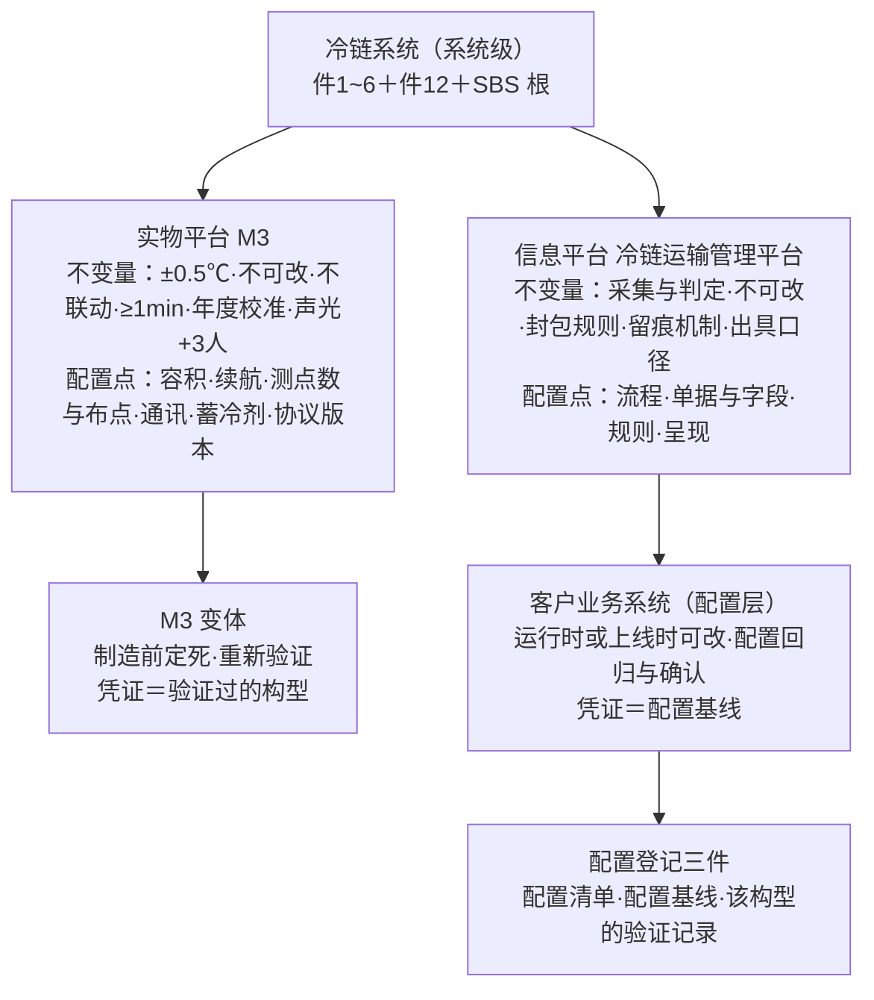

# 24 · 47 号正文（逐件推进稿）与施工底稿

> **性质**：**进度台账**（正文已按文档序移出为 `04-产品数据范例/01`~`16`，每份一文件；本件只记写到哪了）。原：**正文推进稿**——按件1、件2、件3……的次序，一件一交。它的写法、判据与这一册的排布全在 [`00-产品数据范例编制手册.md`](00-产品数据范例编制手册.md)（B 篇逐份卡・C1 判据与自检・D1 排布与取料）；成稿的 47 号本体仍在 v1.2，等本稿全件过完再整本替换。
> **推进纪律**（用户令 2026-11-19，现收在手册 A3）：**一次只交一份产品数据**，交完即停；每件**节首写"进什么"、节末写"出什么·交给下一件什么"**；件内走**三遍**（立表头→逐格填→回核转换），不许合成一遍；**写着发现上游要改，不在本节就地补**，落打回台账。
> **标档**：**【A】直读**／**【B】单句推论**／**【C】本库读法**。示例值一律标"（示例值）"；未登记的写〈待定〉＋解锁条件。英中并列，逐字引文紧随「（中译：…）」。
> **编号规则（用户令 2026-11-19；按 25 号 v4 的 16 份定案收口）**：**正文一律写文档序 1~16**（＝节号）；**不用字母记号**；48 号件号只在对账时用，正文不写。
> **本册体例**：节题＝那份产品数据的名字；**节首两行**（版本与资格／承接档·停在哪一档）＋**节末一行**（改动痕与未完项）；**不出现人名，只写岗位**。
> **范例体例（用户令 2026-11-19）**：这是**范例**，不是台账——每份**给代表性内容**：关键行写全（示范行），同类其余**占号不占行**，用一句交代（如"从略三条，占号不占行"）；人、事、位、叶**不穷举**（位不列满、叶不列满、接口不全列）。**验收只看四条**：① 三个相关方层各到场（外部／委托方内部岗／承制方）② 每类判据到场（强制型、只能写一半、易实现性、可配置性）③ 每条有来路 ④ 每条有判定。**条数与矩阵不在要求里**。**声明**：范例册只列代表，全量登记在案例设定与附录，两处不互当依据。
> **结构化优先（用户令 2026-11-19）**：凡"**多个对象 × 同一组字段**"的一律落表——**列名即判据名、一行一个对象**；**节首户头、节末改动痕与未完项、每节判否项—结论—凭据一律上表**。**只三类不结构化**：一句判据或收束句、逐字引文（含中译）、表间过渡句（每次≤一句）；**取值格仍写判据句，不许压成两个字**。
> **资产三问（用户令 2026-11-19：产品数据类文档＝**文档 1~16**，判等不是举例）**：**文档 1~16 每一份**的节首除四行户头外，另给一张**资产三问**表——**① 取哪份资产（写户名，不许只写"既有平台"）② 走哪一档（直接承接 reuse／改进后 improve／新增 add）③ 留下什么资产**；写"新增"必须答"为什么没有现成的"；**上一份"留下"与下一份"取"逐号对得上**。资产四条（可积累・可复用・可转移・可评价〔14 号〕）按本份能落的落、不硬凑；不编号的登记件与配置登记三件不另给。见 `claude-memory/feedback-资产线贯穿.md`。
> **做法以手册为准（2026-11-19）**：文首这几行与各节的体例做法，已收进 [`00-产品数据范例编制手册.md`](00-产品数据范例编制手册.md)（写作体例・资产回路・需求三要素・文风八忌・逐份要点・验收自检）。本处留作本册的即时约定；与手册冲突时以手册为准，并回改本处。

---

## §〇 进度台账（本册唯一的进度处）

> **先过清单，再写这一件**：每写一节前，先在 [`00-产品数据范例编制手册.md`](00-产品数据范例编制手册.md) C4 找到那一行（性质・件号・层・成册・执笔・认下・下家・依据），写完回来**回勾一行**。清单没点到的，不许写；清单说"不占件"的，不许给编号。

| 序 | 文档 | 48 件（对账） | 状态 | 字 | 门（过没过） |
|---|---|---|---|---|---|
| **1** | 问题或机会的陈述 | 件1 | **已出·待点头**（**v6**：按手册 v4.4 六道重出；问题 5・机会 4・约束 4・目的 5 行＋综合目的一句＋使命一句；v5 见 git） | 不设上限（750 已取消）；实测正文 **2,441** 汉字、账外 1,628 | 门：成立 6／缺口待补 3／违例 0——现状有出处・根因两环・机会有抓住条件三条逐条判（缺口三处＝问题3・机会2・机会4 的料未取到，挂解锁人） |
| **2** | 相关方与关切 | 件2 | **已出·待点头**（**v9**：按手册 v4.6 六道重出；相关方十三类改**十四类**、关切十六条改**十九条**（10 拆出 19、补 17、18）、表二**八栏**、双向核对表九行；上一版 v8 在役） | 不设上限；实测正文 **3,296** 汉字、账外 2,105，222 行 | 门：卡2 三条判否**均成立**（无人名当关切名・双向三处无空行・强制型三条已标）；**缺口四条单列**——17、18 无下游承接、19 未进文档3 需求10 来源列、问题4・5 与机会3・4 在「来自」列无落点、相关方14 无下游认者 |
| **3** | 相关方需求 | 件3 | **已出·待点头**（**v0.28**：按手册 v4.9 六道重出；**五十条**——功能性二十・质量特性二十・易实现性十；九栏；关切对账二十行・来路对账二十五行；〈待定〉三处、（示例值）八十八处） | 不设上限；实测正文 **6,018** 汉字、账外 2,439，269 行 | 门：卡3 三条判否**成立**；覆盖检查**缺口一条**（关切20 待文档2 补，押七行）；需求43・44・45 只挂问题号；来源列撤访谈号改进底账 |
| 4 | 运行概念 | 件3 | 待写 | 1,300 | 门：确认准则先行（**打回①** 落此） |
| 5 | 系统需求 | 件3 | 待写 | 1,200 | 门：双向追溯＋验证三格；变体需求不进 |
| 6 | 架构目标（含系统目标列） | 件4 | 待写 | 500 | 门：三要件齐（宾语・坐标・方向）＋预留准则号；**写成达标与否即退回** |
| 7 | 关键成功准则 | 件5（寄居 6） | **预告已给（§一.6）** | 400 | 门：**双用途**齐／必过与权重只加牵制项／权重和 1.00 |
| 8 | 因子清单 | 件6 | 待写 | 400 | 门：每个因子有单位与取法；与文档7 号双向回填 |
| 9 | 架构内容 | 件7 | 待写 | 1,600 | 门：三槽齐（分块：系统级／平台级） |
| 10 | 视角与模型种类 | 件8 | 待写 | 1,200 | 门：视角标识种类（平台层主・配置层附） |
| 11 | 位与分配 | 件9 | 待写 | 1,800 | 门：守恒四条（两组位表）＋配置登记三件首现 |
| **12** | 架构视图（四节） | 件10~13 | 待写 | 2,200 | 门：元素指得回位／组件有治理者／视图覆盖全关切／对应关系成立或违例 |
| **13** | 架构描述（六节） | 件14・15 | 待写 | 2,200 | 门：索引不漏项／决策有权限人与理由／缺口有声明／版本基线齐 |
| **14** | 系统分解结构 | — | 待写 | 2,200 | 门：四独立之一＋交叉映射无空格（**打回②** 落此） |
| **15** | 构件需求 | — | 待写 | 4,600 | 门：三支下限＋覆盖检查（**打回③** 落此） |
| **16** | 设计描述（四目） | — | 待写 | 6,200 | 门：算得出成本・下得了采购；配置清单与依从声明齐 |

**下一句该说**：`确认`（进第二道资产），或指出道一改哪一条。

---

## §一 打回台账（写某一份时发现上游要改，记这里，不在本份就地补）

| # | 打回对象 | 问题 | 来路 | 现状处置 |
|---|---|---|---|---|
| 1 | 手册 D1 8.1 字数预算（2.1＝750） | 用户令取消 750：正文按数据写到齐，不为字数砍条目 | 2026-11-19 用户令 | **已改**：手册该行改"不设上限"并加一句；小计 15,200 与合计 38,700 待重算 |
| 2 | 手册 B1 卡栏表 | 漏"名称"栏，而 A6 的转化要求"补名称"，v5 底料也有这一栏 | 文档1 第一道（2026-11-19） | 文档1 按底料补"名称"栏；请手册补这一栏 |
| 3 | 手册 B1 卡 | 机会表的"直接原因・成因"两栏填什么未给读法；照问题表字面填会与"抓住它的条件"重复 | 同上 | 文档1 暂按问题表字面留栏；请手册给读法或删这两栏 |
| 4 | 手册 A2／B1 卡 | 下游只给"下家 2 与 6"，未给下游动词定名 | 同上 | 文档1 用"认领"与"取现状原话"，并声明是描述性说法、不作判据词 |
| 5 | 手册 门与 v5 底料 | v5 门结论第六条"编号已冻结"没有编号级判据，且它是一条纪律、不是一次判否 | 同上 | 已移出文档1 正文门表，进门表外一行；请手册定它算不算门 |
| 6 | 20 号 §二 2.2之一、§三 3.2 | 记"问题×2＋机会×1＋约束×2"，本册按案例为 3／2／3 | v5 未完项 4 | 文档1 不改上游；改 20 号两处并重算字数 |
| 9 | 手册 篇 B（B0＋B1~B16 十六张卡） | 十六卡把 48 号 §13 二十卡抄一遍且走样；用户令「只要确定产品数据清单就 OK」「到时间读相关材料不就可以了」 | 2026-11-19 用户令 | **已撤**：篇 B 整篇换成一段指针（原文见 git，撤除登记在附 E）；十六份点名与「读哪一卡」并入 C4 之二；栏与门回 48 号对应卡与 §12.6；手册升 **v4.1**；文首读法、A1 提示词、A2 判据行、C1/A5/D1 内 B 卡指针一并改；三份产品数据文件头的「B1/B2/B3 卡」改指 C4 行与 48 号卡 |
| 8 | 手册 A2 全表・A1 提示词・A3・D1 口径 9 | 八道并作六道（材料・输入与规则・表头・数据・追溯与门・收口）；并要求资产原则贯穿每道、每道输出前先过四年工程师 | 2026-11-19 用户令 | **已改**：A2 整表重写为六道（新增"资产面"一列），六道为什么这样切、A1 提示词、A3 颗粒度、D1 口径 9 同步；原八道里的门与账外件・自检・收工合为"收口"四行固定。版本号仍 v4.0，待用户定结构后再升 |
| 7 | 手册 A2 第一·二道・A1 开工提示词・D1 口径 9 | 第一、二道原写"读书与理解：三问＋三样"与"资产开发"；用户令两改：先"取料清单"，再定「第一道：确定要阅读的材料清单／第二道：阅读理解材料清单，确定输入文档清单，给出转换规则」 | 2026-11-19 用户令 | **已改（final）**：第一道＝阅读材料清单（材料｜类别｜读哪一部分｜为什么读）＋三行定框；第二道＝输完材料后定输入文档清单＋转换规则表＋资产三问。**规则在第二道立、条目留第四道填**。A2 表两道与节题、A2 末段"两道为什么这样切"、A1 提示词、D1 口径 9、记忆 `feedback-先读书再编范例` 同步 |
| 10 | 24 号 §二 7.2 A 记「箱号 M3-0417」 | 教材 §13.6.2 那张表表头作「运单号」，底料 v5 又自编了「运单号 YD-260417」，同一个号三处三说 | 文档1 第四道（2026-11-19） | 本份按教材原文取「运单号 M3-0417」；24 号那一格与 v5 的 YD-260417 两处待改，本份不改上游 |
| 11 | 底料 v5 表头「出处（哪份资产）」 | 原始记录不是资产（A6 只认两类），出处栏写成资产名是串型 | 文档1 第二道 | 本份表头改**「现状出处」**，只写组织自己的记录名与部位；级与库内登记处进账外件**取料底账**（一格一行），已写进手册 A2 道四 |
| 12 | 底料 v5 自编「运单号 YD-260417」 | 库内无任何登记，属自编未标 | 文档1 第二道 | 作废，本份不引 |
| 13 | 底料 v5 问题3 出处引「书侧治理一章」一句 | 教材是判据与方法，进出处即把判据当证据 | 文档1 第二道 | 本份出处改组织记录；「约六成重复」移出标〈待定〉，挂解锁（产品与商务・文档7 之前） |
| 14 | 资产缺口：一代无《问题或机会的陈述》；经验与教训清单・需求资产库・问题与需求台账三册未立册 | A6 只认两类资产，取不到即缺口 | 文档1 第二道 | 本份按「新增」走原料，缺口如实登记；**不在本份现补**，立册归组织 |
| 15 | 底料 v5 账外件自称「七件」，表内只有 6 行 | A10 数要数对 | 文档1 第一道 | 重出时按 6 行记 |
| 16 | 文档3 关切6（准入与协议合规）挂「问题3」 | 底料问题3 是「每接一单重做」，两处不是一件事，编号对不上上游 | 文档1 第二道 | 重出时一并核；本册问题3 仍为「每接一单重做」，关切6 的承接由文档3 与文档5 处置 |
| 17 | 本台账第 6 行（20 号计数 2・1・2） | 该两处已随施工底稿搬入 24 号 §二 2.2 之一，按 3／2／3 记，原行所指已不存在 | 文档1 第三道 | 第 6 行失效，待销 |
| 18 | 24 号 §二 7.5 的 2.1 行 | 只列 48 号示范的 2／1，未列机会2 与 C2、C3；本册定稿计数为问题 5、机会 4、约束 4 | 文档1 第三·四道 | 补列，或注明该行只作 48 号示范；§二 2.2 之一同改 5／4／4 |
| 19 | 48 号 §3.1.3 与两本标准的「目标」词条位置 | 15288 与 42020 里 goals／objectives 是正文用词，未核到独立词条；「系统目标」「架构目标」在标准侧的落脚待核 | 文档1 第四道（用户提问） | 回 15288 §3 与 42020 §3 正本查，核到后补 48 号 §3.1.3；本册暂按 48 号裁定用 |
| 20 | 案例合并清单 §二 信息平台不变量行 | 该行列五样（判定算法・数据不可改・封包规则・留痕机制・出具口径），本册只并前三样成 C4 | 文档1 第四道（用户令「依照你的建议」） | C4 已立；出具口径不并进约束，归文档9 原则与文档13 决策 |

---

---

## §二 四十七号册施工底稿（2026-11-19 由范例编制手册撤下，搬入本件留用）

> 来源：手册 v4.1 的 C1（判据摘录）、C5（与 48 号对账・旧链换算）、C6（与其他件的关系）、篇 D（47 号册排布与取料）。撤下的判据：**换一册还用它吗——不用，故不是手册的料**；它们是这一册的施工数据与 48 号的副本，留在本件备查，**手册不再留副本**。

### C1 判据、反例与自检（原 23 号收编）

> 收编说明：本节是把「写某一份时查什么判据、反例长什么样、落在哪一节」摘成一页一页的表（原 23 号）。**本手册不新立判据**：凡标〔C〕者都是 48 号、20 号或本书已立的读法，这里只摘录与归位；判据有疑问，按「户口」回 48 号正本核。**做法与体例在 A 篇与 C6，本节只供查。**
> **用法三条**（原件用法，照留）：① 写某份前，查该份落点所在的行；② 写完某份，用本节之十 的自检十一条过一遍；③ 判据有疑问，按「户口」列回 48 号与 15288 正本核，不在这里裁。
> **标档**：结论标 **【A】直读**（正本字面）／**【B】单句推论**／**【C】本库读法**（标准无原话）。原件那句「文档序 1~21」的编号说明已作废（现为 1~16，见 C4）；原件的版本行不入本节，历史在 git。

#### 一 什么叫"掌握了"

**三条全过才算掌握，缺一条只是背过**〔C〕：

| # | 检验 | 过不了的典型样子 |
|---|---|---|
| 1 | **说得出判据**——一句，可判真假，不含"很重要""要重视" | 只会说"位是可指认、可承担、可替换的单位"（那是形容词三连，不是判据） |
| 2 | **举得出反例**——这条判据在什么情况下会被误用、会判错 | 说不出"把重要当基本""把关切当内容"这两种错法 |
| 3 | **指得到落点**——本册哪一节、哪张表用它 | 概念背得熟，写某一节时用不上，或用了却不留栏 |

**第四条检验（复算）**：**同一批编号，换个人加一遍应得同一结果**（48 号 §12.5 四条纪律之四【B】）。落在本册＝附录 B／C 的每一张账都要能被人照着重算一遍。

---

#### 二 结构侧：链、件、形态

| 概念 | 一句话（含户口） | 判据／界线 | 反例（怎么错） | 本册落点 |
|---|---|---|---|---|
| **需求-方案结对** | 取一对相邻产品数据（各取最深形态），上序＝需求、下序＝方案，一次 Y=F(X) 的求值〔20 §1.5〕 | 一对＝设计与开发的一次（ISO 9000:2026 §3.3.11【A】：*transform requirements for an object into more detailed requirements for that object*／把某客体的需求转换为对该客体更详细的需求）；**框架与概要不是对的一端**，它们是方案侧的中间形态 | 把"一份文档写完"当一对走完；把框架当端点 | §二 各节节首"承接档·停在哪一档"两行 |
| **链上三类步** | **分配步**（两侧叶不是同一批，须映射）／**整段搬入步**（两侧叶是同一批）／**形态轴步**（同一份数据的两个形态）〔20 §2.4〕 | 分配步做承接、受单承接约束；另两类不做映射 | 把形态轴步当承接，于是"细化"被写成"分配" | §二 2.3→2.5、§三 3.1→3.2 |
| **转换步**（本链第四类） | 相关方需求→系统需求，正本用 `transform` 定名【A：15288:2023 §6.4.3.1】 | 追溯**双向都是 *one or more***【A：§6.4.3.3 d)3) 注23】⇒ 一条相关方需求可由多条系统需求满足，恰是分配步**禁止**的 1:N | 把这条当分配步，于是硬压成"一条对一条" | §二 2.5；附录 D 待核一行 |
| **需求是相对的** | 同一份数据，对上它是方案、对下它是需求；身份由它在哪一对里定〔20 §6.2〕 | 名字含"需求"不构成身份 | 把"构件需求"一口咬定是需求（在对Ⅳ 里它是方案） | §一 1.2；§三 3.2 |
| **产品数据** | 这条链上每一个"能被单独签收或被单独核对"的数据件〔C：48 §12.3〕 | 三条全过才算一件：有名字／有条款要它／**有下家** | 把工作记录当产品数据（无条款、无下家） | §一 1.3 |
| **产出件 / 登记件** | 产出件答"有什么"；登记件答"这两件之间成立不成立"〔48 §12.3【B】〕 | 登记件的合格标准是**每条都有结论**（成立或违例），不是"画齐了就算完"【A：42010 §6.9.3 注1】 | 只收产出件 ⇒ **空位、越界、假齐套**三种病一律不可见 | §二 2.11／§三 3.1 的位×节点映射；附录 B |
| **十五件与寄居・条件件** | 内容侧＝件1~5、7、9；判据侧＝件6；描述侧＝件8、10~15〔48 §12.1〕 | 判据是"**删掉它，链上哪一步垮**"，不是"标准列了几件"；**容器可合、判据不可合** | 按"有没有这份文件"查账（应查"那件里有没有这一节"） | §二 2.1~2.12；§一 1.3 |
| **六段** | 讲清现实问题／立住成功判据／认下架构内容／定住读写约定／切成基本角色／交出架构描述〔48 §1.1】 | **段序＝执行序**，跨段只许向前依赖 | 把段当"章节"，于是段④（件8）跑到段③（件7）前面 | §一 1.2 的对应列 |
| **决策是一条带** | 决策在每段"定"处发生、在⑥成册为件14，**不立段**【A：42010 §5.2.5、§6.10；42020 §5.7；15288 §6.3.3】 | 它的义务只是**记录**，且只记 *essential* | 把决策做成第七段（于是"决策过程"与"决策记录"混为一谈） | §二 2.11；§四 4.3 |
| **六条回路** | 准则集漏了／空位与重复记账／未决项引出决策／关切再识别／设计回灌／评估→处置〔48 §1.6】 | 回路**不是返工**，是"这一步要求的复核" | 把回路画成"打回重做"（于是留痕变成道歉） | §四 4.2 图4 |
| **链外三道** | **评估**（对架构作判断、不含处置）／**对账**（查两件之间）／**交设计**（换的是种类）【A：42030 §3.4 及注1；42010 §6.9；15288 §6.4.5】 | 三道都要求"描述已成"，故不在链内 | 把评估当决策（报告写"批准执行"） | §四 4.3 三处换手 |
| **形态三档** | 框架＝根→枝梢／概要＝根→叶（各级只到说明）／定义＝概要＋各级详细定义〔20 §1.3〕 | 两条界线是判据：**末级有没有再往下分一级**、**逐节点有没有详细定义** | 把"写多细"当形态判据 | §二 2.4；§三 3.1／3.2 节首 |
| **枝梢・叶・干枝** | 枝梢＝本次框架最深一级＝**叶的父级＝末级倒数第二级**；干枝＝叶以外各级（含根）〔20 §1.3〕 | **框架有阶**：枝梢取哪一级由这次框架设计定 | 立"枝末"这个词（库内不立）；或让叶在框架里占树位 | §三 3.1 节点表 |
| **三处"三档"** | **形态三档**（定义多深）／**交付三档**（交哪几件，48 §12.1 五）／**场景三档**（正常·异常·应急，15288 §6.4.2.3 b)4) c)【A】） | **不许简称"三档"** | 一处简称，三义互串 | 文档4（场景）；文档9 的形态（框架档）；附录 E.2 |
| **栏（件内分几栏）** | 视角规格 7＋1／模型种类规格 4／视图组件 3／视图 4／架构描述 6 组【A：42010 §8.1·§8.2·§6.8·§6.7·§6.1~§6.10】〔48 §12.6】 | **栏不齐，件就没做完**；栏是语法、内容是取值 | 视图缺 d) 已知问题（"假齐套"最常见的来源） | §二 2.8／2.10／2.12 |
| **本册体例：每件五行** | 节首四行（在链上／版本与资格／承接档／停在哪一档）＋节末一行（改动痕与未完项）〔C：依据 48 §12.6 栏齐口径〕 | 五行写不全＝这件没做完 | 写得整整齐齐、一处痕也没有（整齐的文件是没干过活的文件） | 全册各节；验收第 2 条 |

---

#### 三 判据侧：关键、基本、相关

| 概念 | 一句话（含户口） | 判据／界线 | 反例（怎么错） | 本册落点 |
|---|---|---|---|---|
| **一支填句、三槽** | 本条目为【准则编号／射程类别】提供【分类｜度量｜许可】这一种判定；删去它，【哪一句变得说不清／哪个因子失去落点】〔48 §2.3【C】〕 | **判据只有这一支填句**；概念・属性・原则**不是三支判据，只是它的三种填法** | 按"概念一把尺、属性一把尺、原则一把尺"分三套判据 | §二 2.7 内容表 |
| **三种不合格，三种处置** | 第一槽填不出→**不属架构内容**；第二槽填不出→**没过入场**；第三槽填不出→**判为非基本**〔48 §2.3〕 | **"没过入场"与"判否"必须分记** | 把"没过入场"写成"非基本"（两笔账并成一笔） | §二 2.7；附录 C |
| **"实质"＝越线或改选** | 变化是否使既有阈值判定翻转（**越线**），或使某条已记录的决策／架构重要需求的取舍翻转（**改选**）〔48 §2.3【C】〕 | **线须事前立**；两者都不成立＝微动，不算实质 | 用"影响很大"代替判定句 | §二 2.6（准则值＝越线依据） |
| **四量：部分动即算** | 效用／成本／时间／风险是**四条贡献通道**，不是四个合取条件；任一实质动即基本【A：42010 附录 A.2 资料性】〔48 §2.3】 | **不是等级表**：标准只有一个 `fundamental` | 要求"四个都动"才判基本（只动风险的属性被大面积误判） | §二 2.7 |
| **两种"成本／时间"** | **变更代价**（改这条内容所花）**对所有条目都成立→不算判据**；**实体在其环境中**的代价与时间**只对基本条目成立→有判别力**【A：附录 A.2 *within its environment*】 | 混用＝拿错尺子还说赢了 | 拿"改起来贵"当准入 | §十 第 1 条 |
| **原则专用一问** | 本原则允许【做法 A】、禁止【做法 B】；违例的样子是【可指认的形态】〔48 §2.3】 | 原则的活＝许可（允许怎么造、禁止什么） | 写成"要注意合规"（无 A、无 B、无违例形态） | §二 2.7 原则三条 |
| **概念成对** | 本概念与【相邻概念】构成【什么区分】；没有这个区分，【准则编号】的因子只能写成【一个模糊词】〔48 §2.3】 | 概念是"用什么说" | 给一个孤立新词（无相邻、无区分） | §二 2.7 概念二条 |
| **判的是条目，不是标题** | 同一句"低耦合"可落地成三条，一条基本、两条只是惯例〔48 §2.3】 | **没有整体答案，只有逐条的答案** | 拿口号式标题过门 | §二 2.7 |
| **关键（需求凭什么算关键）** | 关键需求＝筛出来的那一批，判据在卡9 的"问一挂因子"〔48 §2.1、§5.1；卡9】 | 三种去向（覆盖写内容号／变换／转交）全空＝漏账 | 把"客户说要紧"当关键 | §二 2.6；附录 C |
| **关键需求＝系统需求的子集** | 「关键需求」这名只给**系统需求**那半；相关方需求那半称**追溯对象**【C：22 号 §3.5 定案；正本原话两半并称，见 15288 §6.4.4.2 e)【A】】 | **"满足／分配"与"追溯"两句分写** | 用"关键需求"指代相关方需求全集 | §二 2.5 表头；§五 5.4 |
| **件4／5／6 的界** | 目标给方向不给数；准则＝**因子＋值或值域**（可判"到什么程度"）；因子单列成件好"按号寻址"〔48 §12.1】 | 因子清单是准则的左半边；件5 只写因子号，**因子本体住件6** | 把目标写成达标与否（那已是需求）；准则只有一句话、无因子 | §二 2.6 |
| **相关（何时算相关）** | 相关性的判断属 48 号读法〔48 §2.4】 | 与本册的关系：**配置层"相关"到什么程度**由配置点表定（客户真会动的才列） | 把所有可配项都列成"相关"，配置点表膨胀成愿望清单 | §二 2.7 配置点表（每平台只取三行示范） |

---

#### 四 内容—位—树

| 概念 | 一句话（含户口） | 判据／界线 | 反例（怎么错） | 本册落点 |
|---|---|---|---|---|
| **位** | 被架构实体身上某个**离散构成单位在模型里的代表**——能单独切出、单独指认、单独承担、单独替换〔48 §7.2【C】〕 | **一句判据：位立住了＝说得出它担了什么；立错＝只说得清它长什么样。** 记录形态三列：位名｜边界｜承担哪条内容 | 把"系统"当一个位（不可替换）；把技术选型当位（那是设计） | §二 2.9；附录 A |
| **位的两个面** | 本体面（这一处必须守哪几条内容）／表达面（描述里可指认的那一个单位）〔48 §7.2】 | 只有本体面说不清它在哪；只有表达面不知道它守什么 | 只画方块、不填承担 | §二 2.9／2.10 |
| **位的四条性质** | 可指认／可承担／可替换／离散〔48 §7.2【C】】 | 它们是"决定早于实物"的四个影子，**不是审美标准** | 拿四条当打分表 | §二 2.9 |
| **位不是哪三样** | 不是内容条目／不是设计元素／不是规格〔48 §7.2】 | 内容是负担、位是承担者；设计元素是位被变换之后的结果 | 把 `DE-PT-14` 当位 | §三 3.3.1；附录 E.3 |
| **切法七规则 R0~R6** | R0 先定轴／R1 单位／R2 五断口（判定・生命周期・承诺・可替换・归责，**任一成立即断**）／R3 合／R4 三禁（不按内容条数、不按部门、不按选型）／R5 停（准则答得出即停）／R6 留痕〔48 §7.6】 | 引用一律带节号（§7.6 的 R0~R6 与 §6.8 的 R0~R9 两组同前缀、互不相通） | 裸写"R0"；或按条数切位（位退化成内容的名字） | §二 2.9 位定表的"断口"列 |
| **守恒四条** | 覆盖（无内容无位承担）／不重（无两位承担同一句）／无空壳（无位一条内容也不承担）／需求兑现（每条变换过的需求至少一处兑现）〔48 §7.6】 | **少一条不算切完** | 只查覆盖不查空壳（画上去的方块永远查不出来） | 附录 A.1／A.2 表末自检行 |
| **SBS 不是架构** | 系统分解结构是项目规划侧的树，不是架构内容〔48 §8.5】 | 树回答"谁造、谁买、谁装"；位回答"这系统是什么样子" | 用 SBS 节点当位（于是"架构＝结构分解") | §三 3.1 节首 |
| **位与元素必混** | 位（架构侧）→ 设计元素（设计侧）：**隔一次设计定义**，不是细化【A：42020 §10.4.4 e)；15288 §5.9、§6.4.5】〔48 §8】 | 分配落不到系统元素上；分配落到位上 | 把"元素指得回位"写成"元素就是位" | §三 3.3.1 元素表"指回哪个位"列 |
| **两棵树不一一对应** | 节点数与位数同量级不等数；交叉映射逐格给"承担／参与／违例"〔48 §8.5；旧链 5.5 交叉映射〕 | 一格"两位争"或"一位跨两节点"都要写结论，**不许留空** | 给每个节点配一个位（凑数） | §三 3.1 交叉映射；打回② |

---

#### 五 描述侧：视角、视图、描述、空间

| 概念 | 一句话（含户口） | 判据／界线 | 反例（怎么错） | 本册落点 |
|---|---|---|---|---|
| **视角（viewpoint）** | 创建、解释与使用一张视图的**一套约定**，用来框定一项或多项关切【A：42010 §3.8】 | 规格 7＋1 栏：相关角度・框定关切・方面体・典型相关方・模型种类与图例・对应方法・信息来源 | 把"画图习惯"当视角；**缺 b) 框定关切那一栏＝不是视角** | §二 2.8 |
| **模型种类（model kind）** | 按关键特征与建模约定区分的模型类别，实质是**引入元素类型**；规格 4 件（约定・视图方法与对应方法・版本标识・信息来源）【A：42010 §3.15、§8.2】 | 不标识种类＝组件没有治理者，不能进视图 | 把"架构视图名"当种类 | §二 2.8／2.10 |
| **视图组件** | 视图里可分离的一部分，受适用的**模型种类或图例**治理；三栏：版本标识・治理者・遵循视角约定【A：42010 §3.19、§6.8】 | **"组件"＝视图组件，不是"构件"** | 把视图组件与系统构件混成一个词 | §二 2.10；附录 E.3 |
| **视图** | 构成本描述一部分的信息部件，在某个视角下答一组已框定的关切；四栏：标识・治理视角・组件・**已知问题**【A：42010 §3.7、§6.7】 | 组件须应对**全部**框定关切 | 视图当图（"图就是视图"） | §二 2.10 |
| **对应关系** | 记录描述里各元素之间关系的条目，以及建立它们的方法；每条写"**成立**"或"列全部已知违例"【A：42010 §3.11、§6.9.3 注1】 | 只写"相关"＝没写 | 两组件共享却不挂对应关系 | §二 2.10；附录 C |
| **内容→视图不是细化** | 内容按**类别**排、视图按**关切**排，两轴交叠〔48 §9.24、§9.26】 | 细化在内容侧，且参与方须为描述元素 | 拿内容清单逐条配一张视图 | §二 2.10 |
| **架构描述（成品）** | 六组栏：标识与概述（含**预期目的**）｜相关方・角度・关切・方面体｜视角｜视图与组件｜对应关系与对应方法｜决策与理由【A：42010 §6.1~§6.10】〔48 §12.6】 | "预期目的"是**唯一允许把目的写进描述的地方**，且**不进视图判据** | 描述里塞目的当判据 | §二 2.12 |
| **空间与点** | **架构**＝定空间的规则（概念划界・属性定线・原则禁许）；**架构描述**＝把空间说成可核的（仍是集合级）；**设计**＝选一点；**设计描述**＝把点定到可实现【A：15288 §3.13；42020 §5.6】〔48 §9.7】 | **一条判据：这句话在说"空间"还是说"点"。** 架构描述里不得出现点；设计描述里不得动空间 | 视图里出现型号参数值（点混进空间）；设计里悄悄改约束（空间被下游重划） | §三 3.3 节首；打回③ |
| **交付三档** | 只定内容（件1~7＋件9，降档不称最小集）／部分描述（按读者取描述侧，**件15 必带**）／完整描述（1~15 齐＋版本基线）〔48 §12.1 五】 | 裁掉哪一件，就在件15 写明缺了什么 | 裁了描述侧却不写缺口声明 | §二 2.11／2.12 |
| **"够不够／合不合"** | 描述"够不够"与"合不合"是两个判（42010 §6.9、48 §9.4】 | 够＝有无；合＝成立或违例 | 用"文档齐"代替"够"与"合" | §四 4.1 读法三式 |

---

#### 六 下游与设计侧

| 概念 | 一句话（含户口） | 判据／界线 | 反例（怎么错） | 本册落点 |
|---|---|---|---|---|
| **五名分家** | 位（架构侧构成）／架构元素（需求落点的称呼）／系统元素（设计才定下的件）／构件（工程惯用词，对齐 `system element`）／组件（**视图组件**）〔48 §9.29；附录 E.3】 | 五名不许互换 | "构件＝组件＝系统元素"一混，前半与后半对不上 | 附录 E.3；全册用词 |
| **分配三支** | `allocated`（承接的系统需求）／`decomposed`（本节点上再分）／`derived`（接口承诺・环境适应・可实现性）；支别是一栏，**不进号**【C：旧链 5.6；48 §12.1 四】 | 三支下限（allocated ≥1／decomposed ≥1／derived ≥2） | 把支别编进条目号 | §三 3.2 条目标 |
| **四把尺** | **验证**（判据＝规定需求；**人工制品也是验证对象**【A：15288 §6.4.9.1 第2段】）／**确认**（判据＝预期用途＋确认准则【A：§6.4.11.2 a)】）／**评审**（对客体适宜性・充分性・有效性的确定，判据＝为客体确立的目标【A：ISO 9000:2026 §3.11.2】）／**评估**（对象是架构，不含处置） | 验证方法四值（检查・分析・演示・测试）／验什么七值【A：§6.4.9.3 a)3) 注3、a)1) 注1】；确认八法【A：§6.4.11.3 a)3) 注4】 | "验证只针对实物、文档只配评审"（错读）；"评审＝开会"；确认下沉到构件 | §二 2.3／2.5 验证栏；§四 4.2 台账 |
| **设计描述** | 技术方案 1＋实现方案 N；**定到 implement-to 级**，不进图样・工艺・供应商・产线【A：15288 §6.4.5.1 注1】〔旧链 5.11】 | 两条可核判据：**算得出成本**／**下得了采购** | 停在"设计意图"（建不出来，或建出来的不是那个点） | §三 3.3.4 |
| **DD 不可由 AD 推导** | 设计侧要做出架构没做的决定（具体技术、参数、结构、接口协议）；AD 与 DD 之间只有上溯、相容判定、回写三条〔48 §9.8】 | 交接**不是接力，是换手**：交出去的是约束，接住的是依从 | 把设计当"架构的下一级精度" | §四 4.3 换手① |
| **SBS 四独立** | 节点是能独立制造／独立采购／独立试验／独立装配的单位（四独立之一即成立）〔C：旧链 5.5；48 §8.5】 | 切完要让每个 L3 独立采购或制造、并独立试验 | 按物料类别切（同一可采购件被劈到两处）；按装配工序切（那是工艺） | §三 3.1；决策 `D-M3-14` |
| **框架档与定义档裁剪** | SBS＝构件需求那份方案的**框架**档；构件需求＝同一份的**定义**档；**中间那档不出现**（相邻两级裁剪，不是漏做）〔20 §1.3〕 | 三档全现身的只有设计段 | 以为"概要不出现"＝少做一步 | §三 3.1／3.2 节首 |
| **模块设计同尺套用** | 只把对象从"系统"换成"模块"〔A：15288 §6.4.5.3 b)1) 可逐层递归；§6.4.3.3 b)4) 注12】 | 不另立清单、不另做粒度账 | 为模块级另开一节、另立一套件号 | §三 末注；§一 1.3 |

---

#### 七 平台与配置（本册新立，五条要进附录 A／E 立户）

> **这一节是本册与旧链最实质的增量**：两个平台各自配出变体。**五条术语是本库新立（〔C〕）**，都须在附录 E.3 立户、在正文首现处给一句话定义；**红线三条同时生效**：不写配置引擎实现／不写选配全矩阵／不搬 EOS 术语。

| 概念 | 一句话（含户口） | 判据 | 反例（怎么错） | 本册落点 |
|---|---|---|---|---|
| **产品平台** product platform | 一组可被配置出多个变体的**共享能力与约束**〔C〕 | 平台＝能力的边界；**能力不是变体** | 把"能配出很多种"当成平台的定义（那是结果，不是构成） | §二 2.7 平台级内容；附录 A.4 |
| **变体** variant | 平台配置出的一个具体构成，各自要**凭证**〔C〕 | 凭证只有两种：**验证过的构型**（实物）／**配置基线**（信息） | 变体无凭证＝没人认的构型 | §二 2.9；§三 3.3.4 |
| **配置点** configuration point | 平台留出的、**允许在变体上取不同值**的地方〔C〕 | **一句判据**：客户管理员改一格就能满足 ⇒ 是配置；动它要让所有客户一起变 ⇒ 是**不变量** | 把不变量列进配置点（温区、告警门槛被当成"可配"） | §二 2.7 配置点表；附录 A.4 |
| **配置包** / **配置基线** | 一个变体的配置集合／被批准・被冻结・能当参照的那一份配置〔C〕 | 配置基线须有版本、批准人（岗位）、冻结时点 | 把"最新那一版"当定下来的那一版 | §三 3.3.4；附录 A.3 |
| **平台级不变量** | 任何变体都不能动的那几条，由法规与安全压着〔C，本书立名；事实见 GSP 附录3 第七・十一条，乙级·待核】 | 判据同上表"配置点"格的第二句 | 把不变量写进配置清单（清单变成愿望） | §二 2.7；§四 4.2 打回① |
| **三处不对称** | 定死时点／再验证代价／谁有权动〔C：内容清单 §二〕 | 三条各给一句可核的话，**不许合成一句** | 把"配置"当"改参数"（于是再验证被跳过） | §二 2.5 表末；§三 3.2 打回③ |
| **配置层不占十五件** | 配置层出的是**配置登记三件**（配置清单／配置基线／该构型的验证记录）〔C】 | 三件之一才算变体凭证；"配置说明会上的口头确认"不算 | 给配置层另立十五件（成套变两套） | §二 2.9；附录 A.3 |
| **分层两式** | **分块**（件7・8・9・10~13，同件两栏）／**逐条标**（件14・15）〔C：交接件 §二 表末列＋口径五条并读】 | 件1~6 不标；件12 不标；设计件三份**按平台成两份**、不叫层 | 把层写进件号或件名（第三式，禁用） | §一 1.4；§二 2.4 |
| **共享数据修改须申请—审核—留痕** | 法规要求：不可改的那批数据，连"清洗"也要走申请—审核—留痕〔GSP 附录2 第五（五）・第六（二），**乙级·待核**；正文表述按丙级：只写"法规要求××"】 | 它横跨信息平台四域，**是第19章治理那一章的对撞点** | 引条号（现行性未核）；或把它当"管理动作"写成流程（它是**不变量**侧的机制） | §二 2.7 原则；§二 2.9 横切位 `PT-S12.3` |

---

#### 八 方法怎么跑（十个方法：跑法・落点・机械查法）

**M1 结对循环（五步）**：选一组相关联的需求叶 → 承接设计（复用→改进→新增）→ 分解产出方案叶 → 承接覆盖检查 → 更新追溯〔20 §5.1〕。
**落点**：§二 2.3→2.5、§三 3.1→3.2。**机械查法**：每对能否指回"这一步是哪一步"。

**M2 承接三档＋影响面复查**：Reuse＞Improve＞Add；**改进（Extend／Split／Merge）后必须做影响面复查**，失配则批量重分配或回退〔20 §5.2、§5.4〕。
**落点**：各节首"承接档"行。**反例**：写"新增承接"却给不出"为什么没有现成的"（＝没去找）。

**M3 两道关口**：① **单承接检查**（一条需求只归一个节点，N:1 可、1:N 禁）〔20 §5.3〕；② **承接覆盖检查**（该节点承接的全部需求语义 ⊆ 其叶语义之并）〔20 §5.5〕。
**本册加一处〔C〕**：覆盖检查五查＝覆盖完整・不超出・逻辑一致・约束继承・指标不低于（旧链 附录 C.3 之四）。
**反例**：叶切粗 → 覆盖检查"假通过"（这是失效的主通道）。

**M4 四道对账＋三张账＋四条纪律**：四道＝需求↔准则／内容↔需求／位↔单位／关切↔视图〔48 卡19〕；三张账＝关切账／内容账／需求账〔48 §12.5〕；纪律＝一行一个对象・结论只三种・缺口要留名・可复算。
**落点**：附录 C。**反例**：写"基本覆盖"（等于没查）。

**M5 六条回路**：见 §二 表末三行；**回路要写进件14**（未决项引出决策）〔A：42010 §6.7 d) 注2】。
**落点**：§四 4.2 图4（图只画三条最常用的：准则漏／空位／未决引出决策；余三条入附录 F）。

**M6 三处打回**：确认不认（判据＝确认准则）／评审补项（判据＝为客体确立的目标）／验证退回（判据＝规定需求）。**留痕四句**：原版・改因・新版・留痕去向〔C〕。
**落点**：§四 4.2。**反例**：打回被抹掉（＝把自己写成"一次就写对了"）。

**M7 形态三档的落法**：逐份写"停在哪一档"；SBS＝框架档、构件需求＝定义档、**概要不出现**；设计段三档全现身。
**落点**：§二 各节首、§三 3.1／3.2、3.3。**反例**：把"写到多细"当档位判据。

**M8 生长五动作（"全覆盖＋缺口可核"）**：因子反查／关切对账／第二人复核（**逐条攻第三槽**）／换目的重判／缺口登记〔48 §12.3〕。
**落点**：附录 C（前两件）＋§二 2.7（第三件）＋§四 4.2 台账（后两件）。
**一句话**：**没有哪条判定是白写的（有据），也没有哪条判定是悄悄漏掉的（有账）**【48 §12.3】。

**M9 两种读法**：**卡序**（二十张卡，48 号 §14 保留的那一种）与**件与层**（本册）。同一套数据的两种读法，**数与号只有一个来源**。
**落点**：§一 1.2；§五 5.2（同源同数声明的三句逐字）。**反例**：两种读法各改一次数。

**M10 三关＋四级取料**：关一 定义与落地（每对是 §3.3.11 的一次）／关二 专业领域（甲・乙・丙・丁）／关三 与 48 号一致（位・数・编号・事件以 §14 为唯一来源）。
**落点**：附录 D。**★ 两套级分开记**：取料级别（甲／乙／丙／丁）与**正文表述级**（GSP 一律降丙：只写"法规要求××"）——**同一句话可以"乙级取料、丙级表述"**，不矛盾。

---

#### 十 掌握自检（十一条，写完每节逐条打勾）

1. □ 这一节交的**是那一份产品数据**吗（不是关于它的说明）？
2. □ 节首四行齐吗（在链上／版本与资格／承接档／停在哪一档）＋节末一行（改动痕与未完项）？
3. □ 这一份的**每一栏**都填了吗（按 §二 栏表；视图四栏、视角 7＋1、描述六组）？
4. □ 每条需求/内容/准则**指得回它的来路**吗（编号级，不是"大概来自需求"）？
5. □ 有没有把**点**写进架构侧、把**空间**改在设计侧？
6. □ 分配是**函数**吗（一条只归一处）？覆盖检查过得了吗（语义 ⊆ 叶之并）？
7. □ 位与节点交叉映射里，**每格都有结论**吗（承担／参与／违例，无空格）？
8. □ 两层数据有没有**越界**（配置层的东西按平台层写／平台层的东西按客户写）？
9. □ 三处打回**各打了不同的一份**吗（不挤同一份）？每处四句齐吗？
10. □ 数只有一个来源吗（48 号 §14 或本册定值表）？有没有出现"看起来像"的领域断言？
11. □ **文档 1~16 每一份**的节首都有**资产三问**吗（取哪份资产**写户名**，且**只写同类本子与沉淀清单**／走哪一档 reuse·improve·add／留下什么资产）？资产栏里出现原始记录与台账（事故・投诉・工单・BOM・验证记录）即不算过？写"新增"有没有答"为什么没有现成的"？**上一份的"留下"与本份的"取"逐号对得上吗**？（2026-11-19 用户令：产品数据类文档＝文档 1~16；见 `claude-memory/feedback-资产线贯穿.md`）

---

#### 十一 与旧链（两例结构）的四处理解差异

| # | 旧链怎么理解 | 本册怎么理解 | 差在哪 |
|---|---|---|---|
| 1 | **两个产品各一套**完整数据（两例、各十三节） | **一套数据、一条链、两个平台、一处配置** | 旧链"完整"＝两套各自完整；本册"完整"＝**一套之内两个交付面都到场** |
| 2 | 合同审核是**另一家公司的一件事**（48 §14.2） | 它是**药企委托方的配置层业务**（委托运输协议与承运方准入） | 位名原号原字照引、**只换域读法**；不另起一套 |
| 3 | 设计段四份**各占一节**（序12~15） | 折叠为**设计描述的四个目** | 号只一套；"册"还原成"册"，不是减薄 |
| 4 | 副题「两份产品数据，一份一份摆出来」 | 副题「一套数据，两个平台，一处配置」 | "两份"现在指两个交付面；再说"两份数据"就把成套又拆回去 |

**一句总括**〔C〕：**旧链交的是"两家公司各一套东西"的样子；本册交的是"一家公司一样东西有两个面"的样子**——后者才谈得上"两层数据同处一条链"那件事，也才长得出"平台层与配置层，同一位视角两张图不一样"这条判据。

---
---

### C5 与 48 号对账・与旧链换算
#### 十一 与 48 号十五件的对照（件号只在这里出现）

| 48 号件 | 本册 |
|---|---|
| 件1 | **文档1** |
| 件2 | **文档2** |
| 件3 | **文档3・4・5**（一件三文档） |
| 件4 | **文档6** |
| 件5 | **文档7**（寄居文档6） |
| 件6 | **文档8** |
| 件7 | **文档9** |
| 件8 | **文档10** |
| 件9 | **文档11** |
| 件10 | **文档12 第一节** |
| 件11 | **文档12 第二节** |
| 件12 | **文档12 第三节** |
| 件13 | **文档12 第四节**＋文档13 第三节引用 |
| 件14 | **文档13 第四节** |
| 件15 | **文档13 第五节** |
| （装订） | **并入文档13 册头⑥**，不再是独立文档（**成对签发**在附录 A.4） |

**一句**：**件号是与 48 号对齐的钥匙，不是本册的编号。**

---

#### 十二 与旧链十五序的换算（旧序号一律作废）

| 旧链 | 本册 | 备注 |
|---|---|---|
| 序1 相关方需求 | **3** | —— |
| 序2 运行概念 | **4** | —— |
| 序3 系统需求 | **5** | —— |
| 序4 系统分解结构 | **14** | —— |
| 序5 构件需求 | **15** | —— |
| 序6 跨层对应关系 | 登记件 | 2.14＋2.16.1＋附录 B.2 |
| 序7 分配去向登记 | 登记件 | 附录 B.1 |
| 序8 评审记录与结论 | 登记件 | §三 3.2 |
| 序9 决策与理由 | **13 第四、五节** | 决策＋未应对 |
| 序10 未应对声明 | **13 第五节** | —— |
| 序11 需求质量核查 | 条件件 | 2.15＋附录 D |
| 序12 设计元素与规格 | **16 目一** | 2.16.1 |
| 序13 接口细化 | **16 目二** | 2.16.2 |
| 序14 设计特性 | **16 目三** | 2.16.3 |
| 序15 设计描述 | **16 目四** | 2.16.4 |

---

#### 十三 五处易错

| # | 错法 | 后果 | 对法 |
|---|---|---|---|
| 1 | 只交文档13、不带文档12 | 描述不含视图（42010 §6.7） | **成对签发**：AD 版本号一张单；交接单写"两件" |
| 2 | 两件各编各的版本，互不知情 | "视图 v3＋描述 v2"是哪份描述说不清 | 签发单写`AD-1.0 ＝ 视图 v1.0 ＋ 描述 v1.0`，同一批准人同一日期 |
| 3 | 在文档13 另编一套图号 | 两套号并排 | 视图号与组件号**只在文档12 分配**，文档13 只引用 |
| 4 | 把视角挪进文档12 | R0（先定轴后切位）当场破 | 视角留**文档10**，位**文档11** |
| 5 | 把 3・4・5 数成三件 | 件数变 17 | **15 件／16 份文档**，两个数是两件事 |

---

### C6 与其他件的关系

| 件 | 是什么 | 与手册的关系 |
|---|---|---|
| `04-产品数据范例/01`~`16`（每份一文件） | 47 号正文与账外件的存放处 | 手册 C4 之二点名表；**正文本身不属编制文档，保留** |
| 原 20 号 设计与取料单 | 这一册的施工计划（结构・逐节取料・字数・分工・取料清单・连带・待裁） | **已并入 D1，该件取消（2026-11-19）** |
| 原 23 号 概念与方法掌握表 | 判据查表（概念判据・反例・十二处一次就错・自检十一条・方法跑法） | **已并入 C1，该件取消（2026-11-19）** |
| 原 25 号 产品数据清单 | 点名与对账 | **已并入 C4，该件取消（2026-11-19）** |
| 原 21 号 正文讨论稿 | 轮次表・两例轮次明细・数字落定・引文与自写清单・接榫・方法判别 | **已并入 E，该件取消（2026-11-19）** |
| 原 22 号 重新构思稿 | 七问七答・立题与读者・三关・骨架规模・待裁逐条裁决・对 21 号的处置 | **已并入 E，该件取消（2026-11-19）** |
| 原"逐件推进不一次成稿"记忆件 | 一件一交・不一次成稿・四条风险 | **已并入 A3，该记忆件已删（2026-11-19）** |
| 记忆里的四条工作方式 | 正文只装干货／结构化优先／资产线贯穿／先读书再编范例 | **已被 A6・A8・A8・A9 收编**，记忆只留指针 |

**冲突处理**：本手册与上述任一件冲突，以手册为准并回改那一件；手册没写的，按 C2 自检与 C3 红线办。

**收编原则（2026-11-19 用户令）**：凡**与编制产品数据相关**的文档，内容一律并入本手册，原文档**取消**；唯正文本体（24 号）保留——它是数据，不是编制文档。

---

## 篇 D · 按册施工（47 号册）

### D1 47 号册的排布与取料（原 20 号收编）

> 收编说明：原 20 号是这一册的施工计划（结构、逐节取料、字数、与 48／46 的分工、取料清单、连带、待裁）。**它按一册一份：本节只对 47 号有效**，别的范例另立同型一节。写法与体例在 A 篇与 C6，判据查 C1。
> **替掉的两处旧称**：文中出现的「25 号」一律指本手册 C4（原 25 号已取消）；「设计单」指本节自身。 原件的版本行不入本节，历史在 git。

#### 〇 一句话

**这本册子交的是一套产品数据，不是两套，也不是一套做法。**

一家公司（冰链科技）＋一个系统（药品冷链运输温控与追溯系统）＋**两个交付面**（M3 医用冷链温控箱／冷链运输管理平台）＋**一处配置层**（由平台配出的客户业务系统）——从**问题与机会**一路走到**设计描述**，十五件一件不少、两层数据一份不乱、三处打回一笔不抹。**判据在 48，机制在 20，数据在本册。**〔C〕

**为什么要它**：批次一（ch11~20）是架构篇，全篇取的就是这套完整范例；47 不先行，批一会取到"两个不相干的例子"的旧料〔〔依据 `pending-47号完整范例改造.md` §四〕〕。

---

#### 一 定位与题名

#### 1.1 题名与副题

| 项 | 内容 |
|---|---|
| **题** | **《47-系统设计范例：从问题与机会到设计描述》** |
| **改题的两处** | ① 起点由"相关方需求"改为**"问题与机会"**（本册自段①起，不再只做下半程）；② **"范例"由题尾移到"系统设计"之后**，性质词前置——它是最先要读到的四个字，不是附录式的后缀 |
| **副题**（建议，待人点头） | **「一套数据，两个平台，一处配置」** |
| **旧副题的处置** | 旧副题「两份产品数据，一份一份摆出来」随"两例"作废（见 `22-47号重新构思稿.md` §1.4）——"两份"现在指**两个交付面**，其数已在一套之内，再叫"两份数据"就把成套又拆回去了 |
| **文件名** | 随之改名为 `47-系统设计范例：从问题与机会到设计描述.md`（连带见 §九 9.1） |

#### 1.2 定位：唯一完整范例册

**四项"唯一"**〔C〕：

1. **唯一一套数据**——一套件号、一条链、一本册子；两个平台在这条链上**分段出现**，不另起套（口径 §四 4.1／4.2）。
2. **唯一一处全链**——从件1（问题与机会）到设计描述，48 号管到架构描述为止，20 号给机制不给数据，本册是**唯一把整条链的数据摆在一处**的地方〔B〕。
3. **唯一一套配置层的位与凭证**——平台层十位守不变量、配置层十二位调变量，配置层出的东西走**配置登记三件**（§四 4.3）。
4. **唯一一处留痕的打回**——三处打回（确认不认／评审补项／验证退回）各配"原版·改因·新版·留痕去向"，别的报告只讲判据、不留痕〔C〕。

**书里怎么用**（三种用法，不重写那几章）〔依据 `00-产品数据范例编制手册.md` 旧链 §6.2〕：① **一条编号不变的贯通线**（ch1 走到 ch21 都能对上号）；② **章末一张全链图**（先给全景、再给回望）；③ **附录长表**（供查不供读）。**只随章取料，不整段搬进正文。**

#### 1.3 与 48、46、20 的分工

| 报告 | 管什么 | 本册取它什么 | 本册不重复什么 |
|---|---|---|---|
| **48 号** | 从问题与机会到架构描述：**判据**＋六段十五件＋二十张卡 | 位、数、编号、事件、准则、卡序走法（§五） | 不重立判据、不重算位、不改 48 一个字 |
| **46 号** | 内容是要求、描述是方案；位／设计元素／系统元素三层；四道工序四把判据 | "同一位视角、两层出两张图"的判据（§六） | 不重讲八条主线 |
| **20 号** | 需求与方案结对开发（Y=F(X)）：预处理／循环、两道关口、三档承接 | 承接档与两道关口**在栏里**的落法 | 不写走法、不给过程 |
| **本册** | **产品数据本体**：每一份的表、栏、来路、改动痕 | —— | 不写实现（图样·工艺·供应商·产线，15288:2023 §6.4.7【A】） |

#### 1.4 不写什么（红线五条）

| # | 红线 | 破了会怎样 |
|---|---|---|
| 1 | **不写配置引擎实现**（元模型·规则引擎·字段级配置·配置器） | 册子变成平台选型书，与 48 号撞位 |
| 2 | **不写选配全矩阵**（两平台各取两三行做判据） | 组合爆炸吃掉主线（选配组合数＝判据的**面**，不是数据） |
| 3 | **不搬 EOS 术语、不引 EOS 文档**（只共用"平台＋配置"这一手法） | 教材自足性破，读者被引向主线工程 |
| 4 | **GSP 条款号只挂底账**：取料记**乙级·待核**，正文首现只写「法规要求××」、不引条号（丙级表述） | 引错现行版＝"看起来像"（§七 7.1 的两套级） |
| 5 | **不新增视角种类**（配置点以清单·台账出现，不当新视角） | 视角膨胀，ch15 判据失灵 |

#### 1.5 读者三档与读完能做什么

| 档 | 手上有什么 | 读哪里 |
|---|---|---|
| **照抄读者** | 自己也要交这几份 | §二／§三全节 → 附录 A·B 长表 |
| **备料读者** | 给教材取料、讲给人听 | §一 1.2 → §四 4.1 三种读法 → 附录 E 称名 |
| **审账读者** | 判"这套数据站不站得住" | §四 4.2 打回台账 → 附录 C 对账 → 附录 D 取料级别 |

**读完能做的三件（都可验）**：① 拿自己项目的一份产品数据，判"**栏缺哪几栏、停在哪一档、在平台的哪一层**"；② 说清"这一份**从哪份既有资产来**（直接／改进后／新增）"；③ 指出**哪三处被打回过、回改了哪一份、留了什么痕**。

---

#### 二 一套的结构

#### 2.1 骨架：一条线（线号＝节号）

**一册一线**：从问题与机会到设计描述**一条线排下去**，**不再分"上半程／下半程"**（用户令 2026-11-19「把设计件与架构件连成一条线」）。线上 **21 个文档**，一文档一节，**线号即节号**（§二 2.1~2.21）；中间只有三个"非普通文档"的节点：**装订点（18）／换手点（19）／配置出口（21）**。

> **三个数不许混**：**件 15**（48 号十五件）／**文档 17 份**（件3 拆成三份文档，用户令同日）／**线 21 个**（再加装订 1＋设计件 3）。**全册只用一套编号＝文档序 1~21**；**48 号件号只在"对账用"那一列出现，正文不写件号、不用字母记号**。逐文档点名见 本手册 C4 §二。

| 部分 | 节 | 内容 | 字数 | 小计 |
|---|---|---|---|---|
| **§一 说明** | 1.1~1.5 | 这套数据是什么／链序怎么读（线号）／件号口径／层怎么标／取料与标档 | 3,200 | **3,200** |
| **§二 一条线** | 2.1~2.21 | 文档 1~21，一文档一节（架构件与设计件同线） | 28,200 | **28,200** |
| **§三 收口** | 3.1~3.3 | 怎么被读／三处打回台账／怎么换手（含三种换手） | 2,000 | **2,000** |
| **附录 A~F** | A~F | 位表与配置登记／分配表／追溯矩阵／取料级别／术语／轮次索引 | 5,000 | **5,000** |
| **合计** | | 文首 300＋正文 33,700＋附录 5,000 | | **38,700** |

**线号表见 C4 之二点名表**：16 行的文档序、48 号件、性质与读哪一卡；字数见 8.1。本节只留下面的图与两处节点。

**图 1 · 一条线与两件并列**（装订点已并入文档13 册头，故只余两处节点）

**两处节点各一句**：**14 换手点**——架构→设计换的是**种类**不是精度〔A：15288 §5.9、§6.4.5；42020 §10.4.4 e)】；**16 配置出口**——配置层从设计描述出配置清单与依从声明，**不上线、不占件**。**装订点消失**：文档13 的册头就是装订动作，它的门不变——"件1~15 齐才装得上"。

**★ 一处计数（已定，原待裁 1 结案）**：① **件3 拆三文档**（文档3・4・5），**件号仍是一个**；正本依据：*the stakeholder needs, stakeholder requirements, and operational concept are typical artefacts that are **baselined***（中译：利益相关方需要、利益相关方需求与运行概念是通常被纳入基线的典型人工制品）【A：15288:2023 §6.4.2.3 注33】。② **架构侧两件并列**（用户令 2026-11-19，撤销更早的"两卷"框法）：**文档12《架构视图》**（四节）、**文档13《架构描述》**（六节）；两件平级、各自封面与目录、各自的门，"合为一份描述"靠**一张签发单** `AD-1.0 ＝ 视图 v1.0 ＋ 描述 v1.0`（同一批准人、同一日期，缺一件另一件不得单独进基线），不靠层级。③ **份数 16 而不是 15**：**视角不能进文档12**——切法第一条是"先定轴、后切位"（48 号 §7.6 R0），视角若进文档12 就落到位之后，故**文档10 视角、文档11 位仍独立**。④ 册内一律说"**文档**"与"**件**（只在对账时）"，"段"留给 48 号六段；"卷"字已全数清出。

#### 2.2 之一 逐环节转换一览（这套数据的"思路"就这一张表）

> **用法**：正文写某一件之前，先看这一行——**进什么、怎么转、出什么、过哪道门**。四格缺一，这一件写出来必与上下件脱节。**这一张表就是"产品数据的大概思路"**〔C〕。

| # | 环节 | 进什么（输入） | 怎么转（动作与判据） | 出什么（输出） | 过哪道门／停在哪档 |
|---|---|---|---|---|---|
| 1 | **件1 问题与机会** | 既有资产：一代事故记录・投诉・内审项・交付台账・法规要求・机会来源 | 穷举问题与机会→每条写**现状含出处**→补**根因两环**（直接原因→成因）→写驱动与场景→列约束与**与目标态的差距**→编号冻结〔48 卡1〕 | 问题×3＋机会×2＋约束×3＋出处与根因 | 门：现状无出处／根因只写症状／机会无**抓住条件** |
| 2 | **件2 相关方与关切** | 件1 | 每问题至少一个相关方→每相关方至少一条关切→**双向交叉检查**→标**强制型**→归并关切〔卡2〕 | 九类相关方×关切＋强制型 | 门：双向有空行／强制型未标／拿人名当关切 |
| 3 | **件3 上·相关方需求** | 件2＋运行概念的三档场景 | 写成"谁·何时·要什么·到什么程度"→查可判真假→剔实现暗示→挂来源→标承接档〔卡3/4〕 | 需求 1~N（带来源・承接档） | 门：**覆盖检查**（直接承接也要过） |
| 4 | **运行概念**（不占件） | 文档2 不可协商关切＋文档3 需求号（参照） | 定框架（三档各一行，写**档界**与**档收**）→逐场景写触发・参与者・时序・**确认准则**・谁来认→**按场景号回填文档3 的「由哪档场景确认」** | 框架表＋场景表（写法见 48 号第2卡） | 门：**确认准则先行**（先定义每档怎么算完，再写判法） |
| 5 | **件3 下·系统需求** | 件3 上＋运行概念＋约束 | 换量纲→**拆两量**（判定门槛／告警时延）→建双向追溯→每条挂**验证三格**→标**主落平台**〔卡3/4〕 | 系统需求 1~N＋验证三格＋主落平台 | 门：双向追溯＋验证方法栏；**变体需求不进**（三条去向） |
| 6 | **件4／5／6** | 件1 问题・件2 关切・件3 需求・约束 | 逐问题起一条目标（坐标＋方向＋**预留准则号**）→每坐标列**因子与度量**→写成"因子＋值或值域"→定必过与权重〔卡5/6/7〕 | 目标・因子表・准则 | 门：缺坐标＝口号；度量无单位或无取法 |
| 7 | **件7 架构内容** | 件3 关键需求＋约束＋件4/5/6 判据＋关键特征 | 每条需求**先挂因子**→再问"非说清不可的是哪几句"→**定种**（分类→概念／度量→属性／许可→原则）→**三槽句过门**→只分栏不删条→**按层分栏**（系统级／平台级）〔卡11/12〕 | 内容十条＋平台级内容＋配置点表 | 门：三槽齐；**"没过入场"与"判否"分记** |
| 8 | **件8 视角与模型种类** | 件2 关切＋件7 内容 | 按关切聚类→每视角写四项→**标识种类并写四件规格**→覆盖检查→重叠检查〔卡13〕 | 平台层三视角三种类＋配置层四视角 | 门：视角未标识种类／有关切未被框定 |
| 9 | **件9 位与分配** | 件8（**定轴**）＋件7（**定落点**）＋外部交互与接口（**定断口**）＋关键特征（**定范围**） | 定轴→粗切→细切（**五断口任一即断**）→校准→**守恒四条自检**→逐行分配（七形式・怎么核）→配置层标**配置点**并出**配置登记三件**〔卡14/15〕 | 两组位定表＋分配表＋配置登记三件 | 门：三列写得出；守恒四条（少一条不算切完） |
| 10 | **件10~13 模型・组件・视图・对应关系** | 件9 位与分配＋件8 种类与约定 | 组模型（取构造・落元素・挂内容・建关系・命名・一致・留痕）→切组件（列问・圈料・成块・写三样）→排视图（选治理视角・排组件・写视图头・共享挂对应）〔卡16〕 | 模型／组件／视图／对应关系（**两层各一套**） | 门：元素指不回位＝臆造；组件无治理者；视图无覆盖声明 |
| 11 | **件14／15 决策・未应对** | 件7~13 全部产出＋过程中被否的备选＋已知问题 | 每条决策写"定什么・凭什么・**否了谁**"＋编号/权限人/约束假设/关联/时间戳；未应对逐条写原因与归处〔卡17〕 | 决策＋未应对＋已知偏离 | 门：缺权限人/理由/时间戳；有未覆盖关切却无声明 |
| 12 | **架构描述（成品）** | 件1~15 | 按**六组栏十项对位**装订→写覆盖声明与已知问题→版本与交叉引用〔卡17〕 | 一册（两层数据集装在一起） | 门：有视图无治理视角；有未覆盖关切却无声明 |
| 13 | **系统分解结构** | 架构描述（边界与内容）＋件3 系统需求＋既有资产（一代 BOM／装配图） | **先对平底本**→定切法（造/买/装 或 可独立部署/回滚）→粗切 L2→细切 L3（**四独立之一**）→写两判据＋展开项→**位×节点交叉映射**→**变体不进树** | 树（12 L2／38 L3）＋节点表＋交叉映射＋切法决策 | 门：四独立之一＋交叉映射**无空格**＋切法挂决策 |
| 14 | **构件需求** | SBS＋件3 系统需求（落点经架构段校准） | 每个 L3 **再分一级得叶**（定义档）→三支标来源→验证三格→验收载体→覆盖检查〔15288 §6.4.5.3 b)1)】 | 两册（每 L3 ×10／×9）＋切叶记录 | 门：三支下限＋验证方法栏＋覆盖检查 |
| 15 | **设计描述** | 构件需求＋架构描述＋件9 位与分配＋既有设计与技术条件 | 位→设计元素→系统元素规格→接口细化（**四样齐**）→设计特性（六类八条）→成册（技术方案＋实现方案）→**配置清单与依从声明** | 两平台各一册＋配置清单 | 门：**算得出成本／下得了采购／开工**；两头指得回去 |

**★ 同批点（通例，手册 v4.11）**：每份分框架・概要・定义三段做；**上序的分解与下序的框架同批，上序的概要配下序的框架同批**。两对为例，其后各对同法：

| 对 | 上序这一段 | 下序这一段 | 同批什么 |
|---|---|---|---|
| 3 ↔ 4 | 定义侧：五十条逐条归档到三档、按档拆分（语义守恒）、场景号回填末列 | 框架：正常・异常・应急三档各一行，带档界与档收 | 档界与需求归档互喂，一边定不下来另一边就不许冻结 |
| 4 ↔ 5 | 概要：每档下有哪几类场景、场景名与边界、场景之间怎么接 | 框架：系统级功能域 | 场景群对功能域，一边的「算走完」对另一边的可验性 |

**为什么**：需求-方案结对是一次求值，切成三段、每段与对端对应层同批落地（20 号 §1.5）；不合批，上序的框架没人接，下序的定义没人喂。

**这张表的三处用法**（正文写作时守）：

1. **逐行核对**——写完某件，回头核这一行的四格：**进的对不对（上游是不是这一份）、转的判据用了没有、出的形态对不对（档位）、门过了没有**。
2. **"怎么转"列是判据，不是步骤**——它写的都是 48／20 号的判据名（双向交叉检查、拆两量、三槽句过门、五断口、守恒四条、四独立、三支下限）。**写正文时不许自己发明转法**。
3. **一行的"门"就是该件的**节末"未完项"与 §四 打回台账**的来处**——门没过，这件不算交；过了，也要在节末留一行痕。

#### 2.3 号只一套：五处不占件

**件号只有一套＝48 号十五件。** 凡本册新出的东西，一律**不编件号**，按下列五处归位〔C〕：

| 处 | 是什么 | 怎么称呼 | 为什么不占件 |
|---|---|---|---|
| **一处不占件** | **运行概念**（用户令后**＝件3B**，文档级独立） | 叫"运行概念"或"件3B" | 它是件3 的第二个文档、不被任何需求派生；**文档独立、件号仍归件3** |
| **三份设计件** | 系统分解结构／构件需求／设计描述 | 叫名字（可记 `S`／`R`／`D`） | 48 号十五件的终点是架构描述；设计侧三份不是 48 号的最小集 |
| **三份配置登记** | 配置清单／配置基线／该构型的验证记录 | 叫"配置登记三件" | 它们登记的是**变体凭证**，不是系统架构的内容 |
| **一处成册** | 架构描述（成品） | 叫"架构描述" | 它是件1~15 的**装订动作**，不是第十六件（48 号 §12.1 五：完整描述＝1~15 齐＋版本基线） |
| **一张参照表** | **系统目的理解清单**（见 2.3 之一） | 叫"目的清单" | **目的可虚、不可判**（纯价值侧）：既不是件也不是文档，是给文档1／文档6／文档18 对口径用的**参照表** |

> **★ 编号规则（用户令 2026-11-19）**：**全册只用一套编号＝文档序 1~21**，按出现次序编；**不用任何字母记号**（`3A`／`3B`／`D1` 一律不许）；**48 号件号只在"对账用"栏出现**，正文不写件号。**件3 拆成的三份文档＝文档3 相关方需求／文档4 运行概念／文档5 系统需求**（拆的依据见 2.3 之一 末）。

#### 2.3 之一 目的与目标：哪张单列、哪张不单列

**目的可虚、不可判**，只能定一处，否则会在文档1／文档6／文档13 各长一个版本：目的＝**参照表**（谁的目的｜目的陈述｜读法｜挂在哪个问题或机会上），**不占件、不成文档、不编序**；在描述里只写一次（文档13 册头的"预期目的"栏）。
**系统目标不另立清单**：它与架构目标同中心词、同对象、同坐标，差别只在限定语与兑现者；另立必生两个病（拿系统目标去判架构、拿架构目标顶替系统目标）。故**一张表两列**：客体侧（系统目标，实义兑现）｜工作域侧（架构目标，条件兑现）——见 **C4 之二第 6 行与 48 号第5卡**。
**四层不越级**：目的（不判）→ 系统目标（实体在使用中判）→ 架构目标（条件兑现）→ 关键成功准则（因子＋值或值域，见 48 号第7卡）。

#### 2.4 层怎么标：分层两式

**"分层"在本册只两式**〔C〕，第三式（把层写进件号或件名）不许用：

| 式 | 长什么样 | 用在哪 |
|---|---|---|
| **分块** | 同一件里分两栏（平台层／配置层各一表），**块内按链序** | **件7、8、9、10~13** |
| **逐条标** | 一件只一表，**每条记录后带一个层标记**（`〔平台〕`／`〔配置〕`） | **件14、15** |
| （不标） | 不出现层字 | **件1~6**（系统级）、件12 架构描述（系统级成册）、设计件三份（**按平台成两份**，不叫层） |

**为什么件14／15 是"逐条标"而不是"分块"**：决策与未应对天然是散点（一条决策落哪一层，由它改的是什么定），分块会把同一次决策的两半劈开。**依据**：交接件 §二 表末列已写"同册逐条标层"；口径五条写"分层只在件7、8、9、10~13 标"，指的是**分块**那四件——两处并读即本节这一句（§十 待裁 2）。

**两平台在层上的位置**：实物平台与信息平台**都在平台层**（同级，各有平台与变体）；配置层**不是第三个平台**，是信息平台配出来的**一处取值**（图 2）。

#### 2.5 两个平台与一处配置层

**图 2 · 一套数据的三层与两处凭证**

**三处不对称（本册最硬的证据链，须在 2.9 与 3.3 各露一次）**〔依据 `00-案例合并-内容清单.md` §二〕：

| 不对称 | 实物平台 | 信息平台／配置层 |
|---|---|---|
| **定死时点** | 制造前（型号＋选配→物料→生产→该构型重新验证） | 上线时或运营中（客户管理员改一格→配置回归与确认） |
| **再验证代价** | 重做温度分布与断电保温验证（周级、成本高、不可回滚） | 配置回归与确认（日级、可回滚） |
| **谁有权动** | 工程变更与生产流程 | 客户配置与运维审批 |

**一句判据（进件7，与 48 号 §14.1 的"空间与点"接得上）**：**温区与三条告警指标不配**——它们是平台级能力与原登记需求；**续航·测点数·通讯是配置点**——它们只改构型、不改能力〔C〕。

#### 2.6 贯穿实景：四个对象与一条事件

**一套数据的验伪器不是"数据多"，是"同一批对象在十五件里追得下来"**〔C〕。本册钉死一组示例值，凡出现处一律同号同数：

| 对象 | 值 | 级 | 首次出场 | 回声链 |
|---|---|---|---|---|
| **箱号** | `M3-0417` | **甲**（案例设定·ch13/14 正文温度记录表） | 件1 | 件3（记录归属）→件7（不可改）→件9（记录—运单关系位）→件12（信息视图）→3.1（`M3-S3.1`／`PT-S6`）→3.3（配置清单） |
| **运单号** | `YD-260417` | **丙**（示例值，本册立；尾号与箱号同，便于读者对上） | 件1 | 件3→件6（覆盖率取法）→件9（交接事件绑定）→3.2（封包条目）→附录 B |
| **证据包号** | `BP-260417-01` | 丙 | 件7（封包原则） | 件9（信息位3）→件12（视图）→3.3（对外出具） |
| **协议号** | `XY-2026-003` | 丙 | 件2（相关方与关切·承运方准入） | 件3（准入与协议）→件7（配置点：单据与字段）→件9（配置层十二位）→3.3（配置清单） |
| **一条事件** | 09:12 `4.8℃`→09:42 `9.1℃`→09:52 `9.4℃`→11:30 `4.6℃` | **甲**（案例设定·ch13/14） | 件1（现状与出处） | 件3（两量分家）→件7（门槛＝不变量）→3.2（断链判定条目）→4.2（打回①） |
| **承运方变更** | 甲→乙，**运单号不变** | 甲 | 件2 | 件9（责任转移点）→3.1（`PT-S6` 交接） |

**一处必须点破**：`YD-260417`／`BP-260417-01`／`XY-2026-003` 是**本册新立的示例值**（丙级、不可当实测），须随正文一起回登 `00-案例设定.md` §八（§九 9.6）。**断链门槛仍写 `N`**（〈待定〉，待压测），**不许用 4.8/9.1/9.4/4.6 那四点反算门槛**——那四点是**测量值**，门槛是**判定条件**，两个量。

#### 2.7 图与表清单

**图 5 张**：图1 骨架四段（§一）／图2 三层与两处凭证（§一）／图3 分层两式（§一 1.4）／图4 三处打回与回路（§四 4.2）／图5 设计段三件四目（§三 3.3）。

**表约 32 张**：骨架／十五环节／不占件四处／分层两式／三层与凭证／三处不对称／贯穿实景／读者三档／红线五条／分工四栏／说清 §一 的六个小节表；上半程十二节各 1~3 张真表（相关方×关切、需求×来源×谁来认×承接档、场景×触发×确认准则、系统需求×验证三格×主落平台、目标×准则指针、因子×取法、内容×三槽、视角×答哪几问、位×断口×主承担、模型×3＋组件×4＋视图×3（平台层）与 ×4／×4（配置层）、决策表、未应对表、描述十项对位）；下半程 SBS 节点表／位×节点交叉映射／构件需求示范两表／元素表／接口台账／特性表／册目；附录 A~F 各 1~3 张。**一张表只答一件事；表头列数逐表核（旧链两次栽在这里）。**

---

#### 三 逐节清单（节号·节题·交哪份·件号·层·从哪来·取料级·字数）

**列的读法**：**件号**列的空＝不占件（§二 2.3）；**取料级**用甲／乙／丙／丁四级（§七 7.1），`—` 表示该节不出领域断言；**从哪来**列的 `5.1`／`6.1` 指旧链 47 v1.2 相应节，`卡n` 指 48 号 §14 的卡。**本节「节」列的 2.x／3.x 是 47 号册旧版两段结构的行号（2.4 即文档4），与 D1 自己的小节号无关**——两者同号不同物，读时按本句换算。

**字数只在 §八 8.1**：本节五张表原有的"字"列已移入该表（数字一字未改）；表题括注里的分节合计数与 8.1 的小计是同一组数，以 8.1 为准。

> **★ 节号一律以 §二 2.1 的线号为准（线号＝节号）。**本节两表的"节"列是**上一版（两段结构）的旧节号**，只作"从哪来・取料级・字数"三列的行号用，**不许据它写正文**。换算（旧→新）：1.1~1.5 不变｜2.1~2.5 → 线 1~5｜旧 2.6（件4・5・6 合一）→ **线 6・7・8 三节**｜旧 2.7 内容 → 线 9｜旧 2.8 视角 → 线 10｜旧 2.9 位与分配 → 线 11｜旧 2.10（件10~13 合一）→ **线 12~15 四节**｜旧 2.11（件14・15）→ 线 16・17｜旧 2.12 架构描述 → 线 18｜旧 3.1 → **线 19**｜旧 3.2 → **线 20**｜旧 3.3（含旧 3.3.1~3.3.4 四目）→ **线 21**（目改记 2.21.1~2.21.4）｜旧 4.1~4.3 收口 → **§三 3.1~3.3**。**逐文档点名见 本手册 C4 §二。**

#### 3.1 §一 说明（5 节，3,200 汉字）

本节逐项（交什么・栏・件号・层・从哪来・取料级）**见 C4 之二与 7.5**：数据本体与栏见 **48 号对应卡**，取料见 **7.5**，字数见 **8.1**。
#### 3.2 §二 上半程（12 节，15,200 汉字）

同上：交什么与栏见 **C4 之二第 1~13 行与 48 号对应卡**，取料见 **7.5**，字数见 **8.1**。
#### 3.3 §三 下半程（3 节·4 目，13,000 汉字）

同上：交什么与栏见 **48 号第20卡（交设计）与 C4 之二第 14~16 行**，取料见 **7.5**，字数见 **8.1**。
#### 3.4 §四 收口（3 节，2,000 汉字）

| 节 | 节题 | 交什么 | 件 | 从哪来 |
|---|---|---|---|---|
| 4.1 | 这套数据怎么被读 | **三种读法**：① 按件（十五件＋三份设计件，翻到就是它）② 按层（哪几件分块、哪两件逐条标、哪几件不标）③ **按贯穿件**（跟着一票货走：运单→箱号→证据包→协议） | — | 本册新立（读法三式为 C） |
| 4.2 | 三处打回（台账） | 打回①确认不认／②评审补项／③验证退回：各给"落哪一份·原版·改因·新版·留痕去向·谁认下·期限"；**图4 回路** | 序 8 评审记录（登记件，寄居） | 旧链 **5.12／6.12**（评审三行写法）＋新立两处（待裁 3） |
| 4.3 | 怎么换手（三处） | ① **交设计**（架构描述→系统分解结构：换种类）② **交开发线**（设计描述→实现：换实现级）③ **交配置**（平台基线＋配置说明书→配置包：换取值，不是换种类） | — | 48 §9.8／§10／§12.5＋内容清单 §三 |

**打回三处的分工（各占一个不对称，不许三处挤一份）**〔C〕：

| 打回 | 落在哪 | 原版 | 改因 | 新版 | 回改了谁 |
|---|---|---|---|---|---|
| **① 确认不认** | 文档4 运行概念 | 应急档"抛锚 ≥2 小时算异常" | 实测常见四小时，冷库接入还要排队；两小时口径会把一半真实情况判成正常 | "**≥4 小时，或冷库接入排队＞2 小时**" | 回改文档3 需求6 的程度；并在文档9 立"**断链门槛是平台级不变量、客户不可配**" |
| **② 评审补项** | 文档14 系统分解结构 | ① 每个变体各占一枝 ② 配置层另起一棵客户侧树 ③ 司机端节点两平台都算主承担 | 组合爆炸；配置层不出节点、出配置清单；一位不得跨两节点静默合并（48 §8.4【A】） | 变体**不进树**（走验证过的构型）、配置层**不进树**（走配置清单）、司机端**主承担＝信息平台 `PT-S6`、参与＝实物 `M3-S5`** | 回改文档9（立"变体凭证"原则）与文档11（位定表补"主承担／参与"栏） |
| **③ 验证退回** | 文档15 构件需求 | 实物构型"96h＋12 测点＋北斗"验证方法写**分析** | 模型只给可行，证不了实物；"算得出"不是"验过" | 改**测试**、验什么由模型改原型，该条**降为待验**；**同一条客户要求的信息侧**（审批加一级质量放行＋ERP 对齐报表）走**配置回归与确认** | 原版留档；两句并置成"同一副骨架、不同血肉"的正面照 |
#### 3.5 附录 A~F（5,000 汉字）

| 附录 | 内容 | 从哪来 | 级 |
|---|---|---|---|
| **A 位表与配置登记** | A.1 平台层十位（原号原字＋断口＋主承担节点）／A.2 配置层十二位（原号原字＋**域读法**＋主承担平台节点＋配置点）／A.3 配置登记三件（清单 12 行·基线头·该构型验证记录 6 条准则）／A.4 配置点清单（两平台各 6 个，只取三行示范） | 48 §14.1 卡14／§14.2 件9＋内容清单 §二·§三 | 甲 |
| **B 分配表** | B.1 分配去向登记（系统需求→系统元素→支别→怎么核）／B.2 位×节点交叉映射（10×12 与 12×平台节点）／B.3 两本账不合成一本 | 48 §14.1 卡15／§14.2 件9＋旧链 5.7·6.7 | 甲 |
| **C 追溯矩阵** | C.1 四道对账结论（需求↔准则／内容↔需求／位↔单位／关切↔视图）／C.2 双向追溯表（需求↔准则↔内容↔位↔节点↔元素↔接口） | 48 §14 卡19 | 甲 |
| **D 取料级别** | D.1 逐节取料级别表（甲·乙·丙·丁各带出处）／D.2 **三关校核表**（一棵链一张，按十五件＋三设计件逐份三列＋结论） | 22 §3.2~3.4＋旧链 附录 E | C |
| **E 术语** | E.1 树三词（干枝·枝梢·叶）／E.2 三处三档（形态·交付·场景，不许简称）／E.3 五名分家（位·架构元素·系统元素·构件·组件）＋**新立五条**（产品平台·变体·配置点·配置包·配置基线）／E.4 编号体系／E.5 岗位—栏对照 | 旧链 附录 D＋内容清单 §五 | C |
| **F 轮次索引** | R0~R10 与环节的对应（轮｜交哪几件｜过哪道门｜在研究报告 20 号 §五 哪一步）＋**两平台双线次序**（实物线与信息线各五步、并线在哪） | 旧链 附录 B.1 | C |
#### 3.6 定值（落笔时锁死，改数先改这里再改正文）

| 项 | 锁死值 |
|---|---|
| 全链环节 | **15**（其中运行概念不占件）／交件 15 |
| SBS | L1 **1**／L2 **12**（实物 5＋信息 7）／L3 **38**（实物 16＋信息 22）／**节点合计 51** |
| 每 L3 构件需求 | 实物 **10** 条／信息 **9** 条 ⇒ 叶 **358**（160＋198） |
| 设计元素 | 实物 **30**／信息 **36** ⇒ **66** |
| 接口 | 实物 **12**／信息 **14** ⇒ **26**（各含一条"补识别"） |
| 设计特性 | 每元素 **8** 条；示范 **4** 个元素全八条，其余 62 个逐行要点 |
| 设计描述册 | 技术方案 **2**（实物 1／信息 1）＋实现方案 **44**（24＋20）＋配置清单 1＋依从声明 1 |
| 位 | **十位＋十二位**，原号原字，一个不动 |
| 权威位表 | 平台层十位／配置层十二位，分别落在 A.1／A.2 |
| 正文示范节点 | 构件需求：`M3-S3.1`／`PT-S8.2`（实物）＋`PT-S6.2`／`PT-S9.3`（信息） |
| 运行场景 | **合计 4**（正常・异常・应急三档共四条，每档至少一条；场景名写正文时定）（示例值）；**确认准则条数＝场景条数**，不许一条准则管两档 |

**两条口径**：**节点数与叶数各报一次、不许合成一句**（"51 个节点 358 条"会被读成每节点七条的算术）；**"个"只给数、"条"只给叶**。

---

#### 四 口径五条

#### 4.1 一套数据一套件号

**一条链、一套件号、一本册子。** 两个平台在这条链上**分段出现**：件1~6 不分平台（系统级）；件7 起分平台；SBS 起按平台成两份。**不另起套**——不许有"实物平台的十五件"与"信息平台的十五件"两套。

#### 4.2 两平台分段不另起套

**分段出现，不分组落座**：件7 起才有"平台的哪一边"这件事；件1~6 若出现平台字样，**只作背景**（如现状里说"箱按批次量产、平台按客户配置"，但不标层、不分块）。

#### 4.3 配置层走配置登记三件

**配置层不占十五件**，它出的东西走**配置登记三件**：

| 件 | 是什么 | 落哪 | 判据 |
|---|---|---|---|
| **配置清单** | 这个客户版系统用到了哪些配置点、各取什么值、用到平台的哪些能力 | 3.3.4（依从声明前）＋附录 A.3 | 每行指得回一个**配置点**号与一个**平台节点**号 |
| **配置基线** | 被批准、被冻结、能当参照的那一份配置 | 件9 配置层小节＋附录 A.3 | 有版本、批准人（岗位）、冻结时点 |
| **该构型的验证记录** | 这个构型跑过的验证：准则·通过线·证据·判定人 | 附录 A.3（六条准则全列） | 每条准则只判一侧；通过线**事前立** |

**一条判据**：**配置层的"变体凭证"必须是这三件之一**，不许用"配置说明会上的口头确认"充当凭证（48 号 §12.6 栏齐口径【B】）。

#### 4.4 变体需求不进件3

**件3 只收对任一平台变体都成立的需求。** 三条去向〔C〕：

| 这一条要求的性质 | 去哪 | 判据一句话 |
|---|---|---|
| 对任一变体都成立 | **进件3 系统需求** | "换一个客户、换一个选配组合，它还成立吗？"成立则进 |
| 只对某客户成立 | **进配置点／配置清单**（配置层） | 客户管理员改一格就能满足 ⇒ 是配置，不是需求 |
| 撞平台级不变量 | **升级平台变更**：回改**件3 与件7** | 动它要让所有客户一起变 ⇒ 变更，不是配置 |

**示范（三场面，各落一处）**〔依据 `00-案例合并-内容清单.md` §四〕：
① **实物配置**——"96h 续航＋12 个测点＋北斗"→ 配置点组合，但**该组合没验过** ⇒ 走**再验证**（周级、不可回滚）；② **信息配置**——"审批加一级质量放行＋一张和 ERP 对齐的报表"→ **配置两天出来**，走配置回归与确认；③ **撞不变量**——"断链判定改成 15 分钟"→ **配不了**，它是平台级不变量 ⇒ 平台变更（回改件3 与件7）。**①与②并置是本册最好的正面照；③是打回①的引信。**

#### 4.5 分层只在件7、8、9、10~13（分块）＋件14、15（逐条标）

见 §二 2.4。**补一句界**：件1~6 **不标层**；件12 架构描述**不标层**（系统级成册）；设计件三份**按平台成两份**（叫"实物侧／信息侧"，**不叫平台层／配置层**——层是架构侧的词，设计侧只说"哪一份"）。

#### 4.6 一条禁令与一张号族表

**禁令**：不写配置引擎实现、不写选配全矩阵（§一 1.4 红线 1、2）。

**号族表**（一段一次性钉死，正文照用；待人点头，§十 待裁 3）：

| 族 | 形 | 例 | 纪律 |
|---|---|---|---|
| 实物平台节点 | `M3-S<层><序>` | `M3-S3.1` | 沿用旧链 |
| 信息平台节点 | `PT-S<层><序>` | `PT-S6.2` | `PT`＝platform；**不用 `HX-S`**（恒信已并入，树前缀让给配置层域读） |
| 构件需求条目 | `<节点号>-<两位序>` | `PT-S6.2-03` | 支别是一栏，不进号 |
| 设计元素 | `DE-M3-nn`／`DE-PT-nn` | `DE-PT-14` | 不许用位名 |
| 接口 | `IF-M3-nn`／`IF-PT-nn`／`IF-HX-nn` | `IF-HX-02` | 配置层与客户侧系统对接用 `IF-HX` |
| 决策 | `D-M3-nn`／`D-HX-nn` | `D-M3-12` | **续 38 号**（`M3-D01~D11`／`HX-D01~D05`）；不另编 `D-<案>-<序>`（会撞号） |
| 配置点 | `CP-nn` | `CP-07 续航 96h` | 配置点只有号与名，不带宽表 |
| 配置包／基线 | `CFG-<客户简称>-<版本>` | `CFG-YQ-1.2` | 随配置基线登记 |
| 贯穿实景 | 见 §二 2.6 | `M3-0417`／`YD-260417`／`BP-260417-01`／`XY-2026-003` | 同号同数，改一处即改全册 |

**`PD-01~PD-44` 已撤不复用**；**不编"件16~20"**；**不用 `Q1~Q5`／`R0~R6`**（库内同域已占，34 号 L420–424 与 48 号 §7.6 各一处）。

---

#### 五 与 48 号分工

#### 5.1 §14 保留什么、压缩什么

**已移出**：48 号 §14 怎么压、域映射表、照引三处、压缩后验收——四条都在 `claude-memory/pending-47号完整范例改造.md`「§九」。本节只留 **5.2 同源同数声明**（正文要照抄那三句）。
#### 5.2 同源同数声明（逐字给出，正文照抄）

> **同源**：本册与 48 号 §14 是**同一套数据的两种读法**——它按**二十张卡**读，本册按**件与层**读。**数与号只有一个来源：48 号 §14。**〔C〕
>
> **同数**：凡**位、数、编号、事件**，本册**照抄不改**；本册新增的号（SBS 节点、构件需求、元素、接口、配置点、贯穿实景）**自成一套**，与 §14 无号可撞（件号除外——件号只用它那一套）。〔C〕
>
> **同一套**：48 号 §14.1（冷链）在本册作**平台层**、§14.2（合同审核）作**配置层**；两例域不同、层不同，**数据是一套**——一次判断只此一处，别处只引。

#### 5.3 域映射（十二位与六相关方怎么搬进配置层）

（已移出，见「五 与 48 号分工」。）
#### 5.4 照引不改三处 ＋ 一处待核

（已移出，见「五 与 48 号分工」。）
#### 5.5 压缩后的验收（同批交付时照查）

（已移出，见「五 与 48 号分工」。）
#### 六 与 46 号分工

**已移出**：46 号 §十 现状、四处改法、保留什么，见挂账件「§九」。只留一句：46 号改的是"同一位视角、两层出两张图"那一段，与本册同批改、互不等待。
#### 6.1 46 号 §十 现状

（已移出。）
#### 6.2 四处改法

（已移出。）
#### 6.3 46 号保留什么

（已移出。）
#### 七 取料清单

#### 7.1 两套级，别混用

| 套 | 问什么 | 值 |
|---|---|---|
| **取料级别**（附录 D 逐节记） | 这条料的**户**在哪 | **甲** 已登记照抄／**乙** 库内正本可核（可引条款号，须核到条）／**丙** 库外不可核（只写类别）／**丁** 未取到（〈待定〉＋解锁条件） |
| **正文表述级** | 正文里**怎么写**它 | 甲／乙级**可写数与条**；**GSP 类一律降丙级表述**：只写"法规要求××"，不引条号 |

**★ 这就是"乙级·待核 vs 丙级表述"的分家**：GSP 正本（`GSP-附录3-温湿度自动监测.pdf`）在库，故**取料记乙**；但其实施版本每年复核一次未做，故**正文表述降丙**（不引条号）。两行都写，免得下一个人以为矛盾。

#### 7.2 甲级·已登记（可直接用，一数不改）

**A. 书侧（户＝`03-架构师是个怎样的物种/00-案例设定.md`）**

| 数／事 | 值 | 户 |
|---|---|---|
| 箱温 | −20℃~8℃，偏差 ≤±0.5℃ | §二 A（目的行） |
| 断链告警 | 30 秒内告警（**作"告警时延 p95 ≤30 s"，不作门槛**） | 同上 |
| 断电保温 | ≥72 小时 | 同上 |
| 到站活性 | ≥95% | 同上 |
| 箱号 | `M3-0417` | ch13/14 正文温度记录表 |
| 四点读数 | `4.8／9.1／9.4／4.6℃`（09:12／09:42／09:52／11:30） | 同上 |
| 承运方变更 | 甲→乙，运单号不变 | 同上 |
| 月底对账 | ≤2 小时；逐笔一致率 100% | §二 B（目的行） |
| 合同编号 | 三方一致；25 号后签归下月 | 同上 |
| 审批通知／进下一节点 | 各 5 分钟内 | 同上 |
| 合同留档 | "十年"（**只作"法定最低档"**，档位须自己判到） | 同上 |
| 本地判定 | 30 秒（实测 28 秒）——**只作"判定耗时实测"，不作门槛** | §十 ch7 块 |
| 重要合同 | 金额 ≥500 万或三年期以上（**与 48 号 L1~L4 各管一件事**） | 同上 |
| BOM／装配图 | 压缩机 A 型号 vs B 型号 | §十 |
| 装机量 | 一万台；早修／用修 1／30~70 倍 | §十 |

**B. 报告侧（户＝48 号 §14；**数值性质＝说明用范例、示例值**）**

| 数／事 | 值 | 户 |
|---|---|---|
| 冷链准则1~6 | p95 ≤30 s／覆盖率 ≥99.9%／篡改检出 100%／交接齐备 ≥99%／离线 ≥72 h／出具覆盖 100% | §14.1 卡7 |
| 冷链权重 | .30／.30／.30／.05／（并入）／.05，和 1.00 | 同上 |
| 样本出处 | 事故 3 起＋投诉 2 起＋内审 1 项 | §14.1 卡1 |
| 十位 | 功能位1~3／信息位1~3／接口位1~2／结构位1／关系位1 | §14.1 卡14 |
| 三模型·四组件·三视图·一对应 | 功能分解／信息／接口 | §14.1 卡16 |
| 合同准则1~6 | 漏检 0／一致 ≥99%／越权 0／留痕 100%／停留 p95 ≤24 h 与紧急 ≤4 h／预检 ≥70% | §14.2 件5 |
| 金额四档 | L1 ≤50 万／L2 50~200 万／L3 200~1000 万／L4 >1000 万 | §14.2 件10 |
| 合同样本 | 抽查 137 份（不一致 9）／p95 11 天／缺失 5 起／内控建议 1 项／高频标准合同 62% | §14.2 件1 |
| 十二位 | 功能位1~5／信息位1~5／接口位1／关系位1 | §14.2 件9 |
| 时间戳 | `T0` | 两例决策记录 |

#### 7.3 乙级·库内正本可核（GSP；正文表述降丙）

| 出处 | 要什么 | 本册用在哪 |
|---|---|---|
| **GSP 附录 3 第二条** | 监测系统**四种组成**（测点终端／管理主机／不间断电源／相关软件）及其功能分配 | 3.1：SBS 的"造／买／装"**不等于**这四种组成，正文要说清 |
| **GSP 附录 3 第五·六·七·八·九·十七·十一条** | 报警升级与指定人员、记录不可改与按日备份、封包与留痕、留档、远程监管报送 | 2.7 原则（不可改·封包·留痕）、2.9 信息位1~3、3.2 条目 |
| **GSP 附录 5** | 四类验证（使用前／定期／超停用时限／超设定条件或改造后）＋质量负责人审批 | 2.4 确认准则、4.2 打回①、3.2 打回③、附录 A.3 验证记录 |
| **GSP 附录 2 第五（五）·第六（二）** | 共享数据修改须**申请—审核—留痕** | 2.7 原则、2.9 横切位（`PT-S12.3`）、4.3 配置层不得改留痕 |
| **GSP 附录 1 第三·十·十三条** | 验证确定的参数据此制定操作规程；委托前与定期审计；冷藏车与设备要求 | 2.2 承运方关切、5.3 协议必备条款 |
| **会计档案保管期限** | 定期一般 10 年／30 年，**"最低保管期限"** | 3.2 留档十年＝法定最低档（**不写令号**：令号库内两说、无正本可核） |

**一处须核冲突（只登不改）**：会计档案令号——案例设定记**财政部·国家档案局令第 79 号**，40 号记**国家档案局令第 10 号**，库内无正本 ⇒ 正文不写令号。

#### 7.4 丙级·库外不可核（只写类别）与丁级·未取到

| 级 | 料 | 怎么写 |
|---|---|---|
| **丙** | 药品经营与疫苗管理的强制义务 | 只写"法规强制留存与可审计"这一层 |
| **丙** | 电子签章合规 | 只写"须合规"，不引条款号 |
| **丙** | 委托运输的业务惯例（承运方准入、干线自有＋末端委托） | 写"行业惯例如此"，不挂条号 |
| **丁** | 断链判定门槛 `N` | 〈待定〉——待压测（质量负责人，压测后补） |
| **丁** | 二代新增的两类运行场景／迁移期双跑 | 〈待定〉，产品经理／业务方给 |
| **丁** | 44／20 册的实现包划分 | 随采购口径定 |

#### 7.5 逐节取料（节 → 取什么 → 出处 → 级）

> **「节」列读法**：本节 2.x／3.x／4.x 是 47 号册**旧版两段结构**的行号（2.4 即文档4，2.11＋2.12 即文档13），与 D1 自己的小节号**同号不同物**；按本节取料时以「2.4（＝文档4）」这种写法为准。

| 节 | 取什么 | 出处 | 级 |
|---|---|---|---|
| 2.1 | 问题1~2／机会1／约束／出处与根因两环 | 48 §14.1 卡1；案例设定 §十（BOM 对不上、量产翻车）；内容清单 §四 三场面 | 甲＋丙 |
| 2.2 | 五外部相关方×关切＋强制型 | 48 §14.1 卡2；§14.2 件2（四内部）；内容清单 §一 六域 | 甲 |
| 2.3 | 需求1~8 | 48 §14.1 卡3/4 | 甲 |
| 2.4（＝文档4） | 三档场景框架＋确认准则＋打回① | 确认准则取料＝**文档3 每条需求的"到什么程度"＋文档2 不可协商关切**（旧链 5.2；案例设定 ch4 "ConOps 没人写"）；**GSP 附录5 只作再验证时机，落附录 A.3 该构型验证记录，不作确认准则出处** | 乙 |
| 2.5 | 系统需求1~7＋两量分家＋主落平台 | 48 §14.1 卡3/4；旧链 5.3；内容清单 §二 | 甲＋C |
| 2.6 | 目标1~5／因子6／准则1~6 | 48 §14.1 卡5/6/7 | 甲 |
| 2.7 | 内容十条＋平台级内容＋配置点表 | 48 §14.1 卡10/11/12；内容清单 §二；§14.2 卡7 | 乙＋C |
| 2.8 | 三视角三种类（平台层）／四视角（配置层） | 48 §14.1 卡13；§14.2 件8 | 甲 |
| 2.9 | 十位／十二位＋分配＋配置登记三件 | 48 §14.1 卡14/15；§14.2 件9；内容清单 §二·§三 | 甲＋C |
| 2.10 | 三模型四组件三视图（平台层）／四模型四组件四视图三对应（配置层） | 48 §14.1 卡16；§14.2 件10~13 | 甲 |
| 2.11 | 四条决策＋未应对四条＋偏离一条 | 48 §14.1 卡17；§14.2 件14/15；旧链 5.12/6.12 | 甲＋C |
| 2.12 | 十项对位 | 48 §14 卡17 | 甲 |
| 3.1 | L2 十二／L3 三十八节点名＋两判据＋交叉映射 | 旧链 5.5；内容清单 §一；48 §8.5 | C |
| 3.2 | 示范四节点各九~十条＋切叶记录＋打回③ | 旧链 5.6／6.6；48 §14.1 卡20（交设计） | C |
| 3.3 | 元素 66／接口 26／特性八条／册目 2＋44＋配置清单 | 旧链 5.8~5.11、6.8~6.11；内容清单 §三 | 甲＋C |
| 4.2 | 三处打回的事件 | 旧链 5.2／5.6／6.6（前两处）＋内容清单 §四（场面1·2·3） | C |
| 附录 A~C | 位表·分配·对账 | 48 §14.1 卡14/15/19；§14.2 件9/收尾 | 甲 |

**逐字引文库**（旧链 §8.2 的 22 条**整份沿用**，不重抄；本册**新增引**三条，落 2.4／2.5／3.3 各一处）：① `15288:2023 §6.4.4.1 第2段`（satisfy the problem or opportunity…）；② `15288:2023 §6.4.5.1 注1`（implement-to 级）；③ `42020:2019 §10.4.4 e)`（七样内容）。**新增三条须回正本核到条后再入册**（本轮未取到正本页，记〈待核〉）。

---

#### 八 体量与验收

#### 8.1 字数预算（逐节，合计 38,700）

**本节是全册唯一的字数处**（其余各表不再列"字"列）。

| 部分 | 节 | 字 | 小计 |
|---|---|---|---|
| 文首 | 头注·口径·读法 | 300 | 300 |
| **§一** | 1.1 500／1.2 900／1.3 700／1.4 700／1.5 400 | | **3,200** |
| **§二** | 2.1 不设上限／2.2 700／2.3 950／2.4 1,300／2.5 1,200／2.6 1,300／2.7 1,600／2.8 1,200／2.9 1,800／2.10 2,200／2.11 950／2.12 1,250 | | **15,200** |
| **§三** | 3.1 2,200／3.2 4,600／3.3 6,200（目一 2,000·目二 1,200·目三 1,500·目四 1,500） | | **13,000** |
| **§四** | 4.1 600／4.2 800／4.3 600 | | **2,000** |
| **附录** | A 1,500／B 850／C 700／D 750／E 650／F 550 | | **5,000** |
| **合计** | | | **38,700** |

**★ 2.1 不设上限**（2026-11-19 用户令：「取消 750 这个限制」）：**文档1 正文按数据本身写到齐，不为字数砍条目**；该行小计 15,200 与合计 38,700 **待重算**，重算前不得据本表卡文档1 的字数。**取消的是字数上限，不是干货律**：正文仍只装数据，判据与口径已有的表不重复（A8 律一）。

**列的是节号还是文档序**：本表 §二 一行的 2.1~2.12 是**上一版两段结构的节号**（行号用，不许据它写正文）；对应的文档序见 §二 2.1 的线号表与 §三 各表的换算注。字数只在此一处，别处不再列。

**占比**：上半程 39%／下半程 34%／说明与附录 21%／收口 5%。**若需压到 35,000**：先压 2.10 与附录 A 的示范行（各 −1,000），**不压打回、不压两份位表、不压设计段**。

#### 8.2 表与图与行

| 项 | 目标 |
|---|---|
| 图 | 5 张（§二 2.7） |
| 表 | 约 32 张 |
| 行数 | 1,500~1,700 行 |
| 文件 | 纯 LF、无 BOM（旧链实测 LF；本件新建同样） |
| 星号成对／表列数 | 两关逐表核（旧链三次栽在表格列数与版本行重复） |

#### 8.3 验收五条（逐条给机械查法）

| # | 验收 | 判据 | 机械查法 |
|---|---|---|---|
| 1 | **十五件齐** | 件1~15 各有一节，各带"版本与资格"行 | 查节题表 15 行 ↔ 正文节数；每节首行匹配 `^\*\*版本` 或本节末"未完项" |
| 2 | **逐件五行** | 节首四行（在链上／版本与资格／承接档／停在哪一档）＋节末一行（改动痕与未完项） | `grep -c "承接档"` ＝ 节数；`grep -c "未完项"` ＝ 节数；`grep -c "停在哪一档"` ＝ 节数 |
| 3 | **每处改动有痕** | 三处打回各四句（原版·改因·新版·留痕去向）＋台账三行 | `grep -c "打回"` ≥ 9；台账行数＝3 |
| 4 | **两份位表分属两层** | A.1 十行／A.2 十二行，位号原号原字 | 行数查＋逐号对 48 §14（脚本比号） |
| 5 | **无配置引擎实现** | 禁词零命中：元模型／规则引擎／字段级配置／配置器／选配全矩阵 | `grep -n` 五词零命中 |

#### 8.4 两套计数口径（分开写，不许互指）

- **正文＋附录**：33,700＋5,000＝**38,700**（本设计单的对外数）。
- **全文含文首与版本行**：约 **39,000**（版本行不计入正文）。
- **数据件数**：**十五件**（＋三份设计件＋三份配置登记，**不并进十五**）。

#### 8.5 推进纪律：先给思路，再逐件推进（用户令 2026-11-19）

> **用户原话**：「你可以先给出产品数据的大概思路，再从问题与机会开始，逐一产品数据推进。如果一次全部搞定，恐怕产品数据的细节和前后转换关系的准确性会难以确保」。
> **故本册正文不一次成稿**：**先交 §二 2.2 之一那张转换一览（思路），再从件1 起一件一交**。

| # | 纪律 | 内容 |
|---|---|---|
| 1 | **一件一交** | 一次只交**一份产品数据**（一份＝一件／一节），交完即停，等人一句"继续"；不连写第二件 |
| 2 | **每件带转换三句** | 节首写"**进什么**（上游是哪一份的哪一段）"，节末写"**出什么、交给下一件什么**"；中间是数据本体。**三句缺一件就不算交** |
| 3 | **件的内部用三遍法** | ① 先立这一件的表头与行数（骨架）；② 再逐格填数据（含出处与来路）；③ 最后**回核前后转换**（与上一件的编号对不对得上、与下一件的入口接不接得上）。**三遍不许合成一遍** |
| 4 | **不许边写边改上游** | 写着发现上游要改（如某条需求判不了真假），**不在本节就地补**——落 §四 4.2 打回台账，回头改上游那一件，本节只留一句痕 |
| 5 | **每件交完给三行体检** | 栏齐否（§二 栏表）／门过否（2.2 之一的"门"列）／与上下游编号对得上否。三行写在交付说明里，不写进正文 |
| 6 | **进度台账单立** | 逐件状态记在 `04-产品数据范例/01`~`16`（每份一文件） §〇，本单不记进度 |
| 7 | **能落表的不写段落**（2026-11-19 用户令「建议所有文档能够结构化的就结构化」） | 凡"**多个对象 × 同一组字段**"的，一律落成表：**列名即判据名、一行一个对象**；**固定户头也上表**——节首四行（在链上／版本与资格／承接档／停在哪一档）、节末（改动痕与未完项），以及每节的判否项—结论—凭据。**只三类不许结构化**：**一句判据或收束句**、**逐字引文**（含中译）、**表与表之间的过渡句**（每次≤一句）。**结构化不等于把句子切碎**——取值格仍写判据句（"缺坐标＝口号"不许压成"其它"）。规则正文见 [`../../CLAUDE.md`](../../CLAUDE.md) 工作风格节与 `claude-memory/feedback-结构化优先.md` |
| 8 | **资产三问放节首**（2026-11-19 用户令「在所有文档中要体现基于资产的特征」→ 范围「产品数据类文档」→ 判等句「**1～16号就是产品数据类文档**」） | **产品数据类文档＝文档 1~16**（判等，不是举例）。**文档 1~16 每一份**的节首除四行户头外，另给一张**资产三问**表：**① 取哪份资产（写户名，不许只写"既有平台"）② 走哪一档（直接承接 reuse／改进后 improve／新增 add，取一〔§5.2〕）③ 留下什么资产（下游能直接引用的号·表·判据·登记）**；**写"新增"必须答"为什么没有现成的"**；**资产四条**（可积累・可复用・可转移・可评价〔14 号〕）按本份能落的落、不硬凑；**上一份"留下"与下一份"取"逐号对得上**（对不上＝断链，与编号断链同严重度）。**不编号的登记件与配置登记三件不另给**（只登记、不新增资产）。规则正文见 [`../../CLAUDE.md`](../../CLAUDE.md) 工作风格节与 `claude-memory/feedback-资产线贯穿.md`；旧 v2.1 的 §3.6 十五份资产来路总表**不再单设**，落到各节首 |
| 9 | **先读材料、再定输入与规则、最后先给栏后填值**（2026-11-19 用户令「这是一条规则」；同日逐条定六道） | 写某一份之前，先交**阅读材料清单**（材料｜类别：判据与方法／底料与参照／候选资产｜读哪一部分｜为什么读）＋三行定框；读完再交**输入文档清单**（户名｜可用部分｜级｜落到哪一栏｜档）与**转换规则表**（规则号｜从哪份资产哪一部分｜转成本份哪一栏｜判法｜反例），并交资产三问；确认后**先交表头方案（只给栏不给值）**，再逐行填值；追溯与门、收口见 A2。六道不交不许开笔；**不许凭上下文记忆写**。各份必读映射见 `claude-memory/feedback-先读书再编范例.md` §各份的必读 |
| 10 | **需求的三要素与三类**（2026-11-19 用户定） | **需求＝需求名称＋需求描述＋性能指标**（名称是名词短语；描述一句可判真假、含谁・何时・要什么・到什么程度、不暗示实现；指标要可量，确无指标写"无指标"及理由；**三样缺一不是需求**）。**分类＝功能性需求／质量特性需求／易实现性需求**（第三类 2026-11-19 同日由"可实现性"改称"易实现性"，与文档2 的定名一致）。文档3 的表按此排**七列**：号｜需求名称｜需求描述｜性能指标｜需求种类｜来源｜谁来认（"由哪档场景确认"留空待文档4 回填）；文档5 与文档15 同此三要素。旧口径"功能／环境适应性／可实现性"中的中间一类本令称**质量特性**，术语待统一（附录 E.3 立户时定并回改 09 号与 20250326） |
**为什么这样排**（用户给的理由，照抄）：**一次全部搞定，产品数据的细节与前后转换关系的准确性难以确保**。转换成可查的风险，就是四个：**细节变糊**（栏填不满、来路写不出）、**转换断链**（上游编号到下游对不上）、**门形同虚设**（过没过看不出来）、**打回无处可留**（一次成稿没有"改过"的位置）。逐件推进正好一件挡住一个风险。

**做法已收编（2026-11-19 用户令）**：纪律 1~10 的**写法**（体例・资产回路・需求三要素・文风・验收）已收进 [`00-产品数据范例编制手册.md`](00-产品数据范例编制手册.md)（本目录的入口件）；本表留作 47 号册的推进约定，与本册的字数・取料・连带的约定同处。写法与手册冲突时以手册为准。

---

#### 九 连带清单（本件不办，只点名；与本册正文同批或随后落）

**已移出**：教材各章、48／46／08 号、案例设定、内容清单、附录等九项连带，见挂账件「§九」。它们与 47 号正文同批落，不属编制做法。
#### 十 待裁事项（逐条：问题·建议·理由·若否的代价）

**已移出**：十二条待裁（含已裁结论与理由）见挂账件「§九」。本节保留 10.1 与 10.2。
#### 10.1 三处需当面说清的重头（其余按上表落）

（已移出，与「十 待裁事项」同处。）
#### 10.2 旧稿里仍要用的三样（原 21・22 号已取消，原文见附 E）

**（一）引文与自写清单**（原 21 号 §四）：**必引逐字 8 处**（凡位・数・编号・事件，一数不许改）；**其余只回引**——十五件的定义一句不重抄，只写件名＋§号；**自写 10 项**逐项标〔C〕，不许冒称标准原话。写正文时"引的"与"写的"分栏列。

**（二）方法判别的底稿**（原 21 号 附一；用户已裁"收为正文 §十 一节"，正文未写，底稿在此）：保证的是**过程的可核性**，不保证**产品选对**；**单承接／N:1 方向／三形态／覆盖检查五查**四条是**本方法读法〔C〕**，不是标准里的 shall；成败在三处前置（需求叶已原子／有可复用的方案起点／每节点的物理意义与两判据写得出）；三条可当场验的否证——一条需求落两个节点且不能归为"切不动的整体"、某节点承接语义超出其叶语义之并、设计描述算不出成本或下不了采购。

**（三）三路已否**（原 21 号 §1.5、原 22 号 §6.1）：**按轮次排**（拿 R0~R10 当骨架）／**按件三份并列**（两例各自成套）／**两例并列**（两家公司各一套）——均已否，理由分别是"轮次是过程单位、读者要的是数据""一份可短可合、不必按节均分""本册交的是一家公司一样东西的两个面"。后来人重提这三路，先看这一行。

**一条纪律**：旧稿原文已不入库，此处只留判断；要原文按附 E 的 git 路径取。

---

