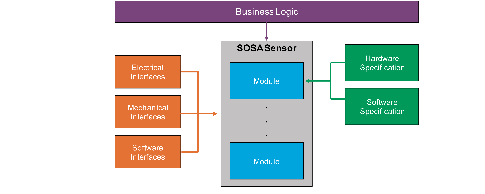
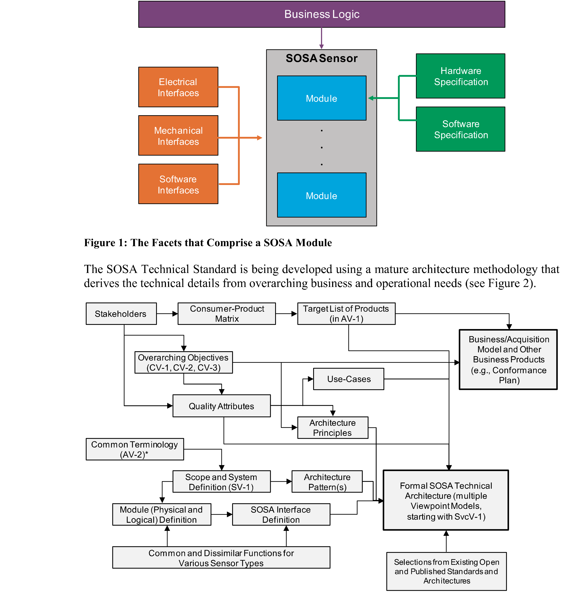

# 1 Introduction

> 原书 p.1–7 ｜ PDF p.21–27

Introduction

Long lead times, cumbersome improvement processes, lack of reuse, platform-unique design, and extensive testing requirements characterize current Department of Defense (DoD) Command, Control, Communications, Computers, Intelligence, Surveillance, and Reconnaissance (C4ISR) capability. This results in higher costs and the inability to deliver capabilities to the war fighter in a timely manner. To counter these trends, the United States Air Force (USAF) Air Force Life Cycle Management Center (AFLCMC), Naval Air System Command (NAVAIR), Naval Sea Systems Command (NAVSEA), Communications-Electronics Research, Development, and Engineering Center (CERDEC), and Program Executive Office (PEO)-Aviation Program offices, enabled by the expertise and experience of the DoD's industrial base, are adopting a revolutionary approach. The Sensor Open Systems Architecture (SOSA) will enable rapid, affordable, cross-platform capability advancements based upon fundamentals of system, software, hardware, and electrical/mechanical engineering best practices and Modular Open Systems Approach (MOSA) principles with pragmatic, practical experience to develop a solution that addresses DoD needs for a cohesive unified set of C4ISR capabilities.

The goal of The Open Group SOSA Consortium is to reduce development and integration costs and reduce time to field new C4ISR capabilities.

### 1.1 Objective

The subject of this Snapshot is the specification of the Technical Standard for Sensor Open Systems Architecture (SOSA) Reference Architecture, Edition 1.0.

This Snapshot is intended to make public the direction, thinking, and path the SOSA Consortium is taking in the development of the SOSA Reference Architecture. We invite your feedback and guidance. To provide feedback on this Snapshot, please send comments by email to ogsosaadmin@opengroup.us no later than December 31, 2019.

The SOSA Technical Standard defines the SOSA modules (containing functions and behaviors) and associated interfaces enabling the development of capabilities made up of common, interchangeable components for Communications, EO/IR, EW, Radar, and SIGINT sensing. The scope of coverage includes software components and hardware elements, as well as electrical and mechanical interfaces for the SOSA sensor. The approach also includes the relevant business approach and supporting guidance documents.

The vision statement for the SOSA Consortium is:

Business/acquisition practices and a technical environment for sensors and C4ISR payloads that foster innovation, industry engagement, competition, and allow for rapid fielding of costeffective capabilities and platform mission reconfiguration while minimizing logistical requirements.

<!-- 原书 p.1 ｜ PDF p.21 -->

The goals are:

- Open: vendor and platform-agnostic open modular reference architecture and business model Standardized: software component, hardware element, and electrical-mechanical interface standards Harmonized: leverage existing and emerging open standards scope Aligned: consistent with DoD acquisition policy guidance Cost-effective: affordable C4ISR systems including lifecycle costs Adaptable: rapidly responsive to changing user requirements

### 1.2 Overview

This Snapshot documents a proposal for a SOSA Technical Standard.

The SOSA Technical Standard defines a system, software, hardware and electrical/mechanical architecture that supports real-time, mission, and system-critical solutions. The SOSA Technical Standard will leverage industry standard Application Programming Interfaces (APIs) for software, common hardware pinout, and profile specifications based on VITA™, and electrical mechanical specifications based on AS6129/69.

At a later date, The Open Group will provide this Technical Standard, and also a Conformance Guide that will contain the Product Standard that identifies what is to be tested for conformance certification.

#### 1.2.1 SOSA Architecture Fundamentals

SOSA specifications are based on convergence of domains of knowledge for: business logic (market and government-driven forces), and technical (software, hardware, and electrical/mechanical interfaces). To that end, a complete system based on the SOSA Technical Standard will require all of the above domains to be fully integrated in a unified architecture description. The SOSA Technical Standard provides a description of each SOSA module and its interfaces (physical and logical, as appropriate) which will be required to create SOSA sensor designs/implementations based on unique customer needs (see Figure 1).

<!-- 原书 p.2 ｜ PDF p.22 -->

*Figure 1: The Facets that Comprise a SOSA Module*

*Figure 2: The Architecture Development Method Adopted for the SOSA Technical Standard*

This document describes the SOSA Technical Architecture, including the SOSA module specifications (functions, behaviors, and interfaces), and the hardware elements and software components from which they are synthesized.

<!-- 原书 p.3 ｜ PDF p.23 -->

#### 1.2.2 Business Alignment

The overview of alignment between technical and business focus areas for the SOSA Technical Standard and the SOSA Open Business Model is available through a companion document – the SOSA Business Guide (see Referenced Documents). A detailed presentation of the SOSA Open Business Model can be found in the SOSA Business Guide. Examples of SOSA Open Business Model incorporation into the acquisition process can be found in the SOSA Contracting Guide. Policies guiding the development and conduct of the SOSA Conformance Program may be found in the SOSA Conformance Policy.

The SOSA Business Guide explains the objectives and organization of The Open Group SOSA Consortium, and describes the SOSA Technical Standard and SOSA Open Business Model. It is intended for use by all stakeholders in the development, acquisition, deployment, modernization, and sustainment of sensor systems that support a broad array of sensors, including C4ISR. The primary stakeholder groups are Government organizations, Aerospace and Defense contractors, and commercial businesses. Within each of these broad groups there are business and technical communities, acquisition and contracting communities, users, and operational communities. All of them have a stake in the SOSA ecosystem and should become familiar with the SOSA Business Guide.

The SOSA Contracting Guide provides procurement language examples for organizations that acquire sensor components and systems, as well as for those who provide them. This Guide is necessarily abstract to relay essential concepts without getting bogged down in details which may change as the SOSA Technical Standard and conformance processes mature. While the US Government is the most common procurer of C4ISR systems, and contractors within the defense industrial base are the most common providers of those systems, it should be noted that the same concerns and general procedures are also applicable to procurements led by industry and to products and services provided by commercial enterprises.

The SOSA Conformance Policy lays out high-level policies for the development and conduct of a set of SOSA conformance processes. These processes will include multiple conformance verification processes, a single conformance certification process, and a single SOSA certified conformant product registration process.

### 1.3 Conformance

This is a Snapshot, not an approved standard. Do not specify or claim conformance to it.

Defining conformance processes and creating an effective, affordable method for certifying software, hardware, and electrical/mechanical interfaces is vital to establishing an effective standard. Certification provides formal recognition of conformance to an industry standard, which allows the following:

- Suppliers and practitioners may make verified claims of conformance to an open standard

- Buyers may specify and successfully procure modular capability from vendors who provide solutions which conform to that open standard The SOSA Consortium is developing a SOSA Conformance Policy and will be developing an associated Conformance Program for the SOSA Technical Standard. The SOSA Conformance Program will provide the associated conformance criteria and processes necessary to assure that

<!-- 原书 p.4 ｜ PDF p.24 -->

capabilities have been developed in adherence to the SOSA Technical Standard. The SOSA Conformance Program will consist of Verification, Certification, and Registration.

SOSA Conformance Verification is the act of assessing the conformance of the implementation of a hardware element or software component (or a combination thereof) to the applicable SOSA Technical Standard requirements. SOSA verification processes will not be available for this Snapshot.

SOSA Conformance Certification is the process of applying for SOSA Conformance Certification once Conformance Verification has been successfully completed. The SOSA Certification process will not be available for this Snapshot.

SOSA Registration is the process of listing SOSA certified modules and SOSA plug-in cards in a curated listing of information about SOSA certified modules and SOSA plug-in cards known as the SOSA Registry. The SOSA Registry process will not be available for this Snapshot.

Successful completion of the SOSA Conformance Program leads to a SOSA Conformance Certificate and the right to use the SOSA Conformance Certification Trademark in marketing.

### 1.4 Normative References

None.

### 1.5 Terminology

#### 1.5.1 SOSA Architecture

While the complete SOSA AV-2 Integrated Dictionary can be found in Appendix B, there are certain key terms that must be understood in order to correctly interpret this Technical Standard.

- Hardware Element: an all-encompassing term for hardware that is incorporated into a SOSA sensor Plug-In Card: any hardware element that is a circuit card that plugs into a backplane SOSA Plug-In Card: a circuit card assembly that also conforms to a SOSA slot profile Software Component: a unit of software that is incorporated into a SOSA sensor SOSA Module: an architectural entity that aggregates and contains the functions the SOSA sensor performs (consistent with DoD MOSA language), may be instantiated using hardware elements and/or software components, and conforms to the complete definition of a SOSA module as defined in the SOSA Technical Standard

#### 1.5.2 System Requirements

For the purposes of the SOSA Technical Standard, the following terminology definitions apply:

May Describes a feature or behavior that is optional. The presence of this feature should not be relied upon.

<!-- 原书 p.5 ｜ PDF p.25 -->

Shall Describes a feature or behavior that is mandatory for an implementation that conforms to this document. A hardware element or software component relies on the existence of the feature or behavior.

Should Describes a feature or behavior that is strongly recommended for an implementation that conforms to this document. A hardware element or software component cannot rely on the existence of the feature or behavior.

#### 1.5.3 Hardware Specification Keywords

To avoid confusion and to make very clear what the requirements for conformance are, many of the paragraphs in this Technical Standard are labeled with keywords that indicate the type of information they contain. These keywords are listed below:

Rule Recommendation Suggestion Permission Observation Any text not labeled with one of these keywords is to be interpreted as descriptive in nature. These will be written in either a descriptive or a narrative style.

Keywords are reserved for specific use as follows:

Rule <section>-<number>

Conformance with Rules is mandatory. Rules always include the term "shall". Rules are expressed in some combination of text, figures, tables, or drawings. All Rules will be followed to ensure compatibility between board and backplane designs. All Rules use the "shall" or "shall not" words to emphasize the importance of the Rule. The "shall" or "shall not" words are reserved exclusively for stating Rules in this document and are not used for any other purpose.

Recommendation <section>-<number>

Conformance with Recommendations is optional. Recommendations always include the term "should". Recommendations are used to convey implementation advice based on the community's collective knowledge base. Wherever a Recommendation appears, designers would be wise to take the advice given. Doing otherwise might result in poor performance Or awkward problems. Recommendations found in this document are based on experience and are provided to designers to speed their traversal of the learning curve. All Recommendations use the "should" or "should not" words to emphasize the importance of the Recommendation. The "should" or "should not" words are reserved exclusively for stating Recommendations in this document and are not used for any other purpose.

Suggestion <section>-<number>

A Suggestion contains advice, which is helpful but not vital. The reader is encouraged to consider the advice before discarding it. Some design decisions that need to be made are difficult

<!-- 原书 p.6 ｜ PDF p.26 -->

until experience has been gained. Suggestions are included to help a designer who has not yet gained this experience.

Permission <section>-<number>

Conformance with Permissions is optional. Permissions always include the term "may". In some cases, a Rule does not specifically prohibit a certain design approach, but the reader might be left wondering whether that approach might violate the spirit of the Rule or whether it might lead to some subtle problem. Permissions reassure the reader that a certain approach is acceptable and will cause no problems. All Permissions use the "may" words to emphasize the importance of the Permission. The lower-case "may" words are reserved exclusively for stating Permissions in this document and are not used for any other purpose.

Observation <section>-<number>

Observations do not offer any specific advice. They usually follow naturally from what has just been discussed. They spell out the implications of certain Rules and bring attention to things that might otherwise be overlooked. They also give the rationale behind certain Rules so that the reader understands why the Rule must be followed.

### 1.6 Future Directions

The SOSA Hardware Working Group (HWG) will initiate an effort to develop a Space version of the SOSA standard. This will leverage existing SOSA efforts as much as possible with a look towards existing Space OSAs. The HWG will also extend its development efforts to smaller Sensor platforms, such as Unmanned Aerial Vehicles (UAVs); Unmanned Underwater Vehicles (UUVs), etc.

<!-- 原书 p.7 ｜ PDF p.27 -->