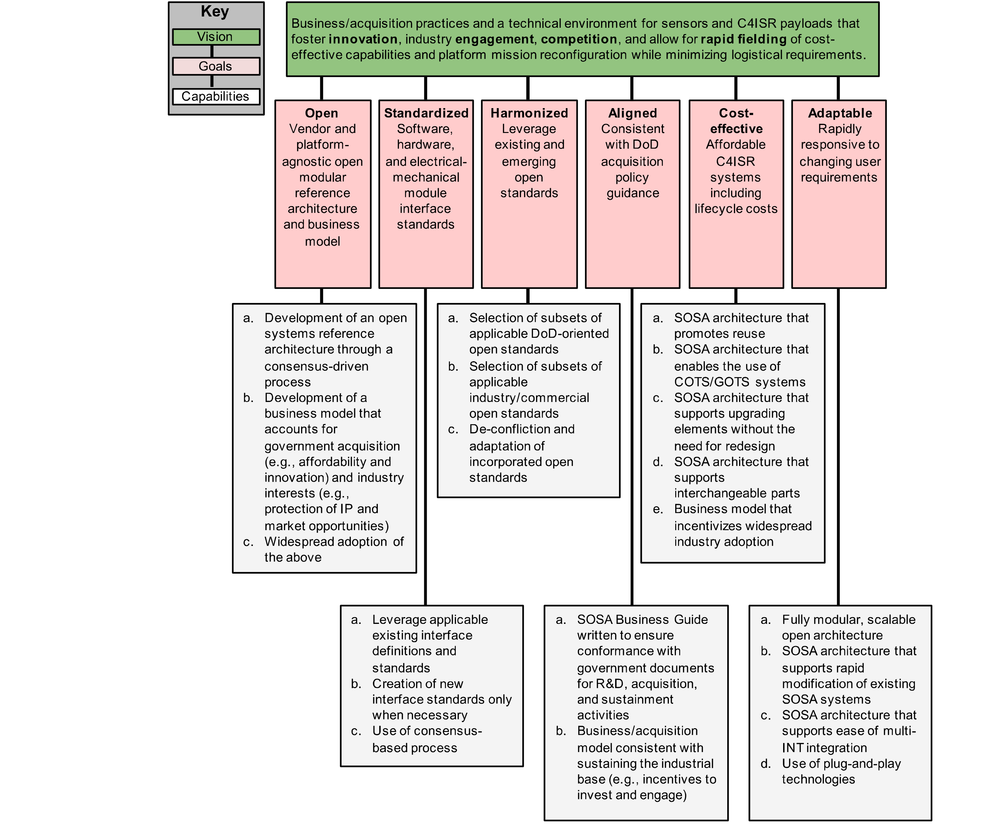
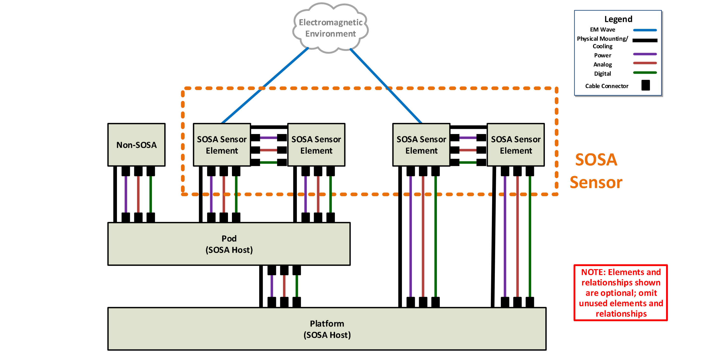
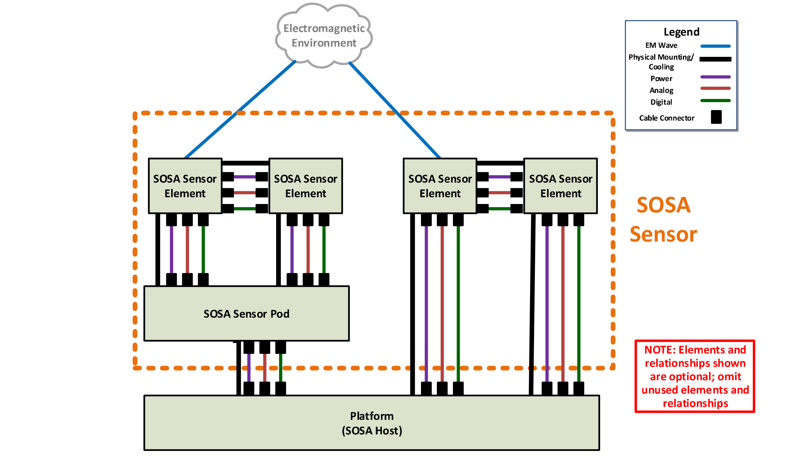
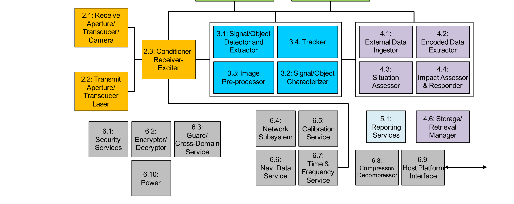
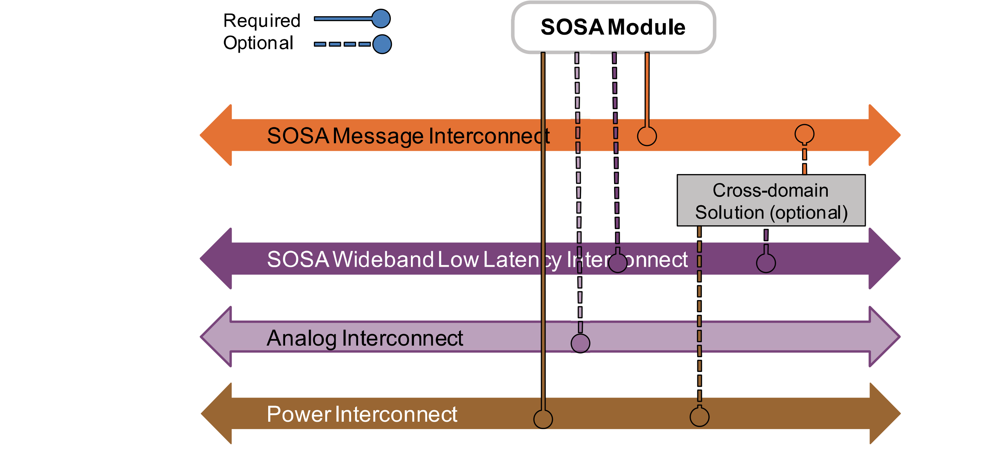
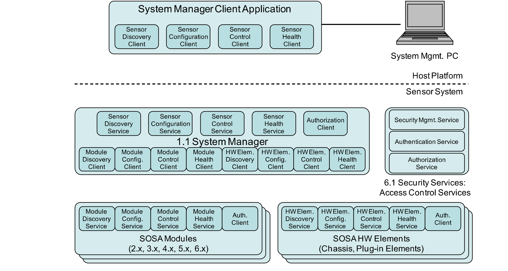
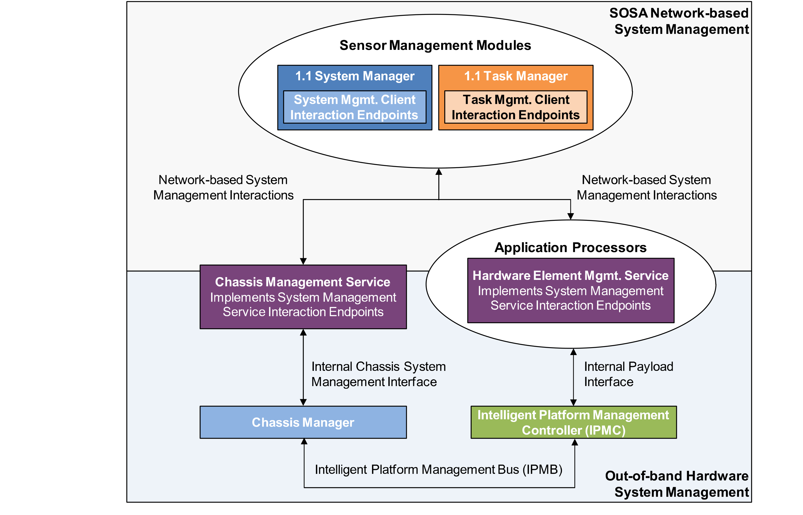
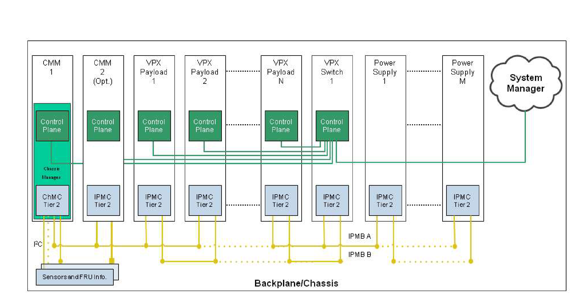
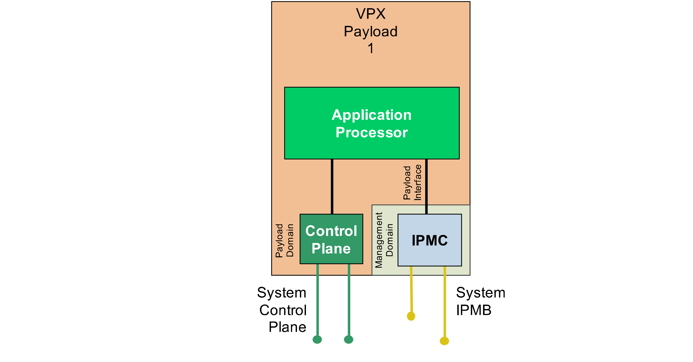

# 3 Reference Architecture Description

> 原书 p.9–42 ｜ PDF p.29–62

### 3.1 CV-1/CV-2 Objectives

The foundations of the SOSA Reference Architecture are:

Capability View – 1 (CV-1): the overall vision, goals, and enablers that support the goals of the architecture that are captured in the CV-1 DoDAF artifact (see Section 3.1.1)

- Quality Attributes: characteristics of a system that collectively influence the overall quality of the system, and will drive many of the architectural decisions (often referred to as "-ilities") (see Section 3.3) – these are the measures for "goodness" of harmonization Architecture Principles: general rules and guidelines, intended to be enduring and seldom amended, that inform and serve as drivers for defining the architecture; a framework for decision-making (evaluation criteria) as a means to weed out approaches that are inconsistent with intent, and serve as a foundation for adjudication (see Section 3.2)

These products provide the foundation for the architecture definition contained in this document. Another foundational element is the Integrated Dictionary (DoDAF AV-2) which establishes the baseline terminology used throughout to ensure clarity and reduces (if not eliminates) ambiguity. All essential terms in the SOSA Technical Standard are captured in the DoDAF AV-2.

The fundamental building blocks of the SOSA Architecture are the SOSA modules ("an element of a system that has individually distinct boundaries that are well-defined interfaces") and the SOSA interfaces ("the region, physical or logical, where two systems or elements meet and interact"). Modules perform functions (physical and/or logical) and exhibit behaviors.

The SOSA Architecture will be captured using the DoDAF Version 2.02 Viewpoint Models, chosen because the primary target audience is the US DoD, and DoDAF is (as of this writing) the prescribed framework.

#### 3.1.1 SOSA Capability View – 1 (CV-1)

As mentioned earlier the CV-1 presents the SOSA overall vision, goals, and outlines strategy to support stated goals throughout the effort. To this end, the vision and goals as presented in Section 1.1 earlier are further refined below through addition of capabilities to define goals.

The vision statement for the SOSA Consortium is:

Business/acquisition practices and a technical environment for sensors and C4ISR payloads that foster innovation, industry engagement, competition, and allow for rapid fielding of costeffective capabilities and platform mission reconfiguration while minimizing logistical requirements.

The SOSA capabilities are illustrated in Figure 3.

<!-- 原书 p.9 ｜ PDF p.29 -->

*Figure 3: SOSA CV-I*

### 3.2 SOSA Architecture Principles

The following architecture principles were developed to guide the SOSA technical and business architectures being matured. The list of principles below is not in any particular order and the numerical value does not indicate precedence.

<!-- 原书 p.10 ｜ PDF p.30 -->

#### 3.2.1 Business-Oriented Architecture Principles

**#1 The SOSA business and technical architecture is vendor-agnostic.**

**Statement** The modules and interfaces that make up the SOSA Technical Standard and Reference Architecture, and the processes and practices that make up the SOSA business/procurement architecture, are equally beneficial to all vendors, offering no inherent advantage or disadvantage to any one company or business sector.

**Rationale** The first goal of the SOSA Architecture is "Open: vendor and platform-agnostic open modular reference architecture and business model", and as such the SOSA business and

technical architecture supports a "level playing field" to ensure business fairness, and that the best technical solution, regardless of vendor source, can be incorporated into systems based on the SOSA Technical Architecture.

**Implications** The business architecture of SOSA ensures that there are no barriers for stakeholder participation in the development or use of the SOSA Architecture. This includes making material available, eliminating financial barriers (or ensuring that they are minimal). The acquisition model is one that enables all qualified vendors to participate. The technical architecture incorporates standards that favor no vendor by ensuring that it incorporates widely-available standards for which all qualified vendors have equivalent opportunity.

**#2 SOSA Consortium products are provided royalty-free.**

**Statement** There is no cost to obtaining SOSA Consortium materials required to develop, procure, or implement systems (or subsystems or modules) that are aligned to the SOSA Technical Standard.

**Rationale** Achieving the vision and goals of the SOSA Consortium requires that there is widespread adoption, implying the minimization of barriers to access and use the products of the SOSA Consortium. High royalties or fees to access these materials would run counter to the goals of the open business objectives, and therefore are to be avoided.

**Implications** The means of publication of the SOSA Technical Standard is low-to-no cost, such as non-physical distribution via the World Wide Web, file servers, or other electronic means – subject to national security considerations (e.g., the need to authenticate that recipients are US persons who understand their responsibilities to safeguard the material). In addition, and by implication, tools (testing methodology, SDKs, etc.) required to develop and conformance verify hardware and software are widely available at no-to-little cost. Third-party products that are derived from SOSA Consortium products may be made commercially available (for additional cost).

**#3 SOSA products and processes protect the IP of vendors.**

**Statement** Participation in the development and use of SOSA Consortium products does not jeopardize the IP of vendors. The SOSA Consortium respects IP and the SOSA Consortium products do not expose IP.

<!-- 原书 p.11 ｜ PDF p.31 -->

**#3 SOSA products and processes protect the IP of vendors.**

**Rationale** financially healthy ISR ecosystem is in the best interest of the nation. Businesses must be incentivized to invest itechnology and other innovative solutions. I protection is the cornerstone of that process that ensures that there is a return On the ivestment. Therefore, it is imperative that SOSA processes and products retain protections for I rights within the module boundary.

**Implications** The SOSA Architecture takes a CCgray box' approach: modules are defined with properties Of functions and behaviors, and interfaces are defined with properties that iclude their physical characteristics, protocols for exchange of signals and data, and the signal and data content. How the functions and behaviors of the modules (einside the box') are realized is completely Up to the vendor to determine. It is inside the box where the I resides. In addition, the SOSA Architecture does not include companyspecific IP unless that IP has been consensually released to the SOSA Consortium for Open usCthrough the SOSA Technical Standard per the membership agreement.

#### 3.2.2 Technically-Oriented Architecture Principles

**#4 The SOSA Technical Standard is extensible an evolvable.**

**Statement** The SOSA Technical Standard, and associated Reference Architecture, is able to

continue to Iature beyond theexisting goals and expectations, to be able to incorporate technological and architectural improvements, and be able to maintain relevance as stakeholder needs change(e.8,new sensor types and new mission areas)

**Rationale** Technologies, markets, and requirements evolve over time. In order to preserve the considerable time and funds invested in creating the SOSA Architecture embodied ~ the SOSA Technical Standard consideration is given to "future proof' i. For the SOSA Technical Standard to be relevant in the future, it is important that it can be extended in scope.

**Implications** Architecture decisions, trades, etc. favor options that enable growth and don 't "lockOut'' expansion. Interfaces are defined to include growth paths (extra capacity, for example). Module definitions are not So narrow as to preclude additionalfunctionality. The architecture developers and maintainers are mindful that the current Version willnot necessarily be the last one.

**#5 The SOSA Architecture maximally leverageslincorporates existing industry and government standards.**

**Statement** The SOSA Architecture takes advantage Of existing industry and govermment standards and OSAs whenever possible and practical and consistent with achieving thegoalsOf the SOSA Consortium.

**Rationale** Crafting well-instituted standards is both time and resource-consuming, and the community does not benefit from having multiple, overlapping, or redundant standards. Therefore, the SOSA Architecture incorporates other standards and approaches When appropriate.

<!-- 原书 p.12 ｜ PDF p.32 -->

**#5 The SOSA Architecture maximally leverageslincorporates existing industry and government standards.**

**Implications** Systems that already are compliant or conformant with other OSAs are likely to require minimal (or no) modifications to achieve consistency with the SOSA Technical Standard. Adoption is more efficient for the SOSA team, helping to more rapidly develop and evolve the SOSA Technical Standard, though the team ensures that said adoption does not undermine the quality attributes, goals, or other guiding principles upon which the SOSA Architecture is based, and is consistent with the entirety of the SOSA Architecture.

**#6 Resilience (including cybersecurity) is enabled by the SOSA Architecture.**

**Statement** Physical and logical aspects of SOSA Architectures are capable of maintaining a reasonable level of operation in situations where system degradation or attack is possible.

**Rationale** A SOSA conformant system is not viable if it is unable to respond accordingly to either a localized degradation event, a system-wide degradation, or a cyber-attack by maintaining a reasonable level of operational viability.

**Implications** The SOSA Architecture incorporates functions that permit monitoring for health and status, and facilitate the design of a system that incorporates safeguards, redundancy, and the ability to be upgraded in light of new threats. A SOSA conformant system is able to respond to physical or logical degradation or a localized failure. Maximizing the ability of a SOSA system to effectively manage these possibilities ensures operation at an acceptable level of performance in a variety of situations.

**#7 The SOSA Architecture is agnostic with respect to host platform.**

**Statement** The SOSA Technical Standard, and associated Reference Architecture, applies to a wide range of host platforms (e.g., aircraft, ground vehicle, ship), and makes no assumption regarding the type of vehicle or installation it is resident in or upon.

**Rationale** Conformance and adherence to this principle engenders hardware and software interoperability and reuse across multiple platforms and multiple mission types. Enabling and maximizing reuse lowers overall development costs and operational costs over the lifetime of any particular program.

**Implications** The development of the SOSA Technical Standard takes into account a wide range of physical and environmental conditions, and so it specifies, for example, a range of standards-based connector types appropriate for the variety of environments. This may have implications on plug-and-playability, and so it is important that one type of interface (for one environment) easily be adapted (through interface conversion and/or software shim) to another. This enables, for example, a small-vehicle sensor to be leveraged for a large platform.

<!-- 原书 p.13 ｜ PDF p.33 -->

**#8 The SOSA Architecture is agnostic with respect to processing environment.**

**Statement** SOSA modules and interfaces are not dependent upon the physical processing and operating system environments.

**Rationale** SOSA modules represent the codified logic of the sensor system. Physical realization of processing environments will continue to evolve with processors, operating systems, network protocols, backplanes, memory architectures, and communication circuits. The desire is for the physical realizations to be changed as technology continues to evolve. Adherence to this principle enables hardware and software interoperability and reuse across multiple platforms and multiple mission types. Isolating SOSA modules from the processing environment allows rapid technology refreshment, system scaling, and module reuse.

**Implications** The SOSA Technical Standard needs to take into account a wide range of processing environments as realized by the selection of processors (CPU, GPU, FPGA, and custom), operating systems, network protocols, backplanes, memory architectures, and communication circuits. This means that the interfaces are independent from the processing environment through abstraction.

**#9 Every SOSA module has defined logical interfaces.**

**Statement** All SOSA sensors have well-defined logical interfaces for each of their SOSA defined modules. Logical interfaces describe the information content or signaling between modules for the interchange of control and data. The logical interface is a point that encapsulates control and data along with the syntax/semantics as described by the SOSA Architecture. Information exchange, including transmission type, interchange protocols, and routing are part of the interface definition.

**Rationale** An interface is a shared boundary for interaction between architectural modules. SOSA module logical interfaces enable replacement for modernization and upgrade, support plug-and-playability, interoperability, operational flexibility, and will likely result in cost savings over the lifetime of an operational program.

**Implications** The SOSA Technical Standard addresses a wide range of logical interfaces realized in SOSA environments. SOSA logical interfaces mandate that a set of interface standards is needed to span the types, protocols, addressing, service types, and operational environments.

**#10 Every SOSA hardware element has defined physical interfaces.**

**Statement** All SOSA sensors have well-defined physical interfaces for each of their hardware modules. Physical interfaces describe the physical or mechanical connection between SOSA hardware modules, providing structural attachment, electrical/electronic connectors, backplanes, or other inter-module associations that are physically manifested.

**Rationale** Well-defined SOSA module physical interfaces enable replacement for modernization and upgrade, support plug-and-playability, interoperability, operational flexibility, and will likely result in cost savings over the lifetime of an operational program.

<!-- 原书 p.14 ｜ PDF p.34 -->

**#10 Every SOSA hardware element has defined physical interfaces.**

**Implications** The SOSA Technical Standard addresses a wide range of physical interfaces realized in SOSA environments. SOSA physical interfaces mandate that a set of interface standards is needed to span the types, physical sizes, connector types, electrical signaling (including Physical and Data Link layers), and operational environments.

**#11 The SOSA Architecture accommodates simple through complicated systems.**

**Statement** The SOSA Architecture provides the building blocks for deriving multiple sensor types that scale within a design, increasing or decreasing complexity relative to processing and Size, Weight, and Power (SWaP) constraints for a system.

**Rationale** There are many aspects of complexity that the SOSA Architecture addresses, such as number of sensors to manage, diversity of sensors, and algorithm complexity/parallel processing requirements. The management functions of sensor systems become more complex as the number of entities increase. Having patterns that allow the management functions to scale with (at most) minor changes is crucial. The ability to support algorithm scaling (e.g., more or less instances of the same process working in parallel) and increasing or reducing the corresponding hardware as needed with only configuration changes is an important attribute of a SOSA system.

**Implications** SOSA systems accommodating a range of complexity require well-defined functional decomposition, use-cases, and interface definitions. The functional decomposition needs to create the right layer(s) of abstraction for a variety of hardware and software entities to coexist in different configurations. The use-cases need to cover all required system functionality, from specific mode processing to state/mode control to heartbeats. Integrating different software or hardware into a system should minimally affect the management functions of a SOSA derived system. The interface definitions need to be firm for system management, but flexible for a variety of sensor type processing. Patterns are used extensively to manage the complexity.

**#12 The SOSA Architecture accommodates small through large platforms.**

**Statement** The SOSA Architecture is flexible enough so that designs derived from it can be tailored to large as well as small platforms, with the flexibility to be used to design simple, lightweight systems (suitable for a small UAS) as well as large complex systems (e.g., suitable for a wide-body jet, warship, or ground-based installation).

**Rationale** Applicability is dependent upon the ability of a solution to provide a standard suite of interfaces across a multiplicity of host structures. Not limiting the scope of the SOSA Technical Standard to one class of hosts or another ensures broad applicability and utility.

<!-- 原书 p.15 ｜ PDF p.35 -->

**#12 The SOSA Architecture accommodates small through large platforms.**

**Implications** The SOSA Architecture is a superset architecture; complete in that it can be used to design a complex, fully-functional system, and at the same time not mandate/require the presence of all (or many/most) modules for systems with more modest SWaP resources. The SOSA Architecture incorporates hardware and physical standards that allow the use of small as well as large form factors.

**#13 Modularity is fundamental to the SOSA Architecture – physical and logical.**

**Statement** The SOSA Architecture is an OSA, and as such is composed of physical and logical units ("building blocks") that have individually distinct boundaries that are well-defined interfaces. The units or elements that make up a SOSA Architecture (or resulting system) are known as modules.

**Rationale** The goals for the SOSA Architecture include openness, standardization, and adaptivity that allow for replacement/upgrade of parts of a sensor and reuse in a vendor-neutral manner. Modules (physical and logical units with well-defined boundaries) are the means of achieving these goals.

**Implications** The SOSA Architecture is described in terms of modules (functions and behaviors) and interfaces (information or signals to be exchanged by these modules, and the means by which they are exchanged, such as protocols or electrical specs). The modules are defined in a way that ensures independence and low coupling (so that changes in one do not impact others). Criteria used: Severable (can be separated and used elsewhere) – based on business needs, timing requirements, or other drivers Has minimal complexity interfaces (minimum interdependencies) Can operate as stand-alone or be operated via function/process/system manger Is independently testable Does not expose IP Facilitates competitive procurement Encapsulates rapid change

**#14 Interchangeability is fundamental to the SOSA Architecture.**

**Statement** Modules making up SOSA systems are able to be replaced by equivalent modules regardless of the source. Moreover, it would be possible to interchange one (entire) SOSA system with another SOSA system (provided it does not violate physical/environmental requirements).

<!-- 原书 p.16 ｜ PDF p.36 -->

**#14 Interchangeability is fundamental to the SOSA Architecture.**

**Rationale** The goals of the SOSA Consortium include openness (platform and vendor-agnostic)

and rapid response. The quality attributes include modularity and upgradability. Essential to these objectives is the need to be able to interchange SOSA modules to achieve goals, such as using module replacement to upgrade a sensor or modify it because of a changing mission need. This will result in a more robust marketplace where subsystem upgrades become more commonplace as the ease of modular upgrades becomes apparent.

**Implications** Interfaces are very well-defined and yet contain a high degree of flexibility. Moduleunique interface technologies should be avoided in favor of those that are broadlyapplicable. Interface definitions are superset definitions; they include all the functionality/capability that a SOSA module or system is anticipated to include. The architecture defines a default behavior for situations where all functions supported in the interface are not implemented.

**#15 Reuse is fundamental to the SOSA Architecture.**

**Statement** SOSA systems and modules that are developed for one program, host vehicle, or environment will be employable, with minimal modification, for other programs, with other host vehicles and in other operational environments.

**Rationale** The ability to reuse SOSA sensors and modules across various vehicles allows the DoD to reduce parallel investment to develop the same type of payload assembly multiple times in order to fly on various vehicles. The ability for a particular sensor subsystem to operate inside various SOSA sensors and modules reduces the integration costs for creating a new payload assembly.

**Implications** Modules should be reusable across the range of host platforms, consistent with SWaP limitations (embodied in their specific design/instantiation). It is imperative that SOSA standard interfaces are well-defined, to include physical, logical/protocol, and data content and format. A standardization of electro-mechanical busses along with available sensor geometries is required. Multi-platform integration architectures are used to allow modules to communicate with an embedded computer or the host platform, and/or both. The intent is to minimize (or eliminate) the cost and schedule impact of adding or replacing a new SOSA module, not to eliminate the need for integration and test.

### 3.3 SOSA Quality Attributes

The quality attributes outlined in Table 1 inform the SOSA business and technical architectural design decisions.

<!-- 原书 p.17 ｜ PDF p.37 -->

**Table 1: SOSA Quality Attributes (in order of decreasing precedence)**

| Name | Description |
|---|---|
| Interoperability | The ability of the system to provide data/information to – and accept the same from – other systems, and to use the data/information so exchanged to enable them to operate effectively together. In the context of the SOSA Architecture, this quality attribute refers to the ability of SOSA systems to be able to exchange information during operation, and (possibly with adaptation) be able to interoperate with other systems not designed to align with the SOSA Reference Architecture. |
| Securability | The property of a system such that its design renders it largely protected/inviolable against acts designed to alter functionality or capabilities, or reverse-engineer capabilities and/or critical program information – or impair its effectiveness, and prevent unauthorized persons or systems from having access to data/information contained within. In the context of the SOSA Architecture, this quality attribute ensures that the fundamental architecture is one that has minimal attack surfaces and effective authentication enforcement, and SOSA systems can be designed so that they can adapt to an evolving threat environment. |
| Modularity | The degree to which a system or element is composed of individually distinct physical and functional units that are loosely-coupled with well-defined interface boundaries. In the context of the SOSA Architecture, this quality attribute enforces the establishment of well-defined, well-understood, standardized system modules that can be created and tested individually for function and conformance. |
| Compatibility | The ability of a system to coexist with other systems without conflict or impairment, or be integrated or used with another system of its type. In the context of the SOSA Architecture, this quality attribute refers to the ability of SOSA systems to be used or integrated with systems not designed to align with the SOSA Reference Architecture, or with systems designed with earlier versions of the SOSA standard (backwards-compatible). |
| Portability | An attribute that describes the reuse of existing hardware or software elements (as opposed to the creation of new) when moving hardware or software elements from one environment (physical or computing) to another. In the context of the SOSA Architecture, this quality attribute refers to the ability of SOSA based hardware and software to be used, without modification, in other SOSA based environments (e.g., different operational domains, different systems, and different sensor modalities), but does not necessarily imply the porting to vastly different physical environments (e.g., operating temperature, shock, vibration – which are design, not architectural, features). |
| Plug-and-playability | The capability of a system to recognize that a hardware component has been introduced or replaced – and subsequently use it without the need for manual device configuration or operator intervention. In the context of the SOSA Architecture, this quality attribute refers to the ability of a SOSA conformant system to recognize the introduction or replacement of SOSA modules, and through an information exchange, to understand and use the capabilities and services that the module offers – thereby reducing the cost and schedule impact of adding a new SOSA module – but does not eliminate the need for integration and test. |
| Upgradeability | The ability of a system to be improved, enhanced, or evolved without fundamental physical, logical, or architectural changes. In the context of the SOSA Architecture, this quality attribute refers to the ability of a SOSA system to have specific hardware elements or software components replaced with more modern or more capable equivalents, while maintaining SOSA conformance, and without (significant) change to the rest of the system. |
| Scalability: Sensor Multiplicity | The capability of a system to cope and perform well under an increased or expanding workload or increased demands, and to function well when there is a change in scope or environment – and still meet the mission needs. In the context of the SOSA Architecture, this quality attribute refers to the ability of the SOSA Architecture to accommodate a multiplicity of sensors, constrained only by design-specific limitations. |
| Scalability: Platform Size | The capability of a system to cope and perform well under an increased or expanding workload, increased demands, and to function well when there is a change in scope of environment and still meet the mission needs. In the context of the SOSA Architecture, this quality attribute refers to the ability of the SOSA Architecture to be applied to platforms that range from the small (e.g., Class I UAS) to large surveillance aircraft – and possibly even spacecraft. |
| Resiliency | The ability of a system to continue or return to normal operations in the event of some disruption or over-capacity (system saturation), natural or man-made, inadvertent or deliberate, and to be effective with graceful and detectable degradation of function. In the context of the SOSA Architecture, this quality attribute refers to the ability of SOSA systems to be able to maintain operations while under “duress” caused by physical damage, electronic interference, or cybersecurity attack. |

> 转写说明：本表无合并单元格。续页顶部重复了 Name/Description 表头行，已并入首行表头，不另起表。原文每个单元格含两段（定义段与 “In the context of the SOSA Architecture, this quality attribute …” 段），按格内换行以空格连接为一行。名称列 “Scalability: Sensor Multiplicity”、“Scalability: Platform Size” 在原表中各占两行（冒号后换行），同样以空格连接。

<!-- 原书 p.18 ｜ PDF p.38 -->

### 3.4 SV-1 (System Interface Description/Context)

The System View 1 (SV-1) system interface description presented below identifies and describes the physical/hardware systems (herein "entities") and the nature of the interconnections for the SOSA sensor system. The SOSA SV-1 depicts all system resource flows between systems that are of interest to the SOSA Consortium (see Figure 4 and Figure 5).

<!-- 原书 p.19 ｜ PDF p.39 -->

The SV-1 is an abstract representation showing key top-level SOSA actors and their physical relationships. Logical relationships (e.g., messaging) will be shown in other SOSA viewpoint models. The SOSA standard addresses two categories of interfaces:

SOSA External Interfaces cross the orange SOSA sensor boundary SOSA Internal Interfaces are contained entirely within the orange boundary – the SOSA Consortium will choose a subset of the many possible internal interfaces to address in the

SOSA standard

The SV-1 only shows a few instances of SOSA sensor elements as exemplary cases; the number of SOSA sensor elements depends on the specific SOSA sensor. A SOSA sensor is mounted on a SOSA host, and a SOSA host can be a pod or a platform, or both. Multiple SOSA sensors could be mounted on the same SOSA host. Relationships between SOSA sensors are logical (e.g., via messaging), not physical, and therefore not shown in the SV-1.

A SOSA sensor is mounted on a SOSA host, which can be a pod or a platform, or both. This is the Nominal Case, shown in Figure 4. A SOSA sensor can also contain its own pod (a "SOSA sensor pod"), which is the special case shown in Figure 5.

*Figure 4: SV-1 for Nominal Case*

<!-- 原书 p.20 ｜ PDF p.40 -->

*Figure 5: SV-1 for Sensor Pod Special Case*

### 3.5 SOSA Physical Context Entities

#### 3.5.1 SOSA Sensor

The main subject of the SOSA standard is the SOSA sensor, which consists of a set of one or more SOSA sensor hardware elements (some of which host software components). Each SOSA sensor is either one of the five "sensor" types (Communications, EO/IR, EW, Radar, and SIGINT), or any combination of the five sensor types (e.g., they may be multi-INT). Any interface crossing the SOSA sensor's boundary is a SOSA external interface.

#### 3.5.2 SOSA Hardware Element

A SOSA sensor consists of a set of one of more SOSA hardware elements mounted within or on the same host platform. In the context of the SV-1, it is a physical component of a SOSA sensor which may contain software and firmware, and my support more than one sensor type (it has other "non-physical" interpretations in other Viewpoint Models). It consists of but is not limited to:

Aperture (antenna, packaged antenna array, packaged imaging array, or imaging turret)

Hardware enclosure (e.g., chassis)

A SOSA hardware element may optionally have inside it SOSA plug-in cards that plug into a backplane within it. Hardware elements may be distributed in different locations on/in the SOSA host platform.

<!-- 原书 p.21 ｜ PDF p.41 -->

#### 3.5.3 SOSA Host Platform

A SOSA host platform is the physical entity to which the SOSA sensor is mounted. Normally, it is one of: a vehicle or structure (such as an aircraft, surface craft, a building, or a pod), a combination of one or more pods, and/or a vehicle/structure. It nominally provides to the sensor: Power Cooling Platform navigation information (position, velocity, etc.) Reference signals (e.g., 1 PPS, 10MHz, etc.) Network connections Connections for any other needed analog or digital interfaces The SOSA host platform may contain external (to the SOSA sensor) processing capability that could use the data products of the SOSA sensor, and external communications. It will provide the SOSA sensor with its tasking. It is assumed that the host platform provides any User Interface (UI) that may be required; while the SOSA system may provide data and information to be used by a UI, the UI is outside the scope of the SOSA system.

3.5.4 SOSA Sensor Pod A SOSA sensor pod is a pod that is delivered as an integral part of a SOSA sensor and has SOSA sensor elements from exactly one SOSA sensor mounted in/on it.

### 3.6 Function to Module Aggregation Criteria

There are a great many functions that must be performed within a Communications, EO/IR, EW, Radar, and SIGINT system. These have been logically combined into what have become the SOSA modules, the aggregation process based on these seven criteria: 1 Severable (can be separated and used elsewhere; a SOSA module can be removed from one system and used in another without needing to be modified) – based on business needs, timing requirements, or other drivers 2 Has minimal complexity interfaces (minimum interdependencies) 3 Can operate as stand-alone or be operated via function/process/system manger; it can be operated independently of the rest of the SOSA sensor 4 Is independently testable 5 Does not expose IP 6 Facilitates competitive procurement 7 Encapsulates rapid change For each of the SOSA modules, the inputs required to support these functions have been determined (leading to the definition of each SOSA module's inputs), and the products of each of the functions have been defined (leading to the definition of each SOSA module's outputs). A

<!-- 原书 p.22 ｜ PDF p.42 -->

top-level enumeration of the SOSA modules is documented in the SOSA Service View 1 (SvcV-1: Services Context Description) – see Section 3.9, and the details of their interactions are documented in the Service View 4 (SvcV-4: Services Functionality Description) – see Section 4.1.1.

It should be noted that the SOSA Technical Standard specifies what the SOSA modules do, but not how they do it (IP and innovation are preserved).

### 3.7 Security Concepts and Approach

The security aspects of the SOSA Technical Architecture are an active area of development. The intent is to review the security aspects of the architecture as a whole, rather than segregated into various security disciplines (e.g., anti-tamper, cybersecurity, supply chain risk mitigations, software assurance, etc.). The guiding principles for security are consistent with the SOSA Architecture Principles – that the standard leverages/incorporates existing industry and government standards and that the architecture enables resilience and cybersecurity.

The approach to security began with a review of existing DoD and commercial security standards, such as the Anti-Tamper (AT) Technical Implementation Guide (TIG), the DoD Risk Management Framework (RMF), security-related Open Mission System (OMS) ICDs, the Cyber Survivability Endorsement Implementation Guide, and The Open Group Open Trusted Technology Provider™ Standard (O-TTPS), which is technically equivalent to ISO/IEC 20243-1:2018. The approach is also informed by industry best practices, collecting inputs from the various members of the SOSA Consortium. These standards and best practices are being reviewed for their applicability to a SOSA system and the interfaces between SOSA modules, software components, and/or hardware elements, as appropriate. As the SOSA Technical Architecture is refined, the architecture will be reviewed based on these and other standards to ensure that security is built in and to maintain alignment with security requirements from various other open architecture standards.

The security aspects of the SOSA Technical Architecture are implemented in the functions (and behaviors) of the SOSA modules and their interfaces. Security best practices for how SOSA products are developed are intentionally not included in this standard. The primary functions and behaviors are implemented in SOSA modules 1.1 (System Manager), 6.1 (Security Services), 6.2 (Encryptor/Decryptor), and 6.3 (Guard/Cross-Domain Service). All SOSA modules are shown in Figure 6 and defined in Table 2 in Section 3.9. The system manager will manage the start-up of the system (including the secure loading of software), maintain a secure configuration, manage keys used in the system, and authorize/authenticate requests to publish/subscribe messages or access privileged resources. Security services will implement the security functions needed by the system manager, including verification of software integrity, key management, access control, audit, and other security controls. The encryptor/decryptor provides cryptographic services to the system manager and other applications to ensure that data-at-rest and data-intransit are protected to the level required by the classification of the data. The guard/crossdomain service provides applications the ability to send/receive data across security domains.

#### 3.7.1 SOSA Hardware Security Framework

The SOSA hardware security is a framework for security services. This is specifically motivated by the desire to avoid monolithic static security solutions, which are costly to adapt to new security requirements or threat environments.

<!-- 原书 p.23 ｜ PDF p.43 -->

The SOSA Hardware Security Framework will support the following capabilities:

Usage of standard security components, where possible Scalable configuration and deployment of security functionality Adaptable to different on-board sensor combinations Updateable security components Extensible for integrating new security requirements Easy usage and integration for application developers Adjustable security-level applying different levels of software and hardware security measures

### 3.8 Hardware Concepts and Approach

Planned for a later version of the SOSA Technical Standard.

### 3.9 SvcV-1: Services Context Description

The Service View 1 (SvcV-1) documents the SOSA modules and their top-level relationship to one another. The SOSA Technical Standard will define (in later versions) a core set of required modules and functionality; not all modules need to be instantiated in a design to be conformant. Future versions of the standard will define the core functionality for each type of sensor. In the case of multiple integrated sensors, the sensor integrator would need to determine how to instantiate the modules necessary to incorporate the SOSA core functionality. The details of their relationships are documented in the SvcV-4: Services Functionality Description (see Section 4.1.1).

Figure 6 identifies the SOSA modules and their relationship (enumerated in the dotted decimal numerical identifications, by color-code, and grouping/proximity). It also shows some of the resulting interfaces that are being determined for the SOSA Technical Architecture. It should be noted that this figure does not represent “the SOSA Architecture”. This artifact is one among the many that, taken together, constitute the SOSA Technical Architecture. The current conception is that there would be no more than one instantiation of each SOSA module (with the exception of the 2.x modules) for each SOSA sensor.

Descriptions (explaining the encapsulated functionality and behaviors) of each of the SOSA modules is documented in Table 2. This table details descriptions of SOSA modules. All SOSA sensor functionality must be contained within the encapsulating SOSA module. In practice, a SOSA sensor may implement a subset of these modules.

<!-- 原书 p.24 ｜ PDF p.44 -->

1.1: System Manager 1.1: Task Manager

*Figure 6: SvcV-1: Top-Level SOSA Services Context Description*

**Table 2: SvcV-1: Module Descriptions**

| Module Name | Description |
|---|---|
| SOSA Sensor Management | |
| 1.1 System Manager | The system manager provides the ability to discover, configure, control, manage health (status and faults), and configure the security aspects of the SOSA sensor as a whole, its infrastructure, its modules, and its interface to the sensor host. The system manager does not manage or control the mission, tasking, or operational aspects of the SOSA sensor, but instead manages the SOSA sensor itself. System manager functions include Discovery (identifying and obtaining information required to communicate with the sensor and its modules), Configuration (obtaining a detailed description of the sensor and its modules and reading and setting configuration parameters and software packages), Control (monitoring and setting control parameters for the sensor and its modules, such as mode and state, and performing control actions such as reset or BIT), and Health Management (publishing periodic health reports, notifying occurrence of configuration, control, and health events, and logging health reports and events). |
| 1.2 Task Manager | The task manager is responsible for coordinating all mission operations. External sensor tasking is accepted in the form of a request that contains information detailing when and where to collect data, the type of processing to be performed, and the required output products to be generated. Information in the request is used by the task manager to optimize, manage, and prioritize resources to support various competing tasks in a SOSA sensor. Any externally invoked changes to tasking are handled by the task manager, which in turn propagates the mission changes into relevant mode and state changes for the other SOSA modules. Lastly, the task manager is responsible for invoking routine calibration as needed to support the mission tasking. |
| **Transmission/Reception** | |
| 2.1 Receive Aperture/Transducer/Camera | The Receive Aperture/Transducer/Camera module is responsible for converting Electromagnetic (EM) energy into an electrical signal. The signal may be pre-amplified, stabilized, and calibrated. This module may include mechanical and electronic steering, beam forming, focus control, filtering, low-noise amplification, and analog-to-digital conversion. The output may be an analog signal or a digital stream. It may also output metadata. |
| 2.2 Transmit Aperture/Transducer/Laser | The Transmit Aperture/Transducer/Laser module is responsible for converting an electrical signal into EM energy. The input may be an analog signal or a digital stream (with metadata) This module may include mechanical and electronic steering, beam forming, focus control, filtering, amplification, and digital-to-analog conversion. |
| 2.3 Conditioner-Receiver-Exciter | The Conditioner-Receiver-Exciter module may perform receive functions, transmit functions, or both. The receive side may include low-noise amplification (with gain control), amplitude limiting, band-pass filtering, frequency translation, application of calibration corrections, channelization, image formation, tagging with metadata, Radio Frequency (RF) signal distribution, data framing, and data cube formation (for hyperspectral). The transmit side may include amplification (with gain control), amplitude limiting, frequency translation, waveform conversion (analog to digital, digital to analog), waveform generation, RF signal distribution, calibration, and adaptation to spectrum use. |
| **Process Signals/Targets** | |
| 3.1 Signal/Object Detector and Extractor | The Signal/Target Detector and Extractor module is responsible for detecting electromagnetic signals or physical objects among the noise and other signals and objects in the environment (e.g., clutter or interference). This module extracts a detected signal, detected object, or image chip for downstream processing. Techniques to perform this may include clutter suppression and extraction of scintillation/decorrelation information, interference suppression, the use of constant false alarm rate techniques, coherent and non-coherent integration, Space-Time Adaptive Processing (STAP), image enhancement (including edge detection and sharpening), and employment of gating logic to manage and balance search volume returns with existing object tracks. |
| 3.2 Signal/Object Characterizer | The Signal/Object Characterizer module is designed to make measurements on images, signals, and physical objects to determine attributes, properties, categories, classes, types, or identification – all with confidence estimates. |
| 3.3 Image Pre-processor | The Image Pre-processor module prepares the image for final use and processing. For Synthetic Aperture Radar (SAR), this module forms images from sensed RF data. This module also registers images to geographical coordinates and/or other images. |
| 3.4 Tracker | The tracker module correlates detections and tracks over time, forming new or updated tracks. It is responsible for all track management functions and producing track reports. The core functionality of the tracker is data association, track initiation, track drop, track update, state and covariance estimation, and split track handling. Estimation of relative position or location (geolocation), when feasible, is also included in this function. |
| **Analyze/Exploit** | |
| 4.1 External Data Ingestor | The External Data Ingestor module is responsible for ingesting data from other SOSA sensors, as well as sensors that don't conform to the SOSA Technical Standard (converting from non-conformant format to conformant format as needed), and distributes ingested data to other SOSA modules. |
| 4.2 Encoded Data Extractor | The Encoded Data Extractor module is applicable to Communications, EW, and SIGINT. It is responsible for demodulating and extracting message content (Communications and EW), extracting internals (EW and SIGINT), and human language processing (SIGINT). |
| 4.3 Situation Assessor | The Situation Assessor module determines current relationships among objects and events in the context of their environment. The distribution of individual signals and objects is examined to aggregate them into operationally meaningful groups. In addition, this module focuses on relational information (e.g., physical proximity, communications, causal, temporal, and other relations) to determine the meanings of groups of entities. This analysis is performed in the context of environmental information about terrain, surrounding media, hydrology, weather, and other factors. |
| 4.4 Impact Assessor and Responder | The Impact Assessor and Responder module interprets the current situation in order to draw inferences about enemy threats, friendly and enemy vulnerabilities, and it may project those into the future. Impact assessment may involve estimating possible outcomes, and assessing an enemy's intent based on knowledge about enemy doctrine, level of training, political environment, and the current situation. This module may develop alternate hypotheses about an enemy's strategies, given the effect of uncertain knowledge about enemy units, tactics, and the environment. This module may also initiate a response to a threat; for example, by notification to an internal capability (e.g., electronic attack) or an external system to take action (e.g., countermeasures or evasive maneuvering). |
| 4.6 Storage/Retrieval Manager | The Storage/Retrieval Manager module provides the capability of storing a variety of data types in a persistent medium, and allows it to be retrieved in bulk by authorized client entities. The Storage/Retrieval Manager can be used for short-term (in-mission) data as well as long-term (or archival) purposes. Data that can be stored includes: health reports, heartbeats, notifications (health, configuration, and control notifications), streaming data, and metadata). |
| **Convey** | |
| 5.1 Reporting Services | The Reporting Services module generates and disseminates reports. Specifically, the Reporting Services module is responsible for formatting, processing (as required by sensor type), packaging data for reporting, structuring data to match a particular selected format, and dissemination of data to intended recipients. Such data can include RF signal, image/video streams, demodulated signal, metadata for streams, detections, characterized targets, associated and non-associated targets/threats, assessed behaviors, alerts, sensor cues/tips, complex data (data between raw and fully processed), logging or test information, and responsible reporting commands. The module is responsible for accepting/rejecting requests for existing data in storage, retrieving requested data, aggregating data, and selecting data to be reported. The module also selects header/packet structure for streaming data. The Reporting Services module must be capable of storing report templates germane to the sensor type; and accept updates to those templates (e.g., metadata updates to format types). |
| **Support System Operation** | |
| 6.1 Security Services | The Security Services module is responsible for controlling all sensor protection functionality. This includes software/data integrity checks, control access, zeroizing sensitive data, managing keys, auditing, root of security, environmental checks, and response actions. |
| 6.2 Encryptor/Decryptor | The Encryptor/Decryptor module is responsible for all cryptographic services such as encryption, and decryption with authentication. In addition it communicates with the Security Service for key interchange and to report status (successful/failed result). |
| 6.3 Guard/Cross-Domain Service | The Guard/Cross-Domain Service module is responsible for transferring data between separate security enclaves of the same or differing security levels, and preventing data leakage between enclaves. |
| 6.4 Network Subsystem | The Network Subsystem module is the infrastructure responsible for enumerating network elements, monitoring the health of network elements, detecting and isolating degraded network elements, transferring data with the requested QoS, and detecting intrusion. It is common across all sensor types. Data users may request data from data sources that have requirements for update rate, latency, and priority, and the Network Subsystem ensures that these requests are met and can report when they are not met. The Network Subsystem can be configured to alert on thresholds such as network bandwidth exceeded. Networked elements that interfere with network performance or cause degradation are isolated in a way to minimize effects on the rest of the network. The Networking Subsystem provides the services to request network status such as throughput, up/down status, and configuration at any time, and will collect metrics to support this reporting. Intrusion detection can be configured by a network manager to alert on security breaches and to isolate the breached network channel. |
| 6.5 Calibration Service | The Calibration Service module is responsible for ingesting and injecting the test signal and disabling SOSA modules not under test. |
| 6.6 Nav Data Service | The Nav Data Service module translates platform 3D position, 3D velocity, time, and 3D platform orientation into a generic format compliant with SOSA interface standards. It is common across all sensor types. The service distributes this nav data to subscribers. It will report accuracy, integrity, and source information so that subscribers to this data may decide if the data is suitable for use. The service will select, smooth, blend, or exclude data as necessary to create the best solution. The service accepts requests for data configuration such as specific data elements, update rates, and formats. Subscribers may perform individual one-time requests for nav data, or may request a repetitive update at a selected interval. |
| 6.7 Time & Frequency Service | The Time & Frequency Service module is responsible for providing time information and providing Local Oscillators (LO)/frequency references. The time information is a high precision time signal that is a higher precision than that typically provided by GPS although it may be synchronized with GPS. Discrete time output signals are provided and may be used by any other module without a request. Time information quality status is provided by a communications channel. The LO/frequency references provide highly accurate and stable output signals suitable for GHz range RF systems to any other module without a request. Signal quality status is provided by a message via the Network Subsystem module. Other modules may send a request to the Time & Frequency Service module to be notified if time or frequency signal quality thresholds are not met. A time and frequency management capability allows the time and frequency output signals to be enabled or disabled. |
| 6.8 Compressor/Decompressor | The Compressor/Decompressor module is responsible for compression/decompression and executing codec functions. |
| 6.9 Host Platform Interface | The host platform interface module is responsible for all communication with the host platform. Its primary function is data translation to/from formats and messages required by the host platform. |
| 6.10 Power | The Power module is responsible for power conversion, conditioning, storage, protection, distribution, and management. It applies to all sensor types. The Power module receives host platform power (via the host platform interface module) and converts it to the conditioned power needed by SOSA modules. It also includes the routing and distribution of power to SOSA modules that use it which may include switches, relays, transformers, etc. The Power module may provide status such as to indicate whether power is within specification and an alert to impending power loss. It also may provide a management interface that allows configuration, control, and status. |

> 转写说明：本表在原书中跨 5 页——原书 p.25（PDF p.45）：表头行、分组行 SOSA Sensor Management、1.1~1.2；p.26（PDF p.46）：分组行 Transmission/Reception、2.1~2.3，分组行 Process Signals/Targets、3.1~3.3；p.27（PDF p.47）：3.4，分组行 Analyze/Exploit、4.1~4.4、4.6；p.28（PDF p.48）：分组行 Convey、5.1，分组行 Support System Operation、6.1~6.5；p.29（PDF p.49）：6.6~6.10，表止于此，其下即 §3.10 正文（PDF p.50 为 §3.10.1 正文，无本表内容）。
> 转写说明：6 个分组标题行（**SOSA Sensor Management**、**Transmission/Reception**、**Process Signals/Targets**、**Analyze/Exploit**、**Convey**、**Support System Operation**）在原书中横跨整行、无右侧单元格内容，此处照录为一行、右格留空。
> 转写说明：各续页未重复表头行，故全部并入首行表头，未另起表。原书单元格内因排版折行的句子已用一个空格连成一句。
> 转写说明：原书模块编号自 4.4 直接跳至 4.6（无 4.5），照录为 4.6。
> 转写说明：4.3 Situation Assessor 与 6.2 Encryptor/Decryptor 两个单元格在 PDF 分页处被截断，其跨页续行（4.3 的 "information about terrain, surrounding media, hydrology, weather, and other factors."；6.2 的 "services such as encryption, and decryption with authentication. In addition it communicates with the Security Service for key interchange and to report status (successful/failed result)."）已并回同一单元格。

<!-- 原书 p.25 ｜ PDF p.45 -->

<!-- 原书 p.26 ｜ PDF p.46 -->

<!-- 原书 p.27 ｜ PDF p.47 -->

Support System Operation

<!-- 原书 p.28 ｜ PDF p.48 -->

### 3.10 SOSA Inter-Module Interactions

The SOSA Architecture is based on a set of loosely-coupled modular entities (known as SOSA modules) that interact with the underlying operating environment and with each other via welldefined logical interfaces. The operating environment will provide the mechanisms through which interoperation will occur and will provide the modules’ interfaces to these mechanisms (I/O, processing, storage, communication, etc.). Interoperability between SOSA modules is described in terms of interactions.

<!-- 原书 p.29 ｜ PDF p.49 -->

Interactions include exchanges of data, control actions, and various types of management functions. Most of the interactions considered will be implemented as message exchanges on a network.

#### 3.10.1 SOSA Sensor Interconnections

Figure 7 illustrates the SOSA Technical Architecture interconnections that support the interactions. SOSA modules interoperate through an Ethernet-based network message transport (SOSA Message Interconnect), as well as a high-performance bus (SOSA Wideband Low Latency Interconnect). SOSA modules will interact through well-defined non-proprietary interfaces that may be implemented within a processor, across distributed processors on a network, or across a chassis backplane. The system designer will choose the appropriate combinations of the interconnects shown in Figure 7 to meet the performance requirements of the system. The SOSA modules will send and receive network messages that do not require determinism, high bandwidth, or very low latency, on the SOSA Message Interconnect. The SOSA modules will receive and send large volume or low-latency data, such as digital RF signal (sample streams, etc.) from and to underlying RF electronics on the SOSA Wideband Low Latency Interconnect.

*Figure 7: SOSA Sensor Interconnections*

#### 3.10.2 SOSA Module Interaction Types

Interactions are related to an action or operation to be accomplished. Interactions have parameters, which are instances of DIV-2 data entities. Parameters are the inputs and outputs of the operation being accomplished by the interaction. In the SOSA Technical Architecture, most interactions will be network-based, so interactions are implemented by one or more messages, in which parameters are encoded. The messages are exchanged between two or more entities in a pattern, forming a messaging protocol. An interaction occurs between two or more modular entities, each playing a role in the interaction. The types of roles vary based upon the interaction type, but generally one SOSA module plays the role of the provider, or service, and one or more others play the role of user, or client.

<!-- 原书 p.30 ｜ PDF p.50 -->

**Table 3: Interaction Types**

| Interaction Type | Description | Transport |
|---|---|---|
| Analog Distribution | Distribute analog signals point-to-point or point-to-multi-point (fan out), usually carried on copper coaxial, but sometimes on other media such as optical fiber. | Analog Medium (e.g., coax, twisted pair, fiber) |
| Digital Signal Stream | Send digital signal (I/Q samples) or data product (e.g., signal environment snapshot) streams. It is implicit that these tend to be either high-volume or require low-latency. Configurable QoS (e.g., dependability, data delivery confirmation, retry) options allow implementation to meet design specific needs. | Low-latency transport |
| Digital Signal Context | Metadata related to a digital signal stream. | Low-latency transport |
| Signal Layer Control | Dynamic control of signal layer electronics. These require low latency, as they occur during execution of a task, and may be within the application control loop. | Low-latency transport |
| Discrete | Interaction to implement discrete signals via network messages. Discrete signals have traditionally been implemented by fixed-purpose signals (HW lines). The intent is to allow discrete signals to be replaced by these network-based interactions when it is possible based on system safety and security requirements. | Low-latency transport |
| Publish-Subscribe | Interaction to share data between a set of publishers and a set of subscribers. The publish-subscribe interaction is a many-to-many interaction that shares structured data in the form of messages. | Ethernet network |
| Request-Response | Interaction between a service (or provider) and a client (or user) interaction endpoints, in which the client interaction endpoint sends a request to which the service interaction endpoint responds. The intent may be to get data from the service, to transfer data to the service, or to affect change to the mode or state of the service. | Ethernet network |
| Event Notification | Interaction to immediately notify the occurrence of a key event in a module or system. Examples are mode or state changes and faults. The mechanism is a special subset of publish-subscribe interactions, in that notifications are not published unless an event occurs. For example, a notification is sent immediately when a fault event occurs. Also, a notifications may be “acknowledgeable”, meaning that it persists until explicitly acknowledged. | Ethernet network |

> 转写说明：本表无合并单元格；Transport 列在原文中较窄，长串（如 Analog Medium 一行）在格内折行，已按格内换行以空格连接。本表在 p.31 内结束，未跨页——配套续页图上出现的是另一张表（Table 4），故未并入本文件。

Additional description is provided for the interactions types that are most relevant to the following technical discussions.

<!-- 原书 p.31 ｜ PDF p.51 -->

3.10.2.1 Interaction Endpoints and Roles

As described earlier, interactions occur between SOSA modules and hardware elements. Table 3 describes the various types of interactions. Table 4 provides additional information related to the interaction types.

Each interaction type may be represented in diagrams with different line types or symbols (see the column titled “Symbol”). Interactions have two or more endpoints, represented by the left and right ends of the symbols in Table 4.

The SOSA module or hardware elements participating in an interaction play a specific role in the interaction, which is graphically indicated by which end of the symbol is connected to that module or elements in the drawing.

For example, consider a publish-subscribe interaction. The module or element playing the role of publisher (or service) would have an attachment to the blunt end of the line, while those playing the role of subscribe (or client) would have an attachment to the arrow end of the line. In this case the direction of data flow is from the publisher to the subscriber, or with the arrow.

As a second example, consider the request-response interaction. The SOSA module or hardware element that is making the request plays the role of requestor (or client). The SOSA module or hardware element to which the request is being made plays the role of responder (or server). The requestor is attached to the end of the line with the diamond, and the responder is attached to the end with the arrow. Note that the direction of data flow in this case depends upon the operation being requested, which may be set() or get(). If the operation is set(), the data flow is toward the arrow (data is being provided by the requestor to the responder). If the operation is get(), the data flow is toward the diamond (from the responder to the requestor).

**Table 4: Interaction Roles, Endpoints, and Symbols**

| Interaction Type | Transport | Symbol | Left Endpoint Role | Right Endpoint Role | Direction of Data Flow |
|---|---|---|---|---|---|
| Analog Distribution | Coaxial or optical cable | ──▶ | Sender | Receiver | With arrow |
| Digital Signal Stream | Wideband and low-latency transport | ╌╌▶ | Sender | Receiver(s) | With arrow |
| Digital Signal Context | Low-latency transport | ≡≡▶ | Sender | Receiver(s) | With arrow |
| Signal Layer Control | Low-latency transport | ┈┈▶ | Controller | Subordinate(s) | N/A |
| Discrete | Low-latency transport | ◀╌╌▶ | Writer(s) | Reader(s) | Bi-directional |
| Publish-Subscribe | Ethernet network | ●──▶ | Publisher(s) or Service(s) | Subscriber(s) or Client(s) | With arrow |
| Request Response | Ethernet network | ◆╌╌▶ | Requestor or Client | Responder or Server | If Set; with arrow If Get; with diamond |
| Event Notification | Ethernet network | ◆──▶ | (Event) Publisher or Server | (Event) Subscriber or Client | With arrow |

> 转写说明：本表无合并单元格，6 列共 8 行数据行；表自 p.32 首屏起（该页上方为 §3.10.2.1 Interaction Endpoints and Roles 正文，表格起于页中）、在 p.33 顶部续完（Request Response、Event Notification 两行为续页行），续页重复的六列表头已并入首行表头；p.32 这一屏的同一张裁图曾被另挂为 Table 3 的续页（`tab-003-b.png` 与 `tab-004-a.png` 为同一图），实际内容属于本表。
>
> Symbol 列在原表中是图形符号（线型＋端点图形），无法逐字形照录，表中以近似字符表示；各行原符号自上而下为：① 实心粗实线＋实心箭头指向右；② 双线断线（分段）＋实心箭头指向右；③ 三条细实线＋实心箭头指向右；④ 点线＋实心箭头指向右；⑤ 双线断线＋左右两端实心箭头；⑥ 左端实心圆点＋实心粗实线＋实心箭头指向右；⑦ 左端实心菱形＋双线断线＋实心箭头指向右；⑧ 左端实心菱形＋实心粗实线＋实心箭头指向右。
>
> 原文差异照录：本表 Interaction Type 列第 7 行作 “Request Response”（无连字符），而 Table 3 同一交互类型作 “Request-Response”。

<!-- 原书 p.32 ｜ PDF p.52 -->

Leff

Endpoint Right Direction of

Interaction Type Transport Symbol Role Endpoint Role Data Flow

Request Ethernet Requestor Or Responder Or If Set; with arroW Response Ietwork Client Server If Get: with diamond

Event Ethernet (Event) Event) With arrow Notification network Publisher Or Subscriber Or Server Client

An interaction endpoint is the part of a module or element that implements its role in the interaction. For example, a software module that publishes health information on a publishsubscribe interaction would implement a data publisher endpoint, while a module or element that is to receive that health data would implement a data subscriber endpoint.

As shown in Table 3 and Table 4, each interaction type has been assigned transport types, which correspond to the interconnections shown in Figure 7. The following sections describe the interactions mapped to the Wideband, Low Latency Interconnect, and the SOSA Message Interconnect.

3.10.2.2 Interactions on the Wideband, Low Latency Interconnect

Digital Signal Stream Interactions

Digital signal stream interactions are those where digital data is streamed between module interfaces. These interactions can be point-to-point (one interface sends a digital data stream and one interface receives the stream) or point-to-multi-point (one interface sends a digital data stream and multiple interfaces receive the same stream). One use-case for this type of interaction is streaming digital data between module interfaces with very low latency (on the order of 1usec). Examples of digital data streams include digital RF signals (e.g., real or complex sample sequences), digital video such as Motion Imagery Standards Board (MISB) standard streams, and temporal sequences of digital data products (e.g., power spectral density snapshots). Supporting such latency requires a deterministic1 transport that can support high-volume and low-latency delivery, so these interactions are usually transported on the SOSA Wideband Low-Latency Interconnect (see Figure 7 and Table 3). As shown in Table 4, the interaction endpoint roles are sender and receiver and the direction of the flow of data follows the arrow direction. There may be more than one receiver of a digital signal stream, as indicated by the (s) on the receiver endpoint role name.

Digital Signal Context Interactions

Digital signal context interactions carry data that describes the context of the digital signal streams. The metadata may be transported on the same interconnection or incorporated with the digital signal stream (e.g., MISB video), or may be a separate interconnection and separate from the digital signal stream (e.g., ANSI/VITA 49.2 RF signal metadata). In some cases, the context metadata may be updated at a lower rate than the signals. As with the digital signal stream there may be more than one receiver.

1 When indicating that a transport is deterministic, it is understood that systems cannot be claimed to be deterministic without qualification. Determinism relates to boundaries on the temporal predictability of observable behaviors of a system. Determinism must be qualified by the timescale in which the system operates and interacts. Thus “nearly deterministic” may be more accurate.

<!-- 原书 p.33 ｜ PDF p.53 -->

Signal Layer Control Interactions

Signal layer control interactions are high-speed, very compact messages used to dynamically adjust parameters of the signal layer electronics that operate on raw signals. Because of the usecase, these must be transported on the Wideband Low-Latency transport. These interactions do not transport signal data, but affect the processing performed on the signals. As shown in Table 4, the signal layer control interaction roles are controller and subordinate. Controller(s) are connected to the blunt end, and subordinate(s) are connected to the arrow end. The direction of the arrow indicates the direction of control, not the flow of data. A signal layer control interaction may be used to control multiple subordinates, as indicated by the (s) in the signal layer control row in Table 4.

Discrete Interactions

Discrete interactions are intended to be used to replace dedicated discrete signals between modular entities with virtual discrete registers, which are kept coherent through the exchange of high-speed, very compact messages over a network. Due to the use-case, these may only be feasible when implemented on a low-latency, dependable transport. Discrete interactions have endpoints with the role writer (which can both read and set the discrete value), and reader (which may only read the discrete value). Two or more modules and/or elements participate in the discrete interaction in order to share the current value of the discrete interaction, simulating the behavior of a hard-wired signal with one or more writer and one or more reader.

Note that the network-based discrete values may only be used when performance or other requirements can be met using that technique. In cases where system safety and security requirements mandate them, physical discrete signals may still be implemented.

3.10.2.3 Interactions on the SOSA Message Interconnect

Publish-Subscribe Interactions

Publish-subscribe interactions are those where structured digital data is shared on a network between modules. These interactions are many-to-many, meaning a set of one or more module interfaces publishes (sends) data, and zero or more module interfaces subscribes (receives) data. This is a common interaction pattern supported in modern middleware. The digital data structure to be shared must be uniquely identified in the system. The data is published to a topic, to which multiple module interfaces can publish, and to which any number of module interfaces can subscribe. The topic is used to uniquely identify the data stream in the system to differentiate between the streams.

The structure and semantic of the shared data in publish-subscribe interactions is fixed and known a priori to execution. Referring to Table 4, one or more publisher modules or elements may send data to one or more subscriber modules. Graphically, this is shown as the blunt end of the arrow attached to the publisher(s), and the arrow end of the arrow attached to the subscriber(s). The direction of the data flow follows the direction of the arrow.

There are many methods of implementing the unique identifiers (topics), such as using unique ports and multicast addresses, or using industry standard middleware such as the Object Management Group (OMG) Data Distribution Service™ (DDS™) middleware standard. The SOSA standard has not yet determined how the publish-subscribe interactions will be implemented.

<!-- 原书 p.34 ｜ PDF p.54 -->

Request-Response Interactions

Request-response interactions follow a Service-Oriented Architecture (SOA) pattern, in which a module interface provides a service, accepts requests, acts upon the requests, and provides a response. This pattern is very commonly used in managing network-based systems and is supported by ubiquitous technologies such as Simple Network Management Protocol (SNMP), Simple Object Access Protocol (SOAP), and Representational State Transfer (REST) (otherwise known as RESTful web services).

These kinds of interactions are conceptually different from data exchanges, in that they are intentional, meaning that an operation is to be performed. These interactions are not naturally applicable to transferring large quantities or continuous streams of data, but instead are good fit management operations. Referring to the graphical representation, the requestor module interface sends a get request or set request message (with a set of request parameters) to the end of the interaction with the diamond. The responder module interface receives the request from the end of the interaction with the arrow, acts upon it, and sends a response message back to the requestor module interface (possibly containing response parameters). The direction of the arrow follows the direction of the operation, not the flow of data.

Note that there are variables that exist in the implementation space for the request-response interaction protocol, including whether the interaction is blocking or non-blocking, and whether the interaction is point-to-point (between one user and one provider) or not. For some modules an existing standard has been adopted, and thus the specific technologies and properties are defined by that existing standard. For example, the Signal Layer modules have adopted the Modular Open RF Architecture (MORA) and Vehicular Integration for C4ISR/EW Interoperability (VICTORY) architecture standards. These request-response interactions are implemented using an SOA technology.

However, the SOSA standard has not yet determined how all request-response interactions will be implemented. That will be done in the future.

Event Notification Interactions

Event notification interactions have the same pattern as the publish-subscribe interactions, with some differences. Event notification messages are sent when important system or operational events occur, such as system faults and warnings, configuration changes, mode or state changes, and threat detections. The publisher role is notification publisher, and its operation is called publish notification. The subscriber role is notification subscriber, and its operation is called subscribe to notification. SOSA event notifications follow a publish-subscribe pattern. Event notifications are published as they occur. The publisher, or provider, publishes notifications to the end of the interaction with the closed circle, and the subscriber, or user, subscribes to notifications from the end of the interaction with the arrow. The direction of the arrow follows the direction of the notification.

### 3.11 System Management Concepts and Approach

The SOSA Architecture defines a set of modular elements, each of which has functions, inputs, and outputs that fall under the category “system management”. What is meant by this statement is that the modules have requirements related to discovering, determining capacities, configuring, controlling, monitoring health, handling faults, executing Built-In Tests (BITs), and diagnosing a sensor system and its modules.

<!-- 原书 p.35 ｜ PDF p.55 -->

It should be noted that system management does not address mission-level tasking and control (which are handled by the task manager). SOSA sensor management is the combination of system management and task management (the latter is not ready for publication in this version of the standard).

Hardware architectural requirements include the need to set up, manage the hardware configuration, handle faults, and diagnose the hardware assemblies and elements – consistent with existing and emerging standards (which are leveraged in the SOSA system management construct).

The concept of system management is related to “taking care of” the system itself and is largely outside of the mission or operational space. In other words, management interactions and operations are not about directly performing the mission but are about taking care of the system, so it can perform the mission.

The SOSA Architecture takes a system-level, holistic approach toward managing the sensor system. The resulting concept encompasses the needs for managing the system as a whole, its hardware platform, software operating environment and the SOSA modules, and also its functional operation. By putting the management-related concerns under a single umbrella, the SOSA Architecture unlocks the potential for efficiencies and common tools for configuring, controlling, monitoring health, capturing and handling faults, executing self-test, and performing basic diagnostics.

#### 3.11.1 System Management Concepts

SOSA system management functionality includes the concepts of discovery, configuration, control, health management, and security management.

Discovery is the capability to automatically identify the presence of and obtain basic information about SOSA modules and hardware elements within a SOSA sensor system via a discovery interface. This applies to all modules, whether they are implemented in software or hardware. The basic information includes the module’s type, unique identity in the system, and the communication parameters necessary to access its other interfaces.

Each instance of a SOSA module or hardware element will have a unique identity in the system. For SOSA modules, there may be multiple instances of a particular module type, so the unique identity allows differentiation between the instances. For hardware elements, the identifier may be a slot identifier or manufacturing serial number of the card plugged into a backplane slot.

Configuration is the capability to view or update how a sensor system, its modules (including software components and hardware elements) is “set up” to operate via a configuration interface.

Configuration of a sensor system or module is described by a configuration description, which encodes the set of configuration parameters. Some parameters are purely descriptive, and some parameters are prescriptive. When prescriptive parameters change via the configuration interface, it affects a change in the sensor system or module set-up, while descriptive parameters are effectively “read-only” from the perspective of the configuration interfaces.

Control is the capability to view or update state parameters or otherwise affect the behavior of a SOSA sensor system and modules, via a control interface.

Health Management is the capability to monitor the condition of the SOSA sensor system and modules via a health management interface. The SOSA health concept includes the status (how

<!-- 原书 p.36 ｜ PDF p.56 -->

well a sensor system or module is performing), faults, warnings, and built-in-test results. The health information is reported, logged, and extracted via the health management interface.

There are two classes of system management in the SOSA Architecture. First is network-based system management, which allows a SOSA sensor, its modules, and its hardware elements to be discovered, configured, controlled, and health managed at a relatively high level from a network. The second class is out-of-band hardware system management, which is intended for use in integrating, debugging, and managing faults in the hardware platform at low level.

#### 3.11.2 Network-Based System Management

SOSA network-based system management assumes that the system infrastructure (processors, software services, and network transport) and the software operating environment (operating system and middleware) are up and running, and that the SOSA network interconnection is available. That allows this class of system management to leverage network-based protocols that will allow common high-level tools developed against network protocols.

Network-based system management functionally is implemented through a combination of request-response, publish-subscribe, and event notification interaction type. The requestresponse interactions support set and get operations on a set of management parameters. The publish-subscribe interactions are many-to-many relationships where modules publish data messages and modules may subscribe to those messages. In the case of the health functionality, the messages will be related to the system or module status, faults, warnings, etc.

Note that SOSA management interactions are assumed to occur infrequently during a mission, ranging from around 1 Hertz to tens of kiloHertz. These interactions also carry relatively small volumes of data when compared to mission data. System management requires neither particularly low latency nor particularly high volume, so can be performed on standard Ethernetbased networks, such as the SOSA Message Interconnect.

<!-- 原书 p.37 ｜ PDF p.57 -->

*Figure 8: SOSA Network-Based System Management Architecture*

- Note: The Access Control Services, part of the Security Services module, provide the capability of ensuring that critical resources can only be accessed by authorized entities. The Access Control Services are in development.

Figure 8 illustrates the overall system management architecture. The SOSA 1.1 System Manager module provides a set of network-based service interfaces that may be accessed by one or more system management client applications. The system manager implements the Service endpoints of Discovery, Configuration, Control, and Health Provider interaction groups (interfaces). The system management client implements the client endpoints of those interaction groups. Another way of saying that is that the system management client application uses the services that the system manager provides by implementing the interactions included in the aforementioned interaction groups.

Similarly, the SOSA modules implement the client side of the interactions between the system manager and each module, while the modules implement the service side of the interaction groups. This is true for both SOSA modules and hardware elements. The system manager manages the individual modules but represents a single view to the world outside of the sensor (system management client application).

- Note: The configuration shown in Figure 8 and described above is conceptual. This does not imply requirements for a specific management configuration. A system design; how many and which management clients will have access to the system management interfaces, how the system manager is implemented, and the security controls that are implemented must meet the performance and security requirements of the particular application and/or mission. For example, the access to the system manager interfaces can be controlled via the Security Services, specifically the Authorization Provider, to implement a wide variety of access control policies.

<!-- 原书 p.38 ｜ PDF p.58 -->

#### 3.11.3 SOSA Hardware Management Overview

SOSA hardware management provides the capability to diagnose and debug hardware assemblies while the system infrastructure (processing and transports) may not be operational. This is accomplished via a set of existing lower-level hardware management interface standards. More detail on the out-of-band hardware platform system management functionality is described below.

SOSA hardware management interfaces provide a well-defined set of standardized hardwarecentric capabilities across SOSA hardware elements that can be relied upon and utilized by the SOSA system manager module via a standardized set of logical and physical interfaces to fully satisfy the required SOSA system management functionality. SOSA hardware platform management leverages and builds upon the Hardware Open Systems Technology (HOST) 3.0 system management architecture and requirements which itself is highly leveraged from ANSI/VITA 46.11.

Capabilities provided by SOSA hardware management architecture include but are not limited to the following:

Hardware Element Sensor Management – e.g., temperature, voltage, current, vibration, intrusion Hardware Chassis/Element Inventory – e.g., vendor identification, model number, serial number, revision identification, software/firmware revision information Hardware Chassis/Element Configuration – e.g., parameter settings, policy settings Software/Firmware Management – e.g., load, sanitize, recovery FRU Recovery – e.g., reset a hardware element, power cycle a hardware element Diagnostic Management – e.g., initiate diagnostics, collect diagnostic results The capabilities above are general at this point and will be fleshed out in future work. The approach being taken is to develop specific use-cases and add detail to the hardware element management interactions, including specific input and output parameters of the hardware element system management interactions.

The HOST and ANSI/VITA 46.11 standards provide a large array of commands and parameters, a subset of which will be used to support the SOSA hardware management architecture. This subset will be determined in the future. Developing use-cases to flesh out the capabilities will help identify the subset of these commands and parameters will be used for managing the hardware elements from the network.

As shown in Figure 9, the SOSA Architecture defines two logical interfaces, enabled by SNMP, through which SOSA modules can interact with SOSA hardware element management elements. The interaction is enabled via SOSA defined SNMP Management Information Bases (MIBs) that provide status and control capability to the SOSA modules of the underlying hardware element management features. The first SNMP MIB provides an interface to the chassis manager software capabilities. This MIB provides a path to access the entirety of the hardware management platform via a single logical element, the chassis manager. In this scenario, the chassis manager utilizes the Intelligent Platform Management Bus (IPMB) to extend status and control capabilities of its MIB to all of the managed Hardware Platform elements. This can be helpful when performing activities such as discovery of the SOSA hardware element as the

<!-- 原书 p.39 ｜ PDF p.59 -->

summary of this information is collected and stored by the chassis manager and can thus be retrieved from a single location in the chassis. The second SNMP MIB provides a local interface from an application processor, when applicable, on a hardware element to its Intelligent Platform Management Interface (IPMC) Payload Interface. This path can be helpful for fault management, performance, and/or security-related reasons versus communicating over the shared IPMB interface via the chassis manager.

*Figure 9: SOSA Hardware System Management Logical Block Diagram*

Physically, out-of-band hardware system management is implemented in a hierarchical manner where each managed Field Replaceable Unit (FRU) contains an IPMC, each managed chassis implements functionality of the chassis manager, and each managed platform contains one or more system managers (e.g., the SOSA system manager and the SOSA task manager). Each layer of the hierarchy enables a greater set of management capabilities. Note that it is not necessary that the functionality associated with the chassis manager in Figure 9 be implemented as a stand-alone entity. As long as the internal chassis system management interface and chassis management functionality are implemented it is acceptable.

<!-- 原书 p.40 ｜ PDF p.60 -->

*Figure 10: Example SOSA System Management Backplane/Chassis Implementation*

As shown in Figure 10, each SOSA Payload and Switch hardware element contains an ANSI/VITA 46.11 Tier 2 and HOST-compliant IPMC. Each hardware element provides two redundant IPMB connections from the IPMC to the backplane. Power Supply Modules (PSMs) also contain an ANSI/VITA 46.11 Tier 2 and HOST-compliant IPMC which provides two redundant IPMB connections to the backplane. A chassis management module which hosts a Tier 2 ANSI/VITA 46.11 and HOST chassis manager function provides two redundant IPMB connections, a 1GbE control plane connection, and a redundant set of I²C bus connections to the backplane. The redundant IPMB interfaces are bussed across the backplane such that IPMB A and IPMB B connect to each IPMC/Chassis Management Controller (ChMC) on each hardware element type. The chassis manager control plane interface is connected to the control plane switch network. The chassis manager Inter-IC (I²C) busses are connected to chassis sensors and FRU information devices. A system manager is connected to the control plane switch network.

In a SOSA system, the chassis manager is a discrete entity that is “part of the chassis” and exists on a custom non-specified form factor or off-the-shelf Chassis Manager Module (CMM). This allows chassis FRU information, logs, etc. to stay with the chassis independent of changes to its content. It is possible to support redundant chassis managers within an enclosure to achieve increased Reliability, Availability, and Serviceability (RAS) support. The chassis manager acts as an access point for the system manager into the IPMC capabilities. The chassis manager additionally provides interfaces to chassis-level sensors, FRU information, power, and/or thermal management infrastructure. All FRUs in the system are identifiable via the system management infrastructure.

Figure 11 shows an example SOSA system management implementation on a SOSA hardware element. As shown in the figure, the IPMC exists in the Management Domain on the SOSA hardware element that allows it to operate in a “lights out” condition when only management power is applied to the plug-in card, backplane, and/or chassis. The remainder of the electronics on the hardware element, including the application processor which may be a general-purpose processor, a Field-Programmable Gate Array (FPGA), a Graphics Processing Unit (GPU), or any other processing engine that runs the platform application, exists on the Payload Domain. On-

<!-- 原书 p.41 ｜ PDF p.61 -->

chassis communication between the IPMC and the application process occurs over a Payload Interface between the application processor and the IPMC. Off-chassis system management communication can occur to/from the application processor over the control plane or via the IPMC out to the System IPMB. Off-chassis system management communication can also occur over the System IPMB to/from the IPMC independent of the application processor.

*Figure 11: Example SOSA System Management Plug-In Card Implementation*

In a SOSA system, communication to/from the IPMC over the System IPMB provides a set of system management capabilities that are accessible in a “lights out” condition when only management power is enabled and/or when there are soft and/or hard faults preventing communication with the application processor. As such, this System IPMB enables fault isolation and recovery operations, platform configuration, sensor management, and inventory functions that are available out-of-band of the application and when limited power is available to the platform (e.g., during 2 Level Maintenance (2LM) operations and/or in theater).

Once the Payload Domain is activated, system management applications running on the application processor and communicating over the control plane can be used to increase the performance of the run-time system management functions. The application processor can locally communicate with the IPMC to access its capabilities and communicate with the chassis manager, system manager, and/or other application processors over the control plane. This enables the installation and usage of standards-based system management application software interfaces and infrastructure (e.g., SNMP and MIBs).

<!-- 原书 p.42 ｜ PDF p.62 -->