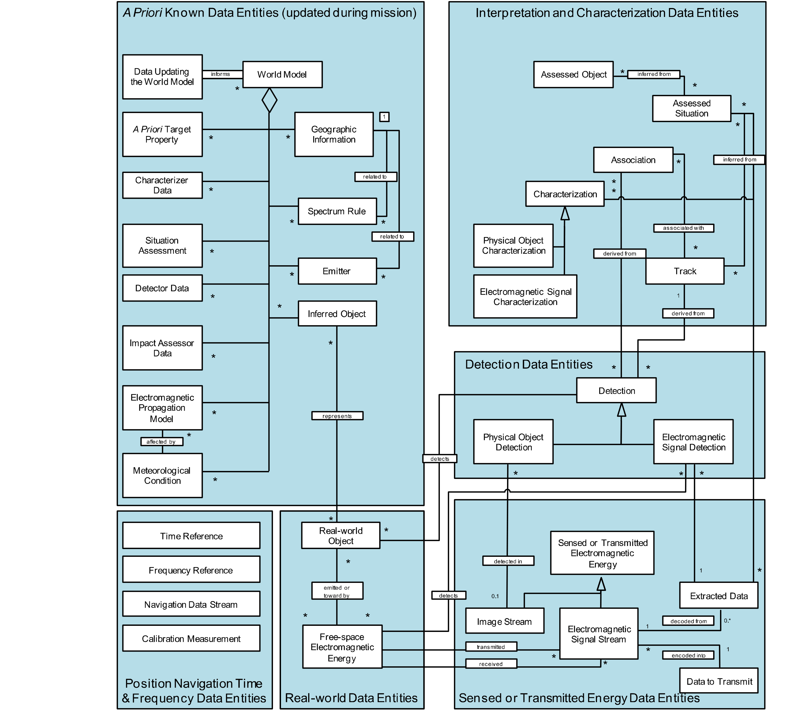
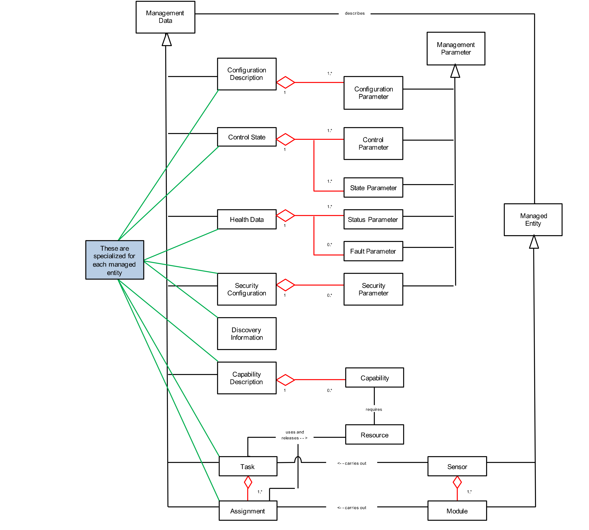
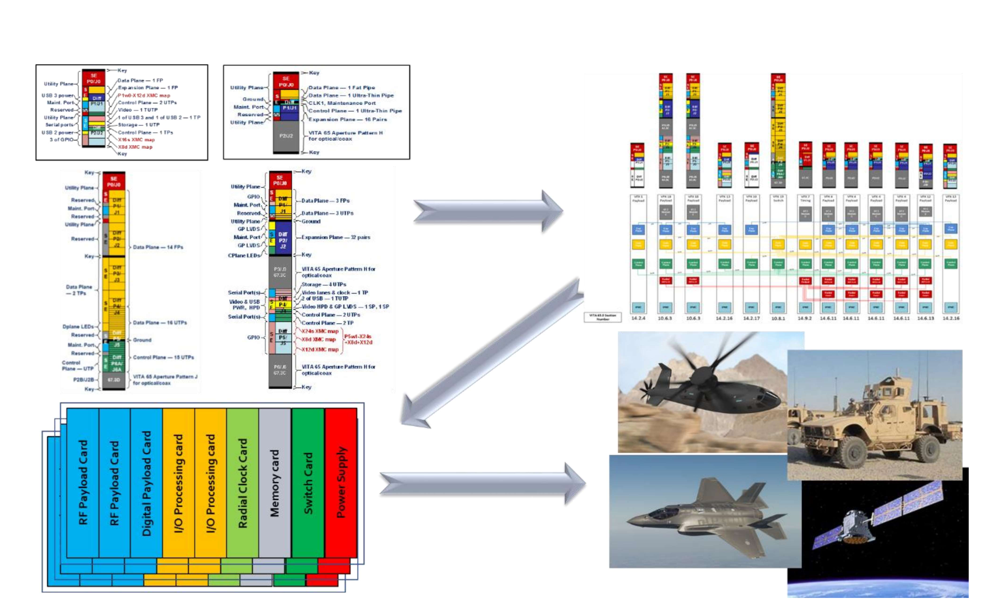

# 4 Architecture Definition

> 原书 p.43–71 ｜ PDF p.63–91

The Service View 4 (SvcV-4: Services Functionality Description) documents the functions performed by each of the SOSA modules, and documents the data ingested and produced by each. This information, when coupled with the SOSA Data Models (DIV-1, -2, and -3) provides a complete picture of the content of the informational Needlines linking the SOSA modules. The SvcV-4 takes the form of a table, incorporating the following pieces of information: ID Number: numerical designator (major-point-minor) of the SOSA module Name: succinct label for the SOSA module Function List: list of functions contained within the SOSA module Inputs: list of data items and controls that are ingested by the SOSA module (in certain

cases, their sources)

- Outputs: list of data items that are produced by the SOSA module (in certain cases, their destinations)

**Table 5: SOSA SvcV-4**

| Module | Encapsulated Functions | Inputs (above) & Outputs (below) | Input/Output Description |
|---|---|---|---|
| 1 Manage SOSA Sensor | | | |
| 1.1 System Manager | 1.1 Perform System Management | 1.1.a System Management Tasking | Inputs |
| | | 1.1.b System Management Assignment Ack/Status/Information | |
| | | 1.1.c System Management Assignment Event Notification | |
| | | 1.1.d System Management Task Ack/Status/Information | |
| | | 1.1.e System Management Task Event Notification | |
| | | 1.1.f System Services Data | |
| | | 1.1.g System Management Assignment | |
| | 1.1.1 Discover System | | |
| | 1.1.1.1 Discover System Manager | | |
| | 1.1.1.2 Discover Modules | | |
| | 1.1.2 Manage Configuration | | |
| | 1.1.2.1 Configure System | | |
| | 1.1.2.2 Configure Module | | |
| | 1.1.2.3 Configure Data Publishing | | |
| | 1.1.3 Manage Control Parameters | | |
| | 1.1.3.1 Control System | | |
| | 1.1.3.2 Control Module | | |
| | 1.1.4 Manage Health | | |
| | 1.1.4.1 Report Health | | |
| | 1.1.4.1.1 Report System Health | | |
| | 1.1.4.1.2 Report Module Health | | |
| | 1.1.4.2 Get Health | | |
| | 1.1.4.2.1 Get System Health | | |
| | 1.1.4.2.2 Get Module Health | | |
| | 1.1.4.3 Notify Health Events | | |
| | 1.1.4.3.1 Notify System Health Events | | |
| | 1.1.4.3.2 Notify Module Health Events | | |
| | 1.1.4.4 Log Health | | |
| | 1.1.5 Manage Security | | |
| | 1.1.5.1 Secure Management Interfaces | | |
| | 1.1.5.1.1 Verify Authentication | | |
| | 1.1.5.1.2 Verify Authorization | | |
| | 1.1.5.2 Manage Security Configuration | | |
| | 1.1.5.2.1 Manage Security Keys | | |
| | 1.1.5.2.2 Manage Access Control | | |
| 1.2 Task Manager | 1.2 Perform Task Management | | |
| | 1.2.1 Discover Capabilities | | |
| | 1.2.1.1 Discover System Capabilities | 1.2.1.1.a Module Discovery Data (Module List, Resource Data, Module/Resource IP) | Input |
| | | 1.2.1.1.b Sensor Capabilities Request | Input |
| | | 1.2.1.1.c Sensor Capabilities | Output |
| | | 1.2.1.1.d Sensor Capabilities Resource Map | Output |
| | 1.2.1.2 Discover Module Capabilities | 1.2.1.2.a Module Capabilities | Input |
| | | 1.2.1.2.b Module Capabilities Request | Output |
| | 1.2.2 Manage Tasks | | |
| | 1.2.2.1 Manage External Sensor Tasks | 1.2.2.1.a Tasking | Input |
| | | 1.2.2.1.b Task Ack/Status/Information | Output |
| | | 1.2.2.1.c Task Event Notification | Output |
| | 1.2.2.1.1 Ingest External Tasking | Tracks from Module 3.4 | For TWS GMTI |
| | 1.2.2.1.2 Monitor External Tasking | | |
| | 1.2.2.1.3 Report External Tasking Status | | |
| | 1.2.2.2 Manage Internal Sensor Tasks | | |
| | 1.2.2.2.1 Develop Internal Sensor Tasking | | |
| | 1.2.2.2.2 Manage Sensor Resources | | |
| | 1.2.2.2.2.1 Prioritize Internal Sensor Tasking | | |
| | 1.2.2.2.2.2 Schedule Internal Sensor Tasking | | |
| | 1.2.2.2.3 Monitor Internal Sensor Tasking | | |
| | 1.2.2.3 Manage Module Assignments | 1.2.2.3.a Module Assignment Ack/Status/Information | Input |
| | | 1.2.2.3.b Module Assignment Event Notification | Input |
| | | 1.2.2.3.c Module Assignment | Output |
| | 1.2.2.3.1 Develop Module Assignments | | |
| | 1.2.2.3.2 Manage Module Resources | | |
| | 1.2.2.3.3 Send Module Assignments | | |
| | 1.2.2.3.4 Monitor Module Assignments | | |
| | 1.2.3 Manage Module | 1.2.3.a System Services Data | Input (PNT, etc.) |
| | | 1.2.3.b System Management Assignment | Input |
| | | 1.2.3.c System Management Assignment Ack/Status/Information | Output |
| | | 1.2.3.d System Management Assignment Event Notification | Output |
| | 1.2.3.1 Manage Module Discovery | | |
| | 1.2.3.2 Manage Module Configuration | | |
| | 1.2.3.3 Manage Module Control | | |
| | 1.2.3.4 Manage Module Health | | |
| | 1.2.3.5 Manage Module Security | | |
| 2 Transmission/Reception | | | |
| 2.1 Receive Aperture/Transducer/Camera | 2.1.1 Control Receive Aperture | | |
| | 2.1.1.1 Configure Aperture | | |
| | 2.1.1.2 Control Aperture Parameters | | |
| | 2.1.2 Convert EM Energy to Electrical Signal | 2.1.2.a RX Electromagnetic Energy | Input |
| | 2.1.3 Amplify Signal | | |
| | 2.1.3 Stabilize Signal | | |
| | 2.1.4 Filter Signal | 2.1.4.a Filtered RX Signal | Output |
| | 2.1.5 Perform Module Management | | |
| | 2.1.5.1 Perform Module System Management | 2.1.5.1.a System Services Data | Input (PNT, etc.) |
| | | 2.1.5.1.b System Management Assignment | Input |
| | | 2.1.5.1.c System Management Assignment Ack/Status/Information | Output |
| | | 2.1.5.1.d System Management Assignment Event Notification | Output |
| | 2.1.5.1.1 Manage Module Discovery | | |
| | 2.1.5.1.2 Manage Module Configuration | | |
| | 2.1.5.1.3 Manage Module Control | | |
| | 2.1.5.1.4 Manage Module Health | | |
| | 2.1.5.1.5 Manage Module Security | | |
| | 2.1.5.2 Manage Module Assignments | 2.1.5.2.a Task Management Assignment | Input |
| | | 2.1.5.2.b Task Management Assignment Ack/Status/Information | Output |
| | | 2.1.5.2.c Task Management Assignment Event Notification | Output |
| | 2.1.5.2.1 Process Module Assignments | | |
| | 2.1.5.2.2 Manage Module Resources | | |
| | 2.1.5.2.4 Monitor Module Assignments | | |
| 2.2 Transmit Aperture/Transducer/Laser | 2.2.1 Control Receive Aperture | | |
| | 2.2.1.1 Configure Aperture | | |
| | 2.2.1.2 Control Aperture Parameters | | |
| | 2.2.2 Generate Signal | | |
| | 2.2.3 Filter Signal | 2.2.3.a Unfiltered RX Signal | Input |
| | 2.2.4 Amplify Signal | | |
| | 2.2.5 Convert Electrical Signal to EM Energy | 2.2.5.a TX Electromagnetic Energy | Output |
| | 2.2.6 Perform Module Management | | |
| | 2.2.7.1 Perform Module System Management | 2.2.7.1.a System Services Data | Input (PNT, etc.) |
| | | 2.2.7.1.b System Management Assignment | Input |
| | | 2.2.7.1.c System Management Assignment Ack/Status/Information | Output |
| | | 2.2.7.1.d System Management Assignment Event Notification | Output |
| | 2.2.7.1.1 Manage Module Discovery | | |
| | 2.2.7.1.2 Manage Module Configuration | | |
| | 2.2.7.1.3 Manage Module Control | | |
| | 2.2.7.1.4 Manage Module Health | | |
| | 2.2.7.1.5 Manage Module Security | | |
| | 2.2.7.2 Manage Module Assignments | 2.2.7.2.a Task Management Assignment | Input |
| | | 2.2.7.2.b Task Management Assignment Ack/Status/Information | Output |
| | | 2.2.7.2.c Task Management Assignment Event Notification | Output |
| | 2.2.7.2.1 Process Module Assignments | | |
| | 2.2.7.2.2 Manage Module Resources | | |
| | 2.2.7.2.4 Monitor Module Assignments | | |
| 2.3 Conditioner-Receiver-Exciter | 2.3.1 Process RX Signals | 2.3.1.a Filtered RX Signal | Input, digital, or analog |
| | | 2.3.1.b RX Electromagnetic Signal Stream | Output, RX digital |
| | | 2.3.1.c RX Image Stream | Output, RX digital |
| | 2.3.1.1 Amplify Signal | | |
| | 2.3.1.2 Distribute RF Signal | | |
| | 2.3.1.3 Translate Signal Frequency | | |
| | 2.3.1.4 Convert Signal: Analog to Digital | | |
| | 2.3.2 Process TX Signals | 2.3.2.a Unfiltered TX Signal | Output |
| | 2.3.2.1 Generate Signal (Waveform) | | |
| | 2.3.2.2 Amplify Signal | | |
| | 2.3.2.3 Distribute RF Signal | | |
| | 2.3.2.4 Translate Signal Frequency | | |
| | 2.3.2.5 Convert Signal: Digital to Analog | | |
| | 2.3.3 Perform Module Management | | |
| | 2.3.3.1 Perform Module System Management | 2.3.3.1.a System Services Data | Input (PNT, etc.) |
| | | 2.3.3.1.b System Management Assignment | Input |
| | | 2.3.3.1.c System Management Assignment Ack/Status/Information | Output |
| | | 2.3.3.1.d System Management Assignment Event Notification | Output |
| | 2.3.3.1.1 Manage Module Discovery | | |
| | 2.3.3.1.2 Manage Module Configuration | | |
| | 2.3.3.1.3 Manage Module Control | | |
| | 2.3.3.1.4 Manage Module Health | | |
| | 2.3.3.1.5 Manage Module Security | | |
| | 2.3.3.2 Manage Module Assignments | 2.3.3.2.a Task Management Assignment | Input |
| | | 2.3.3.2.b Task Management Assignment Ack/Status/Information | Output |
| | | 2.3.3.2.c Task Management Assignment Event Notification | Output |
| | 2.3.3.2.1 Process Module Assignments | | |
| | 2.3.3.2.2 Manage Module Resources | | |
| | 2.3.3.2.4 Monitor Module Assignments | | |
| 3 Process Signals/Targets | | | |
| 3.1 Signal/Object Detector and Extractor | 3.1.1 Enhance Image/Video | 3.1.1.a RX Electromagnetic Signal Stream | Input |
| | | 3.1.1.b RX Image Stream | Input |
| | | 3.1.1.c RF Image Stream | Input |
| | | 3.1.1.d Registered Image Stream | Input |
| | | 3.1.1.e Georegistered Image Stream | Input |
| | 3.1.2 Extract Signals/Objects | 3.1.2.a Extracted Electromagnetic Signal Stream | Output, enhanced |
| | | 3.1.2.b Extracted Image Stream | Output, enhanced |
| | 3.1.2.1 Extract RF Signal from Clutter | | |
| | 3.1.2.2 Extract EO/IR Object from Background | | |
| | 3.1.3 Process Detections | 3.1.3.a Detection | Output |
| | | 3.1.3.b Image Quality Report | Output |
| | 3.1.3.1 Detect and Discriminate Signals/Objects | | |
| | 3.1.3.2 Estimate quality of detections | | |
| | 3.1.4 Perform Module Management | | |
| | 3.1.4.1 Perform Module System Management | 3.1.4.1.a System Services Data | Input (PNT, etc.) |
| | | 3.1.4.1.b System Management Assignment | Input |
| | | 3.1.4.1.c System Management Assignment Ack/Status/Information | Output |
| | | 3.1.4.1.d System Management Assignment Event Notification | Output |
| | 3.1.4.1.1 Manage Module Discovery | | |
| | 3.1.4.1.2 Manage Module Configuration | | |
| | 3.1.4.1.3 Manage Module Control | | |
| | 3.1.4.1.4 Manage Module Health | | |
| | 3.1.4.1.5 Manage Module Security | | |
| | 3.1.4.2 Manage Module Assignments | 3.1.4.2.a Task Management Assignment | Input |
| | | 3.1.4.2.b Task Management Assignment Ack/Status/Information | Output |
| | | 3.1.4.2.c Task Management Assignment Event Notification | Output |
| | 3.1.4.2.1 Process Module Assignments | | |
| | 3.1.4.2.2 Manage Module Resources | | |
| | 3.1.4.2.4 Monitor Module Assignments | | |
| 3.2 Signal/Object Characterizer | 3.2.1 Extract Detection Features | 3.2.1.a Detection | Input |
| | | 3.2.1.b Extracted Electromagnetic Signal Stream | Input |
| | | 3.2.1.c Extracted Image Stream | Input |
| | | 3.2.1.d Spectral Product | Output |
| | 3.2.1.1 Estimate Signal Parameters | | |
| | 3.2.1.2 Extract Classifier Features | | |
| | 3.2.1.3 Extract Identification Features | | |
| | 3.2.1.4 Compute spectral products | | |
| | 3.2.2 Classify or Identify Signal/Object | 3.2.2.a Characterizer Data | Input |
| | 3.2.2.1 Determine Signal Type | | |
| | 3.2.2.2 Map Features to Reference/Basis | | |
| | 3.2.2.3 Match Image Chip to Profile for ID | | |
| | 3.2.2.4 Perform Target Recognition | | |
| | 3.2.3 Filter False Detections | | |
| | 3.2.3.1 Identify False Alarms | | |
| | 3.2.3.2 Discriminate Target from Non-target | | |
| | 3.2.4 Produce Characterizations | 3.2.4.a Characterization | Output |
| | 3.2.4.1 Produce Classification Type | | |
| | 3.2.4.2 Produce Identity | | |
| | 3.2.5 Perform Module Management | | |
| | 3.2.5.1 Perform Module System Management | 3.2.5.1.a System Services Data | Input (PNT, etc.) |
| | | 3.2.5.1.b System Management Assignment | Input |
| | | 3.2.5.1.c System Management Assignment Ack/Status/Information | Output |
| | | 3.2.5.1.d System Management Assignment Event Notification | Output |
| | 3.2.5.1.1 Manage Module Discovery | | |
| | 3.2.5.1.2 Manage Module Configuration | | |
| | 3.2.5.1.3 Manage Module Control | | |
| | 3.2.5.1.4 Manage Module Health | | |
| | 3.2.5.1.5 Manage Module Security | | |
| | 3.2.5.2 Manage Module Assignments | 3.2.5.2.a Task Management Assignment | Input |
| | | 3.2.5.2.b Task Management Assignment Ack/Status/Information | Output |
| | | 3.2.5.2.c Task Management Assignment Event Notification | Output |
| | 3.2.5.2.1 Process Module Assignments | | |
| | 3.2.5.2.2 Manage Module Resources | | |
| | 3.2.5.2.4 Monitor Module Assignments | | |
| 3.3 Image Pre-processor | 3.3.1 Form Image from RF Signal | 3.3.1.a Received Electromagnetic Signal Stream | Input |
| | | 3.3.1.b RF Image stream | Output |
| | 3.3.2 Register Image to Image | 3.3.2.a Image Stream | Input |
| | | 3.3.2.b Registered Image Stream | Output |
| | 3.3.3 Register Image to Geographical Coordinates | 3.3.3.a Image Stream | Input |
| | | 3.3.3.b Geographic Information | Input |
| | | 3.3.3.c Georeferenced Image Stream | Output |
| | 3.3.4 Perform Module Management | | |
| | 3.3.4.1 Perform Module System Management | 3.3.4.1.a System Services Data | Input (PNT, etc.) |
| | | 3.3.4.1.b System Management Assignment | Input |
| | | 3.3.4.1.c System Management Assignment Ack/Status/Information | Output |
| | | 3.3.4.1.d System Management Assignment Event Notification | Output |
| | 3.3.4.1.1 Manage Module Discovery | | |
| | 3.3.4.1.2 Manage Module Configuration | | |
| | 3.3.4.1.3 Manage Module Control | | |
| | 3.3.4.1.4 Manage Module Health | | |
| | 3.3.4.1.5 Manage Module Security | | |
| | 3.3.4.2 Manage Module Assignments | 3.3.4.2.a Task Management Assignment | Input |
| | | 3.3.4.2.b Task Management Assignment Ack/Status/Information | Output |
| | | 3.3.4.2.c Task Management Assignment Event Notification | Output |
| | 3.3.4.2.1 Process Module Assignments | | |
| | 3.3.4.2.2 Manage Module Resources | | |
| | 3.3.4.2.4 Monitor Module Assignments | | |
| 3.4 Tracker | 3.4.1 Process Detections | 3.4.1.a Extracted EM Signal Stream | Input |
| | | 3.4.1.b Extracted Image Stream | Input |
| | | 3.4.1.c Detection | Input, Data from Module 3.1 Signal/Target Detector/Extractor module that is processed to determine and output tracks. Can be RF detection data (SAR, EW, GMTI, AMTI, ESM) or EO/IR detection data |
| | | 3.4.1.d Characterization | Input, Data from Module 3.2 that is processed to determine and output tracks |
| | 3.4.2 Associate Tracks | | |
| | 3.4.3 Initiate Tracks | | |
| | 3.4.4 Terminate Tracks | | |
| | 3.4.5 Maintain Tracks | 3.4.5.a Current Track State | Output, Provides the track state data at the time of the measurement Includes intermediate results and measurements |
| | | 3.4.5.b Predicted Track State | Output, Provides the estimated track state data at the time of the next scheduled measurement update |
| | 3.4.5.1 Track Update | | |
| | 3.4.5.2 Track Prediction | | |
| | 3.4.6 Perform Module Management | | |
| | 3.4.6.1 Perform Module System Management | 3.4.6.1.a System Services Data (PNT, etc.) | Input |
| | | 3.4.6.1.b System Management Assignment | Input |
| | | 3.4.6.1.c System Management Assignment Ack/Status/Information | Output |
| | | 3.4.6.1.d System Management Assignment Event Notification | Output |
| | 3.4.6.1.1 Manage Module Discovery | | |
| | 3.4.6.1.2 Manage Module Configuration | | |
| | 3.4.6.1.3 Manage Module Control | | |
| | 3.4.6.1.4 Manage Module Health | | |
| | 3.4.6.1.5 Manage Module Security | | |
| | 3.4.6.2 Manage Module Assignments | 3.4.6.2.a Task Management Assignment | Input |
| | | 3.4.6.2.b Task Management Assignment Ack/Status/Information | Output |
| | | 3.4.6.2.c Task Management Assignment Event Notification | Output |
| | 3.4.6.2.1 Process Module Assignments | | |
| | 3.4.6.2.2 Manage Module Resources | | |
| | 3.4.6.2.4 Monitor Module Assignments | | |
| 4 Analyze/Exploit | | | |
| 4.1 External Data Ingestor | Ingest data from other SOSA sensors or other sources | SOSA Mission Data | (Data products output by Reporting Services) |
| | Convert from external formats to SOSA format | SOSA Non-conformant Data | (including sensor/source) |
| | Distribute the ingested data to other SOSA Modules as appropriate | SOSA Mission Data | |
| | Enable fusion or correlation across sensors | | |
| 4.2 Encoded Data Extractor | Extract internals | Detection | |
| | Extract message content from signal | Extracted Electromagnetic Signal Stream | (digital only) |
| | Demodulate | Extracted Image or Stream | (digital only) |
| | Perform human language processing | Encoded Data Extractor Assignment | |
| | | *A Priori* Target Properties | |
| | | Demodulated Electromagnetic Signal Stream | |
| | | Extracted Data | |
| 4.3 Situation Assessor | Correlate same signal/object from multiple sensors | Characterization | |
| | Associate multiple signals/objects | Track | |
| | Develop and store history of detections and correlations over time | Detection | Of signals/objects |
| | | Association | Among signals/objects |
| | | Situation Assessor Data | |
| | | Situation Assessor Assignment | |
| | | Assessed Situation | |
| | | Association | Among signals/objects |
| 4.4 Impact Assessor and Responder | Determine entity affiliation | Demodulated Electromagnetic Signal Stream | |
| | Assess impacts, threats, and vulnerabilities | Detection | Of signals/objects |
| | Maintain alternate hypotheses | Track | |
| | Project assessments into the future | Characterization | |
| | Analyze response and send request | Extracted Data | |
| | | Association | Among signals/objects |
| | | Impact Assessor Data | |
| | | Impact Assessor and Responder Assignment | |
| | | Assessed Impact | |
| | | Assessed Impact Response | |
| 4.6 Storage/Retrieval Manager | Capture real-time streaming data | Electromagnetic Signal Stream | (digital only) |
| | Retrieve | Image Stream | (digital only) |
| | Play back in real-time | Detection | |
| | Index | Track | |
| | Store media | Characterization | |
| | | Association | |
| | | Assessed Situation | |
| | | Assessed Impact | |
| | | Storage/Retrieval Manager Assignment | |
| | | Electromagnetic Signal Stream | (digital only) |
| | | Image Stream | (digital only) |
| | | Detection | |
| | | Characterization | |
| | | Association | |
| | | Assessed Situation | |
| | | Assessed Impact | |
| 5 Convey | | | |
| 5.1 Reporting Services | Aggregate data | Electromagnetic Signal Stream | (digital only) |
| | Select data to be reported | Image Stream | (digital only) |
| | Format data | Sensor Logging Data | (e.g., Health, Status, Mode, and State) |
| | Generate reports for collection/processing/analysis/exploitation | Demodulated Electromagnetic Signal Stream | |
| | Accept/reject request | Detection | |
| | Find data | Characterization | |
| | Package data for reporting | Association | |
| | Generate header/packet structure for streaming data | Assessed Situation | |
| | Send metadata | Assessed Impact | |
| | Select a format | Fault | |
| | Structure data to match format | Sensor Cue/Tip Track | |
| | Send to recipient(s) | Reporting Services Assignment | |
| | Match sensor results against tip/cue criteria | External format of any data in Input | |
| 6 Support System Operation | | | |
| 6.1 Security Services | Check software/data integrity | Security Parameters | (e.g., encryption keys, access control data, module integrity data) |
| | Manage key(s) | Zeroize Assignment | |
| | Control access | Access Request | |
| | Audit | Classification Level Tag(s) | |
| | Zeroize all sensitive data | Security Audit Report | |
| | | Security Tamper Alert | |
| | | Access Request Response | |
| | | Zeroize ACK/NAK | |
| | | Zeroize Assignment | (to other modules) |
| 6.2 Encryptor/Decryptor | Protect data at rest | Security Parameters | Encryption keys |
| | Protect data in transit | Zeroize Assignment | |
| | Encrypt/decrypt | Access Control Data | |
| | | Data or Stream to be Encrypted | |
| | | Data or Stream to be Decrypted | |
| | | Zeroize ACK/NAK | |
| | | Encrypted Data or Stream | |
| | | Decrypted Data or Stream | |
| 6.3 Guard/Cross-Domain Service | Prevent data leakage | Data or Stream to be Filtered | |
| | | Security Parameters | (Metadata tags for data/stream, filtering criteria, human verification) |
| | | Filtered Data or Stream | |
| | | Filtering Status | |
| | | Security Auditing Data | |
| 6.4 Network Subsystem | Enumerate network elements | Data or Stream to be Sent | |
| | Monitor health of network elements | Network Data Transfer Parameters | |
| | Detect and isolate network degraded elements | Network Configuration Parameters | |
| | Transfer data with requested QoS | Data or Stream that was Sent | |
| | Detect intrusion | Network Health & Status | |
| | | Intrusion Reports | |
| 6.5 Calibration Service | Intake the injected test signal | Injected Test RF Signal | |
| | Collect output of either calibration test points or main | Injected Test Image/Video Stream | |
| | Disable modules not under test | Injected Test Demodulated Signal | |
| | | Calibration Assignment Safety Interlock | |
| | | Electromagnetic Source Assignment | |
| | | Calibration Measurement | |
| 6.6 Nav Data Service | Ingest platform/sensor location and orientation | Nav Data Stream | (external source - option, since could be internally generated) |
| | Blend internal and external spatial data | Nav Data Stream | |
| | Distribute platform/sensor location and orientation | | |
| 6.7 Time & Frequency Service | Ingest time from external source | Time Reference | (external source) |
| | Blend internal and external time data | Time Reference | |
| | Generate time internally | Frequency Reference | |
| | Provide time to internal function | | |
| | Provide LO/frequency reference | | |
| 6.8 Compressor/Decompressor | Compression | Compressor/Decompressor Assignment | |
| | Decompression | Compressed Data | |
| | Codec functions | Compression Metadata | |
| | | Decompressed Data | |
| | | Decompression Metadata | |
| | | Compressed Data | |
| | | Compression Metadata | |
| | | Decompressed Data | |
| | | Decompression Metadata | |
| 6.9 Host Platform Interface | 6.9.1 Adapt External Commands to Internal SOSA Sensor Commands | 6.9.1.b System Management Task Ack/Status/Information | Input from 1.1 (such as Sensor Test Report, Sensor Configuration Data, Sensor Health) |
| | | 6.9.1.c System Management Task Event Notification | Input from 1.1 |
| | | 6.9.1.e Task Ack/Status/Information | Input from 1.2 |
| | | 6.9.1.f Task Event Notification | Input from 1.2 |
| | | 6.9.1.g Host System Management Tasking | Input from host (such as Zeroize Task, Safety Task, Test Task, Security Task, Key Fill) |
| | | 6.9.1.j Host Tasking | Input from host |
| | | 6.9.1.a System Management Tasking | Output to 1.1 (such as Zeroize Task, Safety Task, Test Task, Security Task, Key Fill) |
| | | 6.9.1.d Tasking | Output to 1.2 |
| | | 6.9.1.h Host System Management Task Ack/Status/Information | Output to host (such as Sensor Test Report, Sensor Configuration Data, Sensor Health) |
| | | 6.9.1.i Host System Management Task Event Notification | Output to host |
| | | 6.9.1.k Host Task Ack/Status/Information | Output to host |
| | | 6.9.1.l Host Task Event Notification | Output to host |
| | 6.9.2 Adapt the Host Platform Service Data to the SOSA Sensor Service Data | 6.9.2.a Time Reference | Input from host |
| | | 6.9.2.b Frequency Reference | Input from host (e.g., 1 PPS) |
| | | 6.9.2.c Nav Data Stream | Input from host |
| | | 6.9.2.d Host State | Input from host |
| | | 6.9.2.e Cosite Blanking Task/Indicator | Input from host |
| | | 6.9.2.a Time Reference | Output to Sensor |
| | | 6.9.2.b Frequency Reference | Output to Sensor (e.g., 1 PPS) |
| | | 6.9.2.c Nav Data Stream | Output to Sensor |
| | | 6.9.2.d Host State | Output to Sensor |
| | | 6.9.2.e Cosite Blanking Task/Indicator | Output to Sensor |
| | 6.9.3 Adapt the Host Platform Network to the SOSA Sensor Network | 6.9.3.a Host Network Transmission | Input from host |
| | | 6.9.3.d Network Transmission | Input from Sensor (such as Sensor Logging Data) |
| | | 6.9.3.b Host Network Transmission | Output to host (such as Sensor Logging Data) |
| | | 6.9.3.c Network Transmission | Output to Sensor |
| | 6.9.4 Provide Physical and Electrical Interfaces | 6.9.4.a Host Power | Input from host |
| | | 6.9.4.c Host Physical and Electrical Interfaces | Input from host; Cables/Connectors, Mount Points, Red/Black separation |
| | | 6.9.4.b Power | Output to 6.10 Power |
| | | 6.9.4.d Physical and Electrical Interfaces | Output to host; Cables/Connectors, Mount Points, Red/Black separation |
| | 6.9.5 Perform Module Management | | |
| | 6.9.5.1 Perform Module System Management | 6.9.5.1.a System Services Data (PNT, etc.) | Input |
| | | 6.9.5.1.b System Management Assignment | Input |
| | | 6.9.5.1.c System Management Assignment Ack/Status/Information | Output |
| | | 6.9.5.1.d System Management Assignment Event Notification | Output |
| | 6.9.5.1.1 Manage Module Discovery | | |
| | 6.9.5.1.2 Manage Module Configuration | | |
| | 6.9.5.1.3 Manage Module Control | | |
| | 6.9.5.1.4 Manage Module Health | | |
| | 6.9.5.1.5 Manage Module Security | | |
| | 6.9.5.2 Manage Module Assignments | 6.9.5.2.a Task Management Assignment | Input |
| | | 6.9.5.2.b Task Management Assignment Ack/Status/Information | Output |
| | | 6.9.5.2.c Task Management Assignment Event Notification | Output |
| | 6.9.5.2.1 Process Module Assignments | | |
| | 6.9.5.2.2 Manage Module Resources | | |
| | 6.9.5.2.4 Monitor Module Assignments | | |
| 6.10 Power | Convert between different power characteristics | Host Power | From host platform interface |
| | Condition/filter power | Power Assignment | From task manager |
| | Store power for intermittent input power loss | Power | To all modules |
| | Store power to provide long-term power to loads without input power | Power Assignment Response | To task manager |
| | Distribute power from power supplies to power loads | | |
| | Protect against voltage and over-current conditions | | |
| | Provide a digital control interface | | |

> 转写说明：本表 4 列，共 429 行数据行，**本表完，覆盖原书印刷页 p.43–p.66**（对应 PDF 页序 p063–p086；p.66 页表格在“6.10 Power”组之后页中收尾，其后紧接“4.1.2 SvcV-2: Services Resource Flow Description”正文，不再有续行）。各续页顶部的四列表头为重复表头，已并入首行表头，不另起表。
>
> 每页数据行数分布（印刷页）：p.43－p.44 合 30 行 · p.45 21 · p.46 18 · p.47 20 · p.48 19 · p.49 18 · p.50 18 · p.51 21 · p.52 18 · p.53 19 · p.54 19 · p.55 18 · p.56 11 · p.57 17 · p.58 19 · p.59 22 · p.60 20 · p.61 22 · p.62 19 · p.63 16 · p.64 19 · p.65 16 · p.66 9。
>
> 合并单元格情况（本文件一律留空）：①“1 Manage SOSA Sensor”“2 Transmission/Reception”“3 Process Signals/Targets”“4 Analyze/Exploit”“5 Convey”“6 Support System Operation”六个组标题在原表中各为横跨 4 列的整幅单元格，其右三格留空；②第 1 列（Module）纵向合并且跨页延续的有：“1.1 System Manager”（“1.1.a”行起至“1.1.5.2.2”行）、“1.2 Task Manager”（“1.2 Perform Task Management”行起至 p.48）、“2.1 Receive Aperture/Transducer/Camera”（p.47–p.48）、“2.2 Transmit Aperture/Transducer/Laser”（p.48–p.49）、 “2.3 Conditioner-Receiver-Exciter”（p.49–p.51）、“3.1 Signal/Object Detector and Extractor”（p.51）、“3.2 Signal/Object Characterizer”（p.52–p.53）、“3.3 Image Pre-processor”（p.54）、“3.4 Tracker”（p.55–p.56）、“4.1 External Data Ingestor”（p.57–p.58）、“4.2 Encoded Data Extractor”（p.58）、“4.3 Situation Assessor”（p.58）、“4.4 Impact Assessor and Responder”（p.58–p.59）、“4.6 Storage/Retrieval Manager”（p.59–p.60）、“5.1 Reporting Services”（p.60）、“6.1 Security Services”（p.60–p.61）、“6.2 Encryptor/Decryptor”（p.61）、“6.3 Guard/Cross-Domain Service”（p.61）、“6.4 Network Subsystem”（p.61–p.62）、“6.5 Calibration Service”（p.62）、“6.6 Nav Data Service”（p.62）、“6.7 Time & Frequency Service”（p.62）、“6.8 Compressor/Decompressor”（p.62–p.63）、“6.9 Host Platform Interface”（p.63–p.66）、“6.10 Power”（p.66）；故各续页第 1 列相应位置整列留空；③第 2 列（Encapsulated Functions）为“X.Y.Z Perform Module System Management”之类条目时，纵向合并覆盖其下 a/b/c/d 等输入输出行（全表统一如此），另有个别条目跨 2–5 行（如“1.2.1.1 Discover System Capabilities”跨 a–d、“3.3.3 Register Image to Geographical Coordinates”跨 a–c、“4.2 Encoded Data Extractor”等段落在第 2 列按语义分行），续行留空；④第 4 列“Inputs”只出现在“1.1.a … System Management Tasking”一行，其余各行该列表格为空白（原表未作纵向合并，行线横穿该列）。
>
> 跨页断格一处：p.51 末行第 2 列印作“3.1.4.1 Perform Module System”、p.52 首行续印“Management”，原表该合并单元格在页界处被切断，本文件按其完整文句录为“3.1.4.1 Perform Module System Management”（该行 a 项在 p.51、b–d 项在 p.52）。
>
> 原文编号与文字照录、未作改动；其中几处与原表编号序列或常规拼写不一致，仅此说明以便核对：①“2.1.3”重复出现于“2.1.3 Amplify Signal”与“2.1.3 Stabilize Signal”两行；②“2.1.5.2.3”缺号，序列由“2.1.5.2.2”直接到“2.1.5.2.4”；③“2.2 Transmit Aperture/Transducer/Laser”下的首行为“2.2.1 Control Receive Aperture”（含 Receive 字样）；④“2.2.7.1 Perform Module System Management”无对应的“2.2.7”上级条目；⑤第 4 组缺“4.5”，序列由“4.4 Impact Assessor and Responder”直接跳到“4.6 Storage/Retrieval Manager”；⑥各组“Manage Module Assignments”下的子项序列多为“.1／.2／.4”（缺 .3，如 2.1.5.2、2.2.7.2、2.3.3.2、3.1.4.2、3.2.5.2、3.3.4.2、3.4.6.2、6.9.5.2），唯“1.2.2.3”一组四项齐全（含 .3 Send Module Assignments）；⑦“3.3.1.b RF Image stream”与“3.2.1.4 Compute spectral products”原文用小写 s/p；⑧“4.2 Encoded Data Extractor”以下三段的第 2 列不是编号功能名，而是无编号动词短语（如“Extract internals”“Play back in real-time”），第 3 列同段亦为数据项名，第 4 列多为空或括号注释，均照录；⑨“*A Priori* Target Properties”原文为斜体，此处保留斜体标记；⑩“6.9.1.x”各项按输入在前、输出在后排列（b、c、e、f、g、j、a、d、h、i、k、l），非字母序，照录不改。⑪“6.5 Calibration Service”段中“Collect output of either calibration test points or main”一句原文如此，句末无宾语，未作补全。

<!-- 原书 p.43 ｜ PDF p.63 -->

## InputlOutput

##### 1.1.2.2 Configure Module

#### 1.1.5 Manage Security

<!-- 原书 p.44 ｜ PDF p.64 -->

## InputlOutput

##### 1.1.5.1 Secure Management

##### 1.1.5.2.1 Manage Security Keys

## 1.2.1.1.b Sensor Capabilities Request Input

<!-- 原书 p.45 ｜ PDF p.65 -->

## InputlOutput

##### 1.2.2.2 Manage Internal Sensor

##### 1.2.2.2.2 Manage Sensor

<!-- 原书 p.46 ｜ PDF p.66 -->

## InputlOutput

##### 1.2.3.3 Manage Module Control

##### 2.1.1.1 Configure Aperture

##### 2.1.5.1.3 Manage Module

<!-- 原书 p.47 ｜ PDF p.67 -->

## InputlOutput

##### 2.1.5.1.4 Manage Module

##### 2.1.5.2.2 Manage Module

##### 2.2.1.2 Control Aperture

<!-- 原书 p.48 ｜ PDF p.68 -->

## InputlOutput

##### 2.2.7.1.3 Manage Module

## 2.3.1.b RX Electromagnetic Signal Output RX digital

<!-- 原书 p.49 ｜ PDF p.69 -->

## InputlOutput

##### 2.3.1.4 Convert Signal:Analog

##### 2.3.2.2 Amplify Signal

##### 2.3.3.1.3 Manage Module

<!-- 原书 p.50 ｜ PDF p.70 -->

## InputlOutput

##### 2.3.3.2.2 Manage Module

##### 3.1.2.1 Extract RF Signal firom

#### 3.1.4 Performn Module

<!-- 原书 p.51 ｜ PDF p.71 -->

## InputlOutput

##### 3.1.4.1.3 Manage Module

##### 3.1.4.2.2 Manage Module

## 3.2.1.d Spectral Product Output

<!-- 原书 p.52 ｜ PDF p.72 -->

## InputlOutput

##### 3.2.1.1 Estimate Signal

#### 3.2.2 Classify or Identify 3.2.2.a Characterizer Data Input

## ReferencelBasis

#### 3.2.3 Filter False Detections

##### 3.2.5.1 Perform Module System 3.2.5.1.a System SerVices Data Input (PNT, etc.)

<!-- 原书 p.53 ｜ PDF p.73 -->

## InputlOutput

##### 3.2.5.1.3 Manage Module

##### 3.2.5.2.2 Manage Module

### 3.3 Image Pre-processor 3.3.1 Form Image from RE 3.3.1.a Received Electromagnetic Input

<!-- 原书 p.54 ｜ PDF p.74 -->

## InputlOutput

##### 3.3.4.1.3 Manage Module

##### 3.3.4.2.2 Manage Module

<!-- 原书 p.55 ｜ PDF p.75 -->

## InputlOutput

## Module 3.1

## be RF detection

##### 3.4.1.4 Characterization Input, Data from

#### 3.4.2 Associate Tracks

## at the time of the

## 3.4.5.b Predicted Track State Output, Provides

##### 3.4.5.1 Track Update

##### 3.4.6.1 Perform Module System 3.4.6.1.a System Services Data (PNT, Input

<!-- 原书 p.56 ｜ PDF p.76 -->

## InputlOutput

##### 3.4.6.1.3 Manage Module

##### 3.4.6.2.2 Manage Module

## AnalyzelRxploit

<!-- 原书 p.57 ｜ PDF p.77 -->

## InputlOutput

## Stream

<!-- 原书 p.58 ｜ PDF p.78 -->

## InputlOutput

## Association

## Electromagnetic Signal Stream (digital only)

<!-- 原书 p.59 ｜ PDF p.79 -->

## InputlOutput

## 5 Convey

## Status, Mode, and

## Support System Operation

## module integrity

<!-- 原书 p.60 ｜ PDF p.80 -->

## InputlOutput

## Filtered Data or Stream

<!-- 原书 p.61 ｜ PDF p.81 -->

## InputlOutput

## Calibration Assignment Safety

<!-- 原书 p.62 ｜ PDF p.82 -->

## InputlOutput

## Compressed Data

## Configuration

## 6.9.1.f Task Event Notification Input from 1.2

## Task,KeyFill)

## Task,KeyFill)

## Data, Sensor

<!-- 原书 p.63 ｜ PDF p.83 -->

## InputlOutput

## Event Notification

## Logging Data)

<!-- 原书 p.64 ｜ PDF p.84 -->

## InputlOutput

## 6.9.4.b Power Output to 6.10

##### 6.9.5.1.3 Manage Module

<!-- 原书 p.65 ｜ PDF p.85 -->

## InputlOutput

##### 6.9.5.2.2 Manage Module

### 6.10 Power Convert between different Host PowCr From host Platform

#### 4.1.2 SvcV-2: Services Resource Flow Description

#### 4.1.3 SvcV-3b: Services-Services Matrix

##### 4.1.3.1 SvcV-3a: System-Services Matrix

### 4.2 Data Architecture

<!-- 原书 p.66 ｜ PDF p.86 -->

#### 4.2.1 DIV-1: Conceptual Data Model

The SOSA Conceptual Data Model (DIV-1) documents the nature of, and relationships (hierarchy) between, the many “pieces” of information required for the operation and upkeep of a SOSA sensor. The DIV-1 is a top-level representation, and is divided into two parts: One part addresses the Mission Data elements (data related to the purposes for which the system exists), such as observed phenomena and interpretation of the physical and electromagnetic environment (Figure 12, Figure 13). The other part addresses system management elements (data related to the control/operation of the sensor), such as state and tasking.

When these are combined with the derived Logical Data Model (DIV-2) and Physical Data Model (DIV-3), the two lower-level data models, this creates a complete picture of the data needs of a SOSA sensor.

The two parts of the DIV-1 are documented and depicted using Unified Modeling Language™ (UML®) entity relationship diagrams:

<!-- 原书 p.67 ｜ PDF p.87 -->

*Figure 12: DIV-1 for Mission Entities*

<!-- 原书 p.68 ｜ PDF p.88 -->

*Figure 13: DIV-1 for Management Entities*

#### 4.2.2 DIV-2: Logical Data Model

The SOSA DIV-2 (Logical Data Model) further decomposes the abstract entities in the DIV-1 into specific pieces of information (e.g., a track is broken down into its constituent parts, such as three dimensions of position, three dimensions of velocity, etc.). It is documented in a tabular form. It should be noted that the DIV-2 does not define the physical representation (e.g., number of digits, precision, etc.) so that the same data item can be represented differently depending on the need. The physical representation will be documented in the DIV-3 (still to be done for most of the SOSA data entities). To view DIV-2 and DIV-3 Distribution A spreadsheets, refer to files listed in Appendix D and Appendix E.

<!-- 原书 p.69 ｜ PDF p.89 -->

#### 4.2.3 DIV-3: Physical Data Model

Planned for a later version of the SOSA Technical Standard.

### 4.4 System Architecture

Planned for a later version of the SOSA Technical Standard.

#### 4.4.2 SV-3: Systems-Systems Matrix

Planned for a later version of the SOSA Technical Standard.

### 4.5 Box-Level Hardware

The hardware aspects of the SOSA Architecture are defined as a “box-level” specification applicable to a variety of sensor/avionics platforms that are modular all the way down to the plug-in card level (where a plug-in card as defined here is an individual card that fits into the box). The system is inherently interoperable, compatible with non-conformant SOSA hardware via a set of standard bridge interfaces, capable of plug-and-play, upgradable (evolvable), scalable, and scalable through adaptation of technology and target platform evolution (see Figure 14).

<!-- 原书 p.70 ｜ PDF p.90 -->

*Figure 14: SOSA Hardware Building Blocks*

<!-- 原书 p.71 ｜ PDF p.91 -->