# 5 SOSA Technical Standard

> 原书 p.72–172 ｜ PDF p.92–192

This Technical Standard provides testable rules and conformance testing approaches for each SOSA module and hardware element defined by the SOSA Architecture.

### 5.1 Host Vehicle/SOSA Sensor Interface

#### 5.1.1 Sensor Physical Packages

##### 5.1.1.1 Pods

Requirements, written as rules in Export Administration Regulations (EARS).

#### 5.1.2 Mechanical Interfaces

For this version, the only standardized interface defined is for turreted sensors as defined in AS6169. Future versions will expand on these standards to include other sensor mounting schemes.

5.1.2.1 Classes of Turreted Sensors

Various turreted sensors are defined in Table 6 based on the diameter of a given sensor package. This document was developed to address the majority of sensor package sizes available on the market.

**Table 6: Turreted Sensor Classes**

| Class | Sensor Package Diameter |
|---|---|
| Class I | >19 in |
| Class II | 13 to 19 in |
| Class III | 9 to 13 in |
| Class IV | 6 to 9 in |

The SOSA electrical standard will describe sensor pin outs for Class I and Class II sensors at this time. Class III and Class IV sensors do not have the physical space available to accommodate all signals outlined in the standard. Future implementations of the standard could include a limited subset of the standard that applies to Class III and IV sensors.

<!-- 原书 p.72 ｜ PDF p.92 -->

### 5.2 SOSA Sensor Physical Interfaces

#### 5.2.1 Electrical Connector Characteristics

There are ten signal types defined by this electrical standard. Table 7 describes the connector’s type and size as well as which sensor modalities can use which connector. J2 Signals are required for all modalities, but pin allocations may differ depending on mission. Connector genders are for each signal type are described below in Table 7. Detailed requirements for each connector type, defined separately for each modality of sensor, are defined in later sections. For Naval Aviation, only connectors which can withstand a minimum of 500 h salt spray per MIL-STD-1344 Method 1001: Test Method for Electrical Connectors shall be used.

**Table 7: Sensor Connectors**

|  | J1 DC Power | J2 Signal | J3 Video (Copper) | J4 Fiber Optic | J5 GPS Antenna | J6 Aux DC Power | J7 Aux DC Power | J8 High Density RF | J9 Low Loss RF | J10 AC Power |
|---|---|---|---|---|---|---|---|---|---|---|
| Modality Support | All | All | EO-IR, Comms | All | All | All | All | Radar/SAR, EW, SIGINT, Comms | Radar/SAR, EW, SIGINT, Comms | Radar/SAR, EW, SIGINT, Comms |
| Type | MIL-DTL-38999/Series III | MIL-DTL-38999/Series III | MIL-DTL-38999/Series III | MIL-DTL-38999/Series III | MIL-PRF-39012 | MIL-DTL-38999/Series III | TBD | MIL-DTL-38999/Series III | MIL-DTL-38999/Series III | MIL-DTL-38999/Series III |
| Shell Size | 21 | 25 | 17 | 19 | TNC | 21 | 17 | 25 | 25 | 17 |
| Sensor LRU Gender | Receptacle with pin inserts | Receptacle with socket inserts | Receptacle with socket inserts | Receptacle with socket inserts for fiber optics | Receptacle | Receptacle with pin inserts | Receptacle with pin inserts | Receptacle with socket inserts | Receptacle with socket inserts | Receptacle with pin inserts |
| Platform Umbilical Gender | Plug with socket inserts | Plug with pin inserts | Plug with pin inserts | Plug with pin inserts for fiber optics | Plug | Plug with socket inserts | Plug with socket inserts | Plug with pin inserts | Plug with pin inserts | Plug with socket inserts |
| Keying | N | N | N | N | - | A | N | N | N | N |
| Insert | 21-11 | 25-7 | 17-8 | 19-11 | - | 21-11 |  | 25-19 | 25-8 | 17-6 |

> 转写说明：表头竖向排版的多行单元格按原顺序拼为一行（如 `J8 High Density RF`）。格内因列宽折行的文字按原顺序合并为一行，未保留折行（如 `MIL-DTL-38999/Series III`、`Radar/SAR, EW, SIGINT, Comms`、`Receptacle with socket inserts for fiber optics`）。首列表头格在原表为空白格；J7 的 Insert 格在原表为空白（非短横）。

J8

- J3 J4 J5 J6 J7 High J9 J J2 Video Fiber GPS Aux DC Aux DC Density LOI Loss J10 DC Power Signal (Copper) Optic Antenna Power Power R RR AC Power Nodality All AIl EO- y AIl All AII AIl Radarl Radarl Radarl Support Comms SAR, ET SAR, EW SAR, EW_ SIGINI, SIGINT, SIGINT, Comms Comms Comms Type MI-DTL- MIL-DTL MILDTL MIL-DTL MIL-PRF MILDTL TBD MILDTL- MILDTL MILDTL 389991 389991 389991 389991 39012 389991 389991 389991 389991 Series III Series III Series III Series II Series II Series III Series II Series III Shell Size 21 25 17 19 TNC 21 17 25 25 17 Sensor LRU Receptacle Receptacle Receptacle Receptacle Receptacle Receptacle Receptacle Receptacle Receptacle Receptacle Gender With Pin With socket With socket With socket With Pin with Pin with socket With socket With Pin iserts inserts inserts iserts for inserts inserts inserts inserts inserts fiber optics Platform PlugWith PlugWith PlugWith Plugwith Plug PlugVith PlugVith PlugWith PlugWith PlugWith Umbilical socket pin inserts pin inserts pin inserts socket socket Pin inserts pin inserts socket Gender inserts for fiber inserts iserts inserts optics Keying N N N A N N N Insert 21-11 25-7 17-8 19-11 21-11 25-19 25-8 17-6

#### 5.2.2 J1-DC Power Connector

The J1 Power Connector shall have a 21-11 insert pattern as shown in Figure 15. Signals for the J1 Power Connector shall be assigned to pins in accordance with Table 8.

<!-- 原书 p.73 ｜ PDF p.93 -->

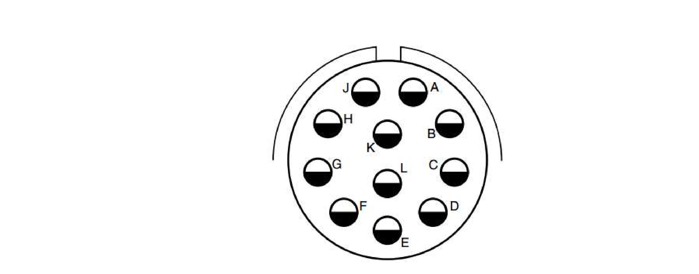

*Figure 15: J1 Power Connector Pin Arrangement*

**Table 8: J1 DC Power Connector Pin Allocation**

| J1-DC Power (21-11 insert, N-Keying) Sensor MIL-DTL-38999/M39029/58-365 (receptacle with pin inserts) Platform Umbilical MIL-DTL-38999/M39029/56-353 (plug with sockets inserts) |||||| EO-IR Turreted Sensor | Radar/SAR Turreted Sensor | EW Sensor | SIGINT Sensor | Comms |
|---|---|---|---|---|---|---|---|---|---|---|
| Conn/ Desc. | Pin | Wire Type | Signal Name | Signal Source | Signal Type | Used | Used | Used | Used | Used |
| | D | SC-AWG12 | DC-1 | Platform | 28V DC@15A | ✓ | ✓ | ✓ | ✓ | ✓ |
| | E | SC-AWG12 | DC-1 RTN | Platform | DC RTN | ✓ | ✓ | ✓ | ✓ | ✓ |
| | F | SC-AWG12 | DC-2 | Platform | 28V DC@15A | ✓ | ✓ | ✓ | ✓ | ✓ |
| | L | SC-AWG12 | DC-2 RTN | Platform | DC RTN | ✓ | ✓ | ✓ | ✓ | ✓ |
| | C | SC-AWG12 | DC-3 | Platform | 28V DC@15A | ✓ | ✓ | ✓ | ✓ | ✓ |
| | G | SC-AWG12 | DC-3 RTN | Platform | DC RTN | ✓ | ✓ | ✓ | ✓ | ✓ |
| | K | SC-AWG12 | Chassis | Platform | Ground | ✓ | ✓ | ✓ | ✓ | ✓ |
| | A | SC-AWG12 | DC-4/PWRL | Platform | 28V DC@15A | ✓ | ✓ | ✓ | ✓ | ✓ |
| | J | SC-AWG12 | DC-4/PWRL RTN | Platform | DC RTN | ✓ | ✓ | ✓ | ✓ | ✓ |

> 注：Contacts which are reserved, unused, or unallocated shall be populated by a dummy plug.

5.2.2.1 Power The platform shall provide to the sensor system four channels of 28 VDC power sources in accordance with MIL-STD-704F with the fourth channel reserved for laser power in EO/IR systems. Conformance Methodology: (TBD)

<!-- 原书 p.74 ｜ PDF p.94 -->

Each of the four channels of 28 VDC shall be independently controlled. Conformance Methodology: (TBD) The platform shall be capable of supplying 15 amps steady state per each 28 VDC channel. Inrush current shall be limited to 25 amps for 2s with a 25% duty cycle. Conformance Methodology: (TBD) The sensor shall isolate power returns or neutral in accordance with MIL-STD-704F from the chassis. Conformance Methodology: (TBD)

5.2.2.2 Safety Ground This contact shall be used to provide electrical continuity between the sensor system chassis and the host platform in accordance with MIL-STD-464. Conformance Methodology: (TBD)

5.2.2.3 Laser Power The platform shall provide 28 VDC power for the laser in accordance with MIL-STD-704F. Conformance Methodology: (TBD) The laser power contacts shall be used to separately power a laser device. This is intended for use with a safety-relevant device such as a laser designator. Conformance Methodology: (TBD) The platform shall be capable of supplying 15 amps steady state for laser power. Inrush current shall be limited to 25 amps for 2s with a 25% duty cycle. Conformance Methodology: (TBD)

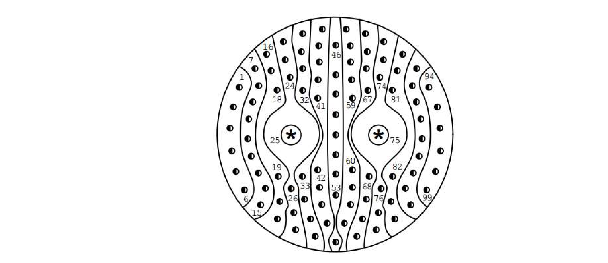

*Figure 16: J2 Signal Connector Pin Arrangement*

<!-- 原书 p.75 ｜ PDF p.95 -->

**Table 9: J2 Signals Connector Pin Allocation**

| SOSA Electrical Interface Recommendations J2-Signal (25-7 insert, N-Keying) Sensor MIL-DTL-38999/M39029/56-348 (receptacle with socket inserts) Platform Umbilical MIL-DTL-38999/M39029/58-360 (plug with pin inserts) |  |  |  |  |  | EO-IR Turreted Sensor | Radar/SAR Turreted Sensor | EW Sensor | SIGINT Sensor | Comms |
|---|---|---|---|---|---|---|---|---|---|---|
| Conn/ Desc. | Pin | Wire Type | Signal Name | Signal Source | Signal Type | Used | Used | Used | Used | Used |
| Power Enable Discrete | 46 | STP 2419 | PWR_EN | Platform | Open/Closed Ckt | ✓ | ✓ | ✓ | ✓ | ✓ |
|  | 47 | STP 2419 | PWR_EN_RTN | Platform | Open/Closed Ckt | ✓ | ✓ | ✓ | ✓ | ✓ |
| Ethernet | 28 | 100Ω STP-2419 | DA+ | Platform/Sensor | 1000BaseT | ✓ | ✓ | ✓ | ✓ | ✓ |
|  | 35 | 100Ω STP-2419 | DA- | Platform/Sensor | 1000BaseT | ✓ | ✓ | ✓ | ✓ | ✓ |
|  | 36 | Shield | DA Shield | Platform/Sensor |  | ✓ | ✓ | ✓ | ✓ | ✓ |
|  | 44 | 100Ω STP-2419 | DB+ | Platform/Sensor | 1000BaseT | ✓ | ✓ | ✓ | ✓ | ✓ |
|  | 53 | 100Ω STP-2419 | DB- | Platform/Sensor | 1000BaseT | ✓ | ✓ | ✓ | ✓ | ✓ |
|  | 62 | Shield | DB Shield | Platform/Sensor |  | ✓ | ✓ | ✓ | ✓ | ✓ |
|  | 45 | 100Ω STP-2419 | DC+ | Platform/Sensor | 1000BaseT | ✓ | ✓ | ✓ | ✓ | ✓ |
|  | 54 | 100Ω STP-2419 | DC- | Platform/Sensor | 1000BaseT | ✓ | ✓ | ✓ | ✓ | ✓ |
|  | 63 | Shield | DC Shield | Platform/Sensor |  | ✓ | ✓ | ✓ | ✓ | ✓ |
|  | 70 | 100Ω STP-2419 | DD+ | Platform/Sensor | 1000BaseT | ✓ | ✓ | ✓ | ✓ | ✓ |
|  | 71 | 100Ω STP-2419 | DD- | Platform/Sensor | 1000BaseT | ✓ | ✓ | ✓ | ✓ | ✓ |
|  | 78 | Shield | DD Shield | Platform/Sensor |  | ✓ | ✓ | ✓ | ✓ | ✓ |
| Serial Comms 1 | 7 | 100 Ohm STP 2419 | TX1+ | Sensor | RS422 | ✓ | ✓ | ✓ | ✓ | ✓ |
|  | 8 | 100 Ohm STP 2419 | TX1- | Sensor | RS422 | ✓ | ✓ | ✓ | ✓ | ✓ |
|  | 17 | SC-AWG24 | 422_1_RTN |  | RS422 | ✓ | ✓ | ✓ | ✓ | ✓ |
|  | 16 | 100 Ohm STP 2419 | RX1+ | Platform | RS422 | ✓ | ✓ | ✓ | ✓ | ✓ |
|  | 23 | 100 Ohm STP 2419 | RX1- | Platform | RS422 | ✓ | ✓ | ✓ | ✓ | ✓ |
| Serial Comms 2 | 22 | 100 Ohm STP 2419 | TX2+ | Sensor | RS422 | ✓ | ✓ | ✓ | ✓ | ✓ |
|  | 30 | 100 Ohm STP 2419 | TX2- | Sensor | RS422 | ✓ | ✓ | ✓ | ✓ | ✓ |
|  | 29 | SC-AWG24 | 422_2_RTN |  | RS422 | ✓ | ✓ | ✓ | ✓ | ✓ |
|  | 37 | 100 Ohm STP 2419 | RX2+ | Platform | RS422 | ✓ | ✓ | ✓ | ✓ | ✓ |
|  | 38 | 100 Ohm STP 2419 | RX2- | Platform | RS422 | ✓ | ✓ | ✓ | ✓ | ✓ |
| Serial Comms 3 | 55 | 100 Ohm STP 2419 | TX3+ | Sensor | RS422 | ✓ | ✓ | ✓ | ✓ | ✓ |
|  | 56 | 100 Ohm STP 2419 | TX3- | Sensor | RS422 | ✓ | ✓ | ✓ | ✓ | ✓ |
|  | 64 | SC-AWG24 | 422_1_RTN |  | RS422 | ✓ | ✓ | ✓ | ✓ | ✓ |
|  | 65 | 100 Ohm STP 2419 | RX3+ | Platform | RS422 | ✓ | ✓ | ✓ | ✓ | ✓ |
|  | 72 | 100 Ohm STP 2419 | RX3- | Platform | RS422 | ✓ | ✓ | ✓ | ✓ | ✓ |
| Serial Comms 4 | 73 | 100 Ohm STP 2419 | TX4+ | Sensor | RS422 | ✓ | ✓ | ✓ | ✓ | ✓ |
|  | 79 | 100 Ohm STP 2419 | TX4- | Sensor | RS422 | ✓ | ✓ | ✓ | ✓ | ✓ |
|  | 80 | SC-AWG24 | 422_1_RTN |  | RS422 | ✓ | ✓ | ✓ | ✓ | ✓ |
|  | 85 | 100 Ohm STP 2419 | RX4+ | Platform | RS422 | ✓ | ✓ | ✓ | ✓ | ✓ |
|  | 86 | 100 Ohm STP 2419 | RX4- | Platform | RS422 | ✓ | ✓ | ✓ | ✓ | ✓ |
| Emission Arming | 2 | AWG22 | MASTER_ARM | Platform | open/closed ckt | ✓ |  |  |  |  |
|  | 95 | AWG22 | MASTER_ARM_RET | Platform | open/closed ckt | ✓ |  |  |  |  |

> 转写说明：第 1 行横幅单元格在原表横跨 Conn/Desc.～Signal Type 共 6 列，本表只在其首格填写，其余 5 格留空。Conn/Desc. 列在原表按组纵向合并，本表只在合并组首行填写、其余行留空：Power Enable Discrete 合并 2 行（46、47）；Ethernet 合并 12 行（28、35、36、44、53、62、45、54、63、70、71、78）；Serial Comms 1 合并 5 行（7、8、17、16、23）；Serial Comms 2 合并 5 行（22、30、29、37、38）；Serial Comms 3 合并 5 行（55、56、64、65、72）；Serial Comms 4 合并 5 行（73、79、80、85、86）；Emission Arming 合并 2 行（2、95）。
>
> 转写说明：第 16、23 行位于续页，续页重复了横幅与表头；其 Conn/Desc. 格在原表即为空白（沿用上页 Serial Comms 1 的合并区）。格内因列宽折行的文字按原顺序合并为一行（如 `100Ω STP-2419`、`100 Ohm STP 2419`、`Platform/Sensor`、`Emission Arming`、`MASTER_ARM`）。

Power 46 STP 2419 PWR EN Platform Open/Closed Ckt

Enable

Discrete

41 STP 2419 PWR EN RTN Platform Open/Closed Ckt

Ethernet 28 1000 STP DA+ Platforml 1000Baser 2419 Sensor 35 1000 STP DA- Platforml 100OBaseT 2419 Sensor 36 Shield DA Shield Platforml Sensor 44 1008 STP DB+ Platform/ 1000Baser 2419 Sensor 53 1000 STP DB- Platform/ 100OBaseT 2419 Sensor Shield DB Shield Platforml Sensor 45 1000 STP DC+ Platform/ 1000Baser 2419 Sensor 54 1000 STP- DC Platforml 10OOBaseT 2419 Sensor 63 Shield DC Shield Platforml Sensor 70 1000 STP. DD+ Platforml I000Baser 2419 Sensor 1000 STP DD Platform/ 1000Baser 2419 Sensor 78 Shield DD Shield Platformml Sensor Serial 100 Ohm STP TX1+ Sensor RS422 Comms 2419

100 Ohm STP TX1 Sensor R8422

17 SC-AWG24 422 1 RTN R8422

<!-- 原书 p.76 ｜ PDF p.96 -->

16 100 Ohm STP RXI+ Platform RS422

23 100 Ohm STP RXI - Platform RS422

Serial 22 100 Ohm STP TX2+ Sensor R8422 Comms 2419

30 100 Ohm STP TX2- Sensor RS422

29 SC-AWG24 422_2 RTN R8422 37 100 Ohm STP RX2t Platform R8422

38 100 Ohm STP RX2- Platform R8422

Serial 55 100 Ohm STP TX3+ Sensor RS422 Comms 2419

56 100 Ohm STP TX3- Sensor RS422

64 SC-AWG24 422_1_RTN RS422 65 100 Ohm STP RX3+ Platform R8422

72 100 Ohm STP RX3 - Platform RS422

Serial 73 100 Ohm STP TX4+ Sensor RS422 Comms 2419

79 100 Ohm STP TX4- Sensor R8422

80 SC-ATG24 422_1_ RTN RS422 85 100 Ohm STP RX4+ Platform RS422

86 100 Ohm STP RX4- Platform R8422

Emi- AWG22 MASTER AR Platform openlclosed ckt SSion M

Arming

95 AWG22 MASTER AR Platform openlclosed ckt

## M REI

<!-- 原书 p.77 ｜ PDF p.97 -->

SOSA Electrical Interface Recommendations

Jz-Signal (25-7 insert, N-Keying)

- E0-I_ Radar/SAR Sensor MIL-DTL-38999/439029/56-348 (receptacle with socket inserts) Turreted Turreted EW SIGINT Platform Umbilical MIL-DTL-38999/039029/58-360 (plug with pin inserts) Sensor Sensor Sensor Sensor Comms Desc:Connl Pin Wire Type Signal Name SignalSource Signal Type Used Used Used Used Used

<!-- 原书 p.78 ｜ PDF p.98 -->

S0SA Electrical Interface Recommendations

Jz-Signal (25-7 insert, N-Keying)

- E0-I_ Radar/SAR Sensor MIL-DTL-38999/439029/56-348 (receptacle with socket inserts) Turreted Turreted EW SIGINT Platform Umbilical MIL-DTL-38999/039029/58-360 (plug with pin inserts) Sensor Sensor Sensor Sensor Comms

Desc:Connl Pin Wire Type Signal Name SignalSource Signal Type Used Used Used Used Used

<!-- 原书 p.79 ｜ PDF p.99 -->

SOSA Electrical Interface Recommendations

Jz-Signal (25-7 insert, N-Keying)

- E0-I_ Radar/SAR Sensor MIL-DTL-38999/439029/56-348 (receptacle with socket inserts) Turreted Turreted EW SIGINT Platform Umbilical MIL-DTL-38999/039029/58-360 (plug with pin inserts) Sensor Sensor Sensor Sensor Comms

Desc:Connl Pin Wire Type Signal Name SignalSource Signal Type Used Used Used Used Used

LVDSI 26 100 Ohm STP

LVDS2 18 100 Ohm STP

LVDS3 50 100 Ohm STP

LVDS4 83 100 Ohm STP

LVDSS 92 100 Ohm STP

Sensor 24,31 ATG24 SENMAN to Sensor Manu- 32,39 SENMAN_IO facturer 40,57 58,66 67,74 Res- 1,3,9, For arming erved 10,87 isolation

88,94

Unused 81,91

NOTE 1

- All reserved, unused, unallocated should be populated by a dummy plug. Digital data channels are to be tested for Return Loss and Near End Cross Talk (NEXT), including the connector interfaces to ensure conformance to protocol requirements. This should be applied to the Ethernet pairs, the Serial Comms 1-4 (RS422) pairs, as well as the LVDS (1-5) pairs.

- Each signal group in Table 9 is described in more detail below. By convention of this standard, individual signal sets will have their own return line. This is done for Electromagnetic Compatibility (EMC) performance, as well as ease of platform integration.

- For logic levels, unless otherwise specified, “low” is defined to be safe. A voltage of greater than or equal to 18.0 VDC shall be interpreted as logic level ‘1’. A voltage level of less than or equal to 1.5 VDC shall be interpreted as logic ‘0’.

<!-- 原书 p.80 ｜ PDF p.100 -->

NOTE 2

Some acquisition programs may allow higher voltage levels to also be interpreted as logic '0'. A typical impetus for this would be the result of a system safety analysis. In such a case, it is recommended that the logic '0' threshold not exceed 15.0 VDC.

5.2.3.1 Power Enable

The Power Enable signal is used for a controlled power up and shutdown of the sensor system. This control is necessary if the sensor system is required to execute a sequence of steps upon shutdown, steps that the sensor system would be precluded from executing if power were simply removed from the system. The Power Enable signal is controlled by the platform and when disabled, instructs the sensor to power down.

Power Enable is a switch, relay, or Solid State Relay (SSR) controlled by the platform (or human on the platform side of the interface). The switch goes across PWR_EN and PWR_EN_RTN. The sensor provides the voltage for this. Power Enable is disabled if an open circuit exists externally between the contacts (i.e., the switch is open). Power Enable is enabled if a closed circuit is externally applied between the contacts.

An open circuit for Power Enable shall have a resistance value greater than or equal to 100k Ω. A closed circuit for Power Enable shall have a resistance value less than 5 Ω. The maximum current shall be 100 mA. The maximum voltage shall be 30 VDC. Conformance Methodology: (TBD)

##### 5.2.3.2 Ethernet Databus (Copper)

Gigabit Ethernet is an 8-wire (4 twisted-pair), 100 Ω connection.

The J2 Ethernet databus shall be implemented as Gigabit Ethernet. Conformance Methodology: (TBD)

Gigabit Ethernet shall comply with IEEE 802.3-2008 for a 1000BaseT channel. The maximum cable length is 100 meters. Conformance Methodology: (TBD)

5.2.3.3 Serial Communications

Up to four application-configurable serial communication ports are defined. Each port shall be compliant to TIA-422/RS422. It is expected that the first port will be used for a hand controller. It is expected that the latency of communication on this interface is critical, thus a more complex multi-layer protocol interface would not be practical.

These interfaces can also be used for integration with other equipment, such as moving map cueing and display systems.

Note that a separate return line is included with each serial communications port for ease of platform integration.

5.2.3.4 Arming and Cutouts

A set of ten pins is dedicated to control of energy emitting sensors such as the arming of laser devices, or RF transmission devices. This includes the selection of predefined laser suppression zone maps.

<!-- 原书 p.81 ｜ PDF p.101 -->

MASTER_ARM and MASTER_ARM_RTN are a pair of pins across a switch, relay, or SSR. In order to arm the emission device, the platform closes the switch which completes the circuit. The current which goes through it, and the voltage across it, come from the sensor. The sensor doesn’t generate its own voltage; it comes in from the platform via the power connector (this is the 28 VDC Laser Power). The platform shall provide a switch, relay, or SSR capable of handling 30 VDC with a maximum of 100mA current.

There are three No Emit Zone (NEZ) circuits. Each is a switch, relay, or SSR provided by, and independently controlled by, the platform. The three circuits have a common return (NEZ _SELECT_RTN). The platform shall provide a switch, relay, or SSR capable of handling 30 VDC for each of the three NEZ circuits. The platform shall be capable of independently controlling each of the three NEZ circuits.

There are three mode select signals using 28 VDC logic which are independently controlled by the platform. The three signals have a common return: MODE_SELECT_RTN.

SIMPLE ARMING – these pins form part of the power circuit for an emission device in the turret When the pins are open, power to the device is disabled; when close-circuited, power is enabled. The pins allow the integrator to connect a simple arming switch to these contacts. Pins 2 and 95 shall be used for Simple Arming.

ADVANCED ARMING CLUSTER 1 – sensor systems can have a NEZ, or Cutout Map The NEZ is a two-dimensional map, in azimuth and elevation, that defines where the device can and cannot emit. It is designed to inhibit emissions when the turret’s line-ofsight is over any part of the platform. This prevents energy from reflecting back, posing a hazard. The map is stored in the turret’s computer memory. Further, a turret may have several maps stored, enabling it to be mounted at several points on the platform, or on several platform models, without modification. In this case, a high-reliability mechanism is needed to select which map should be used. Pins 4, 5, 11, and 12 shall be used for Advanced Arming Cluster 1. Assuming that three of the four pins allocated to this function are used to select a map, up to four maps can be defined in the turret. The fourth pin would be used as a parity check for safety.

LASER ADVANCED ARMING CLUSTER 2 – these pins can be used in a number of ways They determine under what conditions or states the device will be used. For example, if there are multiple non-eyesafe lasers in a turret, these pins could be used to select one or more devices (secondary arm control). Pins 89, 90, 97, and 98 shall be used for advanced arming Cluster 2.

5.2.3.5 Emissions Annunciation

The Emission signal shall be used to annunciate the firing of an emission device. Conformance

Methodology: (TBD)

This signal shall be a 28 VDC isolated signal. Conformance Methodology: (TBD)

The maximum voltage shall be 30 VDC with a maximum current of 100mA. Conformance

Methodology: (TBD)

<!-- 原书 p.82 ｜ PDF p.102 -->

##### 5.2.3.6 Safety Status

A set of three signal pairs is available to indicate the status of safety-relevant functions in the sensor system. These shall be 28 VDC isolated signals. These signals are controlled by the sensor. Conformance Methodology: (TBD) The maximum voltage shall be 30 VDC with a maximum current of 100mA. Conformance

Methodology: (TBD)

5.2.3.7 Enable Gimbal Movement

The Enable Gimbal Movement signal shall be used to indicate that the sensor system’s outer gimbal motors are to be enabled. Conformance Methodology: (TBD) This control is necessary to ensure that the turret does not move in azimuth and/or elevation at high speeds endangering individuals that may be working in close proximity to the sensor. The Enable Gimbal Movement signal originates from the sensor with the platform opening and closing the circuit. An open circuit shall indicate that the motors shall not be powered. Conformance Methodology: (TBD)

##### 5.2.3.8 Time Synchronization – 1 PPS

Wiring for a 1 PPS signal for time synchronization shall be provided. Conformance Methodology: (TBD) This signal shall be in accordance with the input time roll-over pulse (1 PPS) per ICD-GPS-

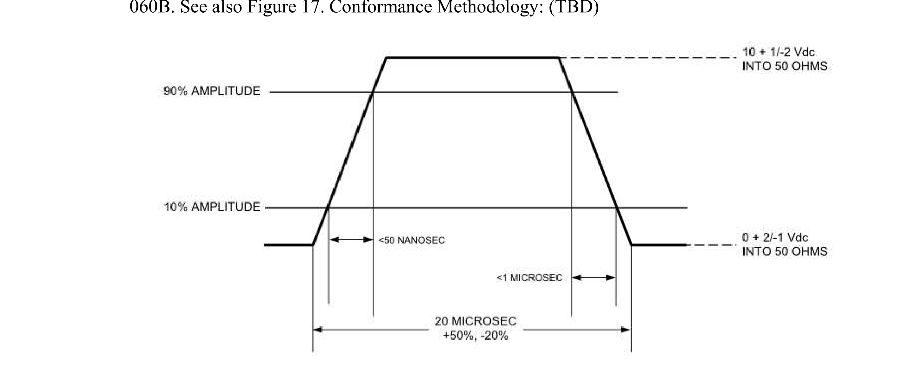

*Figure 17: Input Time Rollover Pulse (1 PPS) Signal Characteristics*

5.2.3.9 Hand Controller Power

Power may be provided by the sensor to the hand controller. The maximum voltage shall be 30 VDC with a maximum current of 500mA. Conformance Methodology: (TBD)

<!-- 原书 p.83 ｜ PDF p.103 -->

5.2.3.10 Memory Purge

A switch closure between PURG_MEM_+ and PURG_MEM_- for 30 msec or more shall cause a memory to erase. Conformance Methodology: (TBD) The intention is for this to be routed to an encrypted drive for the clearing of mission data. Usage of this interface is implementation-specific and could be used to clear any memory that may be sensitive.

5.2.3.11 MIL-STD 1553B Twinax Inserts

A set of two Size 8 Twinaxial contacts are available for MIL-STD-1553B. Pin 25 is intended for Bus A and pin 75 for Bus B.

5.2.3.12 USB Data Planned for a later version of the SOSA Technical Standard. A USB 2.0 interface shall optionally be provided by the sensor. Conformance Methodology: (TBD)

5.2.3.13 USB Power 5V +/- 5% up to 500mA shall be supplied by the sensor. Conformance Methodology: (TBD)

5.2.3.14 LVDS These Low Voltage Differential Signal (LVDS) discrete signals are available to the sensor manufacturers for use between sensor elements.

5.2.3.15 Sensor Manufacturer Pins A set of 10 pins are reserved for use by individual sensor system suppliers, primarily for maintenance purposes when the sensor is not connected to the platform. The platform shall not populate these pins. Conformance Methodology: (TBD)

5.2.4 J3-Video (Copper) Connector The J3 Video Connector shall have a 21-11 pin arrangement as shown in Figure 18. Conformance Methodology: (TBD) Signals for the J3 Video Connector shall be assigned to pins in accordance with Table 10. Conformance Methodology: (TBD)

<!-- 原书 p.84 ｜ PDF p.104 -->

*Figure 18: J3 Video Connector Pin Arrangement*

**Table 10: J3 Video Connector Pin Allocation**

| J3-Video (21-11 insert, N-Keying) Sensor: MIL-DTL-38999/M39029/75-416 (receptacle with socket inserts) Platform Umbilical: MIL-DTL-38999/M39029/28-211 (plug with pin inserts) |  |  |  |  | EO-IR Turreted Sensor | Radar/SAR Turreted Sensor | EW Sensor | SIGINT Sensor | Comms |  |
|---|---|---|---|---|---|---|---|---|---|---|
| Pin | Wire Type | Signal Name | Signal Source | Signal Type | Used | Used | Used | Used | Used | Notes |
| A | Coax-75Ω | Digital Video Ch1 | Sensor | SMPTE 292/424 | ✓ |  |  |  | ✓ | For input from EO/IR sensor |
| B | Coax-75Ω | Digital Video Ch2 | Sensor | SMPTE 292/424 | ✓ |  |  |  | ✓ | For input from EO/IR sensor |
| C | Coax-75Ω | Digital Video Ch3 | Sensor | SMPTE 292/424 | ✓ |  |  |  | ✓ | For input from EO/IR sensor |
| D | Coax-75Ω | Digital Video Ch4 | Sensor | SMPTE 292/424 | ✓ |  |  |  | ✓ | For input from EO/IR sensor |
| E | Coax-75Ω | Analog video Ch1 Y | Sensor | RS-170a Video Luminance | ✓ |  |  |  | ✓ | For input from EO/IR sensor |
| F | Coax-75Ω | Analog video Ch1 C | Sensor | RS-170a Video Chrominance | ✓ |  |  |  | ✓ | For input from EO/IR sensor |
| G | Coax-75Ω | Composite Video Ch 1 | Sensor | RS-170a Composite Video | ✓ |  |  |  | ✓ | For input from EO/IR sensor |
| H | Coax-75Ω | Composite Video Ch 2 | Sensor | RS-170a Composite Video | ✓ |  |  |  | ✓ | For input from EO/IR sensor |
| J | Unused |  |  |  |  |  |  |  |  |  |
| K | Unused |  |  |  |  |  |  |  |  |  |
| L | Unused |  |  |  |  |  |  |  |  |  |

> 转写说明：第 1 行横幅单元格在原表横跨 Pin～Signal Type 共 5 列，本表只在其首格填写，其余 4 格留空；同行的 `Comms` 单元格在原表同时压住 Comms 与 Notes 两列（第 2 行的 `Used` 与 `Notes` 才分列），故第 1 行末格留空。第 8～12 行（H、J、K、L）位于续页，续页重复了横幅与表头。格内因列宽折行的文字按原顺序合并为一行（如 `Coax-75Ω`、`Digital Video Ch1`、`For input from EO/IR sensor`）。

Pin TypeWire Signal Name Signal Source Signal Type Used Used Used Used Used Notes

Coax- Digital Video Sensor SMPTE 292/424 For input 750 Chl from

EOIIR

SenSOr

B Coax- Digital Video Sensor SMPTE 292/424 For input 750 Ch2 from

EOIJ

Sensor

Coax- Digital Video Sensor SMPIE 292/424 For input 750 Ch3 from

EO/

Sensor

Coax- Digital Video Sensor SMPIE 292/424 For input 750 Ch4 froln

EO/J

Sensor

Coax- AnalogVideo Sensor RS-170a Video For input 750 Chl Y Luminance from

EO/IR

SensOr

Coax- Analog video Sensor RS-170a Video For input 750 Chl C Chrominance from

EO/IR

Sensor

Coax- Composite Sensor RS-170a For input 750 Video Ch 1 Composite Video from

EO/J

Sensor

<!-- 原书 p.85 ｜ PDF p.105 -->

J3-Video (21-11 insert, N-Keying) Sensor: MIL DTL-38999/039029/75-416 (receptacle with socket inserts)

- R0-1 Radar/SAR Platform Umbilical: MIL-DTL-38999/039029/28-211 (plug with pin Turreted Turreted EW SIGINT inserts) Sensor Sensor Sensor Sensor Comms

Pin TypeWire Signal Name Signal Source Signal Type Used Used Used Used Used Notes

H Coax- Composite Sensor RS-l70a For input 750 Video Ch 2 Composite Video from

EO/JR

Sensor

Unused

K Unused

[ Unused Each digital channel shall comply with SMPTE 292, driving into 75 Ω #12 coax contacts, per the standard. Video channels can also be SMPTE 424M over the same wiring. Conformance Methodology: (TBD) Each analog channel shall comply with RS170a, driving into 75 Ω #12 coax contacts, per the standard. Conformance Methodology: (TBD)

5.2.5 J4-Fiber Optics Connector Fiber optic shall be multi-mode fiber. The core diameter shall be 50µm ± 3µm and the cladding diameter shall be 125µm ± 2µm. Conformance Methodology: (TBD) The termini shall be butt end MIL-PRF-29504/4 (Pin) or MIL-PRF-29504/5 (Socket) which fit into size 16 entry holes. Conformance Methodology: (TBD) Ethernet Channels shall transmit and receive at 850nm per IEEE 802.3-2008 for 10GBASE-SR applications. Conformance Methodology: (TBD) SMPTE 297 Channels shall transmit low power SMPTE 292 or 424M signals at 1310nm specifically according to call out L-PC-CD-1310. Conformance Methodology: (TBD) Fiber used shall be OM2-compliant or better, as defined by ISO/IEC 11801. It is recommended that for longer path applications the cable be bend-insensitive OM4. Conformance Methodology: (TBD) The J4 Fiber Optic Connector shall have a 19-11 pin arrangement as shown in Figure 19. Conformance Methodology: (TBD) Signals for the J4 Fiber Optic Connector shall be assigned to pins in accordance with Table 11. Conformance Methodology: (TBD)

<!-- 原书 p.86 ｜ PDF p.106 -->

*Figure 19: J4 Fiber Optic Connector Pin Arrangement*

**Table 11: J4 Fiber Optic Connector Pin Allocation**

| SOSA Electrical Interface Recommendations J4-Fiber (19-11 insert, N-Keying) Sensor MIL-DTL-38999/29504/5 (receptacle with socket inserts) Platform Umbilical MIL-DTL-38999/29504/4 (plug with pin inserts) |  |  |  |  | EO-IR Turreted Sensor | Radar/SAR Turreted Sensor | EW Sensor | SIGINT Sensor | Comms |
|---|---|---|---|---|---|---|---|---|---|
| Pin | Wire Type | Signal Name | Signal Source | Signal Type | Used | Used | Used | Used | Used |
| A | MM Fiber | Sensor Transmit 1 | Sensor | 10GBase-SR/40GBase-SR4/100GBase-SR4 | ✓ | ✓ | ✓ | ✓ | ✓ |
| B | MM Fiber | Sensor Receive 1 | Platform | 10GBase-SR/40GBase-SR4/100GBase-SR4 | ✓ | ✓ | ✓ | ✓ | ✓ |
| C | MM Fiber | Sensor Transmit 2 | Sensor | 10GBase-SR/40GBase-SR4/100GBase-SR4 | ✓ | ✓ | ✓ | ✓ | ✓ |
| D | MM Fiber | Sensor Receive 2 | Platform | 10GBase-SR/40GBase-SR4/100GBase-SR4 | ✓ | ✓ | ✓ | ✓ | ✓ |
| E | MM Fiber | Sensor Transmit 3 | Sensor | 10GBase-SR/40GBase-SR4/100GBase-SR4 | ✓ | ✓ | ✓ | ✓ | ✓ |
| F | MM Fiber | Sensor Receive 3 | Platform | 10GBase-SR/40GBase-SR4/100GBase-SR4 | ✓ | ✓ | ✓ | ✓ | ✓ |
| G | MM Fiber | Sensor Transmit 4 | Sensor | 10GBase-SR/40GBase-SR4/100GBase-SR4 | ✓ | ✓ | ✓ | ✓ | ✓ |
| H | MM Fiber | Sensor Receive 4 | Platform | 10GBase-SR/40GBase-SR4/100GBase-SR4 | ✓ | ✓ | ✓ | ✓ | ✓ |
| J | MM Fiber | Video Ch 1 | Sensor | SMPTE 297 | ✓ |  |  |  |  |
| K | MM Fiber | Video Ch 2 | Sensor | SMPTE 297 | ✓ |  |  |  |  |
| L | MM Fiber | Video Ch 3 | Sensor | SMPTE 297 | ✓ |  |  |  |  |

> 转写说明：第 1 行横幅单元格在原表横跨 Pin～Signal Type 共 5 列，本表只在其首格填写，其余 4 格留空。第 10～11 行（K、L）位于续页，续页重复了横幅与表头。格内因列宽折行的文字按原顺序合并为一行（如 `MM Fiber`、`Sensor Receive 1`、`10GBase-SR/40GBase-SR4/100GBase-SR4`）。

Wire

Pin Type Signal Name Signal Source Signal Type Used Used Used Used Used

MM Sensor Sensor I0GBase-SR/ Fiber Transmit L 40GBase-SR4/

I00GBase-SR4

MM Sensor Receive Platform I0GBase-SR/ Fiber 1 40GBase-SR4/ 100GBase-SR4

MM Sensor Sensor IOGBase-SR/ Fiber Transmit 2 40GBase-SR4/ 100GBase-SR4

MM Sensor Receive Platform I0GBase-SR/ Fiber 2 40GBase-SR4/

I0OGBase-SR4

MM Sensor Sensor IOGBase-SR/ Fiber Transmit 3 40GBase-SR4/

I0OGBase-SR4

MM Sensor Receive Platform I0GBase-SR/ Fiber 3 40GBase-SR4/ 100GBase-SR4

MM Sensor Sensor I0GBase-SR/ Fiber Transmit 4 40GBase-SR4/

I0OGBase-SR4

MM Sensor Receive Platform I0GBase-SR/ Fiber 40GBase-SR4/ 100GBase-SR4

MM Video Ch Sensor SMPTE 297

Fiber

<!-- 原书 p.87 ｜ PDF p.107 -->

S0SA Electrical Interface Recommendations

J4-Riber (19-11 insert N-Keying)

- E0-I RadarlSAR Sensor MIL-DTL-38999/29504/5 (receptacle with socket inserts) Turreted Turreted EW SIGINT Platform Umbilical MIL-DTL-38999/29504/4 (plug with pin inserts) Sensor Sensor Sensor Sensor Comms Wire Pin Type Signal Name Signal Source SignalType Used Used Used Used Used k MM Video Ch 2 Sensor SMPIE 297 Fiber MM Video Ch 3 Sensor SMPTE 297

Fiber

#### 5.2.6 J5-GPS Antenna Connector

- When a GPS receiver internal to the sensor is being used and requires an external antenna, the J5 connector shall be used. Conformance Methodology: (TBD) These signals shall have characteristics that comply with AS6129 Appendix A (Additional Interface Requirements for GPS RF Signals). Conformance Methodology: (TBD) The J5 GPS Connector shall use TNC connectors. Conformance Methodology: (TBD)

**Table 12: J5 GPS Connector Pin Allocation**

| SOSA Electrical Interface Recommendations J5-GPS Ant (TNC) Sensor – Receptacle Platform Umbilical – Plug |  |  |  |  | EO-IR Turreted Sensor | Radar/SAR Turreted Sensor | EW Sensor | SIGINT Sensor | Comms |
|---|---|---|---|---|---|---|---|---|---|
| Pin | Wire Type | Signal Name | Signal Source | Signal Type | Used | Used | Used | Used | Used |
| Coaxial | Coax-50Ω | GPS Antenna | Platform | RF | ✓ | ✓ | ✓ | ✓ | ✓ |

> 转写说明：第 1 行横幅单元格在原表横跨 Pin～Signal Type 共 5 列，本表只在其首格填写，其余 4 格留空。横幅第 3、4 行中的横线为原表的短破折号（`–`）。格内因列宽折行的文字按原顺序合并为一行（如 `Coax-50Ω`）。

#### 5.2.7 J6-DC Auxiliary Power Connector

- The J6 Auxiliary DC Power Connector shall have a 21-11 insert pattern as shown in Figure 20. Conformance Methodology: (TBD) Signals for the J6 Auxiliary DC Power Connector shall be assigned to pins in accordance with

**Table 13: Conformance Methodology: (TBD)**

| SOSA Electrical Interface Recommendations Sensor MIL-DTL-38999/M39029/58-365 (receptacle with pin inserts) Platform Umbilical MIL-DTL-38999/M39029/56-353 (plug with sockets inserts) |  |  |  |  |  | EO-IR Turreted Sensor | Radar/SAR Turreted Sensor | EW Sensor | SIGINT Sensor | Comms |
|---|---|---|---|---|---|---|---|---|---|---|
| Conn/ Desc. | Pin | Wire Type | Signal Name | Signal Source | Signal Type | Used | Used | Used | Used | Used |
|  | D | SC-AWG12 | DC-5 | Platform | 28V DC@15A | ✓ | ✓ | ✓ | ✓ | ✓ |
|  | E | SC-AWG12 | DC-5 RTN | Platform | DC RTN | ✓ | ✓ | ✓ | ✓ | ✓ |
|  | F | SC-AWG12 | DC-6 | Platform | 28V DC@15A | ✓ | ✓ | ✓ | ✓ | ✓ |
|  | L | SC-AWG12 | DC-6 RTN | Platform | DC RTN | ✓ | ✓ | ✓ | ✓ | ✓ |
|  | C | SC-AWG12 | DC-7 | Platform | 28V DC@15A | ✓ | ✓ | ✓ | ✓ | ✓ |
|  | G | SC-AWG12 | DC-7 RTN | Platform | DC RTN | ✓ | ✓ | ✓ | ✓ | ✓ |
|  | K | SC-AWG12 | Chassis | Platform | Ground | ✓ | ✓ | ✓ | ✓ | ✓ |
|  | A | SC-AWG12 | DC-8 | Platform | 28V DC@15A | ✓ | ✓ | ✓ | ✓ | ✓ |
|  | J | SC-AWG12 | DC-8 RTN | Platform | DC RTN | ✓ | ✓ | ✓ | ✓ | ✓ |
|  | B | SC-AWG12 | DC-9 | Platform | 28V DC@15A | ✓ | ✓ | ✓ | ✓ | ✓ |
|  | H | SC-AWG12 | DC-9 RTN | Platform | DC RTN | ✓ | ✓ | ✓ | ✓ | ✓ |

> 转写说明：第 1 行横幅单元格在原表横跨 Conn/Desc.～Signal Type 共 6 列，本表只在其首格填写，其余 5 格留空。Conn/Desc. 列的原表各行均为空白单元格（未合并、未填内容），本表按空白照录。

<!-- 原书 p.88 ｜ PDF p.108 -->

*Figure 20: J6 Auxiliary Power Connector Pin Arrangement*

SC-AWGI2 DC 5 Platform 28VDC@ISA [ SC-AWG12 DC-5 RTN Platform DC RTN - SC-AWGI2 DC-6 Platform 28VDC@ISA SC-AWG12 DC-6 RTN Platform DC RTN SC-AWGI2 DC 7 Platformm 28VDC@ISA SC-AWGI2 DC-7 RTN Platform DC RTN k SC-AWGI2 Chassis Platformm Ground SC-AWGI12 DC 8 Platform 28VDC@ISA SC-AWGI2 DC-8 RTN Platform DC RTN B SC-AWG12 DC-9 Platform 28VDC@ISA S SC-AWGI2 DC-9 RTN Platform DC RTN

5.2.7.1 Power

- The platform shall provide to the sensor system up to five channels of 28 VDC power sources in accordance with MIL-STD-704F. Conformance Methodology: (TBD) Each of the five channels of 28 VDC shall be independently controlled. Conformance

Methodology: (TBD)

<!-- 原书 p.89 ｜ PDF p.109 -->

The platform shall be capable of supplying 15 amps steady state per each 28 VDC channel. Conformance Methodology: (TBD) Inrush current shall be limited to 25 amps for 2s with a 25% duty cycle. Conformance Methodology: (TBD) The sensor shall isolate power returns or neutral in accordance with MIL-STD-704F from the chassis. Conformance Methodology: (TBD)

##### 5.2.7.2 Safety Ground

This contact shall be used to provide electrical continuity between the sensor system chassis and the host platform in accordance with MIL-STD-464. Conformance Methodology: (TBD)

#### 5.2.8 J7-High Speed Connector

The J7 High Speed Connector is currently being defined to support high-speed electrical interfaces such as 10Gig Ethernet, USB 3.0, and DisplayPort. Details will be added in a future version. Planned for a later version of the SOSA Technical Standard.

**Table 14: J7 Pin Allocations**

| SOSA Electrical Interface Recommendations J7-High Speed Electrical Sensor XXXXXXXXXXXXx (receptacle with pin inserts) Platform Umbilical XXXXXXXXXXXX (plug with sockets inserts) | | | | | | EO-IR Turreted Sensor | Radar/SAR Turreted Sensor | EW Sensor | SIGINT Sensor | Comms |
|---|---|---|---|---|---|---|---|---|---|---|
| Conn/ Desc. | Pin | Wire Type | Signal Name | Signal Source | Signal Type | Used | Used | Used | Used | Used |
| TBD | | | | | | | | | | |

> 转写说明：原表表头为两行——第一行左起 6 列（Conn/ Desc.~Signal Type 上方）是一个**跨 6 列的合并单元格**（灰色块），其文字照录于第 1 格，被其覆盖的其余 5 格留空；第 7~11 列第一行为传感器名、第二行为 “Used”，此处分列为表头行与紧跟的一行（即原表头第二行），不另设分隔线。
>
> 表体仅 1 行：第 1 格作 “TBD”，其余 10 格原为空。本表在 p.90 内完整，未跨页。
>
> 占位符逐字计数：第 3 行为 “Sensor” ＋ 12 个大写 X ＋ 1 个小写 x（合计 13 个 X 字形，末位原书即作小写）；第 5 行为 “Platform Umbilical” ＋ 12 个大写 X（第 6 行 “(plug with sockets inserts)” 中的 “sockets” 原书为复数，照录）。

TBD

##### 5.2.8.1 Description

Planned for a later version of the SOSA Technical Standard.

#### 5.2.9 J8-High Density RF Connector

The J8 RF Connector shall have a 25-19 insert pattern as shown in Figure 21. Conformance Methodology: (TBD) Signals for the J8 RF Connector shall be assigned to pins in accordance with Table 15. Conformance Methodology: (TBD)

<!-- 原书 p.90 ｜ PDF p.110 -->

*Figure 21: J8 RF Connector Pin Arrangement*

**Table 15: J8 RF Pin Allocations**

| SOSA Electrical Interface Recommendations J8-RF (25-19 insert, N-Keying) Antenna MIL-DTL-38999/20FJ19SN (receptacle with socket inserts) Platform Umbilical MIL-DTL-38999/26FJ19PN (plug with pin inserts) | | | | | | EO-IR Turreted Sensor | Radar/SAR Turreted Sensor | EW Sensor | SIGINT Sensor | Comms |
|---|---|---|---|---|---|---|---|---|---|---|
| Conn/ Desc. | Pin | Wire Type | Signal Name | Signal Source | Signal Type | Used | Used | Used | Used | Used |
| RF | A | Coax-50Ω | Ch1 | Antenna | RF up to 18Ghz | | ✓ | ✓ | ✓ | ✓ |
| | B | Coax-50Ω | Ch2 | Antenna | RF up to 18Ghz | | ✓ | ✓ | ✓ | ✓ |
| | C | Coax-50Ω | Ch3 | Antenna | RF up to 18Ghz | | ✓ | ✓ | ✓ | ✓ |
| | D | Coax-50Ω | Ch4 | Antenna | RF up to 18Ghz | | ✓ | ✓ | ✓ | ✓ |
| | E | Coax-50Ω | Ch5 | Antenna | RF up to 18Ghz | | ✓ | ✓ | ✓ | ✓ |
| | F | Coax-50Ω | Ch6 | Antenna | RF up to 18Ghz | | ✓ | ✓ | ✓ | ✓ |
| | G | Coax-50Ω | Ch7 | Antenna | RF up to 18Ghz | | ✓ | ✓ | ✓ | ✓ |
| | H | Coax-50Ω | Ch8 | Antenna | RF up to 18Ghz | | ✓ | ✓ | ✓ | ✓ |
| | J | Coax-50Ω | Ch9 | Antenna | RF up to 18Ghz | | ✓ | ✓ | ✓ | ✓ |
| | K | Coax-50Ω | Ch10 | Antenna | RF up to 18Ghz | | ✓ | ✓ | ✓ | ✓ |
| | L | Coax-50Ω | Ch11 | Antenna | RF up to 18Ghz | | ✓ | ✓ | ✓ | ✓ |
| | M | Coax-50Ω | Ch12 | Antenna | RF up to 18Ghz | | ✓ | ✓ | ✓ | ✓ |
| | N | Coax-50Ω | Ch13 | Antenna | RF up to 18Ghz | | ✓ | ✓ | ✓ | ✓ |
| | P | Coax-50Ω | Ch14 | Antenna | RF up to 18Ghz | | ✓ | ✓ | ✓ | ✓ |
| | R | Coax-50Ω | Ch15 | Antenna | RF up to 18Ghz | | ✓ | ✓ | ✓ | ✓ |
| | S | Coax-50Ω | Ch16 | Antenna | RF up to 18Ghz | | ✓ | ✓ | ✓ | ✓ |
| | T | Coax-50Ω | Ch17 | Antenna | RF up to 18Ghz | | ✓ | ✓ | ✓ | ✓ |
| | U | Coax-50Ω | Ch18 | Antenna | RF up to 18Ghz | | ✓ | ✓ | ✓ | ✓ |
| | V | Coax-50Ω | Ch19 | Antenna | RF up to 18Ghz | | ✓ | ✓ | ✓ | ✓ |

> 转写说明：原表表头为两行——第一行左起 6 列（Conn/ Desc.~Signal Type 上方）是一个**跨 6 列的合并单元格**（灰色块），其文字照录于第 1 格，被其覆盖的其余 5 格留空；第 7~11 列第一行为传感器名、第二行为 “Used”，此处分列为表头行与紧跟的一行（即原表头第二行），不另设分隔线。
>
> 合并单元格：第 1 列 Conn/ Desc. 的 “RF” 在原表跨全部 19 行合并，仅记于首个数据行（Pin A），其下 18 行该格留空。
>
> 跨页：本表自 p.91 起、在 p.92 续完（S、T、U、V 四行为续页行）；续页重复的完整表头（含灰色块与 “Used” 行）已并入本文件首两行表头，不另记。
>
> 表体 19 行，Pin 依次为 A、B、C、D、E、F、G、H、J、K、L、M、N、P、R、S、T、U、V（原书无 I、O、Q 三个字母）；Signal Name 依次为 Ch1~Ch19，与 Pin 一一对应。Signal Type 全文均作 “RF up to 18Ghz”（“Ghz” 大小写照录，非 “GHz”）。

RF A Coax-508 Chl Antenna RF up to 18Gh2 B Coax-50Q Ch2 Antenna RF up to 18Gh2 Coax-50Q Ch3 Antenna RF up to 18Gh2

D Coax-50Q Ch4 Antenna RF UP to 186h2 Coax- 508 Chs Antenna RF up to 18Gh2 } Coax-508 Ch6 Antenna RF up to 18662 6 Coax-50Q Ch7 Antenna RF up to 18Gh2 I Coax-50Q Ch8 Antenna RF up to 18612 Coax- 508 Chg Antenna RF up to 18Ghz & Coax-508 Chl0 Antenna RF up to 18662 [ Coax-50Q Chll Antenna RF up to 186h2 M Coax-508 Chl2 Antenna RF up to 186h2 N Coax-50Q Chl3 Antenna RF up to 18Gh2 P Coax-508 Chl4 Antenna RF uP to 18Gh2 R Coax- 508 Chl5 Antenna RF up to 186h2

<!-- 原书 p.91 ｜ PDF p.111 -->

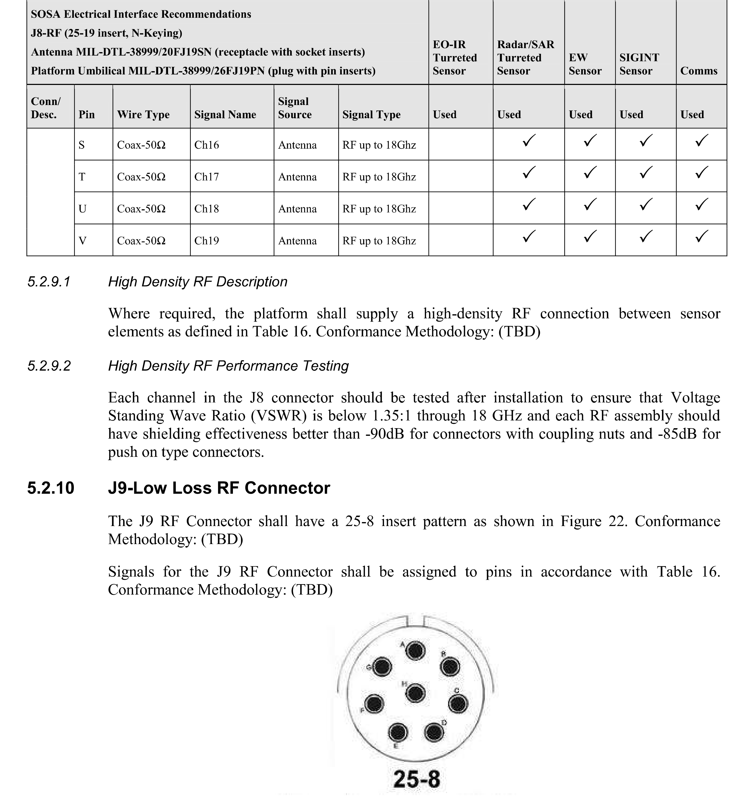

*Figure 22: J9 RF Connector Pin Arrangement*

<!-- 原书 p.92 ｜ PDF p.112 -->

**Table 16: J9 RF Pin Allocation**

| SOSA Electrical Interface Recommendations J9-RF (25-8 insert, N-Keying) Antenna MIL-DTL-38999/20FJ19SN (receptacle with socket inserts) Platform Umbilical MIL-DTL-38999/26FJ19PN (plug with pin inserts) | | | | | | EO-IR Turreted Sensor | Radar/SAR Turreted Sensor | EW Sensor | SIGINT Sensor | Comms |
|---|---|---|---|---|---|---|---|---|---|---|
| Conn/ Desc. | Pin | Wire Type | Signal Name | Signal Source | Signal Type | Used | Used | Used | Used | Used |
| RF | A | Coax-50Ω | Ch1 | Antenna | RF up to 18Ghz | | ✓ | ✓ | ✓ | ✓ |
| | B | Coax-50Ω | Ch2 | Antenna | RF up to 18Ghz | | ✓ | ✓ | ✓ | ✓ |
| | C | Coax-50Ω | Ch3 | Antenna | RF up to 18Ghz | | ✓ | ✓ | ✓ | ✓ |
| | D | Coax-50Ω | Ch4 | Antenna | RF up to 18Ghz | | ✓ | ✓ | ✓ | ✓ |
| | E | Coax-50Ω | Ch5 | Antenna | RF up to 18Ghz | | ✓ | ✓ | ✓ | ✓ |
| | F | Coax-50Ω | Ch6 | Antenna | RF up to 18Ghz | | ✓ | ✓ | ✓ | ✓ |
| | G | Coax-50Ω | Ch7 | Antenna | RF up to 18Ghz | | ✓ | ✓ | ✓ | ✓ |
| | H | Coax-50Ω | Ch8 | Antenna | RF up to 18Ghz | | ✓ | ✓ | ✓ | ✓ |

> 转写说明：原表表头为两行——第一行左起 6 列（Conn/ Desc.~Signal Type 上方）是一个**跨 6 列的合并单元格**（灰色块），其文字照录于第 1 格，被其覆盖的其余 5 格留空；第 7~11 列第一行为传感器名、第二行为 “Used”，此处分列为表头行与紧跟的一行（即原表头第二行），不另设分隔线。
>
> 合并单元格：第 1 列 Conn/ Desc. 的 “RF” 在原表跨全部 8 行合并，仅记于首个数据行（Pin A），其下 7 行该格留空。
>
> 表体 8 行，Pin 依次为 A~H，Signal Name 依次为 Ch1~Ch8。本表在 p.93 内完整（紧随 5.2.10.1 正文），未跨页。

**Table 17: Auxiliary RF Connections**

| Auxiliary RF Connectors – Quantity is Application-Specific | | | | | | EO-IR Turreted Sensor | Radar/SAR Turreted Sensor | EW Sensor | SIGINT Sensor | Comms |
|---|---|---|---|---|---|---|---|---|---|---|
| Conn/ Desc. | Pin | Wire Type | Signal Name | Signal Source | Signal Type | Used | Used | Used | Used | Used |
| TNC | | RG142 50Ω | | Antenna | RF up to 3 Ghz | | ✓ | ✓ | ✓ | ✓ |
| SMA | | RG174 50Ω | | Antenna | RF up to 27 Ghz | | ✓ | ✓ | ✓ | ✓ |
| 2.4 mm | | Coax-50Ω | | Antenna | RF up to 50 Ghz | | ✓ | ✓ | ✓ | ✓ |
| 1.0 mm | | Coax-50Ω | | Antenna | RF up to 110 Ghz | | ✓ | ✓ | ✓ | ✓ |

> 转写说明：原表表头为两行——第一行左起 6 列（Conn/ Desc.~Signal Type 上方）是一个**跨 6 列的合并单元格**（灰色块），其文字 “Auxiliary RF Connectors – Quantity is Application-Specific” 照录于第 1 格（“–” 为原书的短破折号），被其覆盖的其余 5 格留空；第 7~11 列第一行为传感器名、第二行为 “Used”，此处分列为表头行与紧跟的一行（即原表头第二行），不另设分隔线。
>
> 表体 4 行；第 2 列 Pin 与第 4 列 Signal Name 在原表中全部为空，照录留空。
>
> 跨页：本表自 p.93 起、在 p.94 续完（“1.0 mm” 一行为续页行，其 Signal Type 格内 “RF up to 110 / Ghz” 为原表格内折行，此处以空格连接）；续页重复的完整表头已并入本文件首两行表头，不另记。

TNC RGI42508 Antenna RE up to 3 Ghz SMA RG174500 Antenna RF up to 27 Ghz

2.4 mm Coax-508 Antenna RF up to 50 Ghz

<!-- 原书 p.93 ｜ PDF p.113 -->

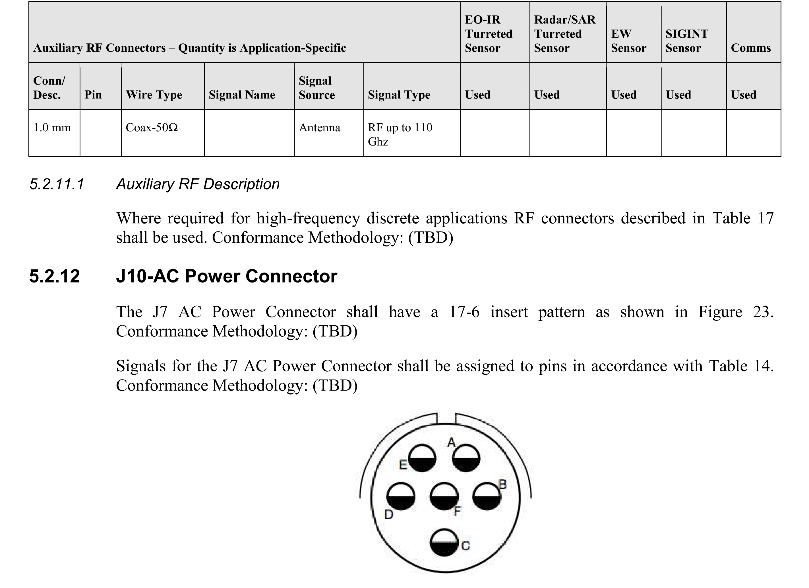

*Figure 23: J10 AC Power Connector Pin Arrangement*

**Table 18: J10 AC Power Pin Allocations**

| SOSA Electrical Interface Recommendations J10-AC Power (17-6 insert, N-Keying) Sensor MIL-DTL-38999/20FE6PN contacts M39029/58-365 (receptacle with socket inserts) Platform Umbilical MIL-DTL-38999/26FE6SN contacts M39029/56-353 (plug with pin inserts) | | | | | | EO-IR Turreted Sensor | Radar/SAR Turreted Sensor | EW Sensor | SIGINT Sensor | Comms |
|---|---|---|---|---|---|---|---|---|---|---|
| Conn/ Desc. | Pin | Wire Type | Signal Name | Signal Source | Signal Type | Used | Used | Used | Used | Used |
| 3ø 400Hz AC Power | A | 12AWG | 120/208VAC Ph A | Platform | AC Power | ✓ | ✓ | ✓ | ✓ | ✓ |
| | B | 12AWG | 120/208VAC Ph B | Platform | AC Power | ✓ | ✓ | ✓ | ✓ | ✓ |
| | C | 12AWG | 120/208VAC Ph C | Platform | AC Power | ✓ | ✓ | ✓ | ✓ | ✓ |
| | D | 12AWG | 120/208VAC Neutral | Platform | AC Power | | ✓ | ✓ | ✓ | ✓ |
| | E | | Unused | | | | | | | |
| | F | 12AWG | Chassis | Platform | Ground | | ✓ | ✓ | ✓ | ✓ |

> 转写说明：原表表头为两行——第一行左起 6 列（Conn/ Desc.~Signal Type 上方）是一个**跨 6 列的合并单元格**（灰色块），其文字照录于第 1 格，被其覆盖的其余 5 格留空；第 7~11 列第一行为传感器名、第二行为 “Used”，此处分列为表头行与紧跟的一行（即原表头第二行），不另设分隔线。灰色块第 3、4 段在原表格内折行为 “Sensor MIL-DTL-38999/20FE6PN contacts M39029/58-365” ＋ “(receptacle with socket inserts)” 与 “Platform Umbilical MIL-DTL-38999/26FE6SN contacts M39029/56-353” ＋ “(plug with pin inserts)”，此处按折行位置以 ` ` 相接。
>
> 合并单元格：第 1 列 Conn/ Desc. 的 “3ø 400Hz AC Power” 在原表跨 A~F 全部 6 行合并（格内原为 “3ø” “400Hz” “AC” “Power” 四行竖排），仅记于首个数据行（Pin A），其下 5 行该格留空；“ø” 为原书的带斜线 o。
>
> 第 E 行：Wire Type、Signal Source、Signal Type 三格及 5 个 Used 格原为空，Signal Name 作 “Unused”，照录留空。
>
> 跨页：本表自 p.94 起、在 p.95 续完（D、E、F 三行为续页行）；续页重复的完整表头已并入本文件首两行表头，不另记。第 4 列内 “120/208VAC Ph A” 等在原文中为格内折行（“120/208VAC” ＋ “Ph A”），此处以空格连接。

Desc:Connl Pin Wire Type Signal Name SignalSource Signal Type Used Used Used Used Used

30 12AWG 120/208VAC Platform AC Power 40OHZ Ph A AC Power B 12AWG 120/208VAC Platform AC Power

Ph B

I2AWG 120/208VAC Platform AC Power Ph C

<!-- 原书 p.94 ｜ PDF p.114 -->

S0SA Electrical Interface Recommendations

JIO-AC Power (17-6 insert, N-Keying) Sensor MILDTL 38999/20F6PN contacts 139029/58-365 (receptacle with socket inserts) EO-I RadarlSAR Platform Umbilical MIL-DTL- 38999/26F6SN contacts M39029/56-353 Turreted Turreted EW SIGINT (plug with pin inserts) Sensor Sensor Sensor Sensor Comms DescConnl Pin Wire Type Signal Name SignalSource Signal Type Used Used Used Used Used

12AWG 120/208VAC Platform AC Power Neutral } Unused F 12AWG Chassis Platform Ground

##### 5.2.12.1 AC Power Description

The platform shall provide to the connected system or sensor 115/200 Volts RMS, alternating current (AC), three phase, 4 wire grounded neutral, “Y” configuration, 400 cycle power at up to 10 amperes per phase in accordance with MIL-STD-704F. Conformance Methodology: (TBD) Each phase shall be protected by an overcurrent device to limit the maximum current to 10 amperes steady state and the overcurrent devices shall be interconnected such that an overcurrent condition on any phase shall cause all three phases to be interrupted. Conformance

Methodology: (TBD)

#### 5.2.13 Hardware Platform 3U and 6U Slot Profile Specifications

5.2.13.1 SOSA Hardware Basic Requirements

**Rule 5.2.13.1-1**

SOSA plug-in cards shall conform to the requirements of the following standards, when applicable, in the given order of precedence: • Requirements of this SOSA Technical Standard

  - Conformance Methodology: (I)

Requirements of ANSI/VITA 65.1

  - Conformance Methodology: (I)

Requirements of ANSI/VITA 65.0

  - Conformance Methodology: (I)

Requirements of ANSI/VITA 48.2

  - Conformance Methodology: (I)

Requirements of ANSI/VITA 48.8

  - Conformance Methodology: (I)

<!-- 原书 p.95 ｜ PDF p.115 -->

• Requirements of ANSI/VITA 47.3

  - Conformance Methodology: (I)

Requirements of ANSI/VITA 66.0 and applicable dot standards

  - Conformance Methodology: (I)

Requirements of ANSI/VITA 67.0 and applicable dot standards

  - Conformance Methodology: (I)

Requirements of ANSI/VITA 46.0

  - Conformance Methodology: (I)

Requirements of ANSI/VITA 62.0

  - Conformance Methodology: (I)

**Rule 5.2.13.1-2**

All user defined pins, as defined in the SOSA plug-in cards, shall not be used for inter-module communications – only for external platform communications. Conformance Methodology: (T)

**Rule 5.2.13.1-3**

All external panel I/O signals shall pass through the backplane connector(s) before going to any SOSA plug-in card except for: Conformance Methodology: (T)

• Key Fill

• Crypto Ignition Key (CIK)

**Rule 5.2.13.1-4**

All signals between SOSA plug-in cards shall pass through the backplane connector(s) before going to another component in a SOSA system. Conformance Methodology: (A)

**Rule 5.2.13.1-5**

SOSA PSMs shall conform to Section 3U External I/O Slot Profile if they are installed into a monolithic backplane containing SOSA hardware modules. Conformance Methodology: (T)

**Recommendation 5.2.13.1-1**

SOSA PSMs should conform to Section 3U External I/O Slot Profile even if they are part of a separate power supply backplane.

5.2.13.2 SOSA Utility Plane Requirements Reference ANSI/VITA 65.0 §3 for Utility Plane Requirements. Utility plane requirements are extended for the SOSA standard as follows.

<!-- 原书 p.96 ｜ PDF p.116 -->

**Rule 5.2.13.2-1**

The Non-Volatile Memory Read Only (NVMRO) signal on a SOSA plug-in card shall inhibit write operations to non-volatile memory resources as specified in ANSI/VITA 65.0 §3.4.4. Conformance Methodology: (T)

**Rule 5.2.13.2-2**

The GDiscrete1 signal shall be an input only port with respect to ANSI/VITA 65.0, Permission 3.6-1. Conformance Methodology: (T)

**Rule 5.2.13.2-3**

With respect to ANSI/VITA 46.0, Recommendation 7-3, the Joint Test Action Group (JTAG) signals shall not be bussed over the backplane. Conformance Methodology: (T)

**Rule 5.2.13.2-4**

With respect to ANSI/VITA 65.0, Permission 3.4.3-4 and Permission 3.4.3-5, MaskableReset* shall not be bussed across the backplane to other slots. Conformance Methodology: (T)

**Rule 5.2.13.2-5**

All backplane connectors shall be commercially available connectors that can be procured by any vendor without prior authorization from any source (e.g., a commercial part governed by a source control drawing). Conformance Methodology: (A)

**Rule 5.2.13.2-6**

Backplanes shall implement a single, 2.49K Ohm, +/- 1%, pull-up resistor from each IPMB signal to the 3.3V Auxiliary voltage rail. Conformance Methodology: (A)

**Rule 5.2.13.2-7**

SOSA plug-in cards containing resources to drive the Utility Plane REF_CLK+/- signals shall provide a mechanism to permit application software or system management to reassign the identity of the SYS_CON module, regardless of the logic level of the backplane SYS_CON* contact, in order to control these signal drivers once the backplane power rails are all at minimum operating voltages as defined in ANSI/VITA 46.0 §4.8.12.4. Conformance Methodology: (A)

**Rule 5.2.13.2-8**

SOSA plug-in cards receiving SYSRESET* as an input shall be able to register a valid low for any pulse length of 10ns or longer. Conformance Methodology: (T)

**Rule 5.2.13.2-9**

SYSRESET* shall conform to the high current open-drain signal specifications of ANSI/VITA

65.0 §3.3.3 (High Current Open-Drain). Conformance Methodology: (T)

<!-- 原书 p.97 ｜ PDF p.117 -->

**Rule 5.2.13.2-10**

SOSA plug-in cards shall make SYSRESET* available to any SOSA mezzanine module connector that has SM1 and SM0 available per ANSI/VITA 65.0 Recommendation 3.4.2.1-1. Conformance Methodology: (T)

**Rule 5.2.13.2-11**

SOSA plug-in cards shall receive a unique Site Number that is based upon the plug-in card’s ANSI/VITA 65.0 §3.4.6, Geographic Address as referenced in ANSI/VITA 46.11. Conformance

Methodology: (A)

**Rule 5.2.13.2-12**

No additional components shall be required to install a SOSA plug-in card in a SOSA Enclosure other than those typically used for ANSI/VITA-compliant OpenVPX modules. Conformance Methodology: (A)

**Rule 5.2.13.2-13**

The NVMRO pin shall conform to the low current open-drain signal specifications of ANSI/VITA 65.0 §3.3.1. Conformance Methodology: (A)

**Rule 5.2.13.2-14**

3U SOSA plug-in cards shall use VS1 12V as primary input power. Conformance Methodology: (TBD)

**Rule 5.2.13.2-15**

3U SOSA plug-in cards shall not use VS2 3.3V or VS3 5.0V. Conformance Methodology: (T)

**Observation 5.2.13.2-1**

VS1 input pins limits 3U current to 16A (192W) per ANSI/VITA 46.0 Table 4-5.

**Rule 5.2.13.2-16**

6U SOSA plug-in cards shall use VS1 and VS2 12V as primary input power. Conformance Methodology: (T)

**Rule 5.2.13.2-17**

6U SOSA plug-in cards shall not use VS3 5.0V. Conformance Methodology: (T)

**Observation 5.2.13.2-2**

VS1 and VS2 input pins limits 6U current to 32A (384W) per ANSI/VITA 46.0 Table 4-5.

<!-- 原书 p.98 ｜ PDF p.118 -->

**Rule 5.2.13.2-18**

SOSA plug-in cards shall use 3.3V_AUX. Conformance Methodology: (T)

**Rule 5.2.13.2-19**

SOSA plug-in cards shall not use 12V auxiliary supplies. Conformance Methodology: (T)

**Observation 5.2.13.2-3**

SOSA plug-in cards shall draw no more than 1.0A of 3.3VAUX ANSI/VITA 46.0 Rule 3.11.

5.2.13.3 SOSA Hardware Platform General Specification Requirements SOSA general specification requirements are delineated in the following sections.

5.2.13.3.1 General Specifications

**Permission 5.2.13.3-1**

Hardware modules may work cooperatively to increase performance and/or functionality.

**Rule 5.2.13.3-1**

All unused pins shall not be connected on the plug-in module. Conformance Methodology: (A)

**Rule 5.2.13.3-2**

SOSA plug-in cards with XMC mezzanine sites shall conform to the carrier board requirements of ANSI/VITA 42.0, XMC. Conformance Methodology: (A)

Slot Pitch

Reference ANSI/VITA 65.0 §4.1 for slot pitch requirements. Slot pitch requirements are extended for SOSA as follows.

**Rule 5.2.13.3-3**

SOSA Conformant Card cage rails shall have a pitch of 1.0” or greater for SOSA plug-in card conformant ANSI/VITA 48.2 Hardware Modules. Conformance Methodology: (A)

**Rule 5.2.13.3-4**

SOSA Backplane Assemblies for conduction cooling shall have a 1.0” pitch or greater for SOSA plug-in cards conformant to ANSI/VITA 48.2 Plug-In Module. Conformance Methodology: (A)

**Rule 5.2.13.3-5**

Conduction Cooled SOSA plug-in cards shall be conformant to ANSI/VITA 48.2 Plug-In Module requirements for 1.00” pitch. Conformance Methodology: (A)

<!-- 原书 p.99 ｜ PDF p.119 -->

**Rule 5.2.13.3-6**

SOSA Conformant Card cage rails shall have a pitch of 1.5” for SOSA plug-in card ANSI/VITA

48.8 Hardware Modules. Conformance Methodology: (A)

**Rule 5.2.13.3-7**

SOSA Backplane Assemblies for air flow through cooling shall have a 1.5” pitch for SOSA plug-in cards conformant to ANSI/VITA 48.8 Plug-In Module. Conformance Methodology: (A)

**Rule 5.2.13.3-8**

Air flow through SOSA plug-in cards shall be conformant to ANSI/VITA 48.8 Plug-In Module requirements for 1.5” pitch. Conformance Methodology: (A)

5.2.13.3.2 Connector Family

**Rule 5.2.13.3-9**

SOSA plug-in cards shall comply with ANSI/VITA 65.0 §4.2 for connector family requirements. Conformance Methodology: (A)

Rules 5.2.13.3-10

SOSA plug-in cards shall make use of ANSI/VITA Standard Connectors. Conformance Methodology: (A)

**Observation 5.2.13.3-1**

The SOSA standard is considering the addition of ANSI/VITA 46.3 that will allow for intermateable connectors.

Keying

The SOSA standard references ANSI/VITA 46 §4.4 for Alignment and Keying. Specifically, reference ANSI/VITA 46 §4.4.3 for Keying Rules applying to 6U and 3U modules. Reference ANSI/VITA 65.0 §4.3 for keying requirements specific to ANSI/VITA 6U modules and backplanes.

RTM Modules

Reference ANSI/VITA 65.0 §4.4 for Requirements Traceability Matrix (RTM) connector requirements.

**Rule 5.2.13.3-11**

Rear transition modules shall be prohibited within a SOSA Chassis and Backplane Assembly. Conformance Methodology: (A)

<!-- 原书 p.100 ｜ PDF p.120 -->

##### 5.2.13.4 Conduction Cooled SOSA Plug-In Cards

Reference ANSI/VITA 48.2 for conduction cooled module requirements. Reference ANSI/VITA

48.8 for air flow through module requirements.

**Rule 5.2.13.4-1**

ANSI/VITA 48.2 or ANSI/VITA 48.8 Type 1 Hardware Modules shall be used. Conformance

Methodology: (A)

**Recommendation 5.2.13.4-1**

SOSA plug-in cards should use extended covers in order to protect the 46.0 connectors.

**Permission 5.2.13.4-1**

Adapter frames may be used to convert ANSI/VITA 48.2 Hardware Modules to ANSI/VITA

48.8 form factor.

Environmental

Reference ANSI/VITA 47.3 for module requirements.

**Observation 5.2.13.4-1**

Hardware modules may use the following cooling method guideline table to prepare for future power growth.

**Table 19: Hardware Module Cooling Methods**

| **Hardware Module Form Factor and Cooling Method** | **3U Heat Load** | **6U Heat Load** | **System Integration Impact Rationale** |
|---|---|---|---|
| ANSI/VITA 48.2 conduction to air cooled chassis | Low | Low | Host platform-agnostic air cooling |
| ANSI/VITA 48.8 air flow through | Medium | Medium | |
| ANSI/VITA 48.2 conduction to liquid cooled chassis | Medium | Medium | Dependent on host platform supplied liquid cooling infrastructure with condensation mitigation |

> 转写说明：第 4 列「System Integration Impact Rationale」的「Host platform-agnostic air cooling」为纵向合并单元格，覆盖第 2、3 数据行（ANSI/VITA 48.2 conduction to air cooled chassis、ANSI/VITA 48.8 air flow through），故第 3 行该格留空、末行「Dependent on host platform supplied liquid cooling infrastructure with condensation mitigation」单独成格。合并格原带底色（首两行绿色、末行黄色），Markdown 不表底色。格内因排版折行的文字（如「Hardware Module Form Factor and Cooling Method」「ANSI/VITA 48.2 conduction to air cooled chassis」）以单个空格连接。本表仅占原书 p.101 一页，p.102 为正文。

#### 5.2.14 Hardware Platform SOSA Plug-In Card Profiles

SOSA plug-in card Profiles define the connector type and how each pin, or pair of pins, is allocated. Single pins are generally allocated to the utility plane for power, grounds, system discrete signals, and system management. Differential pin/pairs are generally allocated for the three communication planes called Control, Data, and Expansion. Differential paired pins are grouped together to form “pipes”. The definition of planes, pipes, and profiles can be found in Appendix B. Finally, plug-in card profiles also determine which pins are user-defined. SOSA plug-in card profiles are categorized as either Payload or Switch. As an example, payload plug-

<!-- 原书 p.101 ｜ PDF p.121 -->

in cards are further divided into sub-categories such as, but not limited to, RF Payload, RF Switch, and I/O Single Board Computer (SBC).

5.2.14.1 Hardware Platform Protocol Profiles

The Protocol Profile defines what type communication protocol can be used on each pipe as defined in a corresponding plug-in card profile, connector type, and module height (6U/3U).

5.2.14.2 Hardware Platform Profile Names – Use and Construction

SOSA plug-in card profiles that align with OpenVPX Profiles can be classified into one of three main categories: • SLT: a physical space on an OpenVPX backplane with a defined mechanical and electrical specification intended to accept a Plug-In module Pre-existing examples of slots that are applicable to OpenVPX include 3U and 6U. There are different slot types such as payload slots and switch slots.

Backplane (BKP): a class of interconnect that consists of regularly aligned pattern of connectors that operate so that the corresponding pins on each connector have the same logical definition It is often used as a backbone to connect several modules together to allow for signal transmission and is usually housed in a chassis.

Module (MOD): an element of a system that has individually distinct boundaries that are well-defined interfaces Reference ANSI/VITA 65.0 §1.3.3.1 for Slot Profile use and construction. Reference ANSI/VITA 65.0 §1.3.3.2 for Backplane Profile use and construction. Reference ANSI/VITA 65.0 §1.3.3.3 for Module Profile use and construction.

#### 5.2.15 Common 6U and 3U Plug-In Card Profile Specifications

For the SOSA standard, within the context of OpenVPX, it is known that OpenVPX uses Slot Profiles to define interoperability and physical characteristics necessary to interface with compatible modules and backplanes. The following sections define common requirements for all OpenVPX Slot Profiles: • Reference ANSI/VITA 65.0 §6 Common to 6U and 3U – Slot Profiles • Reference ANSI/VITA 65.0 §7 Common to 6U and 3U – Backplane Profiles

• Reference ANSI/VITA 65.0 §8 Common to 6U and 3U – Module Profiles

#### 5.2.16 SOSA 3U Plug-In Card Profile Specifications

##### 5.2.16.1 3U I/O Intensive SBC Plug-In Card Profile

**Rule 5.2.16.1-1**

SOSA 3U SBCs that are I/O intensive shall conform to ANSI/VITA 65.0 slot profile SLT3-

PAY-1F1F2U1TU1T1U1T-14.2.16. Conformance Methodology: (A)

<!-- 原书 p.102 ｜ PDF p.122 -->

**Rule 5.2.16.1-2**

SOSA systems shall route the GPIO pins from the ANSI/VITA 65.1 slot profile SLT3-PAY-1F1F2U1TU1T1U1T-14.2.16 to external Platform I/O. Conformance Methodology: (A)

**Rule 5.2.16.1-3**

SOSA systems shall route Express Mezzanine Card (XMC) pins from ANSI/VITA 65.1 slot profile SLT3-PAY-1F1F2U1TU1T1U1T-14.2.16 to external chassis I/O connectors. Conformance Methodology: (A)

**Rule 5.2.16.1-4**

SOSA 3U SBCs that are I/O intensive shall conform to one of the ANSI/VITA 65.1 module profiles in Table 20. Conformance Methodology: (A)

**Observation 5.2.16.1-1**

An XMC can be used to customize the I/O for a particular system or platform.

- Key

SE

POIJO Data Plane 1 FP

- Utility Plane-Maint. PortUSB PWR 5E Diff Expansion PlaneP1w9-X12d XMC mapControl Plane - 2 UTPsFP PI/J1 GPIO Video - TUTP

- Utility Plane 8 of USB 3 and 1ofUSB2- 1TP

- Serial ports E Storage 1 UTP

- De USB PWR- P2lJ2 Control Plane C 1 TP

3 Of GPIO- XIGs XMC map

*Figure 24: ANSI/VITA 65.0 3U I/O Intensive SBC Slot Profile SLT3-PAY-1F1F2U1TU1T1U1T-*

14.2.16

<!-- 原书 p.103 ｜ PDF p.123 -->

**Table 20: Referenced ANSI/VITA 65.1 Module Profiles for SLT3-PAY-1F1F2U1T1U1T1U1T-14.2.16**

| Module Profile Names | Dash Num | STD Date | Slot Profile | Data Plane | Protocols for Copper Planes || Control | Miscellaneous Protocols over copper connectors |||||| Legacy |
|---|---|---|---|---|---|---|---|---|---|---|---|---|---|---|
| | | | | | Expansion | Control Plane | | Video | USB01 | USB02 | STRutp01 | SER01, SER02 | GPIO1 - GPIO4 | |
| MOD3-PAY- 1F1F2U1TU1T1U1T- 16.2.15- | | Proposed future 65.0 | | DP01 (FP) | EP00 - EP03 | CPutp01, CPutp02 | CPtp01 | | | | | | | |
| MOD3-PAY- 1F1F2U1TU1T1U1T- 16.2.15- | 1 | Proposed future 65.0 | SLT3-PAY- 1F1F2U1TU1T1U1T- 14.2.16 | PCIe Gen 2 -- 5.3.3.2 | PCIe Gen 2 -- 5.3.3.2 | 1000BASE-KX -- 5.1.2 | 1000BASE-T | DisplayPort 1.2 -- 5.10.2 | USB 2 -- 5.9.1 | USB 2 -- 5.9.1 | SATA Gen 2 -- 5.6.2 | Serial Ports -- 5.12.1 | GPIO -- 5.14.1 | |
| MOD3-PAY- 1F1F2U1TU1T1U1T- 16.2.15- | 2 | Proposed future 65.0 | SLT3-PAY- 1F1F2U1TU1T1U1T- 14.2.16 | PCIe Gen 3 -- 5.3.3.3 | PCIe Gen 3 -- 5.3.3.3 | 10GBASE-KR -- 5.1.7 | 10GBASE-T | DisplayPort 1.2 -- 5.10.2 | USB 3.1 Gen 2 -- 5.9.3 | USB 2 -- 5.9.1 | SATA Gen 3 -- 5.6.3 | Serial Ports -- 5.12.1 | GPIO -- 5.14.1 | |
| MOD3-PAY- 1F1F2U1TU1T1U1T- 16.2.15- | 3 | Proposed future 65.0 | SLT3-PAY- 1F1F2U1TU1T1U1T- 14.2.16 | 10GBASE-KX4 -- 5.1.5 | PCIe Gen 2 -- 5.3.3.2 | 1000BASE-KX -- 5.1.2 | 1000BASE-T | DisplayPort 1.2 -- 5.10.2 | USB 2 -- 5.9.1 | USB 2 -- 5.9.1 | SATA Gen 2 -- 5.6.2 | Serial Ports -- 5.12.1 | GPIO -- 5.14.1 | |
| MOD3-PAY- 1F1F2U1TU1T1U1T- 16.2.15- | 4 | Proposed future 65.0 | SLT3-PAY- 1F1F2U1TU1T1U1T- 14.2.16 | 40GBASE-KR4 -- 5.1.8 | PCIe Gen 3 -- 5.3.3.3 | 10GBASE-KR -- 5.1.7 | 10GBASE-T | DisplayPort 1.2 -- 5.10.2 | USB 3.1 Gen 2 -- 5.9.3 | USB 2 -- 5.9.1 | SATA Gen 3 -- 5.6.3 | Serial Ports -- 5.12.1 | GPIO -- 5.14.1 | |
| Last line | | Proposed future 65.0 | | | | | | | | | | | | |

> 转写说明：表头在原书为两层级联——第一层 `Protocols for Copper Planes`（横跨 Expansion、Control Plane 两列）、`Miscellaneous Protocols over copper connectors`（横跨 Video、USB01、USB02、STRutp01、SER01, SER02、GPIO1 - GPIO4 六列）；第二层为各子列名。此处保留两行表头，被 colspan 覆盖处留空。
> 转写说明：`Module Profile Names` 与 `Dash Num` 两个标目在原书同处一个表头格（左右分置，其间未画竖线）；数据行中配置档名右对齐于标目 `Dash Num` 左侧，其后空一格处为该行的短横编号（`1`～`4`）。此处拆作两列照录，两列合并即为完整编号 `MOD3-PAY-1F1F2U1TU1T1U1T-16.2.15-<n>`。
> 转写说明：首行的 Module Profile 名以连字符结尾而 `Dash Num` 空缺（原书如此，非漏字）；第二至五行的 `Dash Num` 依次为 `1`、`2`、`3`、`4`。
> 转写说明：首行 Video 至 GPIO1 - GPIO4 各格在原书即为空白（该带为子列名所占）；末行 `Last line` 右半各格为灰底空白。
> 转写说明：`Proposed future 65.0` 的红色底纹与末行灰底纹系原书高亮，未在 Markdown 中表示。
> 转写说明：本表为单页整表（原书 p.104／PDF 第 124 页），共 6 个数据行。下一页（原书 p.105／PDF 第 125 页）顶端为 Figure 25 与 §5.2.16.3 正文，非本表续行，故未续写。

##### 5.2.16.2 3U Legacy Payload Profiles

**Rule 5.2.16.2-1**

- SOSA 3U Legacy Payload Plug-In Cards shall conform to ANSI/VITA 65.0 slot profile SLT3-

PAY-2F2U-14.2.3. Conformance Methodology: (A)

**Rule 5.2.16.2-2**

- SOSA 3U Legacy Payload Plug-In Cards shall conform to one of the following ANSI/VITA

65.1 module profiles: (Conformance Methodology: (A))

MOD3-PAY-2F2U-16.2.3-3

MOD3-PAY-2F2U-16.2.3-5

MOD3-PAY-2F2U-16.2.3-11

**Recommendation 5.2.16.2-1-1**

- It is anticipated that the SLT3-PAY-2F2U-14.2.3 ANSI/VITA Slot Profile will be deprecated from the next version of the SOSA standard and consequently should not be used for new systems.

<!-- 原书 p.104 ｜ PDF p.124 -->

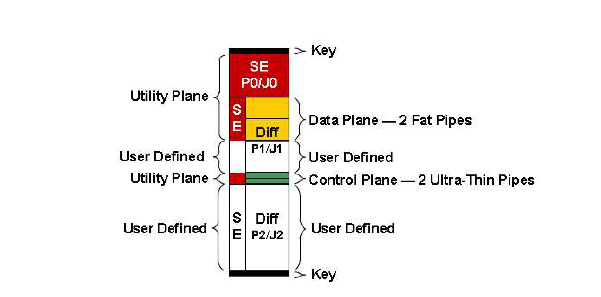

*Figure 25: ANSI/VITA 65.0 Payload Slot Profile for SLT3-PAY-2F2U-14.2.3*

5.2.16.3 3U Payload Slot Profiles

**Rule 5.2.16.3-1**

SOSA 3U Payload Plug-In Cards shall conform to the ANSI/VITA 65.0 slot profile SLT3-PAY-1F1U1S1S1U1U2F1H-14.6.11-n or SLT3-PAY-1F1U1S1S1U1U4F1J-14.6.13-n. Conformance Methodology: (A)

**Recommendation 5.2.16.3-1**

SOSA 3U Payload Plug-In Cards that don’t require RF or optical should conform to ANSI/VITA 65.0 slot profile SLT3-PAY-1F1U1S1S1U1U2F1H-14.6.11-0. Conformance Methodology: (TBD)

**Recommendation 5.2.16.3-2**

SOSA 3U Payload Plug-In Cards requiring RF should conform to ANSI/VITA 65.1 slot profile SLT3-PAY-1F1U1S1S1U1U2F1H-14.6.11-2. Conformance Methodology: (TBD)

**Recommendation 5.2.16.3-3**

SOSA 3U Payload Plug-In Cards that require additional Expansion Plane connectivity should conform to ANSI/VITA 65.0 slot profile SLT3-PAY-1F1U1S1S1U1U4F1J-14.6.13-n. Conformance Methodology: (TBD)

**Recommendation 5.2.16.3-4**

Vendors that use ANSI/VITA 65.1 slot profile SLT3-PAY-1F1U1S1S1U1U4F1J-14.6.13-n should provide a build option to not populate the ANSI/VITA 46.0 connector in P2A so that the card can also be used in a backplane adhering to SLT3-PAY-1F1U1S1S1U1U2F1H-14.6.11-n.

<!-- 原书 p.105 ｜ PDF p.125 -->

**Rule 5.2.16.3-2**

SOSA 3U Payload Plug-In Cards shall conform to one of the ANSI/VITA 65.1 module profiles in Table 21 or Table 22. Conformance Methodology: (A)

**Recommendation 5.2.16.3-5**

SOSA 3U Payload Plug-In Cards that don’t require RF or optical should conform to ANSI/VITA 65.1 module profile MOD3p-PAY-1F1U1S1S1U1U2F1H-16.6.11-4.

**Recommendation 5.2.16.3-6**

SOSA 3U Payload Plug-In Cards requiring RF should conform to ANSI/VITA 65.1 module profile MOD3-PAY-1F1U1S1S1U1U2F1H-16.6.11-6.

**Observation 5.2.16.3-1**

SOSA 3U Payload Plug-In Cards can include, but are not limited to, SBCs that are computationally-intensive, FPGAs, and RF transceivers.

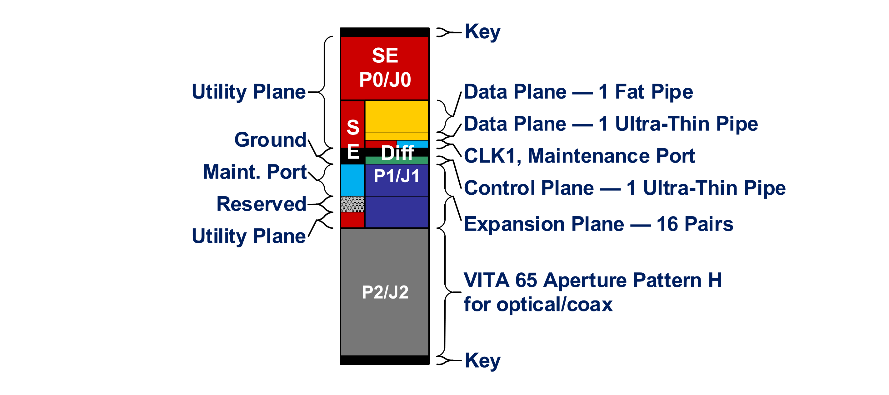

*Figure 26: ANSI/VITA 65.0 Payload Slot Profile SLT3-PAY-1F1U1S1S1U1U2F1H-14.6.11-n*

**Table 21: ANSI/VITA 65.1Slot Profiles for SLT3-PAY-1F1U1S1S1U1U2F1H-14.6.11-n**

| Slot Profile names | Dash Num | STD Date | Connector Modules ||| MT loading and Optical Pipes ||| Comments |
|---|---|---|---|---|---|---|---|---|---|
| | | | P1B/J1B | P2A/J2A | P2B/J2B | P1B/J1B | P2A/J2A | P2B/J2B | |
| **SLT3-PAY-1F1U1S1S1U1U2F1H-14.6.11-** | | | **VITA 46** | **Aperture H** || | | | **First row of SLT3-PAY-1F1U1S1S1U1U2F1H-14.6.11-n** |
| SLT3-PAY-1F1U1S1S1U1U2F1H-14.6.11- | 0 | 2017-07 | VITA 46 | Empty || | | | |
| SLT3-PAY-1F1U1S1S1U1U2F1H-14.6.11- | 1 | 2017-07 | VITA 46 | Hybrid 66.4+67.1-6.4.5.6.1 || | | | |
| SLT3-PAY-1F1U1S1S1U1U2F1H-14.6.11- | 2 | Proposed | VITA 46 | 10 SMPM contacts-6.4.5.6.3 || | | | |
| Last line | | | | | | | | | |

> 转写说明：表头两层级联——第一层 `Connector Modules` 横跨 P1B/J1B、P2A/J2A、P2B/J2B 三列，`MT loading and Optical Pipes` 横跨其下同名三列；`Slot Profile names`、`Dash Num`、`STD Date`、`Comments` 四个标目占满两行。被 colspan 覆盖处留空。
> 转写说明：`Slot Profile names` 与 `Dash Num` 两个标目在原书同处一个表头格（左右分置，其间未画竖线）；数据行中配置档名之后留一空格为该行短横编号。此处拆作两列照录，两列合并即为完整编号 `SLT3-PAY-1F1U1S1S1U1U2F1H-14.6.11-<n>`；首行无编号数字（原书如此）。
> 转写说明：`Connector Modules` 下 P2A/J2A 与 P2B/J2B 两列在原书数据行合并为一格（`Aperture H`、`Empty`、`Hybrid 66.4+67.1-6.4.5.6.1`、`10 SMPM contacts-6.4.5.6.3` 跨两列），此处按 colspan 记作一格后接空格。
> 转写说明：`Hybrid 66.4+67.1-6.4.5.6.1` 与 `10 SMPM contacts-6.4.5.6.3` 在原书为蓝色带下划线的超链接样式，此处只记文字；`Proposed` 行的黄色底纹与末行灰底纹未在 Markdown 中表示。
> 转写说明：本表为单页整表（原书 p.106／PDF 第 126 页），共 5 个数据行。下一页（PDF 第 127 页）顶端即 Table 22 的题注与表体，属另一张表，故未续写。

<!-- 原书 p.106 ｜ PDF p.126 -->

**Table 22: ANSI/VITA 65.1 Module Profiles for SLT3-PAY-1F1U1S1S1U1U2F1H-14.6.11-n**

| Module Profile names | Dash Num | STD Date | Slot Profile | Data Plane | Data Plane | Protocols for Copper Planes |||| Optical | Comments | Legacy |
|---|---|---|---|---|---|---|---|---|---|---|---|---|
| | | | | | | Expansion Plane | Expansion Plane | Control Plane | Contol Plane | | | |
| **MOD3-PAY-1F1U1S1S1U1U2F1H-16.6.11-** | | | | **DP01** | **DPutp01** | **EP00 - EP03** | **EP04 - EP07** | **CPutp01** | | | **First row of MOD3-PAY-1F1U1S1S1U1U2F1H-16.6.11-n** | |
| MOD3p-PAY-1F1U1S1S1U1U2F1H-16.6.11- | 1 | 2017-07 | SLT3p-PAY-1F1U1S1S1U1U2F1H-14.6.11-1 | 10GBASE-KX4 -- 5.1.5 | 1000BASE-KX -- 5.1.2 | PCIe Gen 2 -- 5.3.3.2 | User Defined | 1000BASE-KX -- 5.1.2 | | | P2/J2: Hybrid_66.4+67.1-6.4.5.6.1 | |
| MOD3p-PAY-1F1U1S1S1U1U2F1H-16.6.11- | 2 | Proposed | SLT3p-PAY-1F1U1S1S1U1U2F1H-14.6.11-2 | 10GBASE-KX4 -- 5.1.5 | 1000BASE-KX -- 5.1.2 | PCIe Gen 2 -- 5.3.3.2 | User Defined | 1000BASE-KX -- 5.1.2 | | | P2/J2: 10_SMPM_contacts-6.4.5.6.3 | |
| MOD3p-PAY-1F1U1S1S1U1U2F1H-16.6.11- | 3 | Proposed | SLT3p-PAY-1F1U1S1S1U1U2F1H-14.6.11-2 | 40GBASE-KR4 -- 5.1.8 | 10GBASE-KR -- 5.1.7 | PCIe Gen 3 -- 5.3.3.3 | User Defined | 10GBASE-KR -- 5.1.7 | | | P2/J2: 10_SMPM_contacts-6.4.5.6.3 | |
| MOD3p-PAY-1F1U1S1S1U1U2F1H-16.6.11- | 4 | Proposed | SLT3p-PAY-1F1U1S1S1U1U2F1H-14.6.11-0 | 40GBASE-KR4 -- 5.1.8 | 10GBASE-KR -- 5.1.7 | PCIe Gen 3 -- 5.3.3.3 | User Defined | 10GBASE-KR -- 5.1.7 | | | No P2/J2; Intended for use by SBC | |
| MOD3p-PAY-1F1U1S1S1U1U2F1H-16.6.11- | 5 | Proposed | SLT3p-PAY-1F1U1S1S1U1U2F1H-14.6.11-4 | 40GBASE-KR4 -- 5.1.8 | 10GBASE-KR -- 5.1.7 | PCIe Gen 3 -- 5.3.3.3 | User Defined | 10GBASE-KR -- 5.1.7 | | | 14_sMPM_contacts_6.4.5.4.4 | |
| MOD3p-PAY-1F1U1S1S1U1U2F1H-16.6.11- | 6 | Proposed | SLT3p-PAY-1F1U1S1S1U1U2F1H-14.6.11-4 | 40GBASE-KR4 -- 5.1.8 | 10GBASE-KR -- 5.1.7 | Aurora -- 5.7.2 | User Defined | 10GBASE-KR -- 5.1.7 | | | 14_sMPM_contacts_6.4.5.4.4 | |

> 转写说明：表头两层级联——第一层 `Protocols for Copper Planes` 横跨其下 Expansion Plane、Expansion Plane、Control Plane、Contol Plane 四列；其余标目（`Module Profile names`、`Dash Num`、`STD Date`、`Slot Profile`、两列 `Data Plane`、`Optical`、`Comments`、`Legacy`）占满两行。被 colspan 覆盖处留空。
> 转写说明：`Module Profile names` 与 `Dash Num` 两个标目在原书同处一个表头格（左右分置，其间未画竖线）；数据行的短横编号以小字偏置排在该格右端。此处拆作两列照录，两列合并即为完整编号 `MOD3-PAY-1F1U1S1S1U1U2F1H-16.6.11-<n>`。
> 转写说明：第四个子列名在原书排作 `Contol Plane`（缺字母 r，非本次转写笔误）；c9 该列全表无数据。
> 转写说明：首行模块配置档名以大写 `MOD3-PAY-` 起首（粗体），第二至七行为小写 `MOD3p-PAY-` 起首，Slot Profile 亦为 `SLT3p-PAY-`，均照原书大小写录入。
> 转写说明：首行无短横编号（原书如此）。第三、四行的 Slot Profile 同为 `SLT3p-PAY-1F1U1S1S1U1U2F1H-14.6.11-2`，第六、七行同为 `…-14.6.11-4`（原书如此，未作更正）；`Legacy` 列与 `Optical` 列全表空白。
> 转写说明：本表为单页整表（原书 p.107／PDF 第 127 页上半），共 7 个数据行、无 `Last line` 行。同页其下为 Figure 27 与 Table 23、Table 24，下一页（PDF 第 128 页）顶端为 Rule 5.2.16.4-2 正文，均非本表续行，故未续写。

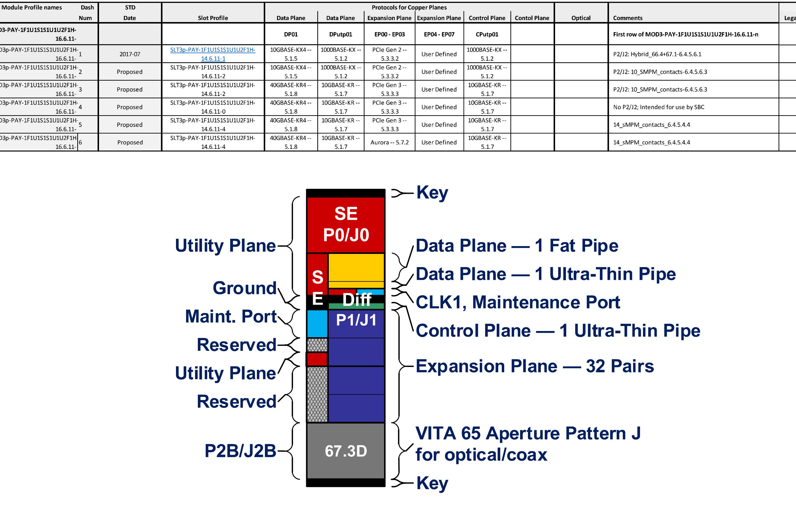

*Figure 27: ANSI/VITA 65.0 Payload Slot Profile SLT3-PAY-1F1U1S1S1U1U4F1J-14.6.13-n*

**Table 23: ANSI/VITA 65.1Slot Profiles for SLT3-PAY-1F1U1S1S1U1U4F1J-14.6.13-n**

| Slot Profile names | Dash Num | STD Date | Connector Modules ||| MT loading and Optical Pipes ||| Comments |
|---|---|---|---|---|---|---|---|---|---|
| | | | P1B/J1B | P2A/J2A | P2B/J2B | P1B/J1B | P2A/J2A | P2B/J2B | |
| **SLT3-PAY-1F1U1S1S1U1U4F1J-14.6.13-** | | **Proposed future 65.0** | **VITA 46** | **VITA 46** | **Aperture J** | **VITA 46** | **VITA 46** | **Aperture J** | **First row of SLT3-PAY-1F1U1S1S1U1U4F1J-14.6.13-n** |
| SLT3-PAY-1F1U1S1S1U1U4F1J-14.6.13- | 0 | Proposed future 65.0 | VITA 46 | VITA 46 | Empty | | | | |
| Last line | | Proposed future 65.0 | | | | | | | |

> 转写说明：表头两层级联——第一层 `Connector Modules` 横跨 P1B/J1B、P2A/J2A、P2B/J2B 三列，`MT loading and Optical Pipes` 横跨其下同名三列；`Slot Profile names`、`Dash Num`、`STD Date`、`Comments` 四个标目占满两行。被 colspan 覆盖处留空。
> 转写说明：`Slot Profile names` 与 `Dash Num` 两个标目在原书同处一个表头格（左右分置，其间未画竖线）；数据行中配置档名之后留一空格为该行短横编号。此处拆作两列照录，两列合并即为完整编号 `SLT3-PAY-1F1U1S1S1U1U4F1J-14.6.13-<n>`；首行无编号数字（原书如此）。
> 转写说明：第二行的 `MT loading and Optical Pipes` 三列为空白；`Proposed future 65.0` 的红色底纹与末行灰底纹系原书高亮，未在 Markdown 中表示。
> 转写说明：本表为单页整表（原书 p.107／PDF 第 127 页中部），共 3 个数据行。同页其下紧接 Table 24，下一页（PDF 第 128 页）顶端为 Rule 5.2.16.4-2 正文，均非本表续行，故未续写。

**Table 24: ANSI/VITA 65.1 Module Profiles for SLT3-PAY-1F1U1S1S1U1U4F1J-14.6.13-n**

| Module Profile names | Dash Num | STD Date | Slot Profile | Protocols for Copper Planes |||| Protocols Optical | Comments | Legacy |
|---|---|---|---|---|---|---|---|---|---|---|
| | | | | Data Plane | Data Plane | Plane | Control Plane | | | |
| **MOD3-PAY-1F1U1S1S1U1U4F1J-16.6.13-** | | **Proposed future 65.0** | | **DP01** | **DPutp01** | **EP00 - EP15** | **CPutp01** | | **First row of MOD3-PAY-1F1U1S1S1U1U4F1J-16.6.13-n** | |
| MOD3p-PAY-1F1U1S1S1U1U4F1J-16.6.13- | 1 | Proposed future 65.0 | SLT3p-PAY-1F1U1S1S1U1U4F1J-14.6.13-0 | 40GBASE-KR4 -- 5.1.8 | 10GBASE-KR -- 5.1.7 | PCIe Gen 3 -- 5.3.3.3 | 10GBASE-KR -- 5.1.7 | | No P2B/J2B | |
| Last line | | Proposed future 65.0 | | | | | | | | |

> 转写说明：表头两层级联——第一层 `Protocols for Copper Planes` 横跨其下 Data Plane、Data Plane、Plane、Control Plane 四列；`Module Profile names`、`Dash Num`、`STD Date`、`Slot Profile`、`Protocols Optical`、`Comments`、`Legacy` 七个标目在原书为一格贯满两行，故在第二行表头中留空。被 colspan 覆盖处同样留空。
> 转写说明：`Module Profile names` 与 `Dash Num` 两个标目在原书同处一个表头格（左右分置，其间未画竖线）。此处拆作两列照录，两列合并即为完整编号 `MOD3-PAY-1F1U1S1S1U1U4F1J-16.6.13-<n>`；首行无编号数字（原书如此）。
> 转写说明：`Protocols Optical` 列与 `Legacy` 列全表空白。
> 转写说明：原书数据首行为大写 `MOD3-PAY-…`（粗体），次行为小写 `MOD3p-PAY-…`、槽位档 `SLT3p-PAY-…`，均照原书大小写照录。
> 转写说明：本表为单页整表（原书 p.107／PDF 第 127 页下半），共 3 个数据行。下一页（PDF 第 128 页）顶端为 Rule 5.2.16.4-2 正文，非本表续行，故未续写。

##### 5.2.16.4 3U Data/Control Plane Switch Profile

**Rule 5.2.16.4-1**

- SOSA 3U Switch Plug-In Cards shall conform to ANSI/VITA 65.0 slot profile SLT3-SWH-

6F8U-14.4.15. Conformance Methodology: (A)

<!-- 原书 p.107 ｜ PDF p.127 -->

**Rule 5.2.16.4-2**

SOSA 3U Switch Plug-In Cards shall conform to one of the ANSI/VITA 65.1 module profiles in

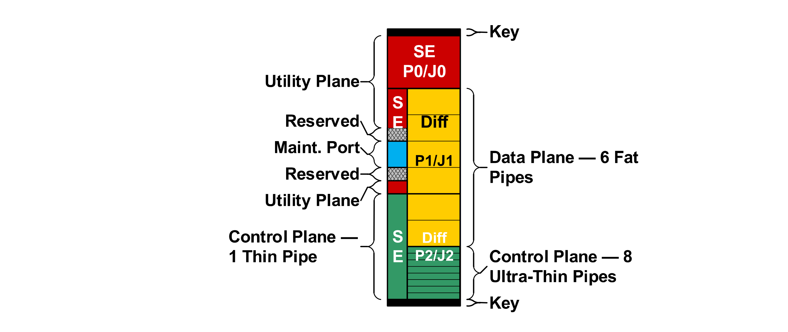

*Figure 28: ANSI/VITA 65.0 Control/Expansion Plane Switch Slot Profile SLT3-SWH-6F8U-14.4.15*

**Table 25: ANSI/VITA 65.1 Module Profiles for SLT3-SWH-6F8U-14.4.15**

| Module Profile names | Dash Num | STD Date | Slot Profile | Protocols for Copper Planes ||| Comments | Legacy |
|---|---|---|---|---|---|---|---|---|
| | | | | Data Plane | Control Plane | Contol Plane | | |
| **MOD3-SWH-6F8U-16.4.16-** | | **Proposed future 65.0** | | **DP01 - DP05, DS01 (FP)** | **CPutp01 - CPutp06, CSutp01** | **CPtp01** | **First row of MOD3-SWH-6F8U-16.4.16-n** | |
| MOD3-SWH-6F8U-16.4.16- | 1 | Proposed future 65.0 | SLT3-SWH-6F8U-14.4.15 | PCIe Gen 3 -- 5.3.3.3 | 10GBASE-KR -- 5.1.7 | 1000BASE-T -- 5.1.3 | | |
| Last line | | Proposed future 65.0 | | | | | | |

> 转写说明：表头两层级联——第一层 `Protocols for Copper Planes` 横跨其下 Data Plane、Control Plane、Contol Plane 三列；`Module Profile names`、`Dash Num`、`STD Date`、`Slot Profile`、`Comments`、`Legacy` 占满两行。被 colspan 覆盖处留空。
> 转写说明：`Module Profile names` 与 `Dash Num` 两个标目在原书同处一个表头格（左右分置，其间未画竖线）；第二行短横编号以小号字排在该格右端。此处拆作两列照录，两列合并即为完整编号 `MOD3-SWH-6F8U-16.4.16-<n>`；首行无编号数字（原书如此）。
> 转写说明：`Protocols for Copper Planes` 下第三个子列名在原书排作 `Contol Plane`（缺字母 r，非本次转写笔误）。
> 转写说明：`Legacy` 列全表空白；`Proposed future 65.0` 的红色底纹与末行灰底纹系原书高亮，未在 Markdown 中表示。
> 转写说明：本表为单页整表（原书 p.108／PDF 第 128 页），共 3 个数据行。下一页（PDF 第 129 页）顶端为 Permission 5.2.16.5-1 正文，非本表续行，故未续写。

##### 5.2.16.5 3U Control/Data Plane Switch Profile

**Rule 5.2.16.5-1**

SOSA 3U Control/Data Plane Switch Plug-In Cards shall conform to ANSI/VITA 65.0 slot profile SLT3-SWH-6F1U7U-14.4.14 or SLT3-SWH-4F1U7U1J-14.8.7-n. Conformance Methodology: (A)

**Rule 5.2.16.5-2**

SOSA 3U Control/Data Plane Switch Plug-In Cards shall conform to one of the ANSI/VITA

65.1 module profiles in Table 23 or Table 24. Conformance Methodology: (A)

<!-- 原书 p.108 ｜ PDF p.128 -->

**Permission 5.2.16.5-1**

The control plane pipes in ANSI/VITA 65.1 slot profiles SLT3-SWH-6F1U7U-14.4.14 and SLT3-SWH-4F1U7U1J-14.8.7-n can be repurposed to provide a second data plane switch fabric.

**Permission 5.2.16.5-2**

Fiber connections on the front of the ANSI/VITA 65.1 SLT3-SWH-6F1U7U-14.4.14 and the

SLT3-SWH-4F1U7U1J-14.8.7-n slot profiles can be used for Ethernet in/out of the chassis if blind-mate fiber connections are not available or practical.

**Recommendation 5.2.16.5-1**

Vendors of a card based on the ANSI/VITA 65.1 slot profile SLT3-SWH-6F1U7U-14.4.14 should offer a variant of this card that can be used in a backplane with a Switch Slot for SLT3-SWH-4F1U7U1J-14.8.7-0 (i.e., P2B is empty).

**Observation 5.2.16.5-1**

ANSI/VITA 65.1 slot profiles SLT3-SWH-6F1U7U-14.4.14 and SLT3-SWH-4F1U7U1J-14.8.7-n can be daisy chained to support additional payload slots, although this successively increases the risk of bottlenecks on inter-switch connections. As such, larger backplanes may wish to use all pipes for data plane connections to minimize the number of inter-switch connections that are required. This approach assumes that ANSI/VITA 65.1 slot profile SLT3-SWH-6F8U-14.4.15 is also used to provide the switch fabric for the control plane.

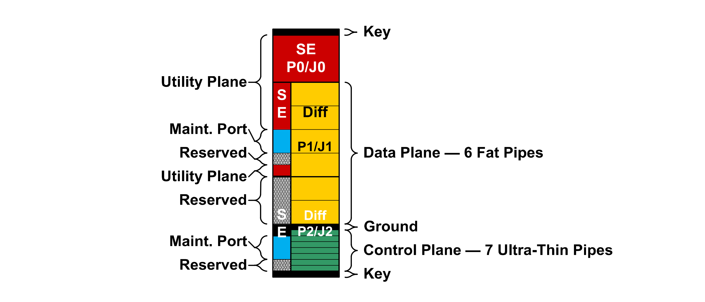

*Figure 29: ANSI/VITA 65.0 Control/Data Plane Switch Slot Profile SLT3-SWH-6F1U7U-14.4.14*

**Table 26: ANSI/VITA 65.1 Module Profiles for SLT3-SWH-6F1U7U-14.4.14**

| Module Profile names | Dash Num | STD Date | Slot Profile | Protocols for Copper Planes |||| Comments | Legacy |
|---|---|---|---|---|---|---|---|---|---|
| | | | | Data Plane | Data Plane | Control Plane | Contol Plane | | |
| **MOD3-SWH-6F1U7U-16.4.15-** | | | | **DS01, DP01 - DP04 (FP)** | **DP05** | **CPutp01 - CPutp06** | **CSutp01** | **First row of MOD3-SWH-6F1U7U-16.4.15-n** | |
| MOD3-SWH-6F1U7U-16.4.15- | 1 | 2017-05 | SLT3-SWH-6F1U7U-14.4.14 | 10GBASE-KX4 -- 5.1.5 | As 4 UTPs: 1000BASE-KX -- 5.1.2 | 1000BASE-KX -- 5.1.2 | 1000BASE-KX -- 5.1.2 | | |
| MOD3-SWH-6F1U7U-16.4.15- | 2 | Proposed | SLT3-SWH-6F1U7U-14.4.14 | 10GBASE-KR -- 5.1.7, 40GBASE-KR4 -- 5.1.8 | 10GBASE-KR -- 5.1.7, 40GBASE-KR4 -- 5.1.8 | 10GBASE-KR -- 5.1.7 | 10GBASE-KR -- 5.1.7 | | |
| Last line | | | | | | | | | |

> 转写说明：表头两层级联——第一层 `Protocols for Copper Planes` 横跨其下 Data Plane、Data Plane、Control Plane、Contol Plane 四列；`Module Profile names`、`Dash Num`、`STD Date`、`Slot Profile`、`Comments`、`Legacy` 占满两行。被 colspan 覆盖处留空。
> 转写说明：`Module Profile names` 与 `Dash Num` 两个标目在原书同处一个表头格（左右分置，其间未画竖线）；数据行中短横编号以极小字号排在该格右端（如 `MOD3-SWH-6F1U7U-16.4.15- 1`）。此处拆作两列照录，两列合并即为完整编号 `MOD3-SWH-6F1U7U-16.4.15-<n>`；首行无编号数字（原书如此）。
> 转写说明：`Protocols for Copper Planes` 下第四个子列名在原书排作 `Contol Plane`（缺字母 r，非本次转写笔误）。
> 转写说明：第三行 STD Date 列在原书因列宽不足折为 `Propose` / `d` 两行，此处按单词复原为 `Proposed`；`Legacy` 列全表空白；末行除 `Last line` 外全为灰底空白。
> 转写说明：本表为单页整表（原书 p.109／PDF 第 129 页），共 4 个数据行。下一页（PDF 第 130 页）顶端为 Figure 30，非本表续行，故未续写。

<!-- 原书 p.109 ｜ PDF p.129 -->

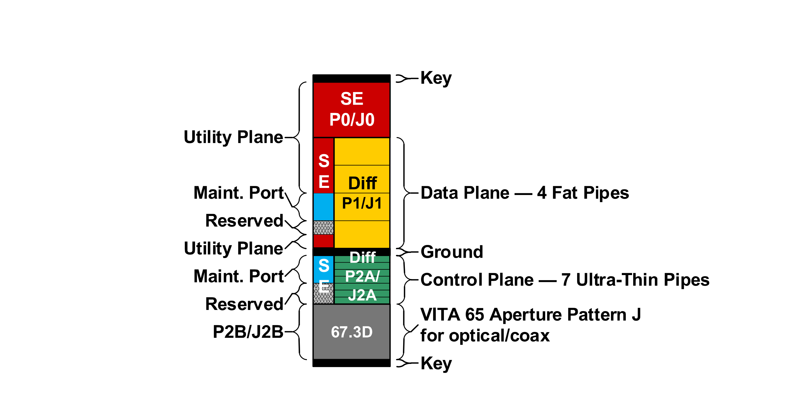

*Figure 30: ANSI/VITA 65.0 Control/Data Plane Switch Slot Profile SLT3-SWH-4F1U7U1J-14.8.7-n*

**Table 27: ANSI/VITA 65.1 Module Profiles for SLT3-SWH-4F1U7U1J-14.8.7-n**

| Module Profile names | Dash Num | STD Date | Slot Profile | Protocols for Copper Planes ||| Protocols for Optical | Comments | Legacy |
|---|---|---|---|---|---|---|---|---|---|
| | | | | Data Plane | Data Plane | Control Plane | | | |
| **MOD3-SWH-4F1U7U1J-16.8.7-** | | | | **DS01, DP01, DP02** | **DP03** | **CSutp01, CPutp01 - CPutp06** | | **First row of MOD3-SWH-4F1U7U1J-16.8.7-n** | |
| MOD3-SWH-4F1U7U1J-16.8.7- | 1 | 2017-05 | SLT3-SWH-4F1U7U1J-14.8.7-1 | 10GBASE-KX4 -- 5.1.5 | As 4 UTPs: 1000BASE-KX -- 5.1.2 | 1000BASE-KX -- 5.1.2 | | | |
| MOD3-SWH-4F1U7U1J-16.8.7- | 2 | Proposed | SLT3-SWH-4F1U7U1J-14.8.7-0 | 10GBASE-KR -- 5.1.7, 40GBASE-KR4 -- 5.1.8 | 10GBASE-KR -- 5.1.7, 40GBASE-KR4 -- 5.1.8 | 10GBASE-KR -- 5.1.7 | | | |
| Last line | | | | | | | | | |

> 转写说明：表头两层级联——第一层 `Protocols for Copper Planes` 横跨其下 Data Plane、Data Plane、Control Plane 三列（原书该组标目偏左，压过第一道子列线）；`Module Profile names`、`Dash Num`、`STD Date`、`Slot Profile`、`Protocols for Optical`、`Comments`、`Legacy` 占满两行。被 colspan 覆盖处留空。
> 转写说明：`Module Profile names` 与 `Dash Num` 两个标目在原书同处一个表头格（左右分置，其间未画竖线）；数据行中短横编号以小号字排在该格右端。此处拆作两列照录，两列合并即为完整编号 `MOD3-SWH-4F1U7U1J-16.8.7-<n>`。
> 转写说明：第三行 STD Date 列在原书因列宽不足折为 `Propose` / `d` 两行，此处按单词复原为 `Proposed`；第二行槽位档 `SLT3-SWH-4F1U7U1J-14.8.7-1` 在原书为蓝色带下划线的超链接样式，此处只记文字。
> 转写说明：`Protocols for Optical` 列与 `Legacy` 列全表空白；末行除 `Last line` 外全为灰底空白。
> 转写说明：本表为单页整表（原书 p.110／PDF 第 130 页），共 4 个数据行。下一页（PDF 第 131 页）顶端为 Figure 31，非本表续行，故未续写。

##### 5.2.16.6 3U SOSA RF Switch Plug-In Card Profile

**Rule 5.2.16.6-1**

SOSA 3U RF Switch Plug-In Cards shall conform to ANSI/VITA 65.0 slot profile SLT3-SWH-1F1S1S1U1U1K-14.8.8-n per. Conformance Methodology: (A)

**Rule 5.2.16.6-2**

SOSA 3U RF Switch Plug-In Cards shall conform to one of the ANSI/VITA 65.1 module profiles in Table 28. Conformance Methodology: (A)

<!-- 原书 p.110 ｜ PDF p.130 -->

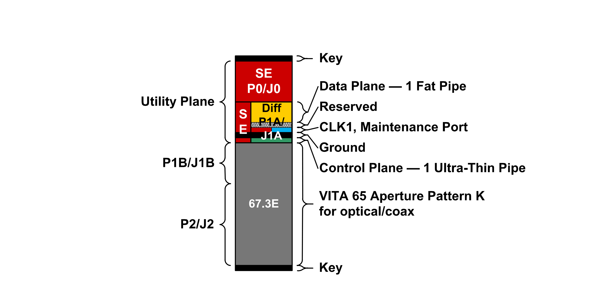

*Figure 31: ANSI/VITA 65.0 3U RF Switch Slot Profile SLT3-SWH-1F1S1S1U1U1K-14.8.8-n*

**Table 28: ANSI/VITA 65.1 Module Profiles for SLT3-SWH-1F1S1S1U1U1K-14.8.8-n**

| Module Profile names | Dash Num | STD Date | Slot Profile | Protocols for Copper Planes || Protocols for Optical | Comments | Legacy |
|---|---|---|---|---|---|---|---|---|
| | | | | Data Plane | Control Plane | | | |
| **MOD3-SWH-1F1S1S1U1U1K-16.8.8-** | | | | **DP01** | **CPutp01** | | **First row of MOD3-SWH-1F1S1S1U1U1K-16.8.8-n** | |
| MOD3-SWH-1F1S1S1U1U1K-16.8.8- | 1 | 2017-05 | SLT3-SWH-1F1S1S1U1U1K-14.8.8-1 | 10GBASE-KX4 -- 5.1.5 | 1000BASE-KX -- 5.1.2 | | | |
| MOD3-SWH-1F1S1S1U1U1K-16.8.8- | 2 | Proposed | SLT3-SWH-1F1S1S1U1U1K-14.8.8-0 | 10GBASE-KR -- 5.1.7, 40GBASE-KR4 -- 5.1.8 | 10GBASE-KR -- 5.1.7 | | | |
| Last line | | | | | | | | |

> 转写说明：表头两层级联——第一层 `Protocols for Copper Planes` 横跨其下 Data Plane、Control Plane 两列；`Module Profile names`、`Dash Num`、`STD Date`、`Slot Profile`、`Protocols for Optical`、`Comments`、`Legacy` 占满两行。被 colspan 覆盖处留空。
> 转写说明：`Module Profile names` 与 `Dash Num` 两个标目在原书同处一个表头格（左右分置，其间未画竖线）；数据行中短横编号以小号字排在该格右端。此处拆作两列照录，两列合并即为完整编号 `MOD3-SWH-1F1S1S1U1U1K-16.8.8-<n>`；首行无编号数字（原书如此）。
> 转写说明：第三行 STD Date 列在原书因列宽不足折为 `Propose` / `d` 两行，此处按单词复原为 `Proposed`；第二行槽位档 `SLT3-SWH-1F1S1S1U1U1K-14.8.8-1` 在原书为蓝色带下划线的超链接样式，此处只记文字。
> 转写说明：`Protocols for Optical` 列与 `Legacy` 列全表空白；末行除 `Last line` 外全为灰底空白。
> 转写说明：本表为单页整表（原书 p.111／PDF 第 131 页），共 4 个数据行。下一页（PDF 第 132 页）顶端为 Observation 5.2.16.7-1 正文与 Figure 32，非本表续行，故未续写。

##### 5.2.16.7 SOSA 3U Radial Clock Plug-In Card Profiles

**Rule 5.2.16.7-1**

SOSA 3U Radial Clock Plug-In Cards shall conform to ANSI/VITA 65.0 slot profile SLT3x-

TIM-2S1U22S1U2U1H-14.9.2-n. Conformance Methodology: (A)

**Rule 5.2.16.7-2**

SOSA 3U Radial Clock Plug-In Cards shall only drive REF_CLK+/- if SYS_CON* is asserted. Conformance Methodology: (T)

**Rule 5.2.16.7-3**

SOSA 3U Radial Clock Plug-In Cards shall assert SYSRESET* until all internal clocks are valid. Conformance Methodology: (T)

**Rule 5.2.16.7-4**

SOSA 3U Radial Clock Plug-In Cards shall conform to one of the ANSI/VITA 65.1 module profiles in Table 29 and Table 30. Conformance Methodology: (A)

<!-- 原书 p.111 ｜ PDF p.131 -->

**Observation 5.2.16.7-1**

- ANSI/VITA 65.0 §6.2.2 requires the lower-numbered ports to be the ones that are used if there are some unused ports. The lower-numbered ports are the ones closest to P0/J0; hence if backplanes follow this requirement, the option of using SLT3x-TIM-4S16S1U2U1H-14.9.1-n for eight or fewer REF_CLK/AUX_CLK pairs will be accommodated.

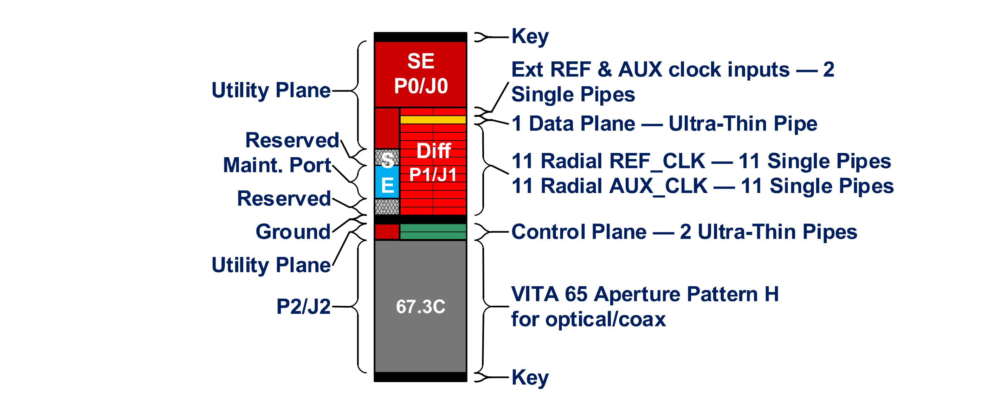

*Figure 32: ANSI/VITA 65.0 Radial Clock Slot Profile SLT3x-TIM-2S1U22S1U2U1H-14.9.2-n*

**Table 29: VITA 65.1 Slot Profiles for SLT3x-TIM-2S1U22S1U2U1H-14.9.2-n**

| Slot Profile names | Dash Num | STD Date | Connector Modules |  |  | MT loading and Optical Pipes |  |  | Comments |
|---|---|---|---|---|---|---|---|---|---|
|  |  |  | P1B/J1B | P2A/J2A | P2B/J2B | P1B/J1B | P2A/J2A | P2B/J2B |  |
| SLT3x-TIM-2S1U22S1U2U1H-14.9.2- |  | Proposed future 65.0 | VITA 46 | Aperture H |  | VITA 46 | Aperture H |  | First row of SLT3x-TIM-2S1U22S1U2U1H-14.9.2-n |
| SLT3x-TIM-2S1U22S1U2U1H-14.9.2- | 0 | Proposed future 65.0 | VITA 46 | Empty |  |  |  |  |  |
| SLT3x-TIM-2S1U22S1U2U1H-14.9.2- | 1 | Proposed future 65.0 | VITA 46 | 10 SMPM contacts-6.4.5.6.3 |  |  |  |  |  |
| Last line |  | Proposed future 65.0 |  |  |  |  |  |  |  |

> 转写说明：
> 1. 表头为两层：第一行为分组标题，第二行（加粗）为子列标题，照原表第 2 行录。`Connector Modules` 横跨 P1B/J1B、P2A/J2A、P2B/J2B 三列，`MT loading and Optical Pipes` 横跨其后三列，被覆盖的单元格留空。
> 2. 原表 `Slot Profile names` 与 `Dash Num` 之间无竖线（扫描件如此），本表依表头文字分为两列；拼接后的完整配置档编号为 `SLT3x-TIM-2S1U22S1U2U1H-14.9.2-n`、`…-14.9.2-0`、`…-14.9.2-1`。
> 3. `Connector Modules` 的 P2A/J2A 与 P2B/J2B 在数据行上合并为一格（`Aperture H`、`Empty`、`10 SMPM contacts-6.4.5.6.3`），值记在 P2A/J2A 列，P2B/J2B 列留空；`MT loading and Optical Pipes` 同此，仅第一行有值 `VITA 46`、`Aperture H`。
> 4. `Last line` 为原表的收尾行标签（灰色底），照录。

**Table 30: VITA 65.1 Module Profiles for SLT3x-TIM-2S1U22S1U2U1H-14.9.2-n**

| Module Profile names | Dash Num | STD Date | Slot Profile | Protocols for Copper Planes |  |  | Protocols for Optical and Signals for Coax Contacts |  |  |  |  |  |  |  |  |  |
|---|---|---|---|---|---|---|---|---|---|---|---|---|---|---|---|---|
|  |  |  |  | Data Plane | Control Plane | Contol Plane | Coax Contacts for Connector Module 10_SMPM_contacts-6.4.5.6.3 |  |  |  |  |  |  |  |  |  |
|  |  |  |  |  |  |  | **A1** | **A2** | **A3** | **B1** | **B2** | **B3** | **B4** | **C1** | **C2** | **C3** |
| MOD3x-TIM-2S1U22S1U2U1H-14.9.3- |  | Proposed future 65.0 |  | DPutp01 | CPutp01, Cputp02 |  |  |  |  |  |  |  |  |  |  |  |
|  |  | Proposed future 65.0 |  |  |  |  |  |  |  |  |  |  |  |  |  |  |
| MOD3p-TIM-2S1U22S1U2U1H-14.9.3- | 1 | Proposed future 65.0 | SLT3p-TIM-2S1U22S1U2U1H-14.9.3-1 | 1000BASE-KX -- 5.1.2 | 1000BASE-KX -- 5.1.2 |  | REF_CLK_Out --5.13.1 | AUX_CLK_Out -- 5.13.1 | RSVD | AUX_CLK_In -- 5.13.1 | REF_CLK_In -- 5.13.1 | RSVD | RSVD | RSVD | GPS_Ant2_In -- 5.13.2 | GPS_Ant1_In -- 5.13.2 |
| MOD3p-TIM-2S1U22S1U2U1H-14.9.3- | 2 | Proposed future 65.0 | SLT3p-TIM-2S1U22S1U2U1H-14.9.3-1 | 10GBASE-KR -- 5.1.7 | 10GBASE-KR -- 5.1.7 |  | REF_CLK_Out --5.13.1 | AUX_CLK_Out -- 5.13.1 | RSVD | AUX_CLK_In -- 5.13.1 | REF_CLK_In -- 5.13.1 | RSVD | RSVD | RSVD | GPS_Ant2_In -- 5.13.2 | GPS_Ant1_In -- 5.13.2 |
| Last line |  | Proposed future 65.0 |  |  |  |  |  |  |  |  |  |  |  |  |  |  |

> 转写说明：
> 1. 表头为多层：第 1 行是分组标题（`Protocols for Copper Planes` 横跨 `Data Plane`／`Control Plane`／`Contol Plane` 三列；`Protocols for Optical and Signals for Coax Contacts` 横跨 `A1`～`C3` 十列），第 2、3 行（加粗）是子列标题，被覆盖的单元格留空。原表 `Data Plane` 等子标题与 `Coax Contacts for Connector Module 10_SMPM_contacts-6.4.5.6.3` 组标题同处一条 band（原表数据第 2 行）内，为便于并列成表，组标题置于第 2 行、`A1`～`C3` 置于第 3 行；原表该 band 只剩 `STD Date` 一格有值，即下方第 2 条数据行。
> 2. 原表 `Module Profile names` 与 `Dash Num` 之间无竖线（扫描件如此），本表依表头文字分为两列；拼接后的完整配置档编号为 `MOD3x-TIM-2S1U22S1U2U1H-14.9.3-n`、`MOD3p-TIM-2S1U22S1U2U1H-14.9.3-1`、`MOD3p-TIM-2S1U22S1U2U1H-14.9.3-2`。
> 3. `Protocols for Optical and Signals for Coax Contacts` 下第一行（`MOD3x…` 行）的十个单元格在原表中合并为一格且为空，值行从第三行起才出现（见第 3 条、第 4 条数据行）。
> 4. 原表在 `STD Date` 列把 `Proposed future 65.0` 画成上下相邻的两格（该行其余列未分格），本表按一格记，值不重复。
> 5. 左侧窄列内的换行（如 `CPutp01,`／`Cputp02`、`REF_CLK_`／`Out --5.13.1`）已并回单行，` ` 仅用于原表明确的两行内容；`A1` 列为 `Out --5.13.1`（`--` 后无空格），`A2`～`C3` 各列为 `-- 5.13.1`／`-- 5.13.2`（`--` 后有空格），照原样保留。
> 6. `Contol Plane` 系原表如此拼写（`Control` 缺 `r`），照录。
> 7. `Last line` 为原表的收尾行标签（灰色底），照录。

##### 5.2.16.8 3U External I/O Plug-In Card Profile

**Rule 5.2.16.8-1**

- SOSA 3U External I/O Plug-In Cards shall conform to ANSI/VITA 65.0 slot profile SLT3-

PAY-2U2U-14.2.17. Conformance Methodology: (TBD)

<!-- 原书 p.112 ｜ PDF p.132 -->

**Rule 5.2.16.8-2**

User-defined pins in ANSI/VITA 65.1 slot profile SLT3-PAY-2U2U-14.2.17 shall only interface with platform I/O and not other modules within the system. Conformance Methodology: (TBD)

**Rule 5.2.16.8-3**

SOSA 3U External I/O plug-in cards shall conform to one of the ANSI/VITA 65.1 module profiles in Table 31. Conformance Methodology: (A)

**Observation 5.2.16.8-1**

Instead of routing platform-specific I/O to non-standard payloads, integrators can utilize the SOSA 3U External I/O plug-in card as the platform I/O “data center” where a single plug-in card (or multiple if required) can interface with the platform over platform-specific connections and the rest of the payload plug-in cards over standard expansion or control plane interfaces.

**Recommendation 5.2.16.8-1**

The SOSA 3U I/O Intensive SBC plug-in card profile should be used instead of the SOSA 3U External I/O plug-in card profile if platform-specific I/O can be accommodated by a single XMC.

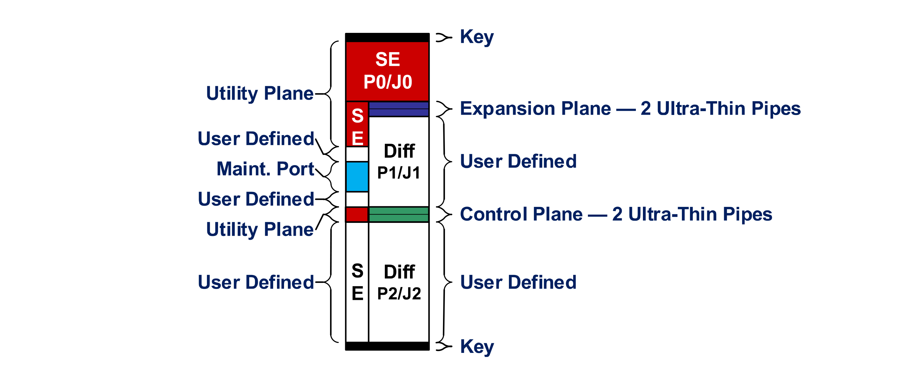

*Figure 33: ANSI/VITA 65.0 3U External I/O Slot Profile SLT3-PAY-2U2U-14.2.17*

**Table 31: ANSI/VITA 65.1 Module Profiles for SLT3-PAY-2U2U-14.2.17**

| Module Profile names | Dash Num | STD Date | Slot Profile | Protocols for Copper Planes |  | Protocols for Optical | Comments |
|---|---|---|---|---|---|---|---|
|  |  |  |  | Data Plane | Control Plane |  |  |
| MOD3-PAY-2U2U-16.2.16- |  | Proposed future 65.0 |  | EPutp01, EPutp02 | CPutp01, CPutp02 |  | First row of MOD3-PAY-2U2U-16.2.16-n |
| MOD3-PAY-2U2U-16.2.16- | 1 | Proposed future 65.0 | SLT3-PAY-2U2U-14.2.17 | PCIe Gen 2 -- 5.3.3.2 | 1000GBASE-KX -- 5.1.2 |  |  |
| MOD3-PAY-2U2U-16.2.16- | 2 | Proposed future 65.0 | SLT3-PAY-2U2U-14.2.17 | PCIe Gen 3 -- 5.3.3.3 | 10GBASE-KR -- 5.1.7 |  |  |
| Last line |  | Proposed future 65.0 |  |  |  |  |  |

> 转写说明：
> 1. 表头为两层：第 1 行为分组标题，第 2 行（加粗）为子列标题，照原表第 2 行录。`Protocols for Copper Planes` 横跨 `Data Plane`、`Control Plane` 两列，被覆盖的单元格留空；`Protocols for Optical` 无子列，各行均空。
> 2. 原表 `Module Profile names` 与 `Dash Num` 之间无竖线（扫描件如此），本表依表头文字分为两列；拼接后的完整配置档编号为 `MOD3-PAY-2U2U-16.2.16-n`、`MOD3-PAY-2U2U-16.2.16-1`、`MOD3-PAY-2U2U-16.2.16-2`。
> 3. 本表 `1000GBASE-KX` 系原表如此（比常见写法 `1000BASE-KX` 多一个 `G`），照录。
> 4. 第一行 `Slot Profile` 为空（通用档 `-n` 不指定具体插槽档），其上方的 `STD Date` 单元格在版面上明显高于其余各行，照录。
> 5. `Last line` 为原表的收尾行标签（灰色底），照录。

<!-- 原书 p.113 ｜ PDF p.133 -->

#### 5.2.17 6U Plug-In Card Profile Specifications

5.2.17.1 6U Payload Plug-In Card Profiles

**Rule 5.2.17.1-1**

SOSA 6U Payload Plug-In Cards shall conform to ANSI/VITA 65.0 slot profile SLT6-PAY-4F2Q1H4U1T1S1S1TU2U2T1H-10.6.4-n or SLT6-PAY-4F1Q1H4U1T1S1S1TU2U2T1H-

10.6.3-n. Conformance Methodology: (A)

**Rule 5.2.17.1-2**

SOSA systems shall route the GPIO pins from ANSI/VITA SLT6-PAY-4F2Q1H4U1T1S1S1TU2U2T1H-10.6.4-n and SLT6-PAY-4F1Q1H4U1T1S1S1TU2U2T1H-10.6.3-n to external platform I/O. Conformance Methodology: (A)

**Rule 5.2.17.1-3**

SOSA systems shall route XMC pins from ANSI/VITA 65.1 slot profile SLT6-PAY-4F1Q1H4U1T1S1S1TU2U2T1H-10.6.3-n to external chassis I/O connectors. Conformance Methodology: (A)

**Rule 5.2.17.1-4**

SOSA 6U Payload Plug-In Cards shall conform to one of the ANSI/VITA 65.1 module profiles in Table 32 or Table 33. Conformance Methodology: (A)

**Rule 5.2.17.1-5**

If a Payload Plug-In Card implements the Control Plane Thin Pipes from ANSI/VITA 65.1 SLT6-PAY-4F2Q1H4U1T1S1S1TU2U2T1H-10.6.4-n or SLT6-PAY-

4F1Q1H4U1T1S1S1TU2U2T1H-10.6.3-n, the Payload Plug-In Card shall use the Control Plane Thin Pipes exclusively for communication external to the system. Conformance Methodology: (A)

**Observation 5.2.17.1-1**

Payload Plug-In Cards can include, but are not limited to, SBCs that are input/output (I/O)intensive, SBCs that are computationally-intensive, FPGAs, and RF transceivers.

**Recommendation 5.2.17.1-1**

Payload Plug-In Cards should conform to ANSI/VITA 65.1 slot profile SLT6-PAY-4F2Q1H4U1T1S1S1TU2U2T1H-10.6.4-n if they don’t require an XMC.

**Observation 5.2.17.1-2**

SOSA systems will likely only contain one or two plug-in cards that support ANSI/VITA 65.1 slot profile SLT6-PAY-4F1Q1H4U1T1S1S1TU2U2T1H-10.6.3-n. These slots can use an XMC to customize I/O for a particular system or platform. The remaining plug-in cards will use

<!-- 原书 p.114 ｜ PDF p.134 -->

ANSI/VITA 65.1 slot profile SLT6-PAY-4F2Q1H4U1T1S1S1TU2U2T1H-10.6.4-n to support processing for the various sensor modalities.

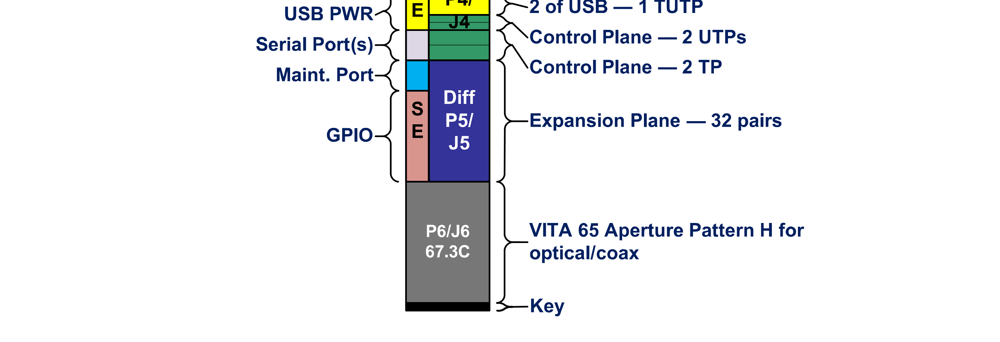

*Figure 34: ANSI/VITA 65.0 6U Payload Slot Profile SLT6-PAY-4F2Q1H4U1T1S1S1TU2U2T1H-*

10.6.4-n

**Table 32: ANSI/VITA 65.1 Slot Profiles for SLT6-PAY-4F2Q1H4U1T1S1S1TU2U2T1H-10.6.4-n**

| Slot Profile names | Dash Num | STD Date | Connector Modules |  |  |  | MT loading and Optical Pipes |  |
|---|---|---|---|---|---|---|---|---|
|  |  |  | P1/J1 , P2/J2 | P3/J3 | P4/J4, P5/J5 | P6/J6 | P3/J3 | P6/J6 |
| SLT6-PAY-4F2Q1H4U1T1S1S1TU2U2T1H-10.6.4- |  | Proposed future 65.0 | VITA 46 | Aperture H | VITA 46 | Aperture H | Aperture H | Aperture H |
| SLT6-PAY-4F2Q1H4U1T1S1S1TU2U2T1H-10.6.4- | 0 | Proposed future 65.0 | VITA 46 | Empty | VITA 46 | Empty | Empty | Empty |
| Last line |  | Proposed future 65.0 |  |  |  |  |  |  |

> 转写说明：
> 1. 表头为两层：第 1 行为分组标题，第 2 行（加粗）为子列标题，照原表第 2 行录。`Connector Modules` 横跨 `P1/J1 , P2/J2`、`P3/J3`、`P4/J4, P5/J5`、`P6/J6` 四列，`MT loading and Optical Pipes` 横跨其后 `P3/J3`、`P6/J6` 两列，被覆盖的单元格留空。
> 2. 原表 `Slot Profile names` 与 `Dash Num` 之间无竖线（扫描件如此），本表依表头文字分为两列；拼接后的完整配置档编号为 `SLT6-PAY-4F2Q1H4U1T1S1S1TU2U2T1H-10.6.4-n` 与 `…-10.6.4-0`。
> 3. 该编号的字符序列经 6 倍放大逐字核对：`…4F2Q1H4U1T1S1S1TU2U2T1H…`，即 `1T` 与 `U2` 之间**无** `1`（不是 `…1S1S1T1U2U2T1H…`）。
> 4. 子列标题 `P1/J1 , P2/J2` 的逗号前有空格，`P4/J4, P5/J5` 的逗号前无空格，均照原表。
> 5. `Last line` 为原表的收尾行标签（灰色底），照录。

<!-- 原书 p.115 ｜ PDF p.135 -->

**Table 33: ANSI/VITA 65.1 Module Profiles for SLT6-PAY-4F2Q1H4U1T1S1S1TU2U2T1H-10.6.4-n**

| Module Profile names | Dash Num | STD Date | Slot Profile | Protocols for Copper Planes |  |  |  | Miscellaneous Protocols over copper connectors |  |  |  |  |  | Protocols for Optical |
|---|---|---|---|---|---|---|---|---|---|---|---|---|---|---|
|  |  |  |  | Data Plane | Exp. Plane | Control Plane | Control Plane |  |  |  |  |  |  |  |
| MOD6-PAY-4F2Q1H4U1T1S1S1TU2U2T1H-12.6.4- |  | Proposed future 65.0 |  | DP01 - DP04 (FPs) | EP00 - EP15 | CPutp01, CPutp02 | CPtp01, CPtp02 | STRutp01 - STRutp04 | USB01, USB02 | VID01 | SER01 | GPIO1 - GPIO10 | GPIvds01 |  |
| MOD6-PAY-4F2Q1H4U1T1S1S1TU2U2T1H-12.6.4- | 1 | Proposed future 65.0 | SLT6-PAY-4F2Q1H4U1T1S1S1TU2U2T1H-10.6.4-0 | 10GBASE-KX4 -- 5.1.5 | PCIe Gen 2 -- 5.3.3.2 | 1000BASE-KX -- 5.1.2 | 1000BASE-T -- 5.1.3 | SATA Gen 2 -- 5.6.2 | USB 2 -- 5.9.1 | DisplayPort 1.2 -- 5.10.2 | Serial Ports -- 5.12.1 | GPIO -- 5.14.1 | GPLVDS -- 5.14.2 |  |
| MOD6-PAY-4F2Q1H4U1T1S1S1TU2U2T1H-12.6.4- | 2 | Proposed future 65.0 | SLT6-PAY-4F2Q1H4U1T1S1S1TU2U2T1H-10.6.4-0 | 40GBASE-KR4 -- 5.1.8 | PCIe Gen 3 -- 5.3.3.3 | 10GBASE-KR -- 5.1.7 | 10GBASE-T -- 5.1.6 | SATA Gen 3 -- 5.6.3 | USB 3.1 Gen 2 -- 5.9.3 | DisplayPort 1.2 -- 5.10.2 | Serial Ports -- 5.12.1 | GPIO -- 5.14.1 | GPLVDS -- 5.14.2 |  |
| MOD6-PAY-4F2Q1H4U1T1S1S1TU2U2T1H-12.6.4- | 3 | Proposed | SLT6-PAY-4F2Q1H4U1T1S1S1TU2U2T1H-10.6.4-0 | 40GBASE-KR4 -- 5.1.8 | Aurora -- 5.7.2 | 10GBASE-KR -- 5.1.7 | 10GBASE-T -- 5.1.6 | SATA Gen 3 -- 5.6.3 | USB 3.1 Gen 2 -- 5.9.3 | DisplayPort 1.2 -- 5.10.2 | Serial Ports -- 5.12.1 | GPIO -- 5.14.1 | GPLVDS -- 5.14.2 |  |
| MOD6-PAY-4F2Q1H4U1T1S1S1TU2U2T1H-12.6.4- | 4 | Proposed | SLT6-PAY-4F2Q1H4U1T1S1S1TU2U2T1H-10.6.4-1 | 10GBASE-KR -- 5.1.7 | PCIe Gen 3 -- 5.3.3.3 | 1000BASE-KX -- 5.1.2 | 1000BASE-T -- 5.1.3 | SATA Gen 3 -- 5.6.3 | USB 3.1 Gen 2 -- 5.9.3 | DisplayPort 1.2 -- 5.10.2 | Serial Ports -- 5.12.1 | GPIO -- 5.14.1 | GPLVDS -- 5.14.2 |  |
| MOD6-PAY-4F2Q1H4U1T1S1S1TU2U2T1H-12.6.4- | 5 | Proposed | SLT6-PAY-4F2Q1H4U1T1S1S1TU2U2T1H-10.6.4-1 | 10GBASE-KR -- 5.1.7 | Aurora -- 5.7.2 | 1000BASE-KX -- 5.1.2 | 1000BASE-T -- 5.1.3 | SATA Gen 3 -- 5.6.3 | USB 3.1 Gen 2 -- 5.9.3 | DisplayPort 1.2 -- 5.10.2 | Serial Ports -- 5.12.1 | GPIO -- 5.14.1 | GPLVDS -- 5.14.2 |  |
| MOD6-PAY-4F2Q1H4U1T1S1S1TU2U2T1H-12.6.4- | 6 | Proposed | SLT6-PAY-4F2Q1H4U1T1S1S1TU2U2T1H-10.6.4-2 | 40GBASE-KR4 -- 5.1.8 | PCIe Gen 3 -- 5.3.3.3 | 10GBASE-KR -- 5.1.7 | 10GBASE-T -- 5.1.6 | SATA Gen 3 -- 5.6.3 | USB 3.1 Gen 2 -- 5.9.3 | DisplayPort 1.2 -- 5.10.2 | Serial Ports -- 5.12.1 | GPIO -- 5.14.1 | GPLVDS -- 5.14.2 |  |
| MOD6-PAY-4F2Q1H4U1T1S1S1TU2U2T1H-12.6.4- | 7 | Proposed | SLT6-PAY-4F2Q1H4U1T1S1S1TU2U2T1H-10.6.4-2 | 40GBASE-KR4 -- 5.1.8 | Aurora -- 5.7.2 | 10GBASE-KR -- 5.1.7 | 10GBASE-T -- 5.1.6 | SATA Gen 3 -- 5.6.3 | USB 3.1 Gen 2 -- 5.9.3 | DisplayPort 1.2 -- 5.10.2 | Serial Ports -- 5.12.1 | GPIO -- 5.14.1 | GPLVDS -- 5.14.2 |  |

> 转写说明：
> 1. 表头为两层：第 1 行为分组标题，第 2 行（加粗）为子列标题；原表 `Protocols for Copper Planes` 下四个子列标题依次为 `Data Plane`、`Exp. Plane`、`Control Plane`、`Control Plane`（后两列同名），被覆盖的单元格留空；`Miscellaneous Protocols over copper connectors` 横跨六列，此六列原表**未设**子列标题，标题行第二层留空，各列含义由第一行数据（`STRutp01 - STRutp04`、`USB01, USB02`、`VID01`、`SER01`、`GPIO1 - GPIO10`、`GPIvds01`）给出；`Protocols for Optical` 为单列，各行均空。
> 2. 原表 `Module Profile names` 与 `Dash Num` 之间无竖线（扫描件如此），本表依表头文字分为两列；拼接后的完整配置档编号为 `MOD6-PAY-4F2Q1H4U1T1S1S1TU2U2T1H-12.6.4-n` 及其 `-1`～`-7` 各档。
> 3. 八行 `Module Profile names` 的版本段经 6 倍放大逐字核对，**均为 `12.6.4-`**（不是 `12.6.5`／`12.6.6`／`12.6.7`）；变化的只是 `Dash Num`。
> 4. `Slot Profile` 取值 `SLT6-PAY-4F2Q1H4U1T1S1S1TU2U2T1H-10.6.4-0`（第一至三行数据）与 `…-10.6.4-1`（第四、五行数据）、`…-10.6.4-2`（第六、七行数据）。
> 5. `STD Date` 列前三行数据为 `Proposed future 65.0`（红底），其余五行为 `Proposed`（灰底），照原表。
> 6. 表头 `GPIvds01` 与同列数据 `GPLVDS -- 5.14.2` 在拼写上不一致，均照原表录，未作统一。
> 7. 单元格内的换行（如 `SLT6-PAY-`／`4F2Q1H4U1T1S1S1TU2U2T1H-`／`10.6.4-0` 三行、`40GBASE-KR4 --`／`5.1.8` 两行）系窄列折行，已并回单行。

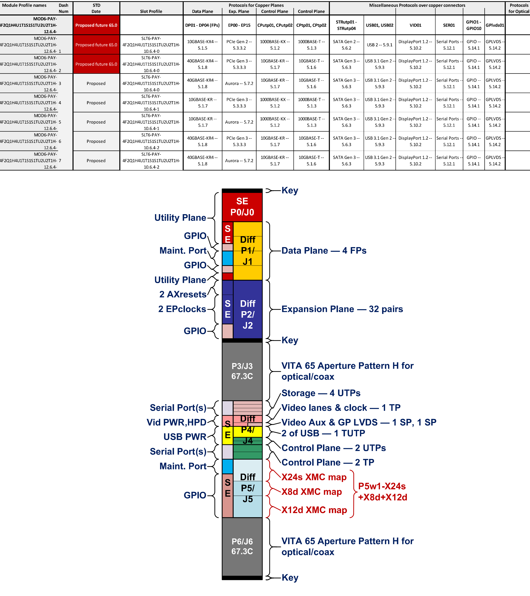

*Figure 35: ANSI/VITA 65.0 6U Payload Slot Profile SLT6-PAY-4F1Q1H4U1T1S1S1TU2U2T1H-*

10.6.3-n

<!-- 原书 p.116 ｜ PDF p.136 -->

**Table 34: ANSI/VITA 65.1 Module Profiles for SLT6-PAY-4F1Q1H4U1T1S1S1TU2U2T1H-10.6.3-n**

| Module Profile names | Dash Num | STD Date | Slot Profile | Protocols for Copper Planes |  |  |  | Miscellaneous Protocols over copper connectors |  |  |  |  |  | Protocols for Optical |
|---|---|---|---|---|---|---|---|---|---|---|---|---|---|---|
|  |  |  |  | Data Plane | Exp. Plane | Control Plane | Control Plane |  |  |  |  |  |  |  |
| MOD6-PAY-4F1Q1H4U1T1S1S1TU2U2T1H-12.6.3- |  | Proposed future 65.0 |  | DP01 - DP04 (FPs) | EP00 - EP15 | CPutp01, CPutp02 | CPtp01, CPtp02 | STRutp01 - STRutp04 | USB01, USB02 | VID01 | SER01 | GPIO1 - GPIO10 | GPIvds01 |  |
| MOD6-PAY-4F1Q1H4U1T1S1S1TU2U2T1H-12.6.3- | 1 | Proposed future 65.0 | SLT6-PAY-4F1Q1H4U1T1S1S1TU2U2T1H-10.6.3-0 | 10GBASE-KX4 -- 5.1.5 | PCIe Gen 2 -- 5.3.3.2 | 1000BASE-KX -- 5.1.2 | 1000BASE-T -- 5.1.3 | SATA Gen 2 -- 5.6.2 | USB 2 -- 5.9.1 | DisplayPort 1.2 -- 5.10.2 | Serial Ports -- 5.12.1 | GPIO -- 5.14.1 | GPLVDS -- 5.14.2 |  |
| MOD6-PAY-4F1Q1H4U1T1S1S1TU2U2T1H-12.6.3- | 2 | Proposed future 65.0 | SLT6-PAY-4F1Q1H4U1T1S1S1TU2U2T1H-10.6.3-0 | 40GBASE-KR4 -- 5.1.8 | PCIe Gen 3 -- 5.3.3.3 | 10GBASE-KR -- 5.1.7 | 10GBASE-T -- 5.1.6 | SATA Gen 3 -- 5.6.3 | USB 3.1 Gen 2 -- 5.9.3 | DisplayPort 1.2 -- 5.10.2 | Serial Ports -- 5.12.1 | GPIO -- 5.14.1 | GPLVDS -- 5.14.2 |  |
| MOD6-PAY-4F1Q1H4U1T1S1S1TU2U2T1H-12.6.3- | 3 | Proposed | SLT6-PAY-4F2Q1H4U1T1S1S1TU2U2T1H-10.6.4-0 | 40GBASE-KR4 -- 5.1.8 | Aurora -- 5.7.2 | 10GBASE-KR -- 5.1.7 | 10GBASE-T -- 5.1.6 | SATA Gen 3 -- 5.6.3 | USB 3.1 Gen 2 -- 5.9.3 | DisplayPort 1.2 -- 5.10.2 | Serial Ports -- 5.12.1 | GPIO -- 5.14.1 | GPLVDS -- 5.14.2 |  |
| MOD6-PAY-4F1Q1H4U1T1S1S1TU2U2T1H-12.6.3- | 4 | Proposed | SLT6-PAY-4F2Q1H4U1T1S1S1TU2U2T1H-10.6.4-1 | 10GBASE-KR -- 5.1.7 | PCIe Gen 3 -- 5.3.3.3 | 1000BASE-KX -- 5.1.2 | 1000BASE-T -- 5.1.3 | SATA Gen 3 -- 5.6.3 | USB 3.1 Gen 2 -- 5.9.3 | DisplayPort 1.2 -- 5.10.2 | Serial Ports -- 5.12.1 | GPIO -- 5.14.1 | GPLVDS -- 5.14.2 |  |
| MOD6-PAY-4F1Q1H4U1T1S1S1TU2U2T1H-12.6.3- | 5 | Proposed | SLT6-PAY-4F2Q1H4U1T1S1S1TU2U2T1H-10.6.4-1 | 10GBASE-KR -- 5.1.7 | Aurora -- 5.7.2 | 1000BASE-KX -- 5.1.2 | 1000BASE-T -- 5.1.3 | SATA Gen 3 -- 5.6.3 | USB 3.1 Gen 2 -- 5.9.3 | DisplayPort 1.2 -- 5.10.2 | Serial Ports -- 5.12.1 | GPIO -- 5.14.1 | GPLVDS -- 5.14.2 |  |
| MOD6-PAY-4F1Q1H4U1T1S1S1TU2U2T1H-12.6.3- | 6 | Proposed | SLT6-PAY-4F2Q1H4U1T1S1S1TU2U2T1H-10.6.4-2 | 40GBASE-KR4 -- 5.1.8 | PCIe Gen 3 -- 5.3.3.3 | 10GBASE-KR -- 5.1.7 | 10GBASE-T -- 5.1.6 | SATA Gen 3 -- 5.6.3 | USB 3.1 Gen 2 -- 5.9.3 | DisplayPort 1.2 -- 5.10.2 | Serial Ports -- 5.12.1 | GPIO -- 5.14.1 | GPLVDS -- 5.14.2 |  |
| MOD6-PAY-4F1Q1H4U1T1S1S1TU2U2T1H-12.6.3- | 7 | Proposed | SLT6-PAY-4F2Q1H4U1T1S1S1TU2U2T1H-10.6.4-2 | 40GBASE-KR4 -- 5.1.8 | Aurora -- 5.7.2 | 10GBASE-KR -- 5.1.7 | 10GBASE-T -- 5.1.6 | SATA Gen 3 -- 5.6.3 | USB 3.1 Gen 2 -- 5.9.3 | DisplayPort 1.2 -- 5.10.2 | Serial Ports -- 5.12.1 | GPIO -- 5.14.1 | GPLVDS -- 5.14.2 |  |

> 转写说明：
> 1. 本表完整落在 PDF p137（印刷页 117）一页内：p137 顶端即本表题注，表末（第 8 行数据之后）紧接 5.2.17.2 节正文，故无跨页续表，也未取下一页。
> 2. 表头为两层：第 1 行为分组标题，第 2 行（加粗）为子列标题。`Protocols for Copper Planes` 下四个子列标题依次为 `Data Plane`、`Exp. Plane`、`Control Plane`、`Control Plane`（后两列同名）；`Miscellaneous Protocols over copper connectors` 横跨六列，此六列原表未设子列标题，各列含义由第一行数据（`STRutp01 - STRutp04`、`USB01, USB02`、`VID01`、`SER01`、`GPIO1 - GPIO10`、`GPIvds01`）给出；`Protocols for Optical` 为单列，各行均空。
> 3. 原表 `Module Profile names` 与 `Dash Num` 之间无竖线（扫描件如此），本表依表头文字分为两列；完整配置档编号为 `MOD6-PAY-4F1Q1H4U1T1S1S1TU2U2T1H-12.6.3-n` 及 `-1`～`-7`。
> 4. 八行的版本段 `12.6.3` 经逐字形核对（同字号 `3`／`5`／`2` 的字形对照）确认为 `3`，八行一致；变化的只是 `Dash Num`。
> 5. `Slot Profile` 列前两行数据（`Dash Num` 1、2）为 `SLT6-PAY-4F1Q1H4U1T1S1S1TU2U2T1H-10.6.3-0`；自第三行数据（`Dash Num` 3）起改为 `SLT6-PAY-4F2Q1H4U1T1S1S1TU2U2T1H-10.6.4-…`（`4F1Q`／`10.6.3` 换成 `4F2Q`／`10.6.4`），照原表。
> 6. `STD Date` 列前三行数据为 `Proposed future 65.0`（红底），其余五行为 `Proposed`（灰底），照原表。
> 7. 表头 `GPIvds01` 与同列数据 `GPLVDS -- 5.14.2` 拼写不一致，均照原表，未作统一。
> 8. 窄列折行（`SLT6-PAY-`／`4F1Q1H4U1T1S1S1TU2U2T1H-`／`10.6.3-0`、`40GBASE-KR4 --`／`5.1.8`）系版式折行，已并回单行。

##### 5.2.17.2 SOSA 6U Control/Data Switch Plug-In Card Profile

**Rule 5.2.17.2-1**

- SOSA 6U Control/Data Switch Plug-In Cards shall conform to ANSI/VITA 65.0 slot profile

SLT6-SWH-14F16U1U15U1J-10.8.1-n. Conformance Methodology: (A)

**Rule 5.2.17.2-2**

- SOSA 6U Control/Data Switch Plug-In Cards shall conform to one of the ANSI/VITA 65.1 module profiles in Table 35 or Table 36. Conformance Methodology: (A)

<!-- 原书 p.117 ｜ PDF p.137 -->

- Key-

SE

POIJO

Utility Plane-

Reserved 5E DI

Maint. Port P4fJ1

Resered-

Utility Plane

Df

- Resered- P2f

J2_ Data Plane 14 FPs

Key-

Df

P3f

E

J_

Data Plane

2 TPs

*Figure 36: ANSI/VITA 65.0 6U Control/Data Switch Slot Profile SLT6-SWH-14F16U1U15U1J-*

10.8.1-n

**Table 35: ANSI/VITA 65.1 Slot Profiles for SLT6-SWH-14F16U1U15U1J-10.8.1-n**

| Slot Profile names | Dash Num | STD Date | Connector Modules |  | MT loading and Optical Pipes |  |
|---|---|---|---|---|---|---|
|  |  |  | P1/J1 - P6A/J6A | P6B/J6B | P1/J1 - P6A/J6A | P6B/J6B |
| SLT6-SWH-14F16U1U15U1J-10.8.1- |  | Proposed future 65.0 | VITA 46 | Aperture J | VITA 46 | Aperture J |
| SLT6-SWH-14F16U1U15U1J-10.8.1- | 0 | Proposed future 65.0 | VITA 46 | Empty | VITA 46 |  |
| Last line |  | Proposed future 65.0 |  |  |  |  |

> 转写说明：
> 1. 本表完整落在 PDF p138（印刷页 118）内，紧随其上方 Figure 36。p139 起为 5.2.18 节正文与整页槽位图（p140、p141），无本表续行，故不跨页续写。
> 2. 表头为两层：第 1 行为分组标题，第 2 行（加粗）为子列标题。`Connector Modules` 横跨 `P1/J1 - P6A/J6A`、`P6B/J6B` 两列，`MT loading and Optical Pipes` 横跨其后同名的两列，被覆盖的单元格留空。
> 3. 原表 `Slot Profile names` 与 `Dash Num` 之间无竖线（扫描件如此），本表依表头文字分为两列；完整配置档编号为 `SLT6-SWH-14F16U1U15U1J-10.8.1-n` 与 `…-10.8.1-0`。
> 4. 第 2 行 `MT loading and Optical Pipes` 的 `P6B/J6B` 格在原表中为空（同行其余三格有值），留空照录。
> 5. `Last line` 为原表的收尾行标签（灰色底），照录。

**Table 36: ANSI/VITA 65.1 Module Profiles for SLT6-SWH-14F16U1U15U1J-10.8.1-n**

| Module Profile names | Dash Num | STD Date | Slot Profile | Protocols for Copper Planes |  |  |  |  | Protocols for Optical | Legacy |
|---|---|---|---|---|---|---|---|---|---|---|
|  |  |  |  | Data Plane | Data Plane | Data Plane | Control Plane | Control Plane |  |  |
| MOD6-SWH-14F16U1U15U1J-12.8.1- |  | Proposed future 65.0 |  | DP01 - DP14 (FPs) | DPutp01 - DPutp16 | DPtp01, DPtp02 | CPutp01 - CPutp15 | CPext01 (UTP) |  |  |
| MOD6-SWH-14F16U1U15U1J-12.8.1- | 1 | Proposed future 65.0 | SLT6-SWH-14F16U1U15U1J-10.8.1-0 | 40GBASE-KR4 -- 5.1.8 | 10GBASE-KR -- 5.1.7, 40GBASE-KR4 -- 5.1.8 | 1000BASE-T | 1000BASE-KX -- 5.1.2 | 100BASE-T |  |  |
| MOD6-SWH-14F16U1U15U1J-12.8.1- | 2 | Proposed future 65.0 | SLT6-SWH-14F16U1U15U1J-10.8.1-0 | 40GBASE-KR4 -- 5.1.8 | 10GBASE-KR -- 5.1.7, 40GBASE-KR4 -- 5.1.8 | 1000BASE-T | 10GBASE-KR -- 5.1.7 | 100BASE-T |  |  |
| Last line |  | Proposed future 65.0 |  |  |  |  |  |  |  |  |

> 转写说明：
> 1. 本表完整落在 PDF p138（印刷页 118）下半页，表末（`Last line` 行）之后即页末。p139（印刷页 119）整页是 5.2.18 节正文（Rule 5.2.18-1／5.2.18-2、Recommendation 5.2.18-1），p140、p141 是整页槽位示意图与 Figure 37 的说明文字，均无本表续行——据此判定本表不跨页，未续写。
> 2. 表头为两层：第 1 行为分组标题，第 2 行（加粗）为子列标题。`Protocols for Copper Planes` 横跨五列，其子列标题依次为 `Data Plane`、`Data Plane`、`Data Plane`、`Control Plane`、`Control Plane`（前三列同名、后两列同名，系原表如此）；`Protocols for Optical`、`Legacy` 各为单列，各行均空。
> 3. 原表 `Module Profile names` 与 `Dash Num` 之间无竖线（扫描件如此），本表依表头文字分为两列；完整配置档编号为 `MOD6-SWH-14F16U1U15U1J-12.8.1-n`、`…-12.8.1-1`、`…-12.8.1-2`。
> 4. 原表只有 `Dash Num` 1、2 两档（无 `-0`），照录。
> 5. 窄列折行（`DPtp01,`／`DPtp02`、`CPutp01 -`／`CPutp15`、`10GBASE-KR -- 5.1.7,`／`40GBASE-KR4 -- 5.1.8`、`40GBASE-KR4 --`／`5.1.8`、`1000BASE-KX --`／`5.1.2`）均按原表折行处以 ` ` 保留。
> 6. `Last line` 为原表的收尾行标签（灰色底），照录。

<!-- 原书 p.118 ｜ PDF p.138 -->

#### 5.2.18 SOSA 6U Legacy Switch Plug-In Card Profile

**Rule 5.2.18-1**

SOSA 6U Legacy Switch Plug-In Cards shall conform to ANSI/VITA 65.0 slot profile SLT6-SWH-16U20F-10.4.2. Conformance Methodology: (A)

**Rule 5.2.18-2**

SOSA 6U Legacy Switch Plug-In Cards shall conform to one of the following ANSI/VITA 65.1 module profiles per: MOD6-SWH-16F20U-12.4.2-3

  - Conformance Methodology: (A)

- MOD6-SWH-16F20U-12.4.2-5

  - Conformance Methodology: (A)

- MOD6-SWH-16F20U-12.4.2-11

  - Conformance Methodology: (A)

- MOD6-SWH-16F20U-12.4.2-15

  - Conformance Methodology: (A)

**Recommendation 5.2.18-1**

It is anticipated that the SLT6-SWH-16U20F-10.4.2 profile will be deprecated from the next version of the SOSA standard and consequently should not be used for new systems.

<!-- 原书 p.119 ｜ PDF p.139 -->

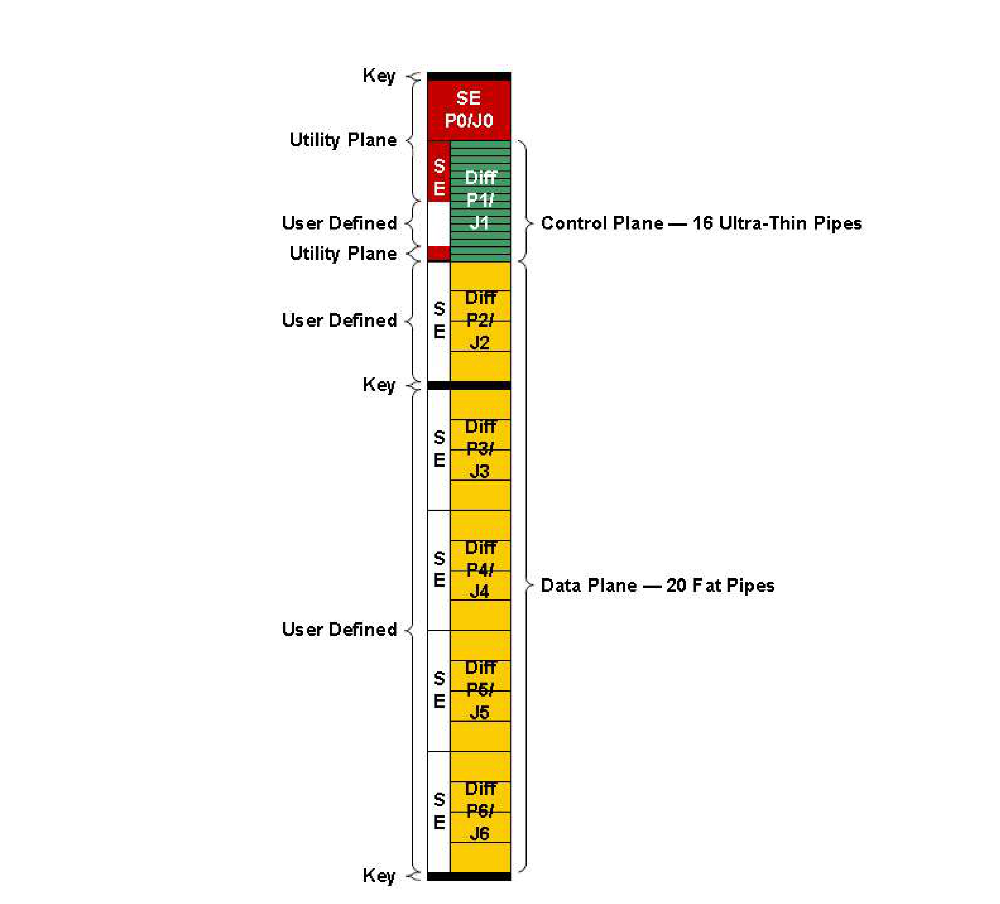

*Figure 37: ANSI/VITA65.0 Switch Slot Profile for SLT6-SWH-16U20F-10.4.2*

#### 5.2.19 SOSA 6U External I/O Plug-In Card Profile

**Rule 5.2.19-1**

SOSA 6U External I/O Plug-In Cards shall conform to ANSI/VITA 65.0 slot profile SLT6-PAY-4U2U-10.2.8. Conformance Methodology: (A)

**Rule 5.2.19-2**

User-defined pins in slot profile SLT6-PAY-4U2U-10.2.8 shall only interface with platform I/O and not other modules within the system. Conformance Methodology: (A)

<!-- 原书 p.120 ｜ PDF p.140 -->

**Rule 5.2.19-3**

SOSA 6U External I/O Plug-In Cards shall conform to one of the ANSI/VITA 65.1 module profiles in Table 37. Conformance Methodology: (A)

**Observation 5.2.19-1**

Instead of routing platform-specific I/O to non-standard payloads, integrators can utilize the SOSA 6U External I/O Plug-In Card as the platform I/O “data center” where a single plug-in card (or multiple if required) can interface with the platform over platform-specific connections and the rest of the payload modules over standard expansion or data plane interfaces.

**Recommendation 5.2.19-1**

The SOSA 6U Payload Plug-In Cards profile should be used instead of the SOSA 6U External I/O Plug-In Card profile if platform-specific I/O can be accommodated by a single XMC.

Key

SE

POIJO

Utility Plane-

5 Expansion Plane 4 Ultra-Thin Pipes

User Defined E Diff

- Maint. Port PIIJ1

User Defined-

Utility Plane User Defined

5 Diff

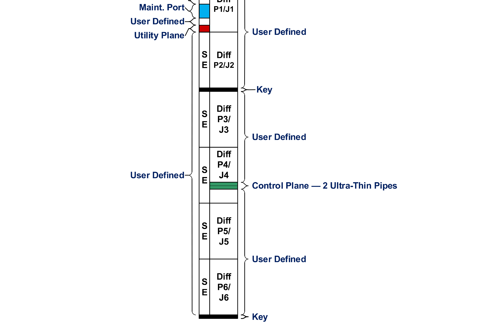

*Figure 38: ANSI/VITA 65.0 6U External I/O Slot Profile SLT6-PAY-4U2U-10.2.8*

<!-- 原书 p.121 ｜ PDF p.141 -->

**Table 37: ANSI/VITA 65.1 Module Profiles for SLT6-PAY-4U2U-10.2.8**

| Module Profile names | Dash Num | STD Date | Slot Profile | Protocols for Copper Planes |  | Protocols for Optical | Comments | Legacy |
|---|---|---|---|---|---|---|---|---|
|  |  |  |  | Expansion Plane | Control Plane |  |  |  |
| MOD6-PAY-4U2U-12.2.8- |  | Proposed future 65.0 |  | EPutp01 - EPutp04 | CPutp01, CPutp02 |  | First row of MOD6-PAY-4U2U-12.2.8-n |  |
| MOD6-PAY-4U2U-12.2.8- | 1 | Proposed future 65.0 | SLT6-PAY-4U2U-10.2.8 | PCIe Gen 2 -- 5.3.3.2 | 1000BASE-KX -- 5.1.2 |  |  |  |
| MOD6-PAY-4U2U-12.2.8- | 2 | Proposed future 65.0 | SLT6-PAY-4U2U-10.2.8 | PCIe Gen 3 -- 5.3.3.3 | 10GBASE-KR -- 5.1.7 |  |  |  |
| Last line |  | Proposed future 65.0 |  |  |  |  |  |  |

> 转写说明：
> 1. 本表完整落在 PDF p142（印刷页 122）上半页，表末（`Last line` 行）之后即 5.2.20 节正文。p143 为 Rule 5.2.20-6～8 正文、p144／p145 为 5.2.22 节正文，均无本表续行——据此判定本表不跨页，未续写。
> 2. 表头为两层：第 1 行为分组标题，第 2 行（加粗）为子列标题。`Protocols for Copper Planes` 横跨 `Expansion Plane`、`Control Plane` 两列，被覆盖的单元格留空；`Protocols for Optical`、`Comments`、`Legacy` 各为单列，`Protocols for Optical` 与 `Legacy` 两列各行均空。
> 3. 原表 `Module Profile names` 与 `Dash Num` 之间无竖线（扫描件如此），本表依表头文字分为两列；完整配置档编号为 `MOD6-PAY-4U2U-12.2.8-n`、`…-12.2.8-1`、`…-12.2.8-2`。
> 4. 本表题注写的是 `SLT6-PAY-4U2U-10.2.8`，而表内 `Module Profile names` 列写的是 `MOD6-PAY-4U2U-12.2.8-`、`Slot Profile` 列写的是 `SLT6-PAY-4U2U-10.2.8`；题注与名义并不矛盾（前者是插槽档、后者是模块档），照录。
> 5. `Last line` 为原表的收尾行标签（灰色底），照录。

#### 5.2.20 Power Supply Module

**Rule 5.2.20-1**

PSM requirements shall be applied using the following order of precedence: Requirements of this SOSA standard (including additions or exclusions to ANSI/VITA

65.0)

  - Conformance Methodology: (A)

Requirements of ANSI/VITA 62.0

  - Conformance Methodology: (A)

**Observation 5.2.20-1**

The SOSA HWG is considering a move to 12V as the primary input in a future version of the SOSA standard.

**Rule 5.2.20-2**

PSMs shall assert the FAIL* signal when PO1, PO2, PO3, or AUX voltages are not within their voltage specifications per ANSI/VITA 62.0, Recommendation 3.3-2. Conformance

Methodology: (T)

**Rule 5.2.20-3**

PSMs shall have the chassis pin connected to their front panel and covers. Conformance Methodology: (A)

**Rule 5.2.20-4**

PSMs shall have the chassis pin isolated from the SIGNAL_RETURN pin. Conformance Methodology: (T)

**Rule 5.2.20-5**

PSMs shall have the chassis pin isolated from power returns, such as the POWER_RETURN pins. Conformance Methodology: (T)

<!-- 原书 p.122 ｜ PDF p.142 -->

**Rule 5.2.20-6**

PSMs shall have the chassis pin isolated from the -DC_IN/ACN pin. Conformance

Methodology: (T)

**Rule 5.2.20-7**

PSMs outputting an intermediate power shall explicitly define the nominal voltage level for the intermediate power. Conformance Methodology: (A)

**Rule 5.2.20-8**

PSMs having intermediate power as an input shall explicitly define the nominal voltage level for the intermediate power. Conformance Methodology: (A)

**Rule 5.2.20-9**

Energy Storage Modules shall accept an input of the intermediate voltage in accordance with

ANSI/VITA 62.0 §4.5. Conformance Methodology: (A)

**Rule 5.2.20-10**

Energy Storage Modules shall output the intermediate voltage in accordance with ANSI/VITA

62.0 §4.5. Conformance Methodology: (A)

**Rule 5.2.20-11**

6U Single-Stage Modules shall route the intermediate voltage to the ANSI/VITA 62.0 pins labeled “POS_FILT_OUT” and “NEG_FILT_OUT” in accordance with ANSI/VITA 62.0 §6.5.2. Conformance Methodology: (A)

**Rule 5.2.20-12**

3U PSMs shall conform to the mechanical requirements of ANSI/VITA 48.2 for 3U conduction cooled modules except where specified herein. Conformance Methodology: (A)

**Rule 5.2.20-13**

6U PSMs shall conform to the mechanical requirements of ANSI/VITA 48.2 for 6U conduction cooled modules except where specified herein. Conformance Methodology: (A)

#### 5.2.21 Mezzanine Modules

**Rule 5.2.21-1**

Requirements for SOSA Mezzanine Cards shall be applied using the following order of precedence: Conformance Methodology: (A) SOSA requirements (including additions or exclusions to the XMC standard) Mezzanine Module requirements of ANSI/VITA 42.3

<!-- 原书 p.123 ｜ PDF p.143 -->

Mezzanine Module requirements of ANSI/VITA 42.0

**Permission 5.2.21-1**

Non-conformant SOSA Mezzanine Cards may be used.

**Rule 5.2.21-2**

PCIe interfaces as bridged to XMC Mezzanine Cards shall conform to ANSI/VITA 42.3. Conformance Methodology: (A)

**Rule 5.2.21-3**

XMC Mezzanine Cards that do not require utilization of all available user I/O signals shall leave the remaining unused signals as no connects. Conformance Methodology: (A)

**Recommendation 5.2.21-1**

The higher priority I/O signals of the XMC Mezzanine Card should populate pins in the following order of ANSI/VITA 46.9 patterns:

X12d

X8d

X16s

X24s

X38s

**Observation 5.2.21-1**

Any XMC module (SOSA Mezzanine Cards or otherwise) will be expected to be subjected to qualification testing while installed on the target Payload Module within the constraints of the target system deployed configuration and environment, including all hardware and accessories.

**Rule 5.2.21-4**

If a Payload Plug-In Card has an XMC Mezzanine Card Site, the Payload Plug-In Card shall route the ANSI/VITA 42.0-defined I²C connections from the XMC Mezzanine Card Site to the

IPMC of the Payload Plug-In Card. Conformance Methodology: (A)

#### 5.2.22 Maintenance Console Port Requirements

The Maintenance Console Port is intended to be a consistently-implemented port providing a console for low-level access to the attached processor. It is not intended to be an “operational” port; that is, not intended to communicate to some device as part of the normal operation of the system. It is intended strictly as part of the board maintenance functions.

The basic use-cases for the maintenance console port can be classed as described below.

<!-- 原书 p.124 ｜ PDF p.144 -->

5.2.22.1 Vendor Board Bring Up, Board Support Package (BSP) Development, etc.

This implies access to low-level firmware, BIOS, Extensible Firmware Interface (EFI) shell, etc. The typical case is for an operator to attach to the maintenance console port of a single plug-in card using a terminal or PC. There is also a case where the operator may attach to a relatively limited set of boards at one time.

##### 5.2.22.2 Integrator Application Development and Debug

This also implies access to low-level firmware, BIOS, EFI shell, etc. This will typically be performed in a lab environment with the target plug-in card installed in either an “open” lab chassis or a target deployable chassis. The operator may attach to a relatively limited set of boards at one time, but there may be cases where the operator may need to attach to every maintenance console port in the system.

##### 5.2.22.3 Deployed System

In this case the target plug-in card is installed in a deployed system. Whether or not the maintenance console ports on the individual boards are accessible in a deployed system is up to the system integrator, but assuming the ports are accessible, it can be assumed that most, if not all, of the individual plug-in card maintenance console ports can be attached. It is also assumed that some sort of port aggregation mechanism is implemented within the system to provide this access.

5.2.22.4 Maintenance Depot

The maintenance depot use-case can be characterized by the need to access the maintenance console ports of an individual fieldable plug-in card in a lab test fixture. The port will facilitate debug and perhaps upgrade/updates of the plug-in card.

The SOSA Maintenance Console Port is defined to operate at LVCMOS levels rather than traditional RS232 levels. The reason is that there is a desire in SOSA platforms to support an aggregator function for the various Maintenance Console Ports, giving system designers the ability to access any particular Maintenance Console Port in the system from a single interface (or, perhaps, a limited number). The use of LVCMOS rather than traditional RS232 levels allows the aggregator to be generally smaller and simpler – often implemented with an FPGA or Complex Programmable Logic Device (CPLD).

Note that board designers are not prohibited from supporting RS232 levels for these ports, so long as they provide a mechanism to support the requirements documented here.

These ports all share a common implementation defined as follows.

**Rule 5.2.22.4-1**

The Maintenance Console Port shall be a two-pin interface implementing TIA-232 protocol. Conformance Methodology: (A)

**Rule 5.2.22.4-2**

The Maintenance Console Port shall use LVCMOS signaling non-inverted (active high) with the following levels (see Table 38). Conformance Methodology: (A)

<!-- 原书 p.125 ｜ PDF p.145 -->

**Table 38: Maintenance Console Port Signal Levels**

| **3.3V LVCMOS Voltage levels** ||
|---|---|
| Vcc | 3.3V +/- 0.3V |
| Vih | 1.7V |
| Vil | 0.7V |
| Voh | 2.0V |
| Vol | 0.4V |

> 转写说明：首行「3.3V LVCMOS Voltage levels」为横向合并单元格，覆盖全表两列，故该行第 2 格留空；本表无逐列列名。本表仅占原书 p.126 一页，p.127 为正文。

**Observation 5.2.22.4-1**

The Maintenance Console Port non-inverted (active high) signaling permits the addition of an external RS232 transceiver to provide a proper signal polarity to TIA-232 devices.

**Rule 5.2.22.4-3**

The Maintenance Console Port shall support, at a minimum, 115,200 bits/sec, 57,600 bits/sec, and 9600 bits/sec (H/M/L speed), 8 bit, no parity, one stop bit. Conformance Methodology: (A)

**Permission 5.2.22.4-1**

Maintenance Console Ports are permitted to support additional speeds and protocol settings.

### 5.3 SOSA System Management Requirements

The network-based system management concepts were described in Section 3.11.2. This section defines rules that define specific requirements for system management interfaces to be implemented by SOSA hardware elements, sensors, and modules.

5.3.1 SOSA Hardware Element System Management Requirements

**Rule 5.3.1-1**

A SOSA Hardware Plug-In Card shall include an IPMC. This is referred to as a SOSA IPMC throughout the remainder of this standard. Conformance Methodology: (A)

**Rule 5.3.1-2**

A SOSA IPMC shall comply with the ANSI/VITA 46.11 Tier 2 IPMC requirements. Conformance Methodology: (A)

**Rule 5.3.1-3**

A SOSA IPMC shall comply with the HOST OpenVPX Core Technology Tier 2 Standard v3.0 IPMC requirements. Conformance Methodology: (A)

<!-- 原书 p.126 ｜ PDF p.146 -->

**Rule 5.3.1-4**

A SOSA IPMC shall implement a System IPMB B interface. Conformance Methodology: (A)

**Rule 5.3.1-5**

A SOSA System IPMB shall include an IPMB B interface in the backplane profile. Conformance Methodology: (A)

**Rule 5.3.1-6**

A SOSA system shall include a Chassis Manager Module. Conformance Methodology: (A)

**Recommendation 5.3.1-1**

A SOSA system systems IPMB should include a redundant Chassis Manager Module.

**Rule 5.3.1-7**

The SOSA Chassis Manager Module shall include a chassis manager. Conformance Methodology: (A)

**Rule 5.3.1-8**

The Chassis Manager shall comply with the ANSI/VITA 46.11 Tier 2 Chassis Manager requirements. Conformance Methodology: (A)

**Rule 5.3.1-9**

The Chassis Manager shall comply with the HOST OpenVPX Core Technology Tier 2 Standard v3.0 Chassis Manager requirements. Conformance Methodology: (A)

**Rule 5.3.1-10**

A SOSA PSM shall include a SOSA IPMC. Conformance Methodology: (A)

**Rule 5.3.1-11**

A SOSA IPMC shall be conformant to ANSI/VITA 46.11 Tier 2 IPMC requirements. Conformance Methodology: (A)

**Rule 5.3.1-12**

A SOSA IPMC shall implement a System IPMB B interface. Conformance Methodology: (A)

**Rule 5.3.1-13**

A SOSA IPMC shall be conformant to the IPMC requirements. Conformance Methodology: (A)

<!-- 原书 p.127 ｜ PDF p.147 -->

**Rule 5.3.1-14**

A SOSA system shall implement a bussed System IPMB. Conformance Methodology: (A)

**Recommendation 5.3.1-2**

A SOSA system should allow for point-to-point connections.

**Rule 5.3.1-15**

A SOSA system’s IPMB shall be conformant to the ANSI/VITA 46.11 Tier 2 IPMC requirements. Conformance Methodology: (A)

**Rule 5.3.1-16**

A SOSA system’s IPMB shall include an IPMB B. Conformance Methodology: (A)

**Rule 5.3.1-17**

A SOSA system shall include a Chassis Manager Module. Conformance Methodology: (A)

**Recommendation 5.3.1-3**

A SOSA system should include a redundant Chassis Manager Module.

**Rule 5.3.1-18**

The SOSA system Chassis Manager Module shall include a conformant ANSI/VITA 46.11 Tier 2 Chassis Manager. Conformance Methodology: (A)

**Rule 5.3.1-19**

The SOSA system Chassis Manager Module shall include a conformant Tier 2 and HOST Chassis Manager. Conformance Methodology: (A)

#### 5.3.2 SOSA Module System Management Requirements

Work in defining rules and requirements to be applied to SOSA logical components is ongoing. Section 5.6.1.3 defines a set of common interactions that are candidates to be implemented by all logical modules. The related DIV-2 elements for those candidate interactions are defined in Section D.4. As these interactions have not yet been through a thorough proposal and evaluation process, rules and requirements are not included in this version.

### 5.4 SOSA Software Operating Environment

#### 5.4.1 Description

SOSA modules may contain a wide range of functions and many of these are accomplished through computer processing. In order to promote the open and standardized goals of the SOSA Technical Architecture, the Run-Time Environment (RTE) interface for SOSA modules will be

<!-- 原书 p.128 ｜ PDF p.148 -->

defined. Note this does not mandate a particular RTE, although there are recommended solutions to promote open standards-based interoperability. This provides guidance and recommendations for the interface of that computer program RTE with other entities.

The SOSA standardized architectural modules can be realized in a variety of SOSA standardized interface components, either hardware, software, or a combination of hardware and software. For example, the SOSA standard defines hardware connector interfaces to hardware elements. A similar approach is required for components implemented in software. The SOSA Software Runtime Environment Interface (REI) will define the interfaces to support the development of software that meets the SOSA quality attributes, including the open and standardized goals. The SOSA REI will not mandate a specific run-time implementation but will specify standardized interfaces with performance and security attributes as an area of future investigation. The REI description will be enhanced to provide more detailed guidance that leverages and supports the FACE Technical Standard, OMS, the MORA specification, the FROST Architecture Specification, REDHAWK/TOA, and the Common Open Architecture Radar Program Specification (COARPS) individually.

#### 5.4.2 Scope

This section describes the high-level scope of the SOSA REI. It includes:

SOSA application software interface to SOSA module hardware processing and operating system for language run time and calls to operating system services as defined by the

FACE Operating System Segment (OSS) interface

SOSA platform-specific software and low-level I/O as defined by the FACE Platform-

Specific Services Segment (PSSS) and I/O Services Segment (IOSS)

SOSA operating system as defined by the FACE operating system requirements

— POSIX®

— ARINC 653

For FACE conformant software, programming language and version as defined by the referenced FACE Technical Standard Guidance and limitations on use of VMs and containers General-Purpose, Safety, and Security features of application software as per the profile guidance in the referenced FACE Technical Standard The SOSA REI excludes:

Transport layer middleware for application (component) to application (component)

communications, unless defined by this standard for SOSA module communications Specific source code-level requirements, such as:

  - Coding standards

  - Code development methods — Code architecture

<!-- 原书 p.129 ｜ PDF p.149 -->

  - Configuration management or quality assurance processes except those defined for airworthiness — Language selection beyond those defined in the FACE Technical Standard plus

Python™

FPGA softcore processor software or programmable logic Excludes GPU programming languages The SOSA REI has questionable scope for: Airworthiness SOSA software that affects safety needs to be considered but it is not clear how much it actually affects this REI definition. Software safety is already subject to FACE Safety Profile certification by airworthiness authorities under DO-178/MIL-HDBK-516C, which is mostly driven by process substantiation not the product itself, although there are exceptions – for example, Federal Aviation Administration (FAA) certification is not available using Java® in high-criticality systems.

Figure 39 is derived from Figure 2 (Architectural Segments) from the FACE Technical Standard, Edition 3.0. The red dashed line has been added to represent the SOSA REI scope in relation to the FACE segments. This graphic is not an exhaustive representation of FACE elements.

<!-- 原书 p.130 ｜ PDF p.150 -->

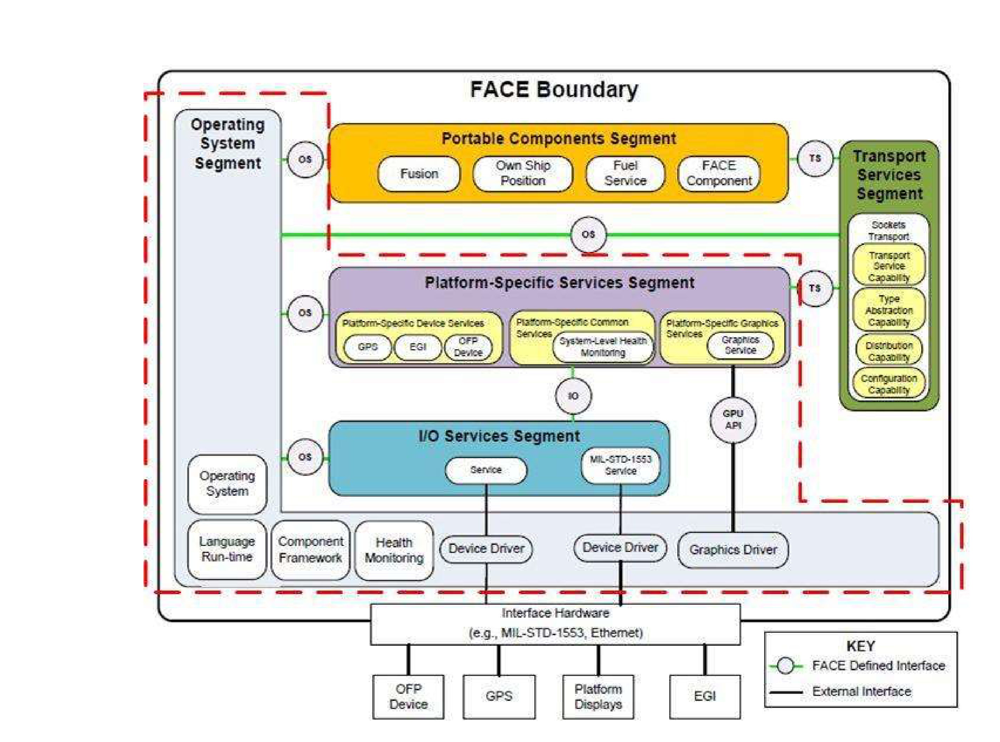

*Figure 39: FACE Software Operating Environment and Subset Proposed for the SOSA REI (red*

dashed line)

#### 5.4.3 Recommendations

##### 5.4.3.1 Basis

The RTE should conform to FACE Technical Standard, Edition 3.0 (call out specific sections)

When other profiles are not applicable, the RTE should conform to the General-Purpose Profile The SOSA modules should be developed for operating system interfaces including one of:

— POSIX

— ARINC 653

SOSA modules should be implemented by software components based on existing interface standards or software frameworks (e.g., the MORA specification, FROST Architecture Specification, REDHAWK/TOA, COARPS, etc.) The specifics for how these software components will interface to the SOSA REI are planned for a later version of the SOSA Technical Standard.

<!-- 原书 p.131 ｜ PDF p.151 -->

##### 5.4.3.2 Interoperability Levels

SOSA REI is not mandating how to write or manage application source code except for what open standard operating system/run-time API to use SOSA REI is not mandating any particular middleware 5.4.3.3 General-Purpose SOSA software components which have general performance should conform to the FACE Technical Standard General-Purpose Profile The SOSA modules which have low latency and/or hard real-time requirements should conform to the FACE Determinism Profile 5.4.4 Safety SOSA software components which have low latency and/or hard real-time requirements should conform to the FACE Technical Standard Safety Profile These software components shall follow DO-178 guidance for civilian applications and MIL-HDBK-516C for military applications to achieve airworthiness for SOSA modules affecting safety of flight These software components should conform to the FACE Safety Profile SOSA software components affecting safety of flight which use object-oriented technology shall follow FAA guidance including DO-332 and others Planned for a later version of the SOSA Technical Standard.

5.4.4.1 Security SOSA modules should conform to the FACE Security Profile for those modules affecting system security 5.4.4.2 Programming Language SOSA modules should use one of the programming languages defined in the FACE

Technical Standard

##### 5.4.4.3 Virtual Machines

SOSA modules may use VMs with limitations Planned for a later version of the SOSA Technical Standard.

5.4.4.4 Hypervisors If a VM(s) is used then a Hypervisor should be used to manage the VMs. Security-related aspects of the hypervisor Planned for a later version of the SOSA Technical Standard.

<!-- 原书 p.132 ｜ PDF p.152 -->

5.4.4.5 Containers

SOSA modules may use containers after a security analysis that substantiates the use of containers does not defeat security requirements SOSA modules should substantiate why a container should be used instead of a VM

### 5.5 SOSA Module Interactions

The SOSA Architecture is based on a set of loosely-coupled modular entities that interact with the underlying operating environment and with each other via their logical interfaces. The operating environment will provide the mechanisms through which interoperation will occur and will provide the modules’ interfaces to these mechanism (I/O, processing, storage, communication, etc.). Interoperability between SOSA modules is described in terms of interactions.

Interactions include exchanges of data, control actions, and various types of management functions. Most of the interactions considered are to be implemented as message exchanges on a network.

- Note: The concept of the security services providing authentication and authorization services as shown, although not yet completely defined, is actively being developed by the SOSA Consortium.

### 5.6 Sensor Management

The SOSA standard defines two modules that together perform sensor management, which is the composition of system management and task management. The modules are 1.1 System Manager and 1.2 Task Manager. The delineation between the functions of these two modules separates the functions related to taking care of the system from the functions of tasking the system to fulfill its operational needs. Figure 40 illustrates the overall sensor management architecture. System management client applications run on the host platform and interact with the sensor management interfaces through the host platform interface module, which communicates with the system manager and task manager modules. The system manager module performs system management functions (discovery, configuration, control, health monitoring) through interactions with the SOSA module and hardware element interactions. The task manager module performs mission tasking functions (setting up, controlling, collecting data from, and monitoring multi-INT operational tasks) through interactions with the system manager module, SOSA modules, and hardware elements.

<!-- 原书 p.133 ｜ PDF p.153 -->

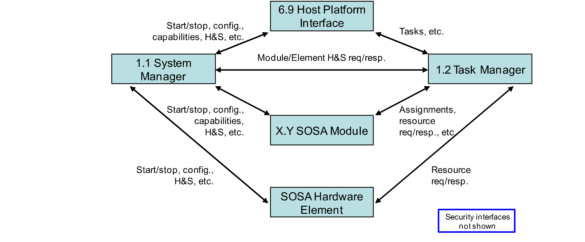

*Figure 40: Sensor Management Architecture View*

#### 5.6.1 System Manager Module

##### 5.6.1.1 Module Definition

The functionality of the system manager module is defined in Table 2.

In summary, the system manager provides the ability to discover, configure, control, manage health (status and faults), and configure the security aspects of the SOSA sensor as a whole, its infrastructure, its modules, and its interface to the sensor host.

The relationship between the system manager module and the other modules was shown in Figure 8 and explained in Section 3.11.2.

5.6.1.2 System Manager Interactions

The system manager is responsible for handling discovery, configuration, control, and health functions for the sensor as a whole. It acts as a representative of the logical modules (those that are not part of the hardware infrastructure), and the hardware platform modules to the “outside” world.

The overall system management concept has been matured since the previous version of this standard.² However, it has not yet been through a formal proposal process, so it is possible that the interactions and interaction groups described here may change in a future version.

2 Technical Standard for SOSA™ Reference Architecture, The Open Group Snapshot (S180), expired July 2018.

<!-- 原书 p.134 ｜ PDF p.154 -->

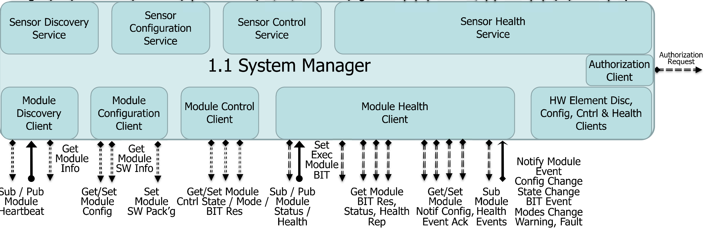

*Figure 41: System Manager Interactions*

Figure 41 illustrates the system manager module. It includes the service side (provides) for sensor discovery, sensor configuration, sensor control, and sensor health interaction groups. It also includes the client side (users) for module discovery, module configuration, module control, module health, and authorization interaction groups. The service side interactions (on the top) are accessed by system management applications that may be outside of the sensor. The clientside interactions (on the bottom) access the relevant services for each SOSA module implemented in a particular system.

Note that the interaction endpoints related to modules (Discovery, Configuration, Control, and Health) clients are repeated for hardware elements, but are not shown in detail for brevity.

5.6.1.3 Common System Management Interactions

The SOSA system management concept defines a pattern that is applied to each type of module, and then tailored for the needs of the individual modules by varying the specific interaction names and parameters. The pattern includes sets of interactions that are common for all modules, whether they are implemented in software or hardware, or whether they are mission or infrastructure-oriented.

Columns “Input DIV-2 Data Entities” and “Output DIV-2 Data Entities” list the entity types for the input and output parameters of each interactions. The names have not been finalized but align with the contents of Section D.4.

Note that this material is still being developed, so is likely to change as it is matured.

**Table 39: Common System Management Interactions**

| Common System Management Interactions |||||
|---|---|---|---|---|
| Interaction Name | Interaction Description | Input DIV-2 Data Entities | Output DIV-2 Data Entities | Provider Module |
| PubSensorHeartbeat | | SensorHeartbeatType | | 1.1 |
| SubSensorHeartbeat | | SubscriptionInfoType | subError_t | 6.4 |
| GetSensorInfo | | | error_t, SensorInfoType | 1.1 |
| PubModuleHeartbeat | | ModuleHeartbeatType | | 1.x, 2.x, 3.x, 4.x, 5.x |
| SubModuleHeartbeat | | SubscriptionInfoType | subError_t | 6.4 |
| GetModuleInfo | | | error_t, ModuleInfoType | 1.x, 2.x, 3.x, 4.x, 5.x |
| GetSensorConfig | | | error_t, SensorConfigDescriptionType | 1.1 |
| SetSensorConfig | | SensorConfigDescriptionType | error_t | 1.1 |
| GetSensorSoftwareInfo | | | error_t, SensorSoftwareMetadataType | 1.1 |
| SetSensorSoftwarePackage | | SensorSoftwarePackageType | error_t | 1.1 |
| GetModuleConfig | | | error_t, ModuleConfigDescriptionType | 1.x, 2.x, 3.x, 4.x, 5.x |
| SetModuleConfig | | ModuleConfigDescriptionType | error_t | 1.x, 2.x, 3.x, 4.x, 5.x |
| GetModuleSoftwareInfo | | | error_t, ModuleSoftwareMetadataType | 1.x, 2.x, 3.x, 4.x, 5.x |
| SetModuleSoftwarePackage | | ModuleSoftwarePackageType | error_t | 1.x, 2.x, 3.x, 4.x, 5.x |
| GetDataPublishingConfig | | | error_t | 1.x, 2.x, 3.x, 4.x, 5.x |
| SetDataPublishingConfig | Change the properties that govern the publication of data (identified by “topic”). Includes QoS, enabling, disabling, periodicity, etc. | | error_t | 1.x, 2.x, 3.x, 4.x, 5.x |
| GetSensorState | Sensor System States include: those shown in Set System State, Shutting Down, Resetting Hardware, Booting Operating System, Booted, Staring Software, Ready, Running, Paused. | | error_t, SensorStateType | 1.1 |
| SetSensorState | Sensor System States that can be set include: Cold Boot, Warm Boot, Shutdown, Shutdown Software (component), Restart Software (component), Execute BIT, Calibrate (sensor dependent), Start, Pause. | SensorStateType | error_t | 1.1 |
| GetSensorModes | Get the modes that the system is currently in. Note that this is not settable through the configuration interactions. | | error_t, SensorModesType | 1.1 |
| SetSensorModes | Causes the system to execute a BIT. BIT results show up in the health parameters. Equivalent to Set Sensor System State (BIT). | SensorModesType | error_t | 1.1 |
| GetModuleState | Module States are module-dependent, and may include: those shown in Set Module State, Shutting Down, Resetting Hardware, Booting Operating System, Booted, Staring Software, Ready, Running, Paused. | | error_t, ModuleStateType | 1.x, 2.x, 3.x, 4.x, 5.x |
| SetSensorCalibrationData | Set the data required for calibration of the sensor. | SensorCalibrationInputDataType | error_t | 1.2 |
| GetSensorCalibrationData | Get the calibration results after the sensor has been put into a calibration state. | | SensorCalibrationResultDataType | 1.2 |
| SetModuleCalibrationData | Set the data required for calibration of the module. | ModuleCalibrationInputDataType | error_t | 2.x, 3.x, 4.x, 5.x |
| GetModuleCalibrationData | Get the calibration results after the module has been put into a calibration state. | | ModuleCalibrationResultDataType | 2.x, 3.x, 4.x, 5.x |
| SetModuleState | Module States that can be set are module-dependent, but may include: Cold Boot, Warm Boot, Shutdown, Shutdown Software (component), Restart Software (component), Execute BIT, Calibrate (sensor dependent), Start, Pause. | ModuleStateType | error_t | 1.x, 2.x, 3.x, 4.x, 5.x |
| GetModuleMode | Get the mode that the module is currently in. Note that this is not settable through the configuration interactions. | | error_t, ModuleModeType | 1.x, 2.x, 3.x, 4.x, 5.x |
| SetModuleMode | Causes the module to execute a BIT. BIT Results shows up in the health parameters. Equivalent to Set Module State (BIT). | ModuleModeType | error_t | 1.x, 2.x, 3.x, 4.x, 5.x |
| PubSensorStatusLevel | | SensorStatusLevelType | | 1.1 |
| SubSensorStatusLevel | | SubscriptionInfoType | subError_t | 6.4 |
| PubModuleStatus | | | | 1.x, 2.x, 3.x, 4.x, 5.x |
| SubModuleStatus | | SubscriptionInfoType | subError_t | 6.4 |
| GetSensorStatusLevel | | | error_t, SensorStatusLevelType | 1.1 |
| GetSensorHealthReport | | | error_t, SensorHealthReportType | 1.1 |
| SetExecuteSensorBIT | | SensorBITParametersType | error_t | 1.1 |
| GetSensorBITResult | | | error_t, SensorBITResultType | 1.1 |
| GetModuleStatus | | | error_t, ModuleStatusLevelType | *.* |
| GetModuleHealthReport | | | error_t, ModuleHealthReportType | *.* |
| SetExecuteModuleBIT | | ModuleBITParametersType | error_t | *.* |
| GetModuleBitResult | | | error_t, ModuleBITResultType | *.* |
| NotifySensorEvent | | SensorHealthEventType | | 1.1 |
| NotifySensorConfigChange | | SensorConfigEventType | | 1.1 |
| NotifySensorStateChange | | SensorStateEventType | | 1.1 |
| NotifySensorBITEvent | | SensorBITEventType | | 1.1 |
| NotifySensorModesChange | | SensorModeEventType | | 1.1 |
| NotifySensorWarning | | SensorWarningType | | 1.1 |
| NotifySensorFault | | SensorFaultType | | 1.1 |
| SetSensorEventAcknowledgement | | SensorEventAcknowledgType | error_t | 1.1 |
| SubSensorHealthEvents | | SubscriptionInfoType | subError_t | 6.4 |
| SetSensorNotificationConfig | | SensorEventConfigType | error_t | 1.1 |
| GetSensorNotificationConfig | | | error_t, SensorEventConfigType | 1.1 |
| NotifyModuleEvent | | ModuleHealthEventType | | *.* |
| NotifyModuleConfigChange | | ModuleConfigEventType | | *.* |
| NotifyModuleStateChange | | ModuleStateEventType | | *.* |
| NotifyModuleBITEvent | | ModuleBITEventType | | *.* |
| NotifyModuleModeChange | | ModuleModeEventType | | *.* |
| NotifyModuleWarning | | ModuleWarningType | | *.* |
| NotifyModuleFault | | ModuleFaultType | | *.* |
| SetModuleEventAcknowledgement | | ModuleEventAcknowledgType | error_t | *.* |
| SetModuleNotificationConfig | | ModuleEventConfigType | error_t | *.* |
| GetModuleNotificationConfig | | | error_t, ModuleEventConfigType | *.* |
| SubModuleHealthEvents | | SubscriptionInfoType | subError_t | 6.4 |
| SubModuleHealthReports | | SubscriptionInfoType | subError_t | 6.4 |
| GetHealthLog | | | error_t | 1.1 |
| GetHealthLogStatus | | | error_t | 1.1 |
| DeleteSensorHealthLog | | | error_t | 1.1 |

> 注：this table calls out all of the common system management interactions that have been identified as of this version. Additional system manager interactions are likely to be identified in a future version.

> 转写说明：
> 1. 原表题注在 p.135，表体分置于 p.136–p.140 五页（p.136 16 行、p.137 9 行、p.138 15 行、p.139 21 行、p.140 顶部 5 行，共 66 数据行）。续页顶端重复印出的表头与列名不再重出，故本表只保留一次表头；p.140 表体之后的同页文字属 5.6.2 与 Table 40，未入本表。
> 2. 首行「Common System Management Interactions」为横向合并单元格，覆盖全表 5 列，故其后 4 格留空。
> 3. 原表单元格内惯将实体名与其「(…Type)」分置两行排印，本转写按单个空格连接（如「SensorHeartbeatType」单占一格者不动，凡「name + (Type)」成对者并作一行）；跨行断开的长类型名拼回原词（如「SensorConfigDescriptionTyp / e」→ SensorConfigDescriptionType、「SensorSoftwareMetadataTyp / e」→ SensorSoftwareMetadataType）。
> 4. 第 2 列「Interaction Description」除列出者外原表均为空格，按原样留空。
> 5. 原表形迹按原样照录，未改未补：p.137 两处「Staring Software」；「GetModuleBitResult」的小写「it」（同行输出类型仍作 ModuleBITResultType）；「NotifySensorModesChange」与同行的「SensorModeEventType」单复数不一致；p.136 GetSensorSoftwareInfo 与 SetSensorSoftwarePackage 两行的 Provider Module 均印作 1.1；Provider Module 列的「*.*」照录。

<!-- 原书 p.135 ｜ PDF p.155 -->

<!-- 原书 p.136 ｜ PDF p.156 -->

<!-- 原书 p.137 ｜ PDF p.157 -->

<!-- 原书 p.138 ｜ PDF p.158 -->

<!-- 原书 p.139 ｜ PDF p.159 -->

#### 5.6.2 Task Manager Module

##### 5.6.2.1 Module Definition

See Table 2 for the definition of this module.

The concept of task management is still being developed. Below is a DRAFT set of task management interactions that are consistent with the system management interactions and the combined SOSA management architecture. So far, a detailed concept has been defined for five Task Management interactions: SetCreateTask, SetModifyTask, SetDeleteTask, SetModuleAssignment, and PubAssignmentHealth. (Details for these interactions are provided in Section 5.9.1.3 for an Air Moving Target Indicator (AMTI) Multi-sensor Fusion Tracker Radar mission example. Note that the interactions are common across all modules, but the enumerations and data for each interaction will be sensor and mission-specific and will require an extensive effort to define all of the task management configuration data, control actions, and module assignments for each of these (Sensor Type/Mission Type combinations).

**Table 40: Task Management Interactions Table**

| Task Management Interactions |||||
|---|---|---|---|---|
| Interaction Name | Interaction Description | Input DIV-2 Data Entities | Output DIV-2 Data Entities | Provider Module |
| PubSensorHeartbeat | | SensorHeartbeatType | | 1.1 |
| GetSystemCapabilityInformation | TBD | | reqResErrorCode (ReqResErrorCodeType), systemCapabilityInformation (SystemCapabilityInformationType) | 1.2 |
| GetModuleInformation | TBD | moduleID (number) | reqResErrorCode (ReqResErrorCodeType), moduleInformation (ModuleInformationType) | *.* |
| GetModuleCapabilities | TBD | moduleID (number) | reqResErrorCode (ReqResErrorCodeType), moduleCapabilities (ModuleCapabilitiesType) | *.* |
| GetResourceCapabilities | TBD | resourceID (number) | reqResErrorCode (ReqResErrorCodeType), resourceCapabilities (ResourceCapabilitiesType) | *.* |
| GetResourceFixedParameters | TBD | resourceID (number) | reqResErrorCode (ReqResErrorCodeType), resourceFixedParameters (ResourceFixedParametersType) | *.* |
| GetResourceControllableParameters | TBD | resourceID (number) | reqResErrorCode (ReqResErrorCodeType), resourceControllableParameters (ResourceControllableParametersType) | *.* |
| GetModuleInternalConnections | TBD | moduleID (number) | reqResErrorCode (ReqResErrorCodeType), moduleInternalConnections (ModuleInternalConnectionsType) | *.* |
| GetModuleExternalConnections | TBD | moduleID (number) | reqResErrorCode (ReqResErrorCodeType), moduleExternalConnections (ModuleExternalConnectionsType) | *.* |
| SetCreateTask | Request a new task, coming from outside of the sensor. | taskDescription (TaskDescriptionType) | reqResErrorCode (ReqResErrorCodeType) | 1.2 |
| SetModifyTask | Modify task from outside of the sensor. | taskID (number), taskModificationDescription (TaskModificationDescriptionType) | reqResErrorCode (ReqResErrorCodeType) | 1.2 |
| SetDeleteTask | Delete task from outside of the sensor. | taskID (number) | reqResErrorCode (ReqResErrorCodeType) | 1.2 |
| GetActiveTasks | TBD | taskInformationList (TaskInformationListType) | reqResErrorCode (ReqResErrorCodeType) | 1.2 |
| GetTaskInformation | TBD | taskInformation (TaskInformationType) | reqResErrorCode (ReqResErrorCodeType), taskID (number) | 1.2 |
| GetTaskState | TBD | taskID (number), taskState (TaskStateType) | reqResErrorCode (ReqResErrorCodeType), taskID (number) | 1.2 |
| SetTaskState | Control a task. | taskID (number) | reqResErrorCode (ReqResErrorCodeType), taskState (TaskStateType) | 1.2 |
| GetTaskStatus | Get the status of an existing task. | taskID (number) | reqResErrorCode (ReqResErrorCodeType), (TaskStatusType) | 1.2 |
| NotifyTaskEvent | Notify events that occur in tasks. | taskEventDescription (TaskEventDescriptionType) | pubSubErrorCode (PubSubErrorCode) | 1.2 |
| SubTaskEvent | TBD | taskID (number) | pubSubErrorCode (PubSubErrorCode), subscriptionInformation (SubscriptionInformationType) | 1.2 |
| PubTaskHealth | Publish periodic task health. | taskID (number), taskHealthDescription (TaskHealthDescriptionType) | pubSubErrorCode (PubSubErrorCode) | 1.2 |
| SubTaskHealth | TBD | taskID (number) | pubSubErrorCode (PubSubErrorCode), subscriptionInformation (SubscriptionInformationType) | 1.2 |
| GetTaskHealthPublishingConfig | TBD | taskID (number) | reqResErrorCode (ReqResErrorCodeType), taskHealthpublishingConfig (TaskHealthPublishingConfigType) | 1.2 |
| SetTaskHealthPublishingConfig | Configure the publication of task status. | taskID (number), healthPublishingConfigDescription (HealthPublishingConfigDescriptionType) | reqResErrorCode (ReqResErrorCodeType) | 1.2 |
| GetModuleAssignment | TBD | moduleID (number) | reqResErrorCode (ReqResErrorCodeType), moduleAssignment (ModuleAssignmentType) | 2.x, 3.x, 4.x, 5.x |
| SetModuleAssignment | Assign a task to a module (assignment is used instead of task for modules). Assignments come from internal sources; tasks come from external sources. The intent is that the task manager will decompose an externally received task into module assignments as necessary. | moduleAssignment (ModuleAssignmentType) | reqResErrorCode (ReqResErrorCodeType) | 2.x, 3.x, 4.x, 5.x |
| GetModuleResourceAllocations | TBD | moduleID (number) | reqResErrorCode (ReqResErrorCodeType), moduleResourceAllocationList (ModuleResourceAllocationListType) | 2.x, 3.x, 4.x, 5.x |
| SetModuleResourceAllocations | Assign module resources to an assignment. | taskID (number) | reqResErrorCode (ReqResErrorCodeType) | 2.x, 3.x, 4.x, 5.x |
| GetAssignmentState | TBD | assignmentID (number) | reqResErrorCode (ReqResErrorCodeType), assignmentState (AssignmentStateType) | 2.x, 3.x, 4.x, 5.x |
| SetAssignmentState | Control the task (assignment) of a module. | assignmentID (number), assignmentStateValue (AssignmentStateValueType) | reqResErrorCode (ReqResErrorCodeType) | 2.x, 3.x, 4.x, 5.x |
| GetAssignmentStatus | Get the status of an existing task. | assignmentID (number) | reqResErrorCode (ReqResErrorCodeType), assignmentStatus (AssignmentStatusType) | 2.x, 3.x, 4.x, 5.x |
| NotifyAssignmentEvent | Notify events that occur in tasks. | assignmentID (number), assignmentEvent (AssignmentEventType) | pubSubErrorCode (PubSubErrorCode), pubErrorCode (PubErrorCodeType) | 2.x, 3.x, 4.x, 5.x |
| SubAssignmentEvent | TBD | assignmentID (number) | pubSubErrorCode (PubSubErrorCode), subscriptionInformation (SubscriptionInformationType) | 2.x, 3.x, 4.x, 5.x |
| PubAssignmentHealth | Publish periodic task (assignment) health. | assignmentID (number), assignmentHealth (AssignmentHealthType) | pubSubErrorCode (PubSubErrorCode) | 2.x, 3.x, 4.x, 5.x |
| SubAssignmentHealth | TBD | assignmentID (number) | pubSubErrorCode (PubSubErrorCode), subscriptionInformation (SubscriptionInformationType) | 2.x, 3.x, 4.x, 5.x |
| GetAssignmentHealthPublishingConfig | TBD | assignmentID (number) | reqResErrorCode (ReqResErrorCodeType), healthPublishingConfigDescription (HealthPublishingConfigDescriptionType) | 2.x, 3.x, 4.x, 5.x |
| SetAssignmentHealthPublishingConfig | Configure the publication of task status. | assignmentID (number), healthPublishingConfigDescription (HealthPublishingConfigDescriptionType) | reqResErrorCode (ReqResErrorCodeType) | 2.x, 3.x, 4.x, 5.x |

> 转写说明：
> 1. 原表题注在 p.140，表体分置于 p.140–p.144 五页（p.140 3 行、p.141 9 行、p.142 9 行、p.143 8 行、p.144 7 行，共 36 数据行）。续页顶端重复印出的表头与列名不再重出，故本表只保留一次表头；p.140 表体之前的同页表格是 Table 39 的结尾，未入本表。
> 2. 首行「Task Management Interactions」为横向合并单元格，覆盖全表 5 列，故其后 4 格留空。
> 3. 原表单元格内惯将实体名与其「(…Type)」分置两行排印（如「moduleID」换行「(number)」），本转写按单个空格连接；跨行断开的长名拼回原词（如「resourceControllableParamet / ers」→ resourceControllableParameters、「(ModuleInternalConnections / Type)」→ (ModuleInternalConnectionsType)）。
> 4. 原表形迹按原样照录，未改未补：p.142「GetTaskStatus」行 Output DIV-2 Data Entities 印作「reqResErrorCode (ReqResErrorCodeType), (TaskStatusType)」，第二个实体名（当为 taskStatus）原表缺印，此处只余类型名，照录未补；p.143「GetTaskHealthPublishingConfig」行的实体名印作「taskHealthpublishingConfig」（publishing 首字母小写），同行类型仍作 TaskHealthPublishingConfigType；Provider Module 列的「*.*」照录。

<!-- 原书 p.140 ｜ PDF p.160 -->

<!-- 原书 p.141 ｜ PDF p.161 -->

<!-- 原书 p.142 ｜ PDF p.162 -->

<!-- 原书 p.143 ｜ PDF p.163 -->

### 5.7 RF Signal Layer Modules

Interactions between SOSA modules are being defined, with priorities and precedence set by the needs of the community, and to support specific use-cases. As of this version, the interactions

<!-- 原书 p.144 ｜ PDF p.164 -->

between the host platform and the sensor that relate to commanding an RF sensor, interactions with the so-called RF signal layer modules (those near the aperture that handle raw RF signals), and interactions between the task manager and tracker for a specific electronic warfare application have been developed. These efforts include a subset of RF-based sensor applications, and (thus far) do not cover any EO/IR applications. This incremental approach implies that these definitions are likely to be modified in the future as additional applications and sensor types are considered.

The SOSA signal layer modules include:

Module 2.1: Receive Aperture/Transducer/Camera Module 2.2: Transmit Aperture/Transducer/Laser Module 2.3: Conditioner-Receiver-Exciter

Each of these modules supports each of the SOSA sensor types; Communications, EO/IR, EW, Radar, and SIGINT. The current specification supports the RF sensor types; Communications, EW, Radar, and SIGINT, but not the EO/IR sensor type.

Support for EO/IR sensor types in these modules will be added in a later version. The current version specifies the requirements for the signal layer modules when operating on RF signals, including the following:

RF Receiver Aperture/Transducer Module Standard RF Transmit Aperture/Transducer Module Standard RF Conditioner-Receiver-Exciter Module Standard

#### 5.7.1 Modular Open RF Architecture

The SOSA Consortium has adopted portions of the MORA specification for the RF instantiation of the Receive Aperture/Transducer module. MORA is an extension to the VICTORY Architecture, which is an Open System Architecture (OSA) for integrating electronics onto military ground vehicles.

MORA extends the scope of VICTORY by adding a low latency transport mechanism, data streaming interfaces, new message types, management operations, and functional concepts that are specific to RF applications. A module in MORA is known as a MORA Device, which provides standardized access to configurable signal and processing resources.

The parts of MORA that have been adopted are at this point limited to the Signal Port concept, which provides open interfaces to the signal layer processing aspects of RF processing chains, between propagating RF energy and digital RF signals at intermediate or baseband frequencies.

As MORA is an extension of VICTORY, adopting these MORA interface standards, which implies adoption of a subset of the VICTORY interface standards. This includes the use of SOA technologies for request-response interactions and eXtensible Markup Language (XML)formatted payloads encapsulated in User Datagram Protocol (UDP) datagrams and multicast for publish-subscribe interactions.

<!-- 原书 p.145 ｜ PDF p.165 -->

#### 5.7.2 Application of MORA to SOSA Signal Layer Modules

Figure 42 illustrates the interfaces among the RF signal modules. Note the outlined boxes within the module boxes that are labeled and to which the interactions connect. These are “interaction endpoints”, which group together a set of related interactions, and indicate which role that module will play in the interactions. For instance, the box labeled “MORA Device Service” indicates that the module implements the service side of a group of interactions. Interaction endpoints will be important to interpreting the rules stating requirements for the RF signal layer modules.

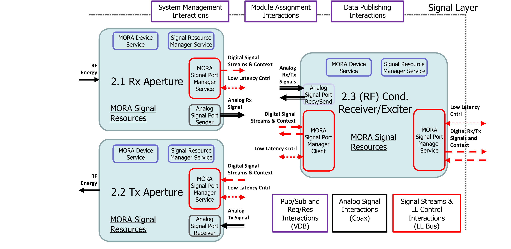

*Figure 42: RF Signal Layer Module Interactions*

- Note: VDB stands for VICTORY Data Bus, which is used for transport of publish-subscribe and request-response interactions in VICTORY.

#### 5.7.3 RF Receiver Aperture/Transducer Module

The Receive Aperture/Transducer is responsible for converting Electromagnetic (EM) energy into an electrical signal. The signal may be pre-amplified and stabilized (calibration). This module may include mechanical and electronic steering, focus control, filtering, low-noise amplification, frequency translation, and analog to digital conversion. The output electrical signal may be analog or a digital stream. It may also output metadata.

<!-- 原书 p.146 ｜ PDF p.166 -->

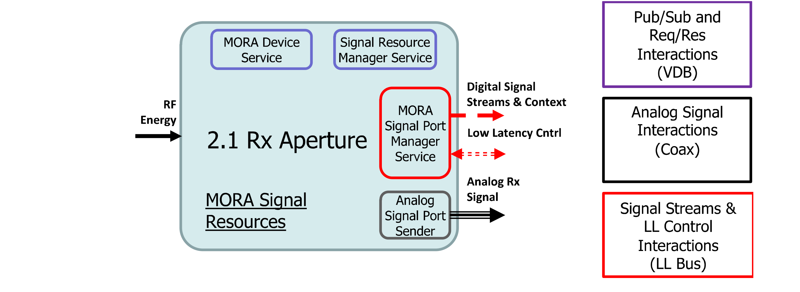

*Figure 43: RF Receiver Aperture/Transducer Interactions*

The MORA Device Manager Service is a set of interactions that support discovery, configuration, control, and health management of the module. These interactions report the health, send notifications of key events such as state changes and faults, and report built-in-test results. They also allow the module configuration to be managed, and its state to be controlled. For example, modules can be made to execute a BIT, reset, or the software or configuration may be updated.

The Signal Resource Manager Service is a group of interactions that support management of the RF resources that support capabilities such as signal domain conversion, signal frequency conversion, signal conditioning, RF distribution, and antenna control. Through these interactions the task manager (or an application) can request information about the resources and capabilities provided by the RF aperture to determine whether a particular RF aperture can meet the requirements of a given task. These interactions support discovery of detailed characteristics of the aperture, such as the fixed and variable parameters, the fixed and settable interconnections, and the real-time data, control, and context endpoints attached to the MORA Low Latency Bus (ML2B). These interactions also support reservation of the signal resources for a particular task.

The Signal Port Manager Service interactions implement high-speed and low latency control of signal ports, which are realized by MORA Data Messages (MDMs) transported on the ML2B. Once resources have been reserved for a task through the Signal Resource Manager Service, the resources are configured, and the task is executed via the MORA Signal Port Manager Service interactions on the ML2B.

The Analog Signal Port Sender interactions send analog representation of time domain radio frequency, intermediate frequency, or baseband signals.

The Receiver Aperture/Transducer interactions are described in Table 41, and the rules stating the requirements for this module are described in Section 5.7.7.

#### 5.7.4 RF Transmit Aperture/Transducer Module

The Transmit Aperture/Transducer is responsible for converting an electrical signal into Electromagnetic (EM) energy, forming a transmit beam. This module may include mechanical and electronic steering, beamforming, focus control, filtering, amplification, frequency translation, and digital to analog conversion.

<!-- 原书 p.147 ｜ PDF p.167 -->

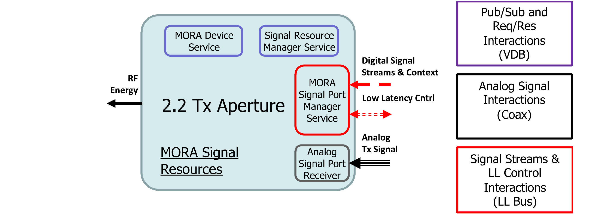

*Figure 44: RF Transmit Aperture/Transducer Interactions*

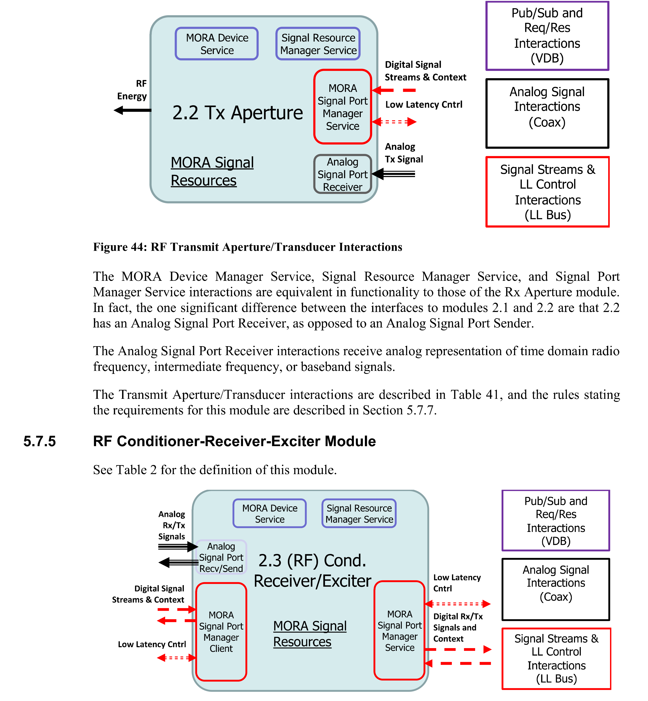

*Figure 45: RF Conditioner Receiver/Exciter Interactions*

The MORA Device Manager Service and Signal Resource Manager Service interactions of this module are equivalent to those of the Tx and Rx aperture interfaces to describe the module’s status, configuration, built-in-test results, and a mechanism for managing the state of the module.

<!-- 原书 p.148 ｜ PDF p.168 -->

The difference in the RF Conditioner-Receiver-Exciter module is that it will have a larger set of resources than the others. It may include RF functions such as signal domain conversion, signal frequency conversion, signal conditioning, RF distribution, and digital signal ports. It exchanges analog signals with the Rx and Tx modules via Analog Signal Receiver and Sender interactions, which are controlled via the MORA Signal Port Manager Client interactions on the ML2B. It exchanges digital signal streams, context, and real-time control data with the down-stream modules via its MORA Signal Port Manager Service.

The following sections describe the interactions that make up each of these interaction endpoint groups, and then state the rules that will be required for each of the RF signal layer modules.

#### 5.7.6 RF Signal Layer Module Interactions

Table 41 shows the interactions that have been defined for the RF signal layer modules, which include 2.1 Receiver Aperture/Transducer, 2.2 Transmit Aperture/Transducer, and 2.3 Conditioner-Receiver Exciter.

Note that these names have been slightly modified (the word “camera” has been removed) to indicate that these interactions were developed with RF applications in mind. They do not explicitly support EO/IR applications in this version. Interactions to support EO/IR applications will be addressed in a future version.

The source of these interaction definitions was MORA. The approach taken was to directly adopt the parts of the MORA specification that related to the functionality of these RF signal layer modules, and thus the interactions shown came directly from analysis of MORA.

For each interaction, the input and output parameters are represented as lists of data entity names in the Input and Output DIV-2 Data Entities columns. Each item in the input and output lists corresponds to an entry in one of the DIV-2 tables provided as appendices.

**Table 41: RF Signal Layer Module Interactions Table**

| RF Signal Layer Module Interactions |||||||
|---|---|---|---|---|---|---|
| Interaction Name | Interaction Description | Input DIV-2 Data Entities | Output DIV-2 Data Entities | 2.1 Receive Aperture/Transducer | 2.2 Transmit Aperture/Transducer | 2.3 Conditioner-Receiver-Exciter |
| PubSensorHeartbeat | | SensorHeartbeatType | | 1.1 | | |
| deleteFile | Request that a file on a MORA device be deleted. The “fileId” argument should correspond to the “id” field of the file requested, as returned from a “getFiles()” request. | string | error | Provides | Provides | Provides |
| getAntennaArrays | Request a list of the antennas and their elements attached to the MORA device. | | arrays | Provides | Provides | |
| getAntennaSideSignalPorts | Get a list of signal ports in the switch matrix that are connected to the antenna side of the RF chain. | | signalPorts | Provides | Provides | |
| getAvailableWaveforms | Request for a list of radio waveforms supported by the MORA device. | waveforms | error | Provides | Provides | Provides |
| getBuiltInTestResults | Request the results from a previous MORA device BIT run. | testResults | error | Provides | Provides | Provides |
| getCurrentMoraConfig | Get the file ID of the current MORA configuration file for a MORA device. | fileId | error | Provides | Provides | Provides |
| getCurrentWaveform | Request details on the currently active waveform. | | waveform | Provides | Provides | Provides |
| getDeviceStatus | Get the status of the MORA device represented by the service. | | status | Provides | Provides | Provides |
| getDeviceType | Get the description of the MORA device represented by the service. | | moraDevice | Provides | Provides | Provides |
| getExternalConnections | Request the static external connections between the signal ports of this MORA device and other MORA devices. | | externalConnections, error | Provides | Provides | Provides |

> 转写说明：首行 `RF Signal Layer Module Interactions` 在原表中横跨全部 7 列，其余 6 格留空。原表起于 p.149，次页续排（续页表头重复），本表按续页顺序接排（PubSensorHeartbeat、deleteFile 之后接 getAntennaArrays 起 9 行），共 11 个数据行。表内被 colspan 覆盖处留空，不代表原表该处无内容。
>
> 转写说明：原表多个单元格内的英文是排版折行（如 `SensorHeartbeatType` 被折成 `SensorHeartbeatT` / `ype`，`getAvailableWaveforms` 被折成 `getAvailableWavefo` / `rms`），已按一个单词复原，未插入空格。
>
> 转写说明：`PubSensorHeartbeat` 行的 Interaction Description、Output DIV-2 Data Entities、2.2、2.3 四格在原表中为空白；`getAntennaArrays`、`getAntennaSideSignalPorts` 的 Input DIV-2 Data Entities 在原表中为空白；`getAntennaArrays`、`getAntennaSideSignalPorts` 的 2.3 列为空白。以上空白照录为空。

<!-- 原书 p.149 ｜ PDF p.169 -->

<!-- 原书 p.150 ｜ PDF p.170 -->

<!-- 原书 p.151 ｜ PDF p.171 -->

<!-- 原书 p.152 ｜ PDF p.172 -->

<!-- 原书 p.153 ｜ PDF p.173 -->

<!-- 原书 p.154 ｜ PDF p.174 -->

#### 5.7.7 RF Signal Layer Module Rules

Implementations of modules 2.1, 2.2, and 2.3 shall comply with the appropriate MORA specifications, as shown in Table 42.

In each row, the Interaction Endpoint column indicates the role that the indicated module shall support. If the endpoint column contains the word “Service”, then the module shall “provide” or implement the service side of the indicated standard. If the endpoint column contains the word “Client”, then the module shall “use” or implement the client side of the indicated standard. If the endpoint column contains the word “Sender”, the module shall “provide” or implement the service side of the interactions, while the word “Receiver” indicates the module shall “use” or implement the client side of the interactions.

Note that conformance with an individual interface standard (set of interactions) can only be tested objectively at the provider/service endpoint.

<!-- 原书 p.155 ｜ PDF p.175 -->

Additional context for the Interaction Endpoints listed in the table can be gained by referring to Figure 42.

**Table 42: RF Signal Layer Module Interaction Endpoints**

| **Module ID** | **Module Name** | **Applicability** | **Interaction Endpoint** | **MORA 2.1 Specification** |
|---|---|---|---|---|
| 2.1 | Receive Aperture/Transducer/Camera | Required | MORA Device Service | MT92010: MORA Device |
| 2.1 | Receive Aperture/Transducer/Camera | Required | Signal Resource Manager Service | MT92013: MORA Signal Resource Manager |
| 2.1 | Receive Aperture/Transducer/Camera | Required | MORA Signal Port Manager Service | MT92016: MORA Signal Port Manager |
| 2.1 | Receive Aperture/Transducer/Camera | Required | Analog Signal Port Sender | MT90011: RF Layer Analog Data Interface |
| 2.2 | Transmit Aperture/Transducer/Laser | Required | MORA Device Service | MT92011: MORA Device Management Interface |
| 2.2 | Transmit Aperture/Transducer/Laser | Required | Signal Resource Manager Service | MT92013: MORA Signal Resource Manager |
| 2.2 | Transmit Aperture/Transducer/Laser | Required | MORA Signal Port Manager Service | MT92016: MORA Signal Port Manager |
| 2.2 | Transmit Aperture/Transducer/Laser | Required | Analog Signal Port Receiver | MT90011: RF Layer Analog Data Interface |
| 2.3 | Conditioner Receiver/Exciter | Required | MORA Device Service | MT92011: MORA Device Management Interface |
| 2.3 | Conditioner Receiver/Exciter | Required | Signal Resource Manager Service | MT92013: MORA Signal Resource Manager |
| 2.3 | Conditioner Receiver/Exciter | Required | MORA Signal Port Manager Service | MT920116: MORA Signal Port Manager |
| 2.3 | Conditioner Receiver/Exciter | Required | Analog Signal Port Sender | MT90011: RF Layer Analog Data Interface |
| 2.3 | Conditioner Receiver/Exciter | Required | Analog Signal Port Receiver | MT90011: RF Layer Analog Data Interface |
| 2.3 | Conditioner Receiver/Exciter | Required | MORA Signal Port Manager Client | MT92013: MORA Signal Resource Manager |

> 注：The MORA specification, Version 2.1 references in the table uniquely identify a testable specification in the MORA documents. MORA also refers to other standard documents, including VICTORY and ANSI/VITA 49.2.
>
> 转写说明：上一条是紧随表格的说明段落（原书该段左缩进小于正文，判为表注；若按正文处理请移出）。原表次页为正文（Rule 5.7.7 各条）与他处内容，非本表续表，未入本表。
>
> 转写说明：`Module Name` 列在原表中排为两行（`Receive Aperture/` + `Transducer/Camera`；`Conditioner` + `Receiver/Exciter`），属名称折行，已用一个空格接成一行。`Module ID`、`Module Name`、`Applicability` 三列在每一行都单独列出（原表无 rowspan 合并），故逐行照录、无留空格。
>
> 存疑：第 11 行 `MORA 2.1 Specification` 列原文作 `MT920116: MORA Signal Port Manager`（其余同类行为 `MT92016`），疑为原书笔误；按「不纠错」原则照录原文，未改。

<!-- 原书 p.156 ｜ PDF p.176 -->

The following documents provide the complete, detailed specifications referenced in the table. MORA Specification, Version 2.1 (see Referenced Documents)

- Distribution A: main body and appendices A-D Distribution C: appendices E-G VICTORY Standard Specifications, Version 1.7 (see Referenced Documents)

Distribution C: main body

Distribution D and/or ITAR: appendices

ANSI/VITA 49.2 (see Referenced Documents) Each bullet item in the rules below uniquely specifies a section of the MORA specification adopted by the SOSA Consortium for the SOSA Technical Architecture. Note that the rules only refer to implementation of the service-side interaction endpoints, as MORA does not provide conformance tests for implementation of the client-side interaction endpoints.

**Rule 5.7.7-[1-4]**

A component implementing the RF modalities of the SOSA 2.1 Receive/Aperture Transducer module shall be compliant with the following MORA specifications: Conformance

Methodology: (TBD)

MT92010: MORA Device

MT92013: MORA Signal Resource Manager

MT92016: MORA Signal Port Manager

MT90011: RF Layer Analog Data Interface

**Rule 5.7.7-[5-7]**

A component implementing the RF modalities of the SOSA 2.1 Receive/Aperture Transducer module shall provide the following signal resources as defined by the MORA specification, Version 2.1: Conformance Methodology: (TBD) Antenna (ANT) Signal Resource RF Translation Signal Resource Signal Domain Conversion Signal Resource

**Rule 5.7.7-[8-9]**

A component implementing the RF modalities of the SOSA 2.1 Receive/Aperture Transducer module may provide the following signal resources as defined by the MORA specification, Version 2.1: RF Conditioning Signal Resource RF Distribution Signal Resource

<!-- 原书 p.157 ｜ PDF p.177 -->

**Rule 5.7.7-[10-13]**

A component implementing the RF modalities of the SOSA 2.2 Transmit/Aperture Transducer module shall be compliant with the following MORA specifications: Conformance

Methodology: (TBD)

MT92010: MORA Device

MT92013: MORA Signal Resource Manager

MT92016: MORA Signal Port Manager

MT90011: RF Layer Analog Data Interface

**Rule 5.7.7-[14-16]**

A component implementing the RF modalities of the SOSA 2.1 Transmit Aperture Transducer module shall provide the following signal resources as defined by the MORA specification, Version 2.1: Conformance Methodology: (TBD) Antenna Signal Resource RF Translation Signal Resource Signal Domain Conversion Signal Resource

**Rule 5.7.7-[17-18]**

A component implementing the RF modalities of the SOSA 2.1 Receive/Aperture Transducer module may provide the following signal resources as defined by the MORA specification, Version 2.1: RF Conditioning Signal Resource RF Distribution Signal Resource

**Rule 5.7.7-[19-24]**

A component implementing the RF modalities of the SOSA 2.3 RF Conditioner-Receiver-Exciter module shall be compliant with the following MORA specifications: Conformance Methodology: (TBD) MT92011: MORA Device Management Interface

MT92013: MORA Signal Resource Manager

MT92016: MORA Signal Port Manager

MT90011: RF Layer Analog Data Interface MT90011: RF Layer Analog Data Interface

MT92013: MORA Signal Resource Manager

<!-- 原书 p.158 ｜ PDF p.178 -->

**Rule 5.7.7-[25-28]**

A component implementing the RF modalities of the SOSA 2.3 RF Conditioner-Receiver-Exciter module shall provide the following signal resources as defined by the MORA specification, Version 2.1: Conformance Methodology: (TBD)

RF Conditioning Signal Resource RF Distribution Signal Resource RF Translation Signal Resource Signal Domain Conversion Signal Resource

### 5.8 EO/IR Signal Layer Modules

#### 5.8.1 EO/IR Receiver Camera Module Standard

Planned for a later version of the SOSA Technical Standard.

#### 5.8.2 EO/IR Transmit Laser Module Standard

Planned for a later version of the SOSA Technical Standard.

#### 5.8.3 EO/IR Conditioner-Receiver-Exciter Module Standard

Planned for a later version of the SOSA Technical Standard.

### 5.9 RF Digital Processing Modules

#### 5.9.1 Tracker

##### 5.9.1.1 Definition

See Table 2 for the definition of this module.

5.9.1.2 Interactions

The tracker interactions are still being developed, and the SOSA Consortium has not yet voted on them. An initial capability – AMTI Multi-Sensor Fusion Sense and Avoid (SAA) – was used to create a notional set of interactions and data elements for a tracker. A detailed concept has been defined for several task manager interactions related to the tracker: SetCreateTask, SetModifyTask, SetDeleteTask, SetModuleAssignment, PubAssignmentHealth, and SubAssignmentHealth. Four interactions related to the tracker performing its functions have also been defined: SubDetection, PubTrack, SubOwnershipReport, and SubTrackReport. Some interactions will be common across all tracker modes/types, such as SetDeleteTask. Others will be sensor and mission-specific. Defining the configuration data, control action, and module assignmen’ fields in the tracker task management interactions for each Sensor and Mission will require an extensive effort.

<!-- 原书 p.159 ｜ PDF p.179 -->

##### 5.9.1.3 Tracker Interactions for AMTI SAA

The SOSA Consortium is developing a comprehensive list of SOSA sensor capabilities. The AMTI SAA capability was used to initiate the development of tracker interactions; therefore, the defined interactions below are relevant for AMTI Multi-Sensor Fusion in an SAA context.

References to the corresponding DIV-2 and DIV-3 products for the tracker in an AMTI Multi-Sensor Fusion SAA mode are found in Appendix D and Appendix E, respectively.

Table 43 further defines the task management interactions shown in Table 40 for an AMTI Multi-Sensor Fusion SAA capability. Note that only those DIV-2 data entities that are specific to this capability are shown. For example, the taskDescription DIV-2 data entity associated with the SetCreateTask interaction (in Table 40) contains sensorType, missionType, and taskConfigData, where taskConfigData is an abstraction that must be extended for each mission type. The particular extension for an AMTI SAA capability is saaTaskConfigData, and that is the DIV-2 data entity that is shown in Table 43 for the version of SetCreateTask used for AMTI SAA. The DIV-2 for AMTI SAA is very specific at this point. There may be interactions and data that can be generalized. As additional capabilities are analyzed, the interactions may be refactored and are subject to change.

**Table 43: Tracker Module Interactions**

| Tracker Module Interactions |||||
|---|---|---|---|---|
| Interaction Name | Interaction Description | Input DIV-2 Data Entities | Output DIV-2 Data Entities | Provider Module |
| SetCreateTask | Request a new task, coming from outside of the sensor. | saaTaskConfigData (SAATaskConfigDataType) | TBD | 1.2 |
| SetModifyTask | Modify task from outside of the sensor. | saaControlAction_AddExternalSensor (SAAControlAction_AddExternalSensorType) saaControlAction_DeleteExternalSensor (SAAControlAction_DeleteExternalSensorType) saaControlAction_SetTrackerMode (SAAControlAction_SetTrackerModeType) saaControlAction_SAATrackCoast (saaControlAction_SAATrackCoastType) | TBD | 1.2 |
| SetDeleteTask | Delete task from outside of the sensor. | taskID (number) | TBD | 1.2 |
| SetModuleAssignment | Assign a task to a module (assignment is used instead of task for modules). Assignments come from internal sources; tasks come from external sources. The intent is that the task manager will decompose an externally received task into module assignments as necessary. | assignmentAction_SAAExternalSensorConfig (AssignmentAction_SAAExternalSensorConfigType) assignmentAction_DeleteExternalSensor (AssignmentAction_DeleteExternalSensorType) assignmentAction_SetTrackerMode (AssignmentAction_SetTrackerModeType) assignmentAction_SAATrackCoast (AssignmentAction_SAATrackCoastType) | TBD | 3.4 |
| PubAssignmentHealth | Publish periodic task (assignment) health. | TBD | trackerHealth (TrackerHealthType) | 3.4 |
| SubAssignmentHealth | Subscribe periodic task (assignment) health. | domainID (number) topicName (string) | TBD | 1.2 |

> 转写说明：首行 `Tracker Module Interactions` 在原表中横跨全部 5 列，其余 4 格留空。原表 p.160 与接续页续排，续页首行起接 SetModuleAssignment、PubAssignmentHealth、SubAssignmentHealth 三行，共 6 个数据行。
>
> 转写说明：`Input DIV-2 Data Entities` 列中，格内本是分条并列的若干数据实体（每条为「实体名 + 换行 + 括号内类型」），故用 ` ` 连接；原表条目之间另有空行间距，已并入单个 ` `。`Interaction Description` 列中是连续句子被排版折行（如 SetModuleAssignment 的说明），按一个空格接成一行。
>
> 转写说明：SetModifyTask 行最后一个类型原文作 `(saaControlAction_SAATrackCoastType)`，首字母小写 `saa`（同格其余三项为 `SAA`），照录原文未改。
>
> 存疑：无（全部单元格清晰可读）。

<!-- 原书 p.160 ｜ PDF p.180 -->

Table 44 shows additional interactions associated with the tracker.

**Table 44: Additional Tracker Interactions**

| Tracker Module Interactions |||||
|---|---|---|---|---|
| Interaction Name | Interaction Description | Input DIV-2 Data Entities | Output DIV-2 Data Entities | Provider Module |
| SubDetection | An interaction for receiving detections. | domainID (number) topicName (string) | TBD | 3.4 |
| PubTrack | An interaction for publishing tracks. | TBD | timePublished (DateTimeType) numOfIntruders (number) trackReport (TrackReportType) | 3.4 |
| SubOwnershipReport | An interaction for receiving ownership information. | domainID (number) topicName (string) | TBD | 3.4 |
| SubTrackReport | An interaction for receiving a track external to the SOSA sensor. The External Data Ingestor ensures the external track is in a SOSA track format. | domainID (number) topicName (string) | TBD | 3.4 |

> 转写说明：首行 `Tracker Module Interactions` 在原表中横跨全部 5 列（与 Table 43 同名），其余 4 格留空。本表起于原书 p.161 上半页（SubDetection、PubTrack、SubOwnershipReport 三行），在下一个续页首行接排 SubTrackReport 一行，共 4 个数据行；该续页其后为正文与 Table 45，未入本表。
>
> 转写说明：`Input DIV-2 Data Entities` 与 `Output DIV-2 Data Entities` 两列中，格内本是分条并列的数据实体（「实体名 + 换行 + 括号内类型」），故用 ` ` 连接。`Interaction Description` 列中是连续句子被排版折行，按一个空格接成一行。
>
> 存疑：无（全部单元格清晰可读）。

<!-- 原书 p.161 ｜ PDF p.181 -->

AMTI SAA Example for Task Configuration

An example of task configuration data for an AMTI SAA mission is given in Table 45. In the interaction SetCreateTask(sensorType, missionType, taskConfigData), sensorType would be set to Radar, missionType would be set to AMTI SAA, and taskConfigData would be represented by saaTaskConfigData, which is defined below.

**Table 45: AMTI SAA Mission Configuration Data**

| **saaTaskConfigData** | **Description** |
|---|---|
| useSOSASensor | A boolean indicating whether or not the tracker will receive detections resulting from a Radar aperture that is part of the SOSA sensor. |
| numExternalSensors | The number of external sensors that will have inputs for the tracker. |
| sensorID | The sensor ID of an external sensor. |
| sensorHardwareSpecs | The hardware specifications of the external sensor associated with the sensor ID. |
| sensorSoftwareSpecs | The software specifications of the external sensor associated with the sensor ID. |
| sensorFOV | The field of view of the external sensor associated with the sensor ID. |
| sensorAddress | Indicates the sensor’s RT address on 1553 bus (see sourceID). |
| ExternalSensorDataEnum | Specifies input data type (beam detection or track). |

> 转写说明：原表只有一层表头（`saaTaskConfigData` / `Description`），无横跨整表的标题行；共 8 个数据行，全表位于原书 p.162 一页之内，无续页。
>
> 转写说明：`Description` 列内个别条目在原表中为两行（如 sensorHardwareSpecs 的说明），属连续句子排版折行，已用一个空格接成一行。`sensorAddress` 行的 `sensor’s` 为原表所有格撇号，照录为弯撇号。
>
> 存疑：无（全部单元格清晰可读）。

### 5.10 Infrastructure Modules

##### 5.10.1.1 Definition

See Table 2 for the definition of this module.

##### 5.10.1.2 Interactions

Planned for a later version of the SOSA Technical Standard.

<!-- 原书 p.162 ｜ PDF p.182 -->

#### 5.10.2 External Data Ingestor

##### 5.10.2.1 Definition

See Table 2 for the definition of this module.

5.10.2.2 Interactions

Planned for a later version of the SOSA Technical Standard.

#### 5.10.3 Host Platform Interface

##### 5.10.3.1 Definition

See Table 2 for the definition of this module.

The host platform interface provides a bridge between the SOSA sensor and the host platform. It converts the SOSA interactions to/from the host platform interface protocol. For example, a SOSA sensor plugging into an OMS-based platform would have a host platform interface module that supports OMS on the outward-facing interface and SOSA on the inward-facing SOSA sensor.

5.10.3.2 Interactions

The SOSA Consortium has accepted a set of interactions and associated DIV-2 data entities for external sensor tasking, primarily tasking of RF sensors. These interactions represent a basic set of functionalities distilled from Unmanned Ariel System (UAS) Command & Control Initiative (UCI), VICTORY, and STANAG 4586. The 6.9 Host Platform Interface module receives UCI, VICTORY, or STANAG 4586 command and control messages, translates them into the SOSA message format, and initiates interactions with modules 1.1 System Manager and 1.2 Task Manager. The host platform interface also receives messages from within the SOSA sensor about the commanded tasks and translates them from the SOSA message format into messages that adhere to the UCI, VICTORY, or STANAG 4586 message standards.

<!-- 原书 p.163 ｜ PDF p.183 -->

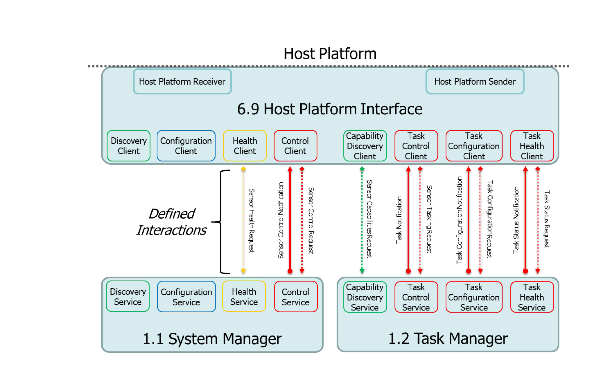

*Figure 46: Host Platform Interface Module Interactions*

Figure 46 illustrates the interfaces between the host platform interface and the management modules. The interaction groups shown are interactions bundled into functional groups for the sake of clarity. They are not an exhaustive list of all interactions necessary for command and control of the SOSA sensor, but a defined set of interactions needed to control externally the Radar, EW, and SIGINT sensor types. As an example of the functional bundling that was used to create the interaction groups, the Sensor Health Request interaction group encompasses the GetActiveFaults, GetBITResults, and GetSubsystemStatus interactions defined in Table 46.

The names, descriptions, inputs, and outputs of the interactions between the host platform interface and the management modules are listed in Table 46.

**Table 46: Host Platform Interface Interactions**

| Host Platform Interface Interactions |||||||
|---|---|---|---|---|---|---|
| Interaction Name | Interaction Description | Input DIV-2 Data Entities | Output DIV-2 Data Entities | 6.9 Host Platform Interface | 1.1 System Manager | 1.2 Task Manager |
| GetActiveFaults | Interaction to request and obtain a list of active faults in the sub-system. | None | CommandStatus (CommandStatusType), FaultCode (FaultCodeType) | Uses | Provides | N/A |
| GetBITResults | Interaction that sends the results of a specified BIT. | SubsystemID (SubsystemIDType) BIT_ID (BIT_IDType) | CommandStatus (CommandStatusType), BITResults (BITResultsType) | Uses | Provides | N/A |
| GetPlatformOrientation | Interaction sent to an Orientation Data component for retrieving the current orientation of the platform or vehicle. | None | Orientation (OrientationType), CommandStatus (CommandStatusType) | Uses | Provides | N/A |
| GetPlatformPosition | Interaction sent to a Position Data component for retrieving the current position of the platform. | None | Position (PositionType), CommandStatus (CommandStatusType) | Uses | Provides | N/A |
| GetPlatformVelocity | Interaction sent to get a 3D velocity of a platform. NOTE: VICTORY specifies heading and speed, whereas OMS and STANAG 4586 specify velocities North, East, and Down. | None | DirectionOfTravel (DirectionOfTravelType), CommandStatus (CommandStatusType) | Uses | Provides | N/A |
| GetSARSensorCapabilities | Interaction that retrieves an installed SAR Capability, its configurable characteristics, and its controllability. | None | SAR_Capability (SAR_CapabilityEnum), SAR_Subcapability (SAR_SubCapabilityEnum), CommandStatus (CommandStatusType) | Uses | Provides | N/A |
| GetSensorCalibrationResult | Interaction sent to a sensor to retrieve whether or not the most recent calibration of the sensor device was successful. | None | Result (CalibrationResultType), CommandStatus (CommandStatusType) | Uses | Provides | N/A |

> 转写说明：首行 `Host Platform Interface Interactions` 在原表中横跨全部 7 列，其余 6 格留空。`6.9 Host Platform Interface` 表头在原表中排为三行（`6.9 Host` / `Platform` / `Interface`），属表头折行，已用一个空格接成一行。
>
> 转写说明：原表 p.164 与续页续排，p.164 只有 GetActiveFaults 一行，续页接排 GetBITResults 至 GetSensorCalibrationResult 六行，共 7 个数据行。`Input DIV-2 Data Entities` 与 `Output DIV-2 Data Entities` 两列中，格内本是分条并列的数据实体（「实体名 + 换行 + 括号内类型」，条目之间以逗号分隔），故用 ` ` 连接；GetPlatformVelocity 行的说明格内是两段（正文 + `NOTE:` 段），用 ` ` 分段。
>
> 转写说明：`GetPlatformPosition` 行的 `Position (PositionType),` 与 `GetActiveFaults` 行的 `FaultCode (FaultCodeType)` 在原表中实体名与类型同处一行（未折行），照录为一行。
>
> 存疑：无（全部单元格清晰可读）。

<!-- 原书 p.164 ｜ PDF p.184 -->

<!-- 原书 p.165 ｜ PDF p.185 -->

<!-- 原书 p.166 ｜ PDF p.186 -->

<!-- 原书 p.167 ｜ PDF p.187 -->

<!-- 原书 p.168 ｜ PDF p.188 -->

<!-- 原书 p.169 ｜ PDF p.189 -->

<!-- 原书 p.170 ｜ PDF p.190 -->

<!-- 原书 p.171 ｜ PDF p.191 -->

### 5.11 OSA Architecture Development/Evolution Plan

Planned for a later version of the SOSA Technical Standard.

<!-- 原书 p.172 ｜ PDF p.192 -->