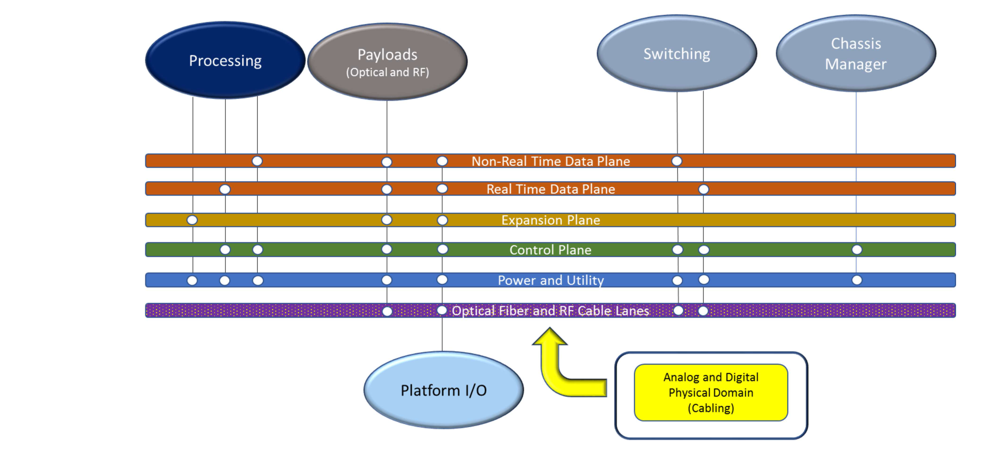

# Appendix C: Use-Case Details

> 原书 p.179–179 ｜ PDF p.199–199

## C Use-Case Details

### C.1 OV-1 (High Level Operational Concept)

SOSA Hardware Use-Cases

The SOSA Hardware concepts are predicated on a set of architectural decisions that drive the overall development of the entire effort. The high-level use below is illustrative and provides an overview of all the relevant building blocks that encompass the Hardware portion of the SOSA standard. Each element in the use-case, both bubbles and lines, titles those specific building blocks and their connections. It is very important to note that each piece is a family that includes a number of types that differ in some respects and are similar in others. One of the underlying tenets not reflected in the diagram is the maximization of hardware module interoperability. With that in mind it is worth considering the connections below and that multiple hardware modules are capable of those connections Figure 47.

*Figure 47: High-Level SOSA Use-Case*

### C.2 OV-2 (Operational Resource Flow)

Planned for a later version of the SOSA Technical Standard.

### C.3 OV-5b (Operational Activity Model)

Planned for a later version of the SOSA Technical Standard.

<!-- 原书 p.179 ｜ PDF p.199 -->