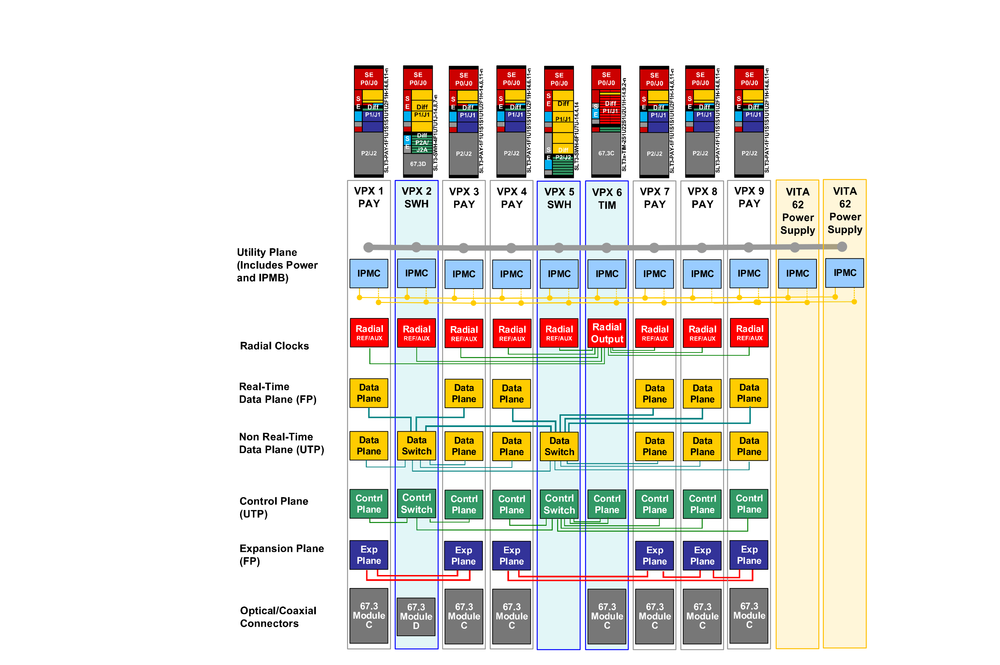
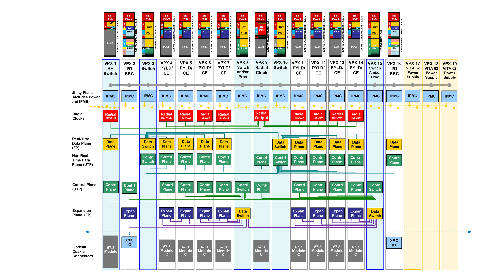
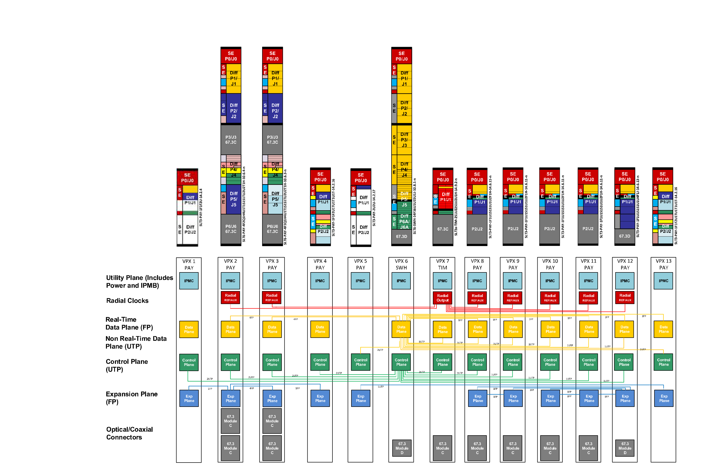

# Appendix I: SOSA Backplane Examples

> 原书 p.186–190 ｜ PDF p.206–210

## I SOSA Backplane Examples

The following examples illustrate how the SOSA hardware modules can be combined to create a 3U medium-sized, 3U large-sized, and 3U/6U hybrid backplane. Each example references a SOSA hardware module for each slot position on the backplane and then defines how each pipe in each slot is interconnected. The associated topologies should be the same in each SOSA backplane although the number and type of slots may vary based on platform constraints and mission requirements.

I.1 3U Medium-Sized Backplane Example

The 3U medium-sized backplane example includes 6 SLT3-PAY-1F1U1S1S1U1U2F1H-14.6.11-n payloads in Slots 1, 3, 4, 7, 8, and 9 that can be populated with RF transceivers and/or computing payloads (e.g., SBC, FPGA, GPGPU, etc.). ANSI/VITA 67.3 connectors with blindmate coaxial pins facilitate two-level maintenance and can be upgraded in the future to include blind-mate optical connectors to support high throughput applications such as Digital RF.

The switched topology for the Ethernet control and data planes is provided on the same card in order to minimize the number of switch cards required and associated infrastructure overhead. Slot 2 uses a SLT3-SWH-4F1U7U1J-14.8.7-n switch which supports a blind-mate optical connector for Ethernet connections in/out of the chassis. Slot 2 is daisy chained with Slot 5 which uses a SLT3-SWH-6F1U7U-14.4.14 switch to support additional payloads. The PCIe Expansion Plane is connected between adjacent payloads in order to offload processing and support close coupling between cards comprising a single logical capability.

Slot 6 uses a SLT3x-TIM-2S1U22S1U2U1H-14.9.2-n radial clock module to provide timing to all of the payloads to enable phase-coherent operations. Radial distribution is achieved through the backplane using equal length traces to all terminating slots within the chassis. The radial clock module also includes an ANSI/VITA 67.3 connector with blind-mate coaxial pins to facilitate two-level maintenance.

<!-- 原书 p.186 ｜ PDF p.206 -->

*Figure 48: 3U Medium-Sized Backplane Example*

I.2 3U Large-Sized Backplane Example

The 3U large-sized backplane example includes 8 SLT3-PAY-1F1U1S1S1U1U2F1H-14.6.11-n payloads in Slots 4, 5, 6, 7, 11, 12, 13, and 14 that can be populated with RF transceivers and/or computing payloads (e.g., SBC, FPGA, GPGPU, etc.). ANSI/VITA 67.3 connectors with blindmate coaxial pins facilitate two-level maintenance and can be upgraded in the future to include blind-mate optical connectors to support high throughput applications such as Digital RF.

Slot 9 uses a SLT3x-TIM-2S1U22S1U2U1H-14.9.2-n radial clock to provide timing to all of the payloads to enable phase-coherent operations. Radial distribution is achieved through the backplane using equal length traces to all terminating slots within the chassis. The radial clock slot also includes an ANSI/VITA 67.3 connector with blind-mate coaxial pins to facilitate twolevel maintenance.

Separate cards are used for the Ethernet control and data planes in order to maximize the number of payloads that can be supported by a single card, thus minimizing the number of inter-switch connections and associated bottlenecks. Slots 3 and 10 use a SLT3-SWH-6F1U7U-14.4.14 switch to establish the data plane switched fabric where the control plane lanes are repurposed to provide the second data plane connection to each payload slot. Slots 8 and 15 use a SLT3-SWH-6F8U-14.4.15 switch to establish the control plane switched fabric as well as provide Expansion Plane connectivity amongst all of the payloads.

Slots 2 and 16 use SLT3-PAY-1F1F2U1TU1T1U1T-14.2.16 for SBCs with I/O and an XMC site that are routed out of the chassis. The I/O pins can be used to connect peripherals such as a

<!-- 原书 p.187 ｜ PDF p.207 -->

display, keyboard, and mouse. The XMC site can be used to customize the I/O for a particular system or platform. This approach allows the same SBC carrier card to be shared across platforms with host-specific tailoring accomplished with a custom XMC.

Slot 1 uses a SLT3-SWH-1F1S1S1U1U1K-14.8.8-n switch to route RF signals within and outside of the chassis. This approach enables payloads to share RF resources such as amplifier and antennas, and may be used in the future to distribute Local Oscillators (LOs) to enable LOcoherent operation across payloads. The RF switch slot also includes an ANSI/VITA 67.3 connector with blind-mate coaxial pins to facilitate two-level maintenance.

*Figure 49: 3U Large-Sized Backplane Example*

I.3 3U/6U Hybrid Backplane Example

The 3U/6U hybrid backplane example illustrates how 3U payloads can be shared across platforms and augmented with 6U payloads when additional RF or processing capability is required. A hybrid approach can also be applied when retrofitting/updating an existing 6U chassis in order to take advantage of the growing 3U ecosystem.

The 3U/6U hybrid backplane example includes 4 SLT3-PAY-1F1U1S1S1U1U2F1H-14.6.11-n payloads in Slots 8, 9, 10, and 11 and a SLT3-PAY-1F1U1S1S1U1U4F1J-14.6.13-n extended payload in Slot 12 that can be populated with RF transceivers and computing payloads (e.g., SBC, FPGA, GPGPU, etc.). ANSI/VITA 67.3 connectors with blind-mate coaxial pins facilitate two-level maintenance and can be upgraded in the future to include blind-mate optical connectors to support high throughput applications such as Digital RF.

Slot 7 uses a SLT3x-TIM-2S1U22S1U2U1H-14.9.2-n radial clock to provide timing to all of the payloads to enable phase-coherent operations. Radial distribution is achieved through the

<!-- 原书 p.188 ｜ PDF p.208 -->

backplane using equal length traces to all terminating slots within the chassis. The radial clock slot also includes an ANSI/VITA 67.3 connector with blind-mate coaxial pins to facilitate twolevel maintenance.

Slots 4 and 13 use SLT3-PAY-1F1F2U1TU1T1U1T-14.2.16 for SBCs with I/O and an XMC site that are routed out of the chassis. The I/O pins can be used to connect peripherals such as a display, keyboard, and mouse. The XMC site can be used to customize the I/O for a particular system or platform. This approach allows the same SBC carrier card to be shared across platforms with host-specific tailoring accomplished with a custom XMC. Additional I/O is provided by Slot 5 which uses SLT3-PAY-2U2U-14.2.17 to interface with the platform over platform-specific connections and the rest of the payload modules over standard expansion or data plane interfaces. Slot 1 uses SLT3-PAY-1F1F2U-14.2.4 to support legacy SBCs although this slot profile has been deprecated in the SOSA standard and is not recommended for new development.

Slots 2 uses a SLT6-PAY-4F2Q1H4U1T1S1S1TU2U2T1H-10.6.4-n payload that can be populated with RF transceivers and/or computing payloads (e.g., SBC, FPGA, GPGPU, etc.). Slot 3 uses a SLT6-PAY-4F1Q1H4U1T1S1S1TU2U2T1H-10.6.3-n payload that can also be populated with RF transceivers and computing payloads but also includes I/O that is routed out of the chassis. The I/O pins can be used to connect peripherals such as a display and keyboard/mouse, while the XMC site can be used to customize the I/O for a particular system or platform. Both Slots 2 and 3 use ANSI/VITA 67.3 connectors with blind-mate coaxial pins to facilitate two-level maintenance that can be upgraded in the future to include blind-mate optical connectors to support high throughput applications such as Digital RF.

The 3U/6U hybrid backplane example takes advantage of the additional pins available in 6U to provide the switched topology for the entire backplane in a single card. Slot 6 uses SLT6-SWH-14F16U1U15U1J-10.8.1-n to establish the Ethernet switched fabric for the control and data planes. This slot also supports a blind-mate optical connector for Ethernet connections in/out of the chassis. The PCIe Expansion Plane is connected between adjacent payloads in order to offload processing and support close coupling between cards comprising a single logical capability. The extended payload in Slot 12 can also serve as a data aggregator as it possesses an Expansion Plane connection to the payloads in Slots 8, 9, 10, and 11.

<!-- 原书 p.189 ｜ PDF p.209 -->

*Figure 50: 3U/6U Hybrid Backplane Example*

<!-- 原书 p.190 ｜ PDF p.210 -->