# Technical Standard for SOSA™ Reference Architecture, Edition 1.0, Version 2

> The Open Group Snapshot；Case 88ABW-2019-0039；Distribution Statement A（公开发布，分发不限）
>
> 本文件把该书的分册 md 按原书顺序合并为一册：正文英文原文照录，47 张表为管道表，50 张图存 `assets/`。
> 每页末尾带页锚 `<!-- 原书 p.N ｜ PDF p.M -->`，可按页回查原书（原书页码＝PDF 页码−20，前置为罗马页码）。
> 转换口径与已知差异见 [`99-转换说明与已知差异.md`](99-转换说明与已知差异.md)。
## 目录

- 前置：封面·目录·图表清单·序（原书 p.i–xx ｜ PDF p.1–20）
- 1 Introduction（原书 p.1–7 ｜ PDF p.21–27）
- 2 Definitions（原书 p.8–8 ｜ PDF p.28–28）
- 3 Reference Architecture Description（原书 p.9–42 ｜ PDF p.29–62）
- 4 Architecture Definition（原书 p.43–71 ｜ PDF p.63–91）
- 5 SOSA Technical Standard（原书 p.72–172 ｜ PDF p.92–192）
- Appendix A: StdV-1 (Applicable Standards)（原书 p.173–173 ｜ PDF p.193–193）
- Appendix B: AV-2 Integrated Dictionary（原书 p.174–178 ｜ PDF p.194–198）
- Appendix C: Use-Case Details（原书 p.179–179 ｜ PDF p.199–199）
- Appendix D: DIV-2 and Data Dictionary（原书 p.180–181 ｜ PDF p.200–201）
- Appendix E: DIV-3 (Physical Data Model)（原书 p.182–182 ｜ PDF p.202–202）
- Appendix F: Host Vehicle/Sensor Connector Details（原书 p.183–183 ｜ PDF p.203–203）
- Appendix G: Slot Profiles（原书 p.184–184 ｜ PDF p.204–204）
- Appendix H: Module-by-Module Details（原书 p.185–185 ｜ PDF p.205–205）
- Appendix I: SOSA Backplane Examples（原书 p.186–190 ｜ PDF p.206–210）
- Acronyms & Abbreviations（原书 p.191–194 ｜ PDF p.211–214）

## 前置：封面·目录·图表清单·序

> 原书 p.i–xx ｜ PDF p.1–20

The Open Group Snapshot

Technical Standard for SOSA™ Reference Architecture,

Edition 1.0, Version 2

- You have a choice: you can either create your own future, or you can become the victim of a future that someone else creates for you. By seizing the transformation opportunities, you are seizing the opportunity to create your own future.

Vice Admiral (ret.) Arthur K. Cebrowski

NOTICE

Snapshots are draft documents, which provide a mechanism for The Open Group to disseminate information on its current direction and thinking to an interested audience, in advance of formal publication, with a view to soliciting feedback and comment. A Snapshot represents the interim results of a technical activity. Although at the time of publication The Open Group intends to progress the activity towards publication of a Preliminary Standard or Open Group Standard, The Open Group is a consensus organization, and makes no commitment regarding publication. Similarly, a Snapshot does not represent any commitment by any member of The Open Group to make any specific products available. This Snapshot is intended to make public the direction, thinking and path the SOSA Consortium is taking in the development of the SOSA Reference Architecture. We invite your feedback and guidance. To provide feedback on this Snapshot, please send comments by email to ogsosa-admin@opengroup.us no later than December 31, 2019. This Snapshot document is valid through December 31, 2019 only. For information on joining The Open Group SOSA™ Consortium, please send email to ogsosa-admin@opengroup.us or visit our website at www.opengroup.org/sosa.

Case: 88ABW-2019-0039; Cleared: 2019-01-07

<!-- 原书 p.i ｜ PDF p.1 -->

Copyright © 2019, The Open Group LLC for the benefit of the SOSA Consortium Members. All rights reserved. The Open Group hereby authorizes you to use this document for any purpose, PROVIDED THAT any copy of this document, or any part thereof, which you make shall retain all copyright and other proprietary notices contained herein. This document may contain other proprietary notices and copyright information. Nothing contained herein shall be construed as conferring by implication, estoppel, or otherwise any license or right under any patent or trademark of The Open Group or any third party. Except as expressly provided above, nothing contained herein shall be construed as conferring any license or right under any copyright of The Open Group. Note that any product, process, or technology in this document may be the subject of other intellectual property rights reserved by The Open Group, and may not be licensed hereunder. This document is provided "AS IS" WITHOUT WARRANTY OF ANY KIND, EITHER EXPRESSED OR IMPLIED, INCLUDING, BUT NOT LIMITED TO, THE IMPLIED WARRANTIES OF MERCHANTABILITY, FITNESS FOR A PARTICULAR PURPOSE, OR NON-INFRINGEMENT. Some jurisdictions do not allow the exclusion of implied warranties, so the above exclusion may not apply to you. Any publication of The Open Group may include technical inaccuracies or typographical errors. Changes may be periodically made to these publications; these changes will be incorporated in new editions of these publications. The Open Group may make improvements and/or changes in the products and/or the programs described in these publications at any time without notice. Should any viewer of this document respond with information including feedback data, such as questions, comments, suggestions, or the like regarding the content of this document, such information shall be deemed to be non-confidential and The Open Group shall have no obligation of any kind with respect to such information and shall be free to reproduce, use, disclose, and distribute the information to others without limitation. Further, The Open Group shall be free to use any ideas, concepts, know-how, or techniques contained in such information for any purpose whatsoever including but not limited to developing, manufacturing, and marketing products incorporating such information. If you did not obtain this copy through The Open Group, it may not be the latest version. For your convenience, the latest version of this publication may be downloaded at www.opengroup.org/library.

The Open Group Snapshot Technical Standard for SOSA™ Reference Architecture, Edition 1.0, Version 2 Document Number: S180

Authored by The Open Group SOSA™ Consortium. Published by The Open Group, January 2019. Comments relating to the material contained in this document may be submitted to: The Open Group, 800 District Avenue, Suite 150, Burlington, MA 01803, United States or by electronic mail to: ogsosa-admin@opengroup.us

<!-- 原书 p.ii ｜ PDF p.2 -->

### Contents

1 Introduction 1

1.1 Objective 1

1.2 Overview 2

1.2.1 SOSA Architecture Fundamentals 2

1.2.2 Business Alignment 4

1.3 Conformance 4

1.4 Normative References 5

1.5 Terminology 5

1.5.1 SOSA Architecture 5

1.5.2 System Requirements 5

1.5.3 Hardware Specification Keywords 6

1.6 Future Directions 7

2 Definitions 8 3 Reference Architecture Description 9

3.1 CV-1/CV-2 Objectives 9

3.1.1 SOSA Capability View – 1 (CV-1) 9

3.2 SOSA Architecture Principles 10

3.2.1 Business-Oriented Architecture Principles 11

3.2.2 Technically-Oriented Architecture Principles 12

3.3 SOSA Quality Attributes 17

3.4 SV-1 (System Interface Description/Context) 19

3.5 SOSA Physical Context Entities 21

3.5.1 SOSA Sensor 21

3.5.2 SOSA Hardware Element 21

3.5.3 SOSA Host Platform 22

3.5.4 SOSA Sensor Pod 22

3.6 Function to Module Aggregation Criteria 22

3.7 Security Concepts and Approach 23

3.7.1 SOSA Hardware Security Framework 23

3.8 Hardware Concepts and Approach 24

3.9 SvcV-1: Services Context Description 24

3.10 SOSA Inter-Module Interactions 29

3.10.1 SOSA Sensor Interconnections 30

3.10.2 SOSA Module Interaction Types 30

3.11 System Management Concepts and Approach 35

3.11.1 System Management Concepts 36

3.11.2 Network-Based System Management 37

3.11.3 SOSA Hardware Management Overview 39

4 Architecture Definition 43

4.1 Service Views 43

4.1.1 SvcV-4: Services Functionality Description 43

4.1.2 SvcV-2: Services Resource Flow Description 66

<!-- 原书 p.iii ｜ PDF p.3 -->

4.1.3 SvcV-3b: Services-Services Matrix 66

4.2 Data Architecture 66

4.2.1 DIV-1: Conceptual Data Model 67

4.2.2 DIV-2: Logical Data Model 69

4.2.3 DIV-3: Physical Data Model 70

4.3 Service Architecture 70

4.3.1 SvcV-6: Services Resources Flow Matrix 70

4.4 System Architecture 70

4.4.1 SV-2: Systems Resource Flow Description 70

4.4.2 SV-3: Systems-Systems Matrix 70

4.5 Box-Level Hardware 70

5 SOSA Technical Standard 72

5.1 Host Vehicle/SOSA Sensor Interface 72

5.1.1 Sensor Physical Packages 72

5.1.2 Mechanical Interfaces 72

5.2 SOSA Sensor Physical Interfaces 73

5.2.1 Electrical Connector Characteristics 73

5.2.2 J1-DC Power Connector 73

5.2.3 J2-Signals Connector 75

5.2.4 J3-Video (Copper) Connector 84

5.2.5 J4-Fiber Optics Connector 86

5.2.6 J5-GPS Antenna Connector 88

5.2.7 J6-DC Auxiliary Power Connector 88

5.2.8 J7-High Speed Connector 90

5.2.9 J8-High Density RF Connector 90

5.2.10 J9-Low Loss RF Connector 92

5.2.11 Auxiliary RF Connectors 93

5.2.12 J10-AC Power Connector 94

5.2.13 Hardware Platform 3U and 6U Slot Profile

Specifications 95 5.2.14 Hardware Platform SOSA Plug-In Card Profiles 101

5.2.15 Common 6U and 3U Plug-In Card Profile

Specifications 102

5.2.16 SOSA 3U Plug-IN Card Profile Specifications 102

5.2.17 6U Plug-In Card Profile Specifications 114

5.2.18 SOSA 6U Legacy Switch Plug-In Card Profile 119

5.2.19 SOSA 6U External I/O Plug-In Card Profile 120

5.2.20 Power Supply Module 122

5.2.21 Mezzanine Modules 123

5.2.22 Maintenance Console Port Requirements 124

5.3 SOSA System Management Requirements 126

5.3.1 SOSA Hardware Element System Management

Requirements 126

5.3.2 SOSA Module System Management Requirements 128

5.4 SOSA Software Operating Environment 128

5.4.1 Description 128

5.4.2 Scope 129

5.4.3 Recommendations 131

5.4.4 Safety 132

5.5 SOSA Module Interactions 133

<!-- 原书 p.iv ｜ PDF p.4 -->

5.6 Sensor Management 133

5.6.1 System Manager Module 134

5.6.2 Task Manager Module 140

5.7 RF Signal Layer Modules 144

5.7.1 Modular Open RF Architecture 145

5.7.2 Application of MORA to SOSA Signal Layer Modules 146

5.7.3 RF Receiver Aperture/Transducer Module 146

5.7.4 RF Transmit Aperture/Transducer Module 147

5.7.5 RF Conditioner-Receiver-Exciter Module 148

5.7.6 RF Signal Layer Module Interactions 149

5.7.7 RF Signal Layer Module Rules 155

5.8 EO/IR Signal Layer Modules 159

5.8.1 EO/IR Receiver Camera Module Standard 159

5.8.2 EO/IR Transmit Laser Module Standard 159

5.8.3 EO/IR Conditioner-Receiver-Exciter Module Standard 159

5.9 RF Digital Processing Modules 159

5.9.1 Tracker 159

5.10 Infrastructure Modules 162

5.10.2 External Data Ingestor 163

5.10.3 Host Platform Interface 163

5.11 OSA Architecture Development/Evolution Plan 172

A StdV-1 (Applicable Standards) 173 B AV-2 Integrated Dictionary 174 C Use-Case Details 179

C.1 OV-1 (High Level Operational Concept) 179

C.2 OV-2 (Operational Resource Flow) 179

C.3 OV-5b (Operational Activity Model) 179

D DIV-2 and Data Dictionary 180

D.1 SOSA Sensor RF Control (Distribution A) 180

D.2 MORA Signal Layer 180

D.3 AMTI SAA Multi-Sensor Fusion Tracker 180

D.4 Common System Management Data Elements 180

E DIV-3 (Physical Data Model) 182

E.1 SOSA Sensor RF Control (Distribution A) 182

E.2 RF Signal Layer 182

F Host Vehicle/Sensor Connector Details 183 G Slot Profiles 184 H Module-by-Module Details 185 I SOSA Backplane Examples 186

I.1 3U Medium-Sized Backplane Example 186

I.2 3U Large-Sized Backplane Example 187

I.3 3U/6U Hybrid Backplane Example 188

<!-- 原书 p.v ｜ PDF p.5 -->

Table of Figures

Figure 1: The Facets that Comprise a SOSA Module 3

Figure 2: The Architecture Development Method Adopted for the SOSA Technical Standard 3

Figure 3: SOSA CV-1 10

Figure 4: SV-1 for Nominal Case 20

Figure 5: SV-1 for Sensor Pod Special Case 21

Figure 6: SvcV-1: Top-Level SOSA Services Context Description 25

Figure 7: SOSA Sensor Interconnections 30

Figure 8: SOSA Network-Based System Management Architecture 38

Figure 9: SOSA Hardware System Management Logical Block Diagram 40

Figure 10: Example SOSA System Management Backplane/Chassis Implementation 41

Figure 11: Example SOSA System Management Plug-In Card Implementation 42

Figure 12: DIV-1 for Mission Entities 68

Figure 13: DIV-1 for Management Entities 69

Figure 14: SOSA Hardware Building Blocks 71

Figure 15: J1 Power Connector Pin Arrangement 74

Figure 16: J2 Signal Connector Pin Arrangement 75

Figure 17. Input Time Rollover Pulse (1 PPS) Signal Characteristics 83

Figure 18: J3 Video Connector Pin Arrangement 85

Figure 19: J4 Fiber Optic Connector Pin Arrangement 87

Figure 20. J6 Auxiliary Power Connector Pin Arrangement 89

Figure 21: J8 RF Connector Pin Arrangement 91

Figure 22: J9 RF Connector Pin Arrangement 92

Figure 23: J10 AC Power Connector Pin Arrangement 94

Figure 24: ANSI/VITA 65.0 3U I/O Intensive SBC Slot Profile

SLT3-PAY-1F1F2U1TU1T1U1T-14.2.16 103

Figure 25: ANSI/VITA 65.0 Payload Slot Profile for SLT3-PAY-2F2U-14.2.3 105

Figure 26: ANSI/VITA 65.0 Payload Slot Profile

SLT3-PAY-1F1U1S1S1U1U2F1H-14.6.11-n 106

Figure 27: ANSI/VITA 65.0 Payload Slot Profile

SLT3-PAY-1F1U1S1S1U1U4F1J-14.6.13-n 107

Figure 28: ANSI/VITA 65.0 Control/Expansion Plane Switch Slot Profile

SLT3-SWH-6F8U-14.4.15 108

Figure 29: ANSI/VITA 65.0 Control/Data Plane Switch Slot Profile

SLT3-SWH-6F1U7U-14.4.14 109

Figure 30: ANSI/VITA 65.0 Control/Data Plane Switch Slot Profile

SLT3-SWH-4F1U7U1J-14.8.7-n 110

Figure 31: ANSI/VITA 65.0 3U RF Switch Slot Profile

SLT3-SWH-1F1S1S1U1U1K-14.8.8-n 111

Figure 32: ANSI/VITA 65.0 Radial Clock Slot Profile

SLT3x-TIM-2S1U22S1U2U1H-14.9.2-n 112

Figure 33: ANSI/VITA 65.0 3U External I/O Slot Profile

SLT3-PAY-2U2U-14.2.17 113

Figure 34: ANSI/VITA 65.0 6U Payload Slot Profile

SLT6-PAY-4F2Q1H4U1T1S1S1TU2U2T1H-10.6.4-n 115

<!-- 原书 p.vi ｜ PDF p.6 -->

Figure 35: ANSI/VITA 65.0 6U Payload Slot Profile

SLT6-PAY-4F1Q1H4U1T1S1S1TU2U2T1H-10.6.3-n 116

Figure 36: ANSI/VITA 65.0 6U Control/Data Switch Slot Profile

SLT6-SWH-14F16U1U15U1J-10.8.1-n 118

Figure 37: ANSI/VITA65.0 Switch Slot Profile for SLT6-SWH-16U20F-10.4.2 120

Figure 38: ANSI/VITA 65.0 6U External I/O Slot Profile SLT6-PAY-4U2U-10.2.8 121

Figure 39: FACE Software Operating Environment and Subset Proposed for the

SOSA REI (red dashed line) 131

Figure 40: Sensor Management Architecture View 134

Figure 41: System Manager Interactions 135

Figure 42. RF Signal Layer Module Interactions 146

Figure 43: RF Receiver Aperture/Transducer Interactions 147

Figure 44: RF Transmit Aperture/Transducer Interactions 148

Figure 45: RF Conditioner Receiver/Exciter Interactions 148

Figure 46: Host Platform Interface Module Interactions 164

Figure 46: High-Level SOSA Use-Case 179

Figure 47: 3U Medium-Sized Backplane Example 187

Figure 48: 3U Large-Sized Backplane Example 188

Figure 49: 3U/6U Hybrid Backplane Example 190

<!-- 原书 p.vii ｜ PDF p.7 -->

Table of Tables

Table 1: SOSA Quality Attributes (in order of decreasing precedence) 18

Table 2: SvcV-1: Module Descriptions 25

Table 3: Interaction Types 31

Table 4: Interaction Roles, Endpoints, and Symbols 32

Table 5: SOSA SvcV-4 43

Table 6: Turreted Sensor Classes 72

Table 7: Sensor Connectors 73

Table 8: J1 DC Power Connector Pin Allocation 74

Table 9: J2 Signals Connector Pin Allocation 76

Table 10: J3 Video Connector Pin Allocation 85

Table 11: J4 Fiber Optic Connector Pin Allocation 87

Table 12: J5 GPS Connector Pin Allocation 88

Table 13. J6 Auxiliary DC Power Connector 89

Table 14: J7 Pin Allocations 90

Table 15: J8 RF Pin Allocations 91

Table 16: J9 RF Pin Allocation 93

Table 17: Auxiliary RF Connections 93

Table 18: J10 AC Power Pin Allocations 94

Table 19. Hardware Module Cooling Methods 101

Table 20: Referenced ANSI/VITA 65.1 Module Profiles for

SLT3-PAY-1F1F2U1TU1T1U1T-14.2.16 104

Table 21: ANSI/VITA 65.1Slot Profiles for SLT3-PAY-1F1U1S1S1U1U2F1H-14.6.11-n 106

Table 22: ANSI/VITA 65.1 Module Profiles for SLT3-PAY-1F1U1S1S1U1U2F1H-14.6.11-n

Table 23: ANSI/VITA 65.1Slot Profiles for SLT3-PAY-1F1U1S1S1U1U4F1J-14.6.13-n 107

Table 24: ANSI/VITA 65.1 Module Profiles for SLT3-PAY-1F1U1S1S1U1U4F1J-14.6.13-n 107

Table 25: ANSI/VITA 65.1 Module Profiles for SLT3-SWH-6F8U-14.4.15 108

Table 26: ANSI/VITA 65.1 Module Profiles for SLT3-SWH-6F1U7U-14.4.14 109

Table 27: ANSI/VITA 65.1 Module Profiles for SLT3-SWH-4F1U7U1J-14.8.7-n 110

Table 28: ANSI/VITA 65.1 Module Profiles for SLT3-SWH-1F1S1S1U1U1K-14.8.8-n 111

Table 29: VITA 65.1 Slot Profiles for SLT3x-TIM-2S1U22S1U2U1H-14.9.2-n 112

Table 30: VITA 65.1 Module Profiles for SLT3x-TIM-2S1U22S1U2U1H-14.9.2-n 112

Table 31: ANSI/VITA 65.1 Module Profiles for SLT3-PAY-2U2U-14.2.17 113

Table 32: ANSI/VITA 65.1 Slot Profiles for

SLT6-PAY-4F2Q1H4U1T1S1S1TU2U2T1H-10.6.4-n 115

Table 33: ANSI/VITA 65.1 Module Profiles for SLT6-PAY-4F2Q1H4U1T1S1S1TU2U2T1H-10.6.4-n

Table 34: ANSI/VITA 65.1 Module Profiles for SLT6-PAY-4F1Q1H4U1T1S1S1TU2U2T1H-10.6.3-n

Table 35: ANSI/VITA 65.1 Slot Profiles for SLT6-SWH-14F16U1U15U1J-10.8.1-n 118

Table 36: ANSI/VITA 65.1 Module Profiles for SLT6-SWH-14F16U1U15U1J-10.8.1-n 118

Table 37: ANSI/VITA 65.1 Module Profiles for SLT6-PAY-4U2U-10.2.8 122

Table 38: Maintenance Console Port Signal Levels 126

Table 39: Common System Management Interactions 135

<!-- 原书 p.viii ｜ PDF p.8 -->

Table 40: Task Management Interactions Table 140

Table 41: RF Signal Layer Module Interactions Table 149

Table 42. RF Signal Layer Module Interaction Endpoints 156

Table 43: Tracker Module Interactions 160

Table 44: Additional Tracker Interactions 161

Table 45: AMTI SAA Mission Configuration Data 162

Table 46: Host Platform Interface Interactions 164

Table 47: AV-2 Integrated Dictionary (Master Glossary of SOSA Terminology) 174

<!-- 原书 p.ix ｜ PDF p.9 -->

### Preface

### Executive Summary

This document constitutes a "Snapshot" of the Technical Standard for SOSA™ (Sensor Open Systems Architecture) Reference Architecture, Edition 1.0 in support of United States Department of Defense (DoD) Command, Control, Communications, Computer, Intelligence, Surveillance, and Reconnaissance (C4ISR) development. The goal of The Open Group SOSA Consortium is to develop open architecture at the right level for Communications, Electro-Optical/Infra-Red (EO/IR), Electronic Warfare (EW), Radar, and Signals Intelligence (SIGINT). The SOSA Consortium strives to develop an ecosystem that allows interoperability, reuse, and faster delivery of products to market through vertical integration from cables, mechanical interfaces, hardware, software, and system designs.

### Background

Today's development of sensor systems typically entails a unique set of requirements and a single vendor. This form of development has served the military sensor community well; however, this stovepipe development process has had some undesired side-effects including long lead times, cumbersome improvement processes, lack of hardware, software, and system reuse between various sensors and platforms that result in platform-unique designs that are locked to a single deployed platform.

As the complexity of sensor and mission equipment has increased, this has resulted in increased cost and development times, and impeded the ability to integrate new hardware, software, or entire payloads into deployable platform systems. This — combined with the extensive testing and airworthiness/ground/sea/space qualification requirements — has begun to affect the ability of the military sensor community to rapidly deploy new capabilities across the military fleet.

The current C4ISR community procurement system does not promote the process of hardware; software, and payload reuse. Furthermore, the sensors development community has not created standards that facilitate the reuse of components.

Part of the reason for this is the relatively small size of the military market. Another contributing factor is the difficulty of developing qualified sensors payloads. An additional problem is the inability to use current commercial standards because they do not adhere to the stringent safety requirements intended to reduce risk and the likelihood of loss of host platform, reduced mission capability, and ultimately loss of life.

To counter these trends, the Air Force, Army, and Navy, enabled by the expertise and experience of the defense industrial base, are promoting a new approach.

### Approach

The SOSA initiative, formed as a Consortium of The Open Group, addresses the challenges of rapid, affordable capability evolution for today's military community. Part of the SOSA approach is to develop an Open Systems Architecture (OSA), captured in the SOSA Technical

<!-- 原书 p.x ｜ PDF p.10 -->

Standard that addresses software, hardware, and interfaces. This OSA is designed to promote portability and create product families across the Communications, EO/IR, EW, Radar, and SIGINT community. The SOSA Technical Standard is intended to promote the development of reusable sensor components applicable to a broad class of sensors and host platforms.

Another aspect of the SOSA approach is to develop an Open Business Model that addresses the needs of the acquisition community and ensures a strong industrial base. It includes business processes to adapt the procurement to a Modular Open Systems Approach (MOSA) reality, protect industry Intellectual Property (IP), and incentivize industry to invest in broadly applicable technologies that can be applied to a wide variety of sensors.

The SOSA approach allows "capabilities" to be developed as components that are exposed to other components through well-defined interfaces. It also provides for the reuse of SOSA module functionality across different environments. A SOSA module will have a core set of mandatory functionality, but different variants may be developed over time and different systems may have different additional characteristics (e.g., special environmental conditions, higher throughput, higher reliability, etc). These variants will be considered for incorporation into later editions of the SOSA Technical Standard. The SOSA Technical Standard does not guarantee compliance with any safety certification standard, but instead provides all the necessary capabilities to achieve that in the implementation phase by the vendors.

Ultimately, the SOSA Consortium key objectives are to reduce development, integration costs, and time to field sensor capabilities, and promote affordable capability evolution.

The Open Group

The Open Group is a global consortium that enables the achievement of business objectives through technology standards. Our diverse membership of more than 600 organizations includes customers, systems and solutions suppliers, tools vendors, integrators, academics, and consultants across multiple industries.

The mission of The Open Group is to drive the creation of Boundaryless Information Flow™ achieved by:

Working with customers to capture, understand, and address current and emerging requirements, establish policies, and share best practices Working with suppliers, consortia, and standards bodies to develop consensus and facilitate interoperability, to evolve and integrate specifications and open source technologies Offering a comprehensive set of services to enhance the operational efficiency of consortia Developing and operating the industry's premier certification service and encouraging procurement of certified products Further information on The Open Group is available at www.opengroup.org.

The Open Group publishes a wide range of technical documentation, most of which is focused on development of Standards and Guides, but which also includes white papers, technical studies, certification and testing documentation, and business titles. Full details and a catalog are available at www.opengroup.org/library.

<!-- 原书 p.xi ｜ PDF p.11 -->

### This Document

This document is a Snapshot of what will, after maturation, become the Technical Standard for SOSA™ (Sensor Open Systems Architecture) Reference Architecture, Edition 1.0. This document is developed and maintained by the SOSA Consortium.

<!-- 原书 p.xii ｜ PDF p.12 -->

### Trademarks

ArchiMate®, DirecNet®, Making Standards Work®, Open O® logo, Open O and Check® Certification logo, OpenPegasus®, Platform 3.0®, The Open Group®, TOGAF®, UNIX®, UNIXWARE®, and the Open Brand X® logo are registered trademarks and Boundaryless Information Flow™, Build with Integrity Buy with Confidence™, Dependability Through Assuredness™, Digital Practitioner Body of Knowledge™, DPBoK™, EMMM™, FACE™, the FACE™ logo, IT4IT™, the IT4IT™ logo, O-DEF™, O-HERA™, O-PAS™, Open FAIR™, Open Platform 3.0™, Open Process Automation™, Open Subsurface Data Universe™, Open Trusted Technology Provider™, Sensor Integration Simplified™, SOSA™, and the SOSA™ logo are trademarks of The Open Group.

Excel® and Microsoft® are registered trademarks of Microsoft Corporation in the United States and/or other countries.

Java® is a registered trademark of Oracle and/or its affiliates.

OpenVPX™ and VITA™ are trademarks of VITA in the United States and other countries.

POSIX® is a registered trademark of the Institute of Electrical and Electronic Engineers, Inc.

Python™ is a trademark of the Python Software Foundation.

SAE™ is a trademark of SAE International.

UML® is a registered trademark and Data Distribution Service™, DDS™, and Unified Modeling Language™ are trademarks of Object Management Group, Inc. in the United States and/or other countries.

All other brands, company, and product names are used for identification purposes only and may be trademarks that are the sole property of their respective owners.

<!-- 原书 p.xiii ｜ PDF p.13 -->

### Acknowledgements

The Open Group gratefully acknowledges the contribution of the following people in the development of this Snapshot:

Principal Authors

Rusty Baldwin, Riverside Research, (former member of the) Software WG Gerry Bezenek, Northrop Grumman, Hardware WG Nathan Binkley, KeyW Corporation, Electrical Mechanical WG Jeffrey Bryant, BAE, Vice-Chair Steering Committee Paul Clarke, NGC, Vice-Chair Architecture WG Charles Patrick Collier, Harris, Chair Hardware WG

George Dalton, KeyW, Vice-Chair Electrical Mechanical WG Steve Davidson, Raytheon Company, Chair Architecture WG Jason Dirner, CERDEC, Vice-Chair Hardware WG Scott Hinnershitz, Lockheed Martin, Hardware WG Tim Ibrahim, L-3 Technologies, Chair Electrical Mechanical WG David Linden, Leidos, Electrical Mechanical WG Michael Moore, Aspen Consulting Group, Architecture WG, Vice-Chair Software WG Michael Orlovsky, Lockheed Martin Fire and Missiles, Chair Software WG Shawn Reese, General Dynamics – MS, Architecture/Software WG Lee Riddle, Georgia Tech Research Institute, Hardware WG Greg Rocco, MIT Lincoln Laboratory, Hardware WG Ned Saunders, CEREC, Architecture/Software WG Trent Styrcula, CERDEC, Hardware WG Dan Toohey, Mercury, Hardware WG John Topping, Leidos, Electrical Mechanical WG

Additional Contributors

John Bowling, USAF, Chair Business WG

<!-- 原书 p.xiv ｜ PDF p.14 -->

Robert Guessferd, BAE, former Vice-Chair Business WG Donald F. Herrick, formerly Raytheon Company, former Chair Business WG Jason Jundt, GE Aviation, Vice-Chair Business WG

Ilya Lipkin, USAF, Chair Steering Committee

Funding for the SOSA Consortium and its work products comes from its member organizations, which are listed at https://www.opengroup.org/sosa/members.

And Naval Air System Command (NAVAIR) under NAVAIR Cooperative Agreement No. N00421-12-2-0004. The US not withstanding any copyright notation thereon. The views and conclusions contained in this document are those of the authors and should not be interpreted as representing the official policies, either expressed or implied, of the Naval Air Warfare Center Aircraft Division or the US Government.

<!-- 原书 p.xv ｜ PDF p.15 -->

### Referenced Documents

Order of Precedence

In the event of a conflict between the text of this document and the references cited herein, the text of this document takes precedence. Nothing in this document, however, supersedes applicable laws and regulations unless a specific exemption has been obtained.

Normative References

Normative references for the SOSA Technical Standard are defined in Section 1.4.

Informative References

The following documents are referenced in this Snapshot. Please note that the links below are good at the time of writing but cannot be guaranteed for the future.) ANSI/VITA 42.0-2016: XMC: Switched Mezzanine Card Base Specification ANSI/VITA 42.3-2014: XMC: PCI Express Protocol Layer ANSI/VITA 46.0-2013: VPX: Baseline

ANSI/VITA 46.3-2012 (R2018): VPX: 4x Serial Rapid IO Signal Mapping ANSI/VITA 46.9-2018: VPX: PMC/XMC Rear I/O Fabric Signal Mapping on 3U and 6U VPX Modules ANSI/VITA 46.11-2015: VPX: System Management ANSI/VITA 47.3 (DRAFT): Environments, Design and Construction, Safety, and Quality for Plug-in Units ANSI/VITA 48.2-2010: Mechanical Standard for Conduction Cooling VPX ANSI/VITA 48.8-2017: VPX REDI: Mechanical Specification Using Air Flow-by Cooling Applied to VPX ANSI/VITA 49.2-2017: VITA Radio Transport (VRT) Electromagnetic Spectrum: Signals and Applications ANSI/VITA 62.0-2016: VPX: Modular Power Supply ANSI/VITA 65.0-2017: OpenVPX™ System ANSI/VITA 65.1-2017: Profile Tables

ANSI/VITA 66.0-2016: VPX: Optical Interconnect on VPX – Base Standard

<!-- 原书 p.xvi ｜ PDF p.16 -->

ANSI/VITA 67.0-2012: VPX: Coaxial Interconnect – Base Standard

ANSI/VITA 67.3-2017: VPX: Coaxial Interconnect, 6U, 4 Position SMPM Configuration Anti-Tamper (AT) Technical Implementation Guide (TIG), Version 1.0, November 2016;

reference available to personnel authorized by the US Government – request a copy from the US DoD Anti-Tamper Executive Agent AS6129: Interface Standard, Airborne EO/IR Systems, Electrical, SAE, December 2012 AS6169: Interface Standard, Airborne EO/IR Systems, Mechanical, SAE, February 2013 AS39029/28: Contacts, Electrical Connector, Pin, Crimp Removable, Shielded, Size 12 (for MIL-DTL-38999 Series I, II, III, and IV Connectors), SAE International AS39029/56: Contacts, Electrical Connector, Socket, Crimp Removable (for MIL-C-38999 Series I, III, and IV Connectors), SAE International AS39029/58: Contacts, Electrical Connector, Pin, Crimp Removable (for MIL-DTL-24308, MIL-DTL-38999 Series I, II, III, and IV, and MIL-DTL-55302/69 and MIL-DTL-

83733 Connectors), SAE International AS39029/75: Contacts, Electrical Connector, Socket, Crimp Removable, Shielded, Size 12 (for MIL-DTL-38999 Series I, III, and IV Connectors), SAE International AS39029/90: Contact, Electrical Connector, Concentric Twinax, Pin Size 8, SAE International AS39029/91: Contact, Electrical Connector, Concentric Twinax, Socket, Shielded, Size 8, SAE International Cyber Survivability Endorsement Implementation Guide, Version 1.01, Joint Chiefs of Staff, 2016; US Government authorized personnel may refer to: https://go.intelink.gov/my.policy DO-178: Software Considerations in Airborne Systems and Equipment Certification, Radio Technical Commission for Aeronautics, Inc. (RTCA)

DoDAF Architecture Framework Version 2.02, August 2010; refer to:

http://dodcio.defense.gov/Library/DoD-Architecture-Framework/ FACE™ Technical Standard, Edition 3.0, The Open Group Standard (C17C), November 2017, published by The Open Group; refer to: www.opengroup.org/library/c17c FROST Architecture Specification, Version 1.0, FROST Interface Control Document, December 2018, available upon request to personnel authorized by the US Government I²C Bus Specification Version 2.1, January 2000 ICD-GPS-060B: GPS User Equipment (Phase III) Interface Control Document (ICD) for the Precise Time and Time Interval (PTTI) Interface. February 2002 IEEE Std 802.3-2008: IEEE Standard for Information Technology – Telecommunications and Information Exchange Between Systems – Local and Metropolitan Area Networks – Specific Requirements Part 3: Carrier Sense Multiple Access with Collision Detection

(CSMA/CD) Access Method and Physical Layer Specifications

<!-- 原书 p.xvii ｜ PDF p.17 -->

ISO/IEC 11801:2002: Information Technology – Generic Cabling for Customer Premises;

refer to: https://www.iso.org/standard/36491.html MIL-PRF-29504/4: Termini, Fiber Optic, Connector, Removable, Environment Resisting;

Pin Terminus, Size 16, Rear Release, MIL-DTL-38999 Series III, December 2006 MIL-PRF-29504/5: Termini, Fiber Optic, Connector, Removable, Environment Resisting Socket Terminus, Size 16, Rear Release, MIL-DTL-38999 Series III, December 2006 MIL-PRF-39012: Performance Specification: Connectors, Coaxial, Radio Frequency,

General Specification for MIL-STD-464, April 2005

MIL-STD-464, Department of Defense Interface Standard: Electromagnetic Environmental Effects Requirements for Systems, December 2010 MIL-HDBK-516C, Department of Defense Handbook: Airworthiness Certification Criteria, December 2015 MIL-STD-704F, Department of Defense Interface Standard: Aircraft Electric Power Characteristics, March 2004 MIL-STD-1344, Department of Defense Military Standard: Test Methods for Electrical Connectors, September 1977 MIL-STD 1553B, Department of Defense Military Standard: Aircraft Internal Time Division Command/Response Multiplex Data Bus, September 1978; refer to: http://everyspec.com/MIL-STD/MIL-STD-1500-1599/download.php?spec=MIL-STD-

1553B.002938.pdf

Modular Open RF Architecture (MORA) Specification, Version 2.1, June 01, 2017 The current version of this specification is available via the VICTORY Portal at https://victory-standards.org/index.php/vic-port. For more information, contact usarmy.apg.cerdec.mail.cerdec@mail.mil.

Open Trusted Technology Provider™ Standard (O-TTPS) – Mitigating Maliciously Tainted and Counterfeit Products: Part 1: Requirements and Recommendations, Version 1.1.1 (technically equivalent to ISO/IEC 20243-1:2018), The Open Group Standard (C185-1), September 2018, published by The Open Group; refer to: www.opengroup.org/library/c185-1 PCIe Version 3.0: Peripheral Computer Interface extended – PCI Express Base Specification, November 2010 REDHAWK Framework and Tactical Open Architecture (TOA), February 2018; refer to:

http://redhawksdr.github.io/Documentation/index.html Risk Management Framework (RMF) for DoD Information Technology (IT), Department of Defense Instruction 8510.01, July 2017; refer to: https://www.esd.whs.mil/Portals/54/Documents/DD/issuances/dodi/851001_2014.pdf

SMPTE Std 292:2011: 1.5 Gb/s Signal/Data Serial Interface, IEEE

SMPTE Std 297:2006: For Television – Serial Digital Fiber Transmission System for

SMPTE 259M, SMPTE 344M, SMPTE 292, and SMPTE 424M Signals, IEEE

<!-- 原书 p.xviii ｜ PDF p.18 -->

SMPTE Std 424:2012: 3 Gb/S Signal/Data Serial Interface, IEEE SOSA Business Guide, Version 0.8, Open Group Guide (G177), October 2017, published by The Open Group; refer to: www.opengroup.org/library/g177 STANAG 4586, NATO Standardization Agreement: Standard Interfaces of UAV Control System (UCS) for NATO UAV Interoperability, November 2007 TIA-232: Telecommunications Industry Association Standard: Interface Between Data Terminal Equipment and Data Circuit-Terminating Equipment Employing Serial Binary Data Interchange, October 1997; refer to: WWW.tiaonline.org TIA-422: Telecommunications Industry Association Standard: Electrical Characteristics of Balanced Voltage Digital Interface Circuits, January 2000; refer to: www.tiaonline.org Universal Serial Bus (USB) 2.0 Specification, April 2000 Universal Serial Bus (USB) 3.0 Specification, November 2008 VICTORY: Vehicular Integration for C4ISR/EW Interoperability Standard Specifications, Version 1.7, February 15, 2018; refer to: https://victory-standards.org/

<!-- 原书 p.xix ｜ PDF p.19 -->

<!-- 原书 p.xx ｜ PDF p.20 -->

## 1 Introduction

> 原书 p.1–7 ｜ PDF p.21–27

Introduction

Long lead times, cumbersome improvement processes, lack of reuse, platform-unique design, and extensive testing requirements characterize current Department of Defense (DoD) Command, Control, Communications, Computers, Intelligence, Surveillance, and Reconnaissance (C4ISR) capability. This results in higher costs and the inability to deliver capabilities to the war fighter in a timely manner. To counter these trends, the United States Air Force (USAF) Air Force Life Cycle Management Center (AFLCMC), Naval Air System Command (NAVAIR), Naval Sea Systems Command (NAVSEA), Communications-Electronics Research, Development, and Engineering Center (CERDEC), and Program Executive Office (PEO)-Aviation Program offices, enabled by the expertise and experience of the DoD's industrial base, are adopting a revolutionary approach. The Sensor Open Systems Architecture (SOSA) will enable rapid, affordable, cross-platform capability advancements based upon fundamentals of system, software, hardware, and electrical/mechanical engineering best practices and Modular Open Systems Approach (MOSA) principles with pragmatic, practical experience to develop a solution that addresses DoD needs for a cohesive unified set of C4ISR capabilities.

The goal of The Open Group SOSA Consortium is to reduce development and integration costs and reduce time to field new C4ISR capabilities.

#### 1.1 Objective

The subject of this Snapshot is the specification of the Technical Standard for Sensor Open Systems Architecture (SOSA) Reference Architecture, Edition 1.0.

This Snapshot is intended to make public the direction, thinking, and path the SOSA Consortium is taking in the development of the SOSA Reference Architecture. We invite your feedback and guidance. To provide feedback on this Snapshot, please send comments by email to ogsosaadmin@opengroup.us no later than December 31, 2019.

The SOSA Technical Standard defines the SOSA modules (containing functions and behaviors) and associated interfaces enabling the development of capabilities made up of common, interchangeable components for Communications, EO/IR, EW, Radar, and SIGINT sensing. The scope of coverage includes software components and hardware elements, as well as electrical and mechanical interfaces for the SOSA sensor. The approach also includes the relevant business approach and supporting guidance documents.

The vision statement for the SOSA Consortium is:

Business/acquisition practices and a technical environment for sensors and C4ISR payloads that foster innovation, industry engagement, competition, and allow for rapid fielding of costeffective capabilities and platform mission reconfiguration while minimizing logistical requirements.

<!-- 原书 p.1 ｜ PDF p.21 -->

The goals are:

- Open: vendor and platform-agnostic open modular reference architecture and business model Standardized: software component, hardware element, and electrical-mechanical interface standards Harmonized: leverage existing and emerging open standards scope Aligned: consistent with DoD acquisition policy guidance Cost-effective: affordable C4ISR systems including lifecycle costs Adaptable: rapidly responsive to changing user requirements

#### 1.2 Overview

This Snapshot documents a proposal for a SOSA Technical Standard.

The SOSA Technical Standard defines a system, software, hardware and electrical/mechanical architecture that supports real-time, mission, and system-critical solutions. The SOSA Technical Standard will leverage industry standard Application Programming Interfaces (APIs) for software, common hardware pinout, and profile specifications based on VITA™, and electrical mechanical specifications based on AS6129/69.

At a later date, The Open Group will provide this Technical Standard, and also a Conformance Guide that will contain the Product Standard that identifies what is to be tested for conformance certification.

##### 1.2.1 SOSA Architecture Fundamentals

SOSA specifications are based on convergence of domains of knowledge for: business logic (market and government-driven forces), and technical (software, hardware, and electrical/mechanical interfaces). To that end, a complete system based on the SOSA Technical Standard will require all of the above domains to be fully integrated in a unified architecture description. The SOSA Technical Standard provides a description of each SOSA module and its interfaces (physical and logical, as appropriate) which will be required to create SOSA sensor designs/implementations based on unique customer needs (see Figure 1).

<!-- 原书 p.2 ｜ PDF p.22 -->

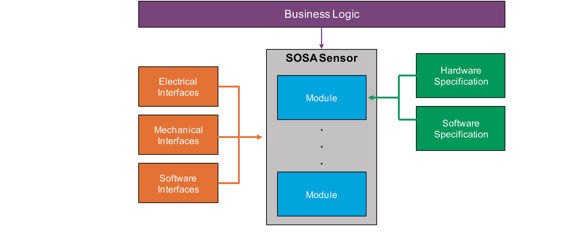

*Figure 1: The Facets that Comprise a SOSA Module*

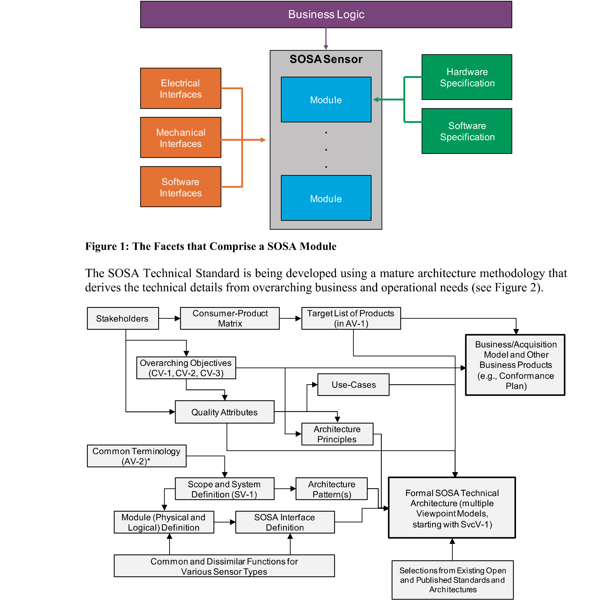

*Figure 2: The Architecture Development Method Adopted for the SOSA Technical Standard*

This document describes the SOSA Technical Architecture, including the SOSA module specifications (functions, behaviors, and interfaces), and the hardware elements and software components from which they are synthesized.

<!-- 原书 p.3 ｜ PDF p.23 -->

##### 1.2.2 Business Alignment

The overview of alignment between technical and business focus areas for the SOSA Technical Standard and the SOSA Open Business Model is available through a companion document – the SOSA Business Guide (see Referenced Documents). A detailed presentation of the SOSA Open Business Model can be found in the SOSA Business Guide. Examples of SOSA Open Business Model incorporation into the acquisition process can be found in the SOSA Contracting Guide. Policies guiding the development and conduct of the SOSA Conformance Program may be found in the SOSA Conformance Policy.

The SOSA Business Guide explains the objectives and organization of The Open Group SOSA Consortium, and describes the SOSA Technical Standard and SOSA Open Business Model. It is intended for use by all stakeholders in the development, acquisition, deployment, modernization, and sustainment of sensor systems that support a broad array of sensors, including C4ISR. The primary stakeholder groups are Government organizations, Aerospace and Defense contractors, and commercial businesses. Within each of these broad groups there are business and technical communities, acquisition and contracting communities, users, and operational communities. All of them have a stake in the SOSA ecosystem and should become familiar with the SOSA Business Guide.

The SOSA Contracting Guide provides procurement language examples for organizations that acquire sensor components and systems, as well as for those who provide them. This Guide is necessarily abstract to relay essential concepts without getting bogged down in details which may change as the SOSA Technical Standard and conformance processes mature. While the US Government is the most common procurer of C4ISR systems, and contractors within the defense industrial base are the most common providers of those systems, it should be noted that the same concerns and general procedures are also applicable to procurements led by industry and to products and services provided by commercial enterprises.

The SOSA Conformance Policy lays out high-level policies for the development and conduct of a set of SOSA conformance processes. These processes will include multiple conformance verification processes, a single conformance certification process, and a single SOSA certified conformant product registration process.

#### 1.3 Conformance

This is a Snapshot, not an approved standard. Do not specify or claim conformance to it.

Defining conformance processes and creating an effective, affordable method for certifying software, hardware, and electrical/mechanical interfaces is vital to establishing an effective standard. Certification provides formal recognition of conformance to an industry standard, which allows the following:

- Suppliers and practitioners may make verified claims of conformance to an open standard

- Buyers may specify and successfully procure modular capability from vendors who provide solutions which conform to that open standard The SOSA Consortium is developing a SOSA Conformance Policy and will be developing an associated Conformance Program for the SOSA Technical Standard. The SOSA Conformance Program will provide the associated conformance criteria and processes necessary to assure that

<!-- 原书 p.4 ｜ PDF p.24 -->

capabilities have been developed in adherence to the SOSA Technical Standard. The SOSA Conformance Program will consist of Verification, Certification, and Registration.

SOSA Conformance Verification is the act of assessing the conformance of the implementation of a hardware element or software component (or a combination thereof) to the applicable SOSA Technical Standard requirements. SOSA verification processes will not be available for this Snapshot.

SOSA Conformance Certification is the process of applying for SOSA Conformance Certification once Conformance Verification has been successfully completed. The SOSA Certification process will not be available for this Snapshot.

SOSA Registration is the process of listing SOSA certified modules and SOSA plug-in cards in a curated listing of information about SOSA certified modules and SOSA plug-in cards known as the SOSA Registry. The SOSA Registry process will not be available for this Snapshot.

Successful completion of the SOSA Conformance Program leads to a SOSA Conformance Certificate and the right to use the SOSA Conformance Certification Trademark in marketing.

#### 1.4 Normative References

None.

#### 1.5 Terminology

##### 1.5.1 SOSA Architecture

While the complete SOSA AV-2 Integrated Dictionary can be found in Appendix B, there are certain key terms that must be understood in order to correctly interpret this Technical Standard.

- Hardware Element: an all-encompassing term for hardware that is incorporated into a SOSA sensor Plug-In Card: any hardware element that is a circuit card that plugs into a backplane SOSA Plug-In Card: a circuit card assembly that also conforms to a SOSA slot profile Software Component: a unit of software that is incorporated into a SOSA sensor SOSA Module: an architectural entity that aggregates and contains the functions the SOSA sensor performs (consistent with DoD MOSA language), may be instantiated using hardware elements and/or software components, and conforms to the complete definition of a SOSA module as defined in the SOSA Technical Standard

##### 1.5.2 System Requirements

For the purposes of the SOSA Technical Standard, the following terminology definitions apply:

May Describes a feature or behavior that is optional. The presence of this feature should not be relied upon.

<!-- 原书 p.5 ｜ PDF p.25 -->

Shall Describes a feature or behavior that is mandatory for an implementation that conforms to this document. A hardware element or software component relies on the existence of the feature or behavior.

Should Describes a feature or behavior that is strongly recommended for an implementation that conforms to this document. A hardware element or software component cannot rely on the existence of the feature or behavior.

##### 1.5.3 Hardware Specification Keywords

To avoid confusion and to make very clear what the requirements for conformance are, many of the paragraphs in this Technical Standard are labeled with keywords that indicate the type of information they contain. These keywords are listed below:

Rule Recommendation Suggestion Permission Observation Any text not labeled with one of these keywords is to be interpreted as descriptive in nature. These will be written in either a descriptive or a narrative style.

Keywords are reserved for specific use as follows:

Rule <section>-<number>

Conformance with Rules is mandatory. Rules always include the term "shall". Rules are expressed in some combination of text, figures, tables, or drawings. All Rules will be followed to ensure compatibility between board and backplane designs. All Rules use the "shall" or "shall not" words to emphasize the importance of the Rule. The "shall" or "shall not" words are reserved exclusively for stating Rules in this document and are not used for any other purpose.

Recommendation <section>-<number>

Conformance with Recommendations is optional. Recommendations always include the term "should". Recommendations are used to convey implementation advice based on the community's collective knowledge base. Wherever a Recommendation appears, designers would be wise to take the advice given. Doing otherwise might result in poor performance Or awkward problems. Recommendations found in this document are based on experience and are provided to designers to speed their traversal of the learning curve. All Recommendations use the "should" or "should not" words to emphasize the importance of the Recommendation. The "should" or "should not" words are reserved exclusively for stating Recommendations in this document and are not used for any other purpose.

Suggestion <section>-<number>

A Suggestion contains advice, which is helpful but not vital. The reader is encouraged to consider the advice before discarding it. Some design decisions that need to be made are difficult

<!-- 原书 p.6 ｜ PDF p.26 -->

until experience has been gained. Suggestions are included to help a designer who has not yet gained this experience.

Permission <section>-<number>

Conformance with Permissions is optional. Permissions always include the term "may". In some cases, a Rule does not specifically prohibit a certain design approach, but the reader might be left wondering whether that approach might violate the spirit of the Rule or whether it might lead to some subtle problem. Permissions reassure the reader that a certain approach is acceptable and will cause no problems. All Permissions use the "may" words to emphasize the importance of the Permission. The lower-case "may" words are reserved exclusively for stating Permissions in this document and are not used for any other purpose.

Observation <section>-<number>

Observations do not offer any specific advice. They usually follow naturally from what has just been discussed. They spell out the implications of certain Rules and bring attention to things that might otherwise be overlooked. They also give the rationale behind certain Rules so that the reader understands why the Rule must be followed.

#### 1.6 Future Directions

The SOSA Hardware Working Group (HWG) will initiate an effort to develop a Space version of the SOSA standard. This will leverage existing SOSA efforts as much as possible with a look towards existing Space OSAs. The HWG will also extend its development efforts to smaller Sensor platforms, such as Unmanned Aerial Vehicles (UAVs); Unmanned Underwater Vehicles (UUVs), etc.

<!-- 原书 p.7 ｜ PDF p.27 -->

## 2 Definitions

> 原书 p.8–8 ｜ PDF p.28–28

For the purposes of this Snapshot, all terms that are not specifically defined in the SOSA AV-2 Integrated Dictionary provided in Appendix B will be interpreted as defined in the Merriam-Webster's Collegiate Dictionary.

See also the Glossary.

<!-- 原书 p.8 ｜ PDF p.28 -->

## 3 Reference Architecture Description

> 原书 p.9–42 ｜ PDF p.29–62

#### 3.1 CV-1/CV-2 Objectives

The foundations of the SOSA Reference Architecture are:

Capability View – 1 (CV-1): the overall vision, goals, and enablers that support the goals of the architecture that are captured in the CV-1 DoDAF artifact (see Section 3.1.1)

- Quality Attributes: characteristics of a system that collectively influence the overall quality of the system, and will drive many of the architectural decisions (often referred to as "-ilities") (see Section 3.3) – these are the measures for "goodness" of harmonization Architecture Principles: general rules and guidelines, intended to be enduring and seldom amended, that inform and serve as drivers for defining the architecture; a framework for decision-making (evaluation criteria) as a means to weed out approaches that are inconsistent with intent, and serve as a foundation for adjudication (see Section 3.2)

These products provide the foundation for the architecture definition contained in this document. Another foundational element is the Integrated Dictionary (DoDAF AV-2) which establishes the baseline terminology used throughout to ensure clarity and reduces (if not eliminates) ambiguity. All essential terms in the SOSA Technical Standard are captured in the DoDAF AV-2.

The fundamental building blocks of the SOSA Architecture are the SOSA modules ("an element of a system that has individually distinct boundaries that are well-defined interfaces") and the SOSA interfaces ("the region, physical or logical, where two systems or elements meet and interact"). Modules perform functions (physical and/or logical) and exhibit behaviors.

The SOSA Architecture will be captured using the DoDAF Version 2.02 Viewpoint Models, chosen because the primary target audience is the US DoD, and DoDAF is (as of this writing) the prescribed framework.

##### 3.1.1 SOSA Capability View – 1 (CV-1)

As mentioned earlier the CV-1 presents the SOSA overall vision, goals, and outlines strategy to support stated goals throughout the effort. To this end, the vision and goals as presented in Section 1.1 earlier are further refined below through addition of capabilities to define goals.

The vision statement for the SOSA Consortium is:

Business/acquisition practices and a technical environment for sensors and C4ISR payloads that foster innovation, industry engagement, competition, and allow for rapid fielding of costeffective capabilities and platform mission reconfiguration while minimizing logistical requirements.

The SOSA capabilities are illustrated in Figure 3.

<!-- 原书 p.9 ｜ PDF p.29 -->

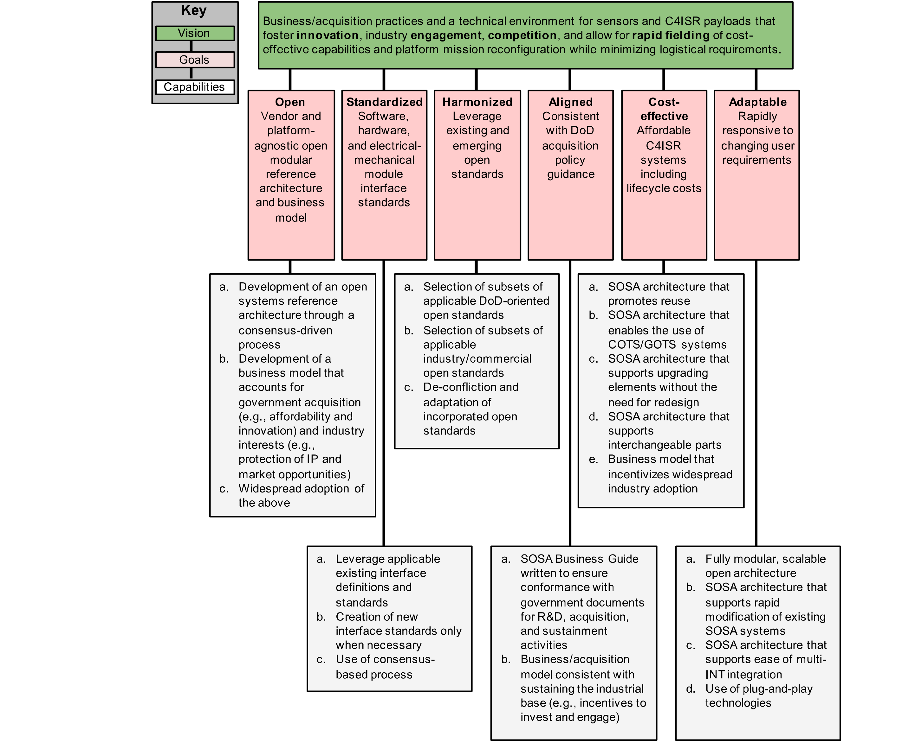

*Figure 3: SOSA CV-I*

#### 3.2 SOSA Architecture Principles

The following architecture principles were developed to guide the SOSA technical and business architectures being matured. The list of principles below is not in any particular order and the numerical value does not indicate precedence.

<!-- 原书 p.10 ｜ PDF p.30 -->

##### 3.2.1 Business-Oriented Architecture Principles

**#1 The SOSA business and technical architecture is vendor-agnostic.**

**Statement** The modules and interfaces that make up the SOSA Technical Standard and Reference Architecture, and the processes and practices that make up the SOSA business/procurement architecture, are equally beneficial to all vendors, offering no inherent advantage or disadvantage to any one company or business sector.

**Rationale** The first goal of the SOSA Architecture is "Open: vendor and platform-agnostic open modular reference architecture and business model", and as such the SOSA business and

technical architecture supports a "level playing field" to ensure business fairness, and that the best technical solution, regardless of vendor source, can be incorporated into systems based on the SOSA Technical Architecture.

**Implications** The business architecture of SOSA ensures that there are no barriers for stakeholder participation in the development or use of the SOSA Architecture. This includes making material available, eliminating financial barriers (or ensuring that they are minimal). The acquisition model is one that enables all qualified vendors to participate. The technical architecture incorporates standards that favor no vendor by ensuring that it incorporates widely-available standards for which all qualified vendors have equivalent opportunity.

**#2 SOSA Consortium products are provided royalty-free.**

**Statement** There is no cost to obtaining SOSA Consortium materials required to develop, procure, or implement systems (or subsystems or modules) that are aligned to the SOSA Technical Standard.

**Rationale** Achieving the vision and goals of the SOSA Consortium requires that there is widespread adoption, implying the minimization of barriers to access and use the products of the SOSA Consortium. High royalties or fees to access these materials would run counter to the goals of the open business objectives, and therefore are to be avoided.

**Implications** The means of publication of the SOSA Technical Standard is low-to-no cost, such as non-physical distribution via the World Wide Web, file servers, or other electronic means – subject to national security considerations (e.g., the need to authenticate that recipients are US persons who understand their responsibilities to safeguard the material). In addition, and by implication, tools (testing methodology, SDKs, etc.) required to develop and conformance verify hardware and software are widely available at no-to-little cost. Third-party products that are derived from SOSA Consortium products may be made commercially available (for additional cost).

**#3 SOSA products and processes protect the IP of vendors.**

**Statement** Participation in the development and use of SOSA Consortium products does not jeopardize the IP of vendors. The SOSA Consortium respects IP and the SOSA Consortium products do not expose IP.

<!-- 原书 p.11 ｜ PDF p.31 -->

**#3 SOSA products and processes protect the IP of vendors.**

**Rationale** financially healthy ISR ecosystem is in the best interest of the nation. Businesses must be incentivized to invest itechnology and other innovative solutions. I protection is the cornerstone of that process that ensures that there is a return On the ivestment. Therefore, it is imperative that SOSA processes and products retain protections for I rights within the module boundary.

**Implications** The SOSA Architecture takes a CCgray box' approach: modules are defined with properties Of functions and behaviors, and interfaces are defined with properties that iclude their physical characteristics, protocols for exchange of signals and data, and the signal and data content. How the functions and behaviors of the modules (einside the box') are realized is completely Up to the vendor to determine. It is inside the box where the I resides. In addition, the SOSA Architecture does not include companyspecific IP unless that IP has been consensually released to the SOSA Consortium for Open usCthrough the SOSA Technical Standard per the membership agreement.

##### 3.2.2 Technically-Oriented Architecture Principles

**#4 The SOSA Technical Standard is extensible an evolvable.**

**Statement** The SOSA Technical Standard, and associated Reference Architecture, is able to

continue to Iature beyond theexisting goals and expectations, to be able to incorporate technological and architectural improvements, and be able to maintain relevance as stakeholder needs change(e.8,new sensor types and new mission areas)

**Rationale** Technologies, markets, and requirements evolve over time. In order to preserve the considerable time and funds invested in creating the SOSA Architecture embodied ~ the SOSA Technical Standard consideration is given to "future proof' i. For the SOSA Technical Standard to be relevant in the future, it is important that it can be extended in scope.

**Implications** Architecture decisions, trades, etc. favor options that enable growth and don 't "lockOut'' expansion. Interfaces are defined to include growth paths (extra capacity, for example). Module definitions are not So narrow as to preclude additionalfunctionality. The architecture developers and maintainers are mindful that the current Version willnot necessarily be the last one.

**#5 The SOSA Architecture maximally leverageslincorporates existing industry and government standards.**

**Statement** The SOSA Architecture takes advantage Of existing industry and govermment standards and OSAs whenever possible and practical and consistent with achieving thegoalsOf the SOSA Consortium.

**Rationale** Crafting well-instituted standards is both time and resource-consuming, and the community does not benefit from having multiple, overlapping, or redundant standards. Therefore, the SOSA Architecture incorporates other standards and approaches When appropriate.

<!-- 原书 p.12 ｜ PDF p.32 -->

**#5 The SOSA Architecture maximally leverageslincorporates existing industry and government standards.**

**Implications** Systems that already are compliant or conformant with other OSAs are likely to require minimal (or no) modifications to achieve consistency with the SOSA Technical Standard. Adoption is more efficient for the SOSA team, helping to more rapidly develop and evolve the SOSA Technical Standard, though the team ensures that said adoption does not undermine the quality attributes, goals, or other guiding principles upon which the SOSA Architecture is based, and is consistent with the entirety of the SOSA Architecture.

**#6 Resilience (including cybersecurity) is enabled by the SOSA Architecture.**

**Statement** Physical and logical aspects of SOSA Architectures are capable of maintaining a reasonable level of operation in situations where system degradation or attack is possible.

**Rationale** A SOSA conformant system is not viable if it is unable to respond accordingly to either a localized degradation event, a system-wide degradation, or a cyber-attack by maintaining a reasonable level of operational viability.

**Implications** The SOSA Architecture incorporates functions that permit monitoring for health and status, and facilitate the design of a system that incorporates safeguards, redundancy, and the ability to be upgraded in light of new threats. A SOSA conformant system is able to respond to physical or logical degradation or a localized failure. Maximizing the ability of a SOSA system to effectively manage these possibilities ensures operation at an acceptable level of performance in a variety of situations.

**#7 The SOSA Architecture is agnostic with respect to host platform.**

**Statement** The SOSA Technical Standard, and associated Reference Architecture, applies to a wide range of host platforms (e.g., aircraft, ground vehicle, ship), and makes no assumption regarding the type of vehicle or installation it is resident in or upon.

**Rationale** Conformance and adherence to this principle engenders hardware and software interoperability and reuse across multiple platforms and multiple mission types. Enabling and maximizing reuse lowers overall development costs and operational costs over the lifetime of any particular program.

**Implications** The development of the SOSA Technical Standard takes into account a wide range of physical and environmental conditions, and so it specifies, for example, a range of standards-based connector types appropriate for the variety of environments. This may have implications on plug-and-playability, and so it is important that one type of interface (for one environment) easily be adapted (through interface conversion and/or software shim) to another. This enables, for example, a small-vehicle sensor to be leveraged for a large platform.

<!-- 原书 p.13 ｜ PDF p.33 -->

**#8 The SOSA Architecture is agnostic with respect to processing environment.**

**Statement** SOSA modules and interfaces are not dependent upon the physical processing and operating system environments.

**Rationale** SOSA modules represent the codified logic of the sensor system. Physical realization of processing environments will continue to evolve with processors, operating systems, network protocols, backplanes, memory architectures, and communication circuits. The desire is for the physical realizations to be changed as technology continues to evolve. Adherence to this principle enables hardware and software interoperability and reuse across multiple platforms and multiple mission types. Isolating SOSA modules from the processing environment allows rapid technology refreshment, system scaling, and module reuse.

**Implications** The SOSA Technical Standard needs to take into account a wide range of processing environments as realized by the selection of processors (CPU, GPU, FPGA, and custom), operating systems, network protocols, backplanes, memory architectures, and communication circuits. This means that the interfaces are independent from the processing environment through abstraction.

**#9 Every SOSA module has defined logical interfaces.**

**Statement** All SOSA sensors have well-defined logical interfaces for each of their SOSA defined modules. Logical interfaces describe the information content or signaling between modules for the interchange of control and data. The logical interface is a point that encapsulates control and data along with the syntax/semantics as described by the SOSA Architecture. Information exchange, including transmission type, interchange protocols, and routing are part of the interface definition.

**Rationale** An interface is a shared boundary for interaction between architectural modules. SOSA module logical interfaces enable replacement for modernization and upgrade, support plug-and-playability, interoperability, operational flexibility, and will likely result in cost savings over the lifetime of an operational program.

**Implications** The SOSA Technical Standard addresses a wide range of logical interfaces realized in SOSA environments. SOSA logical interfaces mandate that a set of interface standards is needed to span the types, protocols, addressing, service types, and operational environments.

**#10 Every SOSA hardware element has defined physical interfaces.**

**Statement** All SOSA sensors have well-defined physical interfaces for each of their hardware modules. Physical interfaces describe the physical or mechanical connection between SOSA hardware modules, providing structural attachment, electrical/electronic connectors, backplanes, or other inter-module associations that are physically manifested.

**Rationale** Well-defined SOSA module physical interfaces enable replacement for modernization and upgrade, support plug-and-playability, interoperability, operational flexibility, and will likely result in cost savings over the lifetime of an operational program.

<!-- 原书 p.14 ｜ PDF p.34 -->

**#10 Every SOSA hardware element has defined physical interfaces.**

**Implications** The SOSA Technical Standard addresses a wide range of physical interfaces realized in SOSA environments. SOSA physical interfaces mandate that a set of interface standards is needed to span the types, physical sizes, connector types, electrical signaling (including Physical and Data Link layers), and operational environments.

**#11 The SOSA Architecture accommodates simple through complicated systems.**

**Statement** The SOSA Architecture provides the building blocks for deriving multiple sensor types that scale within a design, increasing or decreasing complexity relative to processing and Size, Weight, and Power (SWaP) constraints for a system.

**Rationale** There are many aspects of complexity that the SOSA Architecture addresses, such as number of sensors to manage, diversity of sensors, and algorithm complexity/parallel processing requirements. The management functions of sensor systems become more complex as the number of entities increase. Having patterns that allow the management functions to scale with (at most) minor changes is crucial. The ability to support algorithm scaling (e.g., more or less instances of the same process working in parallel) and increasing or reducing the corresponding hardware as needed with only configuration changes is an important attribute of a SOSA system.

**Implications** SOSA systems accommodating a range of complexity require well-defined functional decomposition, use-cases, and interface definitions. The functional decomposition needs to create the right layer(s) of abstraction for a variety of hardware and software entities to coexist in different configurations. The use-cases need to cover all required system functionality, from specific mode processing to state/mode control to heartbeats. Integrating different software or hardware into a system should minimally affect the management functions of a SOSA derived system. The interface definitions need to be firm for system management, but flexible for a variety of sensor type processing. Patterns are used extensively to manage the complexity.

**#12 The SOSA Architecture accommodates small through large platforms.**

**Statement** The SOSA Architecture is flexible enough so that designs derived from it can be tailored to large as well as small platforms, with the flexibility to be used to design simple, lightweight systems (suitable for a small UAS) as well as large complex systems (e.g., suitable for a wide-body jet, warship, or ground-based installation).

**Rationale** Applicability is dependent upon the ability of a solution to provide a standard suite of interfaces across a multiplicity of host structures. Not limiting the scope of the SOSA Technical Standard to one class of hosts or another ensures broad applicability and utility.

<!-- 原书 p.15 ｜ PDF p.35 -->

**#12 The SOSA Architecture accommodates small through large platforms.**

**Implications** The SOSA Architecture is a superset architecture; complete in that it can be used to design a complex, fully-functional system, and at the same time not mandate/require the presence of all (or many/most) modules for systems with more modest SWaP resources. The SOSA Architecture incorporates hardware and physical standards that allow the use of small as well as large form factors.

**#13 Modularity is fundamental to the SOSA Architecture – physical and logical.**

**Statement** The SOSA Architecture is an OSA, and as such is composed of physical and logical units ("building blocks") that have individually distinct boundaries that are well-defined interfaces. The units or elements that make up a SOSA Architecture (or resulting system) are known as modules.

**Rationale** The goals for the SOSA Architecture include openness, standardization, and adaptivity that allow for replacement/upgrade of parts of a sensor and reuse in a vendor-neutral manner. Modules (physical and logical units with well-defined boundaries) are the means of achieving these goals.

**Implications** The SOSA Architecture is described in terms of modules (functions and behaviors) and interfaces (information or signals to be exchanged by these modules, and the means by which they are exchanged, such as protocols or electrical specs). The modules are defined in a way that ensures independence and low coupling (so that changes in one do not impact others). Criteria used: Severable (can be separated and used elsewhere) – based on business needs, timing requirements, or other drivers Has minimal complexity interfaces (minimum interdependencies) Can operate as stand-alone or be operated via function/process/system manger Is independently testable Does not expose IP Facilitates competitive procurement Encapsulates rapid change

**#14 Interchangeability is fundamental to the SOSA Architecture.**

**Statement** Modules making up SOSA systems are able to be replaced by equivalent modules regardless of the source. Moreover, it would be possible to interchange one (entire) SOSA system with another SOSA system (provided it does not violate physical/environmental requirements).

<!-- 原书 p.16 ｜ PDF p.36 -->

**#14 Interchangeability is fundamental to the SOSA Architecture.**

**Rationale** The goals of the SOSA Consortium include openness (platform and vendor-agnostic)

and rapid response. The quality attributes include modularity and upgradability. Essential to these objectives is the need to be able to interchange SOSA modules to achieve goals, such as using module replacement to upgrade a sensor or modify it because of a changing mission need. This will result in a more robust marketplace where subsystem upgrades become more commonplace as the ease of modular upgrades becomes apparent.

**Implications** Interfaces are very well-defined and yet contain a high degree of flexibility. Moduleunique interface technologies should be avoided in favor of those that are broadlyapplicable. Interface definitions are superset definitions; they include all the functionality/capability that a SOSA module or system is anticipated to include. The architecture defines a default behavior for situations where all functions supported in the interface are not implemented.

**#15 Reuse is fundamental to the SOSA Architecture.**

**Statement** SOSA systems and modules that are developed for one program, host vehicle, or environment will be employable, with minimal modification, for other programs, with other host vehicles and in other operational environments.

**Rationale** The ability to reuse SOSA sensors and modules across various vehicles allows the DoD to reduce parallel investment to develop the same type of payload assembly multiple times in order to fly on various vehicles. The ability for a particular sensor subsystem to operate inside various SOSA sensors and modules reduces the integration costs for creating a new payload assembly.

**Implications** Modules should be reusable across the range of host platforms, consistent with SWaP limitations (embodied in their specific design/instantiation). It is imperative that SOSA standard interfaces are well-defined, to include physical, logical/protocol, and data content and format. A standardization of electro-mechanical busses along with available sensor geometries is required. Multi-platform integration architectures are used to allow modules to communicate with an embedded computer or the host platform, and/or both. The intent is to minimize (or eliminate) the cost and schedule impact of adding or replacing a new SOSA module, not to eliminate the need for integration and test.

#### 3.3 SOSA Quality Attributes

The quality attributes outlined in Table 1 inform the SOSA business and technical architectural design decisions.

<!-- 原书 p.17 ｜ PDF p.37 -->

**Table 1: SOSA Quality Attributes (in order of decreasing precedence)**

| Name | Description |
|---|---|
| Interoperability | The ability of the system to provide data/information to – and accept the same from – other systems, and to use the data/information so exchanged to enable them to operate effectively together. In the context of the SOSA Architecture, this quality attribute refers to the ability of SOSA systems to be able to exchange information during operation, and (possibly with adaptation) be able to interoperate with other systems not designed to align with the SOSA Reference Architecture. |
| Securability | The property of a system such that its design renders it largely protected/inviolable against acts designed to alter functionality or capabilities, or reverse-engineer capabilities and/or critical program information – or impair its effectiveness, and prevent unauthorized persons or systems from having access to data/information contained within. In the context of the SOSA Architecture, this quality attribute ensures that the fundamental architecture is one that has minimal attack surfaces and effective authentication enforcement, and SOSA systems can be designed so that they can adapt to an evolving threat environment. |
| Modularity | The degree to which a system or element is composed of individually distinct physical and functional units that are loosely-coupled with well-defined interface boundaries. In the context of the SOSA Architecture, this quality attribute enforces the establishment of well-defined, well-understood, standardized system modules that can be created and tested individually for function and conformance. |
| Compatibility | The ability of a system to coexist with other systems without conflict or impairment, or be integrated or used with another system of its type. In the context of the SOSA Architecture, this quality attribute refers to the ability of SOSA systems to be used or integrated with systems not designed to align with the SOSA Reference Architecture, or with systems designed with earlier versions of the SOSA standard (backwards-compatible). |
| Portability | An attribute that describes the reuse of existing hardware or software elements (as opposed to the creation of new) when moving hardware or software elements from one environment (physical or computing) to another. In the context of the SOSA Architecture, this quality attribute refers to the ability of SOSA based hardware and software to be used, without modification, in other SOSA based environments (e.g., different operational domains, different systems, and different sensor modalities), but does not necessarily imply the porting to vastly different physical environments (e.g., operating temperature, shock, vibration – which are design, not architectural, features). |
| Plug-and-playability | The capability of a system to recognize that a hardware component has been introduced or replaced – and subsequently use it without the need for manual device configuration or operator intervention. In the context of the SOSA Architecture, this quality attribute refers to the ability of a SOSA conformant system to recognize the introduction or replacement of SOSA modules, and through an information exchange, to understand and use the capabilities and services that the module offers – thereby reducing the cost and schedule impact of adding a new SOSA module – but does not eliminate the need for integration and test. |
| Upgradeability | The ability of a system to be improved, enhanced, or evolved without fundamental physical, logical, or architectural changes. In the context of the SOSA Architecture, this quality attribute refers to the ability of a SOSA system to have specific hardware elements or software components replaced with more modern or more capable equivalents, while maintaining SOSA conformance, and without (significant) change to the rest of the system. |
| Scalability: Sensor Multiplicity | The capability of a system to cope and perform well under an increased or expanding workload or increased demands, and to function well when there is a change in scope or environment – and still meet the mission needs. In the context of the SOSA Architecture, this quality attribute refers to the ability of the SOSA Architecture to accommodate a multiplicity of sensors, constrained only by design-specific limitations. |
| Scalability: Platform Size | The capability of a system to cope and perform well under an increased or expanding workload, increased demands, and to function well when there is a change in scope of environment and still meet the mission needs. In the context of the SOSA Architecture, this quality attribute refers to the ability of the SOSA Architecture to be applied to platforms that range from the small (e.g., Class I UAS) to large surveillance aircraft – and possibly even spacecraft. |
| Resiliency | The ability of a system to continue or return to normal operations in the event of some disruption or over-capacity (system saturation), natural or man-made, inadvertent or deliberate, and to be effective with graceful and detectable degradation of function. In the context of the SOSA Architecture, this quality attribute refers to the ability of SOSA systems to be able to maintain operations while under “duress” caused by physical damage, electronic interference, or cybersecurity attack. |

> 转写说明：本表无合并单元格。续页顶部重复了 Name/Description 表头行，已并入首行表头，不另起表。原文每个单元格含两段（定义段与 “In the context of the SOSA Architecture, this quality attribute …” 段），按格内换行以空格连接为一行。名称列 “Scalability: Sensor Multiplicity”、“Scalability: Platform Size” 在原表中各占两行（冒号后换行），同样以空格连接。

<!-- 原书 p.18 ｜ PDF p.38 -->

#### 3.4 SV-1 (System Interface Description/Context)

The System View 1 (SV-1) system interface description presented below identifies and describes the physical/hardware systems (herein "entities") and the nature of the interconnections for the SOSA sensor system. The SOSA SV-1 depicts all system resource flows between systems that are of interest to the SOSA Consortium (see Figure 4 and Figure 5).

<!-- 原书 p.19 ｜ PDF p.39 -->

The SV-1 is an abstract representation showing key top-level SOSA actors and their physical relationships. Logical relationships (e.g., messaging) will be shown in other SOSA viewpoint models. The SOSA standard addresses two categories of interfaces:

SOSA External Interfaces cross the orange SOSA sensor boundary SOSA Internal Interfaces are contained entirely within the orange boundary – the SOSA Consortium will choose a subset of the many possible internal interfaces to address in the

SOSA standard

The SV-1 only shows a few instances of SOSA sensor elements as exemplary cases; the number of SOSA sensor elements depends on the specific SOSA sensor. A SOSA sensor is mounted on a SOSA host, and a SOSA host can be a pod or a platform, or both. Multiple SOSA sensors could be mounted on the same SOSA host. Relationships between SOSA sensors are logical (e.g., via messaging), not physical, and therefore not shown in the SV-1.

A SOSA sensor is mounted on a SOSA host, which can be a pod or a platform, or both. This is the Nominal Case, shown in Figure 4. A SOSA sensor can also contain its own pod (a "SOSA sensor pod"), which is the special case shown in Figure 5.

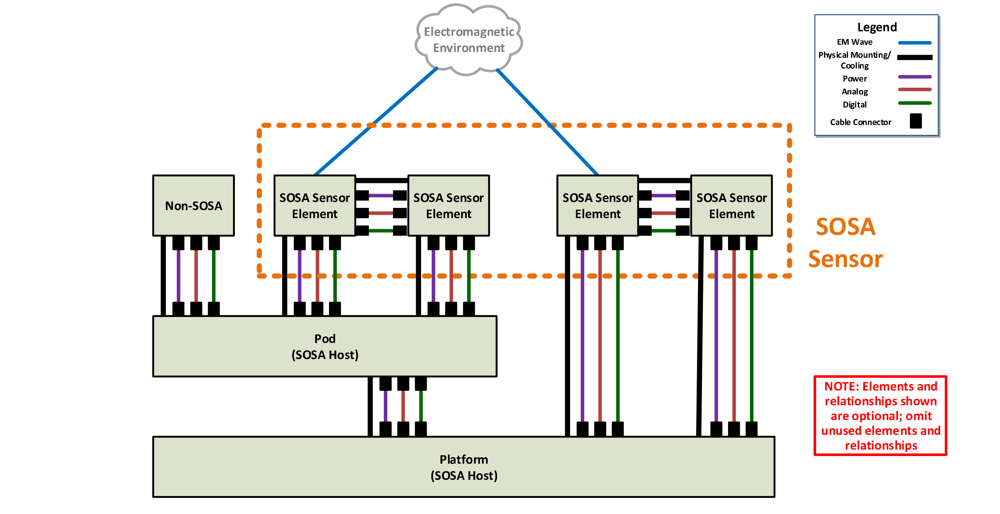

*Figure 4: SV-1 for Nominal Case*

<!-- 原书 p.20 ｜ PDF p.40 -->

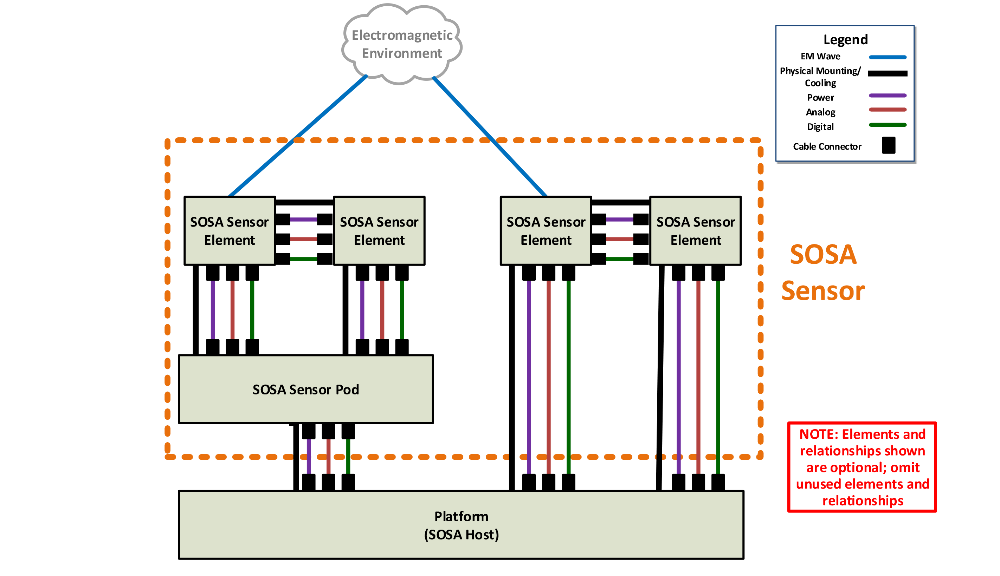

*Figure 5: SV-1 for Sensor Pod Special Case*

#### 3.5 SOSA Physical Context Entities

##### 3.5.1 SOSA Sensor

The main subject of the SOSA standard is the SOSA sensor, which consists of a set of one or more SOSA sensor hardware elements (some of which host software components). Each SOSA sensor is either one of the five "sensor" types (Communications, EO/IR, EW, Radar, and SIGINT), or any combination of the five sensor types (e.g., they may be multi-INT). Any interface crossing the SOSA sensor's boundary is a SOSA external interface.

##### 3.5.2 SOSA Hardware Element

A SOSA sensor consists of a set of one of more SOSA hardware elements mounted within or on the same host platform. In the context of the SV-1, it is a physical component of a SOSA sensor which may contain software and firmware, and my support more than one sensor type (it has other "non-physical" interpretations in other Viewpoint Models). It consists of but is not limited to:

Aperture (antenna, packaged antenna array, packaged imaging array, or imaging turret)

Hardware enclosure (e.g., chassis)

A SOSA hardware element may optionally have inside it SOSA plug-in cards that plug into a backplane within it. Hardware elements may be distributed in different locations on/in the SOSA host platform.

<!-- 原书 p.21 ｜ PDF p.41 -->

##### 3.5.3 SOSA Host Platform

A SOSA host platform is the physical entity to which the SOSA sensor is mounted. Normally, it is one of: a vehicle or structure (such as an aircraft, surface craft, a building, or a pod), a combination of one or more pods, and/or a vehicle/structure. It nominally provides to the sensor: Power Cooling Platform navigation information (position, velocity, etc.) Reference signals (e.g., 1 PPS, 10MHz, etc.) Network connections Connections for any other needed analog or digital interfaces The SOSA host platform may contain external (to the SOSA sensor) processing capability that could use the data products of the SOSA sensor, and external communications. It will provide the SOSA sensor with its tasking. It is assumed that the host platform provides any User Interface (UI) that may be required; while the SOSA system may provide data and information to be used by a UI, the UI is outside the scope of the SOSA system.

3.5.4 SOSA Sensor Pod A SOSA sensor pod is a pod that is delivered as an integral part of a SOSA sensor and has SOSA sensor elements from exactly one SOSA sensor mounted in/on it.

#### 3.6 Function to Module Aggregation Criteria

There are a great many functions that must be performed within a Communications, EO/IR, EW, Radar, and SIGINT system. These have been logically combined into what have become the SOSA modules, the aggregation process based on these seven criteria: 1 Severable (can be separated and used elsewhere; a SOSA module can be removed from one system and used in another without needing to be modified) – based on business needs, timing requirements, or other drivers 2 Has minimal complexity interfaces (minimum interdependencies) 3 Can operate as stand-alone or be operated via function/process/system manger; it can be operated independently of the rest of the SOSA sensor 4 Is independently testable 5 Does not expose IP 6 Facilitates competitive procurement 7 Encapsulates rapid change For each of the SOSA modules, the inputs required to support these functions have been determined (leading to the definition of each SOSA module's inputs), and the products of each of the functions have been defined (leading to the definition of each SOSA module's outputs). A

<!-- 原书 p.22 ｜ PDF p.42 -->

top-level enumeration of the SOSA modules is documented in the SOSA Service View 1 (SvcV-1: Services Context Description) – see Section 3.9, and the details of their interactions are documented in the Service View 4 (SvcV-4: Services Functionality Description) – see Section 4.1.1.

It should be noted that the SOSA Technical Standard specifies what the SOSA modules do, but not how they do it (IP and innovation are preserved).

#### 3.7 Security Concepts and Approach

The security aspects of the SOSA Technical Architecture are an active area of development. The intent is to review the security aspects of the architecture as a whole, rather than segregated into various security disciplines (e.g., anti-tamper, cybersecurity, supply chain risk mitigations, software assurance, etc.). The guiding principles for security are consistent with the SOSA Architecture Principles – that the standard leverages/incorporates existing industry and government standards and that the architecture enables resilience and cybersecurity.

The approach to security began with a review of existing DoD and commercial security standards, such as the Anti-Tamper (AT) Technical Implementation Guide (TIG), the DoD Risk Management Framework (RMF), security-related Open Mission System (OMS) ICDs, the Cyber Survivability Endorsement Implementation Guide, and The Open Group Open Trusted Technology Provider™ Standard (O-TTPS), which is technically equivalent to ISO/IEC 20243-1:2018. The approach is also informed by industry best practices, collecting inputs from the various members of the SOSA Consortium. These standards and best practices are being reviewed for their applicability to a SOSA system and the interfaces between SOSA modules, software components, and/or hardware elements, as appropriate. As the SOSA Technical Architecture is refined, the architecture will be reviewed based on these and other standards to ensure that security is built in and to maintain alignment with security requirements from various other open architecture standards.

The security aspects of the SOSA Technical Architecture are implemented in the functions (and behaviors) of the SOSA modules and their interfaces. Security best practices for how SOSA products are developed are intentionally not included in this standard. The primary functions and behaviors are implemented in SOSA modules 1.1 (System Manager), 6.1 (Security Services), 6.2 (Encryptor/Decryptor), and 6.3 (Guard/Cross-Domain Service). All SOSA modules are shown in Figure 6 and defined in Table 2 in Section 3.9. The system manager will manage the start-up of the system (including the secure loading of software), maintain a secure configuration, manage keys used in the system, and authorize/authenticate requests to publish/subscribe messages or access privileged resources. Security services will implement the security functions needed by the system manager, including verification of software integrity, key management, access control, audit, and other security controls. The encryptor/decryptor provides cryptographic services to the system manager and other applications to ensure that data-at-rest and data-intransit are protected to the level required by the classification of the data. The guard/crossdomain service provides applications the ability to send/receive data across security domains.

##### 3.7.1 SOSA Hardware Security Framework

The SOSA hardware security is a framework for security services. This is specifically motivated by the desire to avoid monolithic static security solutions, which are costly to adapt to new security requirements or threat environments.

<!-- 原书 p.23 ｜ PDF p.43 -->

The SOSA Hardware Security Framework will support the following capabilities:

Usage of standard security components, where possible Scalable configuration and deployment of security functionality Adaptable to different on-board sensor combinations Updateable security components Extensible for integrating new security requirements Easy usage and integration for application developers Adjustable security-level applying different levels of software and hardware security measures

#### 3.8 Hardware Concepts and Approach

Planned for a later version of the SOSA Technical Standard.

#### 3.9 SvcV-1: Services Context Description

The Service View 1 (SvcV-1) documents the SOSA modules and their top-level relationship to one another. The SOSA Technical Standard will define (in later versions) a core set of required modules and functionality; not all modules need to be instantiated in a design to be conformant. Future versions of the standard will define the core functionality for each type of sensor. In the case of multiple integrated sensors, the sensor integrator would need to determine how to instantiate the modules necessary to incorporate the SOSA core functionality. The details of their relationships are documented in the SvcV-4: Services Functionality Description (see Section 4.1.1).

Figure 6 identifies the SOSA modules and their relationship (enumerated in the dotted decimal numerical identifications, by color-code, and grouping/proximity). It also shows some of the resulting interfaces that are being determined for the SOSA Technical Architecture. It should be noted that this figure does not represent “the SOSA Architecture”. This artifact is one among the many that, taken together, constitute the SOSA Technical Architecture. The current conception is that there would be no more than one instantiation of each SOSA module (with the exception of the 2.x modules) for each SOSA sensor.

Descriptions (explaining the encapsulated functionality and behaviors) of each of the SOSA modules is documented in Table 2. This table details descriptions of SOSA modules. All SOSA sensor functionality must be contained within the encapsulating SOSA module. In practice, a SOSA sensor may implement a subset of these modules.

<!-- 原书 p.24 ｜ PDF p.44 -->

1.1: System Manager 1.1: Task Manager

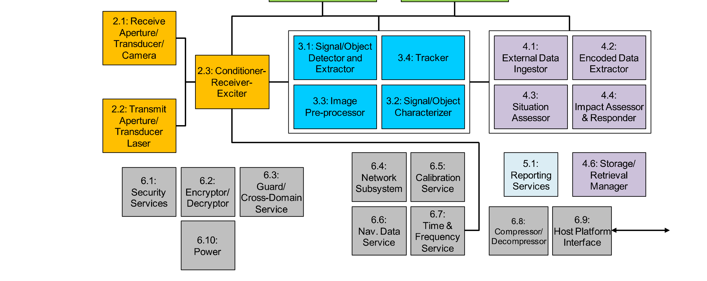

*Figure 6: SvcV-1: Top-Level SOSA Services Context Description*

**Table 2: SvcV-1: Module Descriptions**

| Module Name | Description |
|---|---|
| SOSA Sensor Management | |
| 1.1 System Manager | The system manager provides the ability to discover, configure, control, manage health (status and faults), and configure the security aspects of the SOSA sensor as a whole, its infrastructure, its modules, and its interface to the sensor host. The system manager does not manage or control the mission, tasking, or operational aspects of the SOSA sensor, but instead manages the SOSA sensor itself. System manager functions include Discovery (identifying and obtaining information required to communicate with the sensor and its modules), Configuration (obtaining a detailed description of the sensor and its modules and reading and setting configuration parameters and software packages), Control (monitoring and setting control parameters for the sensor and its modules, such as mode and state, and performing control actions such as reset or BIT), and Health Management (publishing periodic health reports, notifying occurrence of configuration, control, and health events, and logging health reports and events). |
| 1.2 Task Manager | The task manager is responsible for coordinating all mission operations. External sensor tasking is accepted in the form of a request that contains information detailing when and where to collect data, the type of processing to be performed, and the required output products to be generated. Information in the request is used by the task manager to optimize, manage, and prioritize resources to support various competing tasks in a SOSA sensor. Any externally invoked changes to tasking are handled by the task manager, which in turn propagates the mission changes into relevant mode and state changes for the other SOSA modules. Lastly, the task manager is responsible for invoking routine calibration as needed to support the mission tasking. |
| **Transmission/Reception** | |
| 2.1 Receive Aperture/Transducer/Camera | The Receive Aperture/Transducer/Camera module is responsible for converting Electromagnetic (EM) energy into an electrical signal. The signal may be pre-amplified, stabilized, and calibrated. This module may include mechanical and electronic steering, beam forming, focus control, filtering, low-noise amplification, and analog-to-digital conversion. The output may be an analog signal or a digital stream. It may also output metadata. |
| 2.2 Transmit Aperture/Transducer/Laser | The Transmit Aperture/Transducer/Laser module is responsible for converting an electrical signal into EM energy. The input may be an analog signal or a digital stream (with metadata) This module may include mechanical and electronic steering, beam forming, focus control, filtering, amplification, and digital-to-analog conversion. |
| 2.3 Conditioner-Receiver-Exciter | The Conditioner-Receiver-Exciter module may perform receive functions, transmit functions, or both. The receive side may include low-noise amplification (with gain control), amplitude limiting, band-pass filtering, frequency translation, application of calibration corrections, channelization, image formation, tagging with metadata, Radio Frequency (RF) signal distribution, data framing, and data cube formation (for hyperspectral). The transmit side may include amplification (with gain control), amplitude limiting, frequency translation, waveform conversion (analog to digital, digital to analog), waveform generation, RF signal distribution, calibration, and adaptation to spectrum use. |
| **Process Signals/Targets** | |
| 3.1 Signal/Object Detector and Extractor | The Signal/Target Detector and Extractor module is responsible for detecting electromagnetic signals or physical objects among the noise and other signals and objects in the environment (e.g., clutter or interference). This module extracts a detected signal, detected object, or image chip for downstream processing. Techniques to perform this may include clutter suppression and extraction of scintillation/decorrelation information, interference suppression, the use of constant false alarm rate techniques, coherent and non-coherent integration, Space-Time Adaptive Processing (STAP), image enhancement (including edge detection and sharpening), and employment of gating logic to manage and balance search volume returns with existing object tracks. |
| 3.2 Signal/Object Characterizer | The Signal/Object Characterizer module is designed to make measurements on images, signals, and physical objects to determine attributes, properties, categories, classes, types, or identification – all with confidence estimates. |
| 3.3 Image Pre-processor | The Image Pre-processor module prepares the image for final use and processing. For Synthetic Aperture Radar (SAR), this module forms images from sensed RF data. This module also registers images to geographical coordinates and/or other images. |
| 3.4 Tracker | The tracker module correlates detections and tracks over time, forming new or updated tracks. It is responsible for all track management functions and producing track reports. The core functionality of the tracker is data association, track initiation, track drop, track update, state and covariance estimation, and split track handling. Estimation of relative position or location (geolocation), when feasible, is also included in this function. |
| **Analyze/Exploit** | |
| 4.1 External Data Ingestor | The External Data Ingestor module is responsible for ingesting data from other SOSA sensors, as well as sensors that don't conform to the SOSA Technical Standard (converting from non-conformant format to conformant format as needed), and distributes ingested data to other SOSA modules. |
| 4.2 Encoded Data Extractor | The Encoded Data Extractor module is applicable to Communications, EW, and SIGINT. It is responsible for demodulating and extracting message content (Communications and EW), extracting internals (EW and SIGINT), and human language processing (SIGINT). |
| 4.3 Situation Assessor | The Situation Assessor module determines current relationships among objects and events in the context of their environment. The distribution of individual signals and objects is examined to aggregate them into operationally meaningful groups. In addition, this module focuses on relational information (e.g., physical proximity, communications, causal, temporal, and other relations) to determine the meanings of groups of entities. This analysis is performed in the context of environmental information about terrain, surrounding media, hydrology, weather, and other factors. |
| 4.4 Impact Assessor and Responder | The Impact Assessor and Responder module interprets the current situation in order to draw inferences about enemy threats, friendly and enemy vulnerabilities, and it may project those into the future. Impact assessment may involve estimating possible outcomes, and assessing an enemy's intent based on knowledge about enemy doctrine, level of training, political environment, and the current situation. This module may develop alternate hypotheses about an enemy's strategies, given the effect of uncertain knowledge about enemy units, tactics, and the environment. This module may also initiate a response to a threat; for example, by notification to an internal capability (e.g., electronic attack) or an external system to take action (e.g., countermeasures or evasive maneuvering). |
| 4.6 Storage/Retrieval Manager | The Storage/Retrieval Manager module provides the capability of storing a variety of data types in a persistent medium, and allows it to be retrieved in bulk by authorized client entities. The Storage/Retrieval Manager can be used for short-term (in-mission) data as well as long-term (or archival) purposes. Data that can be stored includes: health reports, heartbeats, notifications (health, configuration, and control notifications), streaming data, and metadata). |
| **Convey** | |
| 5.1 Reporting Services | The Reporting Services module generates and disseminates reports. Specifically, the Reporting Services module is responsible for formatting, processing (as required by sensor type), packaging data for reporting, structuring data to match a particular selected format, and dissemination of data to intended recipients. Such data can include RF signal, image/video streams, demodulated signal, metadata for streams, detections, characterized targets, associated and non-associated targets/threats, assessed behaviors, alerts, sensor cues/tips, complex data (data between raw and fully processed), logging or test information, and responsible reporting commands. The module is responsible for accepting/rejecting requests for existing data in storage, retrieving requested data, aggregating data, and selecting data to be reported. The module also selects header/packet structure for streaming data. The Reporting Services module must be capable of storing report templates germane to the sensor type; and accept updates to those templates (e.g., metadata updates to format types). |
| **Support System Operation** | |
| 6.1 Security Services | The Security Services module is responsible for controlling all sensor protection functionality. This includes software/data integrity checks, control access, zeroizing sensitive data, managing keys, auditing, root of security, environmental checks, and response actions. |
| 6.2 Encryptor/Decryptor | The Encryptor/Decryptor module is responsible for all cryptographic services such as encryption, and decryption with authentication. In addition it communicates with the Security Service for key interchange and to report status (successful/failed result). |
| 6.3 Guard/Cross-Domain Service | The Guard/Cross-Domain Service module is responsible for transferring data between separate security enclaves of the same or differing security levels, and preventing data leakage between enclaves. |
| 6.4 Network Subsystem | The Network Subsystem module is the infrastructure responsible for enumerating network elements, monitoring the health of network elements, detecting and isolating degraded network elements, transferring data with the requested QoS, and detecting intrusion. It is common across all sensor types. Data users may request data from data sources that have requirements for update rate, latency, and priority, and the Network Subsystem ensures that these requests are met and can report when they are not met. The Network Subsystem can be configured to alert on thresholds such as network bandwidth exceeded. Networked elements that interfere with network performance or cause degradation are isolated in a way to minimize effects on the rest of the network. The Networking Subsystem provides the services to request network status such as throughput, up/down status, and configuration at any time, and will collect metrics to support this reporting. Intrusion detection can be configured by a network manager to alert on security breaches and to isolate the breached network channel. |
| 6.5 Calibration Service | The Calibration Service module is responsible for ingesting and injecting the test signal and disabling SOSA modules not under test. |
| 6.6 Nav Data Service | The Nav Data Service module translates platform 3D position, 3D velocity, time, and 3D platform orientation into a generic format compliant with SOSA interface standards. It is common across all sensor types. The service distributes this nav data to subscribers. It will report accuracy, integrity, and source information so that subscribers to this data may decide if the data is suitable for use. The service will select, smooth, blend, or exclude data as necessary to create the best solution. The service accepts requests for data configuration such as specific data elements, update rates, and formats. Subscribers may perform individual one-time requests for nav data, or may request a repetitive update at a selected interval. |
| 6.7 Time & Frequency Service | The Time & Frequency Service module is responsible for providing time information and providing Local Oscillators (LO)/frequency references. The time information is a high precision time signal that is a higher precision than that typically provided by GPS although it may be synchronized with GPS. Discrete time output signals are provided and may be used by any other module without a request. Time information quality status is provided by a communications channel. The LO/frequency references provide highly accurate and stable output signals suitable for GHz range RF systems to any other module without a request. Signal quality status is provided by a message via the Network Subsystem module. Other modules may send a request to the Time & Frequency Service module to be notified if time or frequency signal quality thresholds are not met. A time and frequency management capability allows the time and frequency output signals to be enabled or disabled. |
| 6.8 Compressor/Decompressor | The Compressor/Decompressor module is responsible for compression/decompression and executing codec functions. |
| 6.9 Host Platform Interface | The host platform interface module is responsible for all communication with the host platform. Its primary function is data translation to/from formats and messages required by the host platform. |
| 6.10 Power | The Power module is responsible for power conversion, conditioning, storage, protection, distribution, and management. It applies to all sensor types. The Power module receives host platform power (via the host platform interface module) and converts it to the conditioned power needed by SOSA modules. It also includes the routing and distribution of power to SOSA modules that use it which may include switches, relays, transformers, etc. The Power module may provide status such as to indicate whether power is within specification and an alert to impending power loss. It also may provide a management interface that allows configuration, control, and status. |

> 转写说明：本表在原书中跨 5 页——原书 p.25（PDF p.45）：表头行、分组行 SOSA Sensor Management、1.1~1.2；p.26（PDF p.46）：分组行 Transmission/Reception、2.1~2.3，分组行 Process Signals/Targets、3.1~3.3；p.27（PDF p.47）：3.4，分组行 Analyze/Exploit、4.1~4.4、4.6；p.28（PDF p.48）：分组行 Convey、5.1，分组行 Support System Operation、6.1~6.5；p.29（PDF p.49）：6.6~6.10，表止于此，其下即 §3.10 正文（PDF p.50 为 §3.10.1 正文，无本表内容）。
> 转写说明：6 个分组标题行（**SOSA Sensor Management**、**Transmission/Reception**、**Process Signals/Targets**、**Analyze/Exploit**、**Convey**、**Support System Operation**）在原书中横跨整行、无右侧单元格内容，此处照录为一行、右格留空。
> 转写说明：各续页未重复表头行，故全部并入首行表头，未另起表。原书单元格内因排版折行的句子已用一个空格连成一句。
> 转写说明：原书模块编号自 4.4 直接跳至 4.6（无 4.5），照录为 4.6。
> 转写说明：4.3 Situation Assessor 与 6.2 Encryptor/Decryptor 两个单元格在 PDF 分页处被截断，其跨页续行（4.3 的 "information about terrain, surrounding media, hydrology, weather, and other factors."；6.2 的 "services such as encryption, and decryption with authentication. In addition it communicates with the Security Service for key interchange and to report status (successful/failed result)."）已并回同一单元格。

<!-- 原书 p.25 ｜ PDF p.45 -->

<!-- 原书 p.26 ｜ PDF p.46 -->

<!-- 原书 p.27 ｜ PDF p.47 -->

Support System Operation

<!-- 原书 p.28 ｜ PDF p.48 -->

#### 3.10 SOSA Inter-Module Interactions

The SOSA Architecture is based on a set of loosely-coupled modular entities (known as SOSA modules) that interact with the underlying operating environment and with each other via welldefined logical interfaces. The operating environment will provide the mechanisms through which interoperation will occur and will provide the modules’ interfaces to these mechanisms (I/O, processing, storage, communication, etc.). Interoperability between SOSA modules is described in terms of interactions.

<!-- 原书 p.29 ｜ PDF p.49 -->

Interactions include exchanges of data, control actions, and various types of management functions. Most of the interactions considered will be implemented as message exchanges on a network.

##### 3.10.1 SOSA Sensor Interconnections

Figure 7 illustrates the SOSA Technical Architecture interconnections that support the interactions. SOSA modules interoperate through an Ethernet-based network message transport (SOSA Message Interconnect), as well as a high-performance bus (SOSA Wideband Low Latency Interconnect). SOSA modules will interact through well-defined non-proprietary interfaces that may be implemented within a processor, across distributed processors on a network, or across a chassis backplane. The system designer will choose the appropriate combinations of the interconnects shown in Figure 7 to meet the performance requirements of the system. The SOSA modules will send and receive network messages that do not require determinism, high bandwidth, or very low latency, on the SOSA Message Interconnect. The SOSA modules will receive and send large volume or low-latency data, such as digital RF signal (sample streams, etc.) from and to underlying RF electronics on the SOSA Wideband Low Latency Interconnect.

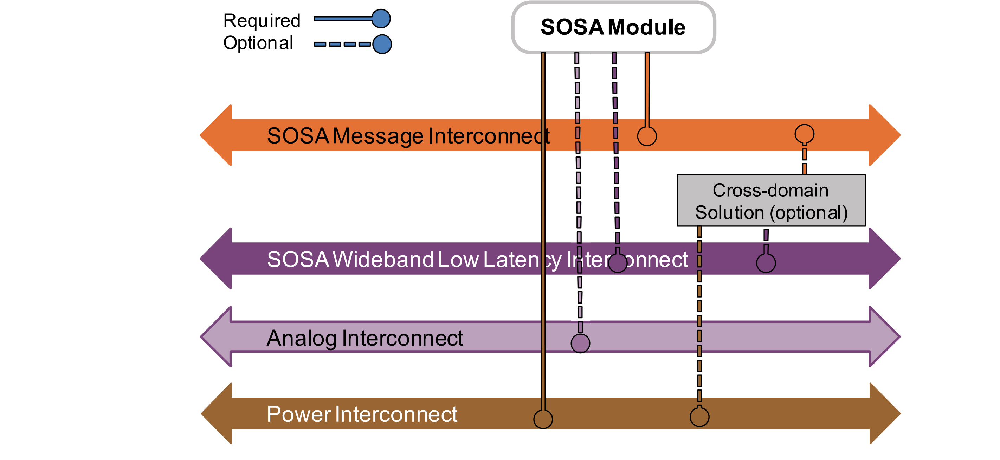

*Figure 7: SOSA Sensor Interconnections*

##### 3.10.2 SOSA Module Interaction Types

Interactions are related to an action or operation to be accomplished. Interactions have parameters, which are instances of DIV-2 data entities. Parameters are the inputs and outputs of the operation being accomplished by the interaction. In the SOSA Technical Architecture, most interactions will be network-based, so interactions are implemented by one or more messages, in which parameters are encoded. The messages are exchanged between two or more entities in a pattern, forming a messaging protocol. An interaction occurs between two or more modular entities, each playing a role in the interaction. The types of roles vary based upon the interaction type, but generally one SOSA module plays the role of the provider, or service, and one or more others play the role of user, or client.

<!-- 原书 p.30 ｜ PDF p.50 -->

**Table 3: Interaction Types**

| Interaction Type | Description | Transport |
|---|---|---|
| Analog Distribution | Distribute analog signals point-to-point or point-to-multi-point (fan out), usually carried on copper coaxial, but sometimes on other media such as optical fiber. | Analog Medium (e.g., coax, twisted pair, fiber) |
| Digital Signal Stream | Send digital signal (I/Q samples) or data product (e.g., signal environment snapshot) streams. It is implicit that these tend to be either high-volume or require low-latency. Configurable QoS (e.g., dependability, data delivery confirmation, retry) options allow implementation to meet design specific needs. | Low-latency transport |
| Digital Signal Context | Metadata related to a digital signal stream. | Low-latency transport |
| Signal Layer Control | Dynamic control of signal layer electronics. These require low latency, as they occur during execution of a task, and may be within the application control loop. | Low-latency transport |
| Discrete | Interaction to implement discrete signals via network messages. Discrete signals have traditionally been implemented by fixed-purpose signals (HW lines). The intent is to allow discrete signals to be replaced by these network-based interactions when it is possible based on system safety and security requirements. | Low-latency transport |
| Publish-Subscribe | Interaction to share data between a set of publishers and a set of subscribers. The publish-subscribe interaction is a many-to-many interaction that shares structured data in the form of messages. | Ethernet network |
| Request-Response | Interaction between a service (or provider) and a client (or user) interaction endpoints, in which the client interaction endpoint sends a request to which the service interaction endpoint responds. The intent may be to get data from the service, to transfer data to the service, or to affect change to the mode or state of the service. | Ethernet network |
| Event Notification | Interaction to immediately notify the occurrence of a key event in a module or system. Examples are mode or state changes and faults. The mechanism is a special subset of publish-subscribe interactions, in that notifications are not published unless an event occurs. For example, a notification is sent immediately when a fault event occurs. Also, a notifications may be “acknowledgeable”, meaning that it persists until explicitly acknowledged. | Ethernet network |

> 转写说明：本表无合并单元格；Transport 列在原文中较窄，长串（如 Analog Medium 一行）在格内折行，已按格内换行以空格连接。本表在 p.31 内结束，未跨页——配套续页图上出现的是另一张表（Table 4），故未并入本文件。

Additional description is provided for the interactions types that are most relevant to the following technical discussions.

<!-- 原书 p.31 ｜ PDF p.51 -->

3.10.2.1 Interaction Endpoints and Roles

As described earlier, interactions occur between SOSA modules and hardware elements. Table 3 describes the various types of interactions. Table 4 provides additional information related to the interaction types.

Each interaction type may be represented in diagrams with different line types or symbols (see the column titled “Symbol”). Interactions have two or more endpoints, represented by the left and right ends of the symbols in Table 4.

The SOSA module or hardware elements participating in an interaction play a specific role in the interaction, which is graphically indicated by which end of the symbol is connected to that module or elements in the drawing.

For example, consider a publish-subscribe interaction. The module or element playing the role of publisher (or service) would have an attachment to the blunt end of the line, while those playing the role of subscribe (or client) would have an attachment to the arrow end of the line. In this case the direction of data flow is from the publisher to the subscriber, or with the arrow.

As a second example, consider the request-response interaction. The SOSA module or hardware element that is making the request plays the role of requestor (or client). The SOSA module or hardware element to which the request is being made plays the role of responder (or server). The requestor is attached to the end of the line with the diamond, and the responder is attached to the end with the arrow. Note that the direction of data flow in this case depends upon the operation being requested, which may be set() or get(). If the operation is set(), the data flow is toward the arrow (data is being provided by the requestor to the responder). If the operation is get(), the data flow is toward the diamond (from the responder to the requestor).

**Table 4: Interaction Roles, Endpoints, and Symbols**

| Interaction Type | Transport | Symbol | Left Endpoint Role | Right Endpoint Role | Direction of Data Flow |
|---|---|---|---|---|---|
| Analog Distribution | Coaxial or optical cable | ──▶ | Sender | Receiver | With arrow |
| Digital Signal Stream | Wideband and low-latency transport | ╌╌▶ | Sender | Receiver(s) | With arrow |
| Digital Signal Context | Low-latency transport | ≡≡▶ | Sender | Receiver(s) | With arrow |
| Signal Layer Control | Low-latency transport | ┈┈▶ | Controller | Subordinate(s) | N/A |
| Discrete | Low-latency transport | ◀╌╌▶ | Writer(s) | Reader(s) | Bi-directional |
| Publish-Subscribe | Ethernet network | ●──▶ | Publisher(s) or Service(s) | Subscriber(s) or Client(s) | With arrow |
| Request Response | Ethernet network | ◆╌╌▶ | Requestor or Client | Responder or Server | If Set; with arrow If Get; with diamond |
| Event Notification | Ethernet network | ◆──▶ | (Event) Publisher or Server | (Event) Subscriber or Client | With arrow |

> 转写说明：本表无合并单元格，6 列共 8 行数据行；表自 p.32 首屏起（该页上方为 §3.10.2.1 Interaction Endpoints and Roles 正文，表格起于页中）、在 p.33 顶部续完（Request Response、Event Notification 两行为续页行），续页重复的六列表头已并入首行表头；p.32 这一屏的同一张裁图曾被另挂为 Table 3 的续页（`tab-003-b.png` 与 `tab-004-a.png` 为同一图），实际内容属于本表。
>
> Symbol 列在原表中是图形符号（线型＋端点图形），无法逐字形照录，表中以近似字符表示；各行原符号自上而下为：① 实心粗实线＋实心箭头指向右；② 双线断线（分段）＋实心箭头指向右；③ 三条细实线＋实心箭头指向右；④ 点线＋实心箭头指向右；⑤ 双线断线＋左右两端实心箭头；⑥ 左端实心圆点＋实心粗实线＋实心箭头指向右；⑦ 左端实心菱形＋双线断线＋实心箭头指向右；⑧ 左端实心菱形＋实心粗实线＋实心箭头指向右。
>
> 原文差异照录：本表 Interaction Type 列第 7 行作 “Request Response”（无连字符），而 Table 3 同一交互类型作 “Request-Response”。

<!-- 原书 p.32 ｜ PDF p.52 -->

Leff

Endpoint Right Direction of

Interaction Type Transport Symbol Role Endpoint Role Data Flow

Request Ethernet Requestor Or Responder Or If Set; with arroW Response Ietwork Client Server If Get: with diamond

Event Ethernet (Event) Event) With arrow Notification network Publisher Or Subscriber Or Server Client

An interaction endpoint is the part of a module or element that implements its role in the interaction. For example, a software module that publishes health information on a publishsubscribe interaction would implement a data publisher endpoint, while a module or element that is to receive that health data would implement a data subscriber endpoint.

As shown in Table 3 and Table 4, each interaction type has been assigned transport types, which correspond to the interconnections shown in Figure 7. The following sections describe the interactions mapped to the Wideband, Low Latency Interconnect, and the SOSA Message Interconnect.

3.10.2.2 Interactions on the Wideband, Low Latency Interconnect

Digital Signal Stream Interactions

Digital signal stream interactions are those where digital data is streamed between module interfaces. These interactions can be point-to-point (one interface sends a digital data stream and one interface receives the stream) or point-to-multi-point (one interface sends a digital data stream and multiple interfaces receive the same stream). One use-case for this type of interaction is streaming digital data between module interfaces with very low latency (on the order of 1usec). Examples of digital data streams include digital RF signals (e.g., real or complex sample sequences), digital video such as Motion Imagery Standards Board (MISB) standard streams, and temporal sequences of digital data products (e.g., power spectral density snapshots). Supporting such latency requires a deterministic1 transport that can support high-volume and low-latency delivery, so these interactions are usually transported on the SOSA Wideband Low-Latency Interconnect (see Figure 7 and Table 3). As shown in Table 4, the interaction endpoint roles are sender and receiver and the direction of the flow of data follows the arrow direction. There may be more than one receiver of a digital signal stream, as indicated by the (s) on the receiver endpoint role name.

Digital Signal Context Interactions

Digital signal context interactions carry data that describes the context of the digital signal streams. The metadata may be transported on the same interconnection or incorporated with the digital signal stream (e.g., MISB video), or may be a separate interconnection and separate from the digital signal stream (e.g., ANSI/VITA 49.2 RF signal metadata). In some cases, the context metadata may be updated at a lower rate than the signals. As with the digital signal stream there may be more than one receiver.

1 When indicating that a transport is deterministic, it is understood that systems cannot be claimed to be deterministic without qualification. Determinism relates to boundaries on the temporal predictability of observable behaviors of a system. Determinism must be qualified by the timescale in which the system operates and interacts. Thus “nearly deterministic” may be more accurate.

<!-- 原书 p.33 ｜ PDF p.53 -->

Signal Layer Control Interactions

Signal layer control interactions are high-speed, very compact messages used to dynamically adjust parameters of the signal layer electronics that operate on raw signals. Because of the usecase, these must be transported on the Wideband Low-Latency transport. These interactions do not transport signal data, but affect the processing performed on the signals. As shown in Table 4, the signal layer control interaction roles are controller and subordinate. Controller(s) are connected to the blunt end, and subordinate(s) are connected to the arrow end. The direction of the arrow indicates the direction of control, not the flow of data. A signal layer control interaction may be used to control multiple subordinates, as indicated by the (s) in the signal layer control row in Table 4.

Discrete Interactions

Discrete interactions are intended to be used to replace dedicated discrete signals between modular entities with virtual discrete registers, which are kept coherent through the exchange of high-speed, very compact messages over a network. Due to the use-case, these may only be feasible when implemented on a low-latency, dependable transport. Discrete interactions have endpoints with the role writer (which can both read and set the discrete value), and reader (which may only read the discrete value). Two or more modules and/or elements participate in the discrete interaction in order to share the current value of the discrete interaction, simulating the behavior of a hard-wired signal with one or more writer and one or more reader.

Note that the network-based discrete values may only be used when performance or other requirements can be met using that technique. In cases where system safety and security requirements mandate them, physical discrete signals may still be implemented.

3.10.2.3 Interactions on the SOSA Message Interconnect

Publish-Subscribe Interactions

Publish-subscribe interactions are those where structured digital data is shared on a network between modules. These interactions are many-to-many, meaning a set of one or more module interfaces publishes (sends) data, and zero or more module interfaces subscribes (receives) data. This is a common interaction pattern supported in modern middleware. The digital data structure to be shared must be uniquely identified in the system. The data is published to a topic, to which multiple module interfaces can publish, and to which any number of module interfaces can subscribe. The topic is used to uniquely identify the data stream in the system to differentiate between the streams.

The structure and semantic of the shared data in publish-subscribe interactions is fixed and known a priori to execution. Referring to Table 4, one or more publisher modules or elements may send data to one or more subscriber modules. Graphically, this is shown as the blunt end of the arrow attached to the publisher(s), and the arrow end of the arrow attached to the subscriber(s). The direction of the data flow follows the direction of the arrow.

There are many methods of implementing the unique identifiers (topics), such as using unique ports and multicast addresses, or using industry standard middleware such as the Object Management Group (OMG) Data Distribution Service™ (DDS™) middleware standard. The SOSA standard has not yet determined how the publish-subscribe interactions will be implemented.

<!-- 原书 p.34 ｜ PDF p.54 -->

Request-Response Interactions

Request-response interactions follow a Service-Oriented Architecture (SOA) pattern, in which a module interface provides a service, accepts requests, acts upon the requests, and provides a response. This pattern is very commonly used in managing network-based systems and is supported by ubiquitous technologies such as Simple Network Management Protocol (SNMP), Simple Object Access Protocol (SOAP), and Representational State Transfer (REST) (otherwise known as RESTful web services).

These kinds of interactions are conceptually different from data exchanges, in that they are intentional, meaning that an operation is to be performed. These interactions are not naturally applicable to transferring large quantities or continuous streams of data, but instead are good fit management operations. Referring to the graphical representation, the requestor module interface sends a get request or set request message (with a set of request parameters) to the end of the interaction with the diamond. The responder module interface receives the request from the end of the interaction with the arrow, acts upon it, and sends a response message back to the requestor module interface (possibly containing response parameters). The direction of the arrow follows the direction of the operation, not the flow of data.

Note that there are variables that exist in the implementation space for the request-response interaction protocol, including whether the interaction is blocking or non-blocking, and whether the interaction is point-to-point (between one user and one provider) or not. For some modules an existing standard has been adopted, and thus the specific technologies and properties are defined by that existing standard. For example, the Signal Layer modules have adopted the Modular Open RF Architecture (MORA) and Vehicular Integration for C4ISR/EW Interoperability (VICTORY) architecture standards. These request-response interactions are implemented using an SOA technology.

However, the SOSA standard has not yet determined how all request-response interactions will be implemented. That will be done in the future.

Event Notification Interactions

Event notification interactions have the same pattern as the publish-subscribe interactions, with some differences. Event notification messages are sent when important system or operational events occur, such as system faults and warnings, configuration changes, mode or state changes, and threat detections. The publisher role is notification publisher, and its operation is called publish notification. The subscriber role is notification subscriber, and its operation is called subscribe to notification. SOSA event notifications follow a publish-subscribe pattern. Event notifications are published as they occur. The publisher, or provider, publishes notifications to the end of the interaction with the closed circle, and the subscriber, or user, subscribes to notifications from the end of the interaction with the arrow. The direction of the arrow follows the direction of the notification.

#### 3.11 System Management Concepts and Approach

The SOSA Architecture defines a set of modular elements, each of which has functions, inputs, and outputs that fall under the category “system management”. What is meant by this statement is that the modules have requirements related to discovering, determining capacities, configuring, controlling, monitoring health, handling faults, executing Built-In Tests (BITs), and diagnosing a sensor system and its modules.

<!-- 原书 p.35 ｜ PDF p.55 -->

It should be noted that system management does not address mission-level tasking and control (which are handled by the task manager). SOSA sensor management is the combination of system management and task management (the latter is not ready for publication in this version of the standard).

Hardware architectural requirements include the need to set up, manage the hardware configuration, handle faults, and diagnose the hardware assemblies and elements – consistent with existing and emerging standards (which are leveraged in the SOSA system management construct).

The concept of system management is related to “taking care of” the system itself and is largely outside of the mission or operational space. In other words, management interactions and operations are not about directly performing the mission but are about taking care of the system, so it can perform the mission.

The SOSA Architecture takes a system-level, holistic approach toward managing the sensor system. The resulting concept encompasses the needs for managing the system as a whole, its hardware platform, software operating environment and the SOSA modules, and also its functional operation. By putting the management-related concerns under a single umbrella, the SOSA Architecture unlocks the potential for efficiencies and common tools for configuring, controlling, monitoring health, capturing and handling faults, executing self-test, and performing basic diagnostics.

##### 3.11.1 System Management Concepts

SOSA system management functionality includes the concepts of discovery, configuration, control, health management, and security management.

Discovery is the capability to automatically identify the presence of and obtain basic information about SOSA modules and hardware elements within a SOSA sensor system via a discovery interface. This applies to all modules, whether they are implemented in software or hardware. The basic information includes the module’s type, unique identity in the system, and the communication parameters necessary to access its other interfaces.

Each instance of a SOSA module or hardware element will have a unique identity in the system. For SOSA modules, there may be multiple instances of a particular module type, so the unique identity allows differentiation between the instances. For hardware elements, the identifier may be a slot identifier or manufacturing serial number of the card plugged into a backplane slot.

Configuration is the capability to view or update how a sensor system, its modules (including software components and hardware elements) is “set up” to operate via a configuration interface.

Configuration of a sensor system or module is described by a configuration description, which encodes the set of configuration parameters. Some parameters are purely descriptive, and some parameters are prescriptive. When prescriptive parameters change via the configuration interface, it affects a change in the sensor system or module set-up, while descriptive parameters are effectively “read-only” from the perspective of the configuration interfaces.

Control is the capability to view or update state parameters or otherwise affect the behavior of a SOSA sensor system and modules, via a control interface.

Health Management is the capability to monitor the condition of the SOSA sensor system and modules via a health management interface. The SOSA health concept includes the status (how

<!-- 原书 p.36 ｜ PDF p.56 -->

well a sensor system or module is performing), faults, warnings, and built-in-test results. The health information is reported, logged, and extracted via the health management interface.

There are two classes of system management in the SOSA Architecture. First is network-based system management, which allows a SOSA sensor, its modules, and its hardware elements to be discovered, configured, controlled, and health managed at a relatively high level from a network. The second class is out-of-band hardware system management, which is intended for use in integrating, debugging, and managing faults in the hardware platform at low level.

##### 3.11.2 Network-Based System Management

SOSA network-based system management assumes that the system infrastructure (processors, software services, and network transport) and the software operating environment (operating system and middleware) are up and running, and that the SOSA network interconnection is available. That allows this class of system management to leverage network-based protocols that will allow common high-level tools developed against network protocols.

Network-based system management functionally is implemented through a combination of request-response, publish-subscribe, and event notification interaction type. The requestresponse interactions support set and get operations on a set of management parameters. The publish-subscribe interactions are many-to-many relationships where modules publish data messages and modules may subscribe to those messages. In the case of the health functionality, the messages will be related to the system or module status, faults, warnings, etc.

Note that SOSA management interactions are assumed to occur infrequently during a mission, ranging from around 1 Hertz to tens of kiloHertz. These interactions also carry relatively small volumes of data when compared to mission data. System management requires neither particularly low latency nor particularly high volume, so can be performed on standard Ethernetbased networks, such as the SOSA Message Interconnect.

<!-- 原书 p.37 ｜ PDF p.57 -->

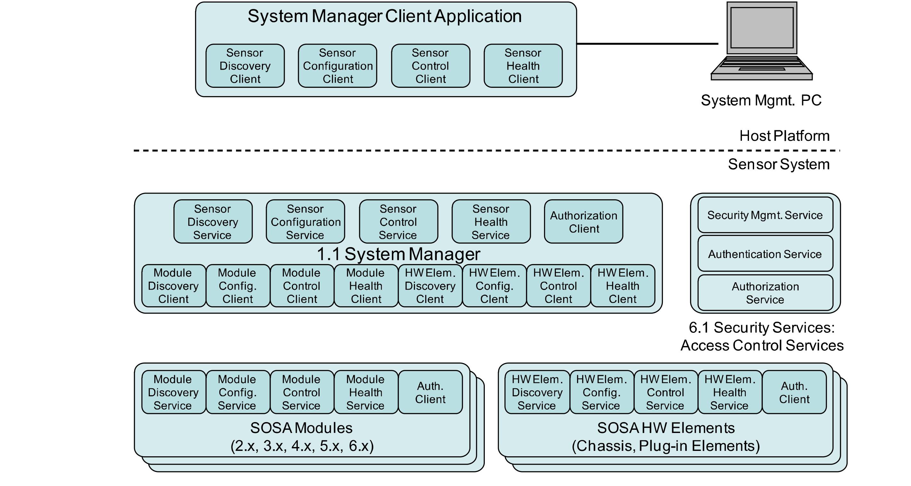

*Figure 8: SOSA Network-Based System Management Architecture*

- Note: The Access Control Services, part of the Security Services module, provide the capability of ensuring that critical resources can only be accessed by authorized entities. The Access Control Services are in development.

Figure 8 illustrates the overall system management architecture. The SOSA 1.1 System Manager module provides a set of network-based service interfaces that may be accessed by one or more system management client applications. The system manager implements the Service endpoints of Discovery, Configuration, Control, and Health Provider interaction groups (interfaces). The system management client implements the client endpoints of those interaction groups. Another way of saying that is that the system management client application uses the services that the system manager provides by implementing the interactions included in the aforementioned interaction groups.

Similarly, the SOSA modules implement the client side of the interactions between the system manager and each module, while the modules implement the service side of the interaction groups. This is true for both SOSA modules and hardware elements. The system manager manages the individual modules but represents a single view to the world outside of the sensor (system management client application).

- Note: The configuration shown in Figure 8 and described above is conceptual. This does not imply requirements for a specific management configuration. A system design; how many and which management clients will have access to the system management interfaces, how the system manager is implemented, and the security controls that are implemented must meet the performance and security requirements of the particular application and/or mission. For example, the access to the system manager interfaces can be controlled via the Security Services, specifically the Authorization Provider, to implement a wide variety of access control policies.

<!-- 原书 p.38 ｜ PDF p.58 -->

##### 3.11.3 SOSA Hardware Management Overview

SOSA hardware management provides the capability to diagnose and debug hardware assemblies while the system infrastructure (processing and transports) may not be operational. This is accomplished via a set of existing lower-level hardware management interface standards. More detail on the out-of-band hardware platform system management functionality is described below.

SOSA hardware management interfaces provide a well-defined set of standardized hardwarecentric capabilities across SOSA hardware elements that can be relied upon and utilized by the SOSA system manager module via a standardized set of logical and physical interfaces to fully satisfy the required SOSA system management functionality. SOSA hardware platform management leverages and builds upon the Hardware Open Systems Technology (HOST) 3.0 system management architecture and requirements which itself is highly leveraged from ANSI/VITA 46.11.

Capabilities provided by SOSA hardware management architecture include but are not limited to the following:

Hardware Element Sensor Management – e.g., temperature, voltage, current, vibration, intrusion Hardware Chassis/Element Inventory – e.g., vendor identification, model number, serial number, revision identification, software/firmware revision information Hardware Chassis/Element Configuration – e.g., parameter settings, policy settings Software/Firmware Management – e.g., load, sanitize, recovery FRU Recovery – e.g., reset a hardware element, power cycle a hardware element Diagnostic Management – e.g., initiate diagnostics, collect diagnostic results The capabilities above are general at this point and will be fleshed out in future work. The approach being taken is to develop specific use-cases and add detail to the hardware element management interactions, including specific input and output parameters of the hardware element system management interactions.

The HOST and ANSI/VITA 46.11 standards provide a large array of commands and parameters, a subset of which will be used to support the SOSA hardware management architecture. This subset will be determined in the future. Developing use-cases to flesh out the capabilities will help identify the subset of these commands and parameters will be used for managing the hardware elements from the network.

As shown in Figure 9, the SOSA Architecture defines two logical interfaces, enabled by SNMP, through which SOSA modules can interact with SOSA hardware element management elements. The interaction is enabled via SOSA defined SNMP Management Information Bases (MIBs) that provide status and control capability to the SOSA modules of the underlying hardware element management features. The first SNMP MIB provides an interface to the chassis manager software capabilities. This MIB provides a path to access the entirety of the hardware management platform via a single logical element, the chassis manager. In this scenario, the chassis manager utilizes the Intelligent Platform Management Bus (IPMB) to extend status and control capabilities of its MIB to all of the managed Hardware Platform elements. This can be helpful when performing activities such as discovery of the SOSA hardware element as the

<!-- 原书 p.39 ｜ PDF p.59 -->

summary of this information is collected and stored by the chassis manager and can thus be retrieved from a single location in the chassis. The second SNMP MIB provides a local interface from an application processor, when applicable, on a hardware element to its Intelligent Platform Management Interface (IPMC) Payload Interface. This path can be helpful for fault management, performance, and/or security-related reasons versus communicating over the shared IPMB interface via the chassis manager.

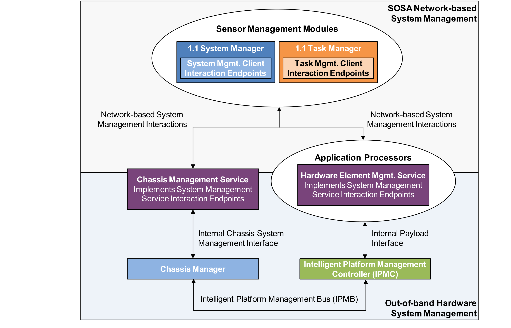

*Figure 9: SOSA Hardware System Management Logical Block Diagram*

Physically, out-of-band hardware system management is implemented in a hierarchical manner where each managed Field Replaceable Unit (FRU) contains an IPMC, each managed chassis implements functionality of the chassis manager, and each managed platform contains one or more system managers (e.g., the SOSA system manager and the SOSA task manager). Each layer of the hierarchy enables a greater set of management capabilities. Note that it is not necessary that the functionality associated with the chassis manager in Figure 9 be implemented as a stand-alone entity. As long as the internal chassis system management interface and chassis management functionality are implemented it is acceptable.

<!-- 原书 p.40 ｜ PDF p.60 -->

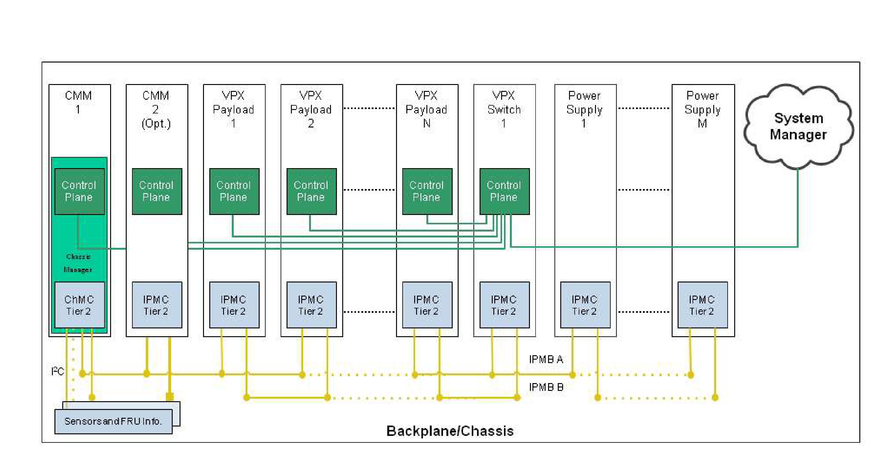

*Figure 10: Example SOSA System Management Backplane/Chassis Implementation*

As shown in Figure 10, each SOSA Payload and Switch hardware element contains an ANSI/VITA 46.11 Tier 2 and HOST-compliant IPMC. Each hardware element provides two redundant IPMB connections from the IPMC to the backplane. Power Supply Modules (PSMs) also contain an ANSI/VITA 46.11 Tier 2 and HOST-compliant IPMC which provides two redundant IPMB connections to the backplane. A chassis management module which hosts a Tier 2 ANSI/VITA 46.11 and HOST chassis manager function provides two redundant IPMB connections, a 1GbE control plane connection, and a redundant set of I²C bus connections to the backplane. The redundant IPMB interfaces are bussed across the backplane such that IPMB A and IPMB B connect to each IPMC/Chassis Management Controller (ChMC) on each hardware element type. The chassis manager control plane interface is connected to the control plane switch network. The chassis manager Inter-IC (I²C) busses are connected to chassis sensors and FRU information devices. A system manager is connected to the control plane switch network.

In a SOSA system, the chassis manager is a discrete entity that is “part of the chassis” and exists on a custom non-specified form factor or off-the-shelf Chassis Manager Module (CMM). This allows chassis FRU information, logs, etc. to stay with the chassis independent of changes to its content. It is possible to support redundant chassis managers within an enclosure to achieve increased Reliability, Availability, and Serviceability (RAS) support. The chassis manager acts as an access point for the system manager into the IPMC capabilities. The chassis manager additionally provides interfaces to chassis-level sensors, FRU information, power, and/or thermal management infrastructure. All FRUs in the system are identifiable via the system management infrastructure.

Figure 11 shows an example SOSA system management implementation on a SOSA hardware element. As shown in the figure, the IPMC exists in the Management Domain on the SOSA hardware element that allows it to operate in a “lights out” condition when only management power is applied to the plug-in card, backplane, and/or chassis. The remainder of the electronics on the hardware element, including the application processor which may be a general-purpose processor, a Field-Programmable Gate Array (FPGA), a Graphics Processing Unit (GPU), or any other processing engine that runs the platform application, exists on the Payload Domain. On-

<!-- 原书 p.41 ｜ PDF p.61 -->

chassis communication between the IPMC and the application process occurs over a Payload Interface between the application processor and the IPMC. Off-chassis system management communication can occur to/from the application processor over the control plane or via the IPMC out to the System IPMB. Off-chassis system management communication can also occur over the System IPMB to/from the IPMC independent of the application processor.

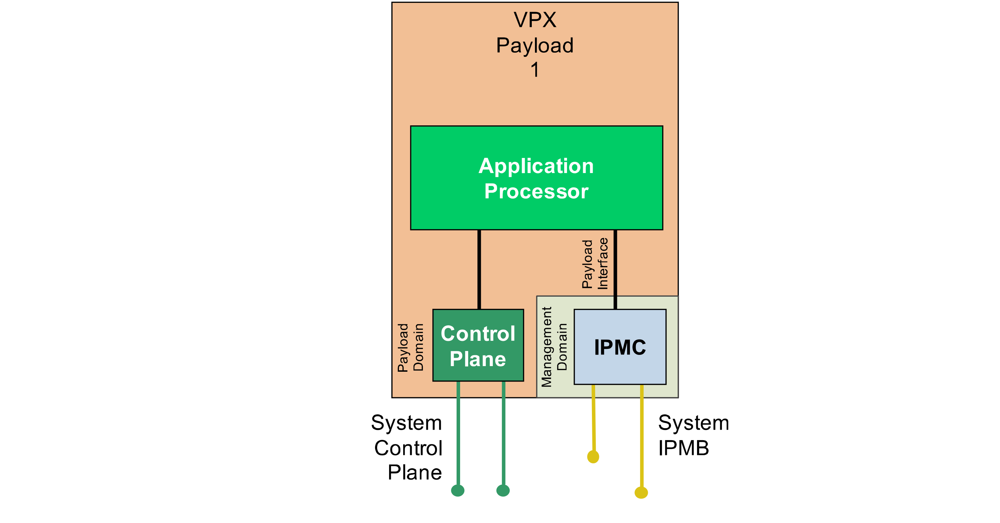

*Figure 11: Example SOSA System Management Plug-In Card Implementation*

In a SOSA system, communication to/from the IPMC over the System IPMB provides a set of system management capabilities that are accessible in a “lights out” condition when only management power is enabled and/or when there are soft and/or hard faults preventing communication with the application processor. As such, this System IPMB enables fault isolation and recovery operations, platform configuration, sensor management, and inventory functions that are available out-of-band of the application and when limited power is available to the platform (e.g., during 2 Level Maintenance (2LM) operations and/or in theater).

Once the Payload Domain is activated, system management applications running on the application processor and communicating over the control plane can be used to increase the performance of the run-time system management functions. The application processor can locally communicate with the IPMC to access its capabilities and communicate with the chassis manager, system manager, and/or other application processors over the control plane. This enables the installation and usage of standards-based system management application software interfaces and infrastructure (e.g., SNMP and MIBs).

<!-- 原书 p.42 ｜ PDF p.62 -->

## 4 Architecture Definition

> 原书 p.43–71 ｜ PDF p.63–91

#### 4.1 Service Views

##### 4.1.1 SvcV-4: Services Functionality Description

The Service View 4 (SvcV-4: Services Functionality Description) documents the functions performed by each of the SOSA modules, and documents the data ingested and produced by each. This information, when coupled with the SOSA Data Models (DIV-1, -2, and -3) provides a complete picture of the content of the informational Needlines linking the SOSA modules. The SvcV-4 takes the form of a table, incorporating the following pieces of information: ID Number: numerical designator (major-point-minor) of the SOSA module Name: succinct label for the SOSA module Function List: list of functions contained within the SOSA module Inputs: list of data items and controls that are ingested by the SOSA module (in certain cases, their sources)

- Outputs: list of data items that are produced by the SOSA module (in certain cases, their destinations)

**Table 5: SOSA SvcV-4**

| Module | Encapsulated Functions | Inputs (above) & Outputs (below) | Input/Output Description |
|---|---|---|---|
| 1 Manage SOSA Sensor | | | |
| 1.1 System Manager | 1.1 Perform System Management | 1.1.a System Management Tasking | Inputs |
| | | 1.1.b System Management Assignment Ack/Status/Information | |
| | | 1.1.c System Management Assignment Event Notification | |
| | | 1.1.d System Management Task Ack/Status/Information | |
| | | 1.1.e System Management Task Event Notification | |
| | | 1.1.f System Services Data | |
| | | 1.1.g System Management Assignment | |
| | 1.1.1 Discover System | | |
| | 1.1.1.1 Discover System Manager | | |
| | 1.1.1.2 Discover Modules | | |
| | 1.1.2 Manage Configuration | | |
| | 1.1.2.1 Configure System | | |
| | 1.1.2.2 Configure Module | | |
| | 1.1.2.3 Configure Data Publishing | | |
| | 1.1.3 Manage Control Parameters | | |
| | 1.1.3.1 Control System | | |
| | 1.1.3.2 Control Module | | |
| | 1.1.4 Manage Health | | |
| | 1.1.4.1 Report Health | | |
| | 1.1.4.1.1 Report System Health | | |
| | 1.1.4.1.2 Report Module Health | | |
| | 1.1.4.2 Get Health | | |
| | 1.1.4.2.1 Get System Health | | |
| | 1.1.4.2.2 Get Module Health | | |
| | 1.1.4.3 Notify Health Events | | |
| | 1.1.4.3.1 Notify System Health Events | | |
| | 1.1.4.3.2 Notify Module Health Events | | |
| | 1.1.4.4 Log Health | | |
| | 1.1.5 Manage Security | | |
| | 1.1.5.1 Secure Management Interfaces | | |
| | 1.1.5.1.1 Verify Authentication | | |
| | 1.1.5.1.2 Verify Authorization | | |
| | 1.1.5.2 Manage Security Configuration | | |
| | 1.1.5.2.1 Manage Security Keys | | |
| | 1.1.5.2.2 Manage Access Control | | |
| 1.2 Task Manager | 1.2 Perform Task Management | | |
| | 1.2.1 Discover Capabilities | | |
| | 1.2.1.1 Discover System Capabilities | 1.2.1.1.a Module Discovery Data (Module List, Resource Data, Module/Resource IP) | Input |
| | | 1.2.1.1.b Sensor Capabilities Request | Input |
| | | 1.2.1.1.c Sensor Capabilities | Output |
| | | 1.2.1.1.d Sensor Capabilities Resource Map | Output |
| | 1.2.1.2 Discover Module Capabilities | 1.2.1.2.a Module Capabilities | Input |
| | | 1.2.1.2.b Module Capabilities Request | Output |
| | 1.2.2 Manage Tasks | | |
| | 1.2.2.1 Manage External Sensor Tasks | 1.2.2.1.a Tasking | Input |
| | | 1.2.2.1.b Task Ack/Status/Information | Output |
| | | 1.2.2.1.c Task Event Notification | Output |
| | 1.2.2.1.1 Ingest External Tasking | Tracks from Module 3.4 | For TWS GMTI |
| | 1.2.2.1.2 Monitor External Tasking | | |
| | 1.2.2.1.3 Report External Tasking Status | | |
| | 1.2.2.2 Manage Internal Sensor Tasks | | |
| | 1.2.2.2.1 Develop Internal Sensor Tasking | | |
| | 1.2.2.2.2 Manage Sensor Resources | | |
| | 1.2.2.2.2.1 Prioritize Internal Sensor Tasking | | |
| | 1.2.2.2.2.2 Schedule Internal Sensor Tasking | | |
| | 1.2.2.2.3 Monitor Internal Sensor Tasking | | |
| | 1.2.2.3 Manage Module Assignments | 1.2.2.3.a Module Assignment Ack/Status/Information | Input |
| | | 1.2.2.3.b Module Assignment Event Notification | Input |
| | | 1.2.2.3.c Module Assignment | Output |
| | 1.2.2.3.1 Develop Module Assignments | | |
| | 1.2.2.3.2 Manage Module Resources | | |
| | 1.2.2.3.3 Send Module Assignments | | |
| | 1.2.2.3.4 Monitor Module Assignments | | |
| | 1.2.3 Manage Module | 1.2.3.a System Services Data | Input (PNT, etc.) |
| | | 1.2.3.b System Management Assignment | Input |
| | | 1.2.3.c System Management Assignment Ack/Status/Information | Output |
| | | 1.2.3.d System Management Assignment Event Notification | Output |
| | 1.2.3.1 Manage Module Discovery | | |
| | 1.2.3.2 Manage Module Configuration | | |
| | 1.2.3.3 Manage Module Control | | |
| | 1.2.3.4 Manage Module Health | | |
| | 1.2.3.5 Manage Module Security | | |
| 2 Transmission/Reception | | | |
| 2.1 Receive Aperture/Transducer/Camera | 2.1.1 Control Receive Aperture | | |
| | 2.1.1.1 Configure Aperture | | |
| | 2.1.1.2 Control Aperture Parameters | | |
| | 2.1.2 Convert EM Energy to Electrical Signal | 2.1.2.a RX Electromagnetic Energy | Input |
| | 2.1.3 Amplify Signal | | |
| | 2.1.3 Stabilize Signal | | |
| | 2.1.4 Filter Signal | 2.1.4.a Filtered RX Signal | Output |
| | 2.1.5 Perform Module Management | | |
| | 2.1.5.1 Perform Module System Management | 2.1.5.1.a System Services Data | Input (PNT, etc.) |
| | | 2.1.5.1.b System Management Assignment | Input |
| | | 2.1.5.1.c System Management Assignment Ack/Status/Information | Output |
| | | 2.1.5.1.d System Management Assignment Event Notification | Output |
| | 2.1.5.1.1 Manage Module Discovery | | |
| | 2.1.5.1.2 Manage Module Configuration | | |
| | 2.1.5.1.3 Manage Module Control | | |
| | 2.1.5.1.4 Manage Module Health | | |
| | 2.1.5.1.5 Manage Module Security | | |
| | 2.1.5.2 Manage Module Assignments | 2.1.5.2.a Task Management Assignment | Input |
| | | 2.1.5.2.b Task Management Assignment Ack/Status/Information | Output |
| | | 2.1.5.2.c Task Management Assignment Event Notification | Output |
| | 2.1.5.2.1 Process Module Assignments | | |
| | 2.1.5.2.2 Manage Module Resources | | |
| | 2.1.5.2.4 Monitor Module Assignments | | |
| 2.2 Transmit Aperture/Transducer/Laser | 2.2.1 Control Receive Aperture | | |
| | 2.2.1.1 Configure Aperture | | |
| | 2.2.1.2 Control Aperture Parameters | | |
| | 2.2.2 Generate Signal | | |
| | 2.2.3 Filter Signal | 2.2.3.a Unfiltered RX Signal | Input |
| | 2.2.4 Amplify Signal | | |
| | 2.2.5 Convert Electrical Signal to EM Energy | 2.2.5.a TX Electromagnetic Energy | Output |
| | 2.2.6 Perform Module Management | | |
| | 2.2.7.1 Perform Module System Management | 2.2.7.1.a System Services Data | Input (PNT, etc.) |
| | | 2.2.7.1.b System Management Assignment | Input |
| | | 2.2.7.1.c System Management Assignment Ack/Status/Information | Output |
| | | 2.2.7.1.d System Management Assignment Event Notification | Output |
| | 2.2.7.1.1 Manage Module Discovery | | |
| | 2.2.7.1.2 Manage Module Configuration | | |
| | 2.2.7.1.3 Manage Module Control | | |
| | 2.2.7.1.4 Manage Module Health | | |
| | 2.2.7.1.5 Manage Module Security | | |
| | 2.2.7.2 Manage Module Assignments | 2.2.7.2.a Task Management Assignment | Input |
| | | 2.2.7.2.b Task Management Assignment Ack/Status/Information | Output |
| | | 2.2.7.2.c Task Management Assignment Event Notification | Output |
| | 2.2.7.2.1 Process Module Assignments | | |
| | 2.2.7.2.2 Manage Module Resources | | |
| | 2.2.7.2.4 Monitor Module Assignments | | |
| 2.3 Conditioner-Receiver-Exciter | 2.3.1 Process RX Signals | 2.3.1.a Filtered RX Signal | Input, digital, or analog |
| | | 2.3.1.b RX Electromagnetic Signal Stream | Output, RX digital |
| | | 2.3.1.c RX Image Stream | Output, RX digital |
| | 2.3.1.1 Amplify Signal | | |
| | 2.3.1.2 Distribute RF Signal | | |
| | 2.3.1.3 Translate Signal Frequency | | |
| | 2.3.1.4 Convert Signal: Analog to Digital | | |
| | 2.3.2 Process TX Signals | 2.3.2.a Unfiltered TX Signal | Output |
| | 2.3.2.1 Generate Signal (Waveform) | | |
| | 2.3.2.2 Amplify Signal | | |
| | 2.3.2.3 Distribute RF Signal | | |
| | 2.3.2.4 Translate Signal Frequency | | |
| | 2.3.2.5 Convert Signal: Digital to Analog | | |
| | 2.3.3 Perform Module Management | | |
| | 2.3.3.1 Perform Module System Management | 2.3.3.1.a System Services Data | Input (PNT, etc.) |
| | | 2.3.3.1.b System Management Assignment | Input |
| | | 2.3.3.1.c System Management Assignment Ack/Status/Information | Output |
| | | 2.3.3.1.d System Management Assignment Event Notification | Output |
| | 2.3.3.1.1 Manage Module Discovery | | |
| | 2.3.3.1.2 Manage Module Configuration | | |
| | 2.3.3.1.3 Manage Module Control | | |
| | 2.3.3.1.4 Manage Module Health | | |
| | 2.3.3.1.5 Manage Module Security | | |
| | 2.3.3.2 Manage Module Assignments | 2.3.3.2.a Task Management Assignment | Input |
| | | 2.3.3.2.b Task Management Assignment Ack/Status/Information | Output |
| | | 2.3.3.2.c Task Management Assignment Event Notification | Output |
| | 2.3.3.2.1 Process Module Assignments | | |
| | 2.3.3.2.2 Manage Module Resources | | |
| | 2.3.3.2.4 Monitor Module Assignments | | |
| 3 Process Signals/Targets | | | |
| 3.1 Signal/Object Detector and Extractor | 3.1.1 Enhance Image/Video | 3.1.1.a RX Electromagnetic Signal Stream | Input |
| | | 3.1.1.b RX Image Stream | Input |
| | | 3.1.1.c RF Image Stream | Input |
| | | 3.1.1.d Registered Image Stream | Input |
| | | 3.1.1.e Georegistered Image Stream | Input |
| | 3.1.2 Extract Signals/Objects | 3.1.2.a Extracted Electromagnetic Signal Stream | Output, enhanced |
| | | 3.1.2.b Extracted Image Stream | Output, enhanced |
| | 3.1.2.1 Extract RF Signal from Clutter | | |
| | 3.1.2.2 Extract EO/IR Object from Background | | |
| | 3.1.3 Process Detections | 3.1.3.a Detection | Output |
| | | 3.1.3.b Image Quality Report | Output |
| | 3.1.3.1 Detect and Discriminate Signals/Objects | | |
| | 3.1.3.2 Estimate quality of detections | | |
| | 3.1.4 Perform Module Management | | |
| | 3.1.4.1 Perform Module System Management | 3.1.4.1.a System Services Data | Input (PNT, etc.) |
| | | 3.1.4.1.b System Management Assignment | Input |
| | | 3.1.4.1.c System Management Assignment Ack/Status/Information | Output |
| | | 3.1.4.1.d System Management Assignment Event Notification | Output |
| | 3.1.4.1.1 Manage Module Discovery | | |
| | 3.1.4.1.2 Manage Module Configuration | | |
| | 3.1.4.1.3 Manage Module Control | | |
| | 3.1.4.1.4 Manage Module Health | | |
| | 3.1.4.1.5 Manage Module Security | | |
| | 3.1.4.2 Manage Module Assignments | 3.1.4.2.a Task Management Assignment | Input |
| | | 3.1.4.2.b Task Management Assignment Ack/Status/Information | Output |
| | | 3.1.4.2.c Task Management Assignment Event Notification | Output |
| | 3.1.4.2.1 Process Module Assignments | | |
| | 3.1.4.2.2 Manage Module Resources | | |
| | 3.1.4.2.4 Monitor Module Assignments | | |
| 3.2 Signal/Object Characterizer | 3.2.1 Extract Detection Features | 3.2.1.a Detection | Input |
| | | 3.2.1.b Extracted Electromagnetic Signal Stream | Input |
| | | 3.2.1.c Extracted Image Stream | Input |
| | | 3.2.1.d Spectral Product | Output |
| | 3.2.1.1 Estimate Signal Parameters | | |
| | 3.2.1.2 Extract Classifier Features | | |
| | 3.2.1.3 Extract Identification Features | | |
| | 3.2.1.4 Compute spectral products | | |
| | 3.2.2 Classify or Identify Signal/Object | 3.2.2.a Characterizer Data | Input |
| | 3.2.2.1 Determine Signal Type | | |
| | 3.2.2.2 Map Features to Reference/Basis | | |
| | 3.2.2.3 Match Image Chip to Profile for ID | | |
| | 3.2.2.4 Perform Target Recognition | | |
| | 3.2.3 Filter False Detections | | |
| | 3.2.3.1 Identify False Alarms | | |
| | 3.2.3.2 Discriminate Target from Non-target | | |
| | 3.2.4 Produce Characterizations | 3.2.4.a Characterization | Output |
| | 3.2.4.1 Produce Classification Type | | |
| | 3.2.4.2 Produce Identity | | |
| | 3.2.5 Perform Module Management | | |
| | 3.2.5.1 Perform Module System Management | 3.2.5.1.a System Services Data | Input (PNT, etc.) |
| | | 3.2.5.1.b System Management Assignment | Input |
| | | 3.2.5.1.c System Management Assignment Ack/Status/Information | Output |
| | | 3.2.5.1.d System Management Assignment Event Notification | Output |
| | 3.2.5.1.1 Manage Module Discovery | | |
| | 3.2.5.1.2 Manage Module Configuration | | |
| | 3.2.5.1.3 Manage Module Control | | |
| | 3.2.5.1.4 Manage Module Health | | |
| | 3.2.5.1.5 Manage Module Security | | |
| | 3.2.5.2 Manage Module Assignments | 3.2.5.2.a Task Management Assignment | Input |
| | | 3.2.5.2.b Task Management Assignment Ack/Status/Information | Output |
| | | 3.2.5.2.c Task Management Assignment Event Notification | Output |
| | 3.2.5.2.1 Process Module Assignments | | |
| | 3.2.5.2.2 Manage Module Resources | | |
| | 3.2.5.2.4 Monitor Module Assignments | | |
| 3.3 Image Pre-processor | 3.3.1 Form Image from RF Signal | 3.3.1.a Received Electromagnetic Signal Stream | Input |
| | | 3.3.1.b RF Image stream | Output |
| | 3.3.2 Register Image to Image | 3.3.2.a Image Stream | Input |
| | | 3.3.2.b Registered Image Stream | Output |
| | 3.3.3 Register Image to Geographical Coordinates | 3.3.3.a Image Stream | Input |
| | | 3.3.3.b Geographic Information | Input |
| | | 3.3.3.c Georeferenced Image Stream | Output |
| | 3.3.4 Perform Module Management | | |
| | 3.3.4.1 Perform Module System Management | 3.3.4.1.a System Services Data | Input (PNT, etc.) |
| | | 3.3.4.1.b System Management Assignment | Input |
| | | 3.3.4.1.c System Management Assignment Ack/Status/Information | Output |
| | | 3.3.4.1.d System Management Assignment Event Notification | Output |
| | 3.3.4.1.1 Manage Module Discovery | | |
| | 3.3.4.1.2 Manage Module Configuration | | |
| | 3.3.4.1.3 Manage Module Control | | |
| | 3.3.4.1.4 Manage Module Health | | |
| | 3.3.4.1.5 Manage Module Security | | |
| | 3.3.4.2 Manage Module Assignments | 3.3.4.2.a Task Management Assignment | Input |
| | | 3.3.4.2.b Task Management Assignment Ack/Status/Information | Output |
| | | 3.3.4.2.c Task Management Assignment Event Notification | Output |
| | 3.3.4.2.1 Process Module Assignments | | |
| | 3.3.4.2.2 Manage Module Resources | | |
| | 3.3.4.2.4 Monitor Module Assignments | | |
| 3.4 Tracker | 3.4.1 Process Detections | 3.4.1.a Extracted EM Signal Stream | Input |
| | | 3.4.1.b Extracted Image Stream | Input |
| | | 3.4.1.c Detection | Input, Data from Module 3.1 Signal/Target Detector/Extractor module that is processed to determine and output tracks. Can be RF detection data (SAR, EW, GMTI, AMTI, ESM) or EO/IR detection data |
| | | 3.4.1.d Characterization | Input, Data from Module 3.2 that is processed to determine and output tracks |
| | 3.4.2 Associate Tracks | | |
| | 3.4.3 Initiate Tracks | | |
| | 3.4.4 Terminate Tracks | | |
| | 3.4.5 Maintain Tracks | 3.4.5.a Current Track State | Output, Provides the track state data at the time of the measurement Includes intermediate results and measurements |
| | | 3.4.5.b Predicted Track State | Output, Provides the estimated track state data at the time of the next scheduled measurement update |
| | 3.4.5.1 Track Update | | |
| | 3.4.5.2 Track Prediction | | |
| | 3.4.6 Perform Module Management | | |
| | 3.4.6.1 Perform Module System Management | 3.4.6.1.a System Services Data (PNT, etc.) | Input |
| | | 3.4.6.1.b System Management Assignment | Input |
| | | 3.4.6.1.c System Management Assignment Ack/Status/Information | Output |
| | | 3.4.6.1.d System Management Assignment Event Notification | Output |
| | 3.4.6.1.1 Manage Module Discovery | | |
| | 3.4.6.1.2 Manage Module Configuration | | |
| | 3.4.6.1.3 Manage Module Control | | |
| | 3.4.6.1.4 Manage Module Health | | |
| | 3.4.6.1.5 Manage Module Security | | |
| | 3.4.6.2 Manage Module Assignments | 3.4.6.2.a Task Management Assignment | Input |
| | | 3.4.6.2.b Task Management Assignment Ack/Status/Information | Output |
| | | 3.4.6.2.c Task Management Assignment Event Notification | Output |
| | 3.4.6.2.1 Process Module Assignments | | |
| | 3.4.6.2.2 Manage Module Resources | | |
| | 3.4.6.2.4 Monitor Module Assignments | | |
| 4 Analyze/Exploit | | | |
| 4.1 External Data Ingestor | Ingest data from other SOSA sensors or other sources | SOSA Mission Data | (Data products output by Reporting Services) |
| | Convert from external formats to SOSA format | SOSA Non-conformant Data | (including sensor/source) |
| | Distribute the ingested data to other SOSA Modules as appropriate | SOSA Mission Data | |
| | Enable fusion or correlation across sensors | | |
| 4.2 Encoded Data Extractor | Extract internals | Detection | |
| | Extract message content from signal | Extracted Electromagnetic Signal Stream | (digital only) |
| | Demodulate | Extracted Image or Stream | (digital only) |
| | Perform human language processing | Encoded Data Extractor Assignment | |
| | | *A Priori* Target Properties | |
| | | Demodulated Electromagnetic Signal Stream | |
| | | Extracted Data | |
| 4.3 Situation Assessor | Correlate same signal/object from multiple sensors | Characterization | |
| | Associate multiple signals/objects | Track | |
| | Develop and store history of detections and correlations over time | Detection | Of signals/objects |
| | | Association | Among signals/objects |
| | | Situation Assessor Data | |
| | | Situation Assessor Assignment | |
| | | Assessed Situation | |
| | | Association | Among signals/objects |
| 4.4 Impact Assessor and Responder | Determine entity affiliation | Demodulated Electromagnetic Signal Stream | |
| | Assess impacts, threats, and vulnerabilities | Detection | Of signals/objects |
| | Maintain alternate hypotheses | Track | |
| | Project assessments into the future | Characterization | |
| | Analyze response and send request | Extracted Data | |
| | | Association | Among signals/objects |
| | | Impact Assessor Data | |
| | | Impact Assessor and Responder Assignment | |
| | | Assessed Impact | |
| | | Assessed Impact Response | |
| 4.6 Storage/Retrieval Manager | Capture real-time streaming data | Electromagnetic Signal Stream | (digital only) |
| | Retrieve | Image Stream | (digital only) |
| | Play back in real-time | Detection | |
| | Index | Track | |
| | Store media | Characterization | |
| | | Association | |
| | | Assessed Situation | |
| | | Assessed Impact | |
| | | Storage/Retrieval Manager Assignment | |
| | | Electromagnetic Signal Stream | (digital only) |
| | | Image Stream | (digital only) |
| | | Detection | |
| | | Characterization | |
| | | Association | |
| | | Assessed Situation | |
| | | Assessed Impact | |
| 5 Convey | | | |
| 5.1 Reporting Services | Aggregate data | Electromagnetic Signal Stream | (digital only) |
| | Select data to be reported | Image Stream | (digital only) |
| | Format data | Sensor Logging Data | (e.g., Health, Status, Mode, and State) |
| | Generate reports for collection/processing/analysis/exploitation | Demodulated Electromagnetic Signal Stream | |
| | Accept/reject request | Detection | |
| | Find data | Characterization | |
| | Package data for reporting | Association | |
| | Generate header/packet structure for streaming data | Assessed Situation | |
| | Send metadata | Assessed Impact | |
| | Select a format | Fault | |
| | Structure data to match format | Sensor Cue/Tip Track | |
| | Send to recipient(s) | Reporting Services Assignment | |
| | Match sensor results against tip/cue criteria | External format of any data in Input | |
| 6 Support System Operation | | | |
| 6.1 Security Services | Check software/data integrity | Security Parameters | (e.g., encryption keys, access control data, module integrity data) |
| | Manage key(s) | Zeroize Assignment | |
| | Control access | Access Request | |
| | Audit | Classification Level Tag(s) | |
| | Zeroize all sensitive data | Security Audit Report | |
| | | Security Tamper Alert | |
| | | Access Request Response | |
| | | Zeroize ACK/NAK | |
| | | Zeroize Assignment | (to other modules) |
| 6.2 Encryptor/Decryptor | Protect data at rest | Security Parameters | Encryption keys |
| | Protect data in transit | Zeroize Assignment | |
| | Encrypt/decrypt | Access Control Data | |
| | | Data or Stream to be Encrypted | |
| | | Data or Stream to be Decrypted | |
| | | Zeroize ACK/NAK | |
| | | Encrypted Data or Stream | |
| | | Decrypted Data or Stream | |
| 6.3 Guard/Cross-Domain Service | Prevent data leakage | Data or Stream to be Filtered | |
| | | Security Parameters | (Metadata tags for data/stream, filtering criteria, human verification) |
| | | Filtered Data or Stream | |
| | | Filtering Status | |
| | | Security Auditing Data | |
| 6.4 Network Subsystem | Enumerate network elements | Data or Stream to be Sent | |
| | Monitor health of network elements | Network Data Transfer Parameters | |
| | Detect and isolate network degraded elements | Network Configuration Parameters | |
| | Transfer data with requested QoS | Data or Stream that was Sent | |
| | Detect intrusion | Network Health & Status | |
| | | Intrusion Reports | |
| 6.5 Calibration Service | Intake the injected test signal | Injected Test RF Signal | |
| | Collect output of either calibration test points or main | Injected Test Image/Video Stream | |
| | Disable modules not under test | Injected Test Demodulated Signal | |
| | | Calibration Assignment Safety Interlock | |
| | | Electromagnetic Source Assignment | |
| | | Calibration Measurement | |
| 6.6 Nav Data Service | Ingest platform/sensor location and orientation | Nav Data Stream | (external source - option, since could be internally generated) |
| | Blend internal and external spatial data | Nav Data Stream | |
| | Distribute platform/sensor location and orientation | | |
| 6.7 Time & Frequency Service | Ingest time from external source | Time Reference | (external source) |
| | Blend internal and external time data | Time Reference | |
| | Generate time internally | Frequency Reference | |
| | Provide time to internal function | | |
| | Provide LO/frequency reference | | |
| 6.8 Compressor/Decompressor | Compression | Compressor/Decompressor Assignment | |
| | Decompression | Compressed Data | |
| | Codec functions | Compression Metadata | |
| | | Decompressed Data | |
| | | Decompression Metadata | |
| | | Compressed Data | |
| | | Compression Metadata | |
| | | Decompressed Data | |
| | | Decompression Metadata | |
| 6.9 Host Platform Interface | 6.9.1 Adapt External Commands to Internal SOSA Sensor Commands | 6.9.1.b System Management Task Ack/Status/Information | Input from 1.1 (such as Sensor Test Report, Sensor Configuration Data, Sensor Health) |
| | | 6.9.1.c System Management Task Event Notification | Input from 1.1 |
| | | 6.9.1.e Task Ack/Status/Information | Input from 1.2 |
| | | 6.9.1.f Task Event Notification | Input from 1.2 |
| | | 6.9.1.g Host System Management Tasking | Input from host (such as Zeroize Task, Safety Task, Test Task, Security Task, Key Fill) |
| | | 6.9.1.j Host Tasking | Input from host |
| | | 6.9.1.a System Management Tasking | Output to 1.1 (such as Zeroize Task, Safety Task, Test Task, Security Task, Key Fill) |
| | | 6.9.1.d Tasking | Output to 1.2 |
| | | 6.9.1.h Host System Management Task Ack/Status/Information | Output to host (such as Sensor Test Report, Sensor Configuration Data, Sensor Health) |
| | | 6.9.1.i Host System Management Task Event Notification | Output to host |
| | | 6.9.1.k Host Task Ack/Status/Information | Output to host |
| | | 6.9.1.l Host Task Event Notification | Output to host |
| | 6.9.2 Adapt the Host Platform Service Data to the SOSA Sensor Service Data | 6.9.2.a Time Reference | Input from host |
| | | 6.9.2.b Frequency Reference | Input from host (e.g., 1 PPS) |
| | | 6.9.2.c Nav Data Stream | Input from host |
| | | 6.9.2.d Host State | Input from host |
| | | 6.9.2.e Cosite Blanking Task/Indicator | Input from host |
| | | 6.9.2.a Time Reference | Output to Sensor |
| | | 6.9.2.b Frequency Reference | Output to Sensor (e.g., 1 PPS) |
| | | 6.9.2.c Nav Data Stream | Output to Sensor |
| | | 6.9.2.d Host State | Output to Sensor |
| | | 6.9.2.e Cosite Blanking Task/Indicator | Output to Sensor |
| | 6.9.3 Adapt the Host Platform Network to the SOSA Sensor Network | 6.9.3.a Host Network Transmission | Input from host |
| | | 6.9.3.d Network Transmission | Input from Sensor (such as Sensor Logging Data) |
| | | 6.9.3.b Host Network Transmission | Output to host (such as Sensor Logging Data) |
| | | 6.9.3.c Network Transmission | Output to Sensor |
| | 6.9.4 Provide Physical and Electrical Interfaces | 6.9.4.a Host Power | Input from host |
| | | 6.9.4.c Host Physical and Electrical Interfaces | Input from host; Cables/Connectors, Mount Points, Red/Black separation |
| | | 6.9.4.b Power | Output to 6.10 Power |
| | | 6.9.4.d Physical and Electrical Interfaces | Output to host; Cables/Connectors, Mount Points, Red/Black separation |
| | 6.9.5 Perform Module Management | | |
| | 6.9.5.1 Perform Module System Management | 6.9.5.1.a System Services Data (PNT, etc.) | Input |
| | | 6.9.5.1.b System Management Assignment | Input |
| | | 6.9.5.1.c System Management Assignment Ack/Status/Information | Output |
| | | 6.9.5.1.d System Management Assignment Event Notification | Output |
| | 6.9.5.1.1 Manage Module Discovery | | |
| | 6.9.5.1.2 Manage Module Configuration | | |
| | 6.9.5.1.3 Manage Module Control | | |
| | 6.9.5.1.4 Manage Module Health | | |
| | 6.9.5.1.5 Manage Module Security | | |
| | 6.9.5.2 Manage Module Assignments | 6.9.5.2.a Task Management Assignment | Input |
| | | 6.9.5.2.b Task Management Assignment Ack/Status/Information | Output |
| | | 6.9.5.2.c Task Management Assignment Event Notification | Output |
| | 6.9.5.2.1 Process Module Assignments | | |
| | 6.9.5.2.2 Manage Module Resources | | |
| | 6.9.5.2.4 Monitor Module Assignments | | |
| 6.10 Power | Convert between different power characteristics | Host Power | From host platform interface |
| | Condition/filter power | Power Assignment | From task manager |
| | Store power for intermittent input power loss | Power | To all modules |
| | Store power to provide long-term power to loads without input power | Power Assignment Response | To task manager |
| | Distribute power from power supplies to power loads | | |
| | Protect against voltage and over-current conditions | | |
| | Provide a digital control interface | | |

> 转写说明：本表 4 列，共 429 行数据行，**本表完，覆盖原书印刷页 p.43–p.66**（对应 PDF 页序 p063–p086；p.66 页表格在“6.10 Power”组之后页中收尾，其后紧接“4.1.2 SvcV-2: Services Resource Flow Description”正文，不再有续行）。各续页顶部的四列表头为重复表头，已并入首行表头，不另起表。
>
> 每页数据行数分布（印刷页）：p.43－p.44 合 30 行 · p.45 21 · p.46 18 · p.47 20 · p.48 19 · p.49 18 · p.50 18 · p.51 21 · p.52 18 · p.53 19 · p.54 19 · p.55 18 · p.56 11 · p.57 17 · p.58 19 · p.59 22 · p.60 20 · p.61 22 · p.62 19 · p.63 16 · p.64 19 · p.65 16 · p.66 9。
>
> 合并单元格情况（本文件一律留空）：①“1 Manage SOSA Sensor”“2 Transmission/Reception”“3 Process Signals/Targets”“4 Analyze/Exploit”“5 Convey”“6 Support System Operation”六个组标题在原表中各为横跨 4 列的整幅单元格，其右三格留空；②第 1 列（Module）纵向合并且跨页延续的有：“1.1 System Manager”（“1.1.a”行起至“1.1.5.2.2”行）、“1.2 Task Manager”（“1.2 Perform Task Management”行起至 p.48）、“2.1 Receive Aperture/Transducer/Camera”（p.47–p.48）、“2.2 Transmit Aperture/Transducer/Laser”（p.48–p.49）、 “2.3 Conditioner-Receiver-Exciter”（p.49–p.51）、“3.1 Signal/Object Detector and Extractor”（p.51）、“3.2 Signal/Object Characterizer”（p.52–p.53）、“3.3 Image Pre-processor”（p.54）、“3.4 Tracker”（p.55–p.56）、“4.1 External Data Ingestor”（p.57–p.58）、“4.2 Encoded Data Extractor”（p.58）、“4.3 Situation Assessor”（p.58）、“4.4 Impact Assessor and Responder”（p.58–p.59）、“4.6 Storage/Retrieval Manager”（p.59–p.60）、“5.1 Reporting Services”（p.60）、“6.1 Security Services”（p.60–p.61）、“6.2 Encryptor/Decryptor”（p.61）、“6.3 Guard/Cross-Domain Service”（p.61）、“6.4 Network Subsystem”（p.61–p.62）、“6.5 Calibration Service”（p.62）、“6.6 Nav Data Service”（p.62）、“6.7 Time & Frequency Service”（p.62）、“6.8 Compressor/Decompressor”（p.62–p.63）、“6.9 Host Platform Interface”（p.63–p.66）、“6.10 Power”（p.66）；故各续页第 1 列相应位置整列留空；③第 2 列（Encapsulated Functions）为“X.Y.Z Perform Module System Management”之类条目时，纵向合并覆盖其下 a/b/c/d 等输入输出行（全表统一如此），另有个别条目跨 2–5 行（如“1.2.1.1 Discover System Capabilities”跨 a–d、“3.3.3 Register Image to Geographical Coordinates”跨 a–c、“4.2 Encoded Data Extractor”等段落在第 2 列按语义分行），续行留空；④第 4 列“Inputs”只出现在“1.1.a … System Management Tasking”一行，其余各行该列表格为空白（原表未作纵向合并，行线横穿该列）。
>
> 跨页断格一处：p.51 末行第 2 列印作“3.1.4.1 Perform Module System”、p.52 首行续印“Management”，原表该合并单元格在页界处被切断，本文件按其完整文句录为“3.1.4.1 Perform Module System Management”（该行 a 项在 p.51、b–d 项在 p.52）。
>
> 原文编号与文字照录、未作改动；其中几处与原表编号序列或常规拼写不一致，仅此说明以便核对：①“2.1.3”重复出现于“2.1.3 Amplify Signal”与“2.1.3 Stabilize Signal”两行；②“2.1.5.2.3”缺号，序列由“2.1.5.2.2”直接到“2.1.5.2.4”；③“2.2 Transmit Aperture/Transducer/Laser”下的首行为“2.2.1 Control Receive Aperture”（含 Receive 字样）；④“2.2.7.1 Perform Module System Management”无对应的“2.2.7”上级条目；⑤第 4 组缺“4.5”，序列由“4.4 Impact Assessor and Responder”直接跳到“4.6 Storage/Retrieval Manager”；⑥各组“Manage Module Assignments”下的子项序列多为“.1／.2／.4”（缺 .3，如 2.1.5.2、2.2.7.2、2.3.3.2、3.1.4.2、3.2.5.2、3.3.4.2、3.4.6.2、6.9.5.2），唯“1.2.2.3”一组四项齐全（含 .3 Send Module Assignments）；⑦“3.3.1.b RF Image stream”与“3.2.1.4 Compute spectral products”原文用小写 s/p；⑧“4.2 Encoded Data Extractor”以下三段的第 2 列不是编号功能名，而是无编号动词短语（如“Extract internals”“Play back in real-time”），第 3 列同段亦为数据项名，第 4 列多为空或括号注释，均照录；⑨“*A Priori* Target Properties”原文为斜体，此处保留斜体标记；⑩“6.9.1.x”各项按输入在前、输出在后排列（b、c、e、f、g、j、a、d、h、i、k、l），非字母序，照录不改。⑪“6.5 Calibration Service”段中“Collect output of either calibration test points or main”一句原文如此，句末无宾语，未作补全。

<!-- 原书 p.43 ｜ PDF p.63 -->

<!-- 原书 p.44 ｜ PDF p.64 -->

<!-- 原书 p.45 ｜ PDF p.65 -->

<!-- 原书 p.46 ｜ PDF p.66 -->

<!-- 原书 p.47 ｜ PDF p.67 -->

<!-- 原书 p.48 ｜ PDF p.68 -->

<!-- 原书 p.49 ｜ PDF p.69 -->

<!-- 原书 p.50 ｜ PDF p.70 -->

<!-- 原书 p.51 ｜ PDF p.71 -->

<!-- 原书 p.52 ｜ PDF p.72 -->

<!-- 原书 p.53 ｜ PDF p.73 -->

<!-- 原书 p.54 ｜ PDF p.74 -->

<!-- 原书 p.55 ｜ PDF p.75 -->

<!-- 原书 p.56 ｜ PDF p.76 -->

#### 4.1 External Data Ingest data from other SOSA SOSA Mission Data (Data products

<!-- 原书 p.57 ｜ PDF p.77 -->

<!-- 原书 p.58 ｜ PDF p.78 -->

<!-- 原书 p.59 ｜ PDF p.79 -->

#### 5.1 Reporting Services Aggregate data ElectromagneticSignal Stream (digital only)

Support System Operation

<!-- 原书 p.60 ｜ PDF p.80 -->

<!-- 原书 p.61 ｜ PDF p.81 -->

<!-- 原书 p.62 ｜ PDF p.82 -->

<!-- 原书 p.63 ｜ PDF p.83 -->

<!-- 原书 p.64 ｜ PDF p.84 -->

<!-- 原书 p.65 ｜ PDF p.85 -->

##### 4.1.2 SvcV-2: Services Resource Flow Description

Planned for a later version of the SOSA Technical Standard.

##### 4.1.3 SvcV-3b: Services-Services Matrix

Planned for a later version of the SOSA Technical Standard.

4.1.3.1 SvcV-3a: System-Services Matrix

Planned for a later version of the SOSA Technical Standard.

#### 4.2 Data Architecture

The SOSA Data Model follows a top-down architectural approach, based on DoDAF best practices; a Conceptual Data Model (DIV-1) documents at a high level the type and nature of the data to be exchanged, and their relationship, a Logical Data Model (DIV-2) captures – in detail – the data content, and the Physical Data Model (DIV-3) documents the physical manifestation of the data (exact format; bits per field, formats, schemas, structures). The protocols used to carry the data are defined separately from the Model itself, a decoupling that ensures that the same data (in the same format) can be carried between source and destination by different means (and as necessary).

<!-- 原书 p.66 ｜ PDF p.86 -->

##### 4.2.1 DIV-1: Conceptual Data Model

The SOSA Conceptual Data Model (DIV-1) documents the nature of, and relationships (hierarchy) between, the many “pieces” of information required for the operation and upkeep of a SOSA sensor. The DIV-1 is a top-level representation, and is divided into two parts: One part addresses the Mission Data elements (data related to the purposes for which the system exists), such as observed phenomena and interpretation of the physical and electromagnetic environment (Figure 12, Figure 13). The other part addresses system management elements (data related to the control/operation of the sensor), such as state and tasking.

When these are combined with the derived Logical Data Model (DIV-2) and Physical Data Model (DIV-3), the two lower-level data models, this creates a complete picture of the data needs of a SOSA sensor.

The two parts of the DIV-1 are documented and depicted using Unified Modeling Language™ (UML®) entity relationship diagrams:

<!-- 原书 p.67 ｜ PDF p.87 -->

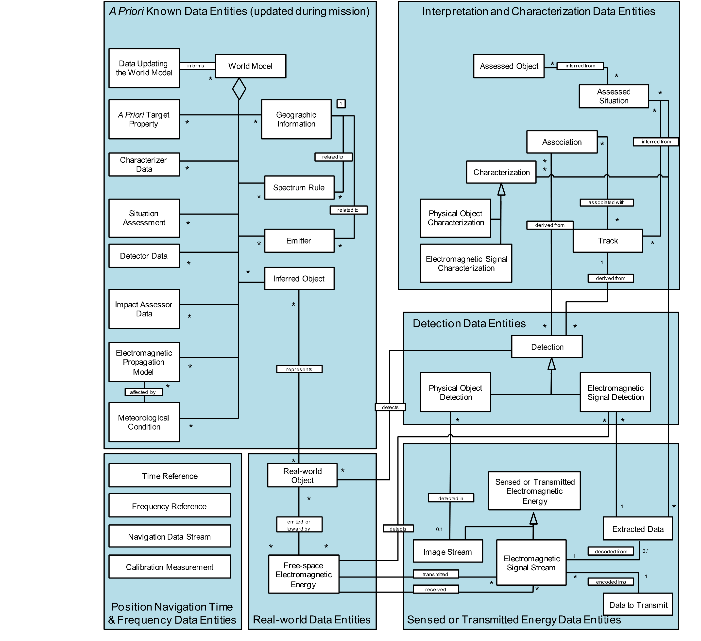

*Figure 12: DIV-1 for Mission Entities*

<!-- 原书 p.68 ｜ PDF p.88 -->

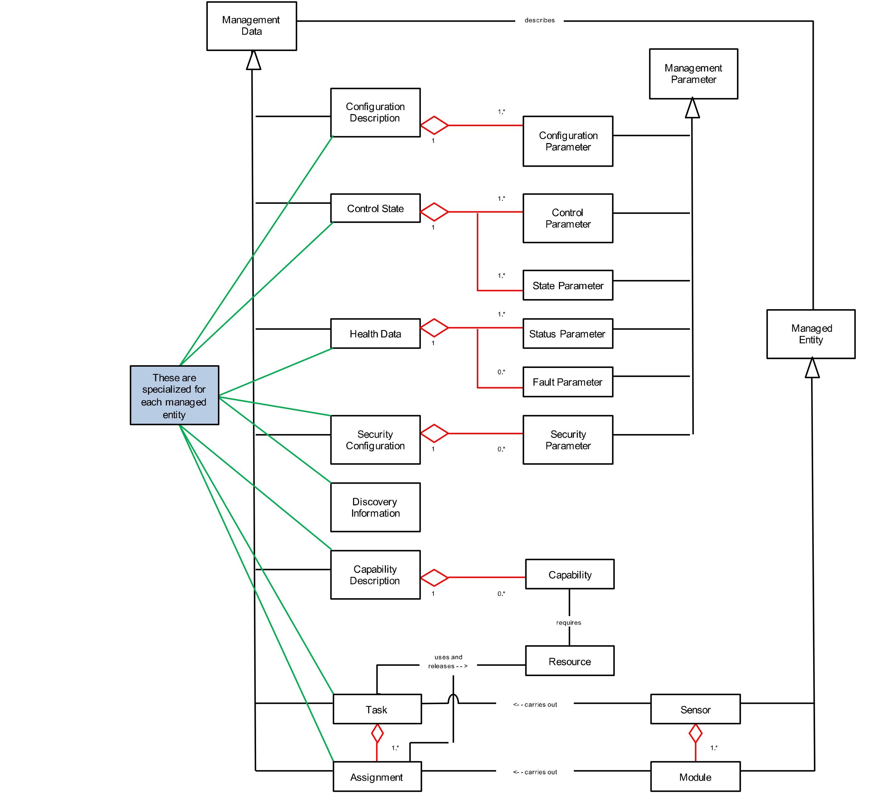

*Figure 13: DIV-1 for Management Entities*

##### 4.2.2 DIV-2: Logical Data Model

The SOSA DIV-2 (Logical Data Model) further decomposes the abstract entities in the DIV-1 into specific pieces of information (e.g., a track is broken down into its constituent parts, such as three dimensions of position, three dimensions of velocity, etc.). It is documented in a tabular form. It should be noted that the DIV-2 does not define the physical representation (e.g., number of digits, precision, etc.) so that the same data item can be represented differently depending on the need. The physical representation will be documented in the DIV-3 (still to be done for most of the SOSA data entities). To view DIV-2 and DIV-3 Distribution A spreadsheets, refer to files listed in Appendix D and Appendix E.

<!-- 原书 p.69 ｜ PDF p.89 -->

##### 4.2.3 DIV-3: Physical Data Model

#### 4.3 Service Architecture

4.3.1 SvcV-6: Services Resources Flow Matrix

Planned for a later version of the SOSA Technical Standard.

#### 4.4 System Architecture

##### 4.4.1 SV-2: Systems Resource Flow Description

Planned for a later version of the SOSA Technical Standard.

##### 4.4.2 SV-3: Systems-Systems Matrix

Planned for a later version of the SOSA Technical Standard.

#### 4.5 Box-Level Hardware

The hardware aspects of the SOSA Architecture are defined as a “box-level” specification applicable to a variety of sensor/avionics platforms that are modular all the way down to the plug-in card level (where a plug-in card as defined here is an individual card that fits into the box). The system is inherently interoperable, compatible with non-conformant SOSA hardware via a set of standard bridge interfaces, capable of plug-and-play, upgradable (evolvable), scalable, and scalable through adaptation of technology and target platform evolution (see Figure 14).

<!-- 原书 p.70 ｜ PDF p.90 -->

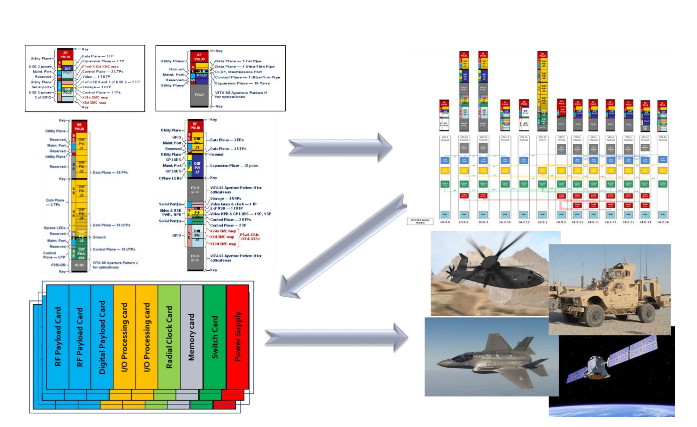

*Figure 14: SOSA Hardware Building Blocks*

<!-- 原书 p.71 ｜ PDF p.91 -->

## 5 SOSA Technical Standard

> 原书 p.72–172 ｜ PDF p.92–192

This Technical Standard provides testable rules and conformance testing approaches for each SOSA module and hardware element defined by the SOSA Architecture.

#### 5.1 Host Vehicle/SOSA Sensor Interface

##### 5.1.1 Sensor Physical Packages

###### 5.1.1.1 Pods

Requirements, written as rules in Export Administration Regulations (EARS).

##### 5.1.2 Mechanical Interfaces

For this version, the only standardized interface defined is for turreted sensors as defined in AS6169. Future versions will expand on these standards to include other sensor mounting schemes.

5.1.2.1 Classes of Turreted Sensors

Various turreted sensors are defined in Table 6 based on the diameter of a given sensor package. This document was developed to address the majority of sensor package sizes available on the market.

**Table 6: Turreted Sensor Classes**

| Class | Sensor Package Diameter |
|---|---|
| Class I | >19 in |
| Class II | 13 to 19 in |
| Class III | 9 to 13 in |
| Class IV | 6 to 9 in |

The SOSA electrical standard will describe sensor pin outs for Class I and Class II sensors at this time. Class III and Class IV sensors do not have the physical space available to accommodate all signals outlined in the standard. Future implementations of the standard could include a limited subset of the standard that applies to Class III and IV sensors.

<!-- 原书 p.72 ｜ PDF p.92 -->

#### 5.2 SOSA Sensor Physical Interfaces

##### 5.2.1 Electrical Connector Characteristics

There are ten signal types defined by this electrical standard. Table 7 describes the connector’s type and size as well as which sensor modalities can use which connector. J2 Signals are required for all modalities, but pin allocations may differ depending on mission. Connector genders are for each signal type are described below in Table 7. Detailed requirements for each connector type, defined separately for each modality of sensor, are defined in later sections. For Naval Aviation, only connectors which can withstand a minimum of 500 h salt spray per MIL-STD-1344 Method 1001: Test Method for Electrical Connectors shall be used.

**Table 7: Sensor Connectors**

|  | J1 DC Power | J2 Signal | J3 Video (Copper) | J4 Fiber Optic | J5 GPS Antenna | J6 Aux DC Power | J7 Aux DC Power | J8 High Density RF | J9 Low Loss RF | J10 AC Power |
|---|---|---|---|---|---|---|---|---|---|---|
| Modality Support | All | All | EO-IR, Comms | All | All | All | All | Radar/SAR, EW, SIGINT, Comms | Radar/SAR, EW, SIGINT, Comms | Radar/SAR, EW, SIGINT, Comms |
| Type | MIL-DTL-38999/Series III | MIL-DTL-38999/Series III | MIL-DTL-38999/Series III | MIL-DTL-38999/Series III | MIL-PRF-39012 | MIL-DTL-38999/Series III | TBD | MIL-DTL-38999/Series III | MIL-DTL-38999/Series III | MIL-DTL-38999/Series III |
| Shell Size | 21 | 25 | 17 | 19 | TNC | 21 | 17 | 25 | 25 | 17 |
| Sensor LRU Gender | Receptacle with pin inserts | Receptacle with socket inserts | Receptacle with socket inserts | Receptacle with socket inserts for fiber optics | Receptacle | Receptacle with pin inserts | Receptacle with pin inserts | Receptacle with socket inserts | Receptacle with socket inserts | Receptacle with pin inserts |
| Platform Umbilical Gender | Plug with socket inserts | Plug with pin inserts | Plug with pin inserts | Plug with pin inserts for fiber optics | Plug | Plug with socket inserts | Plug with socket inserts | Plug with pin inserts | Plug with pin inserts | Plug with socket inserts |
| Keying | N | N | N | N | - | A | N | N | N | N |
| Insert | 21-11 | 25-7 | 17-8 | 19-11 | - | 21-11 |  | 25-19 | 25-8 | 17-6 |

> 转写说明：表头竖向排版的多行单元格按原顺序拼为一行（如 `J8 High Density RF`）。格内因列宽折行的文字按原顺序合并为一行，未保留折行（如 `MIL-DTL-38999/Series III`、`Radar/SAR, EW, SIGINT, Comms`、`Receptacle with socket inserts for fiber optics`）。首列表头格在原表为空白格；J7 的 Insert 格在原表为空白（非短横）。

J8

- J3 J4 J5 J6 J7 High J9 J J2 Video Fiber GPS Aux DC Aux DC Density LOI Loss J10 DC Power Signal (Copper) Optic Antenna Power Power R RR AC Power Nodality All AIl EO- y AIl All AII AIl Radarl Radarl Radarl Support Comms SAR, ET SAR, EW SAR, EW_ SIGINI, SIGINT, SIGINT, Comms Comms Comms Type MI-DTL- MIL-DTL MILDTL MIL-DTL MIL-PRF MILDTL TBD MILDTL- MILDTL MILDTL 389991 389991 389991 389991 39012 389991 389991 389991 389991 Series III Series III Series III Series II Series II Series III Series II Series III Shell Size 21 25 17 19 TNC 21 17 25 25 17 Sensor LRU Receptacle Receptacle Receptacle Receptacle Receptacle Receptacle Receptacle Receptacle Receptacle Receptacle Gender With Pin With socket With socket With socket With Pin with Pin with socket With socket With Pin iserts inserts inserts iserts for inserts inserts inserts inserts inserts fiber optics Platform PlugWith PlugWith PlugWith Plugwith Plug PlugVith PlugVith PlugWith PlugWith PlugWith Umbilical socket pin inserts pin inserts pin inserts socket socket Pin inserts pin inserts socket Gender inserts for fiber inserts iserts inserts optics Keying N N N A N N N Insert 21-11 25-7 17-8 19-11 21-11 25-19 25-8 17-6

##### 5.2.2 J1-DC Power Connector

The J1 Power Connector shall have a 21-11 insert pattern as shown in Figure 15. Signals for the J1 Power Connector shall be assigned to pins in accordance with Table 8.

<!-- 原书 p.73 ｜ PDF p.93 -->

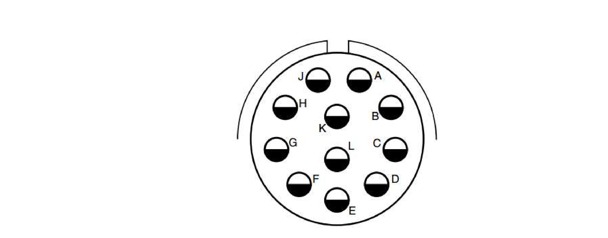

*Figure 15: J1 Power Connector Pin Arrangement*

**Table 8: J1 DC Power Connector Pin Allocation**

| J1-DC Power (21-11 insert, N-Keying) Sensor MIL-DTL-38999/M39029/58-365 (receptacle with pin inserts) Platform Umbilical MIL-DTL-38999/M39029/56-353 (plug with sockets inserts) |||||| EO-IR Turreted Sensor | Radar/SAR Turreted Sensor | EW Sensor | SIGINT Sensor | Comms |
|---|---|---|---|---|---|---|---|---|---|---|
| Conn/ Desc. | Pin | Wire Type | Signal Name | Signal Source | Signal Type | Used | Used | Used | Used | Used |
| | D | SC-AWG12 | DC-1 | Platform | 28V DC@15A | ✓ | ✓ | ✓ | ✓ | ✓ |
| | E | SC-AWG12 | DC-1 RTN | Platform | DC RTN | ✓ | ✓ | ✓ | ✓ | ✓ |
| | F | SC-AWG12 | DC-2 | Platform | 28V DC@15A | ✓ | ✓ | ✓ | ✓ | ✓ |
| | L | SC-AWG12 | DC-2 RTN | Platform | DC RTN | ✓ | ✓ | ✓ | ✓ | ✓ |
| | C | SC-AWG12 | DC-3 | Platform | 28V DC@15A | ✓ | ✓ | ✓ | ✓ | ✓ |
| | G | SC-AWG12 | DC-3 RTN | Platform | DC RTN | ✓ | ✓ | ✓ | ✓ | ✓ |
| | K | SC-AWG12 | Chassis | Platform | Ground | ✓ | ✓ | ✓ | ✓ | ✓ |
| | A | SC-AWG12 | DC-4/PWRL | Platform | 28V DC@15A | ✓ | ✓ | ✓ | ✓ | ✓ |
| | J | SC-AWG12 | DC-4/PWRL RTN | Platform | DC RTN | ✓ | ✓ | ✓ | ✓ | ✓ |

> 注：Contacts which are reserved, unused, or unallocated shall be populated by a dummy plug.

5.2.2.1 Power The platform shall provide to the sensor system four channels of 28 VDC power sources in accordance with MIL-STD-704F with the fourth channel reserved for laser power in EO/IR systems. Conformance Methodology: (TBD)

<!-- 原书 p.74 ｜ PDF p.94 -->

Each of the four channels of 28 VDC shall be independently controlled. Conformance Methodology: (TBD) The platform shall be capable of supplying 15 amps steady state per each 28 VDC channel. Inrush current shall be limited to 25 amps for 2s with a 25% duty cycle. Conformance Methodology: (TBD) The sensor shall isolate power returns or neutral in accordance with MIL-STD-704F from the chassis. Conformance Methodology: (TBD)

5.2.2.2 Safety Ground This contact shall be used to provide electrical continuity between the sensor system chassis and the host platform in accordance with MIL-STD-464. Conformance Methodology: (TBD)

5.2.2.3 Laser Power The platform shall provide 28 VDC power for the laser in accordance with MIL-STD-704F. Conformance Methodology: (TBD) The laser power contacts shall be used to separately power a laser device. This is intended for use with a safety-relevant device such as a laser designator. Conformance Methodology: (TBD) The platform shall be capable of supplying 15 amps steady state for laser power. Inrush current shall be limited to 25 amps for 2s with a 25% duty cycle. Conformance Methodology: (TBD)

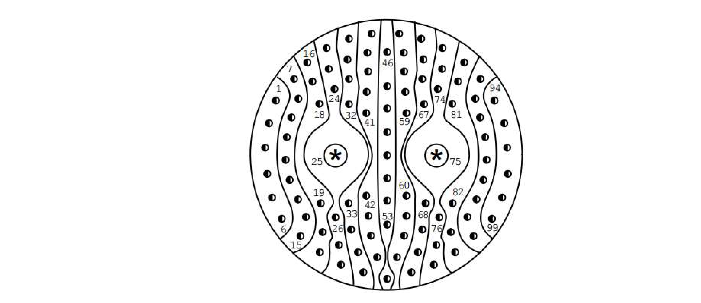

*Figure 16: J2 Signal Connector Pin Arrangement*

<!-- 原书 p.75 ｜ PDF p.95 -->

**Table 9: J2 Signals Connector Pin Allocation**

| SOSA Electrical Interface Recommendations J2-Signal (25-7 insert, N-Keying) Sensor MIL-DTL-38999/M39029/56-348 (receptacle with socket inserts) Platform Umbilical MIL-DTL-38999/M39029/58-360 (plug with pin inserts) |  |  |  |  |  | EO-IR Turreted Sensor | Radar/SAR Turreted Sensor | EW Sensor | SIGINT Sensor | Comms |
|---|---|---|---|---|---|---|---|---|---|---|
| Conn/ Desc. | Pin | Wire Type | Signal Name | Signal Source | Signal Type | Used | Used | Used | Used | Used |
| Power Enable Discrete | 46 | STP 2419 | PWR_EN | Platform | Open/Closed Ckt | ✓ | ✓ | ✓ | ✓ | ✓ |
|  | 47 | STP 2419 | PWR_EN_RTN | Platform | Open/Closed Ckt | ✓ | ✓ | ✓ | ✓ | ✓ |
| Ethernet | 28 | 100Ω STP-2419 | DA+ | Platform/Sensor | 1000BaseT | ✓ | ✓ | ✓ | ✓ | ✓ |
|  | 35 | 100Ω STP-2419 | DA- | Platform/Sensor | 1000BaseT | ✓ | ✓ | ✓ | ✓ | ✓ |
|  | 36 | Shield | DA Shield | Platform/Sensor |  | ✓ | ✓ | ✓ | ✓ | ✓ |
|  | 44 | 100Ω STP-2419 | DB+ | Platform/Sensor | 1000BaseT | ✓ | ✓ | ✓ | ✓ | ✓ |
|  | 53 | 100Ω STP-2419 | DB- | Platform/Sensor | 1000BaseT | ✓ | ✓ | ✓ | ✓ | ✓ |
|  | 62 | Shield | DB Shield | Platform/Sensor |  | ✓ | ✓ | ✓ | ✓ | ✓ |
|  | 45 | 100Ω STP-2419 | DC+ | Platform/Sensor | 1000BaseT | ✓ | ✓ | ✓ | ✓ | ✓ |
|  | 54 | 100Ω STP-2419 | DC- | Platform/Sensor | 1000BaseT | ✓ | ✓ | ✓ | ✓ | ✓ |
|  | 63 | Shield | DC Shield | Platform/Sensor |  | ✓ | ✓ | ✓ | ✓ | ✓ |
|  | 70 | 100Ω STP-2419 | DD+ | Platform/Sensor | 1000BaseT | ✓ | ✓ | ✓ | ✓ | ✓ |
|  | 71 | 100Ω STP-2419 | DD- | Platform/Sensor | 1000BaseT | ✓ | ✓ | ✓ | ✓ | ✓ |
|  | 78 | Shield | DD Shield | Platform/Sensor |  | ✓ | ✓ | ✓ | ✓ | ✓ |
| Serial Comms 1 | 7 | 100 Ohm STP 2419 | TX1+ | Sensor | RS422 | ✓ | ✓ | ✓ | ✓ | ✓ |
|  | 8 | 100 Ohm STP 2419 | TX1- | Sensor | RS422 | ✓ | ✓ | ✓ | ✓ | ✓ |
|  | 17 | SC-AWG24 | 422_1_RTN |  | RS422 | ✓ | ✓ | ✓ | ✓ | ✓ |
|  | 16 | 100 Ohm STP 2419 | RX1+ | Platform | RS422 | ✓ | ✓ | ✓ | ✓ | ✓ |
|  | 23 | 100 Ohm STP 2419 | RX1- | Platform | RS422 | ✓ | ✓ | ✓ | ✓ | ✓ |
| Serial Comms 2 | 22 | 100 Ohm STP 2419 | TX2+ | Sensor | RS422 | ✓ | ✓ | ✓ | ✓ | ✓ |
|  | 30 | 100 Ohm STP 2419 | TX2- | Sensor | RS422 | ✓ | ✓ | ✓ | ✓ | ✓ |
|  | 29 | SC-AWG24 | 422_2_RTN |  | RS422 | ✓ | ✓ | ✓ | ✓ | ✓ |
|  | 37 | 100 Ohm STP 2419 | RX2+ | Platform | RS422 | ✓ | ✓ | ✓ | ✓ | ✓ |
|  | 38 | 100 Ohm STP 2419 | RX2- | Platform | RS422 | ✓ | ✓ | ✓ | ✓ | ✓ |
| Serial Comms 3 | 55 | 100 Ohm STP 2419 | TX3+ | Sensor | RS422 | ✓ | ✓ | ✓ | ✓ | ✓ |
|  | 56 | 100 Ohm STP 2419 | TX3- | Sensor | RS422 | ✓ | ✓ | ✓ | ✓ | ✓ |
|  | 64 | SC-AWG24 | 422_1_RTN |  | RS422 | ✓ | ✓ | ✓ | ✓ | ✓ |
|  | 65 | 100 Ohm STP 2419 | RX3+ | Platform | RS422 | ✓ | ✓ | ✓ | ✓ | ✓ |
|  | 72 | 100 Ohm STP 2419 | RX3- | Platform | RS422 | ✓ | ✓ | ✓ | ✓ | ✓ |
| Serial Comms 4 | 73 | 100 Ohm STP 2419 | TX4+ | Sensor | RS422 | ✓ | ✓ | ✓ | ✓ | ✓ |
|  | 79 | 100 Ohm STP 2419 | TX4- | Sensor | RS422 | ✓ | ✓ | ✓ | ✓ | ✓ |
|  | 80 | SC-AWG24 | 422_1_RTN |  | RS422 | ✓ | ✓ | ✓ | ✓ | ✓ |
|  | 85 | 100 Ohm STP 2419 | RX4+ | Platform | RS422 | ✓ | ✓ | ✓ | ✓ | ✓ |
|  | 86 | 100 Ohm STP 2419 | RX4- | Platform | RS422 | ✓ | ✓ | ✓ | ✓ | ✓ |
| Emission Arming | 2 | AWG22 | MASTER_ARM | Platform | open/closed ckt | ✓ |  |  |  |  |
|  | 95 | AWG22 | MASTER_ARM_RET | Platform | open/closed ckt | ✓ |  |  |  |  |

> 转写说明：第 1 行横幅单元格在原表横跨 Conn/Desc.～Signal Type 共 6 列，本表只在其首格填写，其余 5 格留空。Conn/Desc. 列在原表按组纵向合并，本表只在合并组首行填写、其余行留空：Power Enable Discrete 合并 2 行（46、47）；Ethernet 合并 12 行（28、35、36、44、53、62、45、54、63、70、71、78）；Serial Comms 1 合并 5 行（7、8、17、16、23）；Serial Comms 2 合并 5 行（22、30、29、37、38）；Serial Comms 3 合并 5 行（55、56、64、65、72）；Serial Comms 4 合并 5 行（73、79、80、85、86）；Emission Arming 合并 2 行（2、95）。
>
> 转写说明：第 16、23 行位于续页，续页重复了横幅与表头；其 Conn/Desc. 格在原表即为空白（沿用上页 Serial Comms 1 的合并区）。格内因列宽折行的文字按原顺序合并为一行（如 `100Ω STP-2419`、`100 Ohm STP 2419`、`Platform/Sensor`、`Emission Arming`、`MASTER_ARM`）。

Power 46 STP 2419 PWR EN Platform Open/Closed Ckt

Enable

Discrete

41 STP 2419 PWR EN RTN Platform Open/Closed Ckt

Ethernet 28 1000 STP DA+ Platforml 1000Baser 2419 Sensor 35 1000 STP DA- Platforml 100OBaseT 2419 Sensor 36 Shield DA Shield Platforml Sensor 44 1008 STP DB+ Platform/ 1000Baser 2419 Sensor 53 1000 STP DB- Platform/ 100OBaseT 2419 Sensor Shield DB Shield Platforml Sensor 45 1000 STP DC+ Platform/ 1000Baser 2419 Sensor 54 1000 STP- DC Platforml 10OOBaseT 2419 Sensor 63 Shield DC Shield Platforml Sensor 70 1000 STP. DD+ Platforml I000Baser 2419 Sensor 1000 STP DD Platform/ 1000Baser 2419 Sensor 78 Shield DD Shield Platformml Sensor Serial 100 Ohm STP TX1+ Sensor RS422 Comms 2419

100 Ohm STP TX1 Sensor R8422

17 SC-AWG24 422 1 RTN R8422

<!-- 原书 p.76 ｜ PDF p.96 -->

16 100 Ohm STP RXI+ Platform RS422

23 100 Ohm STP RXI - Platform RS422

Serial 22 100 Ohm STP TX2+ Sensor R8422 Comms 2419

30 100 Ohm STP TX2- Sensor RS422

29 SC-AWG24 422_2 RTN R8422 37 100 Ohm STP RX2t Platform R8422

38 100 Ohm STP RX2- Platform R8422

Serial 55 100 Ohm STP TX3+ Sensor RS422 Comms 2419

56 100 Ohm STP TX3- Sensor RS422

64 SC-AWG24 422_1_RTN RS422 65 100 Ohm STP RX3+ Platform R8422

72 100 Ohm STP RX3 - Platform RS422

Serial 73 100 Ohm STP TX4+ Sensor RS422 Comms 2419

79 100 Ohm STP TX4- Sensor R8422

80 SC-ATG24 422_1_ RTN RS422 85 100 Ohm STP RX4+ Platform RS422

86 100 Ohm STP RX4- Platform R8422

Emi- AWG22 MASTER AR Platform openlclosed ckt SSion M

Arming

95 AWG22 MASTER AR Platform openlclosed ckt

### M REI

<!-- 原书 p.77 ｜ PDF p.97 -->

SOSA Electrical Interface Recommendations

Jz-Signal (25-7 insert, N-Keying)

- E0-I_ Radar/SAR Sensor MIL-DTL-38999/439029/56-348 (receptacle with socket inserts) Turreted Turreted EW SIGINT Platform Umbilical MIL-DTL-38999/039029/58-360 (plug with pin inserts) Sensor Sensor Sensor Sensor Comms Desc:Connl Pin Wire Type Signal Name SignalSource Signal Type Used Used Used Used Used

<!-- 原书 p.78 ｜ PDF p.98 -->

S0SA Electrical Interface Recommendations

Jz-Signal (25-7 insert, N-Keying)

- E0-I_ Radar/SAR Sensor MIL-DTL-38999/439029/56-348 (receptacle with socket inserts) Turreted Turreted EW SIGINT Platform Umbilical MIL-DTL-38999/039029/58-360 (plug with pin inserts) Sensor Sensor Sensor Sensor Comms

Desc:Connl Pin Wire Type Signal Name SignalSource Signal Type Used Used Used Used Used

<!-- 原书 p.79 ｜ PDF p.99 -->

SOSA Electrical Interface Recommendations

Jz-Signal (25-7 insert, N-Keying)

- E0-I_ Radar/SAR Sensor MIL-DTL-38999/439029/56-348 (receptacle with socket inserts) Turreted Turreted EW SIGINT Platform Umbilical MIL-DTL-38999/039029/58-360 (plug with pin inserts) Sensor Sensor Sensor Sensor Comms

Desc:Connl Pin Wire Type Signal Name SignalSource Signal Type Used Used Used Used Used

LVDSI 26 100 Ohm STP

LVDS2 18 100 Ohm STP

LVDS3 50 100 Ohm STP

LVDS4 83 100 Ohm STP

LVDSS 92 100 Ohm STP

Sensor 24,31 ATG24 SENMAN to Sensor Manu- 32,39 SENMAN_IO facturer 40,57 58,66 67,74 Res- 1,3,9, For arming erved 10,87 isolation

88,94

Unused 81,91

NOTE 1

- All reserved, unused, unallocated should be populated by a dummy plug. Digital data channels are to be tested for Return Loss and Near End Cross Talk (NEXT), including the connector interfaces to ensure conformance to protocol requirements. This should be applied to the Ethernet pairs, the Serial Comms 1-4 (RS422) pairs, as well as the LVDS (1-5) pairs.

- Each signal group in Table 9 is described in more detail below. By convention of this standard, individual signal sets will have their own return line. This is done for Electromagnetic Compatibility (EMC) performance, as well as ease of platform integration.

- For logic levels, unless otherwise specified, “low” is defined to be safe. A voltage of greater than or equal to 18.0 VDC shall be interpreted as logic level ‘1’. A voltage level of less than or equal to 1.5 VDC shall be interpreted as logic ‘0’.

<!-- 原书 p.80 ｜ PDF p.100 -->

NOTE 2

Some acquisition programs may allow higher voltage levels to also be interpreted as logic '0'. A typical impetus for this would be the result of a system safety analysis. In such a case, it is recommended that the logic '0' threshold not exceed 15.0 VDC.

5.2.3.1 Power Enable

The Power Enable signal is used for a controlled power up and shutdown of the sensor system. This control is necessary if the sensor system is required to execute a sequence of steps upon shutdown, steps that the sensor system would be precluded from executing if power were simply removed from the system. The Power Enable signal is controlled by the platform and when disabled, instructs the sensor to power down.

Power Enable is a switch, relay, or Solid State Relay (SSR) controlled by the platform (or human on the platform side of the interface). The switch goes across PWR_EN and PWR_EN_RTN. The sensor provides the voltage for this. Power Enable is disabled if an open circuit exists externally between the contacts (i.e., the switch is open). Power Enable is enabled if a closed circuit is externally applied between the contacts.

An open circuit for Power Enable shall have a resistance value greater than or equal to 100k Ω. A closed circuit for Power Enable shall have a resistance value less than 5 Ω. The maximum current shall be 100 mA. The maximum voltage shall be 30 VDC. Conformance Methodology: (TBD)

###### 5.2.3.2 Ethernet Databus (Copper)

Gigabit Ethernet is an 8-wire (4 twisted-pair), 100 Ω connection.

The J2 Ethernet databus shall be implemented as Gigabit Ethernet. Conformance Methodology: (TBD)

Gigabit Ethernet shall comply with IEEE 802.3-2008 for a 1000BaseT channel. The maximum cable length is 100 meters. Conformance Methodology: (TBD)

5.2.3.3 Serial Communications

Up to four application-configurable serial communication ports are defined. Each port shall be compliant to TIA-422/RS422. It is expected that the first port will be used for a hand controller. It is expected that the latency of communication on this interface is critical, thus a more complex multi-layer protocol interface would not be practical.

These interfaces can also be used for integration with other equipment, such as moving map cueing and display systems.

Note that a separate return line is included with each serial communications port for ease of platform integration.

5.2.3.4 Arming and Cutouts

A set of ten pins is dedicated to control of energy emitting sensors such as the arming of laser devices, or RF transmission devices. This includes the selection of predefined laser suppression zone maps.

<!-- 原书 p.81 ｜ PDF p.101 -->

MASTER_ARM and MASTER_ARM_RTN are a pair of pins across a switch, relay, or SSR. In order to arm the emission device, the platform closes the switch which completes the circuit. The current which goes through it, and the voltage across it, come from the sensor. The sensor doesn’t generate its own voltage; it comes in from the platform via the power connector (this is the 28 VDC Laser Power). The platform shall provide a switch, relay, or SSR capable of handling 30 VDC with a maximum of 100mA current.

There are three No Emit Zone (NEZ) circuits. Each is a switch, relay, or SSR provided by, and independently controlled by, the platform. The three circuits have a common return (NEZ _SELECT_RTN). The platform shall provide a switch, relay, or SSR capable of handling 30 VDC for each of the three NEZ circuits. The platform shall be capable of independently controlling each of the three NEZ circuits.

There are three mode select signals using 28 VDC logic which are independently controlled by the platform. The three signals have a common return: MODE_SELECT_RTN.

SIMPLE ARMING – these pins form part of the power circuit for an emission device in the turret When the pins are open, power to the device is disabled; when close-circuited, power is enabled. The pins allow the integrator to connect a simple arming switch to these contacts. Pins 2 and 95 shall be used for Simple Arming.

ADVANCED ARMING CLUSTER 1 – sensor systems can have a NEZ, or Cutout Map The NEZ is a two-dimensional map, in azimuth and elevation, that defines where the device can and cannot emit. It is designed to inhibit emissions when the turret’s line-ofsight is over any part of the platform. This prevents energy from reflecting back, posing a hazard. The map is stored in the turret’s computer memory. Further, a turret may have several maps stored, enabling it to be mounted at several points on the platform, or on several platform models, without modification. In this case, a high-reliability mechanism is needed to select which map should be used. Pins 4, 5, 11, and 12 shall be used for Advanced Arming Cluster 1. Assuming that three of the four pins allocated to this function are used to select a map, up to four maps can be defined in the turret. The fourth pin would be used as a parity check for safety.

LASER ADVANCED ARMING CLUSTER 2 – these pins can be used in a number of ways They determine under what conditions or states the device will be used. For example, if there are multiple non-eyesafe lasers in a turret, these pins could be used to select one or more devices (secondary arm control). Pins 89, 90, 97, and 98 shall be used for advanced arming Cluster 2.

5.2.3.5 Emissions Annunciation

The Emission signal shall be used to annunciate the firing of an emission device. Conformance

Methodology: (TBD)

This signal shall be a 28 VDC isolated signal. Conformance Methodology: (TBD)

The maximum voltage shall be 30 VDC with a maximum current of 100mA. Conformance

Methodology: (TBD)

<!-- 原书 p.82 ｜ PDF p.102 -->

###### 5.2.3.6 Safety Status

A set of three signal pairs is available to indicate the status of safety-relevant functions in the sensor system. These shall be 28 VDC isolated signals. These signals are controlled by the sensor. Conformance Methodology: (TBD) The maximum voltage shall be 30 VDC with a maximum current of 100mA. Conformance

Methodology: (TBD)

5.2.3.7 Enable Gimbal Movement

The Enable Gimbal Movement signal shall be used to indicate that the sensor system’s outer gimbal motors are to be enabled. Conformance Methodology: (TBD) This control is necessary to ensure that the turret does not move in azimuth and/or elevation at high speeds endangering individuals that may be working in close proximity to the sensor. The Enable Gimbal Movement signal originates from the sensor with the platform opening and closing the circuit. An open circuit shall indicate that the motors shall not be powered. Conformance Methodology: (TBD)

###### 5.2.3.8 Time Synchronization – 1 PPS

Wiring for a 1 PPS signal for time synchronization shall be provided. Conformance Methodology: (TBD) This signal shall be in accordance with the input time roll-over pulse (1 PPS) per ICD-GPS-

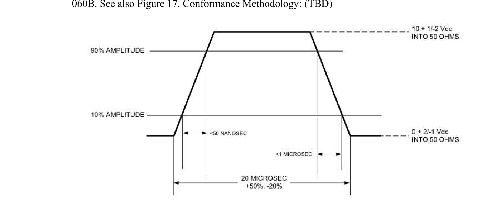

*Figure 17: Input Time Rollover Pulse (1 PPS) Signal Characteristics*

5.2.3.9 Hand Controller Power

Power may be provided by the sensor to the hand controller. The maximum voltage shall be 30 VDC with a maximum current of 500mA. Conformance Methodology: (TBD)

<!-- 原书 p.83 ｜ PDF p.103 -->

5.2.3.10 Memory Purge

A switch closure between PURG_MEM_+ and PURG_MEM_- for 30 msec or more shall cause a memory to erase. Conformance Methodology: (TBD) The intention is for this to be routed to an encrypted drive for the clearing of mission data. Usage of this interface is implementation-specific and could be used to clear any memory that may be sensitive.

5.2.3.11 MIL-STD 1553B Twinax Inserts

A set of two Size 8 Twinaxial contacts are available for MIL-STD-1553B. Pin 25 is intended for Bus A and pin 75 for Bus B.

5.2.3.12 USB Data Planned for a later version of the SOSA Technical Standard. A USB 2.0 interface shall optionally be provided by the sensor. Conformance Methodology: (TBD)

5.2.3.13 USB Power 5V +/- 5% up to 500mA shall be supplied by the sensor. Conformance Methodology: (TBD)

5.2.3.14 LVDS These Low Voltage Differential Signal (LVDS) discrete signals are available to the sensor manufacturers for use between sensor elements.

5.2.3.15 Sensor Manufacturer Pins A set of 10 pins are reserved for use by individual sensor system suppliers, primarily for maintenance purposes when the sensor is not connected to the platform. The platform shall not populate these pins. Conformance Methodology: (TBD)

5.2.4 J3-Video (Copper) Connector The J3 Video Connector shall have a 21-11 pin arrangement as shown in Figure 18. Conformance Methodology: (TBD) Signals for the J3 Video Connector shall be assigned to pins in accordance with Table 10. Conformance Methodology: (TBD)

<!-- 原书 p.84 ｜ PDF p.104 -->

*Figure 18: J3 Video Connector Pin Arrangement*

**Table 10: J3 Video Connector Pin Allocation**

| J3-Video (21-11 insert, N-Keying) Sensor: MIL-DTL-38999/M39029/75-416 (receptacle with socket inserts) Platform Umbilical: MIL-DTL-38999/M39029/28-211 (plug with pin inserts) |  |  |  |  | EO-IR Turreted Sensor | Radar/SAR Turreted Sensor | EW Sensor | SIGINT Sensor | Comms |  |
|---|---|---|---|---|---|---|---|---|---|---|
| Pin | Wire Type | Signal Name | Signal Source | Signal Type | Used | Used | Used | Used | Used | Notes |
| A | Coax-75Ω | Digital Video Ch1 | Sensor | SMPTE 292/424 | ✓ |  |  |  | ✓ | For input from EO/IR sensor |
| B | Coax-75Ω | Digital Video Ch2 | Sensor | SMPTE 292/424 | ✓ |  |  |  | ✓ | For input from EO/IR sensor |
| C | Coax-75Ω | Digital Video Ch3 | Sensor | SMPTE 292/424 | ✓ |  |  |  | ✓ | For input from EO/IR sensor |
| D | Coax-75Ω | Digital Video Ch4 | Sensor | SMPTE 292/424 | ✓ |  |  |  | ✓ | For input from EO/IR sensor |
| E | Coax-75Ω | Analog video Ch1 Y | Sensor | RS-170a Video Luminance | ✓ |  |  |  | ✓ | For input from EO/IR sensor |
| F | Coax-75Ω | Analog video Ch1 C | Sensor | RS-170a Video Chrominance | ✓ |  |  |  | ✓ | For input from EO/IR sensor |
| G | Coax-75Ω | Composite Video Ch 1 | Sensor | RS-170a Composite Video | ✓ |  |  |  | ✓ | For input from EO/IR sensor |
| H | Coax-75Ω | Composite Video Ch 2 | Sensor | RS-170a Composite Video | ✓ |  |  |  | ✓ | For input from EO/IR sensor |
| J | Unused |  |  |  |  |  |  |  |  |  |
| K | Unused |  |  |  |  |  |  |  |  |  |
| L | Unused |  |  |  |  |  |  |  |  |  |

> 转写说明：第 1 行横幅单元格在原表横跨 Pin～Signal Type 共 5 列，本表只在其首格填写，其余 4 格留空；同行的 `Comms` 单元格在原表同时压住 Comms 与 Notes 两列（第 2 行的 `Used` 与 `Notes` 才分列），故第 1 行末格留空。第 8～12 行（H、J、K、L）位于续页，续页重复了横幅与表头。格内因列宽折行的文字按原顺序合并为一行（如 `Coax-75Ω`、`Digital Video Ch1`、`For input from EO/IR sensor`）。

Pin TypeWire Signal Name Signal Source Signal Type Used Used Used Used Used Notes

Coax- Digital Video Sensor SMPTE 292/424 For input 750 Chl from

EOIIR

SenSOr

B Coax- Digital Video Sensor SMPTE 292/424 For input 750 Ch2 from

EOIJ

Sensor

Coax- Digital Video Sensor SMPIE 292/424 For input 750 Ch3 from

EO/

Sensor

Coax- Digital Video Sensor SMPIE 292/424 For input 750 Ch4 froln

EO/J

Sensor

Coax- AnalogVideo Sensor RS-170a Video For input 750 Chl Y Luminance from

EO/IR

SensOr

Coax- Analog video Sensor RS-170a Video For input 750 Chl C Chrominance from

EO/IR

Sensor

Coax- Composite Sensor RS-170a For input 750 Video Ch 1 Composite Video from

EO/J

Sensor

<!-- 原书 p.85 ｜ PDF p.105 -->

J3-Video (21-11 insert, N-Keying) Sensor: MIL DTL-38999/039029/75-416 (receptacle with socket inserts)

- R0-1 Radar/SAR Platform Umbilical: MIL-DTL-38999/039029/28-211 (plug with pin Turreted Turreted EW SIGINT inserts) Sensor Sensor Sensor Sensor Comms

Pin TypeWire Signal Name Signal Source Signal Type Used Used Used Used Used Notes

H Coax- Composite Sensor RS-l70a For input 750 Video Ch 2 Composite Video from

EO/JR

Sensor

Unused

K Unused

[ Unused Each digital channel shall comply with SMPTE 292, driving into 75 Ω #12 coax contacts, per the standard. Video channels can also be SMPTE 424M over the same wiring. Conformance Methodology: (TBD) Each analog channel shall comply with RS170a, driving into 75 Ω #12 coax contacts, per the standard. Conformance Methodology: (TBD)

5.2.5 J4-Fiber Optics Connector Fiber optic shall be multi-mode fiber. The core diameter shall be 50µm ± 3µm and the cladding diameter shall be 125µm ± 2µm. Conformance Methodology: (TBD) The termini shall be butt end MIL-PRF-29504/4 (Pin) or MIL-PRF-29504/5 (Socket) which fit into size 16 entry holes. Conformance Methodology: (TBD) Ethernet Channels shall transmit and receive at 850nm per IEEE 802.3-2008 for 10GBASE-SR applications. Conformance Methodology: (TBD) SMPTE 297 Channels shall transmit low power SMPTE 292 or 424M signals at 1310nm specifically according to call out L-PC-CD-1310. Conformance Methodology: (TBD) Fiber used shall be OM2-compliant or better, as defined by ISO/IEC 11801. It is recommended that for longer path applications the cable be bend-insensitive OM4. Conformance Methodology: (TBD) The J4 Fiber Optic Connector shall have a 19-11 pin arrangement as shown in Figure 19. Conformance Methodology: (TBD) Signals for the J4 Fiber Optic Connector shall be assigned to pins in accordance with Table 11. Conformance Methodology: (TBD)

<!-- 原书 p.86 ｜ PDF p.106 -->

*Figure 19: J4 Fiber Optic Connector Pin Arrangement*

**Table 11: J4 Fiber Optic Connector Pin Allocation**

| SOSA Electrical Interface Recommendations J4-Fiber (19-11 insert, N-Keying) Sensor MIL-DTL-38999/29504/5 (receptacle with socket inserts) Platform Umbilical MIL-DTL-38999/29504/4 (plug with pin inserts) |  |  |  |  | EO-IR Turreted Sensor | Radar/SAR Turreted Sensor | EW Sensor | SIGINT Sensor | Comms |
|---|---|---|---|---|---|---|---|---|---|
| Pin | Wire Type | Signal Name | Signal Source | Signal Type | Used | Used | Used | Used | Used |
| A | MM Fiber | Sensor Transmit 1 | Sensor | 10GBase-SR/40GBase-SR4/100GBase-SR4 | ✓ | ✓ | ✓ | ✓ | ✓ |
| B | MM Fiber | Sensor Receive 1 | Platform | 10GBase-SR/40GBase-SR4/100GBase-SR4 | ✓ | ✓ | ✓ | ✓ | ✓ |
| C | MM Fiber | Sensor Transmit 2 | Sensor | 10GBase-SR/40GBase-SR4/100GBase-SR4 | ✓ | ✓ | ✓ | ✓ | ✓ |
| D | MM Fiber | Sensor Receive 2 | Platform | 10GBase-SR/40GBase-SR4/100GBase-SR4 | ✓ | ✓ | ✓ | ✓ | ✓ |
| E | MM Fiber | Sensor Transmit 3 | Sensor | 10GBase-SR/40GBase-SR4/100GBase-SR4 | ✓ | ✓ | ✓ | ✓ | ✓ |
| F | MM Fiber | Sensor Receive 3 | Platform | 10GBase-SR/40GBase-SR4/100GBase-SR4 | ✓ | ✓ | ✓ | ✓ | ✓ |
| G | MM Fiber | Sensor Transmit 4 | Sensor | 10GBase-SR/40GBase-SR4/100GBase-SR4 | ✓ | ✓ | ✓ | ✓ | ✓ |
| H | MM Fiber | Sensor Receive 4 | Platform | 10GBase-SR/40GBase-SR4/100GBase-SR4 | ✓ | ✓ | ✓ | ✓ | ✓ |
| J | MM Fiber | Video Ch 1 | Sensor | SMPTE 297 | ✓ |  |  |  |  |
| K | MM Fiber | Video Ch 2 | Sensor | SMPTE 297 | ✓ |  |  |  |  |
| L | MM Fiber | Video Ch 3 | Sensor | SMPTE 297 | ✓ |  |  |  |  |

> 转写说明：第 1 行横幅单元格在原表横跨 Pin～Signal Type 共 5 列，本表只在其首格填写，其余 4 格留空。第 10～11 行（K、L）位于续页，续页重复了横幅与表头。格内因列宽折行的文字按原顺序合并为一行（如 `MM Fiber`、`Sensor Receive 1`、`10GBase-SR/40GBase-SR4/100GBase-SR4`）。

Wire

Pin Type Signal Name Signal Source Signal Type Used Used Used Used Used

MM Sensor Sensor I0GBase-SR/ Fiber Transmit L 40GBase-SR4/

I00GBase-SR4

MM Sensor Receive Platform I0GBase-SR/ Fiber 1 40GBase-SR4/ 100GBase-SR4

MM Sensor Sensor IOGBase-SR/ Fiber Transmit 2 40GBase-SR4/ 100GBase-SR4

MM Sensor Receive Platform I0GBase-SR/ Fiber 2 40GBase-SR4/

I0OGBase-SR4

MM Sensor Sensor IOGBase-SR/ Fiber Transmit 3 40GBase-SR4/

I0OGBase-SR4

MM Sensor Receive Platform I0GBase-SR/ Fiber 3 40GBase-SR4/ 100GBase-SR4

MM Sensor Sensor I0GBase-SR/ Fiber Transmit 4 40GBase-SR4/

I0OGBase-SR4

MM Sensor Receive Platform I0GBase-SR/ Fiber 40GBase-SR4/ 100GBase-SR4

MM Video Ch Sensor SMPTE 297

Fiber

<!-- 原书 p.87 ｜ PDF p.107 -->

S0SA Electrical Interface Recommendations

J4-Riber (19-11 insert N-Keying)

- E0-I RadarlSAR Sensor MIL-DTL-38999/29504/5 (receptacle with socket inserts) Turreted Turreted EW SIGINT Platform Umbilical MIL-DTL-38999/29504/4 (plug with pin inserts) Sensor Sensor Sensor Sensor Comms Wire Pin Type Signal Name Signal Source SignalType Used Used Used Used Used k MM Video Ch 2 Sensor SMPIE 297 Fiber MM Video Ch 3 Sensor SMPTE 297

Fiber

##### 5.2.6 J5-GPS Antenna Connector

- When a GPS receiver internal to the sensor is being used and requires an external antenna, the J5 connector shall be used. Conformance Methodology: (TBD) These signals shall have characteristics that comply with AS6129 Appendix A (Additional Interface Requirements for GPS RF Signals). Conformance Methodology: (TBD) The J5 GPS Connector shall use TNC connectors. Conformance Methodology: (TBD)

**Table 12: J5 GPS Connector Pin Allocation**

| SOSA Electrical Interface Recommendations J5-GPS Ant (TNC) Sensor – Receptacle Platform Umbilical – Plug |  |  |  |  | EO-IR Turreted Sensor | Radar/SAR Turreted Sensor | EW Sensor | SIGINT Sensor | Comms |
|---|---|---|---|---|---|---|---|---|---|
| Pin | Wire Type | Signal Name | Signal Source | Signal Type | Used | Used | Used | Used | Used |
| Coaxial | Coax-50Ω | GPS Antenna | Platform | RF | ✓ | ✓ | ✓ | ✓ | ✓ |

> 转写说明：第 1 行横幅单元格在原表横跨 Pin～Signal Type 共 5 列，本表只在其首格填写，其余 4 格留空。横幅第 3、4 行中的横线为原表的短破折号（`–`）。格内因列宽折行的文字按原顺序合并为一行（如 `Coax-50Ω`）。

##### 5.2.7 J6-DC Auxiliary Power Connector

- The J6 Auxiliary DC Power Connector shall have a 21-11 insert pattern as shown in Figure 20. Conformance Methodology: (TBD) Signals for the J6 Auxiliary DC Power Connector shall be assigned to pins in accordance with

**Table 13: Conformance Methodology: (TBD)**

| SOSA Electrical Interface Recommendations Sensor MIL-DTL-38999/M39029/58-365 (receptacle with pin inserts) Platform Umbilical MIL-DTL-38999/M39029/56-353 (plug with sockets inserts) |  |  |  |  |  | EO-IR Turreted Sensor | Radar/SAR Turreted Sensor | EW Sensor | SIGINT Sensor | Comms |
|---|---|---|---|---|---|---|---|---|---|---|
| Conn/ Desc. | Pin | Wire Type | Signal Name | Signal Source | Signal Type | Used | Used | Used | Used | Used |
|  | D | SC-AWG12 | DC-5 | Platform | 28V DC@15A | ✓ | ✓ | ✓ | ✓ | ✓ |
|  | E | SC-AWG12 | DC-5 RTN | Platform | DC RTN | ✓ | ✓ | ✓ | ✓ | ✓ |
|  | F | SC-AWG12 | DC-6 | Platform | 28V DC@15A | ✓ | ✓ | ✓ | ✓ | ✓ |
|  | L | SC-AWG12 | DC-6 RTN | Platform | DC RTN | ✓ | ✓ | ✓ | ✓ | ✓ |
|  | C | SC-AWG12 | DC-7 | Platform | 28V DC@15A | ✓ | ✓ | ✓ | ✓ | ✓ |
|  | G | SC-AWG12 | DC-7 RTN | Platform | DC RTN | ✓ | ✓ | ✓ | ✓ | ✓ |
|  | K | SC-AWG12 | Chassis | Platform | Ground | ✓ | ✓ | ✓ | ✓ | ✓ |
|  | A | SC-AWG12 | DC-8 | Platform | 28V DC@15A | ✓ | ✓ | ✓ | ✓ | ✓ |
|  | J | SC-AWG12 | DC-8 RTN | Platform | DC RTN | ✓ | ✓ | ✓ | ✓ | ✓ |
|  | B | SC-AWG12 | DC-9 | Platform | 28V DC@15A | ✓ | ✓ | ✓ | ✓ | ✓ |
|  | H | SC-AWG12 | DC-9 RTN | Platform | DC RTN | ✓ | ✓ | ✓ | ✓ | ✓ |

> 转写说明：第 1 行横幅单元格在原表横跨 Conn/Desc.～Signal Type 共 6 列，本表只在其首格填写，其余 5 格留空。Conn/Desc. 列的原表各行均为空白单元格（未合并、未填内容），本表按空白照录。

<!-- 原书 p.88 ｜ PDF p.108 -->

*Figure 20: J6 Auxiliary Power Connector Pin Arrangement*

SC-AWGI2 DC 5 Platform 28VDC@ISA [ SC-AWG12 DC-5 RTN Platform DC RTN - SC-AWGI2 DC-6 Platform 28VDC@ISA SC-AWG12 DC-6 RTN Platform DC RTN SC-AWGI2 DC 7 Platformm 28VDC@ISA SC-AWGI2 DC-7 RTN Platform DC RTN k SC-AWGI2 Chassis Platformm Ground SC-AWGI12 DC 8 Platform 28VDC@ISA SC-AWGI2 DC-8 RTN Platform DC RTN B SC-AWG12 DC-9 Platform 28VDC@ISA S SC-AWGI2 DC-9 RTN Platform DC RTN

5.2.7.1 Power

- The platform shall provide to the sensor system up to five channels of 28 VDC power sources in accordance with MIL-STD-704F. Conformance Methodology: (TBD) Each of the five channels of 28 VDC shall be independently controlled. Conformance

Methodology: (TBD)

<!-- 原书 p.89 ｜ PDF p.109 -->

The platform shall be capable of supplying 15 amps steady state per each 28 VDC channel. Conformance Methodology: (TBD) Inrush current shall be limited to 25 amps for 2s with a 25% duty cycle. Conformance Methodology: (TBD) The sensor shall isolate power returns or neutral in accordance with MIL-STD-704F from the chassis. Conformance Methodology: (TBD)

###### 5.2.7.2 Safety Ground

This contact shall be used to provide electrical continuity between the sensor system chassis and the host platform in accordance with MIL-STD-464. Conformance Methodology: (TBD)

##### 5.2.8 J7-High Speed Connector

The J7 High Speed Connector is currently being defined to support high-speed electrical interfaces such as 10Gig Ethernet, USB 3.0, and DisplayPort. Details will be added in a future version. Planned for a later version of the SOSA Technical Standard.

**Table 14: J7 Pin Allocations**

| SOSA Electrical Interface Recommendations J7-High Speed Electrical Sensor XXXXXXXXXXXXx (receptacle with pin inserts) Platform Umbilical XXXXXXXXXXXX (plug with sockets inserts) | | | | | | EO-IR Turreted Sensor | Radar/SAR Turreted Sensor | EW Sensor | SIGINT Sensor | Comms |
|---|---|---|---|---|---|---|---|---|---|---|
| Conn/ Desc. | Pin | Wire Type | Signal Name | Signal Source | Signal Type | Used | Used | Used | Used | Used |
| TBD | | | | | | | | | | |

> 转写说明：原表表头为两行——第一行左起 6 列（Conn/ Desc.~Signal Type 上方）是一个**跨 6 列的合并单元格**（灰色块），其文字照录于第 1 格，被其覆盖的其余 5 格留空；第 7~11 列第一行为传感器名、第二行为 “Used”，此处分列为表头行与紧跟的一行（即原表头第二行），不另设分隔线。
>
> 表体仅 1 行：第 1 格作 “TBD”，其余 10 格原为空。本表在 p.90 内完整，未跨页。
>
> 占位符逐字计数：第 3 行为 “Sensor” ＋ 12 个大写 X ＋ 1 个小写 x（合计 13 个 X 字形，末位原书即作小写）；第 5 行为 “Platform Umbilical” ＋ 12 个大写 X（第 6 行 “(plug with sockets inserts)” 中的 “sockets” 原书为复数，照录）。

TBD

###### 5.2.8.1 Description

Planned for a later version of the SOSA Technical Standard.

##### 5.2.9 J8-High Density RF Connector

The J8 RF Connector shall have a 25-19 insert pattern as shown in Figure 21. Conformance Methodology: (TBD) Signals for the J8 RF Connector shall be assigned to pins in accordance with Table 15. Conformance Methodology: (TBD)

<!-- 原书 p.90 ｜ PDF p.110 -->

*Figure 21: J8 RF Connector Pin Arrangement*

**Table 15: J8 RF Pin Allocations**

| SOSA Electrical Interface Recommendations J8-RF (25-19 insert, N-Keying) Antenna MIL-DTL-38999/20FJ19SN (receptacle with socket inserts) Platform Umbilical MIL-DTL-38999/26FJ19PN (plug with pin inserts) | | | | | | EO-IR Turreted Sensor | Radar/SAR Turreted Sensor | EW Sensor | SIGINT Sensor | Comms |
|---|---|---|---|---|---|---|---|---|---|---|
| Conn/ Desc. | Pin | Wire Type | Signal Name | Signal Source | Signal Type | Used | Used | Used | Used | Used |
| RF | A | Coax-50Ω | Ch1 | Antenna | RF up to 18Ghz | | ✓ | ✓ | ✓ | ✓ |
| | B | Coax-50Ω | Ch2 | Antenna | RF up to 18Ghz | | ✓ | ✓ | ✓ | ✓ |
| | C | Coax-50Ω | Ch3 | Antenna | RF up to 18Ghz | | ✓ | ✓ | ✓ | ✓ |
| | D | Coax-50Ω | Ch4 | Antenna | RF up to 18Ghz | | ✓ | ✓ | ✓ | ✓ |
| | E | Coax-50Ω | Ch5 | Antenna | RF up to 18Ghz | | ✓ | ✓ | ✓ | ✓ |
| | F | Coax-50Ω | Ch6 | Antenna | RF up to 18Ghz | | ✓ | ✓ | ✓ | ✓ |
| | G | Coax-50Ω | Ch7 | Antenna | RF up to 18Ghz | | ✓ | ✓ | ✓ | ✓ |
| | H | Coax-50Ω | Ch8 | Antenna | RF up to 18Ghz | | ✓ | ✓ | ✓ | ✓ |
| | J | Coax-50Ω | Ch9 | Antenna | RF up to 18Ghz | | ✓ | ✓ | ✓ | ✓ |
| | K | Coax-50Ω | Ch10 | Antenna | RF up to 18Ghz | | ✓ | ✓ | ✓ | ✓ |
| | L | Coax-50Ω | Ch11 | Antenna | RF up to 18Ghz | | ✓ | ✓ | ✓ | ✓ |
| | M | Coax-50Ω | Ch12 | Antenna | RF up to 18Ghz | | ✓ | ✓ | ✓ | ✓ |
| | N | Coax-50Ω | Ch13 | Antenna | RF up to 18Ghz | | ✓ | ✓ | ✓ | ✓ |
| | P | Coax-50Ω | Ch14 | Antenna | RF up to 18Ghz | | ✓ | ✓ | ✓ | ✓ |
| | R | Coax-50Ω | Ch15 | Antenna | RF up to 18Ghz | | ✓ | ✓ | ✓ | ✓ |
| | S | Coax-50Ω | Ch16 | Antenna | RF up to 18Ghz | | ✓ | ✓ | ✓ | ✓ |
| | T | Coax-50Ω | Ch17 | Antenna | RF up to 18Ghz | | ✓ | ✓ | ✓ | ✓ |
| | U | Coax-50Ω | Ch18 | Antenna | RF up to 18Ghz | | ✓ | ✓ | ✓ | ✓ |
| | V | Coax-50Ω | Ch19 | Antenna | RF up to 18Ghz | | ✓ | ✓ | ✓ | ✓ |

> 转写说明：原表表头为两行——第一行左起 6 列（Conn/ Desc.~Signal Type 上方）是一个**跨 6 列的合并单元格**（灰色块），其文字照录于第 1 格，被其覆盖的其余 5 格留空；第 7~11 列第一行为传感器名、第二行为 “Used”，此处分列为表头行与紧跟的一行（即原表头第二行），不另设分隔线。
>
> 合并单元格：第 1 列 Conn/ Desc. 的 “RF” 在原表跨全部 19 行合并，仅记于首个数据行（Pin A），其下 18 行该格留空。
>
> 跨页：本表自 p.91 起、在 p.92 续完（S、T、U、V 四行为续页行）；续页重复的完整表头（含灰色块与 “Used” 行）已并入本文件首两行表头，不另记。
>
> 表体 19 行，Pin 依次为 A、B、C、D、E、F、G、H、J、K、L、M、N、P、R、S、T、U、V（原书无 I、O、Q 三个字母）；Signal Name 依次为 Ch1~Ch19，与 Pin 一一对应。Signal Type 全文均作 “RF up to 18Ghz”（“Ghz” 大小写照录，非 “GHz”）。

RF A Coax-508 Chl Antenna RF up to 18Gh2 B Coax-50Q Ch2 Antenna RF up to 18Gh2 Coax-50Q Ch3 Antenna RF up to 18Gh2

D Coax-50Q Ch4 Antenna RF UP to 186h2 Coax- 508 Chs Antenna RF up to 18Gh2 } Coax-508 Ch6 Antenna RF up to 18662 6 Coax-50Q Ch7 Antenna RF up to 18Gh2 I Coax-50Q Ch8 Antenna RF up to 18612 Coax- 508 Chg Antenna RF up to 18Ghz & Coax-508 Chl0 Antenna RF up to 18662 [ Coax-50Q Chll Antenna RF up to 186h2 M Coax-508 Chl2 Antenna RF up to 186h2 N Coax-50Q Chl3 Antenna RF up to 18Gh2 P Coax-508 Chl4 Antenna RF uP to 18Gh2 R Coax- 508 Chl5 Antenna RF up to 186h2

<!-- 原书 p.91 ｜ PDF p.111 -->

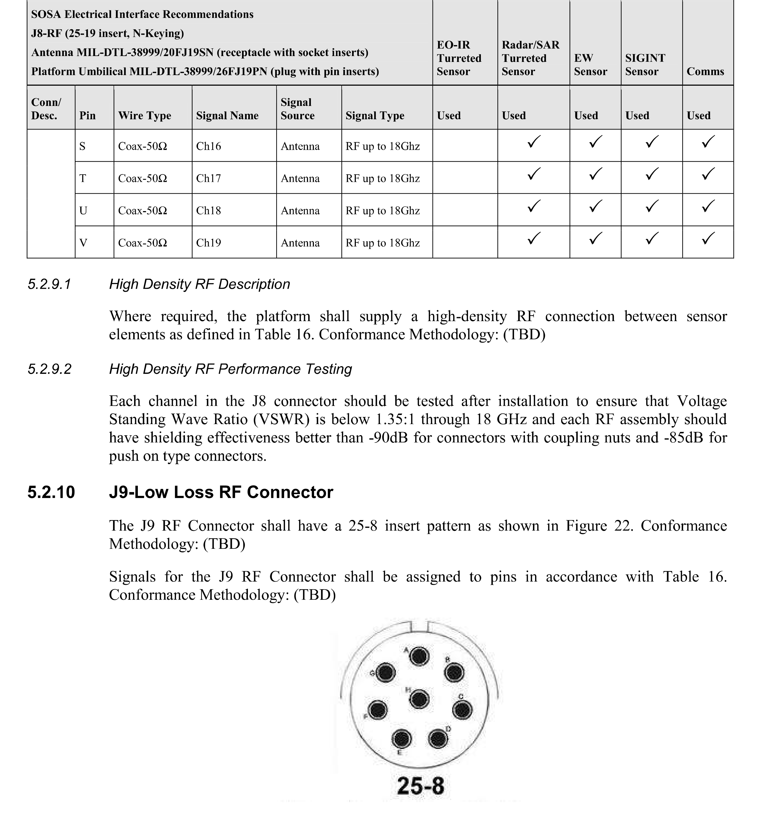

*Figure 22: J9 RF Connector Pin Arrangement*

<!-- 原书 p.92 ｜ PDF p.112 -->

**Table 16: J9 RF Pin Allocation**

| SOSA Electrical Interface Recommendations J9-RF (25-8 insert, N-Keying) Antenna MIL-DTL-38999/20FJ19SN (receptacle with socket inserts) Platform Umbilical MIL-DTL-38999/26FJ19PN (plug with pin inserts) | | | | | | EO-IR Turreted Sensor | Radar/SAR Turreted Sensor | EW Sensor | SIGINT Sensor | Comms |
|---|---|---|---|---|---|---|---|---|---|---|
| Conn/ Desc. | Pin | Wire Type | Signal Name | Signal Source | Signal Type | Used | Used | Used | Used | Used |
| RF | A | Coax-50Ω | Ch1 | Antenna | RF up to 18Ghz | | ✓ | ✓ | ✓ | ✓ |
| | B | Coax-50Ω | Ch2 | Antenna | RF up to 18Ghz | | ✓ | ✓ | ✓ | ✓ |
| | C | Coax-50Ω | Ch3 | Antenna | RF up to 18Ghz | | ✓ | ✓ | ✓ | ✓ |
| | D | Coax-50Ω | Ch4 | Antenna | RF up to 18Ghz | | ✓ | ✓ | ✓ | ✓ |
| | E | Coax-50Ω | Ch5 | Antenna | RF up to 18Ghz | | ✓ | ✓ | ✓ | ✓ |
| | F | Coax-50Ω | Ch6 | Antenna | RF up to 18Ghz | | ✓ | ✓ | ✓ | ✓ |
| | G | Coax-50Ω | Ch7 | Antenna | RF up to 18Ghz | | ✓ | ✓ | ✓ | ✓ |
| | H | Coax-50Ω | Ch8 | Antenna | RF up to 18Ghz | | ✓ | ✓ | ✓ | ✓ |

> 转写说明：原表表头为两行——第一行左起 6 列（Conn/ Desc.~Signal Type 上方）是一个**跨 6 列的合并单元格**（灰色块），其文字照录于第 1 格，被其覆盖的其余 5 格留空；第 7~11 列第一行为传感器名、第二行为 “Used”，此处分列为表头行与紧跟的一行（即原表头第二行），不另设分隔线。
>
> 合并单元格：第 1 列 Conn/ Desc. 的 “RF” 在原表跨全部 8 行合并，仅记于首个数据行（Pin A），其下 7 行该格留空。
>
> 表体 8 行，Pin 依次为 A~H，Signal Name 依次为 Ch1~Ch8。本表在 p.93 内完整（紧随 5.2.10.1 正文），未跨页。

**Table 17: Auxiliary RF Connections**

| Auxiliary RF Connectors – Quantity is Application-Specific | | | | | | EO-IR Turreted Sensor | Radar/SAR Turreted Sensor | EW Sensor | SIGINT Sensor | Comms |
|---|---|---|---|---|---|---|---|---|---|---|
| Conn/ Desc. | Pin | Wire Type | Signal Name | Signal Source | Signal Type | Used | Used | Used | Used | Used |
| TNC | | RG142 50Ω | | Antenna | RF up to 3 Ghz | | ✓ | ✓ | ✓ | ✓ |
| SMA | | RG174 50Ω | | Antenna | RF up to 27 Ghz | | ✓ | ✓ | ✓ | ✓ |
| 2.4 mm | | Coax-50Ω | | Antenna | RF up to 50 Ghz | | ✓ | ✓ | ✓ | ✓ |
| 1.0 mm | | Coax-50Ω | | Antenna | RF up to 110 Ghz | | ✓ | ✓ | ✓ | ✓ |

> 转写说明：原表表头为两行——第一行左起 6 列（Conn/ Desc.~Signal Type 上方）是一个**跨 6 列的合并单元格**（灰色块），其文字 “Auxiliary RF Connectors – Quantity is Application-Specific” 照录于第 1 格（“–” 为原书的短破折号），被其覆盖的其余 5 格留空；第 7~11 列第一行为传感器名、第二行为 “Used”，此处分列为表头行与紧跟的一行（即原表头第二行），不另设分隔线。
>
> 表体 4 行；第 2 列 Pin 与第 4 列 Signal Name 在原表中全部为空，照录留空。
>
> 跨页：本表自 p.93 起、在 p.94 续完（“1.0 mm” 一行为续页行，其 Signal Type 格内 “RF up to 110 / Ghz” 为原表格内折行，此处以空格连接）；续页重复的完整表头已并入本文件首两行表头，不另记。

TNC RGI42508 Antenna RE up to 3 Ghz SMA RG174500 Antenna RF up to 27 Ghz

2.4 mm Coax-508 Antenna RF up to 50 Ghz

<!-- 原书 p.93 ｜ PDF p.113 -->

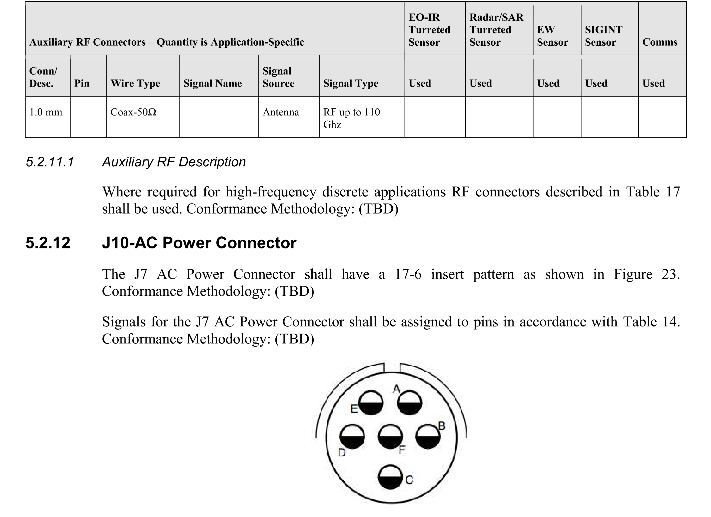

*Figure 23: J10 AC Power Connector Pin Arrangement*

**Table 18: J10 AC Power Pin Allocations**

| SOSA Electrical Interface Recommendations J10-AC Power (17-6 insert, N-Keying) Sensor MIL-DTL-38999/20FE6PN contacts M39029/58-365 (receptacle with socket inserts) Platform Umbilical MIL-DTL-38999/26FE6SN contacts M39029/56-353 (plug with pin inserts) | | | | | | EO-IR Turreted Sensor | Radar/SAR Turreted Sensor | EW Sensor | SIGINT Sensor | Comms |
|---|---|---|---|---|---|---|---|---|---|---|
| Conn/ Desc. | Pin | Wire Type | Signal Name | Signal Source | Signal Type | Used | Used | Used | Used | Used |
| 3ø 400Hz AC Power | A | 12AWG | 120/208VAC Ph A | Platform | AC Power | ✓ | ✓ | ✓ | ✓ | ✓ |
| | B | 12AWG | 120/208VAC Ph B | Platform | AC Power | ✓ | ✓ | ✓ | ✓ | ✓ |
| | C | 12AWG | 120/208VAC Ph C | Platform | AC Power | ✓ | ✓ | ✓ | ✓ | ✓ |
| | D | 12AWG | 120/208VAC Neutral | Platform | AC Power | | ✓ | ✓ | ✓ | ✓ |
| | E | | Unused | | | | | | | |
| | F | 12AWG | Chassis | Platform | Ground | | ✓ | ✓ | ✓ | ✓ |

> 转写说明：原表表头为两行——第一行左起 6 列（Conn/ Desc.~Signal Type 上方）是一个**跨 6 列的合并单元格**（灰色块），其文字照录于第 1 格，被其覆盖的其余 5 格留空；第 7~11 列第一行为传感器名、第二行为 “Used”，此处分列为表头行与紧跟的一行（即原表头第二行），不另设分隔线。灰色块第 3、4 段在原表格内折行为 “Sensor MIL-DTL-38999/20FE6PN contacts M39029/58-365” ＋ “(receptacle with socket inserts)” 与 “Platform Umbilical MIL-DTL-38999/26FE6SN contacts M39029/56-353” ＋ “(plug with pin inserts)”，此处按折行位置以 ` ` 相接。
>
> 合并单元格：第 1 列 Conn/ Desc. 的 “3ø 400Hz AC Power” 在原表跨 A~F 全部 6 行合并（格内原为 “3ø” “400Hz” “AC” “Power” 四行竖排），仅记于首个数据行（Pin A），其下 5 行该格留空；“ø” 为原书的带斜线 o。
>
> 第 E 行：Wire Type、Signal Source、Signal Type 三格及 5 个 Used 格原为空，Signal Name 作 “Unused”，照录留空。
>
> 跨页：本表自 p.94 起、在 p.95 续完（D、E、F 三行为续页行）；续页重复的完整表头已并入本文件首两行表头，不另记。第 4 列内 “120/208VAC Ph A” 等在原文中为格内折行（“120/208VAC” ＋ “Ph A”），此处以空格连接。

Desc:Connl Pin Wire Type Signal Name SignalSource Signal Type Used Used Used Used Used

30 12AWG 120/208VAC Platform AC Power 40OHZ Ph A AC Power B 12AWG 120/208VAC Platform AC Power

Ph B

I2AWG 120/208VAC Platform AC Power Ph C

<!-- 原书 p.94 ｜ PDF p.114 -->

S0SA Electrical Interface Recommendations

JIO-AC Power (17-6 insert, N-Keying) Sensor MILDTL 38999/20F6PN contacts 139029/58-365 (receptacle with socket inserts) EO-I RadarlSAR Platform Umbilical MIL-DTL- 38999/26F6SN contacts M39029/56-353 Turreted Turreted EW SIGINT (plug with pin inserts) Sensor Sensor Sensor Sensor Comms DescConnl Pin Wire Type Signal Name SignalSource Signal Type Used Used Used Used Used

12AWG 120/208VAC Platform AC Power Neutral } Unused F 12AWG Chassis Platform Ground

###### 5.2.12.1 AC Power Description

The platform shall provide to the connected system or sensor 115/200 Volts RMS, alternating current (AC), three phase, 4 wire grounded neutral, “Y” configuration, 400 cycle power at up to 10 amperes per phase in accordance with MIL-STD-704F. Conformance Methodology: (TBD) Each phase shall be protected by an overcurrent device to limit the maximum current to 10 amperes steady state and the overcurrent devices shall be interconnected such that an overcurrent condition on any phase shall cause all three phases to be interrupted. Conformance

Methodology: (TBD)

##### 5.2.13 Hardware Platform 3U and 6U Slot Profile Specifications

5.2.13.1 SOSA Hardware Basic Requirements

**Rule 5.2.13.1-1**

SOSA plug-in cards shall conform to the requirements of the following standards, when applicable, in the given order of precedence: • Requirements of this SOSA Technical Standard

Conformance Methodology: (I)

- Requirements of ANSI/VITA 65.1

  - Conformance Methodology: (I)

- Requirements of ANSI/VITA 65.0

  - Conformance Methodology: (I)

- Requirements of ANSI/VITA 48.2

  - Conformance Methodology: (I)

- Requirements of ANSI/VITA 48.8

  - Conformance Methodology: (I)

<!-- 原书 p.95 ｜ PDF p.115 -->

• Requirements of ANSI/VITA 47.3

Conformance Methodology: (I)

- Requirements of ANSI/VITA 66.0 and applicable dot standards

  - Conformance Methodology: (I)

- Requirements of ANSI/VITA 67.0 and applicable dot standards

  - Conformance Methodology: (I)

- Requirements of ANSI/VITA 46.0

  - Conformance Methodology: (I)

- Requirements of ANSI/VITA 62.0

  - Conformance Methodology: (I)

**Rule 5.2.13.1-2**

All user defined pins, as defined in the SOSA plug-in cards, shall not be used for inter-module communications – only for external platform communications. Conformance Methodology: (T)

**Rule 5.2.13.1-3**

All external panel I/O signals shall pass through the backplane connector(s) before going to any SOSA plug-in card except for: Conformance Methodology: (T)

• Key Fill

• Crypto Ignition Key (CIK)

**Rule 5.2.13.1-4**

All signals between SOSA plug-in cards shall pass through the backplane connector(s) before going to another component in a SOSA system. Conformance Methodology: (A)

**Rule 5.2.13.1-5**

SOSA PSMs shall conform to Section 3U External I/O Slot Profile if they are installed into a monolithic backplane containing SOSA hardware modules. Conformance Methodology: (T)

**Recommendation 5.2.13.1-1**

SOSA PSMs should conform to Section 3U External I/O Slot Profile even if they are part of a separate power supply backplane.

5.2.13.2 SOSA Utility Plane Requirements Reference ANSI/VITA 65.0 §3 for Utility Plane Requirements. Utility plane requirements are extended for the SOSA standard as follows.

<!-- 原书 p.96 ｜ PDF p.116 -->

**Rule 5.2.13.2-1**

The Non-Volatile Memory Read Only (NVMRO) signal on a SOSA plug-in card shall inhibit write operations to non-volatile memory resources as specified in ANSI/VITA 65.0 §3.4.4. Conformance Methodology: (T)

**Rule 5.2.13.2-2**

The GDiscrete1 signal shall be an input only port with respect to ANSI/VITA 65.0, Permission 3.6-1. Conformance Methodology: (T)

**Rule 5.2.13.2-3**

With respect to ANSI/VITA 46.0, Recommendation 7-3, the Joint Test Action Group (JTAG) signals shall not be bussed over the backplane. Conformance Methodology: (T)

**Rule 5.2.13.2-4**

With respect to ANSI/VITA 65.0, Permission 3.4.3-4 and Permission 3.4.3-5, MaskableReset* shall not be bussed across the backplane to other slots. Conformance Methodology: (T)

**Rule 5.2.13.2-5**

All backplane connectors shall be commercially available connectors that can be procured by any vendor without prior authorization from any source (e.g., a commercial part governed by a source control drawing). Conformance Methodology: (A)

**Rule 5.2.13.2-6**

Backplanes shall implement a single, 2.49K Ohm, +/- 1%, pull-up resistor from each IPMB signal to the 3.3V Auxiliary voltage rail. Conformance Methodology: (A)

**Rule 5.2.13.2-7**

SOSA plug-in cards containing resources to drive the Utility Plane REF_CLK+/- signals shall provide a mechanism to permit application software or system management to reassign the identity of the SYS_CON module, regardless of the logic level of the backplane SYS_CON* contact, in order to control these signal drivers once the backplane power rails are all at minimum operating voltages as defined in ANSI/VITA 46.0 §4.8.12.4. Conformance Methodology: (A)

**Rule 5.2.13.2-8**

SOSA plug-in cards receiving SYSRESET* as an input shall be able to register a valid low for any pulse length of 10ns or longer. Conformance Methodology: (T)

**Rule 5.2.13.2-9**

SYSRESET* shall conform to the high current open-drain signal specifications of ANSI/VITA

65.0 §3.3.3 (High Current Open-Drain). Conformance Methodology: (T)

<!-- 原书 p.97 ｜ PDF p.117 -->

**Rule 5.2.13.2-10**

SOSA plug-in cards shall make SYSRESET* available to any SOSA mezzanine module connector that has SM1 and SM0 available per ANSI/VITA 65.0 Recommendation 3.4.2.1-1. Conformance Methodology: (T)

**Rule 5.2.13.2-11**

SOSA plug-in cards shall receive a unique Site Number that is based upon the plug-in card’s ANSI/VITA 65.0 §3.4.6, Geographic Address as referenced in ANSI/VITA 46.11. Conformance

Methodology: (A)

**Rule 5.2.13.2-12**

No additional components shall be required to install a SOSA plug-in card in a SOSA Enclosure other than those typically used for ANSI/VITA-compliant OpenVPX modules. Conformance Methodology: (A)

**Rule 5.2.13.2-13**

The NVMRO pin shall conform to the low current open-drain signal specifications of ANSI/VITA 65.0 §3.3.1. Conformance Methodology: (A)

**Rule 5.2.13.2-14**

3U SOSA plug-in cards shall use VS1 12V as primary input power. Conformance Methodology: (TBD)

**Rule 5.2.13.2-15**

3U SOSA plug-in cards shall not use VS2 3.3V or VS3 5.0V. Conformance Methodology: (T)

**Observation 5.2.13.2-1**

VS1 input pins limits 3U current to 16A (192W) per ANSI/VITA 46.0 Table 4-5.

**Rule 5.2.13.2-16**

6U SOSA plug-in cards shall use VS1 and VS2 12V as primary input power. Conformance Methodology: (T)

**Rule 5.2.13.2-17**

6U SOSA plug-in cards shall not use VS3 5.0V. Conformance Methodology: (T)

**Observation 5.2.13.2-2**

VS1 and VS2 input pins limits 6U current to 32A (384W) per ANSI/VITA 46.0 Table 4-5.

<!-- 原书 p.98 ｜ PDF p.118 -->

**Rule 5.2.13.2-18**

SOSA plug-in cards shall use 3.3V_AUX. Conformance Methodology: (T)

**Rule 5.2.13.2-19**

SOSA plug-in cards shall not use 12V auxiliary supplies. Conformance Methodology: (T)

**Observation 5.2.13.2-3**

SOSA plug-in cards shall draw no more than 1.0A of 3.3VAUX ANSI/VITA 46.0 Rule 3.11.

5.2.13.3 SOSA Hardware Platform General Specification Requirements SOSA general specification requirements are delineated in the following sections.

5.2.13.3.1 General Specifications

**Permission 5.2.13.3-1**

Hardware modules may work cooperatively to increase performance and/or functionality.

**Rule 5.2.13.3-1**

All unused pins shall not be connected on the plug-in module. Conformance Methodology: (A)

**Rule 5.2.13.3-2**

SOSA plug-in cards with XMC mezzanine sites shall conform to the carrier board requirements of ANSI/VITA 42.0, XMC. Conformance Methodology: (A)

Slot Pitch

Reference ANSI/VITA 65.0 §4.1 for slot pitch requirements. Slot pitch requirements are extended for SOSA as follows.

**Rule 5.2.13.3-3**

SOSA Conformant Card cage rails shall have a pitch of 1.0” or greater for SOSA plug-in card conformant ANSI/VITA 48.2 Hardware Modules. Conformance Methodology: (A)

**Rule 5.2.13.3-4**

SOSA Backplane Assemblies for conduction cooling shall have a 1.0” pitch or greater for SOSA plug-in cards conformant to ANSI/VITA 48.2 Plug-In Module. Conformance Methodology: (A)

**Rule 5.2.13.3-5**

Conduction Cooled SOSA plug-in cards shall be conformant to ANSI/VITA 48.2 Plug-In Module requirements for 1.00” pitch. Conformance Methodology: (A)

<!-- 原书 p.99 ｜ PDF p.119 -->

**Rule 5.2.13.3-6**

SOSA Conformant Card cage rails shall have a pitch of 1.5” for SOSA plug-in card ANSI/VITA

48.8 Hardware Modules. Conformance Methodology: (A)

**Rule 5.2.13.3-7**

SOSA Backplane Assemblies for air flow through cooling shall have a 1.5” pitch for SOSA plug-in cards conformant to ANSI/VITA 48.8 Plug-In Module. Conformance Methodology: (A)

**Rule 5.2.13.3-8**

Air flow through SOSA plug-in cards shall be conformant to ANSI/VITA 48.8 Plug-In Module requirements for 1.5” pitch. Conformance Methodology: (A)

5.2.13.3.2 Connector Family

**Rule 5.2.13.3-9**

SOSA plug-in cards shall comply with ANSI/VITA 65.0 §4.2 for connector family requirements. Conformance Methodology: (A)

Rules 5.2.13.3-10

SOSA plug-in cards shall make use of ANSI/VITA Standard Connectors. Conformance Methodology: (A)

**Observation 5.2.13.3-1**

The SOSA standard is considering the addition of ANSI/VITA 46.3 that will allow for intermateable connectors.

Keying

The SOSA standard references ANSI/VITA 46 §4.4 for Alignment and Keying. Specifically, reference ANSI/VITA 46 §4.4.3 for Keying Rules applying to 6U and 3U modules. Reference ANSI/VITA 65.0 §4.3 for keying requirements specific to ANSI/VITA 6U modules and backplanes.

RTM Modules

Reference ANSI/VITA 65.0 §4.4 for Requirements Traceability Matrix (RTM) connector requirements.

**Rule 5.2.13.3-11**

Rear transition modules shall be prohibited within a SOSA Chassis and Backplane Assembly. Conformance Methodology: (A)

<!-- 原书 p.100 ｜ PDF p.120 -->

###### 5.2.13.4 Conduction Cooled SOSA Plug-In Cards

Reference ANSI/VITA 48.2 for conduction cooled module requirements. Reference ANSI/VITA

48.8 for air flow through module requirements.

**Rule 5.2.13.4-1**

ANSI/VITA 48.2 or ANSI/VITA 48.8 Type 1 Hardware Modules shall be used. Conformance

Methodology: (A)

**Recommendation 5.2.13.4-1**

SOSA plug-in cards should use extended covers in order to protect the 46.0 connectors.

**Permission 5.2.13.4-1**

Adapter frames may be used to convert ANSI/VITA 48.2 Hardware Modules to ANSI/VITA

48.8 form factor.

Environmental

Reference ANSI/VITA 47.3 for module requirements.

**Observation 5.2.13.4-1**

Hardware modules may use the following cooling method guideline table to prepare for future power growth.

**Table 19: Hardware Module Cooling Methods**

| **Hardware Module Form Factor and Cooling Method** | **3U Heat Load** | **6U Heat Load** | **System Integration Impact Rationale** |
|---|---|---|---|
| ANSI/VITA 48.2 conduction to air cooled chassis | Low | Low | Host platform-agnostic air cooling |
| ANSI/VITA 48.8 air flow through | Medium | Medium | |
| ANSI/VITA 48.2 conduction to liquid cooled chassis | Medium | Medium | Dependent on host platform supplied liquid cooling infrastructure with condensation mitigation |

> 转写说明：第 4 列「System Integration Impact Rationale」的「Host platform-agnostic air cooling」为纵向合并单元格，覆盖第 2、3 数据行（ANSI/VITA 48.2 conduction to air cooled chassis、ANSI/VITA 48.8 air flow through），故第 3 行该格留空、末行「Dependent on host platform supplied liquid cooling infrastructure with condensation mitigation」单独成格。合并格原带底色（首两行绿色、末行黄色），Markdown 不表底色。格内因排版折行的文字（如「Hardware Module Form Factor and Cooling Method」「ANSI/VITA 48.2 conduction to air cooled chassis」）以单个空格连接。本表仅占原书 p.101 一页，p.102 为正文。

##### 5.2.14 Hardware Platform SOSA Plug-In Card Profiles

SOSA plug-in card Profiles define the connector type and how each pin, or pair of pins, is allocated. Single pins are generally allocated to the utility plane for power, grounds, system discrete signals, and system management. Differential pin/pairs are generally allocated for the three communication planes called Control, Data, and Expansion. Differential paired pins are grouped together to form “pipes”. The definition of planes, pipes, and profiles can be found in Appendix B. Finally, plug-in card profiles also determine which pins are user-defined. SOSA plug-in card profiles are categorized as either Payload or Switch. As an example, payload plug-

<!-- 原书 p.101 ｜ PDF p.121 -->

in cards are further divided into sub-categories such as, but not limited to, RF Payload, RF Switch, and I/O Single Board Computer (SBC).

5.2.14.1 Hardware Platform Protocol Profiles

The Protocol Profile defines what type communication protocol can be used on each pipe as defined in a corresponding plug-in card profile, connector type, and module height (6U/3U).

5.2.14.2 Hardware Platform Profile Names – Use and Construction

SOSA plug-in card profiles that align with OpenVPX Profiles can be classified into one of three main categories: • SLT: a physical space on an OpenVPX backplane with a defined mechanical and electrical specification intended to accept a Plug-In module Pre-existing examples of slots that are applicable to OpenVPX include 3U and 6U. There are different slot types such as payload slots and switch slots.

- Backplane (BKP): a class of interconnect that consists of regularly aligned pattern of connectors that operate so that the corresponding pins on each connector have the same logical definition It is often used as a backbone to connect several modules together to allow for signal transmission and is usually housed in a chassis.

- Module (MOD): an element of a system that has individually distinct boundaries that are well-defined interfaces Reference ANSI/VITA 65.0 §1.3.3.1 for Slot Profile use and construction. Reference ANSI/VITA 65.0 §1.3.3.2 for Backplane Profile use and construction. Reference ANSI/VITA 65.0 §1.3.3.3 for Module Profile use and construction.

##### 5.2.15 Common 6U and 3U Plug-In Card Profile Specifications

For the SOSA standard, within the context of OpenVPX, it is known that OpenVPX uses Slot Profiles to define interoperability and physical characteristics necessary to interface with compatible modules and backplanes. The following sections define common requirements for all OpenVPX Slot Profiles: • Reference ANSI/VITA 65.0 §6 Common to 6U and 3U – Slot Profiles • Reference ANSI/VITA 65.0 §7 Common to 6U and 3U – Backplane Profiles

• Reference ANSI/VITA 65.0 §8 Common to 6U and 3U – Module Profiles

##### 5.2.16 SOSA 3U Plug-In Card Profile Specifications

###### 5.2.16.1 3U I/O Intensive SBC Plug-In Card Profile

**Rule 5.2.16.1-1**

SOSA 3U SBCs that are I/O intensive shall conform to ANSI/VITA 65.0 slot profile SLT3-

PAY-1F1F2U1TU1T1U1T-14.2.16. Conformance Methodology: (A)

<!-- 原书 p.102 ｜ PDF p.122 -->

**Rule 5.2.16.1-2**

SOSA systems shall route the GPIO pins from the ANSI/VITA 65.1 slot profile SLT3-PAY-1F1F2U1TU1T1U1T-14.2.16 to external Platform I/O. Conformance Methodology: (A)

**Rule 5.2.16.1-3**

SOSA systems shall route Express Mezzanine Card (XMC) pins from ANSI/VITA 65.1 slot profile SLT3-PAY-1F1F2U1TU1T1U1T-14.2.16 to external chassis I/O connectors. Conformance Methodology: (A)

**Rule 5.2.16.1-4**

SOSA 3U SBCs that are I/O intensive shall conform to one of the ANSI/VITA 65.1 module profiles in Table 20. Conformance Methodology: (A)

**Observation 5.2.16.1-1**

An XMC can be used to customize the I/O for a particular system or platform.

- Key

SE

POIJO Data Plane 1 FP

- Utility Plane-Maint. PortUSB PWR 5E Diff Expansion PlaneP1w9-X12d XMC mapControl Plane - 2 UTPsFP PI/J1 GPIO Video - TUTP

- Utility Plane 8 of USB 3 and 1ofUSB2- 1TP

- Serial ports E Storage 1 UTP

- De USB PWR- P2lJ2 Control Plane C 1 TP

3 Of GPIO- XIGs XMC map

*Figure 24: ANSI/VITA 65.0 3U I/O Intensive SBC Slot Profile SLT3-PAY-1F1F2U1TU1T1U1T-*

14.2.16

<!-- 原书 p.103 ｜ PDF p.123 -->

**Table 20: Referenced ANSI/VITA 65.1 Module Profiles for SLT3-PAY-1F1F2U1T1U1T1U1T-14.2.16**

| Module Profile Names | Dash Num | STD Date | Slot Profile | Data Plane | Protocols for Copper Planes || Control | Miscellaneous Protocols over copper connectors |||||| Legacy |
|---|---|---|---|---|---|---|---|---|---|---|---|---|---|---|
| | | | | | Expansion | Control Plane | | Video | USB01 | USB02 | STRutp01 | SER01, SER02 | GPIO1 - GPIO4 | |
| MOD3-PAY- 1F1F2U1TU1T1U1T- 16.2.15- | | Proposed future 65.0 | | DP01 (FP) | EP00 - EP03 | CPutp01, CPutp02 | CPtp01 | | | | | | | |
| MOD3-PAY- 1F1F2U1TU1T1U1T- 16.2.15- | 1 | Proposed future 65.0 | SLT3-PAY- 1F1F2U1TU1T1U1T- 14.2.16 | PCIe Gen 2 -- 5.3.3.2 | PCIe Gen 2 -- 5.3.3.2 | 1000BASE-KX -- 5.1.2 | 1000BASE-T | DisplayPort 1.2 -- 5.10.2 | USB 2 -- 5.9.1 | USB 2 -- 5.9.1 | SATA Gen 2 -- 5.6.2 | Serial Ports -- 5.12.1 | GPIO -- 5.14.1 | |
| MOD3-PAY- 1F1F2U1TU1T1U1T- 16.2.15- | 2 | Proposed future 65.0 | SLT3-PAY- 1F1F2U1TU1T1U1T- 14.2.16 | PCIe Gen 3 -- 5.3.3.3 | PCIe Gen 3 -- 5.3.3.3 | 10GBASE-KR -- 5.1.7 | 10GBASE-T | DisplayPort 1.2 -- 5.10.2 | USB 3.1 Gen 2 -- 5.9.3 | USB 2 -- 5.9.1 | SATA Gen 3 -- 5.6.3 | Serial Ports -- 5.12.1 | GPIO -- 5.14.1 | |
| MOD3-PAY- 1F1F2U1TU1T1U1T- 16.2.15- | 3 | Proposed future 65.0 | SLT3-PAY- 1F1F2U1TU1T1U1T- 14.2.16 | 10GBASE-KX4 -- 5.1.5 | PCIe Gen 2 -- 5.3.3.2 | 1000BASE-KX -- 5.1.2 | 1000BASE-T | DisplayPort 1.2 -- 5.10.2 | USB 2 -- 5.9.1 | USB 2 -- 5.9.1 | SATA Gen 2 -- 5.6.2 | Serial Ports -- 5.12.1 | GPIO -- 5.14.1 | |
| MOD3-PAY- 1F1F2U1TU1T1U1T- 16.2.15- | 4 | Proposed future 65.0 | SLT3-PAY- 1F1F2U1TU1T1U1T- 14.2.16 | 40GBASE-KR4 -- 5.1.8 | PCIe Gen 3 -- 5.3.3.3 | 10GBASE-KR -- 5.1.7 | 10GBASE-T | DisplayPort 1.2 -- 5.10.2 | USB 3.1 Gen 2 -- 5.9.3 | USB 2 -- 5.9.1 | SATA Gen 3 -- 5.6.3 | Serial Ports -- 5.12.1 | GPIO -- 5.14.1 | |
| Last line | | Proposed future 65.0 | | | | | | | | | | | | |

> 转写说明：表头在原书为两层级联——第一层 `Protocols for Copper Planes`（横跨 Expansion、Control Plane 两列）、`Miscellaneous Protocols over copper connectors`（横跨 Video、USB01、USB02、STRutp01、SER01, SER02、GPIO1 - GPIO4 六列）；第二层为各子列名。此处保留两行表头，被 colspan 覆盖处留空。
> 转写说明：`Module Profile Names` 与 `Dash Num` 两个标目在原书同处一个表头格（左右分置，其间未画竖线）；数据行中配置档名右对齐于标目 `Dash Num` 左侧，其后空一格处为该行的短横编号（`1`～`4`）。此处拆作两列照录，两列合并即为完整编号 `MOD3-PAY-1F1F2U1TU1T1U1T-16.2.15-<n>`。
> 转写说明：首行的 Module Profile 名以连字符结尾而 `Dash Num` 空缺（原书如此，非漏字）；第二至五行的 `Dash Num` 依次为 `1`、`2`、`3`、`4`。
> 转写说明：首行 Video 至 GPIO1 - GPIO4 各格在原书即为空白（该带为子列名所占）；末行 `Last line` 右半各格为灰底空白。
> 转写说明：`Proposed future 65.0` 的红色底纹与末行灰底纹系原书高亮，未在 Markdown 中表示。
> 转写说明：本表为单页整表（原书 p.104／PDF 第 124 页），共 6 个数据行。下一页（原书 p.105／PDF 第 125 页）顶端为 Figure 25 与 §5.2.16.3 正文，非本表续行，故未续写。

###### 5.2.16.2 3U Legacy Payload Profiles

**Rule 5.2.16.2-1**

- SOSA 3U Legacy Payload Plug-In Cards shall conform to ANSI/VITA 65.0 slot profile SLT3-

PAY-2F2U-14.2.3. Conformance Methodology: (A)

**Rule 5.2.16.2-2**

- SOSA 3U Legacy Payload Plug-In Cards shall conform to one of the following ANSI/VITA

65.1 module profiles: (Conformance Methodology: (A))

MOD3-PAY-2F2U-16.2.3-3

MOD3-PAY-2F2U-16.2.3-5

MOD3-PAY-2F2U-16.2.3-11

**Recommendation 5.2.16.2-1-1**

- It is anticipated that the SLT3-PAY-2F2U-14.2.3 ANSI/VITA Slot Profile will be deprecated from the next version of the SOSA standard and consequently should not be used for new systems.

<!-- 原书 p.104 ｜ PDF p.124 -->

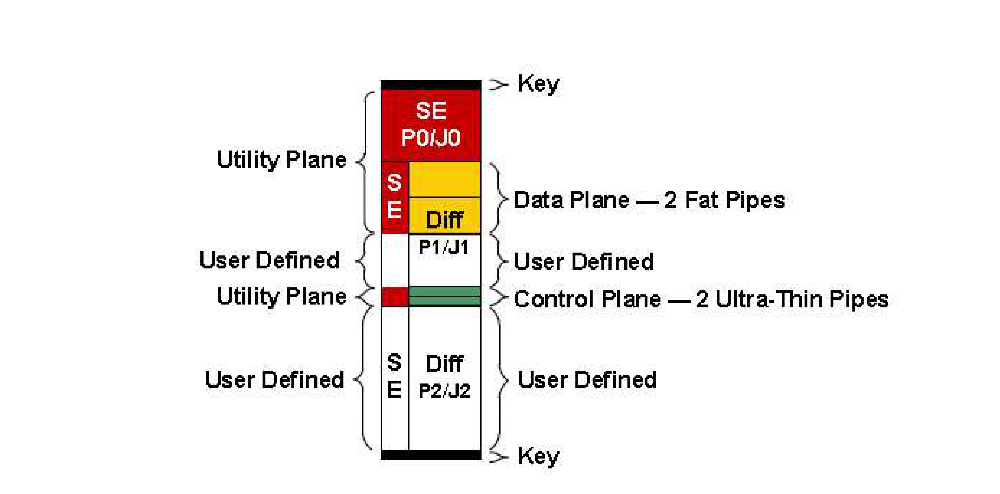

*Figure 25: ANSI/VITA 65.0 Payload Slot Profile for SLT3-PAY-2F2U-14.2.3*

5.2.16.3 3U Payload Slot Profiles

**Rule 5.2.16.3-1**

SOSA 3U Payload Plug-In Cards shall conform to the ANSI/VITA 65.0 slot profile SLT3-PAY-1F1U1S1S1U1U2F1H-14.6.11-n or SLT3-PAY-1F1U1S1S1U1U4F1J-14.6.13-n. Conformance Methodology: (A)

**Recommendation 5.2.16.3-1**

SOSA 3U Payload Plug-In Cards that don’t require RF or optical should conform to ANSI/VITA 65.0 slot profile SLT3-PAY-1F1U1S1S1U1U2F1H-14.6.11-0. Conformance Methodology: (TBD)

**Recommendation 5.2.16.3-2**

SOSA 3U Payload Plug-In Cards requiring RF should conform to ANSI/VITA 65.1 slot profile SLT3-PAY-1F1U1S1S1U1U2F1H-14.6.11-2. Conformance Methodology: (TBD)

**Recommendation 5.2.16.3-3**

SOSA 3U Payload Plug-In Cards that require additional Expansion Plane connectivity should conform to ANSI/VITA 65.0 slot profile SLT3-PAY-1F1U1S1S1U1U4F1J-14.6.13-n. Conformance Methodology: (TBD)

**Recommendation 5.2.16.3-4**

Vendors that use ANSI/VITA 65.1 slot profile SLT3-PAY-1F1U1S1S1U1U4F1J-14.6.13-n should provide a build option to not populate the ANSI/VITA 46.0 connector in P2A so that the card can also be used in a backplane adhering to SLT3-PAY-1F1U1S1S1U1U2F1H-14.6.11-n.

<!-- 原书 p.105 ｜ PDF p.125 -->

**Rule 5.2.16.3-2**

SOSA 3U Payload Plug-In Cards shall conform to one of the ANSI/VITA 65.1 module profiles in Table 21 or Table 22. Conformance Methodology: (A)

**Recommendation 5.2.16.3-5**

SOSA 3U Payload Plug-In Cards that don’t require RF or optical should conform to ANSI/VITA 65.1 module profile MOD3p-PAY-1F1U1S1S1U1U2F1H-16.6.11-4.

**Recommendation 5.2.16.3-6**

SOSA 3U Payload Plug-In Cards requiring RF should conform to ANSI/VITA 65.1 module profile MOD3-PAY-1F1U1S1S1U1U2F1H-16.6.11-6.

**Observation 5.2.16.3-1**

SOSA 3U Payload Plug-In Cards can include, but are not limited to, SBCs that are computationally-intensive, FPGAs, and RF transceivers.

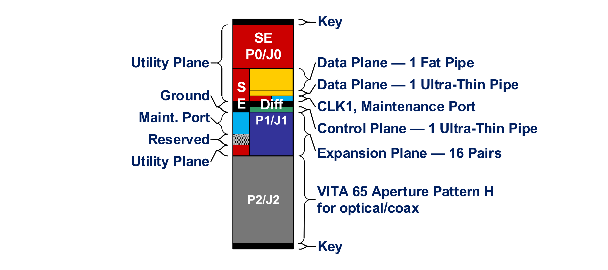

*Figure 26: ANSI/VITA 65.0 Payload Slot Profile SLT3-PAY-1F1U1S1S1U1U2F1H-14.6.11-n*

**Table 21: ANSI/VITA 65.1Slot Profiles for SLT3-PAY-1F1U1S1S1U1U2F1H-14.6.11-n**

| Slot Profile names | Dash Num | STD Date | Connector Modules ||| MT loading and Optical Pipes ||| Comments |
|---|---|---|---|---|---|---|---|---|---|
| | | | P1B/J1B | P2A/J2A | P2B/J2B | P1B/J1B | P2A/J2A | P2B/J2B | |
| **SLT3-PAY-1F1U1S1S1U1U2F1H-14.6.11-** | | | **VITA 46** | **Aperture H** || | | | **First row of SLT3-PAY-1F1U1S1S1U1U2F1H-14.6.11-n** |
| SLT3-PAY-1F1U1S1S1U1U2F1H-14.6.11- | 0 | 2017-07 | VITA 46 | Empty || | | | |
| SLT3-PAY-1F1U1S1S1U1U2F1H-14.6.11- | 1 | 2017-07 | VITA 46 | Hybrid 66.4+67.1-6.4.5.6.1 || | | | |
| SLT3-PAY-1F1U1S1S1U1U2F1H-14.6.11- | 2 | Proposed | VITA 46 | 10 SMPM contacts-6.4.5.6.3 || | | | |
| Last line | | | | | | | | | |

> 转写说明：表头两层级联——第一层 `Connector Modules` 横跨 P1B/J1B、P2A/J2A、P2B/J2B 三列，`MT loading and Optical Pipes` 横跨其下同名三列；`Slot Profile names`、`Dash Num`、`STD Date`、`Comments` 四个标目占满两行。被 colspan 覆盖处留空。
> 转写说明：`Slot Profile names` 与 `Dash Num` 两个标目在原书同处一个表头格（左右分置，其间未画竖线）；数据行中配置档名之后留一空格为该行短横编号。此处拆作两列照录，两列合并即为完整编号 `SLT3-PAY-1F1U1S1S1U1U2F1H-14.6.11-<n>`；首行无编号数字（原书如此）。
> 转写说明：`Connector Modules` 下 P2A/J2A 与 P2B/J2B 两列在原书数据行合并为一格（`Aperture H`、`Empty`、`Hybrid 66.4+67.1-6.4.5.6.1`、`10 SMPM contacts-6.4.5.6.3` 跨两列），此处按 colspan 记作一格后接空格。
> 转写说明：`Hybrid 66.4+67.1-6.4.5.6.1` 与 `10 SMPM contacts-6.4.5.6.3` 在原书为蓝色带下划线的超链接样式，此处只记文字；`Proposed` 行的黄色底纹与末行灰底纹未在 Markdown 中表示。
> 转写说明：本表为单页整表（原书 p.106／PDF 第 126 页），共 5 个数据行。下一页（PDF 第 127 页）顶端即 Table 22 的题注与表体，属另一张表，故未续写。

<!-- 原书 p.106 ｜ PDF p.126 -->

**Table 22: ANSI/VITA 65.1 Module Profiles for SLT3-PAY-1F1U1S1S1U1U2F1H-14.6.11-n**

| Module Profile names | Dash Num | STD Date | Slot Profile | Data Plane | Data Plane | Protocols for Copper Planes |||| Optical | Comments | Legacy |
|---|---|---|---|---|---|---|---|---|---|---|---|---|
| | | | | | | Expansion Plane | Expansion Plane | Control Plane | Contol Plane | | | |
| **MOD3-PAY-1F1U1S1S1U1U2F1H-16.6.11-** | | | | **DP01** | **DPutp01** | **EP00 - EP03** | **EP04 - EP07** | **CPutp01** | | | **First row of MOD3-PAY-1F1U1S1S1U1U2F1H-16.6.11-n** | |
| MOD3p-PAY-1F1U1S1S1U1U2F1H-16.6.11- | 1 | 2017-07 | SLT3p-PAY-1F1U1S1S1U1U2F1H-14.6.11-1 | 10GBASE-KX4 -- 5.1.5 | 1000BASE-KX -- 5.1.2 | PCIe Gen 2 -- 5.3.3.2 | User Defined | 1000BASE-KX -- 5.1.2 | | | P2/J2: Hybrid_66.4+67.1-6.4.5.6.1 | |
| MOD3p-PAY-1F1U1S1S1U1U2F1H-16.6.11- | 2 | Proposed | SLT3p-PAY-1F1U1S1S1U1U2F1H-14.6.11-2 | 10GBASE-KX4 -- 5.1.5 | 1000BASE-KX -- 5.1.2 | PCIe Gen 2 -- 5.3.3.2 | User Defined | 1000BASE-KX -- 5.1.2 | | | P2/J2: 10_SMPM_contacts-6.4.5.6.3 | |
| MOD3p-PAY-1F1U1S1S1U1U2F1H-16.6.11- | 3 | Proposed | SLT3p-PAY-1F1U1S1S1U1U2F1H-14.6.11-2 | 40GBASE-KR4 -- 5.1.8 | 10GBASE-KR -- 5.1.7 | PCIe Gen 3 -- 5.3.3.3 | User Defined | 10GBASE-KR -- 5.1.7 | | | P2/J2: 10_SMPM_contacts-6.4.5.6.3 | |
| MOD3p-PAY-1F1U1S1S1U1U2F1H-16.6.11- | 4 | Proposed | SLT3p-PAY-1F1U1S1S1U1U2F1H-14.6.11-0 | 40GBASE-KR4 -- 5.1.8 | 10GBASE-KR -- 5.1.7 | PCIe Gen 3 -- 5.3.3.3 | User Defined | 10GBASE-KR -- 5.1.7 | | | No P2/J2; Intended for use by SBC | |
| MOD3p-PAY-1F1U1S1S1U1U2F1H-16.6.11- | 5 | Proposed | SLT3p-PAY-1F1U1S1S1U1U2F1H-14.6.11-4 | 40GBASE-KR4 -- 5.1.8 | 10GBASE-KR -- 5.1.7 | PCIe Gen 3 -- 5.3.3.3 | User Defined | 10GBASE-KR -- 5.1.7 | | | 14_sMPM_contacts_6.4.5.4.4 | |
| MOD3p-PAY-1F1U1S1S1U1U2F1H-16.6.11- | 6 | Proposed | SLT3p-PAY-1F1U1S1S1U1U2F1H-14.6.11-4 | 40GBASE-KR4 -- 5.1.8 | 10GBASE-KR -- 5.1.7 | Aurora -- 5.7.2 | User Defined | 10GBASE-KR -- 5.1.7 | | | 14_sMPM_contacts_6.4.5.4.4 | |

> 转写说明：表头两层级联——第一层 `Protocols for Copper Planes` 横跨其下 Expansion Plane、Expansion Plane、Control Plane、Contol Plane 四列；其余标目（`Module Profile names`、`Dash Num`、`STD Date`、`Slot Profile`、两列 `Data Plane`、`Optical`、`Comments`、`Legacy`）占满两行。被 colspan 覆盖处留空。
> 转写说明：`Module Profile names` 与 `Dash Num` 两个标目在原书同处一个表头格（左右分置，其间未画竖线）；数据行的短横编号以小字偏置排在该格右端。此处拆作两列照录，两列合并即为完整编号 `MOD3-PAY-1F1U1S1S1U1U2F1H-16.6.11-<n>`。
> 转写说明：第四个子列名在原书排作 `Contol Plane`（缺字母 r，非本次转写笔误）；c9 该列全表无数据。
> 转写说明：首行模块配置档名以大写 `MOD3-PAY-` 起首（粗体），第二至七行为小写 `MOD3p-PAY-` 起首，Slot Profile 亦为 `SLT3p-PAY-`，均照原书大小写录入。
> 转写说明：首行无短横编号（原书如此）。第三、四行的 Slot Profile 同为 `SLT3p-PAY-1F1U1S1S1U1U2F1H-14.6.11-2`，第六、七行同为 `…-14.6.11-4`（原书如此，未作更正）；`Legacy` 列与 `Optical` 列全表空白。
> 转写说明：本表为单页整表（原书 p.107／PDF 第 127 页上半），共 7 个数据行、无 `Last line` 行。同页其下为 Figure 27 与 Table 23、Table 24，下一页（PDF 第 128 页）顶端为 Rule 5.2.16.4-2 正文，均非本表续行，故未续写。

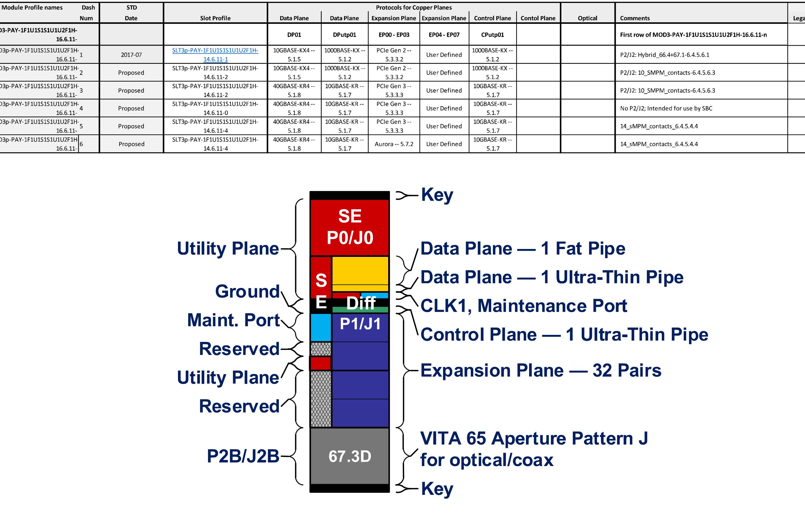

*Figure 27: ANSI/VITA 65.0 Payload Slot Profile SLT3-PAY-1F1U1S1S1U1U4F1J-14.6.13-n*

**Table 23: ANSI/VITA 65.1Slot Profiles for SLT3-PAY-1F1U1S1S1U1U4F1J-14.6.13-n**

| Slot Profile names | Dash Num | STD Date | Connector Modules ||| MT loading and Optical Pipes ||| Comments |
|---|---|---|---|---|---|---|---|---|---|
| | | | P1B/J1B | P2A/J2A | P2B/J2B | P1B/J1B | P2A/J2A | P2B/J2B | |
| **SLT3-PAY-1F1U1S1S1U1U4F1J-14.6.13-** | | **Proposed future 65.0** | **VITA 46** | **VITA 46** | **Aperture J** | **VITA 46** | **VITA 46** | **Aperture J** | **First row of SLT3-PAY-1F1U1S1S1U1U4F1J-14.6.13-n** |
| SLT3-PAY-1F1U1S1S1U1U4F1J-14.6.13- | 0 | Proposed future 65.0 | VITA 46 | VITA 46 | Empty | | | | |
| Last line | | Proposed future 65.0 | | | | | | | |

> 转写说明：表头两层级联——第一层 `Connector Modules` 横跨 P1B/J1B、P2A/J2A、P2B/J2B 三列，`MT loading and Optical Pipes` 横跨其下同名三列；`Slot Profile names`、`Dash Num`、`STD Date`、`Comments` 四个标目占满两行。被 colspan 覆盖处留空。
> 转写说明：`Slot Profile names` 与 `Dash Num` 两个标目在原书同处一个表头格（左右分置，其间未画竖线）；数据行中配置档名之后留一空格为该行短横编号。此处拆作两列照录，两列合并即为完整编号 `SLT3-PAY-1F1U1S1S1U1U4F1J-14.6.13-<n>`；首行无编号数字（原书如此）。
> 转写说明：第二行的 `MT loading and Optical Pipes` 三列为空白；`Proposed future 65.0` 的红色底纹与末行灰底纹系原书高亮，未在 Markdown 中表示。
> 转写说明：本表为单页整表（原书 p.107／PDF 第 127 页中部），共 3 个数据行。同页其下紧接 Table 24，下一页（PDF 第 128 页）顶端为 Rule 5.2.16.4-2 正文，均非本表续行，故未续写。

**Table 24: ANSI/VITA 65.1 Module Profiles for SLT3-PAY-1F1U1S1S1U1U4F1J-14.6.13-n**

| Module Profile names | Dash Num | STD Date | Slot Profile | Protocols for Copper Planes |||| Protocols Optical | Comments | Legacy |
|---|---|---|---|---|---|---|---|---|---|---|
| | | | | Data Plane | Data Plane | Plane | Control Plane | | | |
| **MOD3-PAY-1F1U1S1S1U1U4F1J-16.6.13-** | | **Proposed future 65.0** | | **DP01** | **DPutp01** | **EP00 - EP15** | **CPutp01** | | **First row of MOD3-PAY-1F1U1S1S1U1U4F1J-16.6.13-n** | |
| MOD3p-PAY-1F1U1S1S1U1U4F1J-16.6.13- | 1 | Proposed future 65.0 | SLT3p-PAY-1F1U1S1S1U1U4F1J-14.6.13-0 | 40GBASE-KR4 -- 5.1.8 | 10GBASE-KR -- 5.1.7 | PCIe Gen 3 -- 5.3.3.3 | 10GBASE-KR -- 5.1.7 | | No P2B/J2B | |
| Last line | | Proposed future 65.0 | | | | | | | | |

> 转写说明：表头两层级联——第一层 `Protocols for Copper Planes` 横跨其下 Data Plane、Data Plane、Plane、Control Plane 四列；`Module Profile names`、`Dash Num`、`STD Date`、`Slot Profile`、`Protocols Optical`、`Comments`、`Legacy` 七个标目在原书为一格贯满两行，故在第二行表头中留空。被 colspan 覆盖处同样留空。
> 转写说明：`Module Profile names` 与 `Dash Num` 两个标目在原书同处一个表头格（左右分置，其间未画竖线）。此处拆作两列照录，两列合并即为完整编号 `MOD3-PAY-1F1U1S1S1U1U4F1J-16.6.13-<n>`；首行无编号数字（原书如此）。
> 转写说明：`Protocols Optical` 列与 `Legacy` 列全表空白。
> 转写说明：原书数据首行为大写 `MOD3-PAY-…`（粗体），次行为小写 `MOD3p-PAY-…`、槽位档 `SLT3p-PAY-…`，均照原书大小写照录。
> 转写说明：本表为单页整表（原书 p.107／PDF 第 127 页下半），共 3 个数据行。下一页（PDF 第 128 页）顶端为 Rule 5.2.16.4-2 正文，非本表续行，故未续写。

###### 5.2.16.4 3U Data/Control Plane Switch Profile

**Rule 5.2.16.4-1**

- SOSA 3U Switch Plug-In Cards shall conform to ANSI/VITA 65.0 slot profile SLT3-SWH-

6F8U-14.4.15. Conformance Methodology: (A)

<!-- 原书 p.107 ｜ PDF p.127 -->

**Rule 5.2.16.4-2**

SOSA 3U Switch Plug-In Cards shall conform to one of the ANSI/VITA 65.1 module profiles in

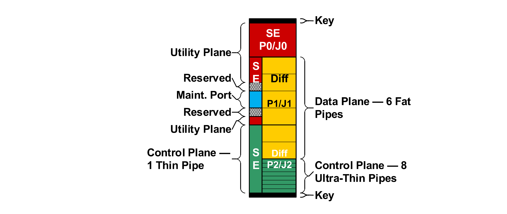

*Figure 28: ANSI/VITA 65.0 Control/Expansion Plane Switch Slot Profile SLT3-SWH-6F8U-14.4.15*

**Table 25: ANSI/VITA 65.1 Module Profiles for SLT3-SWH-6F8U-14.4.15**

| Module Profile names | Dash Num | STD Date | Slot Profile | Protocols for Copper Planes ||| Comments | Legacy |
|---|---|---|---|---|---|---|---|---|
| | | | | Data Plane | Control Plane | Contol Plane | | |
| **MOD3-SWH-6F8U-16.4.16-** | | **Proposed future 65.0** | | **DP01 - DP05, DS01 (FP)** | **CPutp01 - CPutp06, CSutp01** | **CPtp01** | **First row of MOD3-SWH-6F8U-16.4.16-n** | |
| MOD3-SWH-6F8U-16.4.16- | 1 | Proposed future 65.0 | SLT3-SWH-6F8U-14.4.15 | PCIe Gen 3 -- 5.3.3.3 | 10GBASE-KR -- 5.1.7 | 1000BASE-T -- 5.1.3 | | |
| Last line | | Proposed future 65.0 | | | | | | |

> 转写说明：表头两层级联——第一层 `Protocols for Copper Planes` 横跨其下 Data Plane、Control Plane、Contol Plane 三列；`Module Profile names`、`Dash Num`、`STD Date`、`Slot Profile`、`Comments`、`Legacy` 占满两行。被 colspan 覆盖处留空。
> 转写说明：`Module Profile names` 与 `Dash Num` 两个标目在原书同处一个表头格（左右分置，其间未画竖线）；第二行短横编号以小号字排在该格右端。此处拆作两列照录，两列合并即为完整编号 `MOD3-SWH-6F8U-16.4.16-<n>`；首行无编号数字（原书如此）。
> 转写说明：`Protocols for Copper Planes` 下第三个子列名在原书排作 `Contol Plane`（缺字母 r，非本次转写笔误）。
> 转写说明：`Legacy` 列全表空白；`Proposed future 65.0` 的红色底纹与末行灰底纹系原书高亮，未在 Markdown 中表示。
> 转写说明：本表为单页整表（原书 p.108／PDF 第 128 页），共 3 个数据行。下一页（PDF 第 129 页）顶端为 Permission 5.2.16.5-1 正文，非本表续行，故未续写。

###### 5.2.16.5 3U Control/Data Plane Switch Profile

**Rule 5.2.16.5-1**

SOSA 3U Control/Data Plane Switch Plug-In Cards shall conform to ANSI/VITA 65.0 slot profile SLT3-SWH-6F1U7U-14.4.14 or SLT3-SWH-4F1U7U1J-14.8.7-n. Conformance Methodology: (A)

**Rule 5.2.16.5-2**

SOSA 3U Control/Data Plane Switch Plug-In Cards shall conform to one of the ANSI/VITA

65.1 module profiles in Table 23 or Table 24. Conformance Methodology: (A)

<!-- 原书 p.108 ｜ PDF p.128 -->

**Permission 5.2.16.5-1**

The control plane pipes in ANSI/VITA 65.1 slot profiles SLT3-SWH-6F1U7U-14.4.14 and SLT3-SWH-4F1U7U1J-14.8.7-n can be repurposed to provide a second data plane switch fabric.

**Permission 5.2.16.5-2**

Fiber connections on the front of the ANSI/VITA 65.1 SLT3-SWH-6F1U7U-14.4.14 and the

SLT3-SWH-4F1U7U1J-14.8.7-n slot profiles can be used for Ethernet in/out of the chassis if blind-mate fiber connections are not available or practical.

**Recommendation 5.2.16.5-1**

Vendors of a card based on the ANSI/VITA 65.1 slot profile SLT3-SWH-6F1U7U-14.4.14 should offer a variant of this card that can be used in a backplane with a Switch Slot for SLT3-SWH-4F1U7U1J-14.8.7-0 (i.e., P2B is empty).

**Observation 5.2.16.5-1**

ANSI/VITA 65.1 slot profiles SLT3-SWH-6F1U7U-14.4.14 and SLT3-SWH-4F1U7U1J-14.8.7-n can be daisy chained to support additional payload slots, although this successively increases the risk of bottlenecks on inter-switch connections. As such, larger backplanes may wish to use all pipes for data plane connections to minimize the number of inter-switch connections that are required. This approach assumes that ANSI/VITA 65.1 slot profile SLT3-SWH-6F8U-14.4.15 is also used to provide the switch fabric for the control plane.

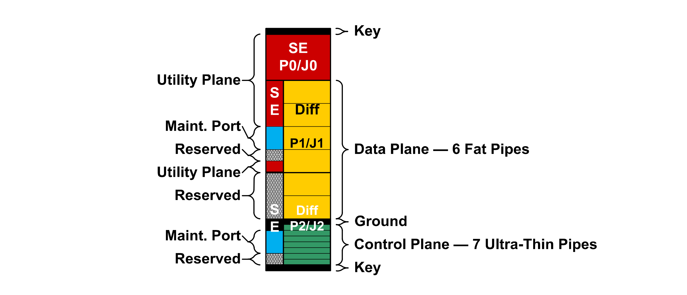

*Figure 29: ANSI/VITA 65.0 Control/Data Plane Switch Slot Profile SLT3-SWH-6F1U7U-14.4.14*

**Table 26: ANSI/VITA 65.1 Module Profiles for SLT3-SWH-6F1U7U-14.4.14**

| Module Profile names | Dash Num | STD Date | Slot Profile | Protocols for Copper Planes |||| Comments | Legacy |
|---|---|---|---|---|---|---|---|---|---|
| | | | | Data Plane | Data Plane | Control Plane | Contol Plane | | |
| **MOD3-SWH-6F1U7U-16.4.15-** | | | | **DS01, DP01 - DP04 (FP)** | **DP05** | **CPutp01 - CPutp06** | **CSutp01** | **First row of MOD3-SWH-6F1U7U-16.4.15-n** | |
| MOD3-SWH-6F1U7U-16.4.15- | 1 | 2017-05 | SLT3-SWH-6F1U7U-14.4.14 | 10GBASE-KX4 -- 5.1.5 | As 4 UTPs: 1000BASE-KX -- 5.1.2 | 1000BASE-KX -- 5.1.2 | 1000BASE-KX -- 5.1.2 | | |
| MOD3-SWH-6F1U7U-16.4.15- | 2 | Proposed | SLT3-SWH-6F1U7U-14.4.14 | 10GBASE-KR -- 5.1.7, 40GBASE-KR4 -- 5.1.8 | 10GBASE-KR -- 5.1.7, 40GBASE-KR4 -- 5.1.8 | 10GBASE-KR -- 5.1.7 | 10GBASE-KR -- 5.1.7 | | |
| Last line | | | | | | | | | |

> 转写说明：表头两层级联——第一层 `Protocols for Copper Planes` 横跨其下 Data Plane、Data Plane、Control Plane、Contol Plane 四列；`Module Profile names`、`Dash Num`、`STD Date`、`Slot Profile`、`Comments`、`Legacy` 占满两行。被 colspan 覆盖处留空。
> 转写说明：`Module Profile names` 与 `Dash Num` 两个标目在原书同处一个表头格（左右分置，其间未画竖线）；数据行中短横编号以极小字号排在该格右端（如 `MOD3-SWH-6F1U7U-16.4.15- 1`）。此处拆作两列照录，两列合并即为完整编号 `MOD3-SWH-6F1U7U-16.4.15-<n>`；首行无编号数字（原书如此）。
> 转写说明：`Protocols for Copper Planes` 下第四个子列名在原书排作 `Contol Plane`（缺字母 r，非本次转写笔误）。
> 转写说明：第三行 STD Date 列在原书因列宽不足折为 `Propose` / `d` 两行，此处按单词复原为 `Proposed`；`Legacy` 列全表空白；末行除 `Last line` 外全为灰底空白。
> 转写说明：本表为单页整表（原书 p.109／PDF 第 129 页），共 4 个数据行。下一页（PDF 第 130 页）顶端为 Figure 30，非本表续行，故未续写。

<!-- 原书 p.109 ｜ PDF p.129 -->

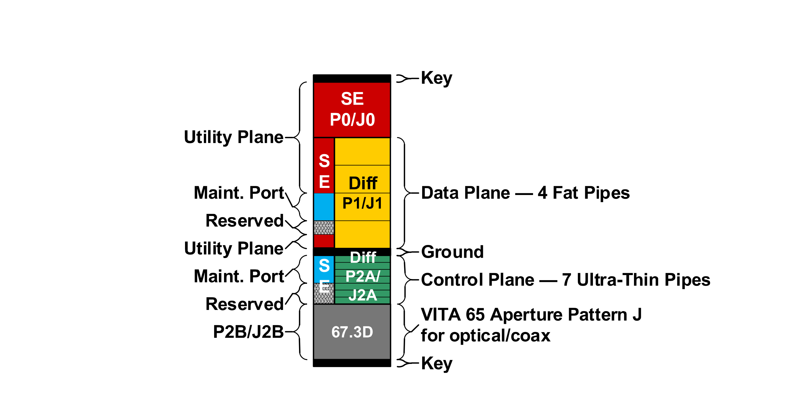

*Figure 30: ANSI/VITA 65.0 Control/Data Plane Switch Slot Profile SLT3-SWH-4F1U7U1J-14.8.7-n*

**Table 27: ANSI/VITA 65.1 Module Profiles for SLT3-SWH-4F1U7U1J-14.8.7-n**

| Module Profile names | Dash Num | STD Date | Slot Profile | Protocols for Copper Planes ||| Protocols for Optical | Comments | Legacy |
|---|---|---|---|---|---|---|---|---|---|
| | | | | Data Plane | Data Plane | Control Plane | | | |
| **MOD3-SWH-4F1U7U1J-16.8.7-** | | | | **DS01, DP01, DP02** | **DP03** | **CSutp01, CPutp01 - CPutp06** | | **First row of MOD3-SWH-4F1U7U1J-16.8.7-n** | |
| MOD3-SWH-4F1U7U1J-16.8.7- | 1 | 2017-05 | SLT3-SWH-4F1U7U1J-14.8.7-1 | 10GBASE-KX4 -- 5.1.5 | As 4 UTPs: 1000BASE-KX -- 5.1.2 | 1000BASE-KX -- 5.1.2 | | | |
| MOD3-SWH-4F1U7U1J-16.8.7- | 2 | Proposed | SLT3-SWH-4F1U7U1J-14.8.7-0 | 10GBASE-KR -- 5.1.7, 40GBASE-KR4 -- 5.1.8 | 10GBASE-KR -- 5.1.7, 40GBASE-KR4 -- 5.1.8 | 10GBASE-KR -- 5.1.7 | | | |
| Last line | | | | | | | | | |

> 转写说明：表头两层级联——第一层 `Protocols for Copper Planes` 横跨其下 Data Plane、Data Plane、Control Plane 三列（原书该组标目偏左，压过第一道子列线）；`Module Profile names`、`Dash Num`、`STD Date`、`Slot Profile`、`Protocols for Optical`、`Comments`、`Legacy` 占满两行。被 colspan 覆盖处留空。
> 转写说明：`Module Profile names` 与 `Dash Num` 两个标目在原书同处一个表头格（左右分置，其间未画竖线）；数据行中短横编号以小号字排在该格右端。此处拆作两列照录，两列合并即为完整编号 `MOD3-SWH-4F1U7U1J-16.8.7-<n>`。
> 转写说明：第三行 STD Date 列在原书因列宽不足折为 `Propose` / `d` 两行，此处按单词复原为 `Proposed`；第二行槽位档 `SLT3-SWH-4F1U7U1J-14.8.7-1` 在原书为蓝色带下划线的超链接样式，此处只记文字。
> 转写说明：`Protocols for Optical` 列与 `Legacy` 列全表空白；末行除 `Last line` 外全为灰底空白。
> 转写说明：本表为单页整表（原书 p.110／PDF 第 130 页），共 4 个数据行。下一页（PDF 第 131 页）顶端为 Figure 31，非本表续行，故未续写。

###### 5.2.16.6 3U SOSA RF Switch Plug-In Card Profile

**Rule 5.2.16.6-1**

SOSA 3U RF Switch Plug-In Cards shall conform to ANSI/VITA 65.0 slot profile SLT3-SWH-1F1S1S1U1U1K-14.8.8-n per. Conformance Methodology: (A)

**Rule 5.2.16.6-2**

SOSA 3U RF Switch Plug-In Cards shall conform to one of the ANSI/VITA 65.1 module profiles in Table 28. Conformance Methodology: (A)

<!-- 原书 p.110 ｜ PDF p.130 -->

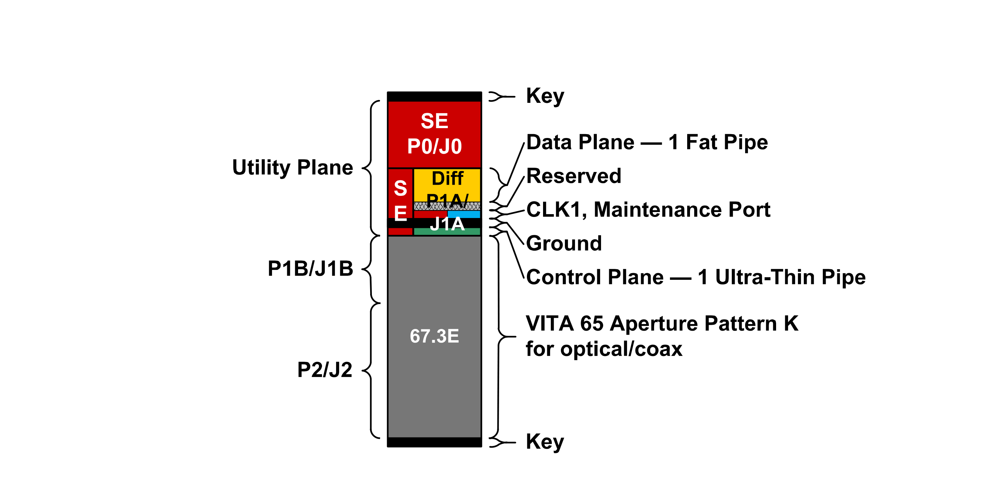

*Figure 31: ANSI/VITA 65.0 3U RF Switch Slot Profile SLT3-SWH-1F1S1S1U1U1K-14.8.8-n*

**Table 28: ANSI/VITA 65.1 Module Profiles for SLT3-SWH-1F1S1S1U1U1K-14.8.8-n**

| Module Profile names | Dash Num | STD Date | Slot Profile | Protocols for Copper Planes || Protocols for Optical | Comments | Legacy |
|---|---|---|---|---|---|---|---|---|
| | | | | Data Plane | Control Plane | | | |
| **MOD3-SWH-1F1S1S1U1U1K-16.8.8-** | | | | **DP01** | **CPutp01** | | **First row of MOD3-SWH-1F1S1S1U1U1K-16.8.8-n** | |
| MOD3-SWH-1F1S1S1U1U1K-16.8.8- | 1 | 2017-05 | SLT3-SWH-1F1S1S1U1U1K-14.8.8-1 | 10GBASE-KX4 -- 5.1.5 | 1000BASE-KX -- 5.1.2 | | | |
| MOD3-SWH-1F1S1S1U1U1K-16.8.8- | 2 | Proposed | SLT3-SWH-1F1S1S1U1U1K-14.8.8-0 | 10GBASE-KR -- 5.1.7, 40GBASE-KR4 -- 5.1.8 | 10GBASE-KR -- 5.1.7 | | | |
| Last line | | | | | | | | |

> 转写说明：表头两层级联——第一层 `Protocols for Copper Planes` 横跨其下 Data Plane、Control Plane 两列；`Module Profile names`、`Dash Num`、`STD Date`、`Slot Profile`、`Protocols for Optical`、`Comments`、`Legacy` 占满两行。被 colspan 覆盖处留空。
> 转写说明：`Module Profile names` 与 `Dash Num` 两个标目在原书同处一个表头格（左右分置，其间未画竖线）；数据行中短横编号以小号字排在该格右端。此处拆作两列照录，两列合并即为完整编号 `MOD3-SWH-1F1S1S1U1U1K-16.8.8-<n>`；首行无编号数字（原书如此）。
> 转写说明：第三行 STD Date 列在原书因列宽不足折为 `Propose` / `d` 两行，此处按单词复原为 `Proposed`；第二行槽位档 `SLT3-SWH-1F1S1S1U1U1K-14.8.8-1` 在原书为蓝色带下划线的超链接样式，此处只记文字。
> 转写说明：`Protocols for Optical` 列与 `Legacy` 列全表空白；末行除 `Last line` 外全为灰底空白。
> 转写说明：本表为单页整表（原书 p.111／PDF 第 131 页），共 4 个数据行。下一页（PDF 第 132 页）顶端为 Observation 5.2.16.7-1 正文与 Figure 32，非本表续行，故未续写。

###### 5.2.16.7 SOSA 3U Radial Clock Plug-In Card Profiles

**Rule 5.2.16.7-1**

SOSA 3U Radial Clock Plug-In Cards shall conform to ANSI/VITA 65.0 slot profile SLT3x-

TIM-2S1U22S1U2U1H-14.9.2-n. Conformance Methodology: (A)

**Rule 5.2.16.7-2**

SOSA 3U Radial Clock Plug-In Cards shall only drive REF_CLK+/- if SYS_CON* is asserted. Conformance Methodology: (T)

**Rule 5.2.16.7-3**

SOSA 3U Radial Clock Plug-In Cards shall assert SYSRESET* until all internal clocks are valid. Conformance Methodology: (T)

**Rule 5.2.16.7-4**

SOSA 3U Radial Clock Plug-In Cards shall conform to one of the ANSI/VITA 65.1 module profiles in Table 29 and Table 30. Conformance Methodology: (A)

<!-- 原书 p.111 ｜ PDF p.131 -->

**Observation 5.2.16.7-1**

- ANSI/VITA 65.0 §6.2.2 requires the lower-numbered ports to be the ones that are used if there are some unused ports. The lower-numbered ports are the ones closest to P0/J0; hence if backplanes follow this requirement, the option of using SLT3x-TIM-4S16S1U2U1H-14.9.1-n for eight or fewer REF_CLK/AUX_CLK pairs will be accommodated.

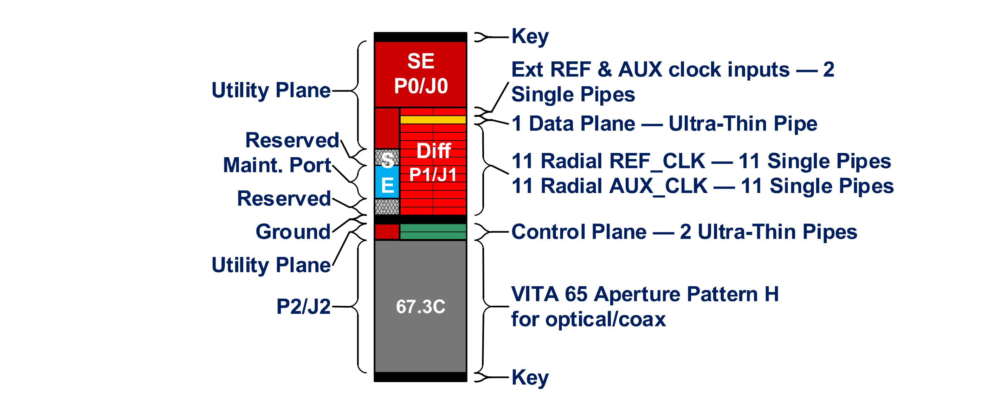

*Figure 32: ANSI/VITA 65.0 Radial Clock Slot Profile SLT3x-TIM-2S1U22S1U2U1H-14.9.2-n*

**Table 29: VITA 65.1 Slot Profiles for SLT3x-TIM-2S1U22S1U2U1H-14.9.2-n**

| Slot Profile names | Dash Num | STD Date | Connector Modules |  |  | MT loading and Optical Pipes |  |  | Comments |
|---|---|---|---|---|---|---|---|---|---|
|  |  |  | P1B/J1B | P2A/J2A | P2B/J2B | P1B/J1B | P2A/J2A | P2B/J2B |  |
| SLT3x-TIM-2S1U22S1U2U1H-14.9.2- |  | Proposed future 65.0 | VITA 46 | Aperture H |  | VITA 46 | Aperture H |  | First row of SLT3x-TIM-2S1U22S1U2U1H-14.9.2-n |
| SLT3x-TIM-2S1U22S1U2U1H-14.9.2- | 0 | Proposed future 65.0 | VITA 46 | Empty |  |  |  |  |  |
| SLT3x-TIM-2S1U22S1U2U1H-14.9.2- | 1 | Proposed future 65.0 | VITA 46 | 10 SMPM contacts-6.4.5.6.3 |  |  |  |  |  |
| Last line |  | Proposed future 65.0 |  |  |  |  |  |  |  |

> 转写说明：
> 1. 表头为两层：第一行为分组标题，第二行（加粗）为子列标题，照原表第 2 行录。`Connector Modules` 横跨 P1B/J1B、P2A/J2A、P2B/J2B 三列，`MT loading and Optical Pipes` 横跨其后三列，被覆盖的单元格留空。
> 2. 原表 `Slot Profile names` 与 `Dash Num` 之间无竖线（扫描件如此），本表依表头文字分为两列；拼接后的完整配置档编号为 `SLT3x-TIM-2S1U22S1U2U1H-14.9.2-n`、`…-14.9.2-0`、`…-14.9.2-1`。
> 3. `Connector Modules` 的 P2A/J2A 与 P2B/J2B 在数据行上合并为一格（`Aperture H`、`Empty`、`10 SMPM contacts-6.4.5.6.3`），值记在 P2A/J2A 列，P2B/J2B 列留空；`MT loading and Optical Pipes` 同此，仅第一行有值 `VITA 46`、`Aperture H`。
> 4. `Last line` 为原表的收尾行标签（灰色底），照录。

**Table 30: VITA 65.1 Module Profiles for SLT3x-TIM-2S1U22S1U2U1H-14.9.2-n**

| Module Profile names | Dash Num | STD Date | Slot Profile | Protocols for Copper Planes |  |  | Protocols for Optical and Signals for Coax Contacts |  |  |  |  |  |  |  |  |  |
|---|---|---|---|---|---|---|---|---|---|---|---|---|---|---|---|---|
|  |  |  |  | Data Plane | Control Plane | Contol Plane | Coax Contacts for Connector Module 10_SMPM_contacts-6.4.5.6.3 |  |  |  |  |  |  |  |  |  |
|  |  |  |  |  |  |  | **A1** | **A2** | **A3** | **B1** | **B2** | **B3** | **B4** | **C1** | **C2** | **C3** |
| MOD3x-TIM-2S1U22S1U2U1H-14.9.3- |  | Proposed future 65.0 |  | DPutp01 | CPutp01, Cputp02 |  |  |  |  |  |  |  |  |  |  |  |
|  |  | Proposed future 65.0 |  |  |  |  |  |  |  |  |  |  |  |  |  |  |
| MOD3p-TIM-2S1U22S1U2U1H-14.9.3- | 1 | Proposed future 65.0 | SLT3p-TIM-2S1U22S1U2U1H-14.9.3-1 | 1000BASE-KX -- 5.1.2 | 1000BASE-KX -- 5.1.2 |  | REF_CLK_Out --5.13.1 | AUX_CLK_Out -- 5.13.1 | RSVD | AUX_CLK_In -- 5.13.1 | REF_CLK_In -- 5.13.1 | RSVD | RSVD | RSVD | GPS_Ant2_In -- 5.13.2 | GPS_Ant1_In -- 5.13.2 |
| MOD3p-TIM-2S1U22S1U2U1H-14.9.3- | 2 | Proposed future 65.0 | SLT3p-TIM-2S1U22S1U2U1H-14.9.3-1 | 10GBASE-KR -- 5.1.7 | 10GBASE-KR -- 5.1.7 |  | REF_CLK_Out --5.13.1 | AUX_CLK_Out -- 5.13.1 | RSVD | AUX_CLK_In -- 5.13.1 | REF_CLK_In -- 5.13.1 | RSVD | RSVD | RSVD | GPS_Ant2_In -- 5.13.2 | GPS_Ant1_In -- 5.13.2 |
| Last line |  | Proposed future 65.0 |  |  |  |  |  |  |  |  |  |  |  |  |  |  |

> 转写说明：
> 1. 表头为多层：第 1 行是分组标题（`Protocols for Copper Planes` 横跨 `Data Plane`／`Control Plane`／`Contol Plane` 三列；`Protocols for Optical and Signals for Coax Contacts` 横跨 `A1`～`C3` 十列），第 2、3 行（加粗）是子列标题，被覆盖的单元格留空。原表 `Data Plane` 等子标题与 `Coax Contacts for Connector Module 10_SMPM_contacts-6.4.5.6.3` 组标题同处一条 band（原表数据第 2 行）内，为便于并列成表，组标题置于第 2 行、`A1`～`C3` 置于第 3 行；原表该 band 只剩 `STD Date` 一格有值，即下方第 2 条数据行。
> 2. 原表 `Module Profile names` 与 `Dash Num` 之间无竖线（扫描件如此），本表依表头文字分为两列；拼接后的完整配置档编号为 `MOD3x-TIM-2S1U22S1U2U1H-14.9.3-n`、`MOD3p-TIM-2S1U22S1U2U1H-14.9.3-1`、`MOD3p-TIM-2S1U22S1U2U1H-14.9.3-2`。
> 3. `Protocols for Optical and Signals for Coax Contacts` 下第一行（`MOD3x…` 行）的十个单元格在原表中合并为一格且为空，值行从第三行起才出现（见第 3 条、第 4 条数据行）。
> 4. 原表在 `STD Date` 列把 `Proposed future 65.0` 画成上下相邻的两格（该行其余列未分格），本表按一格记，值不重复。
> 5. 左侧窄列内的换行（如 `CPutp01,`／`Cputp02`、`REF_CLK_`／`Out --5.13.1`）已并回单行，` ` 仅用于原表明确的两行内容；`A1` 列为 `Out --5.13.1`（`--` 后无空格），`A2`～`C3` 各列为 `-- 5.13.1`／`-- 5.13.2`（`--` 后有空格），照原样保留。
> 6. `Contol Plane` 系原表如此拼写（`Control` 缺 `r`），照录。
> 7. `Last line` 为原表的收尾行标签（灰色底），照录。

###### 5.2.16.8 3U External I/O Plug-In Card Profile

**Rule 5.2.16.8-1**

- SOSA 3U External I/O Plug-In Cards shall conform to ANSI/VITA 65.0 slot profile SLT3-

PAY-2U2U-14.2.17. Conformance Methodology: (TBD)

<!-- 原书 p.112 ｜ PDF p.132 -->

**Rule 5.2.16.8-2**

User-defined pins in ANSI/VITA 65.1 slot profile SLT3-PAY-2U2U-14.2.17 shall only interface with platform I/O and not other modules within the system. Conformance Methodology: (TBD)

**Rule 5.2.16.8-3**

SOSA 3U External I/O plug-in cards shall conform to one of the ANSI/VITA 65.1 module profiles in Table 31. Conformance Methodology: (A)

**Observation 5.2.16.8-1**

Instead of routing platform-specific I/O to non-standard payloads, integrators can utilize the SOSA 3U External I/O plug-in card as the platform I/O “data center” where a single plug-in card (or multiple if required) can interface with the platform over platform-specific connections and the rest of the payload plug-in cards over standard expansion or control plane interfaces.

**Recommendation 5.2.16.8-1**

The SOSA 3U I/O Intensive SBC plug-in card profile should be used instead of the SOSA 3U External I/O plug-in card profile if platform-specific I/O can be accommodated by a single XMC.

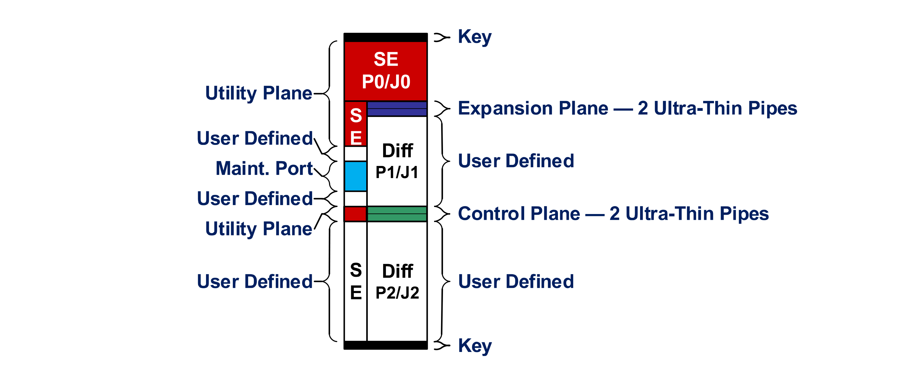

*Figure 33: ANSI/VITA 65.0 3U External I/O Slot Profile SLT3-PAY-2U2U-14.2.17*

**Table 31: ANSI/VITA 65.1 Module Profiles for SLT3-PAY-2U2U-14.2.17**

| Module Profile names | Dash Num | STD Date | Slot Profile | Protocols for Copper Planes |  | Protocols for Optical | Comments |
|---|---|---|---|---|---|---|---|
|  |  |  |  | Data Plane | Control Plane |  |  |
| MOD3-PAY-2U2U-16.2.16- |  | Proposed future 65.0 |  | EPutp01, EPutp02 | CPutp01, CPutp02 |  | First row of MOD3-PAY-2U2U-16.2.16-n |
| MOD3-PAY-2U2U-16.2.16- | 1 | Proposed future 65.0 | SLT3-PAY-2U2U-14.2.17 | PCIe Gen 2 -- 5.3.3.2 | 1000GBASE-KX -- 5.1.2 |  |  |
| MOD3-PAY-2U2U-16.2.16- | 2 | Proposed future 65.0 | SLT3-PAY-2U2U-14.2.17 | PCIe Gen 3 -- 5.3.3.3 | 10GBASE-KR -- 5.1.7 |  |  |
| Last line |  | Proposed future 65.0 |  |  |  |  |  |

> 转写说明：
> 1. 表头为两层：第 1 行为分组标题，第 2 行（加粗）为子列标题，照原表第 2 行录。`Protocols for Copper Planes` 横跨 `Data Plane`、`Control Plane` 两列，被覆盖的单元格留空；`Protocols for Optical` 无子列，各行均空。
> 2. 原表 `Module Profile names` 与 `Dash Num` 之间无竖线（扫描件如此），本表依表头文字分为两列；拼接后的完整配置档编号为 `MOD3-PAY-2U2U-16.2.16-n`、`MOD3-PAY-2U2U-16.2.16-1`、`MOD3-PAY-2U2U-16.2.16-2`。
> 3. 本表 `1000GBASE-KX` 系原表如此（比常见写法 `1000BASE-KX` 多一个 `G`），照录。
> 4. 第一行 `Slot Profile` 为空（通用档 `-n` 不指定具体插槽档），其上方的 `STD Date` 单元格在版面上明显高于其余各行，照录。
> 5. `Last line` 为原表的收尾行标签（灰色底），照录。

<!-- 原书 p.113 ｜ PDF p.133 -->

##### 5.2.17 6U Plug-In Card Profile Specifications

5.2.17.1 6U Payload Plug-In Card Profiles

**Rule 5.2.17.1-1**

SOSA 6U Payload Plug-In Cards shall conform to ANSI/VITA 65.0 slot profile SLT6-PAY-4F2Q1H4U1T1S1S1TU2U2T1H-10.6.4-n or SLT6-PAY-4F1Q1H4U1T1S1S1TU2U2T1H-

10.6.3-n. Conformance Methodology: (A)

**Rule 5.2.17.1-2**

SOSA systems shall route the GPIO pins from ANSI/VITA SLT6-PAY-4F2Q1H4U1T1S1S1TU2U2T1H-10.6.4-n and SLT6-PAY-4F1Q1H4U1T1S1S1TU2U2T1H-10.6.3-n to external platform I/O. Conformance Methodology: (A)

**Rule 5.2.17.1-3**

SOSA systems shall route XMC pins from ANSI/VITA 65.1 slot profile SLT6-PAY-4F1Q1H4U1T1S1S1TU2U2T1H-10.6.3-n to external chassis I/O connectors. Conformance Methodology: (A)

**Rule 5.2.17.1-4**

SOSA 6U Payload Plug-In Cards shall conform to one of the ANSI/VITA 65.1 module profiles in Table 32 or Table 33. Conformance Methodology: (A)

**Rule 5.2.17.1-5**

If a Payload Plug-In Card implements the Control Plane Thin Pipes from ANSI/VITA 65.1 SLT6-PAY-4F2Q1H4U1T1S1S1TU2U2T1H-10.6.4-n or SLT6-PAY-

4F1Q1H4U1T1S1S1TU2U2T1H-10.6.3-n, the Payload Plug-In Card shall use the Control Plane Thin Pipes exclusively for communication external to the system. Conformance Methodology: (A)

**Observation 5.2.17.1-1**

Payload Plug-In Cards can include, but are not limited to, SBCs that are input/output (I/O)intensive, SBCs that are computationally-intensive, FPGAs, and RF transceivers.

**Recommendation 5.2.17.1-1**

Payload Plug-In Cards should conform to ANSI/VITA 65.1 slot profile SLT6-PAY-4F2Q1H4U1T1S1S1TU2U2T1H-10.6.4-n if they don’t require an XMC.

**Observation 5.2.17.1-2**

SOSA systems will likely only contain one or two plug-in cards that support ANSI/VITA 65.1 slot profile SLT6-PAY-4F1Q1H4U1T1S1S1TU2U2T1H-10.6.3-n. These slots can use an XMC to customize I/O for a particular system or platform. The remaining plug-in cards will use

<!-- 原书 p.114 ｜ PDF p.134 -->

ANSI/VITA 65.1 slot profile SLT6-PAY-4F2Q1H4U1T1S1S1TU2U2T1H-10.6.4-n to support processing for the various sensor modalities.

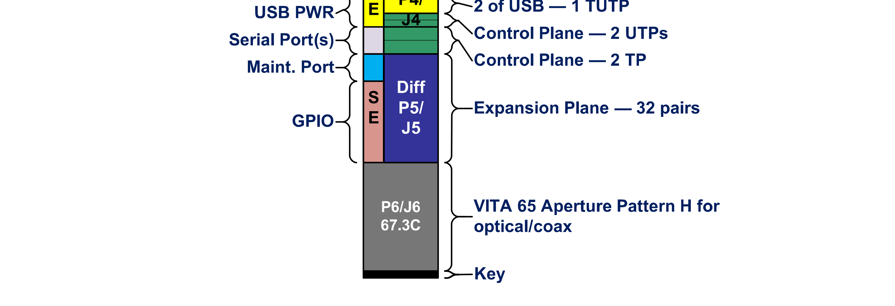

*Figure 34: ANSI/VITA 65.0 6U Payload Slot Profile SLT6-PAY-4F2Q1H4U1T1S1S1TU2U2T1H-*

10.6.4-n

**Table 32: ANSI/VITA 65.1 Slot Profiles for SLT6-PAY-4F2Q1H4U1T1S1S1TU2U2T1H-10.6.4-n**

| Slot Profile names | Dash Num | STD Date | Connector Modules |  |  |  | MT loading and Optical Pipes |  |
|---|---|---|---|---|---|---|---|---|
|  |  |  | P1/J1 , P2/J2 | P3/J3 | P4/J4, P5/J5 | P6/J6 | P3/J3 | P6/J6 |
| SLT6-PAY-4F2Q1H4U1T1S1S1TU2U2T1H-10.6.4- |  | Proposed future 65.0 | VITA 46 | Aperture H | VITA 46 | Aperture H | Aperture H | Aperture H |
| SLT6-PAY-4F2Q1H4U1T1S1S1TU2U2T1H-10.6.4- | 0 | Proposed future 65.0 | VITA 46 | Empty | VITA 46 | Empty | Empty | Empty |
| Last line |  | Proposed future 65.0 |  |  |  |  |  |  |

> 转写说明：
> 1. 表头为两层：第 1 行为分组标题，第 2 行（加粗）为子列标题，照原表第 2 行录。`Connector Modules` 横跨 `P1/J1 , P2/J2`、`P3/J3`、`P4/J4, P5/J5`、`P6/J6` 四列，`MT loading and Optical Pipes` 横跨其后 `P3/J3`、`P6/J6` 两列，被覆盖的单元格留空。
> 2. 原表 `Slot Profile names` 与 `Dash Num` 之间无竖线（扫描件如此），本表依表头文字分为两列；拼接后的完整配置档编号为 `SLT6-PAY-4F2Q1H4U1T1S1S1TU2U2T1H-10.6.4-n` 与 `…-10.6.4-0`。
> 3. 该编号的字符序列经 6 倍放大逐字核对：`…4F2Q1H4U1T1S1S1TU2U2T1H…`，即 `1T` 与 `U2` 之间**无** `1`（不是 `…1S1S1T1U2U2T1H…`）。
> 4. 子列标题 `P1/J1 , P2/J2` 的逗号前有空格，`P4/J4, P5/J5` 的逗号前无空格，均照原表。
> 5. `Last line` 为原表的收尾行标签（灰色底），照录。

<!-- 原书 p.115 ｜ PDF p.135 -->

**Table 33: ANSI/VITA 65.1 Module Profiles for SLT6-PAY-4F2Q1H4U1T1S1S1TU2U2T1H-10.6.4-n**

| Module Profile names | Dash Num | STD Date | Slot Profile | Protocols for Copper Planes |  |  |  | Miscellaneous Protocols over copper connectors |  |  |  |  |  | Protocols for Optical |
|---|---|---|---|---|---|---|---|---|---|---|---|---|---|---|
|  |  |  |  | Data Plane | Exp. Plane | Control Plane | Control Plane |  |  |  |  |  |  |  |
| MOD6-PAY-4F2Q1H4U1T1S1S1TU2U2T1H-12.6.4- |  | Proposed future 65.0 |  | DP01 - DP04 (FPs) | EP00 - EP15 | CPutp01, CPutp02 | CPtp01, CPtp02 | STRutp01 - STRutp04 | USB01, USB02 | VID01 | SER01 | GPIO1 - GPIO10 | GPIvds01 |  |
| MOD6-PAY-4F2Q1H4U1T1S1S1TU2U2T1H-12.6.4- | 1 | Proposed future 65.0 | SLT6-PAY-4F2Q1H4U1T1S1S1TU2U2T1H-10.6.4-0 | 10GBASE-KX4 -- 5.1.5 | PCIe Gen 2 -- 5.3.3.2 | 1000BASE-KX -- 5.1.2 | 1000BASE-T -- 5.1.3 | SATA Gen 2 -- 5.6.2 | USB 2 -- 5.9.1 | DisplayPort 1.2 -- 5.10.2 | Serial Ports -- 5.12.1 | GPIO -- 5.14.1 | GPLVDS -- 5.14.2 |  |
| MOD6-PAY-4F2Q1H4U1T1S1S1TU2U2T1H-12.6.4- | 2 | Proposed future 65.0 | SLT6-PAY-4F2Q1H4U1T1S1S1TU2U2T1H-10.6.4-0 | 40GBASE-KR4 -- 5.1.8 | PCIe Gen 3 -- 5.3.3.3 | 10GBASE-KR -- 5.1.7 | 10GBASE-T -- 5.1.6 | SATA Gen 3 -- 5.6.3 | USB 3.1 Gen 2 -- 5.9.3 | DisplayPort 1.2 -- 5.10.2 | Serial Ports -- 5.12.1 | GPIO -- 5.14.1 | GPLVDS -- 5.14.2 |  |
| MOD6-PAY-4F2Q1H4U1T1S1S1TU2U2T1H-12.6.4- | 3 | Proposed | SLT6-PAY-4F2Q1H4U1T1S1S1TU2U2T1H-10.6.4-0 | 40GBASE-KR4 -- 5.1.8 | Aurora -- 5.7.2 | 10GBASE-KR -- 5.1.7 | 10GBASE-T -- 5.1.6 | SATA Gen 3 -- 5.6.3 | USB 3.1 Gen 2 -- 5.9.3 | DisplayPort 1.2 -- 5.10.2 | Serial Ports -- 5.12.1 | GPIO -- 5.14.1 | GPLVDS -- 5.14.2 |  |
| MOD6-PAY-4F2Q1H4U1T1S1S1TU2U2T1H-12.6.4- | 4 | Proposed | SLT6-PAY-4F2Q1H4U1T1S1S1TU2U2T1H-10.6.4-1 | 10GBASE-KR -- 5.1.7 | PCIe Gen 3 -- 5.3.3.3 | 1000BASE-KX -- 5.1.2 | 1000BASE-T -- 5.1.3 | SATA Gen 3 -- 5.6.3 | USB 3.1 Gen 2 -- 5.9.3 | DisplayPort 1.2 -- 5.10.2 | Serial Ports -- 5.12.1 | GPIO -- 5.14.1 | GPLVDS -- 5.14.2 |  |
| MOD6-PAY-4F2Q1H4U1T1S1S1TU2U2T1H-12.6.4- | 5 | Proposed | SLT6-PAY-4F2Q1H4U1T1S1S1TU2U2T1H-10.6.4-1 | 10GBASE-KR -- 5.1.7 | Aurora -- 5.7.2 | 1000BASE-KX -- 5.1.2 | 1000BASE-T -- 5.1.3 | SATA Gen 3 -- 5.6.3 | USB 3.1 Gen 2 -- 5.9.3 | DisplayPort 1.2 -- 5.10.2 | Serial Ports -- 5.12.1 | GPIO -- 5.14.1 | GPLVDS -- 5.14.2 |  |
| MOD6-PAY-4F2Q1H4U1T1S1S1TU2U2T1H-12.6.4- | 6 | Proposed | SLT6-PAY-4F2Q1H4U1T1S1S1TU2U2T1H-10.6.4-2 | 40GBASE-KR4 -- 5.1.8 | PCIe Gen 3 -- 5.3.3.3 | 10GBASE-KR -- 5.1.7 | 10GBASE-T -- 5.1.6 | SATA Gen 3 -- 5.6.3 | USB 3.1 Gen 2 -- 5.9.3 | DisplayPort 1.2 -- 5.10.2 | Serial Ports -- 5.12.1 | GPIO -- 5.14.1 | GPLVDS -- 5.14.2 |  |
| MOD6-PAY-4F2Q1H4U1T1S1S1TU2U2T1H-12.6.4- | 7 | Proposed | SLT6-PAY-4F2Q1H4U1T1S1S1TU2U2T1H-10.6.4-2 | 40GBASE-KR4 -- 5.1.8 | Aurora -- 5.7.2 | 10GBASE-KR -- 5.1.7 | 10GBASE-T -- 5.1.6 | SATA Gen 3 -- 5.6.3 | USB 3.1 Gen 2 -- 5.9.3 | DisplayPort 1.2 -- 5.10.2 | Serial Ports -- 5.12.1 | GPIO -- 5.14.1 | GPLVDS -- 5.14.2 |  |

> 转写说明：
> 1. 表头为两层：第 1 行为分组标题，第 2 行（加粗）为子列标题；原表 `Protocols for Copper Planes` 下四个子列标题依次为 `Data Plane`、`Exp. Plane`、`Control Plane`、`Control Plane`（后两列同名），被覆盖的单元格留空；`Miscellaneous Protocols over copper connectors` 横跨六列，此六列原表**未设**子列标题，标题行第二层留空，各列含义由第一行数据（`STRutp01 - STRutp04`、`USB01, USB02`、`VID01`、`SER01`、`GPIO1 - GPIO10`、`GPIvds01`）给出；`Protocols for Optical` 为单列，各行均空。
> 2. 原表 `Module Profile names` 与 `Dash Num` 之间无竖线（扫描件如此），本表依表头文字分为两列；拼接后的完整配置档编号为 `MOD6-PAY-4F2Q1H4U1T1S1S1TU2U2T1H-12.6.4-n` 及其 `-1`～`-7` 各档。
> 3. 八行 `Module Profile names` 的版本段经 6 倍放大逐字核对，**均为 `12.6.4-`**（不是 `12.6.5`／`12.6.6`／`12.6.7`）；变化的只是 `Dash Num`。
> 4. `Slot Profile` 取值 `SLT6-PAY-4F2Q1H4U1T1S1S1TU2U2T1H-10.6.4-0`（第一至三行数据）与 `…-10.6.4-1`（第四、五行数据）、`…-10.6.4-2`（第六、七行数据）。
> 5. `STD Date` 列前三行数据为 `Proposed future 65.0`（红底），其余五行为 `Proposed`（灰底），照原表。
> 6. 表头 `GPIvds01` 与同列数据 `GPLVDS -- 5.14.2` 在拼写上不一致，均照原表录，未作统一。
> 7. 单元格内的换行（如 `SLT6-PAY-`／`4F2Q1H4U1T1S1S1TU2U2T1H-`／`10.6.4-0` 三行、`40GBASE-KR4 --`／`5.1.8` 两行）系窄列折行，已并回单行。

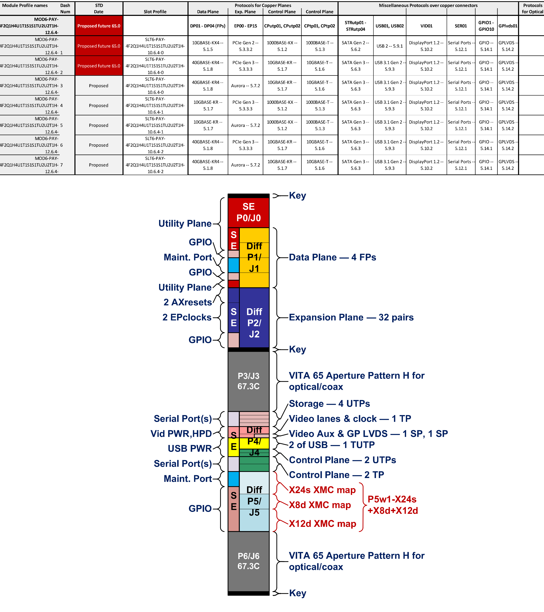

*Figure 35: ANSI/VITA 65.0 6U Payload Slot Profile SLT6-PAY-4F1Q1H4U1T1S1S1TU2U2T1H-*

10.6.3-n

<!-- 原书 p.116 ｜ PDF p.136 -->

**Table 34: ANSI/VITA 65.1 Module Profiles for SLT6-PAY-4F1Q1H4U1T1S1S1TU2U2T1H-10.6.3-n**

| Module Profile names | Dash Num | STD Date | Slot Profile | Protocols for Copper Planes |  |  |  | Miscellaneous Protocols over copper connectors |  |  |  |  |  | Protocols for Optical |
|---|---|---|---|---|---|---|---|---|---|---|---|---|---|---|
|  |  |  |  | Data Plane | Exp. Plane | Control Plane | Control Plane |  |  |  |  |  |  |  |
| MOD6-PAY-4F1Q1H4U1T1S1S1TU2U2T1H-12.6.3- |  | Proposed future 65.0 |  | DP01 - DP04 (FPs) | EP00 - EP15 | CPutp01, CPutp02 | CPtp01, CPtp02 | STRutp01 - STRutp04 | USB01, USB02 | VID01 | SER01 | GPIO1 - GPIO10 | GPIvds01 |  |
| MOD6-PAY-4F1Q1H4U1T1S1S1TU2U2T1H-12.6.3- | 1 | Proposed future 65.0 | SLT6-PAY-4F1Q1H4U1T1S1S1TU2U2T1H-10.6.3-0 | 10GBASE-KX4 -- 5.1.5 | PCIe Gen 2 -- 5.3.3.2 | 1000BASE-KX -- 5.1.2 | 1000BASE-T -- 5.1.3 | SATA Gen 2 -- 5.6.2 | USB 2 -- 5.9.1 | DisplayPort 1.2 -- 5.10.2 | Serial Ports -- 5.12.1 | GPIO -- 5.14.1 | GPLVDS -- 5.14.2 |  |
| MOD6-PAY-4F1Q1H4U1T1S1S1TU2U2T1H-12.6.3- | 2 | Proposed future 65.0 | SLT6-PAY-4F1Q1H4U1T1S1S1TU2U2T1H-10.6.3-0 | 40GBASE-KR4 -- 5.1.8 | PCIe Gen 3 -- 5.3.3.3 | 10GBASE-KR -- 5.1.7 | 10GBASE-T -- 5.1.6 | SATA Gen 3 -- 5.6.3 | USB 3.1 Gen 2 -- 5.9.3 | DisplayPort 1.2 -- 5.10.2 | Serial Ports -- 5.12.1 | GPIO -- 5.14.1 | GPLVDS -- 5.14.2 |  |
| MOD6-PAY-4F1Q1H4U1T1S1S1TU2U2T1H-12.6.3- | 3 | Proposed | SLT6-PAY-4F2Q1H4U1T1S1S1TU2U2T1H-10.6.4-0 | 40GBASE-KR4 -- 5.1.8 | Aurora -- 5.7.2 | 10GBASE-KR -- 5.1.7 | 10GBASE-T -- 5.1.6 | SATA Gen 3 -- 5.6.3 | USB 3.1 Gen 2 -- 5.9.3 | DisplayPort 1.2 -- 5.10.2 | Serial Ports -- 5.12.1 | GPIO -- 5.14.1 | GPLVDS -- 5.14.2 |  |
| MOD6-PAY-4F1Q1H4U1T1S1S1TU2U2T1H-12.6.3- | 4 | Proposed | SLT6-PAY-4F2Q1H4U1T1S1S1TU2U2T1H-10.6.4-1 | 10GBASE-KR -- 5.1.7 | PCIe Gen 3 -- 5.3.3.3 | 1000BASE-KX -- 5.1.2 | 1000BASE-T -- 5.1.3 | SATA Gen 3 -- 5.6.3 | USB 3.1 Gen 2 -- 5.9.3 | DisplayPort 1.2 -- 5.10.2 | Serial Ports -- 5.12.1 | GPIO -- 5.14.1 | GPLVDS -- 5.14.2 |  |
| MOD6-PAY-4F1Q1H4U1T1S1S1TU2U2T1H-12.6.3- | 5 | Proposed | SLT6-PAY-4F2Q1H4U1T1S1S1TU2U2T1H-10.6.4-1 | 10GBASE-KR -- 5.1.7 | Aurora -- 5.7.2 | 1000BASE-KX -- 5.1.2 | 1000BASE-T -- 5.1.3 | SATA Gen 3 -- 5.6.3 | USB 3.1 Gen 2 -- 5.9.3 | DisplayPort 1.2 -- 5.10.2 | Serial Ports -- 5.12.1 | GPIO -- 5.14.1 | GPLVDS -- 5.14.2 |  |
| MOD6-PAY-4F1Q1H4U1T1S1S1TU2U2T1H-12.6.3- | 6 | Proposed | SLT6-PAY-4F2Q1H4U1T1S1S1TU2U2T1H-10.6.4-2 | 40GBASE-KR4 -- 5.1.8 | PCIe Gen 3 -- 5.3.3.3 | 10GBASE-KR -- 5.1.7 | 10GBASE-T -- 5.1.6 | SATA Gen 3 -- 5.6.3 | USB 3.1 Gen 2 -- 5.9.3 | DisplayPort 1.2 -- 5.10.2 | Serial Ports -- 5.12.1 | GPIO -- 5.14.1 | GPLVDS -- 5.14.2 |  |
| MOD6-PAY-4F1Q1H4U1T1S1S1TU2U2T1H-12.6.3- | 7 | Proposed | SLT6-PAY-4F2Q1H4U1T1S1S1TU2U2T1H-10.6.4-2 | 40GBASE-KR4 -- 5.1.8 | Aurora -- 5.7.2 | 10GBASE-KR -- 5.1.7 | 10GBASE-T -- 5.1.6 | SATA Gen 3 -- 5.6.3 | USB 3.1 Gen 2 -- 5.9.3 | DisplayPort 1.2 -- 5.10.2 | Serial Ports -- 5.12.1 | GPIO -- 5.14.1 | GPLVDS -- 5.14.2 |  |

> 转写说明：
> 1. 本表完整落在 PDF p137（印刷页 117）一页内：p137 顶端即本表题注，表末（第 8 行数据之后）紧接 5.2.17.2 节正文，故无跨页续表，也未取下一页。
> 2. 表头为两层：第 1 行为分组标题，第 2 行（加粗）为子列标题。`Protocols for Copper Planes` 下四个子列标题依次为 `Data Plane`、`Exp. Plane`、`Control Plane`、`Control Plane`（后两列同名）；`Miscellaneous Protocols over copper connectors` 横跨六列，此六列原表未设子列标题，各列含义由第一行数据（`STRutp01 - STRutp04`、`USB01, USB02`、`VID01`、`SER01`、`GPIO1 - GPIO10`、`GPIvds01`）给出；`Protocols for Optical` 为单列，各行均空。
> 3. 原表 `Module Profile names` 与 `Dash Num` 之间无竖线（扫描件如此），本表依表头文字分为两列；完整配置档编号为 `MOD6-PAY-4F1Q1H4U1T1S1S1TU2U2T1H-12.6.3-n` 及 `-1`～`-7`。
> 4. 八行的版本段 `12.6.3` 经逐字形核对（同字号 `3`／`5`／`2` 的字形对照）确认为 `3`，八行一致；变化的只是 `Dash Num`。
> 5. `Slot Profile` 列前两行数据（`Dash Num` 1、2）为 `SLT6-PAY-4F1Q1H4U1T1S1S1TU2U2T1H-10.6.3-0`；自第三行数据（`Dash Num` 3）起改为 `SLT6-PAY-4F2Q1H4U1T1S1S1TU2U2T1H-10.6.4-…`（`4F1Q`／`10.6.3` 换成 `4F2Q`／`10.6.4`），照原表。
> 6. `STD Date` 列前三行数据为 `Proposed future 65.0`（红底），其余五行为 `Proposed`（灰底），照原表。
> 7. 表头 `GPIvds01` 与同列数据 `GPLVDS -- 5.14.2` 拼写不一致，均照原表，未作统一。
> 8. 窄列折行（`SLT6-PAY-`／`4F1Q1H4U1T1S1S1TU2U2T1H-`／`10.6.3-0`、`40GBASE-KR4 --`／`5.1.8`）系版式折行，已并回单行。

###### 5.2.17.2 SOSA 6U Control/Data Switch Plug-In Card Profile

**Rule 5.2.17.2-1**

- SOSA 6U Control/Data Switch Plug-In Cards shall conform to ANSI/VITA 65.0 slot profile

SLT6-SWH-14F16U1U15U1J-10.8.1-n. Conformance Methodology: (A)

**Rule 5.2.17.2-2**

- SOSA 6U Control/Data Switch Plug-In Cards shall conform to one of the ANSI/VITA 65.1 module profiles in Table 35 or Table 36. Conformance Methodology: (A)

<!-- 原书 p.117 ｜ PDF p.137 -->

- Key-

SE

POIJO

Utility Plane-

Reserved 5E DI

Maint. Port P4fJ1

Resered-

Utility Plane

Df

- Resered- P2f

J2_ Data Plane 14 FPs

Key-

Df

P3f

E

J_

Data Plane

2 TPs

*Figure 36: ANSI/VITA 65.0 6U Control/Data Switch Slot Profile SLT6-SWH-14F16U1U15U1J-*

10.8.1-n

**Table 35: ANSI/VITA 65.1 Slot Profiles for SLT6-SWH-14F16U1U15U1J-10.8.1-n**

| Slot Profile names | Dash Num | STD Date | Connector Modules |  | MT loading and Optical Pipes |  |
|---|---|---|---|---|---|---|
|  |  |  | P1/J1 - P6A/J6A | P6B/J6B | P1/J1 - P6A/J6A | P6B/J6B |
| SLT6-SWH-14F16U1U15U1J-10.8.1- |  | Proposed future 65.0 | VITA 46 | Aperture J | VITA 46 | Aperture J |
| SLT6-SWH-14F16U1U15U1J-10.8.1- | 0 | Proposed future 65.0 | VITA 46 | Empty | VITA 46 |  |
| Last line |  | Proposed future 65.0 |  |  |  |  |

> 转写说明：
> 1. 本表完整落在 PDF p138（印刷页 118）内，紧随其上方 Figure 36。p139 起为 5.2.18 节正文与整页槽位图（p140、p141），无本表续行，故不跨页续写。
> 2. 表头为两层：第 1 行为分组标题，第 2 行（加粗）为子列标题。`Connector Modules` 横跨 `P1/J1 - P6A/J6A`、`P6B/J6B` 两列，`MT loading and Optical Pipes` 横跨其后同名的两列，被覆盖的单元格留空。
> 3. 原表 `Slot Profile names` 与 `Dash Num` 之间无竖线（扫描件如此），本表依表头文字分为两列；完整配置档编号为 `SLT6-SWH-14F16U1U15U1J-10.8.1-n` 与 `…-10.8.1-0`。
> 4. 第 2 行 `MT loading and Optical Pipes` 的 `P6B/J6B` 格在原表中为空（同行其余三格有值），留空照录。
> 5. `Last line` 为原表的收尾行标签（灰色底），照录。

**Table 36: ANSI/VITA 65.1 Module Profiles for SLT6-SWH-14F16U1U15U1J-10.8.1-n**

| Module Profile names | Dash Num | STD Date | Slot Profile | Protocols for Copper Planes |  |  |  |  | Protocols for Optical | Legacy |
|---|---|---|---|---|---|---|---|---|---|---|
|  |  |  |  | Data Plane | Data Plane | Data Plane | Control Plane | Control Plane |  |  |
| MOD6-SWH-14F16U1U15U1J-12.8.1- |  | Proposed future 65.0 |  | DP01 - DP14 (FPs) | DPutp01 - DPutp16 | DPtp01, DPtp02 | CPutp01 - CPutp15 | CPext01 (UTP) |  |  |
| MOD6-SWH-14F16U1U15U1J-12.8.1- | 1 | Proposed future 65.0 | SLT6-SWH-14F16U1U15U1J-10.8.1-0 | 40GBASE-KR4 -- 5.1.8 | 10GBASE-KR -- 5.1.7, 40GBASE-KR4 -- 5.1.8 | 1000BASE-T | 1000BASE-KX -- 5.1.2 | 100BASE-T |  |  |
| MOD6-SWH-14F16U1U15U1J-12.8.1- | 2 | Proposed future 65.0 | SLT6-SWH-14F16U1U15U1J-10.8.1-0 | 40GBASE-KR4 -- 5.1.8 | 10GBASE-KR -- 5.1.7, 40GBASE-KR4 -- 5.1.8 | 1000BASE-T | 10GBASE-KR -- 5.1.7 | 100BASE-T |  |  |
| Last line |  | Proposed future 65.0 |  |  |  |  |  |  |  |  |

> 转写说明：
> 1. 本表完整落在 PDF p138（印刷页 118）下半页，表末（`Last line` 行）之后即页末。p139（印刷页 119）整页是 5.2.18 节正文（Rule 5.2.18-1／5.2.18-2、Recommendation 5.2.18-1），p140、p141 是整页槽位示意图与 Figure 37 的说明文字，均无本表续行——据此判定本表不跨页，未续写。
> 2. 表头为两层：第 1 行为分组标题，第 2 行（加粗）为子列标题。`Protocols for Copper Planes` 横跨五列，其子列标题依次为 `Data Plane`、`Data Plane`、`Data Plane`、`Control Plane`、`Control Plane`（前三列同名、后两列同名，系原表如此）；`Protocols for Optical`、`Legacy` 各为单列，各行均空。
> 3. 原表 `Module Profile names` 与 `Dash Num` 之间无竖线（扫描件如此），本表依表头文字分为两列；完整配置档编号为 `MOD6-SWH-14F16U1U15U1J-12.8.1-n`、`…-12.8.1-1`、`…-12.8.1-2`。
> 4. 原表只有 `Dash Num` 1、2 两档（无 `-0`），照录。
> 5. 窄列折行（`DPtp01,`／`DPtp02`、`CPutp01 -`／`CPutp15`、`10GBASE-KR -- 5.1.7,`／`40GBASE-KR4 -- 5.1.8`、`40GBASE-KR4 --`／`5.1.8`、`1000BASE-KX --`／`5.1.2`）均按原表折行处以 ` ` 保留。
> 6. `Last line` 为原表的收尾行标签（灰色底），照录。

<!-- 原书 p.118 ｜ PDF p.138 -->

##### 5.2.18 SOSA 6U Legacy Switch Plug-In Card Profile

**Rule 5.2.18-1**

SOSA 6U Legacy Switch Plug-In Cards shall conform to ANSI/VITA 65.0 slot profile SLT6-SWH-16U20F-10.4.2. Conformance Methodology: (A)

**Rule 5.2.18-2**

SOSA 6U Legacy Switch Plug-In Cards shall conform to one of the following ANSI/VITA 65.1 module profiles per: MOD6-SWH-16F20U-12.4.2-3

Conformance Methodology: (A)

- MOD6-SWH-16F20U-12.4.2-5

  - Conformance Methodology: (A)

- MOD6-SWH-16F20U-12.4.2-11

  - Conformance Methodology: (A)

- MOD6-SWH-16F20U-12.4.2-15

  - Conformance Methodology: (A)

**Recommendation 5.2.18-1**

It is anticipated that the SLT6-SWH-16U20F-10.4.2 profile will be deprecated from the next version of the SOSA standard and consequently should not be used for new systems.

<!-- 原书 p.119 ｜ PDF p.139 -->

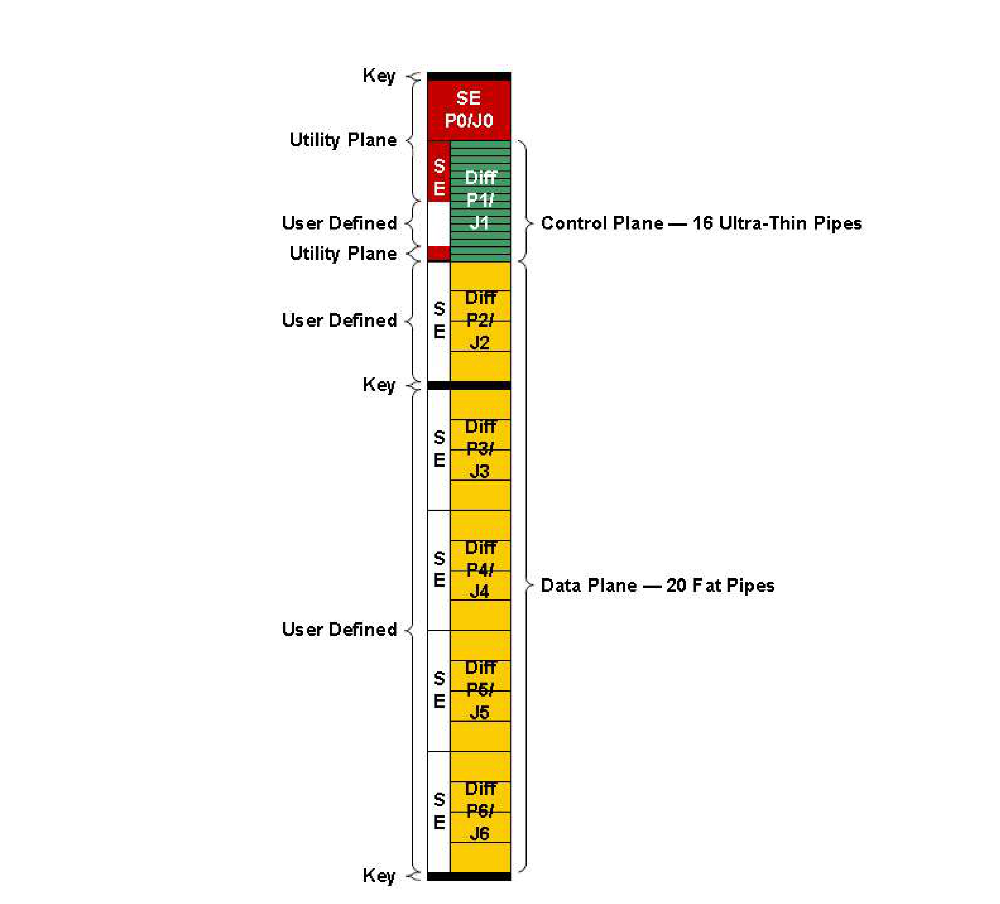

*Figure 37: ANSI/VITA65.0 Switch Slot Profile for SLT6-SWH-16U20F-10.4.2*

##### 5.2.19 SOSA 6U External I/O Plug-In Card Profile

**Rule 5.2.19-1**

SOSA 6U External I/O Plug-In Cards shall conform to ANSI/VITA 65.0 slot profile SLT6-PAY-4U2U-10.2.8. Conformance Methodology: (A)

**Rule 5.2.19-2**

User-defined pins in slot profile SLT6-PAY-4U2U-10.2.8 shall only interface with platform I/O and not other modules within the system. Conformance Methodology: (A)

<!-- 原书 p.120 ｜ PDF p.140 -->

**Rule 5.2.19-3**

SOSA 6U External I/O Plug-In Cards shall conform to one of the ANSI/VITA 65.1 module profiles in Table 37. Conformance Methodology: (A)

**Observation 5.2.19-1**

Instead of routing platform-specific I/O to non-standard payloads, integrators can utilize the SOSA 6U External I/O Plug-In Card as the platform I/O “data center” where a single plug-in card (or multiple if required) can interface with the platform over platform-specific connections and the rest of the payload modules over standard expansion or data plane interfaces.

**Recommendation 5.2.19-1**

The SOSA 6U Payload Plug-In Cards profile should be used instead of the SOSA 6U External I/O Plug-In Card profile if platform-specific I/O can be accommodated by a single XMC.

Key

SE

POIJO

Utility Plane-

5 Expansion Plane 4 Ultra-Thin Pipes

User Defined E Diff

- Maint. Port PIIJ1

User Defined-

Utility Plane User Defined

5 Diff

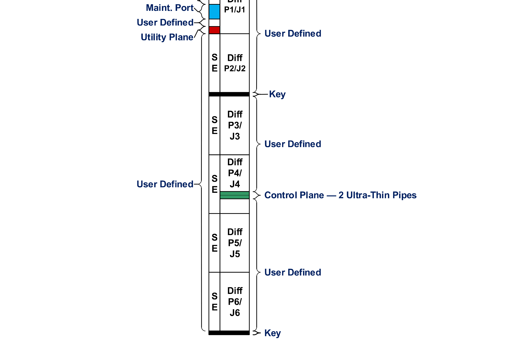

*Figure 38: ANSI/VITA 65.0 6U External I/O Slot Profile SLT6-PAY-4U2U-10.2.8*

<!-- 原书 p.121 ｜ PDF p.141 -->

**Table 37: ANSI/VITA 65.1 Module Profiles for SLT6-PAY-4U2U-10.2.8**

| Module Profile names | Dash Num | STD Date | Slot Profile | Protocols for Copper Planes |  | Protocols for Optical | Comments | Legacy |
|---|---|---|---|---|---|---|---|---|
|  |  |  |  | Expansion Plane | Control Plane |  |  |  |
| MOD6-PAY-4U2U-12.2.8- |  | Proposed future 65.0 |  | EPutp01 - EPutp04 | CPutp01, CPutp02 |  | First row of MOD6-PAY-4U2U-12.2.8-n |  |
| MOD6-PAY-4U2U-12.2.8- | 1 | Proposed future 65.0 | SLT6-PAY-4U2U-10.2.8 | PCIe Gen 2 -- 5.3.3.2 | 1000BASE-KX -- 5.1.2 |  |  |  |
| MOD6-PAY-4U2U-12.2.8- | 2 | Proposed future 65.0 | SLT6-PAY-4U2U-10.2.8 | PCIe Gen 3 -- 5.3.3.3 | 10GBASE-KR -- 5.1.7 |  |  |  |
| Last line |  | Proposed future 65.0 |  |  |  |  |  |  |

> 转写说明：
> 1. 本表完整落在 PDF p142（印刷页 122）上半页，表末（`Last line` 行）之后即 5.2.20 节正文。p143 为 Rule 5.2.20-6～8 正文、p144／p145 为 5.2.22 节正文，均无本表续行——据此判定本表不跨页，未续写。
> 2. 表头为两层：第 1 行为分组标题，第 2 行（加粗）为子列标题。`Protocols for Copper Planes` 横跨 `Expansion Plane`、`Control Plane` 两列，被覆盖的单元格留空；`Protocols for Optical`、`Comments`、`Legacy` 各为单列，`Protocols for Optical` 与 `Legacy` 两列各行均空。
> 3. 原表 `Module Profile names` 与 `Dash Num` 之间无竖线（扫描件如此），本表依表头文字分为两列；完整配置档编号为 `MOD6-PAY-4U2U-12.2.8-n`、`…-12.2.8-1`、`…-12.2.8-2`。
> 4. 本表题注写的是 `SLT6-PAY-4U2U-10.2.8`，而表内 `Module Profile names` 列写的是 `MOD6-PAY-4U2U-12.2.8-`、`Slot Profile` 列写的是 `SLT6-PAY-4U2U-10.2.8`；题注与名义并不矛盾（前者是插槽档、后者是模块档），照录。
> 5. `Last line` 为原表的收尾行标签（灰色底），照录。

##### 5.2.20 Power Supply Module

**Rule 5.2.20-1**

PSM requirements shall be applied using the following order of precedence: Requirements of this SOSA standard (including additions or exclusions to ANSI/VITA

65.0)

Conformance Methodology: (A)

Requirements of ANSI/VITA 62.0

Conformance Methodology: (A)

**Observation 5.2.20-1**

The SOSA HWG is considering a move to 12V as the primary input in a future version of the SOSA standard.

**Rule 5.2.20-2**

PSMs shall assert the FAIL* signal when PO1, PO2, PO3, or AUX voltages are not within their voltage specifications per ANSI/VITA 62.0, Recommendation 3.3-2. Conformance

Methodology: (T)

**Rule 5.2.20-3**

PSMs shall have the chassis pin connected to their front panel and covers. Conformance Methodology: (A)

**Rule 5.2.20-4**

PSMs shall have the chassis pin isolated from the SIGNAL_RETURN pin. Conformance Methodology: (T)

**Rule 5.2.20-5**

PSMs shall have the chassis pin isolated from power returns, such as the POWER_RETURN pins. Conformance Methodology: (T)

<!-- 原书 p.122 ｜ PDF p.142 -->

**Rule 5.2.20-6**

PSMs shall have the chassis pin isolated from the -DC_IN/ACN pin. Conformance

Methodology: (T)

**Rule 5.2.20-7**

PSMs outputting an intermediate power shall explicitly define the nominal voltage level for the intermediate power. Conformance Methodology: (A)

**Rule 5.2.20-8**

PSMs having intermediate power as an input shall explicitly define the nominal voltage level for the intermediate power. Conformance Methodology: (A)

**Rule 5.2.20-9**

Energy Storage Modules shall accept an input of the intermediate voltage in accordance with

ANSI/VITA 62.0 §4.5. Conformance Methodology: (A)

**Rule 5.2.20-10**

Energy Storage Modules shall output the intermediate voltage in accordance with ANSI/VITA

62.0 §4.5. Conformance Methodology: (A)

**Rule 5.2.20-11**

6U Single-Stage Modules shall route the intermediate voltage to the ANSI/VITA 62.0 pins labeled “POS_FILT_OUT” and “NEG_FILT_OUT” in accordance with ANSI/VITA 62.0 §6.5.2. Conformance Methodology: (A)

**Rule 5.2.20-12**

3U PSMs shall conform to the mechanical requirements of ANSI/VITA 48.2 for 3U conduction cooled modules except where specified herein. Conformance Methodology: (A)

**Rule 5.2.20-13**

6U PSMs shall conform to the mechanical requirements of ANSI/VITA 48.2 for 6U conduction cooled modules except where specified herein. Conformance Methodology: (A)

##### 5.2.21 Mezzanine Modules

**Rule 5.2.21-1**

Requirements for SOSA Mezzanine Cards shall be applied using the following order of precedence: Conformance Methodology: (A) SOSA requirements (including additions or exclusions to the XMC standard) Mezzanine Module requirements of ANSI/VITA 42.3

<!-- 原书 p.123 ｜ PDF p.143 -->

Mezzanine Module requirements of ANSI/VITA 42.0

**Permission 5.2.21-1**

Non-conformant SOSA Mezzanine Cards may be used.

**Rule 5.2.21-2**

PCIe interfaces as bridged to XMC Mezzanine Cards shall conform to ANSI/VITA 42.3. Conformance Methodology: (A)

**Rule 5.2.21-3**

XMC Mezzanine Cards that do not require utilization of all available user I/O signals shall leave the remaining unused signals as no connects. Conformance Methodology: (A)

**Recommendation 5.2.21-1**

The higher priority I/O signals of the XMC Mezzanine Card should populate pins in the following order of ANSI/VITA 46.9 patterns:

X12d

X8d

X16s

X24s

X38s

**Observation 5.2.21-1**

Any XMC module (SOSA Mezzanine Cards or otherwise) will be expected to be subjected to qualification testing while installed on the target Payload Module within the constraints of the target system deployed configuration and environment, including all hardware and accessories.

**Rule 5.2.21-4**

If a Payload Plug-In Card has an XMC Mezzanine Card Site, the Payload Plug-In Card shall route the ANSI/VITA 42.0-defined I²C connections from the XMC Mezzanine Card Site to the

IPMC of the Payload Plug-In Card. Conformance Methodology: (A)

##### 5.2.22 Maintenance Console Port Requirements

The Maintenance Console Port is intended to be a consistently-implemented port providing a console for low-level access to the attached processor. It is not intended to be an “operational” port; that is, not intended to communicate to some device as part of the normal operation of the system. It is intended strictly as part of the board maintenance functions.

The basic use-cases for the maintenance console port can be classed as described below.

<!-- 原书 p.124 ｜ PDF p.144 -->

5.2.22.1 Vendor Board Bring Up, Board Support Package (BSP) Development, etc.

This implies access to low-level firmware, BIOS, Extensible Firmware Interface (EFI) shell, etc. The typical case is for an operator to attach to the maintenance console port of a single plug-in card using a terminal or PC. There is also a case where the operator may attach to a relatively limited set of boards at one time.

###### 5.2.22.2 Integrator Application Development and Debug

This also implies access to low-level firmware, BIOS, EFI shell, etc. This will typically be performed in a lab environment with the target plug-in card installed in either an “open” lab chassis or a target deployable chassis. The operator may attach to a relatively limited set of boards at one time, but there may be cases where the operator may need to attach to every maintenance console port in the system.

###### 5.2.22.3 Deployed System

In this case the target plug-in card is installed in a deployed system. Whether or not the maintenance console ports on the individual boards are accessible in a deployed system is up to the system integrator, but assuming the ports are accessible, it can be assumed that most, if not all, of the individual plug-in card maintenance console ports can be attached. It is also assumed that some sort of port aggregation mechanism is implemented within the system to provide this access.

5.2.22.4 Maintenance Depot

The maintenance depot use-case can be characterized by the need to access the maintenance console ports of an individual fieldable plug-in card in a lab test fixture. The port will facilitate debug and perhaps upgrade/updates of the plug-in card.

The SOSA Maintenance Console Port is defined to operate at LVCMOS levels rather than traditional RS232 levels. The reason is that there is a desire in SOSA platforms to support an aggregator function for the various Maintenance Console Ports, giving system designers the ability to access any particular Maintenance Console Port in the system from a single interface (or, perhaps, a limited number). The use of LVCMOS rather than traditional RS232 levels allows the aggregator to be generally smaller and simpler – often implemented with an FPGA or Complex Programmable Logic Device (CPLD).

Note that board designers are not prohibited from supporting RS232 levels for these ports, so long as they provide a mechanism to support the requirements documented here.

These ports all share a common implementation defined as follows.

**Rule 5.2.22.4-1**

The Maintenance Console Port shall be a two-pin interface implementing TIA-232 protocol. Conformance Methodology: (A)

**Rule 5.2.22.4-2**

The Maintenance Console Port shall use LVCMOS signaling non-inverted (active high) with the following levels (see Table 38). Conformance Methodology: (A)

<!-- 原书 p.125 ｜ PDF p.145 -->

**Table 38: Maintenance Console Port Signal Levels**

| **3.3V LVCMOS Voltage levels** ||
|---|---|
| Vcc | 3.3V +/- 0.3V |
| Vih | 1.7V |
| Vil | 0.7V |
| Voh | 2.0V |
| Vol | 0.4V |

> 转写说明：首行「3.3V LVCMOS Voltage levels」为横向合并单元格，覆盖全表两列，故该行第 2 格留空；本表无逐列列名。本表仅占原书 p.126 一页，p.127 为正文。

**Observation 5.2.22.4-1**

The Maintenance Console Port non-inverted (active high) signaling permits the addition of an external RS232 transceiver to provide a proper signal polarity to TIA-232 devices.

**Rule 5.2.22.4-3**

The Maintenance Console Port shall support, at a minimum, 115,200 bits/sec, 57,600 bits/sec, and 9600 bits/sec (H/M/L speed), 8 bit, no parity, one stop bit. Conformance Methodology: (A)

**Permission 5.2.22.4-1**

Maintenance Console Ports are permitted to support additional speeds and protocol settings.

#### 5.3 SOSA System Management Requirements

The network-based system management concepts were described in Section 3.11.2. This section defines rules that define specific requirements for system management interfaces to be implemented by SOSA hardware elements, sensors, and modules.

5.3.1 SOSA Hardware Element System Management Requirements

**Rule 5.3.1-1**

A SOSA Hardware Plug-In Card shall include an IPMC. This is referred to as a SOSA IPMC throughout the remainder of this standard. Conformance Methodology: (A)

**Rule 5.3.1-2**

A SOSA IPMC shall comply with the ANSI/VITA 46.11 Tier 2 IPMC requirements. Conformance Methodology: (A)

**Rule 5.3.1-3**

A SOSA IPMC shall comply with the HOST OpenVPX Core Technology Tier 2 Standard v3.0 IPMC requirements. Conformance Methodology: (A)

<!-- 原书 p.126 ｜ PDF p.146 -->

**Rule 5.3.1-4**

A SOSA IPMC shall implement a System IPMB B interface. Conformance Methodology: (A)

**Rule 5.3.1-5**

A SOSA System IPMB shall include an IPMB B interface in the backplane profile. Conformance Methodology: (A)

**Rule 5.3.1-6**

A SOSA system shall include a Chassis Manager Module. Conformance Methodology: (A)

**Recommendation 5.3.1-1**

A SOSA system systems IPMB should include a redundant Chassis Manager Module.

**Rule 5.3.1-7**

The SOSA Chassis Manager Module shall include a chassis manager. Conformance Methodology: (A)

**Rule 5.3.1-8**

The Chassis Manager shall comply with the ANSI/VITA 46.11 Tier 2 Chassis Manager requirements. Conformance Methodology: (A)

**Rule 5.3.1-9**

The Chassis Manager shall comply with the HOST OpenVPX Core Technology Tier 2 Standard v3.0 Chassis Manager requirements. Conformance Methodology: (A)

**Rule 5.3.1-10**

A SOSA PSM shall include a SOSA IPMC. Conformance Methodology: (A)

**Rule 5.3.1-11**

A SOSA IPMC shall be conformant to ANSI/VITA 46.11 Tier 2 IPMC requirements. Conformance Methodology: (A)

**Rule 5.3.1-12**

A SOSA IPMC shall implement a System IPMB B interface. Conformance Methodology: (A)

**Rule 5.3.1-13**

A SOSA IPMC shall be conformant to the IPMC requirements. Conformance Methodology: (A)

<!-- 原书 p.127 ｜ PDF p.147 -->

**Rule 5.3.1-14**

A SOSA system shall implement a bussed System IPMB. Conformance Methodology: (A)

**Recommendation 5.3.1-2**

A SOSA system should allow for point-to-point connections.

**Rule 5.3.1-15**

A SOSA system’s IPMB shall be conformant to the ANSI/VITA 46.11 Tier 2 IPMC requirements. Conformance Methodology: (A)

**Rule 5.3.1-16**

A SOSA system’s IPMB shall include an IPMB B. Conformance Methodology: (A)

**Rule 5.3.1-17**

A SOSA system shall include a Chassis Manager Module. Conformance Methodology: (A)

**Recommendation 5.3.1-3**

A SOSA system should include a redundant Chassis Manager Module.

**Rule 5.3.1-18**

The SOSA system Chassis Manager Module shall include a conformant ANSI/VITA 46.11 Tier 2 Chassis Manager. Conformance Methodology: (A)

**Rule 5.3.1-19**

The SOSA system Chassis Manager Module shall include a conformant Tier 2 and HOST Chassis Manager. Conformance Methodology: (A)

##### 5.3.2 SOSA Module System Management Requirements

Work in defining rules and requirements to be applied to SOSA logical components is ongoing. Section 5.6.1.3 defines a set of common interactions that are candidates to be implemented by all logical modules. The related DIV-2 elements for those candidate interactions are defined in Section D.4. As these interactions have not yet been through a thorough proposal and evaluation process, rules and requirements are not included in this version.

#### 5.4 SOSA Software Operating Environment

##### 5.4.1 Description

SOSA modules may contain a wide range of functions and many of these are accomplished through computer processing. In order to promote the open and standardized goals of the SOSA Technical Architecture, the Run-Time Environment (RTE) interface for SOSA modules will be

<!-- 原书 p.128 ｜ PDF p.148 -->

defined. Note this does not mandate a particular RTE, although there are recommended solutions to promote open standards-based interoperability. This provides guidance and recommendations for the interface of that computer program RTE with other entities.

The SOSA standardized architectural modules can be realized in a variety of SOSA standardized interface components, either hardware, software, or a combination of hardware and software. For example, the SOSA standard defines hardware connector interfaces to hardware elements. A similar approach is required for components implemented in software. The SOSA Software Runtime Environment Interface (REI) will define the interfaces to support the development of software that meets the SOSA quality attributes, including the open and standardized goals. The SOSA REI will not mandate a specific run-time implementation but will specify standardized interfaces with performance and security attributes as an area of future investigation. The REI description will be enhanced to provide more detailed guidance that leverages and supports the FACE Technical Standard, OMS, the MORA specification, the FROST Architecture Specification, REDHAWK/TOA, and the Common Open Architecture Radar Program Specification (COARPS) individually.

##### 5.4.2 Scope

This section describes the high-level scope of the SOSA REI. It includes:

SOSA application software interface to SOSA module hardware processing and operating system for language run time and calls to operating system services as defined by the

FACE Operating System Segment (OSS) interface

SOSA platform-specific software and low-level I/O as defined by the FACE Platform-

Specific Services Segment (PSSS) and I/O Services Segment (IOSS)

SOSA operating system as defined by the FACE operating system requirements

— POSIX®

— ARINC 653

For FACE conformant software, programming language and version as defined by the referenced FACE Technical Standard Guidance and limitations on use of VMs and containers General-Purpose, Safety, and Security features of application software as per the profile guidance in the referenced FACE Technical Standard The SOSA REI excludes:

Transport layer middleware for application (component) to application (component)

communications, unless defined by this standard for SOSA module communications Specific source code-level requirements, such as:

Coding standards

Code development methods — Code architecture

<!-- 原书 p.129 ｜ PDF p.149 -->

Configuration management or quality assurance processes except those defined for airworthiness — Language selection beyond those defined in the FACE Technical Standard plus

Python™

FPGA softcore processor software or programmable logic Excludes GPU programming languages The SOSA REI has questionable scope for: Airworthiness SOSA software that affects safety needs to be considered but it is not clear how much it actually affects this REI definition. Software safety is already subject to FACE Safety Profile certification by airworthiness authorities under DO-178/MIL-HDBK-516C, which is mostly driven by process substantiation not the product itself, although there are exceptions – for example, Federal Aviation Administration (FAA) certification is not available using Java® in high-criticality systems.

Figure 39 is derived from Figure 2 (Architectural Segments) from the FACE Technical Standard, Edition 3.0. The red dashed line has been added to represent the SOSA REI scope in relation to the FACE segments. This graphic is not an exhaustive representation of FACE elements.

<!-- 原书 p.130 ｜ PDF p.150 -->

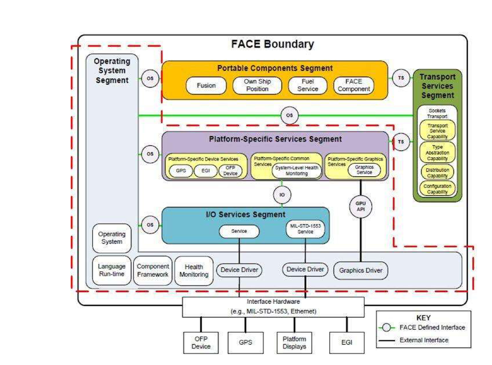

*Figure 39: FACE Software Operating Environment and Subset Proposed for the SOSA REI (red*

dashed line)

##### 5.4.3 Recommendations

###### 5.4.3.1 Basis

The RTE should conform to FACE Technical Standard, Edition 3.0 (call out specific sections)

When other profiles are not applicable, the RTE should conform to the General-Purpose Profile The SOSA modules should be developed for operating system interfaces including one of:

— POSIX

— ARINC 653

SOSA modules should be implemented by software components based on existing interface standards or software frameworks (e.g., the MORA specification, FROST Architecture Specification, REDHAWK/TOA, COARPS, etc.) The specifics for how these software components will interface to the SOSA REI are planned for a later version of the SOSA Technical Standard.

<!-- 原书 p.131 ｜ PDF p.151 -->

###### 5.4.3.2 Interoperability Levels

SOSA REI is not mandating how to write or manage application source code except for what open standard operating system/run-time API to use SOSA REI is not mandating any particular middleware 5.4.3.3 General-Purpose SOSA software components which have general performance should conform to the FACE Technical Standard General-Purpose Profile The SOSA modules which have low latency and/or hard real-time requirements should conform to the FACE Determinism Profile 5.4.4 Safety SOSA software components which have low latency and/or hard real-time requirements should conform to the FACE Technical Standard Safety Profile These software components shall follow DO-178 guidance for civilian applications and MIL-HDBK-516C for military applications to achieve airworthiness for SOSA modules affecting safety of flight These software components should conform to the FACE Safety Profile SOSA software components affecting safety of flight which use object-oriented technology shall follow FAA guidance including DO-332 and others Planned for a later version of the SOSA Technical Standard.

5.4.4.1 Security SOSA modules should conform to the FACE Security Profile for those modules affecting system security 5.4.4.2 Programming Language SOSA modules should use one of the programming languages defined in the FACE

Technical Standard

###### 5.4.4.3 Virtual Machines

SOSA modules may use VMs with limitations Planned for a later version of the SOSA Technical Standard.

5.4.4.4 Hypervisors If a VM(s) is used then a Hypervisor should be used to manage the VMs. Security-related aspects of the hypervisor Planned for a later version of the SOSA Technical Standard.

<!-- 原书 p.132 ｜ PDF p.152 -->

5.4.4.5 Containers

SOSA modules may use containers after a security analysis that substantiates the use of containers does not defeat security requirements SOSA modules should substantiate why a container should be used instead of a VM

#### 5.5 SOSA Module Interactions

The SOSA Architecture is based on a set of loosely-coupled modular entities that interact with the underlying operating environment and with each other via their logical interfaces. The operating environment will provide the mechanisms through which interoperation will occur and will provide the modules’ interfaces to these mechanism (I/O, processing, storage, communication, etc.). Interoperability between SOSA modules is described in terms of interactions.

Interactions include exchanges of data, control actions, and various types of management functions. Most of the interactions considered are to be implemented as message exchanges on a network.

- Note: The concept of the security services providing authentication and authorization services as shown, although not yet completely defined, is actively being developed by the SOSA Consortium.

#### 5.6 Sensor Management

The SOSA standard defines two modules that together perform sensor management, which is the composition of system management and task management. The modules are 1.1 System Manager and 1.2 Task Manager. The delineation between the functions of these two modules separates the functions related to taking care of the system from the functions of tasking the system to fulfill its operational needs. Figure 40 illustrates the overall sensor management architecture. System management client applications run on the host platform and interact with the sensor management interfaces through the host platform interface module, which communicates with the system manager and task manager modules. The system manager module performs system management functions (discovery, configuration, control, health monitoring) through interactions with the SOSA module and hardware element interactions. The task manager module performs mission tasking functions (setting up, controlling, collecting data from, and monitoring multi-INT operational tasks) through interactions with the system manager module, SOSA modules, and hardware elements.

<!-- 原书 p.133 ｜ PDF p.153 -->

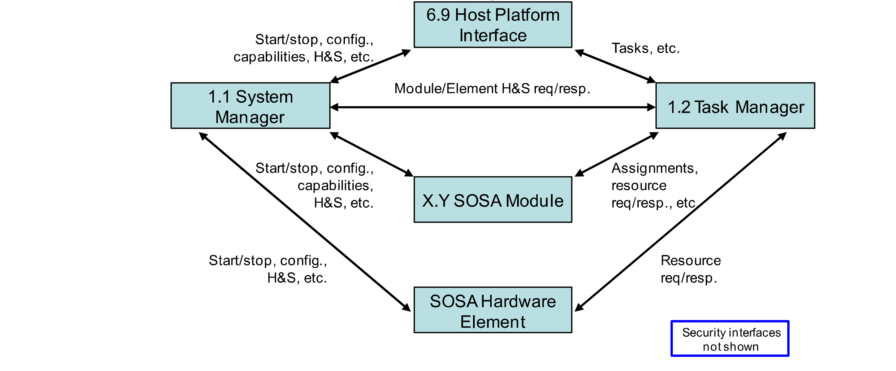

*Figure 40: Sensor Management Architecture View*

##### 5.6.1 System Manager Module

###### 5.6.1.1 Module Definition

The functionality of the system manager module is defined in Table 2.

In summary, the system manager provides the ability to discover, configure, control, manage health (status and faults), and configure the security aspects of the SOSA sensor as a whole, its infrastructure, its modules, and its interface to the sensor host.

The relationship between the system manager module and the other modules was shown in Figure 8 and explained in Section 3.11.2.

5.6.1.2 System Manager Interactions

The system manager is responsible for handling discovery, configuration, control, and health functions for the sensor as a whole. It acts as a representative of the logical modules (those that are not part of the hardware infrastructure), and the hardware platform modules to the “outside” world.

The overall system management concept has been matured since the previous version of this standard.² However, it has not yet been through a formal proposal process, so it is possible that the interactions and interaction groups described here may change in a future version.

2 Technical Standard for SOSA™ Reference Architecture, The Open Group Snapshot (S180), expired July 2018.

<!-- 原书 p.134 ｜ PDF p.154 -->

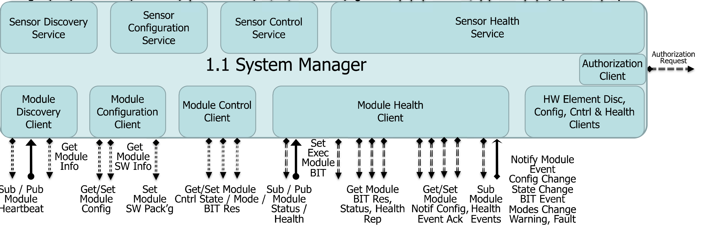

*Figure 41: System Manager Interactions*

Figure 41 illustrates the system manager module. It includes the service side (provides) for sensor discovery, sensor configuration, sensor control, and sensor health interaction groups. It also includes the client side (users) for module discovery, module configuration, module control, module health, and authorization interaction groups. The service side interactions (on the top) are accessed by system management applications that may be outside of the sensor. The clientside interactions (on the bottom) access the relevant services for each SOSA module implemented in a particular system.

Note that the interaction endpoints related to modules (Discovery, Configuration, Control, and Health) clients are repeated for hardware elements, but are not shown in detail for brevity.

5.6.1.3 Common System Management Interactions

The SOSA system management concept defines a pattern that is applied to each type of module, and then tailored for the needs of the individual modules by varying the specific interaction names and parameters. The pattern includes sets of interactions that are common for all modules, whether they are implemented in software or hardware, or whether they are mission or infrastructure-oriented.

Columns “Input DIV-2 Data Entities” and “Output DIV-2 Data Entities” list the entity types for the input and output parameters of each interactions. The names have not been finalized but align with the contents of Section D.4.

Note that this material is still being developed, so is likely to change as it is matured.

**Table 39: Common System Management Interactions**

| Common System Management Interactions |||||
|---|---|---|---|---|
| Interaction Name | Interaction Description | Input DIV-2 Data Entities | Output DIV-2 Data Entities | Provider Module |
| PubSensorHeartbeat | | SensorHeartbeatType | | 1.1 |
| SubSensorHeartbeat | | SubscriptionInfoType | subError_t | 6.4 |
| GetSensorInfo | | | error_t, SensorInfoType | 1.1 |
| PubModuleHeartbeat | | ModuleHeartbeatType | | 1.x, 2.x, 3.x, 4.x, 5.x |
| SubModuleHeartbeat | | SubscriptionInfoType | subError_t | 6.4 |
| GetModuleInfo | | | error_t, ModuleInfoType | 1.x, 2.x, 3.x, 4.x, 5.x |
| GetSensorConfig | | | error_t, SensorConfigDescriptionType | 1.1 |
| SetSensorConfig | | SensorConfigDescriptionType | error_t | 1.1 |
| GetSensorSoftwareInfo | | | error_t, SensorSoftwareMetadataType | 1.1 |
| SetSensorSoftwarePackage | | SensorSoftwarePackageType | error_t | 1.1 |
| GetModuleConfig | | | error_t, ModuleConfigDescriptionType | 1.x, 2.x, 3.x, 4.x, 5.x |
| SetModuleConfig | | ModuleConfigDescriptionType | error_t | 1.x, 2.x, 3.x, 4.x, 5.x |
| GetModuleSoftwareInfo | | | error_t, ModuleSoftwareMetadataType | 1.x, 2.x, 3.x, 4.x, 5.x |
| SetModuleSoftwarePackage | | ModuleSoftwarePackageType | error_t | 1.x, 2.x, 3.x, 4.x, 5.x |
| GetDataPublishingConfig | | | error_t | 1.x, 2.x, 3.x, 4.x, 5.x |
| SetDataPublishingConfig | Change the properties that govern the publication of data (identified by “topic”). Includes QoS, enabling, disabling, periodicity, etc. | | error_t | 1.x, 2.x, 3.x, 4.x, 5.x |
| GetSensorState | Sensor System States include: those shown in Set System State, Shutting Down, Resetting Hardware, Booting Operating System, Booted, Staring Software, Ready, Running, Paused. | | error_t, SensorStateType | 1.1 |
| SetSensorState | Sensor System States that can be set include: Cold Boot, Warm Boot, Shutdown, Shutdown Software (component), Restart Software (component), Execute BIT, Calibrate (sensor dependent), Start, Pause. | SensorStateType | error_t | 1.1 |
| GetSensorModes | Get the modes that the system is currently in. Note that this is not settable through the configuration interactions. | | error_t, SensorModesType | 1.1 |
| SetSensorModes | Causes the system to execute a BIT. BIT results show up in the health parameters. Equivalent to Set Sensor System State (BIT). | SensorModesType | error_t | 1.1 |
| GetModuleState | Module States are module-dependent, and may include: those shown in Set Module State, Shutting Down, Resetting Hardware, Booting Operating System, Booted, Staring Software, Ready, Running, Paused. | | error_t, ModuleStateType | 1.x, 2.x, 3.x, 4.x, 5.x |
| SetSensorCalibrationData | Set the data required for calibration of the sensor. | SensorCalibrationInputDataType | error_t | 1.2 |
| GetSensorCalibrationData | Get the calibration results after the sensor has been put into a calibration state. | | SensorCalibrationResultDataType | 1.2 |
| SetModuleCalibrationData | Set the data required for calibration of the module. | ModuleCalibrationInputDataType | error_t | 2.x, 3.x, 4.x, 5.x |
| GetModuleCalibrationData | Get the calibration results after the module has been put into a calibration state. | | ModuleCalibrationResultDataType | 2.x, 3.x, 4.x, 5.x |
| SetModuleState | Module States that can be set are module-dependent, but may include: Cold Boot, Warm Boot, Shutdown, Shutdown Software (component), Restart Software (component), Execute BIT, Calibrate (sensor dependent), Start, Pause. | ModuleStateType | error_t | 1.x, 2.x, 3.x, 4.x, 5.x |
| GetModuleMode | Get the mode that the module is currently in. Note that this is not settable through the configuration interactions. | | error_t, ModuleModeType | 1.x, 2.x, 3.x, 4.x, 5.x |
| SetModuleMode | Causes the module to execute a BIT. BIT Results shows up in the health parameters. Equivalent to Set Module State (BIT). | ModuleModeType | error_t | 1.x, 2.x, 3.x, 4.x, 5.x |
| PubSensorStatusLevel | | SensorStatusLevelType | | 1.1 |
| SubSensorStatusLevel | | SubscriptionInfoType | subError_t | 6.4 |
| PubModuleStatus | | | | 1.x, 2.x, 3.x, 4.x, 5.x |
| SubModuleStatus | | SubscriptionInfoType | subError_t | 6.4 |
| GetSensorStatusLevel | | | error_t, SensorStatusLevelType | 1.1 |
| GetSensorHealthReport | | | error_t, SensorHealthReportType | 1.1 |
| SetExecuteSensorBIT | | SensorBITParametersType | error_t | 1.1 |
| GetSensorBITResult | | | error_t, SensorBITResultType | 1.1 |
| GetModuleStatus | | | error_t, ModuleStatusLevelType | *.* |
| GetModuleHealthReport | | | error_t, ModuleHealthReportType | *.* |
| SetExecuteModuleBIT | | ModuleBITParametersType | error_t | *.* |
| GetModuleBitResult | | | error_t, ModuleBITResultType | *.* |
| NotifySensorEvent | | SensorHealthEventType | | 1.1 |
| NotifySensorConfigChange | | SensorConfigEventType | | 1.1 |
| NotifySensorStateChange | | SensorStateEventType | | 1.1 |
| NotifySensorBITEvent | | SensorBITEventType | | 1.1 |
| NotifySensorModesChange | | SensorModeEventType | | 1.1 |
| NotifySensorWarning | | SensorWarningType | | 1.1 |
| NotifySensorFault | | SensorFaultType | | 1.1 |
| SetSensorEventAcknowledgement | | SensorEventAcknowledgType | error_t | 1.1 |
| SubSensorHealthEvents | | SubscriptionInfoType | subError_t | 6.4 |
| SetSensorNotificationConfig | | SensorEventConfigType | error_t | 1.1 |
| GetSensorNotificationConfig | | | error_t, SensorEventConfigType | 1.1 |
| NotifyModuleEvent | | ModuleHealthEventType | | *.* |
| NotifyModuleConfigChange | | ModuleConfigEventType | | *.* |
| NotifyModuleStateChange | | ModuleStateEventType | | *.* |
| NotifyModuleBITEvent | | ModuleBITEventType | | *.* |
| NotifyModuleModeChange | | ModuleModeEventType | | *.* |
| NotifyModuleWarning | | ModuleWarningType | | *.* |
| NotifyModuleFault | | ModuleFaultType | | *.* |
| SetModuleEventAcknowledgement | | ModuleEventAcknowledgType | error_t | *.* |
| SetModuleNotificationConfig | | ModuleEventConfigType | error_t | *.* |
| GetModuleNotificationConfig | | | error_t, ModuleEventConfigType | *.* |
| SubModuleHealthEvents | | SubscriptionInfoType | subError_t | 6.4 |
| SubModuleHealthReports | | SubscriptionInfoType | subError_t | 6.4 |
| GetHealthLog | | | error_t | 1.1 |
| GetHealthLogStatus | | | error_t | 1.1 |
| DeleteSensorHealthLog | | | error_t | 1.1 |

> 注：this table calls out all of the common system management interactions that have been identified as of this version. Additional system manager interactions are likely to be identified in a future version.

> 转写说明：
> 1. 原表题注在 p.135，表体分置于 p.136–p.140 五页（p.136 16 行、p.137 9 行、p.138 15 行、p.139 21 行、p.140 顶部 5 行，共 66 数据行）。续页顶端重复印出的表头与列名不再重出，故本表只保留一次表头；p.140 表体之后的同页文字属 5.6.2 与 Table 40，未入本表。
> 2. 首行「Common System Management Interactions」为横向合并单元格，覆盖全表 5 列，故其后 4 格留空。
> 3. 原表单元格内惯将实体名与其「(…Type)」分置两行排印，本转写按单个空格连接（如「SensorHeartbeatType」单占一格者不动，凡「name + (Type)」成对者并作一行）；跨行断开的长类型名拼回原词（如「SensorConfigDescriptionTyp / e」→ SensorConfigDescriptionType、「SensorSoftwareMetadataTyp / e」→ SensorSoftwareMetadataType）。
> 4. 第 2 列「Interaction Description」除列出者外原表均为空格，按原样留空。
> 5. 原表形迹按原样照录，未改未补：p.137 两处「Staring Software」；「GetModuleBitResult」的小写「it」（同行输出类型仍作 ModuleBITResultType）；「NotifySensorModesChange」与同行的「SensorModeEventType」单复数不一致；p.136 GetSensorSoftwareInfo 与 SetSensorSoftwarePackage 两行的 Provider Module 均印作 1.1；Provider Module 列的「*.*」照录。

<!-- 原书 p.135 ｜ PDF p.155 -->

<!-- 原书 p.136 ｜ PDF p.156 -->

<!-- 原书 p.137 ｜ PDF p.157 -->

<!-- 原书 p.138 ｜ PDF p.158 -->

<!-- 原书 p.139 ｜ PDF p.159 -->

##### 5.6.2 Task Manager Module

###### 5.6.2.1 Module Definition

See Table 2 for the definition of this module.

The concept of task management is still being developed. Below is a DRAFT set of task management interactions that are consistent with the system management interactions and the combined SOSA management architecture. So far, a detailed concept has been defined for five Task Management interactions: SetCreateTask, SetModifyTask, SetDeleteTask, SetModuleAssignment, and PubAssignmentHealth. (Details for these interactions are provided in Section 5.9.1.3 for an Air Moving Target Indicator (AMTI) Multi-sensor Fusion Tracker Radar mission example. Note that the interactions are common across all modules, but the enumerations and data for each interaction will be sensor and mission-specific and will require an extensive effort to define all of the task management configuration data, control actions, and module assignments for each of these (Sensor Type/Mission Type combinations).

**Table 40: Task Management Interactions Table**

| Task Management Interactions |||||
|---|---|---|---|---|
| Interaction Name | Interaction Description | Input DIV-2 Data Entities | Output DIV-2 Data Entities | Provider Module |
| PubSensorHeartbeat | | SensorHeartbeatType | | 1.1 |
| GetSystemCapabilityInformation | TBD | | reqResErrorCode (ReqResErrorCodeType), systemCapabilityInformation (SystemCapabilityInformationType) | 1.2 |
| GetModuleInformation | TBD | moduleID (number) | reqResErrorCode (ReqResErrorCodeType), moduleInformation (ModuleInformationType) | *.* |
| GetModuleCapabilities | TBD | moduleID (number) | reqResErrorCode (ReqResErrorCodeType), moduleCapabilities (ModuleCapabilitiesType) | *.* |
| GetResourceCapabilities | TBD | resourceID (number) | reqResErrorCode (ReqResErrorCodeType), resourceCapabilities (ResourceCapabilitiesType) | *.* |
| GetResourceFixedParameters | TBD | resourceID (number) | reqResErrorCode (ReqResErrorCodeType), resourceFixedParameters (ResourceFixedParametersType) | *.* |
| GetResourceControllableParameters | TBD | resourceID (number) | reqResErrorCode (ReqResErrorCodeType), resourceControllableParameters (ResourceControllableParametersType) | *.* |
| GetModuleInternalConnections | TBD | moduleID (number) | reqResErrorCode (ReqResErrorCodeType), moduleInternalConnections (ModuleInternalConnectionsType) | *.* |
| GetModuleExternalConnections | TBD | moduleID (number) | reqResErrorCode (ReqResErrorCodeType), moduleExternalConnections (ModuleExternalConnectionsType) | *.* |
| SetCreateTask | Request a new task, coming from outside of the sensor. | taskDescription (TaskDescriptionType) | reqResErrorCode (ReqResErrorCodeType) | 1.2 |
| SetModifyTask | Modify task from outside of the sensor. | taskID (number), taskModificationDescription (TaskModificationDescriptionType) | reqResErrorCode (ReqResErrorCodeType) | 1.2 |
| SetDeleteTask | Delete task from outside of the sensor. | taskID (number) | reqResErrorCode (ReqResErrorCodeType) | 1.2 |
| GetActiveTasks | TBD | taskInformationList (TaskInformationListType) | reqResErrorCode (ReqResErrorCodeType) | 1.2 |
| GetTaskInformation | TBD | taskInformation (TaskInformationType) | reqResErrorCode (ReqResErrorCodeType), taskID (number) | 1.2 |
| GetTaskState | TBD | taskID (number), taskState (TaskStateType) | reqResErrorCode (ReqResErrorCodeType), taskID (number) | 1.2 |
| SetTaskState | Control a task. | taskID (number) | reqResErrorCode (ReqResErrorCodeType), taskState (TaskStateType) | 1.2 |
| GetTaskStatus | Get the status of an existing task. | taskID (number) | reqResErrorCode (ReqResErrorCodeType), (TaskStatusType) | 1.2 |
| NotifyTaskEvent | Notify events that occur in tasks. | taskEventDescription (TaskEventDescriptionType) | pubSubErrorCode (PubSubErrorCode) | 1.2 |
| SubTaskEvent | TBD | taskID (number) | pubSubErrorCode (PubSubErrorCode), subscriptionInformation (SubscriptionInformationType) | 1.2 |
| PubTaskHealth | Publish periodic task health. | taskID (number), taskHealthDescription (TaskHealthDescriptionType) | pubSubErrorCode (PubSubErrorCode) | 1.2 |
| SubTaskHealth | TBD | taskID (number) | pubSubErrorCode (PubSubErrorCode), subscriptionInformation (SubscriptionInformationType) | 1.2 |
| GetTaskHealthPublishingConfig | TBD | taskID (number) | reqResErrorCode (ReqResErrorCodeType), taskHealthpublishingConfig (TaskHealthPublishingConfigType) | 1.2 |
| SetTaskHealthPublishingConfig | Configure the publication of task status. | taskID (number), healthPublishingConfigDescription (HealthPublishingConfigDescriptionType) | reqResErrorCode (ReqResErrorCodeType) | 1.2 |
| GetModuleAssignment | TBD | moduleID (number) | reqResErrorCode (ReqResErrorCodeType), moduleAssignment (ModuleAssignmentType) | 2.x, 3.x, 4.x, 5.x |
| SetModuleAssignment | Assign a task to a module (assignment is used instead of task for modules). Assignments come from internal sources; tasks come from external sources. The intent is that the task manager will decompose an externally received task into module assignments as necessary. | moduleAssignment (ModuleAssignmentType) | reqResErrorCode (ReqResErrorCodeType) | 2.x, 3.x, 4.x, 5.x |
| GetModuleResourceAllocations | TBD | moduleID (number) | reqResErrorCode (ReqResErrorCodeType), moduleResourceAllocationList (ModuleResourceAllocationListType) | 2.x, 3.x, 4.x, 5.x |
| SetModuleResourceAllocations | Assign module resources to an assignment. | taskID (number) | reqResErrorCode (ReqResErrorCodeType) | 2.x, 3.x, 4.x, 5.x |
| GetAssignmentState | TBD | assignmentID (number) | reqResErrorCode (ReqResErrorCodeType), assignmentState (AssignmentStateType) | 2.x, 3.x, 4.x, 5.x |
| SetAssignmentState | Control the task (assignment) of a module. | assignmentID (number), assignmentStateValue (AssignmentStateValueType) | reqResErrorCode (ReqResErrorCodeType) | 2.x, 3.x, 4.x, 5.x |
| GetAssignmentStatus | Get the status of an existing task. | assignmentID (number) | reqResErrorCode (ReqResErrorCodeType), assignmentStatus (AssignmentStatusType) | 2.x, 3.x, 4.x, 5.x |
| NotifyAssignmentEvent | Notify events that occur in tasks. | assignmentID (number), assignmentEvent (AssignmentEventType) | pubSubErrorCode (PubSubErrorCode), pubErrorCode (PubErrorCodeType) | 2.x, 3.x, 4.x, 5.x |
| SubAssignmentEvent | TBD | assignmentID (number) | pubSubErrorCode (PubSubErrorCode), subscriptionInformation (SubscriptionInformationType) | 2.x, 3.x, 4.x, 5.x |
| PubAssignmentHealth | Publish periodic task (assignment) health. | assignmentID (number), assignmentHealth (AssignmentHealthType) | pubSubErrorCode (PubSubErrorCode) | 2.x, 3.x, 4.x, 5.x |
| SubAssignmentHealth | TBD | assignmentID (number) | pubSubErrorCode (PubSubErrorCode), subscriptionInformation (SubscriptionInformationType) | 2.x, 3.x, 4.x, 5.x |
| GetAssignmentHealthPublishingConfig | TBD | assignmentID (number) | reqResErrorCode (ReqResErrorCodeType), healthPublishingConfigDescription (HealthPublishingConfigDescriptionType) | 2.x, 3.x, 4.x, 5.x |
| SetAssignmentHealthPublishingConfig | Configure the publication of task status. | assignmentID (number), healthPublishingConfigDescription (HealthPublishingConfigDescriptionType) | reqResErrorCode (ReqResErrorCodeType) | 2.x, 3.x, 4.x, 5.x |

> 转写说明：
> 1. 原表题注在 p.140，表体分置于 p.140–p.144 五页（p.140 3 行、p.141 9 行、p.142 9 行、p.143 8 行、p.144 7 行，共 36 数据行）。续页顶端重复印出的表头与列名不再重出，故本表只保留一次表头；p.140 表体之前的同页表格是 Table 39 的结尾，未入本表。
> 2. 首行「Task Management Interactions」为横向合并单元格，覆盖全表 5 列，故其后 4 格留空。
> 3. 原表单元格内惯将实体名与其「(…Type)」分置两行排印（如「moduleID」换行「(number)」），本转写按单个空格连接；跨行断开的长名拼回原词（如「resourceControllableParamet / ers」→ resourceControllableParameters、「(ModuleInternalConnections / Type)」→ (ModuleInternalConnectionsType)）。
> 4. 原表形迹按原样照录，未改未补：p.142「GetTaskStatus」行 Output DIV-2 Data Entities 印作「reqResErrorCode (ReqResErrorCodeType), (TaskStatusType)」，第二个实体名（当为 taskStatus）原表缺印，此处只余类型名，照录未补；p.143「GetTaskHealthPublishingConfig」行的实体名印作「taskHealthpublishingConfig」（publishing 首字母小写），同行类型仍作 TaskHealthPublishingConfigType；Provider Module 列的「*.*」照录。

<!-- 原书 p.140 ｜ PDF p.160 -->

<!-- 原书 p.141 ｜ PDF p.161 -->

<!-- 原书 p.142 ｜ PDF p.162 -->

<!-- 原书 p.143 ｜ PDF p.163 -->

#### 5.7 RF Signal Layer Modules

Interactions between SOSA modules are being defined, with priorities and precedence set by the needs of the community, and to support specific use-cases. As of this version, the interactions

<!-- 原书 p.144 ｜ PDF p.164 -->

between the host platform and the sensor that relate to commanding an RF sensor, interactions with the so-called RF signal layer modules (those near the aperture that handle raw RF signals), and interactions between the task manager and tracker for a specific electronic warfare application have been developed. These efforts include a subset of RF-based sensor applications, and (thus far) do not cover any EO/IR applications. This incremental approach implies that these definitions are likely to be modified in the future as additional applications and sensor types are considered.

The SOSA signal layer modules include:

Module 2.1: Receive Aperture/Transducer/Camera Module 2.2: Transmit Aperture/Transducer/Laser Module 2.3: Conditioner-Receiver-Exciter

Each of these modules supports each of the SOSA sensor types; Communications, EO/IR, EW, Radar, and SIGINT. The current specification supports the RF sensor types; Communications, EW, Radar, and SIGINT, but not the EO/IR sensor type.

Support for EO/IR sensor types in these modules will be added in a later version. The current version specifies the requirements for the signal layer modules when operating on RF signals, including the following:

RF Receiver Aperture/Transducer Module Standard RF Transmit Aperture/Transducer Module Standard RF Conditioner-Receiver-Exciter Module Standard

##### 5.7.1 Modular Open RF Architecture

The SOSA Consortium has adopted portions of the MORA specification for the RF instantiation of the Receive Aperture/Transducer module. MORA is an extension to the VICTORY Architecture, which is an Open System Architecture (OSA) for integrating electronics onto military ground vehicles.

MORA extends the scope of VICTORY by adding a low latency transport mechanism, data streaming interfaces, new message types, management operations, and functional concepts that are specific to RF applications. A module in MORA is known as a MORA Device, which provides standardized access to configurable signal and processing resources.

The parts of MORA that have been adopted are at this point limited to the Signal Port concept, which provides open interfaces to the signal layer processing aspects of RF processing chains, between propagating RF energy and digital RF signals at intermediate or baseband frequencies.

As MORA is an extension of VICTORY, adopting these MORA interface standards, which implies adoption of a subset of the VICTORY interface standards. This includes the use of SOA technologies for request-response interactions and eXtensible Markup Language (XML)formatted payloads encapsulated in User Datagram Protocol (UDP) datagrams and multicast for publish-subscribe interactions.

<!-- 原书 p.145 ｜ PDF p.165 -->

##### 5.7.2 Application of MORA to SOSA Signal Layer Modules

Figure 42 illustrates the interfaces among the RF signal modules. Note the outlined boxes within the module boxes that are labeled and to which the interactions connect. These are “interaction endpoints”, which group together a set of related interactions, and indicate which role that module will play in the interactions. For instance, the box labeled “MORA Device Service” indicates that the module implements the service side of a group of interactions. Interaction endpoints will be important to interpreting the rules stating requirements for the RF signal layer modules.

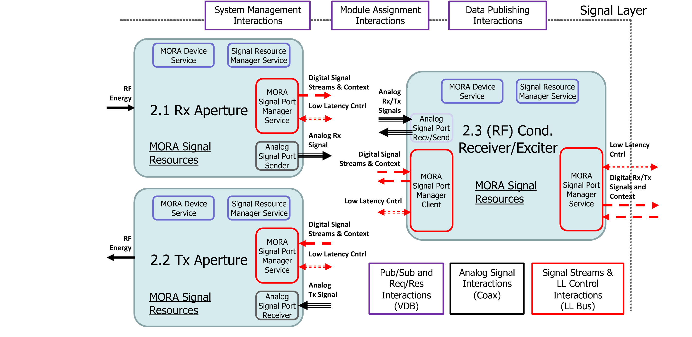

*Figure 42: RF Signal Layer Module Interactions*

- Note: VDB stands for VICTORY Data Bus, which is used for transport of publish-subscribe and request-response interactions in VICTORY.

##### 5.7.3 RF Receiver Aperture/Transducer Module

The Receive Aperture/Transducer is responsible for converting Electromagnetic (EM) energy into an electrical signal. The signal may be pre-amplified and stabilized (calibration). This module may include mechanical and electronic steering, focus control, filtering, low-noise amplification, frequency translation, and analog to digital conversion. The output electrical signal may be analog or a digital stream. It may also output metadata.

<!-- 原书 p.146 ｜ PDF p.166 -->

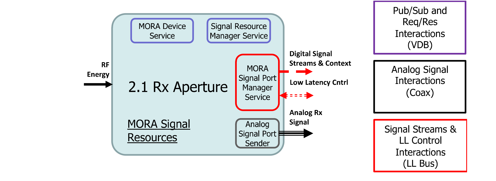

*Figure 43: RF Receiver Aperture/Transducer Interactions*

The MORA Device Manager Service is a set of interactions that support discovery, configuration, control, and health management of the module. These interactions report the health, send notifications of key events such as state changes and faults, and report built-in-test results. They also allow the module configuration to be managed, and its state to be controlled. For example, modules can be made to execute a BIT, reset, or the software or configuration may be updated.

The Signal Resource Manager Service is a group of interactions that support management of the RF resources that support capabilities such as signal domain conversion, signal frequency conversion, signal conditioning, RF distribution, and antenna control. Through these interactions the task manager (or an application) can request information about the resources and capabilities provided by the RF aperture to determine whether a particular RF aperture can meet the requirements of a given task. These interactions support discovery of detailed characteristics of the aperture, such as the fixed and variable parameters, the fixed and settable interconnections, and the real-time data, control, and context endpoints attached to the MORA Low Latency Bus (ML2B). These interactions also support reservation of the signal resources for a particular task.

The Signal Port Manager Service interactions implement high-speed and low latency control of signal ports, which are realized by MORA Data Messages (MDMs) transported on the ML2B. Once resources have been reserved for a task through the Signal Resource Manager Service, the resources are configured, and the task is executed via the MORA Signal Port Manager Service interactions on the ML2B.

The Analog Signal Port Sender interactions send analog representation of time domain radio frequency, intermediate frequency, or baseband signals.

The Receiver Aperture/Transducer interactions are described in Table 41, and the rules stating the requirements for this module are described in Section 5.7.7.

##### 5.7.4 RF Transmit Aperture/Transducer Module

The Transmit Aperture/Transducer is responsible for converting an electrical signal into Electromagnetic (EM) energy, forming a transmit beam. This module may include mechanical and electronic steering, beamforming, focus control, filtering, amplification, frequency translation, and digital to analog conversion.

<!-- 原书 p.147 ｜ PDF p.167 -->

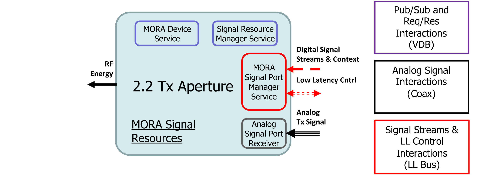

*Figure 44: RF Transmit Aperture/Transducer Interactions*

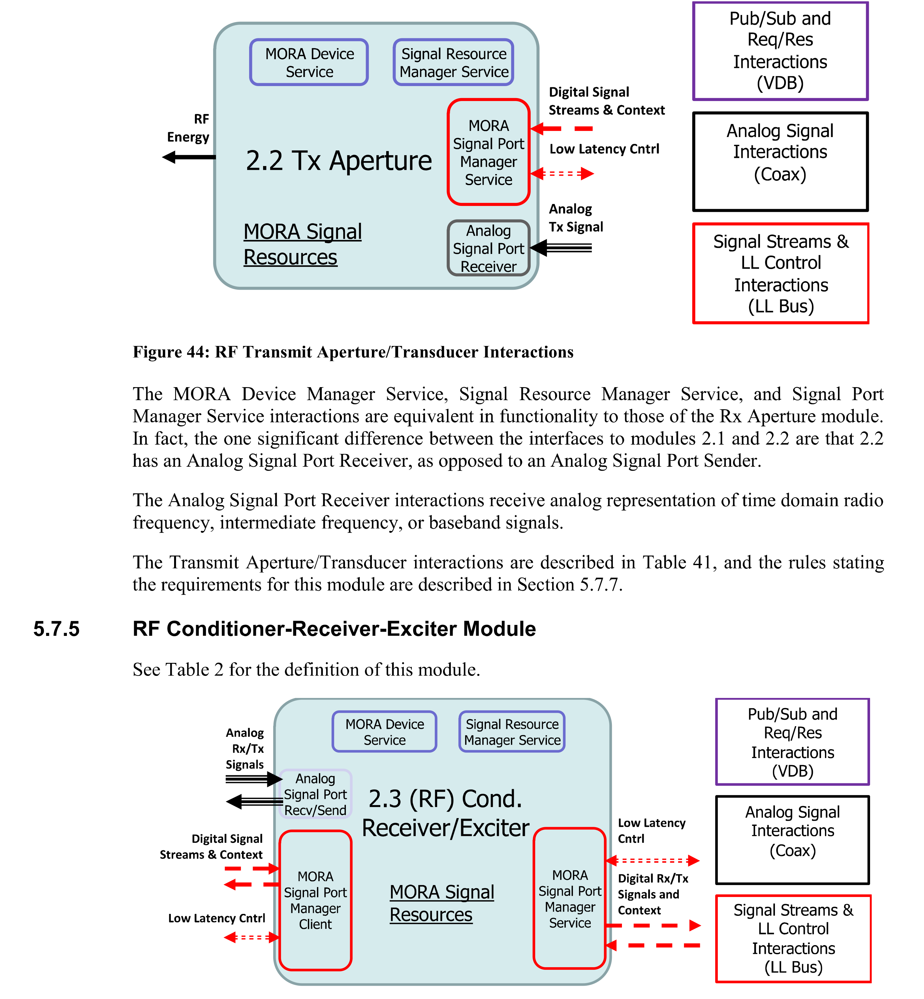

*Figure 45: RF Conditioner Receiver/Exciter Interactions*

The MORA Device Manager Service and Signal Resource Manager Service interactions of this module are equivalent to those of the Tx and Rx aperture interfaces to describe the module’s status, configuration, built-in-test results, and a mechanism for managing the state of the module.

<!-- 原书 p.148 ｜ PDF p.168 -->

The difference in the RF Conditioner-Receiver-Exciter module is that it will have a larger set of resources than the others. It may include RF functions such as signal domain conversion, signal frequency conversion, signal conditioning, RF distribution, and digital signal ports. It exchanges analog signals with the Rx and Tx modules via Analog Signal Receiver and Sender interactions, which are controlled via the MORA Signal Port Manager Client interactions on the ML2B. It exchanges digital signal streams, context, and real-time control data with the down-stream modules via its MORA Signal Port Manager Service.

The following sections describe the interactions that make up each of these interaction endpoint groups, and then state the rules that will be required for each of the RF signal layer modules.

##### 5.7.6 RF Signal Layer Module Interactions

Table 41 shows the interactions that have been defined for the RF signal layer modules, which include 2.1 Receiver Aperture/Transducer, 2.2 Transmit Aperture/Transducer, and 2.3 Conditioner-Receiver Exciter.

Note that these names have been slightly modified (the word “camera” has been removed) to indicate that these interactions were developed with RF applications in mind. They do not explicitly support EO/IR applications in this version. Interactions to support EO/IR applications will be addressed in a future version.

The source of these interaction definitions was MORA. The approach taken was to directly adopt the parts of the MORA specification that related to the functionality of these RF signal layer modules, and thus the interactions shown came directly from analysis of MORA.

For each interaction, the input and output parameters are represented as lists of data entity names in the Input and Output DIV-2 Data Entities columns. Each item in the input and output lists corresponds to an entry in one of the DIV-2 tables provided as appendices.

**Table 41: RF Signal Layer Module Interactions Table**

| RF Signal Layer Module Interactions |||||||
|---|---|---|---|---|---|---|
| Interaction Name | Interaction Description | Input DIV-2 Data Entities | Output DIV-2 Data Entities | 2.1 Receive Aperture/Transducer | 2.2 Transmit Aperture/Transducer | 2.3 Conditioner-Receiver-Exciter |
| PubSensorHeartbeat | | SensorHeartbeatType | | 1.1 | | |
| deleteFile | Request that a file on a MORA device be deleted. The “fileId” argument should correspond to the “id” field of the file requested, as returned from a “getFiles()” request. | string | error | Provides | Provides | Provides |
| getAntennaArrays | Request a list of the antennas and their elements attached to the MORA device. | | arrays | Provides | Provides | |
| getAntennaSideSignalPorts | Get a list of signal ports in the switch matrix that are connected to the antenna side of the RF chain. | | signalPorts | Provides | Provides | |
| getAvailableWaveforms | Request for a list of radio waveforms supported by the MORA device. | waveforms | error | Provides | Provides | Provides |
| getBuiltInTestResults | Request the results from a previous MORA device BIT run. | testResults | error | Provides | Provides | Provides |
| getCurrentMoraConfig | Get the file ID of the current MORA configuration file for a MORA device. | fileId | error | Provides | Provides | Provides |
| getCurrentWaveform | Request details on the currently active waveform. | | waveform | Provides | Provides | Provides |
| getDeviceStatus | Get the status of the MORA device represented by the service. | | status | Provides | Provides | Provides |
| getDeviceType | Get the description of the MORA device represented by the service. | | moraDevice | Provides | Provides | Provides |
| getExternalConnections | Request the static external connections between the signal ports of this MORA device and other MORA devices. | | externalConnections, error | Provides | Provides | Provides |

> 转写说明：首行 `RF Signal Layer Module Interactions` 在原表中横跨全部 7 列，其余 6 格留空。原表起于 p.149，次页续排（续页表头重复），本表按续页顺序接排（PubSensorHeartbeat、deleteFile 之后接 getAntennaArrays 起 9 行），共 11 个数据行。表内被 colspan 覆盖处留空，不代表原表该处无内容。
>
> 转写说明：原表多个单元格内的英文是排版折行（如 `SensorHeartbeatType` 被折成 `SensorHeartbeatT` / `ype`，`getAvailableWaveforms` 被折成 `getAvailableWavefo` / `rms`），已按一个单词复原，未插入空格。
>
> 转写说明：`PubSensorHeartbeat` 行的 Interaction Description、Output DIV-2 Data Entities、2.2、2.3 四格在原表中为空白；`getAntennaArrays`、`getAntennaSideSignalPorts` 的 Input DIV-2 Data Entities 在原表中为空白；`getAntennaArrays`、`getAntennaSideSignalPorts` 的 2.3 列为空白。以上空白照录为空。

<!-- 原书 p.149 ｜ PDF p.169 -->

<!-- 原书 p.150 ｜ PDF p.170 -->

<!-- 原书 p.151 ｜ PDF p.171 -->

<!-- 原书 p.152 ｜ PDF p.172 -->

<!-- 原书 p.153 ｜ PDF p.173 -->

<!-- 原书 p.154 ｜ PDF p.174 -->

##### 5.7.7 RF Signal Layer Module Rules

Implementations of modules 2.1, 2.2, and 2.3 shall comply with the appropriate MORA specifications, as shown in Table 42.

In each row, the Interaction Endpoint column indicates the role that the indicated module shall support. If the endpoint column contains the word “Service”, then the module shall “provide” or implement the service side of the indicated standard. If the endpoint column contains the word “Client”, then the module shall “use” or implement the client side of the indicated standard. If the endpoint column contains the word “Sender”, the module shall “provide” or implement the service side of the interactions, while the word “Receiver” indicates the module shall “use” or implement the client side of the interactions.

Note that conformance with an individual interface standard (set of interactions) can only be tested objectively at the provider/service endpoint.

<!-- 原书 p.155 ｜ PDF p.175 -->

Additional context for the Interaction Endpoints listed in the table can be gained by referring to Figure 42.

**Table 42: RF Signal Layer Module Interaction Endpoints**

| **Module ID** | **Module Name** | **Applicability** | **Interaction Endpoint** | **MORA 2.1 Specification** |
|---|---|---|---|---|
| 2.1 | Receive Aperture/Transducer/Camera | Required | MORA Device Service | MT92010: MORA Device |
| 2.1 | Receive Aperture/Transducer/Camera | Required | Signal Resource Manager Service | MT92013: MORA Signal Resource Manager |
| 2.1 | Receive Aperture/Transducer/Camera | Required | MORA Signal Port Manager Service | MT92016: MORA Signal Port Manager |
| 2.1 | Receive Aperture/Transducer/Camera | Required | Analog Signal Port Sender | MT90011: RF Layer Analog Data Interface |
| 2.2 | Transmit Aperture/Transducer/Laser | Required | MORA Device Service | MT92011: MORA Device Management Interface |
| 2.2 | Transmit Aperture/Transducer/Laser | Required | Signal Resource Manager Service | MT92013: MORA Signal Resource Manager |
| 2.2 | Transmit Aperture/Transducer/Laser | Required | MORA Signal Port Manager Service | MT92016: MORA Signal Port Manager |
| 2.2 | Transmit Aperture/Transducer/Laser | Required | Analog Signal Port Receiver | MT90011: RF Layer Analog Data Interface |
| 2.3 | Conditioner Receiver/Exciter | Required | MORA Device Service | MT92011: MORA Device Management Interface |
| 2.3 | Conditioner Receiver/Exciter | Required | Signal Resource Manager Service | MT92013: MORA Signal Resource Manager |
| 2.3 | Conditioner Receiver/Exciter | Required | MORA Signal Port Manager Service | MT920116: MORA Signal Port Manager |
| 2.3 | Conditioner Receiver/Exciter | Required | Analog Signal Port Sender | MT90011: RF Layer Analog Data Interface |
| 2.3 | Conditioner Receiver/Exciter | Required | Analog Signal Port Receiver | MT90011: RF Layer Analog Data Interface |
| 2.3 | Conditioner Receiver/Exciter | Required | MORA Signal Port Manager Client | MT92013: MORA Signal Resource Manager |

> 注：The MORA specification, Version 2.1 references in the table uniquely identify a testable specification in the MORA documents. MORA also refers to other standard documents, including VICTORY and ANSI/VITA 49.2.
>
> 转写说明：上一条是紧随表格的说明段落（原书该段左缩进小于正文，判为表注；若按正文处理请移出）。原表次页为正文（Rule 5.7.7 各条）与他处内容，非本表续表，未入本表。
>
> 转写说明：`Module Name` 列在原表中排为两行（`Receive Aperture/` + `Transducer/Camera`；`Conditioner` + `Receiver/Exciter`），属名称折行，已用一个空格接成一行。`Module ID`、`Module Name`、`Applicability` 三列在每一行都单独列出（原表无 rowspan 合并），故逐行照录、无留空格。
>
> 存疑：第 11 行 `MORA 2.1 Specification` 列原文作 `MT920116: MORA Signal Port Manager`（其余同类行为 `MT92016`），疑为原书笔误；按「不纠错」原则照录原文，未改。

<!-- 原书 p.156 ｜ PDF p.176 -->

The following documents provide the complete, detailed specifications referenced in the table. MORA Specification, Version 2.1 (see Referenced Documents)

- Distribution A: main body and appendices A-D Distribution C: appendices E-G VICTORY Standard Specifications, Version 1.7 (see Referenced Documents)

Distribution C: main body

Distribution D and/or ITAR: appendices

- ANSI/VITA 49.2 (see Referenced Documents) Each bullet item in the rules below uniquely specifies a section of the MORA specification adopted by the SOSA Consortium for the SOSA Technical Architecture. Note that the rules only refer to implementation of the service-side interaction endpoints, as MORA does not provide conformance tests for implementation of the client-side interaction endpoints.

**Rule 5.7.7-[1-4]**

A component implementing the RF modalities of the SOSA 2.1 Receive/Aperture Transducer module shall be compliant with the following MORA specifications: Conformance

Methodology: (TBD)

MT92010: MORA Device

MT92013: MORA Signal Resource Manager

MT92016: MORA Signal Port Manager

MT90011: RF Layer Analog Data Interface

**Rule 5.7.7-[5-7]**

A component implementing the RF modalities of the SOSA 2.1 Receive/Aperture Transducer module shall provide the following signal resources as defined by the MORA specification, Version 2.1: Conformance Methodology: (TBD) Antenna (ANT) Signal Resource RF Translation Signal Resource Signal Domain Conversion Signal Resource

**Rule 5.7.7-[8-9]**

A component implementing the RF modalities of the SOSA 2.1 Receive/Aperture Transducer module may provide the following signal resources as defined by the MORA specification, Version 2.1: RF Conditioning Signal Resource RF Distribution Signal Resource

<!-- 原书 p.157 ｜ PDF p.177 -->

**Rule 5.7.7-[10-13]**

A component implementing the RF modalities of the SOSA 2.2 Transmit/Aperture Transducer module shall be compliant with the following MORA specifications: Conformance

Methodology: (TBD)

MT92010: MORA Device

MT92013: MORA Signal Resource Manager

MT92016: MORA Signal Port Manager

MT90011: RF Layer Analog Data Interface

**Rule 5.7.7-[14-16]**

A component implementing the RF modalities of the SOSA 2.1 Transmit Aperture Transducer module shall provide the following signal resources as defined by the MORA specification, Version 2.1: Conformance Methodology: (TBD) Antenna Signal Resource RF Translation Signal Resource Signal Domain Conversion Signal Resource

**Rule 5.7.7-[17-18]**

A component implementing the RF modalities of the SOSA 2.1 Receive/Aperture Transducer module may provide the following signal resources as defined by the MORA specification, Version 2.1: RF Conditioning Signal Resource RF Distribution Signal Resource

**Rule 5.7.7-[19-24]**

A component implementing the RF modalities of the SOSA 2.3 RF Conditioner-Receiver-Exciter module shall be compliant with the following MORA specifications: Conformance Methodology: (TBD) MT92011: MORA Device Management Interface

MT92013: MORA Signal Resource Manager

MT92016: MORA Signal Port Manager

MT90011: RF Layer Analog Data Interface MT90011: RF Layer Analog Data Interface

MT92013: MORA Signal Resource Manager

<!-- 原书 p.158 ｜ PDF p.178 -->

**Rule 5.7.7-[25-28]**

A component implementing the RF modalities of the SOSA 2.3 RF Conditioner-Receiver-Exciter module shall provide the following signal resources as defined by the MORA specification, Version 2.1: Conformance Methodology: (TBD)

RF Conditioning Signal Resource RF Distribution Signal Resource RF Translation Signal Resource Signal Domain Conversion Signal Resource

#### 5.8 EO/IR Signal Layer Modules

##### 5.8.1 EO/IR Receiver Camera Module Standard

Planned for a later version of the SOSA Technical Standard.

##### 5.8.2 EO/IR Transmit Laser Module Standard

Planned for a later version of the SOSA Technical Standard.

##### 5.8.3 EO/IR Conditioner-Receiver-Exciter Module Standard

Planned for a later version of the SOSA Technical Standard.

#### 5.9 RF Digital Processing Modules

##### 5.9.1 Tracker

###### 5.9.1.1 Definition

See Table 2 for the definition of this module.

5.9.1.2 Interactions

The tracker interactions are still being developed, and the SOSA Consortium has not yet voted on them. An initial capability – AMTI Multi-Sensor Fusion Sense and Avoid (SAA) – was used to create a notional set of interactions and data elements for a tracker. A detailed concept has been defined for several task manager interactions related to the tracker: SetCreateTask, SetModifyTask, SetDeleteTask, SetModuleAssignment, PubAssignmentHealth, and SubAssignmentHealth. Four interactions related to the tracker performing its functions have also been defined: SubDetection, PubTrack, SubOwnershipReport, and SubTrackReport. Some interactions will be common across all tracker modes/types, such as SetDeleteTask. Others will be sensor and mission-specific. Defining the configuration data, control action, and module assignmen’ fields in the tracker task management interactions for each Sensor and Mission will require an extensive effort.

<!-- 原书 p.159 ｜ PDF p.179 -->

###### 5.9.1.3 Tracker Interactions for AMTI SAA

The SOSA Consortium is developing a comprehensive list of SOSA sensor capabilities. The AMTI SAA capability was used to initiate the development of tracker interactions; therefore, the defined interactions below are relevant for AMTI Multi-Sensor Fusion in an SAA context.

References to the corresponding DIV-2 and DIV-3 products for the tracker in an AMTI Multi-Sensor Fusion SAA mode are found in Appendix D and Appendix E, respectively.

Table 43 further defines the task management interactions shown in Table 40 for an AMTI Multi-Sensor Fusion SAA capability. Note that only those DIV-2 data entities that are specific to this capability are shown. For example, the taskDescription DIV-2 data entity associated with the SetCreateTask interaction (in Table 40) contains sensorType, missionType, and taskConfigData, where taskConfigData is an abstraction that must be extended for each mission type. The particular extension for an AMTI SAA capability is saaTaskConfigData, and that is the DIV-2 data entity that is shown in Table 43 for the version of SetCreateTask used for AMTI SAA. The DIV-2 for AMTI SAA is very specific at this point. There may be interactions and data that can be generalized. As additional capabilities are analyzed, the interactions may be refactored and are subject to change.

**Table 43: Tracker Module Interactions**

| Tracker Module Interactions |||||
|---|---|---|---|---|
| Interaction Name | Interaction Description | Input DIV-2 Data Entities | Output DIV-2 Data Entities | Provider Module |
| SetCreateTask | Request a new task, coming from outside of the sensor. | saaTaskConfigData (SAATaskConfigDataType) | TBD | 1.2 |
| SetModifyTask | Modify task from outside of the sensor. | saaControlAction_AddExternalSensor (SAAControlAction_AddExternalSensorType) saaControlAction_DeleteExternalSensor (SAAControlAction_DeleteExternalSensorType) saaControlAction_SetTrackerMode (SAAControlAction_SetTrackerModeType) saaControlAction_SAATrackCoast (saaControlAction_SAATrackCoastType) | TBD | 1.2 |
| SetDeleteTask | Delete task from outside of the sensor. | taskID (number) | TBD | 1.2 |
| SetModuleAssignment | Assign a task to a module (assignment is used instead of task for modules). Assignments come from internal sources; tasks come from external sources. The intent is that the task manager will decompose an externally received task into module assignments as necessary. | assignmentAction_SAAExternalSensorConfig (AssignmentAction_SAAExternalSensorConfigType) assignmentAction_DeleteExternalSensor (AssignmentAction_DeleteExternalSensorType) assignmentAction_SetTrackerMode (AssignmentAction_SetTrackerModeType) assignmentAction_SAATrackCoast (AssignmentAction_SAATrackCoastType) | TBD | 3.4 |
| PubAssignmentHealth | Publish periodic task (assignment) health. | TBD | trackerHealth (TrackerHealthType) | 3.4 |
| SubAssignmentHealth | Subscribe periodic task (assignment) health. | domainID (number) topicName (string) | TBD | 1.2 |

> 转写说明：首行 `Tracker Module Interactions` 在原表中横跨全部 5 列，其余 4 格留空。原表 p.160 与接续页续排，续页首行起接 SetModuleAssignment、PubAssignmentHealth、SubAssignmentHealth 三行，共 6 个数据行。
>
> 转写说明：`Input DIV-2 Data Entities` 列中，格内本是分条并列的若干数据实体（每条为「实体名 + 换行 + 括号内类型」），故用 ` ` 连接；原表条目之间另有空行间距，已并入单个 ` `。`Interaction Description` 列中是连续句子被排版折行（如 SetModuleAssignment 的说明），按一个空格接成一行。
>
> 转写说明：SetModifyTask 行最后一个类型原文作 `(saaControlAction_SAATrackCoastType)`，首字母小写 `saa`（同格其余三项为 `SAA`），照录原文未改。
>
> 存疑：无（全部单元格清晰可读）。

<!-- 原书 p.160 ｜ PDF p.180 -->

Table 44 shows additional interactions associated with the tracker.

**Table 44: Additional Tracker Interactions**

| Tracker Module Interactions |||||
|---|---|---|---|---|
| Interaction Name | Interaction Description | Input DIV-2 Data Entities | Output DIV-2 Data Entities | Provider Module |
| SubDetection | An interaction for receiving detections. | domainID (number) topicName (string) | TBD | 3.4 |
| PubTrack | An interaction for publishing tracks. | TBD | timePublished (DateTimeType) numOfIntruders (number) trackReport (TrackReportType) | 3.4 |
| SubOwnershipReport | An interaction for receiving ownership information. | domainID (number) topicName (string) | TBD | 3.4 |
| SubTrackReport | An interaction for receiving a track external to the SOSA sensor. The External Data Ingestor ensures the external track is in a SOSA track format. | domainID (number) topicName (string) | TBD | 3.4 |

> 转写说明：首行 `Tracker Module Interactions` 在原表中横跨全部 5 列（与 Table 43 同名），其余 4 格留空。本表起于原书 p.161 上半页（SubDetection、PubTrack、SubOwnershipReport 三行），在下一个续页首行接排 SubTrackReport 一行，共 4 个数据行；该续页其后为正文与 Table 45，未入本表。
>
> 转写说明：`Input DIV-2 Data Entities` 与 `Output DIV-2 Data Entities` 两列中，格内本是分条并列的数据实体（「实体名 + 换行 + 括号内类型」），故用 ` ` 连接。`Interaction Description` 列中是连续句子被排版折行，按一个空格接成一行。
>
> 存疑：无（全部单元格清晰可读）。

<!-- 原书 p.161 ｜ PDF p.181 -->

AMTI SAA Example for Task Configuration

An example of task configuration data for an AMTI SAA mission is given in Table 45. In the interaction SetCreateTask(sensorType, missionType, taskConfigData), sensorType would be set to Radar, missionType would be set to AMTI SAA, and taskConfigData would be represented by saaTaskConfigData, which is defined below.

**Table 45: AMTI SAA Mission Configuration Data**

| **saaTaskConfigData** | **Description** |
|---|---|
| useSOSASensor | A boolean indicating whether or not the tracker will receive detections resulting from a Radar aperture that is part of the SOSA sensor. |
| numExternalSensors | The number of external sensors that will have inputs for the tracker. |
| sensorID | The sensor ID of an external sensor. |
| sensorHardwareSpecs | The hardware specifications of the external sensor associated with the sensor ID. |
| sensorSoftwareSpecs | The software specifications of the external sensor associated with the sensor ID. |
| sensorFOV | The field of view of the external sensor associated with the sensor ID. |
| sensorAddress | Indicates the sensor’s RT address on 1553 bus (see sourceID). |
| ExternalSensorDataEnum | Specifies input data type (beam detection or track). |

> 转写说明：原表只有一层表头（`saaTaskConfigData` / `Description`），无横跨整表的标题行；共 8 个数据行，全表位于原书 p.162 一页之内，无续页。
>
> 转写说明：`Description` 列内个别条目在原表中为两行（如 sensorHardwareSpecs 的说明），属连续句子排版折行，已用一个空格接成一行。`sensorAddress` 行的 `sensor’s` 为原表所有格撇号，照录为弯撇号。
>
> 存疑：无（全部单元格清晰可读）。

#### 5.10 Infrastructure Modules

###### 5.10.1.1 Definition

See Table 2 for the definition of this module.

###### 5.10.1.2 Interactions

Planned for a later version of the SOSA Technical Standard.

<!-- 原书 p.162 ｜ PDF p.182 -->

##### 5.10.2 External Data Ingestor

###### 5.10.2.1 Definition

See Table 2 for the definition of this module.

5.10.2.2 Interactions

Planned for a later version of the SOSA Technical Standard.

##### 5.10.3 Host Platform Interface

###### 5.10.3.1 Definition

See Table 2 for the definition of this module.

The host platform interface provides a bridge between the SOSA sensor and the host platform. It converts the SOSA interactions to/from the host platform interface protocol. For example, a SOSA sensor plugging into an OMS-based platform would have a host platform interface module that supports OMS on the outward-facing interface and SOSA on the inward-facing SOSA sensor.

5.10.3.2 Interactions

The SOSA Consortium has accepted a set of interactions and associated DIV-2 data entities for external sensor tasking, primarily tasking of RF sensors. These interactions represent a basic set of functionalities distilled from Unmanned Ariel System (UAS) Command & Control Initiative (UCI), VICTORY, and STANAG 4586. The 6.9 Host Platform Interface module receives UCI, VICTORY, or STANAG 4586 command and control messages, translates them into the SOSA message format, and initiates interactions with modules 1.1 System Manager and 1.2 Task Manager. The host platform interface also receives messages from within the SOSA sensor about the commanded tasks and translates them from the SOSA message format into messages that adhere to the UCI, VICTORY, or STANAG 4586 message standards.

<!-- 原书 p.163 ｜ PDF p.183 -->

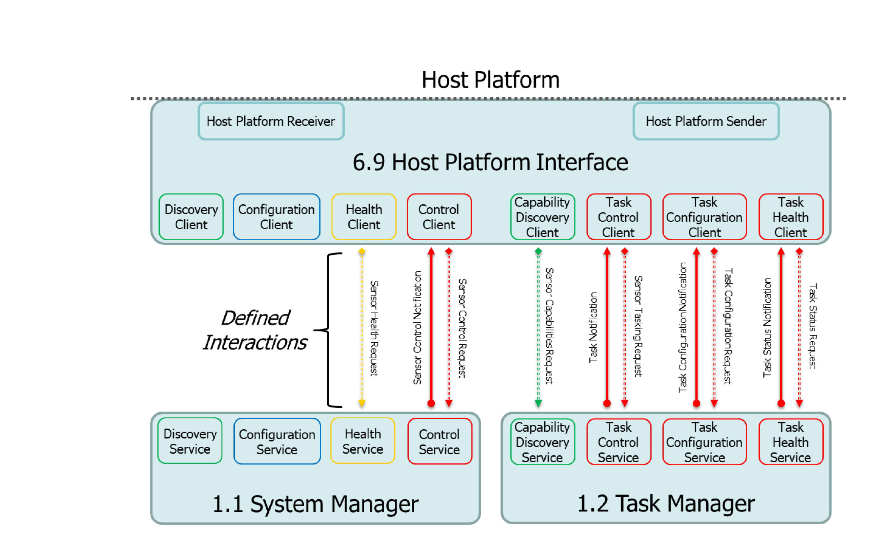

*Figure 46: Host Platform Interface Module Interactions*

Figure 46 illustrates the interfaces between the host platform interface and the management modules. The interaction groups shown are interactions bundled into functional groups for the sake of clarity. They are not an exhaustive list of all interactions necessary for command and control of the SOSA sensor, but a defined set of interactions needed to control externally the Radar, EW, and SIGINT sensor types. As an example of the functional bundling that was used to create the interaction groups, the Sensor Health Request interaction group encompasses the GetActiveFaults, GetBITResults, and GetSubsystemStatus interactions defined in Table 46.

The names, descriptions, inputs, and outputs of the interactions between the host platform interface and the management modules are listed in Table 46.

**Table 46: Host Platform Interface Interactions**

| Host Platform Interface Interactions |||||||
|---|---|---|---|---|---|---|
| Interaction Name | Interaction Description | Input DIV-2 Data Entities | Output DIV-2 Data Entities | 6.9 Host Platform Interface | 1.1 System Manager | 1.2 Task Manager |
| GetActiveFaults | Interaction to request and obtain a list of active faults in the sub-system. | None | CommandStatus (CommandStatusType), FaultCode (FaultCodeType) | Uses | Provides | N/A |
| GetBITResults | Interaction that sends the results of a specified BIT. | SubsystemID (SubsystemIDType) BIT_ID (BIT_IDType) | CommandStatus (CommandStatusType), BITResults (BITResultsType) | Uses | Provides | N/A |
| GetPlatformOrientation | Interaction sent to an Orientation Data component for retrieving the current orientation of the platform or vehicle. | None | Orientation (OrientationType), CommandStatus (CommandStatusType) | Uses | Provides | N/A |
| GetPlatformPosition | Interaction sent to a Position Data component for retrieving the current position of the platform. | None | Position (PositionType), CommandStatus (CommandStatusType) | Uses | Provides | N/A |
| GetPlatformVelocity | Interaction sent to get a 3D velocity of a platform. NOTE: VICTORY specifies heading and speed, whereas OMS and STANAG 4586 specify velocities North, East, and Down. | None | DirectionOfTravel (DirectionOfTravelType), CommandStatus (CommandStatusType) | Uses | Provides | N/A |
| GetSARSensorCapabilities | Interaction that retrieves an installed SAR Capability, its configurable characteristics, and its controllability. | None | SAR_Capability (SAR_CapabilityEnum), SAR_Subcapability (SAR_SubCapabilityEnum), CommandStatus (CommandStatusType) | Uses | Provides | N/A |
| GetSensorCalibrationResult | Interaction sent to a sensor to retrieve whether or not the most recent calibration of the sensor device was successful. | None | Result (CalibrationResultType), CommandStatus (CommandStatusType) | Uses | Provides | N/A |

> 转写说明：首行 `Host Platform Interface Interactions` 在原表中横跨全部 7 列，其余 6 格留空。`6.9 Host Platform Interface` 表头在原表中排为三行（`6.9 Host` / `Platform` / `Interface`），属表头折行，已用一个空格接成一行。
>
> 转写说明：原表 p.164 与续页续排，p.164 只有 GetActiveFaults 一行，续页接排 GetBITResults 至 GetSensorCalibrationResult 六行，共 7 个数据行。`Input DIV-2 Data Entities` 与 `Output DIV-2 Data Entities` 两列中，格内本是分条并列的数据实体（「实体名 + 换行 + 括号内类型」，条目之间以逗号分隔），故用 ` ` 连接；GetPlatformVelocity 行的说明格内是两段（正文 + `NOTE:` 段），用 ` ` 分段。
>
> 转写说明：`GetPlatformPosition` 行的 `Position (PositionType),` 与 `GetActiveFaults` 行的 `FaultCode (FaultCodeType)` 在原表中实体名与类型同处一行（未折行），照录为一行。
>
> 存疑：无（全部单元格清晰可读）。

<!-- 原书 p.164 ｜ PDF p.184 -->

<!-- 原书 p.165 ｜ PDF p.185 -->

<!-- 原书 p.166 ｜ PDF p.186 -->

<!-- 原书 p.167 ｜ PDF p.187 -->

<!-- 原书 p.168 ｜ PDF p.188 -->

<!-- 原书 p.169 ｜ PDF p.189 -->

<!-- 原书 p.170 ｜ PDF p.190 -->

<!-- 原书 p.171 ｜ PDF p.191 -->

#### 5.11 OSA Architecture Development/Evolution Plan

Planned for a later version of the SOSA Technical Standard.

<!-- 原书 p.172 ｜ PDF p.192 -->

## Appendix A: StdV-1 (Applicable Standards)

> 原书 p.173–173 ｜ PDF p.193–193

### A StdV-1 (Applicable Standards)

Planned for a later version of the SOSA Technical Standard.

<!-- 原书 p.173 ｜ PDF p.193 -->

## Appendix B: AV-2 Integrated Dictionary

> 原书 p.174–178 ｜ PDF p.194–198

The SOSA AV-2 Integrated Dictionary provides a unified set of definitions for terms that are either unique to the SOSA enterprise or may have different interpretations in different contexts. The SOSA AV-2 is not intended to be encyclopedic (not every term used in the SOSA Technical Standard is included; omitted are terms which are well understood by practitioners in the field, of for which there are widely-available definitions). The SOSA AV-2 is to be considered the single source of definitional truth for the SOSA enterprise.

**Table 47: AV-2 Integrated Dictionary (Master Glossary of SOSA Terminology)**

| Term | Definition |
|---|---|
| Architecture | A set of descriptive representations of the fundamental organization of a system embodied in its components, their relationships, to each other, and to the environment, and the principles guiding its design and evolution. |
| Assignment | A request from inside of the sensor system to a SOSA module to perform a mission-relevant function. |
| Behavior | The response (output data and resulting interactions generated) provided by a sensor system or module based on a particular set of stimuli. |
| Capability | A description of tasks or assignments a sensor system or module can do given its current health and configuration. |
| Closed Interface | Privately controlled system/subsystem boundary descriptions that are not disclosed to the public or are unique to a single supplier. |
| Cohesion | How well the hardware elements and software components relate to the same abstraction and are necessary to implement that abstraction. |
| Compatibility | The ability of systems or elements to co-exist without conflict or impairment, or be integrated or used with another system of its type. |
| Compliance | Degree to which a system, element, or interface adheres to an architecture or standard. |
| Configuration | How a SOSA sensor, hardware element, software component, or SOSA module is “set up” to operate. |
| Conformance | Whether a sensor, hardware element, software component, SOSA module, or associated interface completely adheres to an architecture or standard; conformance is the limiting case of 100% compliance. |
| Coupling | The strength of logical interconnectedness between parts of a system, and the resulting impact that a change to one element has on other parts of a sensor. |
| Cross-sensor Cueing | Process whereby data or information from one sensor is used to direct (or bound) the target search of another sensor, regardless of whether the sensors are on the same vehicle or elsewhere. |
| Data Model | Depiction of the format and structure of the data elements and their logical inter-relationships, as documented in the DIV-1 (Conceptual Data Model), DIV-2 (Logical Data Model), and DIV-3 (Physical Data Model). |
| Data Products | Raw/unprocessed or minimally processed digital output, generally from a sensor, ideally structured to enable reuse (see Information Products). |
| Data Rights | An entity’s license rights to IP in the form of technical data and computer software. |
| Detection | An observation that is determined to be differentiated from the ambient background (e.g., above a threshold for certain types of RF systems). |
| Element | A basic hardware, software, or logical unit, component, or constituent of a system or subsystem. |
| Hardware Element | An all-encompassing term for hardware that is incorporated into a SOSA sensor. |
| Health | The collection of status, faults, and warnings describing the condition of a sensor system or module. |
| Heartbeat | A periodic signal sent between hardware and/or software modules to indicate normal (or abnormal) operation. |
| Information Products | Processed or reduced digital output, generally from a Processing Exploitation and Dissemination (PED) or mission system, ideally structured to enable reuse (see Data Products). |
| Interaction | The stimuli and behavioral responses between modules. |
| Interface | The region where two systems or elements interact. |
| Interoperability | The ability of systems, elements, or interfaces to provide data/information to – and accept the same from – other systems, and to use the data/information so exchanged to enable them to operate effectively together. |
| Logging | The act of capturing data about the sensor, such as health, status, mode, and states in persistent storage for later retrieval and use. |
| Metadata | Data about the data; ancillary information used to provide contextual information (e.g., position, orientation, timing, area of regard, and other state information). |
| Mode | A description of the discrete condition of a sensor system, hardware element, software component, or SOSA module in which the expected behavior is known. Modes are well-defined and finite. |
| Model | A representation of a system, element, or interface (and possibly its environment) often presented as a combination of drawings and text, or by using a modeling language. |
| Modular Open Systems Approach (MOSA) | The DoD’s approach to OSA. Based on five core elements including: establishing an enabling environment, employing a modular design, designation of key interfaces, use of open standards, and conformance testing. The preferred OSD acquisition term is Open Systems Architecture (OSA). |
| Modularity | The degree to which a system or element is composed of individually distinct physical and functional elements that are loosely coupled with well-defined interface boundaries. |
| Module | An element of a system that has individually distinct boundaries that are well-defined interfaces and functional behaviors. A SOSA module is an architectural entity that has open, specified functional behaviors and interfaces, may be instantiated using hardware elements and/or software components, and conforms to the complete definition (functionality, behavior, and interfaces) as defined in the SOSA Technical Standard. |
| Navigation (Nav) Data | A general term for data related to position and velocity, possibly including acceleration and orientation. |
| Notification | An interaction in which a sensor system or module reports the occurrence of an event when it occurs. |
| Open Architecture | An open architecture is one in which stakeholders (or members of a community or open organization) have a say in the makeup and content of the architecture, and there exists a governance process to ensure that it is maintained, kept relevant, and meets the needs of the stakeholders. |
| Open Business Model | Business approach which requires doing business transparently to leverage the collaborative innovation of numerous participants across the enterprise permitting shared risk, maximizing asset reuse, and reducing total ownership costs. |
| Open Interface | An interface which conforms to an open standard (or architecture). |
| Open Source | Pertaining to or denoting software whose source code is available free-of-charge to the public to use, copy, modify, sublicense, or distribute. |
| Open Standard | A published standard in which stakeholders (or members of a community or open organization) have a voice in the makeup and content of the standard, and there exists a governance process to ensure that it is kept relevant and meets the needs of the stakeholders. |
| Open Systems Architecture | An architecture in which all components (modules) and their relationships (interfaces) are defined and documented in a way that is (1) accessible to all within the stakeholder community, (2) developed and governed by a consensus-driven body or bodies consisting of all interested parties, and (3) subject to conformance (or compliance) verification. |
| Platform | Refers to one of three things, which are context-dependent: a device (comprised of sensors and supporting environment), vehicle (host), or computing infrastructure (comprising hardware and software). When the term is used, it must be preceded by something that indicates the context. |
| Plug-and-Play | The property of a system, hardware, or software element to recognize that a component has been introduced and subsequently use it without the need for manual device configuration or operator intervention (e.g., USB devices). |
| Plug-In Card | Any hardware element that is a circuit card that plugs into a backplane. A SOSA plug-in card is a circuit card assembly that also conforms to a SOSA slot profile. |
| Portable | An attribute that describes the reuse of existing hardware or software elements (as opposed to the creation of new) when moving hardware or software elements from one environment (physical or computing) to another. |
| Published Architecture (or Standard) | One for which the interfaces (data model and interchange protocols) are widely known, used, or available to the target audience. |
| Publish-Subscribe | A kind of interaction in which one or more producers (publishers) make data available for sharing with zero or more consumers (subscribers). |
| Real-time | Pertaining to or consistent with meeting the data, information, and event needs of time-critical or deterministic processes (as embodied in specified time constraints/deadlines). |
| Reconfigure | Process by which a hardware, software, or system element is reversibly modified in response to a mission or operational need. |
| Request-Response | A kind of interaction in which a client sends a request to a service, which acts upon the request, and replies with a response. |
| Resilience | The ability of a system to continue or return to normal operations in the event of some disruption, natural or man-made, inadvertent or deliberate, and to be effective with graceful and detectable degradation of function. |
| Reuse | A benefit of standards-based module hardware or software components to be used again, for example, in a different system or environment from which it was designed, or to add new functionalities to a system with slight or no engineering development. |
| Safety-critical | A condition, event, operation, process, or item whose mishap or degradation may result in loss of system, vehicle, mission, or human life. |
| Scalable | Ability of an architecture to be used (1) from large to small platforms or (2) with few to many hardware and software elements, platforms, etc. |
| Secure | The property of a system such that its design renders it largely protected/inviolable against acts designed to (or which may) impair its effectiveness and operation, and prevents unauthorized persons or systems from having access to data/information contained within. |
| Security Risk | A measure of the extent to which an entity is threatened by a potential circumstance or event, and typically a function of: (1) the adverse impacts that would arise if the circumstance or event occurs; and (2) the likelihood of occurrence. |
| Sensor | A device or system that actively and/or passively estimates properties of another entity and produces quantitative data that will be subsequently processed or used (e.g., Radar, sonar, IR focal plane, seismometer, etc.) and consist of one or more sensor element(s) mounted within or on the same host platform. |
| Software Applications | A software executable designed to allow a user to complete tasks. |
| Software Component | A unit of software that is incorporated into a SOSA sensor. |
| Standardized Interfaces | Interfaces for which the physical structure, electronic signaling, and/or logical (format, protocol) product are codified in the SOSA Consortium products. |
| State | One of a set of top-level conditions from the operational lifecycle of a sensor system or part of a system. |
| Status | A description of the condition related to the performance or health of a sensor system or part of a system. |
| Subsystem | See System. |
| System | A group or collection of elements that together compose a useful capability. Systems can also relate to other systems in a system-of-systems context or be hierarchically arranged in system-subsystem combinations. A system in one context can be a subsystem in another. |
| System Management | Collection of functions and interfaces that ensures that the sensor operates as intended (e.g., configuration, control, signaling, health, and tasking functions). |
| Target | An entity of interest, possibly the result of a detection. |
| Task | A request from outside of the sensor system to perform a mission-relevant function. |
| Verification | The act of measuring/assessing conformance (or compliance, depending on the situation). |

<!-- 存疑：引言段 "…practitioners in the field, of for which there are widely-available definitions)" 中的 "of for which" 系源文件原样（疑为 "of which"/"for which" 排印重复），按逐字照录保留，未作改动。 -->

> 本表 66 条，逐字照录；p.194 引言段中 `of for which` 系原书原样（疑为排印重复），未改。

<!-- 本册覆盖原书 p.174–178 ｜ PDF p.194–198 -->

## Appendix C: Use-Case Details

> 原书 p.179–179 ｜ PDF p.199–199

### C Use-Case Details

#### C.1 OV-1 (High Level Operational Concept)

SOSA Hardware Use-Cases

The SOSA Hardware concepts are predicated on a set of architectural decisions that drive the overall development of the entire effort. The high-level use below is illustrative and provides an overview of all the relevant building blocks that encompass the Hardware portion of the SOSA standard. Each element in the use-case, both bubbles and lines, titles those specific building blocks and their connections. It is very important to note that each piece is a family that includes a number of types that differ in some respects and are similar in others. One of the underlying tenets not reflected in the diagram is the maximization of hardware module interoperability. With that in mind it is worth considering the connections below and that multiple hardware modules are capable of those connections Figure 47.

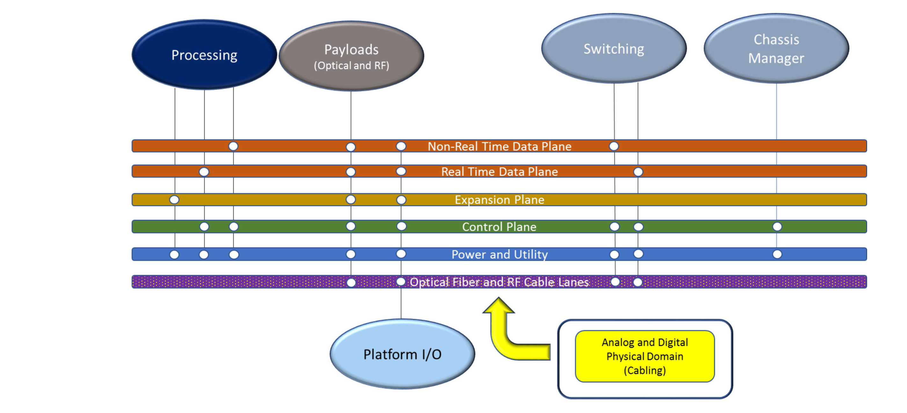

*Figure 47: High-Level SOSA Use-Case*

#### C.2 OV-2 (Operational Resource Flow)

Planned for a later version of the SOSA Technical Standard.

#### C.3 OV-5b (Operational Activity Model)

Planned for a later version of the SOSA Technical Standard.

<!-- 原书 p.179 ｜ PDF p.199 -->

## Appendix D: DIV-2 and Data Dictionary

> 原书 p.180–181 ｜ PDF p.200–201

### D DIV-2 and Data Dictionary

#### D.1 SOSA Sensor RF Control (Distribution A)

See the sheet named “DIV-2” in the following Microsoft® Excel® document: SOSA_Sensor_RF_Control_DIV2_DIV3_20180806_Distro_A.xlsx located here (available to members only): https://www.opengroup.us/sosa/documents.php?action=show&dcat=&gdid=19642

#### D.2 MORA Signal Layer

See the sheets named “DIV-2 VICTORY Mgmt Dist-C”, “DIV-2 MORA Mgmt Dist-A”, and “DIV-2 MORA MDMs Dist-A” in the following Microsoft Excel document: SOSA_Signal_Layer_DIV-2_DIV-3_20180628_Distro_C.xlsx located here (available to members only): https://www.opengroup.us/SOSA/distro/d/protected/documents.php?action=show&dcat=&gdid=

#### D.3 AMTI SAA Multi-Sensor Fusion Tracker

See the sheets named “Tracker DIV-2” and “Object Definitions” in the following Microsoft Excel document: SOSA_DIV2_Tracker_Module_20180622_ITAR.xlsx located here (available to members only): https://www.opengroup.us/sosa/documents.php?action=show&dcat=&gdid=19643 Note: This file is currently marked “Possibly ITAR”, which requires resolution.

#### D.4 Common System Management Data Elements

See the sheets named “DIV-2 Common Sys Mgmt Dist-A” and “DIV-2 VICTORY Mgmt Dist-C” in the following Microsoft Excel document: SOSA_SystemManagement_DIV-2_20180622_Dist-C.xlsx

<!-- 原书 p.180 ｜ PDF p.200 -->

located here (available to members only):

https://www.opengroup.us/SOSA/distro/d/protected/documents.php?action=show&dcat=&gdid=

- Note: Although this section is titled “Common System Management Data Elements”, these data elements have only been formally accepted in relation to the interactions of modules 2.1, 2.2, and 2.3. No decision has been made as of this document to accept these data entities as the common solution for system management interactions for all modules or hardware elements.

- Note: This is marked distribution C because it contains references to common system management parameters from VICTORY. Much of the file is actually distribution A, and it may be possible that it can be generalized and made distribution A.

<!-- 原书 p.181 ｜ PDF p.201 -->

## Appendix E: DIV-3 (Physical Data Model)

> 原书 p.182–182 ｜ PDF p.202–202

### E DIV-3 (Physical Data Model)

#### E.1 SOSA Sensor RF Control (Distribution A)

The DIV-3 for RF control has not yet been approved by the SOSA Consortium and is included only for information purposes. See the sheet named “DIV-3” in the following Microsoft Excel document: SOSA_Sensor_RF_Control_DIV2_DIV3_20180806_Distro_A.xlsx located here (available to members only): https://www.opengroup.us/sosa/documents.php?action=show&dcat=&gdid=19642

#### E.2 RF Signal Layer

See the sheets named “DIV-3 VICTORY Mgmt Dist-C”, “DIV-3 MORA Mgmt Dist-A”, and “DIV-3 MORA MDMs Dist-A” in the following Microsoft Excel document: SOSA_Signal_Layer_DIV-2_DIV-3_20180628_Distro_C.xlsx located here (available to members only): https://www.opengroup.us/SOSA/distro/d/protected/documents.php?action=show&dcat=&gdid=

<!-- 原书 p.182 ｜ PDF p.202 -->

## Appendix F: Host Vehicle/Sensor Connector Details

> 原书 p.183–183 ｜ PDF p.203–203

### F Host Vehicle/Sensor Connector Details

Planned for a later version of the SOSA Technical Standard.

<!-- 原书 p.183 ｜ PDF p.203 -->

## Appendix G: Slot Profiles

> 原书 p.184–184 ｜ PDF p.204–204

### G Slot Profiles

Planned for a later version of the SOSA Technical Standard.

<!-- 原书 p.184 ｜ PDF p.204 -->

## Appendix H: Module-by-Module Details

> 原书 p.185–185 ｜ PDF p.205–205

### H Module-by-Module Details

Planned for a later version of the SOSA Technical Standard.

<!-- 原书 p.185 ｜ PDF p.205 -->

## Appendix I: SOSA Backplane Examples

> 原书 p.186–190 ｜ PDF p.206–210

### I SOSA Backplane Examples

The following examples illustrate how the SOSA hardware modules can be combined to create a 3U medium-sized, 3U large-sized, and 3U/6U hybrid backplane. Each example references a SOSA hardware module for each slot position on the backplane and then defines how each pipe in each slot is interconnected. The associated topologies should be the same in each SOSA backplane although the number and type of slots may vary based on platform constraints and mission requirements.

#### I.1 3U Medium-Sized Backplane Example

The 3U medium-sized backplane example includes 6 SLT3-PAY-1F1U1S1S1U1U2F1H-14.6.11-n payloads in Slots 1, 3, 4, 7, 8, and 9 that can be populated with RF transceivers and/or computing payloads (e.g., SBC, FPGA, GPGPU, etc.). ANSI/VITA 67.3 connectors with blindmate coaxial pins facilitate two-level maintenance and can be upgraded in the future to include blind-mate optical connectors to support high throughput applications such as Digital RF.

The switched topology for the Ethernet control and data planes is provided on the same card in order to minimize the number of switch cards required and associated infrastructure overhead. Slot 2 uses a SLT3-SWH-4F1U7U1J-14.8.7-n switch which supports a blind-mate optical connector for Ethernet connections in/out of the chassis. Slot 2 is daisy chained with Slot 5 which uses a SLT3-SWH-6F1U7U-14.4.14 switch to support additional payloads. The PCIe Expansion Plane is connected between adjacent payloads in order to offload processing and support close coupling between cards comprising a single logical capability.

Slot 6 uses a SLT3x-TIM-2S1U22S1U2U1H-14.9.2-n radial clock module to provide timing to all of the payloads to enable phase-coherent operations. Radial distribution is achieved through the backplane using equal length traces to all terminating slots within the chassis. The radial clock module also includes an ANSI/VITA 67.3 connector with blind-mate coaxial pins to facilitate two-level maintenance.

<!-- 原书 p.186 ｜ PDF p.206 -->

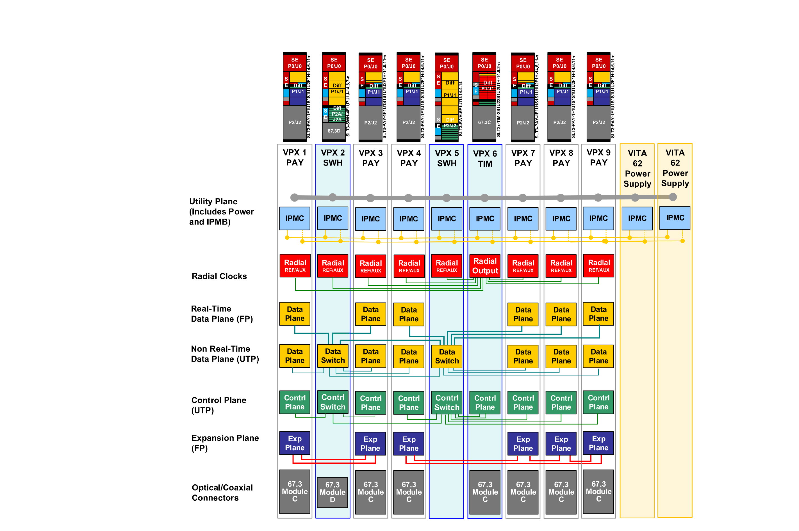

*Figure 48: 3U Medium-Sized Backplane Example*

#### I.2 3U Large-Sized Backplane Example

The 3U large-sized backplane example includes 8 SLT3-PAY-1F1U1S1S1U1U2F1H-14.6.11-n payloads in Slots 4, 5, 6, 7, 11, 12, 13, and 14 that can be populated with RF transceivers and/or computing payloads (e.g., SBC, FPGA, GPGPU, etc.). ANSI/VITA 67.3 connectors with blindmate coaxial pins facilitate two-level maintenance and can be upgraded in the future to include blind-mate optical connectors to support high throughput applications such as Digital RF.

Slot 9 uses a SLT3x-TIM-2S1U22S1U2U1H-14.9.2-n radial clock to provide timing to all of the payloads to enable phase-coherent operations. Radial distribution is achieved through the backplane using equal length traces to all terminating slots within the chassis. The radial clock slot also includes an ANSI/VITA 67.3 connector with blind-mate coaxial pins to facilitate twolevel maintenance.

Separate cards are used for the Ethernet control and data planes in order to maximize the number of payloads that can be supported by a single card, thus minimizing the number of inter-switch connections and associated bottlenecks. Slots 3 and 10 use a SLT3-SWH-6F1U7U-14.4.14 switch to establish the data plane switched fabric where the control plane lanes are repurposed to provide the second data plane connection to each payload slot. Slots 8 and 15 use a SLT3-SWH-6F8U-14.4.15 switch to establish the control plane switched fabric as well as provide Expansion Plane connectivity amongst all of the payloads.

Slots 2 and 16 use SLT3-PAY-1F1F2U1TU1T1U1T-14.2.16 for SBCs with I/O and an XMC site that are routed out of the chassis. The I/O pins can be used to connect peripherals such as a

<!-- 原书 p.187 ｜ PDF p.207 -->

display, keyboard, and mouse. The XMC site can be used to customize the I/O for a particular system or platform. This approach allows the same SBC carrier card to be shared across platforms with host-specific tailoring accomplished with a custom XMC.

Slot 1 uses a SLT3-SWH-1F1S1S1U1U1K-14.8.8-n switch to route RF signals within and outside of the chassis. This approach enables payloads to share RF resources such as amplifier and antennas, and may be used in the future to distribute Local Oscillators (LOs) to enable LOcoherent operation across payloads. The RF switch slot also includes an ANSI/VITA 67.3 connector with blind-mate coaxial pins to facilitate two-level maintenance.

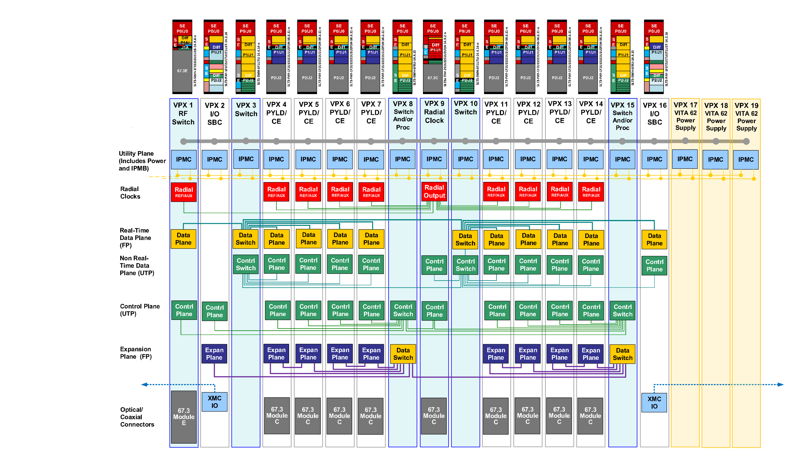

*Figure 49: 3U Large-Sized Backplane Example*

#### I.3 3U/6U Hybrid Backplane Example

The 3U/6U hybrid backplane example illustrates how 3U payloads can be shared across platforms and augmented with 6U payloads when additional RF or processing capability is required. A hybrid approach can also be applied when retrofitting/updating an existing 6U chassis in order to take advantage of the growing 3U ecosystem.

The 3U/6U hybrid backplane example includes 4 SLT3-PAY-1F1U1S1S1U1U2F1H-14.6.11-n payloads in Slots 8, 9, 10, and 11 and a SLT3-PAY-1F1U1S1S1U1U4F1J-14.6.13-n extended payload in Slot 12 that can be populated with RF transceivers and computing payloads (e.g., SBC, FPGA, GPGPU, etc.). ANSI/VITA 67.3 connectors with blind-mate coaxial pins facilitate two-level maintenance and can be upgraded in the future to include blind-mate optical connectors to support high throughput applications such as Digital RF.

Slot 7 uses a SLT3x-TIM-2S1U22S1U2U1H-14.9.2-n radial clock to provide timing to all of the payloads to enable phase-coherent operations. Radial distribution is achieved through the

<!-- 原书 p.188 ｜ PDF p.208 -->

backplane using equal length traces to all terminating slots within the chassis. The radial clock slot also includes an ANSI/VITA 67.3 connector with blind-mate coaxial pins to facilitate twolevel maintenance.

Slots 4 and 13 use SLT3-PAY-1F1F2U1TU1T1U1T-14.2.16 for SBCs with I/O and an XMC site that are routed out of the chassis. The I/O pins can be used to connect peripherals such as a display, keyboard, and mouse. The XMC site can be used to customize the I/O for a particular system or platform. This approach allows the same SBC carrier card to be shared across platforms with host-specific tailoring accomplished with a custom XMC. Additional I/O is provided by Slot 5 which uses SLT3-PAY-2U2U-14.2.17 to interface with the platform over platform-specific connections and the rest of the payload modules over standard expansion or data plane interfaces. Slot 1 uses SLT3-PAY-1F1F2U-14.2.4 to support legacy SBCs although this slot profile has been deprecated in the SOSA standard and is not recommended for new development.

Slots 2 uses a SLT6-PAY-4F2Q1H4U1T1S1S1TU2U2T1H-10.6.4-n payload that can be populated with RF transceivers and/or computing payloads (e.g., SBC, FPGA, GPGPU, etc.). Slot 3 uses a SLT6-PAY-4F1Q1H4U1T1S1S1TU2U2T1H-10.6.3-n payload that can also be populated with RF transceivers and computing payloads but also includes I/O that is routed out of the chassis. The I/O pins can be used to connect peripherals such as a display and keyboard/mouse, while the XMC site can be used to customize the I/O for a particular system or platform. Both Slots 2 and 3 use ANSI/VITA 67.3 connectors with blind-mate coaxial pins to facilitate two-level maintenance that can be upgraded in the future to include blind-mate optical connectors to support high throughput applications such as Digital RF.

The 3U/6U hybrid backplane example takes advantage of the additional pins available in 6U to provide the switched topology for the entire backplane in a single card. Slot 6 uses SLT6-SWH-14F16U1U15U1J-10.8.1-n to establish the Ethernet switched fabric for the control and data planes. This slot also supports a blind-mate optical connector for Ethernet connections in/out of the chassis. The PCIe Expansion Plane is connected between adjacent payloads in order to offload processing and support close coupling between cards comprising a single logical capability. The extended payload in Slot 12 can also serve as a data aggregator as it possesses an Expansion Plane connection to the payloads in Slots 8, 9, 10, and 11.

<!-- 原书 p.189 ｜ PDF p.209 -->

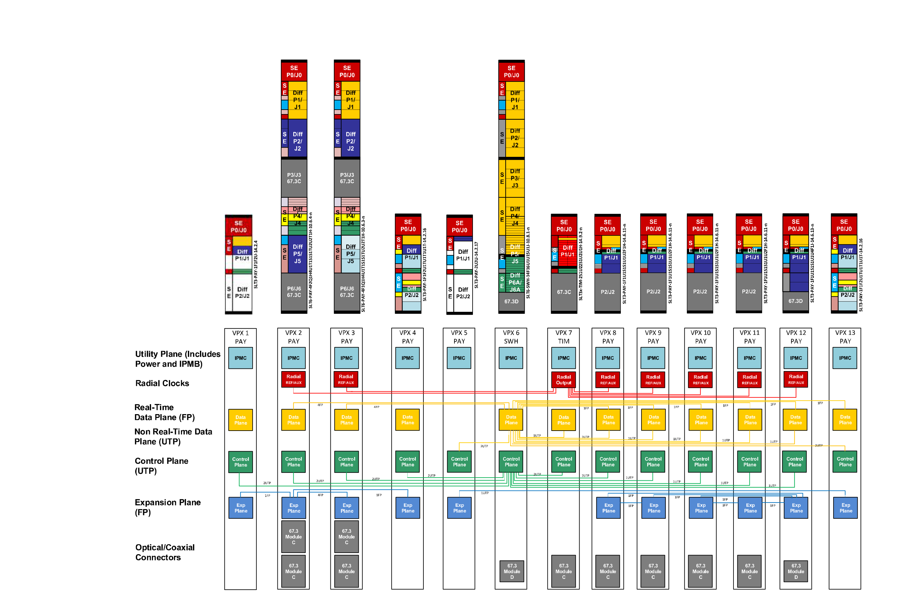

*Figure 50: 3U/6U Hybrid Backplane Example*

<!-- 原书 p.190 ｜ PDF p.210 -->

## Acronyms & Abbreviations

> 原书 p.191–194 ｜ PDF p.211–214

此节为全书最后一节，收全书使用的缩略语及其展开式（原书未编号为表，此处按其两列结构转作表）。

| Acronym | Expansion |
|---|---|
| 2LM | 2 Level Maintenance |
| ACK/NAK | Acknowledgement/Negative Acknowledgement |
| AFLCMC | Air Force Life Cycle Management Center |
| AMTI | Air Moving Target Indicator |
| API | Application Programming Interface |
| AWG | Architecture Working Group |
| BIT | Built-In Test |
| BSP | Board Support Package |
| C4ISR | Command, Control, Communications, Computers, Intelligence, Surveillance, and Reconnaissance |
| CERDEC | Communications-Electronics Research, Development, and Engineering Center |
| ChMC | Chassis Management Controller |
| CIK | Crypto Ignition Key |
| CMM | Chassis Manager Module |
| COTS | Commercial Off-the-Shelf |
| CPLD | Complex Programmable Logic Device |
| CPU | Central Processing Unit |
| DDS | Data Distribution Service |
| DoD | Department of Defense (United States) |
| DoDAF | Department of Defense Architecture Framework |
| EARS | Export Administration Regulations |
| EFI | Extensible Firmware Interface |
| EIA | Electronic Industry Alliance |
| EM | Electromagnetic |
| EMC | Electromagnetic Compatibility |
| EO/IR | Electro-Optical/Infrared |
| ESM | Electronic Support Measure |
| EW | Electronic Warfare |
| FAA | Federal Aviation Administration |
| FACE | Future Airborne Capability Environment |
| FOV | Field of View |
| FPGA | Field-Programmable Gate Array |
| FRU | Field Replaceable Unit |
| GMTI | Ground Moving Target Indicator |
| GOTS | Government Off-The-Shelf |
| GPGPU | General-Purpose Graphics Processing Unit |
| GPIO | General-Purpose Input Output |
| GPU | Graphics Processing Unit |
| HOST | Hardware Open Systems Technology |
| HWG | Hardware Working Group |
| ICD | Interface Control Document |
| IP | Intellectual Property |
| IPMB | Intelligent Platform Management Bus |
| IPMC | Intelligent Platform Management Controller |
| JTAG | Joint Test Action Group |
| LRU | Line Replaceable Unit |
| LVCMOS | Low Voltage Complementary Metal Oxide Semiconductor |
| LVDS | Low Voltage Differential Signal |
| MDM | MORA Data Message |
| MIB | Management Information Base |
| MISB | Motion Imagery Standards Board |
| ML2B | MORA Low Latency Bus |
| MORA | Modular Open RF Architecture |
| MOSA | Modular Open Systems Approach |
| NAVAIR | Naval Air System Command |
| NAVSEA | Naval Sea Systems Command |
| NEXT | Near End Cross Talk |
| NEZ | No Emit Zone |
| NVMRO | Non-Volatile Memory Read Only |
| OMG | Object Management Group |
| OMS | Open Mission Systems |
| OSA | Open Systems Architecture |
| OSD | The Office of the Secretary of Defense |
| PCIe | Peripheral Computer Interface extended |
| PED | Processing Exploitation and Dissemination |
| PEO | Program Executive Office |
| PPS | Pulse Per Second |
| PSM | Power Supply Module |
| QoS | Quality of Service |
| RAS | Reliability, Availability, and Serviceability |
| REI | Runtime Environment Interface |
| REST | Representational State Transfer |
| RF | Radio Frequency |
| RTE | Run-Time Environment |
| RTM | Requirements Traceability Matrix |
| SAA | Sense and Avoid |
| SAE | Society of Automotive Engineers |
| SAR | Synthetic Aperture Radar |
| SBC | Single Board Computer |
| SDK | Software Development Kit |
| SIGINT | Signals Intelligence |
| SMTI | Surface Moving Target Indicator |
| SNMP | Simple Network Management Protocol |
| SOA | Service-Oriented Architecture |
| SOAP | Simple Object Access Protocol |
| SOSA | Sensor Open Systems Architecture |
| SSR | Solid State Relay |
| STAP | Space-Time Adaptive Processing |
| SWaP | Size, Weight, and Power |
| TCP | Transmission Control Protocol |
| TIA | Telecommunications Industrial Association |
| TNC | Threaded Neill-Concelman |
| TOA | Tactical Open Architecture |
| UAS | Unmanned Ariel System |
| UAV | Unmanned Aerial Vehicle |
| UCI | UAS Command & Control Initiative |
| UDP | User Datagram Protocol |
| UI | User Interface |
| UML | Unified Modeling Language |
| USAF | United States Air Force |
| USB | Universal Serial Bus |
| UUV | Unmanned Underwater Vehicle |
| VDB | VICTORY Data Bus |
| VICTORY | Vehicular Integration for C4ISR/EW Interoperability |
| VM | Virtual Machine |
| VSWR | Voltage Standing Wave Ratio |
| XMC | Express Mezzanine Card |
| XML | eXtensible Markup Language |

> 说明：107 条缩写逐字照录。原书此处有不一致处（如 `NAVAIR` 作 System 而 `NAVSEA` 作 Systems、`GOTS` 作 Off-The-Shelf 而 `COTS` 作 Off-the-Shelf、`UAS` 作 Ariel），一律照录未改。

<!-- 本册覆盖原书 p.191–194 ｜ PDF p.211–214 -->
