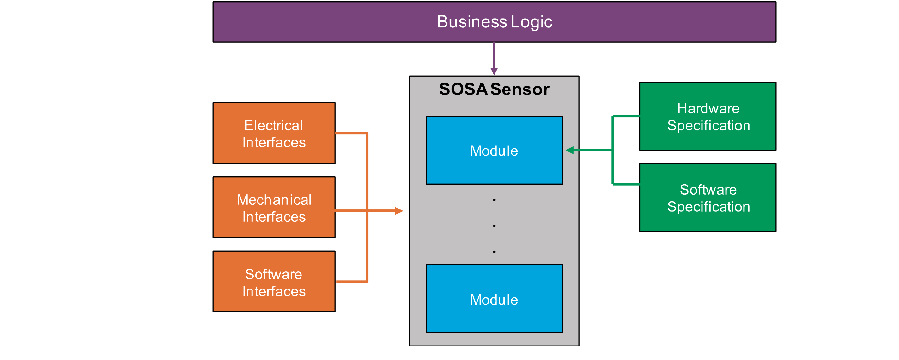
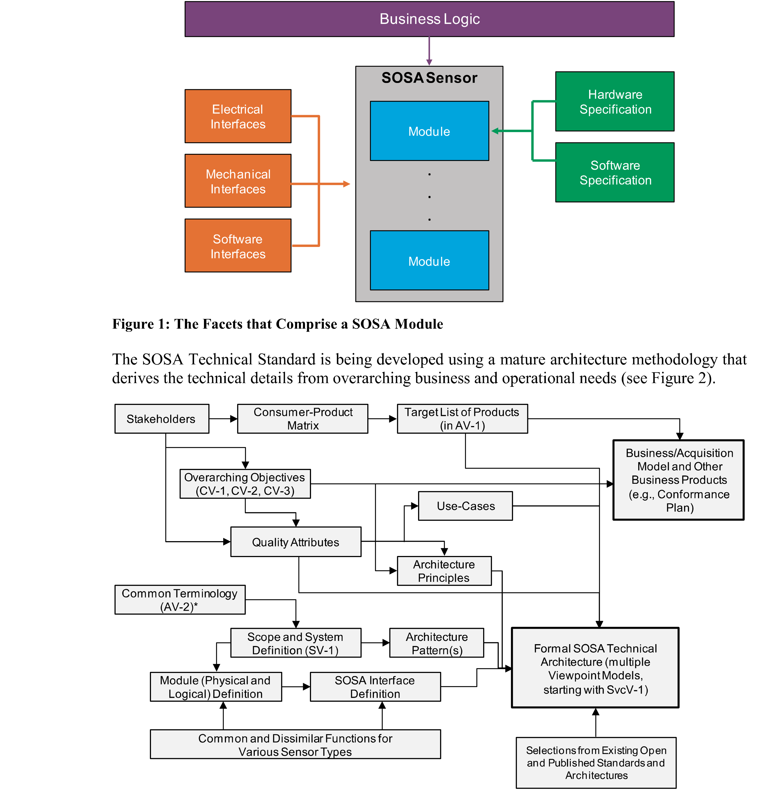

# 1 Introduction 引言

> 原书 p.1–7 ｜ PDF p.21–27

Introduction

引言

Long lead times, cumbersome improvement processes, lack of reuse, platform-unique design, and extensive testing requirements characterize current Department of Defense (DoD) Command, Control, Communications, Computers, Intelligence, Surveillance, and Reconnaissance (C4ISR) capability. This results in higher costs and the inability to deliver capabilities to the war fighter in a timely manner. To counter these trends, the United States Air Force (USAF) Air Force Life Cycle Management Center (AFLCMC), Naval Air System Command (NAVAIR), Naval Sea Systems Command (NAVSEA), Communications-Electronics Research, Development, and Engineering Center (CERDEC), and Program Executive Office (PEO)-Aviation Program offices, enabled by the expertise and experience of the DoD's industrial base, are adopting a revolutionary approach. The Sensor Open Systems Architecture (SOSA) will enable rapid, affordable, cross-platform capability advancements based upon fundamentals of system, software, hardware, and electrical/mechanical engineering best practices and Modular Open Systems Approach (MOSA) principles with pragmatic, practical experience to develop a solution that addresses DoD needs for a cohesive unified set of C4ISR capabilities.

冗长的交付周期、笨重的改进流程、复用不足、平台专用设计以及大量测试要求，构成了当前美国国防部（DoD）指挥、控制、通信、计算机、情报、监视与侦察（C4ISR）能力的特征。这导致成本更高，且无法及时把能力交付到作战人员手中。为扭转这些趋势，美国空军（USAF）空军生命周期管理中心（AFLCMC）、海军航空系统司令部（NAVAIR）、海军海上系统司令部（NAVSEA）、通信-电子研究、开发与工程中心（CERDEC）以及航空项目执行官办公室（PEO-Aviation），在国防部工业基础的专长与经验支撑下，正在采用一种革命性的做法。传感器开放系统架构（SOSA）将基于系统、软件、硬件与电气／机械工程最佳实践的基本原理，以及模块化开放系统方法（MOSA）原则，结合务实、实际的经验，使能力得以快速、可负担、跨平台地提升，并形成一套解决方案，回应国防部对内聚统一的 C4ISR 能力集合的需要。

The goal of The Open Group SOSA Consortium is to reduce development and integration costs and reduce time to field new C4ISR capabilities.

The Open Group SOSA 联盟的目标是降低开发与集成成本，缩短新 C4ISR 能力列装的时间。

### 1.1 Objective 目标

The subject of this Snapshot is the specification of the Technical Standard for Sensor Open Systems Architecture (SOSA) Reference Architecture, Edition 1.0.

本快照版的标的，是《传感器开放系统架构（SOSA）参考架构技术标准》第 1.0 版的规格说明。

This Snapshot is intended to make public the direction, thinking, and path the SOSA Consortium is taking in the development of the SOSA Reference Architecture. We invite your feedback and guidance. To provide feedback on this Snapshot, please send comments by email to ogsosaadmin@opengroup.us no later than December 31, 2019.

本快照版意在公开 SOSA 联盟开发 SOSA 参考架构所取的方向、思路与路径。我们欢迎您的意见与指导。如对本快照版提出意见，请于 2019 年 12 月 31 日前发邮件至 ogsosaadmin@opengroup.us。

The SOSA Technical Standard defines the SOSA modules (containing functions and behaviors) and associated interfaces enabling the development of capabilities made up of common, interchangeable components for Communications, EO/IR, EW, Radar, and SIGINT sensing. The scope of coverage includes software components and hardware elements, as well as electrical and mechanical interfaces for the SOSA sensor. The approach also includes the relevant business approach and supporting guidance documents.

SOSA 技术标准定义了 SOSA 模块（含功能与行为）及相关接口，使通信、光电／红外、电子战、雷达与信号情报各传感领域的能力，能够由通用、可互换的组件构成并加以开发。覆盖范围包括软件组件与硬件元素，以及 SOSA 传感器的电气与机械接口。该做法还包括相应的业务做法与配套指导文件。

The vision statement for the SOSA Consortium is:

SOSA 联盟的愿景声明为：

Business/acquisition practices and a technical environment for sensors and C4ISR payloads that foster innovation, industry engagement, competition, and allow for rapid fielding of costeffective capabilities and platform mission reconfiguration while minimizing logistical requirements.

面向传感器与 C4ISR 载荷的业务／采办做法与技术环境：促进创新、产业参与与竞争，允许快速列装成本有效的能力、允许平台任务重构，同时尽量减少后勤需求。

<!-- 原书 p.1 ｜ PDF p.21 -->

The goals are:

目标是：

- Open: vendor and platform-agnostic open modular reference architecture and business model Standardized: software component, hardware element, and electrical-mechanical interface standards Harmonized: leverage existing and emerging open standards scope Aligned: consistent with DoD acquisition policy guidance Cost-effective: affordable C4ISR systems including lifecycle costs Adaptable: rapidly responsive to changing user requirements

- 开放：与厂商、平台无关的开放模块化参考架构与业务模式；标准化：软件组件、硬件元素与电气-机械接口标准；协调一致：利用现有与新兴的开放标准范围；对齐：与国防部采办政策指导保持一致；成本有效：可负担的 C4ISR 系统，含全生命周期成本；可适应：快速响应用户需求的变化

> **译注**：上段英文在原书为六条项目符号，转换时并成一段（成因见 `../99-转换说明与已知差异.md`）。英文照录不改，中文同构译成一段。

### 1.2 Overview 概述

This Snapshot documents a proposal for a SOSA Technical Standard.

本快照版记载的是 SOSA 技术标准的一份提案。

The SOSA Technical Standard defines a system, software, hardware and electrical/mechanical architecture that supports real-time, mission, and system-critical solutions. The SOSA Technical Standard will leverage industry standard Application Programming Interfaces (APIs) for software, common hardware pinout, and profile specifications based on VITA™, and electrical mechanical specifications based on AS6129/69.

SOSA 技术标准定义了一套系统、软件、硬件与电气／机械架构，用以支撑实时、任务关键与系统关键的解决方案。SOSA 技术标准将采用面向软件的行业标准应用程序接口（API）、通用硬件引脚定义，以及基于 VITA™ 的配置档规范，还有基于 AS6129/69 的电气机械规范。

At a later date, The Open Group will provide this Technical Standard, and also a Conformance Guide that will contain the Product Standard that identifies what is to be tested for conformance certification.

日后，The Open Group 将提供本技术标准，以及一份符合性指南；该指南将包含产品标准，指明为符合性认证需测试什么。

#### 1.2.1 SOSA Architecture Fundamentals SOSA 架构基础

SOSA specifications are based on convergence of domains of knowledge for: business logic (market and government-driven forces), and technical (software, hardware, and electrical/mechanical interfaces). To that end, a complete system based on the SOSA Technical Standard will require all of the above domains to be fully integrated in a unified architecture description. The SOSA Technical Standard provides a description of each SOSA module and its interfaces (physical and logical, as appropriate) which will be required to create SOSA sensor designs/implementations based on unique customer needs (see Figure 1).

SOSA 规格基于两类知识领域的汇合：业务逻辑（市场与政府驱动的力量）与技术（软件、硬件与电气／机械接口）。为此，基于 SOSA 技术标准的完整系统，要求上述各领域全部集成于一份统一的架构描述之中。SOSA 技术标准给出每个 SOSA 模块及其接口（按需要分物理与逻辑）的描述，这些描述是依据各客户独特需求形成 SOSA 传感器设计／实现所必需的（见图 1）。

<!-- 原书 p.2 ｜ PDF p.22 -->

*Figure 1: The Facets that Comprise a SOSA Module ｜ 图 1：构成 SOSA 模块的各个侧面*

*Figure 2: The Architecture Development Method Adopted for the SOSA Technical Standard ｜ 图 2：SOSA 技术标准所采用的架构开发方法*

This document describes the SOSA Technical Architecture, including the SOSA module specifications (functions, behaviors, and interfaces), and the hardware elements and software components from which they are synthesized.

本文件描述 SOSA 技术架构，包括 SOSA 模块规格（功能、行为与接口），以及据以合成这些模块的硬件元素与软件组件。

<!-- 原书 p.3 ｜ PDF p.23 -->

#### 1.2.2 Business Alignment 业务对齐

The overview of alignment between technical and business focus areas for the SOSA Technical Standard and the SOSA Open Business Model is available through a companion document – the SOSA Business Guide (see Referenced Documents). A detailed presentation of the SOSA Open Business Model can be found in the SOSA Business Guide. Examples of SOSA Open Business Model incorporation into the acquisition process can be found in the SOSA Contracting Guide. Policies guiding the development and conduct of the SOSA Conformance Program may be found in the SOSA Conformance Policy.

SOSA 技术标准与 SOSA 开放业务模式在技术与业务聚焦领域上的对齐概貌，见配套文件《SOSA 业务指南》（见"引用文件"）。SOSA 开放业务模式的详细阐述见《SOSA 业务指南》。SOSA 开放业务模式融入采办过程的示例，见《SOSA 合同指南》。指导 SOSA 符合性计划制定与实施的政策，见《SOSA 符合性政策》。

The SOSA Business Guide explains the objectives and organization of The Open Group SOSA Consortium, and describes the SOSA Technical Standard and SOSA Open Business Model. It is intended for use by all stakeholders in the development, acquisition, deployment, modernization, and sustainment of sensor systems that support a broad array of sensors, including C4ISR. The primary stakeholder groups are Government organizations, Aerospace and Defense contractors, and commercial businesses. Within each of these broad groups there are business and technical communities, acquisition and contracting communities, users, and operational communities. All of them have a stake in the SOSA ecosystem and should become familiar with the SOSA Business Guide.

《SOSA 业务指南》说明 The Open Group SOSA 联盟的目标与组织，并描述 SOSA 技术标准与 SOSA 开放业务模式。其读者为传感器系统开发、采办、部署、现代化与保障的全部利益相关方；这些系统支撑包括 C4ISR 在内的广泛传感器。主要利益相关方群体为政府机构、航空航天与国防承包商以及商业企业。在这些大群体之内，各有业务与技术社群、采办与合同社群、用户以及作战社群。这些群体在 SOSA 生态中都有利害，都宜熟悉《SOSA 业务指南》。

The SOSA Contracting Guide provides procurement language examples for organizations that acquire sensor components and systems, as well as for those who provide them. This Guide is necessarily abstract to relay essential concepts without getting bogged down in details which may change as the SOSA Technical Standard and conformance processes mature. While the US Government is the most common procurer of C4ISR systems, and contractors within the defense industrial base are the most common providers of those systems, it should be noted that the same concerns and general procedures are also applicable to procurements led by industry and to products and services provided by commercial enterprises.

《SOSA 合同指南》为采购传感器组件与系统的机构、以及提供这些组件与系统的机构，给出采购条款语言的示例。该指南必然是抽象的，以便传达基本概念，而不致陷于细节——这些细节会随 SOSA 技术标准与符合性过程的成熟而变化。美国政府是 C4ISR 系统最常见的采购方，国防工业基础内的承包商是这些系统最常见的提供方；但宜注意，同样的关切与一般程序也适用于由产业主导的采购，以及商业企业提供的产品与服务。

The SOSA Conformance Policy lays out high-level policies for the development and conduct of a set of SOSA conformance processes. These processes will include multiple conformance verification processes, a single conformance certification process, and a single SOSA certified conformant product registration process.

《SOSA 符合性政策》给出制定与实施一组 SOSA 符合性过程的顶层政策。这些过程将包括多个符合性验证过程、一个符合性认证过程，以及一个 SOSA 认证符合产品登记过程。

### 1.3 Conformance 符合性

This is a Snapshot, not an approved standard. Do not specify or claim conformance to it.

本件是快照版，不是经批准的标准。不得规定符合本件，也不得声称符合本件。

Defining conformance processes and creating an effective, affordable method for certifying software, hardware, and electrical/mechanical interfaces is vital to establishing an effective standard. Certification provides formal recognition of conformance to an industry standard, which allows the following:

定义符合性过程，并为软件、硬件与电气／机械接口的认证创立有效、可负担的方法，对确立一项有效的标准至关重要。认证提供对符合某项行业标准的正式承认，由此可以：

- Suppliers and practitioners may make verified claims of conformance to an open standard

- 供应方与从业者可以对开放标准的符合性作出经核实的声称

- Buyers may specify and successfully procure modular capability from vendors who provide solutions which conform to that open standard The SOSA Consortium is developing a SOSA Conformance Policy and will be developing an associated Conformance Program for the SOSA Technical Standard. The SOSA Conformance Program will provide the associated conformance criteria and processes necessary to assure that

- 采购方可以规定模块化能力，并从提供符合该开放标准解决方案的厂商处成功采购　SOSA 联盟正在制定《SOSA 符合性政策》，并将为 SOSA 技术标准制定相应的符合性计划。SOSA 符合性计划将提供为确保以下事项所必需的相应符合性判据与过程

<!-- 原书 p.4 ｜ PDF p.24 -->

capabilities have been developed in adherence to the SOSA Technical Standard. The SOSA Conformance Program will consist of Verification, Certification, and Registration.

能力已按 SOSA 技术标准开发。SOSA 符合性计划将由验证、认证与登记三部分组成。

> **译注**：上两段英文在原书是一条项目符号与一段正文，转换时首条后半与正文并成一条（成因见 `../99-转换说明与已知差异.md`）。英文照录不改。

SOSA Conformance Verification is the act of assessing the conformance of the implementation of a hardware element or software component (or a combination thereof) to the applicable SOSA Technical Standard requirements. SOSA verification processes will not be available for this Snapshot.

SOSA 符合性验证，是评定硬件元素或软件组件（或其组合）的实现对适用 SOSA 技术标准要求的符合性的动作。本快照版不提供 SOSA 验证过程。

SOSA Conformance Certification is the process of applying for SOSA Conformance Certification once Conformance Verification has been successfully completed. The SOSA Certification process will not be available for this Snapshot.

SOSA 符合性认证，是在符合性验证成功完成之后申请 SOSA 符合性认证的过程。本快照版不提供 SOSA 认证过程。

SOSA Registration is the process of listing SOSA certified modules and SOSA plug-in cards in a curated listing of information about SOSA certified modules and SOSA plug-in cards known as the SOSA Registry. The SOSA Registry process will not be available for this Snapshot.

SOSA 登记，是把经 SOSA 认证的模块与经 SOSA 认证的插卡，列入一份经整理的信息清单的过程；该清单称为 SOSA 登记簿，记载经 SOSA 认证的模块与插卡的信息。本快照版不提供 SOSA 登记簿过程。

Successful completion of the SOSA Conformance Program leads to a SOSA Conformance Certificate and the right to use the SOSA Conformance Certification Trademark in marketing.

成功完成 SOSA 符合性计划，可获得 SOSA 符合性证书，以及营销中使用 SOSA 符合性认证商标的权利。

### 1.4 Normative References 规范性引用文件

None.

无。

### 1.5 Terminology 术语

#### 1.5.1 SOSA Architecture SOSA 架构

While the complete SOSA AV-2 Integrated Dictionary can be found in Appendix B, there are certain key terms that must be understood in order to correctly interpret this Technical Standard.

完整的 SOSA AV-2 集成词典见附录 B；此外还有若干关键术语，必须理解它们才能正确解读本技术标准。

- Hardware Element: an all-encompassing term for hardware that is incorporated into a SOSA sensor Plug-In Card: any hardware element that is a circuit card that plugs into a backplane SOSA Plug-In Card: a circuit card assembly that also conforms to a SOSA slot profile Software Component: a unit of software that is incorporated into a SOSA sensor SOSA Module: an architectural entity that aggregates and contains the functions the SOSA sensor performs (consistent with DoD MOSA language), may be instantiated using hardware elements and/or software components, and conforms to the complete definition of a SOSA module as defined in the SOSA Technical Standard

- 硬件元素：一个总括性用语，指纳入 SOSA 传感器的硬件；插卡：任何插入背板的电路卡形式的硬件元素；SOSA 插卡：一种电路卡组件，还符合某个 SOSA `slot profile`（槽位配置档）；软件组件：纳入 SOSA 传感器的一个软件单元；SOSA 模块：一个架构实体，它聚集并承载 SOSA 传感器所执行的功能（与国防部 MOSA 的用语一致），可用硬件元素和／或软件组件实例化，并符合 SOSA 技术标准所定义的 SOSA 模块的完整定义

> **译注**：上段英文在原书为五条项目符号，转换时并成一条。英文照录不改。`slot profile` 按术语策略存原词，首次出现括注中文。

#### 1.5.2 System Requirements 系统要求

For the purposes of the SOSA Technical Standard, the following terminology definitions apply:

为 SOSA 技术标准的目的，下列术语定义适用：

May Describes a feature or behavior that is optional. The presence of this feature should not be relied upon.

可　描述可选的功能或行为。不宜依赖该功能的存在。

<!-- 原书 p.5 ｜ PDF p.25 -->

Shall Describes a feature or behavior that is mandatory for an implementation that conforms to this document. A hardware element or software component relies on the existence of the feature or behavior.

应　描述对符合本文件的实现而言强制具备的功能或行为。硬件元素或软件组件依赖该功能或行为的存在。

Should Describes a feature or behavior that is strongly recommended for an implementation that conforms to this document. A hardware element or software component cannot rely on the existence of the feature or behavior.

宜　描述对符合本文件的实现而言强烈推荐的功能或行为。硬件元素或软件组件不能依赖该功能或行为的存在。

#### 1.5.3 Hardware Specification Keywords 硬件规格关键字

To avoid confusion and to make very clear what the requirements for conformance are, many of the paragraphs in this Technical Standard are labeled with keywords that indicate the type of information they contain. These keywords are listed below:

为避免混淆、并清楚表明符合性要求为何，本技术标准中许多段落以关键字标注，以指示其内容属于哪一类信息。这些关键字列举如下：

Rule Recommendation Suggestion Permission Observation Any text not labeled with one of these keywords is to be interpreted as descriptive in nature. These will be written in either a descriptive or a narrative style.

规则　推荐　建议　许可　观察　未以其中任一关键字标注的任何文字，均按描述性理解。这些文字或以描述体、或以叙述体写出。

> **译注**：上段英文在原书为五个关键字加一段正文，转换时并成一段。英文照录不改。

Keywords are reserved for specific use as follows:

各关键字保留作如下专门用途：

Rule <section>-<number>

规则 <section>-<number>

> **译注**：条目标目模板中的 `<section>`（节号）与 `<number>`（序号）为占位符，原样保留，不译；实际条目标目形如 `Rule 5.2.18-1`，连同编号一律照录。

Conformance with Rules is mandatory. Rules always include the term "shall". Rules are expressed in some combination of text, figures, tables, or drawings. All Rules will be followed to ensure compatibility between board and backplane designs. All Rules use the "shall" or "shall not" words to emphasize the importance of the Rule. The "shall" or "shall not" words are reserved exclusively for stating Rules in this document and are not used for any other purpose.

符合规则是强制的。规则总是包含 "shall"（应）一词。规则以文字、图、表或附图的某种组合表达。所有规则都将被遵循，以确保板与背板设计之间的兼容性。所有规则都使用 "shall"（应）或 "shall not"（不应）字样，以强调规则的重要性。"shall"（应）或 "shall not"（不应）字样在本文件中专用于陈述规则，不用于任何其他目的。

Recommendation <section>-<number>

推荐 <section>-<number>

Conformance with Recommendations is optional. Recommendations always include the term "should". Recommendations are used to convey implementation advice based on the community's collective knowledge base. Wherever a Recommendation appears, designers would be wise to take the advice given. Doing otherwise might result in poor performance Or awkward problems. Recommendations found in this document are based on experience and are provided to designers to speed their traversal of the learning curve. All Recommendations use the "should" or "should not" words to emphasize the importance of the Recommendation. The "should" or "should not" words are reserved exclusively for stating Recommendations in this document and are not used for any other purpose.

符合推荐是可选的。推荐总是包含 "should"（宜）一词。推荐用于传达基于群体集体知识基础的实现忠告。凡出现推荐之处，设计者采其忠告为宜。不采可能导致性能不佳或棘手问题。本文件中的推荐基于经验，提供给设计者以加快其走完学习曲线。所有推荐都使用 "should"（宜）或 "should not"（不宜）字样，以强调推荐的重要性。"should"（宜）或 "should not"（不宜）字样在本文件中专用于陈述推荐，不用于任何其他目的。

Suggestion <section>-<number>

建议 <section>-<number>

A Suggestion contains advice, which is helpful but not vital. The reader is encouraged to consider the advice before discarding it. Some design decisions that need to be made are difficult

建议含有忠告，有帮助但并非关键。鼓励读者在丢弃该忠告之前先予考虑。有些需要作出的设计决定，在取得经验之前

<!-- 原书 p.6 ｜ PDF p.26 -->

until experience has been gained. Suggestions are included to help a designer who has not yet gained this experience.

难以作出。列入建议，是为帮助尚未取得该经验的设计者。

Permission <section>-<number>

许可 <section>-<number>

Conformance with Permissions is optional. Permissions always include the term "may". In some cases, a Rule does not specifically prohibit a certain design approach, but the reader might be left wondering whether that approach might violate the spirit of the Rule or whether it might lead to some subtle problem. Permissions reassure the reader that a certain approach is acceptable and will cause no problems. All Permissions use the "may" words to emphasize the importance of the Permission. The lower-case "may" words are reserved exclusively for stating Permissions in this document and are not used for any other purpose.

符合许可是可选的。许可总是包含 "may"（可）一词。某些情况下，某条规则并未专门禁止某种设计做法，但读者会疑惑：该做法是否违背规则的本意，或是否会导致某种隐蔽问题。许可向读者保证：某种做法可以接受，且不会引起问题。所有许可都使用 "may"（可）字样，以强调许可的重要性。小写 "may"（可）字样在本文件中专用于陈述许可，不用于任何其他目的。

Observation <section>-<number>

观察 <section>-<number>

Observations do not offer any specific advice. They usually follow naturally from what has just been discussed. They spell out the implications of certain Rules and bring attention to things that might otherwise be overlooked. They also give the rationale behind certain Rules so that the reader understands why the Rule must be followed.

观察不提出任何具体忠告。观察通常顺着刚讨论过的内容自然得出。观察阐明某些规则的含意，并把可能被忽略之处提请注意。观察也给出某些规则背后的理由，使读者理解该规则为何必须遵循。

### 1.6 Future Directions 未来方向

The SOSA Hardware Working Group (HWG) will initiate an effort to develop a Space version of the SOSA standard. This will leverage existing SOSA efforts as much as possible with a look towards existing Space OSAs. The HWG will also extend its development efforts to smaller Sensor platforms, such as Unmanned Aerial Vehicles (UAVs); Unmanned Underwater Vehicles (UUVs), etc.

SOSA 硬件工作组（HWG）将启动一项工作，开发 SOSA 标准的航天版。这将尽可能利用现有的 SOSA 工作成果，并参照现有的航天开放系统架构。硬件工作组还将把开发工作扩展到更小的传感器平台，如无人机（UAV）、无人水下航行器（UUV）等。

<!-- 原书 p.7 ｜ PDF p.27 -->
