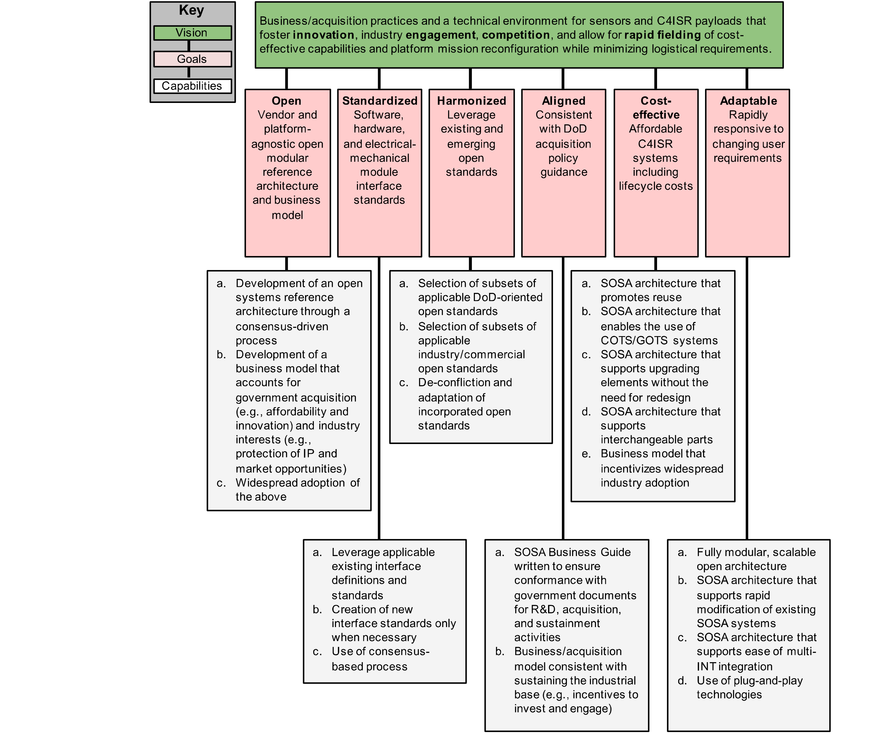
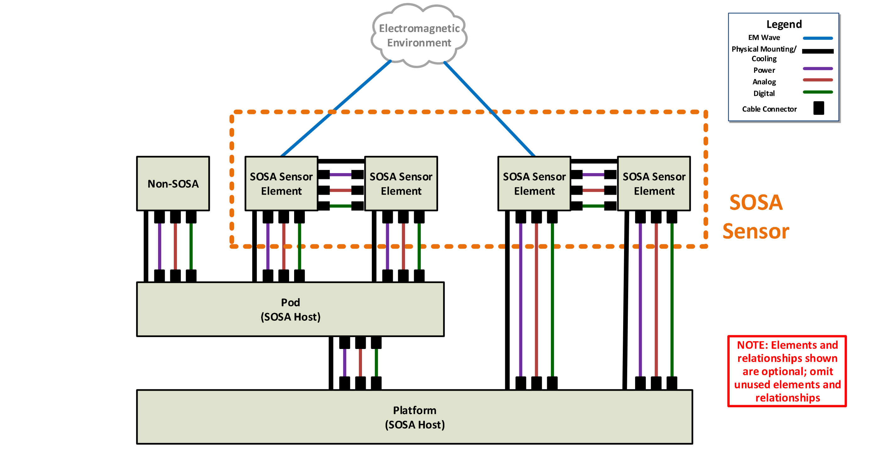
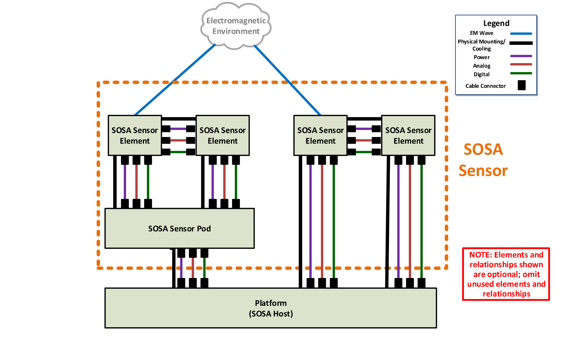
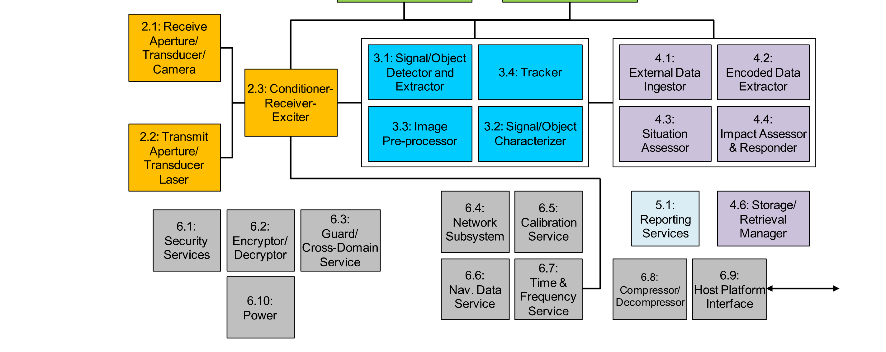
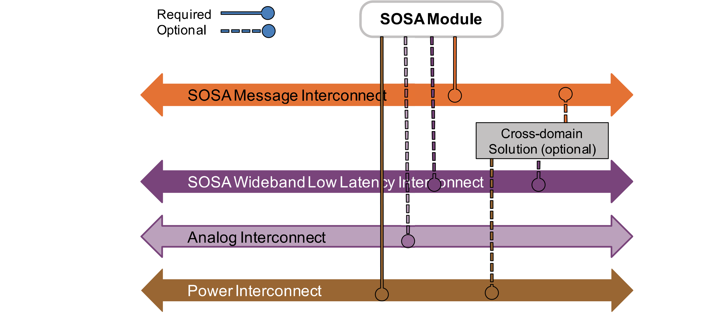
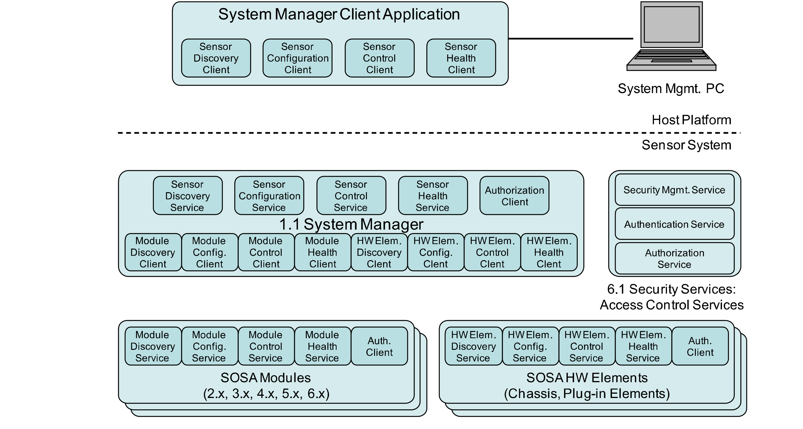
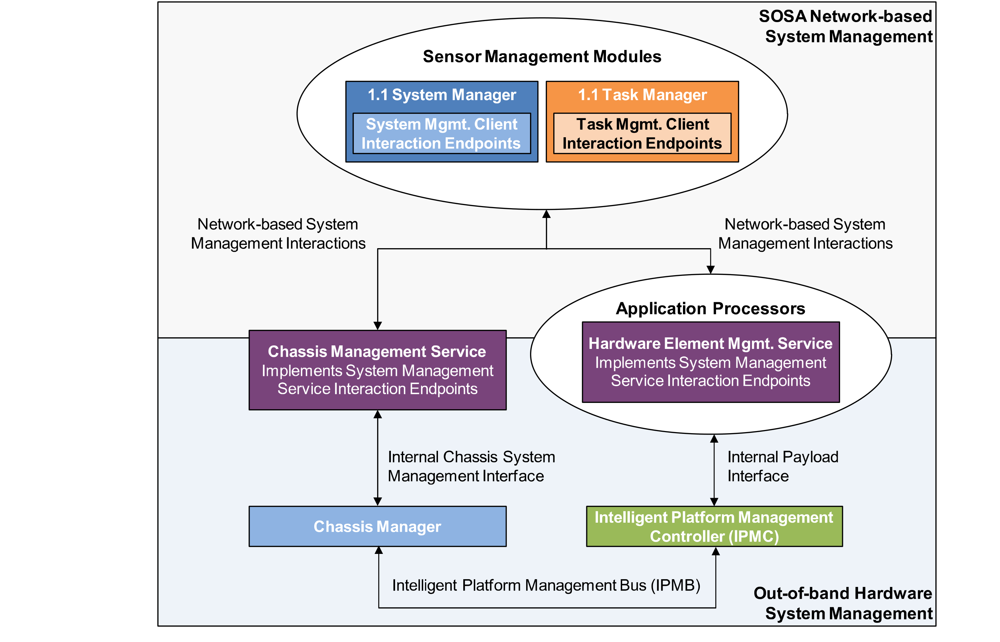
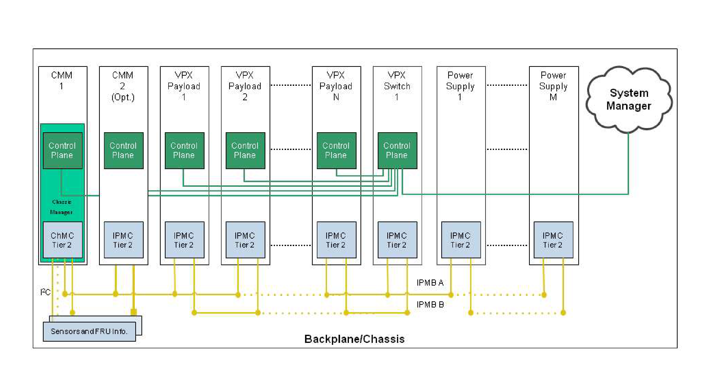
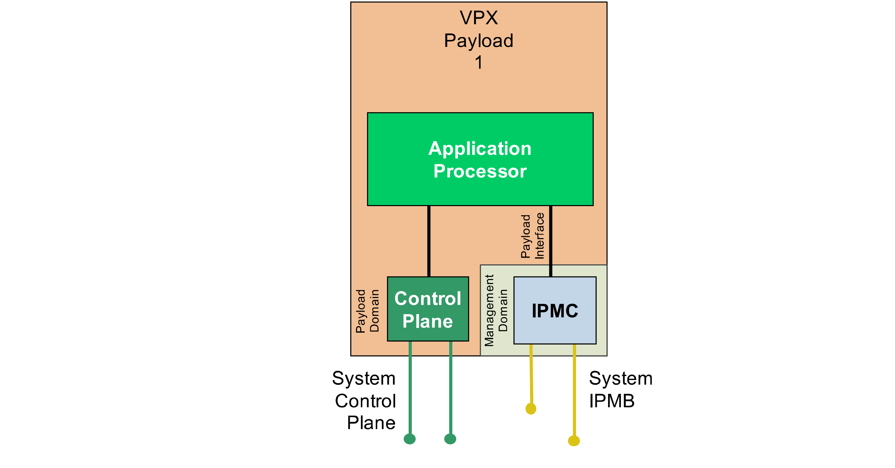

# 3 Reference Architecture Description 参考架构描述

> 原书 p.9–42 ｜ PDF p.29–62

### 3.1 CV-1/CV-2 Objectives CV-1/CV-2 目标

The foundations of the SOSA Reference Architecture are:

SOSA 参考架构的基础是：

Capability View – 1 (CV-1): the overall vision, goals, and enablers that support the goals of the architecture that are captured in the CV-1 DoDAF artifact (see Section 3.1.1)

能力视图 – 1（CV-1）：总体愿景、目标，以及支撑该架构诸目标的使能因素，上述内容记载于 CV-1 DoDAF 制品之中（见第 3.1.1 节）

- Quality Attributes: characteristics of a system that collectively influence the overall quality of the system, and will drive many of the architectural decisions (often referred to as "-ilities") (see Section 3.3) – these are the measures for "goodness" of harmonization Architecture Principles: general rules and guidelines, intended to be enduring and seldom amended, that inform and serve as drivers for defining the architecture; a framework for decision-making (evaluation criteria) as a means to weed out approaches that are inconsistent with intent, and serve as a foundation for adjudication (see Section 3.2)

- 质量属性：系统的诸特征，合在一起影响系统的整体质量，并将驱动许多架构决策（常被称为“-ilities”）（见第 3.3 节）——这些是衡量“协调一致”（harmonization）优劣的度量；架构原则：通用规则与准则，意在持久、少有修订，用于指引并充当定义架构的驱动因素；它同时是决策框架（评价准则），据以剔除与意图不一致的做法，并充当裁决的基础（见第 3.2 节）

> **译注**：上段英文在原书为两条项目符号（质量属性、架构原则），转换时并成一段；英文照录不改，中文同构一段、以「；」分列各条。

These products provide the foundation for the architecture definition contained in this document. Another foundational element is the Integrated Dictionary (DoDAF AV-2) which establishes the baseline terminology used throughout to ensure clarity and reduces (if not eliminates) ambiguity. All essential terms in the SOSA Technical Standard are captured in the DoDAF AV-2.

这些制品为本文件所载的架构定义提供了基础。另一个基础要素是集成词典（DoDAF AV-2），它确立通篇所用的基线术语，以确保清晰、并减少（即使不能消除）歧义。SOSA 技术标准中的全部基本术语都收录于 DoDAF AV-2 之中。

The fundamental building blocks of the SOSA Architecture are the SOSA modules ("an element of a system that has individually distinct boundaries that are well-defined interfaces") and the SOSA interfaces ("the region, physical or logical, where two systems or elements meet and interact"). Modules perform functions (physical and/or logical) and exhibit behaviors.

SOSA 架构的基本构件是 SOSA 模块（“系统中一个具有各自分明边界、而其边界为定义明确接口的元素”）与 SOSA 接口（“两个系统或元素相接并交互的区域，或物理或逻辑”）。模块执行功能（物理的和／或逻辑的）并呈现行为。

The SOSA Architecture will be captured using the DoDAF Version 2.02 Viewpoint Models, chosen because the primary target audience is the US DoD, and DoDAF is (as of this writing) the prescribed framework.

SOSA 架构将采用 DoDAF 2.02 版的视角模型（Viewpoint Models）加以记载；之所以选择它，是因为主要目标受众是美国国防部，而 DoDAF（截至本文撰写时）是指定的框架。

#### 3.1.1 SOSA Capability View – 1 (CV-1) SOSA 能力视图 – 1（CV-1）

As mentioned earlier the CV-1 presents the SOSA overall vision, goals, and outlines strategy to support stated goals throughout the effort. To this end, the vision and goals as presented in Section 1.1 earlier are further refined below through addition of capabilities to define goals.

如前所述，CV-1 给出 SOSA 的总体愿景、目标，并勾勒为在整个工作中支撑所述目标的战略。为此，前文第 1.1 节所给出的愿景与目标，在下文中通过增添能力以界定目标而得到进一步细化。

The vision statement for the SOSA Consortium is:

SOSA 联盟的愿景声明为：

Business/acquisition practices and a technical environment for sensors and C4ISR payloads that foster innovation, industry engagement, competition, and allow for rapid fielding of costeffective capabilities and platform mission reconfiguration while minimizing logistical requirements.

面向传感器与 C4ISR 载荷的业务／采办做法与技术环境：促进创新、产业参与与竞争，允许快速列装成本有效的能力、允许平台任务重构，同时尽量减少后勤需求。

The SOSA capabilities are illustrated in Figure 3.

SOSA 的诸项能力示于图 3。

<!-- 原书 p.9 ｜ PDF p.29 -->

*Figure 3: SOSA CV-I ｜ 图 3：SOSA CV-I*

### 3.2 SOSA Architecture Principles SOSA 架构原则

The following architecture principles were developed to guide the SOSA technical and business architectures being matured. The list of principles below is not in any particular order and the numerical value does not indicate precedence.

下列架构原则是为指导正在成熟中的 SOSA 技术与业务架构而制定的。下列原则清单不按任何特定次序排列，其编号数值也不表示优先级。

<!-- 原书 p.10 ｜ PDF p.30 -->

#### 3.2.1 Business-Oriented Architecture Principles 面向业务的架构原则

**#1 The SOSA business and technical architecture is vendor-agnostic. #1 SOSA 的业务与技术架构与厂商无关。**

**Statement** The modules and interfaces that make up the SOSA Technical Standard and Reference Architecture, and the processes and practices that make up the SOSA business/procurement architecture, are equally beneficial to all vendors, offering no inherent advantage or disadvantage to any one company or business sector.

**陈述** 构成 SOSA 技术标准与参考架构的诸模块与接口，以及构成 SOSA 业务／采办架构的诸过程与做法，对全体厂商同等有利，不给任何一家公司或行业门类带来固有的优势或劣势。

**Rationale** The first goal of the SOSA Architecture is "Open: vendor and platform-agnostic open modular reference architecture and business model", and as such the SOSA business and

**理由** SOSA 架构的第一项目标是“开放：与厂商和平台无关的开放模块化参考架构与业务模式”，因此 SOSA 的业务与

technical architecture supports a "level playing field" to ensure business fairness, and that the best technical solution, regardless of vendor source, can be incorporated into systems based on the SOSA Technical Architecture.

技术架构支撑一个“公平的竞技场”，以确保商业公平，并确保最佳技术方案——不论来自哪家厂商——都能被纳入基于 SOSA 技术架构的系统。

**Implications** The business architecture of SOSA ensures that there are no barriers for stakeholder participation in the development or use of the SOSA Architecture. This includes making material available, eliminating financial barriers (or ensuring that they are minimal). The acquisition model is one that enables all qualified vendors to participate. The technical architecture incorporates standards that favor no vendor by ensuring that it incorporates widely-available standards for which all qualified vendors have equivalent opportunity.

**影响** SOSA 的业务架构确保：利益相关方参与 SOSA 架构的开发或使用没有障碍。这包括使材料可得、消除财务障碍（或确保其最小化）。其采办模式使所有合格厂商都能参与。技术架构纳入不偏向任何厂商的标准：它确保所纳入的是广泛可得的、所有合格厂商都有同等机会采用的标准。

**#2 SOSA Consortium products are provided royalty-free. #2 SOSA 联盟的产品免版税提供。**

**Statement** There is no cost to obtaining SOSA Consortium materials required to develop, procure, or implement systems (or subsystems or modules) that are aligned to the SOSA Technical Standard.

**陈述** 获取为开发、采购或实现与 SOSA 技术标准对齐的系统（或分系统或模块）所需的 SOSA 联盟材料，均无费用。

**Rationale** Achieving the vision and goals of the SOSA Consortium requires that there is widespread adoption, implying the minimization of barriers to access and use the products of the SOSA Consortium. High royalties or fees to access these materials would run counter to the goals of the open business objectives, and therefore are to be avoided.

**理由** 实现 SOSA 联盟的愿景与目标，要求获得广泛采用；这意味着要把获取与使用 SOSA 联盟产品的障碍降到最低。对获取这些材料收取高额版税或费用，与开放业务目标相背离，因此应予避免。

**Implications** The means of publication of the SOSA Technical Standard is low-to-no cost, such as non-physical distribution via the World Wide Web, file servers, or other electronic means – subject to national security considerations (e.g., the need to authenticate that recipients are US persons who understand their responsibilities to safeguard the material). In addition, and by implication, tools (testing methodology, SDKs, etc.) required to develop and conformance verify hardware and software are widely available at no-to-little cost. Third-party products that are derived from SOSA Consortium products may be made commercially available (for additional cost).

**影响** SOSA 技术标准的发布手段为低成本乃至零成本，例如通过万维网、文件服务器或其他电子手段作非实物分发——但须服从国家安全方面的考虑（例如，需核实接收方是理解其保护该材料之责任的美国人士）。此外，由此可以推知，开发与符合性验证硬件和软件所需的工具（测试方法、SDK 等）以零成本至低成本广泛可得。由 SOSA 联盟产品衍生的第三方产品可以作商业发售（另收费用）。

**#3 SOSA products and processes protect the IP of vendors. #3 SOSA 的产品与过程保护厂商的知识产权。**

**Statement** Participation in the development and use of SOSA Consortium products does not jeopardize the IP of vendors. The SOSA Consortium respects IP and the SOSA Consortium products do not expose IP.

**陈述** 参与 SOSA 联盟产品的开发与使用，不会危及厂商的知识产权（IP）。SOSA 联盟尊重知识产权，SOSA 联盟的产品不暴露知识产权。

<!-- 原书 p.11 ｜ PDF p.31 -->

**#3 SOSA products and processes protect the IP of vendors. #3 SOSA 的产品与过程保护厂商的知识产权。**

> **译注**：本条及后文 #5、#10、#12、#14 的条目在页锚处重复出现，系原书续页重复条目所致；英文照录不改。

**Rationale** financially healthy ISR ecosystem is in the best interest of the nation. Businesses must be incentivized to invest itechnology and other innovative solutions. I protection is the cornerstone of that process that ensures that there is a return On the ivestment. Therefore, it is imperative that SOSA processes and products retain protections for I rights within the module boundary.

**理由** 一个财务健康的 ISR 生态最符合国家的利益。必须激励企业投资于技术与其他创新解决方案。知识产权保护是这一过程的基石，它确保投资有回报。因此，必须让 SOSA 的过程与产品在模块边界之内保留对知识产权权利的保护。

> **译注**：本段英文在原册为扫描识别件，多处字词残缺：“itechnology”当作“技术”、“I protection”当作“知识产权保护”、“return On the ivestment”当作“投资回报（on the investment）”、“I rights”当作“知识产权权利”；英文照录不改，中文按可辨字面译出。

**Implications** The SOSA Architecture takes a CCgray box' approach: modules are defined with properties Of functions and behaviors, and interfaces are defined with properties that iclude their physical characteristics, protocols for exchange of signals and data, and the signal and data content. How the functions and behaviors of the modules (einside the box') are realized is completely Up to the vendor to determine. It is inside the box where the I resides. In addition, the SOSA Architecture does not include companyspecific IP unless that IP has been consensually released to the SOSA Consortium for Open usCthrough the SOSA Technical Standard per the membership agreement.

**影响** SOSA 架构取一种“灰盒”做法：模块以功能与行为的属性来定义，接口以属性来定义，包括其物理特性、交换信号与数据的协议，以及信号与数据的内容。模块的功能与行为（“盒内”）如何实现，完全由厂商自行决定。知识产权正驻于盒内。此外，SOSA 架构不纳入公司专有的知识产权，除非该知识产权已按成员协议经各方同意发布给 SOSA 联盟，以便通过 SOSA 技术标准公开使用。

> **译注**：本段英文在原册为扫描识别件，多处字词残缺：“CCgray box'”当作“'gray box'（灰盒）”、“Of”当作“of”、“iclude”当作“include”、“(einside the box')”当作“（'inside the box'）”、“Up”当作“up”、“I”当作“IP”、“companyspecific”当作“company-specific”、“usCthrough”当作“use through”；英文照录不改，中文按可辨字面译出。

#### 3.2.2 Technically-Oriented Architecture Principles 面向技术的架构原则

**#4 The SOSA Technical Standard is extensible an evolvable. #4 SOSA 技术标准是可扩展、可演化的。**

**Statement** The SOSA Technical Standard, and associated Reference Architecture, is able to

**陈述** SOSA 技术标准及配套的参考架构，能够

continue to Iature beyond theexisting goals and expectations, to be able to incorporate technological and architectural improvements, and be able to maintain relevance as stakeholder needs change(e.8,new sensor types and new mission areas)

继续超越既有的目标与期望而成长，能够纳入技术与架构上的改进，并能在利益相关方需求变化（例如新的传感器类型与新的任务领域）时保持其适用性

> **译注**：本段英文在原册为扫描识别件：本段本是上段未完的一句（页锚在句中切开），“Iature”当作“mature”、“theexisting”当作“the existing”、“e.8”当作“e.g.”；英文照录不改，中文按可辨字面译出。

**Rationale** Technologies, markets, and requirements evolve over time. In order to preserve the considerable time and funds invested in creating the SOSA Architecture embodied ~ the SOSA Technical Standard consideration is given to "future proof' i. For the SOSA Technical Standard to be relevant in the future, it is important that it can be extended in scope.

**理由** 技术、市场与需求随时间而演化。为保住为创建 SOSA 架构所投入的大量时间与经费——该架构体现在 SOSA 技术标准之中——考虑的是“面向未来”（future proof）之事。为使 SOSA 技术标准在未来仍然适用，重要的一点是它能够在范围上扩展。

> **译注**：本段英文在原册为扫描识别件：“embodied ~ the SOSA Technical Standard”之“~”当作“in（体现在）”、“future proof' i.”当作“future proofing”；英文照录不改，中文按可辨字面译出。

**Implications** Architecture decisions, trades, etc. favor options that enable growth and don 't "lockOut'' expansion. Interfaces are defined to include growth paths (extra capacity, for example). Module definitions are not So narrow as to preclude additionalfunctionality. The architecture developers and maintainers are mindful that the current Version willnot necessarily be the last one.

**影响** 架构决策、权衡等，都偏向那些能够带来成长、且不“锁定排除”（lock out）扩展的选项。接口的定义包含成长路径（例如额外容量）。模块定义不至于窄到排除附加功能。架构的开发与维护者清楚：当前版本未必是最后一个版本。

> **译注**：本段英文在原册为扫描识别件：“don 't”当作“don't”、““lockOut''”当作“”lock out“”、“additionalfunctionality”当作“additional functionality”、“willnot”当作“will not”；英文照录不改，中文按可辨字面译出。

**#5 The SOSA Architecture maximally leverageslincorporates existing industry and government standards. #5 SOSA 架构最大限度地利用／纳入现有的行业标准与政府标准。**

> **译注**：本条标题英文在原册作“maximally leverageslincorporates”，系“maximally leverages/incorporates”的扫描残缺；英文照录不改，中文按可辨字面译出。

**Statement** The SOSA Architecture takes advantage Of existing industry and govermment standards and OSAs whenever possible and practical and consistent with achieving thegoalsOf the SOSA Consortium.

**陈述** SOSA 架构在可能且可行、并与达成 SOSA 联盟目标相一致之时，利用现有的行业标准、政府标准与 OSA。

> **译注**：本段英文在原册为扫描识别件：“advantage Of”当作“advantage of”、“govermment”当作“government”、“thegoalsOf”当作“the goals of”；英文照录不改，中文按可辨字面译出。

**Rationale** Crafting well-instituted standards is both time and resource-consuming, and the community does not benefit from having multiple, overlapping, or redundant standards. Therefore, the SOSA Architecture incorporates other standards and approaches When appropriate.

**理由** 制定制度化良好的标准既费时又费资源，而存在多个相互重叠或冗余的标准，对共同体并无好处。因此，SOSA 架构在适当的情况下纳入其他标准与做法。

<!-- 原书 p.12 ｜ PDF p.32 -->

**#5 The SOSA Architecture maximally leverageslincorporates existing industry and government standards. #5 SOSA 架构最大限度地利用／纳入现有的行业标准与政府标准。**

**Implications** Systems that already are compliant or conformant with other OSAs are likely to require minimal (or no) modifications to achieve consistency with the SOSA Technical Standard. Adoption is more efficient for the SOSA team, helping to more rapidly develop and evolve the SOSA Technical Standard, though the team ensures that said adoption does not undermine the quality attributes, goals, or other guiding principles upon which the SOSA Architecture is based, and is consistent with the entirety of the SOSA Architecture.

**影响** 已经具备对其他 OSA 的符合程度、或已属符合的系统，为与 SOSA 技术标准取得一致，很可能只需极少的（甚至零）修改。对 SOSA 团队而言，采纳更为高效，有助于更快地开发与演化 SOSA 技术标准；不过团队要确保此种采纳不损害 SOSA 架构所依据的质量属性、目标或其他指导原则，并且与 SOSA 架构整体相一致。

**#6 Resilience (including cybersecurity) is enabled by the SOSA Architecture. #6 SOSA 架构使韧性（含网络安全）得以具备。**

**Statement** Physical and logical aspects of SOSA Architectures are capable of maintaining a reasonable level of operation in situations where system degradation or attack is possible.

**陈述** 在可能出现系统降级或遭受攻击的情形下，SOSA 架构的物理与逻辑侧面能够维持合理水平的运行。

**Rationale** A SOSA conformant system is not viable if it is unable to respond accordingly to either a localized degradation event, a system-wide degradation, or a cyber-attack by maintaining a reasonable level of operational viability.

**理由** 一个符合 SOSA 的系统，若不能通过维持合理水平的运行可行性来对局部降级事件、全系统降级或网络攻击作出相应响应，便是不可行的。

**Implications** The SOSA Architecture incorporates functions that permit monitoring for health and status, and facilitate the design of a system that incorporates safeguards, redundancy, and the ability to be upgraded in light of new threats. A SOSA conformant system is able to respond to physical or logical degradation or a localized failure. Maximizing the ability of a SOSA system to effectively manage these possibilities ensures operation at an acceptable level of performance in a variety of situations.

**影响** SOSA 架构纳入的功能可对健康与状况进行监视，并便利于设计出纳入防护措施、冗余以及能针对新威胁作升级的系统。符合 SOSA 的系统能够对物理或逻辑降级、或局部失效作出响应。尽量扩大 SOSA 系统有效应对这些可能性的能力，可确保其在多种情形下以可接受的性能水平运行。

**#7 The SOSA Architecture is agnostic with respect to host platform. #7 SOSA 架构与宿主平台无关。**

**Statement** The SOSA Technical Standard, and associated Reference Architecture, applies to a wide range of host platforms (e.g., aircraft, ground vehicle, ship), and makes no assumption regarding the type of vehicle or installation it is resident in or upon.

**陈述** SOSA 技术标准及配套的参考架构适用于范围广泛的宿主平台（例如飞机、地面车辆、舰船），并且对其所驻留或安装于其上的载具或设施类型不作任何假定。

**Rationale** Conformance and adherence to this principle engenders hardware and software interoperability and reuse across multiple platforms and multiple mission types. Enabling and maximizing reuse lowers overall development costs and operational costs over the lifetime of any particular program.

**理由** 符合并遵循本原则，可带来跨多个平台、多种任务类型的硬件与软件互操作性与复用。使复用成为可能并尽量扩大复用，可降低任一特定项目全生命周期的总开发成本与运行成本。

**Implications** The development of the SOSA Technical Standard takes into account a wide range of physical and environmental conditions, and so it specifies, for example, a range of standards-based connector types appropriate for the variety of environments. This may have implications on plug-and-playability, and so it is important that one type of interface (for one environment) easily be adapted (through interface conversion and/or software shim) to another. This enables, for example, a small-vehicle sensor to be leveraged for a large platform.

**影响** SOSA 技术标准的制定考虑到范围广泛的物理与环境条件，因此它例如规定了一系列基于标准的连接器类型，以适应多样的环境。这可能对即插即用性产生影响，因此重要的是，一种接口（对应一种环境）能够容易地（通过接口转换和／或软件垫层）适配为另一种接口。由此，例如小型载具上的传感器便可用于大型平台。

<!-- 原书 p.13 ｜ PDF p.33 -->

**#8 The SOSA Architecture is agnostic with respect to processing environment. #8 SOSA 架构与处理环境无关。**

**Statement** SOSA modules and interfaces are not dependent upon the physical processing and operating system environments.

**陈述** SOSA 模块与接口不依赖物理处理环境与操作系统环境。

**Rationale** SOSA modules represent the codified logic of the sensor system. Physical realization of processing environments will continue to evolve with processors, operating systems, network protocols, backplanes, memory architectures, and communication circuits. The desire is for the physical realizations to be changed as technology continues to evolve. Adherence to this principle enables hardware and software interoperability and reuse across multiple platforms and multiple mission types. Isolating SOSA modules from the processing environment allows rapid technology refreshment, system scaling, and module reuse.

**理由** SOSA 模块体现的是传感器系统经编纂成文的逻辑。处理环境的物理实现将随处理器、操作系统、网络协议、背板、存储架构与通信电路而不断演化。所期望的是：随着技术持续演化，物理实现随之更换。遵循本原则，可使硬件与软件在多个平台、多种任务类型之间互操作并复用。把 SOSA 模块与处理环境隔离，可实现快速的技术更新、系统规模伸缩与模块复用。

**Implications** The SOSA Technical Standard needs to take into account a wide range of processing environments as realized by the selection of processors (CPU, GPU, FPGA, and custom), operating systems, network protocols, backplanes, memory architectures, and communication circuits. This means that the interfaces are independent from the processing environment through abstraction.

**影响** SOSA 技术标准需要考虑到由处理器（CPU、GPU、FPGA 与定制）、操作系统、网络协议、背板、存储架构与通信电路的选择所实现的范围广泛的处理环境。这意味着接口通过抽象而与处理环境相互独立。

**#9 Every SOSA module has defined logical interfaces. 每个 SOSA 模块都有已定义的逻辑接口。**

**Statement** All SOSA sensors have well-defined logical interfaces for each of their SOSA defined modules. Logical interfaces describe the information content or signaling between modules for the interchange of control and data. The logical interface is a point that encapsulates control and data along with the syntax/semantics as described by the SOSA Architecture. Information exchange, including transmission type, interchange protocols, and routing are part of the interface definition.

**陈述** 所有 SOSA 传感器对其每个 SOSA 已定义的模块都有定义明确的逻辑接口。逻辑接口描述模块之间为交换控制与数据所需的信息内容或信令。逻辑接口是一个把控制与数据连同 SOSA 架构所描述的语法／语义一并封装的点。信息交换——包括传输类型、交换协议与路由——是接口定义的一部分。

**Rationale** An interface is a shared boundary for interaction between architectural modules. SOSA module logical interfaces enable replacement for modernization and upgrade, support plug-and-playability, interoperability, operational flexibility, and will likely result in cost savings over the lifetime of an operational program.

**理由** 接口是架构模块之间交互的共享边界。SOSA 模块的逻辑接口使现代化与升级时的替换成为可能，支撑即插即用性、互操作性与运用灵活性，并很可能在一个运用项目的全生命周期内带来成本节约。

**Implications** The SOSA Technical Standard addresses a wide range of logical interfaces realized in SOSA environments. SOSA logical interfaces mandate that a set of interface standards is needed to span the types, protocols, addressing, service types, and operational environments.

**影响** SOSA 技术标准处理在 SOSA 环境中实现的范围广泛的逻辑接口。SOSA 逻辑接口需求：需要一套接口标准，以覆盖各种类型、协议、寻址、服务类型与运行环境。

**#10 Every SOSA hardware element has defined physical interfaces. 每个 SOSA 硬件元素都有已定义的物理接口。**

**Statement** All SOSA sensors have well-defined physical interfaces for each of their hardware modules. Physical interfaces describe the physical or mechanical connection between SOSA hardware modules, providing structural attachment, electrical/electronic connectors, backplanes, or other inter-module associations that are physically manifested.

**陈述** 所有 SOSA 传感器对其每个硬件模块都有定义明确的物理接口。物理接口描述 SOSA 硬件模块之间的物理或机械连接，提供结构附着、电气／电子连接器、背板，或其他以物理方式体现的模块间关联。

**Rationale** Well-defined SOSA module physical interfaces enable replacement for modernization and upgrade, support plug-and-playability, interoperability, operational flexibility, and will likely result in cost savings over the lifetime of an operational program.

**理由** 定义明确的 SOSA 模块物理接口使现代化与升级时的替换成为可能，支撑即插即用性、互操作性与运用灵活性，并很可能在一个运用项目的全生命周期内带来成本节约。

<!-- 原书 p.14 ｜ PDF p.34 -->

**#10 Every SOSA hardware element has defined physical interfaces. 每个 SOSA 硬件元素都有已定义的物理接口。**

**Implications** The SOSA Technical Standard addresses a wide range of physical interfaces realized in SOSA environments. SOSA physical interfaces mandate that a set of interface standards is needed to span the types, physical sizes, connector types, electrical signaling (including Physical and Data Link layers), and operational environments.

**影响** SOSA 技术标准处理在 SOSA 环境中实现的范围广泛的物理接口。SOSA 物理接口需求：需要一套接口标准，以覆盖各种类型、物理尺寸、连接器类型、电气信令（含物理层与数据链路层）与运行环境。

**#11 The SOSA Architecture accommodates simple through complicated systems. #11 SOSA 架构可容纳从简单到复杂的系统。**

**Statement** The SOSA Architecture provides the building blocks for deriving multiple sensor types that scale within a design, increasing or decreasing complexity relative to processing and Size, Weight, and Power (SWaP) constraints for a system.

**陈述** SOSA 架构提供构件，据以派生出能在同一设计之内伸缩的多种传感器类型，并相对于系统的处理能力以及尺寸、重量与功耗（SWaP）约束而增减其复杂程度。

**Rationale** There are many aspects of complexity that the SOSA Architecture addresses, such as number of sensors to manage, diversity of sensors, and algorithm complexity/parallel processing requirements. The management functions of sensor systems become more complex as the number of entities increase. Having patterns that allow the management functions to scale with (at most) minor changes is crucial. The ability to support algorithm scaling (e.g., more or less instances of the same process working in parallel) and increasing or reducing the corresponding hardware as needed with only configuration changes is an important attribute of a SOSA system.

**理由** SOSA 架构所应对的复杂性有许多方面，例如需管理的传感器数量、传感器的多样性，以及算法复杂度／并行处理需求。随着实体数量增加，传感器系统的管理功能变得更复杂。要让管理功能能随规模伸缩、且至多只需微小改动，这种模式至关重要。支持算法伸缩（例如同一过程的并行实例增多或减少）、并仅通过配置更改即可按需增减相应硬件的这种能力，是 SOSA 系统的一项重要属性。

**Implications** SOSA systems accommodating a range of complexity require well-defined functional decomposition, use-cases, and interface definitions. The functional decomposition needs to create the right layer(s) of abstraction for a variety of hardware and software entities to coexist in different configurations. The use-cases need to cover all required system functionality, from specific mode processing to state/mode control to heartbeats. Integrating different software or hardware into a system should minimally affect the management functions of a SOSA derived system. The interface definitions need to be firm for system management, but flexible for a variety of sensor type processing. Patterns are used extensively to manage the complexity.

**影响** 可容纳一定复杂度的 SOSA 系统，要求定义明确的功能分解、用例与接口定义。功能分解需要为多样的硬件与软件实体在不同配置下共存建立恰当的抽象层次。用例需要覆盖全部所需的系统功能，从特定模式处理到状态／模式控制、再到心跳。把不同的软件或硬件集成到系统中，宜对由 SOSA 派生的系统的管理功能影响极小。接口定义对系统管理需要是刚性的，而对多种传感器类型的处理则需要是柔性的。模式（patterns）被广泛用于管理这种复杂性。

**#12 The SOSA Architecture accommodates small through large platforms. #12 SOSA 架构可容纳从小型到大型的平台。**

**Statement** The SOSA Architecture is flexible enough so that designs derived from it can be tailored to large as well as small platforms, with the flexibility to be used to design simple, lightweight systems (suitable for a small UAS) as well as large complex systems (e.g., suitable for a wide-body jet, warship, or ground-based installation).

**陈述** SOSA 架构足够灵活，据其派生的设计可裁剪适配大型平台，也可适配小型平台；既可用于设计简单、轻量系统（适合小型 UAS，即无人机系统），也可用于设计大型复杂系统（例如适合宽体喷气机、战舰或陆基设施）。

**Rationale** Applicability is dependent upon the ability of a solution to provide a standard suite of interfaces across a multiplicity of host structures. Not limiting the scope of the SOSA Technical Standard to one class of hosts or another ensures broad applicability and utility.

**理由** 适用性取决于方案能否在众多宿主结构上提供一套标准接口。不把 SOSA 技术标准的范围限制于某一类宿主而不及另一类，可确保其广泛的适用性与实用性。

<!-- 原书 p.15 ｜ PDF p.35 -->

**#12 The SOSA Architecture accommodates small through large platforms. #12 SOSA 架构可容纳从小型到大型的平台。**

**Implications** The SOSA Architecture is a superset architecture; complete in that it can be used to design a complex, fully-functional system, and at the same time not mandate/require the presence of all (or many/most) modules for systems with more modest SWaP resources. The SOSA Architecture incorporates hardware and physical standards that allow the use of small as well as large form factors.

**影响** SOSA 架构是一个超集架构；其完整之处在于它可用于设计复杂、功能完备的系统，同时对 SWaP 资源较为有限的系统，又不强制／要求全部（或许多／大多数）模块齐备。SOSA 架构纳入的硬件与物理标准，允许使用小型以及大型的外形规格。

**#13 Modularity is fundamental to the SOSA Architecture – physical and logical. 模块化是 SOSA 架构的根本——物理的与逻辑的。**

**Statement** The SOSA Architecture is an OSA, and as such is composed of physical and logical units ("building blocks") that have individually distinct boundaries that are well-defined interfaces. The units or elements that make up a SOSA Architecture (or resulting system) are known as modules.

**陈述** SOSA 架构是一种 OSA，因此由物理与逻辑单元（“构件”）组成，这些单元各有分明的边界，而边界本身即为定义明确的接口。构成 SOSA 架构（或所得系统）的单元或元素称为模块。

**Rationale** The goals for the SOSA Architecture include openness, standardization, and adaptivity that allow for replacement/upgrade of parts of a sensor and reuse in a vendor-neutral manner. Modules (physical and logical units with well-defined boundaries) are the means of achieving these goals.

**理由** SOSA 架构的目标包括开放性、标准化与适应性，使传感器的部分可以更换／升级，并能以厂商中立的方式复用。模块（具有定义明确边界的物理与逻辑单元）是实现这些目标的手段。

**Implications** The SOSA Architecture is described in terms of modules (functions and behaviors) and interfaces (information or signals to be exchanged by these modules, and the means by which they are exchanged, such as protocols or electrical specs). The modules are defined in a way that ensures independence and low coupling (so that changes in one do not impact others). Criteria used: Severable (can be separated and used elsewhere) – based on business needs, timing requirements, or other drivers Has minimal complexity interfaces (minimum interdependencies) Can operate as stand-alone or be operated via function/process/system manger Is independently testable Does not expose IP Facilitates competitive procurement Encapsulates rapid change

**影响** SOSA 架构以模块（功能与行为）与接口（这些模块要交换的信息或信号，以及它们交换的方式，如协议或电气规格）来描述。模块的定义方式确保独立性与低耦合（即一个模块的改动不影响其他模块）。所用判据：可切分（可分离出来在别处使用）——依据业务需要、时序需求或其他驱动因素；接口复杂度最低（相互依赖最少）；可独立运行，或经功能／过程／系统管理器运行；可独立测试；不暴露知识产权；便于竞争性采购；封装快速变化

> **译注**：上段英文在原书为项目符号（末层“所用判据”下共七条），转换时并成一段；英文照录不改，中文同构一段、以「；」分列各条。另，“system manger”为“system manager”的扫描残缺，中文按可辨字面译出。

**#14 Interchangeability is fundamental to the SOSA Architecture. 可互换性是 SOSA 架构的根本。**

**Statement** Modules making up SOSA systems are able to be replaced by equivalent modules regardless of the source. Moreover, it would be possible to interchange one (entire) SOSA system with another SOSA system (provided it does not violate physical/environmental requirements).

**陈述** 构成 SOSA 系统的模块能够被等效模块替换，不论其来源。此外，还可能把一个（整个）SOSA 系统与另一个 SOSA 系统互换（前提是不违反物理／环境需求）。

<!-- 原书 p.16 ｜ PDF p.36 -->

**#14 Interchangeability is fundamental to the SOSA Architecture. 可互换性是 SOSA 架构的根本。**

**Rationale** The goals of the SOSA Consortium include openness (platform and vendor-agnostic)

**理由** SOSA 联盟的目标包括开放性（与平台和厂商无关）

and rapid response. The quality attributes include modularity and upgradability. Essential to these objectives is the need to be able to interchange SOSA modules to achieve goals, such as using module replacement to upgrade a sensor or modify it because of a changing mission need. This will result in a more robust marketplace where subsystem upgrades become more commonplace as the ease of modular upgrades becomes apparent.

与快速响应。质量属性包括模块化与可升级性。对上述目标而言至关重要的是：能够互换 SOSA 模块以达成目标，例如利用模块更换来升级传感器，或因任务需求变化而对其作出改动。这将造就一个更健壮的市场：随着模块化升级的便利变得显而易见，分系统的升级将愈发常见。

**Implications** Interfaces are very well-defined and yet contain a high degree of flexibility. Moduleunique interface technologies should be avoided in favor of those that are broadlyapplicable. Interface definitions are superset definitions; they include all the functionality/capability that a SOSA module or system is anticipated to include. The architecture defines a default behavior for situations where all functions supported in the interface are not implemented.

**影响** 接口是定义明确的，同时又含有高度的灵活性。宜避免模块专用的接口技术，而取广泛适用的接口技术。接口定义是超集定义；它们包含 SOSA 模块或系统预期纳入的全部功能／能力。对于接口所支持的功能未全部实现的情形，架构定义了默认行为。

**#15 Reuse is fundamental to the SOSA Architecture. 复用是 SOSA 架构的根本。**

**Statement** SOSA systems and modules that are developed for one program, host vehicle, or environment will be employable, with minimal modification, for other programs, with other host vehicles and in other operational environments.

**陈述** 为某一项目、某一宿主载具或某一环境开发的 SOSA 系统与模块，经极少修改即可用于其他项目、其他宿主载具与其他运行环境。

**Rationale** The ability to reuse SOSA sensors and modules across various vehicles allows the DoD to reduce parallel investment to develop the same type of payload assembly multiple times in order to fly on various vehicles. The ability for a particular sensor subsystem to operate inside various SOSA sensors and modules reduces the integration costs for creating a new payload assembly.

**理由** 能在各种载具之间复用 SOSA 传感器与模块，使国防部可以减少并行投入——不必为要装到各种载具上而多次开发同一类型的载荷组件。某一传感器分系统能在各种 SOSA 传感器与模块之内运行，降低了创建新载荷组件的集成成本。

**Implications** Modules should be reusable across the range of host platforms, consistent with SWaP limitations (embodied in their specific design/instantiation). It is imperative that SOSA standard interfaces are well-defined, to include physical, logical/protocol, and data content and format. A standardization of electro-mechanical busses along with available sensor geometries is required. Multi-platform integration architectures are used to allow modules to communicate with an embedded computer or the host platform, and/or both. The intent is to minimize (or eliminate) the cost and schedule impact of adding or replacing a new SOSA module, not to eliminate the need for integration and test.

**影响** 模块宜在各类宿主平台上可复用，并与 SWaP 限制（体现在其具体设计／实例中）相一致。务必要使 SOSA 标准接口定义明确，包含物理的、逻辑／协议的，以及数据内容与格式。需要把机电总线连同可得的传感器几何尺寸加以标准化。采用多平台集成架构，使模块能够与嵌入式计算机或宿主平台、或与两者同时通信。其意图是尽量减小（或消除）新增或更换一个 SOSA 模块所带来的成本与进度影响，而不是取消集成与测试的需要。

### 3.3 SOSA Quality Attributes SOSA 质量属性

The quality attributes outlined in Table 1 inform the SOSA business and technical architectural design decisions.

表 1 所列各项质量属性，为 SOSA 的业务架构与技术架构设计决策提供依据。

<!-- 原书 p.17 ｜ PDF p.37 -->

**Table 1: SOSA Quality Attributes (in order of decreasing precedence) ｜ 表 1：SOSA 质量属性（按优先级降序）**

| Name ／ 名称 | Description ／ 说明 |
|---|---|
| Interoperability ／ 互操作性 | The ability of the system to provide data/information to – and accept the same from – other systems, and to use the data/information so exchanged to enable them to operate effectively together. In the context of the SOSA Architecture, this quality attribute refers to the ability of SOSA systems to be able to exchange information during operation, and (possibly with adaptation) be able to interoperate with other systems not designed to align with the SOSA Reference Architecture. 系统向其他系统提供数据／信息、并从其他系统接受同样的数据／信息，且利用如此交换的数据／信息使双方能够有效协同运行的能力。在 SOSA 架构的语境下，本质量属性指 SOSA 系统在运行期间能够交换信息，并（可能经适配）能够与并非按 SOSA 参考架构对齐设计的其他系统互操作。 |
| Securability ／ 可安全性 | The property of a system such that its design renders it largely protected/inviolable against acts designed to alter functionality or capabilities, or reverse-engineer capabilities and/or critical program information – or impair its effectiveness, and prevent unauthorized persons or systems from having access to data/information contained within. In the context of the SOSA Architecture, this quality attribute ensures that the fundamental architecture is one that has minimal attack surfaces and effective authentication enforcement, and SOSA systems can be designed so that they can adapt to an evolving threat environment. 系统的一种属性：其设计使系统在很大程度上受到保护／不被侵害，能抵御旨在改变其功能或能力、或对其能力与／或关键项目信息进行逆向工程的行为——或损害其效能的行为，并防止未授权的人员或系统接触到其中所含的数据／信息。在 SOSA 架构的语境下，本质量属性确保基础架构本身具有最小的攻击面与有效的认证执行，且 SOSA 系统可被设计成能够适应不断演变的威胁环境。 |
| Modularity ／ 模块化 | The degree to which a system or element is composed of individually distinct physical and functional units that are loosely-coupled with well-defined interface boundaries. In the context of the SOSA Architecture, this quality attribute enforces the establishment of well-defined, well-understood, standardized system modules that can be created and tested individually for function and conformance. 系统或元素由各自独立的物理单元与功能单元构成、这些单元以定义良好的接口边界松散耦合的程度。在 SOSA 架构的语境下，本质量属性强制要求建立定义良好、易于理解、标准化的系统模块，这些模块可以逐个就其功能与符合性进行创建与测试。 |
| Compatibility ／ 兼容性 | The ability of a system to coexist with other systems without conflict or impairment, or be integrated or used with another system of its type. In the context of the SOSA Architecture, this quality attribute refers to the ability of SOSA systems to be used or integrated with systems not designed to align with the SOSA Reference Architecture, or with systems designed with earlier versions of the SOSA standard (backwards-compatible). 系统与其他系统无冲突、无损害地共存，或与其同类型系统集成或一同使用的能力。在 SOSA 架构的语境下，本质量属性指 SOSA 系统能够与并非按 SOSA 参考架构对齐设计的系统一同使用或集成，或与按 SOSA 标准较早版本设计的系统一同使用或集成（向后兼容）。 |
| Portability ／ 可移植性 | An attribute that describes the reuse of existing hardware or software elements (as opposed to the creation of new) when moving hardware or software elements from one environment (physical or computing) to another. In the context of the SOSA Architecture, this quality attribute refers to the ability of SOSA based hardware and software to be used, without modification, in other SOSA based environments (e.g., different operational domains, different systems, and different sensor modalities), but does not necessarily imply the porting to vastly different physical environments (e.g., operating temperature, shock, vibration – which are design, not architectural, features). 描述在把硬件或软件元素从一个环境（物理环境或计算环境）移至另一个环境时，复用既有硬件或软件元素（而非新建）的属性。在 SOSA 架构的语境下，本质量属性指基于 SOSA 的硬件与软件能够不加修改地在其他基于 SOSA 的环境（例如不同的作战域、不同的系统、不同的传感器模态）中使用，但并不必然意味着移植到差别极大的物理环境（例如工作温度、冲击、振动——这些属设计特性而非架构特性）。 |
| Plug-and-playability ／ 即插即用性 | The capability of a system to recognize that a hardware component has been introduced or replaced – and subsequently use it without the need for manual device configuration or operator intervention. In the context of the SOSA Architecture, this quality attribute refers to the ability of a SOSA conformant system to recognize the introduction or replacement of SOSA modules, and through an information exchange, to understand and use the capabilities and services that the module offers – thereby reducing the cost and schedule impact of adding a new SOSA module – but does not eliminate the need for integration and test. 系统能够识别某个硬件组件已被引入或更换，并随即加以使用，而无需手动进行设备配置或操作员介入的能力。在 SOSA 架构的语境下，本质量属性指符合 SOSA 的系统能够识别 SOSA 模块的引入或更换，并通过一次信息交换理解并使用该模块所提供的能力与服务——由此降低增加一个新 SOSA 模块带来的成本与进度影响——但并不消除集成与测试之必需。 |
| Upgradeability ／ 可升级性 | The ability of a system to be improved, enhanced, or evolved without fundamental physical, logical, or architectural changes. In the context of the SOSA Architecture, this quality attribute refers to the ability of a SOSA system to have specific hardware elements or software components replaced with more modern or more capable equivalents, while maintaining SOSA conformance, and without (significant) change to the rest of the system. 系统在无需根本性的物理、逻辑或架构变更的情况下得到改进、增强或演进的能力。在 SOSA 架构的语境下，本质量属性指 SOSA 系统能够把特定的硬件元素或软件组件更换为更现代或能力更强的等效物，同时保持 SOSA 符合性，且不（显著）改动系统的其余部分。 |
| Scalability: Sensor Multiplicity ／ 可扩展性：传感器数量 | The capability of a system to cope and perform well under an increased or expanding workload or increased demands, and to function well when there is a change in scope or environment – and still meet the mission needs. In the context of the SOSA Architecture, this quality attribute refers to the ability of the SOSA Architecture to accommodate a multiplicity of sensors, constrained only by design-specific limitations. 系统在负载或需求增加、扩张的情况下能够应对并表现良好，且在范围或环境发生变化时仍运行良好——并仍满足任务需要的能力。在 SOSA 架构的语境下，本质量属性指 SOSA 架构能够容纳多个传感器的能力，其约束仅来自具体设计所固有的局限。 |
| Scalability: Platform Size ／ 可扩展性：平台规模 | The capability of a system to cope and perform well under an increased or expanding workload, increased demands, and to function well when there is a change in scope of environment and still meet the mission needs. In the context of the SOSA Architecture, this quality attribute refers to the ability of the SOSA Architecture to be applied to platforms that range from the small (e.g., Class I UAS) to large surveillance aircraft – and possibly even spacecraft. 系统在工作负载增加、需求增加的情况下能够应对并表现良好，且在环境的范围发生变化时仍运行良好并仍满足任务需要的能力。在 SOSA 架构的语境下，本质量属性指 SOSA 架构能够应用于从小型（例如 Class I UAS）到大型监视飞机——乃至可能的航天器——的平台。 |
| Resiliency ／ 韧性 | The ability of a system to continue or return to normal operations in the event of some disruption or over-capacity (system saturation), natural or man-made, inadvertent or deliberate, and to be effective with graceful and detectable degradation of function. In the context of the SOSA Architecture, this quality attribute refers to the ability of SOSA systems to be able to maintain operations while under “duress” caused by physical damage, electronic interference, or cybersecurity attack. 系统在发生某种中断或超容量（系统饱和）——自然的或人为的、无意的或故意的——时，能够继续或恢复正常运行，并以平顺且可检测的功能降级保持有效的能力。在 SOSA 架构的语境下，本质量属性指 SOSA 系统能够在物理损伤、电子干扰或网络安全攻击造成的“压力”之下维持运行。 |

> 转写说明：本表无合并单元格。续页顶部重复了 Name/Description 表头行，已并入首行表头，不另起表。原文每个单元格含两段（定义段与 “In the context of the SOSA Architecture, this quality attribute …” 段），按格内换行以空格连接为一行。名称列 “Scalability: Sensor Multiplicity”、“Scalability: Platform Size” 在原表中各占两行（冒号后换行），同样以空格连接。

<!-- 原书 p.18 ｜ PDF p.38 -->

### 3.4 SV-1 (System Interface Description/Context) SV-1 系统接口描述／上下文

The System View 1 (SV-1) system interface description presented below identifies and describes the physical/hardware systems (herein "entities") and the nature of the interconnections for the SOSA sensor system. The SOSA SV-1 depicts all system resource flows between systems that are of interest to the SOSA Consortium (see Figure 4 and Figure 5).

下文给出的系统视图 1（SV-1）系统接口描述，识别并描述 SOSA 传感器系统所涉的物理／硬件系统（下文中称“实体”）以及这些系统之间互连的性质。SOSA SV-1 描绘 SOSA 联盟所关注的各系统之间的全部系统资源流（见图 4 与图 5）。

<!-- 原书 p.19 ｜ PDF p.39 -->

The SV-1 is an abstract representation showing key top-level SOSA actors and their physical relationships. Logical relationships (e.g., messaging) will be shown in other SOSA viewpoint models. The SOSA standard addresses two categories of interfaces:

SV-1 是一种抽象表示，展示顶层的 SOSA 关键参与者及其物理关系。逻辑关系（例如消息传递）将在其他 SOSA 视角模型中给出。SOSA 标准涉及两类接口：

SOSA External Interfaces cross the orange SOSA sensor boundary SOSA Internal Interfaces are contained entirely within the orange boundary – the SOSA Consortium will choose a subset of the many possible internal interfaces to address in the

SOSA 外部接口跨越橙色的 SOSA 传感器边界；SOSA 内部接口完全包含在橙色边界之内——SOSA 联盟将从众多可能的内部接口中选取一个子集，在

SOSA standard

SOSA 标准中加以论述

> **译注**：上段英文在原书为若干项目符号，转换时并成一段；英文照录不改。此段第二条在「…to address in the」处被切成两块（其后另起一块「SOSA standard」），中文在同一处切开。

The SV-1 only shows a few instances of SOSA sensor elements as exemplary cases; the number of SOSA sensor elements depends on the specific SOSA sensor. A SOSA sensor is mounted on a SOSA host, and a SOSA host can be a pod or a platform, or both. Multiple SOSA sensors could be mounted on the same SOSA host. Relationships between SOSA sensors are logical (e.g., via messaging), not physical, and therefore not shown in the SV-1.

SV-1 只给出少数几个 SOSA 传感器元素的实例作为示例；SOSA 传感器元素的数量取决于具体的 SOSA 传感器。一个 SOSA 传感器安装在一个 SOSA 宿主上，而一个 SOSA 宿主可以是吊舱或平台，或两者兼是。多个 SOSA 传感器可以安装在同一个 SOSA 宿主上。SOSA 传感器之间的关系是逻辑的（例如经由消息传递），不是物理的，故不在 SV-1 中示出。

A SOSA sensor is mounted on a SOSA host, which can be a pod or a platform, or both. This is the Nominal Case, shown in Figure 4. A SOSA sensor can also contain its own pod (a "SOSA sensor pod"), which is the special case shown in Figure 5.

一个 SOSA 传感器安装在一个 SOSA 宿主上，该宿主可以是吊舱或平台，或两者兼是。这是标称情形，见图 4。SOSA 传感器也可以自带吊舱（即“SOSA 传感器吊舱”），这是图 5 所示的特例。

*Figure 4: SV-1 for Nominal Case ｜ 图 4：标称情形的 SV-1*

<!-- 原书 p.20 ｜ PDF p.40 -->

*Figure 5: SV-1 for Sensor Pod Special Case ｜ 图 5：传感器吊舱特例的 SV-1*

### 3.5 SOSA Physical Context Entities 物理语境实体

#### 3.5.1 SOSA Sensor SOSA 传感器

The main subject of the SOSA standard is the SOSA sensor, which consists of a set of one or more SOSA sensor hardware elements (some of which host software components). Each SOSA sensor is either one of the five "sensor" types (Communications, EO/IR, EW, Radar, and SIGINT), or any combination of the five sensor types (e.g., they may be multi-INT). Any interface crossing the SOSA sensor's boundary is a SOSA external interface.

SOSA 标准的主要标的，是 SOSA 传感器；它由一组一个或多个 SOSA 传感器硬件元素构成（其中部分元素承载软件组件）。每个 SOSA 传感器或属五类“传感器”类型之一（通信、光电／红外、电子战、雷达与信号情报），或为这五类传感器类型的任意组合（例如它们可以是多情报的，即 multi-INT）。任何跨越 SOSA 传感器边界的接口，都是 SOSA 外部接口。

#### 3.5.2 SOSA Hardware Element 硬件元素

A SOSA sensor consists of a set of one of more SOSA hardware elements mounted within or on the same host platform. In the context of the SV-1, it is a physical component of a SOSA sensor which may contain software and firmware, and my support more than one sensor type (it has other "non-physical" interpretations in other Viewpoint Models). It consists of but is not limited to:

SOSA 传感器由一组一个或多个 SOSA 硬件元素构成，这些元素安装在同一个宿主平台之上或之内。在 SV-1 的语境下，它是 SOSA 传感器的一个物理组成部分，可含有软件与固件，并可支持多于一种传感器类型（在其他视角模型中，它还有别的“非物理”解释）。它由下列各项构成，但不限于：

> **译注**：上段英文原书作 “a set of one of more” 与 “my support”（分别疑为 “one or more” 与 “may support” 之误）；英文照录不改，中文按其显然意图译出，不替原文纠错。

Aperture (antenna, packaged antenna array, packaged imaging array, or imaging turret)

孔径（天线、封装天线阵、封装成像阵，或成像转塔）

Hardware enclosure (e.g., chassis)

硬件壳体（例如机箱）

A SOSA hardware element may optionally have inside it SOSA plug-in cards that plug into a backplane within it. Hardware elements may be distributed in different locations on/in the SOSA host platform.

SOSA 硬件元素可以在其内部可选地装有 SOSA 插卡，这些插卡插入其内的背板。硬件元素可以分布在本 SOSA 宿主平台之上／之内的不同位置。

<!-- 原书 p.21 ｜ PDF p.41 -->

#### 3.5.3 SOSA Host Platform 宿主平台

A SOSA host platform is the physical entity to which the SOSA sensor is mounted. Normally, it is one of: a vehicle or structure (such as an aircraft, surface craft, a building, or a pod), a combination of one or more pods, and/or a vehicle/structure. It nominally provides to the sensor: Power Cooling Platform navigation information (position, velocity, etc.) Reference signals (e.g., 1 PPS, 10MHz, etc.) Network connections Connections for any other needed analog or digital interfaces The SOSA host platform may contain external (to the SOSA sensor) processing capability that could use the data products of the SOSA sensor, and external communications. It will provide the SOSA sensor with its tasking. It is assumed that the host platform provides any User Interface (UI) that may be required; while the SOSA system may provide data and information to be used by a UI, the UI is outside the scope of the SOSA system.

SOSA 宿主平台是 SOSA 传感器所安装到的物理实体。通常，它是下列之一：车辆或构筑物（例如飞机、水面艇、建筑物或一个吊舱）、一个或多个吊舱的组合，和／或车辆／构筑物。它名义上向传感器提供：电源；散热；平台导航信息（位置、速度等）；参考信号（例如 1 PPS、10MHz 等）；网络连接；任何其他所需模拟或数字接口的连接。SOSA 宿主平台可含有（SOSA 传感器之外的）处理能力，该能力可使用 SOSA 传感器的数据产品，并可有外部通信。它将向 SOSA 传感器提供其任务指派。假定宿主平台提供任何可能需要的用户界面（UI）；SOSA 系统可提供供 UI 使用的数据与信息，但 UI 不在 SOSA 系统的范围之内。

> **译注**：上段英文在原书为若干项目符号，转换时并成一段；英文照录不改。

3.5.4 SOSA Sensor Pod A SOSA sensor pod is a pod that is delivered as an integral part of a SOSA sensor and has SOSA sensor elements from exactly one SOSA sensor mounted in/on it.

3.5.4 SOSA 传感器吊舱　SOSA 传感器吊舱是作为 SOSA 传感器不可分割的一部分交付的吊舱，安装在其内／其上的 SOSA 传感器元素恰好来自一个 SOSA 传感器。

> **译注**：上段英文在原书中为节题「3.5.4 SOSA Sensor Pod」与其下一段正文，转换时并成一行；英文照录不改，中文按同一结构并置（节题后以全角空格分隔）。

### 3.6 Function to Module Aggregation Criteria 功能聚合为模块的判据

There are a great many functions that must be performed within a Communications, EO/IR, EW, Radar, and SIGINT system. These have been logically combined into what have become the SOSA modules, the aggregation process based on these seven criteria: 1 Severable (can be separated and used elsewhere; a SOSA module can be removed from one system and used in another without needing to be modified) – based on business needs, timing requirements, or other drivers 2 Has minimal complexity interfaces (minimum interdependencies) 3 Can operate as stand-alone or be operated via function/process/system manger; it can be operated independently of the rest of the SOSA sensor 4 Is independently testable 5 Does not expose IP 6 Facilitates competitive procurement 7 Encapsulates rapid change For each of the SOSA modules, the inputs required to support these functions have been determined (leading to the definition of each SOSA module's inputs), and the products of each of the functions have been defined (leading to the definition of each SOSA module's outputs). A

在通信、光电／红外、电子战、雷达与信号情报系统中，必须执行的功能非常之多。这些功能已被逻辑地合并，形成了后来的 SOSA 模块；合并依据下面七条判据：
1 可切分（可以分离出来、用于他处；一个 SOSA 模块可以从一个系统中移出，装到另一个系统中使用，而无需修改）——依据业务需要、时序需求或其他驱动因素；
2 接口复杂度最小（相互依赖最少）；
3 可以作为独立单元运行，也可经由功能／过程／系统管理器运行，即它可以独立于 SOSA 传感器的其余部分运行；
4 可独立测试；
5 不暴露 IP；
6 便于竞争性采购；
7 封装快速变化。对每个 SOSA 模块，支撑这些功能所需的输入已经确定（由此形成各 SOSA 模块输入的定义），各功能的产物也已经定义（由此形成各 SOSA 模块输出的定义）。

> **译注**：上段英文在原书为若干项目符号，转换时并成一段；英文照录不改。段末英文那个孤立的「A」是原书分页把下段首词（`A top-level enumeration…`）切在此处所致，英文照录；中文不跟着吊这个字母。

<!-- 原书 p.22 ｜ PDF p.42 -->

top-level enumeration of the SOSA modules is documented in the SOSA Service View 1 (SvcV-1: Services Context Description) – see Section 3.9, and the details of their interactions are documented in the Service View 4 (SvcV-4: Services Functionality Description) – see Section 4.1.1.

SOSA 模块的顶层枚举记载于 SOSA 服务视图 1（SvcV-1：服务上下文描述）——见第 3.9 节；其交互的细节记载于服务视图 4（SvcV-4：服务功能描述）——见第 4.1.1 节。

It should be noted that the SOSA Technical Standard specifies what the SOSA modules do, but not how they do it (IP and innovation are preserved).

值得注意的是，SOSA 技术标准规定的是 SOSA 模块做什么，而不规定它如何做（IP 与创新由此得以保留）。

### 3.7 Security Concepts and Approach 安全概念与做法

The security aspects of the SOSA Technical Architecture are an active area of development. The intent is to review the security aspects of the architecture as a whole, rather than segregated into various security disciplines (e.g., anti-tamper, cybersecurity, supply chain risk mitigations, software assurance, etc.). The guiding principles for security are consistent with the SOSA Architecture Principles – that the standard leverages/incorporates existing industry and government standards and that the architecture enables resilience and cybersecurity.

SOSA 技术架构的安全方面是一个仍在积极发展的领域。其意图是把架构的安全方面作为整体来审视，而不是分割到各个安全专业（如防篡改、网络安全、供应链风险缓解、软件保障等）分别处理。安全的指导原则与 SOSA 架构原则一致——即标准利用／纳入现有的行业与政府标准，且架构使韧性与网络安全成为可能。

The approach to security began with a review of existing DoD and commercial security standards, such as the Anti-Tamper (AT) Technical Implementation Guide (TIG), the DoD Risk Management Framework (RMF), security-related Open Mission System (OMS) ICDs, the Cyber Survivability Endorsement Implementation Guide, and The Open Group Open Trusted Technology Provider™ Standard (O-TTPS), which is technically equivalent to ISO/IEC 20243-1:2018. The approach is also informed by industry best practices, collecting inputs from the various members of the SOSA Consortium. These standards and best practices are being reviewed for their applicability to a SOSA system and the interfaces between SOSA modules, software components, and/or hardware elements, as appropriate. As the SOSA Technical Architecture is refined, the architecture will be reviewed based on these and other standards to ensure that security is built in and to maintain alignment with security requirements from various other open architecture standards.

安全的做法始于对现有国防部与商业安全标准的审视，例如反篡改（AT）技术实施指南（TIG）、国防部风险管理框架（RMF）、与安全相关的开放任务系统（OMS）接口控制文件（ICD）、《网络生存性背书实施指南》，以及 The Open Group 开放可信技术提供方™ 标准（O-TTPS）——后者在技术上等同 ISO/IEC 20243-1:2018。该做法也参照行业最佳实践，从 SOSA 联盟各成员处收集输入。这些标准与最佳实践正被逐项审视，以判断它们对 SOSA 系统、以及（按需要）对 SOSA 模块、软件组件和／或硬件元素之间接口的适用性。随着 SOSA 技术架构不断细化，架构将依据这些标准及其他标准加以审视，以确保安全内建，并与各类其他开放架构标准的安全需求保持对齐。

The security aspects of the SOSA Technical Architecture are implemented in the functions (and behaviors) of the SOSA modules and their interfaces. Security best practices for how SOSA products are developed are intentionally not included in this standard. The primary functions and behaviors are implemented in SOSA modules 1.1 (System Manager), 6.1 (Security Services), 6.2 (Encryptor/Decryptor), and 6.3 (Guard/Cross-Domain Service). All SOSA modules are shown in Figure 6 and defined in Table 2 in Section 3.9. The system manager will manage the start-up of the system (including the secure loading of software), maintain a secure configuration, manage keys used in the system, and authorize/authenticate requests to publish/subscribe messages or access privileged resources. Security services will implement the security functions needed by the system manager, including verification of software integrity, key management, access control, audit, and other security controls. The encryptor/decryptor provides cryptographic services to the system manager and other applications to ensure that data-at-rest and data-intransit are protected to the level required by the classification of the data. The guard/crossdomain service provides applications the ability to send/receive data across security domains.

SOSA 技术架构的安全方面实现在各 SOSA 模块及其接口的功能（与行为）之中。关于 SOSA 产品如何开发的安全最佳实践，有意不纳入本标准的范围。主要功能与行为实现在 SOSA 模块 1.1（系统管理器）、6.1（安全服务）、6.2（加解密器）与 6.3（护卫／跨域服务）中。全部 SOSA 模块见图 6，其定义见表 2（在第 3.9 节）。系统管理器将管理系统启动（包括软件的安全加载）、维护安全的配置、管理系统中使用的密钥，并对发布／订阅消息或访问特权资源的请求进行授权／鉴别。安全服务将实现系统管理器所需的安全功能，包括软件完整性验证、密钥管理、访问控制、审计及其他安全控制。加解密器向系统管理器及其他应用提供密码服务，以确保静态数据与传输中数据按数据密级所要求的程度受到保护。护卫／跨域服务使应用具备跨安全域收发数据的能力。

#### 3.7.1 SOSA Hardware Security Framework SOSA 硬件安全框架

The SOSA hardware security is a framework for security services. This is specifically motivated by the desire to avoid monolithic static security solutions, which are costly to adapt to new security requirements or threat environments.

SOSA 硬件安全是面向安全服务的一个框架。其具体动因是希望避免单体式、静态的安全解决方案——这类方案要适应新的安全需求或威胁环境，代价高昂。

<!-- 原书 p.23 ｜ PDF p.43 -->

The SOSA Hardware Security Framework will support the following capabilities:

SOSA 硬件安全框架将支持以下能力：

Usage of standard security components, where possible Scalable configuration and deployment of security functionality Adaptable to different on-board sensor combinations Updateable security components Extensible for integrating new security requirements Easy usage and integration for application developers Adjustable security-level applying different levels of software and hardware security measures

在可能之处使用标准安全组件；安全功能的可扩展配置与部署；可适应不同的在板传感器组合；安全组件可更新；可扩展以集成新的安全需求；对应用开发者而言易于使用与集成；安全等级可调整——施加不同层级的软件与硬件安全措施

> **译注**：上段英文在原书为若干项目符号，转换时并成一段；英文照录不改。

### 3.8 Hardware Concepts and Approach 硬件概念与做法

Planned for a later version of the SOSA Technical Standard.

计划在 SOSA 技术标准的后续版本中给出。

### 3.9 SvcV-1: Services Context Description SvcV-1 服务上下文描述

The Service View 1 (SvcV-1) documents the SOSA modules and their top-level relationship to one another. The SOSA Technical Standard will define (in later versions) a core set of required modules and functionality; not all modules need to be instantiated in a design to be conformant. Future versions of the standard will define the core functionality for each type of sensor. In the case of multiple integrated sensors, the sensor integrator would need to determine how to instantiate the modules necessary to incorporate the SOSA core functionality. The details of their relationships are documented in the SvcV-4: Services Functionality Description (see Section 4.1.1).

服务视图 1（SvcV-1）记载各 SOSA 模块及其相互之间的顶层关系。SOSA 技术标准将（在后续版本中）定义一组必需的核心模块与功能；并非所有模块都必须在某个设计中实例化才算符合。标准的后续版本将定义每一类传感器的核心功能。对于多个集成传感器的情况，传感器集成方需要确定如何实例化纳入 SOSA 核心功能所必需的模块。这些关系的细节记载于 SvcV-4：服务功能描述（见第 4.1.1 节）。

Figure 6 identifies the SOSA modules and their relationship (enumerated in the dotted decimal numerical identifications, by color-code, and grouping/proximity). It also shows some of the resulting interfaces that are being determined for the SOSA Technical Architecture. It should be noted that this figure does not represent “the SOSA Architecture”. This artifact is one among the many that, taken together, constitute the SOSA Technical Architecture. The current conception is that there would be no more than one instantiation of each SOSA module (with the exception of the 2.x modules) for each SOSA sensor.

图 6 标识各 SOSA 模块及其相互关系（以点分十进制数字标识、按颜色编码、按分组／邻近关系逐一枚举）。图中还给出了一些据此正在为 SOSA 技术架构确定的接口。值得注意的是，本图并不代表「SOSA 架构」。本制品只是共同构成 SOSA 技术架构的众多制品之一。目前的构想是：对每个 SOSA 传感器而言，每个 SOSA 模块的实例不超过一个（2.x 类模块除外）。

Descriptions (explaining the encapsulated functionality and behaviors) of each of the SOSA modules is documented in Table 2. This table details descriptions of SOSA modules. All SOSA sensor functionality must be contained within the encapsulating SOSA module. In practice, a SOSA sensor may implement a subset of these modules.

各 SOSA 模块的描述（说明其所封装的功能与行为）记载于表 2。本表详列各 SOSA 模块的描述。SOSA 传感器的全部功能都必须包容在其所属的封装 SOSA 模块之内。实践中，一个 SOSA 传感器可只实现这些模块的一个子集。

<!-- 原书 p.24 ｜ PDF p.44 -->

1.1: System Manager 1.1: Task Manager

1.1：系统管理器 1.1：任务管理器

> **译注**：上文「1.1: System Manager 1.1: Task Manager」系图 6 图内文字在转写时被提为正文，原样照录并照字面译；据表 2，任务管理器的编号为 1.2。

*Figure 6: SvcV-1: Top-Level SOSA Services Context Description ｜ 图 6：SvcV-1 顶层 SOSA 服务上下文描述*

**Table 2: SvcV-1: Module Descriptions ｜ 表 2：SvcV-1 模块描述**

| Module Name ／ 模块名 | Description ／ 描述 |
|---|---|
| SOSA Sensor Management 传感器管理 | |
| 1.1 System Manager ／ 1.1 系统管理器 | The system manager provides the ability to discover, configure, control, manage health (status and faults), and configure the security aspects of the SOSA sensor as a whole, its infrastructure, its modules, and its interface to the sensor host. The system manager does not manage or control the mission, tasking, or operational aspects of the SOSA sensor, but instead manages the SOSA sensor itself. System manager functions include Discovery (identifying and obtaining information required to communicate with the sensor and its modules), Configuration (obtaining a detailed description of the sensor and its modules and reading and setting configuration parameters and software packages), Control (monitoring and setting control parameters for the sensor and its modules, such as mode and state, and performing control actions such as reset or BIT), and Health Management (publishing periodic health reports, notifying occurrence of configuration, control, and health events, and logging health reports and events). 系统管理器提供发现、配置、控制、健康管理（状况与故障）以及配置 SOSA 传感器整体安全方面的能力，其范围涵盖传感器整体、其基础设施、其各模块，以及其与传感器宿主的接口。系统管理器不管理也不控制 SOSA 传感器的任务、任务指派或运行方面，而是管理 SOSA 传感器本身。系统管理器的功能包括：发现（识别并获取与传感器及其各模块通信所需的信息）、配置（获取传感器及其各模块的详细描述，并读取与设置配置参数和软件包）、控制（监视并设置传感器及其各模块的控制参数，如模式与状态，并执行复位或 BIT 等控制动作）以及健康管理（发布周期性健康报告，通知配置、控制与健康事件的发生，并记录健康报告与事件）。 |
| 1.2 Task Manager ／ 1.2 任务管理器 | The task manager is responsible for coordinating all mission operations. External sensor tasking is accepted in the form of a request that contains information detailing when and where to collect data, the type of processing to be performed, and the required output products to be generated. Information in the request is used by the task manager to optimize, manage, and prioritize resources to support various competing tasks in a SOSA sensor. Any externally invoked changes to tasking are handled by the task manager, which in turn propagates the mission changes into relevant mode and state changes for the other SOSA modules. Lastly, the task manager is responsible for invoking routine calibration as needed to support the mission tasking. 任务管理器负责协调全部任务运行。外部传感器任务指派以请求的形式被接受，该请求所含信息详述何时、何地采集数据，要执行哪一类处理，以及需要生成哪些输出产品。任务管理器利用请求中的信息来优化、管理并排序资源，以支撑一个 SOSA 传感器内各项相互竞争的任务。任何由外部发起的任务指派变更均由任务管理器处理，并由其进而把这些任务变更传播为其他 SOSA 模块相应的模式与状态变更。最后，任务管理器负责按需发起例行校准，以支撑任务指派。 |
| **Transmission/Reception** **发射／接收** | |
| 2.1 Receive Aperture/Transducer/Camera ／ 2.1 接收孔径／换能器／相机 | The Receive Aperture/Transducer/Camera module is responsible for converting Electromagnetic (EM) energy into an electrical signal. The signal may be pre-amplified, stabilized, and calibrated. This module may include mechanical and electronic steering, beam forming, focus control, filtering, low-noise amplification, and analog-to-digital conversion. The output may be an analog signal or a digital stream. It may also output metadata. 接收孔径／换能器／相机模块负责把电磁（EM）能量转换为电信号。该信号可经前置放大、稳定与校准。本模块可包含机械与电子指向控制、波束形成、聚焦控制、滤波、低噪声放大以及模数转换。输出可为模拟信号或数字流。它还可输出元数据。 |
| 2.2 Transmit Aperture/Transducer/Laser ／ 2.2 发射孔径／换能器／激光器 | The Transmit Aperture/Transducer/Laser module is responsible for converting an electrical signal into EM energy. The input may be an analog signal or a digital stream (with metadata) This module may include mechanical and electronic steering, beam forming, focus control, filtering, amplification, and digital-to-analog conversion. 发射孔径／换能器／激光器模块负责把电信号转换为电磁能量。输入可为模拟信号或数字流（带元数据）本模块可包含机械与电子指向控制、波束形成、聚焦控制、滤波、放大以及数模转换。 |
| 2.3 Conditioner-Receiver-Exciter ／ 2.3 调理器-接收机-激励器 | The Conditioner-Receiver-Exciter module may perform receive functions, transmit functions, or both. The receive side may include low-noise amplification (with gain control), amplitude limiting, band-pass filtering, frequency translation, application of calibration corrections, channelization, image formation, tagging with metadata, Radio Frequency (RF) signal distribution, data framing, and data cube formation (for hyperspectral). The transmit side may include amplification (with gain control), amplitude limiting, frequency translation, waveform conversion (analog to digital, digital to analog), waveform generation, RF signal distribution, calibration, and adaptation to spectrum use. 调理器-接收机-激励器模块可执行接收功能、发射功能，或两者兼有。接收侧可包括低噪声放大（含增益控制）、限幅、带通滤波、频率变换、施加校准修正、信道化、成像、附上元数据标记、射频（RF）信号分配、数据成帧以及数据立方构建（用于高光谱）。发射侧可包括放大（含增益控制）、限幅、频率变换、波形转换（模拟到数字、数字到模拟）、波形生成、射频信号分配、校准以及频谱使用的适配。 |
| **Process Signals/Targets** **信号／目标处理** | |
| 3.1 Signal/Object Detector and Extractor ／ 3.1 信号／目标检测与提取器 | The Signal/Target Detector and Extractor module is responsible for detecting electromagnetic signals or physical objects among the noise and other signals and objects in the environment (e.g., clutter or interference). This module extracts a detected signal, detected object, or image chip for downstream processing. Techniques to perform this may include clutter suppression and extraction of scintillation/decorrelation information, interference suppression, the use of constant false alarm rate techniques, coherent and non-coherent integration, Space-Time Adaptive Processing (STAP), image enhancement (including edge detection and sharpening), and employment of gating logic to manage and balance search volume returns with existing object tracks. 信号／目标检测与提取器模块负责在环境中的噪声及其他信号与物体（如杂波或干扰）之间检测电磁信号或物理对象。本模块把检出的信号、检出的对象或图像切片（image chip）提取出来，供下游处理。可采用的技术包括杂波抑制与闪烁／去相关信息的提取、干扰抑制、恒虚警率技术的运用、相干与非相干积累、空时自适应处理（STAP）、图像增强（含边缘检测与锐化），以及运用门控逻辑来管理并平衡搜索域回报与既有目标航迹。 |
| 3.2 Signal/Object Characterizer ／ 3.2 信号／目标特征化器 | The Signal/Object Characterizer module is designed to make measurements on images, signals, and physical objects to determine attributes, properties, categories, classes, types, or identification – all with confidence estimates. 信号／目标特征化器模块用于对图像、信号与物理对象进行测量，以判定属性、性质、类别、类属、类型或识别结果——且均附带置信度估计。 |
| 3.3 Image Pre-processor ／ 3.3 图像预处理器 | The Image Pre-processor module prepares the image for final use and processing. For Synthetic Aperture Radar (SAR), this module forms images from sensed RF data. This module also registers images to geographical coordinates and/or other images. 图像预处理器模块为图像的最终使用与处理做准备。对合成孔径雷达（SAR）而言，本模块由感知到的射频数据成像。本模块还把图像配准到地理坐标和／或其他图像。 |
| 3.4 Tracker ／ 3.4 跟踪器 | The tracker module correlates detections and tracks over time, forming new or updated tracks. It is responsible for all track management functions and producing track reports. The core functionality of the tracker is data association, track initiation, track drop, track update, state and covariance estimation, and split track handling. Estimation of relative position or location (geolocation), when feasible, is also included in this function. 跟踪器模块在时间上把各项检测与航迹关联起来，形成新的或更新的航迹。它负责全部航迹管理功能并产生航迹报告。跟踪器的核心功能是数据关联、航迹起始、航迹撤销、航迹更新、状态与协方差估计以及分裂航迹处理。在可行时，相对位置或位置（地理定位）的估计也属于本功能。 |
| **Analyze/Exploit** **分析／情报利用** | |
| 4.1 External Data Ingestor ／ 4.1 外部数据摄取器 | The External Data Ingestor module is responsible for ingesting data from other SOSA sensors, as well as sensors that don't conform to the SOSA Technical Standard (converting from non-conformant format to conformant format as needed), and distributes ingested data to other SOSA modules. 外部数据摄取器模块负责摄取来自其他 SOSA 传感器以及不符合 SOSA 技术标准的传感器的数据（按需要把不符合格式转换为符合格式），并把摄取到的数据分发给其他 SOSA 模块。 |
| 4.2 Encoded Data Extractor ／ 4.2 编码数据提取器 | The Encoded Data Extractor module is applicable to Communications, EW, and SIGINT. It is responsible for demodulating and extracting message content (Communications and EW), extracting internals (EW and SIGINT), and human language processing (SIGINT). 编码数据提取器模块适用于通信、电子战与信号情报。它负责解调并提取消息内容（通信与电子战）、提取内部结构（电子战与信号情报），以及人类语言处理（信号情报）。 |
| 4.3 Situation Assessor ／ 4.3 态势评估器 | The Situation Assessor module determines current relationships among objects and events in the context of their environment. The distribution of individual signals and objects is examined to aggregate them into operationally meaningful groups. In addition, this module focuses on relational information (e.g., physical proximity, communications, causal, temporal, and other relations) to determine the meanings of groups of entities. This analysis is performed in the context of environmental information about terrain, surrounding media, hydrology, weather, and other factors. 态势评估器模块在其环境背景下判定各对象与事件之间当前的关系。它考察各个信号与对象的分布，把它们聚合成在作战上有意义的组。此外，本模块着重关系性信息（如物理邻近关系、通信关系、因果关系、时间关系及其他关系），以判定各组实体的含义。该分析在地形、周边介质、水文、气象及其他因素等环境信息的背景下进行。 |
| 4.4 Impact Assessor and Responder ／ 4.4 影响评估与响应器 | The Impact Assessor and Responder module interprets the current situation in order to draw inferences about enemy threats, friendly and enemy vulnerabilities, and it may project those into the future. Impact assessment may involve estimating possible outcomes, and assessing an enemy's intent based on knowledge about enemy doctrine, level of training, political environment, and the current situation. This module may develop alternate hypotheses about an enemy's strategies, given the effect of uncertain knowledge about enemy units, tactics, and the environment. This module may also initiate a response to a threat; for example, by notification to an internal capability (e.g., electronic attack) or an external system to take action (e.g., countermeasures or evasive maneuvering). 影响评估与响应器模块解读当前态势，以推断敌方威胁、我方与敌方的薄弱之处，并可将这些推断外推到未来。影响评估可涉及估计可能的结果，并基于对敌方条令、训练水平、政治环境以及当前态势的了解来评估敌方意图。考虑到对敌方单位、战术与环境的认知存在不确定性所产生的影响，本模块可提出关于敌方策略的多种替代假设。本模块还可发起对威胁的响应；例如通知某项内部能力（如电子攻击）或外部系统采取行动（如对抗措施或规避机动）。 |
| 4.6 Storage/Retrieval Manager ／ 4.6 存储／检索管理器 | The Storage/Retrieval Manager module provides the capability of storing a variety of data types in a persistent medium, and allows it to be retrieved in bulk by authorized client entities. The Storage/Retrieval Manager can be used for short-term (in-mission) data as well as long-term (or archival) purposes. Data that can be stored includes: health reports, heartbeats, notifications (health, configuration, and control notifications), streaming data, and metadata). 存储／检索管理器模块提供在持久介质中存储多种数据类型的能力，并允许经授权的客户实体批量检索这些数据。存储／检索管理器既可用于短期（任务内）数据，也可用于长期（或归档）用途。可存储的数据包括：健康报告、心跳、通知（健康、配置与控制通知）、流数据，以及元数据）。 |
| **Convey** **传递** | |
| 5.1 Reporting Services ／ 5.1 报告服务 | The Reporting Services module generates and disseminates reports. Specifically, the Reporting Services module is responsible for formatting, processing (as required by sensor type), packaging data for reporting, structuring data to match a particular selected format, and dissemination of data to intended recipients. Such data can include RF signal, image/video streams, demodulated signal, metadata for streams, detections, characterized targets, associated and non-associated targets/threats, assessed behaviors, alerts, sensor cues/tips, complex data (data between raw and fully processed), logging or test information, and responsible reporting commands. The module is responsible for accepting/rejecting requests for existing data in storage, retrieving requested data, aggregating data, and selecting data to be reported. The module also selects header/packet structure for streaming data. The Reporting Services module must be capable of storing report templates germane to the sensor type; and accept updates to those templates (e.g., metadata updates to format types). 报告服务模块生成并分发报告。具体而言，报告服务模块负责格式化、处理（按传感器类型的需求）、为报告打包数据、把数据结构化为某个选定的格式，以及把数据分发到预定接收方。此类数据可包括射频信号、图像／视频流、解调后的信号、流的元数据、检测结果、已特征化的目标、已关联与未关联的目标／威胁、评估出的行为、告警、传感器引导／提示、复合数据（介于原始与完全处理之间的数据）、日志或测试信息，以及相应负责的报告命令。本模块负责接受／拒绝针对存储中既有数据的请求、检索所请求的数据、聚合数据，并选择要上报的数据。本模块还为流数据选择报头／分组结构。报告服务模块必须能够存储与传感器类型相关的报告模板，并接受对这些模板的更新（如对格式类型的元数据更新）。 |
| **Support System Operation** **支持系统运行** | |
| 6.1 Security Services ／ 6.1 安全服务 | The Security Services module is responsible for controlling all sensor protection functionality. This includes software/data integrity checks, control access, zeroizing sensitive data, managing keys, auditing, root of security, environmental checks, and response actions. 安全服务模块负责控制全部传感器防护功能。这包括软件／数据完整性检查、访问控制、敏感数据清零、密钥管理、审计、安全根、环境检查以及响应动作。 |
| 6.2 Encryptor/Decryptor ／ 6.2 加解密器 | The Encryptor/Decryptor module is responsible for all cryptographic services such as encryption, and decryption with authentication. In addition it communicates with the Security Service for key interchange and to report status (successful/failed result). 加解密器模块负责全部密码服务，如加密，以及带认证的解密。此外，它与安全服务通信以交换密钥并报告状况（成功／失败结果）。 |
| 6.3 Guard/Cross-Domain Service ／ 6.3 护卫／跨域服务 | The Guard/Cross-Domain Service module is responsible for transferring data between separate security enclaves of the same or differing security levels, and preventing data leakage between enclaves. 护卫／跨域服务模块负责在同一密级或不同密级的各独立安全飞地之间传递数据，并防止飞地之间的数据泄漏。 |
| 6.4 Network Subsystem ／ 6.4 网络子系统 | The Network Subsystem module is the infrastructure responsible for enumerating network elements, monitoring the health of network elements, detecting and isolating degraded network elements, transferring data with the requested QoS, and detecting intrusion. It is common across all sensor types. Data users may request data from data sources that have requirements for update rate, latency, and priority, and the Network Subsystem ensures that these requests are met and can report when they are not met. The Network Subsystem can be configured to alert on thresholds such as network bandwidth exceeded. Networked elements that interfere with network performance or cause degradation are isolated in a way to minimize effects on the rest of the network. The Networking Subsystem provides the services to request network status such as throughput, up/down status, and configuration at any time, and will collect metrics to support this reporting. Intrusion detection can be configured by a network manager to alert on security breaches and to isolate the breached network channel. 网络子系统模块是负责下列事项的基础设施：枚举网络元素、监视网络元素的健康、检测并隔离已劣化的网络元素、按所请求的服务质量传输数据，以及检测入侵。它在所有传感器类型中通用。数据用户可以向对更新率、时延与优先级有需求的数据源请求数据，网络子系统确保这些请求得到满足，并能在未满足时报告。网络子系统可配置为在网络带宽超限等阈值上告警。干扰网络性能或造成劣化的联网元素，会被以尽量减小对其余网络影响的方式隔离。联网子系统提供随时请求网络状况（如吞吐量、通断状况与配置）的服务，并将收集度量数据以支撑此类报告。入侵检测可由网络管理员配置，以在发生安全破入时告警，并隔离被破入的网络通道。 |
| 6.5 Calibration Service ／ 6.5 校准服务 | The Calibration Service module is responsible for ingesting and injecting the test signal and disabling SOSA modules not under test. 校准服务模块负责摄取并注入测试信号，以及停用不在受测范围内的 SOSA 模块。 |
| 6.6 Nav Data Service ／ 6.6 导航数据服务 | The Nav Data Service module translates platform 3D position, 3D velocity, time, and 3D platform orientation into a generic format compliant with SOSA interface standards. It is common across all sensor types. The service distributes this nav data to subscribers. It will report accuracy, integrity, and source information so that subscribers to this data may decide if the data is suitable for use. The service will select, smooth, blend, or exclude data as necessary to create the best solution. The service accepts requests for data configuration such as specific data elements, update rates, and formats. Subscribers may perform individual one-time requests for nav data, or may request a repetitive update at a selected interval. 导航数据服务模块把平台的 3D 位置、3D 速度、时间与 3D 平台姿态转换为符合 SOSA 接口标准的通用格式。它在所有传感器类型中通用。该服务把这些导航数据分发给订阅方。它将报告精度、完整性与来源信息，使该数据的订阅方可以判断数据是否适合使用。该服务将按需要进行选择、平滑、融合或剔除数据，以得出最佳解算。该服务接受对数据配置的请求，如特定数据元素、更新率与格式。订阅方可对导航数据发起单次请求，也可请求按选定间隔重复更新。 |
| 6.7 Time & Frequency Service ／ 6.7 时间与频率服务 | The Time & Frequency Service module is responsible for providing time information and providing Local Oscillators (LO)/frequency references. The time information is a high precision time signal that is a higher precision than that typically provided by GPS although it may be synchronized with GPS. Discrete time output signals are provided and may be used by any other module without a request. Time information quality status is provided by a communications channel. The LO/frequency references provide highly accurate and stable output signals suitable for GHz range RF systems to any other module without a request. Signal quality status is provided by a message via the Network Subsystem module. Other modules may send a request to the Time & Frequency Service module to be notified if time or frequency signal quality thresholds are not met. A time and frequency management capability allows the time and frequency output signals to be enabled or disabled. 时间与频率服务模块负责提供时间信息并提供本振（LO）／频率参考。该时间信息是一种高精度时间信号，其精度高于通常由 GPS 提供的精度，尽管它可与 GPS 保持同步。它以离散时间输出信号的形式提供，任何其他模块皆可使用而无需请求。时间信息质量状况经由一条通信信道提供。本振／频率参考向任何其他模块提供高度准确且稳定的输出信号（适用于 GHz 频段射频系统），无需请求。信号质量状况经由网络子系统模块以消息提供。其他模块可向时间与频率服务模块发送请求，需求在不满足时间或频率信号质量阈值时得到通知。时间与频率管理能力可使时间与频率输出信号得以启用或停用。 |
| 6.8 Compressor/Decompressor ／ 6.8 压缩／解压器 | The Compressor/Decompressor module is responsible for compression/decompression and executing codec functions. 压缩／解压器模块负责压缩／解压并执行编解码器功能。 |
| 6.9 Host Platform Interface ／ 6.9 宿主平台接口 | The host platform interface module is responsible for all communication with the host platform. Its primary function is data translation to/from formats and messages required by the host platform. 宿主平台接口模块负责与宿主平台之间的全部通信。其主要功能是就宿主平台所要求的格式与消息进行双向数据转换。 |
| 6.10 Power ／ 6.10 电源 | The Power module is responsible for power conversion, conditioning, storage, protection, distribution, and management. It applies to all sensor types. The Power module receives host platform power (via the host platform interface module) and converts it to the conditioned power needed by SOSA modules. It also includes the routing and distribution of power to SOSA modules that use it which may include switches, relays, transformers, etc. The Power module may provide status such as to indicate whether power is within specification and an alert to impending power loss. It also may provide a management interface that allows configuration, control, and status. 电源模块负责电源的转换、调理、储能、保护、分配与管理。它适用于所有传感器类型。电源模块接收宿主平台电源（经由宿主平台接口模块），并把它转换为各 SOSA 模块所需的调理后电源。它还包括向使用电源的各 SOSA 模块布线并配电，其中可含开关、继电器、变压器等。电源模块可提供状况信息，如指示电源是否在规格范围内，以及对即将失电发出告警。它还可提供管理接口，以支持配置、控制与状况查询。 |

> 转写说明：本表在原书中跨 5 页——原书 p.25（PDF p.45）：表头行、分组行 SOSA Sensor Management、1.1~1.2；p.26（PDF p.46）：分组行 Transmission/Reception、2.1~2.3，分组行 Process Signals/Targets、3.1~3.3；p.27（PDF p.47）：3.4，分组行 Analyze/Exploit、4.1~4.4、4.6；p.28（PDF p.48）：分组行 Convey、5.1，分组行 Support System Operation、6.1~6.5；p.29（PDF p.49）：6.6~6.10，表止于此，其下即 §3.10 正文（PDF p.50 为 §3.10.1 正文，无本表内容）。

> 转写说明：6 个分组标题行（**SOSA Sensor Management**、**Transmission/Reception**、**Process Signals/Targets**、**Analyze/Exploit**、**Convey**、**Support System Operation**）在原书中横跨整行、无右侧单元格内容，此处照录为一行、右格留空。英文侧首行 SOSA Sensor Management 未加粗，本对照册亦照原样未加粗。

> 转写说明：各续页未重复表头行，故全部并入首行表头，未另起表。原书单元格内因排版折行的句子已用一个空格连成一句。

> 转写说明：原书模块编号自 4.4 直接跳至 4.6（无 4.5），照录为 4.6。

> 转写说明：4.3 Situation Assessor 与 6.2 Encryptor/Decryptor 两个单元格在 PDF 分页处被截断，其跨页续行（4.3 的 “information about terrain, surrounding media, hydrology, weather, and other factors.”；6.2 的 “services such as encryption, and decryption with authentication. In addition it communicates with the Security Service for key interchange and to report status (successful/failed result).”）已并回同一单元格。

<!-- 原书 p.25 ｜ PDF p.45 -->

<!-- 原书 p.26 ｜ PDF p.46 -->

<!-- 原书 p.27 ｜ PDF p.47 -->

Support System Operation

支持系统运行

> **译注**：上文「Support System Operation」系表 2 分组行在英文侧转换时落于表外的重复残块，原样照录并照字面译。

<!-- 原书 p.28 ｜ PDF p.48 -->

### 3.10 SOSA Inter-Module Interactions SOSA 模块间交互

The SOSA Architecture is based on a set of loosely-coupled modular entities (known as SOSA modules) that interact with the underlying operating environment and with each other via welldefined logical interfaces. The operating environment will provide the mechanisms through which interoperation will occur and will provide the modules’ interfaces to these mechanisms (I/O, processing, storage, communication, etc.). Interoperability between SOSA modules is described in terms of interactions.

SOSA 架构建立在一组松耦合的模块化实体（称为 SOSA 模块）之上，这些实体经由定义良好的逻辑接口，与底层运行环境交互，并彼此交互。运行环境将提供互操作得以发生的机制，并提供各模块通向这些机制的接口（I/O、处理、存储、通信等）。SOSA 模块之间的互操作性，以交互的方式加以描述。

<!-- 原书 p.29 ｜ PDF p.49 -->

Interactions include exchanges of data, control actions, and various types of management functions. Most of the interactions considered will be implemented as message exchanges on a network.

交互包括数据交换、控制动作以及各类管理功能。所考虑的多数交互，都将以网络上的消息交换形式实现。

#### 3.10.1 SOSA Sensor Interconnections SOSA 传感器互连

Figure 7 illustrates the SOSA Technical Architecture interconnections that support the interactions. SOSA modules interoperate through an Ethernet-based network message transport (SOSA Message Interconnect), as well as a high-performance bus (SOSA Wideband Low Latency Interconnect). SOSA modules will interact through well-defined non-proprietary interfaces that may be implemented within a processor, across distributed processors on a network, or across a chassis backplane. The system designer will choose the appropriate combinations of the interconnects shown in Figure 7 to meet the performance requirements of the system. The SOSA modules will send and receive network messages that do not require determinism, high bandwidth, or very low latency, on the SOSA Message Interconnect. The SOSA modules will receive and send large volume or low-latency data, such as digital RF signal (sample streams, etc.) from and to underlying RF electronics on the SOSA Wideband Low Latency Interconnect.

图 7 示出支撑这些交互的 SOSA 技术架构互连。SOSA 模块经由一套基于以太网的网络消息传输（SOSA 消息互连），以及一条高性能总线（SOSA 宽带低延迟互连）实现互操作。SOSA 模块将通过定义良好的非专有接口进行交互；这些接口可在单个处理器之内实现，也可跨网络中分布式部署的多个处理器实现，或跨机箱背板实现。系统设计者将选用图 7 所示各互连的适当组合，以满足系统的性能需求。对于不要求确定性、高带宽或极低延迟的网络消息，SOSA 模块将在 SOSA 消息互连上收发。对于大容量或低延迟的数据——例如数字射频信号（采样流等）——SOSA 模块将在 SOSA 宽带低延迟互连上，与底层射频电子设备之间收发。

*Figure 7: SOSA Sensor Interconnections ｜ 图 7：SOSA 传感器互连*

#### 3.10.2 SOSA Module Interaction Types SOSA 模块交互类型

Interactions are related to an action or operation to be accomplished. Interactions have parameters, which are instances of DIV-2 data entities. Parameters are the inputs and outputs of the operation being accomplished by the interaction. In the SOSA Technical Architecture, most interactions will be network-based, so interactions are implemented by one or more messages, in which parameters are encoded. The messages are exchanged between two or more entities in a pattern, forming a messaging protocol. An interaction occurs between two or more modular entities, each playing a role in the interaction. The types of roles vary based upon the interaction type, but generally one SOSA module plays the role of the provider, or service, and one or more others play the role of user, or client.

交互与待完成的一项动作或操作相关。交互带有参数，参数是 DIV-2 数据实体的实例。参数是交互所完成操作的输入与输出。在 SOSA 技术架构中，多数交互都将基于网络，故交互由一个或多个消息实现，参数即编码于这些消息之中。消息按某一模式在两个或多个实体之间交换，从而构成一种消息协议。交互发生在两个或多个模块化实体之间，每一实体在交互中承担一个角色。角色的类型随交互类型而异，但一般而言，一个 SOSA 模块承担提供方（或服务）的角色，其余一个或多个承担用户（或客户端）的角色。

<!-- 原书 p.30 ｜ PDF p.50 -->

**Table 3: Interaction Types ｜ 表 3：交互类型**

| Interaction Type ／ 交互类型 | Description ／ 描述 | Transport ／ 传输 |
|---|---|---|
| Analog Distribution ／ 模拟分发 | Distribute analog signals point-to-point or point-to-multi-point (fan out), usually carried on copper coaxial, but sometimes on other media such as optical fiber. 在点到点或点到多点（扇出）之间分发模拟信号，通常承载于铜同轴，有时也承载于其他介质，如光纤。 | Analog Medium (e.g., coax, twisted pair, fiber) ／ 模拟介质（如：同轴、双绞线、光纤） |
| Digital Signal Stream ／ 数字信号流 | Send digital signal (I/Q samples) or data product (e.g., signal environment snapshot) streams. It is implicit that these tend to be either high-volume or require low-latency. Configurable QoS (e.g., dependability, data delivery confirmation, retry) options allow implementation to meet design specific needs. 发送数字信号（I/Q 采样）流或数据产品（如：信号环境快照）流。其隐含之意是：这类流通常要么大容量，要么需求低延迟。可配置的服务质量（QoS）选项（如：可靠性、数据送达确认、重试）使实现得以满足特定设计的需要。 | Low-latency transport ／ 低延迟传输 |
| Digital Signal Context ／ 数字信号上下文 | Metadata related to a digital signal stream. 与数字信号流相关的元数据。 | Low-latency transport ／ 低延迟传输 |
| Signal Layer Control ／ 信号层控制 | Dynamic control of signal layer electronics. These require low latency, as they occur during execution of a task, and may be within the application control loop. 对信号层电子设备的动态控制。这类控制需求低延迟，因为它们发生在任务执行期间，且可处于应用控制回路之内。 | Low-latency transport ／ 低延迟传输 |
| Discrete ／ 离散 | Interaction to implement discrete signals via network messages. Discrete signals have traditionally been implemented by fixed-purpose signals (HW lines). The intent is to allow discrete signals to be replaced by these network-based interactions when it is possible based on system safety and security requirements. 经由网络消息实现离散信号的交互。离散信号传统上由固定用途的信号（HW 线路）实现。其意图是：在系统安全与信息安全需求所允许的情况下，使离散信号可由这些基于网络的交互取代。 | Low-latency transport ／ 低延迟传输 |
| Publish-Subscribe ／ 发布-订阅 | Interaction to share data between a set of publishers and a set of subscribers. The publish-subscribe interaction is a many-to-many interaction that shares structured data in the form of messages. 在一组发布方与一组订阅方之间共享数据的交互。发布-订阅交互是一种多对多交互，以消息的形式共享结构化数据。 | Ethernet network ／ 以太网 |
| Request-Response ／ 请求-响应 | Interaction between a service (or provider) and a client (or user) interaction endpoints, in which the client interaction endpoint sends a request to which the service interaction endpoint responds. The intent may be to get data from the service, to transfer data to the service, or to affect change to the mode or state of the service. 服务（或提供方）与客户端（或用户）两类交互端点之间的交互：其中客户端交互端点发出请求，服务交互端点对该请求作出响应。其意图可以是从服务获取数据、向服务传送数据，或改变服务的模式或状态。 | Ethernet network ／ 以太网 |
| Event Notification ／ 事件通知 | Interaction to immediately notify the occurrence of a key event in a module or system. Examples are mode or state changes and faults. The mechanism is a special subset of publish-subscribe interactions, in that notifications are not published unless an event occurs. For example, a notification is sent immediately when a fault event occurs. Also, a notifications may be “acknowledgeable”, meaning that it persists until explicitly acknowledged. 就模块或系统中关键事件的发生立即加以通知的交互。示例有模式或状态变更以及故障。该机制是发布-订阅交互的一个特殊子集：除非事件发生，否则通知不发布。例如，故障事件发生时即立即发送通知。此外，通知可以是「可确认的」（“acknowledgeable”），意即它持续存在，直到被显式确认。 | Ethernet network ／ 以太网 |

> 转写说明：本表无合并单元格；Transport 列在原文中较窄，长串（如 Analog Medium 一行）在格内折行，已按格内换行以空格连接。本表在 p.31 内结束，未跨页——配套续页图上出现的是另一张表（Table 4），故未并入本文件。

Additional description is provided for the interactions types that are most relevant to the following technical discussions.

以下对与后续技术讨论关系最为密切的若干交互类型，另作补充描述。

<!-- 原书 p.31 ｜ PDF p.51 -->

3.10.2.1 Interaction Endpoints and Roles

3.10.2.1 交互端点与角色

As described earlier, interactions occur between SOSA modules and hardware elements. Table 3 describes the various types of interactions. Table 4 provides additional information related to the interaction types.

如前所述，交互发生在 SOSA 模块与硬件元素之间。表 3 描述各类交互。表 4 给出与这些交互类型有关的补充信息。

Each interaction type may be represented in diagrams with different line types or symbols (see the column titled “Symbol”). Interactions have two or more endpoints, represented by the left and right ends of the symbols in Table 4.

每一交互类型在图中可用不同的线型或符号表示（见标题为 “Symbol” 的一列）。交互有两个或更多端点，在图示中以表 4 中各符号的左端与右端表示。

The SOSA module or hardware elements participating in an interaction play a specific role in the interaction, which is graphically indicated by which end of the symbol is connected to that module or elements in the drawing.

参与某一交互的 SOSA 模块或硬件元素，在该交互中承担特定角色；此角色在图中以该模块或元素连接于符号的哪一端来表示。

For example, consider a publish-subscribe interaction. The module or element playing the role of publisher (or service) would have an attachment to the blunt end of the line, while those playing the role of subscribe (or client) would have an attachment to the arrow end of the line. In this case the direction of data flow is from the publisher to the subscriber, or with the arrow.

例如，考虑一项发布-订阅交互。承担发布方（或服务）角色的模块或元素，连接于线的钝端（无箭头一端）；而承担订阅方（或客户端）角色的那些，连接于线的箭头端。在此情形下，数据流的方向自发布方流向订阅方，即沿箭头方向。

As a second example, consider the request-response interaction. The SOSA module or hardware element that is making the request plays the role of requestor (or client). The SOSA module or hardware element to which the request is being made plays the role of responder (or server). The requestor is attached to the end of the line with the diamond, and the responder is attached to the end with the arrow. Note that the direction of data flow in this case depends upon the operation being requested, which may be set() or get(). If the operation is set(), the data flow is toward the arrow (data is being provided by the requestor to the responder). If the operation is get(), the data flow is toward the diamond (from the responder to the requestor).

再举一例，考虑请求-响应交互。发出请求的 SOSA 模块或硬件元素，承担请求方（或客户端）的角色。被请求的 SOSA 模块或硬件元素，承担响应方（或服务器）的角色。请求方连接于带菱形的一端，响应方连接于带箭头的一端。值得注意的是，此情形下的数据流方向取决于所请求的操作，该操作可能为 set()（设置），也可能为 get()（获取）。若操作为 set()，则数据流指向箭头端（数据由请求方提供给响应方）。若操作为 get()，则数据流指向菱形端（自响应方流向请求方）。

**Table 4: Interaction Roles, Endpoints, and Symbols ｜ 表 4：交互角色、端点与符号**

| Interaction Type ／ 交互类型 | Transport ／ 传输 | Symbol ／ 符号 | Left Endpoint Role ／ 左端点角色 | Right Endpoint Role ／ 右端点角色 | Direction of Data Flow ／ 数据流方向 |
|---|---|---|---|---|---|
| Analog Distribution ／ 模拟分发 | Coaxial or optical cable ／ 同轴或光缆 | ──▶ | Sender ／ 发送方 | Receiver ／ 接收方 | With arrow ／ 沿箭头方向 |
| Digital Signal Stream ／ 数字信号流 | Wideband and low-latency transport ／ 宽带与低延迟传输 | ╌╌▶ | Sender ／ 发送方 | Receiver(s) ／ 接收方（一个或多个） | With arrow ／ 沿箭头方向 |
| Digital Signal Context ／ 数字信号上下文 | Low-latency transport ／ 低延迟传输 | ≡≡▶ | Sender ／ 发送方 | Receiver(s) ／ 接收方（一个或多个） | With arrow ／ 沿箭头方向 |
| Signal Layer Control ／ 信号层控制 | Low-latency transport ／ 低延迟传输 | ┈┈▶ | Controller ／ 控制方 | Subordinate(s) ／ 下属方（一个或多个） | N/A ／ 不适用 |
| Discrete ／ 离散 | Low-latency transport ／ 低延迟传输 | ◀╌╌▶ | Writer(s) ／ 写入方（一个或多个） | Reader(s) ／ 读取方（一个或多个） | Bi-directional ／ 双向 |
| Publish-Subscribe ／ 发布-订阅 | Ethernet network ／ 以太网 | ●──▶ | Publisher(s) or Service(s) ／ 发布方（一个或多个）或服务（一个或多个） | Subscriber(s) or Client(s) ／ 订阅方（一个或多个）或客户端（一个或多个） | With arrow ／ 沿箭头方向 |
| Request Response ／ 请求-响应 | Ethernet network ／ 以太网 | ◆╌╌▶ | Requestor or Client ／ 请求方或客户端 | Responder or Server ／ 响应方或服务器 | If Set; with arrow If Get; with diamond ／ 若为 Set，沿箭头方向；若为 Get，朝菱形端 |
| Event Notification ／ 事件通知 | Ethernet network ／ 以太网 | ◆──▶ | (Event) Publisher or Server ／ （事件）发布方或服务器 | (Event) Subscriber or Client ／ （事件）订阅方或客户端 | With arrow ／ 沿箭头方向 |

> 转写说明：本表无合并单元格，6 列共 8 行数据行；表自 p.32 首屏起（该页上方为 §3.10.2.1 Interaction Endpoints and Roles 正文，表格起于页中）、在 p.33 顶部续完（Request Response、Event Notification 两行为续页行），续页重复的六列表头已并入首行表头；p.32 这一屏的同一张裁图曾被另挂为 Table 3 的续页（`tab-003-b.png` 与 `tab-004-a.png` 为同一图），实际内容属于本表。
>
> Symbol 列在原表中是图形符号（线型＋端点图形），无法逐字形照录，表中以近似字符表示；各行原符号自上而下为：① 实心粗实线＋实心箭头指向右；② 双线断线（分段）＋实心箭头指向右；③ 三条细实线＋实心箭头指向右；④ 点线＋实心箭头指向右；⑤ 双线断线＋左右两端实心箭头；⑥ 左端实心圆点＋实心粗实线＋实心箭头指向右；⑦ 左端实心菱形＋双线断线＋实心箭头指向右；⑧ 左端实心菱形＋实心粗实线＋实心箭头指向右。
>
> 原文差异照录：本表 Interaction Type 列第 7 行作 “Request Response”（无连字符），而 Table 3 同一交互类型作 “Request-Response”。

<!-- 原书 p.32 ｜ PDF p.52 -->

Leff

左端（原文此处转写作「Leff」，系 “Left” 之讹，照录不改）。

Endpoint Right Direction of

端点　右　方向　的（此行原为表 4 表头的残行，词序与断行照录；读作「右端点角色／数据流方向」）。

Interaction Type Transport Symbol Role Endpoint Role Data Flow

交互类型　传输　符号　角色　端点角色　数据流（此行原为表 4 表头的残行，串序与断行照录）。

Request Ethernet Requestor Or Responder Or If Set; with arroW Response Ietwork Client Server If Get: with diamond

请求　以太网　请求方或客户端　响应方或服务器　若为 Set，沿箭头方向；若为 Get，朝菱形端（此行原为表 4「Request Response」一行在续页上的残迹，串序与错字照录）。

Event Ethernet (Event) Event) With arrow Notification network Publisher Or Subscriber Or Server Client

事件　以太网　（事件）发布方或服务器　（事件）订阅方或客户端　沿箭头方向（此行原为表 4「Event Notification」一行在续页上的残迹，串序照录）。

> **译注**：上面五行英文，原是 p.32 页面上表 4 表头与末两行数据行的续页残迹，转写时按行拆成了散行；行内串序、断行与错字（`Leff`、`Ietwork`、`arroW`）一律照录不改，中文按表 4 的对应格意译，不作版面复原。另：表 4 中 `Receiver` 一角色此处译「接收方」，与硬件语境下的「接收机」（如 2.3 调理器-接收机-激励器）同为一个英文词，各随语境，非一词两译。

An interaction endpoint is the part of a module or element that implements its role in the interaction. For example, a software module that publishes health information on a publishsubscribe interaction would implement a data publisher endpoint, while a module or element that is to receive that health data would implement a data subscriber endpoint.

交互端点是模块或元素中实现其在该交互中角色的那一部分。例如，一个在发布订阅交互上发布健康信息的软件模块，将实现一个数据发布方端点；而要接收该健康数据的模块或元素，将实现一个数据订阅方端点。

As shown in Table 3 and Table 4, each interaction type has been assigned transport types, which correspond to the interconnections shown in Figure 7. The following sections describe the interactions mapped to the Wideband, Low Latency Interconnect, and the SOSA Message Interconnect.

如表 3 与表 4 所示，每一交互类型都已分派传输类型，这些传输类型与图 7 所示的各互连相对应。以下各节描述映射至宽带低延迟互连与 SOSA 消息互连的交互。

3.10.2.2 Interactions on the Wideband, Low Latency Interconnect

3.10.2.2 宽带低延迟互连上的交互

Digital Signal Stream Interactions

数字信号流交互

Digital signal stream interactions are those where digital data is streamed between module interfaces. These interactions can be point-to-point (one interface sends a digital data stream and one interface receives the stream) or point-to-multi-point (one interface sends a digital data stream and multiple interfaces receive the same stream). One use-case for this type of interaction is streaming digital data between module interfaces with very low latency (on the order of 1usec). Examples of digital data streams include digital RF signals (e.g., real or complex sample sequences), digital video such as Motion Imagery Standards Board (MISB) standard streams, and temporal sequences of digital data products (e.g., power spectral density snapshots). Supporting such latency requires a deterministic1 transport that can support high-volume and low-latency delivery, so these interactions are usually transported on the SOSA Wideband Low-Latency Interconnect (see Figure 7 and Table 3). As shown in Table 4, the interaction endpoint roles are sender and receiver and the direction of the flow of data follows the arrow direction. There may be more than one receiver of a digital signal stream, as indicated by the (s) on the receiver endpoint role name.

数字信号流交互，是数字数据在模块接口之间成流传输的交互。这类交互可以是点到点的（一个接口发送数字数据流，一个接口接收该流），也可以是点到多点的（一个接口发送数字数据流，多个接口接收同一条流）。此类交互的一个用例，是以极低延迟（量级为 1usec）在模块接口之间成流传输数字数据。数字数据流的示例包括数字射频信号（如：实采样或复采样序列）、数字视频（如运动图像标准委员会（MISB）标准流），以及数字数据产品的时间序列（如：功率谱密度快照）。要支撑这样的延迟，需要一种确定性的¹传输，它能支撑大容量与低延迟的送达，故这类交互通常在 SOSA 宽带低延迟互连上传输（见图 7 与表 3）。如表 4 所示，交互端点角色为发送方与接收方，数据流的方向沿箭头方向。一条数字信号流的接收方可以不止一个，如接收方端点角色名上的 (s) 所示。

Digital Signal Context Interactions

数字信号上下文交互

Digital signal context interactions carry data that describes the context of the digital signal streams. The metadata may be transported on the same interconnection or incorporated with the digital signal stream (e.g., MISB video), or may be a separate interconnection and separate from the digital signal stream (e.g., ANSI/VITA 49.2 RF signal metadata). In some cases, the context metadata may be updated at a lower rate than the signals. As with the digital signal stream there may be more than one receiver.

数字信号上下文交互承载描述数字信号流上下文的数据。该元数据可在同一条互连上传输，或并入数字信号流之中（如 MISB 视频）；也可走独立的互连，与数字信号流分离（如 ANSI/VITA 49.2 射频信号元数据）。在某些情况下，上下文元数据的更新速率可低于信号的速率。与数字信号流一样，接收方也可以不止一个。

1 When indicating that a transport is deterministic, it is understood that systems cannot be claimed to be deterministic without qualification. Determinism relates to boundaries on the temporal predictability of observable behaviors of a system. Determinism must be qualified by the timescale in which the system operates and interacts. Thus “nearly deterministic” may be more accurate.

¹ 在说明某个传输是确定性的时，应理解：系统不能被无条件地声称是确定性的。确定性关乎系统可观测行为在时间上的可预测性边界。确定性必须以其系统运行与交互所处的时间尺度来限定。故「近乎确定性」或许更为准确。

<!-- 原书 p.33 ｜ PDF p.53 -->

Signal Layer Control Interactions

信号层控制交互

Signal layer control interactions are high-speed, very compact messages used to dynamically adjust parameters of the signal layer electronics that operate on raw signals. Because of the usecase, these must be transported on the Wideband Low-Latency transport. These interactions do not transport signal data, but affect the processing performed on the signals. As shown in Table 4, the signal layer control interaction roles are controller and subordinate. Controller(s) are connected to the blunt end, and subordinate(s) are connected to the arrow end. The direction of the arrow indicates the direction of control, not the flow of data. A signal layer control interaction may be used to control multiple subordinates, as indicated by the (s) in the signal layer control row in Table 4.

信号层控制交互是高速、极为紧凑的消息，用于动态调整作用于原始信号的信号层电子设备的参数。由于该用例，它们必须在宽带低延迟传输上承载。这些交互不传输信号数据，而是影响对信号所执行的处理。如表 4 所示，信号层控制交互的角色为控制方与下属方。控制方连接于钝端，下属方连接于箭头端。箭头方向表示控制的方向，而非数据流的方向。一项信号层控制交互可用于控制多个下属方，如表 4 中信号层控制一行里的 (s) 所示。

Discrete Interactions

离散交互

Discrete interactions are intended to be used to replace dedicated discrete signals between modular entities with virtual discrete registers, which are kept coherent through the exchange of high-speed, very compact messages over a network. Due to the use-case, these may only be feasible when implemented on a low-latency, dependable transport. Discrete interactions have endpoints with the role writer (which can both read and set the discrete value), and reader (which may only read the discrete value). Two or more modules and/or elements participate in the discrete interaction in order to share the current value of the discrete interaction, simulating the behavior of a hard-wired signal with one or more writer and one or more reader.

离散交互意在用虚拟离散寄存器，取代模块化实体之间的专用离散信号；这些虚拟离散寄存器经由网络上高速、极为紧凑的消息交换而保持一致。由于该用例，它们可能只有在低延迟、可靠的传输上实现时才可行。离散交互的端点角色有写入方（既可读取、也可设置离散值）与读取方（只能读取离散值）。两个或更多模块和／或元素参与该离散交互，以共享该离散交互的当前值，从而以一个或多个写入方与一个或多个读取方，模拟硬连线信号的行为。

Note that the network-based discrete values may only be used when performance or other requirements can be met using that technique. In cases where system safety and security requirements mandate them, physical discrete signals may still be implemented.

值得注意的是，只有在使用该技术能够满足性能或其他需求时，才可使用基于网络的离散值。在系统安全与信息安全需求强制规定使用物理离散信号的场合，物理离散信号仍可实现。

3.10.2.3 Interactions on the SOSA Message Interconnect

3.10.2.3 SOSA 消息互连上的交互

Publish-Subscribe Interactions

发布-订阅交互

Publish-subscribe interactions are those where structured digital data is shared on a network between modules. These interactions are many-to-many, meaning a set of one or more module interfaces publishes (sends) data, and zero or more module interfaces subscribes (receives) data. This is a common interaction pattern supported in modern middleware. The digital data structure to be shared must be uniquely identified in the system. The data is published to a topic, to which multiple module interfaces can publish, and to which any number of module interfaces can subscribe. The topic is used to uniquely identify the data stream in the system to differentiate between the streams.

发布-订阅交互，是结构化数字数据在网络的模块之间共享的交互。这类交互是多对多的，意即一组一个或多个模块接口发布（发送）数据，零个或多个模块接口订阅（接收）数据。这是现代中间件普遍支持的交互模式。要共享的数字数据结构必须在系统中唯一标识。数据发布到一个主题；多个模块接口都可向该主题发布，任意数量的模块接口都可订阅该主题。该主题用于在系统中唯一标识该数据流，以区分各条流。

The structure and semantic of the shared data in publish-subscribe interactions is fixed and known a priori to execution. Referring to Table 4, one or more publisher modules or elements may send data to one or more subscriber modules. Graphically, this is shown as the blunt end of the arrow attached to the publisher(s), and the arrow end of the arrow attached to the subscriber(s). The direction of the data flow follows the direction of the arrow.

发布-订阅交互中所共享数据的结构与语义是固定的，且在运行之前已先验已知。参见表 4，一个或多个发布方模块或元素可向一个或多个订阅方模块发送数据。在图形上，这表示为箭头的钝端连接于发布方，箭头的尖端连接于订阅方。数据流的方向沿箭头方向。

There are many methods of implementing the unique identifiers (topics), such as using unique ports and multicast addresses, or using industry standard middleware such as the Object Management Group (OMG) Data Distribution Service™ (DDS™) middleware standard. The SOSA standard has not yet determined how the publish-subscribe interactions will be implemented.

唯一标识符（主题）有许多实现方法，例如使用唯一端口与组播地址，或使用行业标准中间件，如对象管理组（Object Management Group，OMG）的数据分发服务™（Data Distribution Service™，DDS™）中间件标准。SOSA 标准尚未确定发布-订阅交互将如何实现。

<!-- 原书 p.34 ｜ PDF p.54 -->

Request-Response Interactions

请求-响应交互

Request-response interactions follow a Service-Oriented Architecture (SOA) pattern, in which a module interface provides a service, accepts requests, acts upon the requests, and provides a response. This pattern is very commonly used in managing network-based systems and is supported by ubiquitous technologies such as Simple Network Management Protocol (SNMP), Simple Object Access Protocol (SOAP), and Representational State Transfer (REST) (otherwise known as RESTful web services).

请求-响应交互遵循面向服务的架构（Service-Oriented Architecture，SOA）模式：其中模块接口提供一项服务，接受请求，对请求作出处理，并给出响应。该模式在基于网络的系统管理中极为常用，并有无处不在的技术予以支持，如简单网络管理协议（Simple Network Management Protocol，SNMP）、简单对象访问协议（Simple Object Access Protocol，SOAP）以及表述性状态转移（Representational State Transfer，REST）（又称 RESTful Web 服务）。

These kinds of interactions are conceptually different from data exchanges, in that they are intentional, meaning that an operation is to be performed. These interactions are not naturally applicable to transferring large quantities or continuous streams of data, but instead are good fit management operations. Referring to the graphical representation, the requestor module interface sends a get request or set request message (with a set of request parameters) to the end of the interaction with the diamond. The responder module interface receives the request from the end of the interaction with the arrow, acts upon it, and sends a response message back to the requestor module interface (possibly containing response parameters). The direction of the arrow follows the direction of the operation, not the flow of data.

这类交互在概念上不同于数据交换，因为它们是意图性的，意即要执行一项操作。这类交互天然不适用于传输大量数据或连续的数据流，却恰好适合管理操作。参见图示，请求方模块接口向带菱形的交互端发送 get 请求或 set 请求消息（带一组请求参数）。响应方模块接口从带箭头的交互端接收该请求，对其作出处理，并向请求方模块接口回送一条响应消息（其中可含响应参数）。箭头方向沿操作的方向，而非数据流的方向。

Note that there are variables that exist in the implementation space for the request-response interaction protocol, including whether the interaction is blocking or non-blocking, and whether the interaction is point-to-point (between one user and one provider) or not. For some modules an existing standard has been adopted, and thus the specific technologies and properties are defined by that existing standard. For example, the Signal Layer modules have adopted the Modular Open RF Architecture (MORA) and Vehicular Integration for C4ISR/EW Interoperability (VICTORY) architecture standards. These request-response interactions are implemented using an SOA technology.

值得注意的是，请求-响应交互协议在实现空间上存在若干变量，包括该交互是阻塞式还是非阻塞式，以及该交互是否为点到点（一个用户与一个提供方之间）。对某些模块，已采用既有标准，因而具体的技术与属性由该既有标准定义。例如，信号层各模块已采用模块化开放射频架构（Modular Open RF Architecture，MORA）与面向 C4ISR/EW 互操作性的车载集成（Vehicular Integration for C4ISR/EW Interoperability，VICTORY）架构标准。这些请求-响应交互使用一种 SOA 技术实现。

However, the SOSA standard has not yet determined how all request-response interactions will be implemented. That will be done in the future.

然而，SOSA 标准尚未确定全部请求-响应交互将如何实现。那将在日后完成。

Event Notification Interactions

事件通知交互

Event notification interactions have the same pattern as the publish-subscribe interactions, with some differences. Event notification messages are sent when important system or operational events occur, such as system faults and warnings, configuration changes, mode or state changes, and threat detections. The publisher role is notification publisher, and its operation is called publish notification. The subscriber role is notification subscriber, and its operation is called subscribe to notification. SOSA event notifications follow a publish-subscribe pattern. Event notifications are published as they occur. The publisher, or provider, publishes notifications to the end of the interaction with the closed circle, and the subscriber, or user, subscribes to notifications from the end of the interaction with the arrow. The direction of the arrow follows the direction of the notification.

事件通知交互与发布-订阅交互具有相同的模式，但有一些差异。当系统或运行层面发生重要事件时，即发送事件通知消息，这类事件如系统故障与告警、配置变更、模式或状态变更以及威胁检测。发布方角色为通知发布方，其操作称为发布通知。订阅方角色为通知订阅方，其操作称为订阅通知。SOSA 事件通知遵循发布-订阅模式。事件通知在发生时即行发布。发布方（或提供方）将通知发布到带实心圆的交互端，订阅方（或用户）从带箭头的交互端订阅通知。箭头方向沿通知的方向。

### 3.11 System Management Concepts and Approach 系统管理概念与方法

The SOSA Architecture defines a set of modular elements, each of which has functions, inputs, and outputs that fall under the category “system management”. What is meant by this statement is that the modules have requirements related to discovering, determining capacities, configuring, controlling, monitoring health, handling faults, executing Built-In Tests (BITs), and diagnosing a sensor system and its modules.

SOSA 架构定义了一组模块化元素，其中每一个元素的功能、输入与输出都归在“系统管理”这一类别之下。这句话的意思是：各模块带有与下列事项相关的需求——发现、确定容量、配置、控制、监视健康、处理故障、执行机内自检（BITs），以及诊断一个传感器系统及其各模块。

<!-- 原书 p.35 ｜ PDF p.55 -->

It should be noted that system management does not address mission-level tasking and control (which are handled by the task manager). SOSA sensor management is the combination of system management and task management (the latter is not ready for publication in this version of the standard).

值得注意的是，系统管理不涉及任务级的任务指派与控制（这些由任务管理器处理）。SOSA 传感器管理是系统管理与任务管理的组合（后者在本版标准中尚未准备发布）。

Hardware architectural requirements include the need to set up, manage the hardware configuration, handle faults, and diagnose the hardware assemblies and elements – consistent with existing and emerging standards (which are leveraged in the SOSA system management construct).

硬件架构需求包括：需要建立、管理硬件配置，处理故障，并诊断硬件装配体与硬件元素——与现有及新兴标准保持一致（这些标准在 SOSA 系统管理的构造中予以利用）。

The concept of system management is related to “taking care of” the system itself and is largely outside of the mission or operational space. In other words, management interactions and operations are not about directly performing the mission but are about taking care of the system, so it can perform the mission.

系统管理的概念与“照管”系统自身有关，大体处于任务空间或作战空间之外。换言之，管理交互与管理操作不是直接执行任务，而是照管系统，使系统能够执行任务。

The SOSA Architecture takes a system-level, holistic approach toward managing the sensor system. The resulting concept encompasses the needs for managing the system as a whole, its hardware platform, software operating environment and the SOSA modules, and also its functional operation. By putting the management-related concerns under a single umbrella, the SOSA Architecture unlocks the potential for efficiencies and common tools for configuring, controlling, monitoring health, capturing and handling faults, executing self-test, and performing basic diagnostics.

SOSA 架构对传感器系统的管理采取系统级、整体的做法。由此形成的概念涵盖了对整个系统、其硬件平台、软件运行环境与 SOSA 模块、以及其功能运行进行管理的需要。把与管理相关的关切归入同一顶“伞”下，SOSA 架构便释放出这样的潜力：在配置、控制、监视健康、捕获与处理故障、执行自检以及进行基本诊断方面获得效率与共用工具。

#### 3.11.1 System Management Concepts 系统管理概念

SOSA system management functionality includes the concepts of discovery, configuration, control, health management, and security management.

SOSA 系统管理功能包括发现、配置、控制、健康管理与安全管理这些概念。

Discovery is the capability to automatically identify the presence of and obtain basic information about SOSA modules and hardware elements within a SOSA sensor system via a discovery interface. This applies to all modules, whether they are implemented in software or hardware. The basic information includes the module’s type, unique identity in the system, and the communication parameters necessary to access its other interfaces.

发现，是经由发现接口自动识别 SOSA 传感器系统内 SOSA 模块与硬件元素的存在、并获取其基本信息的能力。这适用于所有模块，无论它们以软件还是以硬件实现。基本信息包括模块的类型、在系统中的唯一标识，以及访问其其他接口所必需的通信参数。

Each instance of a SOSA module or hardware element will have a unique identity in the system. For SOSA modules, there may be multiple instances of a particular module type, so the unique identity allows differentiation between the instances. For hardware elements, the identifier may be a slot identifier or manufacturing serial number of the card plugged into a backplane slot.

SOSA 模块或硬件元素的每个实例在系统中都有唯一标识。对 SOSA 模块而言，同一模块类型可以有多个实例，故唯一标识用于区分各实例。对硬件元素而言，标识符可以是槽位标识符，也可以是插入背板槽位的卡的制造序列号。

Configuration is the capability to view or update how a sensor system, its modules (including software components and hardware elements) is “set up” to operate via a configuration interface.

配置，是经由配置接口查看或更新传感器系统及其各模块（包括软件组件与硬件元素）“如何建立”以运行的能力。

Configuration of a sensor system or module is described by a configuration description, which encodes the set of configuration parameters. Some parameters are purely descriptive, and some parameters are prescriptive. When prescriptive parameters change via the configuration interface, it affects a change in the sensor system or module set-up, while descriptive parameters are effectively “read-only” from the perspective of the configuration interfaces.

传感器系统或模块的配置由配置描述来记述，配置描述把一组配置参数编码在内。有些参数纯粹是描述性的，有些参数是规定性的。当规定性参数经配置接口变更时，会引起传感器系统或模块设置的变更；而描述性参数从配置接口的角度看实为“只读”。

Control is the capability to view or update state parameters or otherwise affect the behavior of a SOSA sensor system and modules, via a control interface.

控制，是经由控制接口查看或更新状态参数、或以其他方式影响 SOSA 传感器系统与模块行为的能力。

Health Management is the capability to monitor the condition of the SOSA sensor system and modules via a health management interface. The SOSA health concept includes the status (how

健康管理，是经由健康管理接口监视 SOSA 传感器系统与模块状况的能力。SOSA 的健康概念包括状况（即传感器系统或模块运行得

<!-- 原书 p.36 ｜ PDF p.56 -->

well a sensor system or module is performing), faults, warnings, and built-in-test results. The health information is reported, logged, and extracted via the health management interface.

如何）、故障、告警与机内自检结果。健康信息经健康管理接口上报、记录与提取。

There are two classes of system management in the SOSA Architecture. First is network-based system management, which allows a SOSA sensor, its modules, and its hardware elements to be discovered, configured, controlled, and health managed at a relatively high level from a network. The second class is out-of-band hardware system management, which is intended for use in integrating, debugging, and managing faults in the hardware platform at low level.

SOSA 架构中有两类系统管理。第一类是基于网络的系统管理，它允许从网络在相对较高的层次上发现、配置、控制 SOSA 传感器及其模块与硬件元素，并对其做健康管理。第二类是带外硬件系统管理，意在用于在较低层次上对硬件平台进行集成、调试与故障管理。

#### 3.11.2 Network-Based System Management 基于网络的系统管理

SOSA network-based system management assumes that the system infrastructure (processors, software services, and network transport) and the software operating environment (operating system and middleware) are up and running, and that the SOSA network interconnection is available. That allows this class of system management to leverage network-based protocols that will allow common high-level tools developed against network protocols.

SOSA 基于网络的系统管理假定系统基础设施（处理器、软件服务与网络传输）与软件运行环境（操作系统与中间件）已启动并正常运行，且 SOSA 网络互连可用。这使该类系统管理能够利用基于网络的协议，从而得以使用针对网络协议开发的通用高层工具。

Network-based system management functionally is implemented through a combination of request-response, publish-subscribe, and event notification interaction type. The requestresponse interactions support set and get operations on a set of management parameters. The publish-subscribe interactions are many-to-many relationships where modules publish data messages and modules may subscribe to those messages. In the case of the health functionality, the messages will be related to the system or module status, faults, warnings, etc.

基于网络的系统管理在功能上由请求-响应、发布-订阅与事件通知三种交互类型的组合来实现。请求-响应交互支持对一组管理参数执行设置与获取操作。发布-订阅交互是多对多关系：模块发布数据消息，模块可订阅这些消息。就健康功能而言，这些消息将与系统或模块的状况、故障、告警等相关。

Note that SOSA management interactions are assumed to occur infrequently during a mission, ranging from around 1 Hertz to tens of kiloHertz. These interactions also carry relatively small volumes of data when compared to mission data. System management requires neither particularly low latency nor particularly high volume, so can be performed on standard Ethernetbased networks, such as the SOSA Message Interconnect.

注意，SOSA 管理交互假定在一次任务中不频繁发生，频率大约在 1 赫兹至数十千赫兹之间。与任务数据相比，这些交互承载的数据量也相对较小。系统管理既不要求特别低的时延，也不要求特别大的数据量，故可在标准的基于以太网的网络上执行，例如 SOSA 消息互连（Message Interconnect）。

<!-- 原书 p.37 ｜ PDF p.57 -->

*Figure 8: SOSA Network-Based System Management Architecture ｜ 图 8：SOSA 基于网络的系统管理架构*

- Note: The Access Control Services, part of the Security Services module, provide the capability of ensuring that critical resources can only be accessed by authorized entities. The Access Control Services are in development.

- **注**：访问控制服务是安全服务模块的组成部分，提供确保关键资源只能由经授权的实体访问的能力。访问控制服务正在开发中。

Figure 8 illustrates the overall system management architecture. The SOSA 1.1 System Manager module provides a set of network-based service interfaces that may be accessed by one or more system management client applications. The system manager implements the Service endpoints of Discovery, Configuration, Control, and Health Provider interaction groups (interfaces). The system management client implements the client endpoints of those interaction groups. Another way of saying that is that the system management client application uses the services that the system manager provides by implementing the interactions included in the aforementioned interaction groups.

图 8 展示系统管理的总体架构。SOSA 1.1 系统管理器模块提供一组基于网络的服务接口，可由一个或多个系统管理客户端应用访问。系统管理器实现发现、配置、控制与健康提供者各交互组（接口）的服务端点。系统管理客户端实现这些交互组的客户端点。换一种说法：系统管理客户端应用通过实现上述各交互组所含的交互，来使用系统管理器所提供的服务。

Similarly, the SOSA modules implement the client side of the interactions between the system manager and each module, while the modules implement the service side of the interaction groups. This is true for both SOSA modules and hardware elements. The system manager manages the individual modules but represents a single view to the world outside of the sensor (system management client application).

类似地，SOSA 模块实现系统管理器与各模块之间交互的客户端一侧，而模块实现各交互组的服务侧。这对 SOSA 模块与硬件元素都成立。系统管理器管理各个模块，但对传感器之外的外部世界（系统管理客户端应用）呈现为一个单一视图。

- Note: The configuration shown in Figure 8 and described above is conceptual. This does not imply requirements for a specific management configuration. A system design; how many and which management clients will have access to the system management interfaces, how the system manager is implemented, and the security controls that are implemented must meet the performance and security requirements of the particular application and/or mission. For example, the access to the system manager interfaces can be controlled via the Security Services, specifically the Authorization Provider, to implement a wide variety of access control policies.

- **注**：图 8 所示、上文所述的结构是概念性的。这并不意味着对某一具体管理配置的需求。一次系统设计——有多少、哪些管理客户端可以访问系统管理接口，系统管理器如何实现，以及实现哪些安全控制——必须满足特定应用和／或任务的性能与安全需求。例如，对系统管理器接口的访问可经安全服务、具体地经授权提供者加以控制，以实现多种多样的访问控制策略。

<!-- 原书 p.38 ｜ PDF p.58 -->

#### 3.11.3 SOSA Hardware Management Overview SOSA 硬件管理概述

SOSA hardware management provides the capability to diagnose and debug hardware assemblies while the system infrastructure (processing and transports) may not be operational. This is accomplished via a set of existing lower-level hardware management interface standards. More detail on the out-of-band hardware platform system management functionality is described below.

SOSA 硬件管理提供在系统基础设施（处理与传输）可能尚未运行的情况下诊断与调试硬件装配体的能力。这经由一组现有的较低层硬件管理接口标准来实现。关于带外硬件平台系统管理功能的更多细节，见下文。

SOSA hardware management interfaces provide a well-defined set of standardized hardwarecentric capabilities across SOSA hardware elements that can be relied upon and utilized by the SOSA system manager module via a standardized set of logical and physical interfaces to fully satisfy the required SOSA system management functionality. SOSA hardware platform management leverages and builds upon the Hardware Open Systems Technology (HOST) 3.0 system management architecture and requirements which itself is highly leveraged from ANSI/VITA 46.11.

SOSA 硬件管理接口在各 SOSA 硬件元素上提供一组定义良好的、以硬件为中心的标准化能力；SOSA 系统管理器模块可经由一组标准化的逻辑与物理接口依赖并使用这些能力，以充分满足所要求的 SOSA 系统管理功能。SOSA 硬件平台管理利用并建立在硬件开放系统技术（HOST）3.0 的系统管理架构与需求之上，而后者本身又大量取自 ANSI/VITA 46.11。

Capabilities provided by SOSA hardware management architecture include but are not limited to the following:

SOSA 硬件管理架构所提供的能力包括但不限于以下各项：

Hardware Element Sensor Management – e.g., temperature, voltage, current, vibration, intrusion Hardware Chassis/Element Inventory – e.g., vendor identification, model number, serial number, revision identification, software/firmware revision information Hardware Chassis/Element Configuration – e.g., parameter settings, policy settings Software/Firmware Management – e.g., load, sanitize, recovery FRU Recovery – e.g., reset a hardware element, power cycle a hardware element Diagnostic Management – e.g., initiate diagnostics, collect diagnostic results The capabilities above are general at this point and will be fleshed out in future work. The approach being taken is to develop specific use-cases and add detail to the hardware element management interactions, including specific input and output parameters of the hardware element system management interactions.

硬件元素传感器管理——如温度、电压、电流、振动、侵入；硬件机箱／元素清单——如厂商标识、型号、序列号、修订标识、软件／固件修订信息；硬件机箱／元素配置——如参数设置、策略设置；软件／固件管理——如加载、净化、恢复；FRU 恢复——如复位一个硬件元素、对一个硬件元素做电源循环；诊断管理——如启动诊断、收集诊断结果。上述能力目前仍是概括性的，将在今后的工作中充实细化。所采取的做法是开发具体用例，并为硬件元素管理交互补充细节，包括硬件元素系统管理交互的具体输入与输出参数。

> **译注**：上段英文在原书为若干项目符号，转换时并成一段；英文照录不改。

The HOST and ANSI/VITA 46.11 standards provide a large array of commands and parameters, a subset of which will be used to support the SOSA hardware management architecture. This subset will be determined in the future. Developing use-cases to flesh out the capabilities will help identify the subset of these commands and parameters will be used for managing the hardware elements from the network.

HOST 与 ANSI/VITA 46.11 标准提供大量命令与参数，其中一部分子集将用于支持 SOSA 硬件管理架构。该子集将在今后确定。开发用例以充实各项能力，将有助于确定这些命令与参数中哪些子集将用于从网络管理硬件元素。

As shown in Figure 9, the SOSA Architecture defines two logical interfaces, enabled by SNMP, through which SOSA modules can interact with SOSA hardware element management elements. The interaction is enabled via SOSA defined SNMP Management Information Bases (MIBs) that provide status and control capability to the SOSA modules of the underlying hardware element management features. The first SNMP MIB provides an interface to the chassis manager software capabilities. This MIB provides a path to access the entirety of the hardware management platform via a single logical element, the chassis manager. In this scenario, the chassis manager utilizes the Intelligent Platform Management Bus (IPMB) to extend status and control capabilities of its MIB to all of the managed Hardware Platform elements. This can be helpful when performing activities such as discovery of the SOSA hardware element as the

如图 9 所示，SOSA 架构定义了由 SNMP 使能的两个逻辑接口，SOSA 模块可经由它们与 SOSA 硬件元素管理元素交互。该交互经由 SOSA 定义的 SNMP 管理信息库（MIB）使能，这些 MIB 向 SOSA 模块提供底层硬件元素管理功能的状况与控制能力。第一个 SNMP MIB 提供通往机箱管理器软件能力的接口。该 MIB 提供一条经由单一逻辑元素——机箱管理器——访问整个硬件管理平台的路径。在这一情形下，机箱管理器利用智能平台管理总线（IPMB）把其 MIB 的状态与控制能力扩展至所有受管的硬件平台元素。在执行诸如发现 SOSA 硬件元素之类的活动时，这一点会有帮助，因为

<!-- 原书 p.39 ｜ PDF p.59 -->

summary of this information is collected and stored by the chassis manager and can thus be retrieved from a single location in the chassis. The second SNMP MIB provides a local interface from an application processor, when applicable, on a hardware element to its Intelligent Platform Management Interface (IPMC) Payload Interface. This path can be helpful for fault management, performance, and/or security-related reasons versus communicating over the shared IPMB interface via the chassis manager.

此类信息的汇总由机箱管理器收集并存储，因此可从机箱中的单一位置取回。第二个 SNMP MIB 提供一条本地接口，从硬件元素上的应用处理器（适用时）通往其智能平台管理接口（IPMC）载荷接口。出于故障管理、性能和／或安全方面的考虑，这条路径比起经由机箱管理器在共享 IPMB 接口上通信会有帮助。

*Figure 9: SOSA Hardware System Management Logical Block Diagram ｜ 图 9：SOSA 硬件系统管理逻辑框图*

Physically, out-of-band hardware system management is implemented in a hierarchical manner where each managed Field Replaceable Unit (FRU) contains an IPMC, each managed chassis implements functionality of the chassis manager, and each managed platform contains one or more system managers (e.g., the SOSA system manager and the SOSA task manager). Each layer of the hierarchy enables a greater set of management capabilities. Note that it is not necessary that the functionality associated with the chassis manager in Figure 9 be implemented as a stand-alone entity. As long as the internal chassis system management interface and chassis management functionality are implemented it is acceptable.

在物理形态上，带外硬件系统管理按层级方式实现：每个受管的现场可更换单元（FRU）含一个 IPMC，每个受管的机箱实现机箱管理器的功能，每个受管的平台含一个或多个系统管理器（例如 SOSA 系统管理器与 SOSA 任务管理器）。层级中的每一层都使能一组更大的管理能力。注意，图 9 中与机箱管理器相关联的功能不必实现为一个独立实体。只要内部机箱系统管理接口与机箱管理功能得以实现，便可接受。

<!-- 原书 p.40 ｜ PDF p.60 -->

*Figure 10: Example SOSA System Management Backplane/Chassis Implementation ｜ 图 10：SOSA 系统管理背板／机箱实现示例*

As shown in Figure 10, each SOSA Payload and Switch hardware element contains an ANSI/VITA 46.11 Tier 2 and HOST-compliant IPMC. Each hardware element provides two redundant IPMB connections from the IPMC to the backplane. Power Supply Modules (PSMs) also contain an ANSI/VITA 46.11 Tier 2 and HOST-compliant IPMC which provides two redundant IPMB connections to the backplane. A chassis management module which hosts a Tier 2 ANSI/VITA 46.11 and HOST chassis manager function provides two redundant IPMB connections, a 1GbE control plane connection, and a redundant set of I²C bus connections to the backplane. The redundant IPMB interfaces are bussed across the backplane such that IPMB A and IPMB B connect to each IPMC/Chassis Management Controller (ChMC) on each hardware element type. The chassis manager control plane interface is connected to the control plane switch network. The chassis manager Inter-IC (I²C) busses are connected to chassis sensors and FRU information devices. A system manager is connected to the control plane switch network.

如图 10 所示，每个 SOSA 载荷与交换机硬件元素含一个符合 ANSI/VITA 46.11 Tier 2 与 HOST 的 IPMC。每个硬件元素提供从 IPMC 至背板的两条冗余 IPMB 连接。电源模块（PSM）也含一个符合 ANSI/VITA 46.11 Tier 2 与 HOST 的 IPMC，它向背板提供两条冗余 IPMB 连接。承载 Tier 2 ANSI/VITA 46.11 与 HOST 机箱管理器功能的机箱管理模块，向背板提供两条冗余 IPMB 连接、一条 1GbE 控制平面连接，以及一组冗余的 I²C 总线连接。冗余 IPMB 接口在背板上按总线方式连通，使 IPMB A 与 IPMB B 连接至每一类硬件元素上的每个 IPMC／机箱管理控制器（ChMC）。机箱管理器的控制平面接口连接至控制平面交换网络。机箱管理器的 Inter-IC（I²C）总线连接至机箱传感器与 FRU 信息器件。系统管理器连接至控制平面交换网络。

In a SOSA system, the chassis manager is a discrete entity that is “part of the chassis” and exists on a custom non-specified form factor or off-the-shelf Chassis Manager Module (CMM). This allows chassis FRU information, logs, etc. to stay with the chassis independent of changes to its content. It is possible to support redundant chassis managers within an enclosure to achieve increased Reliability, Availability, and Serviceability (RAS) support. The chassis manager acts as an access point for the system manager into the IPMC capabilities. The chassis manager additionally provides interfaces to chassis-level sensors, FRU information, power, and/or thermal management infrastructure. All FRUs in the system are identifiable via the system management infrastructure.

在 SOSA 系统中，机箱管理器是一个“属于机箱”的独立实体，存在于定制的、未作规定的形状因数上，或存在于货架式机箱管理模块（CMM）上。这使机箱 FRU 信息、日志等得以随附于机箱，而不随其内容的变更而变。在同一机箱体内可以支持冗余的机箱管理器，以获得更高的可靠性、可用性与可服务性（RAS）支持。机箱管理器充当系统管理器进入 IPMC 各项能力的接入点。机箱管理器另外还提供通往机箱级传感器、FRU 信息、电源和／或热管理基础设施的接口。系统中的全部 FRU 都可经系统管理基础设施标识。

Figure 11 shows an example SOSA system management implementation on a SOSA hardware element. As shown in the figure, the IPMC exists in the Management Domain on the SOSA hardware element that allows it to operate in a “lights out” condition when only management power is applied to the plug-in card, backplane, and/or chassis. The remainder of the electronics on the hardware element, including the application processor which may be a general-purpose processor, a Field-Programmable Gate Array (FPGA), a Graphics Processing Unit (GPU), or any other processing engine that runs the platform application, exists on the Payload Domain. On-

图 11 给出 SOSA 硬件元素上 SOSA 系统管理实现的一个示例。如图所示，IPMC 位于 SOSA 硬件元素上的管理域（Management Domain）中，这使它在仅有管理电源加至插卡、背板和／或机箱时，能以“熄灯”（lights out）状态运行。硬件元素上其余电子部分——包括应用处理器，它可以是通用处理器、现场可编程门阵列（FPGA）、图形处理器（GPU），或任何其他运行平台应用的处理器件——位于载荷域（Payload Domain）上。

<!-- 原书 p.41 ｜ PDF p.61 -->

chassis communication between the IPMC and the application process occurs over a Payload Interface between the application processor and the IPMC. Off-chassis system management communication can occur to/from the application processor over the control plane or via the IPMC out to the System IPMB. Off-chassis system management communication can also occur over the System IPMB to/from the IPMC independent of the application processor.

机箱内通信在 IPMC 与应用进程之间经应用处理器与 IPMC 之间的载荷接口进行。机箱外的系统管理通信可以经控制平面、或经由 IPMC 至系统 IPMB，与应用处理器之间双向进行。机箱外的系统管理通信也可以经系统 IPMB 与 IPMC 之间双向进行，而与应用处理器无关。

*Figure 11: Example SOSA System Management Plug-In Card Implementation ｜ 图 11：SOSA 系统管理插卡实现示例*

In a SOSA system, communication to/from the IPMC over the System IPMB provides a set of system management capabilities that are accessible in a “lights out” condition when only management power is enabled and/or when there are soft and/or hard faults preventing communication with the application processor. As such, this System IPMB enables fault isolation and recovery operations, platform configuration, sensor management, and inventory functions that are available out-of-band of the application and when limited power is available to the platform (e.g., during 2 Level Maintenance (2LM) operations and/or in theater).

在 SOSA 系统中，经系统 IPMB 与 IPMC 之间的双向通信提供一组系统管理能力；这些能力在“熄灯”状态下——即仅使能管理电源时，和／或存在软故障和／或硬故障致使无法与应用处理器通信时——仍可访问。因此，系统 IPMB 使故障隔离与恢复操作、平台配置、传感器管理以及清单功能，得以在应用带外、并在平台只有有限电源可用时（例如在二级维修（2LM）作业期间和／或在战区）使用。

Once the Payload Domain is activated, system management applications running on the application processor and communicating over the control plane can be used to increase the performance of the run-time system management functions. The application processor can locally communicate with the IPMC to access its capabilities and communicate with the chassis manager, system manager, and/or other application processors over the control plane. This enables the installation and usage of standards-based system management application software interfaces and infrastructure (e.g., SNMP and MIBs).

一旦载荷域被启用，运行在应用处理器上、并经控制平面通信的系统管理应用便可用于提高运行时系统管理功能的性能。应用处理器可在本地与 IPMC 通信以访问其各项能力，并经由控制平面与机箱管理器、系统管理器和／或其他应用处理器通信。这使基于标准的系统管理应用软件接口与基础设施（例如 SNMP 与 MIB）得以安装和使用。

<!-- 原书 p.42 ｜ PDF p.62 -->
