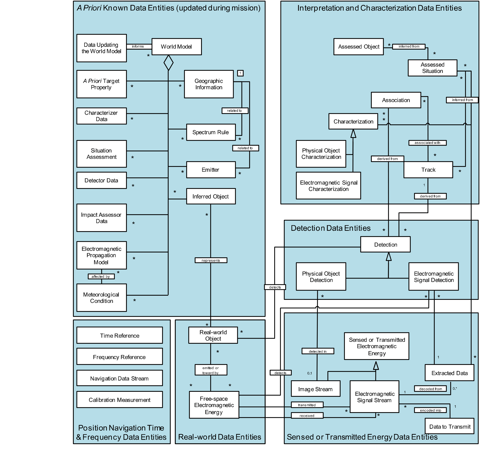
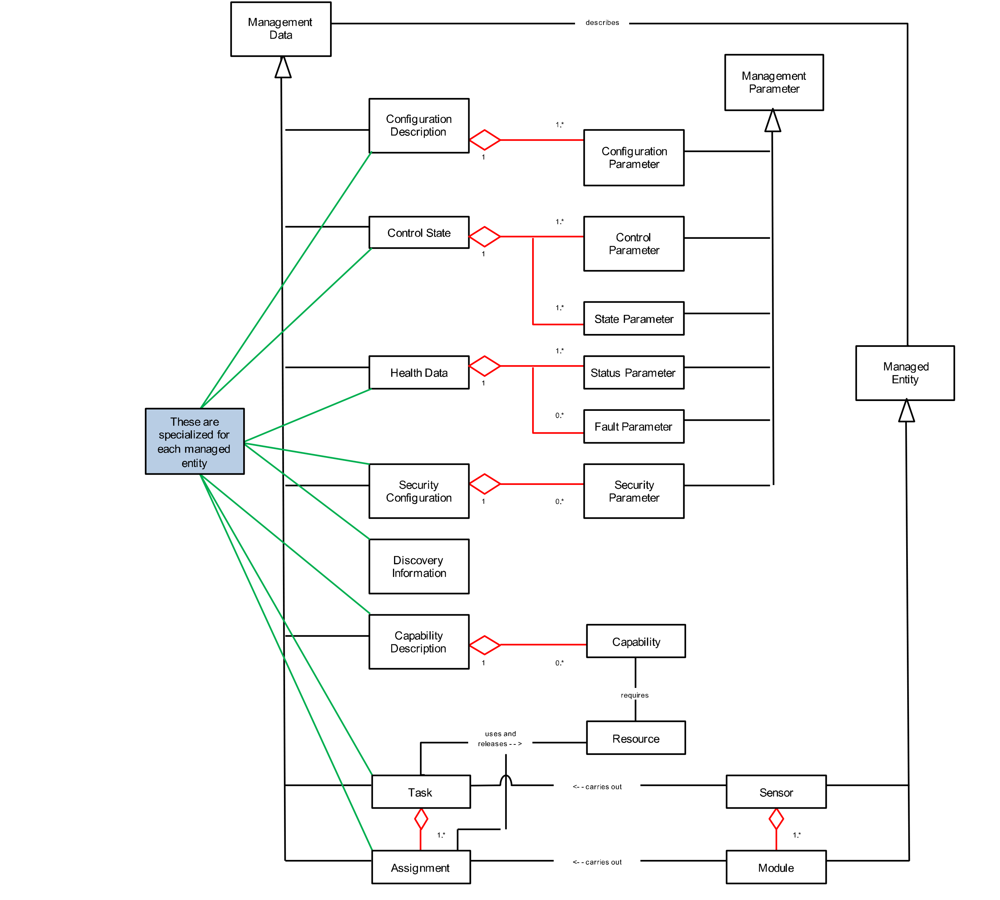
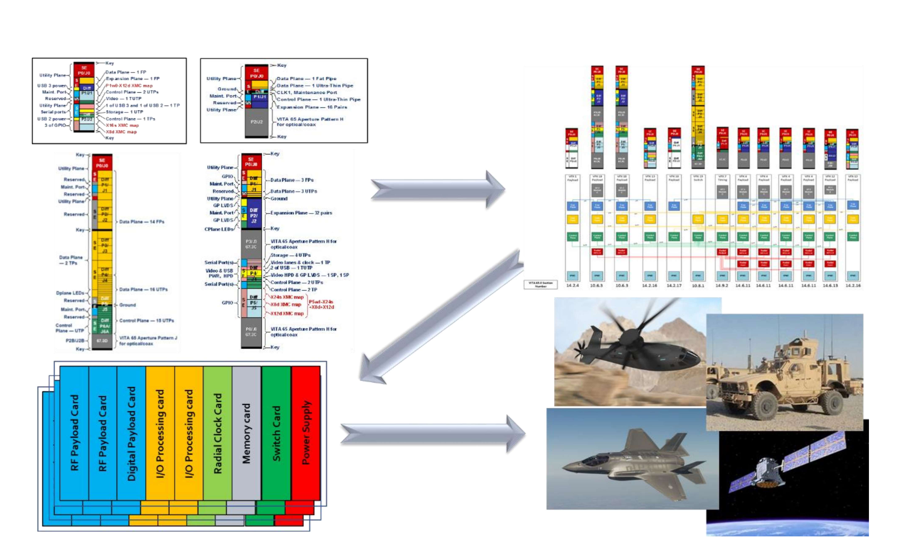

# 4 Architecture Definition ｜ 4 架构定义

> 原书 p.43–71 ｜ PDF p.63–91

### 4.1 Service Views ｜ 4.1 服务视图

#### 4.1.1 SvcV-4: Services Functionality Description ｜ 4.1.1 SvcV-4：服务功能描述

The Service View 4 (SvcV-4: Services Functionality Description) documents the functions performed by each of the SOSA modules, and documents the data ingested and produced by each. This information, when coupled with the SOSA Data Models (DIV-1, -2, and -3) provides a complete picture of the content of the informational Needlines linking the SOSA modules. The SvcV-4 takes the form of a table, incorporating the following pieces of information: ID Number: numerical designator (major-point-minor) of the SOSA module Name: succinct label for the SOSA module Function List: list of functions contained within the SOSA module Inputs: list of data items and controls that are ingested by the SOSA module (in certain cases, their sources)

服务视图 4（SvcV-4：服务功能描述）记载每个 SOSA 模块所执行的功能，并记载各模块摄取与产生的数据。这些信息与 SOSA 数据模型（DIV-1、DIV-2 与 DIV-3）合起来，给出连接各 SOSA 模块的信息性 `Needline`（需求线）内容的完整图景。SvcV-4 采取表格形式，包含下列几项信息：ID 号：SOSA 模块的数字标识（主-次-末三段式）；名称：SOSA 模块的简明标称；功能清单：该 SOSA 模块所含功能的清单；输入：该 SOSA 模块所摄取的数据项与控制项清单（某些情况下含其来源）

> **译注**：上段英文在原书为四条项目符号（ID Number／Name／Function List／Inputs），转换时并成一段；英文照录不改。

- Outputs: list of data items that are produced by the SOSA module (in certain cases, their destinations)

- 输出：该 SOSA 模块所产生的数据项清单（某些情况下含其去向）

**Table 5: SOSA SvcV-4 ｜ 表 5：SOSA SvcV-4**

> **本表读法**：四列＝模块｜封装功能｜输入与输出｜输入／输出说明。表中 `1.1.a`、`6.9.5.2.1` 一类数据项编号是**寻址用的，不译**；第一列与第二列在原表为纵向合并格，本件按原样留空。**方向怎么读**：原表只有 `1.1.a` 一行印了分区标记 `Inputs`，其余各行的方向靠第四列的 `Input`／`Output` 字样与功能语义判断；约六成行两处都没有，本件不替原文臆断，方向见各组小结。本表 429 数据行、跨原书 p.43–66 共 24 页，逐格挂中文会撑成一堵墙，故**中文不进格**：每一组模块之前置一条中文小结，组内的行一字不译。分组＝原表第一列出现新模块名之处，故一表分作二十五张（另六处分组标题改作加粗小标题），每张重复四列表头——中文小结若插在行与行之间，Markdown 的表格会当场断掉、后半截散成正文，故只能这样切。读法：先看小结把握该组在做什么、数据从哪来往哪去，再按编号回组内取字。

**1 Manage SOSA Sensor ｜ 1 传感器管理**

> **小结** 1 传感器管理：本组统管 SOSA 传感器的系统级与任务级活动，系统管理器负责发现、配置、控制、健康与安全，任务管理器负责外部任务的摄取与内部分派的派生。输入自宿主平台接口与各模块上报，输出为下发给各模块的系统管理分派与任务分派。

> **小结** 1.1 系统管理器：执行 `1.1 Perform System Management`（执行系统管理），自宿主平台接口与各模块收进系统管理任务指派、系统服务数据及回报的确认、状况、事件通知，再向各模块下发系统管理分派；输出即系统与模块的发现、配置、控制、健康与安全结果。

| Module | Encapsulated Functions | Inputs (above) & Outputs (below) | Input/Output Description |
|---|---|---|---|
| 1.1 System Manager | 1.1 Perform System Management | 1.1.a System Management Tasking | Inputs |
| | | 1.1.b System Management Assignment Ack/Status/Information | |
| | | 1.1.c System Management Assignment Event Notification | |
| | | 1.1.d System Management Task Ack/Status/Information | |
| | | 1.1.e System Management Task Event Notification | |
| | | 1.1.f System Services Data | |
| | | 1.1.g System Management Assignment | |
| | 1.1.1 Discover System | | |
| | 1.1.1.1 Discover System Manager | | |
| | 1.1.1.2 Discover Modules | | |
| | 1.1.2 Manage Configuration | | |
| | 1.1.2.1 Configure System | | |
| | 1.1.2.2 Configure Module | | |
| | 1.1.2.3 Configure Data Publishing | | |
| | 1.1.3 Manage Control Parameters | | |
| | 1.1.3.1 Control System | | |
| | 1.1.3.2 Control Module | | |
| | 1.1.4 Manage Health | | |
| | 1.1.4.1 Report Health | | |
| | 1.1.4.1.1 Report System Health | | |
| | 1.1.4.1.2 Report Module Health | | |
| | 1.1.4.2 Get Health | | |
| | 1.1.4.2.1 Get System Health | | |
| | 1.1.4.2.2 Get Module Health | | |
| | 1.1.4.3 Notify Health Events | | |
| | 1.1.4.3.1 Notify System Health Events | | |
| | 1.1.4.3.2 Notify Module Health Events | | |
| | 1.1.4.4 Log Health | | |
| | 1.1.5 Manage Security | | |
| | 1.1.5.1 Secure Management Interfaces | | |
| | 1.1.5.1.1 Verify Authentication | | |
| | 1.1.5.1.2 Verify Authorization | | |
| | 1.1.5.2 Manage Security Configuration | | |
| | 1.1.5.2.1 Manage Security Keys | | |
| | 1.1.5.2.2 Manage Access Control | | |

> **小结** 1.2 任务管理器：执行 `1.2 Perform Task Management`（执行任务管理），先发现系统与模块能力，再摄取宿主平台下达的任务指派，派生内部任务指派并排定优先级与调度，形成模块分派下发。输入含宿主与各模块的能力，另有系统服务数据与系统管理分派；输出：任务确认、状况回报、事件通知、模块分派，以及能力发现的回执（`Sensor Capabilities`／`Resource Map`／`Module Capabilities Request`）与系统管理回执。

| Module | Encapsulated Functions | Inputs (above) & Outputs (below) | Input/Output Description |
|---|---|---|---|
| 1.2 Task Manager | 1.2 Perform Task Management | | |
| | 1.2.1 Discover Capabilities | | |
| | 1.2.1.1 Discover System Capabilities | 1.2.1.1.a Module Discovery Data (Module List, Resource Data, Module/Resource IP) | Input |
| | | 1.2.1.1.b Sensor Capabilities Request | Input |
| | | 1.2.1.1.c Sensor Capabilities | Output |
| | | 1.2.1.1.d Sensor Capabilities Resource Map | Output |
| | 1.2.1.2 Discover Module Capabilities | 1.2.1.2.a Module Capabilities | Input |
| | | 1.2.1.2.b Module Capabilities Request | Output |
| | 1.2.2 Manage Tasks | | |
| | 1.2.2.1 Manage External Sensor Tasks | 1.2.2.1.a Tasking | Input |
| | | 1.2.2.1.b Task Ack/Status/Information | Output |
| | | 1.2.2.1.c Task Event Notification | Output |
| | 1.2.2.1.1 Ingest External Tasking | Tracks from Module 3.4 | For TWS GMTI |
| | 1.2.2.1.2 Monitor External Tasking | | |
| | 1.2.2.1.3 Report External Tasking Status | | |
| | 1.2.2.2 Manage Internal Sensor Tasks | | |
| | 1.2.2.2.1 Develop Internal Sensor Tasking | | |
| | 1.2.2.2.2 Manage Sensor Resources | | |
| | 1.2.2.2.2.1 Prioritize Internal Sensor Tasking | | |
| | 1.2.2.2.2.2 Schedule Internal Sensor Tasking | | |
| | 1.2.2.2.3 Monitor Internal Sensor Tasking | | |
| | 1.2.2.3 Manage Module Assignments | 1.2.2.3.a Module Assignment Ack/Status/Information | Input |
| | | 1.2.2.3.b Module Assignment Event Notification | Input |
| | | 1.2.2.3.c Module Assignment | Output |
| | 1.2.2.3.1 Develop Module Assignments | | |
| | 1.2.2.3.2 Manage Module Resources | | |
| | 1.2.2.3.3 Send Module Assignments | | |
| | 1.2.2.3.4 Monitor Module Assignments | | |
| | 1.2.3 Manage Module | 1.2.3.a System Services Data | Input (PNT, etc.) |
| | | 1.2.3.b System Management Assignment | Input |
| | | 1.2.3.c System Management Assignment Ack/Status/Information | Output |
| | | 1.2.3.d System Management Assignment Event Notification | Output |
| | 1.2.3.1 Manage Module Discovery | | |
| | 1.2.3.2 Manage Module Configuration | | |
| | 1.2.3.3 Manage Module Control | | |
| | 1.2.3.4 Manage Module Health | | |
| | 1.2.3.5 Manage Module Security | | |

**2 Transmission/Reception ｜ 2 发射／接收**

> **小结** 2 发射／接收：本组覆盖传感器的电磁与光电前端，接收孔径／换能器／相机把外来能量转为电信号，发射孔径／换能器／激光器把电信号还原为辐射能量，调理器-接收机-激励器居中完成放大、变频与模数转换；输入自带外场能量，输出送往信号／目标处理组。

> **小结** 2.1 接收孔径／换能器／相机：控制孔径的配置与参数，把入射的 `RX Electromagnetic Energy`（接收电磁能量）转换为电信号，再经放大、稳定与滤波，输出 `Filtered RX Signal`（滤波后接收信号）给调理器-接收机-激励器；模块管理部分以系统服务数据与系统管理分派为输入，回报确认与事件通知。

| Module | Encapsulated Functions | Inputs (above) & Outputs (below) | Input/Output Description |
|---|---|---|---|
| 2.1 Receive Aperture/Transducer/Camera | 2.1.1 Control Receive Aperture | | |
| | 2.1.1.1 Configure Aperture | | |
| | 2.1.1.2 Control Aperture Parameters | | |
| | 2.1.2 Convert EM Energy to Electrical Signal | 2.1.2.a RX Electromagnetic Energy | Input |
| | 2.1.3 Amplify Signal | | |
| | 2.1.3 Stabilize Signal | | |
| | 2.1.4 Filter Signal | 2.1.4.a Filtered RX Signal | Output |
| | 2.1.5 Perform Module Management | | |
| | 2.1.5.1 Perform Module System Management | 2.1.5.1.a System Services Data | Input (PNT, etc.) |
| | | 2.1.5.1.b System Management Assignment | Input |
| | | 2.1.5.1.c System Management Assignment Ack/Status/Information | Output |
| | | 2.1.5.1.d System Management Assignment Event Notification | Output |
| | 2.1.5.1.1 Manage Module Discovery | | |
| | 2.1.5.1.2 Manage Module Configuration | | |
| | 2.1.5.1.3 Manage Module Control | | |
| | 2.1.5.1.4 Manage Module Health | | |
| | 2.1.5.1.5 Manage Module Security | | |
| | 2.1.5.2 Manage Module Assignments | 2.1.5.2.a Task Management Assignment | Input |
| | | 2.1.5.2.b Task Management Assignment Ack/Status/Information | Output |
| | | 2.1.5.2.c Task Management Assignment Event Notification | Output |
| | 2.1.5.2.1 Process Module Assignments | | |
| | 2.1.5.2.2 Manage Module Resources | | |
| | 2.1.5.2.4 Monitor Module Assignments | | |

> **小结** 2.2 发射孔径／换能器／激光器：生成发射信号，以 `Unfiltered RX Signal`（未滤波接收信号，原文如此）为输入，经滤波、放大后由换能器或激光器转换为 `TX Electromagnetic Energy`（发射电磁能量）辐射出去；模块管理部分以系统服务数据与系统管理分派为输入，回报确认、状况与事件通知。

| Module | Encapsulated Functions | Inputs (above) & Outputs (below) | Input/Output Description |
|---|---|---|---|
| 2.2 Transmit Aperture/Transducer/Laser | 2.2.1 Control Receive Aperture | | |
| | 2.2.1.1 Configure Aperture | | |
| | 2.2.1.2 Control Aperture Parameters | | |
| | 2.2.2 Generate Signal | | |
| | 2.2.3 Filter Signal | 2.2.3.a Unfiltered RX Signal | Input |
| | 2.2.4 Amplify Signal | | |
| | 2.2.5 Convert Electrical Signal to EM Energy | 2.2.5.a TX Electromagnetic Energy | Output |
| | 2.2.6 Perform Module Management | | |
| | 2.2.7.1 Perform Module System Management | 2.2.7.1.a System Services Data | Input (PNT, etc.) |
| | | 2.2.7.1.b System Management Assignment | Input |
| | | 2.2.7.1.c System Management Assignment Ack/Status/Information | Output |
| | | 2.2.7.1.d System Management Assignment Event Notification | Output |
| | 2.2.7.1.1 Manage Module Discovery | | |
| | 2.2.7.1.2 Manage Module Configuration | | |
| | 2.2.7.1.3 Manage Module Control | | |
| | 2.2.7.1.4 Manage Module Health | | |
| | 2.2.7.1.5 Manage Module Security | | |
| | 2.2.7.2 Manage Module Assignments | 2.2.7.2.a Task Management Assignment | Input |
| | | 2.2.7.2.b Task Management Assignment Ack/Status/Information | Output |
| | | 2.2.7.2.c Task Management Assignment Event Notification | Output |
| | 2.2.7.2.1 Process Module Assignments | | |
| | 2.2.7.2.2 Manage Module Resources | | |
| | 2.2.7.2.4 Monitor Module Assignments | | |

> **小结** 2.3 调理器-接收机-激励器：接收支路把 `Filtered RX Signal`（滤波后接收信号）放大、分配、变频并模数转换，输出 `RX Electromagnetic Signal Stream`（接收电磁信号流）与接收图像流；发射支路反向上变频、数模转换，输出 `Unfiltered TX Signal`（未滤波发射信号）；模块管理受系统管理与任务管理两路管辖。

| Module | Encapsulated Functions | Inputs (above) & Outputs (below) | Input/Output Description |
|---|---|---|---|
| 2.3 Conditioner-Receiver-Exciter | 2.3.1 Process RX Signals | 2.3.1.a Filtered RX Signal | Input, digital, or analog |
| | | 2.3.1.b RX Electromagnetic Signal Stream | Output, RX digital |
| | | 2.3.1.c RX Image Stream | Output, RX digital |
| | 2.3.1.1 Amplify Signal | | |
| | 2.3.1.2 Distribute RF Signal | | |
| | 2.3.1.3 Translate Signal Frequency | | |
| | 2.3.1.4 Convert Signal: Analog to Digital | | |
| | 2.3.2 Process TX Signals | 2.3.2.a Unfiltered TX Signal | Output |
| | 2.3.2.1 Generate Signal (Waveform) | | |
| | 2.3.2.2 Amplify Signal | | |
| | 2.3.2.3 Distribute RF Signal | | |
| | 2.3.2.4 Translate Signal Frequency | | |
| | 2.3.2.5 Convert Signal: Digital to Analog | | |
| | 2.3.3 Perform Module Management | | |
| | 2.3.3.1 Perform Module System Management | 2.3.3.1.a System Services Data | Input (PNT, etc.) |
| | | 2.3.3.1.b System Management Assignment | Input |
| | | 2.3.3.1.c System Management Assignment Ack/Status/Information | Output |
| | | 2.3.3.1.d System Management Assignment Event Notification | Output |
| | 2.3.3.1.1 Manage Module Discovery | | |
| | 2.3.3.1.2 Manage Module Configuration | | |
| | 2.3.3.1.3 Manage Module Control | | |
| | 2.3.3.1.4 Manage Module Health | | |
| | 2.3.3.1.5 Manage Module Security | | |
| | 2.3.3.2 Manage Module Assignments | 2.3.3.2.a Task Management Assignment | Input |
| | | 2.3.3.2.b Task Management Assignment Ack/Status/Information | Output |
| | | 2.3.3.2.c Task Management Assignment Event Notification | Output |
| | 2.3.3.2.1 Process Module Assignments | | |
| | 2.3.3.2.2 Manage Module Resources | | |
| | 2.3.3.2.4 Monitor Module Assignments | | |

**3 Process Signals/Targets ｜ 3 信号／目标处理**

> **小结** 3 信号／目标处理：本组是传感器内部的处理链，检测与提取器从杂波与背景中取出信号与目标，特征化器给出类别与身份，图像预处理器成像并配准，跟踪器维持航迹；输入为前端送来的信号流与图像流，输出为检测、特征化与航迹结果，供分析／情报利用组与任务管理器取用。

> **小结** 3.1 信号／目标检测与提取器：对接收电磁信号流与各类图像流做增强，从中提取信号与目标，输出增强后的电磁信号流与图像流；再处理检测结果，输出 `Detection`（检测）与图像质量报告。模块管理部分以系统服务数据与系统管理分派为输入，回报确认、状况与事件通知。

| Module | Encapsulated Functions | Inputs (above) & Outputs (below) | Input/Output Description |
|---|---|---|---|
| 3.1 Signal/Object Detector and Extractor | 3.1.1 Enhance Image/Video | 3.1.1.a RX Electromagnetic Signal Stream | Input |
| | | 3.1.1.b RX Image Stream | Input |
| | | 3.1.1.c RF Image Stream | Input |
| | | 3.1.1.d Registered Image Stream | Input |
| | | 3.1.1.e Georegistered Image Stream | Input |
| | 3.1.2 Extract Signals/Objects | 3.1.2.a Extracted Electromagnetic Signal Stream | Output, enhanced |
| | | 3.1.2.b Extracted Image Stream | Output, enhanced |
| | 3.1.2.1 Extract RF Signal from Clutter | | |
| | 3.1.2.2 Extract EO/IR Object from Background | | |
| | 3.1.3 Process Detections | 3.1.3.a Detection | Output |
| | | 3.1.3.b Image Quality Report | Output |
| | 3.1.3.1 Detect and Discriminate Signals/Objects | | |
| | 3.1.3.2 Estimate quality of detections | | |
| | 3.1.4 Perform Module Management | | |
| | 3.1.4.1 Perform Module System Management | 3.1.4.1.a System Services Data | Input (PNT, etc.) |
| | | 3.1.4.1.b System Management Assignment | Input |
| | | 3.1.4.1.c System Management Assignment Ack/Status/Information | Output |
| | | 3.1.4.1.d System Management Assignment Event Notification | Output |
| | 3.1.4.1.1 Manage Module Discovery | | |
| | 3.1.4.1.2 Manage Module Configuration | | |
| | 3.1.4.1.3 Manage Module Control | | |
| | 3.1.4.1.4 Manage Module Health | | |
| | 3.1.4.1.5 Manage Module Security | | |
| | 3.1.4.2 Manage Module Assignments | 3.1.4.2.a Task Management Assignment | Input |
| | | 3.1.4.2.b Task Management Assignment Ack/Status/Information | Output |
| | | 3.1.4.2.c Task Management Assignment Event Notification | Output |
| | 3.1.4.2.1 Process Module Assignments | | |
| | 3.1.4.2.2 Manage Module Resources | | |
| | 3.1.4.2.4 Monitor Module Assignments | | |

> **小结** 3.2 信号／目标特征化器：以 `Detection`（检测）、提取后的电磁信号流与图像流为输入，估计信号参数、抽取分类与识别特征并计算频谱产品；随后判定信号类型、匹配参考基、完成目标识别并剔除虚警，输出 `Characterization`（特征化）供跟踪器与分析组使用。

| Module | Encapsulated Functions | Inputs (above) & Outputs (below) | Input/Output Description |
|---|---|---|---|
| 3.2 Signal/Object Characterizer | 3.2.1 Extract Detection Features | 3.2.1.a Detection | Input |
| | | 3.2.1.b Extracted Electromagnetic Signal Stream | Input |
| | | 3.2.1.c Extracted Image Stream | Input |
| | | 3.2.1.d Spectral Product | Output |
| | 3.2.1.1 Estimate Signal Parameters | | |
| | 3.2.1.2 Extract Classifier Features | | |
| | 3.2.1.3 Extract Identification Features | | |
| | 3.2.1.4 Compute spectral products | | |
| | 3.2.2 Classify or Identify Signal/Object | 3.2.2.a Characterizer Data | Input |
| | 3.2.2.1 Determine Signal Type | | |
| | 3.2.2.2 Map Features to Reference/Basis | | |
| | 3.2.2.3 Match Image Chip to Profile for ID | | |
| | 3.2.2.4 Perform Target Recognition | | |
| | 3.2.3 Filter False Detections | | |
| | 3.2.3.1 Identify False Alarms | | |
| | 3.2.3.2 Discriminate Target from Non-target | | |
| | 3.2.4 Produce Characterizations | 3.2.4.a Characterization | Output |
| | 3.2.4.1 Produce Classification Type | | |
| | 3.2.4.2 Produce Identity | | |
| | 3.2.5 Perform Module Management | | |
| | 3.2.5.1 Perform Module System Management | 3.2.5.1.a System Services Data | Input (PNT, etc.) |
| | | 3.2.5.1.b System Management Assignment | Input |
| | | 3.2.5.1.c System Management Assignment Ack/Status/Information | Output |
| | | 3.2.5.1.d System Management Assignment Event Notification | Output |
| | 3.2.5.1.1 Manage Module Discovery | | |
| | 3.2.5.1.2 Manage Module Configuration | | |
| | 3.2.5.1.3 Manage Module Control | | |
| | 3.2.5.1.4 Manage Module Health | | |
| | 3.2.5.1.5 Manage Module Security | | |
| | 3.2.5.2 Manage Module Assignments | 3.2.5.2.a Task Management Assignment | Input |
| | | 3.2.5.2.b Task Management Assignment Ack/Status/Information | Output |
| | | 3.2.5.2.c Task Management Assignment Event Notification | Output |
| | 3.2.5.2.1 Process Module Assignments | | |
| | 3.2.5.2.2 Manage Module Resources | | |
| | 3.2.5.2.4 Monitor Module Assignments | | |

> **小结** 3.3 图像预处理器：把 `Received Electromagnetic Signal Stream`（接收电磁信号流）成像为射频图像流，再做图像间配准，并借 `Geographic Information`（地理信息）配准到地理坐标，输出 `Georeferenced Image Stream`（地理配准图像流）给检测提取与跟踪模块；模块管理部分同其他模块。

| Module | Encapsulated Functions | Inputs (above) & Outputs (below) | Input/Output Description |
|---|---|---|---|
| 3.3 Image Pre-processor | 3.3.1 Form Image from RF Signal | 3.3.1.a Received Electromagnetic Signal Stream | Input |
| | | 3.3.1.b RF Image stream | Output |
| | 3.3.2 Register Image to Image | 3.3.2.a Image Stream | Input |
| | | 3.3.2.b Registered Image Stream | Output |
| | 3.3.3 Register Image to Geographical Coordinates | 3.3.3.a Image Stream | Input |
| | | 3.3.3.b Geographic Information | Input |
| | | 3.3.3.c Georeferenced Image Stream | Output |
| | 3.3.4 Perform Module Management | | |
| | 3.3.4.1 Perform Module System Management | 3.3.4.1.a System Services Data | Input (PNT, etc.) |
| | | 3.3.4.1.b System Management Assignment | Input |
| | | 3.3.4.1.c System Management Assignment Ack/Status/Information | Output |
| | | 3.3.4.1.d System Management Assignment Event Notification | Output |
| | 3.3.4.1.1 Manage Module Discovery | | |
| | 3.3.4.1.2 Manage Module Configuration | | |
| | 3.3.4.1.3 Manage Module Control | | |
| | 3.3.4.1.4 Manage Module Health | | |
| | 3.3.4.1.5 Manage Module Security | | |
| | 3.3.4.2 Manage Module Assignments | 3.3.4.2.a Task Management Assignment | Input |
| | | 3.3.4.2.b Task Management Assignment Ack/Status/Information | Output |
| | | 3.3.4.2.c Task Management Assignment Event Notification | Output |
| | 3.3.4.2.1 Process Module Assignments | | |
| | 3.3.4.2.2 Manage Module Resources | | |
| | 3.3.4.2.4 Monitor Module Assignments | | |

> **小结** 3.4 跟踪器：以提取后的电磁信号流、图像流，以及 3.1 的 `Detection`（检测）与 3.2 的 `Characterization`（特征化）为输入，做航迹关联、起始、终止与维持；输出 `Current Track State`（当前航迹状态）与 `Predicted Track State`（预测航迹状态），供分析组、报告服务与任务管理器取用。

| Module | Encapsulated Functions | Inputs (above) & Outputs (below) | Input/Output Description |
|---|---|---|---|
| 3.4 Tracker | 3.4.1 Process Detections | 3.4.1.a Extracted EM Signal Stream | Input |
| | | 3.4.1.b Extracted Image Stream | Input |
| | | 3.4.1.c Detection | Input, Data from Module 3.1 Signal/Target Detector/Extractor module that is processed to determine and output tracks. Can be RF detection data (SAR, EW, GMTI, AMTI, ESM) or EO/IR detection data |
| | | 3.4.1.d Characterization | Input, Data from Module 3.2 that is processed to determine and output tracks |
| | 3.4.2 Associate Tracks | | |
| | 3.4.3 Initiate Tracks | | |
| | 3.4.4 Terminate Tracks | | |
| | 3.4.5 Maintain Tracks | 3.4.5.a Current Track State | Output, Provides the track state data at the time of the measurement Includes intermediate results and measurements |
| | | 3.4.5.b Predicted Track State | Output, Provides the estimated track state data at the time of the next scheduled measurement update |
| | 3.4.5.1 Track Update | | |
| | 3.4.5.2 Track Prediction | | |
| | 3.4.6 Perform Module Management | | |
| | 3.4.6.1 Perform Module System Management | 3.4.6.1.a System Services Data (PNT, etc.) | Input |
| | | 3.4.6.1.b System Management Assignment | Input |
| | | 3.4.6.1.c System Management Assignment Ack/Status/Information | Output |
| | | 3.4.6.1.d System Management Assignment Event Notification | Output |
| | 3.4.6.1.1 Manage Module Discovery | | |
| | 3.4.6.1.2 Manage Module Configuration | | |
| | 3.4.6.1.3 Manage Module Control | | |
| | 3.4.6.1.4 Manage Module Health | | |
| | 3.4.6.1.5 Manage Module Security | | |
| | 3.4.6.2 Manage Module Assignments | 3.4.6.2.a Task Management Assignment | Input |
| | | 3.4.6.2.b Task Management Assignment Ack/Status/Information | Output |
| | | 3.4.6.2.c Task Management Assignment Event Notification | Output |
| | 3.4.6.2.1 Process Module Assignments | | |
| | 3.4.6.2.2 Manage Module Resources | | |
| | 3.4.6.2.4 Monitor Module Assignments | | |

**4 Analyze/Exploit ｜ 4 分析／情报利用**

> **小结** 4 分析／情报利用：本组把传感器数据抬升为可交付的情报，外部数据摄取器并入外部来源，编码数据提取器解译信号内容，态势评估器关联多传感器观测，影响评估与响应器判定归属与威胁，存储／检索管理器负责留存与回放；输入为处理组的输出，输出为态势、影响与数据产品。

> **小结** 4.1 外部数据摄取器：接收其他 SOSA 传感器或外部来源的 `SOSA Mission Data`（SOSA 任务数据）与不合规数据，转换为 SOSA 格式后分发至相应模块，以支持跨传感器的融合与关联；其输入主要来自报告服务输出的数据产品，输出即转入本传感器数据流的任务数据。

| Module | Encapsulated Functions | Inputs (above) & Outputs (below) | Input/Output Description |
|---|---|---|---|
| 4.1 External Data Ingestor | Ingest data from other SOSA sensors or other sources | SOSA Mission Data | (Data products output by Reporting Services) |
| | Convert from external formats to SOSA format | SOSA Non-conformant Data | (including sensor/source) |
| | Distribute the ingested data to other SOSA Modules as appropriate | SOSA Mission Data | |
| | Enable fusion or correlation across sensors | | |

> **小结** 4.2 编码数据提取器：从 `Detection`（检测）、提取后的电磁信号流与图像流中解译报文内容、解调并做人自然语言处理，输出 `Demodulated Electromagnetic Signal Stream`（解调后电磁信号流）与 `Extracted Data`（提取数据）；输入另含 `Encoded Data Extractor Assignment`（编码数据提取器分派）与 `A Priori Target Properties`（先验目标属性）。

| Module | Encapsulated Functions | Inputs (above) & Outputs (below) | Input/Output Description |
|---|---|---|---|
| 4.2 Encoded Data Extractor | Extract internals | Detection | |
| | Extract message content from signal | Extracted Electromagnetic Signal Stream | (digital only) |
| | Demodulate | Extracted Image or Stream | (digital only) |
| | Perform human language processing | Encoded Data Extractor Assignment | |
| | | *A Priori* Target Properties | |
| | | Demodulated Electromagnetic Signal Stream | |
| | | Extracted Data | |

> **小结** 4.3 态势评估器：以 `Characterization`（特征化）、`Track`（航迹）、`Detection`（检测）等为输入，关联多传感器对同一信号或目标的观测，并持续积累检测与关联随时间的历史，输出 `Assessed Situation`（评估后态势）与 `Association`（关联），供影响评估与存储取用。

| Module | Encapsulated Functions | Inputs (above) & Outputs (below) | Input/Output Description |
|---|---|---|---|
| 4.3 Situation Assessor | Correlate same signal/object from multiple sensors | Characterization | |
| | Associate multiple signals/objects | Track | |
| | Develop and store history of detections and correlations over time | Detection | Of signals/objects |
| | | Association | Among signals/objects |
| | | Situation Assessor Data | |
| | | Situation Assessor Assignment | |
| | | Assessed Situation | |
| | | Association | Among signals/objects |

> **小结** 4.4 影响评估与响应器：输入含解调后电磁信号流、检测、航迹、特征化与提取数据，另有 `Association`（关联）、`Impact Assessor Data`（影响评估器数据）与 `Impact Assessor and Responder Assignment`（影响评估与响应器分派）；判定实体归属，评估影响、威胁与脆弱性，维持备择假设并把评估外推到未来，再分析响应并发出请求；输出 `Assessed Impact`（评估后影响）与 `Assessed Impact Response`（影响响应）。

| Module | Encapsulated Functions | Inputs (above) & Outputs (below) | Input/Output Description |
|---|---|---|---|
| 4.4 Impact Assessor and Responder | Determine entity affiliation | Demodulated Electromagnetic Signal Stream | |
| | Assess impacts, threats, and vulnerabilities | Detection | Of signals/objects |
| | Maintain alternate hypotheses | Track | |
| | Project assessments into the future | Characterization | |
| | Analyze response and send request | Extracted Data | |
| | | Association | Among signals/objects |
| | | Impact Assessor Data | |
| | | Impact Assessor and Responder Assignment | |
| | | Assessed Impact | |
| | | Assessed Impact Response | |

> **小结** 4.6 存储／检索管理器：输入含电磁信号流、图像流、检测、特征化、关联、评估结果、`Track`（航迹）及自身分派；对实时流数据做索引与介质存储，并按需检索与实时回放；输出为这些数据项的回放流与检索结果，供分析、报告与事后复盘取用。

| Module | Encapsulated Functions | Inputs (above) & Outputs (below) | Input/Output Description |
|---|---|---|---|
| 4.6 Storage/Retrieval Manager | Capture real-time streaming data | Electromagnetic Signal Stream | (digital only) |
| | Retrieve | Image Stream | (digital only) |
| | Play back in real-time | Detection | |
| | Index | Track | |
| | Store media | Characterization | |
| | | Association | |
| | | Assessed Situation | |
| | | Assessed Impact | |
| | | Storage/Retrieval Manager Assignment | |
| | | Electromagnetic Signal Stream | (digital only) |
| | | Image Stream | (digital only) |
| | | Detection | |
| | | Characterization | |
| | | Association | |
| | | Assessed Situation | |
| | | Assessed Impact | |

**5 Convey ｜ 5 传递**

> **小结** 5 传递：本组现由报告服务构成，负责把传感器内部的数据聚合、选定、格式化并打包成报告，按流式或整包形态送往接收方；输入为各处理与分析模块的数据项及外部格式，输出为面向外部消费者与外部格式的报告。

> **小结** 5.1 报告服务：把电磁信号流、图像流、`Demodulated Electromagnetic Signal Stream`（解调后电磁信号流）、检测、特征化、关联与评估结果，连同 `Sensor Logging Data`（传感器日志数据）、`Fault`（故障）等聚合起来，选定并格式化数据，生成包头与流结构后按请求发送；输入含 `Reporting Services Assignment`（报告服务分派）与提示／引导航迹，输出为面向接收方与外部格式的报告。

| Module | Encapsulated Functions | Inputs (above) & Outputs (below) | Input/Output Description |
|---|---|---|---|
| 5.1 Reporting Services | Aggregate data | Electromagnetic Signal Stream | (digital only) |
| | Select data to be reported | Image Stream | (digital only) |
| | Format data | Sensor Logging Data | (e.g., Health, Status, Mode, and State) |
| | Generate reports for collection/processing/analysis/exploitation | Demodulated Electromagnetic Signal Stream | |
| | Accept/reject request | Detection | |
| | Find data | Characterization | |
| | Package data for reporting | Association | |
| | Generate header/packet structure for streaming data | Assessed Situation | |
| | Send metadata | Assessed Impact | |
| | Select a format | Fault | |
| | Structure data to match format | Sensor Cue/Tip Track | |
| | Send to recipient(s) | Reporting Services Assignment | |
| | Match sensor results against tip/cue criteria | External format of any data in Input | |

**6 Support System Operation ｜ 6 支持系统运行**

> **小结** 6 支持系统运行：本组是横贯全传感器的公共服务，提供安全、加解密、跨域护卫、组网、校准、导航数据、时间与频率、压缩解压、宿主平台接口与供电；输入多自宿主平台与各模块，输出为全系统共用的服务数据与资源。

> **小结** 6.1 安全服务：以 `Security Parameters`（安全参数）、`Access Request`（访问请求）、`Zeroize Assignment`（清零分派）与密级标签为输入，校验软件与数据完整性、管理密钥、控制访问并做审计，必要时清零全部敏感数据；输出为 `Security Audit Report`（安全审计报告）、`Security Tamper Alert`（安全防拆告警）、`Access Request Response`（访问请求应答）、`Zeroize ACK/NAK`（清零确认／否认）与对各模块的清零分派。

| Module | Encapsulated Functions | Inputs (above) & Outputs (below) | Input/Output Description |
|---|---|---|---|
| 6.1 Security Services | Check software/data integrity | Security Parameters | (e.g., encryption keys, access control data, module integrity data) |
| | Manage key(s) | Zeroize Assignment | |
| | Control access | Access Request | |
| | Audit | Classification Level Tag(s) | |
| | Zeroize all sensitive data | Security Audit Report | |
| | | Security Tamper Alert | |
| | | Access Request Response | |
| | | Zeroize ACK/NAK | |
| | | Zeroize Assignment | (to other modules) |

> **小结** 6.2 加解密器：输入含 `Security Parameters`（安全参数）、`Access Control Data`（访问控制数据）、`Zeroize Assignment`（清零分派）与待加密、待解密的数据或流；保护静态与传输中的数据并执行加解密；输出 `Encrypted Data or Stream`（加密数据或流）、`Decrypted Data or Stream`（解密数据或流）与 `Zeroize ACK/NAK`（清零确认／否认）。

| Module | Encapsulated Functions | Inputs (above) & Outputs (below) | Input/Output Description |
|---|---|---|---|
| 6.2 Encryptor/Decryptor | Protect data at rest | Security Parameters | Encryption keys |
| | Protect data in transit | Zeroize Assignment | |
| | Encrypt/decrypt | Access Control Data | |
| | | Data or Stream to be Encrypted | |
| | | Data or Stream to be Decrypted | |
| | | Zeroize ACK/NAK | |
| | | Encrypted Data or Stream | |
| | | Decrypted Data or Stream | |

> **小结** 6.3 护卫／跨域服务：以防数据外泄为目标，按 `Security Parameters`（安全参数）中的数据标记、过滤准则与人工核验，对 `Data or Stream to be Filtered`（待过滤数据或流）执行过滤；输出 `Filtered Data or Stream`（过滤后数据或流）、`Filtering Status`（过滤状况）与 `Security Auditing Data`（安全审计数据）。

| Module | Encapsulated Functions | Inputs (above) & Outputs (below) | Input/Output Description |
|---|---|---|---|
| 6.3 Guard/Cross-Domain Service | Prevent data leakage | Data or Stream to be Filtered | |
| | | Security Parameters | (Metadata tags for data/stream, filtering criteria, human verification) |
| | | Filtered Data or Stream | |
| | | Filtering Status | |
| | | Security Auditing Data | |

> **小结** 6.4 网络子系统：以 `Data or Stream to be Sent`（待发送数据或流）、网络传输参数与网络配置参数为输入，枚举网络元素、监视其健康、检测并隔离劣化元素、按请求的服务质量传输数据并检测入侵；输出已发送数据或流、`Network Health & Status`（网络健康与状况）与 `Intrusion Reports`（入侵报告）。

| Module | Encapsulated Functions | Inputs (above) & Outputs (below) | Input/Output Description |
|---|---|---|---|
| 6.4 Network Subsystem | Enumerate network elements | Data or Stream to be Sent | |
| | Monitor health of network elements | Network Data Transfer Parameters | |
| | Detect and isolate network degraded elements | Network Configuration Parameters | |
| | Transfer data with requested QoS | Data or Stream that was Sent | |
| | Detect intrusion | Network Health & Status | |
| | | Intrusion Reports | |

> **小结** 6.5 校准服务：摄取 `Injected Test RF Signal`（注入测试射频信号）、注入测试图像/视频流与注入测试解调信号，采集校准测试点或主通道的输出，并关断不在受测的模块；输入另含校准安全联锁与电磁源分派，输出 `Calibration Measurement`（校准测量值）供系统管理取用。

| Module | Encapsulated Functions | Inputs (above) & Outputs (below) | Input/Output Description |
|---|---|---|---|
| 6.5 Calibration Service | Intake the injected test signal | Injected Test RF Signal | |
| | Collect output of either calibration test points or main | Injected Test Image/Video Stream | |
| | Disable modules not under test | Injected Test Demodulated Signal | |
| | | Calibration Assignment Safety Interlock | |
| | | Electromagnetic Source Assignment | |
| | | Calibration Measurement | |

> **小结** 6.6 导航数据服务：以 `Nav Data Stream`（导航数据流）为输入，摄取平台与传感器的位置和姿态，融合内部与外部空间数据后分发；输入可取自宿主平台接口，也可由传感器内部生成，输出供各模块定位、配准与指向使用。

| Module | Encapsulated Functions | Inputs (above) & Outputs (below) | Input/Output Description |
|---|---|---|---|
| 6.6 Nav Data Service | Ingest platform/sensor location and orientation | Nav Data Stream | (external source - option, since could be internally generated) |
| | Blend internal and external spatial data | Nav Data Stream | |
| | Distribute platform/sensor location and orientation | | |

> **小结** 6.7 时间与频率服务：以 `Time Reference`（时间基准）为输入，摄取外部时间并与内部时间数据融合，必要时自行产生时间；向内部功能提供时间，并向各模块提供本振与 `Frequency Reference`（频率基准），输入自宿主平台接口，输出为全系统共用的时频基准。

| Module | Encapsulated Functions | Inputs (above) & Outputs (below) | Input/Output Description |
|---|---|---|---|
| 6.7 Time & Frequency Service | Ingest time from external source | Time Reference | (external source) |
| | Blend internal and external time data | Time Reference | |
| | Generate time internally | Frequency Reference | |
| | Provide time to internal function | | |
| | Provide LO/frequency reference | | |

> **小结** 6.8 压缩／解压器：以 `Compressor/Decompressor Assignment`（压缩／解压器分派）、`Compressed Data`（压缩数据）与 `Compression Metadata`（压缩元数据）为输入，执行压缩、解压与编解码；输出压缩数据与压缩元数据、解压数据与解压元数据，供传输与存储环节取用。

| Module | Encapsulated Functions | Inputs (above) & Outputs (below) | Input/Output Description |
|---|---|---|---|
| 6.8 Compressor/Decompressor | Compression | Compressor/Decompressor Assignment | |
| | Decompression | Compressed Data | |
| | Codec functions | Compression Metadata | |
| | | Decompressed Data | |
| | | Decompression Metadata | |
| | | Compressed Data | |
| | | Compression Metadata | |
| | | Decompressed Data | |
| | | Decompression Metadata | |

> **小结** 6.9 宿主平台接口：本组 46 行，为全表最长，去程与回程两段分述。**去程**：把宿主侧命令与服务数据译成内部形式，承接 `Host System Management Tasking`（宿主系统管理任务指派）与 `Host Tasking`（宿主任务指派）并转交系统管理器与任务管理器；同时把时间基准、频率基准、导航数据流、宿主状态与共址消隐任务回送传感器内部各功能（原文作 `Output to Sensor`）。**回程**：接收 `1.1`／`1.2` 下发的输入，并送宿主 `Output to host` 三类——`Sensor Test Report`（传感器测试报告）、`Sensor Configuration Data`（传感器配置数据）、`Sensor Health`（传感器健康）。**另**：担网络适配与电气接口，把宿主供电转交 6.10 电源，并自带模块管理与分派。

| Module | Encapsulated Functions | Inputs (above) & Outputs (below) | Input/Output Description |
|---|---|---|---|
| 6.9 Host Platform Interface | 6.9.1 Adapt External Commands to Internal SOSA Sensor Commands | 6.9.1.b System Management Task Ack/Status/Information | Input from 1.1 (such as Sensor Test Report, Sensor Configuration Data, Sensor Health) |
| | | 6.9.1.c System Management Task Event Notification | Input from 1.1 |
| | | 6.9.1.e Task Ack/Status/Information | Input from 1.2 |
| | | 6.9.1.f Task Event Notification | Input from 1.2 |
| | | 6.9.1.g Host System Management Tasking | Input from host (such as Zeroize Task, Safety Task, Test Task, Security Task, Key Fill) |
| | | 6.9.1.j Host Tasking | Input from host |
| | | 6.9.1.a System Management Tasking | Output to 1.1 (such as Zeroize Task, Safety Task, Test Task, Security Task, Key Fill) |
| | | 6.9.1.d Tasking | Output to 1.2 |
| | | 6.9.1.h Host System Management Task Ack/Status/Information | Output to host (such as Sensor Test Report, Sensor Configuration Data, Sensor Health) |
| | | 6.9.1.i Host System Management Task Event Notification | Output to host |
| | | 6.9.1.k Host Task Ack/Status/Information | Output to host |
| | | 6.9.1.l Host Task Event Notification | Output to host |
| | 6.9.2 Adapt the Host Platform Service Data to the SOSA Sensor Service Data | 6.9.2.a Time Reference | Input from host |
| | | 6.9.2.b Frequency Reference | Input from host (e.g., 1 PPS) |
| | | 6.9.2.c Nav Data Stream | Input from host |
| | | 6.9.2.d Host State | Input from host |
| | | 6.9.2.e Cosite Blanking Task/Indicator | Input from host |
| | | 6.9.2.a Time Reference | Output to Sensor |
| | | 6.9.2.b Frequency Reference | Output to Sensor (e.g., 1 PPS) |
| | | 6.9.2.c Nav Data Stream | Output to Sensor |
| | | 6.9.2.d Host State | Output to Sensor |
| | | 6.9.2.e Cosite Blanking Task/Indicator | Output to Sensor |
| | 6.9.3 Adapt the Host Platform Network to the SOSA Sensor Network | 6.9.3.a Host Network Transmission | Input from host |
| | | 6.9.3.d Network Transmission | Input from Sensor (such as Sensor Logging Data) |
| | | 6.9.3.b Host Network Transmission | Output to host (such as Sensor Logging Data) |
| | | 6.9.3.c Network Transmission | Output to Sensor |
| | 6.9.4 Provide Physical and Electrical Interfaces | 6.9.4.a Host Power | Input from host |
| | | 6.9.4.c Host Physical and Electrical Interfaces | Input from host; Cables/Connectors, Mount Points, Red/Black separation |
| | | 6.9.4.b Power | Output to 6.10 Power |
| | | 6.9.4.d Physical and Electrical Interfaces | Output to host; Cables/Connectors, Mount Points, Red/Black separation |
| | 6.9.5 Perform Module Management | | |
| | 6.9.5.1 Perform Module System Management | 6.9.5.1.a System Services Data (PNT, etc.) | Input |
| | | 6.9.5.1.b System Management Assignment | Input |
| | | 6.9.5.1.c System Management Assignment Ack/Status/Information | Output |
| | | 6.9.5.1.d System Management Assignment Event Notification | Output |
| | 6.9.5.1.1 Manage Module Discovery | | |
| | 6.9.5.1.2 Manage Module Configuration | | |
| | 6.9.5.1.3 Manage Module Control | | |
| | 6.9.5.1.4 Manage Module Health | | |
| | 6.9.5.1.5 Manage Module Security | | |
| | 6.9.5.2 Manage Module Assignments | 6.9.5.2.a Task Management Assignment | Input |
| | | 6.9.5.2.b Task Management Assignment Ack/Status/Information | Output |
| | | 6.9.5.2.c Task Management Assignment Event Notification | Output |
| | 6.9.5.2.1 Process Module Assignments | | |
| | 6.9.5.2.2 Manage Module Resources | | |
| | 6.9.5.2.4 Monitor Module Assignments | | |

> **小结** 6.10 电源：以来自宿主平台接口的 `Host Power`（宿主供电）与来自任务管理器的 `Power Assignment`（供电分派）为输入，完成电源特性转换、调理滤波、储能与配电，并防护过压过流、提供数字控制接口；输出 `Power`（供电）至各模块，`Power Assignment Response`（供电分派响应）回任务管理器。

| Module | Encapsulated Functions | Inputs (above) & Outputs (below) | Input/Output Description |
|---|---|---|---|
| 6.10 Power | Convert between different power characteristics | Host Power | From host platform interface |
| | Condition/filter power | Power Assignment | From task manager |
| | Store power for intermittent input power loss | Power | To all modules |
| | Store power to provide long-term power to loads without input power | Power Assignment Response | To task manager |
| | Distribute power from power supplies to power loads | | |
| | Protect against voltage and over-current conditions | | |
| | Provide a digital control interface | | |

> **译注**：以下五段是英文转换件自带的转写说明，描述的是**转换件原版面**（整张 429 行、续页表头并入首行、组标题横跨四列）。本册按表 5 特办切成 25 张表（423 数据行＋6 个组标题＝429），每张重复四列表头、组标题移出表外作加粗小标题——两句不完全对应，读者以本册口径为准。

> 转写说明：本表 4 列，共 429 行数据行，**本表完，覆盖原书印刷页 p.43–p.66**（对应 PDF 页序 p063–p086；p.66 页表格在“6.10 Power”组之后页中收尾，其后紧接“4.1.2 SvcV-2: Services Resource Flow Description”正文，不再有续行）。各续页顶部的四列表头为重复表头，已并入首行表头，不另起表。
>
> 每页数据行数分布（印刷页）：p.43－p.44 合 30 行 · p.45 21 · p.46 18 · p.47 20 · p.48 19 · p.49 18 · p.50 18 · p.51 21 · p.52 18 · p.53 19 · p.54 19 · p.55 18 · p.56 11 · p.57 17 · p.58 19 · p.59 22 · p.60 20 · p.61 22 · p.62 19 · p.63 16 · p.64 19 · p.65 16 · p.66 9。
>
> 合并单元格情况（本文件一律留空）：①“1 Manage SOSA Sensor”“2 Transmission/Reception”“3 Process Signals/Targets”“4 Analyze/Exploit”“5 Convey”“6 Support System Operation”六个组标题在原表中各为横跨 4 列的整幅单元格，其右三格留空；②第 1 列（Module）纵向合并且跨页延续的有：“1.1 System Manager”（“1.1.a”行起至“1.1.5.2.2”行）、“1.2 Task Manager”（“1.2 Perform Task Management”行起至 p.48）、“2.1 Receive Aperture/Transducer/Camera”（p.47–p.48）、“2.2 Transmit Aperture/Transducer/Laser”（p.48–p.49）、 “2.3 Conditioner-Receiver-Exciter”（p.49–p.51）、“3.1 Signal/Object Detector and Extractor”（p.51）、“3.2 Signal/Object Characterizer”（p.52–p.53）、“3.3 Image Pre-processor”（p.54）、“3.4 Tracker”（p.55–p.56）、“4.1 External Data Ingestor”（p.57–p.58）、“4.2 Encoded Data Extractor”（p.58）、“4.3 Situation Assessor”（p.58）、“4.4 Impact Assessor and Responder”（p.58–p.59）、“4.6 Storage/Retrieval Manager”（p.59–p.60）、“5.1 Reporting Services”（p.60）、“6.1 Security Services”（p.60–p.61）、“6.2 Encryptor/Decryptor”（p.61）、“6.3 Guard/Cross-Domain Service”（p.61）、“6.4 Network Subsystem”（p.61–p.62）、“6.5 Calibration Service”（p.62）、“6.6 Nav Data Service”（p.62）、“6.7 Time & Frequency Service”（p.62）、“6.8 Compressor/Decompressor”（p.62–p.63）、“6.9 Host Platform Interface”（p.63–p.66）、“6.10 Power”（p.66）；故各续页第 1 列相应位置整列留空；③第 2 列（Encapsulated Functions）为“X.Y.Z Perform Module System Management”之类条目时，纵向合并覆盖其下 a/b/c/d 等输入输出行（全表统一如此），另有个别条目跨 2–5 行（如“1.2.1.1 Discover System Capabilities”跨 a–d、“3.3.3 Register Image to Geographical Coordinates”跨 a–c、“4.2 Encoded Data Extractor”等段落在第 2 列按语义分行），续行留空；④第 4 列“Inputs”只出现在“1.1.a … System Management Tasking”一行，其余各行该列表格为空白（原表未作纵向合并，行线横穿该列）。
>
> 跨页断格一处：p.51 末行第 2 列印作“3.1.4.1 Perform Module System”、p.52 首行续印“Management”，原表该合并单元格在页界处被切断，本文件按其完整文句录为“3.1.4.1 Perform Module System Management”（该行 a 项在 p.51、b–d 项在 p.52）。
>
> 原文编号与文字照录、未作改动；其中几处与原表编号序列或常规拼写不一致，仅此说明以便核对：①“2.1.3”重复出现于“2.1.3 Amplify Signal”与“2.1.3 Stabilize Signal”两行；②“2.1.5.2.3”缺号，序列由“2.1.5.2.2”直接到“2.1.5.2.4”；③“2.2 Transmit Aperture/Transducer/Laser”下的首行为“2.2.1 Control Receive Aperture”（含 Receive 字样）；④“2.2.7.1 Perform Module System Management”无对应的“2.2.7”上级条目；⑤第 4 组缺“4.5”，序列由“4.4 Impact Assessor and Responder”直接跳到“4.6 Storage/Retrieval Manager”；⑥各组“Manage Module Assignments”下的子项序列多为“.1／.2／.4”（缺 .3，如 2.1.5.2、2.2.7.2、2.3.3.2、3.1.4.2、3.2.5.2、3.3.4.2、3.4.6.2、6.9.5.2），唯“1.2.2.3”一组四项齐全（含 .3 Send Module Assignments）；⑦“3.3.1.b RF Image stream”与“3.2.1.4 Compute spectral products”原文用小写 s/p；⑧“4.2 Encoded Data Extractor”以下三段的第 2 列不是编号功能名，而是无编号动词短语（如“Extract internals”“Play back in real-time”），第 3 列同段亦为数据项名，第 4 列多为空或括号注释，均照录；⑨“*A Priori* Target Properties”原文为斜体，此处保留斜体标记；⑩“6.9.1.x”各项按输入在前、输出在后排列（b、c、e、f、g、j、a、d、h、i、k、l），非字母序，照录不改。⑪“6.5 Calibration Service”段中“Collect output of either calibration test points or main”一句原文如此，句末无宾语，未作补全。

<!-- 原书 p.43 ｜ PDF p.63 -->

<!-- 原书 p.44 ｜ PDF p.64 -->

<!-- 原书 p.45 ｜ PDF p.65 -->

<!-- 原书 p.46 ｜ PDF p.66 -->

<!-- 原书 p.47 ｜ PDF p.67 -->

<!-- 原书 p.48 ｜ PDF p.68 -->

<!-- 原书 p.49 ｜ PDF p.69 -->

<!-- 原书 p.50 ｜ PDF p.70 -->

<!-- 原书 p.51 ｜ PDF p.71 -->

<!-- 原书 p.52 ｜ PDF p.72 -->

<!-- 原书 p.53 ｜ PDF p.73 -->

<!-- 原书 p.54 ｜ PDF p.74 -->

<!-- 原书 p.55 ｜ PDF p.75 -->

<!-- 原书 p.56 ｜ PDF p.76 -->

### 4.1 External Data Ingest data from other SOSA SOSA Mission Data (Data products

<!-- 原书 p.57 ｜ PDF p.77 -->

<!-- 原书 p.58 ｜ PDF p.78 -->

<!-- 原书 p.59 ｜ PDF p.79 -->

### 5.1 Reporting Services Aggregate data ElectromagneticSignal Stream (digital only)

Support System Operation

支持系统运行（原书组名残片，非正文）

> **译注**：上面两行 `###` 与上段文字均为原书表体残片被转换器误判成节标题／正文（见 `../99-转换说明与已知差异.md`）；英文照录，中文仅供示意，不要当节标题读。

<!-- 原书 p.60 ｜ PDF p.80 -->

<!-- 原书 p.61 ｜ PDF p.81 -->

<!-- 原书 p.62 ｜ PDF p.82 -->

<!-- 原书 p.63 ｜ PDF p.83 -->

<!-- 原书 p.64 ｜ PDF p.84 -->

<!-- 原书 p.65 ｜ PDF p.85 -->

#### 4.1.2 SvcV-2: Services Resource Flow Description ｜ 4.1.2 SvcV-2：服务资源流描述

Planned for a later version of the SOSA Technical Standard.

计划在 SOSA 技术标准的后续版本中给出。

#### 4.1.3 SvcV-3b: Services-Services Matrix ｜ 4.1.3 SvcV-3b：服务-服务矩阵

Planned for a later version of the SOSA Technical Standard.

计划在 SOSA 技术标准的后续版本中给出。

4.1.3.1 SvcV-3a: System-Services Matrix

4.1.3.1 SvcV-3a：系统-服务矩阵

Planned for a later version of the SOSA Technical Standard.

计划在 SOSA 技术标准的后续版本中给出。

### 4.2 Data Architecture ｜ 4.2 数据架构

The SOSA Data Model follows a top-down architectural approach, based on DoDAF best practices; a Conceptual Data Model (DIV-1) documents at a high level the type and nature of the data to be exchanged, and their relationship, a Logical Data Model (DIV-2) captures – in detail – the data content, and the Physical Data Model (DIV-3) documents the physical manifestation of the data (exact format; bits per field, formats, schemas, structures). The protocols used to carry the data are defined separately from the Model itself, a decoupling that ensures that the same data (in the same format) can be carried between source and destination by different means (and as necessary).

SOSA 数据模型遵循自上而下的架构路径，以 DoDAF 最佳实践为依据：概念数据模型（DIV-1）在高层记载待交换数据的类型与性质及其相互关系；逻辑数据模型（DIV-2）详细刻画数据内容；物理数据模型（DIV-3）记载数据的物理表现形式（确切格式；每字段位数、格式、模式、结构）。承载数据所用的协议与模型本身分开定义，这种解耦确保同一份数据（同一格式）可以由不同手段在源与目的之间承载（并按需如此）。

<!-- 原书 p.66 ｜ PDF p.86 -->

#### 4.2.1 DIV-1: Conceptual Data Model ｜ 4.2.1 DIV-1：概念数据模型

The SOSA Conceptual Data Model (DIV-1) documents the nature of, and relationships (hierarchy) between, the many “pieces” of information required for the operation and upkeep of a SOSA sensor. The DIV-1 is a top-level representation, and is divided into two parts: One part addresses the Mission Data elements (data related to the purposes for which the system exists), such as observed phenomena and interpretation of the physical and electromagnetic environment (Figure 12, Figure 13). The other part addresses system management elements (data related to the control/operation of the sensor), such as state and tasking.

SOSA 概念数据模型（DIV-1）记载运行与维护一台 SOSA 传感器所需的众多信息“件”的性质，以及它们之间的关系（层级）。DIV-1 是顶层表达，分作两部分：一部分针对任务数据元素（与系统存在目的相关的数据），如观测到的现象、对物理与电磁环境的解读（图 12、图 13）；另一部分针对系统管理元素（与传感器控制／运行相关的数据），如状态与任务指派。

When these are combined with the derived Logical Data Model (DIV-2) and Physical Data Model (DIV-3), the two lower-level data models, this creates a complete picture of the data needs of a SOSA sensor.

这两部分与派生的逻辑数据模型（DIV-2）、物理数据模型（DIV-3）——两个更低层的数据模型——合起来，构成一台 SOSA 传感器数据需求的完整图景。

The two parts of the DIV-1 are documented and depicted using Unified Modeling Language™ (UML®) entity relationship diagrams:

DIV-1 的两部分用统一建模语言™（UML®）实体关系图记载与描绘：

<!-- 原书 p.67 ｜ PDF p.87 -->

*Figure 12: DIV-1 for Mission Entities ｜ 图 12：任务实体的 DIV-1*

<!-- 原书 p.68 ｜ PDF p.88 -->

*Figure 13: DIV-1 for Management Entities ｜ 图 13：管理实体的 DIV-1*

#### 4.2.2 DIV-2: Logical Data Model ｜ 4.2.2 DIV-2：逻辑数据模型

The SOSA DIV-2 (Logical Data Model) further decomposes the abstract entities in the DIV-1 into specific pieces of information (e.g., a track is broken down into its constituent parts, such as three dimensions of position, three dimensions of velocity, etc.). It is documented in a tabular form. It should be noted that the DIV-2 does not define the physical representation (e.g., number of digits, precision, etc.) so that the same data item can be represented differently depending on the need. The physical representation will be documented in the DIV-3 (still to be done for most of the SOSA data entities). To view DIV-2 and DIV-3 Distribution A spreadsheets, refer to files listed in Appendix D and Appendix E.

SOSA DIV-2（逻辑数据模型）把 DIV-1 中的抽象实体进一步分解为具体的信息件（例如一条航迹被分解为其构成部分，如三个维度的位置、三个维度的速度等）。它以表格形式记载。宜注意，DIV-2 不规定物理表示（如位数、精度等），以便同一数据项可按需以不同方式表示；物理表示将在 DIV-3 中记载（SOSA 的多数数据实体仍有待完成）。查看 DIV-2 与 DIV-3 的分发 A 电子表格，见附录 D 与附录 E 所列文件。

<!-- 原书 p.69 ｜ PDF p.89 -->

#### 4.2.3 DIV-3: Physical Data Model ｜ 4.2.3 DIV-3：物理数据模型

### 4.3 Service Architecture ｜ 4.3 服务架构

4.3.1 SvcV-6: Services Resources Flow Matrix

4.3.1 SvcV-6：服务资源流矩阵

Planned for a later version of the SOSA Technical Standard.

计划在 SOSA 技术标准的后续版本中给出。

### 4.4 System Architecture ｜ 4.4 系统架构

#### 4.4.1 SV-2: Systems Resource Flow Description ｜ 4.4.1 SV-2：系统资源流描述

Planned for a later version of the SOSA Technical Standard.

计划在 SOSA 技术标准的后续版本中给出。

#### 4.4.2 SV-3: Systems-Systems Matrix ｜ 4.4.2 SV-3：系统-系统矩阵

Planned for a later version of the SOSA Technical Standard.

计划在 SOSA 技术标准的后续版本中给出。

### 4.5 Box-Level Hardware ｜ 4.5 整机级硬件

The hardware aspects of the SOSA Architecture are defined as a “box-level” specification applicable to a variety of sensor/avionics platforms that are modular all the way down to the plug-in card level (where a plug-in card as defined here is an individual card that fits into the box). The system is inherently interoperable, compatible with non-conformant SOSA hardware via a set of standard bridge interfaces, capable of plug-and-play, upgradable (evolvable), scalable, and scalable through adaptation of technology and target platform evolution (see Figure 14).

SOSA 架构的硬件方面定义为一项“整机级”（box-level）规格，适用于多种传感器／航电平台；这些平台一路模块化到插卡级（此处的插卡指一张能装入整机的独立卡）。系统本质上是互操作的：它通过一组标准桥接接口与非符合 SOSA 的硬件兼容，具备即插即用、可升级（可演进）、可扩展，且可随技术与目标平台的演进而扩展（见图 14）。

<!-- 原书 p.70 ｜ PDF p.90 -->

*Figure 14: SOSA Hardware Building Blocks ｜ 图 14：SOSA 硬件构建块*

<!-- 原书 p.71 ｜ PDF p.91 -->
