# 5 SOSA Technical Standard ｜ 5 SOSA 技术标准

> 原书 p.72–172 ｜ PDF p.92–192

This Technical Standard provides testable rules and conformance testing approaches for each SOSA module and hardware element defined by the SOSA Architecture.

本技术标准为 SOSA 架构所定义的每个 SOSA 模块与硬件元素提供可测试的规则与符合性测试方法。

### 5.1 Host Vehicle/SOSA Sensor Interface ｜ 5.1 宿主载具／传感器接口

#### 5.1.1 Sensor Physical Packages ｜ 5.1.1 传感器物理封装

##### 5.1.1.1 Pods ｜ 5.1.1.1 吊舱

Requirements, written as rules in Export Administration Regulations (EARS).

需求，按《出口管理条例》（Export Administration Regulations，EARS）以规则形式写就。

> **译注**：`EARS` 在此处按字面展开为《出口管理条例》（Export Administration Regulations），与原书上下文（要求以规则形式写就）不合——该缩写通常指 `Easy Approach to Requirements Syntax`（撰写需求的简易方法）；英文照录不改，中文照字面译。

#### 5.1.2 Mechanical Interfaces ｜ 5.1.2 机械接口

For this version, the only standardized interface defined is for turreted sensors as defined in AS6169. Future versions will expand on these standards to include other sensor mounting schemes.

本版之中，所定义的唯一标准化接口是转塔式传感器的接口，其定义见 AS6169。后续版本将扩展这些标准，以纳入其他传感器安装方案。

5.1.2.1 Classes of Turreted Sensors

5.1.2.1 转塔式传感器类别

Various turreted sensors are defined in Table 6 based on the diameter of a given sensor package. This document was developed to address the majority of sensor package sizes available on the market.

表 6 依据给定传感器封装的直径定义了各类转塔式传感器。本文件是为覆盖市场上可得的大多数传感器封装尺寸而制定的。

**Table 6: Turreted Sensor Classes ｜ 表 6：转塔式传感器类别**

| Class ／ 类别 | Sensor Package Diameter ／ 传感器封装直径 |
|---|---|
| Class I ／ I 类 | >19 in ／ 大于 19 英寸 |
| Class II ／ II 类 | 13 to 19 in ／ 13 至 19 英寸 |
| Class III ／ III 类 | 9 to 13 in ／ 9 至 13 英寸 |
| Class IV ／ IV 类 | 6 to 9 in ／ 6 至 9 英寸 |

The SOSA electrical standard will describe sensor pin outs for Class I and Class II sensors at this time. Class III and Class IV sensors do not have the physical space available to accommodate all signals outlined in the standard. Future implementations of the standard could include a limited subset of the standard that applies to Class III and IV sensors.

SOSA 电气标准此时将描述 I 类与 II 类传感器的引脚引出。III 类与 IV 类传感器没有可用的物理空间来容纳本标准所勾勒的全部信号。该标准的后续实现可包含适用于 III 类与 IV 类传感器的标准受限子集。

<!-- 原书 p.72 ｜ PDF p.92 -->

### 5.2 SOSA Sensor Physical Interfaces ｜ 5.2 SOSA 传感器物理接口

#### 5.2.1 Electrical Connector Characteristics ｜ 5.2.1 电气连接器特性

There are ten signal types defined by this electrical standard. Table 7 describes the connector’s type and size as well as which sensor modalities can use which connector. J2 Signals are required for all modalities, but pin allocations may differ depending on mission. Connector genders are for each signal type are described below in Table 7. Detailed requirements for each connector type, defined separately for each modality of sensor, are defined in later sections. For Naval Aviation, only connectors which can withstand a minimum of 500 h salt spray per MIL-STD-1344 Method 1001: Test Method for Electrical Connectors shall be used.

本电气标准定义了十种信号类型。表 7 描述连接器的类型与尺寸，以及哪些传感器模态可使用哪种连接器。J2 信号为所有模态所必需，但引脚分配可依任务不同而异。各信号类型的连接器性别在下文表 7 中描述。各连接器类型的详细需求按每种传感器模态分别定义，见后续各节。对于海军航空，只应使用能承受 MIL-STD-1344 Method 1001《电气连接器试验方法》所规定盐雾试验至少 500 h 的连接器。

**Table 7: Sensor Connectors ｜ 表 7：传感器连接器**

|  | J1 DC Power ／ J1 直流电源 | J2 Signal ／ J2 信号 | J3 Video (Copper) ／ J3 视频（铜） | J4 Fiber Optic ／ J4 光纤 | J5 GPS Antenna ／ J5 GPS 天线 | J6 Aux DC Power ／ J6 辅助直流电源 | J7 Aux DC Power ／ J7 辅助直流电源 | J8 High Density RF ／ J8 高密度射频 | J9 Low Loss RF ／ J9 低损耗射频 | J10 AC Power ／ J10 交流电源 |
|---|---|---|---|---|---|---|---|---|---|---|
| Modality Support ／ 模态支持 | All ／ 全部 | All ／ 全部 | EO-IR, Comms ／ 光电／红外、通信 | All ／ 全部 | All ／ 全部 | All ／ 全部 | All ／ 全部 | Radar/SAR, EW, SIGINT, Comms ／ 雷达／SAR、电子战、信号情报、通信 | Radar/SAR, EW, SIGINT, Comms ／ 雷达／SAR、电子战、信号情报、通信 | Radar/SAR, EW, SIGINT, Comms ／ 雷达／SAR、电子战、信号情报、通信 |
| Type ／ 类型 | MIL-DTL-38999/Series III | MIL-DTL-38999/Series III | MIL-DTL-38999/Series III | MIL-DTL-38999/Series III | MIL-PRF-39012 | MIL-DTL-38999/Series III | TBD | MIL-DTL-38999/Series III | MIL-DTL-38999/Series III | MIL-DTL-38999/Series III |
| Shell Size ／ 壳体号 | 21 | 25 | 17 | 19 | TNC | 21 | 17 | 25 | 25 | 17 |
| Sensor LRU Gender ／ 传感器 LRU 侧性别 | Receptacle with pin inserts ／ 带插针的插座 | Receptacle with socket inserts ／ 带插孔的插座 | Receptacle with socket inserts ／ 带插孔的插座 | Receptacle with socket inserts for fiber optics ／ 带插孔的光纤插座 | Receptacle ／ 插座 | Receptacle with pin inserts ／ 带插针的插座 | Receptacle with pin inserts ／ 带插针的插座 | Receptacle with socket inserts ／ 带插孔的插座 | Receptacle with socket inserts ／ 带插孔的插座 | Receptacle with pin inserts ／ 带插针的插座 |
| Platform Umbilical Gender ／ 平台脐带缆侧性别 | Plug with socket inserts ／ 带插孔的插头 | Plug with pin inserts ／ 带插针的插头 | Plug with pin inserts ／ 带插针的插头 | Plug with pin inserts for fiber optics ／ 带插针的光纤插头 | Plug ／ 插头 | Plug with socket inserts ／ 带插孔的插头 | Plug with socket inserts ／ 带插孔的插头 | Plug with pin inserts ／ 带插针的插头 | Plug with pin inserts ／ 带插针的插头 | Plug with socket inserts ／ 带插孔的插头 |
| Keying ／ 键位 | N | N | N | N | - | A | N | N | N | N |
| Insert ／ 插针排布 | 21-11 | 25-7 | 17-8 | 19-11 | - | 21-11 |  | 25-19 | 25-8 | 17-6 |

> 转写说明：表头竖向排版的多行单元格按原顺序拼为一行（如 `J8 High Density RF`）。格内因列宽折行的文字按原顺序合并为一行，未保留折行（如 `MIL-DTL-38999/Series III`、`Radar/SAR, EW, SIGINT, Comms`、`Receptacle with socket inserts for fiber optics`）。首列表头格在原表为空白格；J7 的 Insert 格在原表为空白（非短横）。

> **译注**：表 7 首列 `Sensor LRU Gender`／`Platform Umbilical Gender` 中的 `LRU` 即 `Line Replaceable Unit`（航线可更换单元），缩写原样保留；`Umbilical` 指传感器与平台之间的脐带缆。

J8

J8（原书残块，无中文可译）

- J3 J4 J5 J6 J7 High J9 J J2 Video Fiber GPS Aux DC Aux DC Density LOI Loss J10 DC Power Signal (Copper) Optic Antenna Power Power R RR AC Power Nodality All AIl EO- y AIl All AII AIl Radarl Radarl Radarl Support Comms SAR, ET SAR, EW SAR, EW_ SIGINI, SIGINT, SIGINT, Comms Comms Comms Type MI-DTL- MIL-DTL MILDTL MIL-DTL MIL-PRF MILDTL TBD MILDTL- MILDTL MILDTL 389991 389991 389991 389991 39012 389991 389991 389991 389991 Series III Series III Series III Series II Series II Series III Series II Series III Shell Size 21 25 17 19 TNC 21 17 25 25 17 Sensor LRU Receptacle Receptacle Receptacle Receptacle Receptacle Receptacle Receptacle Receptacle Receptacle Receptacle Gender With Pin With socket With socket With socket With Pin with Pin with socket With socket With Pin iserts inserts inserts iserts for inserts inserts inserts inserts inserts fiber optics Platform PlugWith PlugWith PlugWith Plugwith Plug PlugVith PlugVith PlugWith PlugWith PlugWith Umbilical socket pin inserts pin inserts pin inserts socket socket Pin inserts pin inserts socket Gender inserts for fiber inserts iserts inserts optics Keying N N N A N N N Insert 21-11 25-7 17-8 19-11 21-11 25-19 25-8 17-6

- J3 J4 J5 J6 J7 高密度 J9 J 低损耗 J2 视频（铜） 光纤 GPS 天线 辅助直流 辅助直流 射频 J10 直流电源 信号 电源 电源 交流电源 模态 全部 全部 光电- 全部 全部 全部 全部 雷达 雷达 雷达 支持 通信 红外 SAR、 SAR、 SAR、 电子战 信号情报、 信号情报、 信号情报、 电子战 通信 通信 通信 类型 MI-DTL- MIL-DTL MILDTL MIL-DTL MIL-PRF MILDTL TBD MILDTL- MILDTL MILDTL 389991 389991 389991 389991 39012 389991 389991 389991 389991 Series III Series III Series III Series II Series II Series III Series II Series III 壳体号 21 25 17 19 TNC 21 17 25 25 17 传感器 LRU 插座 插座 插座 插座 插座 插座 插座 插座 插座 插座 性别 带插针 带插孔 带插孔 带插孔 带插针 带插针 带插孔 带插孔 带插针 插针 插件 插件 插件 （光纤） 插件 插件 插件 插件 插件 光纤 平台 带插孔 带插针 带插针 带插针 插头 带插孔 带插孔 带插针 带插针 带插孔 脐带缆 插头 插头 插头 插头 插头 插头 插头 插头 插头 插头 性别 （光纤） 插件 键位 N N N A N N N 插针排布 21-11 25-7 17-8 19-11 21-11 25-19 25-8 17-6

> **译注**：以上「J8」一段（其下中文括注系译者所加，用以标明该段无可译内容）与随后的项目符号段，系表 7 在英文转换时把该表续页图版又逐字识别了一遍所得的残块：横幅被割裂、列序错乱、字词残缺（如 `Nodality` 当作 `Modality`、`AII`／`AIl` 当作 `All`、`iserts` 当作 `inserts`、`Series II` 当作 `Series III`、`PlugVith`／`Plugwith` 当作 `Plug with`）。英文照录不改，中文按可辨字面顺序译出，未替原文纠错。

#### 5.2.2 J1-DC Power Connector ｜ 5.2.2 J1 直流电源连接器

The J1 Power Connector shall have a 21-11 insert pattern as shown in Figure 15. Signals for the J1 Power Connector shall be assigned to pins in accordance with Table 8.

J1 电源连接器应具有 21-11 插针排布，如图 15 所示。J1 电源连接器的诸信号应依照表 8 分配到引脚。

<!-- 原书 p.73 ｜ PDF p.93 -->

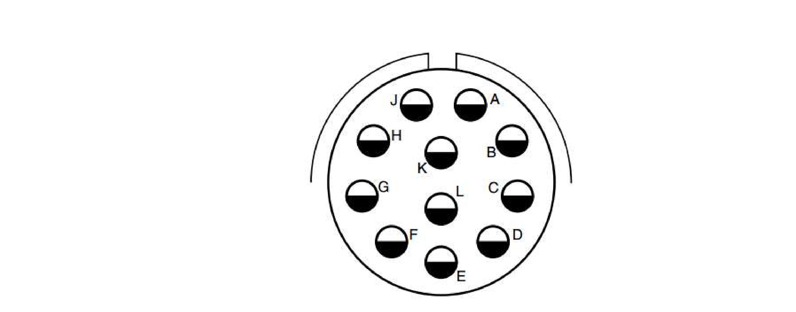

*Figure 15: J1 Power Connector Pin Arrangement ｜ 图 15：J1 电源连接器引脚排列*

**Table 8: J1 DC Power Connector Pin Allocation ｜ 表 8：J1 直流电源连接器引脚分配**

| J1-DC Power (21-11 insert, N-Keying) Sensor MIL-DTL-38999/M39029/58-365 (receptacle with pin inserts) Platform Umbilical MIL-DTL-38999/M39029/56-353 (plug with sockets inserts) J1 直流电源（21-11 插针排布，N 键位） 传感器 MIL-DTL-38999/M39029/58-365（带插针的插座） 平台脐带缆 MIL-DTL-38999/M39029/56-353（带插孔的插头） |  |  |  |  |  | EO-IR Turreted Sensor ／ 光电／红外转塔式传感器 | Radar/SAR Turreted Sensor ／ 雷达／SAR 转塔式传感器 | EW Sensor ／ 电子战传感器 | SIGINT Sensor ／ 信号情报传感器 | Comms ／ 通信 |
|---|---|---|---|---|---|---|---|---|---|---|
| Conn/ Desc. ／ 连接器／说明 | Pin ／ 引脚 | Wire Type ／ 导线类型 | Signal Name ／ 信号名 | Signal Source ／ 信号来源 | Signal Type ／ 信号类型 | Used ／ 使用 | Used ／ 使用 | Used ／ 使用 | Used ／ 使用 | Used ／ 使用 |
|  | D | SC-AWG12 | DC-1 | Platform ／ 平台 | 28V DC@15A | ✓ | ✓ | ✓ | ✓ | ✓ |
|  | E | SC-AWG12 | DC-1 RTN | Platform ／ 平台 | DC RTN | ✓ | ✓ | ✓ | ✓ | ✓ |
|  | F | SC-AWG12 | DC-2 | Platform ／ 平台 | 28V DC@15A | ✓ | ✓ | ✓ | ✓ | ✓ |
|  | L | SC-AWG12 | DC-2 RTN | Platform ／ 平台 | DC RTN | ✓ | ✓ | ✓ | ✓ | ✓ |
|  | C | SC-AWG12 | DC-3 | Platform ／ 平台 | 28V DC@15A | ✓ | ✓ | ✓ | ✓ | ✓ |
|  | G | SC-AWG12 | DC-3 RTN | Platform ／ 平台 | DC RTN | ✓ | ✓ | ✓ | ✓ | ✓ |
|  | K | SC-AWG12 | Chassis | Platform ／ 平台 | Ground | ✓ | ✓ | ✓ | ✓ | ✓ |
|  | A | SC-AWG12 | DC-4/PWRL | Platform ／ 平台 | 28V DC@15A | ✓ | ✓ | ✓ | ✓ | ✓ |
|  | J | SC-AWG12 | DC-4/PWRL RTN | Platform ／ 平台 | DC RTN | ✓ | ✓ | ✓ | ✓ | ✓ |

> 注：Contacts which are reserved, unused, or unallocated shall be populated by a dummy plug.

> **注**：保留的、未使用的或未分配的接触件，应以虚设插头填满。

> **译注**：表 8 与表 9 两表同此处理——引脚号（`Pin`）、线径（`Wire Type`）、信号名（`Signal Name`）、信号类型（`Signal Type`，含 `28V DC@15A`、`DC RTN`、`Ground`、`Open/Closed Ckt`、`RS422`、`1000BaseT`）与「使用」各格均为代码与电气值，一律不译；只有 `Conn/ Desc.`（连接器／说明）与 `Signal Source`（信号来源）两列的词组级短格并置中文。

5.2.2.1 Power The platform shall provide to the sensor system four channels of 28 VDC power sources in accordance with MIL-STD-704F with the fourth channel reserved for laser power in EO/IR systems. Conformance Methodology: (TBD)

5.2.2.1 电源 平台应依照 MIL-STD-704F 向传感器系统提供四路 28 VDC 电源，其中第四路在光电／红外系统中保留给激光器供电。符合性方法：(TBD)

<!-- 原书 p.74 ｜ PDF p.94 -->

Each of the four channels of 28 VDC shall be independently controlled. Conformance Methodology: (TBD) The platform shall be capable of supplying 15 amps steady state per each 28 VDC channel. Inrush current shall be limited to 25 amps for 2s with a 25% duty cycle. Conformance Methodology: (TBD) The sensor shall isolate power returns or neutral in accordance with MIL-STD-704F from the chassis. Conformance Methodology: (TBD)

四路 28 VDC 中的每一路均应独立控制。符合性方法：(TBD) 平台应能为每一路 28 VDC 通道提供 15 A 稳态电流。浪涌电流应限制为 25 A、持续 2 s，占空比 25%。符合性方法：(TBD) 传感器应依照 MIL-STD-704F 把电源回线或中性线相对机壳隔离。符合性方法：(TBD)

5.2.2.2 Safety Ground This contact shall be used to provide electrical continuity between the sensor system chassis and the host platform in accordance with MIL-STD-464. Conformance Methodology: (TBD)

5.2.2.2 安全地 该接触件应用于依照 MIL-STD-464 在传感器系统机壳与宿主平台之间提供电气连通。符合性方法：(TBD)

5.2.2.3 Laser Power The platform shall provide 28 VDC power for the laser in accordance with MIL-STD-704F. Conformance Methodology: (TBD) The laser power contacts shall be used to separately power a laser device. This is intended for use with a safety-relevant device such as a laser designator. Conformance Methodology: (TBD) The platform shall be capable of supplying 15 amps steady state for laser power. Inrush current shall be limited to 25 amps for 2s with a 25% duty cycle. Conformance Methodology: (TBD)

5.2.2.3 激光器电源 平台应依照 MIL-STD-704F 为激光器提供 28 VDC 电源。符合性方法：(TBD) 激光器电源接触件应用于单独为激光装置供电。此项意在用于与安全相关的装置，如激光指示器。符合性方法：(TBD) 平台应能为激光器电源提供 15 A 稳态电流。浪涌电流应限制为 25 A、持续 2 s，占空比 25%。符合性方法：(TBD)

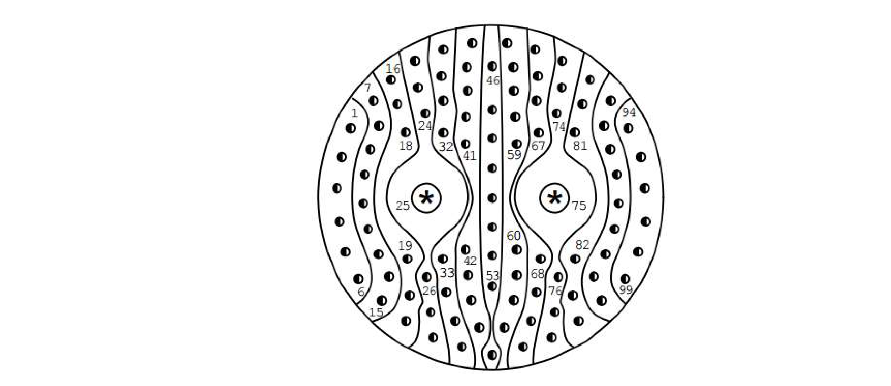

*Figure 16: J2 Signal Connector Pin Arrangement ｜ 图 16：J2 信号连接器引脚排列*

<!-- 原书 p.75 ｜ PDF p.95 -->

**Table 9: J2 Signals Connector Pin Allocation ｜ 表 9：J2 信号连接器引脚分配**

| SOSA Electrical Interface Recommendations J2-Signal (25-7 insert, N-Keying) Sensor MIL-DTL-38999/M39029/56-348 (receptacle with socket inserts) Platform Umbilical MIL-DTL-38999/M39029/58-360 (plug with pin inserts) SOSA 电气接口建议 J2 信号（25-7 插针排布，N 键位） 传感器 MIL-DTL-38999/M39029/56-348（带插孔的插座） 平台脐带缆 MIL-DTL-38999/M39029/58-360（带插针的插头） |  |  |  |  |  | EO-IR Turreted Sensor ／ 光电／红外转塔式传感器 | Radar/SAR Turreted Sensor ／ 雷达／SAR 转塔式传感器 | EW Sensor ／ 电子战传感器 | SIGINT Sensor ／ 信号情报传感器 | Comms ／ 通信 |
|---|---|---|---|---|---|---|---|---|---|---|
| Conn/ Desc. ／ 连接器／说明 | Pin ／ 引脚 | Wire Type ／ 导线类型 | Signal Name ／ 信号名 | Signal Source ／ 信号来源 | Signal Type ／ 信号类型 | Used ／ 使用 | Used ／ 使用 | Used ／ 使用 | Used ／ 使用 | Used ／ 使用 |
| Power Enable Discrete ／ 电源使能离散量 | 46 | STP 2419 | PWR_EN | Platform ／ 平台 | Open/Closed Ckt | ✓ | ✓ | ✓ | ✓ | ✓ |
|  | 47 | STP 2419 | PWR_EN_RTN | Platform ／ 平台 | Open/Closed Ckt | ✓ | ✓ | ✓ | ✓ | ✓ |
| Ethernet ／ 以太网 | 28 | 100Ω STP-2419 | DA+ | Platform/Sensor ／ 平台／传感器 | 1000BaseT | ✓ | ✓ | ✓ | ✓ | ✓ |
|  | 35 | 100Ω STP-2419 | DA- | Platform/Sensor ／ 平台／传感器 | 1000BaseT | ✓ | ✓ | ✓ | ✓ | ✓ |
|  | 36 | Shield | DA Shield | Platform/Sensor ／ 平台／传感器 |  | ✓ | ✓ | ✓ | ✓ | ✓ |
|  | 44 | 100Ω STP-2419 | DB+ | Platform/Sensor ／ 平台／传感器 | 1000BaseT | ✓ | ✓ | ✓ | ✓ | ✓ |
|  | 53 | 100Ω STP-2419 | DB- | Platform/Sensor ／ 平台／传感器 | 1000BaseT | ✓ | ✓ | ✓ | ✓ | ✓ |
|  | 62 | Shield | DB Shield | Platform/Sensor ／ 平台／传感器 |  | ✓ | ✓ | ✓ | ✓ | ✓ |
|  | 45 | 100Ω STP-2419 | DC+ | Platform/Sensor ／ 平台／传感器 | 1000BaseT | ✓ | ✓ | ✓ | ✓ | ✓ |
|  | 54 | 100Ω STP-2419 | DC- | Platform/Sensor ／ 平台／传感器 | 1000BaseT | ✓ | ✓ | ✓ | ✓ | ✓ |
|  | 63 | Shield | DC Shield | Platform/Sensor ／ 平台／传感器 |  | ✓ | ✓ | ✓ | ✓ | ✓ |
|  | 70 | 100Ω STP-2419 | DD+ | Platform/Sensor ／ 平台／传感器 | 1000BaseT | ✓ | ✓ | ✓ | ✓ | ✓ |
|  | 71 | 100Ω STP-2419 | DD- | Platform/Sensor ／ 平台／传感器 | 1000BaseT | ✓ | ✓ | ✓ | ✓ | ✓ |
|  | 78 | Shield | DD Shield | Platform/Sensor ／ 平台／传感器 |  | ✓ | ✓ | ✓ | ✓ | ✓ |
| Serial Comms 1 ／ 串行通信 1 | 7 | 100 Ohm STP 2419 | TX1+ | Sensor ／ 传感器 | RS422 | ✓ | ✓ | ✓ | ✓ | ✓ |
|  | 8 | 100 Ohm STP 2419 | TX1- | Sensor ／ 传感器 | RS422 | ✓ | ✓ | ✓ | ✓ | ✓ |
|  | 17 | SC-AWG24 | 422_1_RTN |  | RS422 | ✓ | ✓ | ✓ | ✓ | ✓ |
|  | 16 | 100 Ohm STP 2419 | RX1+ | Platform ／ 平台 | RS422 | ✓ | ✓ | ✓ | ✓ | ✓ |
|  | 23 | 100 Ohm STP 2419 | RX1- | Platform ／ 平台 | RS422 | ✓ | ✓ | ✓ | ✓ | ✓ |
| Serial Comms 2 ／ 串行通信 2 | 22 | 100 Ohm STP 2419 | TX2+ | Sensor ／ 传感器 | RS422 | ✓ | ✓ | ✓ | ✓ | ✓ |
|  | 30 | 100 Ohm STP 2419 | TX2- | Sensor ／ 传感器 | RS422 | ✓ | ✓ | ✓ | ✓ | ✓ |
|  | 29 | SC-AWG24 | 422_2_RTN |  | RS422 | ✓ | ✓ | ✓ | ✓ | ✓ |
|  | 37 | 100 Ohm STP 2419 | RX2+ | Platform ／ 平台 | RS422 | ✓ | ✓ | ✓ | ✓ | ✓ |
|  | 38 | 100 Ohm STP 2419 | RX2- | Platform ／ 平台 | RS422 | ✓ | ✓ | ✓ | ✓ | ✓ |
| Serial Comms 3 ／ 串行通信 3 | 55 | 100 Ohm STP 2419 | TX3+ | Sensor ／ 传感器 | RS422 | ✓ | ✓ | ✓ | ✓ | ✓ |
|  | 56 | 100 Ohm STP 2419 | TX3- | Sensor ／ 传感器 | RS422 | ✓ | ✓ | ✓ | ✓ | ✓ |
|  | 64 | SC-AWG24 | 422_1_RTN |  | RS422 | ✓ | ✓ | ✓ | ✓ | ✓ |
|  | 65 | 100 Ohm STP 2419 | RX3+ | Platform ／ 平台 | RS422 | ✓ | ✓ | ✓ | ✓ | ✓ |
|  | 72 | 100 Ohm STP 2419 | RX3- | Platform ／ 平台 | RS422 | ✓ | ✓ | ✓ | ✓ | ✓ |
| Serial Comms 4 ／ 串行通信 4 | 73 | 100 Ohm STP 2419 | TX4+ | Sensor ／ 传感器 | RS422 | ✓ | ✓ | ✓ | ✓ | ✓ |
|  | 79 | 100 Ohm STP 2419 | TX4- | Sensor ／ 传感器 | RS422 | ✓ | ✓ | ✓ | ✓ | ✓ |
|  | 80 | SC-AWG24 | 422_1_RTN |  | RS422 | ✓ | ✓ | ✓ | ✓ | ✓ |
|  | 85 | 100 Ohm STP 2419 | RX4+ | Platform ／ 平台 | RS422 | ✓ | ✓ | ✓ | ✓ | ✓ |
|  | 86 | 100 Ohm STP 2419 | RX4- | Platform ／ 平台 | RS422 | ✓ | ✓ | ✓ | ✓ | ✓ |
| Emission Arming ／ 发射解锁 | 2 | AWG22 | MASTER_ARM | Platform ／ 平台 | open/closed ckt | ✓ |  |  |  |  |
|  | 95 | AWG22 | MASTER_ARM_RET | Platform ／ 平台 | open/closed ckt | ✓ |  |  |  |  |

> 转写说明：第 1 行横幅单元格在原表横跨 Conn/Desc.～Signal Type 共 6 列，本表只在其首格填写，其余 5 格留空。Conn/Desc. 列在原表按组纵向合并，本表只在合并组首行填写、其余行留空：Power Enable Discrete 合并 2 行（46、47）；Ethernet 合并 12 行（28、35、36、44、53、62、45、54、63、70、71、78）；Serial Comms 1 合并 5 行（7、8、17、16、23）；Serial Comms 2 合并 5 行（22、30、29、37、38）；Serial Comms 3 合并 5 行（55、56、64、65、72）；Serial Comms 4 合并 5 行（73、79、80、85、86）；Emission Arming 合并 2 行（2、95）。
>
> 转写说明：第 16、23 行位于续页，续页重复了横幅与表头；其 Conn/Desc. 格在原表即为空白（沿用上页 Serial Comms 1 的合并区）。格内因列宽折行的文字按原顺序合并为一行（如 `100Ω STP-2419`、`100 Ohm STP 2419`、`Platform/Sensor`、`Emission Arming`、`MASTER_ARM`）。

Power 46 STP 2419 PWR EN Platform Open/Closed Ckt

电源 46 STP 2419 PWR EN 平台 开路／闭路

> **译注**：自本段起、至「原书 p.77」页锚之前的若干段，系表 9 各续页图版在英文转换时被逐行识别所留下的残块——横幅、数据行与页脚被割裂成多段，列序错乱、字词残缺（如 `Platforml` 当作 `Platform`、`1000Baser`／`100OBaseT`／`I000Baser` 当作 `1000BaseT`、`R8422` 当作 `RS422`、`MASTER AR` 当作 `MASTER_ARM`、`openlclosed ckt` 当作 `open/closed ckt`）。英文照录不改，中文按可辨字面逐段译出，未替原文纠错。

Enable

使能

Discrete

离散量

41 STP 2419 PWR EN RTN Platform Open/Closed Ckt

41 STP 2419 PWR EN RTN 平台 开路／闭路

Ethernet 28 1000 STP DA+ Platforml 1000Baser 2419 Sensor 35 1000 STP DA- Platforml 100OBaseT 2419 Sensor 36 Shield DA Shield Platforml Sensor 44 1008 STP DB+ Platform/ 1000Baser 2419 Sensor 53 1000 STP DB- Platform/ 100OBaseT 2419 Sensor Shield DB Shield Platforml Sensor 45 1000 STP DC+ Platform/ 1000Baser 2419 Sensor 54 1000 STP- DC Platforml 10OOBaseT 2419 Sensor 63 Shield DC Shield Platforml Sensor 70 1000 STP. DD+ Platforml I000Baser 2419 Sensor 1000 STP DD Platform/ 1000Baser 2419 Sensor 78 Shield DD Shield Platformml Sensor Serial 100 Ohm STP TX1+ Sensor RS422 Comms 2419

以太网 28 1000 STP DA+ 平台 1000Baser 2419 传感器 35 1000 STP DA- 平台 100OBaseT 2419 传感器 36 屏蔽 DA 屏蔽 平台 传感器 44 1008 STP DB+ 平台 1000Baser 2419 传感器 53 1000 STP DB- 平台 100OBaseT 2419 传感器 屏蔽 DB 屏蔽 平台 传感器 45 1000 STP DC+ 平台 1000Baser 2419 传感器 54 1000 STP- DC 平台 10OOBaseT 2419 传感器 63 屏蔽 DC 屏蔽 平台 传感器 70 1000 STP. DD+ 平台 I000Baser 2419 传感器 1000 STP DD 平台 1000Baser 2419 传感器 78 屏蔽 DD 屏蔽 平台 传感器 串行 100 欧姆 屏蔽双绞线 TX1+ 传感器 RS422 通信 2419

100 Ohm STP TX1 Sensor R8422

100 欧姆 屏蔽双绞线 TX1 传感器 R8422

17 SC-AWG24 422 1 RTN R8422

17 SC-AWG24 422 1 RTN R8422（原书残块，无可译内容）

<!-- 原书 p.76 ｜ PDF p.96 -->

16 100 Ohm STP RXI+ Platform RS422

16 100 欧姆 屏蔽双绞线 RXI+ 平台 RS422

23 100 Ohm STP RXI - Platform RS422

23 100 欧姆 屏蔽双绞线 RXI - 平台 RS422

Serial 22 100 Ohm STP TX2+ Sensor R8422 Comms 2419

串行 22 100 欧姆 屏蔽双绞线 TX2+ 传感器 R8422 通信 2419

30 100 Ohm STP TX2- Sensor RS422

30 100 欧姆 屏蔽双绞线 TX2- 传感器 RS422

29 SC-AWG24 422_2 RTN R8422 37 100 Ohm STP RX2t Platform R8422

29 SC-AWG24 422_2 RTN R8422 37 100 欧姆 屏蔽双绞线 RX2t 平台 R8422

38 100 Ohm STP RX2- Platform R8422

38 100 欧姆 屏蔽双绞线 RX2- 平台 R8422

Serial 55 100 Ohm STP TX3+ Sensor RS422 Comms 2419

串行 55 100 欧姆 屏蔽双绞线 TX3+ 传感器 RS422 通信 2419

56 100 Ohm STP TX3- Sensor RS422

56 100 欧姆 屏蔽双绞线 TX3- 传感器 RS422

64 SC-AWG24 422_1_RTN RS422 65 100 Ohm STP RX3+ Platform R8422

64 SC-AWG24 422_1_RTN RS422 65 100 欧姆 屏蔽双绞线 RX3+ 平台 R8422

72 100 Ohm STP RX3 - Platform RS422

72 100 欧姆 屏蔽双绞线 RX3 - 平台 RS422

Serial 73 100 Ohm STP TX4+ Sensor RS422 Comms 2419

串行 73 100 欧姆 屏蔽双绞线 TX4+ 传感器 RS422 通信 2419

79 100 Ohm STP TX4- Sensor R8422

79 100 欧姆 屏蔽双绞线 TX4- 传感器 R8422

80 SC-ATG24 422_1_ RTN RS422 85 100 Ohm STP RX4+ Platform RS422

80 SC-ATG24 422_1_ RTN RS422 85 100 欧姆 屏蔽双绞线 RX4+ 平台 RS422

86 100 Ohm STP RX4- Platform R8422

86 100 欧姆 屏蔽双绞线 RX4- 平台 R8422

Emi- AWG22 MASTER AR Platform openlclosed ckt SSion M

Emi- AWG22 MASTER AR 平台 开路／闭路 SSion M

Arming

解锁

95 AWG22 MASTER AR Platform openlclosed ckt

95 AWG22 MASTER AR 平台 开路／闭路

## M REI

> **译注**：上行为原书页面残块（`REI` 一词的识别残迹，原书此处属页脚／图版标记一类的重复字串），内容无实义、无从翻译；层级符号照原样保留，未并合、未删除。

<!-- 原书 p.77 ｜ PDF p.97 -->

SOSA Electrical Interface Recommendations

SOSA 电气接口建议

Jz-Signal (25-7 insert, N-Keying)

Jz-Signal（25-7 插针排布，N 键位）

- E0-I_ Radar/SAR Sensor MIL-DTL-38999/439029/56-348 (receptacle with socket inserts) Turreted Turreted EW SIGINT Platform Umbilical MIL-DTL-38999/039029/58-360 (plug with pin inserts) Sensor Sensor Sensor Sensor Comms Desc:Connl Pin Wire Type Signal Name SignalSource Signal Type Used Used Used Used Used

- E0-I_ 雷达／SAR 传感器 MIL-DTL-38999/439029/56-348（带插孔的插座） 转塔式 转塔式 电子战 信号情报 平台脐带缆 MIL-DTL-38999/039029/58-360（带插针的插头） 传感器 传感器 传感器 传感器 通信 Desc:Connl 引脚 导线类型 信号名 信号来源 信号类型 使用 使用 使用 使用 使用

> **译注**：自「原书 p.77」页锚起、至「原书 p.80」页锚之前的各段，系表 9 各续页图版顶部横幅与表头被反复识别所留下的残块；`S0SA`、`E0-I_`、`Jz-Signal`、`Desc:Connl`、`439029`／`039029`、`Manu-`／`facturer`、`Res-`／`erved`、`LVDSI`／`LVDSS` 等均为扫描残缺或断行脱落。英文照录不改，中文按可辨字面逐段译出，未替原文纠错。其中 `88,94`、`17 SC-AWG24 422 1 RTN R8422` 等段英文本身只有号码与代码、无字可译，中文侧只用括注标明其为残块。

<!-- 原书 p.78 ｜ PDF p.98 -->

S0SA Electrical Interface Recommendations

S0SA 电气接口建议

Jz-Signal (25-7 insert, N-Keying)

Jz-Signal（25-7 插针排布，N 键位）

- E0-I_ Radar/SAR Sensor MIL-DTL-38999/439029/56-348 (receptacle with socket inserts) Turreted Turreted EW SIGINT Platform Umbilical MIL-DTL-38999/039029/58-360 (plug with pin inserts) Sensor Sensor Sensor Sensor Comms

- E0-I_ 雷达／SAR 传感器 MIL-DTL-38999/439029/56-348（带插孔的插座） 转塔式 转塔式 电子战 信号情报 平台脐带缆 MIL-DTL-38999/039029/58-360（带插针的插头） 传感器 传感器 传感器 传感器 通信

Desc:Connl Pin Wire Type Signal Name SignalSource Signal Type Used Used Used Used Used

Desc:Connl 引脚 导线类型 信号名 信号来源 信号类型 使用 使用 使用 使用 使用

<!-- 原书 p.79 ｜ PDF p.99 -->

SOSA Electrical Interface Recommendations

SOSA 电气接口建议

Jz-Signal (25-7 insert, N-Keying)

Jz-Signal（25-7 插针排布，N 键位）

- E0-I_ Radar/SAR Sensor MIL-DTL-38999/439029/56-348 (receptacle with socket inserts) Turreted Turreted EW SIGINT Platform Umbilical MIL-DTL-38999/039029/58-360 (plug with pin inserts) Sensor Sensor Sensor Sensor Comms

- E0-I_ 雷达／SAR 传感器 MIL-DTL-38999/439029/56-348（带插孔的插座） 转塔式 转塔式 电子战 信号情报 平台脐带缆 MIL-DTL-38999/039029/58-360（带插针的插头） 传感器 传感器 传感器 传感器 通信

Desc:Connl Pin Wire Type Signal Name SignalSource Signal Type Used Used Used Used Used

Desc:Connl 引脚 导线类型 信号名 信号来源 信号类型 使用 使用 使用 使用 使用

LVDSI 26 100 Ohm STP

LVDSI 26 100 欧姆 屏蔽双绞线

LVDS2 18 100 Ohm STP

LVDS2 18 100 欧姆 屏蔽双绞线

LVDS3 50 100 Ohm STP

LVDS3 50 100 欧姆 屏蔽双绞线

LVDS4 83 100 Ohm STP

LVDS4 83 100 欧姆 屏蔽双绞线

LVDSS 92 100 Ohm STP

LVDSS 92 100 欧姆 屏蔽双绞线

Sensor 24,31 ATG24 SENMAN to Sensor Manu- 32,39 SENMAN_IO facturer 40,57 58,66 67,74 Res- 1,3,9, For arming erved 10,87 isolation

传感器 24,31 ATG24 SENMAN 至传感器制造商 Manu- 32,39 SENMAN_IO facturer 40,57 58,66 67,74 保留 Res- 1,3,9, 用于保险解除 erved 10,87 隔离

88,94

88,94（引脚号续行残块）

Unused 81,91

未使用 81,91

NOTE 1

注 1

- All reserved, unused, unallocated should be populated by a dummy plug. Digital data channels are to be tested for Return Loss and Near End Cross Talk (NEXT), including the connector interfaces to ensure conformance to protocol requirements. This should be applied to the Ethernet pairs, the Serial Comms 1-4 (RS422) pairs, as well as the LVDS (1-5) pairs.

- 全部保留的、未使用的、未分配的接触件宜以虚设插头填满。数字数据通道应测试回波损耗与近端串扰（NEXT），含连接器接口在内，以确保符合协议需求。此项宜适用于以太网各对、串行通信 1-4（RS422）各对，以及 LVDS（1-5）各对。

- Each signal group in Table 9 is described in more detail below. By convention of this standard, individual signal sets will have their own return line. This is done for Electromagnetic Compatibility (EMC) performance, as well as ease of platform integration.

- 表 9 中的每个信号组在下文有更详细的描述。按本标准的惯例，各个信号集各自带有回线。此举是为电磁兼容（EMC）性能，以及为便于平台集成。

- For logic levels, unless otherwise specified, “low” is defined to be safe. A voltage of greater than or equal to 18.0 VDC shall be interpreted as logic level ‘1’. A voltage level of less than or equal to 1.5 VDC shall be interpreted as logic ‘0’.

- 对于逻辑电平，除另有规定外，“低”定义为安全状态。大于或等于 18.0 VDC 的电压应解释为逻辑电平“1”。小于或等于 1.5 VDC 的电压电平应解释为逻辑“0”。

<!-- 原书 p.80 ｜ PDF p.100 -->

NOTE 2

注 2

Some acquisition programs may allow higher voltage levels to also be interpreted as logic '0'. A typical impetus for this would be the result of a system safety analysis. In such a case, it is recommended that the logic '0' threshold not exceed 15.0 VDC.

某些采办计划可能允许把更高的电压电平也解释为逻辑“0”。此事的典型推动因由会是系统安全分析的结果。在此种情形下，建议逻辑“0”的阈值不超过 15.0 VDC。

5.2.3.1 Power Enable

5.2.3.1 电源使能

The Power Enable signal is used for a controlled power up and shutdown of the sensor system. This control is necessary if the sensor system is required to execute a sequence of steps upon shutdown, steps that the sensor system would be precluded from executing if power were simply removed from the system. The Power Enable signal is controlled by the platform and when disabled, instructs the sensor to power down.

电源使能信号用于对传感器系统施行受控上电与关机。若要求传感器系统在关机时执行一串步骤，而这些步骤在只是把电源从系统上撤去的情况下会使传感器系统无法执行，则此项控制是必需的。电源使能信号由平台控制，且在被停用时指示传感器断电。

Power Enable is a switch, relay, or Solid State Relay (SSR) controlled by the platform (or human on the platform side of the interface). The switch goes across PWR_EN and PWR_EN_RTN. The sensor provides the voltage for this. Power Enable is disabled if an open circuit exists externally between the contacts (i.e., the switch is open). Power Enable is enabled if a closed circuit is externally applied between the contacts.

电源使能是一个由平台（或接口平台侧的人员）控制的开关、继电器或固态继电器（SSR）。该开关跨接于 PWR_EN 与 PWR_EN_RTN 之间。传感器为此提供电压。若各接触件之间在外部存在开路（即开关断开），则电源使能处于停用状态。若各接触件之间在外部施加闭路，则电源使能处于启用状态。

An open circuit for Power Enable shall have a resistance value greater than or equal to 100k Ω. A closed circuit for Power Enable shall have a resistance value less than 5 Ω. The maximum current shall be 100 mA. The maximum voltage shall be 30 VDC. Conformance Methodology: (TBD)

电源使能的开路，其电阻值应大于或等于 100k Ω。电源使能的闭路，其电阻值应小于 5 Ω。最大电流应为 100 mA。最大电压应为 30 VDC。符合性方法：(TBD)

##### 5.2.3.2 Ethernet Databus (Copper) 以太网数据总线（铜缆）

Gigabit Ethernet is an 8-wire (4 twisted-pair), 100 Ω connection.

千兆以太网是 8 线（4 对双绞线）、100 Ω 的连接。

The J2 Ethernet databus shall be implemented as Gigabit Ethernet. Conformance Methodology: (TBD)

J2 以太网数据总线应实现为千兆以太网。符合性方法：(TBD)

Gigabit Ethernet shall comply with IEEE 802.3-2008 for a 1000BaseT channel. The maximum cable length is 100 meters. Conformance Methodology: (TBD)

千兆以太网应就 1000BaseT 通道符合 IEEE 802.3-2008。最大电缆长度为 100 米。符合性方法：(TBD)

5.2.3.3 Serial Communications

5.2.3.3 串行通信

Up to four application-configurable serial communication ports are defined. Each port shall be compliant to TIA-422/RS422. It is expected that the first port will be used for a hand controller. It is expected that the latency of communication on this interface is critical, thus a more complex multi-layer protocol interface would not be practical.

定义了最多四个应用可配置的串行通信端口。每个端口应兼容 TIA-422/RS422。预期第一个端口将用于手持控制器。预期本接口上的通信时延至为关键，因此更复杂的多层协议接口不会实用。

These interfaces can also be used for integration with other equipment, such as moving map cueing and display systems.

这些接口也可用于与其他设备集成，例如移动地图引导与显示系统。

Note that a separate return line is included with each serial communications port for ease of platform integration.

注意，为便于平台集成，每个串行通信端口都附带一条单独的回线。

5.2.3.4 Arming and Cutouts

5.2.3.4 解保与切断

A set of ten pins is dedicated to control of energy emitting sensors such as the arming of laser devices, or RF transmission devices. This includes the selection of predefined laser suppression zone maps.

有一组十个引脚专用于能量发射型传感器的控制，例如激光器件的解保，或射频发射器件的解保。这包括选定预定义的激光抑制区图谱。

<!-- 原书 p.81 ｜ PDF p.101 -->

MASTER_ARM and MASTER_ARM_RTN are a pair of pins across a switch, relay, or SSR. In order to arm the emission device, the platform closes the switch which completes the circuit. The current which goes through it, and the voltage across it, come from the sensor. The sensor doesn’t generate its own voltage; it comes in from the platform via the power connector (this is the 28 VDC Laser Power). The platform shall provide a switch, relay, or SSR capable of handling 30 VDC with a maximum of 100mA current.

MASTER_ARM 与 MASTER_ARM_RTN 是跨接在一个开关、继电器或 SSR 上的一对引脚。为使发射器件解保，平台闭合该开关，从而接通电路。流过其中的电流与跨接其上的电压，均来自传感器。传感器并不自行产生电压；电压经电源连接器从平台引入（即 28 VDC 激光器电源）。平台应提供能够承受 30 VDC、电流最大 100mA 的开关、继电器或 SSR。

There are three No Emit Zone (NEZ) circuits. Each is a switch, relay, or SSR provided by, and independently controlled by, the platform. The three circuits have a common return (NEZ _SELECT_RTN). The platform shall provide a switch, relay, or SSR capable of handling 30 VDC for each of the three NEZ circuits. The platform shall be capable of independently controlling each of the three NEZ circuits.

有三路无发射区（NEZ）电路。每一路都是由平台提供并独立控制的开关、继电器或 SSR。这三路电路共用一个回线（NEZ _SELECT_RTN）。对三路 NEZ 电路中的每一路，平台应提供能够承受 30 VDC 的开关、继电器或 SSR。平台应能够独立控制这三路 NEZ 电路中的每一路。

There are three mode select signals using 28 VDC logic which are independently controlled by the platform. The three signals have a common return: MODE_SELECT_RTN.

有三个使用 28 VDC 逻辑的模式选择信号，由平台独立控制。这三个信号共用一个回线：MODE_SELECT_RTN。

SIMPLE ARMING – these pins form part of the power circuit for an emission device in the turret When the pins are open, power to the device is disabled; when close-circuited, power is enabled. The pins allow the integrator to connect a simple arming switch to these contacts. Pins 2 and 95 shall be used for Simple Arming.

简单解保——这些引脚构成转塔内某发射器件电源电路的一部分。引脚断开时，该器件的供电被停用；引脚短接时，供电被启用。这些引脚使集成方可以把一个简单的解保开关接到这些接触件上。引脚 2 与引脚 95 应用于简单解保。

ADVANCED ARMING CLUSTER 1 – sensor systems can have a NEZ, or Cutout Map The NEZ is a two-dimensional map, in azimuth and elevation, that defines where the device can and cannot emit. It is designed to inhibit emissions when the turret’s line-ofsight is over any part of the platform. This prevents energy from reflecting back, posing a hazard. The map is stored in the turret’s computer memory. Further, a turret may have several maps stored, enabling it to be mounted at several points on the platform, or on several platform models, without modification. In this case, a high-reliability mechanism is needed to select which map should be used. Pins 4, 5, 11, and 12 shall be used for Advanced Arming Cluster 1. Assuming that three of the four pins allocated to this function are used to select a map, up to four maps can be defined in the turret. The fourth pin would be used as a parity check for safety.

高级解保组 1——传感器系统可以有 NEZ，即切断图谱。NEZ 是一张二维图谱，以方位与俯仰定义器件可以在何处发射、不可在何处发射。它用于在转塔视线落在平台任何部位之上时抑制发射。这防止能量反射回来造成危害。图谱存储在转塔的计算机存储器中。此外，一个转塔可存储多张图谱，使其无需改动即可安装在平台上的多个位置，或安装在多个平台型号上。在此情形下，需要一个高可靠性的机制来选择宜用哪一张图谱。引脚 4、5、11 与 12 应用于高级解保组 1。假定分配给该功能的四个引脚中有三个用于选择图谱，则转塔中最多可定义四张图谱。第四个引脚将用作安全用的奇偶校验。

LASER ADVANCED ARMING CLUSTER 2 – these pins can be used in a number of ways They determine under what conditions or states the device will be used. For example, if there are multiple non-eyesafe lasers in a turret, these pins could be used to select one or more devices (secondary arm control). Pins 89, 90, 97, and 98 shall be used for advanced arming Cluster 2.

激光高级解保组 2——这些引脚可按多种方式使用。它们决定该器件将在哪些条件或状态下使用。例如，若一个转塔内有多个非眼安全的激光器，这些引脚可用于选定一个或多个器件（次级解保控制）。引脚 89、90、97 与 98 应用于高级解保组 2。

5.2.3.5 Emissions Annunciation

5.2.3.5 发射通报

The Emission signal shall be used to annunciate the firing of an emission device. Conformance

发射信号应用于通报发射器件的发射。符合性

Methodology: (TBD)

方法：(TBD)

This signal shall be a 28 VDC isolated signal. Conformance Methodology: (TBD)

本信号应为 28 VDC 的隔离信号。符合性方法：(TBD)

The maximum voltage shall be 30 VDC with a maximum current of 100mA. Conformance

最大电压应为 30 VDC，最大电流为 100mA。符合性

Methodology: (TBD)

方法：(TBD)

<!-- 原书 p.82 ｜ PDF p.102 -->

##### 5.2.3.6 Safety Status 安全状况

A set of three signal pairs is available to indicate the status of safety-relevant functions in the sensor system. These shall be 28 VDC isolated signals. These signals are controlled by the sensor. Conformance Methodology: (TBD) The maximum voltage shall be 30 VDC with a maximum current of 100mA. Conformance

有一组三个信号对，用于指示传感器系统中安全相关功能的状况。这些应为 28 VDC 的隔离信号。这些信号由传感器控制。符合性方法：(TBD) 最大电压应为 30 VDC，最大电流为 100mA。符合性

Methodology: (TBD)

方法：(TBD)

5.2.3.7 Enable Gimbal Movement

5.2.3.7 使能万向架运动

The Enable Gimbal Movement signal shall be used to indicate that the sensor system’s outer gimbal motors are to be enabled. Conformance Methodology: (TBD) This control is necessary to ensure that the turret does not move in azimuth and/or elevation at high speeds endangering individuals that may be working in close proximity to the sensor. The Enable Gimbal Movement signal originates from the sensor with the platform opening and closing the circuit. An open circuit shall indicate that the motors shall not be powered. Conformance Methodology: (TBD)

使能万向架运动信号应用于指示传感器系统的外万向架电机将被启用。符合性方法：(TBD) 该控制是必需的，以确保转塔不会以高速在方位和／或俯仰上运动，从而危及可能在传感器近旁作业的人员。使能万向架运动信号发自传感器，由平台断开与闭合该电路。开路应指示这些电机不应通电。符合性方法：(TBD)

##### 5.2.3.8 Time Synchronization – 1 PPS 时间同步——1 PPS

Wiring for a 1 PPS signal for time synchronization shall be provided. Conformance Methodology: (TBD) This signal shall be in accordance with the input time roll-over pulse (1 PPS) per ICD-GPS-

应为时间同步提供 1 PPS 信号的布线。符合性方法：(TBD) 本信号应符合 ICD-GPS- 所规定的输入时间翻转脉冲（1 PPS）

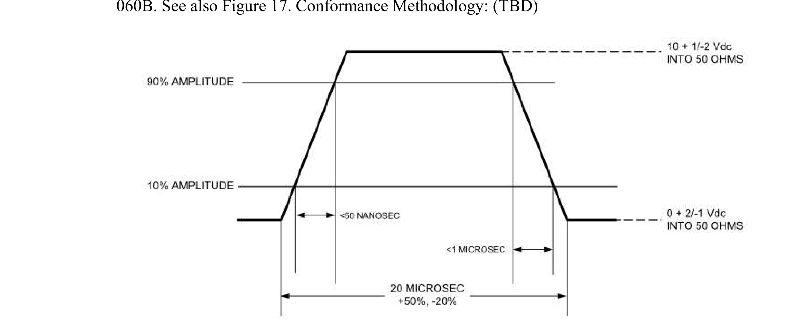

*Figure 17: Input Time Rollover Pulse (1 PPS) Signal Characteristics ｜ 图 17：输入时间翻转脉冲（1 PPS）信号特性*

5.2.3.9 Hand Controller Power

5.2.3.9 手持控制器电源

Power may be provided by the sensor to the hand controller. The maximum voltage shall be 30 VDC with a maximum current of 500mA. Conformance Methodology: (TBD)

传感器可向手持控制器供电。最大电压应为 30 VDC，最大电流为 500mA。符合性方法：(TBD)

<!-- 原书 p.83 ｜ PDF p.103 -->

5.2.3.10 Memory Purge

5.2.3.10 存储器清除

A switch closure between PURG_MEM_+ and PURG_MEM_- for 30 msec or more shall cause a memory to erase. Conformance Methodology: (TBD) The intention is for this to be routed to an encrypted drive for the clearing of mission data. Usage of this interface is implementation-specific and could be used to clear any memory that may be sensitive.

PURG_MEM_+ 与 PURG_MEM_- 之间闭合开关达 30 msec 或更久，应导致某存储器被擦除。符合性方法：(TBD) 其意图是将此接到加密驱动器，用于任务数据的清除。本接口的用法与实现相关，可用于清除任何可能敏感的存储器。

5.2.3.11 MIL-STD 1553B Twinax Inserts

5.2.3.11 MIL-STD 1553B 双轴插针排布

A set of two Size 8 Twinaxial contacts are available for MIL-STD-1553B. Pin 25 is intended for Bus A and pin 75 for Bus B.

有两个 8 号尺寸的双轴接触件可供 MIL-STD-1553B 使用。引脚 25 预定用于总线 A，引脚 75 用于总线 B。

5.2.3.12 USB Data Planned for a later version of the SOSA Technical Standard. A USB 2.0 interface shall optionally be provided by the sensor. Conformance Methodology: (TBD)

5.2.3.12 USB 数据。计划在 SOSA 技术标准的后续版本中给出。传感器应可选地提供 USB 2.0 接口。符合性方法：(TBD)

5.2.3.13 USB Power 5V +/- 5% up to 500mA shall be supplied by the sensor. Conformance Methodology: (TBD)

5.2.3.13 USB 电源。传感器应提供 5V +/- 5%、最高 500mA 的电源。符合性方法：(TBD)

5.2.3.14 LVDS These Low Voltage Differential Signal (LVDS) discrete signals are available to the sensor manufacturers for use between sensor elements.

5.2.3.14 LVDS。这些低电压差分信号（LVDS）离散信号可供传感器制造商在传感器各元素之间使用。

5.2.3.15 Sensor Manufacturer Pins A set of 10 pins are reserved for use by individual sensor system suppliers, primarily for maintenance purposes when the sensor is not connected to the platform. The platform shall not populate these pins. Conformance Methodology: (TBD)

5.2.3.15 传感器制造商引脚。有一组 10 个引脚保留给各传感器系统供应商使用，主要用于传感器未与平台连接时的维护目的。平台不应填充这些引脚。符合性方法：(TBD)

5.2.4 J3-Video (Copper) Connector The J3 Video Connector shall have a 21-11 pin arrangement as shown in Figure 18. Conformance Methodology: (TBD) Signals for the J3 Video Connector shall be assigned to pins in accordance with Table 10. Conformance Methodology: (TBD)

5.2.4 J3 视频（铜缆）连接器。J3 视频连接器应具有如图 18 所示的 21-11 插针排布。符合性方法：(TBD) J3 视频连接器的信号应按照表 10 分配到引脚。符合性方法：(TBD)

<!-- 原书 p.84 ｜ PDF p.104 -->

*Figure 18: J3 Video Connector Pin Arrangement ｜ 图 18：J3 视频连接器插针排布*

**Table 10: J3 Video Connector Pin Allocation ｜ 表 10：J3 视频连接器引脚分配**

| J3-Video (21-11 insert, N-Keying) Sensor: MIL-DTL-38999/M39029/75-416 (receptacle with socket inserts) Platform Umbilical: MIL-DTL-38999/M39029/28-211 (plug with pin inserts) J3 视频（21-11 插针排布，N 键位） 传感器：MIL-DTL-38999/M39029/75-416（插座，带插座接触件） 平台脐带：MIL-DTL-38999/M39029/28-211（插头，带插针接触件） |  |  |  |  | EO-IR Turreted Sensor ／ 光电／红外转塔式传感器 | Radar/SAR Turreted Sensor ／ 雷达／SAR 转塔式传感器 | EW Sensor ／ 电子战传感器 | SIGINT Sensor ／ 信号情报传感器 | Comms ／ 通信 |  |
|---|---|---|---|---|---|---|---|---|---|---|
| Pin 引脚 | Wire Type 线型 | Signal Name 信号名 | Signal Source 信号来源 | Signal Type 信号类型 | Used 使用 | Used 使用 | Used 使用 | Used 使用 | Used 使用 | Notes 说明 |
| A | Coax-75Ω | Digital Video Ch1 | Sensor | SMPTE 292/424 | ✓ |  |  |  | ✓ | For input from EO/IR sensor 用于来自光电／红外传感器的输入 |
| B | Coax-75Ω | Digital Video Ch2 | Sensor | SMPTE 292/424 | ✓ |  |  |  | ✓ | For input from EO/IR sensor 用于来自光电／红外传感器的输入 |
| C | Coax-75Ω | Digital Video Ch3 | Sensor | SMPTE 292/424 | ✓ |  |  |  | ✓ | For input from EO/IR sensor 用于来自光电／红外传感器的输入 |
| D | Coax-75Ω | Digital Video Ch4 | Sensor | SMPTE 292/424 | ✓ |  |  |  | ✓ | For input from EO/IR sensor 用于来自光电／红外传感器的输入 |
| E | Coax-75Ω | Analog video Ch1 Y | Sensor | RS-170a Video Luminance | ✓ |  |  |  | ✓ | For input from EO/IR sensor 用于来自光电／红外传感器的输入 |
| F | Coax-75Ω | Analog video Ch1 C | Sensor | RS-170a Video Chrominance | ✓ |  |  |  | ✓ | For input from EO/IR sensor 用于来自光电／红外传感器的输入 |
| G | Coax-75Ω | Composite Video Ch 1 | Sensor | RS-170a Composite Video | ✓ |  |  |  | ✓ | For input from EO/IR sensor 用于来自光电／红外传感器的输入 |
| H | Coax-75Ω | Composite Video Ch 2 | Sensor | RS-170a Composite Video | ✓ |  |  |  | ✓ | For input from EO/IR sensor 用于来自光电／红外传感器的输入 |
| J | Unused |  |  |  |  |  |  |  |  |  |
| K | Unused |  |  |  |  |  |  |  |  |  |
| L | Unused |  |  |  |  |  |  |  |  |  |

> 转写说明：第 1 行横幅单元格在原表横跨 Pin～Signal Type 共 5 列，本表只在其首格填写，其余 4 格留空；同行的 `Comms` 单元格在原表同时压住 Comms 与 Notes 两列（第 2 行的 `Used` 与 `Notes` 才分列），故第 1 行末格留空。第 8～12 行（H、J、K、L）位于续页，续页重复了横幅与表头。格内因列宽折行的文字按原顺序合并为一行（如 `Coax-75Ω`、`Digital Video Ch1`、`For input from EO/IR sensor`）。

> **译注**：上表之后自 `Pin TypeWire …` 起的若干段，是原书续页重复的横幅、表头与续行在转换时被打散后留下的残片（原书并未另起这些正文段）；英文照录不改，中文按残片字面逐片译出，`Coax-`、`SMPTE 292/424`、`750`、`Chl`、`I0GBase-SR4` 一类串属代码，原样保留。

Pin TypeWire Signal Name Signal Source Signal Type Used Used Used Used Used Notes

引脚 类型／线型 信号名 信号来源 信号类型 使用 使用 使用 使用 使用 说明

Coax- Digital Video Sensor SMPTE 292/424 For input 750 Chl from

同轴- 数字视频 传感器 SMPTE 292/424 用于来自 750 通道 1 的输入

EOIIR

光电／红外

SenSOr

传感器

B Coax- Digital Video Sensor SMPTE 292/424 For input 750 Ch2 from

B 同轴- 数字视频 传感器 SMPTE 292/424 用于来自 750 通道 2 的输入

EOIJ

光电／红外

Sensor

传感器

Coax- Digital Video Sensor SMPIE 292/424 For input 750 Ch3 from

同轴- 数字视频 传感器 SMPIE 292/424 用于来自 750 通道 3 的输入

EO/

光电／

Sensor

传感器

Coax- Digital Video Sensor SMPIE 292/424 For input 750 Ch4 froln

同轴- 数字视频 传感器 SMPIE 292/424 用于来自 750 通道 4 的输入

EO/J

光电／

Sensor

传感器

Coax- AnalogVideo Sensor RS-170a Video For input 750 Chl Y Luminance from

同轴- 模拟视频 传感器 RS-170a 视频 用于来自 750 通道 1 Y 亮度的输入

EO/IR

光电／红外

SensOr

传感器

Coax- Analog video Sensor RS-170a Video For input 750 Chl C Chrominance from

同轴- 模拟视频 传感器 RS-170a 视频 用于来自 750 通道 1 C 色度的输入

EO/IR

光电／红外

Sensor

传感器

Coax- Composite Sensor RS-170a For input 750 Video Ch 1 Composite Video from

同轴- 复合 传感器 RS-170a 用于来自 750 视频通道 1 复合视频的输入

EO/J

光电／

Sensor

传感器

<!-- 原书 p.85 ｜ PDF p.105 -->

J3-Video (21-11 insert, N-Keying) Sensor: MIL DTL-38999/039029/75-416 (receptacle with socket inserts)

J3 视频（21-11 插针排布，N 键位） 传感器：MIL DTL-38999/039029/75-416（插座，带插座接触件）

- R0-1 Radar/SAR Platform Umbilical: MIL-DTL-38999/039029/28-211 (plug with pin Turreted Turreted EW SIGINT inserts) Sensor Sensor Sensor Sensor Comms

- R0-1 雷达／SAR 平台脐带：MIL-DTL-38999/039029/28-211（插头，带插针 转塔式 转塔式 电子战 信号情报 接触件）传感器 传感器 传感器 传感器 通信

Pin TypeWire Signal Name Signal Source Signal Type Used Used Used Used Used Notes

引脚 类型／线型 信号名 信号来源 信号类型 使用 使用 使用 使用 使用 说明

H Coax- Composite Sensor RS-l70a For input 750 Video Ch 2 Composite Video from

H 同轴- 复合 传感器 RS-l70a 用于来自 750 视频通道 2 复合视频的输入

EO/JR

光电／红外

Sensor

传感器

Unused

未使用

K Unused

K 未使用

[ Unused Each digital channel shall comply with SMPTE 292, driving into 75 Ω #12 coax contacts, per the standard. Video channels can also be SMPTE 424M over the same wiring. Conformance Methodology: (TBD) Each analog channel shall comply with RS170a, driving into 75 Ω #12 coax contacts, per the standard. Conformance Methodology: (TBD)

[ 未使用 每个数字通道均应符合 SMPTE 292，按标准驱动到 75 Ω 的 #12 同轴接触件。视频通道也可在同一布线上采用 SMPTE 424M。符合性方法：(TBD) 每个模拟通道均应符合 RS170a，按标准驱动到 75 Ω 的 #12 同轴接触件。符合性方法：(TBD)

5.2.5 J4-Fiber Optics Connector Fiber optic shall be multi-mode fiber. The core diameter shall be 50µm ± 3µm and the cladding diameter shall be 125µm ± 2µm. Conformance Methodology: (TBD) The termini shall be butt end MIL-PRF-29504/4 (Pin) or MIL-PRF-29504/5 (Socket) which fit into size 16 entry holes. Conformance Methodology: (TBD) Ethernet Channels shall transmit and receive at 850nm per IEEE 802.3-2008 for 10GBASE-SR applications. Conformance Methodology: (TBD) SMPTE 297 Channels shall transmit low power SMPTE 292 or 424M signals at 1310nm specifically according to call out L-PC-CD-1310. Conformance Methodology: (TBD) Fiber used shall be OM2-compliant or better, as defined by ISO/IEC 11801. It is recommended that for longer path applications the cable be bend-insensitive OM4. Conformance Methodology: (TBD) The J4 Fiber Optic Connector shall have a 19-11 pin arrangement as shown in Figure 19. Conformance Methodology: (TBD) Signals for the J4 Fiber Optic Connector shall be assigned to pins in accordance with Table 11. Conformance Methodology: (TBD)

5.2.5 J4 光纤连接器。光纤应为多模光纤。纤芯直径应为 50µm ± 3µm，包层直径应为 125µm ± 2µm。符合性方法：(TBD) 端子应为对接端 MIL-PRF-29504/4（插针）或 MIL-PRF-29504/5（插座），其能装入 16 号插入孔。符合性方法：(TBD) 以太网通道应按 IEEE 802.3-2008 以 850nm 收发，用于 10GBASE-SR 应用。符合性方法：(TBD) SMPTE 297 通道应在 1310nm 上发射低功率 SMPTE 292 或 424M 信号，具体按标注 L-PC-CD-1310。符合性方法：(TBD) 所用光纤应符合 OM2 或更好，依 ISO/IEC 11801 的定义。对于路径较长的应用，推荐电缆采用弯曲不敏感的 OM4。符合性方法：(TBD) J4 光纤连接器应具有如图 19 所示的 19-11 插针排布。符合性方法：(TBD) J4 光纤连接器的信号应按照表 11 分配到引脚。符合性方法：(TBD)

<!-- 原书 p.86 ｜ PDF p.106 -->

*Figure 19: J4 Fiber Optic Connector Pin Arrangement ｜ 图 19：J4 光纤连接器插针排布*

**Table 11: J4 Fiber Optic Connector Pin Allocation ｜ 表 11：J4 光纤连接器引脚分配**

| SOSA Electrical Interface Recommendations J4-Fiber (19-11 insert, N-Keying) Sensor MIL-DTL-38999/29504/5 (receptacle with socket inserts) Platform Umbilical MIL-DTL-38999/29504/4 (plug with pin inserts) SOSA 电气接口建议 J4 光纤（19-11 插针排布，N 键位） 传感器 MIL-DTL-38999/29504/5（插座，带插座接触件） 平台脐带 MIL-DTL-38999/29504/4（插头，带插针接触件） |  |  |  |  | EO-IR Turreted Sensor ／ 光电／红外转塔式传感器 | Radar/SAR Turreted Sensor ／ 雷达／SAR 转塔式传感器 | EW Sensor ／ 电子战传感器 | SIGINT Sensor ／ 信号情报传感器 | Comms ／ 通信 |
|---|---|---|---|---|---|---|---|---|---|
| Pin 引脚 | Wire Type 线型 | Signal Name 信号名 | Signal Source 信号来源 | Signal Type 信号类型 | Used 使用 | Used 使用 | Used 使用 | Used 使用 | Used 使用 |
| A | MM Fiber | Sensor Transmit 1 | Sensor | 10GBase-SR/40GBase-SR4/100GBase-SR4 | ✓ | ✓ | ✓ | ✓ | ✓ |
| B | MM Fiber | Sensor Receive 1 | Platform | 10GBase-SR/40GBase-SR4/100GBase-SR4 | ✓ | ✓ | ✓ | ✓ | ✓ |
| C | MM Fiber | Sensor Transmit 2 | Sensor | 10GBase-SR/40GBase-SR4/100GBase-SR4 | ✓ | ✓ | ✓ | ✓ | ✓ |
| D | MM Fiber | Sensor Receive 2 | Platform | 10GBase-SR/40GBase-SR4/100GBase-SR4 | ✓ | ✓ | ✓ | ✓ | ✓ |
| E | MM Fiber | Sensor Transmit 3 | Sensor | 10GBase-SR/40GBase-SR4/100GBase-SR4 | ✓ | ✓ | ✓ | ✓ | ✓ |
| F | MM Fiber | Sensor Receive 3 | Platform | 10GBase-SR/40GBase-SR4/100GBase-SR4 | ✓ | ✓ | ✓ | ✓ | ✓ |
| G | MM Fiber | Sensor Transmit 4 | Sensor | 10GBase-SR/40GBase-SR4/100GBase-SR4 | ✓ | ✓ | ✓ | ✓ | ✓ |
| H | MM Fiber | Sensor Receive 4 | Platform | 10GBase-SR/40GBase-SR4/100GBase-SR4 | ✓ | ✓ | ✓ | ✓ | ✓ |
| J | MM Fiber | Video Ch 1 | Sensor | SMPTE 297 | ✓ |  |  |  |  |
| K | MM Fiber | Video Ch 2 | Sensor | SMPTE 297 | ✓ |  |  |  |  |
| L | MM Fiber | Video Ch 3 | Sensor | SMPTE 297 | ✓ |  |  |  |  |

> 转写说明：第 1 行横幅单元格在原表横跨 Pin～Signal Type 共 5 列，本表只在其首格填写，其余 4 格留空。第 10～11 行（K、L）位于续页，续页重复了横幅与表头。格内因列宽折行的文字按原顺序合并为一行（如 `MM Fiber`、`Sensor Receive 1`、`10GBase-SR/40GBase-SR4/100GBase-SR4`）。

Wire

线型

Pin Type Signal Name Signal Source Signal Type Used Used Used Used Used

引脚 类型 信号名 信号来源 信号类型 使用 使用 使用 使用 使用

MM Sensor Sensor I0GBase-SR/ Fiber Transmit L 40GBase-SR4/

MM 传感器 传感器 I0GBase-SR/ 光纤 发射 L 40GBase-SR4/

I00GBase-SR4

I00GBase-SR4（纯代码串，原样保留）

MM Sensor Receive Platform I0GBase-SR/ Fiber 1 40GBase-SR4/ 100GBase-SR4

MM 传感器 接收 平台 I0GBase-SR/ 光纤 1 40GBase-SR4/ 100GBase-SR4

MM Sensor Sensor IOGBase-SR/ Fiber Transmit 2 40GBase-SR4/ 100GBase-SR4

MM 传感器 传感器 IOGBase-SR/ 光纤 发射 2 40GBase-SR4/ 100GBase-SR4

MM Sensor Receive Platform I0GBase-SR/ Fiber 2 40GBase-SR4/

MM 传感器 接收 平台 I0GBase-SR/ 光纤 2 40GBase-SR4/

I0OGBase-SR4

I0OGBase-SR4（纯代码串，原样保留）

MM Sensor Sensor IOGBase-SR/ Fiber Transmit 3 40GBase-SR4/

MM 传感器 传感器 IOGBase-SR/ 光纤 发射 3 40GBase-SR4/

I0OGBase-SR4

I0OGBase-SR4（纯代码串，原样保留）

MM Sensor Receive Platform I0GBase-SR/ Fiber 3 40GBase-SR4/ 100GBase-SR4

MM 传感器 接收 平台 I0GBase-SR/ 光纤 3 40GBase-SR4/ 100GBase-SR4

MM Sensor Sensor I0GBase-SR/ Fiber Transmit 4 40GBase-SR4/

MM 传感器 传感器 I0GBase-SR/ 光纤 发射 4 40GBase-SR4/

I0OGBase-SR4

I0OGBase-SR4（纯代码串，原样保留）

MM Sensor Receive Platform I0GBase-SR/ Fiber 40GBase-SR4/ 100GBase-SR4

MM 传感器 接收 平台 I0GBase-SR/ 光纤 40GBase-SR4/ 100GBase-SR4

MM Video Ch Sensor SMPTE 297

MM 视频通道 传感器 SMPTE 297

Fiber

光纤

<!-- 原书 p.87 ｜ PDF p.107 -->

S0SA Electrical Interface Recommendations

S0SA 电气接口建议

J4-Riber (19-11 insert N-Keying)

J4-Riber（19-11 插针排布 N 键位）

- E0-I RadarlSAR Sensor MIL-DTL-38999/29504/5 (receptacle with socket inserts) Turreted Turreted EW SIGINT Platform Umbilical MIL-DTL-38999/29504/4 (plug with pin inserts) Sensor Sensor Sensor Sensor Comms Wire Pin Type Signal Name Signal Source SignalType Used Used Used Used Used k MM Video Ch 2 Sensor SMPIE 297 Fiber MM Video Ch 3 Sensor SMPTE 297

- E0-I 雷达／SAR 传感器 MIL-DTL-38999/29504/5（插座，带插座接触件）转塔式 转塔式 电子战 信号情报 平台脐带 MIL-DTL-38999/29504/4（插头，带插针接触件）传感器 传感器 传感器 传感器 通信 线型 引脚 类型 信号名 信号来源 信号类型 使用 使用 使用 使用 使用 k MM 视频通道 2 传感器 SMPIE 297 光纤 MM 视频通道 3 传感器 SMPTE 297

Fiber

光纤

#### 5.2.6 J5-GPS Antenna Connector J5 GPS 天线连接器

- When a GPS receiver internal to the sensor is being used and requires an external antenna, the J5 connector shall be used. Conformance Methodology: (TBD) These signals shall have characteristics that comply with AS6129 Appendix A (Additional Interface Requirements for GPS RF Signals). Conformance Methodology: (TBD) The J5 GPS Connector shall use TNC connectors. Conformance Methodology: (TBD)

- 当使用传感器内部的 GPS 接收机且需要外接天线时，应使用 J5 连接器。符合性方法：(TBD) 这些信号应具有符合 AS6129 附录 A（GPS 射频信号的附加接口需求）的特性。符合性方法：(TBD) J5 GPS 连接器应使用 TNC 连接器。符合性方法：(TBD)

**Table 12: J5 GPS Connector Pin Allocation ｜ 表 12：J5 GPS 连接器引脚分配**

| SOSA Electrical Interface Recommendations J5-GPS Ant (TNC) Sensor – Receptacle Platform Umbilical – Plug SOSA 电气接口建议 J5 GPS 天线（TNC） 传感器 – 插座 平台脐带 – 插头 |  |  |  |  | EO-IR Turreted Sensor ／ 光电／红外转塔式传感器 | Radar/SAR Turreted Sensor ／ 雷达／SAR 转塔式传感器 | EW Sensor ／ 电子战传感器 | SIGINT Sensor ／ 信号情报传感器 | Comms ／ 通信 |
|---|---|---|---|---|---|---|---|---|---|
| Pin 引脚 | Wire Type 线型 | Signal Name 信号名 | Signal Source 信号来源 | Signal Type 信号类型 | Used 使用 | Used 使用 | Used 使用 | Used 使用 | Used 使用 |
| Coaxial | Coax-50Ω | GPS Antenna | Platform | RF | ✓ | ✓ | ✓ | ✓ | ✓ |

> 转写说明：第 1 行横幅单元格在原表横跨 Pin～Signal Type 共 5 列，本表只在其首格填写，其余 4 格留空。横幅第 3、4 行中的横线为原表的短破折号（`–`）。格内因列宽折行的文字按原顺序合并为一行（如 `Coax-50Ω`）。

#### 5.2.7 J6-DC Auxiliary Power Connector J6 直流辅助电源连接器

- The J6 Auxiliary DC Power Connector shall have a 21-11 insert pattern as shown in Figure 20. Conformance Methodology: (TBD) Signals for the J6 Auxiliary DC Power Connector shall be assigned to pins in accordance with

- J6 辅助直流电源连接器应具有如图 20 所示的 21-11 插针排布。符合性方法：(TBD) J6 辅助直流电源连接器的信号应按照

> **译注**：本段英文止于 `in accordance with`（后无宾语）；原书此处接写 `Table 13.`，转换时该串被并入了其下的表题行（见 `**Table 13: Conformance Methodology: (TBD)**`），故中英两侧均照字面止于此，不作补。

**Table 13: Conformance Methodology: (TBD) ｜ 表 13：符合性方法：(TBD)**

| SOSA Electrical Interface Recommendations Sensor MIL-DTL-38999/M39029/58-365 (receptacle with pin inserts) Platform Umbilical MIL-DTL-38999/M39029/56-353 (plug with sockets inserts) SOSA 电气接口建议 传感器 MIL-DTL-38999/M39029/58-365（插座，带插针接触件） 平台脐带 MIL-DTL-38999/M39029/56-353（插头，带插座接触件） |  |  |  |  |  | EO-IR Turreted Sensor ／ 光电／红外转塔式传感器 | Radar/SAR Turreted Sensor ／ 雷达／SAR 转塔式传感器 | EW Sensor ／ 电子战传感器 | SIGINT Sensor ／ 信号情报传感器 | Comms ／ 通信 |
|---|---|---|---|---|---|---|---|---|---|---|
| Conn/ Desc. 连接器／说明 | Pin 引脚 | Wire Type 线型 | Signal Name 信号名 | Signal Source 信号来源 | Signal Type 信号类型 | Used 使用 | Used 使用 | Used 使用 | Used 使用 | Used 使用 |
|  | D | SC-AWG12 | DC-5 | Platform | 28V DC@15A | ✓ | ✓ | ✓ | ✓ | ✓ |
|  | E | SC-AWG12 | DC-5 RTN | Platform | DC RTN | ✓ | ✓ | ✓ | ✓ | ✓ |
|  | F | SC-AWG12 | DC-6 | Platform | 28V DC@15A | ✓ | ✓ | ✓ | ✓ | ✓ |
|  | L | SC-AWG12 | DC-6 RTN | Platform | DC RTN | ✓ | ✓ | ✓ | ✓ | ✓ |
|  | C | SC-AWG12 | DC-7 | Platform | 28V DC@15A | ✓ | ✓ | ✓ | ✓ | ✓ |
|  | G | SC-AWG12 | DC-7 RTN | Platform | DC RTN | ✓ | ✓ | ✓ | ✓ | ✓ |
|  | K | SC-AWG12 | Chassis | Platform | Ground | ✓ | ✓ | ✓ | ✓ | ✓ |
|  | A | SC-AWG12 | DC-8 | Platform | 28V DC@15A | ✓ | ✓ | ✓ | ✓ | ✓ |
|  | J | SC-AWG12 | DC-8 RTN | Platform | DC RTN | ✓ | ✓ | ✓ | ✓ | ✓ |
|  | B | SC-AWG12 | DC-9 | Platform | 28V DC@15A | ✓ | ✓ | ✓ | ✓ | ✓ |
|  | H | SC-AWG12 | DC-9 RTN | Platform | DC RTN | ✓ | ✓ | ✓ | ✓ | ✓ |

> 转写说明：第 1 行横幅单元格在原表横跨 Conn/Desc.～Signal Type 共 6 列，本表只在其首格填写，其余 5 格留空。Conn/Desc. 列的原表各行均为空白单元格（未合并、未填内容），本表按空白照录。

<!-- 原书 p.88 ｜ PDF p.108 -->

*Figure 20: J6 Auxiliary Power Connector Pin Arrangement ｜ 图 20：J6 辅助电源连接器插针排布*

SC-AWGI2 DC 5 Platform 28VDC@ISA [ SC-AWG12 DC-5 RTN Platform DC RTN - SC-AWGI2 DC-6 Platform 28VDC@ISA SC-AWG12 DC-6 RTN Platform DC RTN SC-AWGI2 DC 7 Platformm 28VDC@ISA SC-AWGI2 DC-7 RTN Platform DC RTN k SC-AWGI2 Chassis Platformm Ground SC-AWGI12 DC 8 Platform 28VDC@ISA SC-AWGI2 DC-8 RTN Platform DC RTN B SC-AWG12 DC-9 Platform 28VDC@ISA S SC-AWGI2 DC-9 RTN Platform DC RTN

SC-AWGI2 DC 5 平台 28VDC@ISA [ SC-AWG12 DC-5 RTN 平台 DC RTN - SC-AWGI2 DC-6 平台 28VDC@ISA SC-AWG12 DC-6 RTN 平台 DC RTN SC-AWGI2 DC 7 平台m 28VDC@ISA SC-AWGI2 DC-7 RTN 平台 DC RTN k SC-AWGI2 机箱 平台m 地 SC-AWGI12 DC 8 平台 28VDC@ISA SC-AWGI2 DC-8 RTN 平台 DC RTN B SC-AWG12 DC-9 平台 28VDC@ISA S SC-AWGI2 DC-9 RTN 平台 DC RTN

5.2.7.1 Power

5.2.7.1 电源

- The platform shall provide to the sensor system up to five channels of 28 VDC power sources in accordance with MIL-STD-704F. Conformance Methodology: (TBD) Each of the five channels of 28 VDC shall be independently controlled. Conformance

- 平台应向传感器系统提供最多五路符合 MIL-STD-704F 的 28 VDC 电源。符合性方法：(TBD) 五路 28 VDC 中的每一路都应被独立控制。符合性

Methodology: (TBD)

方法：(TBD)

<!-- 原书 p.89 ｜ PDF p.109 -->

The platform shall be capable of supplying 15 amps steady state per each 28 VDC channel. Conformance Methodology: (TBD) Inrush current shall be limited to 25 amps for 2s with a 25% duty cycle. Conformance Methodology: (TBD) The sensor shall isolate power returns or neutral in accordance with MIL-STD-704F from the chassis. Conformance Methodology: (TBD)

平台应能够为每一路 28 VDC 通道提供 15 安的稳态供电。符合性方法：(TBD) 浪涌电流应限制为 2s 内 25 安、25% 占空比。符合性方法：(TBD) 传感器应按照 MIL-STD-704F，把电源回线或中性线与机箱隔离。符合性方法：(TBD)

##### 5.2.7.2 Safety Ground 安全地

This contact shall be used to provide electrical continuity between the sensor system chassis and the host platform in accordance with MIL-STD-464. Conformance Methodology: (TBD)

本接触件应用于按照 MIL-STD-464，在传感器系统机箱与宿主平台之间提供电气连通性。符合性方法：(TBD)

#### 5.2.8 J7-High Speed Connector ｜ 5.2.8 J7 高速连接器

The J7 High Speed Connector is currently being defined to support high-speed electrical interfaces such as 10Gig Ethernet, USB 3.0, and DisplayPort. Details will be added in a future version. Planned for a later version of the SOSA Technical Standard.

J7 高速连接器目前正在定义之中，用以支持如 10Gig 以太网、USB 3.0 与 DisplayPort 等高速电气接口。细节将在后续版本中补充。本项计划在 SOSA 技术标准的后续版本中给出。

**Table 14: J7 Pin Allocations ｜ 表 14：J7 引脚分配**

| SOSA Electrical Interface Recommendations SOSA 电气接口建议 J7-High Speed Electrical J7 高速电气 Sensor XXXXXXXXXXXXx 传感器 XXXXXXXXXXXXx (receptacle with pin inserts) （插座，带插针接触件） Platform Umbilical XXXXXXXXXXXX 平台脐带 XXXXXXXXXXXX (plug with sockets inserts) （插头，带插座接触件） | | | | | | EO-IR Turreted Sensor ／ 光电／红外转塔式传感器 | Radar/SAR Turreted Sensor ／ 雷达／SAR 转塔式传感器 | EW Sensor ／ 电子战传感器 | SIGINT Sensor ／ 信号情报传感器 | Comms ／ 通信 |
|---|---|---|---|---|---|---|---|---|---|---|
| Conn/ Desc. 连接器／说明 | Pin 引脚 | Wire Type 线型 | Signal Name 信号名 | Signal Source 信号来源 | Signal Type 信号类型 | Used 使用 | Used 使用 | Used 使用 | Used 使用 | Used 使用 |
| TBD | | | | | | | | | | |

> 转写说明：原表表头为两行——第一行左起 6 列（Conn/ Desc.~Signal Type 上方）是一个**跨 6 列的合并单元格**（灰色块），其文字照录于第 1 格，被其覆盖的其余 5 格留空；第 7~11 列第一行为传感器名、第二行为 “Used”，此处分列为表头行与紧跟的一行（即原表头第二行），不另设分隔线。
>
> 表体仅 1 行：第 1 格作 “TBD”，其余 10 格原为空。本表在 p.90 内完整，未跨页。
>
> 占位符逐字计数：第 3 行为 “Sensor” ＋ 12 个大写 X ＋ 1 个小写 x（合计 13 个 X 字形，末位原书即作小写）；第 5 行为 “Platform Umbilical” ＋ 12 个大写 X（第 6 行 “(plug with sockets inserts)” 中的 “sockets” 原书为复数，照录）。

TBD

待定（TBD）

##### 5.2.8.1 Description ｜ 5.2.8.1 说明

Planned for a later version of the SOSA Technical Standard.

计划在 SOSA 技术标准的后续版本中给出。

#### 5.2.9 J8-High Density RF Connector ｜ 5.2.9 J8 高密度射频连接器

The J8 RF Connector shall have a 25-19 insert pattern as shown in Figure 21. Conformance Methodology: (TBD) Signals for the J8 RF Connector shall be assigned to pins in accordance with Table 15. Conformance Methodology: (TBD)

J8 射频连接器应具有 25-19 插针排布，如图 21 所示。符合性方法：（TBD）J8 射频连接器的信号应按照表 15 分配到引脚。符合性方法：（TBD）

<!-- 原书 p.90 ｜ PDF p.110 -->

*Figure 21: J8 RF Connector Pin Arrangement ｜ 图 21：J8 射频连接器引脚排布*

**Table 15: J8 RF Pin Allocations ｜ 表 15：J8 射频引脚分配**

| SOSA Electrical Interface Recommendations SOSA 电气接口建议 J8-RF (25-19 insert, N-Keying) J8-RF（25-19 插针排布，N 键位） Antenna MIL-DTL-38999/20FJ19SN (receptacle with socket inserts) 天线 MIL-DTL-38999/20FJ19SN（插座，带插座接触件） Platform Umbilical MIL-DTL-38999/26FJ19PN (plug with pin inserts) 平台脐带 MIL-DTL-38999/26FJ19PN（插头，带插针接触件） | | | | | | EO-IR Turreted Sensor ／ 光电／红外转塔式传感器 | Radar/SAR Turreted Sensor ／ 雷达／SAR 转塔式传感器 | EW Sensor ／ 电子战传感器 | SIGINT Sensor ／ 信号情报传感器 | Comms ／ 通信 |
|---|---|---|---|---|---|---|---|---|---|---|
| Conn/ Desc. 连接器／说明 | Pin 引脚 | Wire Type 线型 | Signal Name 信号名 | Signal Source 信号来源 | Signal Type 信号类型 | Used 使用 | Used 使用 | Used 使用 | Used 使用 | Used 使用 |
| RF | A | Coax-50Ω | Ch1 | Antenna | RF up to 18Ghz | | ✓ | ✓ | ✓ | ✓ |
| | B | Coax-50Ω | Ch2 | Antenna | RF up to 18Ghz | | ✓ | ✓ | ✓ | ✓ |
| | C | Coax-50Ω | Ch3 | Antenna | RF up to 18Ghz | | ✓ | ✓ | ✓ | ✓ |
| | D | Coax-50Ω | Ch4 | Antenna | RF up to 18Ghz | | ✓ | ✓ | ✓ | ✓ |
| | E | Coax-50Ω | Ch5 | Antenna | RF up to 18Ghz | | ✓ | ✓ | ✓ | ✓ |
| | F | Coax-50Ω | Ch6 | Antenna | RF up to 18Ghz | | ✓ | ✓ | ✓ | ✓ |
| | G | Coax-50Ω | Ch7 | Antenna | RF up to 18Ghz | | ✓ | ✓ | ✓ | ✓ |
| | H | Coax-50Ω | Ch8 | Antenna | RF up to 18Ghz | | ✓ | ✓ | ✓ | ✓ |
| | J | Coax-50Ω | Ch9 | Antenna | RF up to 18Ghz | | ✓ | ✓ | ✓ | ✓ |
| | K | Coax-50Ω | Ch10 | Antenna | RF up to 18Ghz | | ✓ | ✓ | ✓ | ✓ |
| | L | Coax-50Ω | Ch11 | Antenna | RF up to 18Ghz | | ✓ | ✓ | ✓ | ✓ |
| | M | Coax-50Ω | Ch12 | Antenna | RF up to 18Ghz | | ✓ | ✓ | ✓ | ✓ |
| | N | Coax-50Ω | Ch13 | Antenna | RF up to 18Ghz | | ✓ | ✓ | ✓ | ✓ |
| | P | Coax-50Ω | Ch14 | Antenna | RF up to 18Ghz | | ✓ | ✓ | ✓ | ✓ |
| | R | Coax-50Ω | Ch15 | Antenna | RF up to 18Ghz | | ✓ | ✓ | ✓ | ✓ |
| | S | Coax-50Ω | Ch16 | Antenna | RF up to 18Ghz | | ✓ | ✓ | ✓ | ✓ |
| | T | Coax-50Ω | Ch17 | Antenna | RF up to 18Ghz | | ✓ | ✓ | ✓ | ✓ |
| | U | Coax-50Ω | Ch18 | Antenna | RF up to 18Ghz | | ✓ | ✓ | ✓ | ✓ |
| | V | Coax-50Ω | Ch19 | Antenna | RF up to 18Ghz | | ✓ | ✓ | ✓ | ✓ |

> 转写说明：原表表头为两行——第一行左起 6 列（Conn/ Desc.~Signal Type 上方）是一个**跨 6 列的合并单元格**（灰色块），其文字照录于第 1 格，被其覆盖的其余 5 格留空；第 7~11 列第一行为传感器名、第二行为 “Used”，此处分列为表头行与紧跟的一行（即原表头第二行），不另设分隔线。
>
> 合并单元格：第 1 列 Conn/ Desc. 的 “RF” 在原表跨全部 19 行合并，仅记于首个数据行（Pin A），其下 18 行该格留空。
>
> 跨页：本表自 p.91 起、在 p.92 续完（S、T、U、V 四行为续页行）；续页重复的完整表头（含灰色块与 “Used” 行）已并入本文件首两行表头，不另记。
>
> 表体 19 行，Pin 依次为 A、B、C、D、E、F、G、H、J、K、L、M、N、P、R、S、T、U、V（原书无 I、O、Q 三个字母）；Signal Name 依次为 Ch1~Ch19，与 Pin 一一对应。Signal Type 全文均作 “RF up to 18Ghz”（“Ghz” 大小写照录，非 “GHz”）。

RF A Coax-508 Chl Antenna RF up to 18Gh2 B Coax-50Q Ch2 Antenna RF up to 18Gh2 Coax-50Q Ch3 Antenna RF up to 18Gh2

射频 A Coax-508 Chl 天线 射频最高 18Gh2 B Coax-50Q Ch2 天线 射频最高 18Gh2 Coax-50Q Ch3 天线 射频最高 18Gh2

> **译注**：以下数段残句（至 §5.2.12.1 之前）是英文转换件把表体逐格文字按阅读顺序串成的结果，非原书正文；其中 `Coax-508`、`Chl`、`40OHZ`、`I2AWG`、`S0SA` 等系 OCR 错认，英文照录、中文照字面译，码串与错认字形一律原样保留。表 15～18 已逐格录出，内容以表为准。

D Coax-50Q Ch4 Antenna RF UP to 186h2 Coax- 508 Chs Antenna RF up to 18Gh2 } Coax-508 Ch6 Antenna RF up to 18662 6 Coax-50Q Ch7 Antenna RF up to 18Gh2 I Coax-50Q Ch8 Antenna RF up to 18612 Coax- 508 Chg Antenna RF up to 18Ghz & Coax-508 Chl0 Antenna RF up to 18662 [ Coax-50Q Chll Antenna RF up to 186h2 M Coax-508 Chl2 Antenna RF up to 186h2 N Coax-50Q Chl3 Antenna RF up to 18Gh2 P Coax-508 Chl4 Antenna RF uP to 18Gh2 R Coax- 508 Chl5 Antenna RF up to 186h2

D Coax-50Q Ch4 天线 射频最高 186h2 Coax- 508 Chs 天线 射频最高 18Gh2 } Coax-508 Ch6 天线 射频最高 18662 6 Coax-50Q Ch7 天线 射频最高 18Gh2 I Coax-50Q Ch8 天线 射频最高 18612 Coax- 508 Chg 天线 射频最高 18Ghz & Coax-508 Chl0 天线 射频最高 18662 [ Coax-50Q Chll 天线 射频最高 186h2 M Coax-508 Chl2 天线 射频最高 186h2 N Coax-50Q Chl3 天线 射频最高 18Gh2 P Coax-508 Chl4 天线 射频最高 18Gh2 R Coax- 508 Chl5 天线 射频最高 186h2

<!-- 原书 p.91 ｜ PDF p.111 -->

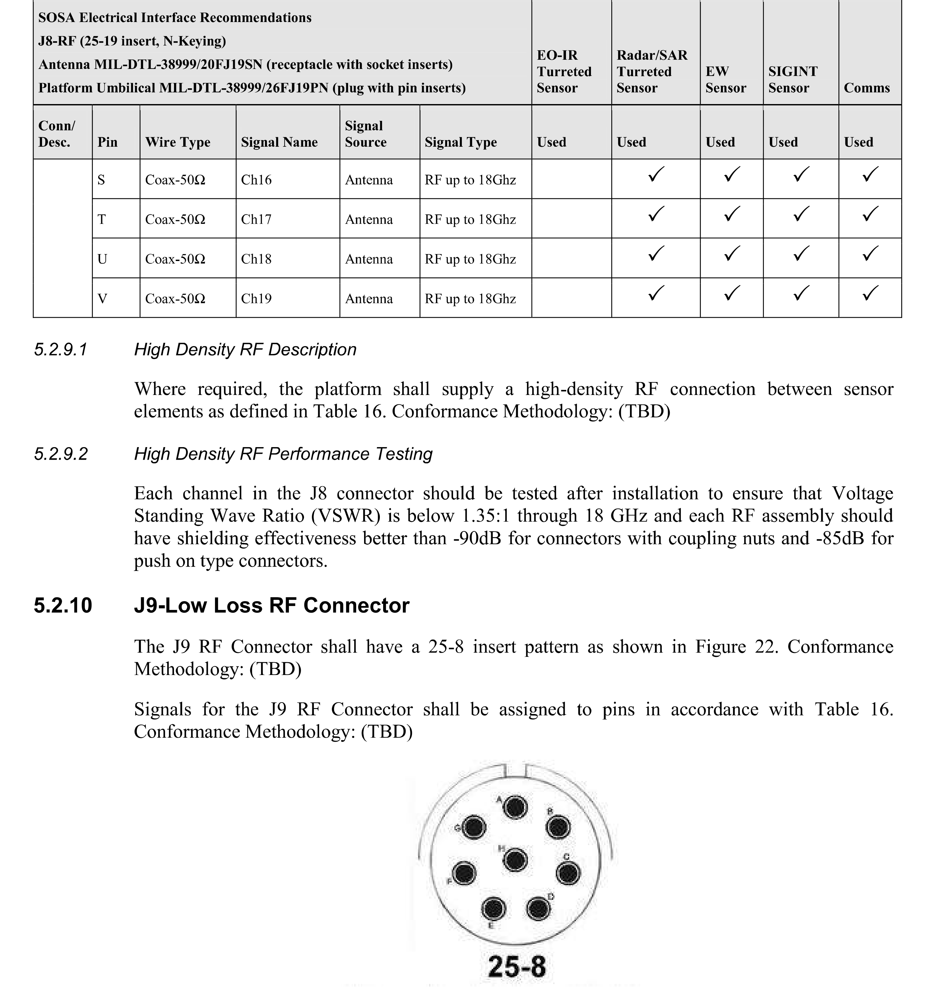

*Figure 22: J9 RF Connector Pin Arrangement ｜ 图 22：J9 射频连接器引脚排布*

<!-- 原书 p.92 ｜ PDF p.112 -->

**Table 16: J9 RF Pin Allocation ｜ 表 16：J9 射频引脚分配**

| SOSA Electrical Interface Recommendations SOSA 电气接口建议 J9-RF (25-8 insert, N-Keying) J9-RF（25-8 插针排布，N 键位） Antenna MIL-DTL-38999/20FJ19SN (receptacle with socket inserts) 天线 MIL-DTL-38999/20FJ19SN（插座，带插座接触件） Platform Umbilical MIL-DTL-38999/26FJ19PN (plug with pin inserts) 平台脐带 MIL-DTL-38999/26FJ19PN（插头，带插针接触件） | | | | | | EO-IR Turreted Sensor ／ 光电／红外转塔式传感器 | Radar/SAR Turreted Sensor ／ 雷达／SAR 转塔式传感器 | EW Sensor ／ 电子战传感器 | SIGINT Sensor ／ 信号情报传感器 | Comms ／ 通信 |
|---|---|---|---|---|---|---|---|---|---|---|
| Conn/ Desc. 连接器／说明 | Pin 引脚 | Wire Type 线型 | Signal Name 信号名 | Signal Source 信号来源 | Signal Type 信号类型 | Used 使用 | Used 使用 | Used 使用 | Used 使用 | Used 使用 |
| RF | A | Coax-50Ω | Ch1 | Antenna | RF up to 18Ghz | | ✓ | ✓ | ✓ | ✓ |
| | B | Coax-50Ω | Ch2 | Antenna | RF up to 18Ghz | | ✓ | ✓ | ✓ | ✓ |
| | C | Coax-50Ω | Ch3 | Antenna | RF up to 18Ghz | | ✓ | ✓ | ✓ | ✓ |
| | D | Coax-50Ω | Ch4 | Antenna | RF up to 18Ghz | | ✓ | ✓ | ✓ | ✓ |
| | E | Coax-50Ω | Ch5 | Antenna | RF up to 18Ghz | | ✓ | ✓ | ✓ | ✓ |
| | F | Coax-50Ω | Ch6 | Antenna | RF up to 18Ghz | | ✓ | ✓ | ✓ | ✓ |
| | G | Coax-50Ω | Ch7 | Antenna | RF up to 18Ghz | | ✓ | ✓ | ✓ | ✓ |
| | H | Coax-50Ω | Ch8 | Antenna | RF up to 18Ghz | | ✓ | ✓ | ✓ | ✓ |

> 转写说明：原表表头为两行——第一行左起 6 列（Conn/ Desc.~Signal Type 上方）是一个**跨 6 列的合并单元格**（灰色块），其文字照录于第 1 格，被其覆盖的其余 5 格留空；第 7~11 列第一行为传感器名、第二行为 “Used”，此处分列为表头行与紧跟的一行（即原表头第二行），不另设分隔线。
>
> 合并单元格：第 1 列 Conn/ Desc. 的 “RF” 在原表跨全部 8 行合并，仅记于首个数据行（Pin A），其下 7 行该格留空。
>
> 表体 8 行，Pin 依次为 A~H，Signal Name 依次为 Ch1~Ch8。本表在 p.93 内完整（紧随 5.2.10.1 正文），未跨页。

**Table 17: Auxiliary RF Connections ｜ 表 17：辅助射频连接**

| Auxiliary RF Connectors – Quantity is Application-Specific 辅助射频连接器 – 数量视应用而定 | | | | | | EO-IR Turreted Sensor ／ 光电／红外转塔式传感器 | Radar/SAR Turreted Sensor ／ 雷达／SAR 转塔式传感器 | EW Sensor ／ 电子战传感器 | SIGINT Sensor ／ 信号情报传感器 | Comms ／ 通信 |
|---|---|---|---|---|---|---|---|---|---|---|
| Conn/ Desc. 连接器／说明 | Pin 引脚 | Wire Type 线型 | Signal Name 信号名 | Signal Source 信号来源 | Signal Type 信号类型 | Used 使用 | Used 使用 | Used 使用 | Used 使用 | Used 使用 |
| TNC | | RG142 50Ω | | Antenna | RF up to 3 Ghz | | ✓ | ✓ | ✓ | ✓ |
| SMA | | RG174 50Ω | | Antenna | RF up to 27 Ghz | | ✓ | ✓ | ✓ | ✓ |
| 2.4 mm | | Coax-50Ω | | Antenna | RF up to 50 Ghz | | ✓ | ✓ | ✓ | ✓ |
| 1.0 mm | | Coax-50Ω | | Antenna | RF up to 110 Ghz | | ✓ | ✓ | ✓ | ✓ |

> 转写说明：原表表头为两行——第一行左起 6 列（Conn/ Desc.~Signal Type 上方）是一个**跨 6 列的合并单元格**（灰色块），其文字 “Auxiliary RF Connectors – Quantity is Application-Specific” 照录于第 1 格（“–” 为原书的短破折号），被其覆盖的其余 5 格留空；第 7~11 列第一行为传感器名、第二行为 “Used”，此处分列为表头行与紧跟的一行（即原表头第二行），不另设分隔线。
>
> 表体 4 行；第 2 列 Pin 与第 4 列 Signal Name 在原表中全部为空，照录留空。
>
> 跨页：本表自 p.93 起、在 p.94 续完（“1.0 mm” 一行为续页行，其 Signal Type 格内 “RF up to 110 / Ghz” 为原表格内折行，此处以空格连接）；续页重复的完整表头已并入本文件首两行表头，不另记。

TNC RGI42508 Antenna RE up to 3 Ghz SMA RG174500 Antenna RF up to 27 Ghz

TNC RGI42508 天线 射频最高 3 Ghz SMA RG174500 天线 射频最高 27 Ghz

2.4 mm Coax-508 Antenna RF up to 50 Ghz

2.4 mm 同轴 Coax-508 天线 射频最高 50 Ghz

<!-- 原书 p.93 ｜ PDF p.113 -->

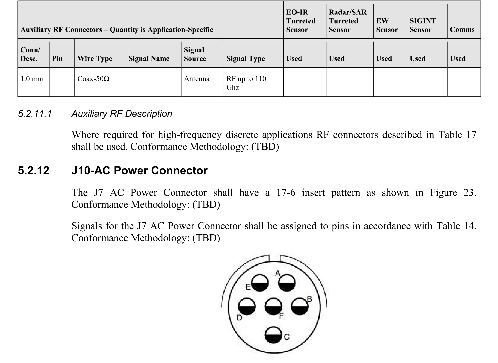

*Figure 23: J10 AC Power Connector Pin Arrangement ｜ 图 23：J10 交流电源连接器引脚排布*

**Table 18: J10 AC Power Pin Allocations ｜ 表 18：J10 交流电源引脚分配**

| SOSA Electrical Interface Recommendations SOSA 电气接口建议 J10-AC Power (17-6 insert, N-Keying) J10-交流电源（17-6 插针排布，N 键位） Sensor MIL-DTL-38999/20FE6PN contacts M39029/58-365 传感器 MIL-DTL-38999/20FE6PN 接触件 M39029/58-365 (receptacle with socket inserts) （插座，带插座接触件） Platform Umbilical MIL-DTL-38999/26FE6SN contacts M39029/56-353 平台脐带 MIL-DTL-38999/26FE6SN 接触件 M39029/56-353 (plug with pin inserts) （插头，带插针接触件） | | | | | | EO-IR Turreted Sensor ／ 光电／红外转塔式传感器 | Radar/SAR Turreted Sensor ／ 雷达／SAR 转塔式传感器 | EW Sensor ／ 电子战传感器 | SIGINT Sensor ／ 信号情报传感器 | Comms ／ 通信 |
|---|---|---|---|---|---|---|---|---|---|---|
| Conn/ Desc. 连接器／说明 | Pin 引脚 | Wire Type 线型 | Signal Name 信号名 | Signal Source 信号来源 | Signal Type 信号类型 | Used 使用 | Used 使用 | Used 使用 | Used 使用 | Used 使用 |
| 3ø 400Hz AC Power | A | 12AWG | 120/208VAC Ph A | Platform | AC Power | ✓ | ✓ | ✓ | ✓ | ✓ |
| | B | 12AWG | 120/208VAC Ph B | Platform | AC Power | ✓ | ✓ | ✓ | ✓ | ✓ |
| | C | 12AWG | 120/208VAC Ph C | Platform | AC Power | ✓ | ✓ | ✓ | ✓ | ✓ |
| | D | 12AWG | 120/208VAC Neutral | Platform | AC Power | | ✓ | ✓ | ✓ | ✓ |
| | E | | Unused | | | | | | | |
| | F | 12AWG | Chassis | Platform | Ground | | ✓ | ✓ | ✓ | ✓ |

> 转写说明：原表表头为两行——第一行左起 6 列（Conn/ Desc.~Signal Type 上方）是一个**跨 6 列的合并单元格**（灰色块），其文字照录于第 1 格，被其覆盖的其余 5 格留空；第 7~11 列第一行为传感器名、第二行为 “Used”，此处分列为表头行与紧跟的一行（即原表头第二行），不另设分隔线。灰色块第 3、4 段在原表格内折行为 “Sensor MIL-DTL-38999/20FE6PN contacts M39029/58-365” ＋ “(receptacle with socket inserts)” 与 “Platform Umbilical MIL-DTL-38999/26FE6SN contacts M39029/56-353” ＋ “(plug with pin inserts)”，此处按折行位置以 ` ` 相接。
>
> 合并单元格：第 1 列 Conn/ Desc. 的 “3ø 400Hz AC Power” 在原表跨 A~F 全部 6 行合并（格内原为 “3ø” “400Hz” “AC” “Power” 四行竖排），仅记于首个数据行（Pin A），其下 5 行该格留空；“ø” 为原书的带斜线 o。
>
> 第 E 行：Wire Type、Signal Source、Signal Type 三格及 5 个 Used 格原为空，Signal Name 作 “Unused”，照录留空。
>
> 跨页：本表自 p.94 起、在 p.95 续完（D、E、F 三行为续页行）；续页重复的完整表头已并入本文件首两行表头，不另记。第 4 列内 “120/208VAC Ph A” 等在原文中为格内折行（“120/208VAC” ＋ “Ph A”），此处以空格连接。

Desc:Connl Pin Wire Type Signal Name SignalSource Signal Type Used Used Used Used Used

说明:连接器 引脚 线型 信号名 信号来源 信号类型 使用 使用 使用 使用 使用

30 12AWG 120/208VAC Platform AC Power 40OHZ Ph A AC Power B 12AWG 120/208VAC Platform AC Power

30 12AWG 120/208VAC 平台 交流电源 40OHZ A 相 交流电源 B 12AWG 120/208VAC 平台 交流电源

Ph B

B 相

I2AWG 120/208VAC Platform AC Power Ph C

I2AWG 120/208VAC 平台 交流电源 C 相

<!-- 原书 p.94 ｜ PDF p.114 -->

S0SA Electrical Interface Recommendations

S0SA 电气接口建议（原文首字母即作 0）

JIO-AC Power (17-6 insert, N-Keying) Sensor MILDTL 38999/20F6PN contacts 139029/58-365 (receptacle with socket inserts) EO-I RadarlSAR Platform Umbilical MIL-DTL- 38999/26F6SN contacts M39029/56-353 Turreted Turreted EW SIGINT (plug with pin inserts) Sensor Sensor Sensor Sensor Comms DescConnl Pin Wire Type Signal Name SignalSource Signal Type Used Used Used Used Used

JIO-交流电源（17-6 插针排布，N 键位）传感器 MILDTL 38999/20F6PN 接触件 139029/58-365（插座，带插座接触件）EO-I RadarlSAR 平台脐带 MIL-DTL- 38999/26F6SN 接触件 M39029/56-353 转塔式 转塔式 电子战 信号情报（插头，带插针接触件）传感器 传感器 传感器 传感器 通信 说明连接器 引脚 线型 信号名 信号来源 信号类型 使用 使用 使用 使用 使用

12AWG 120/208VAC Platform AC Power Neutral } Unused F 12AWG Chassis Platform Ground

12AWG 120/208VAC 平台 交流电源 中性线 } 未使用 F 12AWG 机壳 平台 地

##### 5.2.12.1 AC Power Description ｜ 5.2.12.1 交流电源说明

The platform shall provide to the connected system or sensor 115/200 Volts RMS, alternating current (AC), three phase, 4 wire grounded neutral, “Y” configuration, 400 cycle power at up to 10 amperes per phase in accordance with MIL-STD-704F. Conformance Methodology: (TBD) Each phase shall be protected by an overcurrent device to limit the maximum current to 10 amperes steady state and the overcurrent devices shall be interconnected such that an overcurrent condition on any phase shall cause all three phases to be interrupted. Conformance

平台应向所连接的系统或传感器提供 115/200 伏有效值（RMS）、交流（AC）、三相、四线、接地中性线、“Y”形接法、400 周电源，每相最高 10 安培，依据 MIL-STD-704F。符合性方法：（TBD）每相应由过流装置保护，把最大电流限制在稳态 10 安培；过流装置应互连，使得任一相出现过流时三相全部被切断。符合性

Methodology: (TBD)

方法：（TBD）

#### 5.2.13 Hardware Platform 3U and 6U Slot Profile Specifications ｜ 5.2.13 硬件平台 3U 与 6U 槽位配置档规格

5.2.13.1 SOSA Hardware Basic Requirements

5.2.13.1 SOSA 硬件基本需求

**Rule 5.2.13.1-1**

SOSA plug-in cards shall conform to the requirements of the following standards, when applicable, in the given order of precedence: • Requirements of this SOSA Technical Standard

SOSA 插卡在适用时应按下列先后次序符合下列标准的需求：• 本 SOSA 技术标准的需求

Conformance Methodology: (I)

符合性方法：(I)

- Requirements of ANSI/VITA 65.1

- ANSI/VITA 65.1 的需求

  - Conformance Methodology: (I)

  - 符合性方法：(I)

- Requirements of ANSI/VITA 65.0

- ANSI/VITA 65.0 的需求

  - Conformance Methodology: (I)

  - 符合性方法：(I)

- Requirements of ANSI/VITA 48.2

- ANSI/VITA 48.2 的需求

  - Conformance Methodology: (I)

  - 符合性方法：(I)

- Requirements of ANSI/VITA 48.8

- ANSI/VITA 48.8 的需求

  - Conformance Methodology: (I)

  - 符合性方法：(I)

<!-- 原书 p.95 ｜ PDF p.115 -->

• Requirements of ANSI/VITA 47.3

• ANSI/VITA 47.3 的需求

Conformance Methodology: (I)

符合性方法：(I)

- Requirements of ANSI/VITA 66.0 and applicable dot standards

- ANSI/VITA 66.0 及适用的点标准（dot standards）的需求

  - Conformance Methodology: (I)

  - 符合性方法：(I)

- Requirements of ANSI/VITA 67.0 and applicable dot standards

- ANSI/VITA 67.0 及适用的点标准的需求

  - Conformance Methodology: (I)

  - 符合性方法：(I)

- Requirements of ANSI/VITA 46.0

- ANSI/VITA 46.0 的需求

  - Conformance Methodology: (I)

  - 符合性方法：(I)

- Requirements of ANSI/VITA 62.0

- ANSI/VITA 62.0 的需求

  - Conformance Methodology: (I)

  - 符合性方法：(I)

**Rule 5.2.13.1-2**

All user defined pins, as defined in the SOSA plug-in cards, shall not be used for inter-module communications – only for external platform communications. Conformance Methodology: (T)

SOSA 插卡中所定义的全部用户自定义引脚，不应用于模块间通信——只用于外部平台通信。符合性方法：(T)

**Rule 5.2.13.1-3**

All external panel I/O signals shall pass through the backplane connector(s) before going to any SOSA plug-in card except for: Conformance Methodology: (T)

所有外部面板 I/O 信号在送往任何 SOSA 插卡之前，均应经由背板连接器；下列各项除外：符合性方法：(T)

• Key Fill

• 密钥填充

• Crypto Ignition Key (CIK)

• 加密点火密钥（CIK）

**Rule 5.2.13.1-4**

All signals between SOSA plug-in cards shall pass through the backplane connector(s) before going to another component in a SOSA system. Conformance Methodology: (A)

SOSA 插卡之间的所有信号，在送往 SOSA 系统中的另一组件之前，均应经由背板连接器。符合性方法：(A)

**Rule 5.2.13.1-5**

SOSA PSMs shall conform to Section 3U External I/O Slot Profile if they are installed into a monolithic backplane containing SOSA hardware modules. Conformance Methodology: (T)

SOSA 电源模块（PSM）若装入含有 SOSA 硬件模块的整体式背板，则应符合「3U 外部 I/O 槽位配置档」一节。符合性方法：(T)

**Recommendation 5.2.13.1-1**

SOSA PSMs should conform to Section 3U External I/O Slot Profile even if they are part of a separate power supply backplane.

SOSA PSM 即使属于独立的电源背板，也宜符合「3U 外部 I/O 槽位配置档」一节。

5.2.13.2 SOSA Utility Plane Requirements Reference ANSI/VITA 65.0 §3 for Utility Plane Requirements. Utility plane requirements are extended for the SOSA standard as follows.

5.2.13.2 SOSA 辅助平面需求　辅助平面需求见 ANSI/VITA 65.0 §3。针对 SOSA 标准，辅助平面需求作如下扩展。

<!-- 原书 p.96 ｜ PDF p.116 -->

**Rule 5.2.13.2-1**

The Non-Volatile Memory Read Only (NVMRO) signal on a SOSA plug-in card shall inhibit write operations to non-volatile memory resources as specified in ANSI/VITA 65.0 §3.4.4. Conformance Methodology: (T)

SOSA 插卡上的非易失存储器只读（NVMRO）信号，应按 ANSI/VITA 65.0 §3.4.4 的规定抑制对非易失存储器资源的写操作。符合性方法：(T)

**Rule 5.2.13.2-2**

The GDiscrete1 signal shall be an input only port with respect to ANSI/VITA 65.0, Permission 3.6-1. Conformance Methodology: (T)

就 ANSI/VITA 65.0 许可 3.6-1 而言，GDiscrete1 信号应为只输入端口。符合性方法：(T)

**Rule 5.2.13.2-3**

With respect to ANSI/VITA 46.0, Recommendation 7-3, the Joint Test Action Group (JTAG) signals shall not be bussed over the backplane. Conformance Methodology: (T)

就 ANSI/VITA 46.0 推荐 7-3 而言，联合测试行动组（JTAG）信号不应在背板上总线化。符合性方法：(T)

**Rule 5.2.13.2-4**

With respect to ANSI/VITA 65.0, Permission 3.4.3-4 and Permission 3.4.3-5, MaskableReset* shall not be bussed across the backplane to other slots. Conformance Methodology: (T)

就 ANSI/VITA 65.0 许可 3.4.3-4 与许可 3.4.3-5 而言，MaskableReset* 不应跨越背板总线化至其他槽位。符合性方法：(T)

**Rule 5.2.13.2-5**

All backplane connectors shall be commercially available connectors that can be procured by any vendor without prior authorization from any source (e.g., a commercial part governed by a source control drawing). Conformance Methodology: (A)

所有背板连接器均应为市售可得的连接器，任何供应商无须事先获得任何来源的授权即可采购（例如：受源控制图约束的商品件）。符合性方法：(A)

**Rule 5.2.13.2-6**

Backplanes shall implement a single, 2.49K Ohm, +/- 1%, pull-up resistor from each IPMB signal to the 3.3V Auxiliary voltage rail. Conformance Methodology: (A)

背板应为每一路 IPMB 信号到 3.3V 辅助电压轨各实现一个 2.49K 欧姆、+/- 1% 的上拉电阻。符合性方法：(A)

**Rule 5.2.13.2-7**

SOSA plug-in cards containing resources to drive the Utility Plane REF_CLK+/- signals shall provide a mechanism to permit application software or system management to reassign the identity of the SYS_CON module, regardless of the logic level of the backplane SYS_CON* contact, in order to control these signal drivers once the backplane power rails are all at minimum operating voltages as defined in ANSI/VITA 46.0 §4.8.12.4. Conformance Methodology: (A)

凡含有可驱动辅助平面 REF_CLK+/- 信号的资源的 SOSA 插卡，均应提供一种机制，允许应用软件或系统管理重新指定 SYS_CON 模块的身份，无论背板 SYS_CON* 接触件的逻辑电平如何，以便在背板各电源轨均已达到 ANSI/VITA 46.0 §4.8.12.4 所定义的最低工作电压之后控制这些信号驱动器。符合性方法：(A)

**Rule 5.2.13.2-8**

SOSA plug-in cards receiving SYSRESET* as an input shall be able to register a valid low for any pulse length of 10ns or longer. Conformance Methodology: (T)

以 SYSRESET* 作为输入接收的 SOSA 插卡，应能对 10ns 或更长的任何脉冲宽度寄存一次有效低电平。符合性方法：(T)

**Rule 5.2.13.2-9**

SYSRESET* shall conform to the high current open-drain signal specifications of ANSI/VITA

SYSRESET* 应符合 ANSI/VITA 的大电流开漏信号规范

65.0 §3.3.3 (High Current Open-Drain). Conformance Methodology: (T)

65.0 §3.3.3（大电流开漏）。符合性方法：(T)

> **译注**：原文若干处把一句折成两段（本条「…of ANSI/VITA」／「65.0 §3.3.3…」，以及后文 Rule 5.2.13.2-11、Rule 5.2.13.3-6、Rule 5.2.13.4-1、Recommendation 5.2.13.4-1、Permission 5.2.13.4-1、Rule 5.2.16.1-1 各处），系原书 PDF 抽取时的折行所致，非页锚处；英文照录两段，中文亦分两段承接，起止就近取完整成分，以保持可读。

<!-- 原书 p.97 ｜ PDF p.117 -->

**Rule 5.2.13.2-10**

SOSA plug-in cards shall make SYSRESET* available to any SOSA mezzanine module connector that has SM1 and SM0 available per ANSI/VITA 65.0 Recommendation 3.4.2.1-1. Conformance Methodology: (T)

SOSA 插卡应使 SYSRESET* 可用于任何按 ANSI/VITA 65.0 推荐 3.4.2.1-1 而具备 SM1 与 SM0 的 SOSA 夹层模块连接器。符合性方法：(T)

**Rule 5.2.13.2-11**

SOSA plug-in cards shall receive a unique Site Number that is based upon the plug-in card’s ANSI/VITA 65.0 §3.4.6, Geographic Address as referenced in ANSI/VITA 46.11. Conformance

SOSA 插卡应获得唯一的站点号，该站点号基于 ANSI/VITA 46.11 中所引的插卡 ANSI/VITA 65.0 §3.4.6 地理地址。符合性

Methodology: (A)

方法：(A)

**Rule 5.2.13.2-12**

No additional components shall be required to install a SOSA plug-in card in a SOSA Enclosure other than those typically used for ANSI/VITA-compliant OpenVPX modules. Conformance Methodology: (A)

除通常用于符合 ANSI/VITA 的 OpenVPX 模块者外，把 SOSA 插卡装入 SOSA 壳体不应需要任何额外组件。符合性方法：(A)

**Rule 5.2.13.2-13**

The NVMRO pin shall conform to the low current open-drain signal specifications of ANSI/VITA 65.0 §3.3.1. Conformance Methodology: (A)

NVMRO 引脚应符合 ANSI/VITA 65.0 §3.3.1 的低电流开漏信号规范。符合性方法：(A)

**Rule 5.2.13.2-14**

3U SOSA plug-in cards shall use VS1 12V as primary input power. Conformance Methodology: (TBD)

3U SOSA 插卡应使用 VS1 12V 作为主输入电源。符合性方法：(TBD)

**Rule 5.2.13.2-15**

3U SOSA plug-in cards shall not use VS2 3.3V or VS3 5.0V. Conformance Methodology: (T)

3U SOSA 插卡不应使用 VS2 3.3V 或 VS3 5.0V。符合性方法：(T)

**Observation 5.2.13.2-1**

VS1 input pins limits 3U current to 16A (192W) per ANSI/VITA 46.0 Table 4-5.

按 ANSI/VITA 46.0 表 4-5，VS1 输入引脚把 3U 电流限制为 16A（192W）。

**Rule 5.2.13.2-16**

6U SOSA plug-in cards shall use VS1 and VS2 12V as primary input power. Conformance Methodology: (T)

6U SOSA 插卡应使用 VS1 与 VS2 12V 作为主输入电源。符合性方法：(T)

**Rule 5.2.13.2-17**

6U SOSA plug-in cards shall not use VS3 5.0V. Conformance Methodology: (T)

6U SOSA 插卡不应使用 VS3 5.0V。符合性方法：(T)

**Observation 5.2.13.2-2**

VS1 and VS2 input pins limits 6U current to 32A (384W) per ANSI/VITA 46.0 Table 4-5.

按 ANSI/VITA 46.0 表 4-5，VS1 与 VS2 输入引脚把 6U 电流限制为 32A（384W）。

<!-- 原书 p.98 ｜ PDF p.118 -->

**Rule 5.2.13.2-18**

SOSA plug-in cards shall use 3.3V_AUX. Conformance Methodology: (T)

SOSA 插卡应使用 3.3V_AUX。符合性方法：(T)

**Rule 5.2.13.2-19**

SOSA plug-in cards shall not use 12V auxiliary supplies. Conformance Methodology: (T)

SOSA 插卡不应使用 12V 辅助电源。符合性方法：(T)

**Observation 5.2.13.2-3**

SOSA plug-in cards shall draw no more than 1.0A of 3.3VAUX ANSI/VITA 46.0 Rule 3.11.

按 ANSI/VITA 46.0 规则 3.11，SOSA 插卡从 3.3VAUX 取用的电流不应超过 1.0A。

5.2.13.3 SOSA Hardware Platform General Specification Requirements SOSA general specification requirements are delineated in the following sections.

5.2.13.3 SOSA 硬件平台通用规格需求　SOSA 的通用规格需求在下列各节中给出。

5.2.13.3.1 General Specifications

5.2.13.3.1 通用规格

**Permission 5.2.13.3-1**

Hardware modules may work cooperatively to increase performance and/or functionality.

硬件模块可协同工作，以提高性能和／或功能。

**Rule 5.2.13.3-1**

All unused pins shall not be connected on the plug-in module. Conformance Methodology: (A)

所有未使用的引脚均不应在插接模块上连接。符合性方法：(A)

**Rule 5.2.13.3-2**

SOSA plug-in cards with XMC mezzanine sites shall conform to the carrier board requirements of ANSI/VITA 42.0, XMC. Conformance Methodology: (A)

带有 XMC 夹层位的 SOSA 插卡应符合 ANSI/VITA 42.0（XMC）的载板需求。符合性方法：(A)

Slot Pitch

槽位间距

Reference ANSI/VITA 65.0 §4.1 for slot pitch requirements. Slot pitch requirements are extended for SOSA as follows.

槽位间距需求参考 ANSI/VITA 65.0 §4.1。针对 SOSA，槽位间距需求作如下扩展。

**Rule 5.2.13.3-3**

SOSA Conformant Card cage rails shall have a pitch of 1.0” or greater for SOSA plug-in card conformant ANSI/VITA 48.2 Hardware Modules. Conformance Methodology: (A)

对符合 ANSI/VITA 48.2 的 SOSA 插卡型硬件模块，SOSA 符合的卡笼导轨应具有 1.0” 或更大的间距。符合性方法：(A)

**Rule 5.2.13.3-4**

SOSA Backplane Assemblies for conduction cooling shall have a 1.0” pitch or greater for SOSA plug-in cards conformant to ANSI/VITA 48.2 Plug-In Module. Conformance Methodology: (A)

对符合 ANSI/VITA 48.2 插接模块的 SOSA 插卡，用于传导散热的 SOSA 背板装配体应具有 1.0” 或更大的间距。符合性方法：(A)

**Rule 5.2.13.3-5**

Conduction Cooled SOSA plug-in cards shall be conformant to ANSI/VITA 48.2 Plug-In Module requirements for 1.00” pitch. Conformance Methodology: (A)

传导散热式 SOSA 插卡应符合 ANSI/VITA 48.2 针对 1.00” 间距的插接模块需求。符合性方法：(A)

<!-- 原书 p.99 ｜ PDF p.119 -->

**Rule 5.2.13.3-6**

SOSA Conformant Card cage rails shall have a pitch of 1.5” for SOSA plug-in card ANSI/VITA

SOSA 符合的卡笼导轨应具有 1.5” 的间距，适用对象为符合 ANSI/VITA

48.8 Hardware Modules. Conformance Methodology: (A)

48.8 硬件模块的 SOSA 插卡。符合性方法：(A)

**Rule 5.2.13.3-7**

SOSA Backplane Assemblies for air flow through cooling shall have a 1.5” pitch for SOSA plug-in cards conformant to ANSI/VITA 48.8 Plug-In Module. Conformance Methodology: (A)

对符合 ANSI/VITA 48.8 插接模块的 SOSA 插卡，用于气流贯通散热的 SOSA 背板装配体应具有 1.5” 的间距。符合性方法：(A)

**Rule 5.2.13.3-8**

Air flow through SOSA plug-in cards shall be conformant to ANSI/VITA 48.8 Plug-In Module requirements for 1.5” pitch. Conformance Methodology: (A)

气流贯通式 SOSA 插卡应符合 ANSI/VITA 48.8 针对 1.5” 间距的插接模块需求。符合性方法：(A)

5.2.13.3.2 Connector Family

5.2.13.3.2 连接器族

**Rule 5.2.13.3-9**

SOSA plug-in cards shall comply with ANSI/VITA 65.0 §4.2 for connector family requirements. Conformance Methodology: (A)

SOSA 插卡应就连接器族需求符合 ANSI/VITA 65.0 §4.2。符合性方法：(A)

Rules 5.2.13.3-10

规则 5.2.13.3-10

SOSA plug-in cards shall make use of ANSI/VITA Standard Connectors. Conformance Methodology: (A)

SOSA 插卡应使用 ANSI/VITA 标准连接器。符合性方法：(A)

**Observation 5.2.13.3-1**

The SOSA standard is considering the addition of ANSI/VITA 46.3 that will allow for intermateable connectors.

SOSA 标准正在考虑增列 ANSI/VITA 46.3，该标准将允许使用可互配的连接器。

Keying

键位

The SOSA standard references ANSI/VITA 46 §4.4 for Alignment and Keying. Specifically, reference ANSI/VITA 46 §4.4.3 for Keying Rules applying to 6U and 3U modules. Reference ANSI/VITA 65.0 §4.3 for keying requirements specific to ANSI/VITA 6U modules and backplanes.

SOSA 标准就对准与键位引用 ANSI/VITA 46 §4.4。具体而言，适用于 6U 与 3U 模块的键位规则参考 ANSI/VITA 46 §4.4.3；ANSI/VITA 6U 模块与背板专有的键位需求参考 ANSI/VITA 65.0 §4.3。

RTM Modules

RTM 模块

Reference ANSI/VITA 65.0 §4.4 for Requirements Traceability Matrix (RTM) connector requirements.

需求追溯矩阵（RTM）的连接器需求参考 ANSI/VITA 65.0 §4.4。

**Rule 5.2.13.3-11**

Rear transition modules shall be prohibited within a SOSA Chassis and Backplane Assembly. Conformance Methodology: (A)

在 SOSA 机箱与背板装配体内，应禁止使用后置转接模块。符合性方法：(A)

<!-- 原书 p.100 ｜ PDF p.120 -->

##### 5.2.13.4 Conduction Cooled SOSA Plug-In Cards ｜ 5.2.13.4 传导散热式 SOSA 插卡

Reference ANSI/VITA 48.2 for conduction cooled module requirements. Reference ANSI/VITA

传导散热式模块的需求参考 ANSI/VITA 48.2；气流贯通式模块的需求参考 ANSI/VITA

48.8 for air flow through module requirements.

48.8 中的对应需求。

**Rule 5.2.13.4-1**

ANSI/VITA 48.2 or ANSI/VITA 48.8 Type 1 Hardware Modules shall be used. Conformance

应使用 ANSI/VITA 48.2 或 ANSI/VITA 48.8 的 1 型硬件模块。符合性

Methodology: (A)

方法：(A)

**Recommendation 5.2.13.4-1**

SOSA plug-in cards should use extended covers in order to protect the 46.0 connectors.

SOSA 插卡宜使用加长罩盖，以保护 46.0 连接器。

**Permission 5.2.13.4-1**

Adapter frames may be used to convert ANSI/VITA 48.2 Hardware Modules to ANSI/VITA

可使用适配框，把 ANSI/VITA 48.2 硬件模块转换为 ANSI/VITA

48.8 form factor.

48.8 形状因数。

Environmental

环境

Reference ANSI/VITA 47.3 for module requirements.

模块需求参考 ANSI/VITA 47.3。

**Observation 5.2.13.4-1**

Hardware modules may use the following cooling method guideline table to prepare for future power growth.

硬件模块可使用下列散热方式指南表，为未来的功率增长做准备。

**Table 19: Hardware Module Cooling Methods ｜ 表 19：硬件模块散热方式**

| **Hardware Module Form Factor and Cooling Method** ／ 硬件模块形状因数与散热方式 | **3U Heat Load** ／ 3U 热负载 | **6U Heat Load** ／ 6U 热负载 | **System Integration Impact Rationale** ／ 系统集成影响理由 |
|---|---|---|---|
| ANSI/VITA 48.2 conduction to air cooled chassis ANSI/VITA 48.2 传导至风冷机箱 | Low ／ 低 | Low ／ 低 | Host platform-agnostic air cooling 与宿主平台无关的风冷 |
| ANSI/VITA 48.8 air flow through ANSI/VITA 48.8 气流贯通式 | Medium ／ 中 | Medium ／ 中 | |
| ANSI/VITA 48.2 conduction to liquid cooled chassis ANSI/VITA 48.2 传导至液冷机箱 | Medium ／ 中 | Medium ／ 中 | Dependent on host platform supplied liquid cooling infrastructure with condensation mitigation 取决于宿主平台所提供的、带凝露缓解措施的液冷基础设施 |

> 转写说明：第 4 列「System Integration Impact Rationale」的「Host platform-agnostic air cooling」为纵向合并单元格，覆盖第 2、3 数据行（ANSI/VITA 48.2 conduction to air cooled chassis、ANSI/VITA 48.8 air flow through），故第 3 行该格留空、末行「Dependent on host platform supplied liquid cooling infrastructure with condensation mitigation」单独成格。合并格原带底色（首两行绿色、末行黄色），Markdown 不表底色。格内因排版折行的文字（如「Hardware Module Form Factor and Cooling Method」「ANSI/VITA 48.2 conduction to air cooled chassis」）以单个空格连接。本表仅占原书 p.101 一页，p.102 为正文。

#### 5.2.14 Hardware Platform SOSA Plug-In Card Profiles ｜ 5.2.14 硬件平台 SOSA 插卡配置档

SOSA plug-in card Profiles define the connector type and how each pin, or pair of pins, is allocated. Single pins are generally allocated to the utility plane for power, grounds, system discrete signals, and system management. Differential pin/pairs are generally allocated for the three communication planes called Control, Data, and Expansion. Differential paired pins are grouped together to form “pipes”. The definition of planes, pipes, and profiles can be found in Appendix B. Finally, plug-in card profiles also determine which pins are user-defined. SOSA plug-in card profiles are categorized as either Payload or Switch. As an example, payload plug-

SOSA 插卡配置档规定连接器类型，以及每一引脚或每一对引脚如何分配。单端引脚一般分配给辅助平面，用于电源、地、系统离散信号与系统管理。差分引脚／引脚对一般分配给控制、数据、扩展这三个通信平面。差分成对引脚成组构成“pipe”（管道）。平面、pipe 与配置档的定义见附录 B。最后，插卡配置档还确定哪些引脚属于用户自定义。SOSA 插卡配置档分为载荷型与交换型两类。举例而言，载荷插

<!-- 原书 p.101 ｜ PDF p.121 -->

in cards are further divided into sub-categories such as, but not limited to, RF Payload, RF Switch, and I/O Single Board Computer (SBC).

卡又进一步细分为若干子类，例如（但不限于）射频载荷、射频交换与 I/O 单板计算机（SBC）。

5.2.14.1 Hardware Platform Protocol Profiles

5.2.14.1 硬件平台协议配置档

The Protocol Profile defines what type communication protocol can be used on each pipe as defined in a corresponding plug-in card profile, connector type, and module height (6U/3U).

协议配置档规定：在相应的插卡配置档、连接器类型与模块高度（6U/3U）所定义的每条 pipe 上，可使用何种类型的通信协议。

5.2.14.2 Hardware Platform Profile Names – Use and Construction

5.2.14.2 硬件平台配置档名称——用法与构造

SOSA plug-in card profiles that align with OpenVPX Profiles can be classified into one of three main categories: • SLT: a physical space on an OpenVPX backplane with a defined mechanical and electrical specification intended to accept a Plug-In module Pre-existing examples of slots that are applicable to OpenVPX include 3U and 6U. There are different slot types such as payload slots and switch slots.

与 OpenVPX 配置档对齐的 SOSA 插卡配置档，可归入三大类之一：• SLT：OpenVPX 背板上一块具有既定机械与电气规格、用以承接插接模块的物理空间。适用于 OpenVPX 的槽位，既有例子包括 3U 与 6U。槽位有不同类型，如载荷槽位与交换槽位。

- Backplane (BKP): a class of interconnect that consists of regularly aligned pattern of connectors that operate so that the corresponding pins on each connector have the same logical definition It is often used as a backbone to connect several modules together to allow for signal transmission and is usually housed in a chassis.

- 背板（BKP）：一类互连，由按规则排列的连接器图样构成，其工作方式使各连接器上的对应引脚具有相同的逻辑定义。它常用作主干，把若干模块连接起来以便信号传输，通常装于机箱之内。

- Module (MOD): an element of a system that has individually distinct boundaries that are well-defined interfaces Reference ANSI/VITA 65.0 §1.3.3.1 for Slot Profile use and construction. Reference ANSI/VITA 65.0 §1.3.3.2 for Backplane Profile use and construction. Reference ANSI/VITA 65.0 §1.3.3.3 for Module Profile use and construction.

- 模块（MOD）：系统中的一个元素，具有各自独立、边界分明且已良好定义的接口。槽位配置档的用法与构造参考 ANSI/VITA 65.0 §1.3.3.1；背板配置档的用法与构造参考 ANSI/VITA 65.0 §1.3.3.2；模块配置档的用法与构造参考 ANSI/VITA 65.0 §1.3.3.3。

#### 5.2.15 Common 6U and 3U Plug-In Card Profile Specifications ｜ 5.2.15 6U 与 3U 通用插卡配置档规格

For the SOSA standard, within the context of OpenVPX, it is known that OpenVPX uses Slot Profiles to define interoperability and physical characteristics necessary to interface with compatible modules and backplanes. The following sections define common requirements for all OpenVPX Slot Profiles: • Reference ANSI/VITA 65.0 §6 Common to 6U and 3U – Slot Profiles • Reference ANSI/VITA 65.0 §7 Common to 6U and 3U – Backplane Profiles

就 SOSA 标准而言，在 OpenVPX 的语境下已知：OpenVPX 用槽位配置档来定义与兼容模块和背板对接所必需的互操作性与物理特性。下列各节定义所有 OpenVPX 槽位配置档的通用需求：• 参考 ANSI/VITA 65.0 §6「6U 与 3U 通用——槽位配置档」• 参考 ANSI/VITA 65.0 §7「6U 与 3U 通用——背板配置档」

• Reference ANSI/VITA 65.0 §8 Common to 6U and 3U – Module Profiles

• 参考 ANSI/VITA 65.0 §8「6U 与 3U 通用——模块配置档」

#### 5.2.16 SOSA 3U Plug-In Card Profile Specifications ｜ 5.2.16 SOSA 3U 插卡配置档规格

##### 5.2.16.1 3U I/O Intensive SBC Plug-In Card Profile ｜ 5.2.16.1 3U I/O 密集型 SBC 插卡配置档

**Rule 5.2.16.1-1**

SOSA 3U SBCs that are I/O intensive shall conform to ANSI/VITA 65.0 slot profile SLT3-

属于 I/O 密集型的 SOSA 3U SBC，应符合 ANSI/VITA 65.0 槽位配置档 SLT3-

PAY-1F1F2U1TU1T1U1T-14.2.16. Conformance Methodology: (A)

PAY-1F1F2U1TU1T1U1T-14.2.16 这一配置档。符合性方法：(A)

<!-- 原书 p.102 ｜ PDF p.122 -->

**Rule 5.2.16.1-2**

SOSA systems shall route the GPIO pins from the ANSI/VITA 65.1 slot profile SLT3-PAY-1F1F2U1TU1T1U1T-14.2.16 to external Platform I/O. Conformance Methodology: (A)

SOSA 系统应把来自 ANSI/VITA 65.1 槽位配置档 SLT3-PAY-1F1F2U1TU1T1U1T-14.2.16 的 GPIO 引脚布设到外部平台 I/O。符合性方法：(A)

**Rule 5.2.16.1-3**

SOSA systems shall route Express Mezzanine Card (XMC) pins from ANSI/VITA 65.1 slot profile SLT3-PAY-1F1F2U1TU1T1U1T-14.2.16 to external chassis I/O connectors. Conformance Methodology: (A)

SOSA 系统应把来自 ANSI/VITA 65.1 槽位配置档 SLT3-PAY-1F1F2U1TU1T1U1T-14.2.16 的 Express 夹层卡（XMC）引脚布设到外部机箱 I/O 连接器。符合性方法：(A)

**Rule 5.2.16.1-4**

SOSA 3U SBCs that are I/O intensive shall conform to one of the ANSI/VITA 65.1 module profiles in Table 20. Conformance Methodology: (A)

属于 I/O 密集型的 SOSA 3U SBC，应符合表 20 所列 ANSI/VITA 65.1 模块配置档之一。符合性方法：(A)

**Observation 5.2.16.1-1**

An XMC can be used to customize the I/O for a particular system or platform.

可用 XMC 为特定系统或平台定制 I/O。

- Key

- 图例

SE

SE（原样照录）

POIJO Data Plane 1 FP

POIJO 数据平面 1 FP

- Utility Plane-Maint. PortUSB PWR 5E Diff Expansion PlaneP1w9-X12d XMC mapControl Plane - 2 UTPsFP PI/J1 GPIO Video - TUTP

- 辅助平面-维护。端口USB 电源 5E 差分 扩展平面P1w9-X12d XMC 映射控制平面 - 2 个 UTPFP PI/J1 GPIO 视频 - TUTP

- Utility Plane 8 of USB 3 and 1ofUSB2- 1TP

- 辅助平面 8 个 USB 3 与 1 个USB2- 1TP

- Serial ports E Storage 1 UTP

- 串口 E 存储 1 UTP

- De USB PWR- P2lJ2 Control Plane C 1 TP

- De USB 电源- P2lJ2 控制平面 C 1 个 TP

3 Of GPIO- XIGs XMC map

共 3 路 GPIO- XIGs 的 XMC 映射关系

> **译注**：以上八段（自 `- Key` 至 `3 Of GPIO- XIGs XMC map`）系图 24 图内文字（图例与各引脚块标注）在转写时被提为正文，且为扫描识别件，多处残缺，如「POIJO」当作「POI/J0」、「P1w9」当作「P1/J9」、「P2lJ2」当作「P2/J2」、「XIGs」当作「XMCs」、「1ofUSB2」当作「1 of USB 2」。英文照录不改，中文按可辨字面译出，不作版面复原。

*Figure 24: ANSI/VITA 65.0 3U I/O Intensive SBC Slot Profile SLT3-PAY-1F1F2U1TU1T1U1T- ｜ 图 24：ANSI/VITA 65.0 3U I/O 密集型 SBC 槽位配置档 SLT3-PAY-1F1F2U1TU1T1U1T-*

14.2.16

<!-- 原书 p.103 ｜ PDF p.123 -->

**Table 20: Referenced ANSI/VITA 65.1 Module Profiles for SLT3-PAY-1F1F2U1T1U1T1U1T-14.2.16 ｜ 表 20：SLT3-PAY-1F1F2U1T1U1T1U1T-14.2.16 所引用的 ANSI/VITA 65.1 模块配置档**

| Module Profile Names ／ 模块配置档名 | Dash Num ／ 短横编号 | STD Date ／ 标准日期 | Slot Profile ／ 槽位配置档 | Data Plane ／ 数据平面 | Protocols for Copper Planes ／ 铜缆平面协议 || Control ／ 控制 | Miscellaneous Protocols over copper connectors ／ 铜缆连接器上的其他协议 |||||| Legacy ／ 遗留 |
|---|---|---|---|---|---|---|---|---|---|---|---|---|---|---|
| | | | | | Expansion ／ 扩展 | Control Plane ／ 控制平面 | | Video ／ 视频 | USB01 | USB02 | STRutp01 | SER01, SER02 | GPIO1 - GPIO4 | |
| MOD3-PAY- 1F1F2U1TU1T1U1T- 16.2.15- | | Proposed future 65.0 拟议中的未来 65.0 | | DP01 (FP) | EP00 - EP03 | CPutp01, CPutp02 | CPtp01 | | | | | | | |
| MOD3-PAY- 1F1F2U1TU1T1U1T- 16.2.15- | 1 | Proposed future 65.0 拟议中的未来 65.0 | SLT3-PAY- 1F1F2U1TU1T1U1T- 14.2.16 | PCIe Gen 2 -- 5.3.3.2 | PCIe Gen 2 -- 5.3.3.2 | 1000BASE-KX -- 5.1.2 | 1000BASE-T | DisplayPort 1.2 -- 5.10.2 | USB 2 -- 5.9.1 | USB 2 -- 5.9.1 | SATA Gen 2 -- 5.6.2 | Serial Ports -- 5.12.1 | GPIO -- 5.14.1 | |
| MOD3-PAY- 1F1F2U1TU1T1U1T- 16.2.15- | 2 | Proposed future 65.0 拟议中的未来 65.0 | SLT3-PAY- 1F1F2U1TU1T1U1T- 14.2.16 | PCIe Gen 3 -- 5.3.3.3 | PCIe Gen 3 -- 5.3.3.3 | 10GBASE-KR -- 5.1.7 | 10GBASE-T | DisplayPort 1.2 -- 5.10.2 | USB 3.1 Gen 2 -- 5.9.3 | USB 2 -- 5.9.1 | SATA Gen 3 -- 5.6.3 | Serial Ports -- 5.12.1 | GPIO -- 5.14.1 | |
| MOD3-PAY- 1F1F2U1TU1T1U1T- 16.2.15- | 3 | Proposed future 65.0 拟议中的未来 65.0 | SLT3-PAY- 1F1F2U1TU1T1U1T- 14.2.16 | 10GBASE-KX4 -- 5.1.5 | PCIe Gen 2 -- 5.3.3.2 | 1000BASE-KX -- 5.1.2 | 1000BASE-T | DisplayPort 1.2 -- 5.10.2 | USB 2 -- 5.9.1 | USB 2 -- 5.9.1 | SATA Gen 2 -- 5.6.2 | Serial Ports -- 5.12.1 | GPIO -- 5.14.1 | |
| MOD3-PAY- 1F1F2U1TU1T1U1T- 16.2.15- | 4 | Proposed future 65.0 拟议中的未来 65.0 | SLT3-PAY- 1F1F2U1TU1T1U1T- 14.2.16 | 40GBASE-KR4 -- 5.1.8 | PCIe Gen 3 -- 5.3.3.3 | 10GBASE-KR -- 5.1.7 | 10GBASE-T | DisplayPort 1.2 -- 5.10.2 | USB 3.1 Gen 2 -- 5.9.3 | USB 2 -- 5.9.1 | SATA Gen 3 -- 5.6.3 | Serial Ports -- 5.12.1 | GPIO -- 5.14.1 | |
| Last line 末行 | | Proposed future 65.0 拟议中的未来 65.0 | | | | | | | | | | | | |

> 转写说明：表头在原书为两层级联——第一层 `Protocols for Copper Planes`（横跨 Expansion、Control Plane 两列）、`Miscellaneous Protocols over copper connectors`（横跨 Video、USB01、USB02、STRutp01、SER01, SER02、GPIO1 - GPIO4 六列）；第二层为各子列名。此处保留两行表头，被 colspan 覆盖处留空。
> 转写说明：`Module Profile Names` 与 `Dash Num` 两个标目在原书同处一个表头格（左右分置，其间未画竖线）；数据行中配置档名右对齐于标目 `Dash Num` 左侧，其后空一格处为该行的短横编号（`1`～`4`）。此处拆作两列照录，两列合并即为完整编号 `MOD3-PAY-1F1F2U1TU1T1U1T-16.2.15-<n>`。
> 转写说明：首行的 Module Profile 名以连字符结尾而 `Dash Num` 空缺（原书如此，非漏字）；第二至五行的 `Dash Num` 依次为 `1`、`2`、`3`、`4`。
> 转写说明：首行 Video 至 GPIO1 - GPIO4 各格在原书即为空白（该带为子列名所占）；末行 `Last line` 右半各格为灰底空白。
> 转写说明：`Proposed future 65.0` 的红色底纹与末行灰底纹系原书高亮，未在 Markdown 中表示。
> 转写说明：本表为单页整表（原书 p.104／PDF 第 124 页），共 6 个数据行。下一页（原书 p.105／PDF 第 125 页）顶端为 Figure 25 与 §5.2.16.3 正文，非本表续行，故未续写。

> **译注**：表 20 表体内 `MOD3-…`／`SLT3-…` 型号码、`Dash Num` 短横编号、`PCIe Gen 2 -- 5.3.3.2` 一类「协议名 -- ANSI/VITA 65.0 条款号」串、`USB01`／`USB02`／`STRutp01`／`SER01, SER02`／`GPIO1 - GPIO4` 一类通道号，均为寻址键，整格不译；只译表头与 `Proposed future 65.0`、`Last line` 两类描述格。

##### 5.2.16.2 3U Legacy Payload Profiles ｜ 5.2.16.2 3U 旧式载荷配置档

**Rule 5.2.16.2-1**

- SOSA 3U Legacy Payload Plug-In Cards shall conform to ANSI/VITA 65.0 slot profile SLT3-

- SOSA 3U 旧式载荷插卡应符合 ANSI/VITA 65.0 的 slot profile（槽位配置档）SLT3-

PAY-2F2U-14.2.3. Conformance Methodology: (A)

PAY-2F2U-14.2.3。符合性方法：(A)

**Rule 5.2.16.2-2**

- SOSA 3U Legacy Payload Plug-In Cards shall conform to one of the following ANSI/VITA

- SOSA 3U 旧式载荷插卡应符合下列 ANSI/VITA

65.1 module profiles: (Conformance Methodology: (A))

65.1 的 module profile（模块配置档）之一：（符合性方法：(A)）

MOD3-PAY-2F2U-16.2.3-3

MOD3-PAY-2F2U-16.2.3-3（模块配置档之一，型号码原样不译）

MOD3-PAY-2F2U-16.2.3-5

MOD3-PAY-2F2U-16.2.3-5（模块配置档之二）

MOD3-PAY-2F2U-16.2.3-11

MOD3-PAY-2F2U-16.2.3-11（模块配置档之三）

> **译注**：上三条英文型号码在原书是 Rule 5.2.16.2-2 之下的项目符号，转写时按行拆作三段；型号码整格不译，中文只标其次序，不合并不改序。

**Recommendation 5.2.16.2-1-1**

- It is anticipated that the SLT3-PAY-2F2U-14.2.3 ANSI/VITA Slot Profile will be deprecated from the next version of the SOSA standard and consequently should not be used for new systems.

- 预计 SLT3-PAY-2F2U-14.2.3 这一 ANSI/VITA slot profile 将自 SOSA 标准的下一版本起被废弃，因此不宜用于新系统。

<!-- 原书 p.104 ｜ PDF p.124 -->

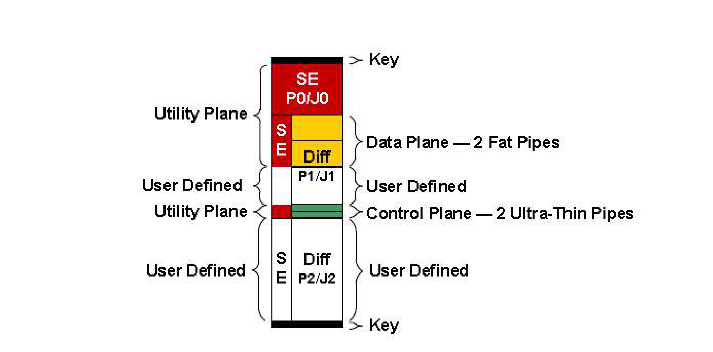

*Figure 25: ANSI/VITA 65.0 Payload Slot Profile for SLT3-PAY-2F2U-14.2.3 ｜ 图 25：SLT3-PAY-2F2U-14.2.3 的 ANSI/VITA 65.0 载荷槽位配置档*

5.2.16.3 3U Payload Slot Profiles

5.2.16.3 3U 载荷槽位配置档

**Rule 5.2.16.3-1**

SOSA 3U Payload Plug-In Cards shall conform to the ANSI/VITA 65.0 slot profile SLT3-PAY-1F1U1S1S1U1U2F1H-14.6.11-n or SLT3-PAY-1F1U1S1S1U1U4F1J-14.6.13-n. Conformance Methodology: (A)

SOSA 3U 载荷插卡应符合 ANSI/VITA 65.0 的 slot profile SLT3-PAY-1F1U1S1S1U1U2F1H-14.6.11-n 或 SLT3-PAY-1F1U1S1S1U1U4F1J-14.6.13-n。符合性方法：(A)

**Recommendation 5.2.16.3-1**

SOSA 3U Payload Plug-In Cards that don’t require RF or optical should conform to ANSI/VITA 65.0 slot profile SLT3-PAY-1F1U1S1S1U1U2F1H-14.6.11-0. Conformance Methodology: (TBD)

不需要射频或光接口的 SOSA 3U 载荷插卡宜符合 ANSI/VITA 65.0 的 slot profile SLT3-PAY-1F1U1S1S1U1U2F1H-14.6.11-0。符合性方法：(TBD)

**Recommendation 5.2.16.3-2**

SOSA 3U Payload Plug-In Cards requiring RF should conform to ANSI/VITA 65.1 slot profile SLT3-PAY-1F1U1S1S1U1U2F1H-14.6.11-2. Conformance Methodology: (TBD)

需要射频的 SOSA 3U 载荷插卡宜符合 ANSI/VITA 65.1 的 slot profile SLT3-PAY-1F1U1S1S1U1U2F1H-14.6.11-2。符合性方法：(TBD)

**Recommendation 5.2.16.3-3**

SOSA 3U Payload Plug-In Cards that require additional Expansion Plane connectivity should conform to ANSI/VITA 65.0 slot profile SLT3-PAY-1F1U1S1S1U1U4F1J-14.6.13-n. Conformance Methodology: (TBD)

需要额外扩展平面连接的 SOSA 3U 载荷插卡宜符合 ANSI/VITA 65.0 的 slot profile SLT3-PAY-1F1U1S1S1U1U4F1J-14.6.13-n。符合性方法：(TBD)

**Recommendation 5.2.16.3-4**

Vendors that use ANSI/VITA 65.1 slot profile SLT3-PAY-1F1U1S1S1U1U4F1J-14.6.13-n should provide a build option to not populate the ANSI/VITA 46.0 connector in P2A so that the card can also be used in a backplane adhering to SLT3-PAY-1F1U1S1S1U1U2F1H-14.6.11-n.

使用 ANSI/VITA 65.1 的 slot profile SLT3-PAY-1F1U1S1S1U1U4F1J-14.6.13-n 的厂商，宜提供一种构建选项：不装配 P2A 处的 ANSI/VITA 46.0 连接器，使该卡也能用于符合 SLT3-PAY-1F1U1S1S1U1U2F1H-14.6.11-n 的背板。

<!-- 原书 p.105 ｜ PDF p.125 -->

**Rule 5.2.16.3-2**

SOSA 3U Payload Plug-In Cards shall conform to one of the ANSI/VITA 65.1 module profiles in Table 21 or Table 22. Conformance Methodology: (A)

SOSA 3U 载荷插卡应符合表 21 或表 22 所列 ANSI/VITA 65.1 的 module profile 之一。符合性方法：(A)

**Recommendation 5.2.16.3-5**

SOSA 3U Payload Plug-In Cards that don’t require RF or optical should conform to ANSI/VITA 65.1 module profile MOD3p-PAY-1F1U1S1S1U1U2F1H-16.6.11-4.

不需要射频或光接口的 SOSA 3U 载荷插卡宜符合 ANSI/VITA 65.1 的 module profile MOD3p-PAY-1F1U1S1S1U1U2F1H-16.6.11-4。

**Recommendation 5.2.16.3-6**

SOSA 3U Payload Plug-In Cards requiring RF should conform to ANSI/VITA 65.1 module profile MOD3-PAY-1F1U1S1S1U1U2F1H-16.6.11-6.

需要射频的 SOSA 3U 载荷插卡宜符合 ANSI/VITA 65.1 的 module profile MOD3-PAY-1F1U1S1S1U1U2F1H-16.6.11-6。

**Observation 5.2.16.3-1**

SOSA 3U Payload Plug-In Cards can include, but are not limited to, SBCs that are computationally-intensive, FPGAs, and RF transceivers.

SOSA 3U 载荷插卡可包括（但不限于）计算密集的单板计算机（SBC）、FPGA 与射频收发信机。

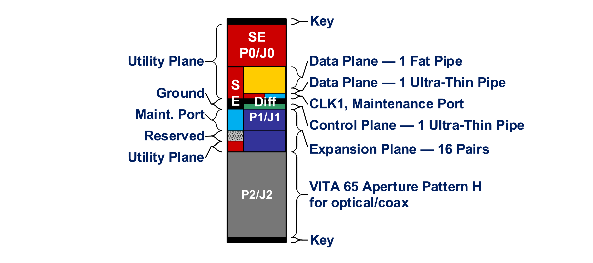

*Figure 26: ANSI/VITA 65.0 Payload Slot Profile SLT3-PAY-1F1U1S1S1U1U2F1H-14.6.11-n ｜ 图 26：ANSI/VITA 65.0 载荷槽位配置档 SLT3-PAY-1F1U1S1S1U1U2F1H-14.6.11-n*

**Table 21: ANSI/VITA 65.1Slot Profiles for SLT3-PAY-1F1U1S1S1U1U2F1H-14.6.11-n ｜ 表 21：SLT3-PAY-1F1U1S1S1U1U2F1H-14.6.11-n 的 ANSI/VITA 65.1 槽位配置档**

| Slot Profile names ／ 槽位配置档名 | Dash Num ／ 短横编号 | STD Date ／ 标准日期 | Connector Modules ／ 连接器模块 ||| MT loading and Optical Pipes ／ MT 加载与光纤管道 ||| Comments ／ 注释 |
|---|---|---|---|---|---|---|---|---|---|
| | | | P1B/J1B | P2A/J2A | P2B/J2B | P1B/J1B | P2A/J2A | P2B/J2B | |
| **SLT3-PAY-1F1U1S1S1U1U2F1H-14.6.11-** | | | **VITA 46** | **Aperture H** || | | | **First row of SLT3-PAY-1F1U1S1S1U1U2F1H-14.6.11-n SLT3-PAY-1F1U1S1S1U1U2F1H-14.6.11-n 的首行** |
| SLT3-PAY-1F1U1S1S1U1U2F1H-14.6.11- | 0 | 2017-07 | VITA 46 | Empty || | | | |
| SLT3-PAY-1F1U1S1S1U1U2F1H-14.6.11- | 1 | 2017-07 | VITA 46 | Hybrid 66.4+67.1-6.4.5.6.1 || | | | |
| SLT3-PAY-1F1U1S1S1U1U2F1H-14.6.11- | 2 | Proposed | VITA 46 | 10 SMPM contacts-6.4.5.6.3 || | | | |
| Last line | | | | | | | | | |

> 转写说明：表头两层级联——第一层 `Connector Modules` 横跨 P1B/J1B、P2A/J2A、P2B/J2B 三列，`MT loading and Optical Pipes` 横跨其下同名三列；`Slot Profile names`、`Dash Num`、`STD Date`、`Comments` 四个标目占满两行。被 colspan 覆盖处留空。
> 转写说明：`Slot Profile names` 与 `Dash Num` 两个标目在原书同处一个表头格（左右分置，其间未画竖线）；数据行中配置档名之后留一空格为该行短横编号。此处拆作两列照录，两列合并即为完整编号 `SLT3-PAY-1F1U1S1S1U1U2F1H-14.6.11-<n>`；首行无编号数字（原书如此）。
> 转写说明：`Connector Modules` 下 P2A/J2A 与 P2B/J2B 两列在原书数据行合并为一格（`Aperture H`、`Empty`、`Hybrid 66.4+67.1-6.4.5.6.1`、`10 SMPM contacts-6.4.5.6.3` 跨两列），此处按 colspan 记作一格后接空格。
> 转写说明：`Hybrid 66.4+67.1-6.4.5.6.1` 与 `10 SMPM contacts-6.4.5.6.3` 在原书为蓝色带下划线的超链接样式，此处只记文字；`Proposed` 行的黄色底纹与末行灰底纹未在 Markdown 中表示。
> 转写说明：本表为单页整表（原书 p.106／PDF 第 126 页），共 5 个数据行。下一页（PDF 第 127 页）顶端即 Table 22 的题注与表体，属另一张表，故未续写。

<!-- 原书 p.106 ｜ PDF p.126 -->

**Table 22: ANSI/VITA 65.1 Module Profiles for SLT3-PAY-1F1U1S1S1U1U2F1H-14.6.11-n ｜ 表 22：SLT3-PAY-1F1U1S1S1U1U2F1H-14.6.11-n 的 ANSI/VITA 65.1 模块配置档**

| Module Profile names ／ 模块配置档名 | Dash Num ／ 短横编号 | STD Date ／ 标准日期 | Slot Profile ／ 槽位配置档 | Data Plane ／ 数据平面 | Data Plane ／ 数据平面 | Protocols for Copper Planes ／ 铜平面协议 |||| Optical ／ 光 | Comments ／ 注释 | Legacy ／ 旧式 |
|---|---|---|---|---|---|---|---|---|---|---|---|---|
| | | | | | | Expansion Plane ／ 扩展平面 | Expansion Plane ／ 扩展平面 | Control Plane ／ 控制平面 | Contol Plane ／ 控制平面 | | | |
| **MOD3-PAY-1F1U1S1S1U1U2F1H-16.6.11-** | | | | **DP01** | **DPutp01** | **EP00 - EP03** | **EP04 - EP07** | **CPutp01** | | | **First row of MOD3-PAY-1F1U1S1S1U1U2F1H-16.6.11-n MOD3-PAY-1F1U1S1S1U1U2F1H-16.6.11-n 的首行** | |
| MOD3p-PAY-1F1U1S1S1U1U2F1H-16.6.11- | 1 | 2017-07 | SLT3p-PAY-1F1U1S1S1U1U2F1H-14.6.11-1 | 10GBASE-KX4 -- 5.1.5 | 1000BASE-KX -- 5.1.2 | PCIe Gen 2 -- 5.3.3.2 | User Defined | 1000BASE-KX -- 5.1.2 | | | P2/J2: Hybrid_66.4+67.1-6.4.5.6.1 | |
| MOD3p-PAY-1F1U1S1S1U1U2F1H-16.6.11- | 2 | Proposed | SLT3p-PAY-1F1U1S1S1U1U2F1H-14.6.11-2 | 10GBASE-KX4 -- 5.1.5 | 1000BASE-KX -- 5.1.2 | PCIe Gen 2 -- 5.3.3.2 | User Defined | 1000BASE-KX -- 5.1.2 | | | P2/J2: 10_SMPM_contacts-6.4.5.6.3 | |
| MOD3p-PAY-1F1U1S1S1U1U2F1H-16.6.11- | 3 | Proposed | SLT3p-PAY-1F1U1S1S1U1U2F1H-14.6.11-2 | 40GBASE-KR4 -- 5.1.8 | 10GBASE-KR -- 5.1.7 | PCIe Gen 3 -- 5.3.3.3 | User Defined | 10GBASE-KR -- 5.1.7 | | | P2/J2: 10_SMPM_contacts-6.4.5.6.3 | |
| MOD3p-PAY-1F1U1S1S1U1U2F1H-16.6.11- | 4 | Proposed | SLT3p-PAY-1F1U1S1S1U1U2F1H-14.6.11-0 | 40GBASE-KR4 -- 5.1.8 | 10GBASE-KR -- 5.1.7 | PCIe Gen 3 -- 5.3.3.3 | User Defined | 10GBASE-KR -- 5.1.7 | | | No P2/J2; Intended for use by SBC 无 P2/J2；供单板计算机（SBC）使用 | |
| MOD3p-PAY-1F1U1S1S1U1U2F1H-16.6.11- | 5 | Proposed | SLT3p-PAY-1F1U1S1S1U1U2F1H-14.6.11-4 | 40GBASE-KR4 -- 5.1.8 | 10GBASE-KR -- 5.1.7 | PCIe Gen 3 -- 5.3.3.3 | User Defined | 10GBASE-KR -- 5.1.7 | | | 14_sMPM_contacts_6.4.5.4.4 | |
| MOD3p-PAY-1F1U1S1S1U1U2F1H-16.6.11- | 6 | Proposed | SLT3p-PAY-1F1U1S1S1U1U2F1H-14.6.11-4 | 40GBASE-KR4 -- 5.1.8 | 10GBASE-KR -- 5.1.7 | Aurora -- 5.7.2 | User Defined | 10GBASE-KR -- 5.1.7 | | | 14_sMPM_contacts_6.4.5.4.4 | |

> 转写说明：表头两层级联——第一层 `Protocols for Copper Planes` 横跨其下 Expansion Plane、Expansion Plane、Control Plane、Contol Plane 四列；其余标目（`Module Profile names`、`Dash Num`、`STD Date`、`Slot Profile`、两列 `Data Plane`、`Optical`、`Comments`、`Legacy`）占满两行。被 colspan 覆盖处留空。
> 转写说明：`Module Profile names` 与 `Dash Num` 两个标目在原书同处一个表头格（左右分置，其间未画竖线）；数据行的短横编号以小字偏置排在该格右端。此处拆作两列照录，两列合并即为完整编号 `MOD3-PAY-1F1U1S1S1U1U2F1H-16.6.11-<n>`。
> 转写说明：第四个子列名在原书排作 `Contol Plane`（缺字母 r，非本次转写笔误）；c9 该列全表无数据。
> 转写说明：首行模块配置档名以大写 `MOD3-PAY-` 起首（粗体），第二至七行为小写 `MOD3p-PAY-` 起首，Slot Profile 亦为 `SLT3p-PAY-`，均照原书大小写录入。
> 转写说明：首行无短横编号（原书如此）。第三、四行的 Slot Profile 同为 `SLT3p-PAY-1F1U1S1S1U1U2F1H-14.6.11-2`，第六、七行同为 `…-14.6.11-4`（原书如此，未作更正）；`Legacy` 列与 `Optical` 列全表空白。
> 转写说明：本表为单页整表（原书 p.107／PDF 第 127 页上半），共 7 个数据行、无 `Last line` 行。同页其下为 Figure 27 与 Table 23、Table 24，下一页（PDF 第 128 页）顶端为 Rule 5.2.16.4-2 正文，均非本表续行，故未续写。

> **译注**（读表）：表 22、表 24~28 的**协议各列整格不译**——`10GBASE-KX4`、`1000BASE-KX`、`PCIe Gen 2/3`、`40GBASE-KR4`、`10GBASE-KR`、`Aurora`、`1000BASE-T` 与紧随其后的 `5.x.y` 都是 VITA 65 的协议名与条款号，译了即与 VITA 文献、与前后表对不上。同属不译的还有：`User Defined`＝用户自定义；`As 4 UTPs`＝按 4 对 UTP 使用；`Empty`＝空；`Proposed`／`Proposed future 65.0`＝拟议／拟议中的未来 65.0 版；`Last line`＝原表最末一行的转写标记；`Aperture H`／`Aperture J`＝H 号／J 号孔径位；`P2/J2: Hybrid_66.4+67.1-6.4.5.6.1` 一类是「连接器位：连接器型号」的连写，亦不译。`DP01`、`DPutp01`、`EP00 - EP15`、`CPutp01` 等是 VITA 65.1 的管道编号，不译。作描述的成句格才并置中文（如 `First row of …-n` 的首行、`No P2/J2; Intended for use by SBC`）。另：原书多处把 `Control Plane` 误排作 `Contol Plane`（缺字母 r，见表 22、表 25、表 26 的子列名），表头照录原串，中文仍作「控制平面」。

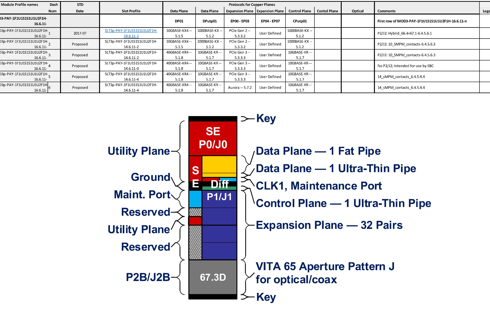

*Figure 27: ANSI/VITA 65.0 Payload Slot Profile SLT3-PAY-1F1U1S1S1U1U4F1J-14.6.13-n ｜ 图 27：ANSI/VITA 65.0 载荷槽位配置档 SLT3-PAY-1F1U1S1S1U1U4F1J-14.6.13-n*

**Table 23: ANSI/VITA 65.1Slot Profiles for SLT3-PAY-1F1U1S1S1U1U4F1J-14.6.13-n ｜ 表 23：SLT3-PAY-1F1U1S1S1U1U4F1J-14.6.13-n 的 ANSI/VITA 65.1 槽位配置档**

| Slot Profile names ／ 槽位配置档名 | Dash Num ／ 短横编号 | STD Date ／ 标准日期 | Connector Modules ／ 连接器模块 ||| MT loading and Optical Pipes ／ MT 加载与光纤管道 ||| Comments ／ 注释 |
|---|---|---|---|---|---|---|---|---|---|
| | | | P1B/J1B | P2A/J2A | P2B/J2B | P1B/J1B | P2A/J2A | P2B/J2B | |
| **SLT3-PAY-1F1U1S1S1U1U4F1J-14.6.13-** | | **Proposed future 65.0** | **VITA 46** | **VITA 46** | **Aperture J** | **VITA 46** | **VITA 46** | **Aperture J** | **First row of SLT3-PAY-1F1U1S1S1U1U4F1J-14.6.13-n SLT3-PAY-1F1U1S1S1U1U4F1J-14.6.13-n 的首行** |
| SLT3-PAY-1F1U1S1S1U1U4F1J-14.6.13- | 0 | Proposed future 65.0 | VITA 46 | VITA 46 | Empty | | | | |
| Last line | | Proposed future 65.0 | | | | | | | |

> 转写说明：表头两层级联——第一层 `Connector Modules` 横跨 P1B/J1B、P2A/J2A、P2B/J2B 三列，`MT loading and Optical Pipes` 横跨其下同名三列；`Slot Profile names`、`Dash Num`、`STD Date`、`Comments` 四个标目占满两行。被 colspan 覆盖处留空。
> 转写说明：`Slot Profile names` 与 `Dash Num` 两个标目在原书同处一个表头格（左右分置，其间未画竖线）；数据行中配置档名之后留一空格为该行短横编号。此处拆作两列照录，两列合并即为完整编号 `SLT3-PAY-1F1U1S1S1U1U4F1J-14.6.13-<n>`；首行无编号数字（原书如此）。
> 转写说明：第二行的 `MT loading and Optical Pipes` 三列为空白；`Proposed future 65.0` 的红色底纹与末行灰底纹系原书高亮，未在 Markdown 中表示。
> 转写说明：本表为单页整表（原书 p.107／PDF 第 127 页中部），共 3 个数据行。同页其下紧接 Table 24，下一页（PDF 第 128 页）顶端为 Rule 5.2.16.4-2 正文，均非本表续行，故未续写。

**Table 24: ANSI/VITA 65.1 Module Profiles for SLT3-PAY-1F1U1S1S1U1U4F1J-14.6.13-n ｜ 表 24：SLT3-PAY-1F1U1S1S1U1U4F1J-14.6.13-n 的 ANSI/VITA 65.1 模块配置档**

| Module Profile names ／ 模块配置档名 | Dash Num ／ 短横编号 | STD Date ／ 标准日期 | Slot Profile ／ 槽位配置档 | Protocols for Copper Planes ／ 铜平面协议 |||| Protocols Optical ／ 光协议 | Comments ／ 注释 | Legacy ／ 旧式 |
|---|---|---|---|---|---|---|---|---|---|---|
| | | | | Data Plane ／ 数据平面 | Data Plane ／ 数据平面 | Plane ／ 平面 | Control Plane ／ 控制平面 | | | |
| **MOD3-PAY-1F1U1S1S1U1U4F1J-16.6.13-** | | **Proposed future 65.0** | | **DP01** | **DPutp01** | **EP00 - EP15** | **CPutp01** | | **First row of MOD3-PAY-1F1U1S1S1U1U4F1J-16.6.13-n MOD3-PAY-1F1U1S1S1U1U4F1J-16.6.13-n 的首行** | |
| MOD3p-PAY-1F1U1S1S1U1U4F1J-16.6.13- | 1 | Proposed future 65.0 | SLT3p-PAY-1F1U1S1S1U1U4F1J-14.6.13-0 | 40GBASE-KR4 -- 5.1.8 | 10GBASE-KR -- 5.1.7 | PCIe Gen 3 -- 5.3.3.3 | 10GBASE-KR -- 5.1.7 | | No P2B/J2B ／ 无 P2B/J2B | |
| Last line | | Proposed future 65.0 | | | | | | | | |

> 转写说明：表头两层级联——第一层 `Protocols for Copper Planes` 横跨其下 Data Plane、Data Plane、Plane、Control Plane 四列；`Module Profile names`、`Dash Num`、`STD Date`、`Slot Profile`、`Protocols Optical`、`Comments`、`Legacy` 七个标目在原书为一格贯满两行，故在第二行表头中留空。被 colspan 覆盖处同样留空。
> 转写说明：`Module Profile names` 与 `Dash Num` 两个标目在原书同处一个表头格（左右分置，其间未画竖线）。此处拆作两列照录，两列合并即为完整编号 `MOD3-PAY-1F1U1S1S1U1U4F1J-16.6.13-<n>`；首行无编号数字（原书如此）。
> 转写说明：`Protocols Optical` 列与 `Legacy` 列全表空白。
> 转写说明：原书数据首行为大写 `MOD3-PAY-…`（粗体），次行为小写 `MOD3p-PAY-…`、槽位档 `SLT3p-PAY-…`，均照原书大小写照录。
> 转写说明：本表为单页整表（原书 p.107／PDF 第 127 页下半），共 3 个数据行。下一页（PDF 第 128 页）顶端为 Rule 5.2.16.4-2 正文，非本表续行，故未续写。

##### 5.2.16.4 3U Data/Control Plane Switch Profile ｜ 5.2.16.4 3U 数据／控制平面交换机配置档

**Rule 5.2.16.4-1**

- SOSA 3U Switch Plug-In Cards shall conform to ANSI/VITA 65.0 slot profile SLT3-SWH-

- SOSA 3U 交换机插卡应符合 ANSI/VITA 65.0 的 slot profile SLT3-SWH-

6F8U-14.4.15. Conformance Methodology: (A)

6F8U-14.4.15。符合性方法：(A)

<!-- 原书 p.107 ｜ PDF p.127 -->

**Rule 5.2.16.4-2**

SOSA 3U Switch Plug-In Cards shall conform to one of the ANSI/VITA 65.1 module profiles in

SOSA 3U 交换机插卡应符合 ANSI/VITA 65.1 的 module profile 之一，见

> **译注**：本条英文在原文此处中断（止于「in」），其后续内容未见于英文转换件；英文照录，中文同样在「见」处切断，不代为补全。

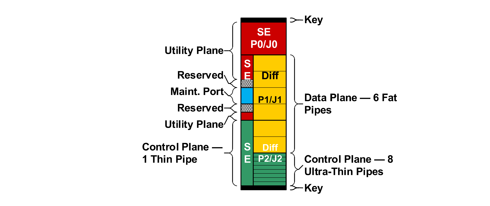

*Figure 28: ANSI/VITA 65.0 Control/Expansion Plane Switch Slot Profile SLT3-SWH-6F8U-14.4.15 ｜ 图 28：ANSI/VITA 65.0 控制／扩展平面交换机槽位配置档 SLT3-SWH-6F8U-14.4.15*

**Table 25: ANSI/VITA 65.1 Module Profiles for SLT3-SWH-6F8U-14.4.15 ｜ 表 25：SLT3-SWH-6F8U-14.4.15 的 ANSI/VITA 65.1 模块配置档**

| Module Profile names ／ 模块配置档名 | Dash Num ／ 短横编号 | STD Date ／ 标准日期 | Slot Profile ／ 槽位配置档 | Protocols for Copper Planes ／ 铜平面协议 ||| Comments ／ 注释 | Legacy ／ 旧式 |
|---|---|---|---|---|---|---|---|---|
| | | | | Data Plane ／ 数据平面 | Control Plane ／ 控制平面 | Contol Plane ／ 控制平面 | | |
| **MOD3-SWH-6F8U-16.4.16-** | | **Proposed future 65.0** | | **DP01 - DP05, DS01 (FP)** | **CPutp01 - CPutp06, CSutp01** | **CPtp01** | **First row of MOD3-SWH-6F8U-16.4.16-n MOD3-SWH-6F8U-16.4.16-n 的首行** | |
| MOD3-SWH-6F8U-16.4.16- | 1 | Proposed future 65.0 | SLT3-SWH-6F8U-14.4.15 | PCIe Gen 3 -- 5.3.3.3 | 10GBASE-KR -- 5.1.7 | 1000BASE-T -- 5.1.3 | | |
| Last line | | Proposed future 65.0 | | | | | | |

> 转写说明：表头两层级联——第一层 `Protocols for Copper Planes` 横跨其下 Data Plane、Control Plane、Contol Plane 三列；`Module Profile names`、`Dash Num`、`STD Date`、`Slot Profile`、`Comments`、`Legacy` 占满两行。被 colspan 覆盖处留空。
> 转写说明：`Module Profile names` 与 `Dash Num` 两个标目在原书同处一个表头格（左右分置，其间未画竖线）；第二行短横编号以小号字排在该格右端。此处拆作两列照录，两列合并即为完整编号 `MOD3-SWH-6F8U-16.4.16-<n>`；首行无编号数字（原书如此）。
> 转写说明：`Protocols for Copper Planes` 下第三个子列名在原书排作 `Contol Plane`（缺字母 r，非本次转写笔误）。
> 转写说明：`Legacy` 列全表空白；`Proposed future 65.0` 的红色底纹与末行灰底纹系原书高亮，未在 Markdown 中表示。
> 转写说明：本表为单页整表（原书 p.108／PDF 第 128 页），共 3 个数据行。下一页（PDF 第 129 页）顶端为 Permission 5.2.16.5-1 正文，非本表续行，故未续写。

##### 5.2.16.5 3U Control/Data Plane Switch Profile ｜ 5.2.16.5 3U 控制／数据平面交换机配置档

**Rule 5.2.16.5-1**

SOSA 3U Control/Data Plane Switch Plug-In Cards shall conform to ANSI/VITA 65.0 slot profile SLT3-SWH-6F1U7U-14.4.14 or SLT3-SWH-4F1U7U1J-14.8.7-n. Conformance Methodology: (A)

SOSA 3U 控制／数据平面交换机插卡应符合 ANSI/VITA 65.0 的 slot profile SLT3-SWH-6F1U7U-14.4.14 或 SLT3-SWH-4F1U7U1J-14.8.7-n。符合性方法：(A)

**Rule 5.2.16.5-2**

SOSA 3U Control/Data Plane Switch Plug-In Cards shall conform to one of the ANSI/VITA

SOSA 3U 控制／数据平面交换机插卡应符合下列 ANSI/VITA

65.1 module profiles in Table 23 or Table 24. Conformance Methodology: (A)

65.1 的 module profile 之一，见表 23 或表 24。符合性方法：(A)

> **译注**：本条所引 `Table 23`／`Table 24` 系原书如此（按上下文，5.2.16.5 节应引表 26 与表 27）；英文照录，中文照字面译出，不代原文改号。

<!-- 原书 p.108 ｜ PDF p.128 -->

**Permission 5.2.16.5-1**

The control plane pipes in ANSI/VITA 65.1 slot profiles SLT3-SWH-6F1U7U-14.4.14 and SLT3-SWH-4F1U7U1J-14.8.7-n can be repurposed to provide a second data plane switch fabric.

ANSI/VITA 65.1 的 slot profile SLT3-SWH-6F1U7U-14.4.14 与 SLT3-SWH-4F1U7U1J-14.8.7-n 中的控制平面管道，可改作第二套数据平面交换结构之用。

**Permission 5.2.16.5-2**

Fiber connections on the front of the ANSI/VITA 65.1 SLT3-SWH-6F1U7U-14.4.14 and the

前面板上的光纤连接，就 ANSI/VITA 65.1 的 SLT3-SWH-6F1U7U-14.4.14 与

SLT3-SWH-4F1U7U1J-14.8.7-n slot profiles can be used for Ethernet in/out of the chassis if blind-mate fiber connections are not available or practical.

SLT3-SWH-4F1U7U1J-14.8.7-n 这两个 slot profile 而言，在盲插式光纤连接不可得或不实用时，可用于进出机箱的以太网。

**Recommendation 5.2.16.5-1**

Vendors of a card based on the ANSI/VITA 65.1 slot profile SLT3-SWH-6F1U7U-14.4.14 should offer a variant of this card that can be used in a backplane with a Switch Slot for SLT3-SWH-4F1U7U1J-14.8.7-0 (i.e., P2B is empty).

以 ANSI/VITA 65.1 的 slot profile SLT3-SWH-6F1U7U-14.4.14 为依据的插卡厂商，宜提供该卡的一种变体，使其可用于交换槽位为 SLT3-SWH-4F1U7U1J-14.8.7-0 的背板（即 P2B 为空）。

**Observation 5.2.16.5-1**

ANSI/VITA 65.1 slot profiles SLT3-SWH-6F1U7U-14.4.14 and SLT3-SWH-4F1U7U1J-14.8.7-n can be daisy chained to support additional payload slots, although this successively increases the risk of bottlenecks on inter-switch connections. As such, larger backplanes may wish to use all pipes for data plane connections to minimize the number of inter-switch connections that are required. This approach assumes that ANSI/VITA 65.1 slot profile SLT3-SWH-6F8U-14.4.15 is also used to provide the switch fabric for the control plane.

ANSI/VITA 65.1 的 slot profile SLT3-SWH-6F1U7U-14.4.14 与 SLT3-SWH-4F1U7U1J-14.8.7-n 可作菊花链串接，以支持更多的载荷槽位，尽管这会使交换机间连接出现瓶颈的风险逐级增大。因此，较大的背板可望把全部管道用于数据平面连接，以尽量减少所需的交换机间连接数目。此做法假定同时采用 ANSI/VITA 65.1 的 slot profile SLT3-SWH-6F8U-14.4.15 来提供控制平面的交换结构。

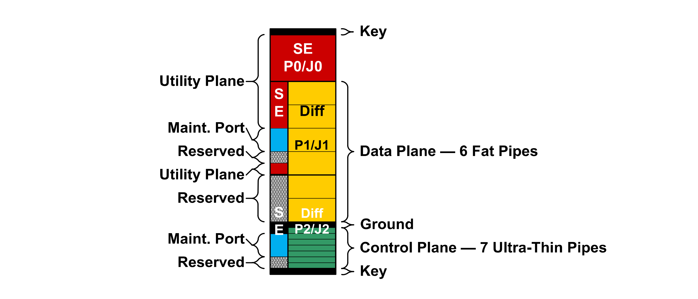

*Figure 29: ANSI/VITA 65.0 Control/Data Plane Switch Slot Profile SLT3-SWH-6F1U7U-14.4.14 ｜ 图 29：ANSI/VITA 65.0 控制／数据平面交换机槽位配置档 SLT3-SWH-6F1U7U-14.4.14*

**Table 26: ANSI/VITA 65.1 Module Profiles for SLT3-SWH-6F1U7U-14.4.14 ｜ 表 26：SLT3-SWH-6F1U7U-14.4.14 的 ANSI/VITA 65.1 模块配置档**

| Module Profile names ／ 模块配置档名 | Dash Num ／ 短横编号 | STD Date ／ 标准日期 | Slot Profile ／ 槽位配置档 | Protocols for Copper Planes ／ 铜平面协议 |||| Comments ／ 注释 | Legacy ／ 旧式 |
|---|---|---|---|---|---|---|---|---|---|
| | | | | Data Plane ／ 数据平面 | Data Plane ／ 数据平面 | Control Plane ／ 控制平面 | Contol Plane ／ 控制平面 | | |
| **MOD3-SWH-6F1U7U-16.4.15-** | | | | **DS01, DP01 - DP04 (FP)** | **DP05** | **CPutp01 - CPutp06** | **CSutp01** | **First row of MOD3-SWH-6F1U7U-16.4.15-n MOD3-SWH-6F1U7U-16.4.15-n 的首行** | |
| MOD3-SWH-6F1U7U-16.4.15- | 1 | 2017-05 | SLT3-SWH-6F1U7U-14.4.14 | 10GBASE-KX4 -- 5.1.5 | As 4 UTPs: 1000BASE-KX -- 5.1.2 | 1000BASE-KX -- 5.1.2 | 1000BASE-KX -- 5.1.2 | | |
| MOD3-SWH-6F1U7U-16.4.15- | 2 | Proposed | SLT3-SWH-6F1U7U-14.4.14 | 10GBASE-KR -- 5.1.7, 40GBASE-KR4 -- 5.1.8 | 10GBASE-KR -- 5.1.7, 40GBASE-KR4 -- 5.1.8 | 10GBASE-KR -- 5.1.7 | 10GBASE-KR -- 5.1.7 | | |
| Last line | | | | | | | | | |

> 转写说明：表头两层级联——第一层 `Protocols for Copper Planes` 横跨其下 Data Plane、Data Plane、Control Plane、Contol Plane 四列；`Module Profile names`、`Dash Num`、`STD Date`、`Slot Profile`、`Comments`、`Legacy` 占满两行。被 colspan 覆盖处留空。
> 转写说明：`Module Profile names` 与 `Dash Num` 两个标目在原书同处一个表头格（左右分置，其间未画竖线）；数据行中短横编号以极小字号排在该格右端（如 `MOD3-SWH-6F1U7U-16.4.15- 1`）。此处拆作两列照录，两列合并即为完整编号 `MOD3-SWH-6F1U7U-16.4.15-<n>`；首行无编号数字（原书如此）。
> 转写说明：`Protocols for Copper Planes` 下第四个子列名在原书排作 `Contol Plane`（缺字母 r，非本次转写笔误）。
> 转写说明：第三行 STD Date 列在原书因列宽不足折为 `Propose` / `d` 两行，此处按单词复原为 `Proposed`；`Legacy` 列全表空白；末行除 `Last line` 外全为灰底空白。
> 转写说明：本表为单页整表（原书 p.109／PDF 第 129 页），共 4 个数据行。下一页（PDF 第 130 页）顶端为 Figure 30，非本表续行，故未续写。

<!-- 原书 p.109 ｜ PDF p.129 -->

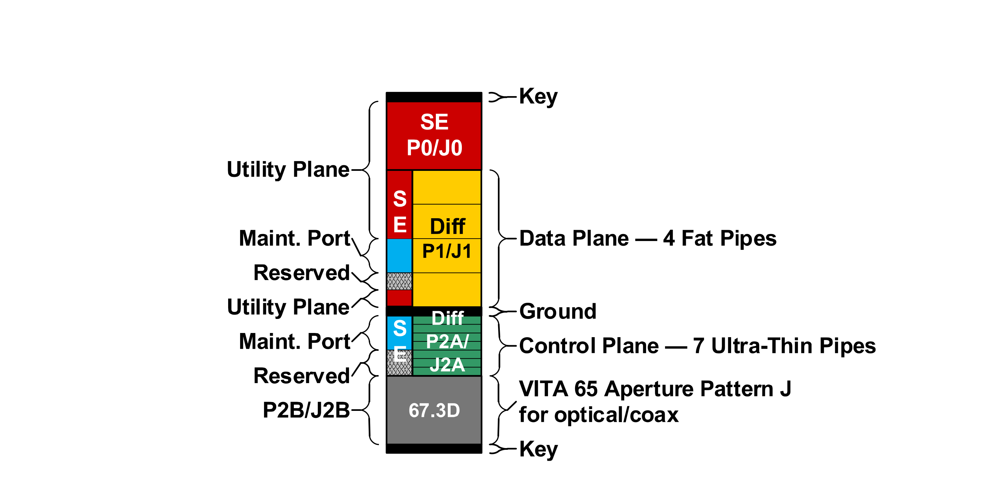

*Figure 30: ANSI/VITA 65.0 Control/Data Plane Switch Slot Profile SLT3-SWH-4F1U7U1J-14.8.7-n ｜ 图 30：ANSI/VITA 65.0 控制／数据平面交换机槽位配置档 SLT3-SWH-4F1U7U1J-14.8.7-n*

**Table 27: ANSI/VITA 65.1 Module Profiles for SLT3-SWH-4F1U7U1J-14.8.7-n ｜ 表 27：SLT3-SWH-4F1U7U1J-14.8.7-n 的 ANSI/VITA 65.1 模块配置档**

| Module Profile names ／ 模块配置档名 | Dash Num ／ 短横编号 | STD Date ／ 标准日期 | Slot Profile ／ 槽位配置档 | Protocols for Copper Planes ／ 铜平面协议 ||| Protocols for Optical ／ 光协议 | Comments ／ 注释 | Legacy ／ 旧式 |
|---|---|---|---|---|---|---|---|---|---|
| | | | | Data Plane ／ 数据平面 | Data Plane ／ 数据平面 | Control Plane ／ 控制平面 | | | |
| **MOD3-SWH-4F1U7U1J-16.8.7-** | | | | **DS01, DP01, DP02** | **DP03** | **CSutp01, CPutp01 - CPutp06** | | **First row of MOD3-SWH-4F1U7U1J-16.8.7-n MOD3-SWH-4F1U7U1J-16.8.7-n 的首行** | |
| MOD3-SWH-4F1U7U1J-16.8.7- | 1 | 2017-05 | SLT3-SWH-4F1U7U1J-14.8.7-1 | 10GBASE-KX4 -- 5.1.5 | As 4 UTPs: 1000BASE-KX -- 5.1.2 | 1000BASE-KX -- 5.1.2 | | | |
| MOD3-SWH-4F1U7U1J-16.8.7- | 2 | Proposed | SLT3-SWH-4F1U7U1J-14.8.7-0 | 10GBASE-KR -- 5.1.7, 40GBASE-KR4 -- 5.1.8 | 10GBASE-KR -- 5.1.7, 40GBASE-KR4 -- 5.1.8 | 10GBASE-KR -- 5.1.7 | | | |
| Last line | | | | | | | | | |

> 转写说明：表头两层级联——第一层 `Protocols for Copper Planes` 横跨其下 Data Plane、Data Plane、Control Plane 三列（原书该组标目偏左，压过第一道子列线）；`Module Profile names`、`Dash Num`、`STD Date`、`Slot Profile`、`Protocols for Optical`、`Comments`、`Legacy` 占满两行。被 colspan 覆盖处留空。
> 转写说明：`Module Profile names` 与 `Dash Num` 两个标目在原书同处一个表头格（左右分置，其间未画竖线）；数据行中短横编号以小号字排在该格右端。此处拆作两列照录，两列合并即为完整编号 `MOD3-SWH-4F1U7U1J-16.8.7-<n>`。
> 转写说明：第三行 STD Date 列在原书因列宽不足折为 `Propose` / `d` 两行，此处按单词复原为 `Proposed`；第二行槽位档 `SLT3-SWH-4F1U7U1J-14.8.7-1` 在原书为蓝色带下划线的超链接样式，此处只记文字。
> 转写说明：`Protocols for Optical` 列与 `Legacy` 列全表空白；末行除 `Last line` 外全为灰底空白。
> 转写说明：本表为单页整表（原书 p.110／PDF 第 130 页），共 4 个数据行。下一页（PDF 第 131 页）顶端为 Figure 31，非本表续行，故未续写。

##### 5.2.16.6 3U SOSA RF Switch Plug-In Card Profile ｜ 5.2.16.6 3U SOSA 射频交换机插卡配置档

**Rule 5.2.16.6-1**

SOSA 3U RF Switch Plug-In Cards shall conform to ANSI/VITA 65.0 slot profile SLT3-SWH-1F1S1S1U1U1K-14.8.8-n per. Conformance Methodology: (A)

SOSA 3U 射频交换机插卡应符合 ANSI/VITA 65.0 的 slot profile SLT3-SWH-1F1S1S1U1U1K-14.8.8-n，据（原文 per.）。符合性方法：(A)

> **译注**：本条英文在型号码之后多出一个孤立的「per.」（原书如此，疑为期刊或标准引文「per …」的残迹）；英文照录，中文按字面译作「据」，不代原文删改。

**Rule 5.2.16.6-2**

SOSA 3U RF Switch Plug-In Cards shall conform to one of the ANSI/VITA 65.1 module profiles in Table 28. Conformance Methodology: (A)

SOSA 3U 射频交换机插卡应符合表 28 所列 ANSI/VITA 65.1 的 module profile 之一。符合性方法：(A)

<!-- 原书 p.110 ｜ PDF p.130 -->

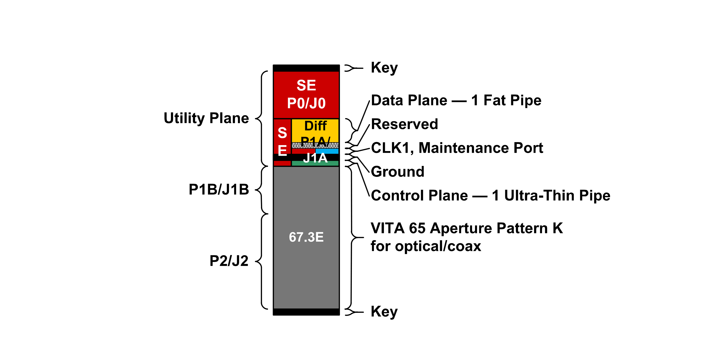

*Figure 31: ANSI/VITA 65.0 3U RF Switch Slot Profile SLT3-SWH-1F1S1S1U1U1K-14.8.8-n ｜ 图 31：ANSI/VITA 65.0 3U 射频交换机槽位配置档 SLT3-SWH-1F1S1S1U1U1K-14.8.8-n*

**Table 28: ANSI/VITA 65.1 Module Profiles for SLT3-SWH-1F1S1S1U1U1K-14.8.8-n ｜ 表 28：SLT3-SWH-1F1S1S1U1U1K-14.8.8-n 的 ANSI/VITA 65.1 模块配置档**

| Module Profile names ／ 模块配置档名 | Dash Num ／ 短横编号 | STD Date ／ 标准日期 | Slot Profile ／ 槽位配置档 | Protocols for Copper Planes ／ 铜平面协议 || Protocols for Optical ／ 光协议 | Comments ／ 注释 | Legacy ／ 旧式 |
|---|---|---|---|---|---|---|---|---|
| | | | | Data Plane ／ 数据平面 | Control Plane ／ 控制平面 | | | |
| **MOD3-SWH-1F1S1S1U1U1K-16.8.8-** | | | | **DP01** | **CPutp01** | | **First row of MOD3-SWH-1F1S1S1U1U1K-16.8.8-n MOD3-SWH-1F1S1S1U1U1K-16.8.8-n 的首行** | |
| MOD3-SWH-1F1S1S1U1U1K-16.8.8- | 1 | 2017-05 | SLT3-SWH-1F1S1S1U1U1K-14.8.8-1 | 10GBASE-KX4 -- 5.1.5 | 1000BASE-KX -- 5.1.2 | | | |
| MOD3-SWH-1F1S1S1U1U1K-16.8.8- | 2 | Proposed | SLT3-SWH-1F1S1S1U1U1K-14.8.8-0 | 10GBASE-KR -- 5.1.7, 40GBASE-KR4 -- 5.1.8 | 10GBASE-KR -- 5.1.7 | | | |
| Last line | | | | | | | | |

> 转写说明：表头两层级联——第一层 `Protocols for Copper Planes` 横跨其下 Data Plane、Control Plane 两列；`Module Profile names`、`Dash Num`、`STD Date`、`Slot Profile`、`Protocols for Optical`、`Comments`、`Legacy` 占满两行。被 colspan 覆盖处留空。
> 转写说明：`Module Profile names` 与 `Dash Num` 两个标目在原书同处一个表头格（左右分置，其间未画竖线）；数据行中短横编号以小号字排在该格右端。此处拆作两列照录，两列合并即为完整编号 `MOD3-SWH-1F1S1S1U1U1K-16.8.8-<n>`；首行无编号数字（原书如此）。
> 转写说明：第三行 STD Date 列在原书因列宽不足折为 `Propose` / `d` 两行，此处按单词复原为 `Proposed`；第二行槽位档 `SLT3-SWH-1F1S1S1U1U1K-14.8.8-1` 在原书为蓝色带下划线的超链接样式，此处只记文字。
> 转写说明：`Protocols for Optical` 列与 `Legacy` 列全表空白；末行除 `Last line` 外全为灰底空白。
> 转写说明：本表为单页整表（原书 p.111／PDF 第 131 页），共 4 个数据行。下一页（PDF 第 132 页）顶端为 Observation 5.2.16.7-1 正文与 Figure 32，非本表续行，故未续写。

##### 5.2.16.7 SOSA 3U Radial Clock Plug-In Card Profiles ｜ 5.2.16.7 SOSA 3U 径向时钟插卡配置档

**Rule 5.2.16.7-1**

SOSA 3U Radial Clock Plug-In Cards shall conform to ANSI/VITA 65.0 slot profile SLT3x-

SOSA 3U 径向时钟插卡应符合 ANSI/VITA 65.0 槽位配置档 SLT3x-

TIM-2S1U22S1U2U1H-14.9.2-n. Conformance Methodology: (A)

TIM-2S1U22S1U2U1H-14.9.2-n。符合性方法为 (A)

**Rule 5.2.16.7-2**

SOSA 3U Radial Clock Plug-In Cards shall only drive REF_CLK+/- if SYS_CON* is asserted. Conformance Methodology: (T)

SOSA 3U 径向时钟插卡应仅在 SYS_CON* 置位时才驱动 REF_CLK+/-。符合性方法为 (T)

**Rule 5.2.16.7-3**

SOSA 3U Radial Clock Plug-In Cards shall assert SYSRESET* until all internal clocks are valid. Conformance Methodology: (T)

SOSA 3U 径向时钟插卡应持续置起 SYSRESET*，直至所有内部时钟均有效。符合性方法为 (T)

**Rule 5.2.16.7-4**

SOSA 3U Radial Clock Plug-In Cards shall conform to one of the ANSI/VITA 65.1 module profiles in Table 29 and Table 30. Conformance Methodology: (A)

SOSA 3U 径向时钟插卡应符合 ANSI/VITA 65.1 表 29 与表 30 中模块配置档之一。符合性方法为 (A)

<!-- 原书 p.111 ｜ PDF p.131 -->

**Observation 5.2.16.7-1**

- ANSI/VITA 65.0 §6.2.2 requires the lower-numbered ports to be the ones that are used if there are some unused ports. The lower-numbered ports are the ones closest to P0/J0; hence if backplanes follow this requirement, the option of using SLT3x-TIM-4S16S1U2U1H-14.9.1-n for eight or fewer REF_CLK/AUX_CLK pairs will be accommodated.

- ANSI/VITA 65.0 §6.2.2 需求：在存在未使用的端口时，取用编号较低的端口。编号较低的端口即离 P0/J0 最近的那些；因此，若背板遵循该需求，把 SLT3x-TIM-4S16S1U2U1H-14.9.1-n 用于八对或更少的 REF_CLK/AUX_CLK 对这一选择便得以容纳。

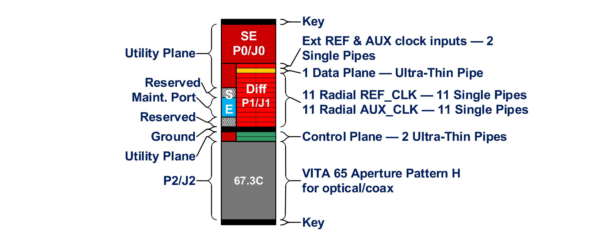

*Figure 32: ANSI/VITA 65.0 Radial Clock Slot Profile SLT3x-TIM-2S1U22S1U2U1H-14.9.2-n ｜ 图 32：ANSI/VITA 65.0 径向时钟槽位配置档 SLT3x-TIM-2S1U22S1U2U1H-14.9.2-n*

**Table 29: VITA 65.1 Slot Profiles for SLT3x-TIM-2S1U22S1U2U1H-14.9.2-n ｜ 表 29：SLT3x-TIM-2S1U22S1U2U1H-14.9.2-n 的 VITA 65.1 槽位配置档**

| Slot Profile names ／ 槽位配置档名 | Dash Num ／ 短杠编号 | STD Date ／ 标准日期 | Connector Modules ／ 连接器模块 |  |  | MT loading and Optical Pipes ／ MT 加载与光管 |  |  | Comments ／ 备注 |
|---|---|---|---|---|---|---|---|---|---|
|  |  |  | P1B/J1B | P2A/J2A | P2B/J2B | P1B/J1B | P2A/J2A | P2B/J2B |  |
| SLT3x-TIM-2S1U22S1U2U1H-14.9.2- |  | Proposed future 65.0 ／ 拟议的未来 65.0 版 | VITA 46 | Aperture H |  | VITA 46 | Aperture H |  | First row of SLT3x-TIM-2S1U22S1U2U1H-14.9.2-n 即 SLT3x-TIM-2S1U22S1U2U1H-14.9.2-n 的第一行 |
| SLT3x-TIM-2S1U22S1U2U1H-14.9.2- | 0 | Proposed future 65.0 ／ 拟议的未来 65.0 版 | VITA 46 | Empty ／ 空 |  |  |  |  |  |
| SLT3x-TIM-2S1U22S1U2U1H-14.9.2- | 1 | Proposed future 65.0 ／ 拟议的未来 65.0 版 | VITA 46 | 10 SMPM contacts-6.4.5.6.3 |  |  |  |  |  |
| Last line |  | Proposed future 65.0 ／ 拟议的未来 65.0 版 |  |  |  |  |  |  |  |

> 转写说明：
> 1. 表头为两层：第一行为分组标题，第二行（加粗）为子列标题，照原表第 2 行录。`Connector Modules` 横跨 P1B/J1B、P2A/J2A、P2B/J2B 三列，`MT loading and Optical Pipes` 横跨其后三列，被覆盖的单元格留空。
> 2. 原表 `Slot Profile names` 与 `Dash Num` 之间无竖线（扫描件如此），本表依表头文字分为两列；拼接后的完整配置档编号为 `SLT3x-TIM-2S1U22S1U2U1H-14.9.2-n`、`…-14.9.2-0`、`…-14.9.2-1`。
> 3. `Connector Modules` 的 P2A/J2A 与 P2B/J2B 在数据行上合并为一格（`Aperture H`、`Empty`、`10 SMPM contacts-6.4.5.6.3`），值记在 P2A/J2A 列，P2B/J2B 列留空；`MT loading and Optical Pipes` 同此，仅第一行有值 `VITA 46`、`Aperture H`。
> 4. `Last line` 为原表的收尾行标签（灰色底），照录。

> **译注**（表内代号）：本片各 VITA 配置档表内，`Slot Profile names`／`Module Profile names` 列的型号码、`Slot Profile` 列的槽位档串、`Dash Num` 的短杠号、`VITA 46`／`Aperture H`／`Aperture J` 一类连接器模块代号、接触件串（如 `10 SMPM contacts-6.4.5.6.3`）、协议串（如 `1000BASE-KX -- 5.1.2`）、引脚号与信号名（如 `A1`、`REF_CLK_Out --5.13.1`、`RSVD`）一律原样不译——它们是须与 VITA 65.1 原文对照的寻址键；表头格则一律「英文 ／ 中文」并置。状态值给中文——`Empty` 作“空”、`Proposed` 作“拟议中”、`Proposed future 65.0` 作“拟议的未来 65.0 版”；成句的 `Comments` 格按「英文 中文」并置。

**Table 30: VITA 65.1 Module Profiles for SLT3x-TIM-2S1U22S1U2U1H-14.9.2-n ｜ 表 30：SLT3x-TIM-2S1U22S1U2U1H-14.9.2-n 的 VITA 65.1 模块配置档**

| Module Profile names ／ 模块配置档名 | Dash Num ／ 短杠编号 | STD Date ／ 标准日期 | Slot Profile ／ 槽位配置档 | Protocols for Copper Planes ／ 铜平面协议 |  |  | Protocols for Optical and Signals for Coax Contacts ／ 光与同轴接触件信号的协议 |  |  |  |  |  |  |  |  |  |
|---|---|---|---|---|---|---|---|---|---|---|---|---|---|---|---|---|
|  |  |  |  | Data Plane ／ 数据平面 | Control Plane ／ 控制平面 | Contol Plane ／ 控制平面 | Coax Contacts for Connector Module 10_SMPM_contacts-6.4.5.6.3 ／ 连接器模块 10_SMPM_contacts-6.4.5.6.3 的同轴接触件 |  |  |  |  |  |  |  |  |  |
|  |  |  |  |  |  |  | **A1** | **A2** | **A3** | **B1** | **B2** | **B3** | **B4** | **C1** | **C2** | **C3** |
| MOD3x-TIM-2S1U22S1U2U1H-14.9.3- |  | Proposed future 65.0 ／ 拟议的未来 65.0 版 |  | DPutp01 | CPutp01, Cputp02 |  |  |  |  |  |  |  |  |  |  |  |
|  |  | Proposed future 65.0 ／ 拟议的未来 65.0 版 |  |  |  |  |  |  |  |  |  |  |  |  |  |  |
| MOD3p-TIM-2S1U22S1U2U1H-14.9.3- | 1 | Proposed future 65.0 ／ 拟议的未来 65.0 版 | SLT3p-TIM-2S1U22S1U2U1H-14.9.3-1 | 1000BASE-KX -- 5.1.2 | 1000BASE-KX -- 5.1.2 |  | REF_CLK_Out --5.13.1 | AUX_CLK_Out -- 5.13.1 | RSVD | AUX_CLK_In -- 5.13.1 | REF_CLK_In -- 5.13.1 | RSVD | RSVD | RSVD | GPS_Ant2_In -- 5.13.2 | GPS_Ant1_In -- 5.13.2 |
| MOD3p-TIM-2S1U22S1U2U1H-14.9.3- | 2 | Proposed future 65.0 ／ 拟议的未来 65.0 版 | SLT3p-TIM-2S1U22S1U2U1H-14.9.3-1 | 10GBASE-KR -- 5.1.7 | 10GBASE-KR -- 5.1.7 |  | REF_CLK_Out --5.13.1 | AUX_CLK_Out -- 5.13.1 | RSVD | AUX_CLK_In -- 5.13.1 | REF_CLK_In -- 5.13.1 | RSVD | RSVD | RSVD | GPS_Ant2_In -- 5.13.2 | GPS_Ant1_In -- 5.13.2 |
| Last line |  | Proposed future 65.0 ／ 拟议的未来 65.0 版 |  |  |  |  |  |  |  |  |  |  |  |  |  |  |

> 转写说明：
> 1. 表头为多层：第 1 行是分组标题（`Protocols for Copper Planes` 横跨 `Data Plane`／`Control Plane`／`Contol Plane` 三列；`Protocols for Optical and Signals for Coax Contacts` 横跨 `A1`～`C3` 十列），第 2、3 行（加粗）是子列标题，被覆盖的单元格留空。原表 `Data Plane` 等子标题与 `Coax Contacts for Connector Module 10_SMPM_contacts-6.4.5.6.3` 组标题同处一条 band（原表数据第 2 行）内，为便于并列成表，组标题置于第 2 行、`A1`～`C3` 置于第 3 行；原表该 band 只剩 `STD Date` 一格有值，即下方第 2 条数据行。
> 2. 原表 `Module Profile names` 与 `Dash Num` 之间无竖线（扫描件如此），本表依表头文字分为两列；拼接后的完整配置档编号为 `MOD3x-TIM-2S1U22S1U2U1H-14.9.3-n`、`MOD3p-TIM-2S1U22S1U2U1H-14.9.3-1`、`MOD3p-TIM-2S1U22S1U2U1H-14.9.3-2`。
> 3. `Protocols for Optical and Signals for Coax Contacts` 下第一行（`MOD3x…` 行）的十个单元格在原表中合并为一格且为空，值行从第三行起才出现（见第 3 条、第 4 条数据行）。
> 4. 原表在 `STD Date` 列把 `Proposed future 65.0` 画成上下相邻的两格（该行其余列未分格），本表按一格记，值不重复。
> 5. 左侧窄列内的换行（如 `CPutp01,`／`Cputp02`、`REF_CLK_`／`Out --5.13.1`）已并回单行，` ` 仅用于原表明确的两行内容；`A1` 列为 `Out --5.13.1`（`--` 后无空格），`A2`～`C3` 各列为 `-- 5.13.1`／`-- 5.13.2`（`--` 后有空格），照原样保留。
> 6. `Contol Plane` 系原表如此拼写（`Control` 缺 `r`），照录。
> 7. `Last line` 为原表的收尾行标签（灰色底），照录。

##### 5.2.16.8 3U External I/O Plug-In Card Profile ｜ 5.2.16.8 3U 外部 I/O 插卡配置档

**Rule 5.2.16.8-1**

- SOSA 3U External I/O Plug-In Cards shall conform to ANSI/VITA 65.0 slot profile SLT3-

- SOSA 3U 外部 I/O 插卡应符合 ANSI/VITA 65.0 槽位配置档 SLT3-

PAY-2U2U-14.2.17. Conformance Methodology: (TBD)

PAY-2U2U-14.2.17。符合性方法为 (TBD)

<!-- 原书 p.112 ｜ PDF p.132 -->

**Rule 5.2.16.8-2**

User-defined pins in ANSI/VITA 65.1 slot profile SLT3-PAY-2U2U-14.2.17 shall only interface with platform I/O and not other modules within the system. Conformance Methodology: (TBD)

ANSI/VITA 65.1 槽位配置档 SLT3-PAY-2U2U-14.2.17 中的用户自定义引脚应仅与平台 I/O 接口，而不与系统内其他模块接口。符合性方法为 (TBD)

**Rule 5.2.16.8-3**

SOSA 3U External I/O plug-in cards shall conform to one of the ANSI/VITA 65.1 module profiles in Table 31. Conformance Methodology: (A)

SOSA 3U 外部 I/O 插卡应符合 ANSI/VITA 65.1 表 31 中模块配置档之一。符合性方法为 (A)

**Observation 5.2.16.8-1**

Instead of routing platform-specific I/O to non-standard payloads, integrators can utilize the SOSA 3U External I/O plug-in card as the platform I/O “data center” where a single plug-in card (or multiple if required) can interface with the platform over platform-specific connections and the rest of the payload plug-in cards over standard expansion or control plane interfaces.

集成方可以不把平台专属的 I/O 引接到非标准载荷上，而把 SOSA 3U 外部 I/O 插卡用作平台 I/O 的“数据中心”：一块插卡（必要时可多块）经平台专属连接与平台接口，其余载荷插卡则经标准的扩展平面或控制平面接口。

**Recommendation 5.2.16.8-1**

The SOSA 3U I/O Intensive SBC plug-in card profile should be used instead of the SOSA 3U External I/O plug-in card profile if platform-specific I/O can be accommodated by a single XMC.

若平台专属 I/O 可由单个 XMC 容纳，宜采用 SOSA 3U I/O 密集型 SBC 插卡配置档，而不采用 SOSA 3U 外部 I/O 插卡配置档。

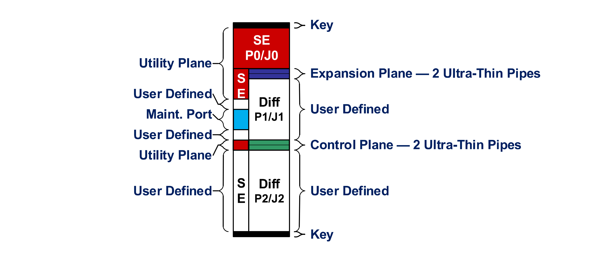

*Figure 33: ANSI/VITA 65.0 3U External I/O Slot Profile SLT3-PAY-2U2U-14.2.17 ｜ 图 33：ANSI/VITA 65.0 3U 外部 I/O 槽位配置档 SLT3-PAY-2U2U-14.2.17*

**Table 31: ANSI/VITA 65.1 Module Profiles for SLT3-PAY-2U2U-14.2.17 ｜ 表 31：SLT3-PAY-2U2U-14.2.17 的 ANSI/VITA 65.1 模块配置档**

| Module Profile names ／ 模块配置档名 | Dash Num ／ 短杠编号 | STD Date ／ 标准日期 | Slot Profile ／ 槽位配置档 | Protocols for Copper Planes ／ 铜平面协议 |  | Protocols for Optical ／ 光协议 | Comments ／ 备注 |
|---|---|---|---|---|---|---|---|
|  |  |  |  | Data Plane ／ 数据平面 | Control Plane ／ 控制平面 |  |  |
| MOD3-PAY-2U2U-16.2.16- |  | Proposed future 65.0 ／ 拟议的未来 65.0 版 |  | EPutp01, EPutp02 | CPutp01, CPutp02 |  | First row of MOD3-PAY-2U2U-16.2.16-n 即 MOD3-PAY-2U2U-16.2.16-n 的第一行 |
| MOD3-PAY-2U2U-16.2.16- | 1 | Proposed future 65.0 ／ 拟议的未来 65.0 版 | SLT3-PAY-2U2U-14.2.17 | PCIe Gen 2 -- 5.3.3.2 | 1000GBASE-KX -- 5.1.2 |  |  |
| MOD3-PAY-2U2U-16.2.16- | 2 | Proposed future 65.0 ／ 拟议的未来 65.0 版 | SLT3-PAY-2U2U-14.2.17 | PCIe Gen 3 -- 5.3.3.3 | 10GBASE-KR -- 5.1.7 |  |  |
| Last line |  | Proposed future 65.0 ／ 拟议的未来 65.0 版 |  |  |  |  |  |

> 转写说明：
> 1. 表头为两层：第 1 行为分组标题，第 2 行（加粗）为子列标题，照原表第 2 行录。`Protocols for Copper Planes` 横跨 `Data Plane`、`Control Plane` 两列，被覆盖的单元格留空；`Protocols for Optical` 无子列，各行均空。
> 2. 原表 `Module Profile names` 与 `Dash Num` 之间无竖线（扫描件如此），本表依表头文字分为两列；拼接后的完整配置档编号为 `MOD3-PAY-2U2U-16.2.16-n`、`MOD3-PAY-2U2U-16.2.16-1`、`MOD3-PAY-2U2U-16.2.16-2`。
> 3. 本表 `1000GBASE-KX` 系原表如此（比常见写法 `1000BASE-KX` 多一个 `G`），照录。
> 4. 第一行 `Slot Profile` 为空（通用档 `-n` 不指定具体插槽档），其上方的 `STD Date` 单元格在版面上明显高于其余各行，照录。
> 5. `Last line` 为原表的收尾行标签（灰色底），照录。

<!-- 原书 p.113 ｜ PDF p.133 -->

#### 5.2.17 6U Plug-In Card Profile Specifications ｜ 5.2.17 6U 插卡配置档规格

5.2.17.1 6U Payload Plug-In Card Profiles

5.2.17.1 6U 载荷插卡配置档

**Rule 5.2.17.1-1**

SOSA 6U Payload Plug-In Cards shall conform to ANSI/VITA 65.0 slot profile SLT6-PAY-4F2Q1H4U1T1S1S1TU2U2T1H-10.6.4-n or SLT6-PAY-4F1Q1H4U1T1S1S1TU2U2T1H-

SOSA 6U 载荷插卡应符合 ANSI/VITA 65.0 槽位配置档 SLT6-PAY-4F2Q1H4U1T1S1S1TU2U2T1H-10.6.4-n 或 SLT6-PAY-4F1Q1H4U1T1S1S1TU2U2T1H-

10.6.3-n. Conformance Methodology: (A)

10.6.3-n。符合性方法为 (A)

**Rule 5.2.17.1-2**

SOSA systems shall route the GPIO pins from ANSI/VITA SLT6-PAY-4F2Q1H4U1T1S1S1TU2U2T1H-10.6.4-n and SLT6-PAY-4F1Q1H4U1T1S1S1TU2U2T1H-10.6.3-n to external platform I/O. Conformance Methodology: (A)

SOSA 系统应把 ANSI/VITA SLT6-PAY-4F2Q1H4U1T1S1S1TU2U2T1H-10.6.4-n 与 SLT6-PAY-4F1Q1H4U1T1S1S1TU2U2T1H-10.6.3-n 的 GPIO 引脚引接到外部平台 I/O。符合性方法为 (A)

**Rule 5.2.17.1-3**

SOSA systems shall route XMC pins from ANSI/VITA 65.1 slot profile SLT6-PAY-4F1Q1H4U1T1S1S1TU2U2T1H-10.6.3-n to external chassis I/O connectors. Conformance Methodology: (A)

SOSA 系统应把 ANSI/VITA 65.1 槽位配置档 SLT6-PAY-4F1Q1H4U1T1S1S1TU2U2T1H-10.6.3-n 的 XMC 引脚引接到外部机箱 I/O 连接器。符合性方法为 (A)

**Rule 5.2.17.1-4**

SOSA 6U Payload Plug-In Cards shall conform to one of the ANSI/VITA 65.1 module profiles in Table 32 or Table 33. Conformance Methodology: (A)

SOSA 6U 载荷插卡应符合 ANSI/VITA 65.1 表 32 或表 33 中模块配置档之一。符合性方法为 (A)

**Rule 5.2.17.1-5**

If a Payload Plug-In Card implements the Control Plane Thin Pipes from ANSI/VITA 65.1 SLT6-PAY-4F2Q1H4U1T1S1S1TU2U2T1H-10.6.4-n or SLT6-PAY-

若某载荷插卡实现了来自 ANSI/VITA 65.1 SLT6-PAY-4F2Q1H4U1T1S1S1TU2U2T1H-10.6.4-n 或 SLT6-PAY-

4F1Q1H4U1T1S1S1TU2U2T1H-10.6.3-n, the Payload Plug-In Card shall use the Control Plane Thin Pipes exclusively for communication external to the system. Conformance Methodology: (A)

4F1Q1H4U1T1S1S1TU2U2T1H-10.6.3-n 的控制平面 Thin Pipes（细管），则该载荷插卡应把这些控制平面 Thin Pipes 专用于系统外部的通信。符合性方法为 (A)

**Observation 5.2.17.1-1**

Payload Plug-In Cards can include, but are not limited to, SBCs that are input/output (I/O)intensive, SBCs that are computationally-intensive, FPGAs, and RF transceivers.

载荷插卡可以包括（但不限于）：输入/输出（I/O）密集型的 SBC、计算密集型的 SBC、FPGA，以及射频收发信机。

**Recommendation 5.2.17.1-1**

Payload Plug-In Cards should conform to ANSI/VITA 65.1 slot profile SLT6-PAY-4F2Q1H4U1T1S1S1TU2U2T1H-10.6.4-n if they don’t require an XMC.

若载荷插卡不需要 XMC，则宜符合 ANSI/VITA 65.1 槽位配置档 SLT6-PAY-4F2Q1H4U1T1S1S1TU2U2T1H-10.6.4-n。

**Observation 5.2.17.1-2**

SOSA systems will likely only contain one or two plug-in cards that support ANSI/VITA 65.1 slot profile SLT6-PAY-4F1Q1H4U1T1S1S1TU2U2T1H-10.6.3-n. These slots can use an XMC to customize I/O for a particular system or platform. The remaining plug-in cards will use

SOSA 系统很可能只含一至两块支持 ANSI/VITA 65.1 槽位配置档 SLT6-PAY-4F1Q1H4U1T1S1S1TU2U2T1H-10.6.3-n 的插卡。这些槽位可用 XMC 为某一特定系统或平台定制 I/O。其余插卡将使用

<!-- 原书 p.114 ｜ PDF p.134 -->

ANSI/VITA 65.1 slot profile SLT6-PAY-4F2Q1H4U1T1S1S1TU2U2T1H-10.6.4-n to support processing for the various sensor modalities.

ANSI/VITA 65.1 槽位配置档 SLT6-PAY-4F2Q1H4U1T1S1S1TU2U2T1H-10.6.4-n，以支撑各类传感器模态的处理。

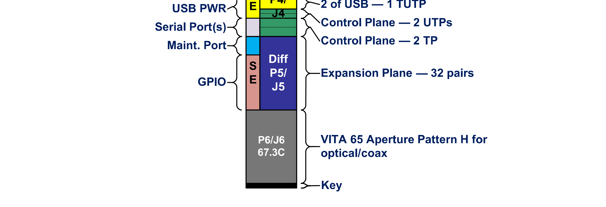

*Figure 34: ANSI/VITA 65.0 6U Payload Slot Profile SLT6-PAY-4F2Q1H4U1T1S1S1TU2U2T1H- ｜ 图 34：ANSI/VITA 65.0 6U 载荷槽位配置档 SLT6-PAY-4F2Q1H4U1T1S1S1TU2U2T1H-*

10.6.4-n

10.6.4-n（此行系图 34 题注中配置档编号的续行，照录，不译）

**Table 32: ANSI/VITA 65.1 Slot Profiles for SLT6-PAY-4F2Q1H4U1T1S1S1TU2U2T1H-10.6.4-n ｜ 表 32：SLT6-PAY-4F2Q1H4U1T1S1S1TU2U2T1H-10.6.4-n 的 ANSI/VITA 65.1 槽位配置档**

| Slot Profile names ／ 槽位配置档名 | Dash Num ／ 短杠编号 | STD Date ／ 标准日期 | Connector Modules ／ 连接器模块 |  |  |  | MT loading and Optical Pipes ／ MT 加载与光管 |  |
|---|---|---|---|---|---|---|---|---|
|  |  |  | P1/J1 , P2/J2 | P3/J3 | P4/J4, P5/J5 | P6/J6 | P3/J3 | P6/J6 |
| SLT6-PAY-4F2Q1H4U1T1S1S1TU2U2T1H-10.6.4- |  | Proposed future 65.0 ／ 拟议的未来 65.0 版 | VITA 46 | Aperture H | VITA 46 | Aperture H | Aperture H | Aperture H |
| SLT6-PAY-4F2Q1H4U1T1S1S1TU2U2T1H-10.6.4- | 0 | Proposed future 65.0 ／ 拟议的未来 65.0 版 | VITA 46 | Empty ／ 空 | VITA 46 | Empty ／ 空 | Empty ／ 空 | Empty ／ 空 |
| Last line |  | Proposed future 65.0 ／ 拟议的未来 65.0 版 |  |  |  |  |  |  |

> 转写说明：
> 1. 表头为两层：第 1 行为分组标题，第 2 行（加粗）为子列标题，照原表第 2 行录。`Connector Modules` 横跨 `P1/J1 , P2/J2`、`P3/J3`、`P4/J4, P5/J5`、`P6/J6` 四列，`MT loading and Optical Pipes` 横跨其后 `P3/J3`、`P6/J6` 两列，被覆盖的单元格留空。
> 2. 原表 `Slot Profile names` 与 `Dash Num` 之间无竖线（扫描件如此），本表依表头文字分为两列；拼接后的完整配置档编号为 `SLT6-PAY-4F2Q1H4U1T1S1S1TU2U2T1H-10.6.4-n` 与 `…-10.6.4-0`。
> 3. 该编号的字符序列经 6 倍放大逐字核对：`…4F2Q1H4U1T1S1S1TU2U2T1H…`，即 `1T` 与 `U2` 之间**无** `1`（不是 `…1S1S1T1U2U2T1H…`）。
> 4. 子列标题 `P1/J1 , P2/J2` 的逗号前有空格，`P4/J4, P5/J5` 的逗号前无空格，均照原表。
> 5. `Last line` 为原表的收尾行标签（灰色底），照录。

<!-- 原书 p.115 ｜ PDF p.135 -->

**Table 33: ANSI/VITA 65.1 Module Profiles for SLT6-PAY-4F2Q1H4U1T1S1S1TU2U2T1H-10.6.4-n ｜ 表 33：SLT6-PAY-4F2Q1H4U1T1S1S1TU2U2T1H-10.6.4-n 的 ANSI/VITA 65.1 模块配置档**

| Module Profile names ／ 模块配置档名 | Dash Num ／ 短杠编号 | STD Date ／ 标准日期 | Slot Profile ／ 槽位配置档 | Protocols for Copper Planes ／ 铜平面协议 |  |  |  | Miscellaneous Protocols over copper connectors ／ 铜连接器上的其他协议 |  |  |  |  |  | Protocols for Optical ／ 光协议 |
|---|---|---|---|---|---|---|---|---|---|---|---|---|---|---|
|  |  |  |  | Data Plane ／ 数据平面 | Exp. Plane ／ 扩展平面 | Control Plane ／ 控制平面 | Control Plane ／ 控制平面 |  |  |  |  |  |  |  |
| MOD6-PAY-4F2Q1H4U1T1S1S1TU2U2T1H-12.6.4- |  | Proposed future 65.0 ／ 拟议的未来 65.0 版 |  | DP01 - DP04 (FPs) | EP00 - EP15 | CPutp01, CPutp02 | CPtp01, CPtp02 | STRutp01 - STRutp04 | USB01, USB02 | VID01 | SER01 | GPIO1 - GPIO10 | GPIvds01 |  |
| MOD6-PAY-4F2Q1H4U1T1S1S1TU2U2T1H-12.6.4- | 1 | Proposed future 65.0 ／ 拟议的未来 65.0 版 | SLT6-PAY-4F2Q1H4U1T1S1S1TU2U2T1H-10.6.4-0 | 10GBASE-KX4 -- 5.1.5 | PCIe Gen 2 -- 5.3.3.2 | 1000BASE-KX -- 5.1.2 | 1000BASE-T -- 5.1.3 | SATA Gen 2 -- 5.6.2 | USB 2 -- 5.9.1 | DisplayPort 1.2 -- 5.10.2 | Serial Ports -- 5.12.1 | GPIO -- 5.14.1 | GPLVDS -- 5.14.2 |  |
| MOD6-PAY-4F2Q1H4U1T1S1S1TU2U2T1H-12.6.4- | 2 | Proposed future 65.0 ／ 拟议的未来 65.0 版 | SLT6-PAY-4F2Q1H4U1T1S1S1TU2U2T1H-10.6.4-0 | 40GBASE-KR4 -- 5.1.8 | PCIe Gen 3 -- 5.3.3.3 | 10GBASE-KR -- 5.1.7 | 10GBASE-T -- 5.1.6 | SATA Gen 3 -- 5.6.3 | USB 3.1 Gen 2 -- 5.9.3 | DisplayPort 1.2 -- 5.10.2 | Serial Ports -- 5.12.1 | GPIO -- 5.14.1 | GPLVDS -- 5.14.2 |  |
| MOD6-PAY-4F2Q1H4U1T1S1S1TU2U2T1H-12.6.4- | 3 | Proposed ／ 拟议中 | SLT6-PAY-4F2Q1H4U1T1S1S1TU2U2T1H-10.6.4-0 | 40GBASE-KR4 -- 5.1.8 | Aurora -- 5.7.2 | 10GBASE-KR -- 5.1.7 | 10GBASE-T -- 5.1.6 | SATA Gen 3 -- 5.6.3 | USB 3.1 Gen 2 -- 5.9.3 | DisplayPort 1.2 -- 5.10.2 | Serial Ports -- 5.12.1 | GPIO -- 5.14.1 | GPLVDS -- 5.14.2 |  |
| MOD6-PAY-4F2Q1H4U1T1S1S1TU2U2T1H-12.6.4- | 4 | Proposed ／ 拟议中 | SLT6-PAY-4F2Q1H4U1T1S1S1TU2U2T1H-10.6.4-1 | 10GBASE-KR -- 5.1.7 | PCIe Gen 3 -- 5.3.3.3 | 1000BASE-KX -- 5.1.2 | 1000BASE-T -- 5.1.3 | SATA Gen 3 -- 5.6.3 | USB 3.1 Gen 2 -- 5.9.3 | DisplayPort 1.2 -- 5.10.2 | Serial Ports -- 5.12.1 | GPIO -- 5.14.1 | GPLVDS -- 5.14.2 |  |
| MOD6-PAY-4F2Q1H4U1T1S1S1TU2U2T1H-12.6.4- | 5 | Proposed ／ 拟议中 | SLT6-PAY-4F2Q1H4U1T1S1S1TU2U2T1H-10.6.4-1 | 10GBASE-KR -- 5.1.7 | Aurora -- 5.7.2 | 1000BASE-KX -- 5.1.2 | 1000BASE-T -- 5.1.3 | SATA Gen 3 -- 5.6.3 | USB 3.1 Gen 2 -- 5.9.3 | DisplayPort 1.2 -- 5.10.2 | Serial Ports -- 5.12.1 | GPIO -- 5.14.1 | GPLVDS -- 5.14.2 |  |
| MOD6-PAY-4F2Q1H4U1T1S1S1TU2U2T1H-12.6.4- | 6 | Proposed ／ 拟议中 | SLT6-PAY-4F2Q1H4U1T1S1S1TU2U2T1H-10.6.4-2 | 40GBASE-KR4 -- 5.1.8 | PCIe Gen 3 -- 5.3.3.3 | 10GBASE-KR -- 5.1.7 | 10GBASE-T -- 5.1.6 | SATA Gen 3 -- 5.6.3 | USB 3.1 Gen 2 -- 5.9.3 | DisplayPort 1.2 -- 5.10.2 | Serial Ports -- 5.12.1 | GPIO -- 5.14.1 | GPLVDS -- 5.14.2 |  |
| MOD6-PAY-4F2Q1H4U1T1S1S1TU2U2T1H-12.6.4- | 7 | Proposed ／ 拟议中 | SLT6-PAY-4F2Q1H4U1T1S1S1TU2U2T1H-10.6.4-2 | 40GBASE-KR4 -- 5.1.8 | Aurora -- 5.7.2 | 10GBASE-KR -- 5.1.7 | 10GBASE-T -- 5.1.6 | SATA Gen 3 -- 5.6.3 | USB 3.1 Gen 2 -- 5.9.3 | DisplayPort 1.2 -- 5.10.2 | Serial Ports -- 5.12.1 | GPIO -- 5.14.1 | GPLVDS -- 5.14.2 |  |

> 转写说明：
> 1. 表头为两层：第 1 行为分组标题，第 2 行（加粗）为子列标题；原表 `Protocols for Copper Planes` 下四个子列标题依次为 `Data Plane`、`Exp. Plane`、`Control Plane`、`Control Plane`（后两列同名），被覆盖的单元格留空；`Miscellaneous Protocols over copper connectors` 横跨六列，此六列原表**未设**子列标题，标题行第二层留空，各列含义由第一行数据（`STRutp01 - STRutp04`、`USB01, USB02`、`VID01`、`SER01`、`GPIO1 - GPIO10`、`GPIvds01`）给出；`Protocols for Optical` 为单列，各行均空。
> 2. 原表 `Module Profile names` 与 `Dash Num` 之间无竖线（扫描件如此），本表依表头文字分为两列；拼接后的完整配置档编号为 `MOD6-PAY-4F2Q1H4U1T1S1S1TU2U2T1H-12.6.4-n` 及其 `-1`～`-7` 各档。
> 3. 八行 `Module Profile names` 的版本段经 6 倍放大逐字核对，**均为 `12.6.4-`**（不是 `12.6.5`／`12.6.6`／`12.6.7`）；变化的只是 `Dash Num`。
> 4. `Slot Profile` 取值 `SLT6-PAY-4F2Q1H4U1T1S1S1TU2U2T1H-10.6.4-0`（第一至三行数据）与 `…-10.6.4-1`（第四、五行数据）、`…-10.6.4-2`（第六、七行数据）。
> 5. `STD Date` 列前三行数据为 `Proposed future 65.0`（红底），其余五行为 `Proposed`（灰底），照原表。
> 6. 表头 `GPIvds01` 与同列数据 `GPLVDS -- 5.14.2` 在拼写上不一致，均照原表录，未作统一。
> 7. 单元格内的换行（如 `SLT6-PAY-`／`4F2Q1H4U1T1S1S1TU2U2T1H-`／`10.6.4-0` 三行、`40GBASE-KR4 --`／`5.1.8` 两行）系窄列折行，已并回单行。

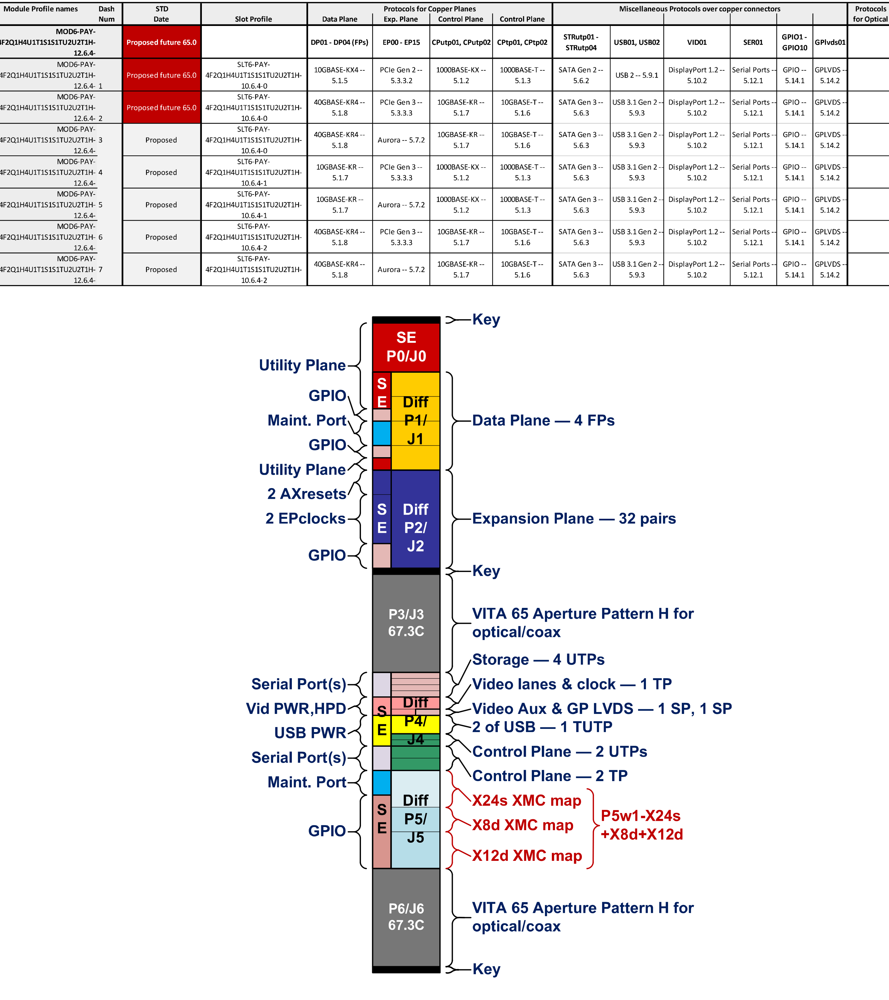

*Figure 35: ANSI/VITA 65.0 6U Payload Slot Profile SLT6-PAY-4F1Q1H4U1T1S1S1TU2U2T1H- ｜ 图 35：ANSI/VITA 65.0 6U 载荷槽位配置档 SLT6-PAY-4F1Q1H4U1T1S1S1TU2U2T1H-*

10.6.3-n

10.6.3-n（此行系图 35 题注中配置档编号的续行，照录，不译）

<!-- 原书 p.116 ｜ PDF p.136 -->

**Table 34: ANSI/VITA 65.1 Module Profiles for SLT6-PAY-4F1Q1H4U1T1S1S1TU2U2T1H-10.6.3-n ｜ 表 34：SLT6-PAY-4F1Q1H4U1T1S1S1TU2U2T1H-10.6.3-n 的 ANSI/VITA 65.1 模块配置档**

| Module Profile names ／ 模块配置档名 | Dash Num ／ 短杠编号 | STD Date ／ 标准日期 | Slot Profile ／ 槽位配置档 | Protocols for Copper Planes ／ 铜平面协议 |  |  |  | Miscellaneous Protocols over copper connectors ／ 铜连接器上的其他协议 |  |  |  |  |  | Protocols for Optical ／ 光协议 |
|---|---|---|---|---|---|---|---|---|---|---|---|---|---|---|
|  |  |  |  | Data Plane ／ 数据平面 | Exp. Plane ／ 扩展平面 | Control Plane ／ 控制平面 | Control Plane ／ 控制平面 |  |  |  |  |  |  |  |
| MOD6-PAY-4F1Q1H4U1T1S1S1TU2U2T1H-12.6.3- |  | Proposed future 65.0 ／ 拟议的未来 65.0 版 |  | DP01 - DP04 (FPs) | EP00 - EP15 | CPutp01, CPutp02 | CPtp01, CPtp02 | STRutp01 - STRutp04 | USB01, USB02 | VID01 | SER01 | GPIO1 - GPIO10 | GPIvds01 |  |
| MOD6-PAY-4F1Q1H4U1T1S1S1TU2U2T1H-12.6.3- | 1 | Proposed future 65.0 ／ 拟议的未来 65.0 版 | SLT6-PAY-4F1Q1H4U1T1S1S1TU2U2T1H-10.6.3-0 | 10GBASE-KX4 -- 5.1.5 | PCIe Gen 2 -- 5.3.3.2 | 1000BASE-KX -- 5.1.2 | 1000BASE-T -- 5.1.3 | SATA Gen 2 -- 5.6.2 | USB 2 -- 5.9.1 | DisplayPort 1.2 -- 5.10.2 | Serial Ports -- 5.12.1 | GPIO -- 5.14.1 | GPLVDS -- 5.14.2 |  |
| MOD6-PAY-4F1Q1H4U1T1S1S1TU2U2T1H-12.6.3- | 2 | Proposed future 65.0 ／ 拟议的未来 65.0 版 | SLT6-PAY-4F1Q1H4U1T1S1S1TU2U2T1H-10.6.3-0 | 40GBASE-KR4 -- 5.1.8 | PCIe Gen 3 -- 5.3.3.3 | 10GBASE-KR -- 5.1.7 | 10GBASE-T -- 5.1.6 | SATA Gen 3 -- 5.6.3 | USB 3.1 Gen 2 -- 5.9.3 | DisplayPort 1.2 -- 5.10.2 | Serial Ports -- 5.12.1 | GPIO -- 5.14.1 | GPLVDS -- 5.14.2 |  |
| MOD6-PAY-4F1Q1H4U1T1S1S1TU2U2T1H-12.6.3- | 3 | Proposed ／ 拟议中 | SLT6-PAY-4F2Q1H4U1T1S1S1TU2U2T1H-10.6.4-0 | 40GBASE-KR4 -- 5.1.8 | Aurora -- 5.7.2 | 10GBASE-KR -- 5.1.7 | 10GBASE-T -- 5.1.6 | SATA Gen 3 -- 5.6.3 | USB 3.1 Gen 2 -- 5.9.3 | DisplayPort 1.2 -- 5.10.2 | Serial Ports -- 5.12.1 | GPIO -- 5.14.1 | GPLVDS -- 5.14.2 |  |
| MOD6-PAY-4F1Q1H4U1T1S1S1TU2U2T1H-12.6.3- | 4 | Proposed ／ 拟议中 | SLT6-PAY-4F2Q1H4U1T1S1S1TU2U2T1H-10.6.4-1 | 10GBASE-KR -- 5.1.7 | PCIe Gen 3 -- 5.3.3.3 | 1000BASE-KX -- 5.1.2 | 1000BASE-T -- 5.1.3 | SATA Gen 3 -- 5.6.3 | USB 3.1 Gen 2 -- 5.9.3 | DisplayPort 1.2 -- 5.10.2 | Serial Ports -- 5.12.1 | GPIO -- 5.14.1 | GPLVDS -- 5.14.2 |  |
| MOD6-PAY-4F1Q1H4U1T1S1S1TU2U2T1H-12.6.3- | 5 | Proposed ／ 拟议中 | SLT6-PAY-4F2Q1H4U1T1S1S1TU2U2T1H-10.6.4-1 | 10GBASE-KR -- 5.1.7 | Aurora -- 5.7.2 | 1000BASE-KX -- 5.1.2 | 1000BASE-T -- 5.1.3 | SATA Gen 3 -- 5.6.3 | USB 3.1 Gen 2 -- 5.9.3 | DisplayPort 1.2 -- 5.10.2 | Serial Ports -- 5.12.1 | GPIO -- 5.14.1 | GPLVDS -- 5.14.2 |  |
| MOD6-PAY-4F1Q1H4U1T1S1S1TU2U2T1H-12.6.3- | 6 | Proposed ／ 拟议中 | SLT6-PAY-4F2Q1H4U1T1S1S1TU2U2T1H-10.6.4-2 | 40GBASE-KR4 -- 5.1.8 | PCIe Gen 3 -- 5.3.3.3 | 10GBASE-KR -- 5.1.7 | 10GBASE-T -- 5.1.6 | SATA Gen 3 -- 5.6.3 | USB 3.1 Gen 2 -- 5.9.3 | DisplayPort 1.2 -- 5.10.2 | Serial Ports -- 5.12.1 | GPIO -- 5.14.1 | GPLVDS -- 5.14.2 |  |
| MOD6-PAY-4F1Q1H4U1T1S1S1TU2U2T1H-12.6.3- | 7 | Proposed ／ 拟议中 | SLT6-PAY-4F2Q1H4U1T1S1S1TU2U2T1H-10.6.4-2 | 40GBASE-KR4 -- 5.1.8 | Aurora -- 5.7.2 | 10GBASE-KR -- 5.1.7 | 10GBASE-T -- 5.1.6 | SATA Gen 3 -- 5.6.3 | USB 3.1 Gen 2 -- 5.9.3 | DisplayPort 1.2 -- 5.10.2 | Serial Ports -- 5.12.1 | GPIO -- 5.14.1 | GPLVDS -- 5.14.2 |  |

> 转写说明：
> 1. 本表完整落在 PDF p137（印刷页 117）一页内：p137 顶端即本表题注，表末（第 8 行数据之后）紧接 5.2.17.2 节正文，故无跨页续表，也未取下一页。
> 2. 表头为两层：第 1 行为分组标题，第 2 行（加粗）为子列标题。`Protocols for Copper Planes` 下四个子列标题依次为 `Data Plane`、`Exp. Plane`、`Control Plane`、`Control Plane`（后两列同名）；`Miscellaneous Protocols over copper connectors` 横跨六列，此六列原表未设子列标题，各列含义由第一行数据（`STRutp01 - STRutp04`、`USB01, USB02`、`VID01`、`SER01`、`GPIO1 - GPIO10`、`GPIvds01`）给出；`Protocols for Optical` 为单列，各行均空。
> 3. 原表 `Module Profile names` 与 `Dash Num` 之间无竖线（扫描件如此），本表依表头文字分为两列；完整配置档编号为 `MOD6-PAY-4F1Q1H4U1T1S1S1TU2U2T1H-12.6.3-n` 及 `-1`～`-7`。
> 4. 八行的版本段 `12.6.3` 经逐字形核对（同字号 `3`／`5`／`2` 的字形对照）确认为 `3`，八行一致；变化的只是 `Dash Num`。
> 5. `Slot Profile` 列前两行数据（`Dash Num` 1、2）为 `SLT6-PAY-4F1Q1H4U1T1S1S1TU2U2T1H-10.6.3-0`；自第三行数据（`Dash Num` 3）起改为 `SLT6-PAY-4F2Q1H4U1T1S1S1TU2U2T1H-10.6.4-…`（`4F1Q`／`10.6.3` 换成 `4F2Q`／`10.6.4`），照原表。
> 6. `STD Date` 列前三行数据为 `Proposed future 65.0`（红底），其余五行为 `Proposed`（灰底），照原表。
> 7. 表头 `GPIvds01` 与同列数据 `GPLVDS -- 5.14.2` 拼写不一致，均照原表，未作统一。
> 8. 窄列折行（`SLT6-PAY-`／`4F1Q1H4U1T1S1S1TU2U2T1H-`／`10.6.3-0`、`40GBASE-KR4 --`／`5.1.8`）系版式折行，已并回单行。

##### 5.2.17.2 SOSA 6U Control/Data Switch Plug-In Card Profile ｜ 5.2.17.2 SOSA 6U 控制／数据交换机插卡配置档

**Rule 5.2.17.2-1**

- SOSA 6U Control/Data Switch Plug-In Cards shall conform to ANSI/VITA 65.0 slot profile

- SOSA 6U 控制／数据交换机插卡应符合 ANSI/VITA 65.0 槽位配置档

SLT6-SWH-14F16U1U15U1J-10.8.1-n. Conformance Methodology: (A)

SLT6-SWH-14F16U1U15U1J-10.8.1-n。符合性方法为 (A)

**Rule 5.2.17.2-2**

- SOSA 6U Control/Data Switch Plug-In Cards shall conform to one of the ANSI/VITA 65.1 module profiles in Table 35 or Table 36. Conformance Methodology: (A)

- SOSA 6U 控制／数据交换机插卡应符合 ANSI/VITA 65.1 表 35 或表 36 中模块配置档之一。符合性方法为 (A)

<!-- 原书 p.117 ｜ PDF p.137 -->

- Key-

- 键位（图内文字，残留照录，不译）

SE

SE（图内文字，残留照录，不译）

POIJO

POIJO（图内文字，残留照录，不译）

Utility Plane-

Utility Plane-（辅助平面；图内文字，残留照录，不译）

Reserved 5E DI

Reserved 5E DI（保留；图内文字，残留照录，不译）

Maint. Port P4fJ1

Maint. Port P4fJ1（维护端口；图内文字，残留照录，不译）

Resered-

Resered-（保留；原文如此拼写，图内文字，残留照录，不译）

Utility Plane

Utility Plane（辅助平面；图内文字，残留照录，不译）

Df

Df（图内字符，残留照录，不译）

- Resered- P2f

- Resered- P2f（保留；原文如此拼写，图内文字，残留照录，不译）

J2_ Data Plane 14 FPs

J2_ Data Plane 14 FPs（J2 数据平面 14 个 FP；图内文字，残留照录，不译）

Key-

Key-（键位；图内文字，残留照录，不译）

Df

Df（图内字符，残留照录，不译）

P3f

P3f（图内字符，残留照录，不译）

E

E（图内字符，残留照录，不译）

J_

J_（图内字符，残留照录，不译）

Data Plane

Data Plane（数据平面；图内文字，残留照录，不译）

2 TPs

2 TPs（2 个 TP；图内文字，残留照录，不译）

*Figure 36: ANSI/VITA 65.0 6U Control/Data Switch Slot Profile SLT6-SWH-14F16U1U15U1J- ｜ 图 36：ANSI/VITA 65.0 6U 控制／数据交换机槽位配置档 SLT6-SWH-14F16U1U15U1J-*

10.8.1-n

10.8.1-n（此行系图 36 题注中配置档编号的续行，照录，不译）

> **译注**：以上十八行英文原为图 36 图框内的标注文字（键位、辅助平面、数据平面、保留等），转写件把它们录成了散行。图内文字本不译（以原图为准），此处只就每行给出中文提示；行内串序、断字与错拼（`Resered`、`P4fJ1`、`P3f`）照录不改。

**Table 35: ANSI/VITA 65.1 Slot Profiles for SLT6-SWH-14F16U1U15U1J-10.8.1-n ｜ 表 35：SLT6-SWH-14F16U1U15U1J-10.8.1-n 的 ANSI/VITA 65.1 槽位配置档**

| Slot Profile names ／ 槽位配置档名 | Dash Num ／ 短杠编号 | STD Date ／ 标准日期 | Connector Modules ／ 连接器模块 |  | MT loading and Optical Pipes ／ MT 加载与光管 |  |
|---|---|---|---|---|---|---|
|  |  |  | P1/J1 - P6A/J6A | P6B/J6B | P1/J1 - P6A/J6A | P6B/J6B |
| SLT6-SWH-14F16U1U15U1J-10.8.1- |  | Proposed future 65.0 ／ 拟议的未来 65.0 版 | VITA 46 | Aperture J | VITA 46 | Aperture J |
| SLT6-SWH-14F16U1U15U1J-10.8.1- | 0 | Proposed future 65.0 ／ 拟议的未来 65.0 版 | VITA 46 | Empty ／ 空 | VITA 46 |  |
| Last line |  | Proposed future 65.0 ／ 拟议的未来 65.0 版 |  |  |  |  |

> 转写说明：
> 1. 本表完整落在 PDF p138（印刷页 118）内，紧随其上方 Figure 36。p139 起为 5.2.18 节正文与整页槽位图（p140、p141），无本表续行，故不跨页续写。
> 2. 表头为两层：第 1 行为分组标题，第 2 行（加粗）为子列标题。`Connector Modules` 横跨 `P1/J1 - P6A/J6A`、`P6B/J6B` 两列，`MT loading and Optical Pipes` 横跨其后同名的两列，被覆盖的单元格留空。
> 3. 原表 `Slot Profile names` 与 `Dash Num` 之间无竖线（扫描件如此），本表依表头文字分为两列；完整配置档编号为 `SLT6-SWH-14F16U1U15U1J-10.8.1-n` 与 `…-10.8.1-0`。
> 4. 第 2 行 `MT loading and Optical Pipes` 的 `P6B/J6B` 格在原表中为空（同行其余三格有值），留空照录。
> 5. `Last line` 为原表的收尾行标签（灰色底），照录。

**Table 36: ANSI/VITA 65.1 Module Profiles for SLT6-SWH-14F16U1U15U1J-10.8.1-n ｜ 表 36：SLT6-SWH-14F16U1U15U1J-10.8.1-n 的 ANSI/VITA 65.1 模块配置档**

| Module Profile names ／ 模块配置档名 | Dash Num ／ 短杠编号 | STD Date ／ 标准日期 | Slot Profile ／ 槽位配置档 | Protocols for Copper Planes ／ 铜平面协议 |  |  |  |  | Protocols for Optical ／ 光协议 | Legacy ／ 旧有 |
|---|---|---|---|---|---|---|---|---|---|---|
|  |  |  |  | Data Plane ／ 数据平面 | Data Plane ／ 数据平面 | Data Plane ／ 数据平面 | Control Plane ／ 控制平面 | Control Plane ／ 控制平面 |  |  |
| MOD6-SWH-14F16U1U15U1J-12.8.1- |  | Proposed future 65.0 ／ 拟议的未来 65.0 版 |  | DP01 - DP14 (FPs) | DPutp01 - DPutp16 | DPtp01, DPtp02 | CPutp01 - CPutp15 | CPext01 (UTP) |  |  |
| MOD6-SWH-14F16U1U15U1J-12.8.1- | 1 | Proposed future 65.0 ／ 拟议的未来 65.0 版 | SLT6-SWH-14F16U1U15U1J-10.8.1-0 | 40GBASE-KR4 -- 5.1.8 | 10GBASE-KR -- 5.1.7, 40GBASE-KR4 -- 5.1.8 | 1000BASE-T | 1000BASE-KX -- 5.1.2 | 100BASE-T |  |  |
| MOD6-SWH-14F16U1U15U1J-12.8.1- | 2 | Proposed future 65.0 ／ 拟议的未来 65.0 版 | SLT6-SWH-14F16U1U15U1J-10.8.1-0 | 40GBASE-KR4 -- 5.1.8 | 10GBASE-KR -- 5.1.7, 40GBASE-KR4 -- 5.1.8 | 1000BASE-T | 10GBASE-KR -- 5.1.7 | 100BASE-T |  |  |
| Last line |  | Proposed future 65.0 ／ 拟议的未来 65.0 版 |  |  |  |  |  |  |  |  |

> 转写说明：
> 1. 本表完整落在 PDF p138（印刷页 118）下半页，表末（`Last line` 行）之后即页末。p139（印刷页 119）整页是 5.2.18 节正文（Rule 5.2.18-1／5.2.18-2、Recommendation 5.2.18-1），p140、p141 是整页槽位示意图与 Figure 37 的说明文字，均无本表续行——据此判定本表不跨页，未续写。
> 2. 表头为两层：第 1 行为分组标题，第 2 行（加粗）为子列标题。`Protocols for Copper Planes` 横跨五列，其子列标题依次为 `Data Plane`、`Data Plane`、`Data Plane`、`Control Plane`、`Control Plane`（前三列同名、后两列同名，系原表如此）；`Protocols for Optical`、`Legacy` 各为单列，各行均空。
> 3. 原表 `Module Profile names` 与 `Dash Num` 之间无竖线（扫描件如此），本表依表头文字分为两列；完整配置档编号为 `MOD6-SWH-14F16U1U15U1J-12.8.1-n`、`…-12.8.1-1`、`…-12.8.1-2`。
> 4. 原表只有 `Dash Num` 1、2 两档（无 `-0`），照录。
> 5. 窄列折行（`DPtp01,`／`DPtp02`、`CPutp01 -`／`CPutp15`、`10GBASE-KR -- 5.1.7,`／`40GBASE-KR4 -- 5.1.8`、`40GBASE-KR4 --`／`5.1.8`、`1000BASE-KX --`／`5.1.2`）均按原表折行处以 ` ` 保留。
> 6. `Last line` 为原表的收尾行标签（灰色底），照录。

<!-- 原书 p.118 ｜ PDF p.138 -->

#### 5.2.18 SOSA 6U Legacy Switch Plug-In Card Profile SOSA 6U 遗留交换插卡配置档

**Rule 5.2.18-1**

SOSA 6U Legacy Switch Plug-In Cards shall conform to ANSI/VITA 65.0 slot profile SLT6-SWH-16U20F-10.4.2. Conformance Methodology: (A)

SOSA 6U 遗留交换插卡应符合 ANSI/VITA 65.0 的 slot profile（槽位配置档）SLT6-SWH-16U20F-10.4.2。符合性方法：(A)

**Rule 5.2.18-2**

SOSA 6U Legacy Switch Plug-In Cards shall conform to one of the following ANSI/VITA 65.1 module profiles per: MOD6-SWH-16F20U-12.4.2-3

SOSA 6U 遗留交换插卡应符合下列 ANSI/VITA 65.1 module profile（模块配置档）之一，具体为：MOD6-SWH-16F20U-12.4.2-3

Conformance Methodology: (A)

符合性方法：(A)

- MOD6-SWH-16F20U-12.4.2-5

- MOD6-SWH-16F20U-12.4.2-5（配置档型号码，原样照录不译）

  - Conformance Methodology: (A)

  - 符合性方法：(A)

- MOD6-SWH-16F20U-12.4.2-11

- MOD6-SWH-16F20U-12.4.2-11（配置档型号码，原样照录不译）

  - Conformance Methodology: (A)

  - 符合性方法：(A)

- MOD6-SWH-16F20U-12.4.2-15

- MOD6-SWH-16F20U-12.4.2-15（配置档型号码，原样照录不译）

  - Conformance Methodology: (A)

  - 符合性方法：(A)

**Recommendation 5.2.18-1**

It is anticipated that the SLT6-SWH-16U20F-10.4.2 profile will be deprecated from the next version of the SOSA standard and consequently should not be used for new systems.

预计自下一版 SOSA 标准起，SLT6-SWH-16U20F-10.4.2 配置档将被弃用，故不宜用于新系统。

<!-- 原书 p.119 ｜ PDF p.139 -->

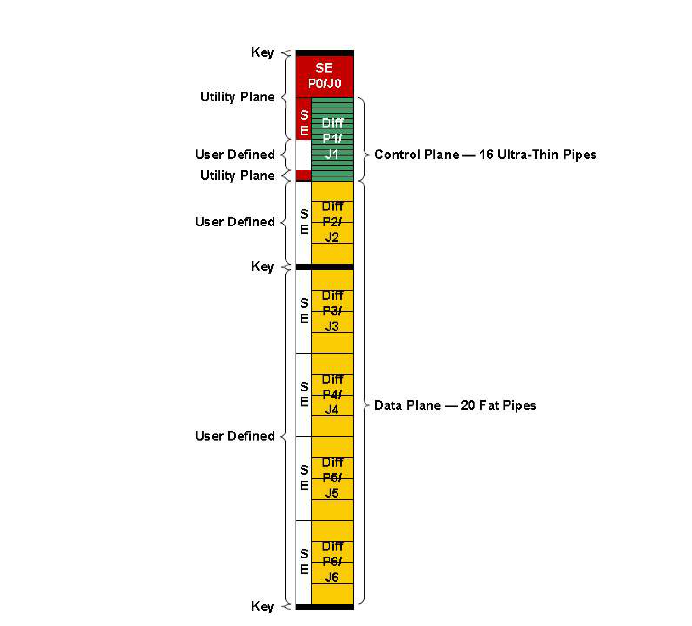

*Figure 37: ANSI/VITA65.0 Switch Slot Profile for SLT6-SWH-16U20F-10.4.2 ｜ 图 37：SLT6-SWH-16U20F-10.4.2 的 ANSI/VITA65.0 交换槽位配置档*

#### 5.2.19 SOSA 6U External I/O Plug-In Card Profile SOSA 6U 外部 I/O 插卡配置档

**Rule 5.2.19-1**

SOSA 6U External I/O Plug-In Cards shall conform to ANSI/VITA 65.0 slot profile SLT6-PAY-4U2U-10.2.8. Conformance Methodology: (A)

SOSA 6U 外部 I/O 插卡应符合 ANSI/VITA 65.0 的 slot profile SLT6-PAY-4U2U-10.2.8。符合性方法：(A)

**Rule 5.2.19-2**

User-defined pins in slot profile SLT6-PAY-4U2U-10.2.8 shall only interface with platform I/O and not other modules within the system. Conformance Methodology: (A)

slot profile SLT6-PAY-4U2U-10.2.8 中的用户自定义引脚应只与平台 I/O 接口，而不与系统内的其他模块接口。符合性方法：(A)

<!-- 原书 p.120 ｜ PDF p.140 -->

**Rule 5.2.19-3**

SOSA 6U External I/O Plug-In Cards shall conform to one of the ANSI/VITA 65.1 module profiles in Table 37. Conformance Methodology: (A)

SOSA 6U 外部 I/O 插卡应符合表 37 中 ANSI/VITA 65.1 module profile 之一。符合性方法：(A)

**Observation 5.2.19-1**

Instead of routing platform-specific I/O to non-standard payloads, integrators can utilize the SOSA 6U External I/O Plug-In Card as the platform I/O “data center” where a single plug-in card (or multiple if required) can interface with the platform over platform-specific connections and the rest of the payload modules over standard expansion or data plane interfaces.

与其把平台专用 I/O 路由到非标准载荷，集成方可将 SOSA 6U 外部 I/O 插卡用作平台 I/O 的“数据中心”：由一张插卡（如需要，也可多张）经平台专用连接与平台相接，而其余载荷模块则经标准扩展平面或数据平面接口相接。

**Recommendation 5.2.19-1**

The SOSA 6U Payload Plug-In Cards profile should be used instead of the SOSA 6U External I/O Plug-In Card profile if platform-specific I/O can be accommodated by a single XMC.

若平台专用 I/O 可由单个 XMC 容纳，则宜采用 SOSA 6U 载荷插卡配置档，而不采用 SOSA 6U 外部 I/O 插卡配置档。

Key

图例

SE

SE（图内标注，照录）

POIJO

POIJO（图内标注，照录）

Utility Plane-

辅助平面-

5 Expansion Plane 4 Ultra-Thin Pipes

5 扩展平面 4 超薄管道

User Defined E Diff

用户定义 E 差分

- Maint. Port PIIJ1

- 维护端口 PIIJ1

User Defined-

用户定义-

Utility Plane User Defined

辅助平面 用户定义

5 Diff

5 差分

> **译注**：上列十段为原书图 38 图内标注文字在英文转换件中析出的残行（标注层叠、扫描错拼，如 `POIJO`、`PIIJ1` 均非可读原词），随位照录；中文按字面逐段给出，图内文字以原图为准。

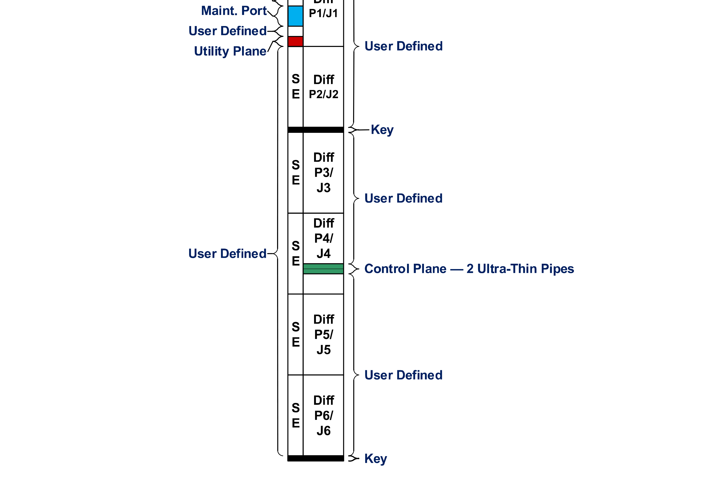

*Figure 38: ANSI/VITA 65.0 6U External I/O Slot Profile SLT6-PAY-4U2U-10.2.8 ｜ 图 38：ANSI/VITA 65.0 6U 外部 I/O 槽位配置档 SLT6-PAY-4U2U-10.2.8*

<!-- 原书 p.121 ｜ PDF p.141 -->

**Table 37: ANSI/VITA 65.1 Module Profiles for SLT6-PAY-4U2U-10.2.8 ｜ 表 37：SLT6-PAY-4U2U-10.2.8 的 ANSI/VITA 65.1 模块配置档**

| Module Profile names ／ 模块配置档名 | Dash Num ／ 短横号 | STD Date ／ 标准日期 | Slot Profile ／ 槽位配置档 | Protocols for Copper Planes ／ 铜平面协议 |  | Protocols for Optical ／ 光纤协议 | Comments ／ 备注 | Legacy ／ 遗留 |
|---|---|---|---|---|---|---|---|---|
|  |  |  |  | Expansion Plane ／ 扩展平面 | Control Plane ／ 控制平面 |  |  |  |
| MOD6-PAY-4U2U-12.2.8- |  | Proposed future 65.0 |  | EPutp01 - EPutp04 | CPutp01, CPutp02 |  | First row of MOD6-PAY-4U2U-12.2.8-n MOD6-PAY-4U2U-12.2.8-n 的首行 |  |
| MOD6-PAY-4U2U-12.2.8- | 1 | Proposed future 65.0 | SLT6-PAY-4U2U-10.2.8 | PCIe Gen 2 -- 5.3.3.2 | 1000BASE-KX -- 5.1.2 |  |  |  |
| MOD6-PAY-4U2U-12.2.8- | 2 | Proposed future 65.0 | SLT6-PAY-4U2U-10.2.8 | PCIe Gen 3 -- 5.3.3.3 | 10GBASE-KR -- 5.1.7 |  |  |  |
| Last line |  | Proposed future 65.0 |  |  |  |  |  |  |

> 转写说明：
> 1. 本表完整落在 PDF p142（印刷页 122）上半页，表末（`Last line` 行）之后即 5.2.20 节正文。p143 为 Rule 5.2.20-6～8 正文、p144／p145 为 5.2.22 节正文，均无本表续行——据此判定本表不跨页，未续写。
> 2. 表头为两层：第 1 行为分组标题，第 2 行（加粗）为子列标题。`Protocols for Copper Planes` 横跨 `Expansion Plane`、`Control Plane` 两列，被覆盖的单元格留空；`Protocols for Optical`、`Comments`、`Legacy` 各为单列，`Protocols for Optical` 与 `Legacy` 两列各行均空。
> 3. 原表 `Module Profile names` 与 `Dash Num` 之间无竖线（扫描件如此），本表依表头文字分为两列；完整配置档编号为 `MOD6-PAY-4U2U-12.2.8-n`、`…-12.2.8-1`、`…-12.2.8-2`。
> 4. 本表题注写的是 `SLT6-PAY-4U2U-10.2.8`，而表内 `Module Profile names` 列写的是 `MOD6-PAY-4U2U-12.2.8-`、`Slot Profile` 列写的是 `SLT6-PAY-4U2U-10.2.8`；题注与名义并不矛盾（前者是插槽档、后者是模块档），照录。
> 5. `Last line` 为原表的收尾行标签（灰色底），照录。

#### 5.2.20 Power Supply Module 电源模块

**Rule 5.2.20-1**

PSM requirements shall be applied using the following order of precedence: Requirements of this SOSA standard (including additions or exclusions to ANSI/VITA

PSM 的需求应依下列优先次序适用：本 SOSA 标准的需求（包括对 ANSI/VITA

65.0)

65.0）（续上段）

Conformance Methodology: (A)

符合性方法：(A)

Requirements of ANSI/VITA 62.0

ANSI/VITA 62.0 标准的需求

Conformance Methodology: (A)

符合性方法：(A)

**Observation 5.2.20-1**

The SOSA HWG is considering a move to 12V as the primary input in a future version of the SOSA standard.

SOSA HWG 正在考虑在今后某一版 SOSA 标准中改用 12V 作为主输入。

**Rule 5.2.20-2**

PSMs shall assert the FAIL* signal when PO1, PO2, PO3, or AUX voltages are not within their voltage specifications per ANSI/VITA 62.0, Recommendation 3.3-2. Conformance

当 PO1、PO2、PO3 或 AUX 电压不在 ANSI/VITA 62.0 推荐 3.3-2 所定的电压规格之内时，PSM 应置起 FAIL* 信号。符合性

Methodology: (T)

方法：(T)

**Rule 5.2.20-3**

PSMs shall have the chassis pin connected to their front panel and covers. Conformance Methodology: (A)

PSM 的机壳引脚应与其前面板及盖板相连。符合性方法：(A)

**Rule 5.2.20-4**

PSMs shall have the chassis pin isolated from the SIGNAL_RETURN pin. Conformance Methodology: (T)

PSM 的机壳引脚应与 SIGNAL_RETURN 引脚隔离。符合性方法：(T)

**Rule 5.2.20-5**

PSMs shall have the chassis pin isolated from power returns, such as the POWER_RETURN pins. Conformance Methodology: (T)

PSM 的机壳引脚应与电源回线（如 POWER_RETURN 引脚）隔离。符合性方法：(T)

<!-- 原书 p.122 ｜ PDF p.142 -->

**Rule 5.2.20-6**

PSMs shall have the chassis pin isolated from the -DC_IN/ACN pin. Conformance

PSM 的机壳引脚应与 -DC_IN/ACN 引脚隔离。符合性

Methodology: (T)

方法：(T)

**Rule 5.2.20-7**

PSMs outputting an intermediate power shall explicitly define the nominal voltage level for the intermediate power. Conformance Methodology: (A)

输出中间电源的 PSM 应显式定义该中间电源的标称电压电平。符合性方法：(A)

**Rule 5.2.20-8**

PSMs having intermediate power as an input shall explicitly define the nominal voltage level for the intermediate power. Conformance Methodology: (A)

以中间电源为输入的 PSM 应显式定义该中间电源的标称电压电平。符合性方法：(A)

**Rule 5.2.20-9**

Energy Storage Modules shall accept an input of the intermediate voltage in accordance with

储能模块应接受中间电压作为输入，其依据为

ANSI/VITA 62.0 §4.5. Conformance Methodology: (A)

ANSI/VITA 62.0 第 4.5 节。符合性方法：(A)

**Rule 5.2.20-10**

Energy Storage Modules shall output the intermediate voltage in accordance with ANSI/VITA

储能模块应输出中间电压，其依据为 ANSI/VITA

62.0 §4.5. Conformance Methodology: (A)

62.0 第 4.5 节。符合性方法：(A)

**Rule 5.2.20-11**

6U Single-Stage Modules shall route the intermediate voltage to the ANSI/VITA 62.0 pins labeled “POS_FILT_OUT” and “NEG_FILT_OUT” in accordance with ANSI/VITA 62.0 §6.5.2. Conformance Methodology: (A)

6U 单级模块应把中间电压引出到 ANSI/VITA 62.0 中标为“POS_FILT_OUT”与“NEG_FILT_OUT”的引脚，其依据为 ANSI/VITA 62.0 §6.5.2。符合性方法：(A)

**Rule 5.2.20-12**

3U PSMs shall conform to the mechanical requirements of ANSI/VITA 48.2 for 3U conduction cooled modules except where specified herein. Conformance Methodology: (A)

除本文件另有规定外，3U PSM 应符合 ANSI/VITA 48.2 对 3U 传导散热式模块的机械需求。符合性方法：(A)

**Rule 5.2.20-13**

6U PSMs shall conform to the mechanical requirements of ANSI/VITA 48.2 for 6U conduction cooled modules except where specified herein. Conformance Methodology: (A)

除本文件另有规定外，6U PSM 应符合 ANSI/VITA 48.2 对 6U 传导散热式模块的机械需求。符合性方法：(A)

#### 5.2.21 Mezzanine Modules 夹层模块

**Rule 5.2.21-1**

Requirements for SOSA Mezzanine Cards shall be applied using the following order of precedence: Conformance Methodology: (A) SOSA requirements (including additions or exclusions to the XMC standard) Mezzanine Module requirements of ANSI/VITA 42.3

对 SOSA 夹层卡的需求应依下列优先次序适用：符合性方法：(A) SOSA 的需求（包括对 XMC 标准的增补或排除）ANSI/VITA 42.3 的夹层模块需求

<!-- 原书 p.123 ｜ PDF p.143 -->

Mezzanine Module requirements of ANSI/VITA 42.0

ANSI/VITA 42.0 的夹层模块需求

**Permission 5.2.21-1**

Non-conformant SOSA Mezzanine Cards may be used.

不符合的 SOSA 夹层卡可以使用。

**Rule 5.2.21-2**

PCIe interfaces as bridged to XMC Mezzanine Cards shall conform to ANSI/VITA 42.3. Conformance Methodology: (A)

桥接到 XMC 夹层卡的 PCIe 接口应符合 ANSI/VITA 42.3。符合性方法：(A)

**Rule 5.2.21-3**

XMC Mezzanine Cards that do not require utilization of all available user I/O signals shall leave the remaining unused signals as no connects. Conformance Methodology: (A)

不要求使用全部可用用户 I/O 信号的 XMC 夹层卡，应把其余未用的信号留作不连接。符合性方法：(A)

**Recommendation 5.2.21-1**

The higher priority I/O signals of the XMC Mezzanine Card should populate pins in the following order of ANSI/VITA 46.9 patterns:

XMC 夹层卡中优先级较高的 I/O 信号宜按下列 ANSI/VITA 46.9 模式的次序占用引脚：

X12d

X12d（12 对差分模式）

X8d

X8d（8 对差分模式）

X16s

X16s（16 路单端模式）

X24s

X24s（24 路单端模式）

X38s

X38s（38 路单端模式）

**Observation 5.2.21-1**

Any XMC module (SOSA Mezzanine Cards or otherwise) will be expected to be subjected to qualification testing while installed on the target Payload Module within the constraints of the target system deployed configuration and environment, including all hardware and accessories.

任何 XMC 模块（SOSA 夹层卡或其他）都将预期在装于目标载荷模块上的状态下接受鉴定试验，并受目标系统部署构型与环境的约束，包括全部硬件与附件。

**Rule 5.2.21-4**

If a Payload Plug-In Card has an XMC Mezzanine Card Site, the Payload Plug-In Card shall route the ANSI/VITA 42.0-defined I²C connections from the XMC Mezzanine Card Site to the

若载荷插卡带有 XMC 夹层卡站点，则该载荷插卡应把 ANSI/VITA 42.0 所定义的 I²C 连接从 XMC 夹层卡站点引至

IPMC of the Payload Plug-In Card. Conformance Methodology: (A)

载荷插卡的 IPMC。符合性方法：(A)

#### 5.2.22 Maintenance Console Port Requirements 维护控制台端口需求

The Maintenance Console Port is intended to be a consistently-implemented port providing a console for low-level access to the attached processor. It is not intended to be an “operational” port; that is, not intended to communicate to some device as part of the normal operation of the system. It is intended strictly as part of the board maintenance functions.

维护控制台端口意在成为一种实现方式一致的端口，为对所装处理器做低层访问提供一个控制台。它不打算作为“运行”端口，即：不在于作为系统正常运行的一部分与某个器件通信。它严格属于板卡维护功能的一部分。

The basic use-cases for the maintenance console port can be classed as described below.

维护控制台端口的基本用例可按下述分类。

<!-- 原书 p.124 ｜ PDF p.144 -->

5.2.22.1 Vendor Board Bring Up, Board Support Package (BSP) Development, etc.

5.2.22.1 ｜ 厂商板卡启动、板级支持包（BSP）开发等

This implies access to low-level firmware, BIOS, Extensible Firmware Interface (EFI) shell, etc. The typical case is for an operator to attach to the maintenance console port of a single plug-in card using a terminal or PC. There is also a case where the operator may attach to a relatively limited set of boards at one time.

这意即访问低层固件、BIOS、可扩展固件接口（EFI）外壳等。典型情形是操作员用终端或 PC 接入单张插卡的维护控制台端口。还有一种情形：操作员可能在某一时刻接入相对有限的一组板卡。

##### 5.2.22.2 Integrator Application Development and Debug 集成方应用开发与调试

This also implies access to low-level firmware, BIOS, EFI shell, etc. This will typically be performed in a lab environment with the target plug-in card installed in either an “open” lab chassis or a target deployable chassis. The operator may attach to a relatively limited set of boards at one time, but there may be cases where the operator may need to attach to every maintenance console port in the system.

这同样意即访问低层固件、BIOS、EFI 外壳等。这项工作通常在实验室环境中进行，目标插卡装于“开放式”实验室机箱或目标可部署机箱内。操作员可能在某一时刻接入相对有限的一组板卡，但也可能在某些情形下需要接入系统中每一个维护控制台端口。

##### 5.2.22.3 Deployed System 已部署系统

In this case the target plug-in card is installed in a deployed system. Whether or not the maintenance console ports on the individual boards are accessible in a deployed system is up to the system integrator, but assuming the ports are accessible, it can be assumed that most, if not all, of the individual plug-in card maintenance console ports can be attached. It is also assumed that some sort of port aggregation mechanism is implemented within the system to provide this access.

此情形下目标插卡装于一套已部署的系统之中。已部署系统中各单板上的维护控制台端口是否可接触，由系统集成方决定；但假定这些端口可接触，则可认为各插卡的维护控制台端口中的大多数（即便不是全部）都能被接入。还假定系统内已实现某种端口汇聚机制来提供这一访问。

5.2.22.4 Maintenance Depot

5.2.22.4 ｜ 维修站

The maintenance depot use-case can be characterized by the need to access the maintenance console ports of an individual fieldable plug-in card in a lab test fixture. The port will facilitate debug and perhaps upgrade/updates of the plug-in card.

维修站用例的特征在于：需要在实验室测试夹具中访问单张可外场部署插卡的维护控制台端口。该端口将便于调试，或许还便于对插卡作升级／更新。

The SOSA Maintenance Console Port is defined to operate at LVCMOS levels rather than traditional RS232 levels. The reason is that there is a desire in SOSA platforms to support an aggregator function for the various Maintenance Console Ports, giving system designers the ability to access any particular Maintenance Console Port in the system from a single interface (or, perhaps, a limited number). The use of LVCMOS rather than traditional RS232 levels allows the aggregator to be generally smaller and simpler – often implemented with an FPGA or Complex Programmable Logic Device (CPLD).

SOSA 维护控制台端口定义为以 LVCMOS 电平而非传统 RS232 电平工作。原因在于：SOSA 平台希望为各维护控制台端口支持一种汇聚器功能，使系统设计者能够以单一接口（或许是一组有限的接口）访问系统中的任一特定维护控制台端口。采用 LVCMOS 而非传统 RS232 电平，使该汇聚器通常可以做得更小更简单——常以 FPGA 或复杂可编程逻辑器件（CPLD）实现。

Note that board designers are not prohibited from supporting RS232 levels for these ports, so long as they provide a mechanism to support the requirements documented here.

注意，并不禁止板卡设计者为这些端口提供 RS232 电平，只要其提供一种机制来满足本文件所记载的需求。

These ports all share a common implementation defined as follows.

这些端口都遵循如下定义的共同实现。

**Rule 5.2.22.4-1**

The Maintenance Console Port shall be a two-pin interface implementing TIA-232 protocol. Conformance Methodology: (A)

维护控制台端口应是实现 TIA-232 协议的两引脚接口。符合性方法：(A)

**Rule 5.2.22.4-2**

The Maintenance Console Port shall use LVCMOS signaling non-inverted (active high) with the following levels (see Table 38). Conformance Methodology: (A)

维护控制台端口应采用非反相（高电平有效）的 LVCMOS 信号，电平如下（见表 38）。符合性方法：(A)

<!-- 原书 p.125 ｜ PDF p.145 -->

**Table 38: Maintenance Console Port Signal Levels ｜ 表 38：维护控制台端口信号电平**

| **3.3V LVCMOS Voltage levels ／ 3.3V LVCMOS 电压电平** | |
|---|---|
| Vcc | 3.3V +/- 0.3V |
| Vih | 1.7V |
| Vil | 0.7V |
| Voh | 2.0V |
| Vol | 0.4V |

> 转写说明：首行「3.3V LVCMOS Voltage levels」为横向合并单元格，覆盖全表两列，故该行第 2 格留空；本表无逐列列名。本表仅占原书 p.126 一页，p.127 为正文。

**Observation 5.2.22.4-1**

The Maintenance Console Port non-inverted (active high) signaling permits the addition of an external RS232 transceiver to provide a proper signal polarity to TIA-232 devices.

维护控制台端口的非反相（高电平有效）信号便于加装外部 RS232 收发器，以向 TIA-232 设备提供正确的信号极性。

**Rule 5.2.22.4-3**

The Maintenance Console Port shall support, at a minimum, 115,200 bits/sec, 57,600 bits/sec, and 9600 bits/sec (H/M/L speed), 8 bit, no parity, one stop bit. Conformance Methodology: (A)

维护控制台端口应至少支持 115,200 比特/秒、57,600 比特/秒与 9600 比特/秒（H/M/L 速率），8 位数据位，无奇偶校验，一位停止位。符合性方法：(A)

**Permission 5.2.22.4-1**

Maintenance Console Ports are permitted to support additional speeds and protocol settings.

维护控制台端口允许支持额外的速率与协议设置。

### 5.3 SOSA System Management Requirements ｜ 5.3 SOSA 系统管理需求

The network-based system management concepts were described in Section 3.11.2. This section defines rules that define specific requirements for system management interfaces to be implemented by SOSA hardware elements, sensors, and modules.

基于网络的系统管理概念已在第 3.11.2 节中描述。本节所定的规则，给出 SOSA 硬件元素、传感器与模块须实现的系统管理接口的具体需求。

5.3.1 SOSA Hardware Element System Management Requirements

5.3.1 SOSA 硬件元素系统管理需求

> **译注**：上段在原书为一节题，转换件未作 Markdown 标题行（无 `#`）。本件不改动标题层级，照录为一段并在其下给中文。

**Rule 5.3.1-1**

A SOSA Hardware Plug-In Card shall include an IPMC. This is referred to as a SOSA IPMC throughout the remainder of this standard. Conformance Methodology: (A)

SOSA 硬件插卡应包含一个 IPMC。本标准其余部分中，此物一律称为 SOSA IPMC。符合性方法：(A)

> **译注**：条目标目 `Rule`／`Recommendation` 依体例原样不译——`Rule`＝规则、`Recommendation`＝推荐（另见术语表 §一：`Suggestion`＝建议、`Permission`＝许可、`Observation`＝观察）。`Conformance Methodology`＝符合性方法，其后代号 `(A)`、`(T)`、`(I)` 为原书符合性方法代号，原样保留。

**Rule 5.3.1-2**

A SOSA IPMC shall comply with the ANSI/VITA 46.11 Tier 2 IPMC requirements. Conformance Methodology: (A)

SOSA IPMC 应符合 ANSI/VITA 46.11 Tier 2 的 IPMC 需求。符合性方法：(A)

**Rule 5.3.1-3**

A SOSA IPMC shall comply with the HOST OpenVPX Core Technology Tier 2 Standard v3.0 IPMC requirements. Conformance Methodology: (A)

SOSA IPMC 应符合 HOST OpenVPX Core Technology Tier 2 Standard v3.0 的 IPMC 需求。符合性方法：(A)

<!-- 原书 p.126 ｜ PDF p.146 -->

**Rule 5.3.1-4**

A SOSA IPMC shall implement a System IPMB B interface. Conformance Methodology: (A)

SOSA IPMC 应实现一个 System IPMB B 接口。符合性方法：(A)

**Rule 5.3.1-5**

A SOSA System IPMB shall include an IPMB B interface in the backplane profile. Conformance Methodology: (A)

SOSA System IPMB 应在背板配置档（`backplane profile`）中包含一个 IPMB B 接口。符合性方法：(A)

**Rule 5.3.1-6**

A SOSA system shall include a Chassis Manager Module. Conformance Methodology: (A)

SOSA 系统应包含一个机箱管理模块。符合性方法：(A)

**Recommendation 5.3.1-1**

A SOSA system systems IPMB should include a redundant Chassis Manager Module.

SOSA 系统的系统 IPMB 宜包含一个冗余的机箱管理模块。

> **译注**：上段 `A SOSA system systems IPMB` 为原书自身的笔误（`system` 与 `systems` 连写），照录照译，未替原文改字。

**Rule 5.3.1-7**

The SOSA Chassis Manager Module shall include a chassis manager. Conformance Methodology: (A)

SOSA 机箱管理模块应包含一个机箱管理器。符合性方法：(A)

**Rule 5.3.1-8**

The Chassis Manager shall comply with the ANSI/VITA 46.11 Tier 2 Chassis Manager requirements. Conformance Methodology: (A)

机箱管理器应符合 ANSI/VITA 46.11 Tier 2 的机箱管理器需求。符合性方法：(A)

**Rule 5.3.1-9**

The Chassis Manager shall comply with the HOST OpenVPX Core Technology Tier 2 Standard v3.0 Chassis Manager requirements. Conformance Methodology: (A)

机箱管理器应符合 HOST OpenVPX Core Technology Tier 2 Standard v3.0 的机箱管理器需求。符合性方法：(A)

**Rule 5.3.1-10**

A SOSA PSM shall include a SOSA IPMC. Conformance Methodology: (A)

SOSA 电源模块（PSM）应包含一个 SOSA IPMC。符合性方法：(A)

**Rule 5.3.1-11**

A SOSA IPMC shall be conformant to ANSI/VITA 46.11 Tier 2 IPMC requirements. Conformance Methodology: (A)

SOSA IPMC 应符合 ANSI/VITA 46.11 Tier 2 的 IPMC 需求。符合性方法：(A)

**Rule 5.3.1-12**

A SOSA IPMC shall implement a System IPMB B interface. Conformance Methodology: (A)

SOSA IPMC 应实现一个 System IPMB B 接口。符合性方法：(A)

**Rule 5.3.1-13**

A SOSA IPMC shall be conformant to the IPMC requirements. Conformance Methodology: (A)

SOSA IPMC 应符合 IPMC 需求。符合性方法：(A)

<!-- 原书 p.127 ｜ PDF p.147 -->

**Rule 5.3.1-14**

A SOSA system shall implement a bussed System IPMB. Conformance Methodology: (A)

SOSA 系统应实现一条总线式 System IPMB。符合性方法：(A)

**Recommendation 5.3.1-2**

A SOSA system should allow for point-to-point connections.

SOSA 系统宜允许点到点连接。

**Rule 5.3.1-15**

A SOSA system’s IPMB shall be conformant to the ANSI/VITA 46.11 Tier 2 IPMC requirements. Conformance Methodology: (A)

SOSA 系统的 IPMB 应符合 ANSI/VITA 46.11 Tier 2 的 IPMC 需求。符合性方法：(A)

**Rule 5.3.1-16**

A SOSA system’s IPMB shall include an IPMB B. Conformance Methodology: (A)

SOSA 系统的 IPMB 应包含一条 IPMB B。符合性方法：(A)

**Rule 5.3.1-17**

A SOSA system shall include a Chassis Manager Module. Conformance Methodology: (A)

SOSA 系统应包含一个机箱管理模块。符合性方法：(A)

**Recommendation 5.3.1-3**

A SOSA system should include a redundant Chassis Manager Module.

SOSA 系统宜包含一个冗余的机箱管理模块。

**Rule 5.3.1-18**

The SOSA system Chassis Manager Module shall include a conformant ANSI/VITA 46.11 Tier 2 Chassis Manager. Conformance Methodology: (A)

SOSA 系统的机箱管理模块应包含一个符合 ANSI/VITA 46.11 Tier 2 要求的机箱管理器。符合性方法：(A)

**Rule 5.3.1-19**

The SOSA system Chassis Manager Module shall include a conformant Tier 2 and HOST Chassis Manager. Conformance Methodology: (A)

SOSA 系统的机箱管理模块应包含一个符合 Tier 2 与 HOST 要求的机箱管理器。符合性方法：(A)

#### 5.3.2 SOSA Module System Management Requirements ｜ 5.3.2 SOSA 模块系统管理需求

Work in defining rules and requirements to be applied to SOSA logical components is ongoing. Section 5.6.1.3 defines a set of common interactions that are candidates to be implemented by all logical modules. The related DIV-2 elements for those candidate interactions are defined in Section D.4. As these interactions have not yet been through a thorough proposal and evaluation process, rules and requirements are not included in this version.

为把规则与需求施用于 SOSA 逻辑组件所做的定义工作仍在进行中。第 5.6.1.3 节定义了一组通用交互，各逻辑模块是这些交互的候选实现者。这些候选交互所对应的 DIV-2 元素见第 D.4 节。由于这些交互尚未经过充分的提议与评估过程，本版未纳入相应规则与需求。

### 5.4 SOSA Software Operating Environment ｜ 5.4 SOSA 软件运行环境

#### 5.4.1 Description ｜ 5.4.1 描述

SOSA modules may contain a wide range of functions and many of these are accomplished through computer processing. In order to promote the open and standardized goals of the SOSA Technical Architecture, the Run-Time Environment (RTE) interface for SOSA modules will be

SOSA 模块可包含范围广泛的功能，其中许多功能通过计算机处理来实现。为推进 SOSA 技术架构的开放与标准化目标，SOSA 模块的运行时环境（RTE）接口将

<!-- 原书 p.128 ｜ PDF p.148 -->

defined. Note this does not mandate a particular RTE, although there are recommended solutions to promote open standards-based interoperability. This provides guidance and recommendations for the interface of that computer program RTE with other entities.

予以定义。注意，这并不强制要求某一特定的 RTE，尽管存在若干推荐方案以推进基于开放标准的互操作性。本部分为该计算机程序 RTE 与其他实体之间的接口提供指南与推荐。

The SOSA standardized architectural modules can be realized in a variety of SOSA standardized interface components, either hardware, software, or a combination of hardware and software. For example, the SOSA standard defines hardware connector interfaces to hardware elements. A similar approach is required for components implemented in software. The SOSA Software Runtime Environment Interface (REI) will define the interfaces to support the development of software that meets the SOSA quality attributes, including the open and standardized goals. The SOSA REI will not mandate a specific run-time implementation but will specify standardized interfaces with performance and security attributes as an area of future investigation. The REI description will be enhanced to provide more detailed guidance that leverages and supports the FACE Technical Standard, OMS, the MORA specification, the FROST Architecture Specification, REDHAWK/TOA, and the Common Open Architecture Radar Program Specification (COARPS) individually.

SOSA 标准化的架构模块可以多种 SOSA 标准化接口组件来实现——或为硬件、或为软件，或为硬件与软件的组合。例如，SOSA 标准定义了通往硬件元素的硬件连接器接口。对以软件实现的组件，需要类似的做法。SOSA 软件运行时环境接口（REI）将定义一组接口，以支持开发满足 SOSA 质量属性（含开放与标准化目标）的软件。SOSA REI 不强制要求特定的运行时实现，而将规定带性能与信息安全属性的标准化接口，此为一处尚待今后研究的方向。REI 描述将予扩充，以给出更详细的指南，分别利用并支持 FACE Technical Standard、OMS、MORA 规范、FROST Architecture Specification、REDHAWK/TOA 与通用开放架构雷达计划规范（COARPS）。

#### 5.4.2 Scope ｜ 5.4.2 范围

This section describes the high-level scope of the SOSA REI. It includes:

本节描述 SOSA REI 的高层范围。其内容包括：

SOSA application software interface to SOSA module hardware processing and operating system for language run time and calls to operating system services as defined by the

SOSA 应用软件面向 SOSA 模块硬件处理与操作系统的接口，供语言运行时与操作系统服务调用使用；其定义依

FACE Operating System Segment (OSS) interface

FACE 操作系统段（OSS）接口

SOSA platform-specific software and low-level I/O as defined by the FACE Platform-

SOSA 平台特定软件与低层 I/O，其定义依 FACE 平台特定

Specific Services Segment (PSSS) and I/O Services Segment (IOSS)

服务段（PSSS）与 I/O 服务段（IOSS）

SOSA operating system as defined by the FACE operating system requirements

SOSA 操作系统，其定义依 FACE 的操作系统需求

— POSIX®

— POSIX®（可移植操作系统接口标准）

— ARINC 653

— ARINC 653（航空电子应用软件接口标准）

For FACE conformant software, programming language and version as defined by the referenced FACE Technical Standard Guidance and limitations on use of VMs and containers General-Purpose, Safety, and Security features of application software as per the profile guidance in the referenced FACE Technical Standard The SOSA REI excludes:

对符合 FACE 的软件：编程语言与版本依所引 FACE Technical Standard 的定义；虚拟机与容器的使用指南与限制；应用软件的通用（General-Purpose）、安全（Safety）与信息安全（Security）特性，依所引 FACE Technical Standard 中的配置档指南。SOSA REI 不含：

> **译注**：上段英文在原书为三条项目符号，另以 `The SOSA REI excludes:` 一句起下文；转换时并成一段。英文照录不改，中文按原条目次序以「；」分列。

Transport layer middleware for application (component) to application (component)

应用（组件）到应用（组件）通信的传输层中间件，

communications, unless defined by this standard for SOSA module communications Specific source code-level requirements, such as:

除非本标准对 SOSA 模块通信另有定义；具体到源代码层面的需求，例如：

Coding standards

编码标准

Code development methods — Code architecture

代码开发方法——代码架构

<!-- 原书 p.129 ｜ PDF p.149 -->

Configuration management or quality assurance processes except those defined for airworthiness — Language selection beyond those defined in the FACE Technical Standard plus

配置管理或质量保证过程（为适航性所定义者除外）；语言选择，除 FACE Technical Standard 所定义者之外再加

> **译注**：本段及前后数段英文在原书为「SOSA REI 不含」的一组项目符号，转换时有的并成一段、有的在句子中间断成两段：`Transport layer middleware … application (component)` 与 `communications, unless …` 本是一句而被切断，`Specific source code-level requirements, such as:` 并进了上一段，`Code development methods` 与 `— Code architecture` 并作一段，`— Language selection …` 与上一条并作一段。英文照录不改。

Python™

Python™（编程语言）

FPGA softcore processor software or programmable logic Excludes GPU programming languages The SOSA REI has questionable scope for: Airworthiness SOSA software that affects safety needs to be considered but it is not clear how much it actually affects this REI definition. Software safety is already subject to FACE Safety Profile certification by airworthiness authorities under DO-178/MIL-HDBK-516C, which is mostly driven by process substantiation not the product itself, although there are exceptions – for example, Federal Aviation Administration (FAA) certification is not available using Java® in high-criticality systems.

FPGA 软核处理器软件或可编程逻辑；不含 GPU 编程语言；SOSA REI 在以下方面的范围尚存疑问：适航性——影响安全的 SOSA 软件需要加以考虑，但尚不清楚它实际上在多大程度上影响本 REI 的定义。软件安全已由适航当局依 DO-178/MIL-HDBK-516C 纳入 FACE Safety Profile 认证，而该认证主要由过程的实质性证明驱动，而非由产品本身驱动，尽管存在例外——例如，在高关键性系统中使用 Java® 无法取得美国联邦航空管理局（FAA）的认证。

> **译注**：上段英文在原书为两条项目符号（`FPGA softcore processor software or programmable logic`、`Excludes GPU programming languages`）、一句 `The SOSA REI has questionable scope for:` 及其下方一条项目符号 `Airworthiness`，后接正文；转换时并成一段。英文照录不改，中文以「；」分列各条。

Figure 39 is derived from Figure 2 (Architectural Segments) from the FACE Technical Standard, Edition 3.0. The red dashed line has been added to represent the SOSA REI scope in relation to the FACE segments. This graphic is not an exhaustive representation of FACE elements.

图 39 取自 FACE Technical Standard 第 3.0 版的图 2（架构段）。红色虚线系原书为表示 SOSA REI 范围相对 FACE 各段的位置而添加。本图并非 FACE 各元素的穷尽性表示。

<!-- 原书 p.130 ｜ PDF p.150 -->

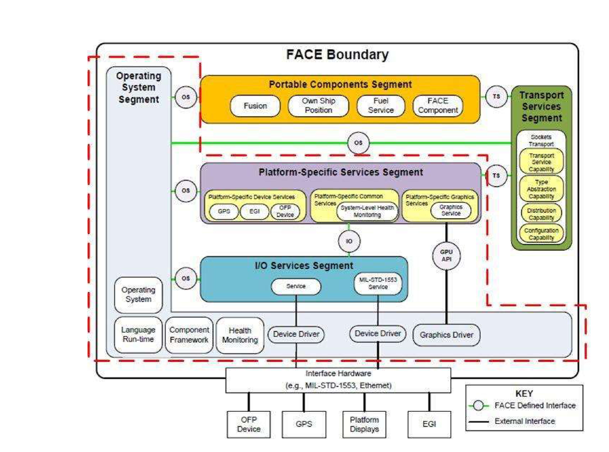

*Figure 39: FACE Software Operating Environment and Subset Proposed for the SOSA REI (red ｜ 图 39：FACE 软件运行环境及拟用于 SOSA REI 的子集（红色*

dashed line)

虚线）

#### 5.4.3 Recommendations ｜ 5.4.3 推荐

##### 5.4.3.1 Basis ｜ 5.4.3.1 依据

The RTE should conform to FACE Technical Standard, Edition 3.0 (call out specific sections)

RTE 宜符合 FACE Technical Standard 第 3.0 版（须点明具体节）

When other profiles are not applicable, the RTE should conform to the General-Purpose Profile The SOSA modules should be developed for operating system interfaces including one of:

当其他配置档不适用时，RTE 宜符合 General-Purpose Profile；SOSA 模块宜针对下列操作系统接口之一来开发：

— POSIX

— POSIX（可移植操作系统接口标准）

— ARINC 653

— ARINC 653（航空电子应用软件接口标准）

SOSA modules should be implemented by software components based on existing interface standards or software frameworks (e.g., the MORA specification, FROST Architecture Specification, REDHAWK/TOA, COARPS, etc.) The specifics for how these software components will interface to the SOSA REI are planned for a later version of the SOSA Technical Standard.

SOSA 模块宜以基于现有接口标准或软件框架（如 MORA 规范、FROST Architecture Specification、REDHAWK/TOA、COARPS 等）的软件组件来实现。这些软件组件如何与 SOSA REI 接口，其具体做法拟在今后版本的 SOSA 技术标准中规定。

> **译注**：本段英文在原书分两条：一句推荐（`When other profiles are not applicable …`）与其下的项目符号清单（`— POSIX`、`— ARINC 653`），以及另一条推荐；转换时并成一段。英文照录不改，中文以「；」分列。

<!-- 原书 p.131 ｜ PDF p.151 -->

##### 5.4.3.2 Interoperability Levels ｜ 5.4.3.2 互操作等级

SOSA REI is not mandating how to write or manage application source code except for what open standard operating system/run-time API to use SOSA REI is not mandating any particular middleware 5.4.3.3 General-Purpose SOSA software components which have general performance should conform to the FACE Technical Standard General-Purpose Profile The SOSA modules which have low latency and/or hard real-time requirements should conform to the FACE Determinism Profile 5.4.4 Safety SOSA software components which have low latency and/or hard real-time requirements should conform to the FACE Technical Standard Safety Profile These software components shall follow DO-178 guidance for civilian applications and MIL-HDBK-516C for military applications to achieve airworthiness for SOSA modules affecting safety of flight These software components should conform to the FACE Safety Profile SOSA software components affecting safety of flight which use object-oriented technology shall follow FAA guidance including DO-332 and others Planned for a later version of the SOSA Technical Standard.

SOSA REI 不规定应用源代码如何编写或管理，只规定使用何种开放标准的操作系统／运行时 API；SOSA REI 不强制要求任何特定的中间件；
5.4.3.3 通用——具有通用性能的 SOSA 软件组件宜符合 FACE Technical Standard 的 General-Purpose Profile；具有低时延和／或硬实时需求的 SOSA 模块宜符合 FACE Determinism Profile；
5.4.4 安全——具有低时延和／或硬实时需求的 SOSA 软件组件宜符合 FACE Technical Standard 的 Safety Profile；这些软件组件对民用应用应遵循 DO-178 的指导、对军用应用应遵循 MIL-HDBK-516C 的指导，以使影响飞行安全的 SOSA 模块达到适航性；这些软件组件宜符合 FACE Safety Profile；影响飞行安全且采用面向对象技术的 SOSA 软件组件应遵循 FAA 的指导，包括 DO-332 等；拟在今后版本的 SOSA 技术标准中规定。

> **译注**：上段英文在原书含 `5.4.3.3 General-Purpose`、`5.4.4 Safety` 两处节题（另含末句 `Planned for a later version …` 一条待办说明），转换时全部并进正文成一段。英文照录不改，中文按原书条目次序以「；」分列。

5.4.4.1 Security SOSA modules should conform to the FACE Security Profile for those modules affecting system security 5.4.4.2 Programming Language SOSA modules should use one of the programming languages defined in the FACE

5.4.4.1 信息安全——SOSA 模块中影响系统信息安全的那些模块宜符合 FACE Security Profile；5.4.4.2 编程语言——SOSA 模块宜使用 FACE 中定义的编程语言之一，即由 FACE

> **译注**：上段英文在原书含 `5.4.4.1 Security`、`5.4.4.2 Programming Language` 两处节题，转换时并进正文；英文照录不改。

Technical Standard

技术标准所定义。

##### 5.4.4.3 Virtual Machines ｜ 5.4.4.3 虚拟机

SOSA modules may use VMs with limitations Planned for a later version of the SOSA Technical Standard.

SOSA 模块可带限制条件地使用虚拟机（VM）；拟在今后版本的 SOSA 技术标准中规定。

5.4.4.4 Hypervisors If a VM(s) is used then a Hypervisor should be used to manage the VMs. Security-related aspects of the hypervisor Planned for a later version of the SOSA Technical Standard.

5.4.4.4 虚拟机管理程序（Hypervisor）——若使用虚拟机，则宜用管理程序来管理各虚拟机。与虚拟机管理程序相关的信息安全方面，拟在今后版本的 SOSA 技术标准中规定。

> **译注**：上段英文在原书以节题 `5.4.4.4 Hypervisors` 起头，转换时并进正文；英文照录不改。

<!-- 原书 p.132 ｜ PDF p.152 -->

5.4.4.5 Containers

5.4.4.5 容器

> **译注**：上段在原书为一节题，转换件未作 Markdown 标题行；本件照录为一段并在其下给中文，与 §5.3.1、§5.4.4.4 同例。

SOSA modules may use containers after a security analysis that substantiates the use of containers does not defeat security requirements SOSA modules should substantiate why a container should be used instead of a VM

SOSA 模块可在完成一项信息安全分析之后使用容器，该分析须证实使用容器不会使信息安全需求失效；SOSA 模块宜论证为何应使用容器而不使用虚拟机。

> **译注**：上段英文在原书为两条项目符号，转换时并成一段；英文照录不改，中文以「；」分列。

### 5.5 SOSA Module Interactions ｜ 5.5 SOSA 模块交互

The SOSA Architecture is based on a set of loosely-coupled modular entities that interact with the underlying operating environment and with each other via their logical interfaces. The operating environment will provide the mechanisms through which interoperation will occur and will provide the modules’ interfaces to these mechanism (I/O, processing, storage, communication, etc.). Interoperability between SOSA modules is described in terms of interactions.

SOSA 架构建立在一组松散耦合的模块化实体之上，这些实体经其逻辑接口与下层运行环境交互，并相互交互。运行环境将提供互操作借以发生的机制，并提供各模块通往这些机制（I/O、处理、存储、通信等）的接口。SOSA 模块之间的互操作性以交互来记述。

Interactions include exchanges of data, control actions, and various types of management functions. Most of the interactions considered are to be implemented as message exchanges on a network.

交互包括数据交换、控制动作以及各类管理功能。所考虑的交互大多将实现为网络上的消息交换。

- Note: The concept of the security services providing authentication and authorization services as shown, although not yet completely defined, is actively being developed by the SOSA Consortium.

- **注**：如图所示，由安全服务提供身份鉴别与授权服务这一概念，尽管尚未完全定义，SOSA 联盟正在积极开发之中。

### 5.6 Sensor Management ｜ 5.6 传感器管理

The SOSA standard defines two modules that together perform sensor management, which is the composition of system management and task management. The modules are 1.1 System Manager and 1.2 Task Manager. The delineation between the functions of these two modules separates the functions related to taking care of the system from the functions of tasking the system to fulfill its operational needs. Figure 40 illustrates the overall sensor management architecture. System management client applications run on the host platform and interact with the sensor management interfaces through the host platform interface module, which communicates with the system manager and task manager modules. The system manager module performs system management functions (discovery, configuration, control, health monitoring) through interactions with the SOSA module and hardware element interactions. The task manager module performs mission tasking functions (setting up, controlling, collecting data from, and monitoring multi-INT operational tasks) through interactions with the system manager module, SOSA modules, and hardware elements.

SOSA 标准定义了共同执行传感器管理的两个模块，而传感器管理是系统管理与任务管理的组合。这两个模块是 1.1 系统管理器与 1.2 任务管理器。两个模块的功能划分，正是把「照管系统」一类功能，与「向系统指派任务以履行其运行需要」一类功能分开。图 40 展示传感器管理的总体架构。系统管理客户端应用运行于宿主平台，并经宿主平台接口模块与传感器管理接口交互；该接口模块与系统管理器模块、任务管理器模块通信。系统管理器模块通过与 SOSA 模块的交互以及与硬件元素的交互，执行系统管理功能（发现、配置、控制、健康监视）。任务管理器模块通过与系统管理器模块、SOSA 模块及硬件元素的交互，执行任务指派功能（建立、控制、采集数据并监视 multi-INT 运行任务）。

<!-- 原书 p.133 ｜ PDF p.153 -->

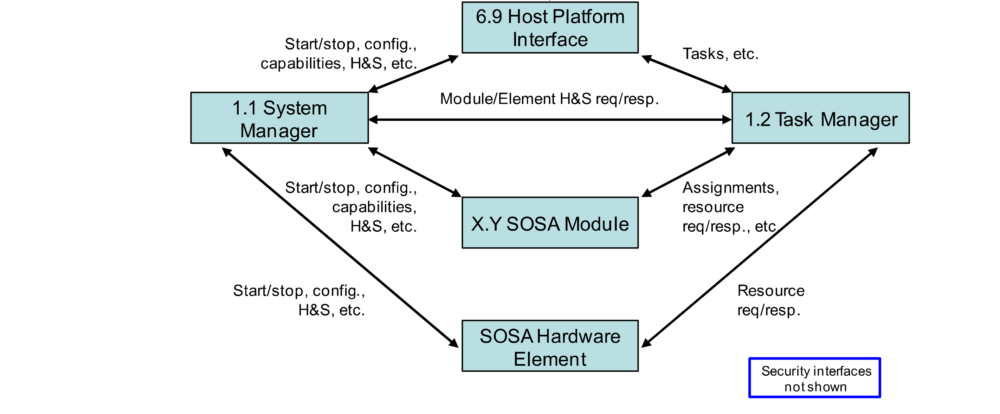

*Figure 40: Sensor Management Architecture View ｜ 图 40：传感器管理架构视图*

#### 5.6.1 System Manager Module ｜ 5.6.1 系统管理器模块

##### 5.6.1.1 Module Definition 模块定义

The functionality of the system manager module is defined in Table 2.

系统管理器模块的功能定义见表 2。

In summary, the system manager provides the ability to discover, configure, control, manage health (status and faults), and configure the security aspects of the SOSA sensor as a whole, its infrastructure, its modules, and its interface to the sensor host.

概括而言，系统管理器提供以下能力：发现、配置、控制、健康管理（状况与故障），以及配置 SOSA 传感器整体及其基础设施、其各模块、其与传感器宿主之间接口的安全方面。

The relationship between the system manager module and the other modules was shown in Figure 8 and explained in Section 3.11.2.

系统管理器模块与其他模块之间的关系见图 8，并在第 3.11.2 节中作了说明。

5.6.1.2 System Manager Interactions

5.6.1.2 系统管理器交互

The system manager is responsible for handling discovery, configuration, control, and health functions for the sensor as a whole. It acts as a representative of the logical modules (those that are not part of the hardware infrastructure), and the hardware platform modules to the “outside” world.

系统管理器负责处理传感器整体的发现、配置、控制与健康功能。它作为逻辑模块（即不属于硬件基础设施的那些模块）与硬件平台模块对“外部”世界的代表。

The overall system management concept has been matured since the previous version of this standard.² However, it has not yet been through a formal proposal process, so it is possible that the interactions and interaction groups described here may change in a future version.

自本标准的上一版以来，系统管理的总体概念已趋于成熟。² 然而，它尚未经过正式的提案流程，因此此处所述的各交互与各交互组有可能在今后的版本中发生变化。

2 Technical Standard for SOSA™ Reference Architecture, The Open Group Snapshot (S180), expired July 2018.

2 《SOSA™ 参考架构技术标准》，The Open Group 快照版（S180），2018 年 7 月到期。

<!-- 原书 p.134 ｜ PDF p.154 -->

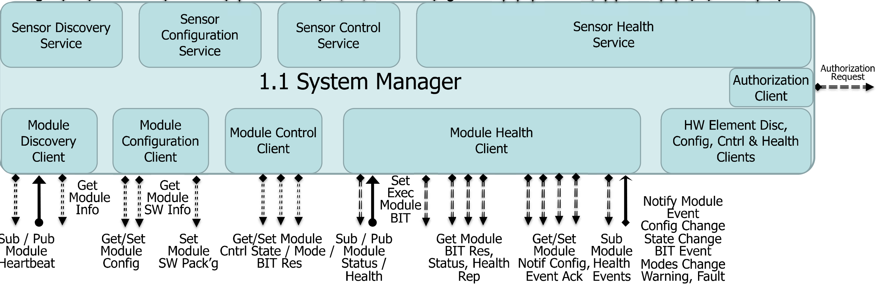

*Figure 41: System Manager Interactions ｜ 图 41：系统管理器交互*

Figure 41 illustrates the system manager module. It includes the service side (provides) for sensor discovery, sensor configuration, sensor control, and sensor health interaction groups. It also includes the client side (users) for module discovery, module configuration, module control, module health, and authorization interaction groups. The service side interactions (on the top) are accessed by system management applications that may be outside of the sensor. The clientside interactions (on the bottom) access the relevant services for each SOSA module implemented in a particular system.

图 41 展示系统管理器模块。它包含用于传感器发现、传感器配置、传感器控制与传感器健康各交互组的服务侧（提供方）。它还包含用于模块发现、模块配置、模块控制、模块健康与授权各交互组的客户端一侧（使用方）。服务侧交互（位于图中上方）由可能处于传感器之外的系统管理应用访问。客户端一侧的交互（位于图中下方）访问在特定系统中实现的各个 SOSA 模块的相关服务。

Note that the interaction endpoints related to modules (Discovery, Configuration, Control, and Health) clients are repeated for hardware elements, but are not shown in detail for brevity.

注意，与各模块（发现、配置、控制与健康）的客户端相关的交互端点对硬件元素是重复的，但为简明起见未详细示出。

5.6.1.3 Common System Management Interactions

5.6.1.3 通用系统管理交互

The SOSA system management concept defines a pattern that is applied to each type of module, and then tailored for the needs of the individual modules by varying the specific interaction names and parameters. The pattern includes sets of interactions that are common for all modules, whether they are implemented in software or hardware, or whether they are mission or infrastructure-oriented.

SOSA 系统管理概念定义了一种模式：该模式适用于每一类模块，再通过改变具体交互的名称与参数，按各模块自身的需要加以裁剪。该模式包括若干组对所有模块通用的交互——无论这些模块以软件还是以硬件实现，也无论它们面向任务还是面向基础设施。

Columns “Input DIV-2 Data Entities” and “Output DIV-2 Data Entities” list the entity types for the input and output parameters of each interactions. The names have not been finalized but align with the contents of Section D.4.

“输入 DIV-2 数据实体”与“输出 DIV-2 数据实体”两列列出各交互输入参数与输出参数的实体类型。这些名称尚未定稿，但与第 D.4 节的内容保持一致。

Note that this material is still being developed, so is likely to change as it is matured.

注意，这份材料仍在开发之中，因此在趋于成熟的过程中很可能发生变化。

**Table 39: Common System Management Interactions ｜ 表 39：通用系统管理交互**

| Common System Management Interactions ／ 通用系统管理交互 |  |  |  |  |
|---|---|---|---|---|
| Interaction Name ／ 交互名称 | Interaction Description ／ 交互描述 | Input DIV-2 Data Entities ／ 输入 DIV-2 数据实体 | Output DIV-2 Data Entities ／ 输出 DIV-2 数据实体 | Provider Module ／ 提供模块 |
| PubSensorHeartbeat | | SensorHeartbeatType | | 1.1 |
| SubSensorHeartbeat | | SubscriptionInfoType | subError_t | 6.4 |
| GetSensorInfo | | | error_t, SensorInfoType | 1.1 |
| PubModuleHeartbeat | | ModuleHeartbeatType | | 1.x, 2.x, 3.x, 4.x, 5.x |
| SubModuleHeartbeat | | SubscriptionInfoType | subError_t | 6.4 |
| GetModuleInfo | | | error_t, ModuleInfoType | 1.x, 2.x, 3.x, 4.x, 5.x |
| GetSensorConfig | | | error_t, SensorConfigDescriptionType | 1.1 |
| SetSensorConfig | | SensorConfigDescriptionType | error_t | 1.1 |
| GetSensorSoftwareInfo | | | error_t, SensorSoftwareMetadataType | 1.1 |
| SetSensorSoftwarePackage | | SensorSoftwarePackageType | error_t | 1.1 |
| GetModuleConfig | | | error_t, ModuleConfigDescriptionType | 1.x, 2.x, 3.x, 4.x, 5.x |
| SetModuleConfig | | ModuleConfigDescriptionType | error_t | 1.x, 2.x, 3.x, 4.x, 5.x |
| GetModuleSoftwareInfo | | | error_t, ModuleSoftwareMetadataType | 1.x, 2.x, 3.x, 4.x, 5.x |
| SetModuleSoftwarePackage | | ModuleSoftwarePackageType | error_t | 1.x, 2.x, 3.x, 4.x, 5.x |
| GetDataPublishingConfig | | | error_t | 1.x, 2.x, 3.x, 4.x, 5.x |
| SetDataPublishingConfig | Change the properties that govern the publication of data (identified by “topic”). Includes QoS, enabling, disabling, periodicity, etc. 改变管控数据发布（以“主题”标识）的各项属性。包括服务质量（QoS）、启用、停用、周期性等。 | | error_t | 1.x, 2.x, 3.x, 4.x, 5.x |
| GetSensorState | Sensor System States include: those shown in Set System State, Shutting Down, Resetting Hardware, Booting Operating System, Booted, Staring Software, Ready, Running, Paused. 传感器系统状态包括：Set System State 中所列各项、Shutting Down（关机中）、Resetting Hardware（复位硬件中）、Booting Operating System（引导操作系统中）、Booted（已引导）、Staring Software（启动软件（Staring Software，原文如此））、Ready（就绪）、Running（运行中）、Paused（暂停）。 | | error_t, SensorStateType | 1.1 |
| SetSensorState | Sensor System States that can be set include: Cold Boot, Warm Boot, Shutdown, Shutdown Software (component), Restart Software (component), Execute BIT, Calibrate (sensor dependent), Start, Pause. 可设置的传感器系统状态包括：Cold Boot（冷启动）、Warm Boot（暖启动）、Shutdown（关机）、Shutdown Software (component)（关闭软件（组件））、Restart Software (component)（重启软件（组件））、Execute BIT（执行 BIT）、Calibrate (sensor dependent)（校准（视传感器而定））、Start（启动）、Pause（暂停）。 | SensorStateType | error_t | 1.1 |
| GetSensorModes | Get the modes that the system is currently in. Note that this is not settable through the configuration interactions. 获取系统当前所处的模式。注意，此模式不可经配置交互设置。 | | error_t, SensorModesType | 1.1 |
| SetSensorModes | Causes the system to execute a BIT. BIT results show up in the health parameters. Equivalent to Set Sensor System State (BIT). 使系统执行一次 BIT。BIT 结果会出现在健康参数中。等效于 Set Sensor System State（BIT）。 | SensorModesType | error_t | 1.1 |
| GetModuleState | Module States are module-dependent, and may include: those shown in Set Module State, Shutting Down, Resetting Hardware, Booting Operating System, Booted, Staring Software, Ready, Running, Paused. 模块状态视模块而定，可包括：Set Module State 中所列各项、Shutting Down（关机中）、Resetting Hardware（复位硬件中）、Booting Operating System（引导操作系统中）、Booted（已引导）、Staring Software（启动软件（Staring Software，原文如此））、Ready（就绪）、Running（运行中）、Paused（暂停）。 | | error_t, ModuleStateType | 1.x, 2.x, 3.x, 4.x, 5.x |
| SetSensorCalibrationData | Set the data required for calibration of the sensor. 设置传感器校准所需的数据。 | SensorCalibrationInputDataType | error_t | 1.2 |
| GetSensorCalibrationData | Get the calibration results after the sensor has been put into a calibration state. 在传感器已进入校准状态之后获取校准结果。 | | SensorCalibrationResultDataType | 1.2 |
| SetModuleCalibrationData | Set the data required for calibration of the module. 设置模块校准所需的数据。 | ModuleCalibrationInputDataType | error_t | 2.x, 3.x, 4.x, 5.x |
| GetModuleCalibrationData | Get the calibration results after the module has been put into a calibration state. 在模块已进入校准状态之后获取校准结果。 | | ModuleCalibrationResultDataType | 2.x, 3.x, 4.x, 5.x |
| SetModuleState | Module States that can be set are module-dependent, but may include: Cold Boot, Warm Boot, Shutdown, Shutdown Software (component), Restart Software (component), Execute BIT, Calibrate (sensor dependent), Start, Pause. 可设置的模块状态视模块而定，但可包括：Cold Boot（冷启动）、Warm Boot（暖启动）、Shutdown（关机）、Shutdown Software (component)（关闭软件（组件））、Restart Software (component)（重启软件（组件））、Execute BIT（执行 BIT）、Calibrate (sensor dependent)（校准（视传感器而定））、Start（启动）、Pause（暂停）。 | ModuleStateType | error_t | 1.x, 2.x, 3.x, 4.x, 5.x |
| GetModuleMode | Get the mode that the module is currently in. Note that this is not settable through the configuration interactions. 获取模块当前所处的模式。注意，此模式不可经配置交互设置。 | | error_t, ModuleModeType | 1.x, 2.x, 3.x, 4.x, 5.x |
| SetModuleMode | Causes the module to execute a BIT. BIT Results shows up in the health parameters. Equivalent to Set Module State (BIT). 使模块执行一次 BIT。BIT 结果会出现在健康参数中。等效于 Set Module State（BIT）。 | ModuleModeType | error_t | 1.x, 2.x, 3.x, 4.x, 5.x |
| PubSensorStatusLevel | | SensorStatusLevelType | | 1.1 |
| SubSensorStatusLevel | | SubscriptionInfoType | subError_t | 6.4 |
| PubModuleStatus | | | | 1.x, 2.x, 3.x, 4.x, 5.x |
| SubModuleStatus | | SubscriptionInfoType | subError_t | 6.4 |
| GetSensorStatusLevel | | | error_t, SensorStatusLevelType | 1.1 |
| GetSensorHealthReport | | | error_t, SensorHealthReportType | 1.1 |
| SetExecuteSensorBIT | | SensorBITParametersType | error_t | 1.1 |
| GetSensorBITResult | | | error_t, SensorBITResultType | 1.1 |
| GetModuleStatus | | | error_t, ModuleStatusLevelType | *.* |
| GetModuleHealthReport | | | error_t, ModuleHealthReportType | *.* |
| SetExecuteModuleBIT | | ModuleBITParametersType | error_t | *.* |
| GetModuleBitResult | | | error_t, ModuleBITResultType | *.* |
| NotifySensorEvent | | SensorHealthEventType | | 1.1 |
| NotifySensorConfigChange | | SensorConfigEventType | | 1.1 |
| NotifySensorStateChange | | SensorStateEventType | | 1.1 |
| NotifySensorBITEvent | | SensorBITEventType | | 1.1 |
| NotifySensorModesChange | | SensorModeEventType | | 1.1 |
| NotifySensorWarning | | SensorWarningType | | 1.1 |
| NotifySensorFault | | SensorFaultType | | 1.1 |
| SetSensorEventAcknowledgement | | SensorEventAcknowledgType | error_t | 1.1 |
| SubSensorHealthEvents | | SubscriptionInfoType | subError_t | 6.4 |
| SetSensorNotificationConfig | | SensorEventConfigType | error_t | 1.1 |
| GetSensorNotificationConfig | | | error_t, SensorEventConfigType | 1.1 |
| NotifyModuleEvent | | ModuleHealthEventType | | *.* |
| NotifyModuleConfigChange | | ModuleConfigEventType | | *.* |
| NotifyModuleStateChange | | ModuleStateEventType | | *.* |
| NotifyModuleBITEvent | | ModuleBITEventType | | *.* |
| NotifyModuleModeChange | | ModuleModeEventType | | *.* |
| NotifyModuleWarning | | ModuleWarningType | | *.* |
| NotifyModuleFault | | ModuleFaultType | | *.* |
| SetModuleEventAcknowledgement | | ModuleEventAcknowledgType | error_t | *.* |
| SetModuleNotificationConfig | | ModuleEventConfigType | error_t | *.* |
| GetModuleNotificationConfig | | | error_t, ModuleEventConfigType | *.* |
| SubModuleHealthEvents | | SubscriptionInfoType | subError_t | 6.4 |
| SubModuleHealthReports | | SubscriptionInfoType | subError_t | 6.4 |
| GetHealthLog | | | error_t | 1.1 |
| GetHealthLogStatus | | | error_t | 1.1 |
| DeleteSensorHealthLog | | | error_t | 1.1 |

> 注：this table calls out all of the common system management interactions that have been identified as of this version. Additional system manager interactions are likely to be identified in a future version.

> **注**：本表列出截至本版本已识别出的全部通用系统管理交互。今后版本中很可能还会识别出更多的系统管理器交互。

> 转写说明：
> 1. 原表题注在 p.135，表体分置于 p.136–p.140 五页（p.136 16 行、p.137 9 行、p.138 15 行、p.139 21 行、p.140 顶部 5 行，共 66 数据行）。续页顶端重复印出的表头与列名不再重出，故本表只保留一次表头；p.140 表体之后的同页文字属 5.6.2 与 Table 40，未入本表。
> 2. 首行「Common System Management Interactions」为横向合并单元格，覆盖全表 5 列，故其后 4 格留空。
> 3. 原表单元格内惯将实体名与其「(…Type)」分置两行排印，本转写按单个空格连接（如「SensorHeartbeatType」单占一格者不动，凡「name + (Type)」成对者并作一行）；跨行断开的长类型名拼回原词（如「SensorConfigDescriptionTyp / e」→ SensorConfigDescriptionType、「SensorSoftwareMetadataTyp / e」→ SensorSoftwareMetadataType）。
> 4. 第 2 列「Interaction Description」除列出者外原表均为空格，按原样留空。
> 5. 原表形迹按原样照录，未改未补：p.137 两处「Staring Software」；「GetModuleBitResult」的小写「it」（同行输出类型仍作 ModuleBITResultType）；「NotifySensorModesChange」与同行的「SensorModeEventType」单复数不一致；p.136 GetSensorSoftwareInfo 与 SetSensorSoftwarePackage 两行的 Provider Module 均印作 1.1；Provider Module 列的「*.*」照录。

<!-- 原书 p.135 ｜ PDF p.155 -->

<!-- 原书 p.136 ｜ PDF p.156 -->

<!-- 原书 p.137 ｜ PDF p.157 -->

<!-- 原书 p.138 ｜ PDF p.158 -->

<!-- 原书 p.139 ｜ PDF p.159 -->

#### 5.6.2 Task Manager Module 任务管理器模块

##### 5.6.2.1 Module Definition 模块定义

See Table 2 for the definition of this module.

本模块的定义见表 2。

The concept of task management is still being developed. Below is a DRAFT set of task management interactions that are consistent with the system management interactions and the combined SOSA management architecture. So far, a detailed concept has been defined for five Task Management interactions: SetCreateTask, SetModifyTask, SetDeleteTask, SetModuleAssignment, and PubAssignmentHealth. (Details for these interactions are provided in Section 5.9.1.3 for an Air Moving Target Indicator (AMTI) Multi-sensor Fusion Tracker Radar mission example. Note that the interactions are common across all modules, but the enumerations and data for each interaction will be sensor and mission-specific and will require an extensive effort to define all of the task management configuration data, control actions, and module assignments for each of these (Sensor Type/Mission Type combinations).

任务管理的概念仍在开发之中。下面是任务管理交互的一组 DRAFT（草案），它们与系统管理交互以及合并后的 SOSA 管理架构保持一致。到目前为止，已为五个任务管理交互定义了详细概念：SetCreateTask、SetModifyTask、SetDeleteTask、SetModuleAssignment 与 PubAssignmentHealth。（针对空中动目标指示（AMTI）多传感器融合跟踪器雷达任务示例，这些交互的细节在第 5.9.1.3 节中给出。注意，这些交互在所有模块中通用，但每个交互的枚举与数据将视传感器与任务而定；要针对上述每一种（传感器类型／任务类型）组合定义全部任务管理配置数据、控制动作与模块分派，将需要大量工作。

**Table 40: Task Management Interactions Table ｜ 表 40：任务管理交互表**

| Task Management Interactions ／ 任务管理交互 |  |  |  |  |
|---|---|---|---|---|
| Interaction Name ／ 交互名称 | Interaction Description ／ 交互描述 | Input DIV-2 Data Entities ／ 输入 DIV-2 数据实体 | Output DIV-2 Data Entities ／ 输出 DIV-2 数据实体 | Provider Module ／ 提供模块 |
| PubSensorHeartbeat | | SensorHeartbeatType | | 1.1 |
| GetSystemCapabilityInformation | TBD | | reqResErrorCode (ReqResErrorCodeType), systemCapabilityInformation (SystemCapabilityInformationType) | 1.2 |
| GetModuleInformation | TBD | moduleID (number) | reqResErrorCode (ReqResErrorCodeType), moduleInformation (ModuleInformationType) | *.* |
| GetModuleCapabilities | TBD | moduleID (number) | reqResErrorCode (ReqResErrorCodeType), moduleCapabilities (ModuleCapabilitiesType) | *.* |
| GetResourceCapabilities | TBD | resourceID (number) | reqResErrorCode (ReqResErrorCodeType), resourceCapabilities (ResourceCapabilitiesType) | *.* |
| GetResourceFixedParameters | TBD | resourceID (number) | reqResErrorCode (ReqResErrorCodeType), resourceFixedParameters (ResourceFixedParametersType) | *.* |
| GetResourceControllableParameters | TBD | resourceID (number) | reqResErrorCode (ReqResErrorCodeType), resourceControllableParameters (ResourceControllableParametersType) | *.* |
| GetModuleInternalConnections | TBD | moduleID (number) | reqResErrorCode (ReqResErrorCodeType), moduleInternalConnections (ModuleInternalConnectionsType) | *.* |
| GetModuleExternalConnections | TBD | moduleID (number) | reqResErrorCode (ReqResErrorCodeType), moduleExternalConnections (ModuleExternalConnectionsType) | *.* |
| SetCreateTask | Request a new task, coming from outside of the sensor. 请求一个新任务，该任务来自传感器外部。 | taskDescription (TaskDescriptionType) | reqResErrorCode (ReqResErrorCodeType) | 1.2 |
| SetModifyTask | Modify task from outside of the sensor. 修改来自传感器外部的任务。 | taskID (number), taskModificationDescription (TaskModificationDescriptionType) | reqResErrorCode (ReqResErrorCodeType) | 1.2 |
| SetDeleteTask | Delete task from outside of the sensor. 删除来自传感器外部的任务。 | taskID (number) | reqResErrorCode (ReqResErrorCodeType) | 1.2 |
| GetActiveTasks | TBD | taskInformationList (TaskInformationListType) | reqResErrorCode (ReqResErrorCodeType) | 1.2 |
| GetTaskInformation | TBD | taskInformation (TaskInformationType) | reqResErrorCode (ReqResErrorCodeType), taskID (number) | 1.2 |
| GetTaskState | TBD | taskID (number), taskState (TaskStateType) | reqResErrorCode (ReqResErrorCodeType), taskID (number) | 1.2 |
| SetTaskState | Control a task. 控制一个任务。 | taskID (number) | reqResErrorCode (ReqResErrorCodeType), taskState (TaskStateType) | 1.2 |
| GetTaskStatus | Get the status of an existing task. 获取既有任务的状况。 | taskID (number) | reqResErrorCode (ReqResErrorCodeType), (TaskStatusType) | 1.2 |
| NotifyTaskEvent | Notify events that occur in tasks. 通知各任务中发生的事件。 | taskEventDescription (TaskEventDescriptionType) | pubSubErrorCode (PubSubErrorCode) | 1.2 |
| SubTaskEvent | TBD | taskID (number) | pubSubErrorCode (PubSubErrorCode), subscriptionInformation (SubscriptionInformationType) | 1.2 |
| PubTaskHealth | Publish periodic task health. 发布周期性的任务健康。 | taskID (number), taskHealthDescription (TaskHealthDescriptionType) | pubSubErrorCode (PubSubErrorCode) | 1.2 |
| SubTaskHealth | TBD | taskID (number) | pubSubErrorCode (PubSubErrorCode), subscriptionInformation (SubscriptionInformationType) | 1.2 |
| GetTaskHealthPublishingConfig | TBD | taskID (number) | reqResErrorCode (ReqResErrorCodeType), taskHealthpublishingConfig (TaskHealthPublishingConfigType) | 1.2 |
| SetTaskHealthPublishingConfig | Configure the publication of task status. 配置任务状况的发布。 | taskID (number), healthPublishingConfigDescription (HealthPublishingConfigDescriptionType) | reqResErrorCode (ReqResErrorCodeType) | 1.2 |
| GetModuleAssignment | TBD | moduleID (number) | reqResErrorCode (ReqResErrorCodeType), moduleAssignment (ModuleAssignmentType) | 2.x, 3.x, 4.x, 5.x |
| SetModuleAssignment | Assign a task to a module (assignment is used instead of task for modules). Assignments come from internal sources; tasks come from external sources. The intent is that the task manager will decompose an externally received task into module assignments as necessary. 把一个任务分派给某个模块（对模块而言用分派而非任务）。分派来自内部来源；任务来自外部来源。其意图是：任务管理器将按需把从外部接收到的任务分解为若干模块分派。 | moduleAssignment (ModuleAssignmentType) | reqResErrorCode (ReqResErrorCodeType) | 2.x, 3.x, 4.x, 5.x |
| GetModuleResourceAllocations | TBD | moduleID (number) | reqResErrorCode (ReqResErrorCodeType), moduleResourceAllocationList (ModuleResourceAllocationListType) | 2.x, 3.x, 4.x, 5.x |
| SetModuleResourceAllocations | Assign module resources to an assignment. 把模块资源分配给一个分派。 | taskID (number) | reqResErrorCode (ReqResErrorCodeType) | 2.x, 3.x, 4.x, 5.x |
| GetAssignmentState | TBD | assignmentID (number) | reqResErrorCode (ReqResErrorCodeType), assignmentState (AssignmentStateType) | 2.x, 3.x, 4.x, 5.x |
| SetAssignmentState | Control the task (assignment) of a module. 控制某个模块的任务（分派）。 | assignmentID (number), assignmentStateValue (AssignmentStateValueType) | reqResErrorCode (ReqResErrorCodeType) | 2.x, 3.x, 4.x, 5.x |
| GetAssignmentStatus | Get the status of an existing task. 获取既有任务的状况。 | assignmentID (number) | reqResErrorCode (ReqResErrorCodeType), assignmentStatus (AssignmentStatusType) | 2.x, 3.x, 4.x, 5.x |
| NotifyAssignmentEvent | Notify events that occur in tasks. 通知各任务中发生的事件。 | assignmentID (number), assignmentEvent (AssignmentEventType) | pubSubErrorCode (PubSubErrorCode), pubErrorCode (PubErrorCodeType) | 2.x, 3.x, 4.x, 5.x |
| SubAssignmentEvent | TBD | assignmentID (number) | pubSubErrorCode (PubSubErrorCode), subscriptionInformation (SubscriptionInformationType) | 2.x, 3.x, 4.x, 5.x |
| PubAssignmentHealth | Publish periodic task (assignment) health. 发布周期性的任务（分派）健康。 | assignmentID (number), assignmentHealth (AssignmentHealthType) | pubSubErrorCode (PubSubErrorCode) | 2.x, 3.x, 4.x, 5.x |
| SubAssignmentHealth | TBD | assignmentID (number) | pubSubErrorCode (PubSubErrorCode), subscriptionInformation (SubscriptionInformationType) | 2.x, 3.x, 4.x, 5.x |
| GetAssignmentHealthPublishingConfig | TBD | assignmentID (number) | reqResErrorCode (ReqResErrorCodeType), healthPublishingConfigDescription (HealthPublishingConfigDescriptionType) | 2.x, 3.x, 4.x, 5.x |
| SetAssignmentHealthPublishingConfig | Configure the publication of task status. 配置任务状况的发布。 | assignmentID (number), healthPublishingConfigDescription (HealthPublishingConfigDescriptionType) | reqResErrorCode (ReqResErrorCodeType) | 2.x, 3.x, 4.x, 5.x |

> 转写说明：
> 1. 原表题注在 p.140，表体分置于 p.140–p.144 五页（p.140 3 行、p.141 9 行、p.142 9 行、p.143 8 行、p.144 7 行，共 36 数据行）。续页顶端重复印出的表头与列名不再重出，故本表只保留一次表头；p.140 表体之前的同页表格是 Table 39 的结尾，未入本表。
> 2. 首行「Task Management Interactions」为横向合并单元格，覆盖全表 5 列，故其后 4 格留空。
> 3. 原表单元格内惯将实体名与其「(…Type)」分置两行排印（如「moduleID」换行「(number)」），本转写按单个空格连接；跨行断开的长名拼回原词（如「resourceControllableParamet / ers」→ resourceControllableParameters、「(ModuleInternalConnections / Type)」→ (ModuleInternalConnectionsType)）。
> 4. 原表形迹按原样照录，未改未补：p.142「GetTaskStatus」行 Output DIV-2 Data Entities 印作「reqResErrorCode (ReqResErrorCodeType), (TaskStatusType)」，第二个实体名（当为 taskStatus）原表缺印，此处只余类型名，照录未补；p.143「GetTaskHealthPublishingConfig」行的实体名印作「taskHealthpublishingConfig」（publishing 首字母小写），同行类型仍作 TaskHealthPublishingConfigType；Provider Module 列的「*.*」照录。

<!-- 原书 p.140 ｜ PDF p.160 -->

<!-- 原书 p.141 ｜ PDF p.161 -->

<!-- 原书 p.142 ｜ PDF p.162 -->

<!-- 原书 p.143 ｜ PDF p.163 -->

### 5.7 RF Signal Layer Modules 射频信号层模块

Interactions between SOSA modules are being defined, with priorities and precedence set by the needs of the community, and to support specific use-cases. As of this version, the interactions

SOSA 模块之间的交互正在定义之中，其优先级与先后次序由共同体的需要来设定，并以支持特定用例为目的。截至本版本，已开发的交互包括

<!-- 原书 p.144 ｜ PDF p.164 -->

between the host platform and the sensor that relate to commanding an RF sensor, interactions with the so-called RF signal layer modules (those near the aperture that handle raw RF signals), and interactions between the task manager and tracker for a specific electronic warfare application have been developed. These efforts include a subset of RF-based sensor applications, and (thus far) do not cover any EO/IR applications. This incremental approach implies that these definitions are likely to be modified in the future as additional applications and sensor types are considered.

——宿主平台与传感器之间涉及对射频传感器下达指令的交互、与所谓射频信号层模块（即靠近孔径、处理原始射频信号的那些模块）之间的交互，以及任务管理器与跟踪器之间针对某个特定电子战应用的交互——均已开发。这些工作涵盖的只是基于射频的传感器应用中的一部分，且（迄今为止）未涉及任何光电／红外应用。这种逐步推进的做法意味着：随着考虑更多的应用与传感器类型，这些定义今后很可能被修改。

The SOSA signal layer modules include:

SOSA 信号层模块包括：

Module 2.1: Receive Aperture/Transducer/Camera Module 2.2: Transmit Aperture/Transducer/Laser Module 2.3: Conditioner-Receiver-Exciter

模块 2.1：接收孔径／换能器／相机；模块 2.2：发射孔径／换能器／激光器；模块 2.3：调理器-接收机-激励器。

> **译注**：上段英文在原书为三条项目符号，转换时并成一段；英文照录不改。

Each of these modules supports each of the SOSA sensor types; Communications, EO/IR, EW, Radar, and SIGINT. The current specification supports the RF sensor types; Communications, EW, Radar, and SIGINT, but not the EO/IR sensor type.

这些模块各自支持每一类 SOSA 传感器类型：通信、光电／红外、电子战、雷达与信号情报。现行规范支持射频类的传感器类型：通信、电子战、雷达与信号情报，但不支持光电／红外这一传感器类型。

Support for EO/IR sensor types in these modules will be added in a later version. The current version specifies the requirements for the signal layer modules when operating on RF signals, including the following:

对这些模块中光电／红外传感器类型的支持将在后续版本中加入。本版本规定了信号层模块在处理射频信号时的需求，包括以下各项：

RF Receiver Aperture/Transducer Module Standard RF Transmit Aperture/Transducer Module Standard RF Conditioner-Receiver-Exciter Module Standard

射频接收孔径／换能器模块标准；射频发射孔径／换能器模块标准；射频调理器-接收机-激励器模块标准。

> **译注**：上段英文在原书为三条项目符号，转换时并成一段；英文照录不改。

#### 5.7.1 Modular Open RF Architecture 模块化开放式射频架构

The SOSA Consortium has adopted portions of the MORA specification for the RF instantiation of the Receive Aperture/Transducer module. MORA is an extension to the VICTORY Architecture, which is an Open System Architecture (OSA) for integrating electronics onto military ground vehicles.

SOSA 联盟采纳了 MORA 规范中的部分内容，用于接收孔径／换能器模块的射频实例化。MORA 是 VICTORY 架构的扩展，后者是一种开放式系统架构（OSA），用于把电子设备集成到军用地面车辆上。

MORA extends the scope of VICTORY by adding a low latency transport mechanism, data streaming interfaces, new message types, management operations, and functional concepts that are specific to RF applications. A module in MORA is known as a MORA Device, which provides standardized access to configurable signal and processing resources.

MORA 通过增加低延迟传输机制、数据流接口、新的消息类型、管理操作以及射频应用特有的功能概念，扩展了 VICTORY 的范围。MORA 中的模块称为 MORA 设备（MORA Device），它提供对可配置信号资源与处理资源的标准化访问。

The parts of MORA that have been adopted are at this point limited to the Signal Port concept, which provides open interfaces to the signal layer processing aspects of RF processing chains, between propagating RF energy and digital RF signals at intermediate or baseband frequencies.

已采纳的 MORA 内容，目前限于信号端口（Signal Port）这一概念：它在传播中的射频能量与中频或基带频率上的数字射频信号之间，为射频处理链的信号层处理方面提供开放接口。

As MORA is an extension of VICTORY, adopting these MORA interface standards, which implies adoption of a subset of the VICTORY interface standards. This includes the use of SOA technologies for request-response interactions and eXtensible Markup Language (XML)formatted payloads encapsulated in User Datagram Protocol (UDP) datagrams and multicast for publish-subscribe interactions.

由于 MORA 是 VICTORY 的扩展，采纳这些 MORA 接口标准，即意味着采纳 VICTORY 接口标准的一个子集。这包括：对请求-响应交互采用面向服务的架构（SOA）技术；以用户数据报协议（UDP）数据报封装可扩展标记语言（XML）格式的载荷；以及对发布-订阅交互采用组播。

<!-- 原书 p.145 ｜ PDF p.165 -->

#### 5.7.2 Application of MORA to SOSA Signal Layer Modules MORA 对 SOSA 信号层模块的应用

Figure 42 illustrates the interfaces among the RF signal modules. Note the outlined boxes within the module boxes that are labeled and to which the interactions connect. These are “interaction endpoints”, which group together a set of related interactions, and indicate which role that module will play in the interactions. For instance, the box labeled “MORA Device Service” indicates that the module implements the service side of a group of interactions. Interaction endpoints will be important to interpreting the rules stating requirements for the RF signal layer modules.

图 42 展示射频信号各模块之间的接口。注意各模块框内带轮廓的小框——它们标有名称，交互即接到其上。这些就是“交互端点”，它们把一组相关交互归在一起，并指明该模块在这些交互中将扮演何种角色。例如，标为“MORA Device Service”的框表明该模块实现某一交互组的服务侧。交互端点对于解读那些陈述射频信号层模块需求的规则将很重要。

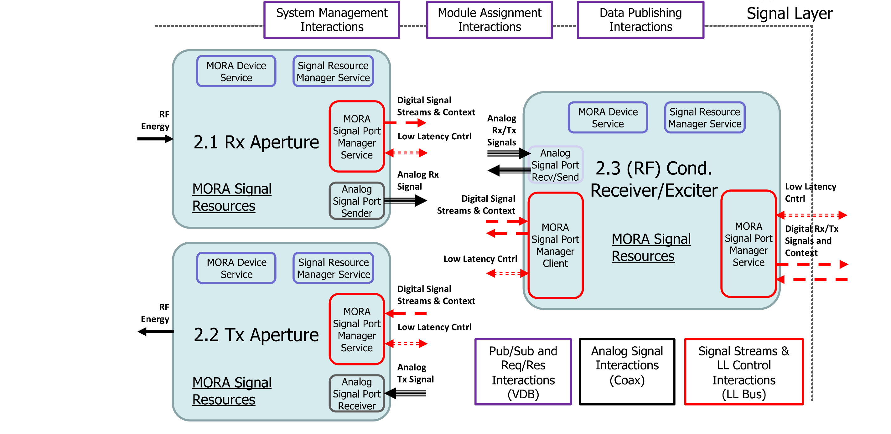

*Figure 42: RF Signal Layer Module Interactions ｜ 图 42：射频信号层模块交互*

- Note: VDB stands for VICTORY Data Bus, which is used for transport of publish-subscribe and request-response interactions in VICTORY.

- **注**：VDB 代表 VICTORY 数据总线（VICTORY Data Bus），在 VICTORY 中用于传输发布-订阅与请求-响应交互。

#### 5.7.3 RF Receiver Aperture/Transducer Module 射频接收孔径／换能器模块

The Receive Aperture/Transducer is responsible for converting Electromagnetic (EM) energy into an electrical signal. The signal may be pre-amplified and stabilized (calibration). This module may include mechanical and electronic steering, focus control, filtering, low-noise amplification, frequency translation, and analog to digital conversion. The output electrical signal may be analog or a digital stream. It may also output metadata.

接收孔径／换能器负责把电磁（EM）能量转换为电信号。该信号可经前置放大与稳定（校准）。本模块可包含机械与电子指向控制、聚焦控制、滤波、低噪声放大、频率变换以及模数转换。输出的电信号可为模拟信号，也可为数字流。它还可输出元数据。

<!-- 原书 p.146 ｜ PDF p.166 -->

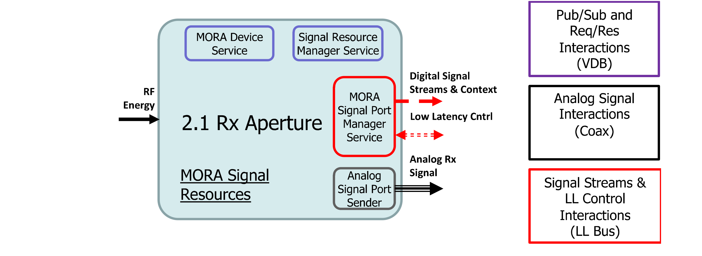

*Figure 43: RF Receiver Aperture/Transducer Interactions ｜ 图 43：射频接收孔径／换能器交互*

The MORA Device Manager Service is a set of interactions that support discovery, configuration, control, and health management of the module. These interactions report the health, send notifications of key events such as state changes and faults, and report built-in-test results. They also allow the module configuration to be managed, and its state to be controlled. For example, modules can be made to execute a BIT, reset, or the software or configuration may be updated.

MORA Device Manager Service（MORA 设备管理器服务）是一组交互，支持该模块的发现、配置、控制与健康管理。这些交互上报健康，发送状态变更与故障等关键事件的通知，并上报机内自检结果。它们还使模块配置得以被管理、其状态得以被控制。例如，可使模块执行 BIT、复位，或可更新其软件或配置。

The Signal Resource Manager Service is a group of interactions that support management of the RF resources that support capabilities such as signal domain conversion, signal frequency conversion, signal conditioning, RF distribution, and antenna control. Through these interactions the task manager (or an application) can request information about the resources and capabilities provided by the RF aperture to determine whether a particular RF aperture can meet the requirements of a given task. These interactions support discovery of detailed characteristics of the aperture, such as the fixed and variable parameters, the fixed and settable interconnections, and the real-time data, control, and context endpoints attached to the MORA Low Latency Bus (ML2B). These interactions also support reservation of the signal resources for a particular task.

Signal Resource Manager Service（信号资源管理器服务）是一组交互，支持对射频资源的管理；这些资源支撑信号域转换、信号频率变换、信号调理、射频分配与天线控制等能力。经由这些交互，任务管理器（或某个应用）可请求有关该射频孔径所提供资源与能力的信息，以判定某个特定射频孔径能否满足给定任务的需求。这些交互支持发现该孔径的详细特性，如固定参数与可变参数、固定的与可设置的互连，以及挂在 MORA 低延迟总线（ML2B）上的实时数据、控制与上下文端点。这些交互还支持为某个特定任务预留信号资源。

The Signal Port Manager Service interactions implement high-speed and low latency control of signal ports, which are realized by MORA Data Messages (MDMs) transported on the ML2B. Once resources have been reserved for a task through the Signal Resource Manager Service, the resources are configured, and the task is executed via the MORA Signal Port Manager Service interactions on the ML2B.

Signal Port Manager Service（信号端口管理器服务）交互实现对信号端口的高速、低延迟控制，这些控制由在 ML2B 上传输的 MORA 数据消息（MDM）实现。一旦经信号资源管理器服务为某个任务预留了资源，这些资源即被配置，任务便经 ML2B 上的 MORA 信号端口管理器服务交互予以执行。

The Analog Signal Port Sender interactions send analog representation of time domain radio frequency, intermediate frequency, or baseband signals.

Analog Signal Port Sender（模拟信号端口发送方）交互发送时域射频、中频或基带信号的模拟表示。

The Receiver Aperture/Transducer interactions are described in Table 41, and the rules stating the requirements for this module are described in Section 5.7.7.

接收孔径／换能器的交互见表 41，陈述本模块需求的规则见第 5.7.7 节。

#### 5.7.4 RF Transmit Aperture/Transducer Module 射频发射孔径／换能器模块

The Transmit Aperture/Transducer is responsible for converting an electrical signal into Electromagnetic (EM) energy, forming a transmit beam. This module may include mechanical and electronic steering, beamforming, focus control, filtering, amplification, frequency translation, and digital to analog conversion.

发射孔径／换能器负责把电信号转换为电磁（EM）能量，形成发射波束。本模块可包含机械与电子指向控制、波束形成、聚焦控制、滤波、放大、频率变换以及数模转换。

<!-- 原书 p.147 ｜ PDF p.167 -->

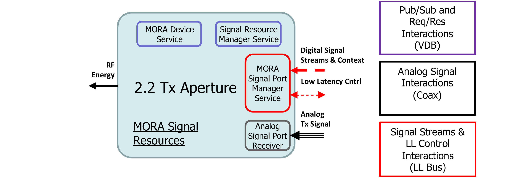

*Figure 44: RF Transmit Aperture/Transducer Interactions ｜ 图 44：射频发射孔径／换能器交互*

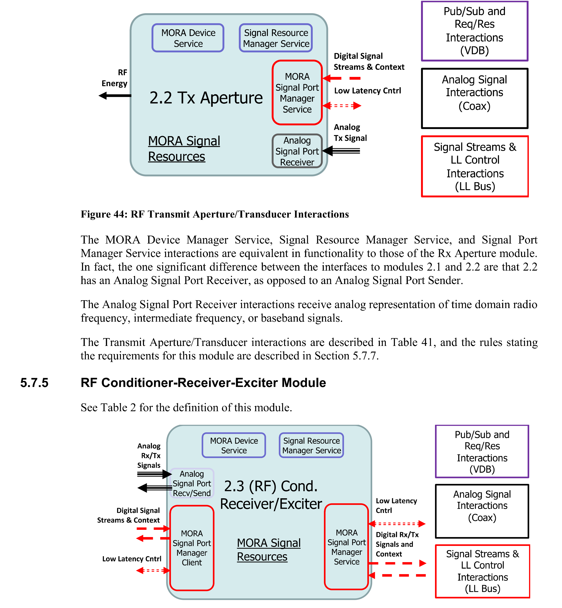

*Figure 45: RF Conditioner Receiver/Exciter Interactions ｜ 图 45：射频调理器接收机／激励器交互*

The MORA Device Manager Service and Signal Resource Manager Service interactions of this module are equivalent to those of the Tx and Rx aperture interfaces to describe the module’s status, configuration, built-in-test results, and a mechanism for managing the state of the module.

本模块的 MORA 设备管理器服务与信号资源管理器服务交互，与发射（Tx）孔径接口和接收（Rx）孔径接口上的对应交互相当，用于描述模块的状况、配置、机内自检结果，以及一种管理模块状态的机制。

<!-- 原书 p.148 ｜ PDF p.168 -->

The difference in the RF Conditioner-Receiver-Exciter module is that it will have a larger set of resources than the others. It may include RF functions such as signal domain conversion, signal frequency conversion, signal conditioning, RF distribution, and digital signal ports. It exchanges analog signals with the Rx and Tx modules via Analog Signal Receiver and Sender interactions, which are controlled via the MORA Signal Port Manager Client interactions on the ML2B. It exchanges digital signal streams, context, and real-time control data with the down-stream modules via its MORA Signal Port Manager Service.

射频调理器-接收机-激励器模块的差别在于：它所拥有的资源集合比其他模块更大。它可包含信号域转换、信号频率变换、信号调理、射频分配与数字信号端口等射频功能。它经模拟信号接收方与发送方（Analog Signal Receiver and Sender）交互，与接收模块、发射模块交换模拟信号；这些交互经 ML2B 上的 MORA 信号端口管理器客户端（MORA Signal Port Manager Client）交互加以控制。它经其 MORA 信号端口管理器服务与下游模块交换数字信号流、上下文与实时控制数据。

The following sections describe the interactions that make up each of these interaction endpoint groups, and then state the rules that will be required for each of the RF signal layer modules.

以下各节描述构成上述每一个交互端点组的各交互，随后陈述各射频信号层模块需求的规则。

#### 5.7.6 RF Signal Layer Module Interactions 射频信号层模块交互

Table 41 shows the interactions that have been defined for the RF signal layer modules, which include 2.1 Receiver Aperture/Transducer, 2.2 Transmit Aperture/Transducer, and 2.3 Conditioner-Receiver Exciter.

表 41 列出已为射频信号层模块定义的交互，这些模块包括 2.1 接收孔径／换能器、2.2 发射孔径／换能器与 2.3 调理器-接收机-激励器。

Note that these names have been slightly modified (the word “camera” has been removed) to indicate that these interactions were developed with RF applications in mind. They do not explicitly support EO/IR applications in this version. Interactions to support EO/IR applications will be addressed in a future version.

注意，这些名称已略作修改（删去了“camera”一词），以表明这些交互是考虑射频应用而开发的。在本版本中，它们并不显式支持光电／红外应用。支持光电／红外应用的交互将在今后的版本中处理。

The source of these interaction definitions was MORA. The approach taken was to directly adopt the parts of the MORA specification that related to the functionality of these RF signal layer modules, and thus the interactions shown came directly from analysis of MORA.

这些交互定义的来源是 MORA。所采取的做法是直接采纳 MORA 规范中与这些射频信号层模块功能相关的内容，因此所示的交互直接来自对 MORA 的分析。

For each interaction, the input and output parameters are represented as lists of data entity names in the Input and Output DIV-2 Data Entities columns. Each item in the input and output lists corresponds to an entry in one of the DIV-2 tables provided as appendices.

对每个交互，输入参数与输出参数以数据实体名称列表的形式列于“输入 DIV-2 数据实体”与“输出 DIV-2 数据实体”两列中。输入列表与输出列表中的每一项，各自对应作为附录提供的某张 DIV-2 表中的一个条目。

**Table 41: RF Signal Layer Module Interactions Table ｜ 表 41：射频信号层模块交互表**

| RF Signal Layer Module Interactions ／ 射频信号层模块交互 |  |  |  |  |  |  |
|---|---|---|---|---|---|---|
| Interaction Name ／ 交互名称 | Interaction Description ／ 交互描述 | Input DIV-2 Data Entities ／ 输入 DIV-2 数据实体 | Output DIV-2 Data Entities ／ 输出 DIV-2 数据实体 | 2.1 Receive Aperture/Transducer ／ 2.1 接收孔径／换能器 | 2.2 Transmit Aperture/Transducer ／ 2.2 发射孔径／换能器 | 2.3 Conditioner-Receiver-Exciter ／ 2.3 调理器-接收机-激励器 |
| PubSensorHeartbeat | | SensorHeartbeatType | | 1.1 | | |
| deleteFile | Request that a file on a MORA device be deleted. The “fileId” argument should correspond to the “id” field of the file requested, as returned from a “getFiles()” request. 请求删除 MORA 设备上的一个文件。“fileId”参数宜与其所请求文件的“id”字段相对应，该值由一次“getFiles()”请求返回。 | string | error | Provides | Provides | Provides |
| getAntennaArrays | Request a list of the antennas and their elements attached to the MORA device. 请求列出挂接于该 MORA 设备的天线及其阵元。 | | arrays | Provides | Provides | |
| getAntennaSideSignalPorts | Get a list of signal ports in the switch matrix that are connected to the antenna side of the RF chain. 获取交换矩阵中连接到射频链天线侧的那些信号端口的列表。 | | signalPorts | Provides | Provides | |
| getAvailableWaveforms | Request for a list of radio waveforms supported by the MORA device. 请求列出该 MORA 设备所支持的无线电波形。 | waveforms | error | Provides | Provides | Provides |
| getBuiltInTestResults | Request the results from a previous MORA device BIT run. 请求取得该 MORA 设备上一次 BIT 运行的结果。 | testResults | error | Provides | Provides | Provides |
| getCurrentMoraConfig | Get the file ID of the current MORA configuration file for a MORA device. 获取某个 MORA 设备当前所用 MORA 配置文件的文件 ID。 | fileId | error | Provides | Provides | Provides |
| getCurrentWaveform | Request details on the currently active waveform. 请求给出当前生效波形的详细信息。 | | waveform | Provides | Provides | Provides |
| getDeviceStatus | Get the status of the MORA device represented by the service. 获取该服务所代表的 MORA 设备的状况。 | | status | Provides | Provides | Provides |
| getDeviceType | Get the description of the MORA device represented by the service. 获取该服务所代表的 MORA 设备的描述。 | | moraDevice | Provides | Provides | Provides |
| getExternalConnections | Request the static external connections between the signal ports of this MORA device and other MORA devices. 请求取得该 MORA 设备各信号端口与其他 MORA 设备之间的静态外部连接。 | | externalConnections, error | Provides | Provides | Provides |

> 转写说明：首行 `RF Signal Layer Module Interactions` 在原表中横跨全部 7 列，其余 6 格留空。原表起于 p.149，次页续排（续页表头重复），本表按续页顺序接排（PubSensorHeartbeat、deleteFile 之后接 getAntennaArrays 起 9 行），共 11 个数据行。表内被 colspan 覆盖处留空，不代表原表该处无内容。
>
> 转写说明：原表多个单元格内的英文是排版折行（如 `SensorHeartbeatType` 被折成 `SensorHeartbeatT` / `ype`，`getAvailableWaveforms` 被折成 `getAvailableWavefo` / `rms`），已按一个单词复原，未插入空格。
>
> 转写说明：`PubSensorHeartbeat` 行的 Interaction Description、Output DIV-2 Data Entities、2.2、2.3 四格在原表中为空白；`getAntennaArrays`、`getAntennaSideSignalPorts` 的 Input DIV-2 Data Entities 在原表中为空白；`getAntennaArrays`、`getAntennaSideSignalPorts` 的 2.3 列为空白。以上空白照录为空。

<!-- 原书 p.149 ｜ PDF p.169 -->

<!-- 原书 p.150 ｜ PDF p.170 -->

<!-- 原书 p.151 ｜ PDF p.171 -->

<!-- 原书 p.152 ｜ PDF p.172 -->

<!-- 原书 p.153 ｜ PDF p.173 -->

<!-- 原书 p.154 ｜ PDF p.174 -->

#### 5.7.7 RF Signal Layer Module Rules RF 信号层模块规则

Implementations of modules 2.1, 2.2, and 2.3 shall comply with the appropriate MORA specifications, as shown in Table 42.

模块 2.1、2.2 与 2.3 的实现应符合相应的 MORA 规范，如表 42 所示。

In each row, the Interaction Endpoint column indicates the role that the indicated module shall support. If the endpoint column contains the word “Service”, then the module shall “provide” or implement the service side of the indicated standard. If the endpoint column contains the word “Client”, then the module shall “use” or implement the client side of the indicated standard. If the endpoint column contains the word “Sender”, the module shall “provide” or implement the service side of the interactions, while the word “Receiver” indicates the module shall “use” or implement the client side of the interactions.

每一行中，交互端点列指明所指示的模块应支持的角色。若端点列中含有 “Service” 一词，则该模块应“提供”或实现所指示标准的服务侧。若端点列中含有 “Client” 一词，则该模块应“使用”或实现所指示标准的客户端一侧。若端点列中含有 “Sender” 一词，则该模块应“提供”或实现各交互的服务侧；而 “Receiver” 一词则表示该模块应“使用”或实现各交互的客户端一侧。

Note that conformance with an individual interface standard (set of interactions) can only be tested objectively at the provider/service endpoint.

注意，与单个接口标准（一组交互）的符合性，只能在提供方／服务端点处得到客观的测试。

<!-- 原书 p.155 ｜ PDF p.175 -->

Additional context for the Interaction Endpoints listed in the table can be gained by referring to Figure 42.

表中列出的各交互端点，其补充背景可参阅图 42 获得。

**Table 42: RF Signal Layer Module Interaction Endpoints ｜ 表 42：RF 信号层模块交互端点**

| **Module ID** ／ **模块编号** | **Module Name** ／ **模块名** | **Applicability** ／ **适用性** | **Interaction Endpoint** ／ **交互端点** | **MORA 2.1 Specification** ／ **MORA 2.1 规范** |
|---|---|---|---|---|
| 2.1 | Receive Aperture/Transducer/Camera ／ 接收孔径／换能器／相机 | Required ／ 必需 | MORA Device Service | MT92010: MORA Device |
| 2.1 | Receive Aperture/Transducer/Camera ／ 接收孔径／换能器／相机 | Required ／ 必需 | Signal Resource Manager Service | MT92013: MORA Signal Resource Manager |
| 2.1 | Receive Aperture/Transducer/Camera ／ 接收孔径／换能器／相机 | Required ／ 必需 | MORA Signal Port Manager Service | MT92016: MORA Signal Port Manager |
| 2.1 | Receive Aperture/Transducer/Camera ／ 接收孔径／换能器／相机 | Required ／ 必需 | Analog Signal Port Sender | MT90011: RF Layer Analog Data Interface |
| 2.2 | Transmit Aperture/Transducer/Laser ／ 发射孔径／换能器／激光器 | Required ／ 必需 | MORA Device Service | MT92011: MORA Device Management Interface |
| 2.2 | Transmit Aperture/Transducer/Laser ／ 发射孔径／换能器／激光器 | Required ／ 必需 | Signal Resource Manager Service | MT92013: MORA Signal Resource Manager |
| 2.2 | Transmit Aperture/Transducer/Laser ／ 发射孔径／换能器／激光器 | Required ／ 必需 | MORA Signal Port Manager Service | MT92016: MORA Signal Port Manager |
| 2.2 | Transmit Aperture/Transducer/Laser ／ 发射孔径／换能器／激光器 | Required ／ 必需 | Analog Signal Port Receiver | MT90011: RF Layer Analog Data Interface |
| 2.3 | Conditioner Receiver/Exciter ／ 调理器-接收机-激励器 | Required ／ 必需 | MORA Device Service | MT92011: MORA Device Management Interface |
| 2.3 | Conditioner Receiver/Exciter ／ 调理器-接收机-激励器 | Required ／ 必需 | Signal Resource Manager Service | MT92013: MORA Signal Resource Manager |
| 2.3 | Conditioner Receiver/Exciter ／ 调理器-接收机-激励器 | Required ／ 必需 | MORA Signal Port Manager Service | MT920116: MORA Signal Port Manager |
| 2.3 | Conditioner Receiver/Exciter ／ 调理器-接收机-激励器 | Required ／ 必需 | Analog Signal Port Sender | MT90011: RF Layer Analog Data Interface |
| 2.3 | Conditioner Receiver/Exciter ／ 调理器-接收机-激励器 | Required ／ 必需 | Analog Signal Port Receiver | MT90011: RF Layer Analog Data Interface |
| 2.3 | Conditioner Receiver/Exciter ／ 调理器-接收机-激励器 | Required ／ 必需 | MORA Signal Port Manager Client | MT92013: MORA Signal Resource Manager |

> 注：The MORA specification, Version 2.1 references in the table uniquely identify a testable specification in the MORA documents. MORA also refers to other standard documents, including VICTORY and ANSI/VITA 49.2.
>
> **注**：表中引用的 MORA 规范 2.1 版各条，唯一地标识 MORA 文档中某一可测试的规范。MORA 还引用其他标准文件，包括 VICTORY 与 ANSI/VITA 49.2。
>
> 转写说明：上一条是紧随表格的说明段落（原书该段左缩进小于正文，判为表注；若按正文处理请移出）。原表次页为正文（Rule 5.7.7 各条）与他处内容，非本表续表，未入本表。
>
> 转写说明：`Module Name` 列在原表中排为两行（`Receive Aperture/` + `Transducer/Camera`；`Conditioner` + `Receiver/Exciter`），属名称折行，已用一个空格接成一行。`Module ID`、`Module Name`、`Applicability` 三列在每一行都单独列出（原表无 rowspan 合并），故逐行照录、无留空格。
>
> 存疑：第 11 行 `MORA 2.1 Specification` 列原文作 `MT920116: MORA Signal Port Manager`（其余同类行为 `MT92016`），疑为原书笔误；按「不纠错」原则照录原文，未改。

<!-- 原书 p.156 ｜ PDF p.176 -->

The following documents provide the complete, detailed specifications referenced in the table. MORA Specification, Version 2.1 (see Referenced Documents)

下列文件给出表中引用各规范的完整、详细规格；MORA 规范 2.1 版（见“引用文件”）。

- Distribution A: main body and appendices A-D Distribution C: appendices E-G VICTORY Standard Specifications, Version 1.7 (see Referenced Documents)

- 分发声明 A：正文与附录 A-D；分发声明 C：附录 E-G；VICTORY 标准规范 1.7 版（见“引用文件”）。

Distribution C: main body

分发声明 C：正文。

Distribution D and/or ITAR: appendices

分发声明 D 和／或 ITAR：附录。

- ANSI/VITA 49.2 (see Referenced Documents) Each bullet item in the rules below uniquely specifies a section of the MORA specification adopted by the SOSA Consortium for the SOSA Technical Architecture. Note that the rules only refer to implementation of the service-side interaction endpoints, as MORA does not provide conformance tests for implementation of the client-side interaction endpoints.

- ANSI/VITA 49.2（见“引用文件”）；下文各规则中的每一个项目符号条目，唯一地对应 SOSA 联盟为 SOSA 技术架构所采纳的 MORA 规范中的某一节。注意，这些规则只涉及服务侧交互端点的实现，因为 MORA 不提供对客户端侧交互端点实现的符合性测试。

> **译注**：本片有多处原书的项目符号列表在转换件中被并进了段落（项目符号与换行丢失）。英文照原样整段录；中文译成同一段落、各条以「；」分列，不替英文补项目符号。

**Rule 5.7.7-[1-4]**

> **译注**：`Rule`＝规则、`Recommendation`＝推荐、`Suggestion`＝建议、`Permission`＝许可、`Observation`＝观察（见术语表 §一）；此类条目标目连同其编号一律原样不译，其下正文照译。

A component implementing the RF modalities of the SOSA 2.1 Receive/Aperture Transducer module shall be compliant with the following MORA specifications: Conformance

实现 SOSA 2.1 接收／孔径换能器模块射频模态的组件，应符合下列 MORA 规范：符合性

Methodology: (TBD)

方法：（TBD）

MT92010: MORA Device

MT92010：MORA 设备

MT92013: MORA Signal Resource Manager

MT92013：MORA 信号资源管理器

MT92016: MORA Signal Port Manager

MT92016：MORA 信号端口管理器

MT90011: RF Layer Analog Data Interface

MT90011：射频层模拟数据接口

**Rule 5.7.7-[5-7]**

A component implementing the RF modalities of the SOSA 2.1 Receive/Aperture Transducer module shall provide the following signal resources as defined by the MORA specification, Version 2.1: Conformance Methodology: (TBD) Antenna (ANT) Signal Resource RF Translation Signal Resource Signal Domain Conversion Signal Resource

实现 SOSA 2.1 接收／孔径换能器模块射频模态的组件，应提供 MORA 规范 2.1 版所定义的下列信号资源：符合性方法：（TBD）；天线（ANT）信号资源；射频变换信号资源；信号域转换信号资源

**Rule 5.7.7-[8-9]**

A component implementing the RF modalities of the SOSA 2.1 Receive/Aperture Transducer module may provide the following signal resources as defined by the MORA specification, Version 2.1: RF Conditioning Signal Resource RF Distribution Signal Resource

实现 SOSA 2.1 接收／孔径换能器模块射频模态的组件，可提供 MORA 规范 2.1 版所定义的下列信号资源：射频调理信号资源；射频分配信号资源

<!-- 原书 p.157 ｜ PDF p.177 -->

**Rule 5.7.7-[10-13]**

A component implementing the RF modalities of the SOSA 2.2 Transmit/Aperture Transducer module shall be compliant with the following MORA specifications: Conformance

实现 SOSA 2.2 发射／孔径换能器模块射频模态的组件，应符合下列 MORA 规范：符合性

Methodology: (TBD)

方法：（TBD）

MT92010: MORA Device

MT92010：MORA 设备

MT92013: MORA Signal Resource Manager

MT92013：MORA 信号资源管理器

MT92016: MORA Signal Port Manager

MT92016：MORA 信号端口管理器

MT90011: RF Layer Analog Data Interface

MT90011：射频层模拟数据接口

**Rule 5.7.7-[14-16]**

A component implementing the RF modalities of the SOSA 2.1 Transmit Aperture Transducer module shall provide the following signal resources as defined by the MORA specification, Version 2.1: Conformance Methodology: (TBD) Antenna Signal Resource RF Translation Signal Resource Signal Domain Conversion Signal Resource

实现 SOSA 2.1 发射孔径换能器模块射频模态的组件，应提供 MORA 规范 2.1 版所定义的下列信号资源：符合性方法：（TBD）；天线信号资源；射频变换信号资源；信号域转换信号资源

**Rule 5.7.7-[17-18]**

A component implementing the RF modalities of the SOSA 2.1 Receive/Aperture Transducer module may provide the following signal resources as defined by the MORA specification, Version 2.1: RF Conditioning Signal Resource RF Distribution Signal Resource

实现 SOSA 2.1 接收／孔径换能器模块射频模态的组件，可提供 MORA 规范 2.1 版所定义的下列信号资源：射频调理信号资源；射频分配信号资源

**Rule 5.7.7-[19-24]**

A component implementing the RF modalities of the SOSA 2.3 RF Conditioner-Receiver-Exciter module shall be compliant with the following MORA specifications: Conformance Methodology: (TBD) MT92011: MORA Device Management Interface

实现 SOSA 2.3 射频调理器-接收机-激励器模块射频模态的组件，应符合下列 MORA 规范：符合性方法：（TBD）；MT92011：MORA 设备管理接口

MT92013: MORA Signal Resource Manager

MT92013：MORA 信号资源管理器

MT92016: MORA Signal Port Manager

MT92016：MORA 信号端口管理器

MT90011: RF Layer Analog Data Interface MT90011: RF Layer Analog Data Interface

MT90011：射频层模拟数据接口；MT90011：射频层模拟数据接口

MT92013: MORA Signal Resource Manager

MT92013：MORA 信号资源管理器

<!-- 原书 p.158 ｜ PDF p.178 -->

**Rule 5.7.7-[25-28]**

A component implementing the RF modalities of the SOSA 2.3 RF Conditioner-Receiver-Exciter module shall provide the following signal resources as defined by the MORA specification, Version 2.1: Conformance Methodology: (TBD)

实现 SOSA 2.3 射频调理器-接收机-激励器模块射频模态的组件，应提供 MORA 规范 2.1 版所定义的下列信号资源：符合性方法：（TBD）

RF Conditioning Signal Resource RF Distribution Signal Resource RF Translation Signal Resource Signal Domain Conversion Signal Resource

射频调理信号资源；射频分配信号资源；射频变换信号资源；信号域转换信号资源

### 5.8 EO/IR Signal Layer Modules EO/IR 信号层模块

#### 5.8.1 EO/IR Receiver Camera Module Standard EO/IR 接收相机模块标准

Planned for a later version of the SOSA Technical Standard.

计划在 SOSA 技术标准的后续版本中给出。

#### 5.8.2 EO/IR Transmit Laser Module Standard EO/IR 发射激光器模块标准

Planned for a later version of the SOSA Technical Standard.

计划在 SOSA 技术标准的后续版本中给出。

#### 5.8.3 EO/IR Conditioner-Receiver-Exciter Module Standard EO/IR 调理器-接收机-激励器模块标准

Planned for a later version of the SOSA Technical Standard.

计划在 SOSA 技术标准的后续版本中给出。

### 5.9 RF Digital Processing Modules RF 数字处理模块

#### 5.9.1 Tracker 跟踪器

##### 5.9.1.1 Definition 定义

See Table 2 for the definition of this module.

本模块的定义见表 2。

5.9.1.2 Interactions

5.9.1.2 交互

The tracker interactions are still being developed, and the SOSA Consortium has not yet voted on them. An initial capability – AMTI Multi-Sensor Fusion Sense and Avoid (SAA) – was used to create a notional set of interactions and data elements for a tracker. A detailed concept has been defined for several task manager interactions related to the tracker: SetCreateTask, SetModifyTask, SetDeleteTask, SetModuleAssignment, PubAssignmentHealth, and SubAssignmentHealth. Four interactions related to the tracker performing its functions have also been defined: SubDetection, PubTrack, SubOwnershipReport, and SubTrackReport. Some interactions will be common across all tracker modes/types, such as SetDeleteTask. Others will be sensor and mission-specific. Defining the configuration data, control action, and module assignmen’ fields in the tracker task management interactions for each Sensor and Mission will require an extensive effort.

跟踪器的各项交互仍在制定之中，SOSA 联盟尚未就其表决。最初以一项初始能力——空中动目标指示多传感器融合感知与避让（AMTI Multi-Sensor Fusion Sense and Avoid，SAA）——为依据，构建了一组设想的跟踪器交互与数据元素。已就与跟踪器相关的若干任务管理器交互定义了详细概念：SetCreateTask、SetModifyTask、SetDeleteTask、SetModuleAssignment、PubAssignmentHealth 与 SubAssignmentHealth。此外还定义了四项与跟踪器执行其功能相关的交互：SubDetection、PubTrack、SubOwnershipReport 与 SubTrackReport。有些交互将在所有跟踪器模式／类型中通用，如 SetDeleteTask；另一些则因传感器与任务而异。要为每一种传感器与任务分别定义跟踪器任务管理交互中的配置数据、控制动作与模块分派字段，将需要大量的工作。

> **译注**：英文原文此处的 `assignmen’` 有脱字（当为 `assignment`），照录未改，中文按字面译作“分派”。

<!-- 原书 p.159 ｜ PDF p.179 -->

##### 5.9.1.3 Tracker Interactions for AMTI SAA 跟踪器面向 AMTI SAA 的交互

The SOSA Consortium is developing a comprehensive list of SOSA sensor capabilities. The AMTI SAA capability was used to initiate the development of tracker interactions; therefore, the defined interactions below are relevant for AMTI Multi-Sensor Fusion in an SAA context.

SOSA 联盟正在编制一份 SOSA 传感器能力的完整清单。跟踪器交互的制定以 AMTI SAA 能力为起点；因此，下文所定义的各项交互适用于 SAA 语境下的 AMTI 多传感器融合。

References to the corresponding DIV-2 and DIV-3 products for the tracker in an AMTI Multi-Sensor Fusion SAA mode are found in Appendix D and Appendix E, respectively.

在 AMTI 多传感器融合 SAA 模式下，跟踪器所对应的 DIV-2 与 DIV-3 制品分别在附录 D 与附录 E 中给出。

Table 43 further defines the task management interactions shown in Table 40 for an AMTI Multi-Sensor Fusion SAA capability. Note that only those DIV-2 data entities that are specific to this capability are shown. For example, the taskDescription DIV-2 data entity associated with the SetCreateTask interaction (in Table 40) contains sensorType, missionType, and taskConfigData, where taskConfigData is an abstraction that must be extended for each mission type. The particular extension for an AMTI SAA capability is saaTaskConfigData, and that is the DIV-2 data entity that is shown in Table 43 for the version of SetCreateTask used for AMTI SAA. The DIV-2 for AMTI SAA is very specific at this point. There may be interactions and data that can be generalized. As additional capabilities are analyzed, the interactions may be refactored and are subject to change.

表 43 进一步定义表 40 中所示的任务管理交互在 AMTI 多传感器融合 SAA 能力下的内容。注意，只给出专属于该能力的那些 DIV-2 数据实体。例如，与 SetCreateTask 交互（见表 40）相关联的 taskDescription DIV-2 数据实体含有 sensorType、missionType 与 taskConfigData，其中 taskConfigData 是一种抽象，必须为每一种任务类型加以扩展。AMTI SAA 能力所用的特定扩展是 saaTaskConfigData，这正是表 43 中用于 AMTI SAA 的 SetCreateTask 版本所给出的 DIV-2 数据实体。AMTI SAA 的 DIV-2 在这一点上非常具体。可能还存在可以泛化的交互与数据。随着对更多能力的分析，这些交互可能被重构，也可能发生变化。

**Table 43: Tracker Module Interactions ｜ 表 43：跟踪器模块交互**

| Tracker Module Interactions ／ 跟踪器模块交互 |||||
|---|---|---|---|---|
| Interaction Name ／ 交互名 | Interaction Description ／ 交互描述 | Input DIV-2 Data Entities ／ 输入 DIV-2 数据实体 | Output DIV-2 Data Entities ／ 输出 DIV-2 数据实体 | Provider Module ／ 提供方模块 |
| SetCreateTask | Request a new task, coming from outside of the sensor. 请求一个新任务，该任务来自传感器外部。 | saaTaskConfigData (SAATaskConfigDataType) | TBD | 1.2 |
| SetModifyTask | Modify task from outside of the sensor. 修改来自传感器外部的任务。 | saaControlAction_AddExternalSensor (SAAControlAction_AddExternalSensorType) saaControlAction_DeleteExternalSensor (SAAControlAction_DeleteExternalSensorType) saaControlAction_SetTrackerMode (SAAControlAction_SetTrackerModeType) saaControlAction_SAATrackCoast (saaControlAction_SAATrackCoastType) | TBD | 1.2 |
| SetDeleteTask | Delete task from outside of the sensor. 删除来自传感器外部的任务。 | taskID (number) | TBD | 1.2 |
| SetModuleAssignment | Assign a task to a module (assignment is used instead of task for modules). Assignments come from internal sources; tasks come from external sources. The intent is that the task manager will decompose an externally received task into module assignments as necessary. 把任务分派给模块（对模块而言用“分派”而不用“任务”）。分派来自内部来源；任务来自外部来源。其意图是：任务管理器按需要把外部收到的任务分解为各模块的分派。 | assignmentAction_SAAExternalSensorConfig (AssignmentAction_SAAExternalSensorConfigType) assignmentAction_DeleteExternalSensor (AssignmentAction_DeleteExternalSensorType) assignmentAction_SetTrackerMode (AssignmentAction_SetTrackerModeType) assignmentAction_SAATrackCoast (AssignmentAction_SAATrackCoastType) | TBD | 3.4 |
| PubAssignmentHealth | Publish periodic task (assignment) health. 发布周期性的任务（分派）健康。 | TBD | trackerHealth (TrackerHealthType) | 3.4 |
| SubAssignmentHealth | Subscribe periodic task (assignment) health. 订阅周期性的任务（分派）健康。 | domainID (number) topicName (string) | TBD | 1.2 |

> 转写说明：首行 `Tracker Module Interactions` 在原表中横跨全部 5 列，其余 4 格留空。原表 p.160 与接续页续排，续页首行起接 SetModuleAssignment、PubAssignmentHealth、SubAssignmentHealth 三行，共 6 个数据行。
>
> 转写说明：`Input DIV-2 Data Entities` 列中，格内本是分条并列的若干数据实体（每条为「实体名 + 换行 + 括号内类型」），故用 ` ` 连接；原表条目之间另有空行间距，已并入单个 ` `。`Interaction Description` 列中是连续句子被排版折行（如 SetModuleAssignment 的说明），按一个空格接成一行。
>
> 转写说明：SetModifyTask 行最后一个类型原文作 `(saaControlAction_SAATrackCoastType)`，首字母小写 `saa`（同格其余三项为 `SAA`），照录原文未改。
>
> 存疑：无（全部单元格清晰可读）。

<!-- 原书 p.160 ｜ PDF p.180 -->

Table 44 shows additional interactions associated with the tracker.

表 44 给出与跟踪器相关的其他交互。

**Table 44: Additional Tracker Interactions ｜ 表 44：其他跟踪器交互**

| Tracker Module Interactions ／ 跟踪器模块交互 |||||
|---|---|---|---|---|
| Interaction Name ／ 交互名 | Interaction Description ／ 交互描述 | Input DIV-2 Data Entities ／ 输入 DIV-2 数据实体 | Output DIV-2 Data Entities ／ 输出 DIV-2 数据实体 | Provider Module ／ 提供方模块 |
| SubDetection | An interaction for receiving detections. 用于接收各项检测的交互。 | domainID (number) topicName (string) | TBD | 3.4 |
| PubTrack | An interaction for publishing tracks. 用于发布各航迹的交互。 | TBD | timePublished (DateTimeType) numOfIntruders (number) trackReport (TrackReportType) | 3.4 |
| SubOwnershipReport | An interaction for receiving ownership information. 用于接收归属信息的交互。 | domainID (number) topicName (string) | TBD | 3.4 |
| SubTrackReport | An interaction for receiving a track external to the SOSA sensor. The External Data Ingestor ensures the external track is in a SOSA track format. 用于接收 SOSA 传感器之外部的航迹的交互。外部数据摄取器确保该外部航迹为 SOSA 航迹格式。 | domainID (number) topicName (string) | TBD | 3.4 |

> 转写说明：首行 `Tracker Module Interactions` 在原表中横跨全部 5 列（与 Table 43 同名），其余 4 格留空。本表起于原书 p.161 上半页（SubDetection、PubTrack、SubOwnershipReport 三行），在下一个续页首行接排 SubTrackReport 一行，共 4 个数据行；该续页其后为正文与 Table 45，未入本表。
>
> 转写说明：`Input DIV-2 Data Entities` 与 `Output DIV-2 Data Entities` 两列中，格内本是分条并列的数据实体（「实体名 + 换行 + 括号内类型」），故用 ` ` 连接。`Interaction Description` 列中是连续句子被排版折行，按一个空格接成一行。
>
> 存疑：无（全部单元格清晰可读）。

<!-- 原书 p.161 ｜ PDF p.181 -->

AMTI SAA Example for Task Configuration

AMTI SAA 任务配置示例

An example of task configuration data for an AMTI SAA mission is given in Table 45. In the interaction SetCreateTask(sensorType, missionType, taskConfigData), sensorType would be set to Radar, missionType would be set to AMTI SAA, and taskConfigData would be represented by saaTaskConfigData, which is defined below.

表 45 给出一个 AMTI SAA 任务的任务配置数据示例。在交互 SetCreateTask(sensorType, missionType, taskConfigData) 中，sensorType 将置为 Radar，missionType 将置为 AMTI SAA，而 taskConfigData 将由 saaTaskConfigData 表示，其定义见下文。

**Table 45: AMTI SAA Mission Configuration Data ｜ 表 45：AMTI SAA 任务配置数据**

| **saaTaskConfigData** | **Description** ／ **描述** |
|---|---|
| useSOSASensor | A boolean indicating whether or not the tracker will receive detections resulting from a Radar aperture that is part of the SOSA sensor. 一个布尔量，指示跟踪器是否将接收由属于该 SOSA 传感器的雷达孔径所产生的各项检测。 |
| numExternalSensors | The number of external sensors that will have inputs for the tracker. 将为跟踪器提供输入的外部传感器的数目。 |
| sensorID | The sensor ID of an external sensor. 某个外部传感器的传感器 ID。 |
| sensorHardwareSpecs | The hardware specifications of the external sensor associated with the sensor ID. 与传感器 ID 相关联的外部传感器的硬件规格。 |
| sensorSoftwareSpecs | The software specifications of the external sensor associated with the sensor ID. 与传感器 ID 相关联的外部传感器的软件规格。 |
| sensorFOV | The field of view of the external sensor associated with the sensor ID. 与传感器 ID 相关联的外部传感器的视场。 |
| sensorAddress | Indicates the sensor’s RT address on 1553 bus (see sourceID). 指示该传感器在 1553 总线上的 RT 地址（见 sourceID）。 |
| ExternalSensorDataEnum | Specifies input data type (beam detection or track). 指定输入数据类型（波束检测或航迹）。 |

> 转写说明：原表只有一层表头（`saaTaskConfigData` / `Description`），无横跨整表的标题行；共 8 个数据行，全表位于原书 p.162 一页之内，无续页。
>
> 转写说明：`Description` 列内个别条目在原表中为两行（如 sensorHardwareSpecs 的说明），属连续句子排版折行，已用一个空格接成一行。`sensorAddress` 行的 `sensor’s` 为原表所有格撇号，照录为弯撇号。
>
> 存疑：无（全部单元格清晰可读）。

### 5.10 Infrastructure Modules 基础设施模块

##### 5.10.1.1 Definition 定义

See Table 2 for the definition of this module.

本模块的定义见表 2。

##### 5.10.1.2 Interactions 交互

Planned for a later version of the SOSA Technical Standard.

计划在 SOSA 技术标准的后续版本中给出。

<!-- 原书 p.162 ｜ PDF p.182 -->

#### 5.10.2 External Data Ingestor 外部数据摄取器

##### 5.10.2.1 Definition 定义

See Table 2 for the definition of this module.

本模块的定义见表 2。

5.10.2.2 Interactions

5.10.2.2 交互

Planned for a later version of the SOSA Technical Standard.

计划在 SOSA 技术标准的后续版本中给出。

#### 5.10.3 Host Platform Interface 宿主平台接口

##### 5.10.3.1 Definition 定义

See Table 2 for the definition of this module.

本模块的定义见表 2。

The host platform interface provides a bridge between the SOSA sensor and the host platform. It converts the SOSA interactions to/from the host platform interface protocol. For example, a SOSA sensor plugging into an OMS-based platform would have a host platform interface module that supports OMS on the outward-facing interface and SOSA on the inward-facing SOSA sensor.

宿主平台接口在 SOSA 传感器与宿主平台之间提供一座桥接。它把 SOSA 交互转换到宿主平台接口协议、并从该协议转换回来。例如，一个插入基于 OMS 的平台的 SOSA 传感器，将具有一个宿主平台接口模块：其在朝外的接口上支持 OMS，而在朝内的 SOSA 传感器一侧支持 SOSA。

5.10.3.2 Interactions

5.10.3.2 交互

The SOSA Consortium has accepted a set of interactions and associated DIV-2 data entities for external sensor tasking, primarily tasking of RF sensors. These interactions represent a basic set of functionalities distilled from Unmanned Ariel System (UAS) Command & Control Initiative (UCI), VICTORY, and STANAG 4586. The 6.9 Host Platform Interface module receives UCI, VICTORY, or STANAG 4586 command and control messages, translates them into the SOSA message format, and initiates interactions with modules 1.1 System Manager and 1.2 Task Manager. The host platform interface also receives messages from within the SOSA sensor about the commanded tasks and translates them from the SOSA message format into messages that adhere to the UCI, VICTORY, or STANAG 4586 message standards.

SOSA 联盟已就外部传感器任务指派——主要是射频传感器的任务指派——接受了一组交互及与之相关联的 DIV-2 数据实体。这些交互代表一组基本功能，萃取自无人机系统（UAS）指挥与控制倡议（UCI）、VICTORY 与 STANAG 4586。6.9 宿主平台接口模块接收 UCI、VICTORY 或 STANAG 4586 的指挥与控制消息，把它们转换为 SOSA 消息格式，并发起与 1.1 系统管理器、1.2 任务管理器两模块的交互。宿主平台接口还接收来自 SOSA 传感器内部关于所命令任务的各类消息，并把它们从 SOSA 消息格式转换为遵从 UCI、VICTORY 或 STANAG 4586 消息标准的消息。

<!-- 原书 p.163 ｜ PDF p.183 -->

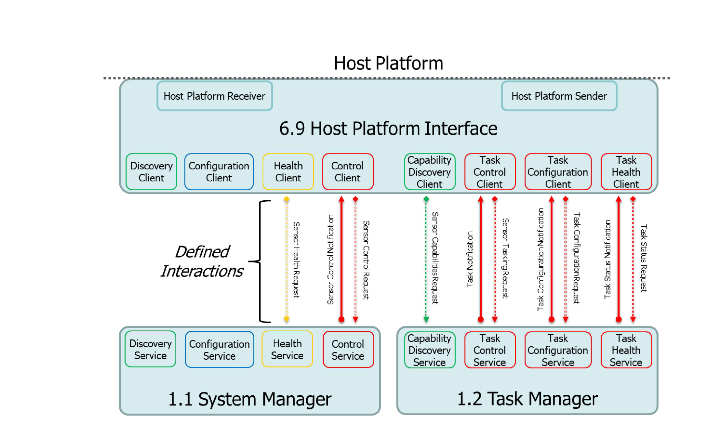

*Figure 46: Host Platform Interface Module Interactions ｜ 图 46：宿主平台接口模块交互*

Figure 46 illustrates the interfaces between the host platform interface and the management modules. The interaction groups shown are interactions bundled into functional groups for the sake of clarity. They are not an exhaustive list of all interactions necessary for command and control of the SOSA sensor, but a defined set of interactions needed to control externally the Radar, EW, and SIGINT sensor types. As an example of the functional bundling that was used to create the interaction groups, the Sensor Health Request interaction group encompasses the GetActiveFaults, GetBITResults, and GetSubsystemStatus interactions defined in Table 46.

图 46 展示宿主平台接口与管理各模块之间的各接口。所示各交互组，是为清晰起见把交互捆绑成的功能组。它们不是对 SOSA 传感器做指挥与控制所必需的全部交互的穷尽清单，而是一组为从外部控制雷达、电子战与信号情报三类传感器所需的、已定义的交互。作为用于形成各交互组的功能捆绑之例：传感器健康请求交互组涵盖表 46 中所定义的 GetActiveFaults、GetBITResults 与 GetSubsystemStatus 三项交互。

The names, descriptions, inputs, and outputs of the interactions between the host platform interface and the management modules are listed in Table 46.

宿主平台接口与管理各模块之间的各项交互，其名称、描述、输入与输出列于表 46。

**Table 46: Host Platform Interface Interactions ｜ 表 46：宿主平台接口交互**

| Host Platform Interface Interactions ／ 宿主平台接口交互 |||||||
|---|---|---|---|---|---|---|
| Interaction Name ／ 交互名 | Interaction Description ／ 交互描述 | Input DIV-2 Data Entities ／ 输入 DIV-2 数据实体 | Output DIV-2 Data Entities ／ 输出 DIV-2 数据实体 | 6.9 Host Platform Interface ／ 6.9 宿主平台接口 | 1.1 System Manager ／ 1.1 系统管理器 | 1.2 Task Manager ／ 1.2 任务管理器 |
| GetActiveFaults | Interaction to request and obtain a list of active faults in the sub-system. 请求并获取子系统内活动故障清单的交互。 | None | CommandStatus (CommandStatusType), FaultCode (FaultCodeType) | Uses ／ 使用 | Provides ／ 提供 | N/A ／ 不适用 |
| GetBITResults | Interaction that sends the results of a specified BIT. 发送某一指定 BIT 结果的交互。 | SubsystemID (SubsystemIDType) BIT_ID (BIT_IDType) | CommandStatus (CommandStatusType), BITResults (BITResultsType) | Uses ／ 使用 | Provides ／ 提供 | N/A ／ 不适用 |
| GetPlatformOrientation | Interaction sent to an Orientation Data component for retrieving the current orientation of the platform or vehicle. 发往某个姿态数据组件、用于取回平台或载具当前姿态的交互。 | None | Orientation (OrientationType), CommandStatus (CommandStatusType) | Uses ／ 使用 | Provides ／ 提供 | N/A ／ 不适用 |
| GetPlatformPosition | Interaction sent to a Position Data component for retrieving the current position of the platform. 发往某个位置数据组件、用于取回平台当前位置的交互。 | None | Position (PositionType), CommandStatus (CommandStatusType) | Uses ／ 使用 | Provides ／ 提供 | N/A ／ 不适用 |
| GetPlatformVelocity | Interaction sent to get a 3D velocity of a platform. NOTE: VICTORY specifies heading and speed, whereas OMS and STANAG 4586 specify velocities North, East, and Down. 用于获取平台三维速度的交互。 注：VICTORY 规定航向与速度，而 OMS 与 STANAG 4586 规定北、东、下三个方向的速度。 | None | DirectionOfTravel (DirectionOfTravelType), CommandStatus (CommandStatusType) | Uses ／ 使用 | Provides ／ 提供 | N/A ／ 不适用 |
| GetSARSensorCapabilities | Interaction that retrieves an installed SAR Capability, its configurable characteristics, and its controllability. 取回已安装的 SAR 能力、其可配置特性及其可控性的交互。 | None | SAR_Capability (SAR_CapabilityEnum), SAR_Subcapability (SAR_SubCapabilityEnum), CommandStatus (CommandStatusType) | Uses ／ 使用 | Provides ／ 提供 | N/A ／ 不适用 |
| GetSensorCalibrationResult | Interaction sent to a sensor to retrieve whether or not the most recent calibration of the sensor device was successful. 发往某个传感器、用以取回该传感器设备最近一次校准是否成功的交互。 | None | Result (CalibrationResultType), CommandStatus (CommandStatusType) | Uses ／ 使用 | Provides ／ 提供 | N/A ／ 不适用 |

> 转写说明：首行 `Host Platform Interface Interactions` 在原表中横跨全部 7 列，其余 6 格留空。`6.9 Host Platform Interface` 表头在原表中排为三行（`6.9 Host` / `Platform` / `Interface`），属表头折行，已用一个空格接成一行。
>
> 转写说明：原表 p.164 与续页续排，p.164 只有 GetActiveFaults 一行，续页接排 GetBITResults 至 GetSensorCalibrationResult 六行，共 7 个数据行。`Input DIV-2 Data Entities` 与 `Output DIV-2 Data Entities` 两列中，格内本是分条并列的数据实体（「实体名 + 换行 + 括号内类型」，条目之间以逗号分隔），故用 ` ` 连接；GetPlatformVelocity 行的说明格内是两段（正文 + `NOTE:` 段），用 ` ` 分段。
>
> 转写说明：`GetPlatformPosition` 行的 `Position (PositionType),` 与 `GetActiveFaults` 行的 `FaultCode (FaultCodeType)` 在原表中实体名与类型同处一行（未折行），照录为一行。
>
> 存疑：无（全部单元格清晰可读）。

<!-- 原书 p.164 ｜ PDF p.184 -->

<!-- 原书 p.165 ｜ PDF p.185 -->

<!-- 原书 p.166 ｜ PDF p.186 -->

<!-- 原书 p.167 ｜ PDF p.187 -->

<!-- 原书 p.168 ｜ PDF p.188 -->

<!-- 原书 p.169 ｜ PDF p.189 -->

<!-- 原书 p.170 ｜ PDF p.190 -->

<!-- 原书 p.171 ｜ PDF p.191 -->

### 5.11 OSA Architecture Development/Evolution Plan OSA 架构开发／演进计划

Planned for a later version of the SOSA Technical Standard.

计划在 SOSA 技术标准的后续版本中给出。

<!-- 原书 p.172 ｜ PDF p.192 -->
