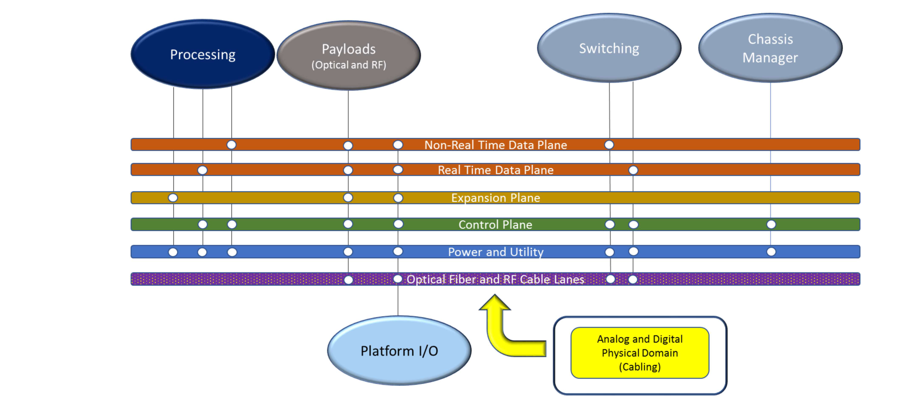

# Appendix C: Use-Case Details ｜ 附录 C：用例详细规定

> 原书 p.179–179 ｜ PDF p.199–199

## C Use-Case Details ｜ C 用例详细规定

### C.1 OV-1 (High Level Operational Concept) ｜ C.1 OV-1（高层运行概念）

SOSA Hardware Use-Cases

SOSA 硬件用例

The SOSA Hardware concepts are predicated on a set of architectural decisions that drive the overall development of the entire effort. The high-level use below is illustrative and provides an overview of all the relevant building blocks that encompass the Hardware portion of the SOSA standard. Each element in the use-case, both bubbles and lines, titles those specific building blocks and their connections. It is very important to note that each piece is a family that includes a number of types that differ in some respects and are similar in others. One of the underlying tenets not reflected in the diagram is the maximization of hardware module interoperability. With that in mind it is worth considering the connections below and that multiple hardware modules are capable of those connections Figure 47.

SOSA 硬件概念以一组架构决策为前提，这些决策驱动整个工作的总体开发。下列高层用例是示例性的，它给出涵盖 SOSA 标准硬件部分的全部相关构建块的概貌。用例中的每一个元素——无论是气泡还是连线——都标注了具体的构建块及其连接。务必注意：每一块都是一个"族"，其中包含若干类型，这些类型在某些方面彼此不同、在另一些方面又彼此相似。图中未体现的一条基本立论是硬件模块互操作性的最大化。考虑到这一点，值得细看上文的各项连接，以及多个硬件模块能够实现这些连接，见图 47。

*Figure 47: High-Level SOSA Use-Case ｜ 图 47：SOSA 高层用例*

### C.2 OV-2 (Operational Resource Flow) ｜ C.2 OV-2（运行资源流）

Planned for a later version of the SOSA Technical Standard.

计划在 SOSA 技术标准的后续版本中给出。

### C.3 OV-5b (Operational Activity Model) ｜ C.3 OV-5b（运行活动模型）

Planned for a later version of the SOSA Technical Standard.

计划在 SOSA 技术标准的后续版本中给出。

<!-- 原书 p.179 ｜ PDF p.199 -->
