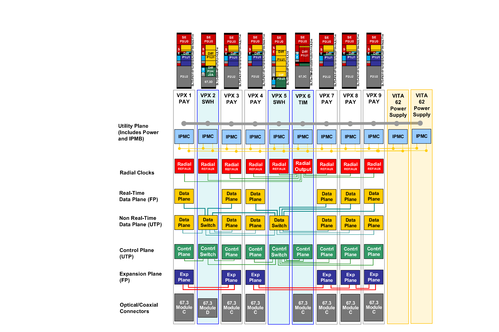
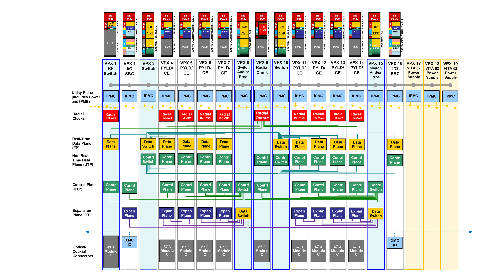
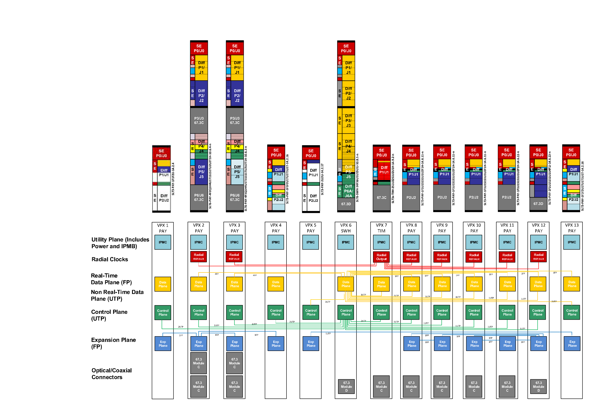

# Appendix I: SOSA Backplane Examples ｜ 附录 I：SOSA 背板示例

> 原书 p.186–190 ｜ PDF p.206–210

## I SOSA Backplane Examples ｜ I SOSA 背板示例

The following examples illustrate how the SOSA hardware modules can be combined to create a 3U medium-sized, 3U large-sized, and 3U/6U hybrid backplane. Each example references a SOSA hardware module for each slot position on the backplane and then defines how each pipe in each slot is interconnected. The associated topologies should be the same in each SOSA backplane although the number and type of slots may vary based on platform constraints and mission requirements.

以下示例说明如何将 SOSA 硬件模块组合起来，构成 3U 中型、3U 大型与 3U/6U 混合背板。每个示例为背板上的每一槽位指定一个 SOSA 硬件模块，然后定义各槽位内每条管线（pipe）如何互连。尽管槽位的数量与类型可随平台约束与任务需求而变化，但各相关拓扑在每一块 SOSA 背板中宜保持相同。

### I.1 3U Medium-Sized Backplane Example ｜ I.1 3U 中型背板示例

The 3U medium-sized backplane example includes 6 SLT3-PAY-1F1U1S1S1U1U2F1H-14.6.11-n payloads in Slots 1, 3, 4, 7, 8, and 9 that can be populated with RF transceivers and/or computing payloads (e.g., SBC, FPGA, GPGPU, etc.). ANSI/VITA 67.3 connectors with blindmate coaxial pins facilitate two-level maintenance and can be upgraded in the future to include blind-mate optical connectors to support high throughput applications such as Digital RF.

3U 中型背板示例在槽位 1、3、4、7、8 与 9 中包含 6 个 SLT3-PAY-1F1U1S1S1U1U2F1H-14.6.11-n 载荷，这些槽位可装载射频收发信机和／或计算载荷（例如 SBC、FPGA、GPGPU 等）。带盲插同轴引脚的 ANSI/VITA 67.3 连接器便于实现二级维修，且日后可升级为包含盲插光纤连接器，以支撑数字射频（Digital RF）一类高吞吐量应用。

The switched topology for the Ethernet control and data planes is provided on the same card in order to minimize the number of switch cards required and associated infrastructure overhead. Slot 2 uses a SLT3-SWH-4F1U7U1J-14.8.7-n switch which supports a blind-mate optical connector for Ethernet connections in/out of the chassis. Slot 2 is daisy chained with Slot 5 which uses a SLT3-SWH-6F1U7U-14.4.14 switch to support additional payloads. The PCIe Expansion Plane is connected between adjacent payloads in order to offload processing and support close coupling between cards comprising a single logical capability.

以太网控制平面与数据平面的交换拓扑设在同一块卡上，以尽量减少所需交换卡的数量及相关基础设施开销。槽位 2 使用 SLT3-SWH-4F1U7U1J-14.8.7-n 交换机，它支持一个盲插光纤连接器，用于进出机箱的以太网连接。槽位 2 与槽位 5 以菊花链相连，槽位 5 使用 SLT3-SWH-6F1U7U-14.4.14 交换机以支持更多载荷。PCIe 扩展平面连接在相邻载荷之间，以卸载处理负载，并支撑构成单一逻辑能力的各卡之间的紧耦合。

Slot 6 uses a SLT3x-TIM-2S1U22S1U2U1H-14.9.2-n radial clock module to provide timing to all of the payloads to enable phase-coherent operations. Radial distribution is achieved through the backplane using equal length traces to all terminating slots within the chassis. The radial clock module also includes an ANSI/VITA 67.3 connector with blind-mate coaxial pins to facilitate two-level maintenance.

槽位 6 使用 SLT3x-TIM-2S1U22S1U2U1H-14.9.2-n 径向时钟模块，为所有载荷提供定时，以实现相位相干工作。径向分发经由背板实现，采用等长走线连至机箱内所有终端槽位。该径向时钟模块还包含一个带盲插同轴引脚的 ANSI/VITA 67.3 连接器，以便于二级维修。

<!-- 原书 p.186 ｜ PDF p.206 -->

*Figure 48: 3U Medium-Sized Backplane Example ｜ 图 48：3U 中型背板示例*

### I.2 3U Large-Sized Backplane Example ｜ I.2 3U 大型背板示例

The 3U large-sized backplane example includes 8 SLT3-PAY-1F1U1S1S1U1U2F1H-14.6.11-n payloads in Slots 4, 5, 6, 7, 11, 12, 13, and 14 that can be populated with RF transceivers and/or computing payloads (e.g., SBC, FPGA, GPGPU, etc.). ANSI/VITA 67.3 connectors with blindmate coaxial pins facilitate two-level maintenance and can be upgraded in the future to include blind-mate optical connectors to support high throughput applications such as Digital RF.

3U 大型背板示例在槽位 4、5、6、7、11、12、13 与 14 中包含 8 个 SLT3-PAY-1F1U1S1S1U1U2F1H-14.6.11-n 载荷，这些槽位可装载射频收发信机和／或计算载荷（例如 SBC、FPGA、GPGPU 等）。带盲插同轴引脚的 ANSI/VITA 67.3 连接器便于实现二级维修，且日后可升级为包含盲插光纤连接器，以支撑数字射频（Digital RF）一类高吞吐量应用。

Slot 9 uses a SLT3x-TIM-2S1U22S1U2U1H-14.9.2-n radial clock to provide timing to all of the payloads to enable phase-coherent operations. Radial distribution is achieved through the backplane using equal length traces to all terminating slots within the chassis. The radial clock slot also includes an ANSI/VITA 67.3 connector with blind-mate coaxial pins to facilitate twolevel maintenance.

槽位 9 使用 SLT3x-TIM-2S1U22S1U2U1H-14.9.2-n 径向时钟，为所有载荷提供定时，以实现相位相干工作。径向分发经由背板实现，采用等长走线连至机箱内所有终端槽位。该径向时钟槽位还包含一个带盲插同轴引脚的 ANSI/VITA 67.3 连接器，以便于二级维修。

Separate cards are used for the Ethernet control and data planes in order to maximize the number of payloads that can be supported by a single card, thus minimizing the number of inter-switch connections and associated bottlenecks. Slots 3 and 10 use a SLT3-SWH-6F1U7U-14.4.14 switch to establish the data plane switched fabric where the control plane lanes are repurposed to provide the second data plane connection to each payload slot. Slots 8 and 15 use a SLT3-SWH-6F8U-14.4.15 switch to establish the control plane switched fabric as well as provide Expansion Plane connectivity amongst all of the payloads.

以太网控制平面与数据平面使用各自独立的卡，以使单块卡所能支持的载荷数量最大化，从而尽量减少交换机之间的连接数量及相关瓶颈。槽位 3 与 10 使用 SLT3-SWH-6F1U7U-14.4.14 交换机建立数据平面的交换结构，其中控制平面的通道被改用作向每个载荷槽位提供第二条数据平面连接。槽位 8 与 15 使用 SLT3-SWH-6F8U-14.4.15 交换机建立控制平面的交换结构，并提供所有载荷之间的扩展平面连通性。

Slots 2 and 16 use SLT3-PAY-1F1F2U1TU1T1U1T-14.2.16 for SBCs with I/O and an XMC site that are routed out of the chassis. The I/O pins can be used to connect peripherals such as a

槽位 2 与 16 使用 SLT3-PAY-1F1F2U1TU1T1U1T-14.2.16，用于带 I/O 与 XMC 站位、且引出至机箱之外的 SBC。I/O 引脚可用于连接外设，例如

<!-- 原书 p.187 ｜ PDF p.207 -->

display, keyboard, and mouse. The XMC site can be used to customize the I/O for a particular system or platform. This approach allows the same SBC carrier card to be shared across platforms with host-specific tailoring accomplished with a custom XMC.

显示器、键盘与鼠标。XMC 站位可用于为特定系统或平台定制 I/O。这种做法使同一块 SBC 载卡能够跨平台共用，而宿主专用的剪裁则通过定制的 XMC 完成。

Slot 1 uses a SLT3-SWH-1F1S1S1U1U1K-14.8.8-n switch to route RF signals within and outside of the chassis. This approach enables payloads to share RF resources such as amplifier and antennas, and may be used in the future to distribute Local Oscillators (LOs) to enable LOcoherent operation across payloads. The RF switch slot also includes an ANSI/VITA 67.3 connector with blind-mate coaxial pins to facilitate two-level maintenance.

槽位 1 使用 SLT3-SWH-1F1S1S1U1U1K-14.8.8-n 交换机，为机箱之内与之外的射频信号选路。这种做法使载荷能够共用放大器、天线一类射频资源，且日后可用于分发本振（Local Oscillators，LOs），以实现跨载荷的本振相干工作。该射频交换槽位还包含一个带盲插同轴引脚的 ANSI/VITA 67.3 连接器，以便于二级维修。

*Figure 49: 3U Large-Sized Backplane Example ｜ 图 49：3U 大型背板示例*

### I.3 3U/6U Hybrid Backplane Example ｜ I.3 3U/6U 混合背板示例

The 3U/6U hybrid backplane example illustrates how 3U payloads can be shared across platforms and augmented with 6U payloads when additional RF or processing capability is required. A hybrid approach can also be applied when retrofitting/updating an existing 6U chassis in order to take advantage of the growing 3U ecosystem.

3U/6U 混合背板示例说明：3U 载荷如何能够跨平台共用，并在需要额外射频或处理能力时以 6U 载荷加以扩充。在对既有 6U 机箱进行改装／更新时，也可采用混合做法，以利用不断壮大的 3U 生态。

The 3U/6U hybrid backplane example includes 4 SLT3-PAY-1F1U1S1S1U1U2F1H-14.6.11-n payloads in Slots 8, 9, 10, and 11 and a SLT3-PAY-1F1U1S1S1U1U4F1J-14.6.13-n extended payload in Slot 12 that can be populated with RF transceivers and computing payloads (e.g., SBC, FPGA, GPGPU, etc.). ANSI/VITA 67.3 connectors with blind-mate coaxial pins facilitate two-level maintenance and can be upgraded in the future to include blind-mate optical connectors to support high throughput applications such as Digital RF.

3U/6U 混合背板示例在槽位 8、9、10 与 11 中包含 4 个 SLT3-PAY-1F1U1S1S1U1U2F1H-14.6.11-n 载荷，并在槽位 12 中包含一个 SLT3-PAY-1F1U1S1S1U1U4F1J-14.6.13-n 扩展载荷，这些槽位可装载射频收发信机与计算载荷（例如 SBC、FPGA、GPGPU 等）。带盲插同轴引脚的 ANSI/VITA 67.3 连接器便于实现二级维修，且日后可升级为包含盲插光纤连接器，以支撑数字射频（Digital RF）一类高吞吐量应用。

Slot 7 uses a SLT3x-TIM-2S1U22S1U2U1H-14.9.2-n radial clock to provide timing to all of the payloads to enable phase-coherent operations. Radial distribution is achieved through the

槽位 7 使用 SLT3x-TIM-2S1U22S1U2U1H-14.9.2-n 径向时钟，为所有载荷提供定时，以实现相位相干工作。径向分发经由

<!-- 原书 p.188 ｜ PDF p.208 -->

backplane using equal length traces to all terminating slots within the chassis. The radial clock slot also includes an ANSI/VITA 67.3 connector with blind-mate coaxial pins to facilitate twolevel maintenance.

背板实现，采用等长走线连至机箱内所有终端槽位。该径向时钟槽位还包含一个带盲插同轴引脚的 ANSI/VITA 67.3 连接器，以便于二级维修。

Slots 4 and 13 use SLT3-PAY-1F1F2U1TU1T1U1T-14.2.16 for SBCs with I/O and an XMC site that are routed out of the chassis. The I/O pins can be used to connect peripherals such as a display, keyboard, and mouse. The XMC site can be used to customize the I/O for a particular system or platform. This approach allows the same SBC carrier card to be shared across platforms with host-specific tailoring accomplished with a custom XMC. Additional I/O is provided by Slot 5 which uses SLT3-PAY-2U2U-14.2.17 to interface with the platform over platform-specific connections and the rest of the payload modules over standard expansion or data plane interfaces. Slot 1 uses SLT3-PAY-1F1F2U-14.2.4 to support legacy SBCs although this slot profile has been deprecated in the SOSA standard and is not recommended for new development.

槽位 4 与 13 使用 SLT3-PAY-1F1F2U1TU1T1U1T-14.2.16，用于带 I/O 与 XMC 站位、且引出至机箱之外的 SBC。I/O 引脚可用于连接外设，例如显示器、键盘与鼠标。XMC 站位可用于为特定系统或平台定制 I/O。这种做法使同一块 SBC 载卡能够跨平台共用，而宿主专用的剪裁则通过定制的 XMC 完成。额外的 I/O 由槽位 5 提供，该槽位使用 SLT3-PAY-2U2U-14.2.17，经平台专用连接与平台对接，并经标准扩展接口或数据平面接口与其余载荷模块对接。槽位 1 使用 SLT3-PAY-1F1F2U-14.2.4 以支持遗留 SBC，尽管该槽位配置档（slot profile）已在 SOSA 标准中弃用，不推荐用于新开发。

Slots 2 uses a SLT6-PAY-4F2Q1H4U1T1S1S1TU2U2T1H-10.6.4-n payload that can be populated with RF transceivers and/or computing payloads (e.g., SBC, FPGA, GPGPU, etc.). Slot 3 uses a SLT6-PAY-4F1Q1H4U1T1S1S1TU2U2T1H-10.6.3-n payload that can also be populated with RF transceivers and computing payloads but also includes I/O that is routed out of the chassis. The I/O pins can be used to connect peripherals such as a display and keyboard/mouse, while the XMC site can be used to customize the I/O for a particular system or platform. Both Slots 2 and 3 use ANSI/VITA 67.3 connectors with blind-mate coaxial pins to facilitate two-level maintenance that can be upgraded in the future to include blind-mate optical connectors to support high throughput applications such as Digital RF.

槽位 2 使用 SLT6-PAY-4F2Q1H4U1T1S1S1TU2U2T1H-10.6.4-n 载荷，可装载射频收发信机和／或计算载荷（例如 SBC、FPGA、GPGPU 等）。槽位 3 使用 SLT6-PAY-4F1Q1H4U1T1S1S1TU2U2T1H-10.6.3-n 载荷，同样可装载射频收发信机与计算载荷，但还包含引出至机箱之外的 I/O。I/O 引脚可用于连接外设，例如显示器与键盘／鼠标，而 XMC 站位可用于为特定系统或平台定制 I/O。槽位 2 与槽位 3 均使用带盲插同轴引脚的 ANSI/VITA 67.3 连接器，以便于二级维修，日后可升级为包含盲插光纤连接器，以支撑数字射频（Digital RF）一类高吞吐量应用。

The 3U/6U hybrid backplane example takes advantage of the additional pins available in 6U to provide the switched topology for the entire backplane in a single card. Slot 6 uses SLT6-SWH-14F16U1U15U1J-10.8.1-n to establish the Ethernet switched fabric for the control and data planes. This slot also supports a blind-mate optical connector for Ethernet connections in/out of the chassis. The PCIe Expansion Plane is connected between adjacent payloads in order to offload processing and support close coupling between cards comprising a single logical capability. The extended payload in Slot 12 can also serve as a data aggregator as it possesses an Expansion Plane connection to the payloads in Slots 8, 9, 10, and 11.

3U/6U 混合背板示例利用 6U 中可用的额外引脚，在单块卡上为整个背板提供交换拓扑。槽位 6 使用 SLT6-SWH-14F16U1U15U1J-10.8.1-n，建立控制平面与数据平面的以太网交换结构。该槽位还支持一个盲插光纤连接器，用于进出机箱的以太网连接。PCIe 扩展平面连接在相邻载荷之间，以卸载处理负载，并支撑构成单一逻辑能力的各卡之间的紧耦合。槽位 12 中的扩展载荷还可充当数据聚合器，因为它与槽位 8、9、10 与 11 中的载荷之间具有扩展平面连接。

<!-- 原书 p.189 ｜ PDF p.209 -->

*Figure 50: 3U/6U Hybrid Backplane Example ｜ 图 50：3U/6U 混合背板示例*

<!-- 原书 p.190 ｜ PDF p.210 -->
