# Technical Standard for SOSA™ Reference Architecture, Edition 1.0, Version 2 ｜ SOSA™ 参考架构技术标准（第 1.0 版，第 2 次修订）· 中英文对照全本

> **本文件位置**：这是 `SOSA参考架构技术标准-v1.0.2/对照/` 那份中英对照合订本的**外置副本**，放在报告根目录便于随手打开；两处内容一致，仅把图、体例卡、术语表等相对链接改写成从报告根出发的路径（`SOSA参考架构技术标准-v1.0.2/…`）。分册、16 册源件与 50 张原图仍在 `SOSA参考架构技术标准-v1.0.2/` 下。

> **本文件性质**：`SOSA参考架构技术标准-v1.0.2/`（英文转换件，16 册）的**逐段中英对照全本**——英文为源文（原文一字不改），中文译文紧随其下。分册仍在同目录下，本文件只是把它们按原书顺序拼成一册并另设目录。

> **底本**：The Open Group Snapshot；Case 88ABW-2019-0039；Distribution Statement A（公开发布，分发不限）。原书 214 页，PDF 无文字层（文字为矢量轮廓），转换与已知差异见 `SOSA参考架构技术标准-v1.0.2/../99-转换说明与已知差异.md`。

> **对照体例**（详见 [`SOSA参考架构技术标准-v1.0.2/00-对照体例说明.md`](SOSA参考架构技术标准-v1.0.2/对照/00-对照体例说明.md)）：英段下紧跟中译、同格式齐左；章题／节题／图题「英文 中文」同行并置；注与示例双引用块；表头「英文 ／ 中文」，代码列（引脚号、线径、信号名、电压电流、型号码、标准号、`✓`）**整列不译**，描述长格「英文 中文」；页锚 `<!-- 原书 p.N ｜ PDF p.M -->` 与图引用行不译；译者所加一律 `> **译注**：`。

> **用词依据**：[`SOSA参考架构技术标准-v1.0.2/SOSA-术语对照表.md`](SOSA参考架构技术标准-v1.0.2/对照/SOSA-术语对照表.md)（十三节、约 300 条，自拟译名均标「非定译」）。凡自拟译名，日后不得当权威译法引用。

> **机械关**：`python 00-对照核对.py`（六关：段对齐、禁译串、术语、规范动词、表列数、表内英文格照录），本册 16 册全过。

> **附记**：卷末另附一篇「架构标准符合性核查」，核读所加，非 SOSA 原文，也不属标准正文；它不参与十六册对照与机械关。

> **译名与不译之处**：原书自身的错处一律照录照译，中文不替原文纠错（`Ariel`／`Slots 2 uses`／`Contol Plane`／`AS39029/56` 缺 II 等，见 `SOSA参考架构技术标准-v1.0.2/../99-转换说明与已知差异.md` 末节）；前置册的印刷式目录与图表清单、附录里的标准题名清单按版面构件／标准题名处理，**不译**。

---

## 目录（Contents）

- [前置：封面、目录、图表清单、序](#前置封面目录图表清单序)
- [第 1 章 引言](#第-1-章-引言)
- [第 2 章 定义](#第-2-章-定义)
- [第 3 章 参考架构描述](#第-3-章-参考架构描述)
- [第 4 章 架构定义](#第-4-章-架构定义)
- [第 5 章 SOSA 技术标准](#第-5-章-sosa-技术标准)
- [附录 A StdV-1（适用标准）](#附录-a-stdv-1适用标准)
- [附录 B AV-2 集成词典](#附录-b-av-2-集成词典)
- [附录 C 用例详细规定](#附录-c-用例详细规定)
- [附录 D DIV-2 与数据字典](#附录-d-div-2-与数据字典)
- [附录 E DIV-3（物理数据模型）](#附录-e-div-3物理数据模型)
- [附录 F 宿主载具／传感器连接器详细规定](#附录-f-宿主载具传感器连接器详细规定)
- [附录 G 槽位配置档](#附录-g-槽位配置档)
- [附录 H 各模块逐一详细规定](#附录-h-各模块逐一详细规定)
- [附录 I SOSA 背板示例](#附录-i-sosa-背板示例)
- [缩略语与缩写](#缩略语与缩写)
- [附记：SOSA 与架构相关标准的符合性核查（非原文）](#附记sosa-与架构相关标准的符合性核查非原文)

---

## 前置：封面、目录、图表清单、序

> 分册文件：`SOSA参考架构技术标准-v1.0.2/00-front-matter.md`；原册题：前置：封面·目录·图表清单·序 ｜ Front Matter: Cover, Contents, Lists of Tables and Figures, Preface

> 原书 p.i–xx ｜ PDF p.1–20

> **译注**：原书把 Figure 46 印了两次（p.146、p.179），转换时把后者及之后顺移为 47~50；故**图清单里的 Figure 46 起与正文图题差一号**（见 `SOSA参考架构技术标准-v1.0.2/../99-转换说明与已知差异.md`）。

The Open Group Snapshot

The Open Group 快照版

Technical Standard for SOSA™ Reference Architecture,

《SOSA™ 参考架构技术标准》

Edition 1.0, Version 2

第 1.0 版，第 2 次修订

- You have a choice: you can either create your own future, or you can become the victim of a future that someone else creates for you. By seizing the transformation opportunities, you are seizing the opportunity to create your own future.

- 你有一个选择：要么自己创造未来，要么成为别人所造未来的受害者。抓住转型的机会，你就抓住了创造自己未来的机会。

Vice Admiral (ret.) Arthur K. Cebrowski

阿瑟·K·塞布罗夫斯基（Arthur K. Cebrowski），退役中将

NOTICE

声明

Snapshots are draft documents, which provide a mechanism for The Open Group to disseminate information on its current direction and thinking to an interested audience, in advance of formal publication, with a view to soliciting feedback and comment. A Snapshot represents the interim results of a technical activity. Although at the time of publication The Open Group intends to progress the activity towards publication of a Preliminary Standard or Open Group Standard, The Open Group is a consensus organization, and makes no commitment regarding publication. Similarly, a Snapshot does not represent any commitment by any member of The Open Group to make any specific products available. This Snapshot is intended to make public the direction, thinking and path the SOSA Consortium is taking in the development of the SOSA Reference Architecture. We invite your feedback and guidance. To provide feedback on this Snapshot, please send comments by email to ogsosa-admin@opengroup.us no later than December 31, 2019. This Snapshot document is valid through December 31, 2019 only. For information on joining The Open Group SOSA™ Consortium, please send email to ogsosa-admin@opengroup.us or visit our website at www.opengroup.org/sosa.

快照版是草案文件，为 The Open Group 提供一种机制：在正式出版之前，先向有兴趣的读者传播其当前的方向与思考，以求征集反馈与意见。快照版代表一项技术活动的阶段性成果：尽管在出版之时 The Open Group 有意推动该活动走向发布初步标准或 The Open Group 标准，但 The Open Group 是一个以共识为基础的组织，对是否出版不作任何承诺；同样，快照版不代表 The Open Group 任何成员承诺提供任何具体产品。本快照版意在公开 SOSA 联盟开发 SOSA 参考架构所取的方向、思路与路径。我们欢迎您的意见与指导。如对本快照版提出意见，请于 2019 年 12 月 31 日前发邮件至 ogsosa-admin@opengroup.us。本快照版文件仅在 2019 年 12 月 31 日之前有效。有关加入 The Open Group SOSA™ 联盟的信息，请发邮件至 ogsosa-admin@opengroup.us，或访问网站 www.opengroup.org/sosa。

Case: 88ABW-2019-0039; Cleared: 2019-01-07

案号：88ABW-2019-0039；已审查放行：2019-01-07

<!-- 原书 p.i ｜ PDF p.1 -->

Copyright © 2019, The Open Group LLC for the benefit of the SOSA Consortium Members. All rights reserved. The Open Group hereby authorizes you to use this document for any purpose, PROVIDED THAT any copy of this document, or any part thereof, which you make shall retain all copyright and other proprietary notices contained herein. This document may contain other proprietary notices and copyright information. Nothing contained herein shall be construed as conferring by implication, estoppel, or otherwise any license or right under any patent or trademark of The Open Group or any third party. Except as expressly provided above, nothing contained herein shall be construed as conferring any license or right under any copyright of The Open Group. Note that any product, process, or technology in this document may be the subject of other intellectual property rights reserved by The Open Group, and may not be licensed hereunder. This document is provided "AS IS" WITHOUT WARRANTY OF ANY KIND, EITHER EXPRESSED OR IMPLIED, INCLUDING, BUT NOT LIMITED TO, THE IMPLIED WARRANTIES OF MERCHANTABILITY, FITNESS FOR A PARTICULAR PURPOSE, OR NON-INFRINGEMENT. Some jurisdictions do not allow the exclusion of implied warranties, so the above exclusion may not apply to you. Any publication of The Open Group may include technical inaccuracies or typographical errors. Changes may be periodically made to these publications; these changes will be incorporated in new editions of these publications. The Open Group may make improvements and/or changes in the products and/or the programs described in these publications at any time without notice. Should any viewer of this document respond with information including feedback data, such as questions, comments, suggestions, or the like regarding the content of this document, such information shall be deemed to be non-confidential and The Open Group shall have no obligation of any kind with respect to such information and shall be free to reproduce, use, disclose, and distribute the information to others without limitation. Further, The Open Group shall be free to use any ideas, concepts, know-how, or techniques contained in such information for any purpose whatsoever including but not limited to developing, manufacturing, and marketing products incorporating such information. If you did not obtain this copy through The Open Group, it may not be the latest version. For your convenience, the latest version of this publication may be downloaded at www.opengroup.org/library.

版权所有 © 2019，The Open Group LLC，为 SOSA 联盟成员之利益持有。保留一切权利。The Open Group 特此授权您为任何目的使用本文件，**但以**您制作的任何副本或其任何部分**应**保留本文所载一切著作权与其他所有权声明**为条件**。本文件可能载有其他所有权声明与著作权信息。本文任何内容均**不应**解释为以默示、禁止反言或其他方式授予 The Open Group 或任何第三方任何专利或商标项下的许可或权利；除上文明确许可者外，本文任何内容也**不应**解释为授予 The Open Group 任何著作权项下的许可或权利。请注意：本文件所述任何产品、工艺或技术，可能是 The Open Group 保留的其他知识产权的标的，且不得依本文件获得许可。本文件按**"现状"（"AS IS"）提供，不附带任何明示或默示的保证**，包括但不限于对适销性、特定用途适用性或不侵权的默示保证。某些司法辖区不允许排除默示保证，故上述排除可能不适用于您。The Open Group 的任何出版物均可能含有技术性不准确或排印错误。这些出版物可能被定期修改，修改将并入其新版。The Open Group 可随时改进和／或变更这些出版物所述的产品和／或程序，恕不另行通知。若本文件的任何阅读者回以信息（含反馈数据，如对本文件内容的提问、意见、建议等），该等信息**应**视为非保密；The Open Group 对此类信息不负任何义务，并**应**可自由复制、使用、披露与分发之，不受限制。此外，The Open Group **应**可自由使用此类信息中所含的任何想法、概念、诀窍或技术，用于任何目的，包括但不限于开发、制造与营销采用此类信息的产品。若您并非通过 The Open Group 获得本副本，则它可能不是最新版本；为方便起见，本出版物的最新版本可在 www.opengroup.org/library 下载。

The Open Group Snapshot Technical Standard for SOSA™ Reference Architecture, Edition 1.0, Version 2 Document Number: S180

《The Open Group 快照版技术标准：SOSA™ 参考架构，第 1.0 版，第 2 次修订》，文件编号：S180。

Authored by The Open Group SOSA™ Consortium. Published by The Open Group, January 2019. Comments relating to the material contained in this document may be submitted to: The Open Group, 800 District Avenue, Suite 150, Burlington, MA 01803, United States or by electronic mail to: ogsosa-admin@opengroup.us

由 The Open Group SOSA™ 联盟撰写，The Open Group 于 2019 年 1 月出版。有关本文件所载内容的意见，可寄至：The Open Group, 800 District Avenue, Suite 150, Burlington, MA 01803, United States，或发电子邮件至：ogsosa-admin@opengroup.us。

<!-- 原书 p.ii ｜ PDF p.2 -->

### Contents ｜ 目录

<!-- 未译 印刷式目录、图清单与表清单（版面构件） -->

1 Introduction 1

1.1 Objective 1

1.2 Overview 2

1.2.1 SOSA Architecture Fundamentals 2

1.2.2 Business Alignment 4

1.3 Conformance 4

1.4 Normative References 5

1.5 Terminology 5

1.5.1 SOSA Architecture 5

1.5.2 System Requirements 5

1.5.3 Hardware Specification Keywords 6

1.6 Future Directions 7

2 Definitions 8 3 Reference Architecture Description 9

3.1 CV-1/CV-2 Objectives 9

3.1.1 SOSA Capability View – 1 (CV-1) 9

3.2 SOSA Architecture Principles 10

3.2.1 Business-Oriented Architecture Principles 11

3.2.2 Technically-Oriented Architecture Principles 12

3.3 SOSA Quality Attributes 17

3.4 SV-1 (System Interface Description/Context) 19

3.5 SOSA Physical Context Entities 21

3.5.1 SOSA Sensor 21

3.5.2 SOSA Hardware Element 21

3.5.3 SOSA Host Platform 22

3.5.4 SOSA Sensor Pod 22

3.6 Function to Module Aggregation Criteria 22

3.7 Security Concepts and Approach 23

3.7.1 SOSA Hardware Security Framework 23

3.8 Hardware Concepts and Approach 24

3.9 SvcV-1: Services Context Description 24

3.10 SOSA Inter-Module Interactions 29

3.10.1 SOSA Sensor Interconnections 30

3.10.2 SOSA Module Interaction Types 30

3.11 System Management Concepts and Approach 35

3.11.1 System Management Concepts 36

3.11.2 Network-Based System Management 37

3.11.3 SOSA Hardware Management Overview 39

4 Architecture Definition 43

4.1 Service Views 43

4.1.1 SvcV-4: Services Functionality Description 43

4.1.2 SvcV-2: Services Resource Flow Description 66

<!-- 原书 p.iii ｜ PDF p.3 -->

4.1.3 SvcV-3b: Services-Services Matrix 66

4.2 Data Architecture 66

4.2.1 DIV-1: Conceptual Data Model 67

4.2.2 DIV-2: Logical Data Model 69

4.2.3 DIV-3: Physical Data Model 70

4.3 Service Architecture 70

4.3.1 SvcV-6: Services Resources Flow Matrix 70

4.4 System Architecture 70

4.4.1 SV-2: Systems Resource Flow Description 70

4.4.2 SV-3: Systems-Systems Matrix 70

4.5 Box-Level Hardware 70

5 SOSA Technical Standard 72

5.1 Host Vehicle/SOSA Sensor Interface 72

5.1.1 Sensor Physical Packages 72

5.1.2 Mechanical Interfaces 72

5.2 SOSA Sensor Physical Interfaces 73

5.2.1 Electrical Connector Characteristics 73

5.2.2 J1-DC Power Connector 73

5.2.3 J2-Signals Connector 75

5.2.4 J3-Video (Copper) Connector 84

5.2.5 J4-Fiber Optics Connector 86

5.2.6 J5-GPS Antenna Connector 88

5.2.7 J6-DC Auxiliary Power Connector 88

5.2.8 J7-High Speed Connector 90

5.2.9 J8-High Density RF Connector 90

5.2.10 J9-Low Loss RF Connector 92

5.2.11 Auxiliary RF Connectors 93

5.2.12 J10-AC Power Connector 94

5.2.13 Hardware Platform 3U and 6U Slot Profile

Specifications 95 5.2.14 Hardware Platform SOSA Plug-In Card Profiles 101

5.2.15 Common 6U and 3U Plug-In Card Profile

Specifications 102

5.2.16 SOSA 3U Plug-IN Card Profile Specifications 102

5.2.17 6U Plug-In Card Profile Specifications 114

5.2.18 SOSA 6U Legacy Switch Plug-In Card Profile 119

5.2.19 SOSA 6U External I/O Plug-In Card Profile 120

5.2.20 Power Supply Module 122

5.2.21 Mezzanine Modules 123

5.2.22 Maintenance Console Port Requirements 124

5.3 SOSA System Management Requirements 126

5.3.1 SOSA Hardware Element System Management

Requirements 126

5.3.2 SOSA Module System Management Requirements 128

5.4 SOSA Software Operating Environment 128

5.4.1 Description 128

5.4.2 Scope 129

5.4.3 Recommendations 131

5.4.4 Safety 132

5.5 SOSA Module Interactions 133

<!-- 原书 p.iv ｜ PDF p.4 -->

5.6 Sensor Management 133

5.6.1 System Manager Module 134

5.6.2 Task Manager Module 140

5.7 RF Signal Layer Modules 144

5.7.1 Modular Open RF Architecture 145

5.7.2 Application of MORA to SOSA Signal Layer Modules 146

5.7.3 RF Receiver Aperture/Transducer Module 146

5.7.4 RF Transmit Aperture/Transducer Module 147

5.7.5 RF Conditioner-Receiver-Exciter Module 148

5.7.6 RF Signal Layer Module Interactions 149

5.7.7 RF Signal Layer Module Rules 155

5.8 EO/IR Signal Layer Modules 159

5.8.1 EO/IR Receiver Camera Module Standard 159

5.8.2 EO/IR Transmit Laser Module Standard 159

5.8.3 EO/IR Conditioner-Receiver-Exciter Module Standard 159

5.9 RF Digital Processing Modules 159

5.9.1 Tracker 159

5.10 Infrastructure Modules 162

5.10.2 External Data Ingestor 163

5.10.3 Host Platform Interface 163

5.11 OSA Architecture Development/Evolution Plan 172

A StdV-1 (Applicable Standards) 173 B AV-2 Integrated Dictionary 174 C Use-Case Details 179

C.1 OV-1 (High Level Operational Concept) 179

C.2 OV-2 (Operational Resource Flow) 179

C.3 OV-5b (Operational Activity Model) 179

D DIV-2 and Data Dictionary 180

D.1 SOSA Sensor RF Control (Distribution A) 180

D.2 MORA Signal Layer 180

D.3 AMTI SAA Multi-Sensor Fusion Tracker 180

D.4 Common System Management Data Elements 180

E DIV-3 (Physical Data Model) 182

E.1 SOSA Sensor RF Control (Distribution A) 182

E.2 RF Signal Layer 182

F Host Vehicle/Sensor Connector Details 183 G Slot Profiles 184 H Module-by-Module Details 185 I SOSA Backplane Examples 186

I.1 3U Medium-Sized Backplane Example 186

I.2 3U Large-Sized Backplane Example 187

I.3 3U/6U Hybrid Backplane Example 188

<!-- 原书 p.v ｜ PDF p.5 -->

Table of Figures

Figure 1: The Facets that Comprise a SOSA Module 3

Figure 2: The Architecture Development Method Adopted for the SOSA Technical Standard 3

Figure 3: SOSA CV-1 10

Figure 4: SV-1 for Nominal Case 20

Figure 5: SV-1 for Sensor Pod Special Case 21

Figure 6: SvcV-1: Top-Level SOSA Services Context Description 25

Figure 7: SOSA Sensor Interconnections 30

Figure 8: SOSA Network-Based System Management Architecture 38

Figure 9: SOSA Hardware System Management Logical Block Diagram 40

Figure 10: Example SOSA System Management Backplane/Chassis Implementation 41

Figure 11: Example SOSA System Management Plug-In Card Implementation 42

Figure 12: DIV-1 for Mission Entities 68

Figure 13: DIV-1 for Management Entities 69

Figure 14: SOSA Hardware Building Blocks 71

Figure 15: J1 Power Connector Pin Arrangement 74

Figure 16: J2 Signal Connector Pin Arrangement 75

Figure 17. Input Time Rollover Pulse (1 PPS) Signal Characteristics 83

Figure 18: J3 Video Connector Pin Arrangement 85

Figure 19: J4 Fiber Optic Connector Pin Arrangement 87

Figure 20. J6 Auxiliary Power Connector Pin Arrangement 89

Figure 21: J8 RF Connector Pin Arrangement 91

Figure 22: J9 RF Connector Pin Arrangement 92

Figure 23: J10 AC Power Connector Pin Arrangement 94

Figure 24: ANSI/VITA 65.0 3U I/O Intensive SBC Slot Profile

SLT3-PAY-1F1F2U1TU1T1U1T-14.2.16 103

Figure 25: ANSI/VITA 65.0 Payload Slot Profile for SLT3-PAY-2F2U-14.2.3 105

Figure 26: ANSI/VITA 65.0 Payload Slot Profile

SLT3-PAY-1F1U1S1S1U1U2F1H-14.6.11-n 106

Figure 27: ANSI/VITA 65.0 Payload Slot Profile

SLT3-PAY-1F1U1S1S1U1U4F1J-14.6.13-n 107

Figure 28: ANSI/VITA 65.0 Control/Expansion Plane Switch Slot Profile

SLT3-SWH-6F8U-14.4.15 108

Figure 29: ANSI/VITA 65.0 Control/Data Plane Switch Slot Profile

SLT3-SWH-6F1U7U-14.4.14 109

Figure 30: ANSI/VITA 65.0 Control/Data Plane Switch Slot Profile

SLT3-SWH-4F1U7U1J-14.8.7-n 110

Figure 31: ANSI/VITA 65.0 3U RF Switch Slot Profile

SLT3-SWH-1F1S1S1U1U1K-14.8.8-n 111

Figure 32: ANSI/VITA 65.0 Radial Clock Slot Profile

SLT3x-TIM-2S1U22S1U2U1H-14.9.2-n 112

Figure 33: ANSI/VITA 65.0 3U External I/O Slot Profile

SLT3-PAY-2U2U-14.2.17 113

Figure 34: ANSI/VITA 65.0 6U Payload Slot Profile

SLT6-PAY-4F2Q1H4U1T1S1S1TU2U2T1H-10.6.4-n 115

<!-- 原书 p.vi ｜ PDF p.6 -->

Figure 35: ANSI/VITA 65.0 6U Payload Slot Profile

SLT6-PAY-4F1Q1H4U1T1S1S1TU2U2T1H-10.6.3-n 116

Figure 36: ANSI/VITA 65.0 6U Control/Data Switch Slot Profile

SLT6-SWH-14F16U1U15U1J-10.8.1-n 118

Figure 37: ANSI/VITA65.0 Switch Slot Profile for SLT6-SWH-16U20F-10.4.2 120

Figure 38: ANSI/VITA 65.0 6U External I/O Slot Profile SLT6-PAY-4U2U-10.2.8 121

Figure 39: FACE Software Operating Environment and Subset Proposed for the

SOSA REI (red dashed line) 131

Figure 40: Sensor Management Architecture View 134

Figure 41: System Manager Interactions 135

Figure 42. RF Signal Layer Module Interactions 146

Figure 43: RF Receiver Aperture/Transducer Interactions 147

Figure 44: RF Transmit Aperture/Transducer Interactions 148

Figure 45: RF Conditioner Receiver/Exciter Interactions 148

Figure 46: Host Platform Interface Module Interactions 164

Figure 46: High-Level SOSA Use-Case 179

Figure 47: 3U Medium-Sized Backplane Example 187

Figure 48: 3U Large-Sized Backplane Example 188

Figure 49: 3U/6U Hybrid Backplane Example 190

<!-- 原书 p.vii ｜ PDF p.7 -->

Table of Tables

Table 1: SOSA Quality Attributes (in order of decreasing precedence) 18

Table 2: SvcV-1: Module Descriptions 25

Table 3: Interaction Types 31

Table 4: Interaction Roles, Endpoints, and Symbols 32

Table 5: SOSA SvcV-4 43

Table 6: Turreted Sensor Classes 72

Table 7: Sensor Connectors 73

Table 8: J1 DC Power Connector Pin Allocation 74

Table 9: J2 Signals Connector Pin Allocation 76

Table 10: J3 Video Connector Pin Allocation 85

Table 11: J4 Fiber Optic Connector Pin Allocation 87

Table 12: J5 GPS Connector Pin Allocation 88

Table 13. J6 Auxiliary DC Power Connector 89

Table 14: J7 Pin Allocations 90

Table 15: J8 RF Pin Allocations 91

Table 16: J9 RF Pin Allocation 93

Table 17: Auxiliary RF Connections 93

Table 18: J10 AC Power Pin Allocations 94

Table 19. Hardware Module Cooling Methods 101

Table 20: Referenced ANSI/VITA 65.1 Module Profiles for

SLT3-PAY-1F1F2U1TU1T1U1T-14.2.16 104

Table 21: ANSI/VITA 65.1Slot Profiles for SLT3-PAY-1F1U1S1S1U1U2F1H-14.6.11-n 106

Table 22: ANSI/VITA 65.1 Module Profiles for SLT3-PAY-1F1U1S1S1U1U2F1H-14.6.11-n

Table 23: ANSI/VITA 65.1Slot Profiles for SLT3-PAY-1F1U1S1S1U1U4F1J-14.6.13-n 107

Table 24: ANSI/VITA 65.1 Module Profiles for SLT3-PAY-1F1U1S1S1U1U4F1J-14.6.13-n 107

Table 25: ANSI/VITA 65.1 Module Profiles for SLT3-SWH-6F8U-14.4.15 108

Table 26: ANSI/VITA 65.1 Module Profiles for SLT3-SWH-6F1U7U-14.4.14 109

Table 27: ANSI/VITA 65.1 Module Profiles for SLT3-SWH-4F1U7U1J-14.8.7-n 110

Table 28: ANSI/VITA 65.1 Module Profiles for SLT3-SWH-1F1S1S1U1U1K-14.8.8-n 111

Table 29: VITA 65.1 Slot Profiles for SLT3x-TIM-2S1U22S1U2U1H-14.9.2-n 112

Table 30: VITA 65.1 Module Profiles for SLT3x-TIM-2S1U22S1U2U1H-14.9.2-n 112

Table 31: ANSI/VITA 65.1 Module Profiles for SLT3-PAY-2U2U-14.2.17 113

Table 32: ANSI/VITA 65.1 Slot Profiles for

SLT6-PAY-4F2Q1H4U1T1S1S1TU2U2T1H-10.6.4-n 115

Table 33: ANSI/VITA 65.1 Module Profiles for SLT6-PAY-4F2Q1H4U1T1S1S1TU2U2T1H-10.6.4-n

Table 34: ANSI/VITA 65.1 Module Profiles for SLT6-PAY-4F1Q1H4U1T1S1S1TU2U2T1H-10.6.3-n

Table 35: ANSI/VITA 65.1 Slot Profiles for SLT6-SWH-14F16U1U15U1J-10.8.1-n 118

Table 36: ANSI/VITA 65.1 Module Profiles for SLT6-SWH-14F16U1U15U1J-10.8.1-n 118

Table 37: ANSI/VITA 65.1 Module Profiles for SLT6-PAY-4U2U-10.2.8 122

Table 38: Maintenance Console Port Signal Levels 126

Table 39: Common System Management Interactions 135

<!-- 原书 p.viii ｜ PDF p.8 -->

Table 40: Task Management Interactions Table 140

Table 41: RF Signal Layer Module Interactions Table 149

Table 42. RF Signal Layer Module Interaction Endpoints 156

Table 43: Tracker Module Interactions 160

Table 44: Additional Tracker Interactions 161

Table 45: AMTI SAA Mission Configuration Data 162

Table 46: Host Platform Interface Interactions 164

Table 47: AV-2 Integrated Dictionary (Master Glossary of SOSA Terminology) 174

<!-- /未译 印刷式目录、图清单与表清单 -->

<!-- 装置 中文目录（译者所加，按正文章题生成） -->

### 中文目录

- 前置：封面·目录·图表清单·序　…　i–xx
- 目录　…　ii
- 前言　…　ix
- 执行摘要　…　ix
- 背景　…　ix
- 做法　…　ix
- 本文件　…　xi
- 商标　…　xii
- 致谢　…　xiii
- 引用文件　…　xv
- 1 引言　…　1–7
- 1.1 目标　…　1
- 1.2 概述　…　1
- 1.2.1 架构基础　…　1
- 1.2.2 业务对齐　…　3
- 1.3 符合性　…　3
- 1.4 规范性引用文件　…　4
- 1.5 术语　…　4
- 1.5.1 架构　…　4
- 1.5.2 系统需求　…　4
- 1.5.3 硬件规格关键字　…　5
- 1.6 未来方向　…　6
- 2 定义　…　8–8
- 3 参考架构描述　…　9–42
- 3.1 目标　…　9
- 3.1.1 能力视图 – 1（CV-1）　…　9
- 3.2 架构原则　…　9
- 3.2.1 面向业务的架构原则　…　10
- 3.2.2 面向技术的架构原则　…　11
- 3.3 质量属性　…　16
- 3.4 系统接口描述／上下文　…　18
- 3.5 物理语境实体　…　20
- 3.5.1 传感器　…　20
- 3.5.2 硬件元素　…　20
- 3.5.3 宿主平台　…　21
- 3.6 功能聚合为模块的判据　…　21
- 3.7 安全概念与做法　…　22
- 3.7.1 硬件安全框架　…　22
- 3.8 硬件概念与做法　…　23
- 3.9 服务上下文描述　…　23
- 3.10 模块间交互　…　28
- 3.10.1 传感器互连　…　29
- 3.10.2 模块交互类型　…　29
- 3.11 系统管理概念与方法　…　34
- 3.11.1 系统管理概念　…　35
- 3.11.2 基于网络的系统管理　…　36
- 3.11.3 硬件管理概述　…　38
- 4 架构定义　…　43–71
- 4.1 服务视图
- 4.1.1 SvcV-4：服务功能描述
- 4.1.2 SvcV-2：服务资源流描述　…　65
- 4.1.3 SvcV-3b：服务-服务矩阵　…　65
- 4.2 数据架构　…　65
- 4.2.1 DIV-1：概念数据模型　…　66
- 4.2.2 DIV-2：逻辑数据模型　…　68
- 4.2.3 DIV-3：物理数据模型　…　69
- 4.3 服务架构　…　69
- 4.4 系统架构　…　69
- 4.4.1 SV-2：系统资源流描述　…　69
- 4.4.2 SV-3：系统-系统矩阵　…　69
- 4.5 整机级硬件　…　69
- 5 SOSA 技术标准　…　72–172
- 5.1 宿主载具／传感器接口　…　72
- 5.1.1 传感器物理封装　…　72
- 5.1.1.1 吊舱　…　72
- 5.1.2 机械接口　…　72
- 5.2 SOSA 传感器物理接口　…　72
- 5.2.1 电气连接器特性　…　72
- 5.2.2 J1 直流电源连接器　…　72
- 5.2.3.2 以太网数据总线（铜缆）　…　80
- 5.2.3.6 安全状况　…　82
- 5.2.3.8 时间同步——1 PPS　…　82
- 5.2.6 天线连接器　…　87
- 5.2.7 直流辅助电源连接器　…　87
- 5.2.7.2 安全地　…　89
- 5.2.8 J7 高速连接器　…　89
- 5.2.8.1 说明　…　89
- 5.2.9 J8 高密度射频连接器　…　89
- 5.2.12.1 交流电源说明　…　94
- 5.2.13 硬件平台 3U 与 6U 槽位配置档规格　…　94
- 5.2.13.4 传导散热式 SOSA 插卡　…　100
- 5.2.14 硬件平台 SOSA 插卡配置档　…　101
- 5.2.15 6U 与 3U 通用插卡配置档规格　…　101
- 5.2.16 SOSA 3U 插卡配置档规格　…　101
- 5.2.16.1 3U I/O 密集型 SBC 插卡配置档　…　101
- 5.2.16.2 3U 旧式载荷配置档　…　103
- 5.2.16.4 3U 数据／控制平面交换机配置档　…　106
- 5.2.16.5 3U 控制／数据平面交换机配置档　…　107
- 5.2.16.6 3U SOSA 射频交换机插卡配置档　…　109
- 5.2.16.7 SOSA 3U 径向时钟插卡配置档　…　110
- 5.2.16.8 3U 外部 I/O 插卡配置档　…　111
- 5.2.17 6U 插卡配置档规格　…　113
- 5.2.17.2 SOSA 6U 控制／数据交换机插卡配置档　…　116
- 5.2.18 遗留交换插卡配置档　…　118
- 5.2.19 外部 I/O 插卡配置档　…　119
- 5.2.20 电源模块　…　121
- 5.2.21 夹层模块　…　123
- 5.2.22 维护控制台端口需求　…　124
- 5.2.22.2 集成方应用开发与调试　…　124
- 5.2.22.3 已部署系统　…　124
- 5.3 SOSA 系统管理需求　…　125
- 5.3.2 SOSA 模块系统管理需求　…　127
- 5.4 SOSA 软件运行环境　…　127
- 5.4.1 描述　…　127
- 5.4.2 范围　…　128
- 5.4.3 推荐　…　130
- 5.4.3.1 依据　…　130
- 5.4.3.2 互操作等级　…　131
- 5.4.4.3 虚拟机　…　131
- 5.5 SOSA 模块交互　…　132
- 5.6 传感器管理　…　132
- 5.6.1 系统管理器模块　…　133
- 5.6.1.1 模块定义　…　133
- 5.6.2 任务管理器模块　…　139
- 5.6.2.1 模块定义　…　139
- 5.7 射频信号层模块　…　143
- 5.7.1 模块化开放式射频架构　…　144
- 5.7.2 对 SOSA 信号层模块的应用　…　145
- 5.7.3 射频接收孔径／换能器模块　…　145
- 5.7.4 射频发射孔径／换能器模块　…　146
- 5.7.6 射频信号层模块交互　…　148
- 5.7.7 信号层模块规则　…　154
- 5.8 信号层模块　…　158
- 5.8.1 接收相机模块标准　…　158
- 5.8.2 发射激光器模块标准　…　158
- 5.8.3 调理器-接收机-激励器模块标准　…　158
- 5.9 数字处理模块　…　158
- 5.9.1 跟踪器　…　158
- 5.9.1.1 定义　…　158
- 5.9.1.3 跟踪器面向 AMTI SAA 的交互　…　159
- 5.10 基础设施模块　…　161
- 5.10.1.1 定义　…　161
- 5.10.1.2 交互　…　161
- 5.10.2 外部数据摄取器　…　162
- 5.10.2.1 定义　…　162
- 5.10.3 宿主平台接口　…　162
- 5.10.3.1 定义　…　162
- 5.11 架构开发／演进计划　…　171
- 附录 A：StdV-1（适用标准）　…　173–173
- A StdV-1（适用标准）　…　173
- 附录 B：AV-2 集成词典　…　174–178
- 附录 C：用例详细规定　…　179–179
- C 用例详细规定　…　179
- C.1 OV-1（高层运行概念）　…　179
- C.2 OV-2（运行资源流）　…　179
- C.3 OV-5b（运行活动模型）　…　179
- 附录 D：DIV-2 与数据字典　…　180–181
- D DIV-2 与数据字典　…　180
- D.1 SOSA 传感器射频控制（分发 A）　…　180
- D.2 MORA 信号层　…　180
- D.3 AMTI SAA 多传感器融合跟踪器　…　180
- D.4 通用系统管理数据元素　…　180
- 附录 E：DIV-3（物理数据模型）　…　182–182
- E DIV-3（物理数据模型）　…　182
- E.1 SOSA 传感器射频控制（分发 A）　…　182
- E.2 射频信号层　…　182
- 附录 F：宿主载具／传感器连接器详细规定　…　183–183
- F 宿主载具／传感器连接器详细规定　…　183
- 附录 G：槽位配置档　…　184–184
- G 槽位配置档　…　184
- 附录 H：各模块逐一详细规定　…　185–185
- H 各模块逐一详细规定　…　185
- 附录 I：SOSA 背板示例　…　186–190
- I SOSA 背板示例　…　186
- I.1 3U 中型背板示例　…　186
- I.2 3U 大型背板示例　…　186
- I.3 3U/6U 混合背板示例　…　187
- 缩略语与缩写　…　191–194

**图清单**

- 图 1 构成 SOSA 模块的各个侧面　…　2
- 图 2 SOSA 技术标准所采用的架构开发方法　…　2
- 图 3 SOSA CV-I　…　9
- 图 4 标称情形的 SV-1　…　19
- 图 5 传感器吊舱特例的 SV-1　…　20
- 图 6 SvcV-1 顶层 SOSA 服务上下文描述　…　24
- 图 7 SOSA 传感器互连　…　29
- 图 8 SOSA 基于网络的系统管理架构　…　37
- 图 9 SOSA 硬件系统管理逻辑框图　…　39
- 图 10 SOSA 系统管理背板／机箱实现示例　…　40
- 图 11 SOSA 系统管理插卡实现示例　…　41
- 图 12 任务实体的 DIV-1　…　67
- 图 13 管理实体的 DIV-1　…　68
- 图 14 SOSA 硬件构建块　…　70
- 图 15 J1 电源连接器引脚排列　…　73
- 图 16 J2 信号连接器引脚排列　…　74
- 图 17 输入时间翻转脉冲（1 PPS）信号特性　…　82
- 图 18 J3 视频连接器插针排布　…　84
- 图 19 J4 光纤连接器插针排布　…　86
- 图 20 J6 辅助电源连接器插针排布　…　88
- 图 21 J8 射频连接器引脚排布　…　90
- 图 22 J9 射频连接器引脚排布　…　91
- 图 23 J10 交流电源连接器引脚排布　…　93
- 图 24 ANSI/VITA 65.0 3U I/O 密集型 SBC 槽位配置档 SLT3-PAY-1F1F2U1TU1T1U1T-　…　103
- 图 25 SLT3-PAY-2F2U-14.2.3 的 ANSI/VITA 65.0 载荷槽位配置档　…　104
- 图 26 ANSI/VITA 65.0 载荷槽位配置档 SLT3-PAY-1F1U1S1S1U1U2F1H-14.6.11-n　…　105
- 图 27 ANSI/VITA 65.0 载荷槽位配置档 SLT3-PAY-1F1U1S1S1U1U4F1J-14.6.13-n　…　106
- 图 28 ANSI/VITA 65.0 控制／扩展平面交换机槽位配置档 SLT3-SWH-6F8U-14.4.15　…　107
- 图 29 ANSI/VITA 65.0 控制／数据平面交换机槽位配置档 SLT3-SWH-6F1U7U-14.4.14　…　108
- 图 30 ANSI/VITA 65.0 控制／数据平面交换机槽位配置档 SLT3-SWH-4F1U7U1J-14.8.7-n　…　109
- 图 31 ANSI/VITA 65.0 3U 射频交换机槽位配置档 SLT3-SWH-1F1S1S1U1U1K-14.8.8-n　…　110
- 图 32 ANSI/VITA 65.0 径向时钟槽位配置档 SLT3x-TIM-2S1U22S1U2U1H-14.9.2-n　…　111
- 图 33 ANSI/VITA 65.0 3U 外部 I/O 槽位配置档 SLT3-PAY-2U2U-14.2.17　…　112
- 图 34 ANSI/VITA 65.0 6U 载荷槽位配置档 SLT6-PAY-4F2Q1H4U1T1S1S1TU2U2T1H-　…　114
- 图 35 ANSI/VITA 65.0 6U 载荷槽位配置档 SLT6-PAY-4F1Q1H4U1T1S1S1TU2U2T1H-　…　115
- 图 36 ANSI/VITA 65.0 6U 控制／数据交换机槽位配置档 SLT6-SWH-14F16U1U15U1J-　…　118
- 图 37 SLT6-SWH-16U20F-10.4.2 的 ANSI/VITA65.0 交换槽位配置档　…　119
- 图 38 ANSI/VITA 65.0 6U 外部 I/O 槽位配置档 SLT6-PAY-4U2U-10.2.8　…　121
- 图 39 FACE 软件运行环境及拟用于 SOSA REI 的子集（红色　…　130
- 图 40 传感器管理架构视图　…　133
- 图 41 系统管理器交互　…　134
- 图 42 射频信号层模块交互　…　145
- 图 43 射频接收孔径／换能器交互　…　146
- 图 44 射频发射孔径／换能器交互　…　147
- 图 45 射频调理器接收机／激励器交互　…　147
- 图 46 宿主平台接口模块交互　…　163
- 图 47 SOSA 高层用例　…　179
- 图 48 3U 中型背板示例　…　186
- 图 49 3U 大型背板示例　…　187
- 图 50 3U/6U 混合背板示例　…　189

**表清单**

- 表 1 SOSA 质量属性（按优先级降序）　…　17
- 表 2 SvcV-1 模块描述　…　24
- 表 3 交互类型　…　30
- 表 4 交互角色、端点与符号　…　31
- 表 5 SOSA SvcV-4
- 表 6 转塔式传感器类别　…　72
- 表 7 传感器连接器　…　72
- 表 8 J1 直流电源连接器引脚分配　…　73
- 表 9 J2 信号连接器引脚分配　…　75
- 表 10 J3 视频连接器引脚分配　…　84
- 表 11 J4 光纤连接器引脚分配　…　86
- 表 12 J5 GPS 连接器引脚分配　…　87
- 表 13 符合性方法：(TBD)　…　87
- 表 14 J7 引脚分配　…　89
- 表 15 J8 射频引脚分配　…　90
- 表 16 J9 射频引脚分配　…　92
- 表 17 辅助射频连接　…　92
- 表 18 J10 交流电源引脚分配　…　93
- 表 19 硬件模块散热方式　…　100
- 表 20 SLT3-PAY-1F1F2U1T1U1T1U1T-14.2.16 所引用的 ANSI/VITA 65.1 模块配置档　…　103
- 表 21 SLT3-PAY-1F1U1S1S1U1U2F1H-14.6.11-n 的 ANSI/VITA 65.1 槽位配置档　…　105
- 表 22 SLT3-PAY-1F1U1S1S1U1U2F1H-14.6.11-n 的 ANSI/VITA 65.1 模块配置档　…　106
- 表 23 SLT3-PAY-1F1U1S1S1U1U4F1J-14.6.13-n 的 ANSI/VITA 65.1 槽位配置档　…　106
- 表 24 SLT3-PAY-1F1U1S1S1U1U4F1J-14.6.13-n 的 ANSI/VITA 65.1 模块配置档　…　106
- 表 25 SLT3-SWH-6F8U-14.4.15 的 ANSI/VITA 65.1 模块配置档　…　107
- 表 26 SLT3-SWH-6F1U7U-14.4.14 的 ANSI/VITA 65.1 模块配置档　…　108
- 表 27 SLT3-SWH-4F1U7U1J-14.8.7-n 的 ANSI/VITA 65.1 模块配置档　…　109
- 表 28 SLT3-SWH-1F1S1S1U1U1K-14.8.8-n 的 ANSI/VITA 65.1 模块配置档　…　110
- 表 29 SLT3x-TIM-2S1U22S1U2U1H-14.9.2-n 的 VITA 65.1 槽位配置档　…　111
- 表 30 SLT3x-TIM-2S1U22S1U2U1H-14.9.2-n 的 VITA 65.1 模块配置档　…　111
- 表 31 SLT3-PAY-2U2U-14.2.17 的 ANSI/VITA 65.1 模块配置档　…　112
- 表 32 SLT6-PAY-4F2Q1H4U1T1S1S1TU2U2T1H-10.6.4-n 的 ANSI/VITA 65.1 槽位配置档　…　114
- 表 33 SLT6-PAY-4F2Q1H4U1T1S1S1TU2U2T1H-10.6.4-n 的 ANSI/VITA 65.1 模块配置档　…　115
- 表 34 SLT6-PAY-4F1Q1H4U1T1S1S1TU2U2T1H-10.6.3-n 的 ANSI/VITA 65.1 模块配置档　…　116
- 表 35 SLT6-SWH-14F16U1U15U1J-10.8.1-n 的 ANSI/VITA 65.1 槽位配置档　…　118
- 表 36 SLT6-SWH-14F16U1U15U1J-10.8.1-n 的 ANSI/VITA 65.1 模块配置档　…　118
- 表 37 SLT6-PAY-4U2U-10.2.8 的 ANSI/VITA 65.1 模块配置档　…　121
- 表 38 维护控制台端口信号电平　…　125
- 表 39 通用系统管理交互　…　134
- 表 40 任务管理交互表　…　139
- 表 41 射频信号层模块交互表　…　148
- 表 42 RF 信号层模块交互端点　…　155
- 表 43 跟踪器模块交互　…　159
- 表 44 其他跟踪器交互　…　160
- 表 45 AMTI SAA 任务配置数据　…　161
- 表 46 宿主平台接口交互　…　163
- 表 47 AV-2 集成词典（SOSA 术语总表）

<!-- /装置 中文目录 -->

<!-- 原书 p.ix ｜ PDF p.9 -->

### Preface ｜ 前言

### Executive Summary ｜ 执行摘要

This document constitutes a "Snapshot" of the Technical Standard for SOSA™ (Sensor Open Systems Architecture) Reference Architecture, Edition 1.0 in support of United States Department of Defense (DoD) Command, Control, Communications, Computer, Intelligence, Surveillance, and Reconnaissance (C4ISR) development. The goal of The Open Group SOSA Consortium is to develop open architecture at the right level for Communications, Electro-Optical/Infra-Red (EO/IR), Electronic Warfare (EW), Radar, and Signals Intelligence (SIGINT). The SOSA Consortium strives to develop an ecosystem that allows interoperability, reuse, and faster delivery of products to market through vertical integration from cables, mechanical interfaces, hardware, software, and system designs.

本文件是《SOSA™（传感器开放系统架构）参考架构技术标准》第 1.0 版的一份"快照版"，用以支撑美国国防部（DoD）指挥、控制、通信、计算机、情报、监视与侦察（C4ISR）的开发。The Open Group SOSA 联盟的目标，是为通信、光电／红外（EO/IR）、电子战（EW）、雷达与信号情报（SIGINT）在恰当的层级建立开放架构。SOSA 联盟力求建立一个生态：由电缆、机械接口、硬件、软件与系统设计自上而下贯通，实现互操作、复用，并更快把产品交付市场。

### Background ｜ 背景

Today's development of sensor systems typically entails a unique set of requirements and a single vendor. This form of development has served the military sensor community well; however, this stovepipe development process has had some undesired side-effects including long lead times, cumbersome improvement processes, lack of hardware, software, and system reuse between various sensors and platforms that result in platform-unique designs that are locked to a single deployed platform.

当今传感器系统的开发，通常意味着一套独特的需求与单一供应商。这种开发方式曾很好地服务了军用传感器界；然而这种"烟囱式"开发过程也带来一些不希望的副作用，包括交付周期长、改进流程笨重、不同传感器与平台之间缺乏硬件、软件与系统复用，最终形成锁定于单一在役平台的平台专用设计。

As the complexity of sensor and mission equipment has increased, this has resulted in increased cost and development times, and impeded the ability to integrate new hardware, software, or entire payloads into deployable platform systems. This — combined with the extensive testing and airworthiness/ground/sea/space qualification requirements — has begun to affect the ability of the military sensor community to rapidly deploy new capabilities across the military fleet.

随着传感器与任务设备复杂度的提高，成本与开发周期随之上升，把新硬件、新软件或整个载荷集成进可部署平台系统的能力也受到妨碍。这一点——再加上大量的测试与适航／地面／海上／空间鉴定要求——已开始影响军用传感器界在全军机队中快速部署新能力的本领。

The current C4ISR community procurement system does not promote the process of hardware; software, and payload reuse. Furthermore, the sensors development community has not created standards that facilitate the reuse of components.

当前的 C4ISR 界采办体系并不促进硬件、软件与载荷的复用；此外，传感器开发界也未建立便于组件复用的标准。

Part of the reason for this is the relatively small size of the military market. Another contributing factor is the difficulty of developing qualified sensors payloads. An additional problem is the inability to use current commercial standards because they do not adhere to the stringent safety requirements intended to reduce risk and the likelihood of loss of host platform, reduced mission capability, and ultimately loss of life.

部分原因在于军用市场规模相对较小；另一个成因是开发合格传感器载荷的难度；还有一个问题是无法直接采用现行商业标准——它们不满足那些旨在降低风险、降低宿主平台损失可能性、降低任务能力受损乃至最终降低人员生命损失的严苛安全要求。

To counter these trends, the Air Force, Army, and Navy, enabled by the expertise and experience of the defense industrial base, are promoting a new approach.

为扭转这些趋势，空军、陆军与海军在国防工业基础的专长与经验支撑下，正在推行一种新的做法。

### Approach ｜ 做法

The SOSA initiative, formed as a Consortium of The Open Group, addresses the challenges of rapid, affordable capability evolution for today's military community. Part of the SOSA approach is to develop an Open Systems Architecture (OSA), captured in the SOSA Technical

SOSA 倡议以 The Open Group 联盟的形式组建，回应今日军事界对快速、可负担能力演进的挑战。SOSA 做法的一部分，是建立一套开放系统架构（OSA），并记载于 SOSA 技术标准之中，覆盖软件、硬件与接口。

<!-- 原书 p.x ｜ PDF p.10 -->

Standard that addresses software, hardware, and interfaces. This OSA is designed to promote portability and create product families across the Communications, EO/IR, EW, Radar, and SIGINT community. The SOSA Technical Standard is intended to promote the development of reusable sensor components applicable to a broad class of sensors and host platforms.

这套 OSA 旨在促进可移植性，并在通信、光电／红外、电子战、雷达与信号情报各界之间形成产品族。SOSA 技术标准意在促进可复用传感器组件的开发，使其适用于广泛类别的传感器与宿主平台。

Another aspect of the SOSA approach is to develop an Open Business Model that addresses the needs of the acquisition community and ensures a strong industrial base. It includes business processes to adapt the procurement to a Modular Open Systems Approach (MOSA) reality, protect industry Intellectual Property (IP), and incentivize industry to invest in broadly applicable technologies that can be applied to a wide variety of sensors.

SOSA 做法的另一方面，是建立一套开放业务模式，回应采办界的需要并确保雄厚的工业基础。它包含若干业务过程：使采办适应模块化开放系统方法（MOSA）的现实、保护产业知识产权（IP）、并激励产业投入可广泛适用的技术、以用于多种传感器。

The SOSA approach allows "capabilities" to be developed as components that are exposed to other components through well-defined interfaces. It also provides for the reuse of SOSA module functionality across different environments. A SOSA module will have a core set of mandatory functionality, but different variants may be developed over time and different systems may have different additional characteristics (e.g., special environmental conditions, higher throughput, higher reliability, etc). These variants will be considered for incorporation into later editions of the SOSA Technical Standard. The SOSA Technical Standard does not guarantee compliance with any safety certification standard, but instead provides all the necessary capabilities to achieve that in the implementation phase by the vendors.

SOSA 做法允许把"能力"作为组件来开发，并经良好定义的接口把这些组件暴露给其他组件；它还使 SOSA 模块的功能得以在不同环境间复用。一个 SOSA 模块将具备一套必选的核心功能，但随时间可能衍生不同变体，不同系统也可能具有不同的附加特性（如特殊环境条件、更高吞吐、更高可靠性等）。这些变体将被考虑纳入 SOSA 技术标准的后续版本。SOSA 技术标准不保证对任何安全认证标准的**符合程度**达到要求，而是提供全部必要能力，供厂商在实现阶段达成该认证。

Ultimately, the SOSA Consortium key objectives are to reduce development, integration costs, and time to field sensor capabilities, and promote affordable capability evolution.

归根结底，SOSA 联盟的关键目标，是降低传感器能力的开发与集成成本、缩短列装时间，并促进可负担的能力演进。

The Open Group

The Open Group（开放群组）

The Open Group is a global consortium that enables the achievement of business objectives through technology standards. Our diverse membership of more than 600 organizations includes customers, systems and solutions suppliers, tools vendors, integrators, academics, and consultants across multiple industries.

The Open Group 是一个全球性联盟，通过技术标准帮助各方达成业务目标。其成员逾 600 家组织，涵盖多个行业中的客户、系统与解决方案供应方、工具厂商、集成商、学术界与咨询机构。

The mission of The Open Group is to drive the creation of Boundaryless Information Flow™ achieved by:

The Open Group 的使命，是推动"无边界信息流™"（Boundaryless Information Flow™）的建成，其途径包括：

Working with customers to capture, understand, and address current and emerging requirements, establish policies, and share best practices Working with suppliers, consortia, and standards bodies to develop consensus and facilitate interoperability, to evolve and integrate specifications and open source technologies Offering a comprehensive set of services to enhance the operational efficiency of consortia Developing and operating the industry's premier certification service and encouraging procurement of certified products Further information on The Open Group is available at www.opengroup.org.

与客户合作，捕捉、理解并应对当前与新兴的需求，确立政策并分享最佳实践；与供应方、联盟及标准机构合作，形成共识并促进互操作，演进并集成规范与开源技术；提供一整套服务以提升联盟的运行效率；建立并运营业界一流的认证服务，并鼓励采购经认证的产品。有关 The Open Group 的更多信息见 www.opengroup.org。

The Open Group publishes a wide range of technical documentation, most of which is focused on development of Standards and Guides, but which also includes white papers, technical studies, certification and testing documentation, and business titles. Full details and a catalog are available at www.opengroup.org/library.

The Open Group 出版范围广泛的技术文档，多数聚焦标准与指南的制定，也包括白皮书、技术研究、认证与测试文档以及业务类出版物。详情与目录见 www.opengroup.org/library。

<!-- 原书 p.xi ｜ PDF p.11 -->

### This Document ｜ 本文件

This document is a Snapshot of what will, after maturation, become the Technical Standard for SOSA™ (Sensor Open Systems Architecture) Reference Architecture, Edition 1.0. This document is developed and maintained by the SOSA Consortium.

本文件是《SOSA™（传感器开放系统架构）参考架构技术标准》第 1.0 版成熟之前的快照版。本文件由 SOSA 联盟开发与维护。

<!-- 原书 p.xii ｜ PDF p.12 -->

### Trademarks ｜ 商标

ArchiMate®, DirecNet®, Making Standards Work®, Open O® logo, Open O and Check® Certification logo, OpenPegasus®, Platform 3.0®, The Open Group®, TOGAF®, UNIX®, UNIXWARE®, and the Open Brand X® logo are registered trademarks and Boundaryless Information Flow™, Build with Integrity Buy with Confidence™, Dependability Through Assuredness™, Digital Practitioner Body of Knowledge™, DPBoK™, EMMM™, FACE™, the FACE™ logo, IT4IT™, the IT4IT™ logo, O-DEF™, O-HERA™, O-PAS™, Open FAIR™, Open Platform 3.0™, Open Process Automation™, Open Subsurface Data Universe™, Open Trusted Technology Provider™, Sensor Integration Simplified™, SOSA™, and the SOSA™ logo are trademarks of The Open Group.

ArchiMate®、DirecNet®、Making Standards Work®、Open O® 标识、Open O and Check® 认证标识、OpenPegasus®、Platform 3.0®、The Open Group®、TOGAF®、UNIX®、UNIXWARE® 以及 Open Brand X® 标识是注册商标；Boundaryless Information Flow™、Build with Integrity Buy with Confidence™、Dependability Through Assuredness™、Digital Practitioner Body of Knowledge™、DPBoK™、EMMM™、FACE™、FACE™ 标识、IT4IT™、IT4IT™ 标识、O-DEF™、O-HERA™、O-PAS™、Open FAIR™、Open Platform 3.0™、Open Process Automation™、Open Subsurface Data Universe™、Open Trusted Technology Provider™、Sensor Integration Simplified™、SOSA™ 以及 SOSA™ 标识是 The Open Group 的商标。

Excel® and Microsoft® are registered trademarks of Microsoft Corporation in the United States and/or other countries.

Excel® 与 Microsoft® 是 Microsoft Corporation 在美国和／或其他国家的注册商标。

Java® is a registered trademark of Oracle and/or its affiliates.

Java® 是 Oracle 和／或其关联方的注册商标。

OpenVPX™ and VITA™ are trademarks of VITA in the United States and other countries.

OpenVPX™ 与 VITA™ 是 VITA 在美国和其他国家的商标。

POSIX® is a registered trademark of the Institute of Electrical and Electronic Engineers, Inc.

POSIX® 是美国电气与电子工程师学会（IEEE）公司的注册商标。

Python™ is a trademark of the Python Software Foundation.

Python™ 是 Python Software Foundation 的商标。

SAE™ is a trademark of SAE International.

SAE™ 是 SAE International 的商标。

UML® is a registered trademark and Data Distribution Service™, DDS™, and Unified Modeling Language™ are trademarks of Object Management Group, Inc. in the United States and/or other countries.

UML® 是注册商标；Data Distribution Service™、DDS™ 与 Unified Modeling Language™ 是 Object Management Group, Inc. 在美国和／或其他国家的商标。

All other brands, company, and product names are used for identification purposes only and may be trademarks that are the sole property of their respective owners.

其他所有品牌、公司与产品名称仅用于标识目的，可能是各自所有者独有的商标。

<!-- 原书 p.xiii ｜ PDF p.13 -->

### Acknowledgements ｜ 致谢

The Open Group gratefully acknowledges the contribution of the following people in the development of this Snapshot:

The Open Group 谨对本快照版开发中下列人士的贡献致以谢意：

Principal Authors

主要作者

Rusty Baldwin, Riverside Research, (former member of the) Software WG Gerry Bezenek, Northrop Grumman, Hardware WG Nathan Binkley, KeyW Corporation, Electrical Mechanical WG Jeffrey Bryant, BAE, Vice-Chair Steering Committee Paul Clarke, NGC, Vice-Chair Architecture WG Charles Patrick Collier, Harris, Chair Hardware WG

Rusty Baldwin（Riverside Research，软件工作组〔前成员〕）、Gerry Bezenek（Northrop Grumman，硬件工作组）、Nathan Binkley（KeyW Corporation，电气机械工作组）、Jeffrey Bryant（BAE，指导委员会副主席）、Paul Clarke（NGC，架构工作组副主席）、Charles Patrick Collier（Harris，硬件工作组主席）

George Dalton, KeyW, Vice-Chair Electrical Mechanical WG Steve Davidson, Raytheon Company, Chair Architecture WG Jason Dirner, CERDEC, Vice-Chair Hardware WG Scott Hinnershitz, Lockheed Martin, Hardware WG Tim Ibrahim, L-3 Technologies, Chair Electrical Mechanical WG David Linden, Leidos, Electrical Mechanical WG Michael Moore, Aspen Consulting Group, Architecture WG, Vice-Chair Software WG Michael Orlovsky, Lockheed Martin Fire and Missiles, Chair Software WG Shawn Reese, General Dynamics – MS, Architecture/Software WG Lee Riddle, Georgia Tech Research Institute, Hardware WG Greg Rocco, MIT Lincoln Laboratory, Hardware WG Ned Saunders, CEREC, Architecture/Software WG Trent Styrcula, CERDEC, Hardware WG Dan Toohey, Mercury, Hardware WG John Topping, Leidos, Electrical Mechanical WG

George Dalton（KeyW，电气机械工作组副主席）、Steve Davidson（Raytheon Company，架构工作组主席）、Jason Dirner（CERDEC，硬件工作组副主席）、Scott Hinnershitz（Lockheed Martin，硬件工作组）、Tim Ibrahim（L-3 Technologies，电气机械工作组主席）、David Linden（Leidos，电气机械工作组）、Michael Moore（Aspen Consulting Group，架构工作组、软件工作组副主席）、Michael Orlovsky（Lockheed Martin Fire and Missiles，软件工作组主席）、Shawn Reese（General Dynamics – MS，架构／软件工作组）、Lee Riddle（Georgia Tech Research Institute，硬件工作组）、Greg Rocco（MIT Lincoln Laboratory，硬件工作组）、Ned Saunders（CEREC，架构／软件工作组）、Trent Styrcula（CERDEC，硬件工作组）、Dan Toohey（Mercury，硬件工作组）、John Topping（Leidos，电气机械工作组）

Additional Contributors

其他贡献者

John Bowling, USAF, Chair Business WG

John Bowling（USAF，业务工作组主席）

<!-- 原书 p.xiv ｜ PDF p.14 -->

Robert Guessferd, BAE, former Vice-Chair Business WG Donald F. Herrick, formerly Raytheon Company, former Chair Business WG Jason Jundt, GE Aviation, Vice-Chair Business WG

Robert Guessferd（BAE，业务工作组前副主席）、Donald F. Herrick（原 Raytheon Company，业务工作组前主席）、Jason Jundt（GE Aviation，业务工作组副主席）

Ilya Lipkin, USAF, Chair Steering Committee

Ilya Lipkin（USAF，指导委员会主席）

Funding for the SOSA Consortium and its work products comes from its member organizations, which are listed at https://www.opengroup.org/sosa/members.

SOSA 联盟及其工作产品的经费来自其成员组织，成员名录见 https://www.opengroup.org/sosa/members。

And Naval Air System Command (NAVAIR) under NAVAIR Cooperative Agreement No. N00421-12-2-0004. The US not withstanding any copyright notation thereon. The views and conclusions contained in this document are those of the authors and should not be interpreted as representing the official policies, either expressed or implied, of the Naval Air Warfare Center Aircraft Division or the US Government.

以及海军航空系统司令部（NAVAIR），依据 NAVAIR 合作协议 N00421-12-2-0004。美方对其上的任何著作权标注不予主张（原文：The US not withstanding any copyright notation thereon）。本文件所载观点与结论为作者所有，**不宜**解释为海军航空作战中心飞机分部或美国政府的官方政策，无论明示或默示。

<!-- 原书 p.xv ｜ PDF p.15 -->

### Referenced Documents ｜ 引用文件

Order of Precedence

效力顺序

In the event of a conflict between the text of this document and the references cited herein, the text of this document takes precedence. Nothing in this document, however, supersedes applicable laws and regulations unless a specific exemption has been obtained.

若本文件正文与本文所引参考文献之间发生冲突，以本文件正文为准。但本文件任何内容均不取代适用的法律与法规，除非已取得专门豁免。

Normative References

规范性引用文件

Normative references for the SOSA Technical Standard are defined in Section 1.4.

SOSA 技术标准的规范性引用文件见第 1.4 节。

Informative References

资料性引用文件

> **译注**：以下清单首句（`The following documents are referenced in this Snapshot. Please note that the links below are good at the time of writing but cannot be guaranteed for the future.)`）即「本快照版引用了下列文件；请注意：以下链接在写作时有效，未来不保证」，其下题名清单不译。

<!-- 未译 引用文件的标准题名清单 -->

The following documents are referenced in this Snapshot. Please note that the links below are good at the time of writing but cannot be guaranteed for the future.) ANSI/VITA 42.0-2016: XMC: Switched Mezzanine Card Base Specification ANSI/VITA 42.3-2014: XMC: PCI Express Protocol Layer ANSI/VITA 46.0-2013: VPX: Baseline

ANSI/VITA 46.3-2012 (R2018): VPX: 4x Serial Rapid IO Signal Mapping ANSI/VITA 46.9-2018: VPX: PMC/XMC Rear I/O Fabric Signal Mapping on 3U and 6U VPX Modules ANSI/VITA 46.11-2015: VPX: System Management ANSI/VITA 47.3 (DRAFT): Environments, Design and Construction, Safety, and Quality for Plug-in Units ANSI/VITA 48.2-2010: Mechanical Standard for Conduction Cooling VPX ANSI/VITA 48.8-2017: VPX REDI: Mechanical Specification Using Air Flow-by Cooling Applied to VPX ANSI/VITA 49.2-2017: VITA Radio Transport (VRT) Electromagnetic Spectrum: Signals and Applications ANSI/VITA 62.0-2016: VPX: Modular Power Supply ANSI/VITA 65.0-2017: OpenVPX™ System ANSI/VITA 65.1-2017: Profile Tables

ANSI/VITA 66.0-2016: VPX: Optical Interconnect on VPX – Base Standard

<!-- 原书 p.xvi ｜ PDF p.16 -->

ANSI/VITA 67.0-2012: VPX: Coaxial Interconnect – Base Standard

ANSI/VITA 67.3-2017: VPX: Coaxial Interconnect, 6U, 4 Position SMPM Configuration Anti-Tamper (AT) Technical Implementation Guide (TIG), Version 1.0, November 2016;

reference available to personnel authorized by the US Government – request a copy from the US DoD Anti-Tamper Executive Agent AS6129: Interface Standard, Airborne EO/IR Systems, Electrical, SAE, December 2012 AS6169: Interface Standard, Airborne EO/IR Systems, Mechanical, SAE, February 2013 AS39029/28: Contacts, Electrical Connector, Pin, Crimp Removable, Shielded, Size 12 (for MIL-DTL-38999 Series I, II, III, and IV Connectors), SAE International AS39029/56: Contacts, Electrical Connector, Socket, Crimp Removable (for MIL-C-38999 Series I, III, and IV Connectors), SAE International AS39029/58: Contacts, Electrical Connector, Pin, Crimp Removable (for MIL-DTL-24308, MIL-DTL-38999 Series I, II, III, and IV, and MIL-DTL-55302/69 and MIL-DTL-

83733 Connectors), SAE International AS39029/75: Contacts, Electrical Connector, Socket, Crimp Removable, Shielded, Size 12 (for MIL-DTL-38999 Series I, III, and IV Connectors), SAE International AS39029/90: Contact, Electrical Connector, Concentric Twinax, Pin Size 8, SAE International AS39029/91: Contact, Electrical Connector, Concentric Twinax, Socket, Shielded, Size 8, SAE International Cyber Survivability Endorsement Implementation Guide, Version 1.01, Joint Chiefs of Staff, 2016; US Government authorized personnel may refer to: https://go.intelink.gov/my.policy DO-178: Software Considerations in Airborne Systems and Equipment Certification, Radio Technical Commission for Aeronautics, Inc. (RTCA)

DoDAF Architecture Framework Version 2.02, August 2010; refer to:

http://dodcio.defense.gov/Library/DoD-Architecture-Framework/ FACE™ Technical Standard, Edition 3.0, The Open Group Standard (C17C), November 2017, published by The Open Group; refer to: www.opengroup.org/library/c17c FROST Architecture Specification, Version 1.0, FROST Interface Control Document, December 2018, available upon request to personnel authorized by the US Government I²C Bus Specification Version 2.1, January 2000 ICD-GPS-060B: GPS User Equipment (Phase III) Interface Control Document (ICD) for the Precise Time and Time Interval (PTTI) Interface. February 2002 IEEE Std 802.3-2008: IEEE Standard for Information Technology – Telecommunications and Information Exchange Between Systems – Local and Metropolitan Area Networks – Specific Requirements Part 3: Carrier Sense Multiple Access with Collision Detection

(CSMA/CD) Access Method and Physical Layer Specifications

<!-- 原书 p.xvii ｜ PDF p.17 -->

ISO/IEC 11801:2002: Information Technology – Generic Cabling for Customer Premises;

refer to: https://www.iso.org/standard/36491.html MIL-PRF-29504/4: Termini, Fiber Optic, Connector, Removable, Environment Resisting;

Pin Terminus, Size 16, Rear Release, MIL-DTL-38999 Series III, December 2006 MIL-PRF-29504/5: Termini, Fiber Optic, Connector, Removable, Environment Resisting Socket Terminus, Size 16, Rear Release, MIL-DTL-38999 Series III, December 2006 MIL-PRF-39012: Performance Specification: Connectors, Coaxial, Radio Frequency,

General Specification for MIL-STD-464, April 2005

MIL-STD-464, Department of Defense Interface Standard: Electromagnetic Environmental Effects Requirements for Systems, December 2010 MIL-HDBK-516C, Department of Defense Handbook: Airworthiness Certification Criteria, December 2015 MIL-STD-704F, Department of Defense Interface Standard: Aircraft Electric Power Characteristics, March 2004 MIL-STD-1344, Department of Defense Military Standard: Test Methods for Electrical Connectors, September 1977 MIL-STD 1553B, Department of Defense Military Standard: Aircraft Internal Time Division Command/Response Multiplex Data Bus, September 1978; refer to: http://everyspec.com/MIL-STD/MIL-STD-1500-1599/download.php?spec=MIL-STD-

1553B.002938.pdf

Modular Open RF Architecture (MORA) Specification, Version 2.1, June 01, 2017 The current version of this specification is available via the VICTORY Portal at https://victory-standards.org/index.php/vic-port. For more information, contact usarmy.apg.cerdec.mail.cerdec@mail.mil.

Open Trusted Technology Provider™ Standard (O-TTPS) – Mitigating Maliciously Tainted and Counterfeit Products: Part 1: Requirements and Recommendations, Version 1.1.1 (technically equivalent to ISO/IEC 20243-1:2018), The Open Group Standard (C185-1), September 2018, published by The Open Group; refer to: www.opengroup.org/library/c185-1 PCIe Version 3.0: Peripheral Computer Interface extended – PCI Express Base Specification, November 2010 REDHAWK Framework and Tactical Open Architecture (TOA), February 2018; refer to:

http://redhawksdr.github.io/Documentation/index.html Risk Management Framework (RMF) for DoD Information Technology (IT), Department of Defense Instruction 8510.01, July 2017; refer to: https://www.esd.whs.mil/Portals/54/Documents/DD/issuances/dodi/851001_2014.pdf

SMPTE Std 292:2011: 1.5 Gb/s Signal/Data Serial Interface, IEEE

SMPTE Std 297:2006: For Television – Serial Digital Fiber Transmission System for

SMPTE 259M, SMPTE 344M, SMPTE 292, and SMPTE 424M Signals, IEEE

<!-- 原书 p.xviii ｜ PDF p.18 -->

SMPTE Std 424:2012: 3 Gb/S Signal/Data Serial Interface, IEEE SOSA Business Guide, Version 0.8, Open Group Guide (G177), October 2017, published by The Open Group; refer to: www.opengroup.org/library/g177 STANAG 4586, NATO Standardization Agreement: Standard Interfaces of UAV Control System (UCS) for NATO UAV Interoperability, November 2007 TIA-232: Telecommunications Industry Association Standard: Interface Between Data Terminal Equipment and Data Circuit-Terminating Equipment Employing Serial Binary Data Interchange, October 1997; refer to: WWW.tiaonline.org TIA-422: Telecommunications Industry Association Standard: Electrical Characteristics of Balanced Voltage Digital Interface Circuits, January 2000; refer to: www.tiaonline.org Universal Serial Bus (USB) 2.0 Specification, April 2000 Universal Serial Bus (USB) 3.0 Specification, November 2008 VICTORY: Vehicular Integration for C4ISR/EW Interoperability Standard Specifications, Version 1.7, February 15, 2018; refer to: https://victory-standards.org/

<!-- 原书 p.xix ｜ PDF p.19 -->

<!-- 原书 p.xx ｜ PDF p.20 -->

<!-- /未译 引用文件的标准题名清单 -->

## 第 1 章 引言

> 分册文件：`SOSA参考架构技术标准-v1.0.2/01-introduction.md`；原册题：1 Introduction 引言

> 原书 p.1–7 ｜ PDF p.21–27

Introduction

引言

Long lead times, cumbersome improvement processes, lack of reuse, platform-unique design, and extensive testing requirements characterize current Department of Defense (DoD) Command, Control, Communications, Computers, Intelligence, Surveillance, and Reconnaissance (C4ISR) capability. This results in higher costs and the inability to deliver capabilities to the war fighter in a timely manner. To counter these trends, the United States Air Force (USAF) Air Force Life Cycle Management Center (AFLCMC), Naval Air System Command (NAVAIR), Naval Sea Systems Command (NAVSEA), Communications-Electronics Research, Development, and Engineering Center (CERDEC), and Program Executive Office (PEO)-Aviation Program offices, enabled by the expertise and experience of the DoD's industrial base, are adopting a revolutionary approach. The Sensor Open Systems Architecture (SOSA) will enable rapid, affordable, cross-platform capability advancements based upon fundamentals of system, software, hardware, and electrical/mechanical engineering best practices and Modular Open Systems Approach (MOSA) principles with pragmatic, practical experience to develop a solution that addresses DoD needs for a cohesive unified set of C4ISR capabilities.

冗长的交付周期、笨重的改进流程、复用不足、平台专用设计以及大量测试需求，构成了当前美国国防部（DoD）指挥、控制、通信、计算机、情报、监视与侦察（C4ISR）能力的特征。这导致成本更高，且无法及时把能力交付到作战人员手中。为扭转这些趋势，美国空军（USAF）空军生命周期管理中心（AFLCMC）、海军航空系统司令部（NAVAIR）、海军海上系统司令部（NAVSEA）、通信-电子研究、开发与工程中心（CERDEC）以及航空项目执行官办公室（PEO-Aviation），在国防部工业基础的专长与经验支撑下，正在采用一种革命性的做法。传感器开放系统架构（SOSA）将基于系统、软件、硬件与电气／机械工程最佳实践的基本原理，以及模块化开放系统方法（MOSA）原则，结合务实、实际的经验，使能力得以快速、可负担、跨平台地提升，并形成一套解决方案，回应国防部对内聚统一的 C4ISR 能力集合的需要。

The goal of The Open Group SOSA Consortium is to reduce development and integration costs and reduce time to field new C4ISR capabilities.

The Open Group SOSA 联盟的目标是降低开发与集成成本，缩短新 C4ISR 能力列装的时间。

#### 1.1 Objective 目标

The subject of this Snapshot is the specification of the Technical Standard for Sensor Open Systems Architecture (SOSA) Reference Architecture, Edition 1.0.

本快照版的标的，是《传感器开放系统架构（SOSA）参考架构技术标准》第 1.0 版的规格说明。

This Snapshot is intended to make public the direction, thinking, and path the SOSA Consortium is taking in the development of the SOSA Reference Architecture. We invite your feedback and guidance. To provide feedback on this Snapshot, please send comments by email to ogsosaadmin@opengroup.us no later than December 31, 2019.

本快照版意在公开 SOSA 联盟开发 SOSA 参考架构所取的方向、思路与路径。我们欢迎您的意见与指导。如对本快照版提出意见，请于 2019 年 12 月 31 日前发邮件至 ogsosaadmin@opengroup.us。

The SOSA Technical Standard defines the SOSA modules (containing functions and behaviors) and associated interfaces enabling the development of capabilities made up of common, interchangeable components for Communications, EO/IR, EW, Radar, and SIGINT sensing. The scope of coverage includes software components and hardware elements, as well as electrical and mechanical interfaces for the SOSA sensor. The approach also includes the relevant business approach and supporting guidance documents.

SOSA 技术标准定义了 SOSA 模块（含功能与行为）及相关接口，使通信、光电／红外、电子战、雷达与信号情报各传感领域的能力，能够由通用、可互换的组件构成并加以开发。覆盖范围包括软件组件与硬件元素，以及 SOSA 传感器的电气与机械接口。该做法还包括相应的业务做法与配套指导文件。

The vision statement for the SOSA Consortium is:

SOSA 联盟的愿景声明为：

Business/acquisition practices and a technical environment for sensors and C4ISR payloads that foster innovation, industry engagement, competition, and allow for rapid fielding of costeffective capabilities and platform mission reconfiguration while minimizing logistical requirements.

面向传感器与 C4ISR 载荷的业务／采办做法与技术环境：促进创新、产业参与与竞争，允许快速列装成本有效的能力、允许平台任务重构，同时尽量减少后勤需求。

<!-- 原书 p.1 ｜ PDF p.21 -->

The goals are:

目标是：

- Open: vendor and platform-agnostic open modular reference architecture and business model Standardized: software component, hardware element, and electrical-mechanical interface standards Harmonized: leverage existing and emerging open standards scope Aligned: consistent with DoD acquisition policy guidance Cost-effective: affordable C4ISR systems including lifecycle costs Adaptable: rapidly responsive to changing user requirements

- 开放：与厂商、平台无关的开放模块化参考架构与业务模式；标准化：软件组件、硬件元素与电气-机械接口标准；协调一致：沿用现有与新兴的开放标准；对齐：与国防部采办政策指导保持一致；成本有效：可负担的 C4ISR 系统，含全生命周期成本；可适应：快速响应用户需求的变化

> **译注**：上段英文在原书为六条项目符号，转换时并成一段（成因见 `SOSA参考架构技术标准-v1.0.2/../99-转换说明与已知差异.md`）。英文照录不改，中文同构译成一段。

#### 1.2 Overview 概述

This Snapshot documents a proposal for a SOSA Technical Standard.

本快照版记载的是 SOSA 技术标准的一份提案。

The SOSA Technical Standard defines a system, software, hardware and electrical/mechanical architecture that supports real-time, mission, and system-critical solutions. The SOSA Technical Standard will leverage industry standard Application Programming Interfaces (APIs) for software, common hardware pinout, and profile specifications based on VITA™, and electrical mechanical specifications based on AS6129/69.

SOSA 技术标准定义了一套系统、软件、硬件与电气／机械架构，用以支撑实时、任务关键与系统关键的解决方案。SOSA 技术标准将采用面向软件的行业标准应用程序接口（API）、通用硬件引脚定义，以及基于 VITA™ 的配置档规范，还有基于 AS6129/69 的电气机械规范。

At a later date, The Open Group will provide this Technical Standard, and also a Conformance Guide that will contain the Product Standard that identifies what is to be tested for conformance certification.

日后，The Open Group 将提供本技术标准，以及一份符合性指南；该指南将包含产品标准，指明为符合性认证需测试什么。

##### 1.2.1 SOSA Architecture Fundamentals SOSA 架构基础

SOSA specifications are based on convergence of domains of knowledge for: business logic (market and government-driven forces), and technical (software, hardware, and electrical/mechanical interfaces). To that end, a complete system based on the SOSA Technical Standard will require all of the above domains to be fully integrated in a unified architecture description. The SOSA Technical Standard provides a description of each SOSA module and its interfaces (physical and logical, as appropriate) which will be required to create SOSA sensor designs/implementations based on unique customer needs (see Figure 1).

SOSA 规格基于两类知识领域的汇合：业务逻辑（市场与政府驱动的力量）与技术（软件、硬件与电气／机械接口）。为此，基于 SOSA 技术标准的完整系统，要求上述各领域全部集成于一份统一的架构描述之中。SOSA 技术标准给出每个 SOSA 模块及其接口（按需要分物理与逻辑）的描述，这些描述是依据各客户独特需求形成 SOSA 传感器设计／实现所必需的（见图 1）。

<!-- 原书 p.2 ｜ PDF p.22 -->

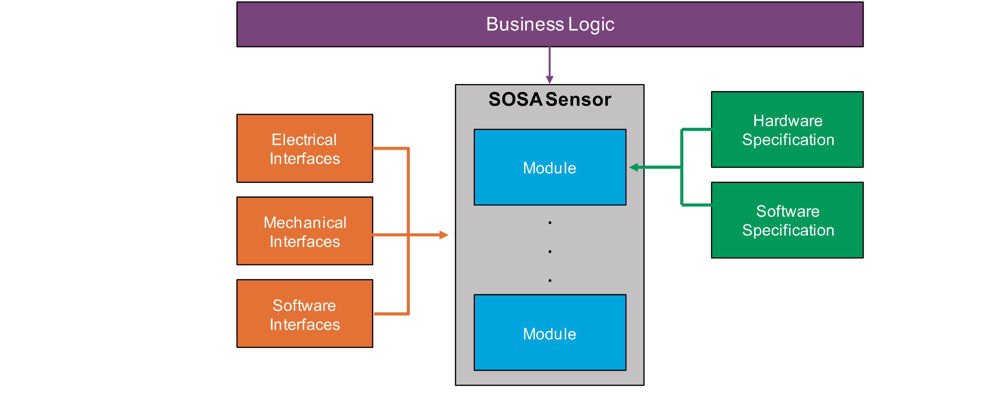

*Figure 1: The Facets that Comprise a SOSA Module ｜ 图 1：构成 SOSA 模块的各个侧面*

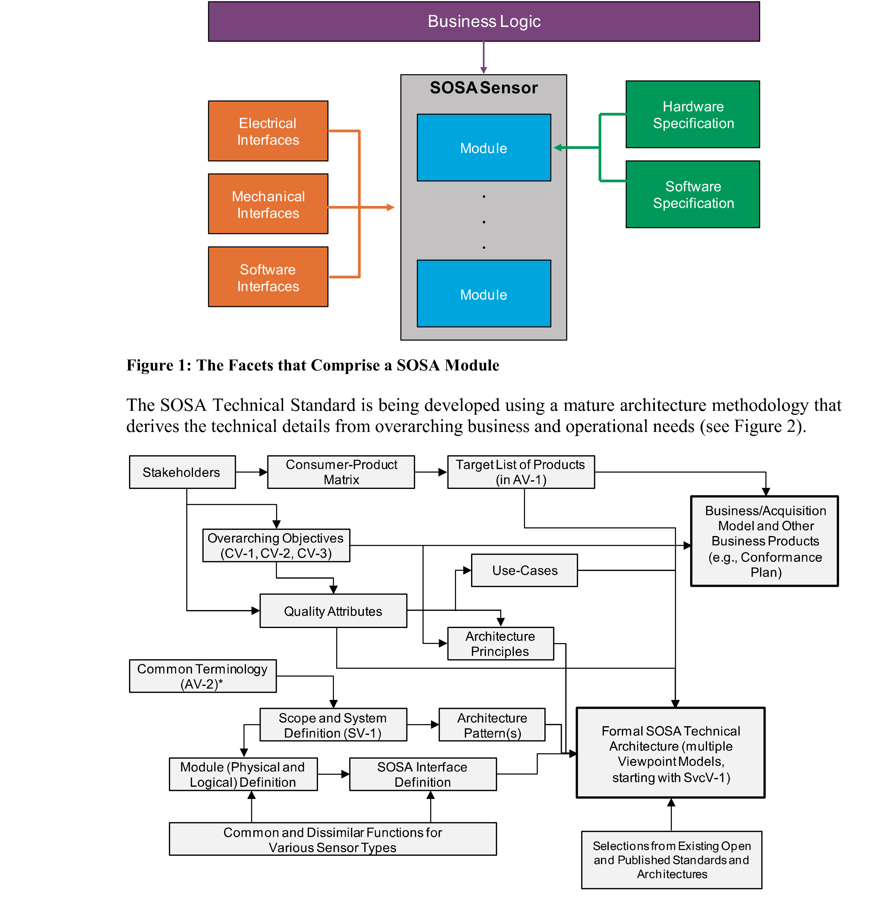

*Figure 2: The Architecture Development Method Adopted for the SOSA Technical Standard ｜ 图 2：SOSA 技术标准所采用的架构开发方法*

This document describes the SOSA Technical Architecture, including the SOSA module specifications (functions, behaviors, and interfaces), and the hardware elements and software components from which they are synthesized.

本文件描述 SOSA 技术架构，包括 SOSA 模块规格（功能、行为与接口），以及据以合成这些模块的硬件元素与软件组件。

<!-- 原书 p.3 ｜ PDF p.23 -->

##### 1.2.2 Business Alignment 业务对齐

The overview of alignment between technical and business focus areas for the SOSA Technical Standard and the SOSA Open Business Model is available through a companion document – the SOSA Business Guide (see Referenced Documents). A detailed presentation of the SOSA Open Business Model can be found in the SOSA Business Guide. Examples of SOSA Open Business Model incorporation into the acquisition process can be found in the SOSA Contracting Guide. Policies guiding the development and conduct of the SOSA Conformance Program may be found in the SOSA Conformance Policy.

SOSA 技术标准与 SOSA 开放业务模式在技术与业务聚焦领域上的对齐概貌，见配套文件《SOSA 业务指南》（见“引用文件”）。SOSA 开放业务模式的详细阐述见《SOSA 业务指南》。SOSA 开放业务模式融入采办过程的示例，见《SOSA 合同指南》。指导 SOSA 符合性计划制定与实施的政策，见《SOSA 符合性政策》。

The SOSA Business Guide explains the objectives and organization of The Open Group SOSA Consortium, and describes the SOSA Technical Standard and SOSA Open Business Model. It is intended for use by all stakeholders in the development, acquisition, deployment, modernization, and sustainment of sensor systems that support a broad array of sensors, including C4ISR. The primary stakeholder groups are Government organizations, Aerospace and Defense contractors, and commercial businesses. Within each of these broad groups there are business and technical communities, acquisition and contracting communities, users, and operational communities. All of them have a stake in the SOSA ecosystem and should become familiar with the SOSA Business Guide.

《SOSA 业务指南》说明 The Open Group SOSA 联盟的目标与组织，并描述 SOSA 技术标准与 SOSA 开放业务模式。其读者为传感器系统开发、采办、部署、现代化与保障的全部利益相关方；这些系统支撑包括 C4ISR 在内的广泛传感器。主要利益相关方群体为政府机构、航空航天与国防承包商以及商业企业。在这些大群体之内，各有业务与技术社群、采办与合同社群、用户以及作战社群。这些群体在 SOSA 生态中都有利害，都宜熟悉《SOSA 业务指南》。

The SOSA Contracting Guide provides procurement language examples for organizations that acquire sensor components and systems, as well as for those who provide them. This Guide is necessarily abstract to relay essential concepts without getting bogged down in details which may change as the SOSA Technical Standard and conformance processes mature. While the US Government is the most common procurer of C4ISR systems, and contractors within the defense industrial base are the most common providers of those systems, it should be noted that the same concerns and general procedures are also applicable to procurements led by industry and to products and services provided by commercial enterprises.

《SOSA 合同指南》为采购传感器组件与系统的机构、以及提供这些组件与系统的机构，给出采购条款语言的示例。该指南必然是抽象的，以便传达基本概念，而不致陷于细节——这些细节会随 SOSA 技术标准与符合性过程的成熟而变化。美国政府是 C4ISR 系统最常见的采购方，国防工业基础内的承包商是这些系统最常见的提供方；但宜注意，同样的关切与一般程序也适用于由产业主导的采购，以及商业企业提供的产品与服务。

The SOSA Conformance Policy lays out high-level policies for the development and conduct of a set of SOSA conformance processes. These processes will include multiple conformance verification processes, a single conformance certification process, and a single SOSA certified conformant product registration process.

《SOSA 符合性政策》给出制定与实施一组 SOSA 符合性过程的顶层政策。这些过程将包括多个符合性验证过程、一个符合性认证过程，以及一个 SOSA 认证符合产品登记过程。

#### 1.3 Conformance 符合性

This is a Snapshot, not an approved standard. Do not specify or claim conformance to it.

本件是快照版，不是经批准的标准。不得规定符合本件，也不得声称符合本件。

Defining conformance processes and creating an effective, affordable method for certifying software, hardware, and electrical/mechanical interfaces is vital to establishing an effective standard. Certification provides formal recognition of conformance to an industry standard, which allows the following:

定义符合性过程，并为软件、硬件与电气／机械接口的认证创立有效、可负担的方法，对确立一项有效的标准至关重要。认证提供对符合某项行业标准的正式承认，由此可以：

- Suppliers and practitioners may make verified claims of conformance to an open standard

- 供应方与从业者可以对开放标准的符合性作出经核实的声称

- Buyers may specify and successfully procure modular capability from vendors who provide solutions which conform to that open standard The SOSA Consortium is developing a SOSA Conformance Policy and will be developing an associated Conformance Program for the SOSA Technical Standard. The SOSA Conformance Program will provide the associated conformance criteria and processes necessary to assure that

- 采购方可以规定模块化能力，并从提供符合该开放标准解决方案的厂商处成功采购。SOSA 联盟正在制定《SOSA 符合性政策》，并将为 SOSA 技术标准制定相应的符合性计划。SOSA 符合性计划将提供为确保以下事项所必需的相应符合性判据与过程

<!-- 原书 p.4 ｜ PDF p.24 -->

capabilities have been developed in adherence to the SOSA Technical Standard. The SOSA Conformance Program will consist of Verification, Certification, and Registration.

能力已按 SOSA 技术标准开发。SOSA 符合性计划将由验证、认证与登记三部分组成。

> **译注**：上两段英文在原书是一条项目符号与一段正文，转换时首条后半与正文并成一条（成因见 `SOSA参考架构技术标准-v1.0.2/../99-转换说明与已知差异.md`）。英文照录不改。

SOSA Conformance Verification is the act of assessing the conformance of the implementation of a hardware element or software component (or a combination thereof) to the applicable SOSA Technical Standard requirements. SOSA verification processes will not be available for this Snapshot.

SOSA 符合性验证，是评定硬件元素或软件组件（或其组合）的实现对适用 SOSA 技术标准需求的符合性的动作。本快照版不提供 SOSA 验证过程。

SOSA Conformance Certification is the process of applying for SOSA Conformance Certification once Conformance Verification has been successfully completed. The SOSA Certification process will not be available for this Snapshot.

SOSA 符合性认证，是在符合性验证成功完成之后申请 SOSA 符合性认证的过程。本快照版不提供 SOSA 认证过程。

SOSA Registration is the process of listing SOSA certified modules and SOSA plug-in cards in a curated listing of information about SOSA certified modules and SOSA plug-in cards known as the SOSA Registry. The SOSA Registry process will not be available for this Snapshot.

SOSA 登记，是把经 SOSA 认证的模块与经 SOSA 认证的插卡，列入一份经整理的信息清单的过程；该清单称为 SOSA 登记簿，记载经 SOSA 认证的模块与插卡的信息。本快照版不提供 SOSA 登记簿过程。

Successful completion of the SOSA Conformance Program leads to a SOSA Conformance Certificate and the right to use the SOSA Conformance Certification Trademark in marketing.

成功完成 SOSA 符合性计划，可获得 SOSA 符合性证书，以及营销中使用 SOSA 符合性认证商标的权利。

#### 1.4 Normative References 规范性引用文件

None.

无。

#### 1.5 Terminology 术语

##### 1.5.1 SOSA Architecture SOSA 架构

While the complete SOSA AV-2 Integrated Dictionary can be found in Appendix B, there are certain key terms that must be understood in order to correctly interpret this Technical Standard.

完整的 SOSA AV-2 集成词典见附录 B；此外还有若干关键术语，必须理解它们才能正确解读本技术标准。

- Hardware Element: an all-encompassing term for hardware that is incorporated into a SOSA sensor Plug-In Card: any hardware element that is a circuit card that plugs into a backplane SOSA Plug-In Card: a circuit card assembly that also conforms to a SOSA slot profile Software Component: a unit of software that is incorporated into a SOSA sensor SOSA Module: an architectural entity that aggregates and contains the functions the SOSA sensor performs (consistent with DoD MOSA language), may be instantiated using hardware elements and/or software components, and conforms to the complete definition of a SOSA module as defined in the SOSA Technical Standard

- 硬件元素：一个总括性用语，指纳入 SOSA 传感器的硬件；插卡：任何插入背板的电路卡形式的硬件元素；SOSA 插卡：一种电路卡组件，还符合某个 SOSA `slot profile`（槽位配置档）；软件组件：纳入 SOSA 传感器的一个软件单元；SOSA 模块：一个架构实体，它聚集并承载 SOSA 传感器所执行的功能（与国防部 MOSA 的用语一致），可用硬件元素和／或软件组件实例化，并符合 SOSA 技术标准所定义的 SOSA 模块的完整定义

> **译注**：上段英文在原书为五条项目符号，转换时并成一条。英文照录不改。`slot profile` 按术语策略存原词，首次出现括注中文。

##### 1.5.2 System Requirements 系统需求

For the purposes of the SOSA Technical Standard, the following terminology definitions apply:

为 SOSA 技术标准的目的，下列术语定义适用：

May Describes a feature or behavior that is optional. The presence of this feature should not be relied upon.

可　描述可选的功能或行为。不宜依赖该功能的存在。

<!-- 原书 p.5 ｜ PDF p.25 -->

Shall Describes a feature or behavior that is mandatory for an implementation that conforms to this document. A hardware element or software component relies on the existence of the feature or behavior.

应　描述对符合本文件的实现而言强制具备的功能或行为。硬件元素或软件组件依赖该功能或行为的存在。

Should Describes a feature or behavior that is strongly recommended for an implementation that conforms to this document. A hardware element or software component cannot rely on the existence of the feature or behavior.

宜　描述对符合本文件的实现而言强烈推荐的功能或行为。硬件元素或软件组件不能依赖该功能或行为的存在。

##### 1.5.3 Hardware Specification Keywords 硬件规格关键字

To avoid confusion and to make very clear what the requirements for conformance are, many of the paragraphs in this Technical Standard are labeled with keywords that indicate the type of information they contain. These keywords are listed below:

为避免混淆、并清楚表明符合性需求为何，本技术标准中许多段落以关键字标注，以指示其内容属于哪一类信息。这些关键字列举如下：

Rule Recommendation Suggestion Permission Observation Any text not labeled with one of these keywords is to be interpreted as descriptive in nature. These will be written in either a descriptive or a narrative style.

规则　推荐　建议　许可　观察　未以其中任一关键字标注的任何文字，均按描述性理解。这些文字或以描述体、或以叙述体写出。

> **译注**：上段英文在原书为五个关键字加一段正文，转换时并成一段。英文照录不改。

Keywords are reserved for specific use as follows:

各关键字保留作如下专门用途：

Rule <section>-<number>

规则 <section>-<number>

> **译注**：条目标目模板中的 `<section>`（节号）与 `<number>`（序号）为占位符，原样保留，不译；实际条目标目形如 `Rule 5.2.18-1`，连同编号一律照录。

Conformance with Rules is mandatory. Rules always include the term "shall". Rules are expressed in some combination of text, figures, tables, or drawings. All Rules will be followed to ensure compatibility between board and backplane designs. All Rules use the "shall" or "shall not" words to emphasize the importance of the Rule. The "shall" or "shall not" words are reserved exclusively for stating Rules in this document and are not used for any other purpose.

符合规则是强制的。规则总是包含 “shall”（应）一词。规则以文字、图、表或附图的某种组合表达。所有规则都将被遵循，以确保板与背板设计之间的兼容性。所有规则都使用 “shall”（应）或 “shall not”（不应）字样，以强调规则的重要性。“shall”（应）或 “shall not”（不应）字样在本文件中专用于陈述规则，不用于任何其他目的。

Recommendation <section>-<number>

推荐 <section>-<number>

Conformance with Recommendations is optional. Recommendations always include the term "should". Recommendations are used to convey implementation advice based on the community's collective knowledge base. Wherever a Recommendation appears, designers would be wise to take the advice given. Doing otherwise might result in poor performance Or awkward problems. Recommendations found in this document are based on experience and are provided to designers to speed their traversal of the learning curve. All Recommendations use the "should" or "should not" words to emphasize the importance of the Recommendation. The "should" or "should not" words are reserved exclusively for stating Recommendations in this document and are not used for any other purpose.

符合推荐是可选的。推荐总是包含 “should”（宜）一词。推荐用于传达基于群体集体知识基础的实现忠告。凡出现推荐之处，设计者采其忠告为宜。不采可能导致性能不佳或棘手问题。本文件中的推荐基于经验，提供给设计者以加快其走完学习曲线。所有推荐都使用 “should”（宜）或 “should not”（不宜）字样，以强调推荐的重要性。“should”（宜）或 “should not”（不宜）字样在本文件中专用于陈述推荐，不用于任何其他目的。

Suggestion <section>-<number>

建议 <section>-<number>

A Suggestion contains advice, which is helpful but not vital. The reader is encouraged to consider the advice before discarding it. Some design decisions that need to be made are difficult

建议含有忠告，有帮助但并非关键。鼓励读者在丢弃该忠告之前先予考虑。有些需要作出的设计决定，在取得经验之前

<!-- 原书 p.6 ｜ PDF p.26 -->

until experience has been gained. Suggestions are included to help a designer who has not yet gained this experience.

难以作出。列入建议，是为帮助尚未取得该经验的设计者。

Permission <section>-<number>

许可 <section>-<number>

Conformance with Permissions is optional. Permissions always include the term "may". In some cases, a Rule does not specifically prohibit a certain design approach, but the reader might be left wondering whether that approach might violate the spirit of the Rule or whether it might lead to some subtle problem. Permissions reassure the reader that a certain approach is acceptable and will cause no problems. All Permissions use the "may" words to emphasize the importance of the Permission. The lower-case "may" words are reserved exclusively for stating Permissions in this document and are not used for any other purpose.

符合许可是可选的。许可总是包含 “may”（可）一词。某些情况下，某条规则并未专门禁止某种设计做法，但读者会疑惑：该做法是否违背规则的本意，或是否会导致某种隐蔽问题。许可向读者保证：某种做法可以接受，且不会引起问题。所有许可都使用 “may”（可）字样，以强调许可的重要性。小写 “may”（可）字样在本文件中专用于陈述许可，不用于任何其他目的。

Observation <section>-<number>

观察 <section>-<number>

Observations do not offer any specific advice. They usually follow naturally from what has just been discussed. They spell out the implications of certain Rules and bring attention to things that might otherwise be overlooked. They also give the rationale behind certain Rules so that the reader understands why the Rule must be followed.

观察不提出任何具体忠告。观察通常顺着刚讨论过的内容自然得出。观察阐明某些规则的含意，并把可能被忽略之处提请注意。观察也给出某些规则背后的理由，使读者理解该规则为何必须遵循。

#### 1.6 Future Directions 未来方向

The SOSA Hardware Working Group (HWG) will initiate an effort to develop a Space version of the SOSA standard. This will leverage existing SOSA efforts as much as possible with a look towards existing Space OSAs. The HWG will also extend its development efforts to smaller Sensor platforms, such as Unmanned Aerial Vehicles (UAVs); Unmanned Underwater Vehicles (UUVs), etc.

SOSA 硬件工作组（HWG）将启动一项工作，开发 SOSA 标准的航天版。这将尽可能利用现有的 SOSA 工作成果，并参照现有的航天开放系统架构。硬件工作组还将把开发工作扩展到更小的传感器平台，如无人机（UAV）、无人水下航行器（UUV）等。

<!-- 原书 p.7 ｜ PDF p.27 -->

## 第 2 章 定义

> 分册文件：`SOSA参考架构技术标准-v1.0.2/02-definitions.md`；原册题：2 Definitions 定义

> 原书 p.8–8 ｜ PDF p.28–28

For the purposes of this Snapshot, all terms that are not specifically defined in the SOSA AV-2 Integrated Dictionary provided in Appendix B will be interpreted as defined in the Merriam-Webster's Collegiate Dictionary.

为本快照版的目的，凡未在附录 B 所给 SOSA AV-2 集成词典中专门定义的术语，均按《Merriam-Webster's Collegiate Dictionary》（韦氏大学词典）中的定义解释。

See also the Glossary.

另见术语表。

<!-- 原书 p.8 ｜ PDF p.28 -->

## 第 3 章 参考架构描述

> 分册文件：`SOSA参考架构技术标准-v1.0.2/03-reference-architecture-description.md`；原册题：3 Reference Architecture Description 参考架构描述

> 原书 p.9–42 ｜ PDF p.29–62

#### 3.1 CV-1/CV-2 Objectives CV-1/CV-2 目标

The foundations of the SOSA Reference Architecture are:

SOSA 参考架构的基础是：

Capability View – 1 (CV-1): the overall vision, goals, and enablers that support the goals of the architecture that are captured in the CV-1 DoDAF artifact (see Section 3.1.1)

能力视图 – 1（CV-1）：总体愿景、目标，以及支撑该架构诸目标的使能因素，上述内容记载于 CV-1 DoDAF 制品之中（见第 3.1.1 节）

- Quality Attributes: characteristics of a system that collectively influence the overall quality of the system, and will drive many of the architectural decisions (often referred to as "-ilities") (see Section 3.3) – these are the measures for "goodness" of harmonization Architecture Principles: general rules and guidelines, intended to be enduring and seldom amended, that inform and serve as drivers for defining the architecture; a framework for decision-making (evaluation criteria) as a means to weed out approaches that are inconsistent with intent, and serve as a foundation for adjudication (see Section 3.2)

- 质量属性：系统的诸特征，合在一起影响系统的整体质量，并将驱动许多架构决策（常被称为“-ilities”）（见第 3.3 节）——这些是衡量“协调一致”（harmonization）优劣的度量；架构原则：通用规则与准则，意在持久、少有修订，用于指引并充当定义架构的驱动因素；它同时是决策框架（评价准则），据以剔除与意图不一致的做法，并充当裁决的基础（见第 3.2 节）

> **译注**：上段英文在原书为两条项目符号（质量属性、架构原则），转换时并成一段；英文照录不改，中文同构一段、以「；」分列各条。

These products provide the foundation for the architecture definition contained in this document. Another foundational element is the Integrated Dictionary (DoDAF AV-2) which establishes the baseline terminology used throughout to ensure clarity and reduces (if not eliminates) ambiguity. All essential terms in the SOSA Technical Standard are captured in the DoDAF AV-2.

这些制品为本文件所载的架构定义提供了基础。另一个基础要素是集成词典（DoDAF AV-2），它确立通篇所用的基线术语，以确保清晰、并减少（即使不能消除）歧义。SOSA 技术标准中的全部基本术语都收录于 DoDAF AV-2 之中。

The fundamental building blocks of the SOSA Architecture are the SOSA modules ("an element of a system that has individually distinct boundaries that are well-defined interfaces") and the SOSA interfaces ("the region, physical or logical, where two systems or elements meet and interact"). Modules perform functions (physical and/or logical) and exhibit behaviors.

SOSA 架构的基本构件是 SOSA 模块（“系统中一个具有各自分明边界、而其边界为定义明确接口的元素”）与 SOSA 接口（“两个系统或元素相接并交互的区域，或物理或逻辑”）。模块执行功能（物理的和／或逻辑的）并呈现行为。

The SOSA Architecture will be captured using the DoDAF Version 2.02 Viewpoint Models, chosen because the primary target audience is the US DoD, and DoDAF is (as of this writing) the prescribed framework.

SOSA 架构将采用 DoDAF 2.02 版的视角模型（Viewpoint Models）加以记载；之所以选择它，是因为主要目标受众是美国国防部，而 DoDAF（截至本文撰写时）是指定的框架。

##### 3.1.1 SOSA Capability View – 1 (CV-1) SOSA 能力视图 – 1（CV-1）

As mentioned earlier the CV-1 presents the SOSA overall vision, goals, and outlines strategy to support stated goals throughout the effort. To this end, the vision and goals as presented in Section 1.1 earlier are further refined below through addition of capabilities to define goals.

如前所述，CV-1 给出 SOSA 的总体愿景、目标，并勾勒为在整个工作中支撑所述目标的战略。为此，前文第 1.1 节所给出的愿景与目标，在下文中通过增添能力以界定目标而得到进一步细化。

The vision statement for the SOSA Consortium is:

SOSA 联盟的愿景声明为：

Business/acquisition practices and a technical environment for sensors and C4ISR payloads that foster innovation, industry engagement, competition, and allow for rapid fielding of costeffective capabilities and platform mission reconfiguration while minimizing logistical requirements.

面向传感器与 C4ISR 载荷的业务／采办做法与技术环境：促进创新、产业参与与竞争，允许快速列装成本有效的能力、允许平台任务重构，同时尽量减少后勤需求。

The SOSA capabilities are illustrated in Figure 3.

SOSA 的诸项能力示于图 3。

<!-- 原书 p.9 ｜ PDF p.29 -->

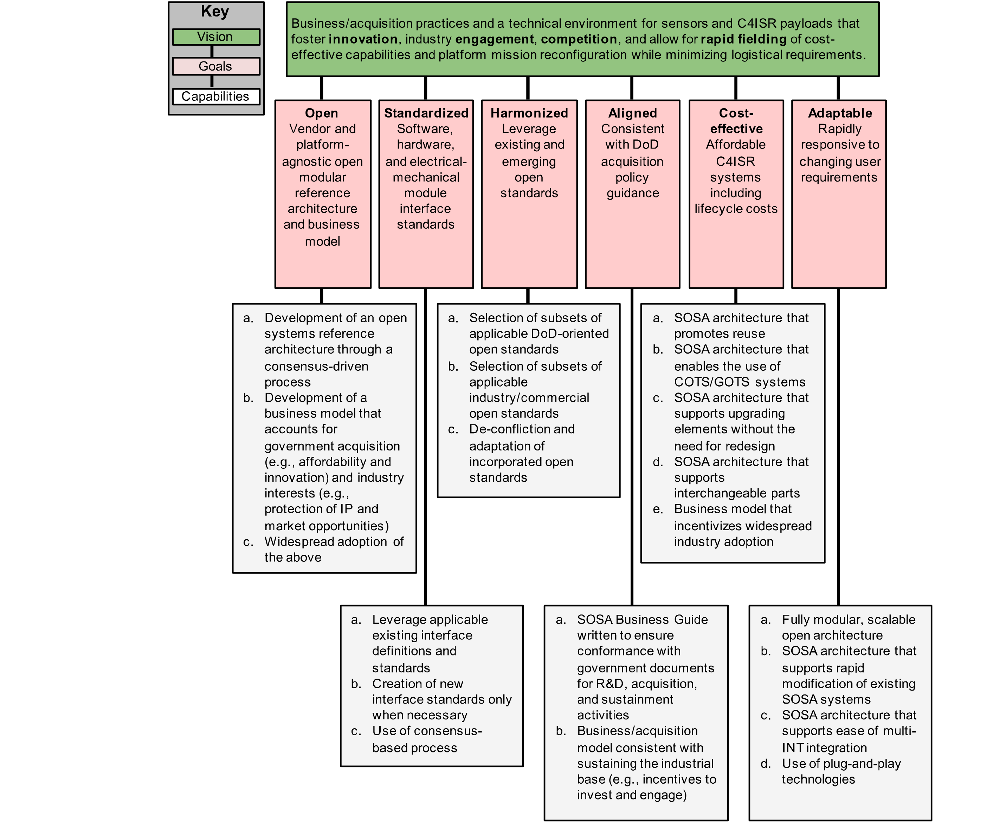

*Figure 3: SOSA CV-I ｜ 图 3：SOSA CV-I*

#### 3.2 SOSA Architecture Principles SOSA 架构原则

The following architecture principles were developed to guide the SOSA technical and business architectures being matured. The list of principles below is not in any particular order and the numerical value does not indicate precedence.

下列架构原则是为指导正在成熟中的 SOSA 技术与业务架构而制定的。下列原则清单不按任何特定次序排列，其编号数值也不表示优先级。

<!-- 原书 p.10 ｜ PDF p.30 -->

##### 3.2.1 Business-Oriented Architecture Principles 面向业务的架构原则

**#1 The SOSA business and technical architecture is vendor-agnostic. #1 SOSA 的业务与技术架构与厂商无关。**

**Statement** The modules and interfaces that make up the SOSA Technical Standard and Reference Architecture, and the processes and practices that make up the SOSA business/procurement architecture, are equally beneficial to all vendors, offering no inherent advantage or disadvantage to any one company or business sector.

**陈述** 构成 SOSA 技术标准与参考架构的诸模块与接口，以及构成 SOSA 业务／采办架构的诸过程与做法，对全体厂商同等有利，不给任何一家公司或行业门类带来固有的优势或劣势。

**Rationale** The first goal of the SOSA Architecture is "Open: vendor and platform-agnostic open modular reference architecture and business model", and as such the SOSA business and

**理由** SOSA 架构的第一项目标是“开放：与厂商和平台无关的开放模块化参考架构与业务模式”，因此 SOSA 的业务与

technical architecture supports a "level playing field" to ensure business fairness, and that the best technical solution, regardless of vendor source, can be incorporated into systems based on the SOSA Technical Architecture.

技术架构支撑一个“公平的竞技场”，以确保商业公平，并确保最佳技术方案——不论来自哪家厂商——都能被纳入基于 SOSA 技术架构的系统。

**Implications** The business architecture of SOSA ensures that there are no barriers for stakeholder participation in the development or use of the SOSA Architecture. This includes making material available, eliminating financial barriers (or ensuring that they are minimal). The acquisition model is one that enables all qualified vendors to participate. The technical architecture incorporates standards that favor no vendor by ensuring that it incorporates widely-available standards for which all qualified vendors have equivalent opportunity.

**影响** SOSA 的业务架构确保：利益相关方参与 SOSA 架构的开发或使用没有障碍。这包括使材料可得、消除财务障碍（或确保其最小化）。其采办模式使所有合格厂商都能参与。技术架构纳入不偏向任何厂商的标准：它确保所纳入的是广泛可得的、所有合格厂商都有同等机会采用的标准。

**#2 SOSA Consortium products are provided royalty-free. #2 SOSA 联盟的产品免版税提供。**

**Statement** There is no cost to obtaining SOSA Consortium materials required to develop, procure, or implement systems (or subsystems or modules) that are aligned to the SOSA Technical Standard.

**陈述** 获取为开发、采购或实现与 SOSA 技术标准对齐的系统（或分系统或模块）所需的 SOSA 联盟材料，均无费用。

**Rationale** Achieving the vision and goals of the SOSA Consortium requires that there is widespread adoption, implying the minimization of barriers to access and use the products of the SOSA Consortium. High royalties or fees to access these materials would run counter to the goals of the open business objectives, and therefore are to be avoided.

**理由** 实现 SOSA 联盟的愿景与目标，要求获得广泛采用；这意味着要把获取与使用 SOSA 联盟产品的障碍降到最低。对获取这些材料收取高额版税或费用，与开放业务目标相背离，因此应予避免。

**Implications** The means of publication of the SOSA Technical Standard is low-to-no cost, such as non-physical distribution via the World Wide Web, file servers, or other electronic means – subject to national security considerations (e.g., the need to authenticate that recipients are US persons who understand their responsibilities to safeguard the material). In addition, and by implication, tools (testing methodology, SDKs, etc.) required to develop and conformance verify hardware and software are widely available at no-to-little cost. Third-party products that are derived from SOSA Consortium products may be made commercially available (for additional cost).

**影响** SOSA 技术标准的发布手段为低成本乃至零成本，例如通过万维网、文件服务器或其他电子手段作非实物分发——但须服从国家安全方面的考虑（例如，需核实接收方是理解其保护该材料之责任的美国人士）。此外，由此可以推知，开发与符合性验证硬件和软件所需的工具（测试方法、SDK 等）以零成本至低成本广泛可得。由 SOSA 联盟产品衍生的第三方产品可以作商业发售（另收费用）。

**#3 SOSA products and processes protect the IP of vendors. #3 SOSA 的产品与过程保护厂商的知识产权。**

**Statement** Participation in the development and use of SOSA Consortium products does not jeopardize the IP of vendors. The SOSA Consortium respects IP and the SOSA Consortium products do not expose IP.

**陈述** 参与 SOSA 联盟产品的开发与使用，不会危及厂商的知识产权（IP）。SOSA 联盟尊重知识产权，SOSA 联盟的产品不暴露知识产权。

<!-- 原书 p.11 ｜ PDF p.31 -->

**#3 SOSA products and processes protect the IP of vendors. #3 SOSA 的产品与过程保护厂商的知识产权。**

> **译注**：本条及后文 #5、#10、#12、#14 的条目在页锚处重复出现，系原书续页重复条目所致；英文照录不改。

**Rationale** financially healthy ISR ecosystem is in the best interest of the nation. Businesses must be incentivized to invest itechnology and other innovative solutions. I protection is the cornerstone of that process that ensures that there is a return On the ivestment. Therefore, it is imperative that SOSA processes and products retain protections for I rights within the module boundary.

**理由** 一个财务健康的 ISR 生态最符合国家的利益。必须激励企业投资于技术与其他创新解决方案。知识产权保护是这一过程的基石，它确保投资有回报。因此，必须让 SOSA 的过程与产品在模块边界之内保留对知识产权权利的保护。

> **译注**：本段英文在原册为扫描识别件，多处字词残缺：“itechnology”当作“技术”、“I protection”当作“知识产权保护”、“return On the ivestment”当作“投资回报（on the investment）”、“I rights”当作“知识产权权利”；英文照录不改，中文按可辨字面译出。

**Implications** The SOSA Architecture takes a CCgray box' approach: modules are defined with properties Of functions and behaviors, and interfaces are defined with properties that iclude their physical characteristics, protocols for exchange of signals and data, and the signal and data content. How the functions and behaviors of the modules (einside the box') are realized is completely Up to the vendor to determine. It is inside the box where the I resides. In addition, the SOSA Architecture does not include companyspecific IP unless that IP has been consensually released to the SOSA Consortium for Open usCthrough the SOSA Technical Standard per the membership agreement.

**影响** SOSA 架构取一种“灰盒”做法：模块以功能与行为的属性来定义，接口以属性来定义，包括其物理特性、交换信号与数据的协议，以及信号与数据的内容。模块的功能与行为（“盒内”）如何实现，完全由厂商自行决定。知识产权正驻于盒内。此外，SOSA 架构不纳入公司专有的知识产权，除非该知识产权已按成员协议经各方同意发布给 SOSA 联盟，以便通过 SOSA 技术标准公开使用。

> **译注**：本段英文在原册为扫描识别件，多处字词残缺：“CCgray box'”当作“'gray box'（灰盒）”、“Of”当作“of”、“iclude”当作“include”、“(einside the box')”当作“（'inside the box'）”、“Up”当作“up”、“I”当作“IP”、“companyspecific”当作“company-specific”、“usCthrough”当作“use through”；英文照录不改，中文按可辨字面译出。

##### 3.2.2 Technically-Oriented Architecture Principles 面向技术的架构原则

**#4 The SOSA Technical Standard is extensible an evolvable. #4 SOSA 技术标准是可扩展、可演化的。**

**Statement** The SOSA Technical Standard, and associated Reference Architecture, is able to

**陈述** SOSA 技术标准及配套的参考架构，能够

continue to Iature beyond theexisting goals and expectations, to be able to incorporate technological and architectural improvements, and be able to maintain relevance as stakeholder needs change(e.8,new sensor types and new mission areas)

继续超越既有的目标与期望而成长，能够纳入技术与架构上的改进，并能在利益相关方需求变化（例如新的传感器类型与新的任务领域）时保持其适用性

> **译注**：本段英文在原册为扫描识别件：本段本是上段未完的一句（页锚在句中切开），“Iature”当作“mature”、“theexisting”当作“the existing”、“e.8”当作“e.g.”；英文照录不改，中文按可辨字面译出。

**Rationale** Technologies, markets, and requirements evolve over time. In order to preserve the considerable time and funds invested in creating the SOSA Architecture embodied ~ the SOSA Technical Standard consideration is given to "future proof' i. For the SOSA Technical Standard to be relevant in the future, it is important that it can be extended in scope.

**理由** 技术、市场与需求随时间而演化。为保住为创建 SOSA 架构所投入的大量时间与经费——该架构体现在 SOSA 技术标准之中——考虑的是“面向未来”（future proof）之事。为使 SOSA 技术标准在未来仍然适用，重要的一点是它能够在范围上扩展。

> **译注**：本段英文在原册为扫描识别件：“embodied ~ the SOSA Technical Standard”之“~”当作“in（体现在）”、“future proof' i.”当作“future proofing”；英文照录不改，中文按可辨字面译出。

**Implications** Architecture decisions, trades, etc. favor options that enable growth and don 't "lockOut'' expansion. Interfaces are defined to include growth paths (extra capacity, for example). Module definitions are not So narrow as to preclude additionalfunctionality. The architecture developers and maintainers are mindful that the current Version willnot necessarily be the last one.

**影响** 架构决策、权衡等，都偏向那些能够带来成长、且不“锁定排除”（lock out）扩展的选项。接口的定义包含成长路径（例如额外容量）。模块定义不至于窄到排除附加功能。架构的开发与维护者清楚：当前版本未必是最后一个版本。

> **译注**：本段英文在原册为扫描识别件：“don 't”当作“don't”、““lockOut''”当作“”lock out“”、“additionalfunctionality”当作“additional functionality”、“willnot”当作“will not”；英文照录不改，中文按可辨字面译出。

**#5 The SOSA Architecture maximally leverageslincorporates existing industry and government standards. #5 SOSA 架构最大限度地利用／纳入现有的行业标准与政府标准。**

> **译注**：本条标题英文在原册作“maximally leverageslincorporates”，系“maximally leverages/incorporates”的扫描残缺；英文照录不改，中文按可辨字面译出。

**Statement** The SOSA Architecture takes advantage Of existing industry and govermment standards and OSAs whenever possible and practical and consistent with achieving thegoalsOf the SOSA Consortium.

**陈述** SOSA 架构在可能且可行、并与达成 SOSA 联盟目标相一致之时，利用现有的行业标准、政府标准与 OSA。

> **译注**：本段英文在原册为扫描识别件：“advantage Of”当作“advantage of”、“govermment”当作“government”、“thegoalsOf”当作“the goals of”；英文照录不改，中文按可辨字面译出。

**Rationale** Crafting well-instituted standards is both time and resource-consuming, and the community does not benefit from having multiple, overlapping, or redundant standards. Therefore, the SOSA Architecture incorporates other standards and approaches When appropriate.

**理由** 制定制度化良好的标准既费时又费资源，而存在多个相互重叠或冗余的标准，对共同体并无好处。因此，SOSA 架构在适当的情况下纳入其他标准与做法。

<!-- 原书 p.12 ｜ PDF p.32 -->

**#5 The SOSA Architecture maximally leverageslincorporates existing industry and government standards. #5 SOSA 架构最大限度地利用／纳入现有的行业标准与政府标准。**

**Implications** Systems that already are compliant or conformant with other OSAs are likely to require minimal (or no) modifications to achieve consistency with the SOSA Technical Standard. Adoption is more efficient for the SOSA team, helping to more rapidly develop and evolve the SOSA Technical Standard, though the team ensures that said adoption does not undermine the quality attributes, goals, or other guiding principles upon which the SOSA Architecture is based, and is consistent with the entirety of the SOSA Architecture.

**影响** 已经具备对其他 OSA 的符合程度、或已属符合的系统，为与 SOSA 技术标准取得一致，很可能只需极少的（甚至零）修改。对 SOSA 团队而言，采纳更为高效，有助于更快地开发与演化 SOSA 技术标准；不过团队要确保此种采纳不损害 SOSA 架构所依据的质量属性、目标或其他指导原则，并且与 SOSA 架构整体相一致。

**#6 Resilience (including cybersecurity) is enabled by the SOSA Architecture. #6 SOSA 架构使韧性（含网络安全）得以具备。**

**Statement** Physical and logical aspects of SOSA Architectures are capable of maintaining a reasonable level of operation in situations where system degradation or attack is possible.

**陈述** 在可能出现系统降级或遭受攻击的情形下，SOSA 架构的物理与逻辑侧面能够维持合理水平的运行。

**Rationale** A SOSA conformant system is not viable if it is unable to respond accordingly to either a localized degradation event, a system-wide degradation, or a cyber-attack by maintaining a reasonable level of operational viability.

**理由** 一个符合 SOSA 的系统，若不能通过维持合理水平的运行可行性来对局部降级事件、全系统降级或网络攻击作出相应响应，便是不可行的。

**Implications** The SOSA Architecture incorporates functions that permit monitoring for health and status, and facilitate the design of a system that incorporates safeguards, redundancy, and the ability to be upgraded in light of new threats. A SOSA conformant system is able to respond to physical or logical degradation or a localized failure. Maximizing the ability of a SOSA system to effectively manage these possibilities ensures operation at an acceptable level of performance in a variety of situations.

**影响** SOSA 架构纳入的功能可对健康与状况进行监视，并便利于设计出纳入防护措施、冗余以及能针对新威胁作升级的系统。符合 SOSA 的系统能够对物理或逻辑降级、或局部失效作出响应。尽量扩大 SOSA 系统有效应对这些可能性的能力，可确保其在多种情形下以可接受的性能水平运行。

**#7 The SOSA Architecture is agnostic with respect to host platform. #7 SOSA 架构与宿主平台无关。**

**Statement** The SOSA Technical Standard, and associated Reference Architecture, applies to a wide range of host platforms (e.g., aircraft, ground vehicle, ship), and makes no assumption regarding the type of vehicle or installation it is resident in or upon.

**陈述** SOSA 技术标准及配套的参考架构适用于范围广泛的宿主平台（例如飞机、地面车辆、舰船），并且对其所驻留或安装于其上的载具或设施类型不作任何假定。

**Rationale** Conformance and adherence to this principle engenders hardware and software interoperability and reuse across multiple platforms and multiple mission types. Enabling and maximizing reuse lowers overall development costs and operational costs over the lifetime of any particular program.

**理由** 符合并遵循本原则，可带来跨多个平台、多种任务类型的硬件与软件互操作性与复用。使复用成为可能并尽量扩大复用，可降低任一特定项目全生命周期的总开发成本与运行成本。

**Implications** The development of the SOSA Technical Standard takes into account a wide range of physical and environmental conditions, and so it specifies, for example, a range of standards-based connector types appropriate for the variety of environments. This may have implications on plug-and-playability, and so it is important that one type of interface (for one environment) easily be adapted (through interface conversion and/or software shim) to another. This enables, for example, a small-vehicle sensor to be leveraged for a large platform.

**影响** SOSA 技术标准的制定考虑到范围广泛的物理与环境条件，因此它例如规定了一系列基于标准的连接器类型，以适应多样的环境。这可能对即插即用性产生影响，因此重要的是，一种接口（对应一种环境）能够容易地（通过接口转换和／或软件垫层）适配为另一种接口。由此，例如小型载具上的传感器便可用于大型平台。

<!-- 原书 p.13 ｜ PDF p.33 -->

**#8 The SOSA Architecture is agnostic with respect to processing environment. #8 SOSA 架构与处理环境无关。**

**Statement** SOSA modules and interfaces are not dependent upon the physical processing and operating system environments.

**陈述** SOSA 模块与接口不依赖物理处理环境与操作系统环境。

**Rationale** SOSA modules represent the codified logic of the sensor system. Physical realization of processing environments will continue to evolve with processors, operating systems, network protocols, backplanes, memory architectures, and communication circuits. The desire is for the physical realizations to be changed as technology continues to evolve. Adherence to this principle enables hardware and software interoperability and reuse across multiple platforms and multiple mission types. Isolating SOSA modules from the processing environment allows rapid technology refreshment, system scaling, and module reuse.

**理由** SOSA 模块体现的是传感器系统经编纂成文的逻辑。处理环境的物理实现将随处理器、操作系统、网络协议、背板、存储架构与通信电路而不断演化。所期望的是：随着技术持续演化，物理实现随之更换。遵循本原则，可使硬件与软件在多个平台、多种任务类型之间互操作并复用。把 SOSA 模块与处理环境隔离，可实现快速的技术更新、系统规模伸缩与模块复用。

**Implications** The SOSA Technical Standard needs to take into account a wide range of processing environments as realized by the selection of processors (CPU, GPU, FPGA, and custom), operating systems, network protocols, backplanes, memory architectures, and communication circuits. This means that the interfaces are independent from the processing environment through abstraction.

**影响** SOSA 技术标准需要考虑到由处理器（CPU、GPU、FPGA 与定制）、操作系统、网络协议、背板、存储架构与通信电路的选择所实现的范围广泛的处理环境。这意味着接口通过抽象而与处理环境相互独立。

**#9 Every SOSA module has defined logical interfaces. 每个 SOSA 模块都有已定义的逻辑接口。**

**Statement** All SOSA sensors have well-defined logical interfaces for each of their SOSA defined modules. Logical interfaces describe the information content or signaling between modules for the interchange of control and data. The logical interface is a point that encapsulates control and data along with the syntax/semantics as described by the SOSA Architecture. Information exchange, including transmission type, interchange protocols, and routing are part of the interface definition.

**陈述** 所有 SOSA 传感器对其每个 SOSA 已定义的模块都有定义明确的逻辑接口。逻辑接口描述模块之间为交换控制与数据所需的信息内容或信令。逻辑接口是一个把控制与数据连同 SOSA 架构所描述的语法／语义一并封装的点。信息交换——包括传输类型、交换协议与路由——是接口定义的一部分。

**Rationale** An interface is a shared boundary for interaction between architectural modules. SOSA module logical interfaces enable replacement for modernization and upgrade, support plug-and-playability, interoperability, operational flexibility, and will likely result in cost savings over the lifetime of an operational program.

**理由** 接口是架构模块之间交互的共享边界。SOSA 模块的逻辑接口使现代化与升级时的替换成为可能，支撑即插即用性、互操作性与运用灵活性，并很可能在一个运用项目的全生命周期内带来成本节约。

**Implications** The SOSA Technical Standard addresses a wide range of logical interfaces realized in SOSA environments. SOSA logical interfaces mandate that a set of interface standards is needed to span the types, protocols, addressing, service types, and operational environments.

**影响** SOSA 技术标准处理在 SOSA 环境中实现的范围广泛的逻辑接口。SOSA 逻辑接口需求：需要一套接口标准，以覆盖各种类型、协议、寻址、服务类型与运行环境。

**#10 Every SOSA hardware element has defined physical interfaces. 每个 SOSA 硬件元素都有已定义的物理接口。**

**Statement** All SOSA sensors have well-defined physical interfaces for each of their hardware modules. Physical interfaces describe the physical or mechanical connection between SOSA hardware modules, providing structural attachment, electrical/electronic connectors, backplanes, or other inter-module associations that are physically manifested.

**陈述** 所有 SOSA 传感器对其每个硬件模块都有定义明确的物理接口。物理接口描述 SOSA 硬件模块之间的物理或机械连接，提供结构附着、电气／电子连接器、背板，或其他以物理方式体现的模块间关联。

**Rationale** Well-defined SOSA module physical interfaces enable replacement for modernization and upgrade, support plug-and-playability, interoperability, operational flexibility, and will likely result in cost savings over the lifetime of an operational program.

**理由** 定义明确的 SOSA 模块物理接口使现代化与升级时的替换成为可能，支撑即插即用性、互操作性与运用灵活性，并很可能在一个运用项目的全生命周期内带来成本节约。

<!-- 原书 p.14 ｜ PDF p.34 -->

**#10 Every SOSA hardware element has defined physical interfaces. 每个 SOSA 硬件元素都有已定义的物理接口。**

**Implications** The SOSA Technical Standard addresses a wide range of physical interfaces realized in SOSA environments. SOSA physical interfaces mandate that a set of interface standards is needed to span the types, physical sizes, connector types, electrical signaling (including Physical and Data Link layers), and operational environments.

**影响** SOSA 技术标准处理在 SOSA 环境中实现的范围广泛的物理接口。SOSA 物理接口需求：需要一套接口标准，以覆盖各种类型、物理尺寸、连接器类型、电气信令（含物理层与数据链路层）与运行环境。

**#11 The SOSA Architecture accommodates simple through complicated systems. #11 SOSA 架构可容纳从简单到复杂的系统。**

**Statement** The SOSA Architecture provides the building blocks for deriving multiple sensor types that scale within a design, increasing or decreasing complexity relative to processing and Size, Weight, and Power (SWaP) constraints for a system.

**陈述** SOSA 架构提供构件，据以派生出能在同一设计之内伸缩的多种传感器类型，并相对于系统的处理能力以及尺寸、重量与功耗（SWaP）约束而增减其复杂程度。

**Rationale** There are many aspects of complexity that the SOSA Architecture addresses, such as number of sensors to manage, diversity of sensors, and algorithm complexity/parallel processing requirements. The management functions of sensor systems become more complex as the number of entities increase. Having patterns that allow the management functions to scale with (at most) minor changes is crucial. The ability to support algorithm scaling (e.g., more or less instances of the same process working in parallel) and increasing or reducing the corresponding hardware as needed with only configuration changes is an important attribute of a SOSA system.

**理由** SOSA 架构所应对的复杂性有许多方面，例如需管理的传感器数量、传感器的多样性，以及算法复杂度／并行处理需求。随着实体数量增加，传感器系统的管理功能变得更复杂。要让管理功能能随规模伸缩、且至多只需微小改动，这种模式至关重要。支持算法伸缩（例如同一过程的并行实例增多或减少）、并仅通过配置更改即可按需增减相应硬件的这种能力，是 SOSA 系统的一项重要属性。

**Implications** SOSA systems accommodating a range of complexity require well-defined functional decomposition, use-cases, and interface definitions. The functional decomposition needs to create the right layer(s) of abstraction for a variety of hardware and software entities to coexist in different configurations. The use-cases need to cover all required system functionality, from specific mode processing to state/mode control to heartbeats. Integrating different software or hardware into a system should minimally affect the management functions of a SOSA derived system. The interface definitions need to be firm for system management, but flexible for a variety of sensor type processing. Patterns are used extensively to manage the complexity.

**影响** 可容纳一定复杂度的 SOSA 系统，要求定义明确的功能分解、用例与接口定义。功能分解需要为多样的硬件与软件实体在不同配置下共存建立恰当的抽象层次。用例需要覆盖全部所需的系统功能，从特定模式处理到状态／模式控制、再到心跳。把不同的软件或硬件集成到系统中，宜对由 SOSA 派生的系统的管理功能影响极小。接口定义对系统管理需要是刚性的，而对多种传感器类型的处理则需要是柔性的。模式（patterns）被广泛用于管理这种复杂性。

**#12 The SOSA Architecture accommodates small through large platforms. #12 SOSA 架构可容纳从小型到大型的平台。**

**Statement** The SOSA Architecture is flexible enough so that designs derived from it can be tailored to large as well as small platforms, with the flexibility to be used to design simple, lightweight systems (suitable for a small UAS) as well as large complex systems (e.g., suitable for a wide-body jet, warship, or ground-based installation).

**陈述** SOSA 架构足够灵活，据其派生的设计可裁剪适配大型平台，也可适配小型平台；既可用于设计简单、轻量系统（适合小型 UAS，即无人机系统），也可用于设计大型复杂系统（例如适合宽体喷气机、战舰或陆基设施）。

**Rationale** Applicability is dependent upon the ability of a solution to provide a standard suite of interfaces across a multiplicity of host structures. Not limiting the scope of the SOSA Technical Standard to one class of hosts or another ensures broad applicability and utility.

**理由** 适用性取决于方案能否在众多宿主结构上提供一套标准接口。不把 SOSA 技术标准的范围限制于某一类宿主而不及另一类，可确保其广泛的适用性与实用性。

<!-- 原书 p.15 ｜ PDF p.35 -->

**#12 The SOSA Architecture accommodates small through large platforms. #12 SOSA 架构可容纳从小型到大型的平台。**

**Implications** The SOSA Architecture is a superset architecture; complete in that it can be used to design a complex, fully-functional system, and at the same time not mandate/require the presence of all (or many/most) modules for systems with more modest SWaP resources. The SOSA Architecture incorporates hardware and physical standards that allow the use of small as well as large form factors.

**影响** SOSA 架构是一个超集架构；其完整之处在于它可用于设计复杂、功能完备的系统，同时对 SWaP 资源较为有限的系统，又不强制／要求全部（或许多／大多数）模块齐备。SOSA 架构纳入的硬件与物理标准，允许使用小型以及大型的外形规格。

**#13 Modularity is fundamental to the SOSA Architecture – physical and logical. 模块化是 SOSA 架构的根本——物理的与逻辑的。**

**Statement** The SOSA Architecture is an OSA, and as such is composed of physical and logical units ("building blocks") that have individually distinct boundaries that are well-defined interfaces. The units or elements that make up a SOSA Architecture (or resulting system) are known as modules.

**陈述** SOSA 架构是一种 OSA，因此由物理与逻辑单元（“构件”）组成，这些单元各有分明的边界，而边界本身即为定义明确的接口。构成 SOSA 架构（或所得系统）的单元或元素称为模块。

**Rationale** The goals for the SOSA Architecture include openness, standardization, and adaptivity that allow for replacement/upgrade of parts of a sensor and reuse in a vendor-neutral manner. Modules (physical and logical units with well-defined boundaries) are the means of achieving these goals.

**理由** SOSA 架构的目标包括开放性、标准化与适应性，使传感器的部分可以更换／升级，并能以厂商中立的方式复用。模块（具有定义明确边界的物理与逻辑单元）是实现这些目标的手段。

**Implications** The SOSA Architecture is described in terms of modules (functions and behaviors) and interfaces (information or signals to be exchanged by these modules, and the means by which they are exchanged, such as protocols or electrical specs). The modules are defined in a way that ensures independence and low coupling (so that changes in one do not impact others). Criteria used: Severable (can be separated and used elsewhere) – based on business needs, timing requirements, or other drivers Has minimal complexity interfaces (minimum interdependencies) Can operate as stand-alone or be operated via function/process/system manger Is independently testable Does not expose IP Facilitates competitive procurement Encapsulates rapid change

**影响** SOSA 架构以模块（功能与行为）与接口（这些模块要交换的信息或信号，以及它们交换的方式，如协议或电气规格）来描述。模块的定义方式确保独立性与低耦合（即一个模块的改动不影响其他模块）。所用判据：可切分（可分离出来在别处使用）——依据业务需要、时序需求或其他驱动因素；接口复杂度最低（相互依赖最少）；可独立运行，或经功能／过程／系统管理器运行；可独立测试；不暴露知识产权；便于竞争性采购；封装快速变化

> **译注**：上段英文在原书为项目符号（末层“所用判据”下共七条），转换时并成一段；英文照录不改，中文同构一段、以「；」分列各条。另，“system manger”为“system manager”的扫描残缺，中文按可辨字面译出。

**#14 Interchangeability is fundamental to the SOSA Architecture. 可互换性是 SOSA 架构的根本。**

**Statement** Modules making up SOSA systems are able to be replaced by equivalent modules regardless of the source. Moreover, it would be possible to interchange one (entire) SOSA system with another SOSA system (provided it does not violate physical/environmental requirements).

**陈述** 构成 SOSA 系统的模块能够被等效模块替换，不论其来源。此外，还可能把一个（整个）SOSA 系统与另一个 SOSA 系统互换（前提是不违反物理／环境需求）。

<!-- 原书 p.16 ｜ PDF p.36 -->

**#14 Interchangeability is fundamental to the SOSA Architecture. 可互换性是 SOSA 架构的根本。**

**Rationale** The goals of the SOSA Consortium include openness (platform and vendor-agnostic)

**理由** SOSA 联盟的目标包括开放性（与平台和厂商无关）

and rapid response. The quality attributes include modularity and upgradability. Essential to these objectives is the need to be able to interchange SOSA modules to achieve goals, such as using module replacement to upgrade a sensor or modify it because of a changing mission need. This will result in a more robust marketplace where subsystem upgrades become more commonplace as the ease of modular upgrades becomes apparent.

与快速响应。质量属性包括模块化与可升级性。对上述目标而言至关重要的是：能够互换 SOSA 模块以达成目标，例如利用模块更换来升级传感器，或因任务需求变化而对其作出改动。这将造就一个更健壮的市场：随着模块化升级的便利变得显而易见，分系统的升级将愈发常见。

**Implications** Interfaces are very well-defined and yet contain a high degree of flexibility. Moduleunique interface technologies should be avoided in favor of those that are broadlyapplicable. Interface definitions are superset definitions; they include all the functionality/capability that a SOSA module or system is anticipated to include. The architecture defines a default behavior for situations where all functions supported in the interface are not implemented.

**影响** 接口是定义明确的，同时又含有高度的灵活性。宜避免模块专用的接口技术，而取广泛适用的接口技术。接口定义是超集定义；它们包含 SOSA 模块或系统预期纳入的全部功能／能力。对于接口所支持的功能未全部实现的情形，架构定义了默认行为。

**#15 Reuse is fundamental to the SOSA Architecture. 复用是 SOSA 架构的根本。**

**Statement** SOSA systems and modules that are developed for one program, host vehicle, or environment will be employable, with minimal modification, for other programs, with other host vehicles and in other operational environments.

**陈述** 为某一项目、某一宿主载具或某一环境开发的 SOSA 系统与模块，经极少修改即可用于其他项目、其他宿主载具与其他运行环境。

**Rationale** The ability to reuse SOSA sensors and modules across various vehicles allows the DoD to reduce parallel investment to develop the same type of payload assembly multiple times in order to fly on various vehicles. The ability for a particular sensor subsystem to operate inside various SOSA sensors and modules reduces the integration costs for creating a new payload assembly.

**理由** 能在各种载具之间复用 SOSA 传感器与模块，使国防部可以减少并行投入——不必为要装到各种载具上而多次开发同一类型的载荷组件。某一传感器分系统能在各种 SOSA 传感器与模块之内运行，降低了创建新载荷组件的集成成本。

**Implications** Modules should be reusable across the range of host platforms, consistent with SWaP limitations (embodied in their specific design/instantiation). It is imperative that SOSA standard interfaces are well-defined, to include physical, logical/protocol, and data content and format. A standardization of electro-mechanical busses along with available sensor geometries is required. Multi-platform integration architectures are used to allow modules to communicate with an embedded computer or the host platform, and/or both. The intent is to minimize (or eliminate) the cost and schedule impact of adding or replacing a new SOSA module, not to eliminate the need for integration and test.

**影响** 模块宜在各类宿主平台上可复用，并与 SWaP 限制（体现在其具体设计／实例中）相一致。务必要使 SOSA 标准接口定义明确，包含物理的、逻辑／协议的，以及数据内容与格式。需要把机电总线连同可得的传感器几何尺寸加以标准化。采用多平台集成架构，使模块能够与嵌入式计算机或宿主平台、或与两者同时通信。其意图是尽量减小（或消除）新增或更换一个 SOSA 模块所带来的成本与进度影响，而不是取消集成与测试的需要。

#### 3.3 SOSA Quality Attributes SOSA 质量属性

The quality attributes outlined in Table 1 inform the SOSA business and technical architectural design decisions.

表 1 所列各项质量属性，为 SOSA 的业务架构与技术架构设计决策提供依据。

<!-- 原书 p.17 ｜ PDF p.37 -->

**Table 1: SOSA Quality Attributes (in order of decreasing precedence) ｜ 表 1：SOSA 质量属性（按优先级降序）**

| Name ／ 名称 | Description ／ 说明 |
|---|---|
| Interoperability ／ 互操作性 | The ability of the system to provide data/information to – and accept the same from – other systems, and to use the data/information so exchanged to enable them to operate effectively together. In the context of the SOSA Architecture, this quality attribute refers to the ability of SOSA systems to be able to exchange information during operation, and (possibly with adaptation) be able to interoperate with other systems not designed to align with the SOSA Reference Architecture. 系统向其他系统提供数据／信息、并从其他系统接受同样的数据／信息，且利用如此交换的数据／信息使双方能够有效协同运行的能力。在 SOSA 架构的语境下，本质量属性指 SOSA 系统在运行期间能够交换信息，并（可能经适配）能够与并非按 SOSA 参考架构对齐设计的其他系统互操作。 |
| Securability ／ 可安全性 | The property of a system such that its design renders it largely protected/inviolable against acts designed to alter functionality or capabilities, or reverse-engineer capabilities and/or critical program information – or impair its effectiveness, and prevent unauthorized persons or systems from having access to data/information contained within. In the context of the SOSA Architecture, this quality attribute ensures that the fundamental architecture is one that has minimal attack surfaces and effective authentication enforcement, and SOSA systems can be designed so that they can adapt to an evolving threat environment. 系统的一种属性：其设计使系统在很大程度上受到保护／不被侵害，能抵御旨在改变其功能或能力、或对其能力与／或关键项目信息进行逆向工程的行为——或损害其效能的行为，并防止未授权的人员或系统接触到其中所含的数据／信息。在 SOSA 架构的语境下，本质量属性确保基础架构本身具有最小的攻击面与有效的认证执行，且 SOSA 系统可被设计成能够适应不断演变的威胁环境。 |
| Modularity ／ 模块化 | The degree to which a system or element is composed of individually distinct physical and functional units that are loosely-coupled with well-defined interface boundaries. In the context of the SOSA Architecture, this quality attribute enforces the establishment of well-defined, well-understood, standardized system modules that can be created and tested individually for function and conformance. 系统或元素由各自独立的物理单元与功能单元构成、这些单元以定义良好的接口边界松散耦合的程度。在 SOSA 架构的语境下，本质量属性强制要求建立定义良好、易于理解、标准化的系统模块，这些模块可以逐个就其功能与符合性进行创建与测试。 |
| Compatibility ／ 兼容性 | The ability of a system to coexist with other systems without conflict or impairment, or be integrated or used with another system of its type. In the context of the SOSA Architecture, this quality attribute refers to the ability of SOSA systems to be used or integrated with systems not designed to align with the SOSA Reference Architecture, or with systems designed with earlier versions of the SOSA standard (backwards-compatible). 系统与其他系统无冲突、无损害地共存，或与其同类型系统集成或一同使用的能力。在 SOSA 架构的语境下，本质量属性指 SOSA 系统能够与并非按 SOSA 参考架构对齐设计的系统一同使用或集成，或与按 SOSA 标准较早版本设计的系统一同使用或集成（向后兼容）。 |
| Portability ／ 可移植性 | An attribute that describes the reuse of existing hardware or software elements (as opposed to the creation of new) when moving hardware or software elements from one environment (physical or computing) to another. In the context of the SOSA Architecture, this quality attribute refers to the ability of SOSA based hardware and software to be used, without modification, in other SOSA based environments (e.g., different operational domains, different systems, and different sensor modalities), but does not necessarily imply the porting to vastly different physical environments (e.g., operating temperature, shock, vibration – which are design, not architectural, features). 描述在把硬件或软件元素从一个环境（物理环境或计算环境）移至另一个环境时，复用既有硬件或软件元素（而非新建）的属性。在 SOSA 架构的语境下，本质量属性指基于 SOSA 的硬件与软件能够不加修改地在其他基于 SOSA 的环境（例如不同的作战域、不同的系统、不同的传感器模态）中使用，但并不必然意味着移植到差别极大的物理环境（例如工作温度、冲击、振动——这些属设计特性而非架构特性）。 |
| Plug-and-playability ／ 即插即用性 | The capability of a system to recognize that a hardware component has been introduced or replaced – and subsequently use it without the need for manual device configuration or operator intervention. In the context of the SOSA Architecture, this quality attribute refers to the ability of a SOSA conformant system to recognize the introduction or replacement of SOSA modules, and through an information exchange, to understand and use the capabilities and services that the module offers – thereby reducing the cost and schedule impact of adding a new SOSA module – but does not eliminate the need for integration and test. 系统能够识别某个硬件组件已被引入或更换，并随即加以使用，而无需手动进行设备配置或操作员介入的能力。在 SOSA 架构的语境下，本质量属性指符合 SOSA 的系统能够识别 SOSA 模块的引入或更换，并通过一次信息交换理解并使用该模块所提供的能力与服务——由此降低增加一个新 SOSA 模块带来的成本与进度影响——但并不消除集成与测试之必需。 |
| Upgradeability ／ 可升级性 | The ability of a system to be improved, enhanced, or evolved without fundamental physical, logical, or architectural changes. In the context of the SOSA Architecture, this quality attribute refers to the ability of a SOSA system to have specific hardware elements or software components replaced with more modern or more capable equivalents, while maintaining SOSA conformance, and without (significant) change to the rest of the system. 系统在无需根本性的物理、逻辑或架构变更的情况下得到改进、增强或演进的能力。在 SOSA 架构的语境下，本质量属性指 SOSA 系统能够把特定的硬件元素或软件组件更换为更现代或能力更强的等效物，同时保持 SOSA 符合性，且不（显著）改动系统的其余部分。 |
| Scalability: Sensor Multiplicity ／ 可扩展性：传感器数量 | The capability of a system to cope and perform well under an increased or expanding workload or increased demands, and to function well when there is a change in scope or environment – and still meet the mission needs. In the context of the SOSA Architecture, this quality attribute refers to the ability of the SOSA Architecture to accommodate a multiplicity of sensors, constrained only by design-specific limitations. 系统在负载或需求增加、扩张的情况下能够应对并表现良好，且在范围或环境发生变化时仍运行良好——并仍满足任务需要的能力。在 SOSA 架构的语境下，本质量属性指 SOSA 架构能够容纳多个传感器的能力，其约束仅来自具体设计所固有的局限。 |
| Scalability: Platform Size ／ 可扩展性：平台规模 | The capability of a system to cope and perform well under an increased or expanding workload, increased demands, and to function well when there is a change in scope of environment and still meet the mission needs. In the context of the SOSA Architecture, this quality attribute refers to the ability of the SOSA Architecture to be applied to platforms that range from the small (e.g., Class I UAS) to large surveillance aircraft – and possibly even spacecraft. 系统在工作负载增加、需求增加的情况下能够应对并表现良好，且在环境的范围发生变化时仍运行良好并仍满足任务需要的能力。在 SOSA 架构的语境下，本质量属性指 SOSA 架构能够应用于从小型（例如 Class I UAS）到大型监视飞机——乃至可能的航天器——的平台。 |
| Resiliency ／ 韧性 | The ability of a system to continue or return to normal operations in the event of some disruption or over-capacity (system saturation), natural or man-made, inadvertent or deliberate, and to be effective with graceful and detectable degradation of function. In the context of the SOSA Architecture, this quality attribute refers to the ability of SOSA systems to be able to maintain operations while under “duress” caused by physical damage, electronic interference, or cybersecurity attack. 系统在发生某种中断或超容量（系统饱和）——自然的或人为的、无意的或故意的——时，能够继续或恢复正常运行，并以平顺且可检测的功能降级保持有效的能力。在 SOSA 架构的语境下，本质量属性指 SOSA 系统能够在物理损伤、电子干扰或网络安全攻击造成的“压力”之下维持运行。 |

> 转写说明：本表无合并单元格。续页顶部重复了 Name/Description 表头行，已并入首行表头，不另起表。原文每个单元格含两段（定义段与 “In the context of the SOSA Architecture, this quality attribute …” 段），按格内换行以空格连接为一行。名称列 “Scalability: Sensor Multiplicity”、“Scalability: Platform Size” 在原表中各占两行（冒号后换行），同样以空格连接。

<!-- 原书 p.18 ｜ PDF p.38 -->

#### 3.4 SV-1 (System Interface Description/Context) SV-1 系统接口描述／上下文

The System View 1 (SV-1) system interface description presented below identifies and describes the physical/hardware systems (herein "entities") and the nature of the interconnections for the SOSA sensor system. The SOSA SV-1 depicts all system resource flows between systems that are of interest to the SOSA Consortium (see Figure 4 and Figure 5).

下文给出的系统视图 1（SV-1）系统接口描述，识别并描述 SOSA 传感器系统所涉的物理／硬件系统（下文中称“实体”）以及这些系统之间互连的性质。SOSA SV-1 描绘 SOSA 联盟所关注的各系统之间的全部系统资源流（见图 4 与图 5）。

<!-- 原书 p.19 ｜ PDF p.39 -->

The SV-1 is an abstract representation showing key top-level SOSA actors and their physical relationships. Logical relationships (e.g., messaging) will be shown in other SOSA viewpoint models. The SOSA standard addresses two categories of interfaces:

SV-1 是一种抽象表示，展示顶层的 SOSA 关键参与者及其物理关系。逻辑关系（例如消息传递）将在其他 SOSA 视角模型中给出。SOSA 标准涉及两类接口：

SOSA External Interfaces cross the orange SOSA sensor boundary SOSA Internal Interfaces are contained entirely within the orange boundary – the SOSA Consortium will choose a subset of the many possible internal interfaces to address in the

SOSA 外部接口跨越橙色的 SOSA 传感器边界；SOSA 内部接口完全包含在橙色边界之内——SOSA 联盟将从众多可能的内部接口中选取一个子集，在

SOSA standard

SOSA 标准中加以论述

> **译注**：上段英文在原书为若干项目符号，转换时并成一段；英文照录不改。此段第二条在「…to address in the」处被切成两块（其后另起一块「SOSA standard」），中文在同一处切开。

The SV-1 only shows a few instances of SOSA sensor elements as exemplary cases; the number of SOSA sensor elements depends on the specific SOSA sensor. A SOSA sensor is mounted on a SOSA host, and a SOSA host can be a pod or a platform, or both. Multiple SOSA sensors could be mounted on the same SOSA host. Relationships between SOSA sensors are logical (e.g., via messaging), not physical, and therefore not shown in the SV-1.

SV-1 只给出少数几个 SOSA 传感器元素的实例作为示例；SOSA 传感器元素的数量取决于具体的 SOSA 传感器。一个 SOSA 传感器安装在一个 SOSA 宿主上，而一个 SOSA 宿主可以是吊舱或平台，或两者兼是。多个 SOSA 传感器可以安装在同一个 SOSA 宿主上。SOSA 传感器之间的关系是逻辑的（例如经由消息传递），不是物理的，故不在 SV-1 中示出。

A SOSA sensor is mounted on a SOSA host, which can be a pod or a platform, or both. This is the Nominal Case, shown in Figure 4. A SOSA sensor can also contain its own pod (a "SOSA sensor pod"), which is the special case shown in Figure 5.

一个 SOSA 传感器安装在一个 SOSA 宿主上，该宿主可以是吊舱或平台，或两者兼是。这是标称情形，见图 4。SOSA 传感器也可以自带吊舱（即“SOSA 传感器吊舱”），这是图 5 所示的特例。

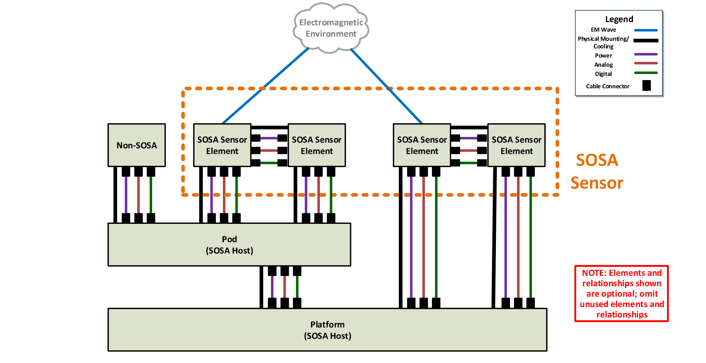

*Figure 4: SV-1 for Nominal Case ｜ 图 4：标称情形的 SV-1*

<!-- 原书 p.20 ｜ PDF p.40 -->

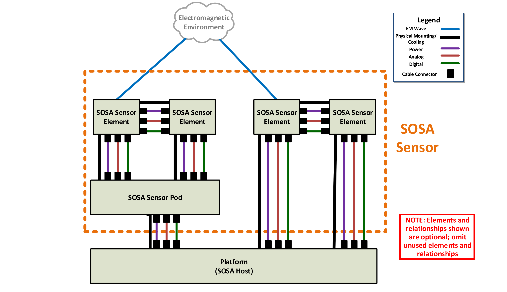

*Figure 5: SV-1 for Sensor Pod Special Case ｜ 图 5：传感器吊舱特例的 SV-1*

#### 3.5 SOSA Physical Context Entities 物理语境实体

##### 3.5.1 SOSA Sensor SOSA 传感器

The main subject of the SOSA standard is the SOSA sensor, which consists of a set of one or more SOSA sensor hardware elements (some of which host software components). Each SOSA sensor is either one of the five "sensor" types (Communications, EO/IR, EW, Radar, and SIGINT), or any combination of the five sensor types (e.g., they may be multi-INT). Any interface crossing the SOSA sensor's boundary is a SOSA external interface.

SOSA 标准的主要标的，是 SOSA 传感器；它由一组一个或多个 SOSA 传感器硬件元素构成（其中部分元素承载软件组件）。每个 SOSA 传感器或属五类“传感器”类型之一（通信、光电／红外、电子战、雷达与信号情报），或为这五类传感器类型的任意组合（例如它们可以是多情报的，即 multi-INT）。任何跨越 SOSA 传感器边界的接口，都是 SOSA 外部接口。

##### 3.5.2 SOSA Hardware Element 硬件元素

A SOSA sensor consists of a set of one of more SOSA hardware elements mounted within or on the same host platform. In the context of the SV-1, it is a physical component of a SOSA sensor which may contain software and firmware, and my support more than one sensor type (it has other "non-physical" interpretations in other Viewpoint Models). It consists of but is not limited to:

SOSA 传感器由一组一个或多个 SOSA 硬件元素构成，这些元素安装在同一个宿主平台之上或之内。在 SV-1 的语境下，它是 SOSA 传感器的一个物理组成部分，可含有软件与固件，并可支持多于一种传感器类型（在其他视角模型中，它还有别的“非物理”解释）。它由下列各项构成，但不限于：

> **译注**：上段英文原书作 “a set of one of more” 与 “my support”（分别疑为 “one or more” 与 “may support” 之误）；英文照录不改，中文按其显然意图译出，不替原文纠错。

Aperture (antenna, packaged antenna array, packaged imaging array, or imaging turret)

孔径（天线、封装天线阵、封装成像阵，或成像转塔）

Hardware enclosure (e.g., chassis)

硬件壳体（例如机箱）

A SOSA hardware element may optionally have inside it SOSA plug-in cards that plug into a backplane within it. Hardware elements may be distributed in different locations on/in the SOSA host platform.

SOSA 硬件元素可以在其内部可选地装有 SOSA 插卡，这些插卡插入其内的背板。硬件元素可以分布在本 SOSA 宿主平台之上／之内的不同位置。

<!-- 原书 p.21 ｜ PDF p.41 -->

##### 3.5.3 SOSA Host Platform 宿主平台

A SOSA host platform is the physical entity to which the SOSA sensor is mounted. Normally, it is one of: a vehicle or structure (such as an aircraft, surface craft, a building, or a pod), a combination of one or more pods, and/or a vehicle/structure. It nominally provides to the sensor: Power Cooling Platform navigation information (position, velocity, etc.) Reference signals (e.g., 1 PPS, 10MHz, etc.) Network connections Connections for any other needed analog or digital interfaces The SOSA host platform may contain external (to the SOSA sensor) processing capability that could use the data products of the SOSA sensor, and external communications. It will provide the SOSA sensor with its tasking. It is assumed that the host platform provides any User Interface (UI) that may be required; while the SOSA system may provide data and information to be used by a UI, the UI is outside the scope of the SOSA system.

SOSA 宿主平台是 SOSA 传感器所安装到的物理实体。通常，它是下列之一：车辆或构筑物（例如飞机、水面艇、建筑物或一个吊舱）、一个或多个吊舱的组合，和／或车辆／构筑物。它名义上向传感器提供：电源；散热；平台导航信息（位置、速度等）；参考信号（例如 1 PPS、10MHz 等）；网络连接；任何其他所需模拟或数字接口的连接。SOSA 宿主平台可含有（SOSA 传感器之外的）处理能力，该能力可使用 SOSA 传感器的数据产品，并可有外部通信。它将向 SOSA 传感器提供其任务指派。假定宿主平台提供任何可能需要的用户界面（UI）；SOSA 系统可提供供 UI 使用的数据与信息，但 UI 不在 SOSA 系统的范围之内。

> **译注**：上段英文在原书为若干项目符号，转换时并成一段；英文照录不改。

3.5.4 SOSA Sensor Pod A SOSA sensor pod is a pod that is delivered as an integral part of a SOSA sensor and has SOSA sensor elements from exactly one SOSA sensor mounted in/on it.

3.5.4 SOSA 传感器吊舱　SOSA 传感器吊舱是作为 SOSA 传感器不可分割的一部分交付的吊舱，安装在其内／其上的 SOSA 传感器元素恰好来自一个 SOSA 传感器。

> **译注**：上段英文在原书中为节题「3.5.4 SOSA Sensor Pod」与其下一段正文，转换时并成一行；英文照录不改，中文按同一结构并置（节题后以全角空格分隔）。

#### 3.6 Function to Module Aggregation Criteria 功能聚合为模块的判据

There are a great many functions that must be performed within a Communications, EO/IR, EW, Radar, and SIGINT system. These have been logically combined into what have become the SOSA modules, the aggregation process based on these seven criteria: 1 Severable (can be separated and used elsewhere; a SOSA module can be removed from one system and used in another without needing to be modified) – based on business needs, timing requirements, or other drivers 2 Has minimal complexity interfaces (minimum interdependencies) 3 Can operate as stand-alone or be operated via function/process/system manger; it can be operated independently of the rest of the SOSA sensor 4 Is independently testable 5 Does not expose IP 6 Facilitates competitive procurement 7 Encapsulates rapid change For each of the SOSA modules, the inputs required to support these functions have been determined (leading to the definition of each SOSA module's inputs), and the products of each of the functions have been defined (leading to the definition of each SOSA module's outputs). A

在通信、光电／红外、电子战、雷达与信号情报系统中，必须执行的功能非常之多。这些功能已被逻辑地合并，形成了后来的 SOSA 模块；合并依据下面七条判据：
1 可切分（可以分离出来、用于他处；一个 SOSA 模块可以从一个系统中移出，装到另一个系统中使用，而无需修改）——依据业务需要、时序需求或其他驱动因素；
2 接口复杂度最小（相互依赖最少）；
3 可以作为独立单元运行，也可经由功能／过程／系统管理器运行，即它可以独立于 SOSA 传感器的其余部分运行；
4 可独立测试；
5 不暴露 IP；
6 便于竞争性采购；
7 封装快速变化。对每个 SOSA 模块，支撑这些功能所需的输入已经确定（由此形成各 SOSA 模块输入的定义），各功能的产物也已经定义（由此形成各 SOSA 模块输出的定义）。

> **译注**：上段英文在原书为若干项目符号，转换时并成一段；英文照录不改。段末英文那个孤立的「A」是原书分页把下段首词（`A top-level enumeration…`）切在此处所致，英文照录；中文不跟着吊这个字母。

<!-- 原书 p.22 ｜ PDF p.42 -->

top-level enumeration of the SOSA modules is documented in the SOSA Service View 1 (SvcV-1: Services Context Description) – see Section 3.9, and the details of their interactions are documented in the Service View 4 (SvcV-4: Services Functionality Description) – see Section 4.1.1.

SOSA 模块的顶层枚举记载于 SOSA 服务视图 1（SvcV-1：服务上下文描述）——见第 3.9 节；其交互的细节记载于服务视图 4（SvcV-4：服务功能描述）——见第 4.1.1 节。

It should be noted that the SOSA Technical Standard specifies what the SOSA modules do, but not how they do it (IP and innovation are preserved).

值得注意的是，SOSA 技术标准规定的是 SOSA 模块做什么，而不规定它如何做（IP 与创新由此得以保留）。

#### 3.7 Security Concepts and Approach 安全概念与做法

The security aspects of the SOSA Technical Architecture are an active area of development. The intent is to review the security aspects of the architecture as a whole, rather than segregated into various security disciplines (e.g., anti-tamper, cybersecurity, supply chain risk mitigations, software assurance, etc.). The guiding principles for security are consistent with the SOSA Architecture Principles – that the standard leverages/incorporates existing industry and government standards and that the architecture enables resilience and cybersecurity.

SOSA 技术架构的安全方面是一个仍在积极发展的领域。其意图是把架构的安全方面作为整体来审视，而不是分割到各个安全专业（如防篡改、网络安全、供应链风险缓解、软件保障等）分别处理。安全的指导原则与 SOSA 架构原则一致——即标准利用／纳入现有的行业与政府标准，且架构使韧性与网络安全成为可能。

The approach to security began with a review of existing DoD and commercial security standards, such as the Anti-Tamper (AT) Technical Implementation Guide (TIG), the DoD Risk Management Framework (RMF), security-related Open Mission System (OMS) ICDs, the Cyber Survivability Endorsement Implementation Guide, and The Open Group Open Trusted Technology Provider™ Standard (O-TTPS), which is technically equivalent to ISO/IEC 20243-1:2018. The approach is also informed by industry best practices, collecting inputs from the various members of the SOSA Consortium. These standards and best practices are being reviewed for their applicability to a SOSA system and the interfaces between SOSA modules, software components, and/or hardware elements, as appropriate. As the SOSA Technical Architecture is refined, the architecture will be reviewed based on these and other standards to ensure that security is built in and to maintain alignment with security requirements from various other open architecture standards.

安全的做法始于对现有国防部与商业安全标准的审视，例如反篡改（AT）技术实施指南（TIG）、国防部风险管理框架（RMF）、与安全相关的开放任务系统（OMS）接口控制文件（ICD）、《网络生存性背书实施指南》，以及 The Open Group 开放可信技术提供方™ 标准（O-TTPS）——后者在技术上等同 ISO/IEC 20243-1:2018。该做法也参照行业最佳实践，从 SOSA 联盟各成员处收集输入。这些标准与最佳实践正被逐项审视，以判断它们对 SOSA 系统、以及（按需要）对 SOSA 模块、软件组件和／或硬件元素之间接口的适用性。随着 SOSA 技术架构不断细化，架构将依据这些标准及其他标准加以审视，以确保安全内建，并与各类其他开放架构标准的安全需求保持对齐。

The security aspects of the SOSA Technical Architecture are implemented in the functions (and behaviors) of the SOSA modules and their interfaces. Security best practices for how SOSA products are developed are intentionally not included in this standard. The primary functions and behaviors are implemented in SOSA modules 1.1 (System Manager), 6.1 (Security Services), 6.2 (Encryptor/Decryptor), and 6.3 (Guard/Cross-Domain Service). All SOSA modules are shown in Figure 6 and defined in Table 2 in Section 3.9. The system manager will manage the start-up of the system (including the secure loading of software), maintain a secure configuration, manage keys used in the system, and authorize/authenticate requests to publish/subscribe messages or access privileged resources. Security services will implement the security functions needed by the system manager, including verification of software integrity, key management, access control, audit, and other security controls. The encryptor/decryptor provides cryptographic services to the system manager and other applications to ensure that data-at-rest and data-intransit are protected to the level required by the classification of the data. The guard/crossdomain service provides applications the ability to send/receive data across security domains.

SOSA 技术架构的安全方面实现在各 SOSA 模块及其接口的功能（与行为）之中。关于 SOSA 产品如何开发的安全最佳实践，有意不纳入本标准的范围。主要功能与行为实现在 SOSA 模块 1.1（系统管理器）、6.1（安全服务）、6.2（加解密器）与 6.3（护卫／跨域服务）中。全部 SOSA 模块见图 6，其定义见表 2（在第 3.9 节）。系统管理器将管理系统启动（包括软件的安全加载）、维护安全的配置、管理系统中使用的密钥，并对发布／订阅消息或访问特权资源的请求进行授权／鉴别。安全服务将实现系统管理器所需的安全功能，包括软件完整性验证、密钥管理、访问控制、审计及其他安全控制。加解密器向系统管理器及其他应用提供密码服务，以确保静态数据与传输中数据按数据密级所要求的程度受到保护。护卫／跨域服务使应用具备跨安全域收发数据的能力。

##### 3.7.1 SOSA Hardware Security Framework SOSA 硬件安全框架

The SOSA hardware security is a framework for security services. This is specifically motivated by the desire to avoid monolithic static security solutions, which are costly to adapt to new security requirements or threat environments.

SOSA 硬件安全是面向安全服务的一个框架。其具体动因是希望避免单体式、静态的安全解决方案——这类方案要适应新的安全需求或威胁环境，代价高昂。

<!-- 原书 p.23 ｜ PDF p.43 -->

The SOSA Hardware Security Framework will support the following capabilities:

SOSA 硬件安全框架将支持以下能力：

Usage of standard security components, where possible Scalable configuration and deployment of security functionality Adaptable to different on-board sensor combinations Updateable security components Extensible for integrating new security requirements Easy usage and integration for application developers Adjustable security-level applying different levels of software and hardware security measures

在可能之处使用标准安全组件；安全功能的可扩展配置与部署；可适应不同的在板传感器组合；安全组件可更新；可扩展以集成新的安全需求；对应用开发者而言易于使用与集成；安全等级可调整——施加不同层级的软件与硬件安全措施

> **译注**：上段英文在原书为若干项目符号，转换时并成一段；英文照录不改。

#### 3.8 Hardware Concepts and Approach 硬件概念与做法

Planned for a later version of the SOSA Technical Standard.

计划在 SOSA 技术标准的后续版本中给出。

#### 3.9 SvcV-1: Services Context Description SvcV-1 服务上下文描述

The Service View 1 (SvcV-1) documents the SOSA modules and their top-level relationship to one another. The SOSA Technical Standard will define (in later versions) a core set of required modules and functionality; not all modules need to be instantiated in a design to be conformant. Future versions of the standard will define the core functionality for each type of sensor. In the case of multiple integrated sensors, the sensor integrator would need to determine how to instantiate the modules necessary to incorporate the SOSA core functionality. The details of their relationships are documented in the SvcV-4: Services Functionality Description (see Section 4.1.1).

服务视图 1（SvcV-1）记载各 SOSA 模块及其相互之间的顶层关系。SOSA 技术标准将（在后续版本中）定义一组必需的核心模块与功能；并非所有模块都必须在某个设计中实例化才算符合。标准的后续版本将定义每一类传感器的核心功能。对于多个集成传感器的情况，传感器集成方需要确定如何实例化纳入 SOSA 核心功能所必需的模块。这些关系的细节记载于 SvcV-4：服务功能描述（见第 4.1.1 节）。

Figure 6 identifies the SOSA modules and their relationship (enumerated in the dotted decimal numerical identifications, by color-code, and grouping/proximity). It also shows some of the resulting interfaces that are being determined for the SOSA Technical Architecture. It should be noted that this figure does not represent “the SOSA Architecture”. This artifact is one among the many that, taken together, constitute the SOSA Technical Architecture. The current conception is that there would be no more than one instantiation of each SOSA module (with the exception of the 2.x modules) for each SOSA sensor.

图 6 标识各 SOSA 模块及其相互关系（以点分十进制数字标识、按颜色编码、按分组／邻近关系逐一枚举）。图中还给出了一些据此正在为 SOSA 技术架构确定的接口。值得注意的是，本图并不代表「SOSA 架构」。本制品只是共同构成 SOSA 技术架构的众多制品之一。目前的构想是：对每个 SOSA 传感器而言，每个 SOSA 模块的实例不超过一个（2.x 类模块除外）。

Descriptions (explaining the encapsulated functionality and behaviors) of each of the SOSA modules is documented in Table 2. This table details descriptions of SOSA modules. All SOSA sensor functionality must be contained within the encapsulating SOSA module. In practice, a SOSA sensor may implement a subset of these modules.

各 SOSA 模块的描述（说明其所封装的功能与行为）记载于表 2。本表详列各 SOSA 模块的描述。SOSA 传感器的全部功能都必须包容在其所属的封装 SOSA 模块之内。实践中，一个 SOSA 传感器可只实现这些模块的一个子集。

<!-- 原书 p.24 ｜ PDF p.44 -->

1.1: System Manager 1.1: Task Manager

1.1：系统管理器 1.1：任务管理器

> **译注**：上文「1.1: System Manager 1.1: Task Manager」系图 6 图内文字在转写时被提为正文，原样照录并照字面译；据表 2，任务管理器的编号为 1.2。

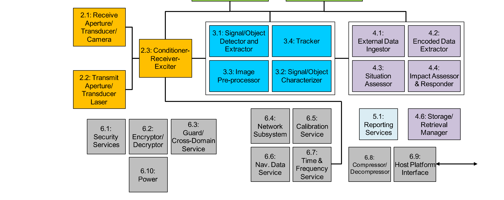

*Figure 6: SvcV-1: Top-Level SOSA Services Context Description ｜ 图 6：SvcV-1 顶层 SOSA 服务上下文描述*

**Table 2: SvcV-1: Module Descriptions ｜ 表 2：SvcV-1 模块描述**

| Module Name ／ 模块名 | Description ／ 描述 |
|---|---|
| SOSA Sensor Management 传感器管理 | |
| 1.1 System Manager ／ 1.1 系统管理器 | The system manager provides the ability to discover, configure, control, manage health (status and faults), and configure the security aspects of the SOSA sensor as a whole, its infrastructure, its modules, and its interface to the sensor host. The system manager does not manage or control the mission, tasking, or operational aspects of the SOSA sensor, but instead manages the SOSA sensor itself. System manager functions include Discovery (identifying and obtaining information required to communicate with the sensor and its modules), Configuration (obtaining a detailed description of the sensor and its modules and reading and setting configuration parameters and software packages), Control (monitoring and setting control parameters for the sensor and its modules, such as mode and state, and performing control actions such as reset or BIT), and Health Management (publishing periodic health reports, notifying occurrence of configuration, control, and health events, and logging health reports and events). 系统管理器提供发现、配置、控制、健康管理（状况与故障）以及配置 SOSA 传感器整体安全方面的能力，其范围涵盖传感器整体、其基础设施、其各模块，以及其与传感器宿主的接口。系统管理器不管理也不控制 SOSA 传感器的任务、任务指派或运行方面，而是管理 SOSA 传感器本身。系统管理器的功能包括：发现（识别并获取与传感器及其各模块通信所需的信息）、配置（获取传感器及其各模块的详细描述，并读取与设置配置参数和软件包）、控制（监视并设置传感器及其各模块的控制参数，如模式与状态，并执行复位或 BIT 等控制动作）以及健康管理（发布周期性健康报告，通知配置、控制与健康事件的发生，并记录健康报告与事件）。 |
| 1.2 Task Manager ／ 1.2 任务管理器 | The task manager is responsible for coordinating all mission operations. External sensor tasking is accepted in the form of a request that contains information detailing when and where to collect data, the type of processing to be performed, and the required output products to be generated. Information in the request is used by the task manager to optimize, manage, and prioritize resources to support various competing tasks in a SOSA sensor. Any externally invoked changes to tasking are handled by the task manager, which in turn propagates the mission changes into relevant mode and state changes for the other SOSA modules. Lastly, the task manager is responsible for invoking routine calibration as needed to support the mission tasking. 任务管理器负责协调全部任务运行。外部传感器任务指派以请求的形式被接受，该请求所含信息详述何时、何地采集数据，要执行哪一类处理，以及需要生成哪些输出产品。任务管理器利用请求中的信息来优化、管理并排序资源，以支撑一个 SOSA 传感器内各项相互竞争的任务。任何由外部发起的任务指派变更均由任务管理器处理，并由其进而把这些任务变更传播为其他 SOSA 模块相应的模式与状态变更。最后，任务管理器负责按需发起例行校准，以支撑任务指派。 |
| **Transmission/Reception** **发射／接收** | |
| 2.1 Receive Aperture/Transducer/Camera ／ 2.1 接收孔径／换能器／相机 | The Receive Aperture/Transducer/Camera module is responsible for converting Electromagnetic (EM) energy into an electrical signal. The signal may be pre-amplified, stabilized, and calibrated. This module may include mechanical and electronic steering, beam forming, focus control, filtering, low-noise amplification, and analog-to-digital conversion. The output may be an analog signal or a digital stream. It may also output metadata. 接收孔径／换能器／相机模块负责把电磁（EM）能量转换为电信号。该信号可经前置放大、稳定与校准。本模块可包含机械与电子指向控制、波束形成、聚焦控制、滤波、低噪声放大以及模数转换。输出可为模拟信号或数字流。它还可输出元数据。 |
| 2.2 Transmit Aperture/Transducer/Laser ／ 2.2 发射孔径／换能器／激光器 | The Transmit Aperture/Transducer/Laser module is responsible for converting an electrical signal into EM energy. The input may be an analog signal or a digital stream (with metadata) This module may include mechanical and electronic steering, beam forming, focus control, filtering, amplification, and digital-to-analog conversion. 发射孔径／换能器／激光器模块负责把电信号转换为电磁能量。输入可为模拟信号或数字流（带元数据）本模块可包含机械与电子指向控制、波束形成、聚焦控制、滤波、放大以及数模转换。 |
| 2.3 Conditioner-Receiver-Exciter ／ 2.3 调理器-接收机-激励器 | The Conditioner-Receiver-Exciter module may perform receive functions, transmit functions, or both. The receive side may include low-noise amplification (with gain control), amplitude limiting, band-pass filtering, frequency translation, application of calibration corrections, channelization, image formation, tagging with metadata, Radio Frequency (RF) signal distribution, data framing, and data cube formation (for hyperspectral). The transmit side may include amplification (with gain control), amplitude limiting, frequency translation, waveform conversion (analog to digital, digital to analog), waveform generation, RF signal distribution, calibration, and adaptation to spectrum use. 调理器-接收机-激励器模块可执行接收功能、发射功能，或两者兼有。接收侧可包括低噪声放大（含增益控制）、限幅、带通滤波、频率变换、施加校准修正、信道化、成像、附上元数据标记、射频（RF）信号分配、数据成帧以及数据立方构建（用于高光谱）。发射侧可包括放大（含增益控制）、限幅、频率变换、波形转换（模拟到数字、数字到模拟）、波形生成、射频信号分配、校准以及频谱使用的适配。 |
| **Process Signals/Targets** **信号／目标处理** | |
| 3.1 Signal/Object Detector and Extractor ／ 3.1 信号／目标检测与提取器 | The Signal/Target Detector and Extractor module is responsible for detecting electromagnetic signals or physical objects among the noise and other signals and objects in the environment (e.g., clutter or interference). This module extracts a detected signal, detected object, or image chip for downstream processing. Techniques to perform this may include clutter suppression and extraction of scintillation/decorrelation information, interference suppression, the use of constant false alarm rate techniques, coherent and non-coherent integration, Space-Time Adaptive Processing (STAP), image enhancement (including edge detection and sharpening), and employment of gating logic to manage and balance search volume returns with existing object tracks. 信号／目标检测与提取器模块负责在环境中的噪声及其他信号与物体（如杂波或干扰）之间检测电磁信号或物理对象。本模块把检出的信号、检出的对象或图像切片（image chip）提取出来，供下游处理。可采用的技术包括杂波抑制与闪烁／去相关信息的提取、干扰抑制、恒虚警率技术的运用、相干与非相干积累、空时自适应处理（STAP）、图像增强（含边缘检测与锐化），以及运用门控逻辑来管理并平衡搜索域回报与既有目标航迹。 |
| 3.2 Signal/Object Characterizer ／ 3.2 信号／目标特征化器 | The Signal/Object Characterizer module is designed to make measurements on images, signals, and physical objects to determine attributes, properties, categories, classes, types, or identification – all with confidence estimates. 信号／目标特征化器模块用于对图像、信号与物理对象进行测量，以判定属性、性质、类别、类属、类型或识别结果——且均附带置信度估计。 |
| 3.3 Image Pre-processor ／ 3.3 图像预处理器 | The Image Pre-processor module prepares the image for final use and processing. For Synthetic Aperture Radar (SAR), this module forms images from sensed RF data. This module also registers images to geographical coordinates and/or other images. 图像预处理器模块为图像的最终使用与处理做准备。对合成孔径雷达（SAR）而言，本模块由感知到的射频数据成像。本模块还把图像配准到地理坐标和／或其他图像。 |
| 3.4 Tracker ／ 3.4 跟踪器 | The tracker module correlates detections and tracks over time, forming new or updated tracks. It is responsible for all track management functions and producing track reports. The core functionality of the tracker is data association, track initiation, track drop, track update, state and covariance estimation, and split track handling. Estimation of relative position or location (geolocation), when feasible, is also included in this function. 跟踪器模块在时间上把各项检测与航迹关联起来，形成新的或更新的航迹。它负责全部航迹管理功能并产生航迹报告。跟踪器的核心功能是数据关联、航迹起始、航迹撤销、航迹更新、状态与协方差估计以及分裂航迹处理。在可行时，相对位置或位置（地理定位）的估计也属于本功能。 |
| **Analyze/Exploit** **分析／情报利用** | |
| 4.1 External Data Ingestor ／ 4.1 外部数据摄取器 | The External Data Ingestor module is responsible for ingesting data from other SOSA sensors, as well as sensors that don't conform to the SOSA Technical Standard (converting from non-conformant format to conformant format as needed), and distributes ingested data to other SOSA modules. 外部数据摄取器模块负责摄取来自其他 SOSA 传感器以及不符合 SOSA 技术标准的传感器的数据（按需要把不符合格式转换为符合格式），并把摄取到的数据分发给其他 SOSA 模块。 |
| 4.2 Encoded Data Extractor ／ 4.2 编码数据提取器 | The Encoded Data Extractor module is applicable to Communications, EW, and SIGINT. It is responsible for demodulating and extracting message content (Communications and EW), extracting internals (EW and SIGINT), and human language processing (SIGINT). 编码数据提取器模块适用于通信、电子战与信号情报。它负责解调并提取消息内容（通信与电子战）、提取内部结构（电子战与信号情报），以及人类语言处理（信号情报）。 |
| 4.3 Situation Assessor ／ 4.3 态势评估器 | The Situation Assessor module determines current relationships among objects and events in the context of their environment. The distribution of individual signals and objects is examined to aggregate them into operationally meaningful groups. In addition, this module focuses on relational information (e.g., physical proximity, communications, causal, temporal, and other relations) to determine the meanings of groups of entities. This analysis is performed in the context of environmental information about terrain, surrounding media, hydrology, weather, and other factors. 态势评估器模块在其环境背景下判定各对象与事件之间当前的关系。它考察各个信号与对象的分布，把它们聚合成在作战上有意义的组。此外，本模块着重关系性信息（如物理邻近关系、通信关系、因果关系、时间关系及其他关系），以判定各组实体的含义。该分析在地形、周边介质、水文、气象及其他因素等环境信息的背景下进行。 |
| 4.4 Impact Assessor and Responder ／ 4.4 影响评估与响应器 | The Impact Assessor and Responder module interprets the current situation in order to draw inferences about enemy threats, friendly and enemy vulnerabilities, and it may project those into the future. Impact assessment may involve estimating possible outcomes, and assessing an enemy's intent based on knowledge about enemy doctrine, level of training, political environment, and the current situation. This module may develop alternate hypotheses about an enemy's strategies, given the effect of uncertain knowledge about enemy units, tactics, and the environment. This module may also initiate a response to a threat; for example, by notification to an internal capability (e.g., electronic attack) or an external system to take action (e.g., countermeasures or evasive maneuvering). 影响评估与响应器模块解读当前态势，以推断敌方威胁、我方与敌方的薄弱之处，并可将这些推断外推到未来。影响评估可涉及估计可能的结果，并基于对敌方条令、训练水平、政治环境以及当前态势的了解来评估敌方意图。考虑到对敌方单位、战术与环境的认知存在不确定性所产生的影响，本模块可提出关于敌方策略的多种替代假设。本模块还可发起对威胁的响应；例如通知某项内部能力（如电子攻击）或外部系统采取行动（如对抗措施或规避机动）。 |
| 4.6 Storage/Retrieval Manager ／ 4.6 存储／检索管理器 | The Storage/Retrieval Manager module provides the capability of storing a variety of data types in a persistent medium, and allows it to be retrieved in bulk by authorized client entities. The Storage/Retrieval Manager can be used for short-term (in-mission) data as well as long-term (or archival) purposes. Data that can be stored includes: health reports, heartbeats, notifications (health, configuration, and control notifications), streaming data, and metadata). 存储／检索管理器模块提供在持久介质中存储多种数据类型的能力，并允许经授权的客户实体批量检索这些数据。存储／检索管理器既可用于短期（任务内）数据，也可用于长期（或归档）用途。可存储的数据包括：健康报告、心跳、通知（健康、配置与控制通知）、流数据，以及元数据）。 |
| **Convey** **传递** | |
| 5.1 Reporting Services ／ 5.1 报告服务 | The Reporting Services module generates and disseminates reports. Specifically, the Reporting Services module is responsible for formatting, processing (as required by sensor type), packaging data for reporting, structuring data to match a particular selected format, and dissemination of data to intended recipients. Such data can include RF signal, image/video streams, demodulated signal, metadata for streams, detections, characterized targets, associated and non-associated targets/threats, assessed behaviors, alerts, sensor cues/tips, complex data (data between raw and fully processed), logging or test information, and responsible reporting commands. The module is responsible for accepting/rejecting requests for existing data in storage, retrieving requested data, aggregating data, and selecting data to be reported. The module also selects header/packet structure for streaming data. The Reporting Services module must be capable of storing report templates germane to the sensor type; and accept updates to those templates (e.g., metadata updates to format types). 报告服务模块生成并分发报告。具体而言，报告服务模块负责格式化、处理（按传感器类型的需求）、为报告打包数据、把数据结构化为某个选定的格式，以及把数据分发到预定接收方。此类数据可包括射频信号、图像／视频流、解调后的信号、流的元数据、检测结果、已特征化的目标、已关联与未关联的目标／威胁、评估出的行为、告警、传感器引导／提示、复合数据（介于原始与完全处理之间的数据）、日志或测试信息，以及相应负责的报告命令。本模块负责接受／拒绝针对存储中既有数据的请求、检索所请求的数据、聚合数据，并选择要上报的数据。本模块还为流数据选择报头／分组结构。报告服务模块必须能够存储与传感器类型相关的报告模板，并接受对这些模板的更新（如对格式类型的元数据更新）。 |
| **Support System Operation** **支持系统运行** | |
| 6.1 Security Services ／ 6.1 安全服务 | The Security Services module is responsible for controlling all sensor protection functionality. This includes software/data integrity checks, control access, zeroizing sensitive data, managing keys, auditing, root of security, environmental checks, and response actions. 安全服务模块负责控制全部传感器防护功能。这包括软件／数据完整性检查、访问控制、敏感数据清零、密钥管理、审计、安全根、环境检查以及响应动作。 |
| 6.2 Encryptor/Decryptor ／ 6.2 加解密器 | The Encryptor/Decryptor module is responsible for all cryptographic services such as encryption, and decryption with authentication. In addition it communicates with the Security Service for key interchange and to report status (successful/failed result). 加解密器模块负责全部密码服务，如加密，以及带认证的解密。此外，它与安全服务通信以交换密钥并报告状况（成功／失败结果）。 |
| 6.3 Guard/Cross-Domain Service ／ 6.3 护卫／跨域服务 | The Guard/Cross-Domain Service module is responsible for transferring data between separate security enclaves of the same or differing security levels, and preventing data leakage between enclaves. 护卫／跨域服务模块负责在同一密级或不同密级的各独立安全飞地之间传递数据，并防止飞地之间的数据泄漏。 |
| 6.4 Network Subsystem ／ 6.4 网络子系统 | The Network Subsystem module is the infrastructure responsible for enumerating network elements, monitoring the health of network elements, detecting and isolating degraded network elements, transferring data with the requested QoS, and detecting intrusion. It is common across all sensor types. Data users may request data from data sources that have requirements for update rate, latency, and priority, and the Network Subsystem ensures that these requests are met and can report when they are not met. The Network Subsystem can be configured to alert on thresholds such as network bandwidth exceeded. Networked elements that interfere with network performance or cause degradation are isolated in a way to minimize effects on the rest of the network. The Networking Subsystem provides the services to request network status such as throughput, up/down status, and configuration at any time, and will collect metrics to support this reporting. Intrusion detection can be configured by a network manager to alert on security breaches and to isolate the breached network channel. 网络子系统模块是负责下列事项的基础设施：枚举网络元素、监视网络元素的健康、检测并隔离已劣化的网络元素、按所请求的服务质量传输数据，以及检测入侵。它在所有传感器类型中通用。数据用户可以向对更新率、时延与优先级有需求的数据源请求数据，网络子系统确保这些请求得到满足，并能在未满足时报告。网络子系统可配置为在网络带宽超限等阈值上告警。干扰网络性能或造成劣化的联网元素，会被以尽量减小对其余网络影响的方式隔离。联网子系统提供随时请求网络状况（如吞吐量、通断状况与配置）的服务，并将收集度量数据以支撑此类报告。入侵检测可由网络管理员配置，以在发生安全破入时告警，并隔离被破入的网络通道。 |
| 6.5 Calibration Service ／ 6.5 校准服务 | The Calibration Service module is responsible for ingesting and injecting the test signal and disabling SOSA modules not under test. 校准服务模块负责摄取并注入测试信号，以及停用不在受测范围内的 SOSA 模块。 |
| 6.6 Nav Data Service ／ 6.6 导航数据服务 | The Nav Data Service module translates platform 3D position, 3D velocity, time, and 3D platform orientation into a generic format compliant with SOSA interface standards. It is common across all sensor types. The service distributes this nav data to subscribers. It will report accuracy, integrity, and source information so that subscribers to this data may decide if the data is suitable for use. The service will select, smooth, blend, or exclude data as necessary to create the best solution. The service accepts requests for data configuration such as specific data elements, update rates, and formats. Subscribers may perform individual one-time requests for nav data, or may request a repetitive update at a selected interval. 导航数据服务模块把平台的 3D 位置、3D 速度、时间与 3D 平台姿态转换为符合 SOSA 接口标准的通用格式。它在所有传感器类型中通用。该服务把这些导航数据分发给订阅方。它将报告精度、完整性与来源信息，使该数据的订阅方可以判断数据是否适合使用。该服务将按需要进行选择、平滑、融合或剔除数据，以得出最佳解算。该服务接受对数据配置的请求，如特定数据元素、更新率与格式。订阅方可对导航数据发起单次请求，也可请求按选定间隔重复更新。 |
| 6.7 Time & Frequency Service ／ 6.7 时间与频率服务 | The Time & Frequency Service module is responsible for providing time information and providing Local Oscillators (LO)/frequency references. The time information is a high precision time signal that is a higher precision than that typically provided by GPS although it may be synchronized with GPS. Discrete time output signals are provided and may be used by any other module without a request. Time information quality status is provided by a communications channel. The LO/frequency references provide highly accurate and stable output signals suitable for GHz range RF systems to any other module without a request. Signal quality status is provided by a message via the Network Subsystem module. Other modules may send a request to the Time & Frequency Service module to be notified if time or frequency signal quality thresholds are not met. A time and frequency management capability allows the time and frequency output signals to be enabled or disabled. 时间与频率服务模块负责提供时间信息并提供本振（LO）／频率参考。该时间信息是一种高精度时间信号，其精度高于通常由 GPS 提供的精度，尽管它可与 GPS 保持同步。它以离散时间输出信号的形式提供，任何其他模块皆可使用而无需请求。时间信息质量状况经由一条通信信道提供。本振／频率参考向任何其他模块提供高度准确且稳定的输出信号（适用于 GHz 频段射频系统），无需请求。信号质量状况经由网络子系统模块以消息提供。其他模块可向时间与频率服务模块发送请求，需求在不满足时间或频率信号质量阈值时得到通知。时间与频率管理能力可使时间与频率输出信号得以启用或停用。 |
| 6.8 Compressor/Decompressor ／ 6.8 压缩／解压器 | The Compressor/Decompressor module is responsible for compression/decompression and executing codec functions. 压缩／解压器模块负责压缩／解压并执行编解码器功能。 |
| 6.9 Host Platform Interface ／ 6.9 宿主平台接口 | The host platform interface module is responsible for all communication with the host platform. Its primary function is data translation to/from formats and messages required by the host platform. 宿主平台接口模块负责与宿主平台之间的全部通信。其主要功能是就宿主平台所要求的格式与消息进行双向数据转换。 |
| 6.10 Power ／ 6.10 电源 | The Power module is responsible for power conversion, conditioning, storage, protection, distribution, and management. It applies to all sensor types. The Power module receives host platform power (via the host platform interface module) and converts it to the conditioned power needed by SOSA modules. It also includes the routing and distribution of power to SOSA modules that use it which may include switches, relays, transformers, etc. The Power module may provide status such as to indicate whether power is within specification and an alert to impending power loss. It also may provide a management interface that allows configuration, control, and status. 电源模块负责电源的转换、调理、储能、保护、分配与管理。它适用于所有传感器类型。电源模块接收宿主平台电源（经由宿主平台接口模块），并把它转换为各 SOSA 模块所需的调理后电源。它还包括向使用电源的各 SOSA 模块布线并配电，其中可含开关、继电器、变压器等。电源模块可提供状况信息，如指示电源是否在规格范围内，以及对即将失电发出告警。它还可提供管理接口，以支持配置、控制与状况查询。 |

> 转写说明：本表在原书中跨 5 页——原书 p.25（PDF p.45）：表头行、分组行 SOSA Sensor Management、1.1~1.2；p.26（PDF p.46）：分组行 Transmission/Reception、2.1~2.3，分组行 Process Signals/Targets、3.1~3.3；p.27（PDF p.47）：3.4，分组行 Analyze/Exploit、4.1~4.4、4.6；p.28（PDF p.48）：分组行 Convey、5.1，分组行 Support System Operation、6.1~6.5；p.29（PDF p.49）：6.6~6.10，表止于此，其下即 §3.10 正文（PDF p.50 为 §3.10.1 正文，无本表内容）。

> 转写说明：6 个分组标题行（**SOSA Sensor Management**、**Transmission/Reception**、**Process Signals/Targets**、**Analyze/Exploit**、**Convey**、**Support System Operation**）在原书中横跨整行、无右侧单元格内容，此处照录为一行、右格留空。英文侧首行 SOSA Sensor Management 未加粗，本对照册亦照原样未加粗。

> 转写说明：各续页未重复表头行，故全部并入首行表头，未另起表。原书单元格内因排版折行的句子已用一个空格连成一句。

> 转写说明：原书模块编号自 4.4 直接跳至 4.6（无 4.5），照录为 4.6。

> 转写说明：4.3 Situation Assessor 与 6.2 Encryptor/Decryptor 两个单元格在 PDF 分页处被截断，其跨页续行（4.3 的 “information about terrain, surrounding media, hydrology, weather, and other factors.”；6.2 的 “services such as encryption, and decryption with authentication. In addition it communicates with the Security Service for key interchange and to report status (successful/failed result).”）已并回同一单元格。

<!-- 原书 p.25 ｜ PDF p.45 -->

<!-- 原书 p.26 ｜ PDF p.46 -->

<!-- 原书 p.27 ｜ PDF p.47 -->

Support System Operation

支持系统运行

> **译注**：上文「Support System Operation」系表 2 分组行在英文侧转换时落于表外的重复残块，原样照录并照字面译。

<!-- 原书 p.28 ｜ PDF p.48 -->

#### 3.10 SOSA Inter-Module Interactions SOSA 模块间交互

The SOSA Architecture is based on a set of loosely-coupled modular entities (known as SOSA modules) that interact with the underlying operating environment and with each other via welldefined logical interfaces. The operating environment will provide the mechanisms through which interoperation will occur and will provide the modules’ interfaces to these mechanisms (I/O, processing, storage, communication, etc.). Interoperability between SOSA modules is described in terms of interactions.

SOSA 架构建立在一组松耦合的模块化实体（称为 SOSA 模块）之上，这些实体经由定义良好的逻辑接口，与底层运行环境交互，并彼此交互。运行环境将提供互操作得以发生的机制，并提供各模块通向这些机制的接口（I/O、处理、存储、通信等）。SOSA 模块之间的互操作性，以交互的方式加以描述。

<!-- 原书 p.29 ｜ PDF p.49 -->

Interactions include exchanges of data, control actions, and various types of management functions. Most of the interactions considered will be implemented as message exchanges on a network.

交互包括数据交换、控制动作以及各类管理功能。所考虑的多数交互，都将以网络上的消息交换形式实现。

##### 3.10.1 SOSA Sensor Interconnections SOSA 传感器互连

Figure 7 illustrates the SOSA Technical Architecture interconnections that support the interactions. SOSA modules interoperate through an Ethernet-based network message transport (SOSA Message Interconnect), as well as a high-performance bus (SOSA Wideband Low Latency Interconnect). SOSA modules will interact through well-defined non-proprietary interfaces that may be implemented within a processor, across distributed processors on a network, or across a chassis backplane. The system designer will choose the appropriate combinations of the interconnects shown in Figure 7 to meet the performance requirements of the system. The SOSA modules will send and receive network messages that do not require determinism, high bandwidth, or very low latency, on the SOSA Message Interconnect. The SOSA modules will receive and send large volume or low-latency data, such as digital RF signal (sample streams, etc.) from and to underlying RF electronics on the SOSA Wideband Low Latency Interconnect.

图 7 示出支撑这些交互的 SOSA 技术架构互连。SOSA 模块经由一套基于以太网的网络消息传输（SOSA 消息互连），以及一条高性能总线（SOSA 宽带低延迟互连）实现互操作。SOSA 模块将通过定义良好的非专有接口进行交互；这些接口可在单个处理器之内实现，也可跨网络中分布式部署的多个处理器实现，或跨机箱背板实现。系统设计者将选用图 7 所示各互连的适当组合，以满足系统的性能需求。对于不要求确定性、高带宽或极低延迟的网络消息，SOSA 模块将在 SOSA 消息互连上收发。对于大容量或低延迟的数据——例如数字射频信号（采样流等）——SOSA 模块将在 SOSA 宽带低延迟互连上，与底层射频电子设备之间收发。

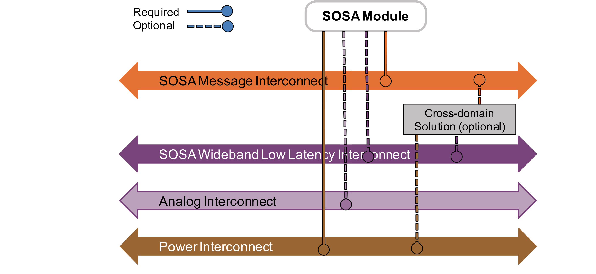

*Figure 7: SOSA Sensor Interconnections ｜ 图 7：SOSA 传感器互连*

##### 3.10.2 SOSA Module Interaction Types SOSA 模块交互类型

Interactions are related to an action or operation to be accomplished. Interactions have parameters, which are instances of DIV-2 data entities. Parameters are the inputs and outputs of the operation being accomplished by the interaction. In the SOSA Technical Architecture, most interactions will be network-based, so interactions are implemented by one or more messages, in which parameters are encoded. The messages are exchanged between two or more entities in a pattern, forming a messaging protocol. An interaction occurs between two or more modular entities, each playing a role in the interaction. The types of roles vary based upon the interaction type, but generally one SOSA module plays the role of the provider, or service, and one or more others play the role of user, or client.

交互与待完成的一项动作或操作相关。交互带有参数，参数是 DIV-2 数据实体的实例。参数是交互所完成操作的输入与输出。在 SOSA 技术架构中，多数交互都将基于网络，故交互由一个或多个消息实现，参数即编码于这些消息之中。消息按某一模式在两个或多个实体之间交换，从而构成一种消息协议。交互发生在两个或多个模块化实体之间，每一实体在交互中承担一个角色。角色的类型随交互类型而异，但一般而言，一个 SOSA 模块承担提供方（或服务）的角色，其余一个或多个承担用户（或客户端）的角色。

<!-- 原书 p.30 ｜ PDF p.50 -->

**Table 3: Interaction Types ｜ 表 3：交互类型**

| Interaction Type ／ 交互类型 | Description ／ 描述 | Transport ／ 传输 |
|---|---|---|
| Analog Distribution ／ 模拟分发 | Distribute analog signals point-to-point or point-to-multi-point (fan out), usually carried on copper coaxial, but sometimes on other media such as optical fiber. 在点到点或点到多点（扇出）之间分发模拟信号，通常承载于铜同轴，有时也承载于其他介质，如光纤。 | Analog Medium (e.g., coax, twisted pair, fiber) ／ 模拟介质（如：同轴、双绞线、光纤） |
| Digital Signal Stream ／ 数字信号流 | Send digital signal (I/Q samples) or data product (e.g., signal environment snapshot) streams. It is implicit that these tend to be either high-volume or require low-latency. Configurable QoS (e.g., dependability, data delivery confirmation, retry) options allow implementation to meet design specific needs. 发送数字信号（I/Q 采样）流或数据产品（如：信号环境快照）流。其隐含之意是：这类流通常要么大容量，要么需求低延迟。可配置的服务质量（QoS）选项（如：可靠性、数据送达确认、重试）使实现得以满足特定设计的需要。 | Low-latency transport ／ 低延迟传输 |
| Digital Signal Context ／ 数字信号上下文 | Metadata related to a digital signal stream. 与数字信号流相关的元数据。 | Low-latency transport ／ 低延迟传输 |
| Signal Layer Control ／ 信号层控制 | Dynamic control of signal layer electronics. These require low latency, as they occur during execution of a task, and may be within the application control loop. 对信号层电子设备的动态控制。这类控制需求低延迟，因为它们发生在任务执行期间，且可处于应用控制回路之内。 | Low-latency transport ／ 低延迟传输 |
| Discrete ／ 离散 | Interaction to implement discrete signals via network messages. Discrete signals have traditionally been implemented by fixed-purpose signals (HW lines). The intent is to allow discrete signals to be replaced by these network-based interactions when it is possible based on system safety and security requirements. 经由网络消息实现离散信号的交互。离散信号传统上由固定用途的信号（HW 线路）实现。其意图是：在系统安全与信息安全需求所允许的情况下，使离散信号可由这些基于网络的交互取代。 | Low-latency transport ／ 低延迟传输 |
| Publish-Subscribe ／ 发布-订阅 | Interaction to share data between a set of publishers and a set of subscribers. The publish-subscribe interaction is a many-to-many interaction that shares structured data in the form of messages. 在一组发布方与一组订阅方之间共享数据的交互。发布-订阅交互是一种多对多交互，以消息的形式共享结构化数据。 | Ethernet network ／ 以太网 |
| Request-Response ／ 请求-响应 | Interaction between a service (or provider) and a client (or user) interaction endpoints, in which the client interaction endpoint sends a request to which the service interaction endpoint responds. The intent may be to get data from the service, to transfer data to the service, or to affect change to the mode or state of the service. 服务（或提供方）与客户端（或用户）两类交互端点之间的交互：其中客户端交互端点发出请求，服务交互端点对该请求作出响应。其意图可以是从服务获取数据、向服务传送数据，或改变服务的模式或状态。 | Ethernet network ／ 以太网 |
| Event Notification ／ 事件通知 | Interaction to immediately notify the occurrence of a key event in a module or system. Examples are mode or state changes and faults. The mechanism is a special subset of publish-subscribe interactions, in that notifications are not published unless an event occurs. For example, a notification is sent immediately when a fault event occurs. Also, a notifications may be “acknowledgeable”, meaning that it persists until explicitly acknowledged. 就模块或系统中关键事件的发生立即加以通知的交互。示例有模式或状态变更以及故障。该机制是发布-订阅交互的一个特殊子集：除非事件发生，否则通知不发布。例如，故障事件发生时即立即发送通知。此外，通知可以是「可确认的」（“acknowledgeable”），意即它持续存在，直到被显式确认。 | Ethernet network ／ 以太网 |

> 转写说明：本表无合并单元格；Transport 列在原文中较窄，长串（如 Analog Medium 一行）在格内折行，已按格内换行以空格连接。本表在 p.31 内结束，未跨页——配套续页图上出现的是另一张表（Table 4），故未并入本文件。

Additional description is provided for the interactions types that are most relevant to the following technical discussions.

以下对与后续技术讨论关系最为密切的若干交互类型，另作补充描述。

<!-- 原书 p.31 ｜ PDF p.51 -->

3.10.2.1 Interaction Endpoints and Roles

3.10.2.1 交互端点与角色

As described earlier, interactions occur between SOSA modules and hardware elements. Table 3 describes the various types of interactions. Table 4 provides additional information related to the interaction types.

如前所述，交互发生在 SOSA 模块与硬件元素之间。表 3 描述各类交互。表 4 给出与这些交互类型有关的补充信息。

Each interaction type may be represented in diagrams with different line types or symbols (see the column titled “Symbol”). Interactions have two or more endpoints, represented by the left and right ends of the symbols in Table 4.

每一交互类型在图中可用不同的线型或符号表示（见标题为 “Symbol” 的一列）。交互有两个或更多端点，在图示中以表 4 中各符号的左端与右端表示。

The SOSA module or hardware elements participating in an interaction play a specific role in the interaction, which is graphically indicated by which end of the symbol is connected to that module or elements in the drawing.

参与某一交互的 SOSA 模块或硬件元素，在该交互中承担特定角色；此角色在图中以该模块或元素连接于符号的哪一端来表示。

For example, consider a publish-subscribe interaction. The module or element playing the role of publisher (or service) would have an attachment to the blunt end of the line, while those playing the role of subscribe (or client) would have an attachment to the arrow end of the line. In this case the direction of data flow is from the publisher to the subscriber, or with the arrow.

例如，考虑一项发布-订阅交互。承担发布方（或服务）角色的模块或元素，连接于线的钝端（无箭头一端）；而承担订阅方（或客户端）角色的那些，连接于线的箭头端。在此情形下，数据流的方向自发布方流向订阅方，即沿箭头方向。

As a second example, consider the request-response interaction. The SOSA module or hardware element that is making the request plays the role of requestor (or client). The SOSA module or hardware element to which the request is being made plays the role of responder (or server). The requestor is attached to the end of the line with the diamond, and the responder is attached to the end with the arrow. Note that the direction of data flow in this case depends upon the operation being requested, which may be set() or get(). If the operation is set(), the data flow is toward the arrow (data is being provided by the requestor to the responder). If the operation is get(), the data flow is toward the diamond (from the responder to the requestor).

再举一例，考虑请求-响应交互。发出请求的 SOSA 模块或硬件元素，承担请求方（或客户端）的角色。被请求的 SOSA 模块或硬件元素，承担响应方（或服务器）的角色。请求方连接于带菱形的一端，响应方连接于带箭头的一端。值得注意的是，此情形下的数据流方向取决于所请求的操作，该操作可能为 set()（设置），也可能为 get()（获取）。若操作为 set()，则数据流指向箭头端（数据由请求方提供给响应方）。若操作为 get()，则数据流指向菱形端（自响应方流向请求方）。

**Table 4: Interaction Roles, Endpoints, and Symbols ｜ 表 4：交互角色、端点与符号**

| Interaction Type ／ 交互类型 | Transport ／ 传输 | Symbol ／ 符号 | Left Endpoint Role ／ 左端点角色 | Right Endpoint Role ／ 右端点角色 | Direction of Data Flow ／ 数据流方向 |
|---|---|---|---|---|---|
| Analog Distribution ／ 模拟分发 | Coaxial or optical cable ／ 同轴或光缆 | ──▶ | Sender ／ 发送方 | Receiver ／ 接收方 | With arrow ／ 沿箭头方向 |
| Digital Signal Stream ／ 数字信号流 | Wideband and low-latency transport ／ 宽带与低延迟传输 | ╌╌▶ | Sender ／ 发送方 | Receiver(s) ／ 接收方（一个或多个） | With arrow ／ 沿箭头方向 |
| Digital Signal Context ／ 数字信号上下文 | Low-latency transport ／ 低延迟传输 | ≡≡▶ | Sender ／ 发送方 | Receiver(s) ／ 接收方（一个或多个） | With arrow ／ 沿箭头方向 |
| Signal Layer Control ／ 信号层控制 | Low-latency transport ／ 低延迟传输 | ┈┈▶ | Controller ／ 控制方 | Subordinate(s) ／ 下属方（一个或多个） | N/A ／ 不适用 |
| Discrete ／ 离散 | Low-latency transport ／ 低延迟传输 | ◀╌╌▶ | Writer(s) ／ 写入方（一个或多个） | Reader(s) ／ 读取方（一个或多个） | Bi-directional ／ 双向 |
| Publish-Subscribe ／ 发布-订阅 | Ethernet network ／ 以太网 | ●──▶ | Publisher(s) or Service(s) ／ 发布方（一个或多个）或服务（一个或多个） | Subscriber(s) or Client(s) ／ 订阅方（一个或多个）或客户端（一个或多个） | With arrow ／ 沿箭头方向 |
| Request Response ／ 请求-响应 | Ethernet network ／ 以太网 | ◆╌╌▶ | Requestor or Client ／ 请求方或客户端 | Responder or Server ／ 响应方或服务器 | If Set; with arrow If Get; with diamond ／ 若为 Set，沿箭头方向；若为 Get，朝菱形端 |
| Event Notification ／ 事件通知 | Ethernet network ／ 以太网 | ◆──▶ | (Event) Publisher or Server ／ （事件）发布方或服务器 | (Event) Subscriber or Client ／ （事件）订阅方或客户端 | With arrow ／ 沿箭头方向 |

> 转写说明：本表无合并单元格，6 列共 8 行数据行；表自 p.32 首屏起（该页上方为 §3.10.2.1 Interaction Endpoints and Roles 正文，表格起于页中）、在 p.33 顶部续完（Request Response、Event Notification 两行为续页行），续页重复的六列表头已并入首行表头；p.32 这一屏的同一张裁图曾被另挂为 Table 3 的续页（`tab-003-b.png` 与 `tab-004-a.png` 为同一图），实际内容属于本表。
>
> Symbol 列在原表中是图形符号（线型＋端点图形），无法逐字形照录，表中以近似字符表示；各行原符号自上而下为：① 实心粗实线＋实心箭头指向右；② 双线断线（分段）＋实心箭头指向右；③ 三条细实线＋实心箭头指向右；④ 点线＋实心箭头指向右；⑤ 双线断线＋左右两端实心箭头；⑥ 左端实心圆点＋实心粗实线＋实心箭头指向右；⑦ 左端实心菱形＋双线断线＋实心箭头指向右；⑧ 左端实心菱形＋实心粗实线＋实心箭头指向右。
>
> 原文差异照录：本表 Interaction Type 列第 7 行作 “Request Response”（无连字符），而 Table 3 同一交互类型作 “Request-Response”。

<!-- 原书 p.32 ｜ PDF p.52 -->

Leff

左端（原文此处转写作「Leff」，系 “Left” 之讹，照录不改）。

Endpoint Right Direction of

端点　右　方向　的（此行原为表 4 表头的残行，词序与断行照录；读作「右端点角色／数据流方向」）。

Interaction Type Transport Symbol Role Endpoint Role Data Flow

交互类型　传输　符号　角色　端点角色　数据流（此行原为表 4 表头的残行，串序与断行照录）。

Request Ethernet Requestor Or Responder Or If Set; with arroW Response Ietwork Client Server If Get: with diamond

请求　以太网　请求方或客户端　响应方或服务器　若为 Set，沿箭头方向；若为 Get，朝菱形端（此行原为表 4「Request Response」一行在续页上的残迹，串序与错字照录）。

Event Ethernet (Event) Event) With arrow Notification network Publisher Or Subscriber Or Server Client

事件　以太网　（事件）发布方或服务器　（事件）订阅方或客户端　沿箭头方向（此行原为表 4「Event Notification」一行在续页上的残迹，串序照录）。

> **译注**：上面五行英文，原是 p.32 页面上表 4 表头与末两行数据行的续页残迹，转写时按行拆成了散行；行内串序、断行与错字（`Leff`、`Ietwork`、`arroW`）一律照录不改，中文按表 4 的对应格意译，不作版面复原。另：表 4 中 `Receiver` 一角色此处译「接收方」，与硬件语境下的「接收机」（如 2.3 调理器-接收机-激励器）同为一个英文词，各随语境，非一词两译。

An interaction endpoint is the part of a module or element that implements its role in the interaction. For example, a software module that publishes health information on a publishsubscribe interaction would implement a data publisher endpoint, while a module or element that is to receive that health data would implement a data subscriber endpoint.

交互端点是模块或元素中实现其在该交互中角色的那一部分。例如，一个在发布订阅交互上发布健康信息的软件模块，将实现一个数据发布方端点；而要接收该健康数据的模块或元素，将实现一个数据订阅方端点。

As shown in Table 3 and Table 4, each interaction type has been assigned transport types, which correspond to the interconnections shown in Figure 7. The following sections describe the interactions mapped to the Wideband, Low Latency Interconnect, and the SOSA Message Interconnect.

如表 3 与表 4 所示，每一交互类型都已分派传输类型，这些传输类型与图 7 所示的各互连相对应。以下各节描述映射至宽带低延迟互连与 SOSA 消息互连的交互。

3.10.2.2 Interactions on the Wideband, Low Latency Interconnect

3.10.2.2 宽带低延迟互连上的交互

Digital Signal Stream Interactions

数字信号流交互

Digital signal stream interactions are those where digital data is streamed between module interfaces. These interactions can be point-to-point (one interface sends a digital data stream and one interface receives the stream) or point-to-multi-point (one interface sends a digital data stream and multiple interfaces receive the same stream). One use-case for this type of interaction is streaming digital data between module interfaces with very low latency (on the order of 1usec). Examples of digital data streams include digital RF signals (e.g., real or complex sample sequences), digital video such as Motion Imagery Standards Board (MISB) standard streams, and temporal sequences of digital data products (e.g., power spectral density snapshots). Supporting such latency requires a deterministic1 transport that can support high-volume and low-latency delivery, so these interactions are usually transported on the SOSA Wideband Low-Latency Interconnect (see Figure 7 and Table 3). As shown in Table 4, the interaction endpoint roles are sender and receiver and the direction of the flow of data follows the arrow direction. There may be more than one receiver of a digital signal stream, as indicated by the (s) on the receiver endpoint role name.

数字信号流交互，是数字数据在模块接口之间成流传输的交互。这类交互可以是点到点的（一个接口发送数字数据流，一个接口接收该流），也可以是点到多点的（一个接口发送数字数据流，多个接口接收同一条流）。此类交互的一个用例，是以极低延迟（量级为 1usec）在模块接口之间成流传输数字数据。数字数据流的示例包括数字射频信号（如：实采样或复采样序列）、数字视频（如运动图像标准委员会（MISB）标准流），以及数字数据产品的时间序列（如：功率谱密度快照）。要支撑这样的延迟，需要一种确定性的¹传输，它能支撑大容量与低延迟的送达，故这类交互通常在 SOSA 宽带低延迟互连上传输（见图 7 与表 3）。如表 4 所示，交互端点角色为发送方与接收方，数据流的方向沿箭头方向。一条数字信号流的接收方可以不止一个，如接收方端点角色名上的 (s) 所示。

Digital Signal Context Interactions

数字信号上下文交互

Digital signal context interactions carry data that describes the context of the digital signal streams. The metadata may be transported on the same interconnection or incorporated with the digital signal stream (e.g., MISB video), or may be a separate interconnection and separate from the digital signal stream (e.g., ANSI/VITA 49.2 RF signal metadata). In some cases, the context metadata may be updated at a lower rate than the signals. As with the digital signal stream there may be more than one receiver.

数字信号上下文交互承载描述数字信号流上下文的数据。该元数据可在同一条互连上传输，或并入数字信号流之中（如 MISB 视频）；也可走独立的互连，与数字信号流分离（如 ANSI/VITA 49.2 射频信号元数据）。在某些情况下，上下文元数据的更新速率可低于信号的速率。与数字信号流一样，接收方也可以不止一个。

1 When indicating that a transport is deterministic, it is understood that systems cannot be claimed to be deterministic without qualification. Determinism relates to boundaries on the temporal predictability of observable behaviors of a system. Determinism must be qualified by the timescale in which the system operates and interacts. Thus “nearly deterministic” may be more accurate.

¹ 在说明某个传输是确定性的时，应理解：系统不能被无条件地声称是确定性的。确定性关乎系统可观测行为在时间上的可预测性边界。确定性必须以其系统运行与交互所处的时间尺度来限定。故「近乎确定性」或许更为准确。

<!-- 原书 p.33 ｜ PDF p.53 -->

Signal Layer Control Interactions

信号层控制交互

Signal layer control interactions are high-speed, very compact messages used to dynamically adjust parameters of the signal layer electronics that operate on raw signals. Because of the usecase, these must be transported on the Wideband Low-Latency transport. These interactions do not transport signal data, but affect the processing performed on the signals. As shown in Table 4, the signal layer control interaction roles are controller and subordinate. Controller(s) are connected to the blunt end, and subordinate(s) are connected to the arrow end. The direction of the arrow indicates the direction of control, not the flow of data. A signal layer control interaction may be used to control multiple subordinates, as indicated by the (s) in the signal layer control row in Table 4.

信号层控制交互是高速、极为紧凑的消息，用于动态调整作用于原始信号的信号层电子设备的参数。由于该用例，它们必须在宽带低延迟传输上承载。这些交互不传输信号数据，而是影响对信号所执行的处理。如表 4 所示，信号层控制交互的角色为控制方与下属方。控制方连接于钝端，下属方连接于箭头端。箭头方向表示控制的方向，而非数据流的方向。一项信号层控制交互可用于控制多个下属方，如表 4 中信号层控制一行里的 (s) 所示。

Discrete Interactions

离散交互

Discrete interactions are intended to be used to replace dedicated discrete signals between modular entities with virtual discrete registers, which are kept coherent through the exchange of high-speed, very compact messages over a network. Due to the use-case, these may only be feasible when implemented on a low-latency, dependable transport. Discrete interactions have endpoints with the role writer (which can both read and set the discrete value), and reader (which may only read the discrete value). Two or more modules and/or elements participate in the discrete interaction in order to share the current value of the discrete interaction, simulating the behavior of a hard-wired signal with one or more writer and one or more reader.

离散交互意在用虚拟离散寄存器，取代模块化实体之间的专用离散信号；这些虚拟离散寄存器经由网络上高速、极为紧凑的消息交换而保持一致。由于该用例，它们可能只有在低延迟、可靠的传输上实现时才可行。离散交互的端点角色有写入方（既可读取、也可设置离散值）与读取方（只能读取离散值）。两个或更多模块和／或元素参与该离散交互，以共享该离散交互的当前值，从而以一个或多个写入方与一个或多个读取方，模拟硬连线信号的行为。

Note that the network-based discrete values may only be used when performance or other requirements can be met using that technique. In cases where system safety and security requirements mandate them, physical discrete signals may still be implemented.

值得注意的是，只有在使用该技术能够满足性能或其他需求时，才可使用基于网络的离散值。在系统安全与信息安全需求强制规定使用物理离散信号的场合，物理离散信号仍可实现。

3.10.2.3 Interactions on the SOSA Message Interconnect

3.10.2.3 SOSA 消息互连上的交互

Publish-Subscribe Interactions

发布-订阅交互

Publish-subscribe interactions are those where structured digital data is shared on a network between modules. These interactions are many-to-many, meaning a set of one or more module interfaces publishes (sends) data, and zero or more module interfaces subscribes (receives) data. This is a common interaction pattern supported in modern middleware. The digital data structure to be shared must be uniquely identified in the system. The data is published to a topic, to which multiple module interfaces can publish, and to which any number of module interfaces can subscribe. The topic is used to uniquely identify the data stream in the system to differentiate between the streams.

发布-订阅交互，是结构化数字数据在网络的模块之间共享的交互。这类交互是多对多的，意即一组一个或多个模块接口发布（发送）数据，零个或多个模块接口订阅（接收）数据。这是现代中间件普遍支持的交互模式。要共享的数字数据结构必须在系统中唯一标识。数据发布到一个主题；多个模块接口都可向该主题发布，任意数量的模块接口都可订阅该主题。该主题用于在系统中唯一标识该数据流，以区分各条流。

The structure and semantic of the shared data in publish-subscribe interactions is fixed and known a priori to execution. Referring to Table 4, one or more publisher modules or elements may send data to one or more subscriber modules. Graphically, this is shown as the blunt end of the arrow attached to the publisher(s), and the arrow end of the arrow attached to the subscriber(s). The direction of the data flow follows the direction of the arrow.

发布-订阅交互中所共享数据的结构与语义是固定的，且在运行之前已先验已知。参见表 4，一个或多个发布方模块或元素可向一个或多个订阅方模块发送数据。在图形上，这表示为箭头的钝端连接于发布方，箭头的尖端连接于订阅方。数据流的方向沿箭头方向。

There are many methods of implementing the unique identifiers (topics), such as using unique ports and multicast addresses, or using industry standard middleware such as the Object Management Group (OMG) Data Distribution Service™ (DDS™) middleware standard. The SOSA standard has not yet determined how the publish-subscribe interactions will be implemented.

唯一标识符（主题）有许多实现方法，例如使用唯一端口与组播地址，或使用行业标准中间件，如对象管理组（Object Management Group，OMG）的数据分发服务™（Data Distribution Service™，DDS™）中间件标准。SOSA 标准尚未确定发布-订阅交互将如何实现。

<!-- 原书 p.34 ｜ PDF p.54 -->

Request-Response Interactions

请求-响应交互

Request-response interactions follow a Service-Oriented Architecture (SOA) pattern, in which a module interface provides a service, accepts requests, acts upon the requests, and provides a response. This pattern is very commonly used in managing network-based systems and is supported by ubiquitous technologies such as Simple Network Management Protocol (SNMP), Simple Object Access Protocol (SOAP), and Representational State Transfer (REST) (otherwise known as RESTful web services).

请求-响应交互遵循面向服务的架构（Service-Oriented Architecture，SOA）模式：其中模块接口提供一项服务，接受请求，对请求作出处理，并给出响应。该模式在基于网络的系统管理中极为常用，并有无处不在的技术予以支持，如简单网络管理协议（Simple Network Management Protocol，SNMP）、简单对象访问协议（Simple Object Access Protocol，SOAP）以及表述性状态转移（Representational State Transfer，REST）（又称 RESTful Web 服务）。

These kinds of interactions are conceptually different from data exchanges, in that they are intentional, meaning that an operation is to be performed. These interactions are not naturally applicable to transferring large quantities or continuous streams of data, but instead are good fit management operations. Referring to the graphical representation, the requestor module interface sends a get request or set request message (with a set of request parameters) to the end of the interaction with the diamond. The responder module interface receives the request from the end of the interaction with the arrow, acts upon it, and sends a response message back to the requestor module interface (possibly containing response parameters). The direction of the arrow follows the direction of the operation, not the flow of data.

这类交互在概念上不同于数据交换，因为它们是意图性的，意即要执行一项操作。这类交互天然不适用于传输大量数据或连续的数据流，却恰好适合管理操作。参见图示，请求方模块接口向带菱形的交互端发送 get 请求或 set 请求消息（带一组请求参数）。响应方模块接口从带箭头的交互端接收该请求，对其作出处理，并向请求方模块接口回送一条响应消息（其中可含响应参数）。箭头方向沿操作的方向，而非数据流的方向。

Note that there are variables that exist in the implementation space for the request-response interaction protocol, including whether the interaction is blocking or non-blocking, and whether the interaction is point-to-point (between one user and one provider) or not. For some modules an existing standard has been adopted, and thus the specific technologies and properties are defined by that existing standard. For example, the Signal Layer modules have adopted the Modular Open RF Architecture (MORA) and Vehicular Integration for C4ISR/EW Interoperability (VICTORY) architecture standards. These request-response interactions are implemented using an SOA technology.

值得注意的是，请求-响应交互协议在实现空间上存在若干变量，包括该交互是阻塞式还是非阻塞式，以及该交互是否为点到点（一个用户与一个提供方之间）。对某些模块，已采用既有标准，因而具体的技术与属性由该既有标准定义。例如，信号层各模块已采用模块化开放射频架构（Modular Open RF Architecture，MORA）与面向 C4ISR/EW 互操作性的车载集成（Vehicular Integration for C4ISR/EW Interoperability，VICTORY）架构标准。这些请求-响应交互使用一种 SOA 技术实现。

However, the SOSA standard has not yet determined how all request-response interactions will be implemented. That will be done in the future.

然而，SOSA 标准尚未确定全部请求-响应交互将如何实现。那将在日后完成。

Event Notification Interactions

事件通知交互

Event notification interactions have the same pattern as the publish-subscribe interactions, with some differences. Event notification messages are sent when important system or operational events occur, such as system faults and warnings, configuration changes, mode or state changes, and threat detections. The publisher role is notification publisher, and its operation is called publish notification. The subscriber role is notification subscriber, and its operation is called subscribe to notification. SOSA event notifications follow a publish-subscribe pattern. Event notifications are published as they occur. The publisher, or provider, publishes notifications to the end of the interaction with the closed circle, and the subscriber, or user, subscribes to notifications from the end of the interaction with the arrow. The direction of the arrow follows the direction of the notification.

事件通知交互与发布-订阅交互具有相同的模式，但有一些差异。当系统或运行层面发生重要事件时，即发送事件通知消息，这类事件如系统故障与告警、配置变更、模式或状态变更以及威胁检测。发布方角色为通知发布方，其操作称为发布通知。订阅方角色为通知订阅方，其操作称为订阅通知。SOSA 事件通知遵循发布-订阅模式。事件通知在发生时即行发布。发布方（或提供方）将通知发布到带实心圆的交互端，订阅方（或用户）从带箭头的交互端订阅通知。箭头方向沿通知的方向。

#### 3.11 System Management Concepts and Approach 系统管理概念与方法

The SOSA Architecture defines a set of modular elements, each of which has functions, inputs, and outputs that fall under the category “system management”. What is meant by this statement is that the modules have requirements related to discovering, determining capacities, configuring, controlling, monitoring health, handling faults, executing Built-In Tests (BITs), and diagnosing a sensor system and its modules.

SOSA 架构定义了一组模块化元素，其中每一个元素的功能、输入与输出都归在“系统管理”这一类别之下。这句话的意思是：各模块带有与下列事项相关的需求——发现、确定容量、配置、控制、监视健康、处理故障、执行机内自检（BITs），以及诊断一个传感器系统及其各模块。

<!-- 原书 p.35 ｜ PDF p.55 -->

It should be noted that system management does not address mission-level tasking and control (which are handled by the task manager). SOSA sensor management is the combination of system management and task management (the latter is not ready for publication in this version of the standard).

值得注意的是，系统管理不涉及任务级的任务指派与控制（这些由任务管理器处理）。SOSA 传感器管理是系统管理与任务管理的组合（后者在本版标准中尚未准备发布）。

Hardware architectural requirements include the need to set up, manage the hardware configuration, handle faults, and diagnose the hardware assemblies and elements – consistent with existing and emerging standards (which are leveraged in the SOSA system management construct).

硬件架构需求包括：需要建立、管理硬件配置，处理故障，并诊断硬件装配体与硬件元素——与现有及新兴标准保持一致（这些标准在 SOSA 系统管理的构造中予以利用）。

The concept of system management is related to “taking care of” the system itself and is largely outside of the mission or operational space. In other words, management interactions and operations are not about directly performing the mission but are about taking care of the system, so it can perform the mission.

系统管理的概念与“照管”系统自身有关，大体处于任务空间或作战空间之外。换言之，管理交互与管理操作不是直接执行任务，而是照管系统，使系统能够执行任务。

The SOSA Architecture takes a system-level, holistic approach toward managing the sensor system. The resulting concept encompasses the needs for managing the system as a whole, its hardware platform, software operating environment and the SOSA modules, and also its functional operation. By putting the management-related concerns under a single umbrella, the SOSA Architecture unlocks the potential for efficiencies and common tools for configuring, controlling, monitoring health, capturing and handling faults, executing self-test, and performing basic diagnostics.

SOSA 架构对传感器系统的管理采取系统级、整体的做法。由此形成的概念涵盖了对整个系统、其硬件平台、软件运行环境与 SOSA 模块、以及其功能运行进行管理的需要。把与管理相关的关切归入同一顶“伞”下，SOSA 架构便释放出这样的潜力：在配置、控制、监视健康、捕获与处理故障、执行自检以及进行基本诊断方面获得效率与共用工具。

##### 3.11.1 System Management Concepts 系统管理概念

SOSA system management functionality includes the concepts of discovery, configuration, control, health management, and security management.

SOSA 系统管理功能包括发现、配置、控制、健康管理与安全管理这些概念。

Discovery is the capability to automatically identify the presence of and obtain basic information about SOSA modules and hardware elements within a SOSA sensor system via a discovery interface. This applies to all modules, whether they are implemented in software or hardware. The basic information includes the module’s type, unique identity in the system, and the communication parameters necessary to access its other interfaces.

发现，是经由发现接口自动识别 SOSA 传感器系统内 SOSA 模块与硬件元素的存在、并获取其基本信息的能力。这适用于所有模块，无论它们以软件还是以硬件实现。基本信息包括模块的类型、在系统中的唯一标识，以及访问其其他接口所必需的通信参数。

Each instance of a SOSA module or hardware element will have a unique identity in the system. For SOSA modules, there may be multiple instances of a particular module type, so the unique identity allows differentiation between the instances. For hardware elements, the identifier may be a slot identifier or manufacturing serial number of the card plugged into a backplane slot.

SOSA 模块或硬件元素的每个实例在系统中都有唯一标识。对 SOSA 模块而言，同一模块类型可以有多个实例，故唯一标识用于区分各实例。对硬件元素而言，标识符可以是槽位标识符，也可以是插入背板槽位的卡的制造序列号。

Configuration is the capability to view or update how a sensor system, its modules (including software components and hardware elements) is “set up” to operate via a configuration interface.

配置，是经由配置接口查看或更新传感器系统及其各模块（包括软件组件与硬件元素）“如何建立”以运行的能力。

Configuration of a sensor system or module is described by a configuration description, which encodes the set of configuration parameters. Some parameters are purely descriptive, and some parameters are prescriptive. When prescriptive parameters change via the configuration interface, it affects a change in the sensor system or module set-up, while descriptive parameters are effectively “read-only” from the perspective of the configuration interfaces.

传感器系统或模块的配置由配置描述来记述，配置描述把一组配置参数编码在内。有些参数纯粹是描述性的，有些参数是规定性的。当规定性参数经配置接口变更时，会引起传感器系统或模块设置的变更；而描述性参数从配置接口的角度看实为“只读”。

Control is the capability to view or update state parameters or otherwise affect the behavior of a SOSA sensor system and modules, via a control interface.

控制，是经由控制接口查看或更新状态参数、或以其他方式影响 SOSA 传感器系统与模块行为的能力。

Health Management is the capability to monitor the condition of the SOSA sensor system and modules via a health management interface. The SOSA health concept includes the status (how

健康管理，是经由健康管理接口监视 SOSA 传感器系统与模块状况的能力。SOSA 的健康概念包括状况（即传感器系统或模块运行得

<!-- 原书 p.36 ｜ PDF p.56 -->

well a sensor system or module is performing), faults, warnings, and built-in-test results. The health information is reported, logged, and extracted via the health management interface.

如何）、故障、告警与机内自检结果。健康信息经健康管理接口上报、记录与提取。

There are two classes of system management in the SOSA Architecture. First is network-based system management, which allows a SOSA sensor, its modules, and its hardware elements to be discovered, configured, controlled, and health managed at a relatively high level from a network. The second class is out-of-band hardware system management, which is intended for use in integrating, debugging, and managing faults in the hardware platform at low level.

SOSA 架构中有两类系统管理。第一类是基于网络的系统管理，它允许从网络在相对较高的层次上发现、配置、控制 SOSA 传感器及其模块与硬件元素，并对其做健康管理。第二类是带外硬件系统管理，意在用于在较低层次上对硬件平台进行集成、调试与故障管理。

##### 3.11.2 Network-Based System Management 基于网络的系统管理

SOSA network-based system management assumes that the system infrastructure (processors, software services, and network transport) and the software operating environment (operating system and middleware) are up and running, and that the SOSA network interconnection is available. That allows this class of system management to leverage network-based protocols that will allow common high-level tools developed against network protocols.

SOSA 基于网络的系统管理假定系统基础设施（处理器、软件服务与网络传输）与软件运行环境（操作系统与中间件）已启动并正常运行，且 SOSA 网络互连可用。这使该类系统管理能够利用基于网络的协议，从而得以使用针对网络协议开发的通用高层工具。

Network-based system management functionally is implemented through a combination of request-response, publish-subscribe, and event notification interaction type. The requestresponse interactions support set and get operations on a set of management parameters. The publish-subscribe interactions are many-to-many relationships where modules publish data messages and modules may subscribe to those messages. In the case of the health functionality, the messages will be related to the system or module status, faults, warnings, etc.

基于网络的系统管理在功能上由请求-响应、发布-订阅与事件通知三种交互类型的组合来实现。请求-响应交互支持对一组管理参数执行设置与获取操作。发布-订阅交互是多对多关系：模块发布数据消息，模块可订阅这些消息。就健康功能而言，这些消息将与系统或模块的状况、故障、告警等相关。

Note that SOSA management interactions are assumed to occur infrequently during a mission, ranging from around 1 Hertz to tens of kiloHertz. These interactions also carry relatively small volumes of data when compared to mission data. System management requires neither particularly low latency nor particularly high volume, so can be performed on standard Ethernetbased networks, such as the SOSA Message Interconnect.

注意，SOSA 管理交互假定在一次任务中不频繁发生，频率大约在 1 赫兹至数十千赫兹之间。与任务数据相比，这些交互承载的数据量也相对较小。系统管理既不要求特别低的时延，也不要求特别大的数据量，故可在标准的基于以太网的网络上执行，例如 SOSA 消息互连（Message Interconnect）。

<!-- 原书 p.37 ｜ PDF p.57 -->

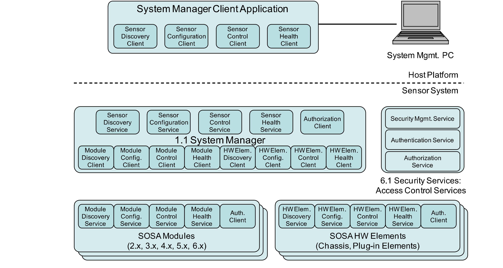

*Figure 8: SOSA Network-Based System Management Architecture ｜ 图 8：SOSA 基于网络的系统管理架构*

- Note: The Access Control Services, part of the Security Services module, provide the capability of ensuring that critical resources can only be accessed by authorized entities. The Access Control Services are in development.

- **注**：访问控制服务是安全服务模块的组成部分，提供确保关键资源只能由经授权的实体访问的能力。访问控制服务正在开发中。

Figure 8 illustrates the overall system management architecture. The SOSA 1.1 System Manager module provides a set of network-based service interfaces that may be accessed by one or more system management client applications. The system manager implements the Service endpoints of Discovery, Configuration, Control, and Health Provider interaction groups (interfaces). The system management client implements the client endpoints of those interaction groups. Another way of saying that is that the system management client application uses the services that the system manager provides by implementing the interactions included in the aforementioned interaction groups.

图 8 展示系统管理的总体架构。SOSA 1.1 系统管理器模块提供一组基于网络的服务接口，可由一个或多个系统管理客户端应用访问。系统管理器实现发现、配置、控制与健康提供者各交互组（接口）的服务端点。系统管理客户端实现这些交互组的客户端点。换一种说法：系统管理客户端应用通过实现上述各交互组所含的交互，来使用系统管理器所提供的服务。

Similarly, the SOSA modules implement the client side of the interactions between the system manager and each module, while the modules implement the service side of the interaction groups. This is true for both SOSA modules and hardware elements. The system manager manages the individual modules but represents a single view to the world outside of the sensor (system management client application).

类似地，SOSA 模块实现系统管理器与各模块之间交互的客户端一侧，而模块实现各交互组的服务侧。这对 SOSA 模块与硬件元素都成立。系统管理器管理各个模块，但对传感器之外的外部世界（系统管理客户端应用）呈现为一个单一视图。

- Note: The configuration shown in Figure 8 and described above is conceptual. This does not imply requirements for a specific management configuration. A system design; how many and which management clients will have access to the system management interfaces, how the system manager is implemented, and the security controls that are implemented must meet the performance and security requirements of the particular application and/or mission. For example, the access to the system manager interfaces can be controlled via the Security Services, specifically the Authorization Provider, to implement a wide variety of access control policies.

- **注**：图 8 所示、上文所述的结构是概念性的。这并不意味着对某一具体管理配置的需求。一次系统设计——有多少、哪些管理客户端可以访问系统管理接口，系统管理器如何实现，以及实现哪些安全控制——必须满足特定应用和／或任务的性能与安全需求。例如，对系统管理器接口的访问可经安全服务、具体地经授权提供者加以控制，以实现多种多样的访问控制策略。

<!-- 原书 p.38 ｜ PDF p.58 -->

##### 3.11.3 SOSA Hardware Management Overview SOSA 硬件管理概述

SOSA hardware management provides the capability to diagnose and debug hardware assemblies while the system infrastructure (processing and transports) may not be operational. This is accomplished via a set of existing lower-level hardware management interface standards. More detail on the out-of-band hardware platform system management functionality is described below.

SOSA 硬件管理提供在系统基础设施（处理与传输）可能尚未运行的情况下诊断与调试硬件装配体的能力。这经由一组现有的较低层硬件管理接口标准来实现。关于带外硬件平台系统管理功能的更多细节，见下文。

SOSA hardware management interfaces provide a well-defined set of standardized hardwarecentric capabilities across SOSA hardware elements that can be relied upon and utilized by the SOSA system manager module via a standardized set of logical and physical interfaces to fully satisfy the required SOSA system management functionality. SOSA hardware platform management leverages and builds upon the Hardware Open Systems Technology (HOST) 3.0 system management architecture and requirements which itself is highly leveraged from ANSI/VITA 46.11.

SOSA 硬件管理接口在各 SOSA 硬件元素上提供一组定义良好的、以硬件为中心的标准化能力；SOSA 系统管理器模块可经由一组标准化的逻辑与物理接口依赖并使用这些能力，以充分满足所要求的 SOSA 系统管理功能。SOSA 硬件平台管理利用并建立在硬件开放系统技术（HOST）3.0 的系统管理架构与需求之上，而后者本身又大量取自 ANSI/VITA 46.11。

Capabilities provided by SOSA hardware management architecture include but are not limited to the following:

SOSA 硬件管理架构所提供的能力包括但不限于以下各项：

Hardware Element Sensor Management – e.g., temperature, voltage, current, vibration, intrusion Hardware Chassis/Element Inventory – e.g., vendor identification, model number, serial number, revision identification, software/firmware revision information Hardware Chassis/Element Configuration – e.g., parameter settings, policy settings Software/Firmware Management – e.g., load, sanitize, recovery FRU Recovery – e.g., reset a hardware element, power cycle a hardware element Diagnostic Management – e.g., initiate diagnostics, collect diagnostic results The capabilities above are general at this point and will be fleshed out in future work. The approach being taken is to develop specific use-cases and add detail to the hardware element management interactions, including specific input and output parameters of the hardware element system management interactions.

硬件元素传感器管理——如温度、电压、电流、振动、侵入；硬件机箱／元素清单——如厂商标识、型号、序列号、修订标识、软件／固件修订信息；硬件机箱／元素配置——如参数设置、策略设置；软件／固件管理——如加载、净化、恢复；FRU 恢复——如复位一个硬件元素、对一个硬件元素做电源循环；诊断管理——如启动诊断、收集诊断结果。上述能力目前仍是概括性的，将在今后的工作中充实细化。所采取的做法是开发具体用例，并为硬件元素管理交互补充细节，包括硬件元素系统管理交互的具体输入与输出参数。

> **译注**：上段英文在原书为若干项目符号，转换时并成一段；英文照录不改。

The HOST and ANSI/VITA 46.11 standards provide a large array of commands and parameters, a subset of which will be used to support the SOSA hardware management architecture. This subset will be determined in the future. Developing use-cases to flesh out the capabilities will help identify the subset of these commands and parameters will be used for managing the hardware elements from the network.

HOST 与 ANSI/VITA 46.11 标准提供大量命令与参数，其中一部分子集将用于支持 SOSA 硬件管理架构。该子集将在今后确定。开发用例以充实各项能力，将有助于确定这些命令与参数中哪些子集将用于从网络管理硬件元素。

As shown in Figure 9, the SOSA Architecture defines two logical interfaces, enabled by SNMP, through which SOSA modules can interact with SOSA hardware element management elements. The interaction is enabled via SOSA defined SNMP Management Information Bases (MIBs) that provide status and control capability to the SOSA modules of the underlying hardware element management features. The first SNMP MIB provides an interface to the chassis manager software capabilities. This MIB provides a path to access the entirety of the hardware management platform via a single logical element, the chassis manager. In this scenario, the chassis manager utilizes the Intelligent Platform Management Bus (IPMB) to extend status and control capabilities of its MIB to all of the managed Hardware Platform elements. This can be helpful when performing activities such as discovery of the SOSA hardware element as the

如图 9 所示，SOSA 架构定义了由 SNMP 使能的两个逻辑接口，SOSA 模块可经由它们与 SOSA 硬件元素管理元素交互。该交互经由 SOSA 定义的 SNMP 管理信息库（MIB）使能，这些 MIB 向 SOSA 模块提供底层硬件元素管理功能的状况与控制能力。第一个 SNMP MIB 提供通往机箱管理器软件能力的接口。该 MIB 提供一条经由单一逻辑元素——机箱管理器——访问整个硬件管理平台的路径。在这一情形下，机箱管理器利用智能平台管理总线（IPMB）把其 MIB 的状态与控制能力扩展至所有受管的硬件平台元素。在执行诸如发现 SOSA 硬件元素之类的活动时，这一点会有帮助，因为

<!-- 原书 p.39 ｜ PDF p.59 -->

summary of this information is collected and stored by the chassis manager and can thus be retrieved from a single location in the chassis. The second SNMP MIB provides a local interface from an application processor, when applicable, on a hardware element to its Intelligent Platform Management Interface (IPMC) Payload Interface. This path can be helpful for fault management, performance, and/or security-related reasons versus communicating over the shared IPMB interface via the chassis manager.

此类信息的汇总由机箱管理器收集并存储，因此可从机箱中的单一位置取回。第二个 SNMP MIB 提供一条本地接口，从硬件元素上的应用处理器（适用时）通往其智能平台管理接口（IPMC）载荷接口。出于故障管理、性能和／或安全方面的考虑，这条路径比起经由机箱管理器在共享 IPMB 接口上通信会有帮助。

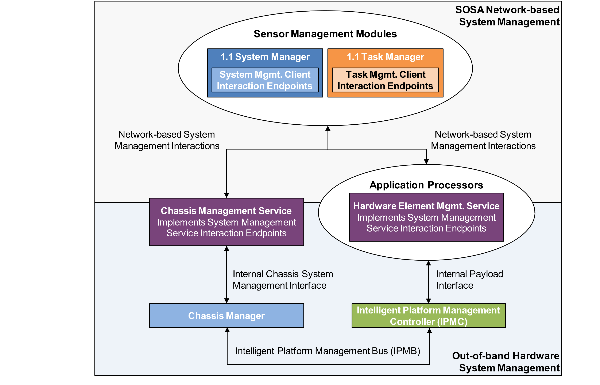

*Figure 9: SOSA Hardware System Management Logical Block Diagram ｜ 图 9：SOSA 硬件系统管理逻辑框图*

Physically, out-of-band hardware system management is implemented in a hierarchical manner where each managed Field Replaceable Unit (FRU) contains an IPMC, each managed chassis implements functionality of the chassis manager, and each managed platform contains one or more system managers (e.g., the SOSA system manager and the SOSA task manager). Each layer of the hierarchy enables a greater set of management capabilities. Note that it is not necessary that the functionality associated with the chassis manager in Figure 9 be implemented as a stand-alone entity. As long as the internal chassis system management interface and chassis management functionality are implemented it is acceptable.

在物理形态上，带外硬件系统管理按层级方式实现：每个受管的现场可更换单元（FRU）含一个 IPMC，每个受管的机箱实现机箱管理器的功能，每个受管的平台含一个或多个系统管理器（例如 SOSA 系统管理器与 SOSA 任务管理器）。层级中的每一层都使能一组更大的管理能力。注意，图 9 中与机箱管理器相关联的功能不必实现为一个独立实体。只要内部机箱系统管理接口与机箱管理功能得以实现，便可接受。

<!-- 原书 p.40 ｜ PDF p.60 -->

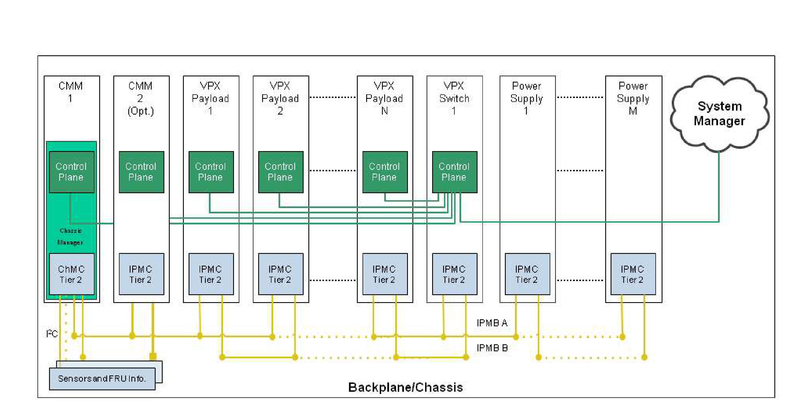

*Figure 10: Example SOSA System Management Backplane/Chassis Implementation ｜ 图 10：SOSA 系统管理背板／机箱实现示例*

As shown in Figure 10, each SOSA Payload and Switch hardware element contains an ANSI/VITA 46.11 Tier 2 and HOST-compliant IPMC. Each hardware element provides two redundant IPMB connections from the IPMC to the backplane. Power Supply Modules (PSMs) also contain an ANSI/VITA 46.11 Tier 2 and HOST-compliant IPMC which provides two redundant IPMB connections to the backplane. A chassis management module which hosts a Tier 2 ANSI/VITA 46.11 and HOST chassis manager function provides two redundant IPMB connections, a 1GbE control plane connection, and a redundant set of I²C bus connections to the backplane. The redundant IPMB interfaces are bussed across the backplane such that IPMB A and IPMB B connect to each IPMC/Chassis Management Controller (ChMC) on each hardware element type. The chassis manager control plane interface is connected to the control plane switch network. The chassis manager Inter-IC (I²C) busses are connected to chassis sensors and FRU information devices. A system manager is connected to the control plane switch network.

如图 10 所示，每个 SOSA 载荷与交换机硬件元素含一个符合 ANSI/VITA 46.11 Tier 2 与 HOST 的 IPMC。每个硬件元素提供从 IPMC 至背板的两条冗余 IPMB 连接。电源模块（PSM）也含一个符合 ANSI/VITA 46.11 Tier 2 与 HOST 的 IPMC，它向背板提供两条冗余 IPMB 连接。承载 Tier 2 ANSI/VITA 46.11 与 HOST 机箱管理器功能的机箱管理模块，向背板提供两条冗余 IPMB 连接、一条 1GbE 控制平面连接，以及一组冗余的 I²C 总线连接。冗余 IPMB 接口在背板上按总线方式连通，使 IPMB A 与 IPMB B 连接至每一类硬件元素上的每个 IPMC／机箱管理控制器（ChMC）。机箱管理器的控制平面接口连接至控制平面交换网络。机箱管理器的 Inter-IC（I²C）总线连接至机箱传感器与 FRU 信息器件。系统管理器连接至控制平面交换网络。

In a SOSA system, the chassis manager is a discrete entity that is “part of the chassis” and exists on a custom non-specified form factor or off-the-shelf Chassis Manager Module (CMM). This allows chassis FRU information, logs, etc. to stay with the chassis independent of changes to its content. It is possible to support redundant chassis managers within an enclosure to achieve increased Reliability, Availability, and Serviceability (RAS) support. The chassis manager acts as an access point for the system manager into the IPMC capabilities. The chassis manager additionally provides interfaces to chassis-level sensors, FRU information, power, and/or thermal management infrastructure. All FRUs in the system are identifiable via the system management infrastructure.

在 SOSA 系统中，机箱管理器是一个“属于机箱”的独立实体，存在于定制的、未作规定的形状因数上，或存在于货架式机箱管理模块（CMM）上。这使机箱 FRU 信息、日志等得以随附于机箱，而不随其内容的变更而变。在同一机箱体内可以支持冗余的机箱管理器，以获得更高的可靠性、可用性与可服务性（RAS）支持。机箱管理器充当系统管理器进入 IPMC 各项能力的接入点。机箱管理器另外还提供通往机箱级传感器、FRU 信息、电源和／或热管理基础设施的接口。系统中的全部 FRU 都可经系统管理基础设施标识。

Figure 11 shows an example SOSA system management implementation on a SOSA hardware element. As shown in the figure, the IPMC exists in the Management Domain on the SOSA hardware element that allows it to operate in a “lights out” condition when only management power is applied to the plug-in card, backplane, and/or chassis. The remainder of the electronics on the hardware element, including the application processor which may be a general-purpose processor, a Field-Programmable Gate Array (FPGA), a Graphics Processing Unit (GPU), or any other processing engine that runs the platform application, exists on the Payload Domain. On-

图 11 给出 SOSA 硬件元素上 SOSA 系统管理实现的一个示例。如图所示，IPMC 位于 SOSA 硬件元素上的管理域（Management Domain）中，这使它在仅有管理电源加至插卡、背板和／或机箱时，能以“熄灯”（lights out）状态运行。硬件元素上其余电子部分——包括应用处理器，它可以是通用处理器、现场可编程门阵列（FPGA）、图形处理器（GPU），或任何其他运行平台应用的处理器件——位于载荷域（Payload Domain）上。

<!-- 原书 p.41 ｜ PDF p.61 -->

chassis communication between the IPMC and the application process occurs over a Payload Interface between the application processor and the IPMC. Off-chassis system management communication can occur to/from the application processor over the control plane or via the IPMC out to the System IPMB. Off-chassis system management communication can also occur over the System IPMB to/from the IPMC independent of the application processor.

机箱内通信在 IPMC 与应用进程之间经应用处理器与 IPMC 之间的载荷接口进行。机箱外的系统管理通信可以经控制平面、或经由 IPMC 至系统 IPMB，与应用处理器之间双向进行。机箱外的系统管理通信也可以经系统 IPMB 与 IPMC 之间双向进行，而与应用处理器无关。

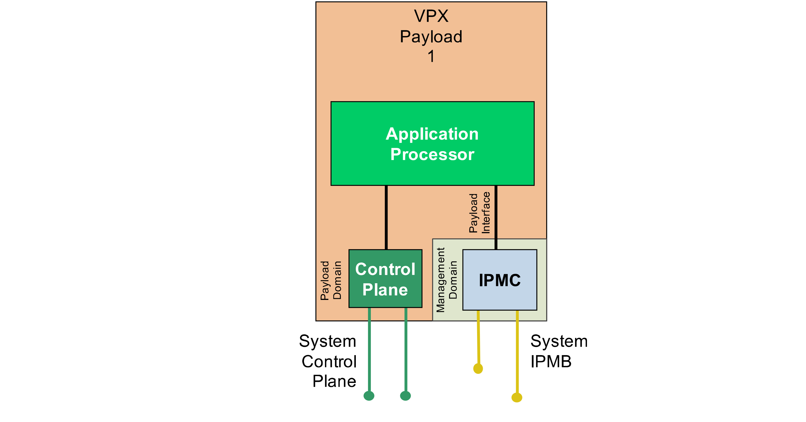

*Figure 11: Example SOSA System Management Plug-In Card Implementation ｜ 图 11：SOSA 系统管理插卡实现示例*

In a SOSA system, communication to/from the IPMC over the System IPMB provides a set of system management capabilities that are accessible in a “lights out” condition when only management power is enabled and/or when there are soft and/or hard faults preventing communication with the application processor. As such, this System IPMB enables fault isolation and recovery operations, platform configuration, sensor management, and inventory functions that are available out-of-band of the application and when limited power is available to the platform (e.g., during 2 Level Maintenance (2LM) operations and/or in theater).

在 SOSA 系统中，经系统 IPMB 与 IPMC 之间的双向通信提供一组系统管理能力；这些能力在“熄灯”状态下——即仅使能管理电源时，和／或存在软故障和／或硬故障致使无法与应用处理器通信时——仍可访问。因此，系统 IPMB 使故障隔离与恢复操作、平台配置、传感器管理以及清单功能，得以在应用带外、并在平台只有有限电源可用时（例如在二级维修（2LM）作业期间和／或在战区）使用。

Once the Payload Domain is activated, system management applications running on the application processor and communicating over the control plane can be used to increase the performance of the run-time system management functions. The application processor can locally communicate with the IPMC to access its capabilities and communicate with the chassis manager, system manager, and/or other application processors over the control plane. This enables the installation and usage of standards-based system management application software interfaces and infrastructure (e.g., SNMP and MIBs).

一旦载荷域被启用，运行在应用处理器上、并经控制平面通信的系统管理应用便可用于提高运行时系统管理功能的性能。应用处理器可在本地与 IPMC 通信以访问其各项能力，并经由控制平面与机箱管理器、系统管理器和／或其他应用处理器通信。这使基于标准的系统管理应用软件接口与基础设施（例如 SNMP 与 MIB）得以安装和使用。

<!-- 原书 p.42 ｜ PDF p.62 -->

## 第 4 章 架构定义

> 分册文件：`SOSA参考架构技术标准-v1.0.2/04-architecture-definition.md`；原册题：4 Architecture Definition ｜ 4 架构定义

> 原书 p.43–71 ｜ PDF p.63–91

#### 4.1 Service Views ｜ 4.1 服务视图

##### 4.1.1 SvcV-4: Services Functionality Description ｜ 4.1.1 SvcV-4：服务功能描述

The Service View 4 (SvcV-4: Services Functionality Description) documents the functions performed by each of the SOSA modules, and documents the data ingested and produced by each. This information, when coupled with the SOSA Data Models (DIV-1, -2, and -3) provides a complete picture of the content of the informational Needlines linking the SOSA modules. The SvcV-4 takes the form of a table, incorporating the following pieces of information: ID Number: numerical designator (major-point-minor) of the SOSA module Name: succinct label for the SOSA module Function List: list of functions contained within the SOSA module Inputs: list of data items and controls that are ingested by the SOSA module (in certain cases, their sources)

服务视图 4（SvcV-4：服务功能描述）记载每个 SOSA 模块所执行的功能，并记载各模块摄取与产生的数据。这些信息与 SOSA 数据模型（DIV-1、DIV-2 与 DIV-3）合起来，给出连接各 SOSA 模块的信息性 `Needline`（需求线）内容的完整图景。SvcV-4 采取表格形式，包含下列几项信息：ID 号：SOSA 模块的数字标识（主-次-末三段式）；名称：SOSA 模块的简明标称；功能清单：该 SOSA 模块所含功能的清单；输入：该 SOSA 模块所摄取的数据项与控制项清单（某些情况下含其来源）

> **译注**：上段英文在原书为四条项目符号（ID Number／Name／Function List／Inputs），转换时并成一段；英文照录不改。

- Outputs: list of data items that are produced by the SOSA module (in certain cases, their destinations)

- 输出：该 SOSA 模块所产生的数据项清单（某些情况下含其去向）

**Table 5: SOSA SvcV-4 ｜ 表 5：SOSA SvcV-4**

> **本表读法**：四列＝模块｜封装功能｜输入与输出｜输入／输出说明。表中 `1.1.a`、`6.9.5.2.1` 一类数据项编号是**寻址用的，不译**；第一列与第二列在原表为纵向合并格，本件按原样留空。**方向怎么读**：原表只有 `1.1.a` 一行印了分区标记 `Inputs`，其余各行的方向靠第四列的 `Input`／`Output` 字样与功能语义判断；约六成行两处都没有，本件不替原文臆断，方向见各组小结。本表 429 数据行、跨原书 p.43–66 共 24 页，逐格挂中文会撑成一堵墙，故**中文不进格**：每一组模块之前置一条中文小结，组内的行一字不译。分组＝原表第一列出现新模块名之处，故一表分作二十五张（另六处分组标题改作加粗小标题），每张重复四列表头——中文小结若插在行与行之间，Markdown 的表格会当场断掉、后半截散成正文，故只能这样切。读法：先看小结把握该组在做什么、数据从哪来往哪去，再按编号回组内取字。

**1 Manage SOSA Sensor ｜ 1 传感器管理**

> **小结** 1 传感器管理：本组统管 SOSA 传感器的系统级与任务级活动，系统管理器负责发现、配置、控制、健康与安全，任务管理器负责外部任务的摄取与内部分派的派生。输入自宿主平台接口与各模块上报，输出为下发给各模块的系统管理分派与任务分派。

> **小结** 1.1 系统管理器：执行 `1.1 Perform System Management`（执行系统管理），自宿主平台接口与各模块收进系统管理任务指派、系统服务数据及回报的确认、状况、事件通知，再向各模块下发系统管理分派；输出即系统与模块的发现、配置、控制、健康与安全结果。

| Module | Encapsulated Functions | Inputs (above) & Outputs (below) | Input/Output Description |
|---|---|---|---|
| 1.1 System Manager | 1.1 Perform System Management | 1.1.a System Management Tasking | Inputs |
| | | 1.1.b System Management Assignment Ack/Status/Information | |
| | | 1.1.c System Management Assignment Event Notification | |
| | | 1.1.d System Management Task Ack/Status/Information | |
| | | 1.1.e System Management Task Event Notification | |
| | | 1.1.f System Services Data | |
| | | 1.1.g System Management Assignment | |
| | 1.1.1 Discover System | | |
| | 1.1.1.1 Discover System Manager | | |
| | 1.1.1.2 Discover Modules | | |
| | 1.1.2 Manage Configuration | | |
| | 1.1.2.1 Configure System | | |
| | 1.1.2.2 Configure Module | | |
| | 1.1.2.3 Configure Data Publishing | | |
| | 1.1.3 Manage Control Parameters | | |
| | 1.1.3.1 Control System | | |
| | 1.1.3.2 Control Module | | |
| | 1.1.4 Manage Health | | |
| | 1.1.4.1 Report Health | | |
| | 1.1.4.1.1 Report System Health | | |
| | 1.1.4.1.2 Report Module Health | | |
| | 1.1.4.2 Get Health | | |
| | 1.1.4.2.1 Get System Health | | |
| | 1.1.4.2.2 Get Module Health | | |
| | 1.1.4.3 Notify Health Events | | |
| | 1.1.4.3.1 Notify System Health Events | | |
| | 1.1.4.3.2 Notify Module Health Events | | |
| | 1.1.4.4 Log Health | | |
| | 1.1.5 Manage Security | | |
| | 1.1.5.1 Secure Management Interfaces | | |
| | 1.1.5.1.1 Verify Authentication | | |
| | 1.1.5.1.2 Verify Authorization | | |
| | 1.1.5.2 Manage Security Configuration | | |
| | 1.1.5.2.1 Manage Security Keys | | |
| | 1.1.5.2.2 Manage Access Control | | |

> **小结** 1.2 任务管理器：执行 `1.2 Perform Task Management`（执行任务管理），先发现系统与模块能力，再摄取宿主平台下达的任务指派，派生内部任务指派并排定优先级与调度，形成模块分派下发。输入含宿主与各模块的能力，另有系统服务数据与系统管理分派；输出：任务确认、状况回报、事件通知、模块分派，以及能力发现的回执（`Sensor Capabilities`／`Resource Map`／`Module Capabilities Request`）与系统管理回执。

| Module | Encapsulated Functions | Inputs (above) & Outputs (below) | Input/Output Description |
|---|---|---|---|
| 1.2 Task Manager | 1.2 Perform Task Management | | |
| | 1.2.1 Discover Capabilities | | |
| | 1.2.1.1 Discover System Capabilities | 1.2.1.1.a Module Discovery Data (Module List, Resource Data, Module/Resource IP) | Input |
| | | 1.2.1.1.b Sensor Capabilities Request | Input |
| | | 1.2.1.1.c Sensor Capabilities | Output |
| | | 1.2.1.1.d Sensor Capabilities Resource Map | Output |
| | 1.2.1.2 Discover Module Capabilities | 1.2.1.2.a Module Capabilities | Input |
| | | 1.2.1.2.b Module Capabilities Request | Output |
| | 1.2.2 Manage Tasks | | |
| | 1.2.2.1 Manage External Sensor Tasks | 1.2.2.1.a Tasking | Input |
| | | 1.2.2.1.b Task Ack/Status/Information | Output |
| | | 1.2.2.1.c Task Event Notification | Output |
| | 1.2.2.1.1 Ingest External Tasking | Tracks from Module 3.4 | For TWS GMTI |
| | 1.2.2.1.2 Monitor External Tasking | | |
| | 1.2.2.1.3 Report External Tasking Status | | |
| | 1.2.2.2 Manage Internal Sensor Tasks | | |
| | 1.2.2.2.1 Develop Internal Sensor Tasking | | |
| | 1.2.2.2.2 Manage Sensor Resources | | |
| | 1.2.2.2.2.1 Prioritize Internal Sensor Tasking | | |
| | 1.2.2.2.2.2 Schedule Internal Sensor Tasking | | |
| | 1.2.2.2.3 Monitor Internal Sensor Tasking | | |
| | 1.2.2.3 Manage Module Assignments | 1.2.2.3.a Module Assignment Ack/Status/Information | Input |
| | | 1.2.2.3.b Module Assignment Event Notification | Input |
| | | 1.2.2.3.c Module Assignment | Output |
| | 1.2.2.3.1 Develop Module Assignments | | |
| | 1.2.2.3.2 Manage Module Resources | | |
| | 1.2.2.3.3 Send Module Assignments | | |
| | 1.2.2.3.4 Monitor Module Assignments | | |
| | 1.2.3 Manage Module | 1.2.3.a System Services Data | Input (PNT, etc.) |
| | | 1.2.3.b System Management Assignment | Input |
| | | 1.2.3.c System Management Assignment Ack/Status/Information | Output |
| | | 1.2.3.d System Management Assignment Event Notification | Output |
| | 1.2.3.1 Manage Module Discovery | | |
| | 1.2.3.2 Manage Module Configuration | | |
| | 1.2.3.3 Manage Module Control | | |
| | 1.2.3.4 Manage Module Health | | |
| | 1.2.3.5 Manage Module Security | | |

**2 Transmission/Reception ｜ 2 发射／接收**

> **小结** 2 发射／接收：本组覆盖传感器的电磁与光电前端，接收孔径／换能器／相机把外来能量转为电信号，发射孔径／换能器／激光器把电信号还原为辐射能量，调理器-接收机-激励器居中完成放大、变频与模数转换；输入自带外场能量，输出送往信号／目标处理组。

> **小结** 2.1 接收孔径／换能器／相机：控制孔径的配置与参数，把入射的 `RX Electromagnetic Energy`（接收电磁能量）转换为电信号，再经放大、稳定与滤波，输出 `Filtered RX Signal`（滤波后接收信号）给调理器-接收机-激励器；模块管理部分以系统服务数据与系统管理分派为输入，回报确认与事件通知。

| Module | Encapsulated Functions | Inputs (above) & Outputs (below) | Input/Output Description |
|---|---|---|---|
| 2.1 Receive Aperture/Transducer/Camera | 2.1.1 Control Receive Aperture | | |
| | 2.1.1.1 Configure Aperture | | |
| | 2.1.1.2 Control Aperture Parameters | | |
| | 2.1.2 Convert EM Energy to Electrical Signal | 2.1.2.a RX Electromagnetic Energy | Input |
| | 2.1.3 Amplify Signal | | |
| | 2.1.3 Stabilize Signal | | |
| | 2.1.4 Filter Signal | 2.1.4.a Filtered RX Signal | Output |
| | 2.1.5 Perform Module Management | | |
| | 2.1.5.1 Perform Module System Management | 2.1.5.1.a System Services Data | Input (PNT, etc.) |
| | | 2.1.5.1.b System Management Assignment | Input |
| | | 2.1.5.1.c System Management Assignment Ack/Status/Information | Output |
| | | 2.1.5.1.d System Management Assignment Event Notification | Output |
| | 2.1.5.1.1 Manage Module Discovery | | |
| | 2.1.5.1.2 Manage Module Configuration | | |
| | 2.1.5.1.3 Manage Module Control | | |
| | 2.1.5.1.4 Manage Module Health | | |
| | 2.1.5.1.5 Manage Module Security | | |
| | 2.1.5.2 Manage Module Assignments | 2.1.5.2.a Task Management Assignment | Input |
| | | 2.1.5.2.b Task Management Assignment Ack/Status/Information | Output |
| | | 2.1.5.2.c Task Management Assignment Event Notification | Output |
| | 2.1.5.2.1 Process Module Assignments | | |
| | 2.1.5.2.2 Manage Module Resources | | |
| | 2.1.5.2.4 Monitor Module Assignments | | |

> **小结** 2.2 发射孔径／换能器／激光器：生成发射信号，以 `Unfiltered RX Signal`（未滤波接收信号，原文如此）为输入，经滤波、放大后由换能器或激光器转换为 `TX Electromagnetic Energy`（发射电磁能量）辐射出去；模块管理部分以系统服务数据与系统管理分派为输入，回报确认、状况与事件通知。

| Module | Encapsulated Functions | Inputs (above) & Outputs (below) | Input/Output Description |
|---|---|---|---|
| 2.2 Transmit Aperture/Transducer/Laser | 2.2.1 Control Receive Aperture | | |
| | 2.2.1.1 Configure Aperture | | |
| | 2.2.1.2 Control Aperture Parameters | | |
| | 2.2.2 Generate Signal | | |
| | 2.2.3 Filter Signal | 2.2.3.a Unfiltered RX Signal | Input |
| | 2.2.4 Amplify Signal | | |
| | 2.2.5 Convert Electrical Signal to EM Energy | 2.2.5.a TX Electromagnetic Energy | Output |
| | 2.2.6 Perform Module Management | | |
| | 2.2.7.1 Perform Module System Management | 2.2.7.1.a System Services Data | Input (PNT, etc.) |
| | | 2.2.7.1.b System Management Assignment | Input |
| | | 2.2.7.1.c System Management Assignment Ack/Status/Information | Output |
| | | 2.2.7.1.d System Management Assignment Event Notification | Output |
| | 2.2.7.1.1 Manage Module Discovery | | |
| | 2.2.7.1.2 Manage Module Configuration | | |
| | 2.2.7.1.3 Manage Module Control | | |
| | 2.2.7.1.4 Manage Module Health | | |
| | 2.2.7.1.5 Manage Module Security | | |
| | 2.2.7.2 Manage Module Assignments | 2.2.7.2.a Task Management Assignment | Input |
| | | 2.2.7.2.b Task Management Assignment Ack/Status/Information | Output |
| | | 2.2.7.2.c Task Management Assignment Event Notification | Output |
| | 2.2.7.2.1 Process Module Assignments | | |
| | 2.2.7.2.2 Manage Module Resources | | |
| | 2.2.7.2.4 Monitor Module Assignments | | |

> **小结** 2.3 调理器-接收机-激励器：接收支路把 `Filtered RX Signal`（滤波后接收信号）放大、分配、变频并模数转换，输出 `RX Electromagnetic Signal Stream`（接收电磁信号流）与接收图像流；发射支路反向上变频、数模转换，输出 `Unfiltered TX Signal`（未滤波发射信号）；模块管理受系统管理与任务管理两路管辖。

| Module | Encapsulated Functions | Inputs (above) & Outputs (below) | Input/Output Description |
|---|---|---|---|
| 2.3 Conditioner-Receiver-Exciter | 2.3.1 Process RX Signals | 2.3.1.a Filtered RX Signal | Input, digital, or analog |
| | | 2.3.1.b RX Electromagnetic Signal Stream | Output, RX digital |
| | | 2.3.1.c RX Image Stream | Output, RX digital |
| | 2.3.1.1 Amplify Signal | | |
| | 2.3.1.2 Distribute RF Signal | | |
| | 2.3.1.3 Translate Signal Frequency | | |
| | 2.3.1.4 Convert Signal: Analog to Digital | | |
| | 2.3.2 Process TX Signals | 2.3.2.a Unfiltered TX Signal | Output |
| | 2.3.2.1 Generate Signal (Waveform) | | |
| | 2.3.2.2 Amplify Signal | | |
| | 2.3.2.3 Distribute RF Signal | | |
| | 2.3.2.4 Translate Signal Frequency | | |
| | 2.3.2.5 Convert Signal: Digital to Analog | | |
| | 2.3.3 Perform Module Management | | |
| | 2.3.3.1 Perform Module System Management | 2.3.3.1.a System Services Data | Input (PNT, etc.) |
| | | 2.3.3.1.b System Management Assignment | Input |
| | | 2.3.3.1.c System Management Assignment Ack/Status/Information | Output |
| | | 2.3.3.1.d System Management Assignment Event Notification | Output |
| | 2.3.3.1.1 Manage Module Discovery | | |
| | 2.3.3.1.2 Manage Module Configuration | | |
| | 2.3.3.1.3 Manage Module Control | | |
| | 2.3.3.1.4 Manage Module Health | | |
| | 2.3.3.1.5 Manage Module Security | | |
| | 2.3.3.2 Manage Module Assignments | 2.3.3.2.a Task Management Assignment | Input |
| | | 2.3.3.2.b Task Management Assignment Ack/Status/Information | Output |
| | | 2.3.3.2.c Task Management Assignment Event Notification | Output |
| | 2.3.3.2.1 Process Module Assignments | | |
| | 2.3.3.2.2 Manage Module Resources | | |
| | 2.3.3.2.4 Monitor Module Assignments | | |

**3 Process Signals/Targets ｜ 3 信号／目标处理**

> **小结** 3 信号／目标处理：本组是传感器内部的处理链，检测与提取器从杂波与背景中取出信号与目标，特征化器给出类别与身份，图像预处理器成像并配准，跟踪器维持航迹；输入为前端送来的信号流与图像流，输出为检测、特征化与航迹结果，供分析／情报利用组与任务管理器取用。

> **小结** 3.1 信号／目标检测与提取器：对接收电磁信号流与各类图像流做增强，从中提取信号与目标，输出增强后的电磁信号流与图像流；再处理检测结果，输出 `Detection`（检测）与图像质量报告。模块管理部分以系统服务数据与系统管理分派为输入，回报确认、状况与事件通知。

| Module | Encapsulated Functions | Inputs (above) & Outputs (below) | Input/Output Description |
|---|---|---|---|
| 3.1 Signal/Object Detector and Extractor | 3.1.1 Enhance Image/Video | 3.1.1.a RX Electromagnetic Signal Stream | Input |
| | | 3.1.1.b RX Image Stream | Input |
| | | 3.1.1.c RF Image Stream | Input |
| | | 3.1.1.d Registered Image Stream | Input |
| | | 3.1.1.e Georegistered Image Stream | Input |
| | 3.1.2 Extract Signals/Objects | 3.1.2.a Extracted Electromagnetic Signal Stream | Output, enhanced |
| | | 3.1.2.b Extracted Image Stream | Output, enhanced |
| | 3.1.2.1 Extract RF Signal from Clutter | | |
| | 3.1.2.2 Extract EO/IR Object from Background | | |
| | 3.1.3 Process Detections | 3.1.3.a Detection | Output |
| | | 3.1.3.b Image Quality Report | Output |
| | 3.1.3.1 Detect and Discriminate Signals/Objects | | |
| | 3.1.3.2 Estimate quality of detections | | |
| | 3.1.4 Perform Module Management | | |
| | 3.1.4.1 Perform Module System Management | 3.1.4.1.a System Services Data | Input (PNT, etc.) |
| | | 3.1.4.1.b System Management Assignment | Input |
| | | 3.1.4.1.c System Management Assignment Ack/Status/Information | Output |
| | | 3.1.4.1.d System Management Assignment Event Notification | Output |
| | 3.1.4.1.1 Manage Module Discovery | | |
| | 3.1.4.1.2 Manage Module Configuration | | |
| | 3.1.4.1.3 Manage Module Control | | |
| | 3.1.4.1.4 Manage Module Health | | |
| | 3.1.4.1.5 Manage Module Security | | |
| | 3.1.4.2 Manage Module Assignments | 3.1.4.2.a Task Management Assignment | Input |
| | | 3.1.4.2.b Task Management Assignment Ack/Status/Information | Output |
| | | 3.1.4.2.c Task Management Assignment Event Notification | Output |
| | 3.1.4.2.1 Process Module Assignments | | |
| | 3.1.4.2.2 Manage Module Resources | | |
| | 3.1.4.2.4 Monitor Module Assignments | | |

> **小结** 3.2 信号／目标特征化器：以 `Detection`（检测）、提取后的电磁信号流与图像流为输入，估计信号参数、抽取分类与识别特征并计算频谱产品；随后判定信号类型、匹配参考基、完成目标识别并剔除虚警，输出 `Characterization`（特征化）供跟踪器与分析组使用。

| Module | Encapsulated Functions | Inputs (above) & Outputs (below) | Input/Output Description |
|---|---|---|---|
| 3.2 Signal/Object Characterizer | 3.2.1 Extract Detection Features | 3.2.1.a Detection | Input |
| | | 3.2.1.b Extracted Electromagnetic Signal Stream | Input |
| | | 3.2.1.c Extracted Image Stream | Input |
| | | 3.2.1.d Spectral Product | Output |
| | 3.2.1.1 Estimate Signal Parameters | | |
| | 3.2.1.2 Extract Classifier Features | | |
| | 3.2.1.3 Extract Identification Features | | |
| | 3.2.1.4 Compute spectral products | | |
| | 3.2.2 Classify or Identify Signal/Object | 3.2.2.a Characterizer Data | Input |
| | 3.2.2.1 Determine Signal Type | | |
| | 3.2.2.2 Map Features to Reference/Basis | | |
| | 3.2.2.3 Match Image Chip to Profile for ID | | |
| | 3.2.2.4 Perform Target Recognition | | |
| | 3.2.3 Filter False Detections | | |
| | 3.2.3.1 Identify False Alarms | | |
| | 3.2.3.2 Discriminate Target from Non-target | | |
| | 3.2.4 Produce Characterizations | 3.2.4.a Characterization | Output |
| | 3.2.4.1 Produce Classification Type | | |
| | 3.2.4.2 Produce Identity | | |
| | 3.2.5 Perform Module Management | | |
| | 3.2.5.1 Perform Module System Management | 3.2.5.1.a System Services Data | Input (PNT, etc.) |
| | | 3.2.5.1.b System Management Assignment | Input |
| | | 3.2.5.1.c System Management Assignment Ack/Status/Information | Output |
| | | 3.2.5.1.d System Management Assignment Event Notification | Output |
| | 3.2.5.1.1 Manage Module Discovery | | |
| | 3.2.5.1.2 Manage Module Configuration | | |
| | 3.2.5.1.3 Manage Module Control | | |
| | 3.2.5.1.4 Manage Module Health | | |
| | 3.2.5.1.5 Manage Module Security | | |
| | 3.2.5.2 Manage Module Assignments | 3.2.5.2.a Task Management Assignment | Input |
| | | 3.2.5.2.b Task Management Assignment Ack/Status/Information | Output |
| | | 3.2.5.2.c Task Management Assignment Event Notification | Output |
| | 3.2.5.2.1 Process Module Assignments | | |
| | 3.2.5.2.2 Manage Module Resources | | |
| | 3.2.5.2.4 Monitor Module Assignments | | |

> **小结** 3.3 图像预处理器：把 `Received Electromagnetic Signal Stream`（接收电磁信号流）成像为射频图像流，再做图像间配准，并借 `Geographic Information`（地理信息）配准到地理坐标，输出 `Georeferenced Image Stream`（地理配准图像流）给检测提取与跟踪模块；模块管理部分同其他模块。

| Module | Encapsulated Functions | Inputs (above) & Outputs (below) | Input/Output Description |
|---|---|---|---|
| 3.3 Image Pre-processor | 3.3.1 Form Image from RF Signal | 3.3.1.a Received Electromagnetic Signal Stream | Input |
| | | 3.3.1.b RF Image stream | Output |
| | 3.3.2 Register Image to Image | 3.3.2.a Image Stream | Input |
| | | 3.3.2.b Registered Image Stream | Output |
| | 3.3.3 Register Image to Geographical Coordinates | 3.3.3.a Image Stream | Input |
| | | 3.3.3.b Geographic Information | Input |
| | | 3.3.3.c Georeferenced Image Stream | Output |
| | 3.3.4 Perform Module Management | | |
| | 3.3.4.1 Perform Module System Management | 3.3.4.1.a System Services Data | Input (PNT, etc.) |
| | | 3.3.4.1.b System Management Assignment | Input |
| | | 3.3.4.1.c System Management Assignment Ack/Status/Information | Output |
| | | 3.3.4.1.d System Management Assignment Event Notification | Output |
| | 3.3.4.1.1 Manage Module Discovery | | |
| | 3.3.4.1.2 Manage Module Configuration | | |
| | 3.3.4.1.3 Manage Module Control | | |
| | 3.3.4.1.4 Manage Module Health | | |
| | 3.3.4.1.5 Manage Module Security | | |
| | 3.3.4.2 Manage Module Assignments | 3.3.4.2.a Task Management Assignment | Input |
| | | 3.3.4.2.b Task Management Assignment Ack/Status/Information | Output |
| | | 3.3.4.2.c Task Management Assignment Event Notification | Output |
| | 3.3.4.2.1 Process Module Assignments | | |
| | 3.3.4.2.2 Manage Module Resources | | |
| | 3.3.4.2.4 Monitor Module Assignments | | |

> **小结** 3.4 跟踪器：以提取后的电磁信号流、图像流，以及 3.1 的 `Detection`（检测）与 3.2 的 `Characterization`（特征化）为输入，做航迹关联、起始、终止与维持；输出 `Current Track State`（当前航迹状态）与 `Predicted Track State`（预测航迹状态），供分析组、报告服务与任务管理器取用。

| Module | Encapsulated Functions | Inputs (above) & Outputs (below) | Input/Output Description |
|---|---|---|---|
| 3.4 Tracker | 3.4.1 Process Detections | 3.4.1.a Extracted EM Signal Stream | Input |
| | | 3.4.1.b Extracted Image Stream | Input |
| | | 3.4.1.c Detection | Input, Data from Module 3.1 Signal/Target Detector/Extractor module that is processed to determine and output tracks. Can be RF detection data (SAR, EW, GMTI, AMTI, ESM) or EO/IR detection data |
| | | 3.4.1.d Characterization | Input, Data from Module 3.2 that is processed to determine and output tracks |
| | 3.4.2 Associate Tracks | | |
| | 3.4.3 Initiate Tracks | | |
| | 3.4.4 Terminate Tracks | | |
| | 3.4.5 Maintain Tracks | 3.4.5.a Current Track State | Output, Provides the track state data at the time of the measurement Includes intermediate results and measurements |
| | | 3.4.5.b Predicted Track State | Output, Provides the estimated track state data at the time of the next scheduled measurement update |
| | 3.4.5.1 Track Update | | |
| | 3.4.5.2 Track Prediction | | |
| | 3.4.6 Perform Module Management | | |
| | 3.4.6.1 Perform Module System Management | 3.4.6.1.a System Services Data (PNT, etc.) | Input |
| | | 3.4.6.1.b System Management Assignment | Input |
| | | 3.4.6.1.c System Management Assignment Ack/Status/Information | Output |
| | | 3.4.6.1.d System Management Assignment Event Notification | Output |
| | 3.4.6.1.1 Manage Module Discovery | | |
| | 3.4.6.1.2 Manage Module Configuration | | |
| | 3.4.6.1.3 Manage Module Control | | |
| | 3.4.6.1.4 Manage Module Health | | |
| | 3.4.6.1.5 Manage Module Security | | |
| | 3.4.6.2 Manage Module Assignments | 3.4.6.2.a Task Management Assignment | Input |
| | | 3.4.6.2.b Task Management Assignment Ack/Status/Information | Output |
| | | 3.4.6.2.c Task Management Assignment Event Notification | Output |
| | 3.4.6.2.1 Process Module Assignments | | |
| | 3.4.6.2.2 Manage Module Resources | | |
| | 3.4.6.2.4 Monitor Module Assignments | | |

**4 Analyze/Exploit ｜ 4 分析／情报利用**

> **小结** 4 分析／情报利用：本组把传感器数据抬升为可交付的情报，外部数据摄取器并入外部来源，编码数据提取器解译信号内容，态势评估器关联多传感器观测，影响评估与响应器判定归属与威胁，存储／检索管理器负责留存与回放；输入为处理组的输出，输出为态势、影响与数据产品。

> **小结** 4.1 外部数据摄取器：接收其他 SOSA 传感器或外部来源的 `SOSA Mission Data`（SOSA 任务数据）与不合规数据，转换为 SOSA 格式后分发至相应模块，以支持跨传感器的融合与关联；其输入主要来自报告服务输出的数据产品，输出即转入本传感器数据流的任务数据。

| Module | Encapsulated Functions | Inputs (above) & Outputs (below) | Input/Output Description |
|---|---|---|---|
| 4.1 External Data Ingestor | Ingest data from other SOSA sensors or other sources | SOSA Mission Data | (Data products output by Reporting Services) |
| | Convert from external formats to SOSA format | SOSA Non-conformant Data | (including sensor/source) |
| | Distribute the ingested data to other SOSA Modules as appropriate | SOSA Mission Data | |
| | Enable fusion or correlation across sensors | | |

> **小结** 4.2 编码数据提取器：从 `Detection`（检测）、提取后的电磁信号流与图像流中解译报文内容、解调并做人自然语言处理，输出 `Demodulated Electromagnetic Signal Stream`（解调后电磁信号流）与 `Extracted Data`（提取数据）；输入另含 `Encoded Data Extractor Assignment`（编码数据提取器分派）与 `A Priori Target Properties`（先验目标属性）。

| Module | Encapsulated Functions | Inputs (above) & Outputs (below) | Input/Output Description |
|---|---|---|---|
| 4.2 Encoded Data Extractor | Extract internals | Detection | |
| | Extract message content from signal | Extracted Electromagnetic Signal Stream | (digital only) |
| | Demodulate | Extracted Image or Stream | (digital only) |
| | Perform human language processing | Encoded Data Extractor Assignment | |
| | | *A Priori* Target Properties | |
| | | Demodulated Electromagnetic Signal Stream | |
| | | Extracted Data | |

> **小结** 4.3 态势评估器：以 `Characterization`（特征化）、`Track`（航迹）、`Detection`（检测）等为输入，关联多传感器对同一信号或目标的观测，并持续积累检测与关联随时间的历史，输出 `Assessed Situation`（评估后态势）与 `Association`（关联），供影响评估与存储取用。

| Module | Encapsulated Functions | Inputs (above) & Outputs (below) | Input/Output Description |
|---|---|---|---|
| 4.3 Situation Assessor | Correlate same signal/object from multiple sensors | Characterization | |
| | Associate multiple signals/objects | Track | |
| | Develop and store history of detections and correlations over time | Detection | Of signals/objects |
| | | Association | Among signals/objects |
| | | Situation Assessor Data | |
| | | Situation Assessor Assignment | |
| | | Assessed Situation | |
| | | Association | Among signals/objects |

> **小结** 4.4 影响评估与响应器：输入含解调后电磁信号流、检测、航迹、特征化与提取数据，另有 `Association`（关联）、`Impact Assessor Data`（影响评估器数据）与 `Impact Assessor and Responder Assignment`（影响评估与响应器分派）；判定实体归属，评估影响、威胁与脆弱性，维持备择假设并把评估外推到未来，再分析响应并发出请求；输出 `Assessed Impact`（评估后影响）与 `Assessed Impact Response`（影响响应）。

| Module | Encapsulated Functions | Inputs (above) & Outputs (below) | Input/Output Description |
|---|---|---|---|
| 4.4 Impact Assessor and Responder | Determine entity affiliation | Demodulated Electromagnetic Signal Stream | |
| | Assess impacts, threats, and vulnerabilities | Detection | Of signals/objects |
| | Maintain alternate hypotheses | Track | |
| | Project assessments into the future | Characterization | |
| | Analyze response and send request | Extracted Data | |
| | | Association | Among signals/objects |
| | | Impact Assessor Data | |
| | | Impact Assessor and Responder Assignment | |
| | | Assessed Impact | |
| | | Assessed Impact Response | |

> **小结** 4.6 存储／检索管理器：输入含电磁信号流、图像流、检测、特征化、关联、评估结果、`Track`（航迹）及自身分派；对实时流数据做索引与介质存储，并按需检索与实时回放；输出为这些数据项的回放流与检索结果，供分析、报告与事后复盘取用。

| Module | Encapsulated Functions | Inputs (above) & Outputs (below) | Input/Output Description |
|---|---|---|---|
| 4.6 Storage/Retrieval Manager | Capture real-time streaming data | Electromagnetic Signal Stream | (digital only) |
| | Retrieve | Image Stream | (digital only) |
| | Play back in real-time | Detection | |
| | Index | Track | |
| | Store media | Characterization | |
| | | Association | |
| | | Assessed Situation | |
| | | Assessed Impact | |
| | | Storage/Retrieval Manager Assignment | |
| | | Electromagnetic Signal Stream | (digital only) |
| | | Image Stream | (digital only) |
| | | Detection | |
| | | Characterization | |
| | | Association | |
| | | Assessed Situation | |
| | | Assessed Impact | |

**5 Convey ｜ 5 传递**

> **小结** 5 传递：本组现由报告服务构成，负责把传感器内部的数据聚合、选定、格式化并打包成报告，按流式或整包形态送往接收方；输入为各处理与分析模块的数据项及外部格式，输出为面向外部消费者与外部格式的报告。

> **小结** 5.1 报告服务：把电磁信号流、图像流、`Demodulated Electromagnetic Signal Stream`（解调后电磁信号流）、检测、特征化、关联与评估结果，连同 `Sensor Logging Data`（传感器日志数据）、`Fault`（故障）等聚合起来，选定并格式化数据，生成包头与流结构后按请求发送；输入含 `Reporting Services Assignment`（报告服务分派）与提示／引导航迹，输出为面向接收方与外部格式的报告。

| Module | Encapsulated Functions | Inputs (above) & Outputs (below) | Input/Output Description |
|---|---|---|---|
| 5.1 Reporting Services | Aggregate data | Electromagnetic Signal Stream | (digital only) |
| | Select data to be reported | Image Stream | (digital only) |
| | Format data | Sensor Logging Data | (e.g., Health, Status, Mode, and State) |
| | Generate reports for collection/processing/analysis/exploitation | Demodulated Electromagnetic Signal Stream | |
| | Accept/reject request | Detection | |
| | Find data | Characterization | |
| | Package data for reporting | Association | |
| | Generate header/packet structure for streaming data | Assessed Situation | |
| | Send metadata | Assessed Impact | |
| | Select a format | Fault | |
| | Structure data to match format | Sensor Cue/Tip Track | |
| | Send to recipient(s) | Reporting Services Assignment | |
| | Match sensor results against tip/cue criteria | External format of any data in Input | |

**6 Support System Operation ｜ 6 支持系统运行**

> **小结** 6 支持系统运行：本组是横贯全传感器的公共服务，提供安全、加解密、跨域护卫、组网、校准、导航数据、时间与频率、压缩解压、宿主平台接口与供电；输入多自宿主平台与各模块，输出为全系统共用的服务数据与资源。

> **小结** 6.1 安全服务：以 `Security Parameters`（安全参数）、`Access Request`（访问请求）、`Zeroize Assignment`（清零分派）与密级标签为输入，校验软件与数据完整性、管理密钥、控制访问并做审计，必要时清零全部敏感数据；输出为 `Security Audit Report`（安全审计报告）、`Security Tamper Alert`（安全防拆告警）、`Access Request Response`（访问请求应答）、`Zeroize ACK/NAK`（清零确认／否认）与对各模块的清零分派。

| Module | Encapsulated Functions | Inputs (above) & Outputs (below) | Input/Output Description |
|---|---|---|---|
| 6.1 Security Services | Check software/data integrity | Security Parameters | (e.g., encryption keys, access control data, module integrity data) |
| | Manage key(s) | Zeroize Assignment | |
| | Control access | Access Request | |
| | Audit | Classification Level Tag(s) | |
| | Zeroize all sensitive data | Security Audit Report | |
| | | Security Tamper Alert | |
| | | Access Request Response | |
| | | Zeroize ACK/NAK | |
| | | Zeroize Assignment | (to other modules) |

> **小结** 6.2 加解密器：输入含 `Security Parameters`（安全参数）、`Access Control Data`（访问控制数据）、`Zeroize Assignment`（清零分派）与待加密、待解密的数据或流；保护静态与传输中的数据并执行加解密；输出 `Encrypted Data or Stream`（加密数据或流）、`Decrypted Data or Stream`（解密数据或流）与 `Zeroize ACK/NAK`（清零确认／否认）。

| Module | Encapsulated Functions | Inputs (above) & Outputs (below) | Input/Output Description |
|---|---|---|---|
| 6.2 Encryptor/Decryptor | Protect data at rest | Security Parameters | Encryption keys |
| | Protect data in transit | Zeroize Assignment | |
| | Encrypt/decrypt | Access Control Data | |
| | | Data or Stream to be Encrypted | |
| | | Data or Stream to be Decrypted | |
| | | Zeroize ACK/NAK | |
| | | Encrypted Data or Stream | |
| | | Decrypted Data or Stream | |

> **小结** 6.3 护卫／跨域服务：以防数据外泄为目标，按 `Security Parameters`（安全参数）中的数据标记、过滤准则与人工核验，对 `Data or Stream to be Filtered`（待过滤数据或流）执行过滤；输出 `Filtered Data or Stream`（过滤后数据或流）、`Filtering Status`（过滤状况）与 `Security Auditing Data`（安全审计数据）。

| Module | Encapsulated Functions | Inputs (above) & Outputs (below) | Input/Output Description |
|---|---|---|---|
| 6.3 Guard/Cross-Domain Service | Prevent data leakage | Data or Stream to be Filtered | |
| | | Security Parameters | (Metadata tags for data/stream, filtering criteria, human verification) |
| | | Filtered Data or Stream | |
| | | Filtering Status | |
| | | Security Auditing Data | |

> **小结** 6.4 网络子系统：以 `Data or Stream to be Sent`（待发送数据或流）、网络传输参数与网络配置参数为输入，枚举网络元素、监视其健康、检测并隔离劣化元素、按请求的服务质量传输数据并检测入侵；输出已发送数据或流、`Network Health & Status`（网络健康与状况）与 `Intrusion Reports`（入侵报告）。

| Module | Encapsulated Functions | Inputs (above) & Outputs (below) | Input/Output Description |
|---|---|---|---|
| 6.4 Network Subsystem | Enumerate network elements | Data or Stream to be Sent | |
| | Monitor health of network elements | Network Data Transfer Parameters | |
| | Detect and isolate network degraded elements | Network Configuration Parameters | |
| | Transfer data with requested QoS | Data or Stream that was Sent | |
| | Detect intrusion | Network Health & Status | |
| | | Intrusion Reports | |

> **小结** 6.5 校准服务：摄取 `Injected Test RF Signal`（注入测试射频信号）、注入测试图像/视频流与注入测试解调信号，采集校准测试点或主通道的输出，并关断不在受测的模块；输入另含校准安全联锁与电磁源分派，输出 `Calibration Measurement`（校准测量值）供系统管理取用。

| Module | Encapsulated Functions | Inputs (above) & Outputs (below) | Input/Output Description |
|---|---|---|---|
| 6.5 Calibration Service | Intake the injected test signal | Injected Test RF Signal | |
| | Collect output of either calibration test points or main | Injected Test Image/Video Stream | |
| | Disable modules not under test | Injected Test Demodulated Signal | |
| | | Calibration Assignment Safety Interlock | |
| | | Electromagnetic Source Assignment | |
| | | Calibration Measurement | |

> **小结** 6.6 导航数据服务：以 `Nav Data Stream`（导航数据流）为输入，摄取平台与传感器的位置和姿态，融合内部与外部空间数据后分发；输入可取自宿主平台接口，也可由传感器内部生成，输出供各模块定位、配准与指向使用。

| Module | Encapsulated Functions | Inputs (above) & Outputs (below) | Input/Output Description |
|---|---|---|---|
| 6.6 Nav Data Service | Ingest platform/sensor location and orientation | Nav Data Stream | (external source - option, since could be internally generated) |
| | Blend internal and external spatial data | Nav Data Stream | |
| | Distribute platform/sensor location and orientation | | |

> **小结** 6.7 时间与频率服务：以 `Time Reference`（时间基准）为输入，摄取外部时间并与内部时间数据融合，必要时自行产生时间；向内部功能提供时间，并向各模块提供本振与 `Frequency Reference`（频率基准），输入自宿主平台接口，输出为全系统共用的时频基准。

| Module | Encapsulated Functions | Inputs (above) & Outputs (below) | Input/Output Description |
|---|---|---|---|
| 6.7 Time & Frequency Service | Ingest time from external source | Time Reference | (external source) |
| | Blend internal and external time data | Time Reference | |
| | Generate time internally | Frequency Reference | |
| | Provide time to internal function | | |
| | Provide LO/frequency reference | | |

> **小结** 6.8 压缩／解压器：以 `Compressor/Decompressor Assignment`（压缩／解压器分派）、`Compressed Data`（压缩数据）与 `Compression Metadata`（压缩元数据）为输入，执行压缩、解压与编解码；输出压缩数据与压缩元数据、解压数据与解压元数据，供传输与存储环节取用。

| Module | Encapsulated Functions | Inputs (above) & Outputs (below) | Input/Output Description |
|---|---|---|---|
| 6.8 Compressor/Decompressor | Compression | Compressor/Decompressor Assignment | |
| | Decompression | Compressed Data | |
| | Codec functions | Compression Metadata | |
| | | Decompressed Data | |
| | | Decompression Metadata | |
| | | Compressed Data | |
| | | Compression Metadata | |
| | | Decompressed Data | |
| | | Decompression Metadata | |

> **小结** 6.9 宿主平台接口：本组 46 行，为全表最长，去程与回程两段分述。**去程**：把宿主侧命令与服务数据译成内部形式，承接 `Host System Management Tasking`（宿主系统管理任务指派）与 `Host Tasking`（宿主任务指派）并转交系统管理器与任务管理器；同时把时间基准、频率基准、导航数据流、宿主状态与共址消隐任务回送传感器内部各功能（原文作 `Output to Sensor`）。**回程**：接收 `1.1`／`1.2` 下发的输入，并送宿主 `Output to host` 三类——`Sensor Test Report`（传感器测试报告）、`Sensor Configuration Data`（传感器配置数据）、`Sensor Health`（传感器健康）。**另**：担网络适配与电气接口，把宿主供电转交 6.10 电源，并自带模块管理与分派。

| Module | Encapsulated Functions | Inputs (above) & Outputs (below) | Input/Output Description |
|---|---|---|---|
| 6.9 Host Platform Interface | 6.9.1 Adapt External Commands to Internal SOSA Sensor Commands | 6.9.1.b System Management Task Ack/Status/Information | Input from 1.1 (such as Sensor Test Report, Sensor Configuration Data, Sensor Health) |
| | | 6.9.1.c System Management Task Event Notification | Input from 1.1 |
| | | 6.9.1.e Task Ack/Status/Information | Input from 1.2 |
| | | 6.9.1.f Task Event Notification | Input from 1.2 |
| | | 6.9.1.g Host System Management Tasking | Input from host (such as Zeroize Task, Safety Task, Test Task, Security Task, Key Fill) |
| | | 6.9.1.j Host Tasking | Input from host |
| | | 6.9.1.a System Management Tasking | Output to 1.1 (such as Zeroize Task, Safety Task, Test Task, Security Task, Key Fill) |
| | | 6.9.1.d Tasking | Output to 1.2 |
| | | 6.9.1.h Host System Management Task Ack/Status/Information | Output to host (such as Sensor Test Report, Sensor Configuration Data, Sensor Health) |
| | | 6.9.1.i Host System Management Task Event Notification | Output to host |
| | | 6.9.1.k Host Task Ack/Status/Information | Output to host |
| | | 6.9.1.l Host Task Event Notification | Output to host |
| | 6.9.2 Adapt the Host Platform Service Data to the SOSA Sensor Service Data | 6.9.2.a Time Reference | Input from host |
| | | 6.9.2.b Frequency Reference | Input from host (e.g., 1 PPS) |
| | | 6.9.2.c Nav Data Stream | Input from host |
| | | 6.9.2.d Host State | Input from host |
| | | 6.9.2.e Cosite Blanking Task/Indicator | Input from host |
| | | 6.9.2.a Time Reference | Output to Sensor |
| | | 6.9.2.b Frequency Reference | Output to Sensor (e.g., 1 PPS) |
| | | 6.9.2.c Nav Data Stream | Output to Sensor |
| | | 6.9.2.d Host State | Output to Sensor |
| | | 6.9.2.e Cosite Blanking Task/Indicator | Output to Sensor |
| | 6.9.3 Adapt the Host Platform Network to the SOSA Sensor Network | 6.9.3.a Host Network Transmission | Input from host |
| | | 6.9.3.d Network Transmission | Input from Sensor (such as Sensor Logging Data) |
| | | 6.9.3.b Host Network Transmission | Output to host (such as Sensor Logging Data) |
| | | 6.9.3.c Network Transmission | Output to Sensor |
| | 6.9.4 Provide Physical and Electrical Interfaces | 6.9.4.a Host Power | Input from host |
| | | 6.9.4.c Host Physical and Electrical Interfaces | Input from host; Cables/Connectors, Mount Points, Red/Black separation |
| | | 6.9.4.b Power | Output to 6.10 Power |
| | | 6.9.4.d Physical and Electrical Interfaces | Output to host; Cables/Connectors, Mount Points, Red/Black separation |
| | 6.9.5 Perform Module Management | | |
| | 6.9.5.1 Perform Module System Management | 6.9.5.1.a System Services Data (PNT, etc.) | Input |
| | | 6.9.5.1.b System Management Assignment | Input |
| | | 6.9.5.1.c System Management Assignment Ack/Status/Information | Output |
| | | 6.9.5.1.d System Management Assignment Event Notification | Output |
| | 6.9.5.1.1 Manage Module Discovery | | |
| | 6.9.5.1.2 Manage Module Configuration | | |
| | 6.9.5.1.3 Manage Module Control | | |
| | 6.9.5.1.4 Manage Module Health | | |
| | 6.9.5.1.5 Manage Module Security | | |
| | 6.9.5.2 Manage Module Assignments | 6.9.5.2.a Task Management Assignment | Input |
| | | 6.9.5.2.b Task Management Assignment Ack/Status/Information | Output |
| | | 6.9.5.2.c Task Management Assignment Event Notification | Output |
| | 6.9.5.2.1 Process Module Assignments | | |
| | 6.9.5.2.2 Manage Module Resources | | |
| | 6.9.5.2.4 Monitor Module Assignments | | |

> **小结** 6.10 电源：以来自宿主平台接口的 `Host Power`（宿主供电）与来自任务管理器的 `Power Assignment`（供电分派）为输入，完成电源特性转换、调理滤波、储能与配电，并防护过压过流、提供数字控制接口；输出 `Power`（供电）至各模块，`Power Assignment Response`（供电分派响应）回任务管理器。

| Module | Encapsulated Functions | Inputs (above) & Outputs (below) | Input/Output Description |
|---|---|---|---|
| 6.10 Power | Convert between different power characteristics | Host Power | From host platform interface |
| | Condition/filter power | Power Assignment | From task manager |
| | Store power for intermittent input power loss | Power | To all modules |
| | Store power to provide long-term power to loads without input power | Power Assignment Response | To task manager |
| | Distribute power from power supplies to power loads | | |
| | Protect against voltage and over-current conditions | | |
| | Provide a digital control interface | | |

> **译注**：以下五段是英文转换件自带的转写说明，描述的是**转换件原版面**（整张 429 行、续页表头并入首行、组标题横跨四列）。本册按表 5 特办切成 25 张表（423 数据行＋6 个组标题＝429），每张重复四列表头、组标题移出表外作加粗小标题——两句不完全对应，读者以本册口径为准。

> 转写说明：本表 4 列，共 429 行数据行，**本表完，覆盖原书印刷页 p.43–p.66**（对应 PDF 页序 p063–p086；p.66 页表格在“6.10 Power”组之后页中收尾，其后紧接“4.1.2 SvcV-2: Services Resource Flow Description”正文，不再有续行）。各续页顶部的四列表头为重复表头，已并入首行表头，不另起表。
>
> 每页数据行数分布（印刷页）：p.43－p.44 合 30 行 · p.45 21 · p.46 18 · p.47 20 · p.48 19 · p.49 18 · p.50 18 · p.51 21 · p.52 18 · p.53 19 · p.54 19 · p.55 18 · p.56 11 · p.57 17 · p.58 19 · p.59 22 · p.60 20 · p.61 22 · p.62 19 · p.63 16 · p.64 19 · p.65 16 · p.66 9。
>
> 合并单元格情况（本文件一律留空）：①“1 Manage SOSA Sensor”“2 Transmission/Reception”“3 Process Signals/Targets”“4 Analyze/Exploit”“5 Convey”“6 Support System Operation”六个组标题在原表中各为横跨 4 列的整幅单元格，其右三格留空；②第 1 列（Module）纵向合并且跨页延续的有：“1.1 System Manager”（“1.1.a”行起至“1.1.5.2.2”行）、“1.2 Task Manager”（“1.2 Perform Task Management”行起至 p.48）、“2.1 Receive Aperture/Transducer/Camera”（p.47–p.48）、“2.2 Transmit Aperture/Transducer/Laser”（p.48–p.49）、 “2.3 Conditioner-Receiver-Exciter”（p.49–p.51）、“3.1 Signal/Object Detector and Extractor”（p.51）、“3.2 Signal/Object Characterizer”（p.52–p.53）、“3.3 Image Pre-processor”（p.54）、“3.4 Tracker”（p.55–p.56）、“4.1 External Data Ingestor”（p.57–p.58）、“4.2 Encoded Data Extractor”（p.58）、“4.3 Situation Assessor”（p.58）、“4.4 Impact Assessor and Responder”（p.58–p.59）、“4.6 Storage/Retrieval Manager”（p.59–p.60）、“5.1 Reporting Services”（p.60）、“6.1 Security Services”（p.60–p.61）、“6.2 Encryptor/Decryptor”（p.61）、“6.3 Guard/Cross-Domain Service”（p.61）、“6.4 Network Subsystem”（p.61–p.62）、“6.5 Calibration Service”（p.62）、“6.6 Nav Data Service”（p.62）、“6.7 Time & Frequency Service”（p.62）、“6.8 Compressor/Decompressor”（p.62–p.63）、“6.9 Host Platform Interface”（p.63–p.66）、“6.10 Power”（p.66）；故各续页第 1 列相应位置整列留空；③第 2 列（Encapsulated Functions）为“X.Y.Z Perform Module System Management”之类条目时，纵向合并覆盖其下 a/b/c/d 等输入输出行（全表统一如此），另有个别条目跨 2–5 行（如“1.2.1.1 Discover System Capabilities”跨 a–d、“3.3.3 Register Image to Geographical Coordinates”跨 a–c、“4.2 Encoded Data Extractor”等段落在第 2 列按语义分行），续行留空；④第 4 列“Inputs”只出现在“1.1.a … System Management Tasking”一行，其余各行该列表格为空白（原表未作纵向合并，行线横穿该列）。
>
> 跨页断格一处：p.51 末行第 2 列印作“3.1.4.1 Perform Module System”、p.52 首行续印“Management”，原表该合并单元格在页界处被切断，本文件按其完整文句录为“3.1.4.1 Perform Module System Management”（该行 a 项在 p.51、b–d 项在 p.52）。
>
> 原文编号与文字照录、未作改动；其中几处与原表编号序列或常规拼写不一致，仅此说明以便核对：①“2.1.3”重复出现于“2.1.3 Amplify Signal”与“2.1.3 Stabilize Signal”两行；②“2.1.5.2.3”缺号，序列由“2.1.5.2.2”直接到“2.1.5.2.4”；③“2.2 Transmit Aperture/Transducer/Laser”下的首行为“2.2.1 Control Receive Aperture”（含 Receive 字样）；④“2.2.7.1 Perform Module System Management”无对应的“2.2.7”上级条目；⑤第 4 组缺“4.5”，序列由“4.4 Impact Assessor and Responder”直接跳到“4.6 Storage/Retrieval Manager”；⑥各组“Manage Module Assignments”下的子项序列多为“.1／.2／.4”（缺 .3，如 2.1.5.2、2.2.7.2、2.3.3.2、3.1.4.2、3.2.5.2、3.3.4.2、3.4.6.2、6.9.5.2），唯“1.2.2.3”一组四项齐全（含 .3 Send Module Assignments）；⑦“3.3.1.b RF Image stream”与“3.2.1.4 Compute spectral products”原文用小写 s/p；⑧“4.2 Encoded Data Extractor”以下三段的第 2 列不是编号功能名，而是无编号动词短语（如“Extract internals”“Play back in real-time”），第 3 列同段亦为数据项名，第 4 列多为空或括号注释，均照录；⑨“*A Priori* Target Properties”原文为斜体，此处保留斜体标记；⑩“6.9.1.x”各项按输入在前、输出在后排列（b、c、e、f、g、j、a、d、h、i、k、l），非字母序，照录不改。⑪“6.5 Calibration Service”段中“Collect output of either calibration test points or main”一句原文如此，句末无宾语，未作补全。

<!-- 原书 p.43 ｜ PDF p.63 -->

<!-- 原书 p.44 ｜ PDF p.64 -->

<!-- 原书 p.45 ｜ PDF p.65 -->

<!-- 原书 p.46 ｜ PDF p.66 -->

<!-- 原书 p.47 ｜ PDF p.67 -->

<!-- 原书 p.48 ｜ PDF p.68 -->

<!-- 原书 p.49 ｜ PDF p.69 -->

<!-- 原书 p.50 ｜ PDF p.70 -->

<!-- 原书 p.51 ｜ PDF p.71 -->

<!-- 原书 p.52 ｜ PDF p.72 -->

<!-- 原书 p.53 ｜ PDF p.73 -->

<!-- 原书 p.54 ｜ PDF p.74 -->

<!-- 原书 p.55 ｜ PDF p.75 -->

<!-- 原书 p.56 ｜ PDF p.76 -->

#### 4.1 External Data Ingest data from other SOSA SOSA Mission Data (Data products

<!-- 原书 p.57 ｜ PDF p.77 -->

<!-- 原书 p.58 ｜ PDF p.78 -->

<!-- 原书 p.59 ｜ PDF p.79 -->

#### 5.1 Reporting Services Aggregate data ElectromagneticSignal Stream (digital only)

Support System Operation

支持系统运行（原书组名残片，非正文）

> **译注**：上面两行 `###` 与上段文字均为原书表体残片被转换器误判成节标题／正文（见 `SOSA参考架构技术标准-v1.0.2/../99-转换说明与已知差异.md`）；英文照录，中文仅供示意，不要当节标题读。

<!-- 原书 p.60 ｜ PDF p.80 -->

<!-- 原书 p.61 ｜ PDF p.81 -->

<!-- 原书 p.62 ｜ PDF p.82 -->

<!-- 原书 p.63 ｜ PDF p.83 -->

<!-- 原书 p.64 ｜ PDF p.84 -->

<!-- 原书 p.65 ｜ PDF p.85 -->

##### 4.1.2 SvcV-2: Services Resource Flow Description ｜ 4.1.2 SvcV-2：服务资源流描述

Planned for a later version of the SOSA Technical Standard.

计划在 SOSA 技术标准的后续版本中给出。

##### 4.1.3 SvcV-3b: Services-Services Matrix ｜ 4.1.3 SvcV-3b：服务-服务矩阵

Planned for a later version of the SOSA Technical Standard.

计划在 SOSA 技术标准的后续版本中给出。

4.1.3.1 SvcV-3a: System-Services Matrix

4.1.3.1 SvcV-3a：系统-服务矩阵

Planned for a later version of the SOSA Technical Standard.

计划在 SOSA 技术标准的后续版本中给出。

#### 4.2 Data Architecture ｜ 4.2 数据架构

The SOSA Data Model follows a top-down architectural approach, based on DoDAF best practices; a Conceptual Data Model (DIV-1) documents at a high level the type and nature of the data to be exchanged, and their relationship, a Logical Data Model (DIV-2) captures – in detail – the data content, and the Physical Data Model (DIV-3) documents the physical manifestation of the data (exact format; bits per field, formats, schemas, structures). The protocols used to carry the data are defined separately from the Model itself, a decoupling that ensures that the same data (in the same format) can be carried between source and destination by different means (and as necessary).

SOSA 数据模型遵循自上而下的架构路径，以 DoDAF 最佳实践为依据：概念数据模型（DIV-1）在高层记载待交换数据的类型与性质及其相互关系；逻辑数据模型（DIV-2）详细刻画数据内容；物理数据模型（DIV-3）记载数据的物理表现形式（确切格式；每字段位数、格式、模式、结构）。承载数据所用的协议与模型本身分开定义，这种解耦确保同一份数据（同一格式）可以由不同手段在源与目的之间承载（并按需如此）。

<!-- 原书 p.66 ｜ PDF p.86 -->

##### 4.2.1 DIV-1: Conceptual Data Model ｜ 4.2.1 DIV-1：概念数据模型

The SOSA Conceptual Data Model (DIV-1) documents the nature of, and relationships (hierarchy) between, the many “pieces” of information required for the operation and upkeep of a SOSA sensor. The DIV-1 is a top-level representation, and is divided into two parts: One part addresses the Mission Data elements (data related to the purposes for which the system exists), such as observed phenomena and interpretation of the physical and electromagnetic environment (Figure 12, Figure 13). The other part addresses system management elements (data related to the control/operation of the sensor), such as state and tasking.

SOSA 概念数据模型（DIV-1）记载运行与维护一台 SOSA 传感器所需的众多信息“件”的性质，以及它们之间的关系（层级）。DIV-1 是顶层表达，分作两部分：一部分针对任务数据元素（与系统存在目的相关的数据），如观测到的现象、对物理与电磁环境的解读（图 12、图 13）；另一部分针对系统管理元素（与传感器控制／运行相关的数据），如状态与任务指派。

When these are combined with the derived Logical Data Model (DIV-2) and Physical Data Model (DIV-3), the two lower-level data models, this creates a complete picture of the data needs of a SOSA sensor.

这两部分与派生的逻辑数据模型（DIV-2）、物理数据模型（DIV-3）——两个更低层的数据模型——合起来，构成一台 SOSA 传感器数据需求的完整图景。

The two parts of the DIV-1 are documented and depicted using Unified Modeling Language™ (UML®) entity relationship diagrams:

DIV-1 的两部分用统一建模语言™（UML®）实体关系图记载与描绘：

<!-- 原书 p.67 ｜ PDF p.87 -->

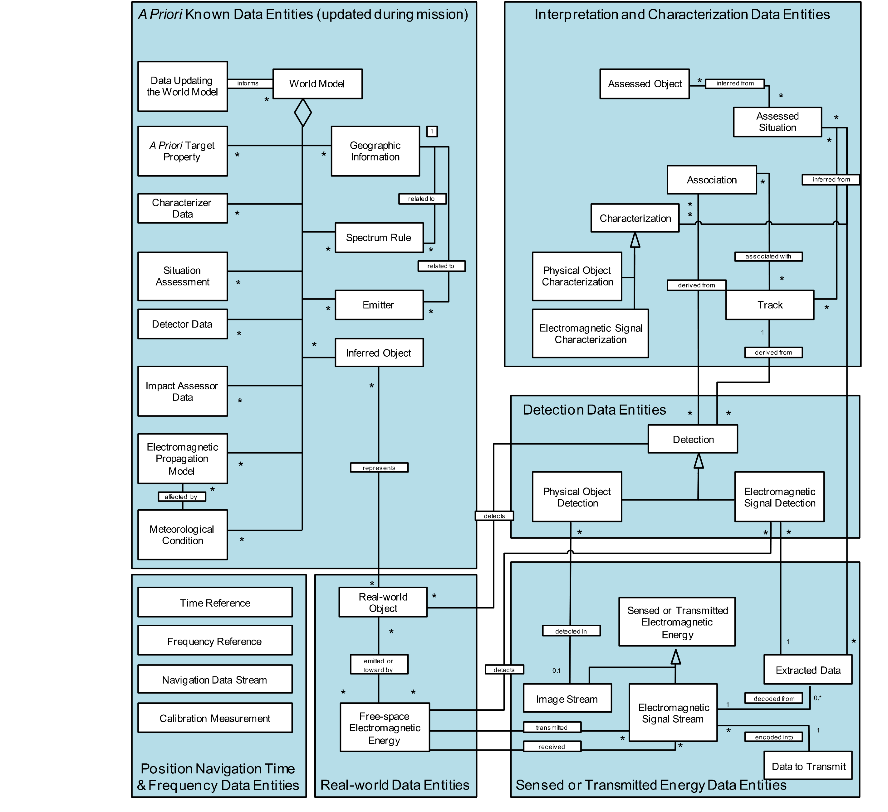

*Figure 12: DIV-1 for Mission Entities ｜ 图 12：任务实体的 DIV-1*

<!-- 原书 p.68 ｜ PDF p.88 -->

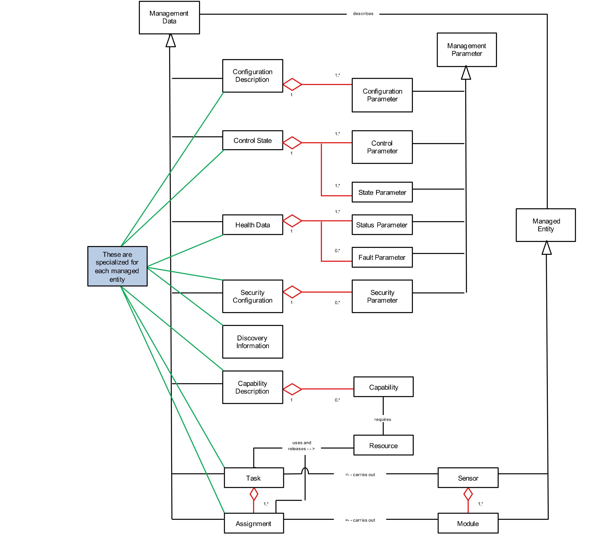

*Figure 13: DIV-1 for Management Entities ｜ 图 13：管理实体的 DIV-1*

##### 4.2.2 DIV-2: Logical Data Model ｜ 4.2.2 DIV-2：逻辑数据模型

The SOSA DIV-2 (Logical Data Model) further decomposes the abstract entities in the DIV-1 into specific pieces of information (e.g., a track is broken down into its constituent parts, such as three dimensions of position, three dimensions of velocity, etc.). It is documented in a tabular form. It should be noted that the DIV-2 does not define the physical representation (e.g., number of digits, precision, etc.) so that the same data item can be represented differently depending on the need. The physical representation will be documented in the DIV-3 (still to be done for most of the SOSA data entities). To view DIV-2 and DIV-3 Distribution A spreadsheets, refer to files listed in Appendix D and Appendix E.

SOSA DIV-2（逻辑数据模型）把 DIV-1 中的抽象实体进一步分解为具体的信息件（例如一条航迹被分解为其构成部分，如三个维度的位置、三个维度的速度等）。它以表格形式记载。宜注意，DIV-2 不规定物理表示（如位数、精度等），以便同一数据项可按需以不同方式表示；物理表示将在 DIV-3 中记载（SOSA 的多数数据实体仍有待完成）。查看 DIV-2 与 DIV-3 的分发 A 电子表格，见附录 D 与附录 E 所列文件。

<!-- 原书 p.69 ｜ PDF p.89 -->

##### 4.2.3 DIV-3: Physical Data Model ｜ 4.2.3 DIV-3：物理数据模型

#### 4.3 Service Architecture ｜ 4.3 服务架构

4.3.1 SvcV-6: Services Resources Flow Matrix

4.3.1 SvcV-6：服务资源流矩阵

Planned for a later version of the SOSA Technical Standard.

计划在 SOSA 技术标准的后续版本中给出。

#### 4.4 System Architecture ｜ 4.4 系统架构

##### 4.4.1 SV-2: Systems Resource Flow Description ｜ 4.4.1 SV-2：系统资源流描述

Planned for a later version of the SOSA Technical Standard.

计划在 SOSA 技术标准的后续版本中给出。

##### 4.4.2 SV-3: Systems-Systems Matrix ｜ 4.4.2 SV-3：系统-系统矩阵

Planned for a later version of the SOSA Technical Standard.

计划在 SOSA 技术标准的后续版本中给出。

#### 4.5 Box-Level Hardware ｜ 4.5 整机级硬件

The hardware aspects of the SOSA Architecture are defined as a “box-level” specification applicable to a variety of sensor/avionics platforms that are modular all the way down to the plug-in card level (where a plug-in card as defined here is an individual card that fits into the box). The system is inherently interoperable, compatible with non-conformant SOSA hardware via a set of standard bridge interfaces, capable of plug-and-play, upgradable (evolvable), scalable, and scalable through adaptation of technology and target platform evolution (see Figure 14).

SOSA 架构的硬件方面定义为一项“整机级”（box-level）规格，适用于多种传感器／航电平台；这些平台一路模块化到插卡级（此处的插卡指一张能装入整机的独立卡）。系统本质上是互操作的：它通过一组标准桥接接口与非符合 SOSA 的硬件兼容，具备即插即用、可升级（可演进）、可扩展，且可随技术与目标平台的演进而扩展（见图 14）。

<!-- 原书 p.70 ｜ PDF p.90 -->

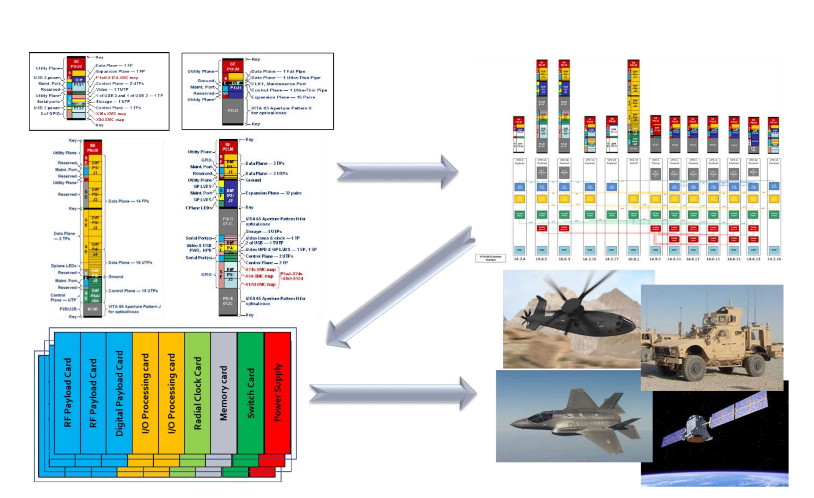

*Figure 14: SOSA Hardware Building Blocks ｜ 图 14：SOSA 硬件构建块*

<!-- 原书 p.71 ｜ PDF p.91 -->

## 第 5 章 SOSA 技术标准

> 分册文件：`SOSA参考架构技术标准-v1.0.2/05-sosa-technical-standard.md`；原册题：5 SOSA Technical Standard ｜ 5 SOSA 技术标准

> 原书 p.72–172 ｜ PDF p.92–192

This Technical Standard provides testable rules and conformance testing approaches for each SOSA module and hardware element defined by the SOSA Architecture.

本技术标准为 SOSA 架构所定义的每个 SOSA 模块与硬件元素提供可测试的规则与符合性测试方法。

#### 5.1 Host Vehicle/SOSA Sensor Interface ｜ 5.1 宿主载具／传感器接口

##### 5.1.1 Sensor Physical Packages ｜ 5.1.1 传感器物理封装

###### 5.1.1.1 Pods ｜ 5.1.1.1 吊舱

Requirements, written as rules in Export Administration Regulations (EARS).

需求，按《出口管理条例》（Export Administration Regulations，EARS）以规则形式写就。

> **译注**：`EARS` 在此处按字面展开为《出口管理条例》（Export Administration Regulations），与原书上下文（要求以规则形式写就）不合——该缩写通常指 `Easy Approach to Requirements Syntax`（撰写需求的简易方法）；英文照录不改，中文照字面译。

##### 5.1.2 Mechanical Interfaces ｜ 5.1.2 机械接口

For this version, the only standardized interface defined is for turreted sensors as defined in AS6169. Future versions will expand on these standards to include other sensor mounting schemes.

本版之中，所定义的唯一标准化接口是转塔式传感器的接口，其定义见 AS6169。后续版本将扩展这些标准，以纳入其他传感器安装方案。

5.1.2.1 Classes of Turreted Sensors

5.1.2.1 转塔式传感器类别

Various turreted sensors are defined in Table 6 based on the diameter of a given sensor package. This document was developed to address the majority of sensor package sizes available on the market.

表 6 依据给定传感器封装的直径定义了各类转塔式传感器。本文件是为覆盖市场上可得的大多数传感器封装尺寸而制定的。

**Table 6: Turreted Sensor Classes ｜ 表 6：转塔式传感器类别**

| Class ／ 类别 | Sensor Package Diameter ／ 传感器封装直径 |
|---|---|
| Class I ／ I 类 | >19 in ／ 大于 19 英寸 |
| Class II ／ II 类 | 13 to 19 in ／ 13 至 19 英寸 |
| Class III ／ III 类 | 9 to 13 in ／ 9 至 13 英寸 |
| Class IV ／ IV 类 | 6 to 9 in ／ 6 至 9 英寸 |

The SOSA electrical standard will describe sensor pin outs for Class I and Class II sensors at this time. Class III and Class IV sensors do not have the physical space available to accommodate all signals outlined in the standard. Future implementations of the standard could include a limited subset of the standard that applies to Class III and IV sensors.

SOSA 电气标准此时将描述 I 类与 II 类传感器的引脚引出。III 类与 IV 类传感器没有可用的物理空间来容纳本标准所勾勒的全部信号。该标准的后续实现可包含适用于 III 类与 IV 类传感器的标准受限子集。

<!-- 原书 p.72 ｜ PDF p.92 -->

#### 5.2 SOSA Sensor Physical Interfaces ｜ 5.2 SOSA 传感器物理接口

##### 5.2.1 Electrical Connector Characteristics ｜ 5.2.1 电气连接器特性

There are ten signal types defined by this electrical standard. Table 7 describes the connector’s type and size as well as which sensor modalities can use which connector. J2 Signals are required for all modalities, but pin allocations may differ depending on mission. Connector genders are for each signal type are described below in Table 7. Detailed requirements for each connector type, defined separately for each modality of sensor, are defined in later sections. For Naval Aviation, only connectors which can withstand a minimum of 500 h salt spray per MIL-STD-1344 Method 1001: Test Method for Electrical Connectors shall be used.

本电气标准定义了十种信号类型。表 7 描述连接器的类型与尺寸，以及哪些传感器模态可使用哪种连接器。J2 信号为所有模态所必需，但引脚分配可依任务不同而异。各信号类型的连接器性别在下文表 7 中描述。各连接器类型的详细需求按每种传感器模态分别定义，见后续各节。对于海军航空，只应使用能承受 MIL-STD-1344 Method 1001《电气连接器试验方法》所规定盐雾试验至少 500 h 的连接器。

**Table 7: Sensor Connectors ｜ 表 7：传感器连接器**

|  | J1 DC Power ／ J1 直流电源 | J2 Signal ／ J2 信号 | J3 Video (Copper) ／ J3 视频（铜） | J4 Fiber Optic ／ J4 光纤 | J5 GPS Antenna ／ J5 GPS 天线 | J6 Aux DC Power ／ J6 辅助直流电源 | J7 Aux DC Power ／ J7 辅助直流电源 | J8 High Density RF ／ J8 高密度射频 | J9 Low Loss RF ／ J9 低损耗射频 | J10 AC Power ／ J10 交流电源 |
|---|---|---|---|---|---|---|---|---|---|---|
| Modality Support ／ 模态支持 | All ／ 全部 | All ／ 全部 | EO-IR, Comms ／ 光电／红外、通信 | All ／ 全部 | All ／ 全部 | All ／ 全部 | All ／ 全部 | Radar/SAR, EW, SIGINT, Comms ／ 雷达／SAR、电子战、信号情报、通信 | Radar/SAR, EW, SIGINT, Comms ／ 雷达／SAR、电子战、信号情报、通信 | Radar/SAR, EW, SIGINT, Comms ／ 雷达／SAR、电子战、信号情报、通信 |
| Type ／ 类型 | MIL-DTL-38999/Series III | MIL-DTL-38999/Series III | MIL-DTL-38999/Series III | MIL-DTL-38999/Series III | MIL-PRF-39012 | MIL-DTL-38999/Series III | TBD | MIL-DTL-38999/Series III | MIL-DTL-38999/Series III | MIL-DTL-38999/Series III |
| Shell Size ／ 壳体号 | 21 | 25 | 17 | 19 | TNC | 21 | 17 | 25 | 25 | 17 |
| Sensor LRU Gender ／ 传感器 LRU 侧性别 | Receptacle with pin inserts ／ 带插针的插座 | Receptacle with socket inserts ／ 带插孔的插座 | Receptacle with socket inserts ／ 带插孔的插座 | Receptacle with socket inserts for fiber optics ／ 带插孔的光纤插座 | Receptacle ／ 插座 | Receptacle with pin inserts ／ 带插针的插座 | Receptacle with pin inserts ／ 带插针的插座 | Receptacle with socket inserts ／ 带插孔的插座 | Receptacle with socket inserts ／ 带插孔的插座 | Receptacle with pin inserts ／ 带插针的插座 |
| Platform Umbilical Gender ／ 平台脐带缆侧性别 | Plug with socket inserts ／ 带插孔的插头 | Plug with pin inserts ／ 带插针的插头 | Plug with pin inserts ／ 带插针的插头 | Plug with pin inserts for fiber optics ／ 带插针的光纤插头 | Plug ／ 插头 | Plug with socket inserts ／ 带插孔的插头 | Plug with socket inserts ／ 带插孔的插头 | Plug with pin inserts ／ 带插针的插头 | Plug with pin inserts ／ 带插针的插头 | Plug with socket inserts ／ 带插孔的插头 |
| Keying ／ 键位 | N | N | N | N | - | A | N | N | N | N |
| Insert ／ 插针排布 | 21-11 | 25-7 | 17-8 | 19-11 | - | 21-11 |  | 25-19 | 25-8 | 17-6 |

> 转写说明：表头竖向排版的多行单元格按原顺序拼为一行（如 `J8 High Density RF`）。格内因列宽折行的文字按原顺序合并为一行，未保留折行（如 `MIL-DTL-38999/Series III`、`Radar/SAR, EW, SIGINT, Comms`、`Receptacle with socket inserts for fiber optics`）。首列表头格在原表为空白格；J7 的 Insert 格在原表为空白（非短横）。

> **译注**：表 7 首列 `Sensor LRU Gender`／`Platform Umbilical Gender` 中的 `LRU` 即 `Line Replaceable Unit`（航线可更换单元），缩写原样保留；`Umbilical` 指传感器与平台之间的脐带缆。

J8

J8（原书残块，无中文可译）

- J3 J4 J5 J6 J7 High J9 J J2 Video Fiber GPS Aux DC Aux DC Density LOI Loss J10 DC Power Signal (Copper) Optic Antenna Power Power R RR AC Power Nodality All AIl EO- y AIl All AII AIl Radarl Radarl Radarl Support Comms SAR, ET SAR, EW SAR, EW_ SIGINI, SIGINT, SIGINT, Comms Comms Comms Type MI-DTL- MIL-DTL MILDTL MIL-DTL MIL-PRF MILDTL TBD MILDTL- MILDTL MILDTL 389991 389991 389991 389991 39012 389991 389991 389991 389991 Series III Series III Series III Series II Series II Series III Series II Series III Shell Size 21 25 17 19 TNC 21 17 25 25 17 Sensor LRU Receptacle Receptacle Receptacle Receptacle Receptacle Receptacle Receptacle Receptacle Receptacle Receptacle Gender With Pin With socket With socket With socket With Pin with Pin with socket With socket With Pin iserts inserts inserts iserts for inserts inserts inserts inserts inserts fiber optics Platform PlugWith PlugWith PlugWith Plugwith Plug PlugVith PlugVith PlugWith PlugWith PlugWith Umbilical socket pin inserts pin inserts pin inserts socket socket Pin inserts pin inserts socket Gender inserts for fiber inserts iserts inserts optics Keying N N N A N N N Insert 21-11 25-7 17-8 19-11 21-11 25-19 25-8 17-6

- J3 J4 J5 J6 J7 高密度 J9 J 低损耗 J2 视频（铜） 光纤 GPS 天线 辅助直流 辅助直流 射频 J10 直流电源 信号 电源 电源 交流电源 模态 全部 全部 光电- 全部 全部 全部 全部 雷达 雷达 雷达 支持 通信 红外 SAR、 SAR、 SAR、 电子战 信号情报、 信号情报、 信号情报、 电子战 通信 通信 通信 类型 MI-DTL- MIL-DTL MILDTL MIL-DTL MIL-PRF MILDTL TBD MILDTL- MILDTL MILDTL 389991 389991 389991 389991 39012 389991 389991 389991 389991 Series III Series III Series III Series II Series II Series III Series II Series III 壳体号 21 25 17 19 TNC 21 17 25 25 17 传感器 LRU 插座 插座 插座 插座 插座 插座 插座 插座 插座 插座 性别 带插针 带插孔 带插孔 带插孔 带插针 带插针 带插孔 带插孔 带插针 插针 插件 插件 插件 （光纤） 插件 插件 插件 插件 插件 光纤 平台 带插孔 带插针 带插针 带插针 插头 带插孔 带插孔 带插针 带插针 带插孔 脐带缆 插头 插头 插头 插头 插头 插头 插头 插头 插头 插头 性别 （光纤） 插件 键位 N N N A N N N 插针排布 21-11 25-7 17-8 19-11 21-11 25-19 25-8 17-6

> **译注**：以上「J8」一段（其下中文括注系译者所加，用以标明该段无可译内容）与随后的项目符号段，系表 7 在英文转换时把该表续页图版又逐字识别了一遍所得的残块：横幅被割裂、列序错乱、字词残缺（如 `Nodality` 当作 `Modality`、`AII`／`AIl` 当作 `All`、`iserts` 当作 `inserts`、`Series II` 当作 `Series III`、`PlugVith`／`Plugwith` 当作 `Plug with`）。英文照录不改，中文按可辨字面顺序译出，未替原文纠错。

##### 5.2.2 J1-DC Power Connector ｜ 5.2.2 J1 直流电源连接器

The J1 Power Connector shall have a 21-11 insert pattern as shown in Figure 15. Signals for the J1 Power Connector shall be assigned to pins in accordance with Table 8.

J1 电源连接器应具有 21-11 插针排布，如图 15 所示。J1 电源连接器的诸信号应依照表 8 分配到引脚。

<!-- 原书 p.73 ｜ PDF p.93 -->

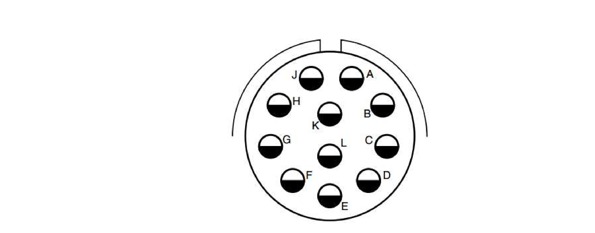

*Figure 15: J1 Power Connector Pin Arrangement ｜ 图 15：J1 电源连接器引脚排列*

**Table 8: J1 DC Power Connector Pin Allocation ｜ 表 8：J1 直流电源连接器引脚分配**

| J1-DC Power (21-11 insert, N-Keying) Sensor MIL-DTL-38999/M39029/58-365 (receptacle with pin inserts) Platform Umbilical MIL-DTL-38999/M39029/56-353 (plug with sockets inserts) J1 直流电源（21-11 插针排布，N 键位） 传感器 MIL-DTL-38999/M39029/58-365（带插针的插座） 平台脐带缆 MIL-DTL-38999/M39029/56-353（带插孔的插头） |  |  |  |  |  | EO-IR Turreted Sensor ／ 光电／红外转塔式传感器 | Radar/SAR Turreted Sensor ／ 雷达／SAR 转塔式传感器 | EW Sensor ／ 电子战传感器 | SIGINT Sensor ／ 信号情报传感器 | Comms ／ 通信 |
|---|---|---|---|---|---|---|---|---|---|---|
| Conn/ Desc. ／ 连接器／说明 | Pin ／ 引脚 | Wire Type ／ 导线类型 | Signal Name ／ 信号名 | Signal Source ／ 信号来源 | Signal Type ／ 信号类型 | Used ／ 使用 | Used ／ 使用 | Used ／ 使用 | Used ／ 使用 | Used ／ 使用 |
|  | D | SC-AWG12 | DC-1 | Platform ／ 平台 | 28V DC@15A | ✓ | ✓ | ✓ | ✓ | ✓ |
|  | E | SC-AWG12 | DC-1 RTN | Platform ／ 平台 | DC RTN | ✓ | ✓ | ✓ | ✓ | ✓ |
|  | F | SC-AWG12 | DC-2 | Platform ／ 平台 | 28V DC@15A | ✓ | ✓ | ✓ | ✓ | ✓ |
|  | L | SC-AWG12 | DC-2 RTN | Platform ／ 平台 | DC RTN | ✓ | ✓ | ✓ | ✓ | ✓ |
|  | C | SC-AWG12 | DC-3 | Platform ／ 平台 | 28V DC@15A | ✓ | ✓ | ✓ | ✓ | ✓ |
|  | G | SC-AWG12 | DC-3 RTN | Platform ／ 平台 | DC RTN | ✓ | ✓ | ✓ | ✓ | ✓ |
|  | K | SC-AWG12 | Chassis | Platform ／ 平台 | Ground | ✓ | ✓ | ✓ | ✓ | ✓ |
|  | A | SC-AWG12 | DC-4/PWRL | Platform ／ 平台 | 28V DC@15A | ✓ | ✓ | ✓ | ✓ | ✓ |
|  | J | SC-AWG12 | DC-4/PWRL RTN | Platform ／ 平台 | DC RTN | ✓ | ✓ | ✓ | ✓ | ✓ |

> 注：Contacts which are reserved, unused, or unallocated shall be populated by a dummy plug.

> **注**：保留的、未使用的或未分配的接触件，应以虚设插头填满。

> **译注**：表 8 与表 9 两表同此处理——引脚号（`Pin`）、线径（`Wire Type`）、信号名（`Signal Name`）、信号类型（`Signal Type`，含 `28V DC@15A`、`DC RTN`、`Ground`、`Open/Closed Ckt`、`RS422`、`1000BaseT`）与「使用」各格均为代码与电气值，一律不译；只有 `Conn/ Desc.`（连接器／说明）与 `Signal Source`（信号来源）两列的词组级短格并置中文。

5.2.2.1 Power The platform shall provide to the sensor system four channels of 28 VDC power sources in accordance with MIL-STD-704F with the fourth channel reserved for laser power in EO/IR systems. Conformance Methodology: (TBD)

5.2.2.1 电源 平台应依照 MIL-STD-704F 向传感器系统提供四路 28 VDC 电源，其中第四路在光电／红外系统中保留给激光器供电。符合性方法：(TBD)

<!-- 原书 p.74 ｜ PDF p.94 -->

Each of the four channels of 28 VDC shall be independently controlled. Conformance Methodology: (TBD) The platform shall be capable of supplying 15 amps steady state per each 28 VDC channel. Inrush current shall be limited to 25 amps for 2s with a 25% duty cycle. Conformance Methodology: (TBD) The sensor shall isolate power returns or neutral in accordance with MIL-STD-704F from the chassis. Conformance Methodology: (TBD)

四路 28 VDC 中的每一路均应独立控制。符合性方法：(TBD) 平台应能为每一路 28 VDC 通道提供 15 A 稳态电流。浪涌电流应限制为 25 A、持续 2 s，占空比 25%。符合性方法：(TBD) 传感器应依照 MIL-STD-704F 把电源回线或中性线相对机壳隔离。符合性方法：(TBD)

5.2.2.2 Safety Ground This contact shall be used to provide electrical continuity between the sensor system chassis and the host platform in accordance with MIL-STD-464. Conformance Methodology: (TBD)

5.2.2.2 安全地 该接触件应用于依照 MIL-STD-464 在传感器系统机壳与宿主平台之间提供电气连通。符合性方法：(TBD)

5.2.2.3 Laser Power The platform shall provide 28 VDC power for the laser in accordance with MIL-STD-704F. Conformance Methodology: (TBD) The laser power contacts shall be used to separately power a laser device. This is intended for use with a safety-relevant device such as a laser designator. Conformance Methodology: (TBD) The platform shall be capable of supplying 15 amps steady state for laser power. Inrush current shall be limited to 25 amps for 2s with a 25% duty cycle. Conformance Methodology: (TBD)

5.2.2.3 激光器电源 平台应依照 MIL-STD-704F 为激光器提供 28 VDC 电源。符合性方法：(TBD) 激光器电源接触件应用于单独为激光装置供电。此项意在用于与安全相关的装置，如激光指示器。符合性方法：(TBD) 平台应能为激光器电源提供 15 A 稳态电流。浪涌电流应限制为 25 A、持续 2 s，占空比 25%。符合性方法：(TBD)

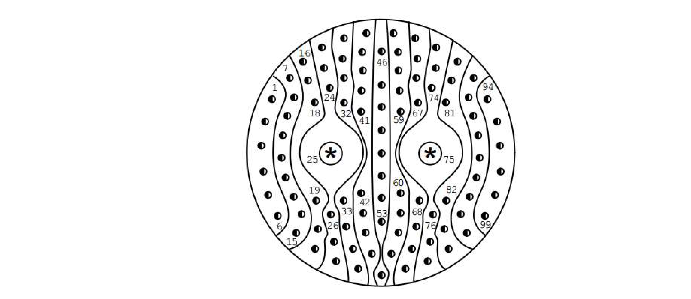

*Figure 16: J2 Signal Connector Pin Arrangement ｜ 图 16：J2 信号连接器引脚排列*

<!-- 原书 p.75 ｜ PDF p.95 -->

**Table 9: J2 Signals Connector Pin Allocation ｜ 表 9：J2 信号连接器引脚分配**

| SOSA Electrical Interface Recommendations J2-Signal (25-7 insert, N-Keying) Sensor MIL-DTL-38999/M39029/56-348 (receptacle with socket inserts) Platform Umbilical MIL-DTL-38999/M39029/58-360 (plug with pin inserts) SOSA 电气接口建议 J2 信号（25-7 插针排布，N 键位） 传感器 MIL-DTL-38999/M39029/56-348（带插孔的插座） 平台脐带缆 MIL-DTL-38999/M39029/58-360（带插针的插头） |  |  |  |  |  | EO-IR Turreted Sensor ／ 光电／红外转塔式传感器 | Radar/SAR Turreted Sensor ／ 雷达／SAR 转塔式传感器 | EW Sensor ／ 电子战传感器 | SIGINT Sensor ／ 信号情报传感器 | Comms ／ 通信 |
|---|---|---|---|---|---|---|---|---|---|---|
| Conn/ Desc. ／ 连接器／说明 | Pin ／ 引脚 | Wire Type ／ 导线类型 | Signal Name ／ 信号名 | Signal Source ／ 信号来源 | Signal Type ／ 信号类型 | Used ／ 使用 | Used ／ 使用 | Used ／ 使用 | Used ／ 使用 | Used ／ 使用 |
| Power Enable Discrete ／ 电源使能离散量 | 46 | STP 2419 | PWR_EN | Platform ／ 平台 | Open/Closed Ckt | ✓ | ✓ | ✓ | ✓ | ✓ |
|  | 47 | STP 2419 | PWR_EN_RTN | Platform ／ 平台 | Open/Closed Ckt | ✓ | ✓ | ✓ | ✓ | ✓ |
| Ethernet ／ 以太网 | 28 | 100Ω STP-2419 | DA+ | Platform/Sensor ／ 平台／传感器 | 1000BaseT | ✓ | ✓ | ✓ | ✓ | ✓ |
|  | 35 | 100Ω STP-2419 | DA- | Platform/Sensor ／ 平台／传感器 | 1000BaseT | ✓ | ✓ | ✓ | ✓ | ✓ |
|  | 36 | Shield | DA Shield | Platform/Sensor ／ 平台／传感器 |  | ✓ | ✓ | ✓ | ✓ | ✓ |
|  | 44 | 100Ω STP-2419 | DB+ | Platform/Sensor ／ 平台／传感器 | 1000BaseT | ✓ | ✓ | ✓ | ✓ | ✓ |
|  | 53 | 100Ω STP-2419 | DB- | Platform/Sensor ／ 平台／传感器 | 1000BaseT | ✓ | ✓ | ✓ | ✓ | ✓ |
|  | 62 | Shield | DB Shield | Platform/Sensor ／ 平台／传感器 |  | ✓ | ✓ | ✓ | ✓ | ✓ |
|  | 45 | 100Ω STP-2419 | DC+ | Platform/Sensor ／ 平台／传感器 | 1000BaseT | ✓ | ✓ | ✓ | ✓ | ✓ |
|  | 54 | 100Ω STP-2419 | DC- | Platform/Sensor ／ 平台／传感器 | 1000BaseT | ✓ | ✓ | ✓ | ✓ | ✓ |
|  | 63 | Shield | DC Shield | Platform/Sensor ／ 平台／传感器 |  | ✓ | ✓ | ✓ | ✓ | ✓ |
|  | 70 | 100Ω STP-2419 | DD+ | Platform/Sensor ／ 平台／传感器 | 1000BaseT | ✓ | ✓ | ✓ | ✓ | ✓ |
|  | 71 | 100Ω STP-2419 | DD- | Platform/Sensor ／ 平台／传感器 | 1000BaseT | ✓ | ✓ | ✓ | ✓ | ✓ |
|  | 78 | Shield | DD Shield | Platform/Sensor ／ 平台／传感器 |  | ✓ | ✓ | ✓ | ✓ | ✓ |
| Serial Comms 1 ／ 串行通信 1 | 7 | 100 Ohm STP 2419 | TX1+ | Sensor ／ 传感器 | RS422 | ✓ | ✓ | ✓ | ✓ | ✓ |
|  | 8 | 100 Ohm STP 2419 | TX1- | Sensor ／ 传感器 | RS422 | ✓ | ✓ | ✓ | ✓ | ✓ |
|  | 17 | SC-AWG24 | 422_1_RTN |  | RS422 | ✓ | ✓ | ✓ | ✓ | ✓ |
|  | 16 | 100 Ohm STP 2419 | RX1+ | Platform ／ 平台 | RS422 | ✓ | ✓ | ✓ | ✓ | ✓ |
|  | 23 | 100 Ohm STP 2419 | RX1- | Platform ／ 平台 | RS422 | ✓ | ✓ | ✓ | ✓ | ✓ |
| Serial Comms 2 ／ 串行通信 2 | 22 | 100 Ohm STP 2419 | TX2+ | Sensor ／ 传感器 | RS422 | ✓ | ✓ | ✓ | ✓ | ✓ |
|  | 30 | 100 Ohm STP 2419 | TX2- | Sensor ／ 传感器 | RS422 | ✓ | ✓ | ✓ | ✓ | ✓ |
|  | 29 | SC-AWG24 | 422_2_RTN |  | RS422 | ✓ | ✓ | ✓ | ✓ | ✓ |
|  | 37 | 100 Ohm STP 2419 | RX2+ | Platform ／ 平台 | RS422 | ✓ | ✓ | ✓ | ✓ | ✓ |
|  | 38 | 100 Ohm STP 2419 | RX2- | Platform ／ 平台 | RS422 | ✓ | ✓ | ✓ | ✓ | ✓ |
| Serial Comms 3 ／ 串行通信 3 | 55 | 100 Ohm STP 2419 | TX3+ | Sensor ／ 传感器 | RS422 | ✓ | ✓ | ✓ | ✓ | ✓ |
|  | 56 | 100 Ohm STP 2419 | TX3- | Sensor ／ 传感器 | RS422 | ✓ | ✓ | ✓ | ✓ | ✓ |
|  | 64 | SC-AWG24 | 422_1_RTN |  | RS422 | ✓ | ✓ | ✓ | ✓ | ✓ |
|  | 65 | 100 Ohm STP 2419 | RX3+ | Platform ／ 平台 | RS422 | ✓ | ✓ | ✓ | ✓ | ✓ |
|  | 72 | 100 Ohm STP 2419 | RX3- | Platform ／ 平台 | RS422 | ✓ | ✓ | ✓ | ✓ | ✓ |
| Serial Comms 4 ／ 串行通信 4 | 73 | 100 Ohm STP 2419 | TX4+ | Sensor ／ 传感器 | RS422 | ✓ | ✓ | ✓ | ✓ | ✓ |
|  | 79 | 100 Ohm STP 2419 | TX4- | Sensor ／ 传感器 | RS422 | ✓ | ✓ | ✓ | ✓ | ✓ |
|  | 80 | SC-AWG24 | 422_1_RTN |  | RS422 | ✓ | ✓ | ✓ | ✓ | ✓ |
|  | 85 | 100 Ohm STP 2419 | RX4+ | Platform ／ 平台 | RS422 | ✓ | ✓ | ✓ | ✓ | ✓ |
|  | 86 | 100 Ohm STP 2419 | RX4- | Platform ／ 平台 | RS422 | ✓ | ✓ | ✓ | ✓ | ✓ |
| Emission Arming ／ 发射解锁 | 2 | AWG22 | MASTER_ARM | Platform ／ 平台 | open/closed ckt | ✓ |  |  |  |  |
|  | 95 | AWG22 | MASTER_ARM_RET | Platform ／ 平台 | open/closed ckt | ✓ |  |  |  |  |

> 转写说明：第 1 行横幅单元格在原表横跨 Conn/Desc.～Signal Type 共 6 列，本表只在其首格填写，其余 5 格留空。Conn/Desc. 列在原表按组纵向合并，本表只在合并组首行填写、其余行留空：Power Enable Discrete 合并 2 行（46、47）；Ethernet 合并 12 行（28、35、36、44、53、62、45、54、63、70、71、78）；Serial Comms 1 合并 5 行（7、8、17、16、23）；Serial Comms 2 合并 5 行（22、30、29、37、38）；Serial Comms 3 合并 5 行（55、56、64、65、72）；Serial Comms 4 合并 5 行（73、79、80、85、86）；Emission Arming 合并 2 行（2、95）。
>
> 转写说明：第 16、23 行位于续页，续页重复了横幅与表头；其 Conn/Desc. 格在原表即为空白（沿用上页 Serial Comms 1 的合并区）。格内因列宽折行的文字按原顺序合并为一行（如 `100Ω STP-2419`、`100 Ohm STP 2419`、`Platform/Sensor`、`Emission Arming`、`MASTER_ARM`）。

Power 46 STP 2419 PWR EN Platform Open/Closed Ckt

电源 46 STP 2419 PWR EN 平台 开路／闭路

> **译注**：自本段起、至「原书 p.77」页锚之前的若干段，系表 9 各续页图版在英文转换时被逐行识别所留下的残块——横幅、数据行与页脚被割裂成多段，列序错乱、字词残缺（如 `Platforml` 当作 `Platform`、`1000Baser`／`100OBaseT`／`I000Baser` 当作 `1000BaseT`、`R8422` 当作 `RS422`、`MASTER AR` 当作 `MASTER_ARM`、`openlclosed ckt` 当作 `open/closed ckt`）。英文照录不改，中文按可辨字面逐段译出，未替原文纠错。

Enable

使能

Discrete

离散量

41 STP 2419 PWR EN RTN Platform Open/Closed Ckt

41 STP 2419 PWR EN RTN 平台 开路／闭路

Ethernet 28 1000 STP DA+ Platforml 1000Baser 2419 Sensor 35 1000 STP DA- Platforml 100OBaseT 2419 Sensor 36 Shield DA Shield Platforml Sensor 44 1008 STP DB+ Platform/ 1000Baser 2419 Sensor 53 1000 STP DB- Platform/ 100OBaseT 2419 Sensor Shield DB Shield Platforml Sensor 45 1000 STP DC+ Platform/ 1000Baser 2419 Sensor 54 1000 STP- DC Platforml 10OOBaseT 2419 Sensor 63 Shield DC Shield Platforml Sensor 70 1000 STP. DD+ Platforml I000Baser 2419 Sensor 1000 STP DD Platform/ 1000Baser 2419 Sensor 78 Shield DD Shield Platformml Sensor Serial 100 Ohm STP TX1+ Sensor RS422 Comms 2419

以太网 28 1000 STP DA+ 平台 1000Baser 2419 传感器 35 1000 STP DA- 平台 100OBaseT 2419 传感器 36 屏蔽 DA 屏蔽 平台 传感器 44 1008 STP DB+ 平台 1000Baser 2419 传感器 53 1000 STP DB- 平台 100OBaseT 2419 传感器 屏蔽 DB 屏蔽 平台 传感器 45 1000 STP DC+ 平台 1000Baser 2419 传感器 54 1000 STP- DC 平台 10OOBaseT 2419 传感器 63 屏蔽 DC 屏蔽 平台 传感器 70 1000 STP. DD+ 平台 I000Baser 2419 传感器 1000 STP DD 平台 1000Baser 2419 传感器 78 屏蔽 DD 屏蔽 平台 传感器 串行 100 欧姆 屏蔽双绞线 TX1+ 传感器 RS422 通信 2419

100 Ohm STP TX1 Sensor R8422

100 欧姆 屏蔽双绞线 TX1 传感器 R8422

17 SC-AWG24 422 1 RTN R8422

17 SC-AWG24 422 1 RTN R8422（原书残块，无可译内容）

<!-- 原书 p.76 ｜ PDF p.96 -->

16 100 Ohm STP RXI+ Platform RS422

16 100 欧姆 屏蔽双绞线 RXI+ 平台 RS422

23 100 Ohm STP RXI - Platform RS422

23 100 欧姆 屏蔽双绞线 RXI - 平台 RS422

Serial 22 100 Ohm STP TX2+ Sensor R8422 Comms 2419

串行 22 100 欧姆 屏蔽双绞线 TX2+ 传感器 R8422 通信 2419

30 100 Ohm STP TX2- Sensor RS422

30 100 欧姆 屏蔽双绞线 TX2- 传感器 RS422

29 SC-AWG24 422_2 RTN R8422 37 100 Ohm STP RX2t Platform R8422

29 SC-AWG24 422_2 RTN R8422 37 100 欧姆 屏蔽双绞线 RX2t 平台 R8422

38 100 Ohm STP RX2- Platform R8422

38 100 欧姆 屏蔽双绞线 RX2- 平台 R8422

Serial 55 100 Ohm STP TX3+ Sensor RS422 Comms 2419

串行 55 100 欧姆 屏蔽双绞线 TX3+ 传感器 RS422 通信 2419

56 100 Ohm STP TX3- Sensor RS422

56 100 欧姆 屏蔽双绞线 TX3- 传感器 RS422

64 SC-AWG24 422_1_RTN RS422 65 100 Ohm STP RX3+ Platform R8422

64 SC-AWG24 422_1_RTN RS422 65 100 欧姆 屏蔽双绞线 RX3+ 平台 R8422

72 100 Ohm STP RX3 - Platform RS422

72 100 欧姆 屏蔽双绞线 RX3 - 平台 RS422

Serial 73 100 Ohm STP TX4+ Sensor RS422 Comms 2419

串行 73 100 欧姆 屏蔽双绞线 TX4+ 传感器 RS422 通信 2419

79 100 Ohm STP TX4- Sensor R8422

79 100 欧姆 屏蔽双绞线 TX4- 传感器 R8422

80 SC-ATG24 422_1_ RTN RS422 85 100 Ohm STP RX4+ Platform RS422

80 SC-ATG24 422_1_ RTN RS422 85 100 欧姆 屏蔽双绞线 RX4+ 平台 RS422

86 100 Ohm STP RX4- Platform R8422

86 100 欧姆 屏蔽双绞线 RX4- 平台 R8422

Emi- AWG22 MASTER AR Platform openlclosed ckt SSion M

Emi- AWG22 MASTER AR 平台 开路／闭路 SSion M

Arming

解锁

95 AWG22 MASTER AR Platform openlclosed ckt

95 AWG22 MASTER AR 平台 开路／闭路

### M REI

> **译注**：上行为原书页面残块（`REI` 一词的识别残迹，原书此处属页脚／图版标记一类的重复字串），内容无实义、无从翻译；层级符号照原样保留，未并合、未删除。

<!-- 原书 p.77 ｜ PDF p.97 -->

SOSA Electrical Interface Recommendations

SOSA 电气接口建议

Jz-Signal (25-7 insert, N-Keying)

Jz-Signal（25-7 插针排布，N 键位）

- E0-I_ Radar/SAR Sensor MIL-DTL-38999/439029/56-348 (receptacle with socket inserts) Turreted Turreted EW SIGINT Platform Umbilical MIL-DTL-38999/039029/58-360 (plug with pin inserts) Sensor Sensor Sensor Sensor Comms Desc:Connl Pin Wire Type Signal Name SignalSource Signal Type Used Used Used Used Used

- E0-I_ 雷达／SAR 传感器 MIL-DTL-38999/439029/56-348（带插孔的插座） 转塔式 转塔式 电子战 信号情报 平台脐带缆 MIL-DTL-38999/039029/58-360（带插针的插头） 传感器 传感器 传感器 传感器 通信 Desc:Connl 引脚 导线类型 信号名 信号来源 信号类型 使用 使用 使用 使用 使用

> **译注**：自「原书 p.77」页锚起、至「原书 p.80」页锚之前的各段，系表 9 各续页图版顶部横幅与表头被反复识别所留下的残块；`S0SA`、`E0-I_`、`Jz-Signal`、`Desc:Connl`、`439029`／`039029`、`Manu-`／`facturer`、`Res-`／`erved`、`LVDSI`／`LVDSS` 等均为扫描残缺或断行脱落。英文照录不改，中文按可辨字面逐段译出，未替原文纠错。其中 `88,94`、`17 SC-AWG24 422 1 RTN R8422` 等段英文本身只有号码与代码、无字可译，中文侧只用括注标明其为残块。

<!-- 原书 p.78 ｜ PDF p.98 -->

S0SA Electrical Interface Recommendations

S0SA 电气接口建议

Jz-Signal (25-7 insert, N-Keying)

Jz-Signal（25-7 插针排布，N 键位）

- E0-I_ Radar/SAR Sensor MIL-DTL-38999/439029/56-348 (receptacle with socket inserts) Turreted Turreted EW SIGINT Platform Umbilical MIL-DTL-38999/039029/58-360 (plug with pin inserts) Sensor Sensor Sensor Sensor Comms

- E0-I_ 雷达／SAR 传感器 MIL-DTL-38999/439029/56-348（带插孔的插座） 转塔式 转塔式 电子战 信号情报 平台脐带缆 MIL-DTL-38999/039029/58-360（带插针的插头） 传感器 传感器 传感器 传感器 通信

Desc:Connl Pin Wire Type Signal Name SignalSource Signal Type Used Used Used Used Used

Desc:Connl 引脚 导线类型 信号名 信号来源 信号类型 使用 使用 使用 使用 使用

<!-- 原书 p.79 ｜ PDF p.99 -->

SOSA Electrical Interface Recommendations

SOSA 电气接口建议

Jz-Signal (25-7 insert, N-Keying)

Jz-Signal（25-7 插针排布，N 键位）

- E0-I_ Radar/SAR Sensor MIL-DTL-38999/439029/56-348 (receptacle with socket inserts) Turreted Turreted EW SIGINT Platform Umbilical MIL-DTL-38999/039029/58-360 (plug with pin inserts) Sensor Sensor Sensor Sensor Comms

- E0-I_ 雷达／SAR 传感器 MIL-DTL-38999/439029/56-348（带插孔的插座） 转塔式 转塔式 电子战 信号情报 平台脐带缆 MIL-DTL-38999/039029/58-360（带插针的插头） 传感器 传感器 传感器 传感器 通信

Desc:Connl Pin Wire Type Signal Name SignalSource Signal Type Used Used Used Used Used

Desc:Connl 引脚 导线类型 信号名 信号来源 信号类型 使用 使用 使用 使用 使用

LVDSI 26 100 Ohm STP

LVDSI 26 100 欧姆 屏蔽双绞线

LVDS2 18 100 Ohm STP

LVDS2 18 100 欧姆 屏蔽双绞线

LVDS3 50 100 Ohm STP

LVDS3 50 100 欧姆 屏蔽双绞线

LVDS4 83 100 Ohm STP

LVDS4 83 100 欧姆 屏蔽双绞线

LVDSS 92 100 Ohm STP

LVDSS 92 100 欧姆 屏蔽双绞线

Sensor 24,31 ATG24 SENMAN to Sensor Manu- 32,39 SENMAN_IO facturer 40,57 58,66 67,74 Res- 1,3,9, For arming erved 10,87 isolation

传感器 24,31 ATG24 SENMAN 至传感器制造商 Manu- 32,39 SENMAN_IO facturer 40,57 58,66 67,74 保留 Res- 1,3,9, 用于保险解除 erved 10,87 隔离

88,94

88,94（引脚号续行残块）

Unused 81,91

未使用 81,91

NOTE 1

注 1

- All reserved, unused, unallocated should be populated by a dummy plug. Digital data channels are to be tested for Return Loss and Near End Cross Talk (NEXT), including the connector interfaces to ensure conformance to protocol requirements. This should be applied to the Ethernet pairs, the Serial Comms 1-4 (RS422) pairs, as well as the LVDS (1-5) pairs.

- 全部保留的、未使用的、未分配的接触件宜以虚设插头填满。数字数据通道应测试回波损耗与近端串扰（NEXT），含连接器接口在内，以确保符合协议需求。此项宜适用于以太网各对、串行通信 1-4（RS422）各对，以及 LVDS（1-5）各对。

- Each signal group in Table 9 is described in more detail below. By convention of this standard, individual signal sets will have their own return line. This is done for Electromagnetic Compatibility (EMC) performance, as well as ease of platform integration.

- 表 9 中的每个信号组在下文有更详细的描述。按本标准的惯例，各个信号集各自带有回线。此举是为电磁兼容（EMC）性能，以及为便于平台集成。

- For logic levels, unless otherwise specified, “low” is defined to be safe. A voltage of greater than or equal to 18.0 VDC shall be interpreted as logic level ‘1’. A voltage level of less than or equal to 1.5 VDC shall be interpreted as logic ‘0’.

- 对于逻辑电平，除另有规定外，“低”定义为安全状态。大于或等于 18.0 VDC 的电压应解释为逻辑电平“1”。小于或等于 1.5 VDC 的电压电平应解释为逻辑“0”。

<!-- 原书 p.80 ｜ PDF p.100 -->

NOTE 2

注 2

Some acquisition programs may allow higher voltage levels to also be interpreted as logic '0'. A typical impetus for this would be the result of a system safety analysis. In such a case, it is recommended that the logic '0' threshold not exceed 15.0 VDC.

某些采办计划可能允许把更高的电压电平也解释为逻辑“0”。此事的典型推动因由会是系统安全分析的结果。在此种情形下，建议逻辑“0”的阈值不超过 15.0 VDC。

5.2.3.1 Power Enable

5.2.3.1 电源使能

The Power Enable signal is used for a controlled power up and shutdown of the sensor system. This control is necessary if the sensor system is required to execute a sequence of steps upon shutdown, steps that the sensor system would be precluded from executing if power were simply removed from the system. The Power Enable signal is controlled by the platform and when disabled, instructs the sensor to power down.

电源使能信号用于对传感器系统施行受控上电与关机。若要求传感器系统在关机时执行一串步骤，而这些步骤在只是把电源从系统上撤去的情况下会使传感器系统无法执行，则此项控制是必需的。电源使能信号由平台控制，且在被停用时指示传感器断电。

Power Enable is a switch, relay, or Solid State Relay (SSR) controlled by the platform (or human on the platform side of the interface). The switch goes across PWR_EN and PWR_EN_RTN. The sensor provides the voltage for this. Power Enable is disabled if an open circuit exists externally between the contacts (i.e., the switch is open). Power Enable is enabled if a closed circuit is externally applied between the contacts.

电源使能是一个由平台（或接口平台侧的人员）控制的开关、继电器或固态继电器（SSR）。该开关跨接于 PWR_EN 与 PWR_EN_RTN 之间。传感器为此提供电压。若各接触件之间在外部存在开路（即开关断开），则电源使能处于停用状态。若各接触件之间在外部施加闭路，则电源使能处于启用状态。

An open circuit for Power Enable shall have a resistance value greater than or equal to 100k Ω. A closed circuit for Power Enable shall have a resistance value less than 5 Ω. The maximum current shall be 100 mA. The maximum voltage shall be 30 VDC. Conformance Methodology: (TBD)

电源使能的开路，其电阻值应大于或等于 100k Ω。电源使能的闭路，其电阻值应小于 5 Ω。最大电流应为 100 mA。最大电压应为 30 VDC。符合性方法：(TBD)

###### 5.2.3.2 Ethernet Databus (Copper) 以太网数据总线（铜缆）

Gigabit Ethernet is an 8-wire (4 twisted-pair), 100 Ω connection.

千兆以太网是 8 线（4 对双绞线）、100 Ω 的连接。

The J2 Ethernet databus shall be implemented as Gigabit Ethernet. Conformance Methodology: (TBD)

J2 以太网数据总线应实现为千兆以太网。符合性方法：(TBD)

Gigabit Ethernet shall comply with IEEE 802.3-2008 for a 1000BaseT channel. The maximum cable length is 100 meters. Conformance Methodology: (TBD)

千兆以太网应就 1000BaseT 通道符合 IEEE 802.3-2008。最大电缆长度为 100 米。符合性方法：(TBD)

5.2.3.3 Serial Communications

5.2.3.3 串行通信

Up to four application-configurable serial communication ports are defined. Each port shall be compliant to TIA-422/RS422. It is expected that the first port will be used for a hand controller. It is expected that the latency of communication on this interface is critical, thus a more complex multi-layer protocol interface would not be practical.

定义了最多四个应用可配置的串行通信端口。每个端口应兼容 TIA-422/RS422。预期第一个端口将用于手持控制器。预期本接口上的通信时延至为关键，因此更复杂的多层协议接口不会实用。

These interfaces can also be used for integration with other equipment, such as moving map cueing and display systems.

这些接口也可用于与其他设备集成，例如移动地图引导与显示系统。

Note that a separate return line is included with each serial communications port for ease of platform integration.

注意，为便于平台集成，每个串行通信端口都附带一条单独的回线。

5.2.3.4 Arming and Cutouts

5.2.3.4 解保与切断

A set of ten pins is dedicated to control of energy emitting sensors such as the arming of laser devices, or RF transmission devices. This includes the selection of predefined laser suppression zone maps.

有一组十个引脚专用于能量发射型传感器的控制，例如激光器件的解保，或射频发射器件的解保。这包括选定预定义的激光抑制区图谱。

<!-- 原书 p.81 ｜ PDF p.101 -->

MASTER_ARM and MASTER_ARM_RTN are a pair of pins across a switch, relay, or SSR. In order to arm the emission device, the platform closes the switch which completes the circuit. The current which goes through it, and the voltage across it, come from the sensor. The sensor doesn’t generate its own voltage; it comes in from the platform via the power connector (this is the 28 VDC Laser Power). The platform shall provide a switch, relay, or SSR capable of handling 30 VDC with a maximum of 100mA current.

MASTER_ARM 与 MASTER_ARM_RTN 是跨接在一个开关、继电器或 SSR 上的一对引脚。为使发射器件解保，平台闭合该开关，从而接通电路。流过其中的电流与跨接其上的电压，均来自传感器。传感器并不自行产生电压；电压经电源连接器从平台引入（即 28 VDC 激光器电源）。平台应提供能够承受 30 VDC、电流最大 100mA 的开关、继电器或 SSR。

There are three No Emit Zone (NEZ) circuits. Each is a switch, relay, or SSR provided by, and independently controlled by, the platform. The three circuits have a common return (NEZ _SELECT_RTN). The platform shall provide a switch, relay, or SSR capable of handling 30 VDC for each of the three NEZ circuits. The platform shall be capable of independently controlling each of the three NEZ circuits.

有三路无发射区（NEZ）电路。每一路都是由平台提供并独立控制的开关、继电器或 SSR。这三路电路共用一个回线（NEZ _SELECT_RTN）。对三路 NEZ 电路中的每一路，平台应提供能够承受 30 VDC 的开关、继电器或 SSR。平台应能够独立控制这三路 NEZ 电路中的每一路。

There are three mode select signals using 28 VDC logic which are independently controlled by the platform. The three signals have a common return: MODE_SELECT_RTN.

有三个使用 28 VDC 逻辑的模式选择信号，由平台独立控制。这三个信号共用一个回线：MODE_SELECT_RTN。

SIMPLE ARMING – these pins form part of the power circuit for an emission device in the turret When the pins are open, power to the device is disabled; when close-circuited, power is enabled. The pins allow the integrator to connect a simple arming switch to these contacts. Pins 2 and 95 shall be used for Simple Arming.

简单解保——这些引脚构成转塔内某发射器件电源电路的一部分。引脚断开时，该器件的供电被停用；引脚短接时，供电被启用。这些引脚使集成方可以把一个简单的解保开关接到这些接触件上。引脚 2 与引脚 95 应用于简单解保。

ADVANCED ARMING CLUSTER 1 – sensor systems can have a NEZ, or Cutout Map The NEZ is a two-dimensional map, in azimuth and elevation, that defines where the device can and cannot emit. It is designed to inhibit emissions when the turret’s line-ofsight is over any part of the platform. This prevents energy from reflecting back, posing a hazard. The map is stored in the turret’s computer memory. Further, a turret may have several maps stored, enabling it to be mounted at several points on the platform, or on several platform models, without modification. In this case, a high-reliability mechanism is needed to select which map should be used. Pins 4, 5, 11, and 12 shall be used for Advanced Arming Cluster 1. Assuming that three of the four pins allocated to this function are used to select a map, up to four maps can be defined in the turret. The fourth pin would be used as a parity check for safety.

高级解保组 1——传感器系统可以有 NEZ，即切断图谱。NEZ 是一张二维图谱，以方位与俯仰定义器件可以在何处发射、不可在何处发射。它用于在转塔视线落在平台任何部位之上时抑制发射。这防止能量反射回来造成危害。图谱存储在转塔的计算机存储器中。此外，一个转塔可存储多张图谱，使其无需改动即可安装在平台上的多个位置，或安装在多个平台型号上。在此情形下，需要一个高可靠性的机制来选择宜用哪一张图谱。引脚 4、5、11 与 12 应用于高级解保组 1。假定分配给该功能的四个引脚中有三个用于选择图谱，则转塔中最多可定义四张图谱。第四个引脚将用作安全用的奇偶校验。

LASER ADVANCED ARMING CLUSTER 2 – these pins can be used in a number of ways They determine under what conditions or states the device will be used. For example, if there are multiple non-eyesafe lasers in a turret, these pins could be used to select one or more devices (secondary arm control). Pins 89, 90, 97, and 98 shall be used for advanced arming Cluster 2.

激光高级解保组 2——这些引脚可按多种方式使用。它们决定该器件将在哪些条件或状态下使用。例如，若一个转塔内有多个非眼安全的激光器，这些引脚可用于选定一个或多个器件（次级解保控制）。引脚 89、90、97 与 98 应用于高级解保组 2。

5.2.3.5 Emissions Annunciation

5.2.3.5 发射通报

The Emission signal shall be used to annunciate the firing of an emission device. Conformance

发射信号应用于通报发射器件的发射。符合性

Methodology: (TBD)

方法：(TBD)

This signal shall be a 28 VDC isolated signal. Conformance Methodology: (TBD)

本信号应为 28 VDC 的隔离信号。符合性方法：(TBD)

The maximum voltage shall be 30 VDC with a maximum current of 100mA. Conformance

最大电压应为 30 VDC，最大电流为 100mA。符合性

Methodology: (TBD)

方法：(TBD)

<!-- 原书 p.82 ｜ PDF p.102 -->

###### 5.2.3.6 Safety Status 安全状况

A set of three signal pairs is available to indicate the status of safety-relevant functions in the sensor system. These shall be 28 VDC isolated signals. These signals are controlled by the sensor. Conformance Methodology: (TBD) The maximum voltage shall be 30 VDC with a maximum current of 100mA. Conformance

有一组三个信号对，用于指示传感器系统中安全相关功能的状况。这些应为 28 VDC 的隔离信号。这些信号由传感器控制。符合性方法：(TBD) 最大电压应为 30 VDC，最大电流为 100mA。符合性

Methodology: (TBD)

方法：(TBD)

5.2.3.7 Enable Gimbal Movement

5.2.3.7 使能万向架运动

The Enable Gimbal Movement signal shall be used to indicate that the sensor system’s outer gimbal motors are to be enabled. Conformance Methodology: (TBD) This control is necessary to ensure that the turret does not move in azimuth and/or elevation at high speeds endangering individuals that may be working in close proximity to the sensor. The Enable Gimbal Movement signal originates from the sensor with the platform opening and closing the circuit. An open circuit shall indicate that the motors shall not be powered. Conformance Methodology: (TBD)

使能万向架运动信号应用于指示传感器系统的外万向架电机将被启用。符合性方法：(TBD) 该控制是必需的，以确保转塔不会以高速在方位和／或俯仰上运动，从而危及可能在传感器近旁作业的人员。使能万向架运动信号发自传感器，由平台断开与闭合该电路。开路应指示这些电机不应通电。符合性方法：(TBD)

###### 5.2.3.8 Time Synchronization – 1 PPS 时间同步——1 PPS

Wiring for a 1 PPS signal for time synchronization shall be provided. Conformance Methodology: (TBD) This signal shall be in accordance with the input time roll-over pulse (1 PPS) per ICD-GPS-

应为时间同步提供 1 PPS 信号的布线。符合性方法：(TBD) 本信号应符合 ICD-GPS- 所规定的输入时间翻转脉冲（1 PPS）

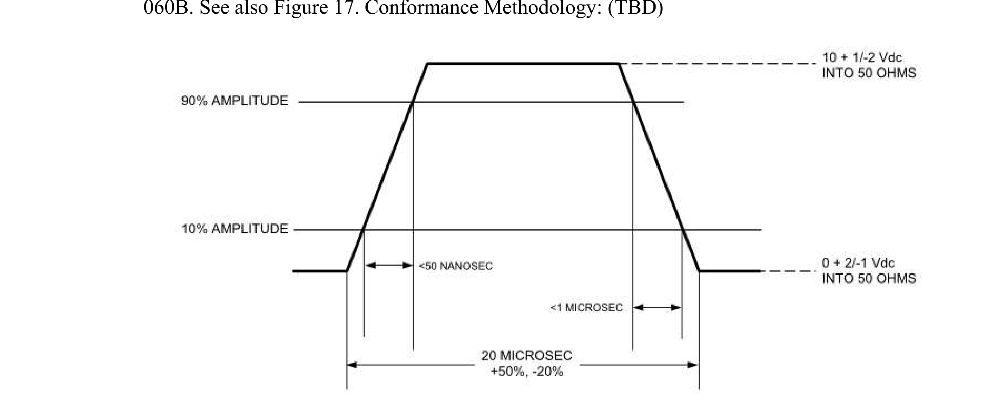

*Figure 17: Input Time Rollover Pulse (1 PPS) Signal Characteristics ｜ 图 17：输入时间翻转脉冲（1 PPS）信号特性*

5.2.3.9 Hand Controller Power

5.2.3.9 手持控制器电源

Power may be provided by the sensor to the hand controller. The maximum voltage shall be 30 VDC with a maximum current of 500mA. Conformance Methodology: (TBD)

传感器可向手持控制器供电。最大电压应为 30 VDC，最大电流为 500mA。符合性方法：(TBD)

<!-- 原书 p.83 ｜ PDF p.103 -->

5.2.3.10 Memory Purge

5.2.3.10 存储器清除

A switch closure between PURG_MEM_+ and PURG_MEM_- for 30 msec or more shall cause a memory to erase. Conformance Methodology: (TBD) The intention is for this to be routed to an encrypted drive for the clearing of mission data. Usage of this interface is implementation-specific and could be used to clear any memory that may be sensitive.

PURG_MEM_+ 与 PURG_MEM_- 之间闭合开关达 30 msec 或更久，应导致某存储器被擦除。符合性方法：(TBD) 其意图是将此接到加密驱动器，用于任务数据的清除。本接口的用法与实现相关，可用于清除任何可能敏感的存储器。

5.2.3.11 MIL-STD 1553B Twinax Inserts

5.2.3.11 MIL-STD 1553B 双轴插针排布

A set of two Size 8 Twinaxial contacts are available for MIL-STD-1553B. Pin 25 is intended for Bus A and pin 75 for Bus B.

有两个 8 号尺寸的双轴接触件可供 MIL-STD-1553B 使用。引脚 25 预定用于总线 A，引脚 75 用于总线 B。

5.2.3.12 USB Data Planned for a later version of the SOSA Technical Standard. A USB 2.0 interface shall optionally be provided by the sensor. Conformance Methodology: (TBD)

5.2.3.12 USB 数据。计划在 SOSA 技术标准的后续版本中给出。传感器应可选地提供 USB 2.0 接口。符合性方法：(TBD)

5.2.3.13 USB Power 5V +/- 5% up to 500mA shall be supplied by the sensor. Conformance Methodology: (TBD)

5.2.3.13 USB 电源。传感器应提供 5V +/- 5%、最高 500mA 的电源。符合性方法：(TBD)

5.2.3.14 LVDS These Low Voltage Differential Signal (LVDS) discrete signals are available to the sensor manufacturers for use between sensor elements.

5.2.3.14 LVDS。这些低电压差分信号（LVDS）离散信号可供传感器制造商在传感器各元素之间使用。

5.2.3.15 Sensor Manufacturer Pins A set of 10 pins are reserved for use by individual sensor system suppliers, primarily for maintenance purposes when the sensor is not connected to the platform. The platform shall not populate these pins. Conformance Methodology: (TBD)

5.2.3.15 传感器制造商引脚。有一组 10 个引脚保留给各传感器系统供应商使用，主要用于传感器未与平台连接时的维护目的。平台不应填充这些引脚。符合性方法：(TBD)

5.2.4 J3-Video (Copper) Connector The J3 Video Connector shall have a 21-11 pin arrangement as shown in Figure 18. Conformance Methodology: (TBD) Signals for the J3 Video Connector shall be assigned to pins in accordance with Table 10. Conformance Methodology: (TBD)

5.2.4 J3 视频（铜缆）连接器。J3 视频连接器应具有如图 18 所示的 21-11 插针排布。符合性方法：(TBD) J3 视频连接器的信号应按照表 10 分配到引脚。符合性方法：(TBD)

<!-- 原书 p.84 ｜ PDF p.104 -->

*Figure 18: J3 Video Connector Pin Arrangement ｜ 图 18：J3 视频连接器插针排布*

**Table 10: J3 Video Connector Pin Allocation ｜ 表 10：J3 视频连接器引脚分配**

| J3-Video (21-11 insert, N-Keying) Sensor: MIL-DTL-38999/M39029/75-416 (receptacle with socket inserts) Platform Umbilical: MIL-DTL-38999/M39029/28-211 (plug with pin inserts) J3 视频（21-11 插针排布，N 键位） 传感器：MIL-DTL-38999/M39029/75-416（插座，带插座接触件） 平台脐带：MIL-DTL-38999/M39029/28-211（插头，带插针接触件） |  |  |  |  | EO-IR Turreted Sensor ／ 光电／红外转塔式传感器 | Radar/SAR Turreted Sensor ／ 雷达／SAR 转塔式传感器 | EW Sensor ／ 电子战传感器 | SIGINT Sensor ／ 信号情报传感器 | Comms ／ 通信 |  |
|---|---|---|---|---|---|---|---|---|---|---|
| Pin 引脚 | Wire Type 线型 | Signal Name 信号名 | Signal Source 信号来源 | Signal Type 信号类型 | Used 使用 | Used 使用 | Used 使用 | Used 使用 | Used 使用 | Notes 说明 |
| A | Coax-75Ω | Digital Video Ch1 | Sensor | SMPTE 292/424 | ✓ |  |  |  | ✓ | For input from EO/IR sensor 用于来自光电／红外传感器的输入 |
| B | Coax-75Ω | Digital Video Ch2 | Sensor | SMPTE 292/424 | ✓ |  |  |  | ✓ | For input from EO/IR sensor 用于来自光电／红外传感器的输入 |
| C | Coax-75Ω | Digital Video Ch3 | Sensor | SMPTE 292/424 | ✓ |  |  |  | ✓ | For input from EO/IR sensor 用于来自光电／红外传感器的输入 |
| D | Coax-75Ω | Digital Video Ch4 | Sensor | SMPTE 292/424 | ✓ |  |  |  | ✓ | For input from EO/IR sensor 用于来自光电／红外传感器的输入 |
| E | Coax-75Ω | Analog video Ch1 Y | Sensor | RS-170a Video Luminance | ✓ |  |  |  | ✓ | For input from EO/IR sensor 用于来自光电／红外传感器的输入 |
| F | Coax-75Ω | Analog video Ch1 C | Sensor | RS-170a Video Chrominance | ✓ |  |  |  | ✓ | For input from EO/IR sensor 用于来自光电／红外传感器的输入 |
| G | Coax-75Ω | Composite Video Ch 1 | Sensor | RS-170a Composite Video | ✓ |  |  |  | ✓ | For input from EO/IR sensor 用于来自光电／红外传感器的输入 |
| H | Coax-75Ω | Composite Video Ch 2 | Sensor | RS-170a Composite Video | ✓ |  |  |  | ✓ | For input from EO/IR sensor 用于来自光电／红外传感器的输入 |
| J | Unused |  |  |  |  |  |  |  |  |  |
| K | Unused |  |  |  |  |  |  |  |  |  |
| L | Unused |  |  |  |  |  |  |  |  |  |

> 转写说明：第 1 行横幅单元格在原表横跨 Pin～Signal Type 共 5 列，本表只在其首格填写，其余 4 格留空；同行的 `Comms` 单元格在原表同时压住 Comms 与 Notes 两列（第 2 行的 `Used` 与 `Notes` 才分列），故第 1 行末格留空。第 8～12 行（H、J、K、L）位于续页，续页重复了横幅与表头。格内因列宽折行的文字按原顺序合并为一行（如 `Coax-75Ω`、`Digital Video Ch1`、`For input from EO/IR sensor`）。

> **译注**：上表之后自 `Pin TypeWire …` 起的若干段，是原书续页重复的横幅、表头与续行在转换时被打散后留下的残片（原书并未另起这些正文段）；英文照录不改，中文按残片字面逐片译出，`Coax-`、`SMPTE 292/424`、`750`、`Chl`、`I0GBase-SR4` 一类串属代码，原样保留。

Pin TypeWire Signal Name Signal Source Signal Type Used Used Used Used Used Notes

引脚 类型／线型 信号名 信号来源 信号类型 使用 使用 使用 使用 使用 说明

Coax- Digital Video Sensor SMPTE 292/424 For input 750 Chl from

同轴- 数字视频 传感器 SMPTE 292/424 用于来自 750 通道 1 的输入

EOIIR

光电／红外

SenSOr

传感器

B Coax- Digital Video Sensor SMPTE 292/424 For input 750 Ch2 from

B 同轴- 数字视频 传感器 SMPTE 292/424 用于来自 750 通道 2 的输入

EOIJ

光电／红外

Sensor

传感器

Coax- Digital Video Sensor SMPIE 292/424 For input 750 Ch3 from

同轴- 数字视频 传感器 SMPIE 292/424 用于来自 750 通道 3 的输入

EO/

光电／

Sensor

传感器

Coax- Digital Video Sensor SMPIE 292/424 For input 750 Ch4 froln

同轴- 数字视频 传感器 SMPIE 292/424 用于来自 750 通道 4 的输入

EO/J

光电／

Sensor

传感器

Coax- AnalogVideo Sensor RS-170a Video For input 750 Chl Y Luminance from

同轴- 模拟视频 传感器 RS-170a 视频 用于来自 750 通道 1 Y 亮度的输入

EO/IR

光电／红外

SensOr

传感器

Coax- Analog video Sensor RS-170a Video For input 750 Chl C Chrominance from

同轴- 模拟视频 传感器 RS-170a 视频 用于来自 750 通道 1 C 色度的输入

EO/IR

光电／红外

Sensor

传感器

Coax- Composite Sensor RS-170a For input 750 Video Ch 1 Composite Video from

同轴- 复合 传感器 RS-170a 用于来自 750 视频通道 1 复合视频的输入

EO/J

光电／

Sensor

传感器

<!-- 原书 p.85 ｜ PDF p.105 -->

J3-Video (21-11 insert, N-Keying) Sensor: MIL DTL-38999/039029/75-416 (receptacle with socket inserts)

J3 视频（21-11 插针排布，N 键位） 传感器：MIL DTL-38999/039029/75-416（插座，带插座接触件）

- R0-1 Radar/SAR Platform Umbilical: MIL-DTL-38999/039029/28-211 (plug with pin Turreted Turreted EW SIGINT inserts) Sensor Sensor Sensor Sensor Comms

- R0-1 雷达／SAR 平台脐带：MIL-DTL-38999/039029/28-211（插头，带插针 转塔式 转塔式 电子战 信号情报 接触件）传感器 传感器 传感器 传感器 通信

Pin TypeWire Signal Name Signal Source Signal Type Used Used Used Used Used Notes

引脚 类型／线型 信号名 信号来源 信号类型 使用 使用 使用 使用 使用 说明

H Coax- Composite Sensor RS-l70a For input 750 Video Ch 2 Composite Video from

H 同轴- 复合 传感器 RS-l70a 用于来自 750 视频通道 2 复合视频的输入

EO/JR

光电／红外

Sensor

传感器

Unused

未使用

K Unused

K 未使用

[ Unused Each digital channel shall comply with SMPTE 292, driving into 75 Ω #12 coax contacts, per the standard. Video channels can also be SMPTE 424M over the same wiring. Conformance Methodology: (TBD) Each analog channel shall comply with RS170a, driving into 75 Ω #12 coax contacts, per the standard. Conformance Methodology: (TBD)

[ 未使用 每个数字通道均应符合 SMPTE 292，按标准驱动到 75 Ω 的 #12 同轴接触件。视频通道也可在同一布线上采用 SMPTE 424M。符合性方法：(TBD) 每个模拟通道均应符合 RS170a，按标准驱动到 75 Ω 的 #12 同轴接触件。符合性方法：(TBD)

5.2.5 J4-Fiber Optics Connector Fiber optic shall be multi-mode fiber. The core diameter shall be 50µm ± 3µm and the cladding diameter shall be 125µm ± 2µm. Conformance Methodology: (TBD) The termini shall be butt end MIL-PRF-29504/4 (Pin) or MIL-PRF-29504/5 (Socket) which fit into size 16 entry holes. Conformance Methodology: (TBD) Ethernet Channels shall transmit and receive at 850nm per IEEE 802.3-2008 for 10GBASE-SR applications. Conformance Methodology: (TBD) SMPTE 297 Channels shall transmit low power SMPTE 292 or 424M signals at 1310nm specifically according to call out L-PC-CD-1310. Conformance Methodology: (TBD) Fiber used shall be OM2-compliant or better, as defined by ISO/IEC 11801. It is recommended that for longer path applications the cable be bend-insensitive OM4. Conformance Methodology: (TBD) The J4 Fiber Optic Connector shall have a 19-11 pin arrangement as shown in Figure 19. Conformance Methodology: (TBD) Signals for the J4 Fiber Optic Connector shall be assigned to pins in accordance with Table 11. Conformance Methodology: (TBD)

5.2.5 J4 光纤连接器。光纤应为多模光纤。纤芯直径应为 50µm ± 3µm，包层直径应为 125µm ± 2µm。符合性方法：(TBD) 端子应为对接端 MIL-PRF-29504/4（插针）或 MIL-PRF-29504/5（插座），其能装入 16 号插入孔。符合性方法：(TBD) 以太网通道应按 IEEE 802.3-2008 以 850nm 收发，用于 10GBASE-SR 应用。符合性方法：(TBD) SMPTE 297 通道应在 1310nm 上发射低功率 SMPTE 292 或 424M 信号，具体按标注 L-PC-CD-1310。符合性方法：(TBD) 所用光纤应符合 OM2 或更好，依 ISO/IEC 11801 的定义。对于路径较长的应用，推荐电缆采用弯曲不敏感的 OM4。符合性方法：(TBD) J4 光纤连接器应具有如图 19 所示的 19-11 插针排布。符合性方法：(TBD) J4 光纤连接器的信号应按照表 11 分配到引脚。符合性方法：(TBD)

<!-- 原书 p.86 ｜ PDF p.106 -->

*Figure 19: J4 Fiber Optic Connector Pin Arrangement ｜ 图 19：J4 光纤连接器插针排布*

**Table 11: J4 Fiber Optic Connector Pin Allocation ｜ 表 11：J4 光纤连接器引脚分配**

| SOSA Electrical Interface Recommendations J4-Fiber (19-11 insert, N-Keying) Sensor MIL-DTL-38999/29504/5 (receptacle with socket inserts) Platform Umbilical MIL-DTL-38999/29504/4 (plug with pin inserts) SOSA 电气接口建议 J4 光纤（19-11 插针排布，N 键位） 传感器 MIL-DTL-38999/29504/5（插座，带插座接触件） 平台脐带 MIL-DTL-38999/29504/4（插头，带插针接触件） |  |  |  |  | EO-IR Turreted Sensor ／ 光电／红外转塔式传感器 | Radar/SAR Turreted Sensor ／ 雷达／SAR 转塔式传感器 | EW Sensor ／ 电子战传感器 | SIGINT Sensor ／ 信号情报传感器 | Comms ／ 通信 |
|---|---|---|---|---|---|---|---|---|---|
| Pin 引脚 | Wire Type 线型 | Signal Name 信号名 | Signal Source 信号来源 | Signal Type 信号类型 | Used 使用 | Used 使用 | Used 使用 | Used 使用 | Used 使用 |
| A | MM Fiber | Sensor Transmit 1 | Sensor | 10GBase-SR/40GBase-SR4/100GBase-SR4 | ✓ | ✓ | ✓ | ✓ | ✓ |
| B | MM Fiber | Sensor Receive 1 | Platform | 10GBase-SR/40GBase-SR4/100GBase-SR4 | ✓ | ✓ | ✓ | ✓ | ✓ |
| C | MM Fiber | Sensor Transmit 2 | Sensor | 10GBase-SR/40GBase-SR4/100GBase-SR4 | ✓ | ✓ | ✓ | ✓ | ✓ |
| D | MM Fiber | Sensor Receive 2 | Platform | 10GBase-SR/40GBase-SR4/100GBase-SR4 | ✓ | ✓ | ✓ | ✓ | ✓ |
| E | MM Fiber | Sensor Transmit 3 | Sensor | 10GBase-SR/40GBase-SR4/100GBase-SR4 | ✓ | ✓ | ✓ | ✓ | ✓ |
| F | MM Fiber | Sensor Receive 3 | Platform | 10GBase-SR/40GBase-SR4/100GBase-SR4 | ✓ | ✓ | ✓ | ✓ | ✓ |
| G | MM Fiber | Sensor Transmit 4 | Sensor | 10GBase-SR/40GBase-SR4/100GBase-SR4 | ✓ | ✓ | ✓ | ✓ | ✓ |
| H | MM Fiber | Sensor Receive 4 | Platform | 10GBase-SR/40GBase-SR4/100GBase-SR4 | ✓ | ✓ | ✓ | ✓ | ✓ |
| J | MM Fiber | Video Ch 1 | Sensor | SMPTE 297 | ✓ |  |  |  |  |
| K | MM Fiber | Video Ch 2 | Sensor | SMPTE 297 | ✓ |  |  |  |  |
| L | MM Fiber | Video Ch 3 | Sensor | SMPTE 297 | ✓ |  |  |  |  |

> 转写说明：第 1 行横幅单元格在原表横跨 Pin～Signal Type 共 5 列，本表只在其首格填写，其余 4 格留空。第 10～11 行（K、L）位于续页，续页重复了横幅与表头。格内因列宽折行的文字按原顺序合并为一行（如 `MM Fiber`、`Sensor Receive 1`、`10GBase-SR/40GBase-SR4/100GBase-SR4`）。

Wire

线型

Pin Type Signal Name Signal Source Signal Type Used Used Used Used Used

引脚 类型 信号名 信号来源 信号类型 使用 使用 使用 使用 使用

MM Sensor Sensor I0GBase-SR/ Fiber Transmit L 40GBase-SR4/

MM 传感器 传感器 I0GBase-SR/ 光纤 发射 L 40GBase-SR4/

I00GBase-SR4

I00GBase-SR4（纯代码串，原样保留）

MM Sensor Receive Platform I0GBase-SR/ Fiber 1 40GBase-SR4/ 100GBase-SR4

MM 传感器 接收 平台 I0GBase-SR/ 光纤 1 40GBase-SR4/ 100GBase-SR4

MM Sensor Sensor IOGBase-SR/ Fiber Transmit 2 40GBase-SR4/ 100GBase-SR4

MM 传感器 传感器 IOGBase-SR/ 光纤 发射 2 40GBase-SR4/ 100GBase-SR4

MM Sensor Receive Platform I0GBase-SR/ Fiber 2 40GBase-SR4/

MM 传感器 接收 平台 I0GBase-SR/ 光纤 2 40GBase-SR4/

I0OGBase-SR4

I0OGBase-SR4（纯代码串，原样保留）

MM Sensor Sensor IOGBase-SR/ Fiber Transmit 3 40GBase-SR4/

MM 传感器 传感器 IOGBase-SR/ 光纤 发射 3 40GBase-SR4/

I0OGBase-SR4

I0OGBase-SR4（纯代码串，原样保留）

MM Sensor Receive Platform I0GBase-SR/ Fiber 3 40GBase-SR4/ 100GBase-SR4

MM 传感器 接收 平台 I0GBase-SR/ 光纤 3 40GBase-SR4/ 100GBase-SR4

MM Sensor Sensor I0GBase-SR/ Fiber Transmit 4 40GBase-SR4/

MM 传感器 传感器 I0GBase-SR/ 光纤 发射 4 40GBase-SR4/

I0OGBase-SR4

I0OGBase-SR4（纯代码串，原样保留）

MM Sensor Receive Platform I0GBase-SR/ Fiber 40GBase-SR4/ 100GBase-SR4

MM 传感器 接收 平台 I0GBase-SR/ 光纤 40GBase-SR4/ 100GBase-SR4

MM Video Ch Sensor SMPTE 297

MM 视频通道 传感器 SMPTE 297

Fiber

光纤

<!-- 原书 p.87 ｜ PDF p.107 -->

S0SA Electrical Interface Recommendations

S0SA 电气接口建议

J4-Riber (19-11 insert N-Keying)

J4-Riber（19-11 插针排布 N 键位）

- E0-I RadarlSAR Sensor MIL-DTL-38999/29504/5 (receptacle with socket inserts) Turreted Turreted EW SIGINT Platform Umbilical MIL-DTL-38999/29504/4 (plug with pin inserts) Sensor Sensor Sensor Sensor Comms Wire Pin Type Signal Name Signal Source SignalType Used Used Used Used Used k MM Video Ch 2 Sensor SMPIE 297 Fiber MM Video Ch 3 Sensor SMPTE 297

- E0-I 雷达／SAR 传感器 MIL-DTL-38999/29504/5（插座，带插座接触件）转塔式 转塔式 电子战 信号情报 平台脐带 MIL-DTL-38999/29504/4（插头，带插针接触件）传感器 传感器 传感器 传感器 通信 线型 引脚 类型 信号名 信号来源 信号类型 使用 使用 使用 使用 使用 k MM 视频通道 2 传感器 SMPIE 297 光纤 MM 视频通道 3 传感器 SMPTE 297

Fiber

光纤

##### 5.2.6 J5-GPS Antenna Connector J5 GPS 天线连接器

- When a GPS receiver internal to the sensor is being used and requires an external antenna, the J5 connector shall be used. Conformance Methodology: (TBD) These signals shall have characteristics that comply with AS6129 Appendix A (Additional Interface Requirements for GPS RF Signals). Conformance Methodology: (TBD) The J5 GPS Connector shall use TNC connectors. Conformance Methodology: (TBD)

- 当使用传感器内部的 GPS 接收机且需要外接天线时，应使用 J5 连接器。符合性方法：(TBD) 这些信号应具有符合 AS6129 附录 A（GPS 射频信号的附加接口需求）的特性。符合性方法：(TBD) J5 GPS 连接器应使用 TNC 连接器。符合性方法：(TBD)

**Table 12: J5 GPS Connector Pin Allocation ｜ 表 12：J5 GPS 连接器引脚分配**

| SOSA Electrical Interface Recommendations J5-GPS Ant (TNC) Sensor – Receptacle Platform Umbilical – Plug SOSA 电气接口建议 J5 GPS 天线（TNC） 传感器 – 插座 平台脐带 – 插头 |  |  |  |  | EO-IR Turreted Sensor ／ 光电／红外转塔式传感器 | Radar/SAR Turreted Sensor ／ 雷达／SAR 转塔式传感器 | EW Sensor ／ 电子战传感器 | SIGINT Sensor ／ 信号情报传感器 | Comms ／ 通信 |
|---|---|---|---|---|---|---|---|---|---|
| Pin 引脚 | Wire Type 线型 | Signal Name 信号名 | Signal Source 信号来源 | Signal Type 信号类型 | Used 使用 | Used 使用 | Used 使用 | Used 使用 | Used 使用 |
| Coaxial | Coax-50Ω | GPS Antenna | Platform | RF | ✓ | ✓ | ✓ | ✓ | ✓ |

> 转写说明：第 1 行横幅单元格在原表横跨 Pin～Signal Type 共 5 列，本表只在其首格填写，其余 4 格留空。横幅第 3、4 行中的横线为原表的短破折号（`–`）。格内因列宽折行的文字按原顺序合并为一行（如 `Coax-50Ω`）。

##### 5.2.7 J6-DC Auxiliary Power Connector J6 直流辅助电源连接器

- The J6 Auxiliary DC Power Connector shall have a 21-11 insert pattern as shown in Figure 20. Conformance Methodology: (TBD) Signals for the J6 Auxiliary DC Power Connector shall be assigned to pins in accordance with

- J6 辅助直流电源连接器应具有如图 20 所示的 21-11 插针排布。符合性方法：(TBD) J6 辅助直流电源连接器的信号应按照

> **译注**：本段英文止于 `in accordance with`（后无宾语）；原书此处接写 `Table 13.`，转换时该串被并入了其下的表题行（见 `**Table 13: Conformance Methodology: (TBD)**`），故中英两侧均照字面止于此，不作补。

**Table 13: Conformance Methodology: (TBD) ｜ 表 13：符合性方法：(TBD)**

| SOSA Electrical Interface Recommendations Sensor MIL-DTL-38999/M39029/58-365 (receptacle with pin inserts) Platform Umbilical MIL-DTL-38999/M39029/56-353 (plug with sockets inserts) SOSA 电气接口建议 传感器 MIL-DTL-38999/M39029/58-365（插座，带插针接触件） 平台脐带 MIL-DTL-38999/M39029/56-353（插头，带插座接触件） |  |  |  |  |  | EO-IR Turreted Sensor ／ 光电／红外转塔式传感器 | Radar/SAR Turreted Sensor ／ 雷达／SAR 转塔式传感器 | EW Sensor ／ 电子战传感器 | SIGINT Sensor ／ 信号情报传感器 | Comms ／ 通信 |
|---|---|---|---|---|---|---|---|---|---|---|
| Conn/ Desc. 连接器／说明 | Pin 引脚 | Wire Type 线型 | Signal Name 信号名 | Signal Source 信号来源 | Signal Type 信号类型 | Used 使用 | Used 使用 | Used 使用 | Used 使用 | Used 使用 |
|  | D | SC-AWG12 | DC-5 | Platform | 28V DC@15A | ✓ | ✓ | ✓ | ✓ | ✓ |
|  | E | SC-AWG12 | DC-5 RTN | Platform | DC RTN | ✓ | ✓ | ✓ | ✓ | ✓ |
|  | F | SC-AWG12 | DC-6 | Platform | 28V DC@15A | ✓ | ✓ | ✓ | ✓ | ✓ |
|  | L | SC-AWG12 | DC-6 RTN | Platform | DC RTN | ✓ | ✓ | ✓ | ✓ | ✓ |
|  | C | SC-AWG12 | DC-7 | Platform | 28V DC@15A | ✓ | ✓ | ✓ | ✓ | ✓ |
|  | G | SC-AWG12 | DC-7 RTN | Platform | DC RTN | ✓ | ✓ | ✓ | ✓ | ✓ |
|  | K | SC-AWG12 | Chassis | Platform | Ground | ✓ | ✓ | ✓ | ✓ | ✓ |
|  | A | SC-AWG12 | DC-8 | Platform | 28V DC@15A | ✓ | ✓ | ✓ | ✓ | ✓ |
|  | J | SC-AWG12 | DC-8 RTN | Platform | DC RTN | ✓ | ✓ | ✓ | ✓ | ✓ |
|  | B | SC-AWG12 | DC-9 | Platform | 28V DC@15A | ✓ | ✓ | ✓ | ✓ | ✓ |
|  | H | SC-AWG12 | DC-9 RTN | Platform | DC RTN | ✓ | ✓ | ✓ | ✓ | ✓ |

> 转写说明：第 1 行横幅单元格在原表横跨 Conn/Desc.～Signal Type 共 6 列，本表只在其首格填写，其余 5 格留空。Conn/Desc. 列的原表各行均为空白单元格（未合并、未填内容），本表按空白照录。

<!-- 原书 p.88 ｜ PDF p.108 -->

*Figure 20: J6 Auxiliary Power Connector Pin Arrangement ｜ 图 20：J6 辅助电源连接器插针排布*

SC-AWGI2 DC 5 Platform 28VDC@ISA [ SC-AWG12 DC-5 RTN Platform DC RTN - SC-AWGI2 DC-6 Platform 28VDC@ISA SC-AWG12 DC-6 RTN Platform DC RTN SC-AWGI2 DC 7 Platformm 28VDC@ISA SC-AWGI2 DC-7 RTN Platform DC RTN k SC-AWGI2 Chassis Platformm Ground SC-AWGI12 DC 8 Platform 28VDC@ISA SC-AWGI2 DC-8 RTN Platform DC RTN B SC-AWG12 DC-9 Platform 28VDC@ISA S SC-AWGI2 DC-9 RTN Platform DC RTN

SC-AWGI2 DC 5 平台 28VDC@ISA [ SC-AWG12 DC-5 RTN 平台 DC RTN - SC-AWGI2 DC-6 平台 28VDC@ISA SC-AWG12 DC-6 RTN 平台 DC RTN SC-AWGI2 DC 7 平台m 28VDC@ISA SC-AWGI2 DC-7 RTN 平台 DC RTN k SC-AWGI2 机箱 平台m 地 SC-AWGI12 DC 8 平台 28VDC@ISA SC-AWGI2 DC-8 RTN 平台 DC RTN B SC-AWG12 DC-9 平台 28VDC@ISA S SC-AWGI2 DC-9 RTN 平台 DC RTN

5.2.7.1 Power

5.2.7.1 电源

- The platform shall provide to the sensor system up to five channels of 28 VDC power sources in accordance with MIL-STD-704F. Conformance Methodology: (TBD) Each of the five channels of 28 VDC shall be independently controlled. Conformance

- 平台应向传感器系统提供最多五路符合 MIL-STD-704F 的 28 VDC 电源。符合性方法：(TBD) 五路 28 VDC 中的每一路都应被独立控制。符合性

Methodology: (TBD)

方法：(TBD)

<!-- 原书 p.89 ｜ PDF p.109 -->

The platform shall be capable of supplying 15 amps steady state per each 28 VDC channel. Conformance Methodology: (TBD) Inrush current shall be limited to 25 amps for 2s with a 25% duty cycle. Conformance Methodology: (TBD) The sensor shall isolate power returns or neutral in accordance with MIL-STD-704F from the chassis. Conformance Methodology: (TBD)

平台应能够为每一路 28 VDC 通道提供 15 安的稳态供电。符合性方法：(TBD) 浪涌电流应限制为 2s 内 25 安、25% 占空比。符合性方法：(TBD) 传感器应按照 MIL-STD-704F，把电源回线或中性线与机箱隔离。符合性方法：(TBD)

###### 5.2.7.2 Safety Ground 安全地

This contact shall be used to provide electrical continuity between the sensor system chassis and the host platform in accordance with MIL-STD-464. Conformance Methodology: (TBD)

本接触件应用于按照 MIL-STD-464，在传感器系统机箱与宿主平台之间提供电气连通性。符合性方法：(TBD)

##### 5.2.8 J7-High Speed Connector ｜ 5.2.8 J7 高速连接器

The J7 High Speed Connector is currently being defined to support high-speed electrical interfaces such as 10Gig Ethernet, USB 3.0, and DisplayPort. Details will be added in a future version. Planned for a later version of the SOSA Technical Standard.

J7 高速连接器目前正在定义之中，用以支持如 10Gig 以太网、USB 3.0 与 DisplayPort 等高速电气接口。细节将在后续版本中补充。本项计划在 SOSA 技术标准的后续版本中给出。

**Table 14: J7 Pin Allocations ｜ 表 14：J7 引脚分配**

| SOSA Electrical Interface Recommendations SOSA 电气接口建议 J7-High Speed Electrical J7 高速电气 Sensor XXXXXXXXXXXXx 传感器 XXXXXXXXXXXXx (receptacle with pin inserts) （插座，带插针接触件） Platform Umbilical XXXXXXXXXXXX 平台脐带 XXXXXXXXXXXX (plug with sockets inserts) （插头，带插座接触件） | | | | | | EO-IR Turreted Sensor ／ 光电／红外转塔式传感器 | Radar/SAR Turreted Sensor ／ 雷达／SAR 转塔式传感器 | EW Sensor ／ 电子战传感器 | SIGINT Sensor ／ 信号情报传感器 | Comms ／ 通信 |
|---|---|---|---|---|---|---|---|---|---|---|
| Conn/ Desc. 连接器／说明 | Pin 引脚 | Wire Type 线型 | Signal Name 信号名 | Signal Source 信号来源 | Signal Type 信号类型 | Used 使用 | Used 使用 | Used 使用 | Used 使用 | Used 使用 |
| TBD | | | | | | | | | | |

> 转写说明：原表表头为两行——第一行左起 6 列（Conn/ Desc.~Signal Type 上方）是一个**跨 6 列的合并单元格**（灰色块），其文字照录于第 1 格，被其覆盖的其余 5 格留空；第 7~11 列第一行为传感器名、第二行为 “Used”，此处分列为表头行与紧跟的一行（即原表头第二行），不另设分隔线。
>
> 表体仅 1 行：第 1 格作 “TBD”，其余 10 格原为空。本表在 p.90 内完整，未跨页。
>
> 占位符逐字计数：第 3 行为 “Sensor” ＋ 12 个大写 X ＋ 1 个小写 x（合计 13 个 X 字形，末位原书即作小写）；第 5 行为 “Platform Umbilical” ＋ 12 个大写 X（第 6 行 “(plug with sockets inserts)” 中的 “sockets” 原书为复数，照录）。

TBD

待定（TBD）

###### 5.2.8.1 Description ｜ 5.2.8.1 说明

Planned for a later version of the SOSA Technical Standard.

计划在 SOSA 技术标准的后续版本中给出。

##### 5.2.9 J8-High Density RF Connector ｜ 5.2.9 J8 高密度射频连接器

The J8 RF Connector shall have a 25-19 insert pattern as shown in Figure 21. Conformance Methodology: (TBD) Signals for the J8 RF Connector shall be assigned to pins in accordance with Table 15. Conformance Methodology: (TBD)

J8 射频连接器应具有 25-19 插针排布，如图 21 所示。符合性方法：（TBD）J8 射频连接器的信号应按照表 15 分配到引脚。符合性方法：（TBD）

<!-- 原书 p.90 ｜ PDF p.110 -->

*Figure 21: J8 RF Connector Pin Arrangement ｜ 图 21：J8 射频连接器引脚排布*

**Table 15: J8 RF Pin Allocations ｜ 表 15：J8 射频引脚分配**

| SOSA Electrical Interface Recommendations SOSA 电气接口建议 J8-RF (25-19 insert, N-Keying) J8-RF（25-19 插针排布，N 键位） Antenna MIL-DTL-38999/20FJ19SN (receptacle with socket inserts) 天线 MIL-DTL-38999/20FJ19SN（插座，带插座接触件） Platform Umbilical MIL-DTL-38999/26FJ19PN (plug with pin inserts) 平台脐带 MIL-DTL-38999/26FJ19PN（插头，带插针接触件） | | | | | | EO-IR Turreted Sensor ／ 光电／红外转塔式传感器 | Radar/SAR Turreted Sensor ／ 雷达／SAR 转塔式传感器 | EW Sensor ／ 电子战传感器 | SIGINT Sensor ／ 信号情报传感器 | Comms ／ 通信 |
|---|---|---|---|---|---|---|---|---|---|---|
| Conn/ Desc. 连接器／说明 | Pin 引脚 | Wire Type 线型 | Signal Name 信号名 | Signal Source 信号来源 | Signal Type 信号类型 | Used 使用 | Used 使用 | Used 使用 | Used 使用 | Used 使用 |
| RF | A | Coax-50Ω | Ch1 | Antenna | RF up to 18Ghz | | ✓ | ✓ | ✓ | ✓ |
| | B | Coax-50Ω | Ch2 | Antenna | RF up to 18Ghz | | ✓ | ✓ | ✓ | ✓ |
| | C | Coax-50Ω | Ch3 | Antenna | RF up to 18Ghz | | ✓ | ✓ | ✓ | ✓ |
| | D | Coax-50Ω | Ch4 | Antenna | RF up to 18Ghz | | ✓ | ✓ | ✓ | ✓ |
| | E | Coax-50Ω | Ch5 | Antenna | RF up to 18Ghz | | ✓ | ✓ | ✓ | ✓ |
| | F | Coax-50Ω | Ch6 | Antenna | RF up to 18Ghz | | ✓ | ✓ | ✓ | ✓ |
| | G | Coax-50Ω | Ch7 | Antenna | RF up to 18Ghz | | ✓ | ✓ | ✓ | ✓ |
| | H | Coax-50Ω | Ch8 | Antenna | RF up to 18Ghz | | ✓ | ✓ | ✓ | ✓ |
| | J | Coax-50Ω | Ch9 | Antenna | RF up to 18Ghz | | ✓ | ✓ | ✓ | ✓ |
| | K | Coax-50Ω | Ch10 | Antenna | RF up to 18Ghz | | ✓ | ✓ | ✓ | ✓ |
| | L | Coax-50Ω | Ch11 | Antenna | RF up to 18Ghz | | ✓ | ✓ | ✓ | ✓ |
| | M | Coax-50Ω | Ch12 | Antenna | RF up to 18Ghz | | ✓ | ✓ | ✓ | ✓ |
| | N | Coax-50Ω | Ch13 | Antenna | RF up to 18Ghz | | ✓ | ✓ | ✓ | ✓ |
| | P | Coax-50Ω | Ch14 | Antenna | RF up to 18Ghz | | ✓ | ✓ | ✓ | ✓ |
| | R | Coax-50Ω | Ch15 | Antenna | RF up to 18Ghz | | ✓ | ✓ | ✓ | ✓ |
| | S | Coax-50Ω | Ch16 | Antenna | RF up to 18Ghz | | ✓ | ✓ | ✓ | ✓ |
| | T | Coax-50Ω | Ch17 | Antenna | RF up to 18Ghz | | ✓ | ✓ | ✓ | ✓ |
| | U | Coax-50Ω | Ch18 | Antenna | RF up to 18Ghz | | ✓ | ✓ | ✓ | ✓ |
| | V | Coax-50Ω | Ch19 | Antenna | RF up to 18Ghz | | ✓ | ✓ | ✓ | ✓ |

> 转写说明：原表表头为两行——第一行左起 6 列（Conn/ Desc.~Signal Type 上方）是一个**跨 6 列的合并单元格**（灰色块），其文字照录于第 1 格，被其覆盖的其余 5 格留空；第 7~11 列第一行为传感器名、第二行为 “Used”，此处分列为表头行与紧跟的一行（即原表头第二行），不另设分隔线。
>
> 合并单元格：第 1 列 Conn/ Desc. 的 “RF” 在原表跨全部 19 行合并，仅记于首个数据行（Pin A），其下 18 行该格留空。
>
> 跨页：本表自 p.91 起、在 p.92 续完（S、T、U、V 四行为续页行）；续页重复的完整表头（含灰色块与 “Used” 行）已并入本文件首两行表头，不另记。
>
> 表体 19 行，Pin 依次为 A、B、C、D、E、F、G、H、J、K、L、M、N、P、R、S、T、U、V（原书无 I、O、Q 三个字母）；Signal Name 依次为 Ch1~Ch19，与 Pin 一一对应。Signal Type 全文均作 “RF up to 18Ghz”（“Ghz” 大小写照录，非 “GHz”）。

RF A Coax-508 Chl Antenna RF up to 18Gh2 B Coax-50Q Ch2 Antenna RF up to 18Gh2 Coax-50Q Ch3 Antenna RF up to 18Gh2

射频 A Coax-508 Chl 天线 射频最高 18Gh2 B Coax-50Q Ch2 天线 射频最高 18Gh2 Coax-50Q Ch3 天线 射频最高 18Gh2

> **译注**：以下数段残句（至 §5.2.12.1 之前）是英文转换件把表体逐格文字按阅读顺序串成的结果，非原书正文；其中 `Coax-508`、`Chl`、`40OHZ`、`I2AWG`、`S0SA` 等系 OCR 错认，英文照录、中文照字面译，码串与错认字形一律原样保留。表 15～18 已逐格录出，内容以表为准。

D Coax-50Q Ch4 Antenna RF UP to 186h2 Coax- 508 Chs Antenna RF up to 18Gh2 } Coax-508 Ch6 Antenna RF up to 18662 6 Coax-50Q Ch7 Antenna RF up to 18Gh2 I Coax-50Q Ch8 Antenna RF up to 18612 Coax- 508 Chg Antenna RF up to 18Ghz & Coax-508 Chl0 Antenna RF up to 18662 [ Coax-50Q Chll Antenna RF up to 186h2 M Coax-508 Chl2 Antenna RF up to 186h2 N Coax-50Q Chl3 Antenna RF up to 18Gh2 P Coax-508 Chl4 Antenna RF uP to 18Gh2 R Coax- 508 Chl5 Antenna RF up to 186h2

D Coax-50Q Ch4 天线 射频最高 186h2 Coax- 508 Chs 天线 射频最高 18Gh2 } Coax-508 Ch6 天线 射频最高 18662 6 Coax-50Q Ch7 天线 射频最高 18Gh2 I Coax-50Q Ch8 天线 射频最高 18612 Coax- 508 Chg 天线 射频最高 18Ghz & Coax-508 Chl0 天线 射频最高 18662 [ Coax-50Q Chll 天线 射频最高 186h2 M Coax-508 Chl2 天线 射频最高 186h2 N Coax-50Q Chl3 天线 射频最高 18Gh2 P Coax-508 Chl4 天线 射频最高 18Gh2 R Coax- 508 Chl5 天线 射频最高 186h2

<!-- 原书 p.91 ｜ PDF p.111 -->

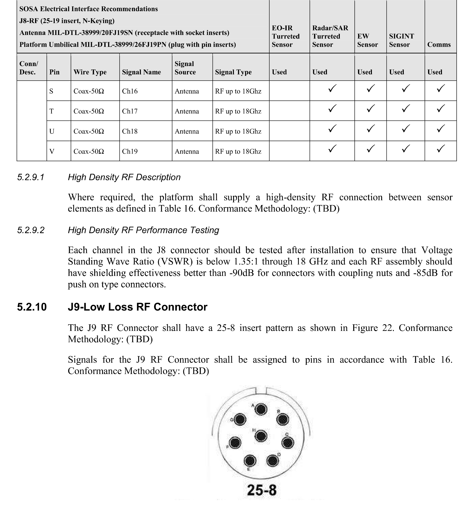

*Figure 22: J9 RF Connector Pin Arrangement ｜ 图 22：J9 射频连接器引脚排布*

<!-- 原书 p.92 ｜ PDF p.112 -->

**Table 16: J9 RF Pin Allocation ｜ 表 16：J9 射频引脚分配**

| SOSA Electrical Interface Recommendations SOSA 电气接口建议 J9-RF (25-8 insert, N-Keying) J9-RF（25-8 插针排布，N 键位） Antenna MIL-DTL-38999/20FJ19SN (receptacle with socket inserts) 天线 MIL-DTL-38999/20FJ19SN（插座，带插座接触件） Platform Umbilical MIL-DTL-38999/26FJ19PN (plug with pin inserts) 平台脐带 MIL-DTL-38999/26FJ19PN（插头，带插针接触件） | | | | | | EO-IR Turreted Sensor ／ 光电／红外转塔式传感器 | Radar/SAR Turreted Sensor ／ 雷达／SAR 转塔式传感器 | EW Sensor ／ 电子战传感器 | SIGINT Sensor ／ 信号情报传感器 | Comms ／ 通信 |
|---|---|---|---|---|---|---|---|---|---|---|
| Conn/ Desc. 连接器／说明 | Pin 引脚 | Wire Type 线型 | Signal Name 信号名 | Signal Source 信号来源 | Signal Type 信号类型 | Used 使用 | Used 使用 | Used 使用 | Used 使用 | Used 使用 |
| RF | A | Coax-50Ω | Ch1 | Antenna | RF up to 18Ghz | | ✓ | ✓ | ✓ | ✓ |
| | B | Coax-50Ω | Ch2 | Antenna | RF up to 18Ghz | | ✓ | ✓ | ✓ | ✓ |
| | C | Coax-50Ω | Ch3 | Antenna | RF up to 18Ghz | | ✓ | ✓ | ✓ | ✓ |
| | D | Coax-50Ω | Ch4 | Antenna | RF up to 18Ghz | | ✓ | ✓ | ✓ | ✓ |
| | E | Coax-50Ω | Ch5 | Antenna | RF up to 18Ghz | | ✓ | ✓ | ✓ | ✓ |
| | F | Coax-50Ω | Ch6 | Antenna | RF up to 18Ghz | | ✓ | ✓ | ✓ | ✓ |
| | G | Coax-50Ω | Ch7 | Antenna | RF up to 18Ghz | | ✓ | ✓ | ✓ | ✓ |
| | H | Coax-50Ω | Ch8 | Antenna | RF up to 18Ghz | | ✓ | ✓ | ✓ | ✓ |

> 转写说明：原表表头为两行——第一行左起 6 列（Conn/ Desc.~Signal Type 上方）是一个**跨 6 列的合并单元格**（灰色块），其文字照录于第 1 格，被其覆盖的其余 5 格留空；第 7~11 列第一行为传感器名、第二行为 “Used”，此处分列为表头行与紧跟的一行（即原表头第二行），不另设分隔线。
>
> 合并单元格：第 1 列 Conn/ Desc. 的 “RF” 在原表跨全部 8 行合并，仅记于首个数据行（Pin A），其下 7 行该格留空。
>
> 表体 8 行，Pin 依次为 A~H，Signal Name 依次为 Ch1~Ch8。本表在 p.93 内完整（紧随 5.2.10.1 正文），未跨页。

**Table 17: Auxiliary RF Connections ｜ 表 17：辅助射频连接**

| Auxiliary RF Connectors – Quantity is Application-Specific 辅助射频连接器 – 数量视应用而定 | | | | | | EO-IR Turreted Sensor ／ 光电／红外转塔式传感器 | Radar/SAR Turreted Sensor ／ 雷达／SAR 转塔式传感器 | EW Sensor ／ 电子战传感器 | SIGINT Sensor ／ 信号情报传感器 | Comms ／ 通信 |
|---|---|---|---|---|---|---|---|---|---|---|
| Conn/ Desc. 连接器／说明 | Pin 引脚 | Wire Type 线型 | Signal Name 信号名 | Signal Source 信号来源 | Signal Type 信号类型 | Used 使用 | Used 使用 | Used 使用 | Used 使用 | Used 使用 |
| TNC | | RG142 50Ω | | Antenna | RF up to 3 Ghz | | ✓ | ✓ | ✓ | ✓ |
| SMA | | RG174 50Ω | | Antenna | RF up to 27 Ghz | | ✓ | ✓ | ✓ | ✓ |
| 2.4 mm | | Coax-50Ω | | Antenna | RF up to 50 Ghz | | ✓ | ✓ | ✓ | ✓ |
| 1.0 mm | | Coax-50Ω | | Antenna | RF up to 110 Ghz | | ✓ | ✓ | ✓ | ✓ |

> 转写说明：原表表头为两行——第一行左起 6 列（Conn/ Desc.~Signal Type 上方）是一个**跨 6 列的合并单元格**（灰色块），其文字 “Auxiliary RF Connectors – Quantity is Application-Specific” 照录于第 1 格（“–” 为原书的短破折号），被其覆盖的其余 5 格留空；第 7~11 列第一行为传感器名、第二行为 “Used”，此处分列为表头行与紧跟的一行（即原表头第二行），不另设分隔线。
>
> 表体 4 行；第 2 列 Pin 与第 4 列 Signal Name 在原表中全部为空，照录留空。
>
> 跨页：本表自 p.93 起、在 p.94 续完（“1.0 mm” 一行为续页行，其 Signal Type 格内 “RF up to 110 / Ghz” 为原表格内折行，此处以空格连接）；续页重复的完整表头已并入本文件首两行表头，不另记。

TNC RGI42508 Antenna RE up to 3 Ghz SMA RG174500 Antenna RF up to 27 Ghz

TNC RGI42508 天线 射频最高 3 Ghz SMA RG174500 天线 射频最高 27 Ghz

2.4 mm Coax-508 Antenna RF up to 50 Ghz

2.4 mm 同轴 Coax-508 天线 射频最高 50 Ghz

<!-- 原书 p.93 ｜ PDF p.113 -->

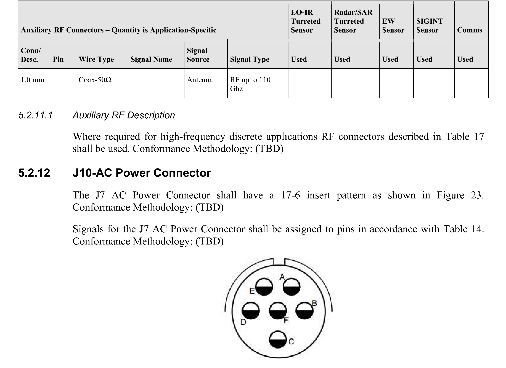

*Figure 23: J10 AC Power Connector Pin Arrangement ｜ 图 23：J10 交流电源连接器引脚排布*

**Table 18: J10 AC Power Pin Allocations ｜ 表 18：J10 交流电源引脚分配**

| SOSA Electrical Interface Recommendations SOSA 电气接口建议 J10-AC Power (17-6 insert, N-Keying) J10-交流电源（17-6 插针排布，N 键位） Sensor MIL-DTL-38999/20FE6PN contacts M39029/58-365 传感器 MIL-DTL-38999/20FE6PN 接触件 M39029/58-365 (receptacle with socket inserts) （插座，带插座接触件） Platform Umbilical MIL-DTL-38999/26FE6SN contacts M39029/56-353 平台脐带 MIL-DTL-38999/26FE6SN 接触件 M39029/56-353 (plug with pin inserts) （插头，带插针接触件） | | | | | | EO-IR Turreted Sensor ／ 光电／红外转塔式传感器 | Radar/SAR Turreted Sensor ／ 雷达／SAR 转塔式传感器 | EW Sensor ／ 电子战传感器 | SIGINT Sensor ／ 信号情报传感器 | Comms ／ 通信 |
|---|---|---|---|---|---|---|---|---|---|---|
| Conn/ Desc. 连接器／说明 | Pin 引脚 | Wire Type 线型 | Signal Name 信号名 | Signal Source 信号来源 | Signal Type 信号类型 | Used 使用 | Used 使用 | Used 使用 | Used 使用 | Used 使用 |
| 3ø 400Hz AC Power | A | 12AWG | 120/208VAC Ph A | Platform | AC Power | ✓ | ✓ | ✓ | ✓ | ✓ |
| | B | 12AWG | 120/208VAC Ph B | Platform | AC Power | ✓ | ✓ | ✓ | ✓ | ✓ |
| | C | 12AWG | 120/208VAC Ph C | Platform | AC Power | ✓ | ✓ | ✓ | ✓ | ✓ |
| | D | 12AWG | 120/208VAC Neutral | Platform | AC Power | | ✓ | ✓ | ✓ | ✓ |
| | E | | Unused | | | | | | | |
| | F | 12AWG | Chassis | Platform | Ground | | ✓ | ✓ | ✓ | ✓ |

> 转写说明：原表表头为两行——第一行左起 6 列（Conn/ Desc.~Signal Type 上方）是一个**跨 6 列的合并单元格**（灰色块），其文字照录于第 1 格，被其覆盖的其余 5 格留空；第 7~11 列第一行为传感器名、第二行为 “Used”，此处分列为表头行与紧跟的一行（即原表头第二行），不另设分隔线。灰色块第 3、4 段在原表格内折行为 “Sensor MIL-DTL-38999/20FE6PN contacts M39029/58-365” ＋ “(receptacle with socket inserts)” 与 “Platform Umbilical MIL-DTL-38999/26FE6SN contacts M39029/56-353” ＋ “(plug with pin inserts)”，此处按折行位置以 ` ` 相接。
>
> 合并单元格：第 1 列 Conn/ Desc. 的 “3ø 400Hz AC Power” 在原表跨 A~F 全部 6 行合并（格内原为 “3ø” “400Hz” “AC” “Power” 四行竖排），仅记于首个数据行（Pin A），其下 5 行该格留空；“ø” 为原书的带斜线 o。
>
> 第 E 行：Wire Type、Signal Source、Signal Type 三格及 5 个 Used 格原为空，Signal Name 作 “Unused”，照录留空。
>
> 跨页：本表自 p.94 起、在 p.95 续完（D、E、F 三行为续页行）；续页重复的完整表头已并入本文件首两行表头，不另记。第 4 列内 “120/208VAC Ph A” 等在原文中为格内折行（“120/208VAC” ＋ “Ph A”），此处以空格连接。

Desc:Connl Pin Wire Type Signal Name SignalSource Signal Type Used Used Used Used Used

说明:连接器 引脚 线型 信号名 信号来源 信号类型 使用 使用 使用 使用 使用

30 12AWG 120/208VAC Platform AC Power 40OHZ Ph A AC Power B 12AWG 120/208VAC Platform AC Power

30 12AWG 120/208VAC 平台 交流电源 40OHZ A 相 交流电源 B 12AWG 120/208VAC 平台 交流电源

Ph B

B 相

I2AWG 120/208VAC Platform AC Power Ph C

I2AWG 120/208VAC 平台 交流电源 C 相

<!-- 原书 p.94 ｜ PDF p.114 -->

S0SA Electrical Interface Recommendations

S0SA 电气接口建议（原文首字母即作 0）

JIO-AC Power (17-6 insert, N-Keying) Sensor MILDTL 38999/20F6PN contacts 139029/58-365 (receptacle with socket inserts) EO-I RadarlSAR Platform Umbilical MIL-DTL- 38999/26F6SN contacts M39029/56-353 Turreted Turreted EW SIGINT (plug with pin inserts) Sensor Sensor Sensor Sensor Comms DescConnl Pin Wire Type Signal Name SignalSource Signal Type Used Used Used Used Used

JIO-交流电源（17-6 插针排布，N 键位）传感器 MILDTL 38999/20F6PN 接触件 139029/58-365（插座，带插座接触件）EO-I RadarlSAR 平台脐带 MIL-DTL- 38999/26F6SN 接触件 M39029/56-353 转塔式 转塔式 电子战 信号情报（插头，带插针接触件）传感器 传感器 传感器 传感器 通信 说明连接器 引脚 线型 信号名 信号来源 信号类型 使用 使用 使用 使用 使用

12AWG 120/208VAC Platform AC Power Neutral } Unused F 12AWG Chassis Platform Ground

12AWG 120/208VAC 平台 交流电源 中性线 } 未使用 F 12AWG 机壳 平台 地

###### 5.2.12.1 AC Power Description ｜ 5.2.12.1 交流电源说明

The platform shall provide to the connected system or sensor 115/200 Volts RMS, alternating current (AC), three phase, 4 wire grounded neutral, “Y” configuration, 400 cycle power at up to 10 amperes per phase in accordance with MIL-STD-704F. Conformance Methodology: (TBD) Each phase shall be protected by an overcurrent device to limit the maximum current to 10 amperes steady state and the overcurrent devices shall be interconnected such that an overcurrent condition on any phase shall cause all three phases to be interrupted. Conformance

平台应向所连接的系统或传感器提供 115/200 伏有效值（RMS）、交流（AC）、三相、四线、接地中性线、“Y”形接法、400 周电源，每相最高 10 安培，依据 MIL-STD-704F。符合性方法：（TBD）每相应由过流装置保护，把最大电流限制在稳态 10 安培；过流装置应互连，使得任一相出现过流时三相全部被切断。符合性

Methodology: (TBD)

方法：（TBD）

##### 5.2.13 Hardware Platform 3U and 6U Slot Profile Specifications ｜ 5.2.13 硬件平台 3U 与 6U 槽位配置档规格

5.2.13.1 SOSA Hardware Basic Requirements

5.2.13.1 SOSA 硬件基本需求

**Rule 5.2.13.1-1**

SOSA plug-in cards shall conform to the requirements of the following standards, when applicable, in the given order of precedence: • Requirements of this SOSA Technical Standard

SOSA 插卡在适用时应按下列先后次序符合下列标准的需求：• 本 SOSA 技术标准的需求

Conformance Methodology: (I)

符合性方法：(I)

- Requirements of ANSI/VITA 65.1

- ANSI/VITA 65.1 的需求

  - Conformance Methodology: (I)

  - 符合性方法：(I)

- Requirements of ANSI/VITA 65.0

- ANSI/VITA 65.0 的需求

  - Conformance Methodology: (I)

  - 符合性方法：(I)

- Requirements of ANSI/VITA 48.2

- ANSI/VITA 48.2 的需求

  - Conformance Methodology: (I)

  - 符合性方法：(I)

- Requirements of ANSI/VITA 48.8

- ANSI/VITA 48.8 的需求

  - Conformance Methodology: (I)

  - 符合性方法：(I)

<!-- 原书 p.95 ｜ PDF p.115 -->

• Requirements of ANSI/VITA 47.3

• ANSI/VITA 47.3 的需求

Conformance Methodology: (I)

符合性方法：(I)

- Requirements of ANSI/VITA 66.0 and applicable dot standards

- ANSI/VITA 66.0 及适用的点标准（dot standards）的需求

  - Conformance Methodology: (I)

  - 符合性方法：(I)

- Requirements of ANSI/VITA 67.0 and applicable dot standards

- ANSI/VITA 67.0 及适用的点标准的需求

  - Conformance Methodology: (I)

  - 符合性方法：(I)

- Requirements of ANSI/VITA 46.0

- ANSI/VITA 46.0 的需求

  - Conformance Methodology: (I)

  - 符合性方法：(I)

- Requirements of ANSI/VITA 62.0

- ANSI/VITA 62.0 的需求

  - Conformance Methodology: (I)

  - 符合性方法：(I)

**Rule 5.2.13.1-2**

All user defined pins, as defined in the SOSA plug-in cards, shall not be used for inter-module communications – only for external platform communications. Conformance Methodology: (T)

SOSA 插卡中所定义的全部用户自定义引脚，不应用于模块间通信——只用于外部平台通信。符合性方法：(T)

**Rule 5.2.13.1-3**

All external panel I/O signals shall pass through the backplane connector(s) before going to any SOSA plug-in card except for: Conformance Methodology: (T)

所有外部面板 I/O 信号在送往任何 SOSA 插卡之前，均应经由背板连接器；下列各项除外：符合性方法：(T)

• Key Fill

• 密钥填充

• Crypto Ignition Key (CIK)

• 加密点火密钥（CIK）

**Rule 5.2.13.1-4**

All signals between SOSA plug-in cards shall pass through the backplane connector(s) before going to another component in a SOSA system. Conformance Methodology: (A)

SOSA 插卡之间的所有信号，在送往 SOSA 系统中的另一组件之前，均应经由背板连接器。符合性方法：(A)

**Rule 5.2.13.1-5**

SOSA PSMs shall conform to Section 3U External I/O Slot Profile if they are installed into a monolithic backplane containing SOSA hardware modules. Conformance Methodology: (T)

SOSA 电源模块（PSM）若装入含有 SOSA 硬件模块的整体式背板，则应符合「3U 外部 I/O 槽位配置档」一节。符合性方法：(T)

**Recommendation 5.2.13.1-1**

SOSA PSMs should conform to Section 3U External I/O Slot Profile even if they are part of a separate power supply backplane.

SOSA PSM 即使属于独立的电源背板，也宜符合「3U 外部 I/O 槽位配置档」一节。

5.2.13.2 SOSA Utility Plane Requirements Reference ANSI/VITA 65.0 §3 for Utility Plane Requirements. Utility plane requirements are extended for the SOSA standard as follows.

5.2.13.2 SOSA 辅助平面需求　辅助平面需求见 ANSI/VITA 65.0 §3。针对 SOSA 标准，辅助平面需求作如下扩展。

<!-- 原书 p.96 ｜ PDF p.116 -->

**Rule 5.2.13.2-1**

The Non-Volatile Memory Read Only (NVMRO) signal on a SOSA plug-in card shall inhibit write operations to non-volatile memory resources as specified in ANSI/VITA 65.0 §3.4.4. Conformance Methodology: (T)

SOSA 插卡上的非易失存储器只读（NVMRO）信号，应按 ANSI/VITA 65.0 §3.4.4 的规定抑制对非易失存储器资源的写操作。符合性方法：(T)

**Rule 5.2.13.2-2**

The GDiscrete1 signal shall be an input only port with respect to ANSI/VITA 65.0, Permission 3.6-1. Conformance Methodology: (T)

就 ANSI/VITA 65.0 许可 3.6-1 而言，GDiscrete1 信号应为只输入端口。符合性方法：(T)

**Rule 5.2.13.2-3**

With respect to ANSI/VITA 46.0, Recommendation 7-3, the Joint Test Action Group (JTAG) signals shall not be bussed over the backplane. Conformance Methodology: (T)

就 ANSI/VITA 46.0 推荐 7-3 而言，联合测试行动组（JTAG）信号不应在背板上总线化。符合性方法：(T)

**Rule 5.2.13.2-4**

With respect to ANSI/VITA 65.0, Permission 3.4.3-4 and Permission 3.4.3-5, MaskableReset* shall not be bussed across the backplane to other slots. Conformance Methodology: (T)

就 ANSI/VITA 65.0 许可 3.4.3-4 与许可 3.4.3-5 而言，MaskableReset* 不应跨越背板总线化至其他槽位。符合性方法：(T)

**Rule 5.2.13.2-5**

All backplane connectors shall be commercially available connectors that can be procured by any vendor without prior authorization from any source (e.g., a commercial part governed by a source control drawing). Conformance Methodology: (A)

所有背板连接器均应为市售可得的连接器，任何供应商无须事先获得任何来源的授权即可采购（例如：受源控制图约束的商品件）。符合性方法：(A)

**Rule 5.2.13.2-6**

Backplanes shall implement a single, 2.49K Ohm, +/- 1%, pull-up resistor from each IPMB signal to the 3.3V Auxiliary voltage rail. Conformance Methodology: (A)

背板应为每一路 IPMB 信号到 3.3V 辅助电压轨各实现一个 2.49K 欧姆、+/- 1% 的上拉电阻。符合性方法：(A)

**Rule 5.2.13.2-7**

SOSA plug-in cards containing resources to drive the Utility Plane REF_CLK+/- signals shall provide a mechanism to permit application software or system management to reassign the identity of the SYS_CON module, regardless of the logic level of the backplane SYS_CON* contact, in order to control these signal drivers once the backplane power rails are all at minimum operating voltages as defined in ANSI/VITA 46.0 §4.8.12.4. Conformance Methodology: (A)

凡含有可驱动辅助平面 REF_CLK+/- 信号的资源的 SOSA 插卡，均应提供一种机制，允许应用软件或系统管理重新指定 SYS_CON 模块的身份，无论背板 SYS_CON* 接触件的逻辑电平如何，以便在背板各电源轨均已达到 ANSI/VITA 46.0 §4.8.12.4 所定义的最低工作电压之后控制这些信号驱动器。符合性方法：(A)

**Rule 5.2.13.2-8**

SOSA plug-in cards receiving SYSRESET* as an input shall be able to register a valid low for any pulse length of 10ns or longer. Conformance Methodology: (T)

以 SYSRESET* 作为输入接收的 SOSA 插卡，应能对 10ns 或更长的任何脉冲宽度寄存一次有效低电平。符合性方法：(T)

**Rule 5.2.13.2-9**

SYSRESET* shall conform to the high current open-drain signal specifications of ANSI/VITA

SYSRESET* 应符合 ANSI/VITA 的大电流开漏信号规范

65.0 §3.3.3 (High Current Open-Drain). Conformance Methodology: (T)

65.0 §3.3.3（大电流开漏）。符合性方法：(T)

> **译注**：原文若干处把一句折成两段（本条「…of ANSI/VITA」／「65.0 §3.3.3…」，以及后文 Rule 5.2.13.2-11、Rule 5.2.13.3-6、Rule 5.2.13.4-1、Recommendation 5.2.13.4-1、Permission 5.2.13.4-1、Rule 5.2.16.1-1 各处），系原书 PDF 抽取时的折行所致，非页锚处；英文照录两段，中文亦分两段承接，起止就近取完整成分，以保持可读。

<!-- 原书 p.97 ｜ PDF p.117 -->

**Rule 5.2.13.2-10**

SOSA plug-in cards shall make SYSRESET* available to any SOSA mezzanine module connector that has SM1 and SM0 available per ANSI/VITA 65.0 Recommendation 3.4.2.1-1. Conformance Methodology: (T)

SOSA 插卡应使 SYSRESET* 可用于任何按 ANSI/VITA 65.0 推荐 3.4.2.1-1 而具备 SM1 与 SM0 的 SOSA 夹层模块连接器。符合性方法：(T)

**Rule 5.2.13.2-11**

SOSA plug-in cards shall receive a unique Site Number that is based upon the plug-in card’s ANSI/VITA 65.0 §3.4.6, Geographic Address as referenced in ANSI/VITA 46.11. Conformance

SOSA 插卡应获得唯一的站点号，该站点号基于 ANSI/VITA 46.11 中所引的插卡 ANSI/VITA 65.0 §3.4.6 地理地址。符合性

Methodology: (A)

方法：(A)

**Rule 5.2.13.2-12**

No additional components shall be required to install a SOSA plug-in card in a SOSA Enclosure other than those typically used for ANSI/VITA-compliant OpenVPX modules. Conformance Methodology: (A)

除通常用于符合 ANSI/VITA 的 OpenVPX 模块者外，把 SOSA 插卡装入 SOSA 壳体不应需要任何额外组件。符合性方法：(A)

**Rule 5.2.13.2-13**

The NVMRO pin shall conform to the low current open-drain signal specifications of ANSI/VITA 65.0 §3.3.1. Conformance Methodology: (A)

NVMRO 引脚应符合 ANSI/VITA 65.0 §3.3.1 的低电流开漏信号规范。符合性方法：(A)

**Rule 5.2.13.2-14**

3U SOSA plug-in cards shall use VS1 12V as primary input power. Conformance Methodology: (TBD)

3U SOSA 插卡应使用 VS1 12V 作为主输入电源。符合性方法：(TBD)

**Rule 5.2.13.2-15**

3U SOSA plug-in cards shall not use VS2 3.3V or VS3 5.0V. Conformance Methodology: (T)

3U SOSA 插卡不应使用 VS2 3.3V 或 VS3 5.0V。符合性方法：(T)

**Observation 5.2.13.2-1**

VS1 input pins limits 3U current to 16A (192W) per ANSI/VITA 46.0 Table 4-5.

按 ANSI/VITA 46.0 表 4-5，VS1 输入引脚把 3U 电流限制为 16A（192W）。

**Rule 5.2.13.2-16**

6U SOSA plug-in cards shall use VS1 and VS2 12V as primary input power. Conformance Methodology: (T)

6U SOSA 插卡应使用 VS1 与 VS2 12V 作为主输入电源。符合性方法：(T)

**Rule 5.2.13.2-17**

6U SOSA plug-in cards shall not use VS3 5.0V. Conformance Methodology: (T)

6U SOSA 插卡不应使用 VS3 5.0V。符合性方法：(T)

**Observation 5.2.13.2-2**

VS1 and VS2 input pins limits 6U current to 32A (384W) per ANSI/VITA 46.0 Table 4-5.

按 ANSI/VITA 46.0 表 4-5，VS1 与 VS2 输入引脚把 6U 电流限制为 32A（384W）。

<!-- 原书 p.98 ｜ PDF p.118 -->

**Rule 5.2.13.2-18**

SOSA plug-in cards shall use 3.3V_AUX. Conformance Methodology: (T)

SOSA 插卡应使用 3.3V_AUX。符合性方法：(T)

**Rule 5.2.13.2-19**

SOSA plug-in cards shall not use 12V auxiliary supplies. Conformance Methodology: (T)

SOSA 插卡不应使用 12V 辅助电源。符合性方法：(T)

**Observation 5.2.13.2-3**

SOSA plug-in cards shall draw no more than 1.0A of 3.3VAUX ANSI/VITA 46.0 Rule 3.11.

按 ANSI/VITA 46.0 规则 3.11，SOSA 插卡从 3.3VAUX 取用的电流不应超过 1.0A。

5.2.13.3 SOSA Hardware Platform General Specification Requirements SOSA general specification requirements are delineated in the following sections.

5.2.13.3 SOSA 硬件平台通用规格需求　SOSA 的通用规格需求在下列各节中给出。

5.2.13.3.1 General Specifications

5.2.13.3.1 通用规格

**Permission 5.2.13.3-1**

Hardware modules may work cooperatively to increase performance and/or functionality.

硬件模块可协同工作，以提高性能和／或功能。

**Rule 5.2.13.3-1**

All unused pins shall not be connected on the plug-in module. Conformance Methodology: (A)

所有未使用的引脚均不应在插接模块上连接。符合性方法：(A)

**Rule 5.2.13.3-2**

SOSA plug-in cards with XMC mezzanine sites shall conform to the carrier board requirements of ANSI/VITA 42.0, XMC. Conformance Methodology: (A)

带有 XMC 夹层位的 SOSA 插卡应符合 ANSI/VITA 42.0（XMC）的载板需求。符合性方法：(A)

Slot Pitch

槽位间距

Reference ANSI/VITA 65.0 §4.1 for slot pitch requirements. Slot pitch requirements are extended for SOSA as follows.

槽位间距需求参考 ANSI/VITA 65.0 §4.1。针对 SOSA，槽位间距需求作如下扩展。

**Rule 5.2.13.3-3**

SOSA Conformant Card cage rails shall have a pitch of 1.0” or greater for SOSA plug-in card conformant ANSI/VITA 48.2 Hardware Modules. Conformance Methodology: (A)

对符合 ANSI/VITA 48.2 的 SOSA 插卡型硬件模块，SOSA 符合的卡笼导轨应具有 1.0” 或更大的间距。符合性方法：(A)

**Rule 5.2.13.3-4**

SOSA Backplane Assemblies for conduction cooling shall have a 1.0” pitch or greater for SOSA plug-in cards conformant to ANSI/VITA 48.2 Plug-In Module. Conformance Methodology: (A)

对符合 ANSI/VITA 48.2 插接模块的 SOSA 插卡，用于传导散热的 SOSA 背板装配体应具有 1.0” 或更大的间距。符合性方法：(A)

**Rule 5.2.13.3-5**

Conduction Cooled SOSA plug-in cards shall be conformant to ANSI/VITA 48.2 Plug-In Module requirements for 1.00” pitch. Conformance Methodology: (A)

传导散热式 SOSA 插卡应符合 ANSI/VITA 48.2 针对 1.00” 间距的插接模块需求。符合性方法：(A)

<!-- 原书 p.99 ｜ PDF p.119 -->

**Rule 5.2.13.3-6**

SOSA Conformant Card cage rails shall have a pitch of 1.5” for SOSA plug-in card ANSI/VITA

SOSA 符合的卡笼导轨应具有 1.5” 的间距，适用对象为符合 ANSI/VITA

48.8 Hardware Modules. Conformance Methodology: (A)

48.8 硬件模块的 SOSA 插卡。符合性方法：(A)

**Rule 5.2.13.3-7**

SOSA Backplane Assemblies for air flow through cooling shall have a 1.5” pitch for SOSA plug-in cards conformant to ANSI/VITA 48.8 Plug-In Module. Conformance Methodology: (A)

对符合 ANSI/VITA 48.8 插接模块的 SOSA 插卡，用于气流贯通散热的 SOSA 背板装配体应具有 1.5” 的间距。符合性方法：(A)

**Rule 5.2.13.3-8**

Air flow through SOSA plug-in cards shall be conformant to ANSI/VITA 48.8 Plug-In Module requirements for 1.5” pitch. Conformance Methodology: (A)

气流贯通式 SOSA 插卡应符合 ANSI/VITA 48.8 针对 1.5” 间距的插接模块需求。符合性方法：(A)

5.2.13.3.2 Connector Family

5.2.13.3.2 连接器族

**Rule 5.2.13.3-9**

SOSA plug-in cards shall comply with ANSI/VITA 65.0 §4.2 for connector family requirements. Conformance Methodology: (A)

SOSA 插卡应就连接器族需求符合 ANSI/VITA 65.0 §4.2。符合性方法：(A)

Rules 5.2.13.3-10

规则 5.2.13.3-10

SOSA plug-in cards shall make use of ANSI/VITA Standard Connectors. Conformance Methodology: (A)

SOSA 插卡应使用 ANSI/VITA 标准连接器。符合性方法：(A)

**Observation 5.2.13.3-1**

The SOSA standard is considering the addition of ANSI/VITA 46.3 that will allow for intermateable connectors.

SOSA 标准正在考虑增列 ANSI/VITA 46.3，该标准将允许使用可互配的连接器。

Keying

键位

The SOSA standard references ANSI/VITA 46 §4.4 for Alignment and Keying. Specifically, reference ANSI/VITA 46 §4.4.3 for Keying Rules applying to 6U and 3U modules. Reference ANSI/VITA 65.0 §4.3 for keying requirements specific to ANSI/VITA 6U modules and backplanes.

SOSA 标准就对准与键位引用 ANSI/VITA 46 §4.4。具体而言，适用于 6U 与 3U 模块的键位规则参考 ANSI/VITA 46 §4.4.3；ANSI/VITA 6U 模块与背板专有的键位需求参考 ANSI/VITA 65.0 §4.3。

RTM Modules

RTM 模块

Reference ANSI/VITA 65.0 §4.4 for Requirements Traceability Matrix (RTM) connector requirements.

需求追溯矩阵（RTM）的连接器需求参考 ANSI/VITA 65.0 §4.4。

**Rule 5.2.13.3-11**

Rear transition modules shall be prohibited within a SOSA Chassis and Backplane Assembly. Conformance Methodology: (A)

在 SOSA 机箱与背板装配体内，应禁止使用后置转接模块。符合性方法：(A)

<!-- 原书 p.100 ｜ PDF p.120 -->

###### 5.2.13.4 Conduction Cooled SOSA Plug-In Cards ｜ 5.2.13.4 传导散热式 SOSA 插卡

Reference ANSI/VITA 48.2 for conduction cooled module requirements. Reference ANSI/VITA

传导散热式模块的需求参考 ANSI/VITA 48.2；气流贯通式模块的需求参考 ANSI/VITA

48.8 for air flow through module requirements.

48.8 中的对应需求。

**Rule 5.2.13.4-1**

ANSI/VITA 48.2 or ANSI/VITA 48.8 Type 1 Hardware Modules shall be used. Conformance

应使用 ANSI/VITA 48.2 或 ANSI/VITA 48.8 的 1 型硬件模块。符合性

Methodology: (A)

方法：(A)

**Recommendation 5.2.13.4-1**

SOSA plug-in cards should use extended covers in order to protect the 46.0 connectors.

SOSA 插卡宜使用加长罩盖，以保护 46.0 连接器。

**Permission 5.2.13.4-1**

Adapter frames may be used to convert ANSI/VITA 48.2 Hardware Modules to ANSI/VITA

可使用适配框，把 ANSI/VITA 48.2 硬件模块转换为 ANSI/VITA

48.8 form factor.

48.8 形状因数。

Environmental

环境

Reference ANSI/VITA 47.3 for module requirements.

模块需求参考 ANSI/VITA 47.3。

**Observation 5.2.13.4-1**

Hardware modules may use the following cooling method guideline table to prepare for future power growth.

硬件模块可使用下列散热方式指南表，为未来的功率增长做准备。

**Table 19: Hardware Module Cooling Methods ｜ 表 19：硬件模块散热方式**

| **Hardware Module Form Factor and Cooling Method** ／ 硬件模块形状因数与散热方式 | **3U Heat Load** ／ 3U 热负载 | **6U Heat Load** ／ 6U 热负载 | **System Integration Impact Rationale** ／ 系统集成影响理由 |
|---|---|---|---|
| ANSI/VITA 48.2 conduction to air cooled chassis ANSI/VITA 48.2 传导至风冷机箱 | Low ／ 低 | Low ／ 低 | Host platform-agnostic air cooling 与宿主平台无关的风冷 |
| ANSI/VITA 48.8 air flow through ANSI/VITA 48.8 气流贯通式 | Medium ／ 中 | Medium ／ 中 | |
| ANSI/VITA 48.2 conduction to liquid cooled chassis ANSI/VITA 48.2 传导至液冷机箱 | Medium ／ 中 | Medium ／ 中 | Dependent on host platform supplied liquid cooling infrastructure with condensation mitigation 取决于宿主平台所提供的、带凝露缓解措施的液冷基础设施 |

> 转写说明：第 4 列「System Integration Impact Rationale」的「Host platform-agnostic air cooling」为纵向合并单元格，覆盖第 2、3 数据行（ANSI/VITA 48.2 conduction to air cooled chassis、ANSI/VITA 48.8 air flow through），故第 3 行该格留空、末行「Dependent on host platform supplied liquid cooling infrastructure with condensation mitigation」单独成格。合并格原带底色（首两行绿色、末行黄色），Markdown 不表底色。格内因排版折行的文字（如「Hardware Module Form Factor and Cooling Method」「ANSI/VITA 48.2 conduction to air cooled chassis」）以单个空格连接。本表仅占原书 p.101 一页，p.102 为正文。

##### 5.2.14 Hardware Platform SOSA Plug-In Card Profiles ｜ 5.2.14 硬件平台 SOSA 插卡配置档

SOSA plug-in card Profiles define the connector type and how each pin, or pair of pins, is allocated. Single pins are generally allocated to the utility plane for power, grounds, system discrete signals, and system management. Differential pin/pairs are generally allocated for the three communication planes called Control, Data, and Expansion. Differential paired pins are grouped together to form “pipes”. The definition of planes, pipes, and profiles can be found in Appendix B. Finally, plug-in card profiles also determine which pins are user-defined. SOSA plug-in card profiles are categorized as either Payload or Switch. As an example, payload plug-

SOSA 插卡配置档规定连接器类型，以及每一引脚或每一对引脚如何分配。单端引脚一般分配给辅助平面，用于电源、地、系统离散信号与系统管理。差分引脚／引脚对一般分配给控制、数据、扩展这三个通信平面。差分成对引脚成组构成“pipe”（管道）。平面、pipe 与配置档的定义见附录 B。最后，插卡配置档还确定哪些引脚属于用户自定义。SOSA 插卡配置档分为载荷型与交换型两类。举例而言，载荷插

<!-- 原书 p.101 ｜ PDF p.121 -->

in cards are further divided into sub-categories such as, but not limited to, RF Payload, RF Switch, and I/O Single Board Computer (SBC).

卡又进一步细分为若干子类，例如（但不限于）射频载荷、射频交换与 I/O 单板计算机（SBC）。

5.2.14.1 Hardware Platform Protocol Profiles

5.2.14.1 硬件平台协议配置档

The Protocol Profile defines what type communication protocol can be used on each pipe as defined in a corresponding plug-in card profile, connector type, and module height (6U/3U).

协议配置档规定：在相应的插卡配置档、连接器类型与模块高度（6U/3U）所定义的每条 pipe 上，可使用何种类型的通信协议。

5.2.14.2 Hardware Platform Profile Names – Use and Construction

5.2.14.2 硬件平台配置档名称——用法与构造

SOSA plug-in card profiles that align with OpenVPX Profiles can be classified into one of three main categories: • SLT: a physical space on an OpenVPX backplane with a defined mechanical and electrical specification intended to accept a Plug-In module Pre-existing examples of slots that are applicable to OpenVPX include 3U and 6U. There are different slot types such as payload slots and switch slots.

与 OpenVPX 配置档对齐的 SOSA 插卡配置档，可归入三大类之一：• SLT：OpenVPX 背板上一块具有既定机械与电气规格、用以承接插接模块的物理空间。适用于 OpenVPX 的槽位，既有例子包括 3U 与 6U。槽位有不同类型，如载荷槽位与交换槽位。

- Backplane (BKP): a class of interconnect that consists of regularly aligned pattern of connectors that operate so that the corresponding pins on each connector have the same logical definition It is often used as a backbone to connect several modules together to allow for signal transmission and is usually housed in a chassis.

- 背板（BKP）：一类互连，由按规则排列的连接器图样构成，其工作方式使各连接器上的对应引脚具有相同的逻辑定义。它常用作主干，把若干模块连接起来以便信号传输，通常装于机箱之内。

- Module (MOD): an element of a system that has individually distinct boundaries that are well-defined interfaces Reference ANSI/VITA 65.0 §1.3.3.1 for Slot Profile use and construction. Reference ANSI/VITA 65.0 §1.3.3.2 for Backplane Profile use and construction. Reference ANSI/VITA 65.0 §1.3.3.3 for Module Profile use and construction.

- 模块（MOD）：系统中的一个元素，具有各自独立、边界分明且已良好定义的接口。槽位配置档的用法与构造参考 ANSI/VITA 65.0 §1.3.3.1；背板配置档的用法与构造参考 ANSI/VITA 65.0 §1.3.3.2；模块配置档的用法与构造参考 ANSI/VITA 65.0 §1.3.3.3。

##### 5.2.15 Common 6U and 3U Plug-In Card Profile Specifications ｜ 5.2.15 6U 与 3U 通用插卡配置档规格

For the SOSA standard, within the context of OpenVPX, it is known that OpenVPX uses Slot Profiles to define interoperability and physical characteristics necessary to interface with compatible modules and backplanes. The following sections define common requirements for all OpenVPX Slot Profiles: • Reference ANSI/VITA 65.0 §6 Common to 6U and 3U – Slot Profiles • Reference ANSI/VITA 65.0 §7 Common to 6U and 3U – Backplane Profiles

就 SOSA 标准而言，在 OpenVPX 的语境下已知：OpenVPX 用槽位配置档来定义与兼容模块和背板对接所必需的互操作性与物理特性。下列各节定义所有 OpenVPX 槽位配置档的通用需求：• 参考 ANSI/VITA 65.0 §6「6U 与 3U 通用——槽位配置档」• 参考 ANSI/VITA 65.0 §7「6U 与 3U 通用——背板配置档」

• Reference ANSI/VITA 65.0 §8 Common to 6U and 3U – Module Profiles

• 参考 ANSI/VITA 65.0 §8「6U 与 3U 通用——模块配置档」

##### 5.2.16 SOSA 3U Plug-In Card Profile Specifications ｜ 5.2.16 SOSA 3U 插卡配置档规格

###### 5.2.16.1 3U I/O Intensive SBC Plug-In Card Profile ｜ 5.2.16.1 3U I/O 密集型 SBC 插卡配置档

**Rule 5.2.16.1-1**

SOSA 3U SBCs that are I/O intensive shall conform to ANSI/VITA 65.0 slot profile SLT3-

属于 I/O 密集型的 SOSA 3U SBC，应符合 ANSI/VITA 65.0 槽位配置档 SLT3-

PAY-1F1F2U1TU1T1U1T-14.2.16. Conformance Methodology: (A)

PAY-1F1F2U1TU1T1U1T-14.2.16 这一配置档。符合性方法：(A)

<!-- 原书 p.102 ｜ PDF p.122 -->

**Rule 5.2.16.1-2**

SOSA systems shall route the GPIO pins from the ANSI/VITA 65.1 slot profile SLT3-PAY-1F1F2U1TU1T1U1T-14.2.16 to external Platform I/O. Conformance Methodology: (A)

SOSA 系统应把来自 ANSI/VITA 65.1 槽位配置档 SLT3-PAY-1F1F2U1TU1T1U1T-14.2.16 的 GPIO 引脚布设到外部平台 I/O。符合性方法：(A)

**Rule 5.2.16.1-3**

SOSA systems shall route Express Mezzanine Card (XMC) pins from ANSI/VITA 65.1 slot profile SLT3-PAY-1F1F2U1TU1T1U1T-14.2.16 to external chassis I/O connectors. Conformance Methodology: (A)

SOSA 系统应把来自 ANSI/VITA 65.1 槽位配置档 SLT3-PAY-1F1F2U1TU1T1U1T-14.2.16 的 Express 夹层卡（XMC）引脚布设到外部机箱 I/O 连接器。符合性方法：(A)

**Rule 5.2.16.1-4**

SOSA 3U SBCs that are I/O intensive shall conform to one of the ANSI/VITA 65.1 module profiles in Table 20. Conformance Methodology: (A)

属于 I/O 密集型的 SOSA 3U SBC，应符合表 20 所列 ANSI/VITA 65.1 模块配置档之一。符合性方法：(A)

**Observation 5.2.16.1-1**

An XMC can be used to customize the I/O for a particular system or platform.

可用 XMC 为特定系统或平台定制 I/O。

- Key

- 图例

SE

SE（原样照录）

POIJO Data Plane 1 FP

POIJO 数据平面 1 FP

- Utility Plane-Maint. PortUSB PWR 5E Diff Expansion PlaneP1w9-X12d XMC mapControl Plane - 2 UTPsFP PI/J1 GPIO Video - TUTP

- 辅助平面-维护。端口USB 电源 5E 差分 扩展平面P1w9-X12d XMC 映射控制平面 - 2 个 UTPFP PI/J1 GPIO 视频 - TUTP

- Utility Plane 8 of USB 3 and 1ofUSB2- 1TP

- 辅助平面 8 个 USB 3 与 1 个USB2- 1TP

- Serial ports E Storage 1 UTP

- 串口 E 存储 1 UTP

- De USB PWR- P2lJ2 Control Plane C 1 TP

- De USB 电源- P2lJ2 控制平面 C 1 个 TP

3 Of GPIO- XIGs XMC map

共 3 路 GPIO- XIGs 的 XMC 映射关系

> **译注**：以上八段（自 `- Key` 至 `3 Of GPIO- XIGs XMC map`）系图 24 图内文字（图例与各引脚块标注）在转写时被提为正文，且为扫描识别件，多处残缺，如「POIJO」当作「POI/J0」、「P1w9」当作「P1/J9」、「P2lJ2」当作「P2/J2」、「XIGs」当作「XMCs」、「1ofUSB2」当作「1 of USB 2」。英文照录不改，中文按可辨字面译出，不作版面复原。

*Figure 24: ANSI/VITA 65.0 3U I/O Intensive SBC Slot Profile SLT3-PAY-1F1F2U1TU1T1U1T- ｜ 图 24：ANSI/VITA 65.0 3U I/O 密集型 SBC 槽位配置档 SLT3-PAY-1F1F2U1TU1T1U1T-*

14.2.16

<!-- 原书 p.103 ｜ PDF p.123 -->

**Table 20: Referenced ANSI/VITA 65.1 Module Profiles for SLT3-PAY-1F1F2U1T1U1T1U1T-14.2.16 ｜ 表 20：SLT3-PAY-1F1F2U1T1U1T1U1T-14.2.16 所引用的 ANSI/VITA 65.1 模块配置档**

| Module Profile Names ／ 模块配置档名 | Dash Num ／ 短横编号 | STD Date ／ 标准日期 | Slot Profile ／ 槽位配置档 | Data Plane ／ 数据平面 | Protocols for Copper Planes ／ 铜缆平面协议 || Control ／ 控制 | Miscellaneous Protocols over copper connectors ／ 铜缆连接器上的其他协议 |||||| Legacy ／ 遗留 |
|---|---|---|---|---|---|---|---|---|---|---|---|---|---|---|
| | | | | | Expansion ／ 扩展 | Control Plane ／ 控制平面 | | Video ／ 视频 | USB01 | USB02 | STRutp01 | SER01, SER02 | GPIO1 - GPIO4 | |
| MOD3-PAY- 1F1F2U1TU1T1U1T- 16.2.15- | | Proposed future 65.0 拟议中的未来 65.0 | | DP01 (FP) | EP00 - EP03 | CPutp01, CPutp02 | CPtp01 | | | | | | | |
| MOD3-PAY- 1F1F2U1TU1T1U1T- 16.2.15- | 1 | Proposed future 65.0 拟议中的未来 65.0 | SLT3-PAY- 1F1F2U1TU1T1U1T- 14.2.16 | PCIe Gen 2 -- 5.3.3.2 | PCIe Gen 2 -- 5.3.3.2 | 1000BASE-KX -- 5.1.2 | 1000BASE-T | DisplayPort 1.2 -- 5.10.2 | USB 2 -- 5.9.1 | USB 2 -- 5.9.1 | SATA Gen 2 -- 5.6.2 | Serial Ports -- 5.12.1 | GPIO -- 5.14.1 | |
| MOD3-PAY- 1F1F2U1TU1T1U1T- 16.2.15- | 2 | Proposed future 65.0 拟议中的未来 65.0 | SLT3-PAY- 1F1F2U1TU1T1U1T- 14.2.16 | PCIe Gen 3 -- 5.3.3.3 | PCIe Gen 3 -- 5.3.3.3 | 10GBASE-KR -- 5.1.7 | 10GBASE-T | DisplayPort 1.2 -- 5.10.2 | USB 3.1 Gen 2 -- 5.9.3 | USB 2 -- 5.9.1 | SATA Gen 3 -- 5.6.3 | Serial Ports -- 5.12.1 | GPIO -- 5.14.1 | |
| MOD3-PAY- 1F1F2U1TU1T1U1T- 16.2.15- | 3 | Proposed future 65.0 拟议中的未来 65.0 | SLT3-PAY- 1F1F2U1TU1T1U1T- 14.2.16 | 10GBASE-KX4 -- 5.1.5 | PCIe Gen 2 -- 5.3.3.2 | 1000BASE-KX -- 5.1.2 | 1000BASE-T | DisplayPort 1.2 -- 5.10.2 | USB 2 -- 5.9.1 | USB 2 -- 5.9.1 | SATA Gen 2 -- 5.6.2 | Serial Ports -- 5.12.1 | GPIO -- 5.14.1 | |
| MOD3-PAY- 1F1F2U1TU1T1U1T- 16.2.15- | 4 | Proposed future 65.0 拟议中的未来 65.0 | SLT3-PAY- 1F1F2U1TU1T1U1T- 14.2.16 | 40GBASE-KR4 -- 5.1.8 | PCIe Gen 3 -- 5.3.3.3 | 10GBASE-KR -- 5.1.7 | 10GBASE-T | DisplayPort 1.2 -- 5.10.2 | USB 3.1 Gen 2 -- 5.9.3 | USB 2 -- 5.9.1 | SATA Gen 3 -- 5.6.3 | Serial Ports -- 5.12.1 | GPIO -- 5.14.1 | |
| Last line 末行 | | Proposed future 65.0 拟议中的未来 65.0 | | | | | | | | | | | | |

> 转写说明：表头在原书为两层级联——第一层 `Protocols for Copper Planes`（横跨 Expansion、Control Plane 两列）、`Miscellaneous Protocols over copper connectors`（横跨 Video、USB01、USB02、STRutp01、SER01, SER02、GPIO1 - GPIO4 六列）；第二层为各子列名。此处保留两行表头，被 colspan 覆盖处留空。
> 转写说明：`Module Profile Names` 与 `Dash Num` 两个标目在原书同处一个表头格（左右分置，其间未画竖线）；数据行中配置档名右对齐于标目 `Dash Num` 左侧，其后空一格处为该行的短横编号（`1`～`4`）。此处拆作两列照录，两列合并即为完整编号 `MOD3-PAY-1F1F2U1TU1T1U1T-16.2.15-<n>`。
> 转写说明：首行的 Module Profile 名以连字符结尾而 `Dash Num` 空缺（原书如此，非漏字）；第二至五行的 `Dash Num` 依次为 `1`、`2`、`3`、`4`。
> 转写说明：首行 Video 至 GPIO1 - GPIO4 各格在原书即为空白（该带为子列名所占）；末行 `Last line` 右半各格为灰底空白。
> 转写说明：`Proposed future 65.0` 的红色底纹与末行灰底纹系原书高亮，未在 Markdown 中表示。
> 转写说明：本表为单页整表（原书 p.104／PDF 第 124 页），共 6 个数据行。下一页（原书 p.105／PDF 第 125 页）顶端为 Figure 25 与 §5.2.16.3 正文，非本表续行，故未续写。

> **译注**：表 20 表体内 `MOD3-…`／`SLT3-…` 型号码、`Dash Num` 短横编号、`PCIe Gen 2 -- 5.3.3.2` 一类「协议名 -- ANSI/VITA 65.0 条款号」串、`USB01`／`USB02`／`STRutp01`／`SER01, SER02`／`GPIO1 - GPIO4` 一类通道号，均为寻址键，整格不译；只译表头与 `Proposed future 65.0`、`Last line` 两类描述格。

###### 5.2.16.2 3U Legacy Payload Profiles ｜ 5.2.16.2 3U 旧式载荷配置档

**Rule 5.2.16.2-1**

- SOSA 3U Legacy Payload Plug-In Cards shall conform to ANSI/VITA 65.0 slot profile SLT3-

- SOSA 3U 旧式载荷插卡应符合 ANSI/VITA 65.0 的 slot profile（槽位配置档）SLT3-

PAY-2F2U-14.2.3. Conformance Methodology: (A)

PAY-2F2U-14.2.3。符合性方法：(A)

**Rule 5.2.16.2-2**

- SOSA 3U Legacy Payload Plug-In Cards shall conform to one of the following ANSI/VITA

- SOSA 3U 旧式载荷插卡应符合下列 ANSI/VITA

65.1 module profiles: (Conformance Methodology: (A))

65.1 的 module profile（模块配置档）之一：（符合性方法：(A)）

MOD3-PAY-2F2U-16.2.3-3

MOD3-PAY-2F2U-16.2.3-3（模块配置档之一，型号码原样不译）

MOD3-PAY-2F2U-16.2.3-5

MOD3-PAY-2F2U-16.2.3-5（模块配置档之二）

MOD3-PAY-2F2U-16.2.3-11

MOD3-PAY-2F2U-16.2.3-11（模块配置档之三）

> **译注**：上三条英文型号码在原书是 Rule 5.2.16.2-2 之下的项目符号，转写时按行拆作三段；型号码整格不译，中文只标其次序，不合并不改序。

**Recommendation 5.2.16.2-1-1**

- It is anticipated that the SLT3-PAY-2F2U-14.2.3 ANSI/VITA Slot Profile will be deprecated from the next version of the SOSA standard and consequently should not be used for new systems.

- 预计 SLT3-PAY-2F2U-14.2.3 这一 ANSI/VITA slot profile 将自 SOSA 标准的下一版本起被废弃，因此不宜用于新系统。

<!-- 原书 p.104 ｜ PDF p.124 -->

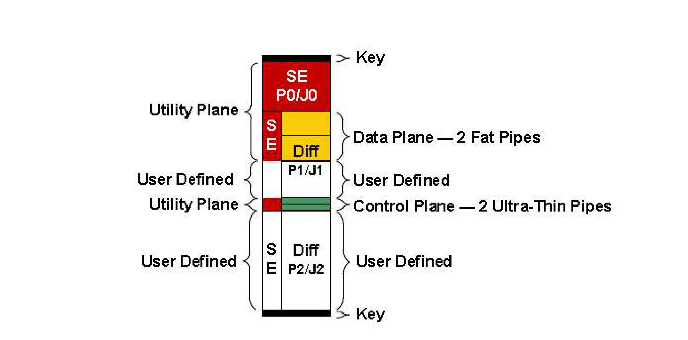

*Figure 25: ANSI/VITA 65.0 Payload Slot Profile for SLT3-PAY-2F2U-14.2.3 ｜ 图 25：SLT3-PAY-2F2U-14.2.3 的 ANSI/VITA 65.0 载荷槽位配置档*

5.2.16.3 3U Payload Slot Profiles

5.2.16.3 3U 载荷槽位配置档

**Rule 5.2.16.3-1**

SOSA 3U Payload Plug-In Cards shall conform to the ANSI/VITA 65.0 slot profile SLT3-PAY-1F1U1S1S1U1U2F1H-14.6.11-n or SLT3-PAY-1F1U1S1S1U1U4F1J-14.6.13-n. Conformance Methodology: (A)

SOSA 3U 载荷插卡应符合 ANSI/VITA 65.0 的 slot profile SLT3-PAY-1F1U1S1S1U1U2F1H-14.6.11-n 或 SLT3-PAY-1F1U1S1S1U1U4F1J-14.6.13-n。符合性方法：(A)

**Recommendation 5.2.16.3-1**

SOSA 3U Payload Plug-In Cards that don’t require RF or optical should conform to ANSI/VITA 65.0 slot profile SLT3-PAY-1F1U1S1S1U1U2F1H-14.6.11-0. Conformance Methodology: (TBD)

不需要射频或光接口的 SOSA 3U 载荷插卡宜符合 ANSI/VITA 65.0 的 slot profile SLT3-PAY-1F1U1S1S1U1U2F1H-14.6.11-0。符合性方法：(TBD)

**Recommendation 5.2.16.3-2**

SOSA 3U Payload Plug-In Cards requiring RF should conform to ANSI/VITA 65.1 slot profile SLT3-PAY-1F1U1S1S1U1U2F1H-14.6.11-2. Conformance Methodology: (TBD)

需要射频的 SOSA 3U 载荷插卡宜符合 ANSI/VITA 65.1 的 slot profile SLT3-PAY-1F1U1S1S1U1U2F1H-14.6.11-2。符合性方法：(TBD)

**Recommendation 5.2.16.3-3**

SOSA 3U Payload Plug-In Cards that require additional Expansion Plane connectivity should conform to ANSI/VITA 65.0 slot profile SLT3-PAY-1F1U1S1S1U1U4F1J-14.6.13-n. Conformance Methodology: (TBD)

需要额外扩展平面连接的 SOSA 3U 载荷插卡宜符合 ANSI/VITA 65.0 的 slot profile SLT3-PAY-1F1U1S1S1U1U4F1J-14.6.13-n。符合性方法：(TBD)

**Recommendation 5.2.16.3-4**

Vendors that use ANSI/VITA 65.1 slot profile SLT3-PAY-1F1U1S1S1U1U4F1J-14.6.13-n should provide a build option to not populate the ANSI/VITA 46.0 connector in P2A so that the card can also be used in a backplane adhering to SLT3-PAY-1F1U1S1S1U1U2F1H-14.6.11-n.

使用 ANSI/VITA 65.1 的 slot profile SLT3-PAY-1F1U1S1S1U1U4F1J-14.6.13-n 的厂商，宜提供一种构建选项：不装配 P2A 处的 ANSI/VITA 46.0 连接器，使该卡也能用于符合 SLT3-PAY-1F1U1S1S1U1U2F1H-14.6.11-n 的背板。

<!-- 原书 p.105 ｜ PDF p.125 -->

**Rule 5.2.16.3-2**

SOSA 3U Payload Plug-In Cards shall conform to one of the ANSI/VITA 65.1 module profiles in Table 21 or Table 22. Conformance Methodology: (A)

SOSA 3U 载荷插卡应符合表 21 或表 22 所列 ANSI/VITA 65.1 的 module profile 之一。符合性方法：(A)

**Recommendation 5.2.16.3-5**

SOSA 3U Payload Plug-In Cards that don’t require RF or optical should conform to ANSI/VITA 65.1 module profile MOD3p-PAY-1F1U1S1S1U1U2F1H-16.6.11-4.

不需要射频或光接口的 SOSA 3U 载荷插卡宜符合 ANSI/VITA 65.1 的 module profile MOD3p-PAY-1F1U1S1S1U1U2F1H-16.6.11-4。

**Recommendation 5.2.16.3-6**

SOSA 3U Payload Plug-In Cards requiring RF should conform to ANSI/VITA 65.1 module profile MOD3-PAY-1F1U1S1S1U1U2F1H-16.6.11-6.

需要射频的 SOSA 3U 载荷插卡宜符合 ANSI/VITA 65.1 的 module profile MOD3-PAY-1F1U1S1S1U1U2F1H-16.6.11-6。

**Observation 5.2.16.3-1**

SOSA 3U Payload Plug-In Cards can include, but are not limited to, SBCs that are computationally-intensive, FPGAs, and RF transceivers.

SOSA 3U 载荷插卡可包括（但不限于）计算密集的单板计算机（SBC）、FPGA 与射频收发信机。

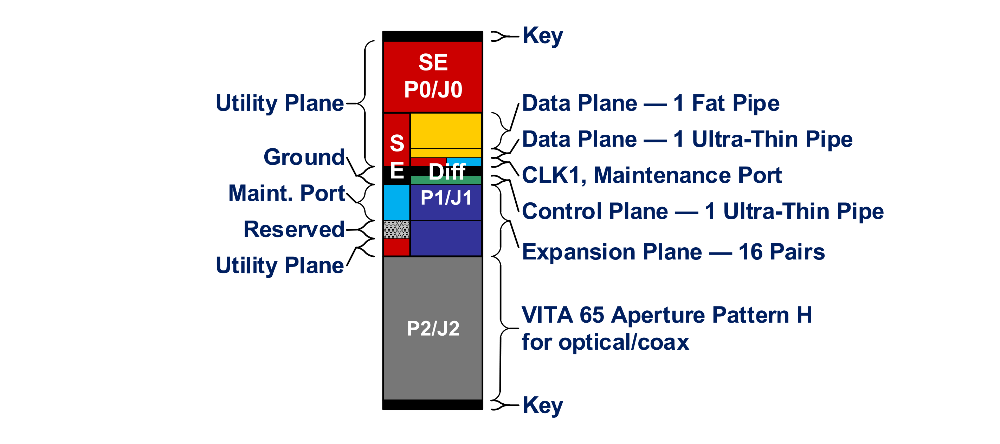

*Figure 26: ANSI/VITA 65.0 Payload Slot Profile SLT3-PAY-1F1U1S1S1U1U2F1H-14.6.11-n ｜ 图 26：ANSI/VITA 65.0 载荷槽位配置档 SLT3-PAY-1F1U1S1S1U1U2F1H-14.6.11-n*

**Table 21: ANSI/VITA 65.1Slot Profiles for SLT3-PAY-1F1U1S1S1U1U2F1H-14.6.11-n ｜ 表 21：SLT3-PAY-1F1U1S1S1U1U2F1H-14.6.11-n 的 ANSI/VITA 65.1 槽位配置档**

| Slot Profile names ／ 槽位配置档名 | Dash Num ／ 短横编号 | STD Date ／ 标准日期 | Connector Modules ／ 连接器模块 ||| MT loading and Optical Pipes ／ MT 加载与光纤管道 ||| Comments ／ 注释 |
|---|---|---|---|---|---|---|---|---|---|
| | | | P1B/J1B | P2A/J2A | P2B/J2B | P1B/J1B | P2A/J2A | P2B/J2B | |
| **SLT3-PAY-1F1U1S1S1U1U2F1H-14.6.11-** | | | **VITA 46** | **Aperture H** || | | | **First row of SLT3-PAY-1F1U1S1S1U1U2F1H-14.6.11-n SLT3-PAY-1F1U1S1S1U1U2F1H-14.6.11-n 的首行** |
| SLT3-PAY-1F1U1S1S1U1U2F1H-14.6.11- | 0 | 2017-07 | VITA 46 | Empty || | | | |
| SLT3-PAY-1F1U1S1S1U1U2F1H-14.6.11- | 1 | 2017-07 | VITA 46 | Hybrid 66.4+67.1-6.4.5.6.1 || | | | |
| SLT3-PAY-1F1U1S1S1U1U2F1H-14.6.11- | 2 | Proposed | VITA 46 | 10 SMPM contacts-6.4.5.6.3 || | | | |
| Last line | | | | | | | | | |

> 转写说明：表头两层级联——第一层 `Connector Modules` 横跨 P1B/J1B、P2A/J2A、P2B/J2B 三列，`MT loading and Optical Pipes` 横跨其下同名三列；`Slot Profile names`、`Dash Num`、`STD Date`、`Comments` 四个标目占满两行。被 colspan 覆盖处留空。
> 转写说明：`Slot Profile names` 与 `Dash Num` 两个标目在原书同处一个表头格（左右分置，其间未画竖线）；数据行中配置档名之后留一空格为该行短横编号。此处拆作两列照录，两列合并即为完整编号 `SLT3-PAY-1F1U1S1S1U1U2F1H-14.6.11-<n>`；首行无编号数字（原书如此）。
> 转写说明：`Connector Modules` 下 P2A/J2A 与 P2B/J2B 两列在原书数据行合并为一格（`Aperture H`、`Empty`、`Hybrid 66.4+67.1-6.4.5.6.1`、`10 SMPM contacts-6.4.5.6.3` 跨两列），此处按 colspan 记作一格后接空格。
> 转写说明：`Hybrid 66.4+67.1-6.4.5.6.1` 与 `10 SMPM contacts-6.4.5.6.3` 在原书为蓝色带下划线的超链接样式，此处只记文字；`Proposed` 行的黄色底纹与末行灰底纹未在 Markdown 中表示。
> 转写说明：本表为单页整表（原书 p.106／PDF 第 126 页），共 5 个数据行。下一页（PDF 第 127 页）顶端即 Table 22 的题注与表体，属另一张表，故未续写。

<!-- 原书 p.106 ｜ PDF p.126 -->

**Table 22: ANSI/VITA 65.1 Module Profiles for SLT3-PAY-1F1U1S1S1U1U2F1H-14.6.11-n ｜ 表 22：SLT3-PAY-1F1U1S1S1U1U2F1H-14.6.11-n 的 ANSI/VITA 65.1 模块配置档**

| Module Profile names ／ 模块配置档名 | Dash Num ／ 短横编号 | STD Date ／ 标准日期 | Slot Profile ／ 槽位配置档 | Data Plane ／ 数据平面 | Data Plane ／ 数据平面 | Protocols for Copper Planes ／ 铜平面协议 |||| Optical ／ 光 | Comments ／ 注释 | Legacy ／ 旧式 |
|---|---|---|---|---|---|---|---|---|---|---|---|---|
| | | | | | | Expansion Plane ／ 扩展平面 | Expansion Plane ／ 扩展平面 | Control Plane ／ 控制平面 | Contol Plane ／ 控制平面 | | | |
| **MOD3-PAY-1F1U1S1S1U1U2F1H-16.6.11-** | | | | **DP01** | **DPutp01** | **EP00 - EP03** | **EP04 - EP07** | **CPutp01** | | | **First row of MOD3-PAY-1F1U1S1S1U1U2F1H-16.6.11-n MOD3-PAY-1F1U1S1S1U1U2F1H-16.6.11-n 的首行** | |
| MOD3p-PAY-1F1U1S1S1U1U2F1H-16.6.11- | 1 | 2017-07 | SLT3p-PAY-1F1U1S1S1U1U2F1H-14.6.11-1 | 10GBASE-KX4 -- 5.1.5 | 1000BASE-KX -- 5.1.2 | PCIe Gen 2 -- 5.3.3.2 | User Defined | 1000BASE-KX -- 5.1.2 | | | P2/J2: Hybrid_66.4+67.1-6.4.5.6.1 | |
| MOD3p-PAY-1F1U1S1S1U1U2F1H-16.6.11- | 2 | Proposed | SLT3p-PAY-1F1U1S1S1U1U2F1H-14.6.11-2 | 10GBASE-KX4 -- 5.1.5 | 1000BASE-KX -- 5.1.2 | PCIe Gen 2 -- 5.3.3.2 | User Defined | 1000BASE-KX -- 5.1.2 | | | P2/J2: 10_SMPM_contacts-6.4.5.6.3 | |
| MOD3p-PAY-1F1U1S1S1U1U2F1H-16.6.11- | 3 | Proposed | SLT3p-PAY-1F1U1S1S1U1U2F1H-14.6.11-2 | 40GBASE-KR4 -- 5.1.8 | 10GBASE-KR -- 5.1.7 | PCIe Gen 3 -- 5.3.3.3 | User Defined | 10GBASE-KR -- 5.1.7 | | | P2/J2: 10_SMPM_contacts-6.4.5.6.3 | |
| MOD3p-PAY-1F1U1S1S1U1U2F1H-16.6.11- | 4 | Proposed | SLT3p-PAY-1F1U1S1S1U1U2F1H-14.6.11-0 | 40GBASE-KR4 -- 5.1.8 | 10GBASE-KR -- 5.1.7 | PCIe Gen 3 -- 5.3.3.3 | User Defined | 10GBASE-KR -- 5.1.7 | | | No P2/J2; Intended for use by SBC 无 P2/J2；供单板计算机（SBC）使用 | |
| MOD3p-PAY-1F1U1S1S1U1U2F1H-16.6.11- | 5 | Proposed | SLT3p-PAY-1F1U1S1S1U1U2F1H-14.6.11-4 | 40GBASE-KR4 -- 5.1.8 | 10GBASE-KR -- 5.1.7 | PCIe Gen 3 -- 5.3.3.3 | User Defined | 10GBASE-KR -- 5.1.7 | | | 14_sMPM_contacts_6.4.5.4.4 | |
| MOD3p-PAY-1F1U1S1S1U1U2F1H-16.6.11- | 6 | Proposed | SLT3p-PAY-1F1U1S1S1U1U2F1H-14.6.11-4 | 40GBASE-KR4 -- 5.1.8 | 10GBASE-KR -- 5.1.7 | Aurora -- 5.7.2 | User Defined | 10GBASE-KR -- 5.1.7 | | | 14_sMPM_contacts_6.4.5.4.4 | |

> 转写说明：表头两层级联——第一层 `Protocols for Copper Planes` 横跨其下 Expansion Plane、Expansion Plane、Control Plane、Contol Plane 四列；其余标目（`Module Profile names`、`Dash Num`、`STD Date`、`Slot Profile`、两列 `Data Plane`、`Optical`、`Comments`、`Legacy`）占满两行。被 colspan 覆盖处留空。
> 转写说明：`Module Profile names` 与 `Dash Num` 两个标目在原书同处一个表头格（左右分置，其间未画竖线）；数据行的短横编号以小字偏置排在该格右端。此处拆作两列照录，两列合并即为完整编号 `MOD3-PAY-1F1U1S1S1U1U2F1H-16.6.11-<n>`。
> 转写说明：第四个子列名在原书排作 `Contol Plane`（缺字母 r，非本次转写笔误）；c9 该列全表无数据。
> 转写说明：首行模块配置档名以大写 `MOD3-PAY-` 起首（粗体），第二至七行为小写 `MOD3p-PAY-` 起首，Slot Profile 亦为 `SLT3p-PAY-`，均照原书大小写录入。
> 转写说明：首行无短横编号（原书如此）。第三、四行的 Slot Profile 同为 `SLT3p-PAY-1F1U1S1S1U1U2F1H-14.6.11-2`，第六、七行同为 `…-14.6.11-4`（原书如此，未作更正）；`Legacy` 列与 `Optical` 列全表空白。
> 转写说明：本表为单页整表（原书 p.107／PDF 第 127 页上半），共 7 个数据行、无 `Last line` 行。同页其下为 Figure 27 与 Table 23、Table 24，下一页（PDF 第 128 页）顶端为 Rule 5.2.16.4-2 正文，均非本表续行，故未续写。

> **译注**（读表）：表 22、表 24~28 的**协议各列整格不译**——`10GBASE-KX4`、`1000BASE-KX`、`PCIe Gen 2/3`、`40GBASE-KR4`、`10GBASE-KR`、`Aurora`、`1000BASE-T` 与紧随其后的 `5.x.y` 都是 VITA 65 的协议名与条款号，译了即与 VITA 文献、与前后表对不上。同属不译的还有：`User Defined`＝用户自定义；`As 4 UTPs`＝按 4 对 UTP 使用；`Empty`＝空；`Proposed`／`Proposed future 65.0`＝拟议／拟议中的未来 65.0 版；`Last line`＝原表最末一行的转写标记；`Aperture H`／`Aperture J`＝H 号／J 号孔径位；`P2/J2: Hybrid_66.4+67.1-6.4.5.6.1` 一类是「连接器位：连接器型号」的连写，亦不译。`DP01`、`DPutp01`、`EP00 - EP15`、`CPutp01` 等是 VITA 65.1 的管道编号，不译。作描述的成句格才并置中文（如 `First row of …-n` 的首行、`No P2/J2; Intended for use by SBC`）。另：原书多处把 `Control Plane` 误排作 `Contol Plane`（缺字母 r，见表 22、表 25、表 26 的子列名），表头照录原串，中文仍作「控制平面」。

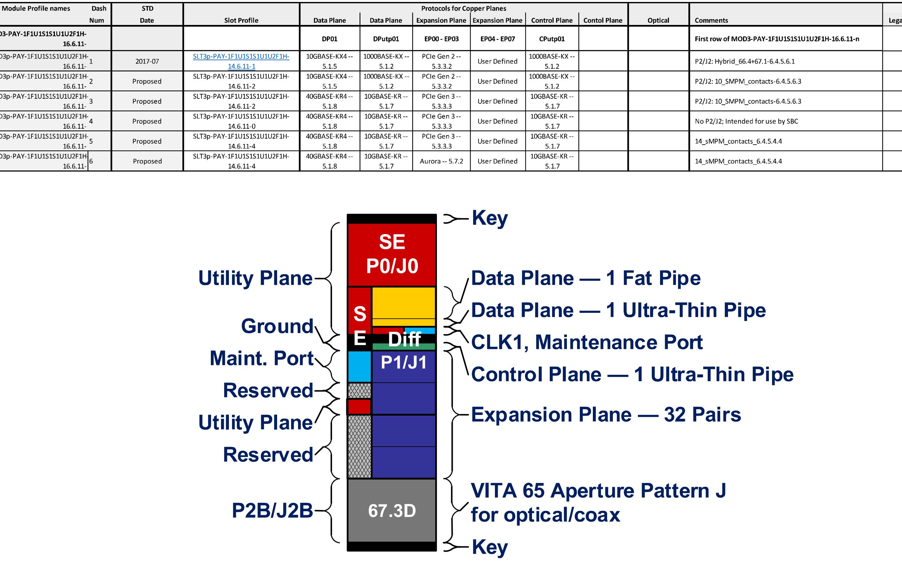

*Figure 27: ANSI/VITA 65.0 Payload Slot Profile SLT3-PAY-1F1U1S1S1U1U4F1J-14.6.13-n ｜ 图 27：ANSI/VITA 65.0 载荷槽位配置档 SLT3-PAY-1F1U1S1S1U1U4F1J-14.6.13-n*

**Table 23: ANSI/VITA 65.1Slot Profiles for SLT3-PAY-1F1U1S1S1U1U4F1J-14.6.13-n ｜ 表 23：SLT3-PAY-1F1U1S1S1U1U4F1J-14.6.13-n 的 ANSI/VITA 65.1 槽位配置档**

| Slot Profile names ／ 槽位配置档名 | Dash Num ／ 短横编号 | STD Date ／ 标准日期 | Connector Modules ／ 连接器模块 ||| MT loading and Optical Pipes ／ MT 加载与光纤管道 ||| Comments ／ 注释 |
|---|---|---|---|---|---|---|---|---|---|
| | | | P1B/J1B | P2A/J2A | P2B/J2B | P1B/J1B | P2A/J2A | P2B/J2B | |
| **SLT3-PAY-1F1U1S1S1U1U4F1J-14.6.13-** | | **Proposed future 65.0** | **VITA 46** | **VITA 46** | **Aperture J** | **VITA 46** | **VITA 46** | **Aperture J** | **First row of SLT3-PAY-1F1U1S1S1U1U4F1J-14.6.13-n SLT3-PAY-1F1U1S1S1U1U4F1J-14.6.13-n 的首行** |
| SLT3-PAY-1F1U1S1S1U1U4F1J-14.6.13- | 0 | Proposed future 65.0 | VITA 46 | VITA 46 | Empty | | | | |
| Last line | | Proposed future 65.0 | | | | | | | |

> 转写说明：表头两层级联——第一层 `Connector Modules` 横跨 P1B/J1B、P2A/J2A、P2B/J2B 三列，`MT loading and Optical Pipes` 横跨其下同名三列；`Slot Profile names`、`Dash Num`、`STD Date`、`Comments` 四个标目占满两行。被 colspan 覆盖处留空。
> 转写说明：`Slot Profile names` 与 `Dash Num` 两个标目在原书同处一个表头格（左右分置，其间未画竖线）；数据行中配置档名之后留一空格为该行短横编号。此处拆作两列照录，两列合并即为完整编号 `SLT3-PAY-1F1U1S1S1U1U4F1J-14.6.13-<n>`；首行无编号数字（原书如此）。
> 转写说明：第二行的 `MT loading and Optical Pipes` 三列为空白；`Proposed future 65.0` 的红色底纹与末行灰底纹系原书高亮，未在 Markdown 中表示。
> 转写说明：本表为单页整表（原书 p.107／PDF 第 127 页中部），共 3 个数据行。同页其下紧接 Table 24，下一页（PDF 第 128 页）顶端为 Rule 5.2.16.4-2 正文，均非本表续行，故未续写。

**Table 24: ANSI/VITA 65.1 Module Profiles for SLT3-PAY-1F1U1S1S1U1U4F1J-14.6.13-n ｜ 表 24：SLT3-PAY-1F1U1S1S1U1U4F1J-14.6.13-n 的 ANSI/VITA 65.1 模块配置档**

| Module Profile names ／ 模块配置档名 | Dash Num ／ 短横编号 | STD Date ／ 标准日期 | Slot Profile ／ 槽位配置档 | Protocols for Copper Planes ／ 铜平面协议 |||| Protocols Optical ／ 光协议 | Comments ／ 注释 | Legacy ／ 旧式 |
|---|---|---|---|---|---|---|---|---|---|---|
| | | | | Data Plane ／ 数据平面 | Data Plane ／ 数据平面 | Plane ／ 平面 | Control Plane ／ 控制平面 | | | |
| **MOD3-PAY-1F1U1S1S1U1U4F1J-16.6.13-** | | **Proposed future 65.0** | | **DP01** | **DPutp01** | **EP00 - EP15** | **CPutp01** | | **First row of MOD3-PAY-1F1U1S1S1U1U4F1J-16.6.13-n MOD3-PAY-1F1U1S1S1U1U4F1J-16.6.13-n 的首行** | |
| MOD3p-PAY-1F1U1S1S1U1U4F1J-16.6.13- | 1 | Proposed future 65.0 | SLT3p-PAY-1F1U1S1S1U1U4F1J-14.6.13-0 | 40GBASE-KR4 -- 5.1.8 | 10GBASE-KR -- 5.1.7 | PCIe Gen 3 -- 5.3.3.3 | 10GBASE-KR -- 5.1.7 | | No P2B/J2B ／ 无 P2B/J2B | |
| Last line | | Proposed future 65.0 | | | | | | | | |

> 转写说明：表头两层级联——第一层 `Protocols for Copper Planes` 横跨其下 Data Plane、Data Plane、Plane、Control Plane 四列；`Module Profile names`、`Dash Num`、`STD Date`、`Slot Profile`、`Protocols Optical`、`Comments`、`Legacy` 七个标目在原书为一格贯满两行，故在第二行表头中留空。被 colspan 覆盖处同样留空。
> 转写说明：`Module Profile names` 与 `Dash Num` 两个标目在原书同处一个表头格（左右分置，其间未画竖线）。此处拆作两列照录，两列合并即为完整编号 `MOD3-PAY-1F1U1S1S1U1U4F1J-16.6.13-<n>`；首行无编号数字（原书如此）。
> 转写说明：`Protocols Optical` 列与 `Legacy` 列全表空白。
> 转写说明：原书数据首行为大写 `MOD3-PAY-…`（粗体），次行为小写 `MOD3p-PAY-…`、槽位档 `SLT3p-PAY-…`，均照原书大小写照录。
> 转写说明：本表为单页整表（原书 p.107／PDF 第 127 页下半），共 3 个数据行。下一页（PDF 第 128 页）顶端为 Rule 5.2.16.4-2 正文，非本表续行，故未续写。

###### 5.2.16.4 3U Data/Control Plane Switch Profile ｜ 5.2.16.4 3U 数据／控制平面交换机配置档

**Rule 5.2.16.4-1**

- SOSA 3U Switch Plug-In Cards shall conform to ANSI/VITA 65.0 slot profile SLT3-SWH-

- SOSA 3U 交换机插卡应符合 ANSI/VITA 65.0 的 slot profile SLT3-SWH-

6F8U-14.4.15. Conformance Methodology: (A)

6F8U-14.4.15。符合性方法：(A)

<!-- 原书 p.107 ｜ PDF p.127 -->

**Rule 5.2.16.4-2**

SOSA 3U Switch Plug-In Cards shall conform to one of the ANSI/VITA 65.1 module profiles in

SOSA 3U 交换机插卡应符合 ANSI/VITA 65.1 的 module profile 之一，见

> **译注**：本条英文在原文此处中断（止于「in」），其后续内容未见于英文转换件；英文照录，中文同样在「见」处切断，不代为补全。

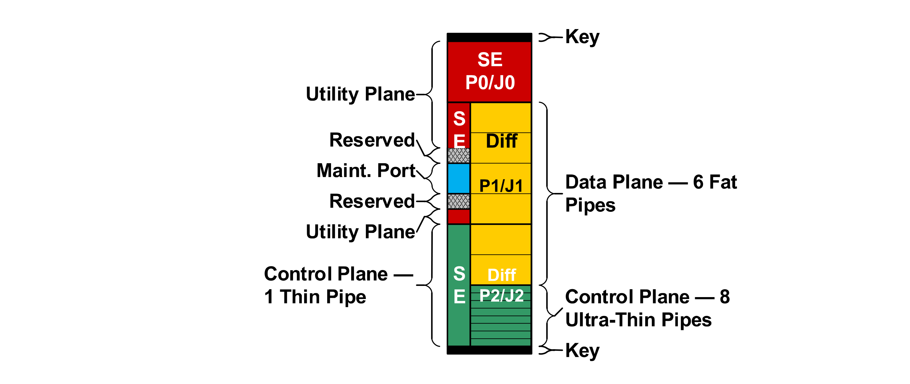

*Figure 28: ANSI/VITA 65.0 Control/Expansion Plane Switch Slot Profile SLT3-SWH-6F8U-14.4.15 ｜ 图 28：ANSI/VITA 65.0 控制／扩展平面交换机槽位配置档 SLT3-SWH-6F8U-14.4.15*

**Table 25: ANSI/VITA 65.1 Module Profiles for SLT3-SWH-6F8U-14.4.15 ｜ 表 25：SLT3-SWH-6F8U-14.4.15 的 ANSI/VITA 65.1 模块配置档**

| Module Profile names ／ 模块配置档名 | Dash Num ／ 短横编号 | STD Date ／ 标准日期 | Slot Profile ／ 槽位配置档 | Protocols for Copper Planes ／ 铜平面协议 ||| Comments ／ 注释 | Legacy ／ 旧式 |
|---|---|---|---|---|---|---|---|---|
| | | | | Data Plane ／ 数据平面 | Control Plane ／ 控制平面 | Contol Plane ／ 控制平面 | | |
| **MOD3-SWH-6F8U-16.4.16-** | | **Proposed future 65.0** | | **DP01 - DP05, DS01 (FP)** | **CPutp01 - CPutp06, CSutp01** | **CPtp01** | **First row of MOD3-SWH-6F8U-16.4.16-n MOD3-SWH-6F8U-16.4.16-n 的首行** | |
| MOD3-SWH-6F8U-16.4.16- | 1 | Proposed future 65.0 | SLT3-SWH-6F8U-14.4.15 | PCIe Gen 3 -- 5.3.3.3 | 10GBASE-KR -- 5.1.7 | 1000BASE-T -- 5.1.3 | | |
| Last line | | Proposed future 65.0 | | | | | | |

> 转写说明：表头两层级联——第一层 `Protocols for Copper Planes` 横跨其下 Data Plane、Control Plane、Contol Plane 三列；`Module Profile names`、`Dash Num`、`STD Date`、`Slot Profile`、`Comments`、`Legacy` 占满两行。被 colspan 覆盖处留空。
> 转写说明：`Module Profile names` 与 `Dash Num` 两个标目在原书同处一个表头格（左右分置，其间未画竖线）；第二行短横编号以小号字排在该格右端。此处拆作两列照录，两列合并即为完整编号 `MOD3-SWH-6F8U-16.4.16-<n>`；首行无编号数字（原书如此）。
> 转写说明：`Protocols for Copper Planes` 下第三个子列名在原书排作 `Contol Plane`（缺字母 r，非本次转写笔误）。
> 转写说明：`Legacy` 列全表空白；`Proposed future 65.0` 的红色底纹与末行灰底纹系原书高亮，未在 Markdown 中表示。
> 转写说明：本表为单页整表（原书 p.108／PDF 第 128 页），共 3 个数据行。下一页（PDF 第 129 页）顶端为 Permission 5.2.16.5-1 正文，非本表续行，故未续写。

###### 5.2.16.5 3U Control/Data Plane Switch Profile ｜ 5.2.16.5 3U 控制／数据平面交换机配置档

**Rule 5.2.16.5-1**

SOSA 3U Control/Data Plane Switch Plug-In Cards shall conform to ANSI/VITA 65.0 slot profile SLT3-SWH-6F1U7U-14.4.14 or SLT3-SWH-4F1U7U1J-14.8.7-n. Conformance Methodology: (A)

SOSA 3U 控制／数据平面交换机插卡应符合 ANSI/VITA 65.0 的 slot profile SLT3-SWH-6F1U7U-14.4.14 或 SLT3-SWH-4F1U7U1J-14.8.7-n。符合性方法：(A)

**Rule 5.2.16.5-2**

SOSA 3U Control/Data Plane Switch Plug-In Cards shall conform to one of the ANSI/VITA

SOSA 3U 控制／数据平面交换机插卡应符合下列 ANSI/VITA

65.1 module profiles in Table 23 or Table 24. Conformance Methodology: (A)

65.1 的 module profile 之一，见表 23 或表 24。符合性方法：(A)

> **译注**：本条所引 `Table 23`／`Table 24` 系原书如此（按上下文，5.2.16.5 节应引表 26 与表 27）；英文照录，中文照字面译出，不代原文改号。

<!-- 原书 p.108 ｜ PDF p.128 -->

**Permission 5.2.16.5-1**

The control plane pipes in ANSI/VITA 65.1 slot profiles SLT3-SWH-6F1U7U-14.4.14 and SLT3-SWH-4F1U7U1J-14.8.7-n can be repurposed to provide a second data plane switch fabric.

ANSI/VITA 65.1 的 slot profile SLT3-SWH-6F1U7U-14.4.14 与 SLT3-SWH-4F1U7U1J-14.8.7-n 中的控制平面管道，可改作第二套数据平面交换结构之用。

**Permission 5.2.16.5-2**

Fiber connections on the front of the ANSI/VITA 65.1 SLT3-SWH-6F1U7U-14.4.14 and the

前面板上的光纤连接，就 ANSI/VITA 65.1 的 SLT3-SWH-6F1U7U-14.4.14 与

SLT3-SWH-4F1U7U1J-14.8.7-n slot profiles can be used for Ethernet in/out of the chassis if blind-mate fiber connections are not available or practical.

SLT3-SWH-4F1U7U1J-14.8.7-n 这两个 slot profile 而言，在盲插式光纤连接不可得或不实用时，可用于进出机箱的以太网。

**Recommendation 5.2.16.5-1**

Vendors of a card based on the ANSI/VITA 65.1 slot profile SLT3-SWH-6F1U7U-14.4.14 should offer a variant of this card that can be used in a backplane with a Switch Slot for SLT3-SWH-4F1U7U1J-14.8.7-0 (i.e., P2B is empty).

以 ANSI/VITA 65.1 的 slot profile SLT3-SWH-6F1U7U-14.4.14 为依据的插卡厂商，宜提供该卡的一种变体，使其可用于交换槽位为 SLT3-SWH-4F1U7U1J-14.8.7-0 的背板（即 P2B 为空）。

**Observation 5.2.16.5-1**

ANSI/VITA 65.1 slot profiles SLT3-SWH-6F1U7U-14.4.14 and SLT3-SWH-4F1U7U1J-14.8.7-n can be daisy chained to support additional payload slots, although this successively increases the risk of bottlenecks on inter-switch connections. As such, larger backplanes may wish to use all pipes for data plane connections to minimize the number of inter-switch connections that are required. This approach assumes that ANSI/VITA 65.1 slot profile SLT3-SWH-6F8U-14.4.15 is also used to provide the switch fabric for the control plane.

ANSI/VITA 65.1 的 slot profile SLT3-SWH-6F1U7U-14.4.14 与 SLT3-SWH-4F1U7U1J-14.8.7-n 可作菊花链串接，以支持更多的载荷槽位，尽管这会使交换机间连接出现瓶颈的风险逐级增大。因此，较大的背板可望把全部管道用于数据平面连接，以尽量减少所需的交换机间连接数目。此做法假定同时采用 ANSI/VITA 65.1 的 slot profile SLT3-SWH-6F8U-14.4.15 来提供控制平面的交换结构。

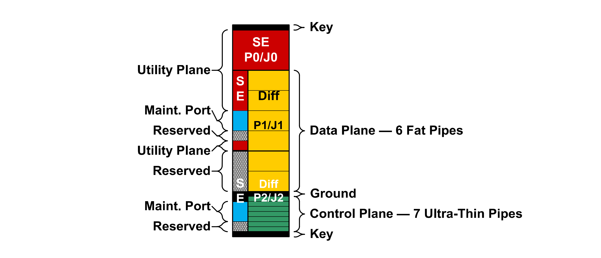

*Figure 29: ANSI/VITA 65.0 Control/Data Plane Switch Slot Profile SLT3-SWH-6F1U7U-14.4.14 ｜ 图 29：ANSI/VITA 65.0 控制／数据平面交换机槽位配置档 SLT3-SWH-6F1U7U-14.4.14*

**Table 26: ANSI/VITA 65.1 Module Profiles for SLT3-SWH-6F1U7U-14.4.14 ｜ 表 26：SLT3-SWH-6F1U7U-14.4.14 的 ANSI/VITA 65.1 模块配置档**

| Module Profile names ／ 模块配置档名 | Dash Num ／ 短横编号 | STD Date ／ 标准日期 | Slot Profile ／ 槽位配置档 | Protocols for Copper Planes ／ 铜平面协议 |||| Comments ／ 注释 | Legacy ／ 旧式 |
|---|---|---|---|---|---|---|---|---|---|
| | | | | Data Plane ／ 数据平面 | Data Plane ／ 数据平面 | Control Plane ／ 控制平面 | Contol Plane ／ 控制平面 | | |
| **MOD3-SWH-6F1U7U-16.4.15-** | | | | **DS01, DP01 - DP04 (FP)** | **DP05** | **CPutp01 - CPutp06** | **CSutp01** | **First row of MOD3-SWH-6F1U7U-16.4.15-n MOD3-SWH-6F1U7U-16.4.15-n 的首行** | |
| MOD3-SWH-6F1U7U-16.4.15- | 1 | 2017-05 | SLT3-SWH-6F1U7U-14.4.14 | 10GBASE-KX4 -- 5.1.5 | As 4 UTPs: 1000BASE-KX -- 5.1.2 | 1000BASE-KX -- 5.1.2 | 1000BASE-KX -- 5.1.2 | | |
| MOD3-SWH-6F1U7U-16.4.15- | 2 | Proposed | SLT3-SWH-6F1U7U-14.4.14 | 10GBASE-KR -- 5.1.7, 40GBASE-KR4 -- 5.1.8 | 10GBASE-KR -- 5.1.7, 40GBASE-KR4 -- 5.1.8 | 10GBASE-KR -- 5.1.7 | 10GBASE-KR -- 5.1.7 | | |
| Last line | | | | | | | | | |

> 转写说明：表头两层级联——第一层 `Protocols for Copper Planes` 横跨其下 Data Plane、Data Plane、Control Plane、Contol Plane 四列；`Module Profile names`、`Dash Num`、`STD Date`、`Slot Profile`、`Comments`、`Legacy` 占满两行。被 colspan 覆盖处留空。
> 转写说明：`Module Profile names` 与 `Dash Num` 两个标目在原书同处一个表头格（左右分置，其间未画竖线）；数据行中短横编号以极小字号排在该格右端（如 `MOD3-SWH-6F1U7U-16.4.15- 1`）。此处拆作两列照录，两列合并即为完整编号 `MOD3-SWH-6F1U7U-16.4.15-<n>`；首行无编号数字（原书如此）。
> 转写说明：`Protocols for Copper Planes` 下第四个子列名在原书排作 `Contol Plane`（缺字母 r，非本次转写笔误）。
> 转写说明：第三行 STD Date 列在原书因列宽不足折为 `Propose` / `d` 两行，此处按单词复原为 `Proposed`；`Legacy` 列全表空白；末行除 `Last line` 外全为灰底空白。
> 转写说明：本表为单页整表（原书 p.109／PDF 第 129 页），共 4 个数据行。下一页（PDF 第 130 页）顶端为 Figure 30，非本表续行，故未续写。

<!-- 原书 p.109 ｜ PDF p.129 -->

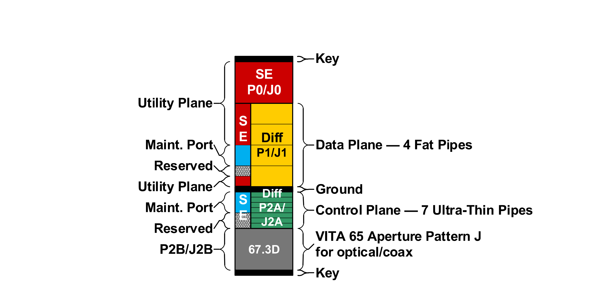

*Figure 30: ANSI/VITA 65.0 Control/Data Plane Switch Slot Profile SLT3-SWH-4F1U7U1J-14.8.7-n ｜ 图 30：ANSI/VITA 65.0 控制／数据平面交换机槽位配置档 SLT3-SWH-4F1U7U1J-14.8.7-n*

**Table 27: ANSI/VITA 65.1 Module Profiles for SLT3-SWH-4F1U7U1J-14.8.7-n ｜ 表 27：SLT3-SWH-4F1U7U1J-14.8.7-n 的 ANSI/VITA 65.1 模块配置档**

| Module Profile names ／ 模块配置档名 | Dash Num ／ 短横编号 | STD Date ／ 标准日期 | Slot Profile ／ 槽位配置档 | Protocols for Copper Planes ／ 铜平面协议 ||| Protocols for Optical ／ 光协议 | Comments ／ 注释 | Legacy ／ 旧式 |
|---|---|---|---|---|---|---|---|---|---|
| | | | | Data Plane ／ 数据平面 | Data Plane ／ 数据平面 | Control Plane ／ 控制平面 | | | |
| **MOD3-SWH-4F1U7U1J-16.8.7-** | | | | **DS01, DP01, DP02** | **DP03** | **CSutp01, CPutp01 - CPutp06** | | **First row of MOD3-SWH-4F1U7U1J-16.8.7-n MOD3-SWH-4F1U7U1J-16.8.7-n 的首行** | |
| MOD3-SWH-4F1U7U1J-16.8.7- | 1 | 2017-05 | SLT3-SWH-4F1U7U1J-14.8.7-1 | 10GBASE-KX4 -- 5.1.5 | As 4 UTPs: 1000BASE-KX -- 5.1.2 | 1000BASE-KX -- 5.1.2 | | | |
| MOD3-SWH-4F1U7U1J-16.8.7- | 2 | Proposed | SLT3-SWH-4F1U7U1J-14.8.7-0 | 10GBASE-KR -- 5.1.7, 40GBASE-KR4 -- 5.1.8 | 10GBASE-KR -- 5.1.7, 40GBASE-KR4 -- 5.1.8 | 10GBASE-KR -- 5.1.7 | | | |
| Last line | | | | | | | | | |

> 转写说明：表头两层级联——第一层 `Protocols for Copper Planes` 横跨其下 Data Plane、Data Plane、Control Plane 三列（原书该组标目偏左，压过第一道子列线）；`Module Profile names`、`Dash Num`、`STD Date`、`Slot Profile`、`Protocols for Optical`、`Comments`、`Legacy` 占满两行。被 colspan 覆盖处留空。
> 转写说明：`Module Profile names` 与 `Dash Num` 两个标目在原书同处一个表头格（左右分置，其间未画竖线）；数据行中短横编号以小号字排在该格右端。此处拆作两列照录，两列合并即为完整编号 `MOD3-SWH-4F1U7U1J-16.8.7-<n>`。
> 转写说明：第三行 STD Date 列在原书因列宽不足折为 `Propose` / `d` 两行，此处按单词复原为 `Proposed`；第二行槽位档 `SLT3-SWH-4F1U7U1J-14.8.7-1` 在原书为蓝色带下划线的超链接样式，此处只记文字。
> 转写说明：`Protocols for Optical` 列与 `Legacy` 列全表空白；末行除 `Last line` 外全为灰底空白。
> 转写说明：本表为单页整表（原书 p.110／PDF 第 130 页），共 4 个数据行。下一页（PDF 第 131 页）顶端为 Figure 31，非本表续行，故未续写。

###### 5.2.16.6 3U SOSA RF Switch Plug-In Card Profile ｜ 5.2.16.6 3U SOSA 射频交换机插卡配置档

**Rule 5.2.16.6-1**

SOSA 3U RF Switch Plug-In Cards shall conform to ANSI/VITA 65.0 slot profile SLT3-SWH-1F1S1S1U1U1K-14.8.8-n per. Conformance Methodology: (A)

SOSA 3U 射频交换机插卡应符合 ANSI/VITA 65.0 的 slot profile SLT3-SWH-1F1S1S1U1U1K-14.8.8-n，据（原文 per.）。符合性方法：(A)

> **译注**：本条英文在型号码之后多出一个孤立的「per.」（原书如此，疑为期刊或标准引文「per …」的残迹）；英文照录，中文按字面译作「据」，不代原文删改。

**Rule 5.2.16.6-2**

SOSA 3U RF Switch Plug-In Cards shall conform to one of the ANSI/VITA 65.1 module profiles in Table 28. Conformance Methodology: (A)

SOSA 3U 射频交换机插卡应符合表 28 所列 ANSI/VITA 65.1 的 module profile 之一。符合性方法：(A)

<!-- 原书 p.110 ｜ PDF p.130 -->

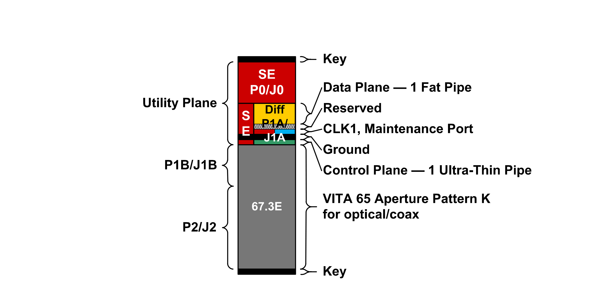

*Figure 31: ANSI/VITA 65.0 3U RF Switch Slot Profile SLT3-SWH-1F1S1S1U1U1K-14.8.8-n ｜ 图 31：ANSI/VITA 65.0 3U 射频交换机槽位配置档 SLT3-SWH-1F1S1S1U1U1K-14.8.8-n*

**Table 28: ANSI/VITA 65.1 Module Profiles for SLT3-SWH-1F1S1S1U1U1K-14.8.8-n ｜ 表 28：SLT3-SWH-1F1S1S1U1U1K-14.8.8-n 的 ANSI/VITA 65.1 模块配置档**

| Module Profile names ／ 模块配置档名 | Dash Num ／ 短横编号 | STD Date ／ 标准日期 | Slot Profile ／ 槽位配置档 | Protocols for Copper Planes ／ 铜平面协议 || Protocols for Optical ／ 光协议 | Comments ／ 注释 | Legacy ／ 旧式 |
|---|---|---|---|---|---|---|---|---|
| | | | | Data Plane ／ 数据平面 | Control Plane ／ 控制平面 | | | |
| **MOD3-SWH-1F1S1S1U1U1K-16.8.8-** | | | | **DP01** | **CPutp01** | | **First row of MOD3-SWH-1F1S1S1U1U1K-16.8.8-n MOD3-SWH-1F1S1S1U1U1K-16.8.8-n 的首行** | |
| MOD3-SWH-1F1S1S1U1U1K-16.8.8- | 1 | 2017-05 | SLT3-SWH-1F1S1S1U1U1K-14.8.8-1 | 10GBASE-KX4 -- 5.1.5 | 1000BASE-KX -- 5.1.2 | | | |
| MOD3-SWH-1F1S1S1U1U1K-16.8.8- | 2 | Proposed | SLT3-SWH-1F1S1S1U1U1K-14.8.8-0 | 10GBASE-KR -- 5.1.7, 40GBASE-KR4 -- 5.1.8 | 10GBASE-KR -- 5.1.7 | | | |
| Last line | | | | | | | | |

> 转写说明：表头两层级联——第一层 `Protocols for Copper Planes` 横跨其下 Data Plane、Control Plane 两列；`Module Profile names`、`Dash Num`、`STD Date`、`Slot Profile`、`Protocols for Optical`、`Comments`、`Legacy` 占满两行。被 colspan 覆盖处留空。
> 转写说明：`Module Profile names` 与 `Dash Num` 两个标目在原书同处一个表头格（左右分置，其间未画竖线）；数据行中短横编号以小号字排在该格右端。此处拆作两列照录，两列合并即为完整编号 `MOD3-SWH-1F1S1S1U1U1K-16.8.8-<n>`；首行无编号数字（原书如此）。
> 转写说明：第三行 STD Date 列在原书因列宽不足折为 `Propose` / `d` 两行，此处按单词复原为 `Proposed`；第二行槽位档 `SLT3-SWH-1F1S1S1U1U1K-14.8.8-1` 在原书为蓝色带下划线的超链接样式，此处只记文字。
> 转写说明：`Protocols for Optical` 列与 `Legacy` 列全表空白；末行除 `Last line` 外全为灰底空白。
> 转写说明：本表为单页整表（原书 p.111／PDF 第 131 页），共 4 个数据行。下一页（PDF 第 132 页）顶端为 Observation 5.2.16.7-1 正文与 Figure 32，非本表续行，故未续写。

###### 5.2.16.7 SOSA 3U Radial Clock Plug-In Card Profiles ｜ 5.2.16.7 SOSA 3U 径向时钟插卡配置档

**Rule 5.2.16.7-1**

SOSA 3U Radial Clock Plug-In Cards shall conform to ANSI/VITA 65.0 slot profile SLT3x-

SOSA 3U 径向时钟插卡应符合 ANSI/VITA 65.0 槽位配置档 SLT3x-

TIM-2S1U22S1U2U1H-14.9.2-n. Conformance Methodology: (A)

TIM-2S1U22S1U2U1H-14.9.2-n。符合性方法为 (A)

**Rule 5.2.16.7-2**

SOSA 3U Radial Clock Plug-In Cards shall only drive REF_CLK+/- if SYS_CON* is asserted. Conformance Methodology: (T)

SOSA 3U 径向时钟插卡应仅在 SYS_CON* 置位时才驱动 REF_CLK+/-。符合性方法为 (T)

**Rule 5.2.16.7-3**

SOSA 3U Radial Clock Plug-In Cards shall assert SYSRESET* until all internal clocks are valid. Conformance Methodology: (T)

SOSA 3U 径向时钟插卡应持续置起 SYSRESET*，直至所有内部时钟均有效。符合性方法为 (T)

**Rule 5.2.16.7-4**

SOSA 3U Radial Clock Plug-In Cards shall conform to one of the ANSI/VITA 65.1 module profiles in Table 29 and Table 30. Conformance Methodology: (A)

SOSA 3U 径向时钟插卡应符合 ANSI/VITA 65.1 表 29 与表 30 中模块配置档之一。符合性方法为 (A)

<!-- 原书 p.111 ｜ PDF p.131 -->

**Observation 5.2.16.7-1**

- ANSI/VITA 65.0 §6.2.2 requires the lower-numbered ports to be the ones that are used if there are some unused ports. The lower-numbered ports are the ones closest to P0/J0; hence if backplanes follow this requirement, the option of using SLT3x-TIM-4S16S1U2U1H-14.9.1-n for eight or fewer REF_CLK/AUX_CLK pairs will be accommodated.

- ANSI/VITA 65.0 §6.2.2 需求：在存在未使用的端口时，取用编号较低的端口。编号较低的端口即离 P0/J0 最近的那些；因此，若背板遵循该需求，把 SLT3x-TIM-4S16S1U2U1H-14.9.1-n 用于八对或更少的 REF_CLK/AUX_CLK 对这一选择便得以容纳。

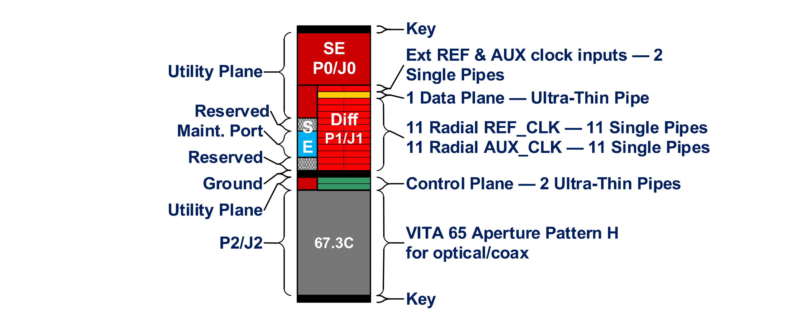

*Figure 32: ANSI/VITA 65.0 Radial Clock Slot Profile SLT3x-TIM-2S1U22S1U2U1H-14.9.2-n ｜ 图 32：ANSI/VITA 65.0 径向时钟槽位配置档 SLT3x-TIM-2S1U22S1U2U1H-14.9.2-n*

**Table 29: VITA 65.1 Slot Profiles for SLT3x-TIM-2S1U22S1U2U1H-14.9.2-n ｜ 表 29：SLT3x-TIM-2S1U22S1U2U1H-14.9.2-n 的 VITA 65.1 槽位配置档**

| Slot Profile names ／ 槽位配置档名 | Dash Num ／ 短杠编号 | STD Date ／ 标准日期 | Connector Modules ／ 连接器模块 |  |  | MT loading and Optical Pipes ／ MT 加载与光管 |  |  | Comments ／ 备注 |
|---|---|---|---|---|---|---|---|---|---|
|  |  |  | P1B/J1B | P2A/J2A | P2B/J2B | P1B/J1B | P2A/J2A | P2B/J2B |  |
| SLT3x-TIM-2S1U22S1U2U1H-14.9.2- |  | Proposed future 65.0 ／ 拟议的未来 65.0 版 | VITA 46 | Aperture H |  | VITA 46 | Aperture H |  | First row of SLT3x-TIM-2S1U22S1U2U1H-14.9.2-n 即 SLT3x-TIM-2S1U22S1U2U1H-14.9.2-n 的第一行 |
| SLT3x-TIM-2S1U22S1U2U1H-14.9.2- | 0 | Proposed future 65.0 ／ 拟议的未来 65.0 版 | VITA 46 | Empty ／ 空 |  |  |  |  |  |
| SLT3x-TIM-2S1U22S1U2U1H-14.9.2- | 1 | Proposed future 65.0 ／ 拟议的未来 65.0 版 | VITA 46 | 10 SMPM contacts-6.4.5.6.3 |  |  |  |  |  |
| Last line |  | Proposed future 65.0 ／ 拟议的未来 65.0 版 |  |  |  |  |  |  |  |

> 转写说明：
> 1. 表头为两层：第一行为分组标题，第二行（加粗）为子列标题，照原表第 2 行录。`Connector Modules` 横跨 P1B/J1B、P2A/J2A、P2B/J2B 三列，`MT loading and Optical Pipes` 横跨其后三列，被覆盖的单元格留空。
> 2. 原表 `Slot Profile names` 与 `Dash Num` 之间无竖线（扫描件如此），本表依表头文字分为两列；拼接后的完整配置档编号为 `SLT3x-TIM-2S1U22S1U2U1H-14.9.2-n`、`…-14.9.2-0`、`…-14.9.2-1`。
> 3. `Connector Modules` 的 P2A/J2A 与 P2B/J2B 在数据行上合并为一格（`Aperture H`、`Empty`、`10 SMPM contacts-6.4.5.6.3`），值记在 P2A/J2A 列，P2B/J2B 列留空；`MT loading and Optical Pipes` 同此，仅第一行有值 `VITA 46`、`Aperture H`。
> 4. `Last line` 为原表的收尾行标签（灰色底），照录。

> **译注**（表内代号）：本片各 VITA 配置档表内，`Slot Profile names`／`Module Profile names` 列的型号码、`Slot Profile` 列的槽位档串、`Dash Num` 的短杠号、`VITA 46`／`Aperture H`／`Aperture J` 一类连接器模块代号、接触件串（如 `10 SMPM contacts-6.4.5.6.3`）、协议串（如 `1000BASE-KX -- 5.1.2`）、引脚号与信号名（如 `A1`、`REF_CLK_Out --5.13.1`、`RSVD`）一律原样不译——它们是须与 VITA 65.1 原文对照的寻址键；表头格则一律「英文 ／ 中文」并置。状态值给中文——`Empty` 作“空”、`Proposed` 作“拟议中”、`Proposed future 65.0` 作“拟议的未来 65.0 版”；成句的 `Comments` 格按「英文 中文」并置。

**Table 30: VITA 65.1 Module Profiles for SLT3x-TIM-2S1U22S1U2U1H-14.9.2-n ｜ 表 30：SLT3x-TIM-2S1U22S1U2U1H-14.9.2-n 的 VITA 65.1 模块配置档**

| Module Profile names ／ 模块配置档名 | Dash Num ／ 短杠编号 | STD Date ／ 标准日期 | Slot Profile ／ 槽位配置档 | Protocols for Copper Planes ／ 铜平面协议 |  |  | Protocols for Optical and Signals for Coax Contacts ／ 光与同轴接触件信号的协议 |  |  |  |  |  |  |  |  |  |
|---|---|---|---|---|---|---|---|---|---|---|---|---|---|---|---|---|
|  |  |  |  | Data Plane ／ 数据平面 | Control Plane ／ 控制平面 | Contol Plane ／ 控制平面 | Coax Contacts for Connector Module 10_SMPM_contacts-6.4.5.6.3 ／ 连接器模块 10_SMPM_contacts-6.4.5.6.3 的同轴接触件 |  |  |  |  |  |  |  |  |  |
|  |  |  |  |  |  |  | **A1** | **A2** | **A3** | **B1** | **B2** | **B3** | **B4** | **C1** | **C2** | **C3** |
| MOD3x-TIM-2S1U22S1U2U1H-14.9.3- |  | Proposed future 65.0 ／ 拟议的未来 65.0 版 |  | DPutp01 | CPutp01, Cputp02 |  |  |  |  |  |  |  |  |  |  |  |
|  |  | Proposed future 65.0 ／ 拟议的未来 65.0 版 |  |  |  |  |  |  |  |  |  |  |  |  |  |  |
| MOD3p-TIM-2S1U22S1U2U1H-14.9.3- | 1 | Proposed future 65.0 ／ 拟议的未来 65.0 版 | SLT3p-TIM-2S1U22S1U2U1H-14.9.3-1 | 1000BASE-KX -- 5.1.2 | 1000BASE-KX -- 5.1.2 |  | REF_CLK_Out --5.13.1 | AUX_CLK_Out -- 5.13.1 | RSVD | AUX_CLK_In -- 5.13.1 | REF_CLK_In -- 5.13.1 | RSVD | RSVD | RSVD | GPS_Ant2_In -- 5.13.2 | GPS_Ant1_In -- 5.13.2 |
| MOD3p-TIM-2S1U22S1U2U1H-14.9.3- | 2 | Proposed future 65.0 ／ 拟议的未来 65.0 版 | SLT3p-TIM-2S1U22S1U2U1H-14.9.3-1 | 10GBASE-KR -- 5.1.7 | 10GBASE-KR -- 5.1.7 |  | REF_CLK_Out --5.13.1 | AUX_CLK_Out -- 5.13.1 | RSVD | AUX_CLK_In -- 5.13.1 | REF_CLK_In -- 5.13.1 | RSVD | RSVD | RSVD | GPS_Ant2_In -- 5.13.2 | GPS_Ant1_In -- 5.13.2 |
| Last line |  | Proposed future 65.0 ／ 拟议的未来 65.0 版 |  |  |  |  |  |  |  |  |  |  |  |  |  |  |

> 转写说明：
> 1. 表头为多层：第 1 行是分组标题（`Protocols for Copper Planes` 横跨 `Data Plane`／`Control Plane`／`Contol Plane` 三列；`Protocols for Optical and Signals for Coax Contacts` 横跨 `A1`～`C3` 十列），第 2、3 行（加粗）是子列标题，被覆盖的单元格留空。原表 `Data Plane` 等子标题与 `Coax Contacts for Connector Module 10_SMPM_contacts-6.4.5.6.3` 组标题同处一条 band（原表数据第 2 行）内，为便于并列成表，组标题置于第 2 行、`A1`～`C3` 置于第 3 行；原表该 band 只剩 `STD Date` 一格有值，即下方第 2 条数据行。
> 2. 原表 `Module Profile names` 与 `Dash Num` 之间无竖线（扫描件如此），本表依表头文字分为两列；拼接后的完整配置档编号为 `MOD3x-TIM-2S1U22S1U2U1H-14.9.3-n`、`MOD3p-TIM-2S1U22S1U2U1H-14.9.3-1`、`MOD3p-TIM-2S1U22S1U2U1H-14.9.3-2`。
> 3. `Protocols for Optical and Signals for Coax Contacts` 下第一行（`MOD3x…` 行）的十个单元格在原表中合并为一格且为空，值行从第三行起才出现（见第 3 条、第 4 条数据行）。
> 4. 原表在 `STD Date` 列把 `Proposed future 65.0` 画成上下相邻的两格（该行其余列未分格），本表按一格记，值不重复。
> 5. 左侧窄列内的换行（如 `CPutp01,`／`Cputp02`、`REF_CLK_`／`Out --5.13.1`）已并回单行，` ` 仅用于原表明确的两行内容；`A1` 列为 `Out --5.13.1`（`--` 后无空格），`A2`～`C3` 各列为 `-- 5.13.1`／`-- 5.13.2`（`--` 后有空格），照原样保留。
> 6. `Contol Plane` 系原表如此拼写（`Control` 缺 `r`），照录。
> 7. `Last line` 为原表的收尾行标签（灰色底），照录。

###### 5.2.16.8 3U External I/O Plug-In Card Profile ｜ 5.2.16.8 3U 外部 I/O 插卡配置档

**Rule 5.2.16.8-1**

- SOSA 3U External I/O Plug-In Cards shall conform to ANSI/VITA 65.0 slot profile SLT3-

- SOSA 3U 外部 I/O 插卡应符合 ANSI/VITA 65.0 槽位配置档 SLT3-

PAY-2U2U-14.2.17. Conformance Methodology: (TBD)

PAY-2U2U-14.2.17。符合性方法为 (TBD)

<!-- 原书 p.112 ｜ PDF p.132 -->

**Rule 5.2.16.8-2**

User-defined pins in ANSI/VITA 65.1 slot profile SLT3-PAY-2U2U-14.2.17 shall only interface with platform I/O and not other modules within the system. Conformance Methodology: (TBD)

ANSI/VITA 65.1 槽位配置档 SLT3-PAY-2U2U-14.2.17 中的用户自定义引脚应仅与平台 I/O 接口，而不与系统内其他模块接口。符合性方法为 (TBD)

**Rule 5.2.16.8-3**

SOSA 3U External I/O plug-in cards shall conform to one of the ANSI/VITA 65.1 module profiles in Table 31. Conformance Methodology: (A)

SOSA 3U 外部 I/O 插卡应符合 ANSI/VITA 65.1 表 31 中模块配置档之一。符合性方法为 (A)

**Observation 5.2.16.8-1**

Instead of routing platform-specific I/O to non-standard payloads, integrators can utilize the SOSA 3U External I/O plug-in card as the platform I/O “data center” where a single plug-in card (or multiple if required) can interface with the platform over platform-specific connections and the rest of the payload plug-in cards over standard expansion or control plane interfaces.

集成方可以不把平台专属的 I/O 引接到非标准载荷上，而把 SOSA 3U 外部 I/O 插卡用作平台 I/O 的“数据中心”：一块插卡（必要时可多块）经平台专属连接与平台接口，其余载荷插卡则经标准的扩展平面或控制平面接口。

**Recommendation 5.2.16.8-1**

The SOSA 3U I/O Intensive SBC plug-in card profile should be used instead of the SOSA 3U External I/O plug-in card profile if platform-specific I/O can be accommodated by a single XMC.

若平台专属 I/O 可由单个 XMC 容纳，宜采用 SOSA 3U I/O 密集型 SBC 插卡配置档，而不采用 SOSA 3U 外部 I/O 插卡配置档。

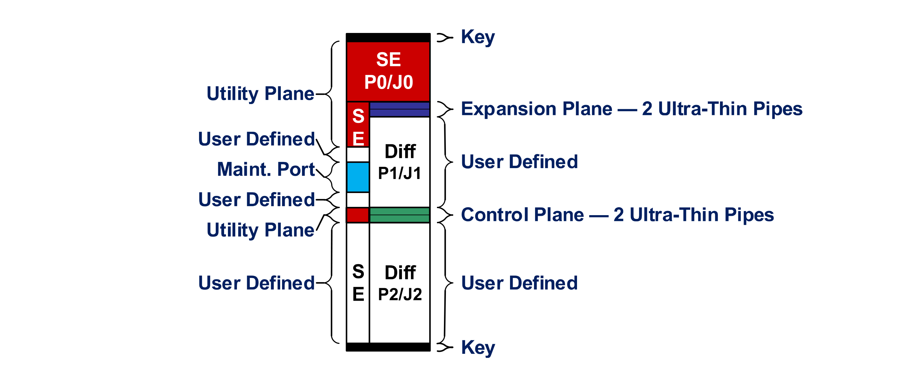

*Figure 33: ANSI/VITA 65.0 3U External I/O Slot Profile SLT3-PAY-2U2U-14.2.17 ｜ 图 33：ANSI/VITA 65.0 3U 外部 I/O 槽位配置档 SLT3-PAY-2U2U-14.2.17*

**Table 31: ANSI/VITA 65.1 Module Profiles for SLT3-PAY-2U2U-14.2.17 ｜ 表 31：SLT3-PAY-2U2U-14.2.17 的 ANSI/VITA 65.1 模块配置档**

| Module Profile names ／ 模块配置档名 | Dash Num ／ 短杠编号 | STD Date ／ 标准日期 | Slot Profile ／ 槽位配置档 | Protocols for Copper Planes ／ 铜平面协议 |  | Protocols for Optical ／ 光协议 | Comments ／ 备注 |
|---|---|---|---|---|---|---|---|
|  |  |  |  | Data Plane ／ 数据平面 | Control Plane ／ 控制平面 |  |  |
| MOD3-PAY-2U2U-16.2.16- |  | Proposed future 65.0 ／ 拟议的未来 65.0 版 |  | EPutp01, EPutp02 | CPutp01, CPutp02 |  | First row of MOD3-PAY-2U2U-16.2.16-n 即 MOD3-PAY-2U2U-16.2.16-n 的第一行 |
| MOD3-PAY-2U2U-16.2.16- | 1 | Proposed future 65.0 ／ 拟议的未来 65.0 版 | SLT3-PAY-2U2U-14.2.17 | PCIe Gen 2 -- 5.3.3.2 | 1000GBASE-KX -- 5.1.2 |  |  |
| MOD3-PAY-2U2U-16.2.16- | 2 | Proposed future 65.0 ／ 拟议的未来 65.0 版 | SLT3-PAY-2U2U-14.2.17 | PCIe Gen 3 -- 5.3.3.3 | 10GBASE-KR -- 5.1.7 |  |  |
| Last line |  | Proposed future 65.0 ／ 拟议的未来 65.0 版 |  |  |  |  |  |

> 转写说明：
> 1. 表头为两层：第 1 行为分组标题，第 2 行（加粗）为子列标题，照原表第 2 行录。`Protocols for Copper Planes` 横跨 `Data Plane`、`Control Plane` 两列，被覆盖的单元格留空；`Protocols for Optical` 无子列，各行均空。
> 2. 原表 `Module Profile names` 与 `Dash Num` 之间无竖线（扫描件如此），本表依表头文字分为两列；拼接后的完整配置档编号为 `MOD3-PAY-2U2U-16.2.16-n`、`MOD3-PAY-2U2U-16.2.16-1`、`MOD3-PAY-2U2U-16.2.16-2`。
> 3. 本表 `1000GBASE-KX` 系原表如此（比常见写法 `1000BASE-KX` 多一个 `G`），照录。
> 4. 第一行 `Slot Profile` 为空（通用档 `-n` 不指定具体插槽档），其上方的 `STD Date` 单元格在版面上明显高于其余各行，照录。
> 5. `Last line` 为原表的收尾行标签（灰色底），照录。

<!-- 原书 p.113 ｜ PDF p.133 -->

##### 5.2.17 6U Plug-In Card Profile Specifications ｜ 5.2.17 6U 插卡配置档规格

5.2.17.1 6U Payload Plug-In Card Profiles

5.2.17.1 6U 载荷插卡配置档

**Rule 5.2.17.1-1**

SOSA 6U Payload Plug-In Cards shall conform to ANSI/VITA 65.0 slot profile SLT6-PAY-4F2Q1H4U1T1S1S1TU2U2T1H-10.6.4-n or SLT6-PAY-4F1Q1H4U1T1S1S1TU2U2T1H-

SOSA 6U 载荷插卡应符合 ANSI/VITA 65.0 槽位配置档 SLT6-PAY-4F2Q1H4U1T1S1S1TU2U2T1H-10.6.4-n 或 SLT6-PAY-4F1Q1H4U1T1S1S1TU2U2T1H-

10.6.3-n. Conformance Methodology: (A)

10.6.3-n。符合性方法为 (A)

**Rule 5.2.17.1-2**

SOSA systems shall route the GPIO pins from ANSI/VITA SLT6-PAY-4F2Q1H4U1T1S1S1TU2U2T1H-10.6.4-n and SLT6-PAY-4F1Q1H4U1T1S1S1TU2U2T1H-10.6.3-n to external platform I/O. Conformance Methodology: (A)

SOSA 系统应把 ANSI/VITA SLT6-PAY-4F2Q1H4U1T1S1S1TU2U2T1H-10.6.4-n 与 SLT6-PAY-4F1Q1H4U1T1S1S1TU2U2T1H-10.6.3-n 的 GPIO 引脚引接到外部平台 I/O。符合性方法为 (A)

**Rule 5.2.17.1-3**

SOSA systems shall route XMC pins from ANSI/VITA 65.1 slot profile SLT6-PAY-4F1Q1H4U1T1S1S1TU2U2T1H-10.6.3-n to external chassis I/O connectors. Conformance Methodology: (A)

SOSA 系统应把 ANSI/VITA 65.1 槽位配置档 SLT6-PAY-4F1Q1H4U1T1S1S1TU2U2T1H-10.6.3-n 的 XMC 引脚引接到外部机箱 I/O 连接器。符合性方法为 (A)

**Rule 5.2.17.1-4**

SOSA 6U Payload Plug-In Cards shall conform to one of the ANSI/VITA 65.1 module profiles in Table 32 or Table 33. Conformance Methodology: (A)

SOSA 6U 载荷插卡应符合 ANSI/VITA 65.1 表 32 或表 33 中模块配置档之一。符合性方法为 (A)

**Rule 5.2.17.1-5**

If a Payload Plug-In Card implements the Control Plane Thin Pipes from ANSI/VITA 65.1 SLT6-PAY-4F2Q1H4U1T1S1S1TU2U2T1H-10.6.4-n or SLT6-PAY-

若某载荷插卡实现了来自 ANSI/VITA 65.1 SLT6-PAY-4F2Q1H4U1T1S1S1TU2U2T1H-10.6.4-n 或 SLT6-PAY-

4F1Q1H4U1T1S1S1TU2U2T1H-10.6.3-n, the Payload Plug-In Card shall use the Control Plane Thin Pipes exclusively for communication external to the system. Conformance Methodology: (A)

4F1Q1H4U1T1S1S1TU2U2T1H-10.6.3-n 的控制平面 Thin Pipes（细管），则该载荷插卡应把这些控制平面 Thin Pipes 专用于系统外部的通信。符合性方法为 (A)

**Observation 5.2.17.1-1**

Payload Plug-In Cards can include, but are not limited to, SBCs that are input/output (I/O)intensive, SBCs that are computationally-intensive, FPGAs, and RF transceivers.

载荷插卡可以包括（但不限于）：输入/输出（I/O）密集型的 SBC、计算密集型的 SBC、FPGA，以及射频收发信机。

**Recommendation 5.2.17.1-1**

Payload Plug-In Cards should conform to ANSI/VITA 65.1 slot profile SLT6-PAY-4F2Q1H4U1T1S1S1TU2U2T1H-10.6.4-n if they don’t require an XMC.

若载荷插卡不需要 XMC，则宜符合 ANSI/VITA 65.1 槽位配置档 SLT6-PAY-4F2Q1H4U1T1S1S1TU2U2T1H-10.6.4-n。

**Observation 5.2.17.1-2**

SOSA systems will likely only contain one or two plug-in cards that support ANSI/VITA 65.1 slot profile SLT6-PAY-4F1Q1H4U1T1S1S1TU2U2T1H-10.6.3-n. These slots can use an XMC to customize I/O for a particular system or platform. The remaining plug-in cards will use

SOSA 系统很可能只含一至两块支持 ANSI/VITA 65.1 槽位配置档 SLT6-PAY-4F1Q1H4U1T1S1S1TU2U2T1H-10.6.3-n 的插卡。这些槽位可用 XMC 为某一特定系统或平台定制 I/O。其余插卡将使用

<!-- 原书 p.114 ｜ PDF p.134 -->

ANSI/VITA 65.1 slot profile SLT6-PAY-4F2Q1H4U1T1S1S1TU2U2T1H-10.6.4-n to support processing for the various sensor modalities.

ANSI/VITA 65.1 槽位配置档 SLT6-PAY-4F2Q1H4U1T1S1S1TU2U2T1H-10.6.4-n，以支撑各类传感器模态的处理。

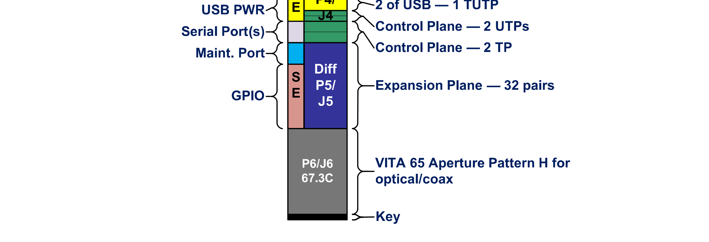

*Figure 34: ANSI/VITA 65.0 6U Payload Slot Profile SLT6-PAY-4F2Q1H4U1T1S1S1TU2U2T1H- ｜ 图 34：ANSI/VITA 65.0 6U 载荷槽位配置档 SLT6-PAY-4F2Q1H4U1T1S1S1TU2U2T1H-*

10.6.4-n

10.6.4-n（此行系图 34 题注中配置档编号的续行，照录，不译）

**Table 32: ANSI/VITA 65.1 Slot Profiles for SLT6-PAY-4F2Q1H4U1T1S1S1TU2U2T1H-10.6.4-n ｜ 表 32：SLT6-PAY-4F2Q1H4U1T1S1S1TU2U2T1H-10.6.4-n 的 ANSI/VITA 65.1 槽位配置档**

| Slot Profile names ／ 槽位配置档名 | Dash Num ／ 短杠编号 | STD Date ／ 标准日期 | Connector Modules ／ 连接器模块 |  |  |  | MT loading and Optical Pipes ／ MT 加载与光管 |  |
|---|---|---|---|---|---|---|---|---|
|  |  |  | P1/J1 , P2/J2 | P3/J3 | P4/J4, P5/J5 | P6/J6 | P3/J3 | P6/J6 |
| SLT6-PAY-4F2Q1H4U1T1S1S1TU2U2T1H-10.6.4- |  | Proposed future 65.0 ／ 拟议的未来 65.0 版 | VITA 46 | Aperture H | VITA 46 | Aperture H | Aperture H | Aperture H |
| SLT6-PAY-4F2Q1H4U1T1S1S1TU2U2T1H-10.6.4- | 0 | Proposed future 65.0 ／ 拟议的未来 65.0 版 | VITA 46 | Empty ／ 空 | VITA 46 | Empty ／ 空 | Empty ／ 空 | Empty ／ 空 |
| Last line |  | Proposed future 65.0 ／ 拟议的未来 65.0 版 |  |  |  |  |  |  |

> 转写说明：
> 1. 表头为两层：第 1 行为分组标题，第 2 行（加粗）为子列标题，照原表第 2 行录。`Connector Modules` 横跨 `P1/J1 , P2/J2`、`P3/J3`、`P4/J4, P5/J5`、`P6/J6` 四列，`MT loading and Optical Pipes` 横跨其后 `P3/J3`、`P6/J6` 两列，被覆盖的单元格留空。
> 2. 原表 `Slot Profile names` 与 `Dash Num` 之间无竖线（扫描件如此），本表依表头文字分为两列；拼接后的完整配置档编号为 `SLT6-PAY-4F2Q1H4U1T1S1S1TU2U2T1H-10.6.4-n` 与 `…-10.6.4-0`。
> 3. 该编号的字符序列经 6 倍放大逐字核对：`…4F2Q1H4U1T1S1S1TU2U2T1H…`，即 `1T` 与 `U2` 之间**无** `1`（不是 `…1S1S1T1U2U2T1H…`）。
> 4. 子列标题 `P1/J1 , P2/J2` 的逗号前有空格，`P4/J4, P5/J5` 的逗号前无空格，均照原表。
> 5. `Last line` 为原表的收尾行标签（灰色底），照录。

<!-- 原书 p.115 ｜ PDF p.135 -->

**Table 33: ANSI/VITA 65.1 Module Profiles for SLT6-PAY-4F2Q1H4U1T1S1S1TU2U2T1H-10.6.4-n ｜ 表 33：SLT6-PAY-4F2Q1H4U1T1S1S1TU2U2T1H-10.6.4-n 的 ANSI/VITA 65.1 模块配置档**

| Module Profile names ／ 模块配置档名 | Dash Num ／ 短杠编号 | STD Date ／ 标准日期 | Slot Profile ／ 槽位配置档 | Protocols for Copper Planes ／ 铜平面协议 |  |  |  | Miscellaneous Protocols over copper connectors ／ 铜连接器上的其他协议 |  |  |  |  |  | Protocols for Optical ／ 光协议 |
|---|---|---|---|---|---|---|---|---|---|---|---|---|---|---|
|  |  |  |  | Data Plane ／ 数据平面 | Exp. Plane ／ 扩展平面 | Control Plane ／ 控制平面 | Control Plane ／ 控制平面 |  |  |  |  |  |  |  |
| MOD6-PAY-4F2Q1H4U1T1S1S1TU2U2T1H-12.6.4- |  | Proposed future 65.0 ／ 拟议的未来 65.0 版 |  | DP01 - DP04 (FPs) | EP00 - EP15 | CPutp01, CPutp02 | CPtp01, CPtp02 | STRutp01 - STRutp04 | USB01, USB02 | VID01 | SER01 | GPIO1 - GPIO10 | GPIvds01 |  |
| MOD6-PAY-4F2Q1H4U1T1S1S1TU2U2T1H-12.6.4- | 1 | Proposed future 65.0 ／ 拟议的未来 65.0 版 | SLT6-PAY-4F2Q1H4U1T1S1S1TU2U2T1H-10.6.4-0 | 10GBASE-KX4 -- 5.1.5 | PCIe Gen 2 -- 5.3.3.2 | 1000BASE-KX -- 5.1.2 | 1000BASE-T -- 5.1.3 | SATA Gen 2 -- 5.6.2 | USB 2 -- 5.9.1 | DisplayPort 1.2 -- 5.10.2 | Serial Ports -- 5.12.1 | GPIO -- 5.14.1 | GPLVDS -- 5.14.2 |  |
| MOD6-PAY-4F2Q1H4U1T1S1S1TU2U2T1H-12.6.4- | 2 | Proposed future 65.0 ／ 拟议的未来 65.0 版 | SLT6-PAY-4F2Q1H4U1T1S1S1TU2U2T1H-10.6.4-0 | 40GBASE-KR4 -- 5.1.8 | PCIe Gen 3 -- 5.3.3.3 | 10GBASE-KR -- 5.1.7 | 10GBASE-T -- 5.1.6 | SATA Gen 3 -- 5.6.3 | USB 3.1 Gen 2 -- 5.9.3 | DisplayPort 1.2 -- 5.10.2 | Serial Ports -- 5.12.1 | GPIO -- 5.14.1 | GPLVDS -- 5.14.2 |  |
| MOD6-PAY-4F2Q1H4U1T1S1S1TU2U2T1H-12.6.4- | 3 | Proposed ／ 拟议中 | SLT6-PAY-4F2Q1H4U1T1S1S1TU2U2T1H-10.6.4-0 | 40GBASE-KR4 -- 5.1.8 | Aurora -- 5.7.2 | 10GBASE-KR -- 5.1.7 | 10GBASE-T -- 5.1.6 | SATA Gen 3 -- 5.6.3 | USB 3.1 Gen 2 -- 5.9.3 | DisplayPort 1.2 -- 5.10.2 | Serial Ports -- 5.12.1 | GPIO -- 5.14.1 | GPLVDS -- 5.14.2 |  |
| MOD6-PAY-4F2Q1H4U1T1S1S1TU2U2T1H-12.6.4- | 4 | Proposed ／ 拟议中 | SLT6-PAY-4F2Q1H4U1T1S1S1TU2U2T1H-10.6.4-1 | 10GBASE-KR -- 5.1.7 | PCIe Gen 3 -- 5.3.3.3 | 1000BASE-KX -- 5.1.2 | 1000BASE-T -- 5.1.3 | SATA Gen 3 -- 5.6.3 | USB 3.1 Gen 2 -- 5.9.3 | DisplayPort 1.2 -- 5.10.2 | Serial Ports -- 5.12.1 | GPIO -- 5.14.1 | GPLVDS -- 5.14.2 |  |
| MOD6-PAY-4F2Q1H4U1T1S1S1TU2U2T1H-12.6.4- | 5 | Proposed ／ 拟议中 | SLT6-PAY-4F2Q1H4U1T1S1S1TU2U2T1H-10.6.4-1 | 10GBASE-KR -- 5.1.7 | Aurora -- 5.7.2 | 1000BASE-KX -- 5.1.2 | 1000BASE-T -- 5.1.3 | SATA Gen 3 -- 5.6.3 | USB 3.1 Gen 2 -- 5.9.3 | DisplayPort 1.2 -- 5.10.2 | Serial Ports -- 5.12.1 | GPIO -- 5.14.1 | GPLVDS -- 5.14.2 |  |
| MOD6-PAY-4F2Q1H4U1T1S1S1TU2U2T1H-12.6.4- | 6 | Proposed ／ 拟议中 | SLT6-PAY-4F2Q1H4U1T1S1S1TU2U2T1H-10.6.4-2 | 40GBASE-KR4 -- 5.1.8 | PCIe Gen 3 -- 5.3.3.3 | 10GBASE-KR -- 5.1.7 | 10GBASE-T -- 5.1.6 | SATA Gen 3 -- 5.6.3 | USB 3.1 Gen 2 -- 5.9.3 | DisplayPort 1.2 -- 5.10.2 | Serial Ports -- 5.12.1 | GPIO -- 5.14.1 | GPLVDS -- 5.14.2 |  |
| MOD6-PAY-4F2Q1H4U1T1S1S1TU2U2T1H-12.6.4- | 7 | Proposed ／ 拟议中 | SLT6-PAY-4F2Q1H4U1T1S1S1TU2U2T1H-10.6.4-2 | 40GBASE-KR4 -- 5.1.8 | Aurora -- 5.7.2 | 10GBASE-KR -- 5.1.7 | 10GBASE-T -- 5.1.6 | SATA Gen 3 -- 5.6.3 | USB 3.1 Gen 2 -- 5.9.3 | DisplayPort 1.2 -- 5.10.2 | Serial Ports -- 5.12.1 | GPIO -- 5.14.1 | GPLVDS -- 5.14.2 |  |

> 转写说明：
> 1. 表头为两层：第 1 行为分组标题，第 2 行（加粗）为子列标题；原表 `Protocols for Copper Planes` 下四个子列标题依次为 `Data Plane`、`Exp. Plane`、`Control Plane`、`Control Plane`（后两列同名），被覆盖的单元格留空；`Miscellaneous Protocols over copper connectors` 横跨六列，此六列原表**未设**子列标题，标题行第二层留空，各列含义由第一行数据（`STRutp01 - STRutp04`、`USB01, USB02`、`VID01`、`SER01`、`GPIO1 - GPIO10`、`GPIvds01`）给出；`Protocols for Optical` 为单列，各行均空。
> 2. 原表 `Module Profile names` 与 `Dash Num` 之间无竖线（扫描件如此），本表依表头文字分为两列；拼接后的完整配置档编号为 `MOD6-PAY-4F2Q1H4U1T1S1S1TU2U2T1H-12.6.4-n` 及其 `-1`～`-7` 各档。
> 3. 八行 `Module Profile names` 的版本段经 6 倍放大逐字核对，**均为 `12.6.4-`**（不是 `12.6.5`／`12.6.6`／`12.6.7`）；变化的只是 `Dash Num`。
> 4. `Slot Profile` 取值 `SLT6-PAY-4F2Q1H4U1T1S1S1TU2U2T1H-10.6.4-0`（第一至三行数据）与 `…-10.6.4-1`（第四、五行数据）、`…-10.6.4-2`（第六、七行数据）。
> 5. `STD Date` 列前三行数据为 `Proposed future 65.0`（红底），其余五行为 `Proposed`（灰底），照原表。
> 6. 表头 `GPIvds01` 与同列数据 `GPLVDS -- 5.14.2` 在拼写上不一致，均照原表录，未作统一。
> 7. 单元格内的换行（如 `SLT6-PAY-`／`4F2Q1H4U1T1S1S1TU2U2T1H-`／`10.6.4-0` 三行、`40GBASE-KR4 --`／`5.1.8` 两行）系窄列折行，已并回单行。

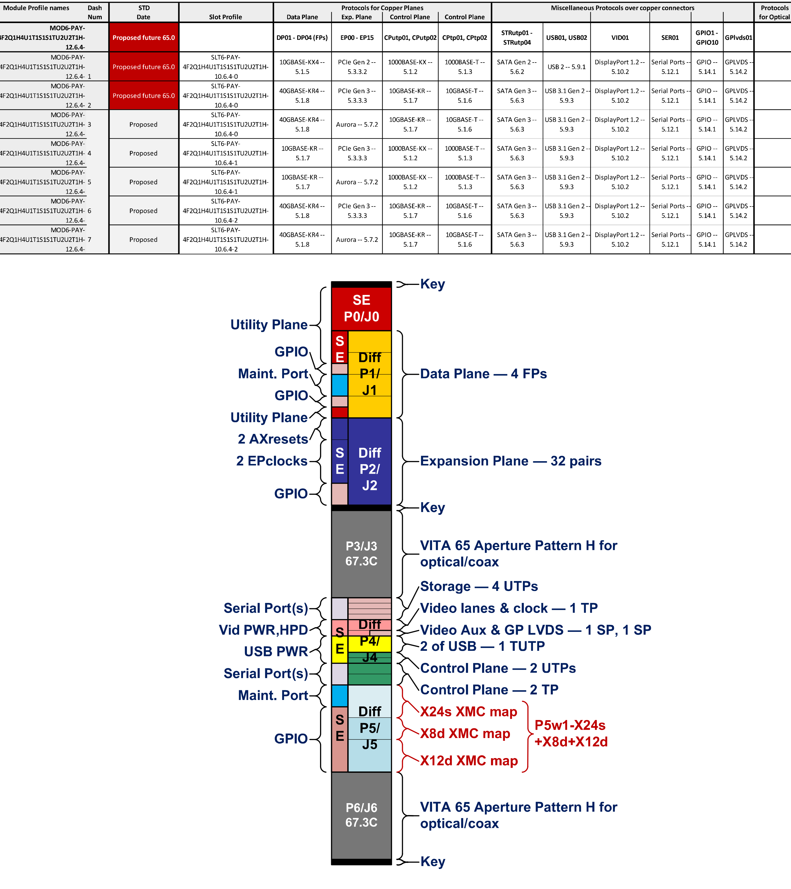

*Figure 35: ANSI/VITA 65.0 6U Payload Slot Profile SLT6-PAY-4F1Q1H4U1T1S1S1TU2U2T1H- ｜ 图 35：ANSI/VITA 65.0 6U 载荷槽位配置档 SLT6-PAY-4F1Q1H4U1T1S1S1TU2U2T1H-*

10.6.3-n

10.6.3-n（此行系图 35 题注中配置档编号的续行，照录，不译）

<!-- 原书 p.116 ｜ PDF p.136 -->

**Table 34: ANSI/VITA 65.1 Module Profiles for SLT6-PAY-4F1Q1H4U1T1S1S1TU2U2T1H-10.6.3-n ｜ 表 34：SLT6-PAY-4F1Q1H4U1T1S1S1TU2U2T1H-10.6.3-n 的 ANSI/VITA 65.1 模块配置档**

| Module Profile names ／ 模块配置档名 | Dash Num ／ 短杠编号 | STD Date ／ 标准日期 | Slot Profile ／ 槽位配置档 | Protocols for Copper Planes ／ 铜平面协议 |  |  |  | Miscellaneous Protocols over copper connectors ／ 铜连接器上的其他协议 |  |  |  |  |  | Protocols for Optical ／ 光协议 |
|---|---|---|---|---|---|---|---|---|---|---|---|---|---|---|
|  |  |  |  | Data Plane ／ 数据平面 | Exp. Plane ／ 扩展平面 | Control Plane ／ 控制平面 | Control Plane ／ 控制平面 |  |  |  |  |  |  |  |
| MOD6-PAY-4F1Q1H4U1T1S1S1TU2U2T1H-12.6.3- |  | Proposed future 65.0 ／ 拟议的未来 65.0 版 |  | DP01 - DP04 (FPs) | EP00 - EP15 | CPutp01, CPutp02 | CPtp01, CPtp02 | STRutp01 - STRutp04 | USB01, USB02 | VID01 | SER01 | GPIO1 - GPIO10 | GPIvds01 |  |
| MOD6-PAY-4F1Q1H4U1T1S1S1TU2U2T1H-12.6.3- | 1 | Proposed future 65.0 ／ 拟议的未来 65.0 版 | SLT6-PAY-4F1Q1H4U1T1S1S1TU2U2T1H-10.6.3-0 | 10GBASE-KX4 -- 5.1.5 | PCIe Gen 2 -- 5.3.3.2 | 1000BASE-KX -- 5.1.2 | 1000BASE-T -- 5.1.3 | SATA Gen 2 -- 5.6.2 | USB 2 -- 5.9.1 | DisplayPort 1.2 -- 5.10.2 | Serial Ports -- 5.12.1 | GPIO -- 5.14.1 | GPLVDS -- 5.14.2 |  |
| MOD6-PAY-4F1Q1H4U1T1S1S1TU2U2T1H-12.6.3- | 2 | Proposed future 65.0 ／ 拟议的未来 65.0 版 | SLT6-PAY-4F1Q1H4U1T1S1S1TU2U2T1H-10.6.3-0 | 40GBASE-KR4 -- 5.1.8 | PCIe Gen 3 -- 5.3.3.3 | 10GBASE-KR -- 5.1.7 | 10GBASE-T -- 5.1.6 | SATA Gen 3 -- 5.6.3 | USB 3.1 Gen 2 -- 5.9.3 | DisplayPort 1.2 -- 5.10.2 | Serial Ports -- 5.12.1 | GPIO -- 5.14.1 | GPLVDS -- 5.14.2 |  |
| MOD6-PAY-4F1Q1H4U1T1S1S1TU2U2T1H-12.6.3- | 3 | Proposed ／ 拟议中 | SLT6-PAY-4F2Q1H4U1T1S1S1TU2U2T1H-10.6.4-0 | 40GBASE-KR4 -- 5.1.8 | Aurora -- 5.7.2 | 10GBASE-KR -- 5.1.7 | 10GBASE-T -- 5.1.6 | SATA Gen 3 -- 5.6.3 | USB 3.1 Gen 2 -- 5.9.3 | DisplayPort 1.2 -- 5.10.2 | Serial Ports -- 5.12.1 | GPIO -- 5.14.1 | GPLVDS -- 5.14.2 |  |
| MOD6-PAY-4F1Q1H4U1T1S1S1TU2U2T1H-12.6.3- | 4 | Proposed ／ 拟议中 | SLT6-PAY-4F2Q1H4U1T1S1S1TU2U2T1H-10.6.4-1 | 10GBASE-KR -- 5.1.7 | PCIe Gen 3 -- 5.3.3.3 | 1000BASE-KX -- 5.1.2 | 1000BASE-T -- 5.1.3 | SATA Gen 3 -- 5.6.3 | USB 3.1 Gen 2 -- 5.9.3 | DisplayPort 1.2 -- 5.10.2 | Serial Ports -- 5.12.1 | GPIO -- 5.14.1 | GPLVDS -- 5.14.2 |  |
| MOD6-PAY-4F1Q1H4U1T1S1S1TU2U2T1H-12.6.3- | 5 | Proposed ／ 拟议中 | SLT6-PAY-4F2Q1H4U1T1S1S1TU2U2T1H-10.6.4-1 | 10GBASE-KR -- 5.1.7 | Aurora -- 5.7.2 | 1000BASE-KX -- 5.1.2 | 1000BASE-T -- 5.1.3 | SATA Gen 3 -- 5.6.3 | USB 3.1 Gen 2 -- 5.9.3 | DisplayPort 1.2 -- 5.10.2 | Serial Ports -- 5.12.1 | GPIO -- 5.14.1 | GPLVDS -- 5.14.2 |  |
| MOD6-PAY-4F1Q1H4U1T1S1S1TU2U2T1H-12.6.3- | 6 | Proposed ／ 拟议中 | SLT6-PAY-4F2Q1H4U1T1S1S1TU2U2T1H-10.6.4-2 | 40GBASE-KR4 -- 5.1.8 | PCIe Gen 3 -- 5.3.3.3 | 10GBASE-KR -- 5.1.7 | 10GBASE-T -- 5.1.6 | SATA Gen 3 -- 5.6.3 | USB 3.1 Gen 2 -- 5.9.3 | DisplayPort 1.2 -- 5.10.2 | Serial Ports -- 5.12.1 | GPIO -- 5.14.1 | GPLVDS -- 5.14.2 |  |
| MOD6-PAY-4F1Q1H4U1T1S1S1TU2U2T1H-12.6.3- | 7 | Proposed ／ 拟议中 | SLT6-PAY-4F2Q1H4U1T1S1S1TU2U2T1H-10.6.4-2 | 40GBASE-KR4 -- 5.1.8 | Aurora -- 5.7.2 | 10GBASE-KR -- 5.1.7 | 10GBASE-T -- 5.1.6 | SATA Gen 3 -- 5.6.3 | USB 3.1 Gen 2 -- 5.9.3 | DisplayPort 1.2 -- 5.10.2 | Serial Ports -- 5.12.1 | GPIO -- 5.14.1 | GPLVDS -- 5.14.2 |  |

> 转写说明：
> 1. 本表完整落在 PDF p137（印刷页 117）一页内：p137 顶端即本表题注，表末（第 8 行数据之后）紧接 5.2.17.2 节正文，故无跨页续表，也未取下一页。
> 2. 表头为两层：第 1 行为分组标题，第 2 行（加粗）为子列标题。`Protocols for Copper Planes` 下四个子列标题依次为 `Data Plane`、`Exp. Plane`、`Control Plane`、`Control Plane`（后两列同名）；`Miscellaneous Protocols over copper connectors` 横跨六列，此六列原表未设子列标题，各列含义由第一行数据（`STRutp01 - STRutp04`、`USB01, USB02`、`VID01`、`SER01`、`GPIO1 - GPIO10`、`GPIvds01`）给出；`Protocols for Optical` 为单列，各行均空。
> 3. 原表 `Module Profile names` 与 `Dash Num` 之间无竖线（扫描件如此），本表依表头文字分为两列；完整配置档编号为 `MOD6-PAY-4F1Q1H4U1T1S1S1TU2U2T1H-12.6.3-n` 及 `-1`～`-7`。
> 4. 八行的版本段 `12.6.3` 经逐字形核对（同字号 `3`／`5`／`2` 的字形对照）确认为 `3`，八行一致；变化的只是 `Dash Num`。
> 5. `Slot Profile` 列前两行数据（`Dash Num` 1、2）为 `SLT6-PAY-4F1Q1H4U1T1S1S1TU2U2T1H-10.6.3-0`；自第三行数据（`Dash Num` 3）起改为 `SLT6-PAY-4F2Q1H4U1T1S1S1TU2U2T1H-10.6.4-…`（`4F1Q`／`10.6.3` 换成 `4F2Q`／`10.6.4`），照原表。
> 6. `STD Date` 列前三行数据为 `Proposed future 65.0`（红底），其余五行为 `Proposed`（灰底），照原表。
> 7. 表头 `GPIvds01` 与同列数据 `GPLVDS -- 5.14.2` 拼写不一致，均照原表，未作统一。
> 8. 窄列折行（`SLT6-PAY-`／`4F1Q1H4U1T1S1S1TU2U2T1H-`／`10.6.3-0`、`40GBASE-KR4 --`／`5.1.8`）系版式折行，已并回单行。

###### 5.2.17.2 SOSA 6U Control/Data Switch Plug-In Card Profile ｜ 5.2.17.2 SOSA 6U 控制／数据交换机插卡配置档

**Rule 5.2.17.2-1**

- SOSA 6U Control/Data Switch Plug-In Cards shall conform to ANSI/VITA 65.0 slot profile

- SOSA 6U 控制／数据交换机插卡应符合 ANSI/VITA 65.0 槽位配置档

SLT6-SWH-14F16U1U15U1J-10.8.1-n. Conformance Methodology: (A)

SLT6-SWH-14F16U1U15U1J-10.8.1-n。符合性方法为 (A)

**Rule 5.2.17.2-2**

- SOSA 6U Control/Data Switch Plug-In Cards shall conform to one of the ANSI/VITA 65.1 module profiles in Table 35 or Table 36. Conformance Methodology: (A)

- SOSA 6U 控制／数据交换机插卡应符合 ANSI/VITA 65.1 表 35 或表 36 中模块配置档之一。符合性方法为 (A)

<!-- 原书 p.117 ｜ PDF p.137 -->

- Key-

- 键位（图内文字，残留照录，不译）

SE

SE（图内文字，残留照录，不译）

POIJO

POIJO（图内文字，残留照录，不译）

Utility Plane-

Utility Plane-（辅助平面；图内文字，残留照录，不译）

Reserved 5E DI

Reserved 5E DI（保留；图内文字，残留照录，不译）

Maint. Port P4fJ1

Maint. Port P4fJ1（维护端口；图内文字，残留照录，不译）

Resered-

Resered-（保留；原文如此拼写，图内文字，残留照录，不译）

Utility Plane

Utility Plane（辅助平面；图内文字，残留照录，不译）

Df

Df（图内字符，残留照录，不译）

- Resered- P2f

- Resered- P2f（保留；原文如此拼写，图内文字，残留照录，不译）

J2_ Data Plane 14 FPs

J2_ Data Plane 14 FPs（J2 数据平面 14 个 FP；图内文字，残留照录，不译）

Key-

Key-（键位；图内文字，残留照录，不译）

Df

Df（图内字符，残留照录，不译）

P3f

P3f（图内字符，残留照录，不译）

E

E（图内字符，残留照录，不译）

J_

J_（图内字符，残留照录，不译）

Data Plane

Data Plane（数据平面；图内文字，残留照录，不译）

2 TPs

2 TPs（2 个 TP；图内文字，残留照录，不译）

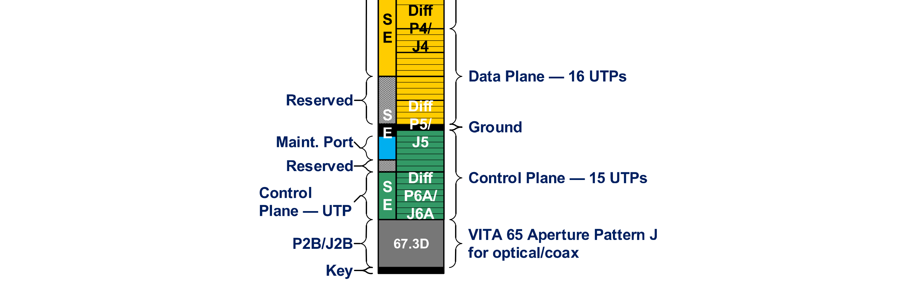

*Figure 36: ANSI/VITA 65.0 6U Control/Data Switch Slot Profile SLT6-SWH-14F16U1U15U1J- ｜ 图 36：ANSI/VITA 65.0 6U 控制／数据交换机槽位配置档 SLT6-SWH-14F16U1U15U1J-*

10.8.1-n

10.8.1-n（此行系图 36 题注中配置档编号的续行，照录，不译）

> **译注**：以上十八行英文原为图 36 图框内的标注文字（键位、辅助平面、数据平面、保留等），转写件把它们录成了散行。图内文字本不译（以原图为准），此处只就每行给出中文提示；行内串序、断字与错拼（`Resered`、`P4fJ1`、`P3f`）照录不改。

**Table 35: ANSI/VITA 65.1 Slot Profiles for SLT6-SWH-14F16U1U15U1J-10.8.1-n ｜ 表 35：SLT6-SWH-14F16U1U15U1J-10.8.1-n 的 ANSI/VITA 65.1 槽位配置档**

| Slot Profile names ／ 槽位配置档名 | Dash Num ／ 短杠编号 | STD Date ／ 标准日期 | Connector Modules ／ 连接器模块 |  | MT loading and Optical Pipes ／ MT 加载与光管 |  |
|---|---|---|---|---|---|---|
|  |  |  | P1/J1 - P6A/J6A | P6B/J6B | P1/J1 - P6A/J6A | P6B/J6B |
| SLT6-SWH-14F16U1U15U1J-10.8.1- |  | Proposed future 65.0 ／ 拟议的未来 65.0 版 | VITA 46 | Aperture J | VITA 46 | Aperture J |
| SLT6-SWH-14F16U1U15U1J-10.8.1- | 0 | Proposed future 65.0 ／ 拟议的未来 65.0 版 | VITA 46 | Empty ／ 空 | VITA 46 |  |
| Last line |  | Proposed future 65.0 ／ 拟议的未来 65.0 版 |  |  |  |  |

> 转写说明：
> 1. 本表完整落在 PDF p138（印刷页 118）内，紧随其上方 Figure 36。p139 起为 5.2.18 节正文与整页槽位图（p140、p141），无本表续行，故不跨页续写。
> 2. 表头为两层：第 1 行为分组标题，第 2 行（加粗）为子列标题。`Connector Modules` 横跨 `P1/J1 - P6A/J6A`、`P6B/J6B` 两列，`MT loading and Optical Pipes` 横跨其后同名的两列，被覆盖的单元格留空。
> 3. 原表 `Slot Profile names` 与 `Dash Num` 之间无竖线（扫描件如此），本表依表头文字分为两列；完整配置档编号为 `SLT6-SWH-14F16U1U15U1J-10.8.1-n` 与 `…-10.8.1-0`。
> 4. 第 2 行 `MT loading and Optical Pipes` 的 `P6B/J6B` 格在原表中为空（同行其余三格有值），留空照录。
> 5. `Last line` 为原表的收尾行标签（灰色底），照录。

**Table 36: ANSI/VITA 65.1 Module Profiles for SLT6-SWH-14F16U1U15U1J-10.8.1-n ｜ 表 36：SLT6-SWH-14F16U1U15U1J-10.8.1-n 的 ANSI/VITA 65.1 模块配置档**

| Module Profile names ／ 模块配置档名 | Dash Num ／ 短杠编号 | STD Date ／ 标准日期 | Slot Profile ／ 槽位配置档 | Protocols for Copper Planes ／ 铜平面协议 |  |  |  |  | Protocols for Optical ／ 光协议 | Legacy ／ 旧有 |
|---|---|---|---|---|---|---|---|---|---|---|
|  |  |  |  | Data Plane ／ 数据平面 | Data Plane ／ 数据平面 | Data Plane ／ 数据平面 | Control Plane ／ 控制平面 | Control Plane ／ 控制平面 |  |  |
| MOD6-SWH-14F16U1U15U1J-12.8.1- |  | Proposed future 65.0 ／ 拟议的未来 65.0 版 |  | DP01 - DP14 (FPs) | DPutp01 - DPutp16 | DPtp01, DPtp02 | CPutp01 - CPutp15 | CPext01 (UTP) |  |  |
| MOD6-SWH-14F16U1U15U1J-12.8.1- | 1 | Proposed future 65.0 ／ 拟议的未来 65.0 版 | SLT6-SWH-14F16U1U15U1J-10.8.1-0 | 40GBASE-KR4 -- 5.1.8 | 10GBASE-KR -- 5.1.7, 40GBASE-KR4 -- 5.1.8 | 1000BASE-T | 1000BASE-KX -- 5.1.2 | 100BASE-T |  |  |
| MOD6-SWH-14F16U1U15U1J-12.8.1- | 2 | Proposed future 65.0 ／ 拟议的未来 65.0 版 | SLT6-SWH-14F16U1U15U1J-10.8.1-0 | 40GBASE-KR4 -- 5.1.8 | 10GBASE-KR -- 5.1.7, 40GBASE-KR4 -- 5.1.8 | 1000BASE-T | 10GBASE-KR -- 5.1.7 | 100BASE-T |  |  |
| Last line |  | Proposed future 65.0 ／ 拟议的未来 65.0 版 |  |  |  |  |  |  |  |  |

> 转写说明：
> 1. 本表完整落在 PDF p138（印刷页 118）下半页，表末（`Last line` 行）之后即页末。p139（印刷页 119）整页是 5.2.18 节正文（Rule 5.2.18-1／5.2.18-2、Recommendation 5.2.18-1），p140、p141 是整页槽位示意图与 Figure 37 的说明文字，均无本表续行——据此判定本表不跨页，未续写。
> 2. 表头为两层：第 1 行为分组标题，第 2 行（加粗）为子列标题。`Protocols for Copper Planes` 横跨五列，其子列标题依次为 `Data Plane`、`Data Plane`、`Data Plane`、`Control Plane`、`Control Plane`（前三列同名、后两列同名，系原表如此）；`Protocols for Optical`、`Legacy` 各为单列，各行均空。
> 3. 原表 `Module Profile names` 与 `Dash Num` 之间无竖线（扫描件如此），本表依表头文字分为两列；完整配置档编号为 `MOD6-SWH-14F16U1U15U1J-12.8.1-n`、`…-12.8.1-1`、`…-12.8.1-2`。
> 4. 原表只有 `Dash Num` 1、2 两档（无 `-0`），照录。
> 5. 窄列折行（`DPtp01,`／`DPtp02`、`CPutp01 -`／`CPutp15`、`10GBASE-KR -- 5.1.7,`／`40GBASE-KR4 -- 5.1.8`、`40GBASE-KR4 --`／`5.1.8`、`1000BASE-KX --`／`5.1.2`）均按原表折行处以 ` ` 保留。
> 6. `Last line` 为原表的收尾行标签（灰色底），照录。

<!-- 原书 p.118 ｜ PDF p.138 -->

##### 5.2.18 SOSA 6U Legacy Switch Plug-In Card Profile SOSA 6U 遗留交换插卡配置档

**Rule 5.2.18-1**

SOSA 6U Legacy Switch Plug-In Cards shall conform to ANSI/VITA 65.0 slot profile SLT6-SWH-16U20F-10.4.2. Conformance Methodology: (A)

SOSA 6U 遗留交换插卡应符合 ANSI/VITA 65.0 的 slot profile（槽位配置档）SLT6-SWH-16U20F-10.4.2。符合性方法：(A)

**Rule 5.2.18-2**

SOSA 6U Legacy Switch Plug-In Cards shall conform to one of the following ANSI/VITA 65.1 module profiles per: MOD6-SWH-16F20U-12.4.2-3

SOSA 6U 遗留交换插卡应符合下列 ANSI/VITA 65.1 module profile（模块配置档）之一，具体为：MOD6-SWH-16F20U-12.4.2-3

Conformance Methodology: (A)

符合性方法：(A)

- MOD6-SWH-16F20U-12.4.2-5

- MOD6-SWH-16F20U-12.4.2-5（配置档型号码，原样照录不译）

  - Conformance Methodology: (A)

  - 符合性方法：(A)

- MOD6-SWH-16F20U-12.4.2-11

- MOD6-SWH-16F20U-12.4.2-11（配置档型号码，原样照录不译）

  - Conformance Methodology: (A)

  - 符合性方法：(A)

- MOD6-SWH-16F20U-12.4.2-15

- MOD6-SWH-16F20U-12.4.2-15（配置档型号码，原样照录不译）

  - Conformance Methodology: (A)

  - 符合性方法：(A)

**Recommendation 5.2.18-1**

It is anticipated that the SLT6-SWH-16U20F-10.4.2 profile will be deprecated from the next version of the SOSA standard and consequently should not be used for new systems.

预计自下一版 SOSA 标准起，SLT6-SWH-16U20F-10.4.2 配置档将被弃用，故不宜用于新系统。

<!-- 原书 p.119 ｜ PDF p.139 -->

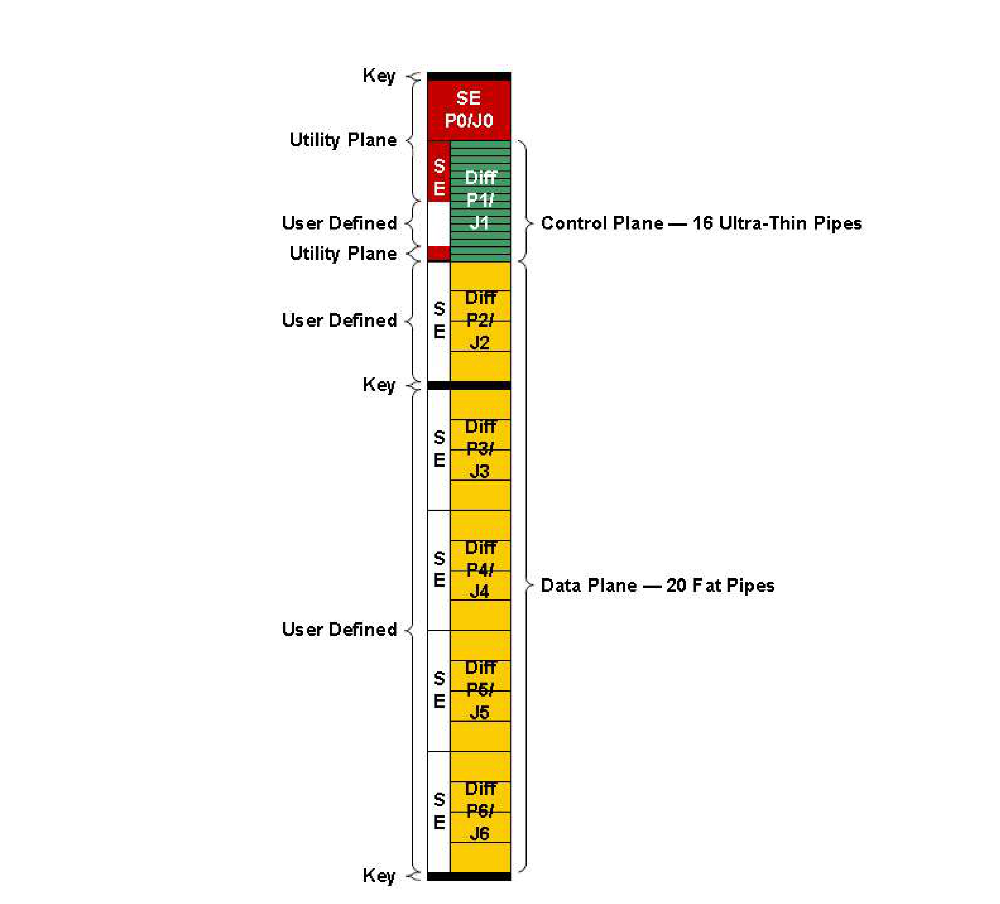

*Figure 37: ANSI/VITA65.0 Switch Slot Profile for SLT6-SWH-16U20F-10.4.2 ｜ 图 37：SLT6-SWH-16U20F-10.4.2 的 ANSI/VITA65.0 交换槽位配置档*

##### 5.2.19 SOSA 6U External I/O Plug-In Card Profile SOSA 6U 外部 I/O 插卡配置档

**Rule 5.2.19-1**

SOSA 6U External I/O Plug-In Cards shall conform to ANSI/VITA 65.0 slot profile SLT6-PAY-4U2U-10.2.8. Conformance Methodology: (A)

SOSA 6U 外部 I/O 插卡应符合 ANSI/VITA 65.0 的 slot profile SLT6-PAY-4U2U-10.2.8。符合性方法：(A)

**Rule 5.2.19-2**

User-defined pins in slot profile SLT6-PAY-4U2U-10.2.8 shall only interface with platform I/O and not other modules within the system. Conformance Methodology: (A)

slot profile SLT6-PAY-4U2U-10.2.8 中的用户自定义引脚应只与平台 I/O 接口，而不与系统内的其他模块接口。符合性方法：(A)

<!-- 原书 p.120 ｜ PDF p.140 -->

**Rule 5.2.19-3**

SOSA 6U External I/O Plug-In Cards shall conform to one of the ANSI/VITA 65.1 module profiles in Table 37. Conformance Methodology: (A)

SOSA 6U 外部 I/O 插卡应符合表 37 中 ANSI/VITA 65.1 module profile 之一。符合性方法：(A)

**Observation 5.2.19-1**

Instead of routing platform-specific I/O to non-standard payloads, integrators can utilize the SOSA 6U External I/O Plug-In Card as the platform I/O “data center” where a single plug-in card (or multiple if required) can interface with the platform over platform-specific connections and the rest of the payload modules over standard expansion or data plane interfaces.

与其把平台专用 I/O 路由到非标准载荷，集成方可将 SOSA 6U 外部 I/O 插卡用作平台 I/O 的“数据中心”：由一张插卡（如需要，也可多张）经平台专用连接与平台相接，而其余载荷模块则经标准扩展平面或数据平面接口相接。

**Recommendation 5.2.19-1**

The SOSA 6U Payload Plug-In Cards profile should be used instead of the SOSA 6U External I/O Plug-In Card profile if platform-specific I/O can be accommodated by a single XMC.

若平台专用 I/O 可由单个 XMC 容纳，则宜采用 SOSA 6U 载荷插卡配置档，而不采用 SOSA 6U 外部 I/O 插卡配置档。

Key

图例

SE

SE（图内标注，照录）

POIJO

POIJO（图内标注，照录）

Utility Plane-

辅助平面-

5 Expansion Plane 4 Ultra-Thin Pipes

5 扩展平面 4 超薄管道

User Defined E Diff

用户定义 E 差分

- Maint. Port PIIJ1

- 维护端口 PIIJ1

User Defined-

用户定义-

Utility Plane User Defined

辅助平面 用户定义

5 Diff

5 差分

> **译注**：上列十段为原书图 38 图内标注文字在英文转换件中析出的残行（标注层叠、扫描错拼，如 `POIJO`、`PIIJ1` 均非可读原词），随位照录；中文按字面逐段给出，图内文字以原图为准。

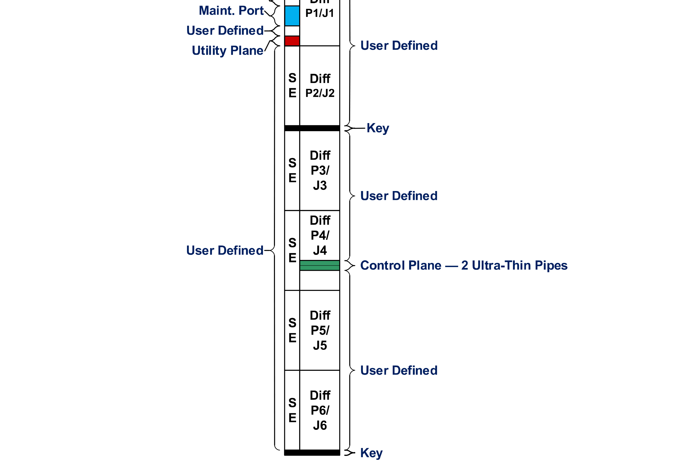

*Figure 38: ANSI/VITA 65.0 6U External I/O Slot Profile SLT6-PAY-4U2U-10.2.8 ｜ 图 38：ANSI/VITA 65.0 6U 外部 I/O 槽位配置档 SLT6-PAY-4U2U-10.2.8*

<!-- 原书 p.121 ｜ PDF p.141 -->

**Table 37: ANSI/VITA 65.1 Module Profiles for SLT6-PAY-4U2U-10.2.8 ｜ 表 37：SLT6-PAY-4U2U-10.2.8 的 ANSI/VITA 65.1 模块配置档**

| Module Profile names ／ 模块配置档名 | Dash Num ／ 短横号 | STD Date ／ 标准日期 | Slot Profile ／ 槽位配置档 | Protocols for Copper Planes ／ 铜平面协议 |  | Protocols for Optical ／ 光纤协议 | Comments ／ 备注 | Legacy ／ 遗留 |
|---|---|---|---|---|---|---|---|---|
|  |  |  |  | Expansion Plane ／ 扩展平面 | Control Plane ／ 控制平面 |  |  |  |
| MOD6-PAY-4U2U-12.2.8- |  | Proposed future 65.0 |  | EPutp01 - EPutp04 | CPutp01, CPutp02 |  | First row of MOD6-PAY-4U2U-12.2.8-n MOD6-PAY-4U2U-12.2.8-n 的首行 |  |
| MOD6-PAY-4U2U-12.2.8- | 1 | Proposed future 65.0 | SLT6-PAY-4U2U-10.2.8 | PCIe Gen 2 -- 5.3.3.2 | 1000BASE-KX -- 5.1.2 |  |  |  |
| MOD6-PAY-4U2U-12.2.8- | 2 | Proposed future 65.0 | SLT6-PAY-4U2U-10.2.8 | PCIe Gen 3 -- 5.3.3.3 | 10GBASE-KR -- 5.1.7 |  |  |  |
| Last line |  | Proposed future 65.0 |  |  |  |  |  |  |

> 转写说明：
> 1. 本表完整落在 PDF p142（印刷页 122）上半页，表末（`Last line` 行）之后即 5.2.20 节正文。p143 为 Rule 5.2.20-6～8 正文、p144／p145 为 5.2.22 节正文，均无本表续行——据此判定本表不跨页，未续写。
> 2. 表头为两层：第 1 行为分组标题，第 2 行（加粗）为子列标题。`Protocols for Copper Planes` 横跨 `Expansion Plane`、`Control Plane` 两列，被覆盖的单元格留空；`Protocols for Optical`、`Comments`、`Legacy` 各为单列，`Protocols for Optical` 与 `Legacy` 两列各行均空。
> 3. 原表 `Module Profile names` 与 `Dash Num` 之间无竖线（扫描件如此），本表依表头文字分为两列；完整配置档编号为 `MOD6-PAY-4U2U-12.2.8-n`、`…-12.2.8-1`、`…-12.2.8-2`。
> 4. 本表题注写的是 `SLT6-PAY-4U2U-10.2.8`，而表内 `Module Profile names` 列写的是 `MOD6-PAY-4U2U-12.2.8-`、`Slot Profile` 列写的是 `SLT6-PAY-4U2U-10.2.8`；题注与名义并不矛盾（前者是插槽档、后者是模块档），照录。
> 5. `Last line` 为原表的收尾行标签（灰色底），照录。

##### 5.2.20 Power Supply Module 电源模块

**Rule 5.2.20-1**

PSM requirements shall be applied using the following order of precedence: Requirements of this SOSA standard (including additions or exclusions to ANSI/VITA

PSM 的需求应依下列优先次序适用：本 SOSA 标准的需求（包括对 ANSI/VITA

65.0)

65.0）（续上段）

Conformance Methodology: (A)

符合性方法：(A)

Requirements of ANSI/VITA 62.0

ANSI/VITA 62.0 标准的需求

Conformance Methodology: (A)

符合性方法：(A)

**Observation 5.2.20-1**

The SOSA HWG is considering a move to 12V as the primary input in a future version of the SOSA standard.

SOSA HWG 正在考虑在今后某一版 SOSA 标准中改用 12V 作为主输入。

**Rule 5.2.20-2**

PSMs shall assert the FAIL* signal when PO1, PO2, PO3, or AUX voltages are not within their voltage specifications per ANSI/VITA 62.0, Recommendation 3.3-2. Conformance

当 PO1、PO2、PO3 或 AUX 电压不在 ANSI/VITA 62.0 推荐 3.3-2 所定的电压规格之内时，PSM 应置起 FAIL* 信号。符合性

Methodology: (T)

方法：(T)

**Rule 5.2.20-3**

PSMs shall have the chassis pin connected to their front panel and covers. Conformance Methodology: (A)

PSM 的机壳引脚应与其前面板及盖板相连。符合性方法：(A)

**Rule 5.2.20-4**

PSMs shall have the chassis pin isolated from the SIGNAL_RETURN pin. Conformance Methodology: (T)

PSM 的机壳引脚应与 SIGNAL_RETURN 引脚隔离。符合性方法：(T)

**Rule 5.2.20-5**

PSMs shall have the chassis pin isolated from power returns, such as the POWER_RETURN pins. Conformance Methodology: (T)

PSM 的机壳引脚应与电源回线（如 POWER_RETURN 引脚）隔离。符合性方法：(T)

<!-- 原书 p.122 ｜ PDF p.142 -->

**Rule 5.2.20-6**

PSMs shall have the chassis pin isolated from the -DC_IN/ACN pin. Conformance

PSM 的机壳引脚应与 -DC_IN/ACN 引脚隔离。符合性

Methodology: (T)

方法：(T)

**Rule 5.2.20-7**

PSMs outputting an intermediate power shall explicitly define the nominal voltage level for the intermediate power. Conformance Methodology: (A)

输出中间电源的 PSM 应显式定义该中间电源的标称电压电平。符合性方法：(A)

**Rule 5.2.20-8**

PSMs having intermediate power as an input shall explicitly define the nominal voltage level for the intermediate power. Conformance Methodology: (A)

以中间电源为输入的 PSM 应显式定义该中间电源的标称电压电平。符合性方法：(A)

**Rule 5.2.20-9**

Energy Storage Modules shall accept an input of the intermediate voltage in accordance with

储能模块应接受中间电压作为输入，其依据为

ANSI/VITA 62.0 §4.5. Conformance Methodology: (A)

ANSI/VITA 62.0 第 4.5 节。符合性方法：(A)

**Rule 5.2.20-10**

Energy Storage Modules shall output the intermediate voltage in accordance with ANSI/VITA

储能模块应输出中间电压，其依据为 ANSI/VITA

62.0 §4.5. Conformance Methodology: (A)

62.0 第 4.5 节。符合性方法：(A)

**Rule 5.2.20-11**

6U Single-Stage Modules shall route the intermediate voltage to the ANSI/VITA 62.0 pins labeled “POS_FILT_OUT” and “NEG_FILT_OUT” in accordance with ANSI/VITA 62.0 §6.5.2. Conformance Methodology: (A)

6U 单级模块应把中间电压引出到 ANSI/VITA 62.0 中标为“POS_FILT_OUT”与“NEG_FILT_OUT”的引脚，其依据为 ANSI/VITA 62.0 §6.5.2。符合性方法：(A)

**Rule 5.2.20-12**

3U PSMs shall conform to the mechanical requirements of ANSI/VITA 48.2 for 3U conduction cooled modules except where specified herein. Conformance Methodology: (A)

除本文件另有规定外，3U PSM 应符合 ANSI/VITA 48.2 对 3U 传导散热式模块的机械需求。符合性方法：(A)

**Rule 5.2.20-13**

6U PSMs shall conform to the mechanical requirements of ANSI/VITA 48.2 for 6U conduction cooled modules except where specified herein. Conformance Methodology: (A)

除本文件另有规定外，6U PSM 应符合 ANSI/VITA 48.2 对 6U 传导散热式模块的机械需求。符合性方法：(A)

##### 5.2.21 Mezzanine Modules 夹层模块

**Rule 5.2.21-1**

Requirements for SOSA Mezzanine Cards shall be applied using the following order of precedence: Conformance Methodology: (A) SOSA requirements (including additions or exclusions to the XMC standard) Mezzanine Module requirements of ANSI/VITA 42.3

对 SOSA 夹层卡的需求应依下列优先次序适用：符合性方法：(A) SOSA 的需求（包括对 XMC 标准的增补或排除）ANSI/VITA 42.3 的夹层模块需求

<!-- 原书 p.123 ｜ PDF p.143 -->

Mezzanine Module requirements of ANSI/VITA 42.0

ANSI/VITA 42.0 的夹层模块需求

**Permission 5.2.21-1**

Non-conformant SOSA Mezzanine Cards may be used.

不符合的 SOSA 夹层卡可以使用。

**Rule 5.2.21-2**

PCIe interfaces as bridged to XMC Mezzanine Cards shall conform to ANSI/VITA 42.3. Conformance Methodology: (A)

桥接到 XMC 夹层卡的 PCIe 接口应符合 ANSI/VITA 42.3。符合性方法：(A)

**Rule 5.2.21-3**

XMC Mezzanine Cards that do not require utilization of all available user I/O signals shall leave the remaining unused signals as no connects. Conformance Methodology: (A)

不要求使用全部可用用户 I/O 信号的 XMC 夹层卡，应把其余未用的信号留作不连接。符合性方法：(A)

**Recommendation 5.2.21-1**

The higher priority I/O signals of the XMC Mezzanine Card should populate pins in the following order of ANSI/VITA 46.9 patterns:

XMC 夹层卡中优先级较高的 I/O 信号宜按下列 ANSI/VITA 46.9 模式的次序占用引脚：

X12d

X12d（12 对差分模式）

X8d

X8d（8 对差分模式）

X16s

X16s（16 路单端模式）

X24s

X24s（24 路单端模式）

X38s

X38s（38 路单端模式）

**Observation 5.2.21-1**

Any XMC module (SOSA Mezzanine Cards or otherwise) will be expected to be subjected to qualification testing while installed on the target Payload Module within the constraints of the target system deployed configuration and environment, including all hardware and accessories.

任何 XMC 模块（SOSA 夹层卡或其他）都将预期在装于目标载荷模块上的状态下接受鉴定试验，并受目标系统部署构型与环境的约束，包括全部硬件与附件。

**Rule 5.2.21-4**

If a Payload Plug-In Card has an XMC Mezzanine Card Site, the Payload Plug-In Card shall route the ANSI/VITA 42.0-defined I²C connections from the XMC Mezzanine Card Site to the

若载荷插卡带有 XMC 夹层卡站点，则该载荷插卡应把 ANSI/VITA 42.0 所定义的 I²C 连接从 XMC 夹层卡站点引至

IPMC of the Payload Plug-In Card. Conformance Methodology: (A)

载荷插卡的 IPMC。符合性方法：(A)

##### 5.2.22 Maintenance Console Port Requirements 维护控制台端口需求

The Maintenance Console Port is intended to be a consistently-implemented port providing a console for low-level access to the attached processor. It is not intended to be an “operational” port; that is, not intended to communicate to some device as part of the normal operation of the system. It is intended strictly as part of the board maintenance functions.

维护控制台端口意在成为一种实现方式一致的端口，为对所装处理器做低层访问提供一个控制台。它不打算作为“运行”端口，即：不在于作为系统正常运行的一部分与某个器件通信。它严格属于板卡维护功能的一部分。

The basic use-cases for the maintenance console port can be classed as described below.

维护控制台端口的基本用例可按下述分类。

<!-- 原书 p.124 ｜ PDF p.144 -->

5.2.22.1 Vendor Board Bring Up, Board Support Package (BSP) Development, etc.

5.2.22.1 ｜ 厂商板卡启动、板级支持包（BSP）开发等

This implies access to low-level firmware, BIOS, Extensible Firmware Interface (EFI) shell, etc. The typical case is for an operator to attach to the maintenance console port of a single plug-in card using a terminal or PC. There is also a case where the operator may attach to a relatively limited set of boards at one time.

这意即访问低层固件、BIOS、可扩展固件接口（EFI）外壳等。典型情形是操作员用终端或 PC 接入单张插卡的维护控制台端口。还有一种情形：操作员可能在某一时刻接入相对有限的一组板卡。

###### 5.2.22.2 Integrator Application Development and Debug 集成方应用开发与调试

This also implies access to low-level firmware, BIOS, EFI shell, etc. This will typically be performed in a lab environment with the target plug-in card installed in either an “open” lab chassis or a target deployable chassis. The operator may attach to a relatively limited set of boards at one time, but there may be cases where the operator may need to attach to every maintenance console port in the system.

这同样意即访问低层固件、BIOS、EFI 外壳等。这项工作通常在实验室环境中进行，目标插卡装于“开放式”实验室机箱或目标可部署机箱内。操作员可能在某一时刻接入相对有限的一组板卡，但也可能在某些情形下需要接入系统中每一个维护控制台端口。

###### 5.2.22.3 Deployed System 已部署系统

In this case the target plug-in card is installed in a deployed system. Whether or not the maintenance console ports on the individual boards are accessible in a deployed system is up to the system integrator, but assuming the ports are accessible, it can be assumed that most, if not all, of the individual plug-in card maintenance console ports can be attached. It is also assumed that some sort of port aggregation mechanism is implemented within the system to provide this access.

此情形下目标插卡装于一套已部署的系统之中。已部署系统中各单板上的维护控制台端口是否可接触，由系统集成方决定；但假定这些端口可接触，则可认为各插卡的维护控制台端口中的大多数（即便不是全部）都能被接入。还假定系统内已实现某种端口汇聚机制来提供这一访问。

5.2.22.4 Maintenance Depot

5.2.22.4 ｜ 维修站

The maintenance depot use-case can be characterized by the need to access the maintenance console ports of an individual fieldable plug-in card in a lab test fixture. The port will facilitate debug and perhaps upgrade/updates of the plug-in card.

维修站用例的特征在于：需要在实验室测试夹具中访问单张可外场部署插卡的维护控制台端口。该端口将便于调试，或许还便于对插卡作升级／更新。

The SOSA Maintenance Console Port is defined to operate at LVCMOS levels rather than traditional RS232 levels. The reason is that there is a desire in SOSA platforms to support an aggregator function for the various Maintenance Console Ports, giving system designers the ability to access any particular Maintenance Console Port in the system from a single interface (or, perhaps, a limited number). The use of LVCMOS rather than traditional RS232 levels allows the aggregator to be generally smaller and simpler – often implemented with an FPGA or Complex Programmable Logic Device (CPLD).

SOSA 维护控制台端口定义为以 LVCMOS 电平而非传统 RS232 电平工作。原因在于：SOSA 平台希望为各维护控制台端口支持一种汇聚器功能，使系统设计者能够以单一接口（或许是一组有限的接口）访问系统中的任一特定维护控制台端口。采用 LVCMOS 而非传统 RS232 电平，使该汇聚器通常可以做得更小更简单——常以 FPGA 或复杂可编程逻辑器件（CPLD）实现。

Note that board designers are not prohibited from supporting RS232 levels for these ports, so long as they provide a mechanism to support the requirements documented here.

注意，并不禁止板卡设计者为这些端口提供 RS232 电平，只要其提供一种机制来满足本文件所记载的需求。

These ports all share a common implementation defined as follows.

这些端口都遵循如下定义的共同实现。

**Rule 5.2.22.4-1**

The Maintenance Console Port shall be a two-pin interface implementing TIA-232 protocol. Conformance Methodology: (A)

维护控制台端口应是实现 TIA-232 协议的两引脚接口。符合性方法：(A)

**Rule 5.2.22.4-2**

The Maintenance Console Port shall use LVCMOS signaling non-inverted (active high) with the following levels (see Table 38). Conformance Methodology: (A)

维护控制台端口应采用非反相（高电平有效）的 LVCMOS 信号，电平如下（见表 38）。符合性方法：(A)

<!-- 原书 p.125 ｜ PDF p.145 -->

**Table 38: Maintenance Console Port Signal Levels ｜ 表 38：维护控制台端口信号电平**

| **3.3V LVCMOS Voltage levels ／ 3.3V LVCMOS 电压电平** | |
|---|---|
| Vcc | 3.3V +/- 0.3V |
| Vih | 1.7V |
| Vil | 0.7V |
| Voh | 2.0V |
| Vol | 0.4V |

> 转写说明：首行「3.3V LVCMOS Voltage levels」为横向合并单元格，覆盖全表两列，故该行第 2 格留空；本表无逐列列名。本表仅占原书 p.126 一页，p.127 为正文。

**Observation 5.2.22.4-1**

The Maintenance Console Port non-inverted (active high) signaling permits the addition of an external RS232 transceiver to provide a proper signal polarity to TIA-232 devices.

维护控制台端口的非反相（高电平有效）信号便于加装外部 RS232 收发器，以向 TIA-232 设备提供正确的信号极性。

**Rule 5.2.22.4-3**

The Maintenance Console Port shall support, at a minimum, 115,200 bits/sec, 57,600 bits/sec, and 9600 bits/sec (H/M/L speed), 8 bit, no parity, one stop bit. Conformance Methodology: (A)

维护控制台端口应至少支持 115,200 比特/秒、57,600 比特/秒与 9600 比特/秒（H/M/L 速率），8 位数据位，无奇偶校验，一位停止位。符合性方法：(A)

**Permission 5.2.22.4-1**

Maintenance Console Ports are permitted to support additional speeds and protocol settings.

维护控制台端口允许支持额外的速率与协议设置。

#### 5.3 SOSA System Management Requirements ｜ 5.3 SOSA 系统管理需求

The network-based system management concepts were described in Section 3.11.2. This section defines rules that define specific requirements for system management interfaces to be implemented by SOSA hardware elements, sensors, and modules.

基于网络的系统管理概念已在第 3.11.2 节中描述。本节所定的规则，给出 SOSA 硬件元素、传感器与模块须实现的系统管理接口的具体需求。

5.3.1 SOSA Hardware Element System Management Requirements

5.3.1 SOSA 硬件元素系统管理需求

> **译注**：上段在原书为一节题，转换件未作 Markdown 标题行（无 `#`）。本件不改动标题层级，照录为一段并在其下给中文。

**Rule 5.3.1-1**

A SOSA Hardware Plug-In Card shall include an IPMC. This is referred to as a SOSA IPMC throughout the remainder of this standard. Conformance Methodology: (A)

SOSA 硬件插卡应包含一个 IPMC。本标准其余部分中，此物一律称为 SOSA IPMC。符合性方法：(A)

> **译注**：条目标目 `Rule`／`Recommendation` 依体例原样不译——`Rule`＝规则、`Recommendation`＝推荐（另见术语表 §一：`Suggestion`＝建议、`Permission`＝许可、`Observation`＝观察）。`Conformance Methodology`＝符合性方法，其后代号 `(A)`、`(T)`、`(I)` 为原书符合性方法代号，原样保留。

**Rule 5.3.1-2**

A SOSA IPMC shall comply with the ANSI/VITA 46.11 Tier 2 IPMC requirements. Conformance Methodology: (A)

SOSA IPMC 应符合 ANSI/VITA 46.11 Tier 2 的 IPMC 需求。符合性方法：(A)

**Rule 5.3.1-3**

A SOSA IPMC shall comply with the HOST OpenVPX Core Technology Tier 2 Standard v3.0 IPMC requirements. Conformance Methodology: (A)

SOSA IPMC 应符合 HOST OpenVPX Core Technology Tier 2 Standard v3.0 的 IPMC 需求。符合性方法：(A)

<!-- 原书 p.126 ｜ PDF p.146 -->

**Rule 5.3.1-4**

A SOSA IPMC shall implement a System IPMB B interface. Conformance Methodology: (A)

SOSA IPMC 应实现一个 System IPMB B 接口。符合性方法：(A)

**Rule 5.3.1-5**

A SOSA System IPMB shall include an IPMB B interface in the backplane profile. Conformance Methodology: (A)

SOSA System IPMB 应在背板配置档（`backplane profile`）中包含一个 IPMB B 接口。符合性方法：(A)

**Rule 5.3.1-6**

A SOSA system shall include a Chassis Manager Module. Conformance Methodology: (A)

SOSA 系统应包含一个机箱管理模块。符合性方法：(A)

**Recommendation 5.3.1-1**

A SOSA system systems IPMB should include a redundant Chassis Manager Module.

SOSA 系统的系统 IPMB 宜包含一个冗余的机箱管理模块。

> **译注**：上段 `A SOSA system systems IPMB` 为原书自身的笔误（`system` 与 `systems` 连写），照录照译，未替原文改字。

**Rule 5.3.1-7**

The SOSA Chassis Manager Module shall include a chassis manager. Conformance Methodology: (A)

SOSA 机箱管理模块应包含一个机箱管理器。符合性方法：(A)

**Rule 5.3.1-8**

The Chassis Manager shall comply with the ANSI/VITA 46.11 Tier 2 Chassis Manager requirements. Conformance Methodology: (A)

机箱管理器应符合 ANSI/VITA 46.11 Tier 2 的机箱管理器需求。符合性方法：(A)

**Rule 5.3.1-9**

The Chassis Manager shall comply with the HOST OpenVPX Core Technology Tier 2 Standard v3.0 Chassis Manager requirements. Conformance Methodology: (A)

机箱管理器应符合 HOST OpenVPX Core Technology Tier 2 Standard v3.0 的机箱管理器需求。符合性方法：(A)

**Rule 5.3.1-10**

A SOSA PSM shall include a SOSA IPMC. Conformance Methodology: (A)

SOSA 电源模块（PSM）应包含一个 SOSA IPMC。符合性方法：(A)

**Rule 5.3.1-11**

A SOSA IPMC shall be conformant to ANSI/VITA 46.11 Tier 2 IPMC requirements. Conformance Methodology: (A)

SOSA IPMC 应符合 ANSI/VITA 46.11 Tier 2 的 IPMC 需求。符合性方法：(A)

**Rule 5.3.1-12**

A SOSA IPMC shall implement a System IPMB B interface. Conformance Methodology: (A)

SOSA IPMC 应实现一个 System IPMB B 接口。符合性方法：(A)

**Rule 5.3.1-13**

A SOSA IPMC shall be conformant to the IPMC requirements. Conformance Methodology: (A)

SOSA IPMC 应符合 IPMC 需求。符合性方法：(A)

<!-- 原书 p.127 ｜ PDF p.147 -->

**Rule 5.3.1-14**

A SOSA system shall implement a bussed System IPMB. Conformance Methodology: (A)

SOSA 系统应实现一条总线式 System IPMB。符合性方法：(A)

**Recommendation 5.3.1-2**

A SOSA system should allow for point-to-point connections.

SOSA 系统宜允许点到点连接。

**Rule 5.3.1-15**

A SOSA system’s IPMB shall be conformant to the ANSI/VITA 46.11 Tier 2 IPMC requirements. Conformance Methodology: (A)

SOSA 系统的 IPMB 应符合 ANSI/VITA 46.11 Tier 2 的 IPMC 需求。符合性方法：(A)

**Rule 5.3.1-16**

A SOSA system’s IPMB shall include an IPMB B. Conformance Methodology: (A)

SOSA 系统的 IPMB 应包含一条 IPMB B。符合性方法：(A)

**Rule 5.3.1-17**

A SOSA system shall include a Chassis Manager Module. Conformance Methodology: (A)

SOSA 系统应包含一个机箱管理模块。符合性方法：(A)

**Recommendation 5.3.1-3**

A SOSA system should include a redundant Chassis Manager Module.

SOSA 系统宜包含一个冗余的机箱管理模块。

**Rule 5.3.1-18**

The SOSA system Chassis Manager Module shall include a conformant ANSI/VITA 46.11 Tier 2 Chassis Manager. Conformance Methodology: (A)

SOSA 系统的机箱管理模块应包含一个符合 ANSI/VITA 46.11 Tier 2 要求的机箱管理器。符合性方法：(A)

**Rule 5.3.1-19**

The SOSA system Chassis Manager Module shall include a conformant Tier 2 and HOST Chassis Manager. Conformance Methodology: (A)

SOSA 系统的机箱管理模块应包含一个符合 Tier 2 与 HOST 要求的机箱管理器。符合性方法：(A)

##### 5.3.2 SOSA Module System Management Requirements ｜ 5.3.2 SOSA 模块系统管理需求

Work in defining rules and requirements to be applied to SOSA logical components is ongoing. Section 5.6.1.3 defines a set of common interactions that are candidates to be implemented by all logical modules. The related DIV-2 elements for those candidate interactions are defined in Section D.4. As these interactions have not yet been through a thorough proposal and evaluation process, rules and requirements are not included in this version.

为把规则与需求施用于 SOSA 逻辑组件所做的定义工作仍在进行中。第 5.6.1.3 节定义了一组通用交互，各逻辑模块是这些交互的候选实现者。这些候选交互所对应的 DIV-2 元素见第 D.4 节。由于这些交互尚未经过充分的提议与评估过程，本版未纳入相应规则与需求。

#### 5.4 SOSA Software Operating Environment ｜ 5.4 SOSA 软件运行环境

##### 5.4.1 Description ｜ 5.4.1 描述

SOSA modules may contain a wide range of functions and many of these are accomplished through computer processing. In order to promote the open and standardized goals of the SOSA Technical Architecture, the Run-Time Environment (RTE) interface for SOSA modules will be

SOSA 模块可包含范围广泛的功能，其中许多功能通过计算机处理来实现。为推进 SOSA 技术架构的开放与标准化目标，SOSA 模块的运行时环境（RTE）接口将

<!-- 原书 p.128 ｜ PDF p.148 -->

defined. Note this does not mandate a particular RTE, although there are recommended solutions to promote open standards-based interoperability. This provides guidance and recommendations for the interface of that computer program RTE with other entities.

予以定义。注意，这并不强制要求某一特定的 RTE，尽管存在若干推荐方案以推进基于开放标准的互操作性。本部分为该计算机程序 RTE 与其他实体之间的接口提供指南与推荐。

The SOSA standardized architectural modules can be realized in a variety of SOSA standardized interface components, either hardware, software, or a combination of hardware and software. For example, the SOSA standard defines hardware connector interfaces to hardware elements. A similar approach is required for components implemented in software. The SOSA Software Runtime Environment Interface (REI) will define the interfaces to support the development of software that meets the SOSA quality attributes, including the open and standardized goals. The SOSA REI will not mandate a specific run-time implementation but will specify standardized interfaces with performance and security attributes as an area of future investigation. The REI description will be enhanced to provide more detailed guidance that leverages and supports the FACE Technical Standard, OMS, the MORA specification, the FROST Architecture Specification, REDHAWK/TOA, and the Common Open Architecture Radar Program Specification (COARPS) individually.

SOSA 标准化的架构模块可以多种 SOSA 标准化接口组件来实现——或为硬件、或为软件，或为硬件与软件的组合。例如，SOSA 标准定义了通往硬件元素的硬件连接器接口。对以软件实现的组件，需要类似的做法。SOSA 软件运行时环境接口（REI）将定义一组接口，以支持开发满足 SOSA 质量属性（含开放与标准化目标）的软件。SOSA REI 不强制要求特定的运行时实现，而将规定带性能与信息安全属性的标准化接口，此为一处尚待今后研究的方向。REI 描述将予扩充，以给出更详细的指南，分别利用并支持 FACE Technical Standard、OMS、MORA 规范、FROST Architecture Specification、REDHAWK/TOA 与通用开放架构雷达计划规范（COARPS）。

##### 5.4.2 Scope ｜ 5.4.2 范围

This section describes the high-level scope of the SOSA REI. It includes:

本节描述 SOSA REI 的高层范围。其内容包括：

SOSA application software interface to SOSA module hardware processing and operating system for language run time and calls to operating system services as defined by the

SOSA 应用软件面向 SOSA 模块硬件处理与操作系统的接口，供语言运行时与操作系统服务调用使用；其定义依

FACE Operating System Segment (OSS) interface

FACE 操作系统段（OSS）接口

SOSA platform-specific software and low-level I/O as defined by the FACE Platform-

SOSA 平台特定软件与低层 I/O，其定义依 FACE 平台特定

Specific Services Segment (PSSS) and I/O Services Segment (IOSS)

服务段（PSSS）与 I/O 服务段（IOSS）

SOSA operating system as defined by the FACE operating system requirements

SOSA 操作系统，其定义依 FACE 的操作系统需求

— POSIX®

— POSIX®（可移植操作系统接口标准）

— ARINC 653

— ARINC 653（航空电子应用软件接口标准）

For FACE conformant software, programming language and version as defined by the referenced FACE Technical Standard Guidance and limitations on use of VMs and containers General-Purpose, Safety, and Security features of application software as per the profile guidance in the referenced FACE Technical Standard The SOSA REI excludes:

对符合 FACE 的软件：编程语言与版本依所引 FACE Technical Standard 的定义；虚拟机与容器的使用指南与限制；应用软件的通用（General-Purpose）、安全（Safety）与信息安全（Security）特性，依所引 FACE Technical Standard 中的配置档指南。SOSA REI 不含：

> **译注**：上段英文在原书为三条项目符号，另以 `The SOSA REI excludes:` 一句起下文；转换时并成一段。英文照录不改，中文按原条目次序以「；」分列。

Transport layer middleware for application (component) to application (component)

应用（组件）到应用（组件）通信的传输层中间件，

communications, unless defined by this standard for SOSA module communications Specific source code-level requirements, such as:

除非本标准对 SOSA 模块通信另有定义；具体到源代码层面的需求，例如：

Coding standards

编码标准

Code development methods — Code architecture

代码开发方法——代码架构

<!-- 原书 p.129 ｜ PDF p.149 -->

Configuration management or quality assurance processes except those defined for airworthiness — Language selection beyond those defined in the FACE Technical Standard plus

配置管理或质量保证过程（为适航性所定义者除外）；语言选择，除 FACE Technical Standard 所定义者之外再加

> **译注**：本段及前后数段英文在原书为「SOSA REI 不含」的一组项目符号，转换时有的并成一段、有的在句子中间断成两段：`Transport layer middleware … application (component)` 与 `communications, unless …` 本是一句而被切断，`Specific source code-level requirements, such as:` 并进了上一段，`Code development methods` 与 `— Code architecture` 并作一段，`— Language selection …` 与上一条并作一段。英文照录不改。

Python™

Python™（编程语言）

FPGA softcore processor software or programmable logic Excludes GPU programming languages The SOSA REI has questionable scope for: Airworthiness SOSA software that affects safety needs to be considered but it is not clear how much it actually affects this REI definition. Software safety is already subject to FACE Safety Profile certification by airworthiness authorities under DO-178/MIL-HDBK-516C, which is mostly driven by process substantiation not the product itself, although there are exceptions – for example, Federal Aviation Administration (FAA) certification is not available using Java® in high-criticality systems.

FPGA 软核处理器软件或可编程逻辑；不含 GPU 编程语言；SOSA REI 在以下方面的范围尚存疑问：适航性——影响安全的 SOSA 软件需要加以考虑，但尚不清楚它实际上在多大程度上影响本 REI 的定义。软件安全已由适航当局依 DO-178/MIL-HDBK-516C 纳入 FACE Safety Profile 认证，而该认证主要由过程的实质性证明驱动，而非由产品本身驱动，尽管存在例外——例如，在高关键性系统中使用 Java® 无法取得美国联邦航空管理局（FAA）的认证。

> **译注**：上段英文在原书为两条项目符号（`FPGA softcore processor software or programmable logic`、`Excludes GPU programming languages`）、一句 `The SOSA REI has questionable scope for:` 及其下方一条项目符号 `Airworthiness`，后接正文；转换时并成一段。英文照录不改，中文以「；」分列各条。

Figure 39 is derived from Figure 2 (Architectural Segments) from the FACE Technical Standard, Edition 3.0. The red dashed line has been added to represent the SOSA REI scope in relation to the FACE segments. This graphic is not an exhaustive representation of FACE elements.

图 39 取自 FACE Technical Standard 第 3.0 版的图 2（架构段）。红色虚线系原书为表示 SOSA REI 范围相对 FACE 各段的位置而添加。本图并非 FACE 各元素的穷尽性表示。

<!-- 原书 p.130 ｜ PDF p.150 -->

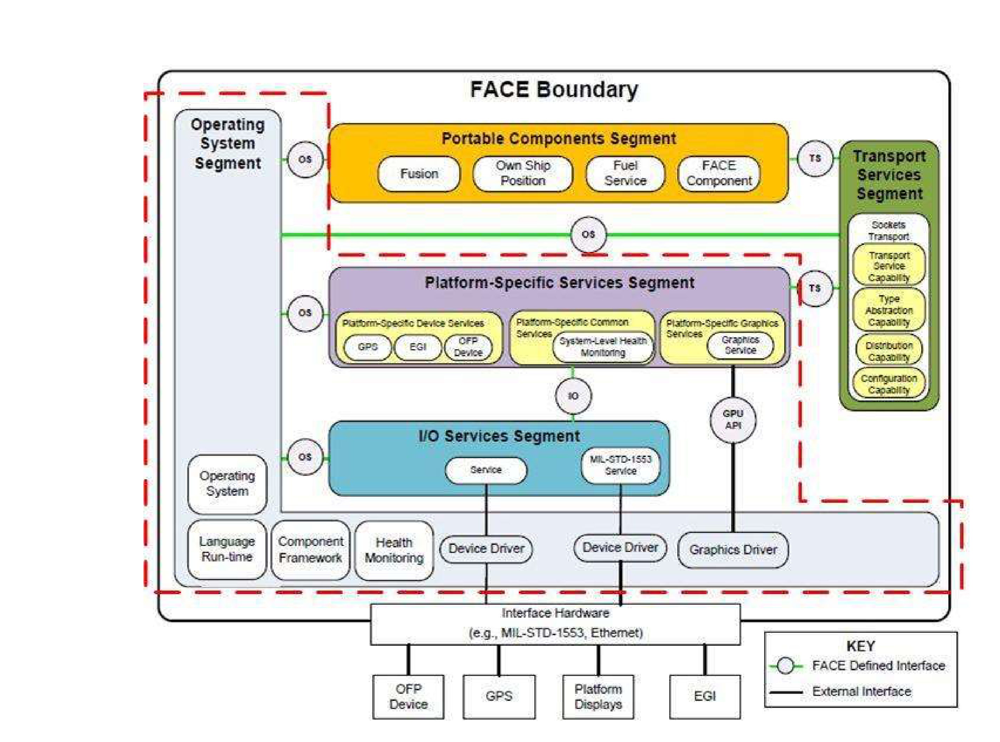

*Figure 39: FACE Software Operating Environment and Subset Proposed for the SOSA REI (red ｜ 图 39：FACE 软件运行环境及拟用于 SOSA REI 的子集（红色*

dashed line)

虚线）

##### 5.4.3 Recommendations ｜ 5.4.3 推荐

###### 5.4.3.1 Basis ｜ 5.4.3.1 依据

The RTE should conform to FACE Technical Standard, Edition 3.0 (call out specific sections)

RTE 宜符合 FACE Technical Standard 第 3.0 版（须点明具体节）

When other profiles are not applicable, the RTE should conform to the General-Purpose Profile The SOSA modules should be developed for operating system interfaces including one of:

当其他配置档不适用时，RTE 宜符合 General-Purpose Profile；SOSA 模块宜针对下列操作系统接口之一来开发：

— POSIX

— POSIX（可移植操作系统接口标准）

— ARINC 653

— ARINC 653（航空电子应用软件接口标准）

SOSA modules should be implemented by software components based on existing interface standards or software frameworks (e.g., the MORA specification, FROST Architecture Specification, REDHAWK/TOA, COARPS, etc.) The specifics for how these software components will interface to the SOSA REI are planned for a later version of the SOSA Technical Standard.

SOSA 模块宜以基于现有接口标准或软件框架（如 MORA 规范、FROST Architecture Specification、REDHAWK/TOA、COARPS 等）的软件组件来实现。这些软件组件如何与 SOSA REI 接口，其具体做法拟在今后版本的 SOSA 技术标准中规定。

> **译注**：本段英文在原书分两条：一句推荐（`When other profiles are not applicable …`）与其下的项目符号清单（`— POSIX`、`— ARINC 653`），以及另一条推荐；转换时并成一段。英文照录不改，中文以「；」分列。

<!-- 原书 p.131 ｜ PDF p.151 -->

###### 5.4.3.2 Interoperability Levels ｜ 5.4.3.2 互操作等级

SOSA REI is not mandating how to write or manage application source code except for what open standard operating system/run-time API to use SOSA REI is not mandating any particular middleware 5.4.3.3 General-Purpose SOSA software components which have general performance should conform to the FACE Technical Standard General-Purpose Profile The SOSA modules which have low latency and/or hard real-time requirements should conform to the FACE Determinism Profile 5.4.4 Safety SOSA software components which have low latency and/or hard real-time requirements should conform to the FACE Technical Standard Safety Profile These software components shall follow DO-178 guidance for civilian applications and MIL-HDBK-516C for military applications to achieve airworthiness for SOSA modules affecting safety of flight These software components should conform to the FACE Safety Profile SOSA software components affecting safety of flight which use object-oriented technology shall follow FAA guidance including DO-332 and others Planned for a later version of the SOSA Technical Standard.

SOSA REI 不规定应用源代码如何编写或管理，只规定使用何种开放标准的操作系统／运行时 API；SOSA REI 不强制要求任何特定的中间件；
5.4.3.3 通用——具有通用性能的 SOSA 软件组件宜符合 FACE Technical Standard 的 General-Purpose Profile；具有低时延和／或硬实时需求的 SOSA 模块宜符合 FACE Determinism Profile；
5.4.4 安全——具有低时延和／或硬实时需求的 SOSA 软件组件宜符合 FACE Technical Standard 的 Safety Profile；这些软件组件对民用应用应遵循 DO-178 的指导、对军用应用应遵循 MIL-HDBK-516C 的指导，以使影响飞行安全的 SOSA 模块达到适航性；这些软件组件宜符合 FACE Safety Profile；影响飞行安全且采用面向对象技术的 SOSA 软件组件应遵循 FAA 的指导，包括 DO-332 等；拟在今后版本的 SOSA 技术标准中规定。

> **译注**：上段英文在原书含 `5.4.3.3 General-Purpose`、`5.4.4 Safety` 两处节题（另含末句 `Planned for a later version …` 一条待办说明），转换时全部并进正文成一段。英文照录不改，中文按原书条目次序以「；」分列。

5.4.4.1 Security SOSA modules should conform to the FACE Security Profile for those modules affecting system security 5.4.4.2 Programming Language SOSA modules should use one of the programming languages defined in the FACE

5.4.4.1 信息安全——SOSA 模块中影响系统信息安全的那些模块宜符合 FACE Security Profile；5.4.4.2 编程语言——SOSA 模块宜使用 FACE 中定义的编程语言之一，即由 FACE

> **译注**：上段英文在原书含 `5.4.4.1 Security`、`5.4.4.2 Programming Language` 两处节题，转换时并进正文；英文照录不改。

Technical Standard

技术标准所定义。

###### 5.4.4.3 Virtual Machines ｜ 5.4.4.3 虚拟机

SOSA modules may use VMs with limitations Planned for a later version of the SOSA Technical Standard.

SOSA 模块可带限制条件地使用虚拟机（VM）；拟在今后版本的 SOSA 技术标准中规定。

5.4.4.4 Hypervisors If a VM(s) is used then a Hypervisor should be used to manage the VMs. Security-related aspects of the hypervisor Planned for a later version of the SOSA Technical Standard.

5.4.4.4 虚拟机管理程序（Hypervisor）——若使用虚拟机，则宜用管理程序来管理各虚拟机。与虚拟机管理程序相关的信息安全方面，拟在今后版本的 SOSA 技术标准中规定。

> **译注**：上段英文在原书以节题 `5.4.4.4 Hypervisors` 起头，转换时并进正文；英文照录不改。

<!-- 原书 p.132 ｜ PDF p.152 -->

5.4.4.5 Containers

5.4.4.5 容器

> **译注**：上段在原书为一节题，转换件未作 Markdown 标题行；本件照录为一段并在其下给中文，与 §5.3.1、§5.4.4.4 同例。

SOSA modules may use containers after a security analysis that substantiates the use of containers does not defeat security requirements SOSA modules should substantiate why a container should be used instead of a VM

SOSA 模块可在完成一项信息安全分析之后使用容器，该分析须证实使用容器不会使信息安全需求失效；SOSA 模块宜论证为何应使用容器而不使用虚拟机。

> **译注**：上段英文在原书为两条项目符号，转换时并成一段；英文照录不改，中文以「；」分列。

#### 5.5 SOSA Module Interactions ｜ 5.5 SOSA 模块交互

The SOSA Architecture is based on a set of loosely-coupled modular entities that interact with the underlying operating environment and with each other via their logical interfaces. The operating environment will provide the mechanisms through which interoperation will occur and will provide the modules’ interfaces to these mechanism (I/O, processing, storage, communication, etc.). Interoperability between SOSA modules is described in terms of interactions.

SOSA 架构建立在一组松散耦合的模块化实体之上，这些实体经其逻辑接口与下层运行环境交互，并相互交互。运行环境将提供互操作借以发生的机制，并提供各模块通往这些机制（I/O、处理、存储、通信等）的接口。SOSA 模块之间的互操作性以交互来记述。

Interactions include exchanges of data, control actions, and various types of management functions. Most of the interactions considered are to be implemented as message exchanges on a network.

交互包括数据交换、控制动作以及各类管理功能。所考虑的交互大多将实现为网络上的消息交换。

- Note: The concept of the security services providing authentication and authorization services as shown, although not yet completely defined, is actively being developed by the SOSA Consortium.

- **注**：如图所示，由安全服务提供身份鉴别与授权服务这一概念，尽管尚未完全定义，SOSA 联盟正在积极开发之中。

#### 5.6 Sensor Management ｜ 5.6 传感器管理

The SOSA standard defines two modules that together perform sensor management, which is the composition of system management and task management. The modules are 1.1 System Manager and 1.2 Task Manager. The delineation between the functions of these two modules separates the functions related to taking care of the system from the functions of tasking the system to fulfill its operational needs. Figure 40 illustrates the overall sensor management architecture. System management client applications run on the host platform and interact with the sensor management interfaces through the host platform interface module, which communicates with the system manager and task manager modules. The system manager module performs system management functions (discovery, configuration, control, health monitoring) through interactions with the SOSA module and hardware element interactions. The task manager module performs mission tasking functions (setting up, controlling, collecting data from, and monitoring multi-INT operational tasks) through interactions with the system manager module, SOSA modules, and hardware elements.

SOSA 标准定义了共同执行传感器管理的两个模块，而传感器管理是系统管理与任务管理的组合。这两个模块是 1.1 系统管理器与 1.2 任务管理器。两个模块的功能划分，正是把「照管系统」一类功能，与「向系统指派任务以履行其运行需要」一类功能分开。图 40 展示传感器管理的总体架构。系统管理客户端应用运行于宿主平台，并经宿主平台接口模块与传感器管理接口交互；该接口模块与系统管理器模块、任务管理器模块通信。系统管理器模块通过与 SOSA 模块的交互以及与硬件元素的交互，执行系统管理功能（发现、配置、控制、健康监视）。任务管理器模块通过与系统管理器模块、SOSA 模块及硬件元素的交互，执行任务指派功能（建立、控制、采集数据并监视 multi-INT 运行任务）。

<!-- 原书 p.133 ｜ PDF p.153 -->

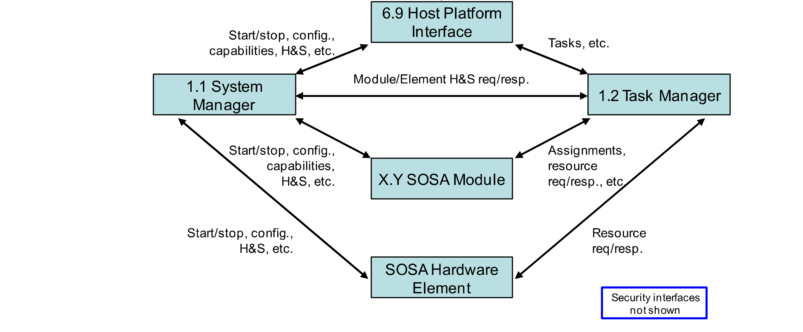

*Figure 40: Sensor Management Architecture View ｜ 图 40：传感器管理架构视图*

##### 5.6.1 System Manager Module ｜ 5.6.1 系统管理器模块

###### 5.6.1.1 Module Definition 模块定义

The functionality of the system manager module is defined in Table 2.

系统管理器模块的功能定义见表 2。

In summary, the system manager provides the ability to discover, configure, control, manage health (status and faults), and configure the security aspects of the SOSA sensor as a whole, its infrastructure, its modules, and its interface to the sensor host.

概括而言，系统管理器提供以下能力：发现、配置、控制、健康管理（状况与故障），以及配置 SOSA 传感器整体及其基础设施、其各模块、其与传感器宿主之间接口的安全方面。

The relationship between the system manager module and the other modules was shown in Figure 8 and explained in Section 3.11.2.

系统管理器模块与其他模块之间的关系见图 8，并在第 3.11.2 节中作了说明。

5.6.1.2 System Manager Interactions

5.6.1.2 系统管理器交互

The system manager is responsible for handling discovery, configuration, control, and health functions for the sensor as a whole. It acts as a representative of the logical modules (those that are not part of the hardware infrastructure), and the hardware platform modules to the “outside” world.

系统管理器负责处理传感器整体的发现、配置、控制与健康功能。它作为逻辑模块（即不属于硬件基础设施的那些模块）与硬件平台模块对“外部”世界的代表。

The overall system management concept has been matured since the previous version of this standard.² However, it has not yet been through a formal proposal process, so it is possible that the interactions and interaction groups described here may change in a future version.

自本标准的上一版以来，系统管理的总体概念已趋于成熟。² 然而，它尚未经过正式的提案流程，因此此处所述的各交互与各交互组有可能在今后的版本中发生变化。

2 Technical Standard for SOSA™ Reference Architecture, The Open Group Snapshot (S180), expired July 2018.

2 《SOSA™ 参考架构技术标准》，The Open Group 快照版（S180），2018 年 7 月到期。

<!-- 原书 p.134 ｜ PDF p.154 -->

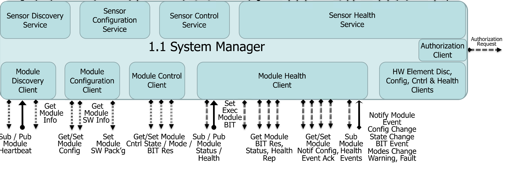

*Figure 41: System Manager Interactions ｜ 图 41：系统管理器交互*

Figure 41 illustrates the system manager module. It includes the service side (provides) for sensor discovery, sensor configuration, sensor control, and sensor health interaction groups. It also includes the client side (users) for module discovery, module configuration, module control, module health, and authorization interaction groups. The service side interactions (on the top) are accessed by system management applications that may be outside of the sensor. The clientside interactions (on the bottom) access the relevant services for each SOSA module implemented in a particular system.

图 41 展示系统管理器模块。它包含用于传感器发现、传感器配置、传感器控制与传感器健康各交互组的服务侧（提供方）。它还包含用于模块发现、模块配置、模块控制、模块健康与授权各交互组的客户端一侧（使用方）。服务侧交互（位于图中上方）由可能处于传感器之外的系统管理应用访问。客户端一侧的交互（位于图中下方）访问在特定系统中实现的各个 SOSA 模块的相关服务。

Note that the interaction endpoints related to modules (Discovery, Configuration, Control, and Health) clients are repeated for hardware elements, but are not shown in detail for brevity.

注意，与各模块（发现、配置、控制与健康）的客户端相关的交互端点对硬件元素是重复的，但为简明起见未详细示出。

5.6.1.3 Common System Management Interactions

5.6.1.3 通用系统管理交互

The SOSA system management concept defines a pattern that is applied to each type of module, and then tailored for the needs of the individual modules by varying the specific interaction names and parameters. The pattern includes sets of interactions that are common for all modules, whether they are implemented in software or hardware, or whether they are mission or infrastructure-oriented.

SOSA 系统管理概念定义了一种模式：该模式适用于每一类模块，再通过改变具体交互的名称与参数，按各模块自身的需要加以裁剪。该模式包括若干组对所有模块通用的交互——无论这些模块以软件还是以硬件实现，也无论它们面向任务还是面向基础设施。

Columns “Input DIV-2 Data Entities” and “Output DIV-2 Data Entities” list the entity types for the input and output parameters of each interactions. The names have not been finalized but align with the contents of Section D.4.

“输入 DIV-2 数据实体”与“输出 DIV-2 数据实体”两列列出各交互输入参数与输出参数的实体类型。这些名称尚未定稿，但与第 D.4 节的内容保持一致。

Note that this material is still being developed, so is likely to change as it is matured.

注意，这份材料仍在开发之中，因此在趋于成熟的过程中很可能发生变化。

**Table 39: Common System Management Interactions ｜ 表 39：通用系统管理交互**

| Common System Management Interactions ／ 通用系统管理交互 |  |  |  |  |
|---|---|---|---|---|
| Interaction Name ／ 交互名称 | Interaction Description ／ 交互描述 | Input DIV-2 Data Entities ／ 输入 DIV-2 数据实体 | Output DIV-2 Data Entities ／ 输出 DIV-2 数据实体 | Provider Module ／ 提供模块 |
| PubSensorHeartbeat | | SensorHeartbeatType | | 1.1 |
| SubSensorHeartbeat | | SubscriptionInfoType | subError_t | 6.4 |
| GetSensorInfo | | | error_t, SensorInfoType | 1.1 |
| PubModuleHeartbeat | | ModuleHeartbeatType | | 1.x, 2.x, 3.x, 4.x, 5.x |
| SubModuleHeartbeat | | SubscriptionInfoType | subError_t | 6.4 |
| GetModuleInfo | | | error_t, ModuleInfoType | 1.x, 2.x, 3.x, 4.x, 5.x |
| GetSensorConfig | | | error_t, SensorConfigDescriptionType | 1.1 |
| SetSensorConfig | | SensorConfigDescriptionType | error_t | 1.1 |
| GetSensorSoftwareInfo | | | error_t, SensorSoftwareMetadataType | 1.1 |
| SetSensorSoftwarePackage | | SensorSoftwarePackageType | error_t | 1.1 |
| GetModuleConfig | | | error_t, ModuleConfigDescriptionType | 1.x, 2.x, 3.x, 4.x, 5.x |
| SetModuleConfig | | ModuleConfigDescriptionType | error_t | 1.x, 2.x, 3.x, 4.x, 5.x |
| GetModuleSoftwareInfo | | | error_t, ModuleSoftwareMetadataType | 1.x, 2.x, 3.x, 4.x, 5.x |
| SetModuleSoftwarePackage | | ModuleSoftwarePackageType | error_t | 1.x, 2.x, 3.x, 4.x, 5.x |
| GetDataPublishingConfig | | | error_t | 1.x, 2.x, 3.x, 4.x, 5.x |
| SetDataPublishingConfig | Change the properties that govern the publication of data (identified by “topic”). Includes QoS, enabling, disabling, periodicity, etc. 改变管控数据发布（以“主题”标识）的各项属性。包括服务质量（QoS）、启用、停用、周期性等。 | | error_t | 1.x, 2.x, 3.x, 4.x, 5.x |
| GetSensorState | Sensor System States include: those shown in Set System State, Shutting Down, Resetting Hardware, Booting Operating System, Booted, Staring Software, Ready, Running, Paused. 传感器系统状态包括：Set System State 中所列各项、Shutting Down（关机中）、Resetting Hardware（复位硬件中）、Booting Operating System（引导操作系统中）、Booted（已引导）、Staring Software（启动软件（Staring Software，原文如此））、Ready（就绪）、Running（运行中）、Paused（暂停）。 | | error_t, SensorStateType | 1.1 |
| SetSensorState | Sensor System States that can be set include: Cold Boot, Warm Boot, Shutdown, Shutdown Software (component), Restart Software (component), Execute BIT, Calibrate (sensor dependent), Start, Pause. 可设置的传感器系统状态包括：Cold Boot（冷启动）、Warm Boot（暖启动）、Shutdown（关机）、Shutdown Software (component)（关闭软件（组件））、Restart Software (component)（重启软件（组件））、Execute BIT（执行 BIT）、Calibrate (sensor dependent)（校准（视传感器而定））、Start（启动）、Pause（暂停）。 | SensorStateType | error_t | 1.1 |
| GetSensorModes | Get the modes that the system is currently in. Note that this is not settable through the configuration interactions. 获取系统当前所处的模式。注意，此模式不可经配置交互设置。 | | error_t, SensorModesType | 1.1 |
| SetSensorModes | Causes the system to execute a BIT. BIT results show up in the health parameters. Equivalent to Set Sensor System State (BIT). 使系统执行一次 BIT。BIT 结果会出现在健康参数中。等效于 Set Sensor System State（BIT）。 | SensorModesType | error_t | 1.1 |
| GetModuleState | Module States are module-dependent, and may include: those shown in Set Module State, Shutting Down, Resetting Hardware, Booting Operating System, Booted, Staring Software, Ready, Running, Paused. 模块状态视模块而定，可包括：Set Module State 中所列各项、Shutting Down（关机中）、Resetting Hardware（复位硬件中）、Booting Operating System（引导操作系统中）、Booted（已引导）、Staring Software（启动软件（Staring Software，原文如此））、Ready（就绪）、Running（运行中）、Paused（暂停）。 | | error_t, ModuleStateType | 1.x, 2.x, 3.x, 4.x, 5.x |
| SetSensorCalibrationData | Set the data required for calibration of the sensor. 设置传感器校准所需的数据。 | SensorCalibrationInputDataType | error_t | 1.2 |
| GetSensorCalibrationData | Get the calibration results after the sensor has been put into a calibration state. 在传感器已进入校准状态之后获取校准结果。 | | SensorCalibrationResultDataType | 1.2 |
| SetModuleCalibrationData | Set the data required for calibration of the module. 设置模块校准所需的数据。 | ModuleCalibrationInputDataType | error_t | 2.x, 3.x, 4.x, 5.x |
| GetModuleCalibrationData | Get the calibration results after the module has been put into a calibration state. 在模块已进入校准状态之后获取校准结果。 | | ModuleCalibrationResultDataType | 2.x, 3.x, 4.x, 5.x |
| SetModuleState | Module States that can be set are module-dependent, but may include: Cold Boot, Warm Boot, Shutdown, Shutdown Software (component), Restart Software (component), Execute BIT, Calibrate (sensor dependent), Start, Pause. 可设置的模块状态视模块而定，但可包括：Cold Boot（冷启动）、Warm Boot（暖启动）、Shutdown（关机）、Shutdown Software (component)（关闭软件（组件））、Restart Software (component)（重启软件（组件））、Execute BIT（执行 BIT）、Calibrate (sensor dependent)（校准（视传感器而定））、Start（启动）、Pause（暂停）。 | ModuleStateType | error_t | 1.x, 2.x, 3.x, 4.x, 5.x |
| GetModuleMode | Get the mode that the module is currently in. Note that this is not settable through the configuration interactions. 获取模块当前所处的模式。注意，此模式不可经配置交互设置。 | | error_t, ModuleModeType | 1.x, 2.x, 3.x, 4.x, 5.x |
| SetModuleMode | Causes the module to execute a BIT. BIT Results shows up in the health parameters. Equivalent to Set Module State (BIT). 使模块执行一次 BIT。BIT 结果会出现在健康参数中。等效于 Set Module State（BIT）。 | ModuleModeType | error_t | 1.x, 2.x, 3.x, 4.x, 5.x |
| PubSensorStatusLevel | | SensorStatusLevelType | | 1.1 |
| SubSensorStatusLevel | | SubscriptionInfoType | subError_t | 6.4 |
| PubModuleStatus | | | | 1.x, 2.x, 3.x, 4.x, 5.x |
| SubModuleStatus | | SubscriptionInfoType | subError_t | 6.4 |
| GetSensorStatusLevel | | | error_t, SensorStatusLevelType | 1.1 |
| GetSensorHealthReport | | | error_t, SensorHealthReportType | 1.1 |
| SetExecuteSensorBIT | | SensorBITParametersType | error_t | 1.1 |
| GetSensorBITResult | | | error_t, SensorBITResultType | 1.1 |
| GetModuleStatus | | | error_t, ModuleStatusLevelType | *.* |
| GetModuleHealthReport | | | error_t, ModuleHealthReportType | *.* |
| SetExecuteModuleBIT | | ModuleBITParametersType | error_t | *.* |
| GetModuleBitResult | | | error_t, ModuleBITResultType | *.* |
| NotifySensorEvent | | SensorHealthEventType | | 1.1 |
| NotifySensorConfigChange | | SensorConfigEventType | | 1.1 |
| NotifySensorStateChange | | SensorStateEventType | | 1.1 |
| NotifySensorBITEvent | | SensorBITEventType | | 1.1 |
| NotifySensorModesChange | | SensorModeEventType | | 1.1 |
| NotifySensorWarning | | SensorWarningType | | 1.1 |
| NotifySensorFault | | SensorFaultType | | 1.1 |
| SetSensorEventAcknowledgement | | SensorEventAcknowledgType | error_t | 1.1 |
| SubSensorHealthEvents | | SubscriptionInfoType | subError_t | 6.4 |
| SetSensorNotificationConfig | | SensorEventConfigType | error_t | 1.1 |
| GetSensorNotificationConfig | | | error_t, SensorEventConfigType | 1.1 |
| NotifyModuleEvent | | ModuleHealthEventType | | *.* |
| NotifyModuleConfigChange | | ModuleConfigEventType | | *.* |
| NotifyModuleStateChange | | ModuleStateEventType | | *.* |
| NotifyModuleBITEvent | | ModuleBITEventType | | *.* |
| NotifyModuleModeChange | | ModuleModeEventType | | *.* |
| NotifyModuleWarning | | ModuleWarningType | | *.* |
| NotifyModuleFault | | ModuleFaultType | | *.* |
| SetModuleEventAcknowledgement | | ModuleEventAcknowledgType | error_t | *.* |
| SetModuleNotificationConfig | | ModuleEventConfigType | error_t | *.* |
| GetModuleNotificationConfig | | | error_t, ModuleEventConfigType | *.* |
| SubModuleHealthEvents | | SubscriptionInfoType | subError_t | 6.4 |
| SubModuleHealthReports | | SubscriptionInfoType | subError_t | 6.4 |
| GetHealthLog | | | error_t | 1.1 |
| GetHealthLogStatus | | | error_t | 1.1 |
| DeleteSensorHealthLog | | | error_t | 1.1 |

> 注：this table calls out all of the common system management interactions that have been identified as of this version. Additional system manager interactions are likely to be identified in a future version.

> **注**：本表列出截至本版本已识别出的全部通用系统管理交互。今后版本中很可能还会识别出更多的系统管理器交互。

> 转写说明：
> 1. 原表题注在 p.135，表体分置于 p.136–p.140 五页（p.136 16 行、p.137 9 行、p.138 15 行、p.139 21 行、p.140 顶部 5 行，共 66 数据行）。续页顶端重复印出的表头与列名不再重出，故本表只保留一次表头；p.140 表体之后的同页文字属 5.6.2 与 Table 40，未入本表。
> 2. 首行「Common System Management Interactions」为横向合并单元格，覆盖全表 5 列，故其后 4 格留空。
> 3. 原表单元格内惯将实体名与其「(…Type)」分置两行排印，本转写按单个空格连接（如「SensorHeartbeatType」单占一格者不动，凡「name + (Type)」成对者并作一行）；跨行断开的长类型名拼回原词（如「SensorConfigDescriptionTyp / e」→ SensorConfigDescriptionType、「SensorSoftwareMetadataTyp / e」→ SensorSoftwareMetadataType）。
> 4. 第 2 列「Interaction Description」除列出者外原表均为空格，按原样留空。
> 5. 原表形迹按原样照录，未改未补：p.137 两处「Staring Software」；「GetModuleBitResult」的小写「it」（同行输出类型仍作 ModuleBITResultType）；「NotifySensorModesChange」与同行的「SensorModeEventType」单复数不一致；p.136 GetSensorSoftwareInfo 与 SetSensorSoftwarePackage 两行的 Provider Module 均印作 1.1；Provider Module 列的「*.*」照录。

<!-- 原书 p.135 ｜ PDF p.155 -->

<!-- 原书 p.136 ｜ PDF p.156 -->

<!-- 原书 p.137 ｜ PDF p.157 -->

<!-- 原书 p.138 ｜ PDF p.158 -->

<!-- 原书 p.139 ｜ PDF p.159 -->

##### 5.6.2 Task Manager Module 任务管理器模块

###### 5.6.2.1 Module Definition 模块定义

See Table 2 for the definition of this module.

本模块的定义见表 2。

The concept of task management is still being developed. Below is a DRAFT set of task management interactions that are consistent with the system management interactions and the combined SOSA management architecture. So far, a detailed concept has been defined for five Task Management interactions: SetCreateTask, SetModifyTask, SetDeleteTask, SetModuleAssignment, and PubAssignmentHealth. (Details for these interactions are provided in Section 5.9.1.3 for an Air Moving Target Indicator (AMTI) Multi-sensor Fusion Tracker Radar mission example. Note that the interactions are common across all modules, but the enumerations and data for each interaction will be sensor and mission-specific and will require an extensive effort to define all of the task management configuration data, control actions, and module assignments for each of these (Sensor Type/Mission Type combinations).

任务管理的概念仍在开发之中。下面是任务管理交互的一组 DRAFT（草案），它们与系统管理交互以及合并后的 SOSA 管理架构保持一致。到目前为止，已为五个任务管理交互定义了详细概念：SetCreateTask、SetModifyTask、SetDeleteTask、SetModuleAssignment 与 PubAssignmentHealth。（针对空中动目标指示（AMTI）多传感器融合跟踪器雷达任务示例，这些交互的细节在第 5.9.1.3 节中给出。注意，这些交互在所有模块中通用，但每个交互的枚举与数据将视传感器与任务而定；要针对上述每一种（传感器类型／任务类型）组合定义全部任务管理配置数据、控制动作与模块分派，将需要大量工作。

**Table 40: Task Management Interactions Table ｜ 表 40：任务管理交互表**

| Task Management Interactions ／ 任务管理交互 |  |  |  |  |
|---|---|---|---|---|
| Interaction Name ／ 交互名称 | Interaction Description ／ 交互描述 | Input DIV-2 Data Entities ／ 输入 DIV-2 数据实体 | Output DIV-2 Data Entities ／ 输出 DIV-2 数据实体 | Provider Module ／ 提供模块 |
| PubSensorHeartbeat | | SensorHeartbeatType | | 1.1 |
| GetSystemCapabilityInformation | TBD | | reqResErrorCode (ReqResErrorCodeType), systemCapabilityInformation (SystemCapabilityInformationType) | 1.2 |
| GetModuleInformation | TBD | moduleID (number) | reqResErrorCode (ReqResErrorCodeType), moduleInformation (ModuleInformationType) | *.* |
| GetModuleCapabilities | TBD | moduleID (number) | reqResErrorCode (ReqResErrorCodeType), moduleCapabilities (ModuleCapabilitiesType) | *.* |
| GetResourceCapabilities | TBD | resourceID (number) | reqResErrorCode (ReqResErrorCodeType), resourceCapabilities (ResourceCapabilitiesType) | *.* |
| GetResourceFixedParameters | TBD | resourceID (number) | reqResErrorCode (ReqResErrorCodeType), resourceFixedParameters (ResourceFixedParametersType) | *.* |
| GetResourceControllableParameters | TBD | resourceID (number) | reqResErrorCode (ReqResErrorCodeType), resourceControllableParameters (ResourceControllableParametersType) | *.* |
| GetModuleInternalConnections | TBD | moduleID (number) | reqResErrorCode (ReqResErrorCodeType), moduleInternalConnections (ModuleInternalConnectionsType) | *.* |
| GetModuleExternalConnections | TBD | moduleID (number) | reqResErrorCode (ReqResErrorCodeType), moduleExternalConnections (ModuleExternalConnectionsType) | *.* |
| SetCreateTask | Request a new task, coming from outside of the sensor. 请求一个新任务，该任务来自传感器外部。 | taskDescription (TaskDescriptionType) | reqResErrorCode (ReqResErrorCodeType) | 1.2 |
| SetModifyTask | Modify task from outside of the sensor. 修改来自传感器外部的任务。 | taskID (number), taskModificationDescription (TaskModificationDescriptionType) | reqResErrorCode (ReqResErrorCodeType) | 1.2 |
| SetDeleteTask | Delete task from outside of the sensor. 删除来自传感器外部的任务。 | taskID (number) | reqResErrorCode (ReqResErrorCodeType) | 1.2 |
| GetActiveTasks | TBD | taskInformationList (TaskInformationListType) | reqResErrorCode (ReqResErrorCodeType) | 1.2 |
| GetTaskInformation | TBD | taskInformation (TaskInformationType) | reqResErrorCode (ReqResErrorCodeType), taskID (number) | 1.2 |
| GetTaskState | TBD | taskID (number), taskState (TaskStateType) | reqResErrorCode (ReqResErrorCodeType), taskID (number) | 1.2 |
| SetTaskState | Control a task. 控制一个任务。 | taskID (number) | reqResErrorCode (ReqResErrorCodeType), taskState (TaskStateType) | 1.2 |
| GetTaskStatus | Get the status of an existing task. 获取既有任务的状况。 | taskID (number) | reqResErrorCode (ReqResErrorCodeType), (TaskStatusType) | 1.2 |
| NotifyTaskEvent | Notify events that occur in tasks. 通知各任务中发生的事件。 | taskEventDescription (TaskEventDescriptionType) | pubSubErrorCode (PubSubErrorCode) | 1.2 |
| SubTaskEvent | TBD | taskID (number) | pubSubErrorCode (PubSubErrorCode), subscriptionInformation (SubscriptionInformationType) | 1.2 |
| PubTaskHealth | Publish periodic task health. 发布周期性的任务健康。 | taskID (number), taskHealthDescription (TaskHealthDescriptionType) | pubSubErrorCode (PubSubErrorCode) | 1.2 |
| SubTaskHealth | TBD | taskID (number) | pubSubErrorCode (PubSubErrorCode), subscriptionInformation (SubscriptionInformationType) | 1.2 |
| GetTaskHealthPublishingConfig | TBD | taskID (number) | reqResErrorCode (ReqResErrorCodeType), taskHealthpublishingConfig (TaskHealthPublishingConfigType) | 1.2 |
| SetTaskHealthPublishingConfig | Configure the publication of task status. 配置任务状况的发布。 | taskID (number), healthPublishingConfigDescription (HealthPublishingConfigDescriptionType) | reqResErrorCode (ReqResErrorCodeType) | 1.2 |
| GetModuleAssignment | TBD | moduleID (number) | reqResErrorCode (ReqResErrorCodeType), moduleAssignment (ModuleAssignmentType) | 2.x, 3.x, 4.x, 5.x |
| SetModuleAssignment | Assign a task to a module (assignment is used instead of task for modules). Assignments come from internal sources; tasks come from external sources. The intent is that the task manager will decompose an externally received task into module assignments as necessary. 把一个任务分派给某个模块（对模块而言用分派而非任务）。分派来自内部来源；任务来自外部来源。其意图是：任务管理器将按需把从外部接收到的任务分解为若干模块分派。 | moduleAssignment (ModuleAssignmentType) | reqResErrorCode (ReqResErrorCodeType) | 2.x, 3.x, 4.x, 5.x |
| GetModuleResourceAllocations | TBD | moduleID (number) | reqResErrorCode (ReqResErrorCodeType), moduleResourceAllocationList (ModuleResourceAllocationListType) | 2.x, 3.x, 4.x, 5.x |
| SetModuleResourceAllocations | Assign module resources to an assignment. 把模块资源分配给一个分派。 | taskID (number) | reqResErrorCode (ReqResErrorCodeType) | 2.x, 3.x, 4.x, 5.x |
| GetAssignmentState | TBD | assignmentID (number) | reqResErrorCode (ReqResErrorCodeType), assignmentState (AssignmentStateType) | 2.x, 3.x, 4.x, 5.x |
| SetAssignmentState | Control the task (assignment) of a module. 控制某个模块的任务（分派）。 | assignmentID (number), assignmentStateValue (AssignmentStateValueType) | reqResErrorCode (ReqResErrorCodeType) | 2.x, 3.x, 4.x, 5.x |
| GetAssignmentStatus | Get the status of an existing task. 获取既有任务的状况。 | assignmentID (number) | reqResErrorCode (ReqResErrorCodeType), assignmentStatus (AssignmentStatusType) | 2.x, 3.x, 4.x, 5.x |
| NotifyAssignmentEvent | Notify events that occur in tasks. 通知各任务中发生的事件。 | assignmentID (number), assignmentEvent (AssignmentEventType) | pubSubErrorCode (PubSubErrorCode), pubErrorCode (PubErrorCodeType) | 2.x, 3.x, 4.x, 5.x |
| SubAssignmentEvent | TBD | assignmentID (number) | pubSubErrorCode (PubSubErrorCode), subscriptionInformation (SubscriptionInformationType) | 2.x, 3.x, 4.x, 5.x |
| PubAssignmentHealth | Publish periodic task (assignment) health. 发布周期性的任务（分派）健康。 | assignmentID (number), assignmentHealth (AssignmentHealthType) | pubSubErrorCode (PubSubErrorCode) | 2.x, 3.x, 4.x, 5.x |
| SubAssignmentHealth | TBD | assignmentID (number) | pubSubErrorCode (PubSubErrorCode), subscriptionInformation (SubscriptionInformationType) | 2.x, 3.x, 4.x, 5.x |
| GetAssignmentHealthPublishingConfig | TBD | assignmentID (number) | reqResErrorCode (ReqResErrorCodeType), healthPublishingConfigDescription (HealthPublishingConfigDescriptionType) | 2.x, 3.x, 4.x, 5.x |
| SetAssignmentHealthPublishingConfig | Configure the publication of task status. 配置任务状况的发布。 | assignmentID (number), healthPublishingConfigDescription (HealthPublishingConfigDescriptionType) | reqResErrorCode (ReqResErrorCodeType) | 2.x, 3.x, 4.x, 5.x |

> 转写说明：
> 1. 原表题注在 p.140，表体分置于 p.140–p.144 五页（p.140 3 行、p.141 9 行、p.142 9 行、p.143 8 行、p.144 7 行，共 36 数据行）。续页顶端重复印出的表头与列名不再重出，故本表只保留一次表头；p.140 表体之前的同页表格是 Table 39 的结尾，未入本表。
> 2. 首行「Task Management Interactions」为横向合并单元格，覆盖全表 5 列，故其后 4 格留空。
> 3. 原表单元格内惯将实体名与其「(…Type)」分置两行排印（如「moduleID」换行「(number)」），本转写按单个空格连接；跨行断开的长名拼回原词（如「resourceControllableParamet / ers」→ resourceControllableParameters、「(ModuleInternalConnections / Type)」→ (ModuleInternalConnectionsType)）。
> 4. 原表形迹按原样照录，未改未补：p.142「GetTaskStatus」行 Output DIV-2 Data Entities 印作「reqResErrorCode (ReqResErrorCodeType), (TaskStatusType)」，第二个实体名（当为 taskStatus）原表缺印，此处只余类型名，照录未补；p.143「GetTaskHealthPublishingConfig」行的实体名印作「taskHealthpublishingConfig」（publishing 首字母小写），同行类型仍作 TaskHealthPublishingConfigType；Provider Module 列的「*.*」照录。

<!-- 原书 p.140 ｜ PDF p.160 -->

<!-- 原书 p.141 ｜ PDF p.161 -->

<!-- 原书 p.142 ｜ PDF p.162 -->

<!-- 原书 p.143 ｜ PDF p.163 -->

#### 5.7 RF Signal Layer Modules 射频信号层模块

Interactions between SOSA modules are being defined, with priorities and precedence set by the needs of the community, and to support specific use-cases. As of this version, the interactions

SOSA 模块之间的交互正在定义之中，其优先级与先后次序由共同体的需要来设定，并以支持特定用例为目的。截至本版本，已开发的交互包括

<!-- 原书 p.144 ｜ PDF p.164 -->

between the host platform and the sensor that relate to commanding an RF sensor, interactions with the so-called RF signal layer modules (those near the aperture that handle raw RF signals), and interactions between the task manager and tracker for a specific electronic warfare application have been developed. These efforts include a subset of RF-based sensor applications, and (thus far) do not cover any EO/IR applications. This incremental approach implies that these definitions are likely to be modified in the future as additional applications and sensor types are considered.

——宿主平台与传感器之间涉及对射频传感器下达指令的交互、与所谓射频信号层模块（即靠近孔径、处理原始射频信号的那些模块）之间的交互，以及任务管理器与跟踪器之间针对某个特定电子战应用的交互——均已开发。这些工作涵盖的只是基于射频的传感器应用中的一部分，且（迄今为止）未涉及任何光电／红外应用。这种逐步推进的做法意味着：随着考虑更多的应用与传感器类型，这些定义今后很可能被修改。

The SOSA signal layer modules include:

SOSA 信号层模块包括：

Module 2.1: Receive Aperture/Transducer/Camera Module 2.2: Transmit Aperture/Transducer/Laser Module 2.3: Conditioner-Receiver-Exciter

模块 2.1：接收孔径／换能器／相机；模块 2.2：发射孔径／换能器／激光器；模块 2.3：调理器-接收机-激励器。

> **译注**：上段英文在原书为三条项目符号，转换时并成一段；英文照录不改。

Each of these modules supports each of the SOSA sensor types; Communications, EO/IR, EW, Radar, and SIGINT. The current specification supports the RF sensor types; Communications, EW, Radar, and SIGINT, but not the EO/IR sensor type.

这些模块各自支持每一类 SOSA 传感器类型：通信、光电／红外、电子战、雷达与信号情报。现行规范支持射频类的传感器类型：通信、电子战、雷达与信号情报，但不支持光电／红外这一传感器类型。

Support for EO/IR sensor types in these modules will be added in a later version. The current version specifies the requirements for the signal layer modules when operating on RF signals, including the following:

对这些模块中光电／红外传感器类型的支持将在后续版本中加入。本版本规定了信号层模块在处理射频信号时的需求，包括以下各项：

RF Receiver Aperture/Transducer Module Standard RF Transmit Aperture/Transducer Module Standard RF Conditioner-Receiver-Exciter Module Standard

射频接收孔径／换能器模块标准；射频发射孔径／换能器模块标准；射频调理器-接收机-激励器模块标准。

> **译注**：上段英文在原书为三条项目符号，转换时并成一段；英文照录不改。

##### 5.7.1 Modular Open RF Architecture 模块化开放式射频架构

The SOSA Consortium has adopted portions of the MORA specification for the RF instantiation of the Receive Aperture/Transducer module. MORA is an extension to the VICTORY Architecture, which is an Open System Architecture (OSA) for integrating electronics onto military ground vehicles.

SOSA 联盟采纳了 MORA 规范中的部分内容，用于接收孔径／换能器模块的射频实例化。MORA 是 VICTORY 架构的扩展，后者是一种开放式系统架构（OSA），用于把电子设备集成到军用地面车辆上。

MORA extends the scope of VICTORY by adding a low latency transport mechanism, data streaming interfaces, new message types, management operations, and functional concepts that are specific to RF applications. A module in MORA is known as a MORA Device, which provides standardized access to configurable signal and processing resources.

MORA 通过增加低延迟传输机制、数据流接口、新的消息类型、管理操作以及射频应用特有的功能概念，扩展了 VICTORY 的范围。MORA 中的模块称为 MORA 设备（MORA Device），它提供对可配置信号资源与处理资源的标准化访问。

The parts of MORA that have been adopted are at this point limited to the Signal Port concept, which provides open interfaces to the signal layer processing aspects of RF processing chains, between propagating RF energy and digital RF signals at intermediate or baseband frequencies.

已采纳的 MORA 内容，目前限于信号端口（Signal Port）这一概念：它在传播中的射频能量与中频或基带频率上的数字射频信号之间，为射频处理链的信号层处理方面提供开放接口。

As MORA is an extension of VICTORY, adopting these MORA interface standards, which implies adoption of a subset of the VICTORY interface standards. This includes the use of SOA technologies for request-response interactions and eXtensible Markup Language (XML)formatted payloads encapsulated in User Datagram Protocol (UDP) datagrams and multicast for publish-subscribe interactions.

由于 MORA 是 VICTORY 的扩展，采纳这些 MORA 接口标准，即意味着采纳 VICTORY 接口标准的一个子集。这包括：对请求-响应交互采用面向服务的架构（SOA）技术；以用户数据报协议（UDP）数据报封装可扩展标记语言（XML）格式的载荷；以及对发布-订阅交互采用组播。

<!-- 原书 p.145 ｜ PDF p.165 -->

##### 5.7.2 Application of MORA to SOSA Signal Layer Modules MORA 对 SOSA 信号层模块的应用

Figure 42 illustrates the interfaces among the RF signal modules. Note the outlined boxes within the module boxes that are labeled and to which the interactions connect. These are “interaction endpoints”, which group together a set of related interactions, and indicate which role that module will play in the interactions. For instance, the box labeled “MORA Device Service” indicates that the module implements the service side of a group of interactions. Interaction endpoints will be important to interpreting the rules stating requirements for the RF signal layer modules.

图 42 展示射频信号各模块之间的接口。注意各模块框内带轮廓的小框——它们标有名称，交互即接到其上。这些就是“交互端点”，它们把一组相关交互归在一起，并指明该模块在这些交互中将扮演何种角色。例如，标为“MORA Device Service”的框表明该模块实现某一交互组的服务侧。交互端点对于解读那些陈述射频信号层模块需求的规则将很重要。

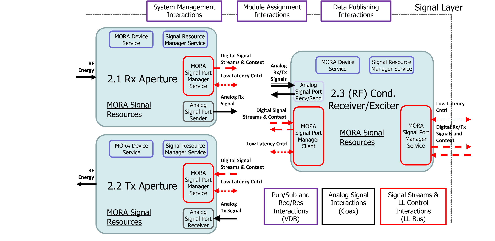

*Figure 42: RF Signal Layer Module Interactions ｜ 图 42：射频信号层模块交互*

- Note: VDB stands for VICTORY Data Bus, which is used for transport of publish-subscribe and request-response interactions in VICTORY.

- **注**：VDB 代表 VICTORY 数据总线（VICTORY Data Bus），在 VICTORY 中用于传输发布-订阅与请求-响应交互。

##### 5.7.3 RF Receiver Aperture/Transducer Module 射频接收孔径／换能器模块

The Receive Aperture/Transducer is responsible for converting Electromagnetic (EM) energy into an electrical signal. The signal may be pre-amplified and stabilized (calibration). This module may include mechanical and electronic steering, focus control, filtering, low-noise amplification, frequency translation, and analog to digital conversion. The output electrical signal may be analog or a digital stream. It may also output metadata.

接收孔径／换能器负责把电磁（EM）能量转换为电信号。该信号可经前置放大与稳定（校准）。本模块可包含机械与电子指向控制、聚焦控制、滤波、低噪声放大、频率变换以及模数转换。输出的电信号可为模拟信号，也可为数字流。它还可输出元数据。

<!-- 原书 p.146 ｜ PDF p.166 -->

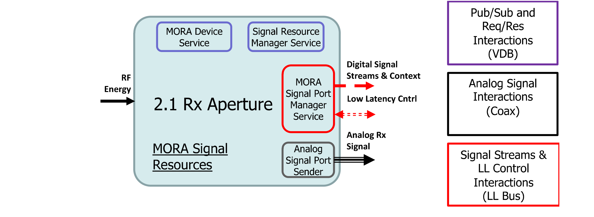

*Figure 43: RF Receiver Aperture/Transducer Interactions ｜ 图 43：射频接收孔径／换能器交互*

The MORA Device Manager Service is a set of interactions that support discovery, configuration, control, and health management of the module. These interactions report the health, send notifications of key events such as state changes and faults, and report built-in-test results. They also allow the module configuration to be managed, and its state to be controlled. For example, modules can be made to execute a BIT, reset, or the software or configuration may be updated.

MORA Device Manager Service（MORA 设备管理器服务）是一组交互，支持该模块的发现、配置、控制与健康管理。这些交互上报健康，发送状态变更与故障等关键事件的通知，并上报机内自检结果。它们还使模块配置得以被管理、其状态得以被控制。例如，可使模块执行 BIT、复位，或可更新其软件或配置。

The Signal Resource Manager Service is a group of interactions that support management of the RF resources that support capabilities such as signal domain conversion, signal frequency conversion, signal conditioning, RF distribution, and antenna control. Through these interactions the task manager (or an application) can request information about the resources and capabilities provided by the RF aperture to determine whether a particular RF aperture can meet the requirements of a given task. These interactions support discovery of detailed characteristics of the aperture, such as the fixed and variable parameters, the fixed and settable interconnections, and the real-time data, control, and context endpoints attached to the MORA Low Latency Bus (ML2B). These interactions also support reservation of the signal resources for a particular task.

Signal Resource Manager Service（信号资源管理器服务）是一组交互，支持对射频资源的管理；这些资源支撑信号域转换、信号频率变换、信号调理、射频分配与天线控制等能力。经由这些交互，任务管理器（或某个应用）可请求有关该射频孔径所提供资源与能力的信息，以判定某个特定射频孔径能否满足给定任务的需求。这些交互支持发现该孔径的详细特性，如固定参数与可变参数、固定的与可设置的互连，以及挂在 MORA 低延迟总线（ML2B）上的实时数据、控制与上下文端点。这些交互还支持为某个特定任务预留信号资源。

The Signal Port Manager Service interactions implement high-speed and low latency control of signal ports, which are realized by MORA Data Messages (MDMs) transported on the ML2B. Once resources have been reserved for a task through the Signal Resource Manager Service, the resources are configured, and the task is executed via the MORA Signal Port Manager Service interactions on the ML2B.

Signal Port Manager Service（信号端口管理器服务）交互实现对信号端口的高速、低延迟控制，这些控制由在 ML2B 上传输的 MORA 数据消息（MDM）实现。一旦经信号资源管理器服务为某个任务预留了资源，这些资源即被配置，任务便经 ML2B 上的 MORA 信号端口管理器服务交互予以执行。

The Analog Signal Port Sender interactions send analog representation of time domain radio frequency, intermediate frequency, or baseband signals.

Analog Signal Port Sender（模拟信号端口发送方）交互发送时域射频、中频或基带信号的模拟表示。

The Receiver Aperture/Transducer interactions are described in Table 41, and the rules stating the requirements for this module are described in Section 5.7.7.

接收孔径／换能器的交互见表 41，陈述本模块需求的规则见第 5.7.7 节。

##### 5.7.4 RF Transmit Aperture/Transducer Module 射频发射孔径／换能器模块

The Transmit Aperture/Transducer is responsible for converting an electrical signal into Electromagnetic (EM) energy, forming a transmit beam. This module may include mechanical and electronic steering, beamforming, focus control, filtering, amplification, frequency translation, and digital to analog conversion.

发射孔径／换能器负责把电信号转换为电磁（EM）能量，形成发射波束。本模块可包含机械与电子指向控制、波束形成、聚焦控制、滤波、放大、频率变换以及数模转换。

<!-- 原书 p.147 ｜ PDF p.167 -->

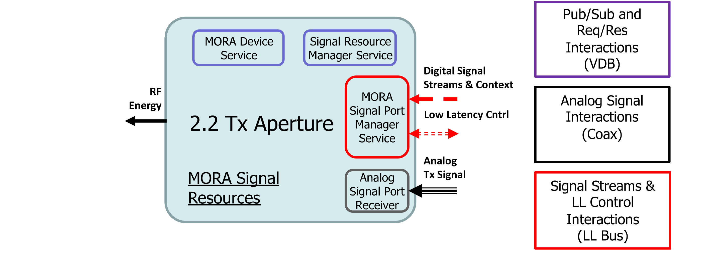

*Figure 44: RF Transmit Aperture/Transducer Interactions ｜ 图 44：射频发射孔径／换能器交互*

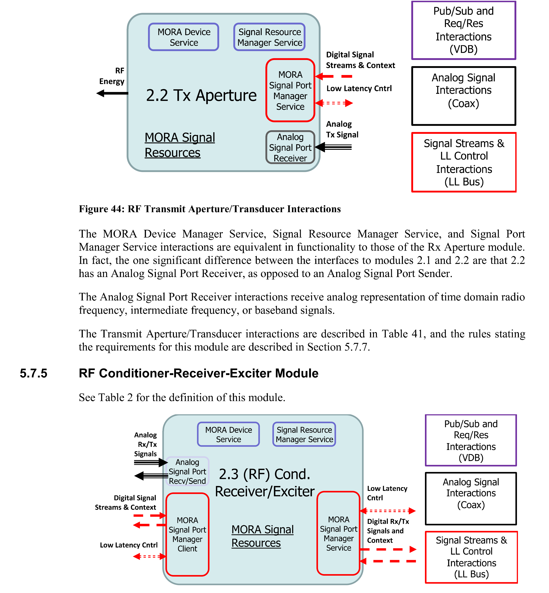

*Figure 45: RF Conditioner Receiver/Exciter Interactions ｜ 图 45：射频调理器接收机／激励器交互*

The MORA Device Manager Service and Signal Resource Manager Service interactions of this module are equivalent to those of the Tx and Rx aperture interfaces to describe the module’s status, configuration, built-in-test results, and a mechanism for managing the state of the module.

本模块的 MORA 设备管理器服务与信号资源管理器服务交互，与发射（Tx）孔径接口和接收（Rx）孔径接口上的对应交互相当，用于描述模块的状况、配置、机内自检结果，以及一种管理模块状态的机制。

<!-- 原书 p.148 ｜ PDF p.168 -->

The difference in the RF Conditioner-Receiver-Exciter module is that it will have a larger set of resources than the others. It may include RF functions such as signal domain conversion, signal frequency conversion, signal conditioning, RF distribution, and digital signal ports. It exchanges analog signals with the Rx and Tx modules via Analog Signal Receiver and Sender interactions, which are controlled via the MORA Signal Port Manager Client interactions on the ML2B. It exchanges digital signal streams, context, and real-time control data with the down-stream modules via its MORA Signal Port Manager Service.

射频调理器-接收机-激励器模块的差别在于：它所拥有的资源集合比其他模块更大。它可包含信号域转换、信号频率变换、信号调理、射频分配与数字信号端口等射频功能。它经模拟信号接收方与发送方（Analog Signal Receiver and Sender）交互，与接收模块、发射模块交换模拟信号；这些交互经 ML2B 上的 MORA 信号端口管理器客户端（MORA Signal Port Manager Client）交互加以控制。它经其 MORA 信号端口管理器服务与下游模块交换数字信号流、上下文与实时控制数据。

The following sections describe the interactions that make up each of these interaction endpoint groups, and then state the rules that will be required for each of the RF signal layer modules.

以下各节描述构成上述每一个交互端点组的各交互，随后陈述各射频信号层模块需求的规则。

##### 5.7.6 RF Signal Layer Module Interactions 射频信号层模块交互

Table 41 shows the interactions that have been defined for the RF signal layer modules, which include 2.1 Receiver Aperture/Transducer, 2.2 Transmit Aperture/Transducer, and 2.3 Conditioner-Receiver Exciter.

表 41 列出已为射频信号层模块定义的交互，这些模块包括 2.1 接收孔径／换能器、2.2 发射孔径／换能器与 2.3 调理器-接收机-激励器。

Note that these names have been slightly modified (the word “camera” has been removed) to indicate that these interactions were developed with RF applications in mind. They do not explicitly support EO/IR applications in this version. Interactions to support EO/IR applications will be addressed in a future version.

注意，这些名称已略作修改（删去了“camera”一词），以表明这些交互是考虑射频应用而开发的。在本版本中，它们并不显式支持光电／红外应用。支持光电／红外应用的交互将在今后的版本中处理。

The source of these interaction definitions was MORA. The approach taken was to directly adopt the parts of the MORA specification that related to the functionality of these RF signal layer modules, and thus the interactions shown came directly from analysis of MORA.

这些交互定义的来源是 MORA。所采取的做法是直接采纳 MORA 规范中与这些射频信号层模块功能相关的内容，因此所示的交互直接来自对 MORA 的分析。

For each interaction, the input and output parameters are represented as lists of data entity names in the Input and Output DIV-2 Data Entities columns. Each item in the input and output lists corresponds to an entry in one of the DIV-2 tables provided as appendices.

对每个交互，输入参数与输出参数以数据实体名称列表的形式列于“输入 DIV-2 数据实体”与“输出 DIV-2 数据实体”两列中。输入列表与输出列表中的每一项，各自对应作为附录提供的某张 DIV-2 表中的一个条目。

**Table 41: RF Signal Layer Module Interactions Table ｜ 表 41：射频信号层模块交互表**

| RF Signal Layer Module Interactions ／ 射频信号层模块交互 |  |  |  |  |  |  |
|---|---|---|---|---|---|---|
| Interaction Name ／ 交互名称 | Interaction Description ／ 交互描述 | Input DIV-2 Data Entities ／ 输入 DIV-2 数据实体 | Output DIV-2 Data Entities ／ 输出 DIV-2 数据实体 | 2.1 Receive Aperture/Transducer ／ 2.1 接收孔径／换能器 | 2.2 Transmit Aperture/Transducer ／ 2.2 发射孔径／换能器 | 2.3 Conditioner-Receiver-Exciter ／ 2.3 调理器-接收机-激励器 |
| PubSensorHeartbeat | | SensorHeartbeatType | | 1.1 | | |
| deleteFile | Request that a file on a MORA device be deleted. The “fileId” argument should correspond to the “id” field of the file requested, as returned from a “getFiles()” request. 请求删除 MORA 设备上的一个文件。“fileId”参数宜与其所请求文件的“id”字段相对应，该值由一次“getFiles()”请求返回。 | string | error | Provides | Provides | Provides |
| getAntennaArrays | Request a list of the antennas and their elements attached to the MORA device. 请求列出挂接于该 MORA 设备的天线及其阵元。 | | arrays | Provides | Provides | |
| getAntennaSideSignalPorts | Get a list of signal ports in the switch matrix that are connected to the antenna side of the RF chain. 获取交换矩阵中连接到射频链天线侧的那些信号端口的列表。 | | signalPorts | Provides | Provides | |
| getAvailableWaveforms | Request for a list of radio waveforms supported by the MORA device. 请求列出该 MORA 设备所支持的无线电波形。 | waveforms | error | Provides | Provides | Provides |
| getBuiltInTestResults | Request the results from a previous MORA device BIT run. 请求取得该 MORA 设备上一次 BIT 运行的结果。 | testResults | error | Provides | Provides | Provides |
| getCurrentMoraConfig | Get the file ID of the current MORA configuration file for a MORA device. 获取某个 MORA 设备当前所用 MORA 配置文件的文件 ID。 | fileId | error | Provides | Provides | Provides |
| getCurrentWaveform | Request details on the currently active waveform. 请求给出当前生效波形的详细信息。 | | waveform | Provides | Provides | Provides |
| getDeviceStatus | Get the status of the MORA device represented by the service. 获取该服务所代表的 MORA 设备的状况。 | | status | Provides | Provides | Provides |
| getDeviceType | Get the description of the MORA device represented by the service. 获取该服务所代表的 MORA 设备的描述。 | | moraDevice | Provides | Provides | Provides |
| getExternalConnections | Request the static external connections between the signal ports of this MORA device and other MORA devices. 请求取得该 MORA 设备各信号端口与其他 MORA 设备之间的静态外部连接。 | | externalConnections, error | Provides | Provides | Provides |

> 转写说明：首行 `RF Signal Layer Module Interactions` 在原表中横跨全部 7 列，其余 6 格留空。原表起于 p.149，次页续排（续页表头重复），本表按续页顺序接排（PubSensorHeartbeat、deleteFile 之后接 getAntennaArrays 起 9 行），共 11 个数据行。表内被 colspan 覆盖处留空，不代表原表该处无内容。
>
> 转写说明：原表多个单元格内的英文是排版折行（如 `SensorHeartbeatType` 被折成 `SensorHeartbeatT` / `ype`，`getAvailableWaveforms` 被折成 `getAvailableWavefo` / `rms`），已按一个单词复原，未插入空格。
>
> 转写说明：`PubSensorHeartbeat` 行的 Interaction Description、Output DIV-2 Data Entities、2.2、2.3 四格在原表中为空白；`getAntennaArrays`、`getAntennaSideSignalPorts` 的 Input DIV-2 Data Entities 在原表中为空白；`getAntennaArrays`、`getAntennaSideSignalPorts` 的 2.3 列为空白。以上空白照录为空。

<!-- 原书 p.149 ｜ PDF p.169 -->

<!-- 原书 p.150 ｜ PDF p.170 -->

<!-- 原书 p.151 ｜ PDF p.171 -->

<!-- 原书 p.152 ｜ PDF p.172 -->

<!-- 原书 p.153 ｜ PDF p.173 -->

<!-- 原书 p.154 ｜ PDF p.174 -->

##### 5.7.7 RF Signal Layer Module Rules RF 信号层模块规则

Implementations of modules 2.1, 2.2, and 2.3 shall comply with the appropriate MORA specifications, as shown in Table 42.

模块 2.1、2.2 与 2.3 的实现应符合相应的 MORA 规范，如表 42 所示。

In each row, the Interaction Endpoint column indicates the role that the indicated module shall support. If the endpoint column contains the word “Service”, then the module shall “provide” or implement the service side of the indicated standard. If the endpoint column contains the word “Client”, then the module shall “use” or implement the client side of the indicated standard. If the endpoint column contains the word “Sender”, the module shall “provide” or implement the service side of the interactions, while the word “Receiver” indicates the module shall “use” or implement the client side of the interactions.

每一行中，交互端点列指明所指示的模块应支持的角色。若端点列中含有 “Service” 一词，则该模块应“提供”或实现所指示标准的服务侧。若端点列中含有 “Client” 一词，则该模块应“使用”或实现所指示标准的客户端一侧。若端点列中含有 “Sender” 一词，则该模块应“提供”或实现各交互的服务侧；而 “Receiver” 一词则表示该模块应“使用”或实现各交互的客户端一侧。

Note that conformance with an individual interface standard (set of interactions) can only be tested objectively at the provider/service endpoint.

注意，与单个接口标准（一组交互）的符合性，只能在提供方／服务端点处得到客观的测试。

<!-- 原书 p.155 ｜ PDF p.175 -->

Additional context for the Interaction Endpoints listed in the table can be gained by referring to Figure 42.

表中列出的各交互端点，其补充背景可参阅图 42 获得。

**Table 42: RF Signal Layer Module Interaction Endpoints ｜ 表 42：RF 信号层模块交互端点**

| **Module ID** ／ **模块编号** | **Module Name** ／ **模块名** | **Applicability** ／ **适用性** | **Interaction Endpoint** ／ **交互端点** | **MORA 2.1 Specification** ／ **MORA 2.1 规范** |
|---|---|---|---|---|
| 2.1 | Receive Aperture/Transducer/Camera ／ 接收孔径／换能器／相机 | Required ／ 必需 | MORA Device Service | MT92010: MORA Device |
| 2.1 | Receive Aperture/Transducer/Camera ／ 接收孔径／换能器／相机 | Required ／ 必需 | Signal Resource Manager Service | MT92013: MORA Signal Resource Manager |
| 2.1 | Receive Aperture/Transducer/Camera ／ 接收孔径／换能器／相机 | Required ／ 必需 | MORA Signal Port Manager Service | MT92016: MORA Signal Port Manager |
| 2.1 | Receive Aperture/Transducer/Camera ／ 接收孔径／换能器／相机 | Required ／ 必需 | Analog Signal Port Sender | MT90011: RF Layer Analog Data Interface |
| 2.2 | Transmit Aperture/Transducer/Laser ／ 发射孔径／换能器／激光器 | Required ／ 必需 | MORA Device Service | MT92011: MORA Device Management Interface |
| 2.2 | Transmit Aperture/Transducer/Laser ／ 发射孔径／换能器／激光器 | Required ／ 必需 | Signal Resource Manager Service | MT92013: MORA Signal Resource Manager |
| 2.2 | Transmit Aperture/Transducer/Laser ／ 发射孔径／换能器／激光器 | Required ／ 必需 | MORA Signal Port Manager Service | MT92016: MORA Signal Port Manager |
| 2.2 | Transmit Aperture/Transducer/Laser ／ 发射孔径／换能器／激光器 | Required ／ 必需 | Analog Signal Port Receiver | MT90011: RF Layer Analog Data Interface |
| 2.3 | Conditioner Receiver/Exciter ／ 调理器-接收机-激励器 | Required ／ 必需 | MORA Device Service | MT92011: MORA Device Management Interface |
| 2.3 | Conditioner Receiver/Exciter ／ 调理器-接收机-激励器 | Required ／ 必需 | Signal Resource Manager Service | MT92013: MORA Signal Resource Manager |
| 2.3 | Conditioner Receiver/Exciter ／ 调理器-接收机-激励器 | Required ／ 必需 | MORA Signal Port Manager Service | MT920116: MORA Signal Port Manager |
| 2.3 | Conditioner Receiver/Exciter ／ 调理器-接收机-激励器 | Required ／ 必需 | Analog Signal Port Sender | MT90011: RF Layer Analog Data Interface |
| 2.3 | Conditioner Receiver/Exciter ／ 调理器-接收机-激励器 | Required ／ 必需 | Analog Signal Port Receiver | MT90011: RF Layer Analog Data Interface |
| 2.3 | Conditioner Receiver/Exciter ／ 调理器-接收机-激励器 | Required ／ 必需 | MORA Signal Port Manager Client | MT92013: MORA Signal Resource Manager |

> 注：The MORA specification, Version 2.1 references in the table uniquely identify a testable specification in the MORA documents. MORA also refers to other standard documents, including VICTORY and ANSI/VITA 49.2.
>
> **注**：表中引用的 MORA 规范 2.1 版各条，唯一地标识 MORA 文档中某一可测试的规范。MORA 还引用其他标准文件，包括 VICTORY 与 ANSI/VITA 49.2。
>
> 转写说明：上一条是紧随表格的说明段落（原书该段左缩进小于正文，判为表注；若按正文处理请移出）。原表次页为正文（Rule 5.7.7 各条）与他处内容，非本表续表，未入本表。
>
> 转写说明：`Module Name` 列在原表中排为两行（`Receive Aperture/` + `Transducer/Camera`；`Conditioner` + `Receiver/Exciter`），属名称折行，已用一个空格接成一行。`Module ID`、`Module Name`、`Applicability` 三列在每一行都单独列出（原表无 rowspan 合并），故逐行照录、无留空格。
>
> 存疑：第 11 行 `MORA 2.1 Specification` 列原文作 `MT920116: MORA Signal Port Manager`（其余同类行为 `MT92016`），疑为原书笔误；按「不纠错」原则照录原文，未改。

<!-- 原书 p.156 ｜ PDF p.176 -->

The following documents provide the complete, detailed specifications referenced in the table. MORA Specification, Version 2.1 (see Referenced Documents)

下列文件给出表中引用各规范的完整、详细规格；MORA 规范 2.1 版（见“引用文件”）。

- Distribution A: main body and appendices A-D Distribution C: appendices E-G VICTORY Standard Specifications, Version 1.7 (see Referenced Documents)

- 分发声明 A：正文与附录 A-D；分发声明 C：附录 E-G；VICTORY 标准规范 1.7 版（见“引用文件”）。

Distribution C: main body

分发声明 C：正文。

Distribution D and/or ITAR: appendices

分发声明 D 和／或 ITAR：附录。

- ANSI/VITA 49.2 (see Referenced Documents) Each bullet item in the rules below uniquely specifies a section of the MORA specification adopted by the SOSA Consortium for the SOSA Technical Architecture. Note that the rules only refer to implementation of the service-side interaction endpoints, as MORA does not provide conformance tests for implementation of the client-side interaction endpoints.

- ANSI/VITA 49.2（见“引用文件”）；下文各规则中的每一个项目符号条目，唯一地对应 SOSA 联盟为 SOSA 技术架构所采纳的 MORA 规范中的某一节。注意，这些规则只涉及服务侧交互端点的实现，因为 MORA 不提供对客户端侧交互端点实现的符合性测试。

> **译注**：本片有多处原书的项目符号列表在转换件中被并进了段落（项目符号与换行丢失）。英文照原样整段录；中文译成同一段落、各条以「；」分列，不替英文补项目符号。

**Rule 5.7.7-[1-4]**

> **译注**：`Rule`＝规则、`Recommendation`＝推荐、`Suggestion`＝建议、`Permission`＝许可、`Observation`＝观察（见术语表 §一）；此类条目标目连同其编号一律原样不译，其下正文照译。

A component implementing the RF modalities of the SOSA 2.1 Receive/Aperture Transducer module shall be compliant with the following MORA specifications: Conformance

实现 SOSA 2.1 接收／孔径换能器模块射频模态的组件，应符合下列 MORA 规范：符合性

Methodology: (TBD)

方法：（TBD）

MT92010: MORA Device

MT92010：MORA 设备

MT92013: MORA Signal Resource Manager

MT92013：MORA 信号资源管理器

MT92016: MORA Signal Port Manager

MT92016：MORA 信号端口管理器

MT90011: RF Layer Analog Data Interface

MT90011：射频层模拟数据接口

**Rule 5.7.7-[5-7]**

A component implementing the RF modalities of the SOSA 2.1 Receive/Aperture Transducer module shall provide the following signal resources as defined by the MORA specification, Version 2.1: Conformance Methodology: (TBD) Antenna (ANT) Signal Resource RF Translation Signal Resource Signal Domain Conversion Signal Resource

实现 SOSA 2.1 接收／孔径换能器模块射频模态的组件，应提供 MORA 规范 2.1 版所定义的下列信号资源：符合性方法：（TBD）；天线（ANT）信号资源；射频变换信号资源；信号域转换信号资源

**Rule 5.7.7-[8-9]**

A component implementing the RF modalities of the SOSA 2.1 Receive/Aperture Transducer module may provide the following signal resources as defined by the MORA specification, Version 2.1: RF Conditioning Signal Resource RF Distribution Signal Resource

实现 SOSA 2.1 接收／孔径换能器模块射频模态的组件，可提供 MORA 规范 2.1 版所定义的下列信号资源：射频调理信号资源；射频分配信号资源

<!-- 原书 p.157 ｜ PDF p.177 -->

**Rule 5.7.7-[10-13]**

A component implementing the RF modalities of the SOSA 2.2 Transmit/Aperture Transducer module shall be compliant with the following MORA specifications: Conformance

实现 SOSA 2.2 发射／孔径换能器模块射频模态的组件，应符合下列 MORA 规范：符合性

Methodology: (TBD)

方法：（TBD）

MT92010: MORA Device

MT92010：MORA 设备

MT92013: MORA Signal Resource Manager

MT92013：MORA 信号资源管理器

MT92016: MORA Signal Port Manager

MT92016：MORA 信号端口管理器

MT90011: RF Layer Analog Data Interface

MT90011：射频层模拟数据接口

**Rule 5.7.7-[14-16]**

A component implementing the RF modalities of the SOSA 2.1 Transmit Aperture Transducer module shall provide the following signal resources as defined by the MORA specification, Version 2.1: Conformance Methodology: (TBD) Antenna Signal Resource RF Translation Signal Resource Signal Domain Conversion Signal Resource

实现 SOSA 2.1 发射孔径换能器模块射频模态的组件，应提供 MORA 规范 2.1 版所定义的下列信号资源：符合性方法：（TBD）；天线信号资源；射频变换信号资源；信号域转换信号资源

**Rule 5.7.7-[17-18]**

A component implementing the RF modalities of the SOSA 2.1 Receive/Aperture Transducer module may provide the following signal resources as defined by the MORA specification, Version 2.1: RF Conditioning Signal Resource RF Distribution Signal Resource

实现 SOSA 2.1 接收／孔径换能器模块射频模态的组件，可提供 MORA 规范 2.1 版所定义的下列信号资源：射频调理信号资源；射频分配信号资源

**Rule 5.7.7-[19-24]**

A component implementing the RF modalities of the SOSA 2.3 RF Conditioner-Receiver-Exciter module shall be compliant with the following MORA specifications: Conformance Methodology: (TBD) MT92011: MORA Device Management Interface

实现 SOSA 2.3 射频调理器-接收机-激励器模块射频模态的组件，应符合下列 MORA 规范：符合性方法：（TBD）；MT92011：MORA 设备管理接口

MT92013: MORA Signal Resource Manager

MT92013：MORA 信号资源管理器

MT92016: MORA Signal Port Manager

MT92016：MORA 信号端口管理器

MT90011: RF Layer Analog Data Interface MT90011: RF Layer Analog Data Interface

MT90011：射频层模拟数据接口；MT90011：射频层模拟数据接口

MT92013: MORA Signal Resource Manager

MT92013：MORA 信号资源管理器

<!-- 原书 p.158 ｜ PDF p.178 -->

**Rule 5.7.7-[25-28]**

A component implementing the RF modalities of the SOSA 2.3 RF Conditioner-Receiver-Exciter module shall provide the following signal resources as defined by the MORA specification, Version 2.1: Conformance Methodology: (TBD)

实现 SOSA 2.3 射频调理器-接收机-激励器模块射频模态的组件，应提供 MORA 规范 2.1 版所定义的下列信号资源：符合性方法：（TBD）

RF Conditioning Signal Resource RF Distribution Signal Resource RF Translation Signal Resource Signal Domain Conversion Signal Resource

射频调理信号资源；射频分配信号资源；射频变换信号资源；信号域转换信号资源

#### 5.8 EO/IR Signal Layer Modules EO/IR 信号层模块

##### 5.8.1 EO/IR Receiver Camera Module Standard EO/IR 接收相机模块标准

Planned for a later version of the SOSA Technical Standard.

计划在 SOSA 技术标准的后续版本中给出。

##### 5.8.2 EO/IR Transmit Laser Module Standard EO/IR 发射激光器模块标准

Planned for a later version of the SOSA Technical Standard.

计划在 SOSA 技术标准的后续版本中给出。

##### 5.8.3 EO/IR Conditioner-Receiver-Exciter Module Standard EO/IR 调理器-接收机-激励器模块标准

Planned for a later version of the SOSA Technical Standard.

计划在 SOSA 技术标准的后续版本中给出。

#### 5.9 RF Digital Processing Modules RF 数字处理模块

##### 5.9.1 Tracker 跟踪器

###### 5.9.1.1 Definition 定义

See Table 2 for the definition of this module.

本模块的定义见表 2。

5.9.1.2 Interactions

5.9.1.2 交互

The tracker interactions are still being developed, and the SOSA Consortium has not yet voted on them. An initial capability – AMTI Multi-Sensor Fusion Sense and Avoid (SAA) – was used to create a notional set of interactions and data elements for a tracker. A detailed concept has been defined for several task manager interactions related to the tracker: SetCreateTask, SetModifyTask, SetDeleteTask, SetModuleAssignment, PubAssignmentHealth, and SubAssignmentHealth. Four interactions related to the tracker performing its functions have also been defined: SubDetection, PubTrack, SubOwnershipReport, and SubTrackReport. Some interactions will be common across all tracker modes/types, such as SetDeleteTask. Others will be sensor and mission-specific. Defining the configuration data, control action, and module assignmen’ fields in the tracker task management interactions for each Sensor and Mission will require an extensive effort.

跟踪器的各项交互仍在制定之中，SOSA 联盟尚未就其表决。最初以一项初始能力——空中动目标指示多传感器融合感知与避让（AMTI Multi-Sensor Fusion Sense and Avoid，SAA）——为依据，构建了一组设想的跟踪器交互与数据元素。已就与跟踪器相关的若干任务管理器交互定义了详细概念：SetCreateTask、SetModifyTask、SetDeleteTask、SetModuleAssignment、PubAssignmentHealth 与 SubAssignmentHealth。此外还定义了四项与跟踪器执行其功能相关的交互：SubDetection、PubTrack、SubOwnershipReport 与 SubTrackReport。有些交互将在所有跟踪器模式／类型中通用，如 SetDeleteTask；另一些则因传感器与任务而异。要为每一种传感器与任务分别定义跟踪器任务管理交互中的配置数据、控制动作与模块分派字段，将需要大量的工作。

> **译注**：英文原文此处的 `assignmen’` 有脱字（当为 `assignment`），照录未改，中文按字面译作“分派”。

<!-- 原书 p.159 ｜ PDF p.179 -->

###### 5.9.1.3 Tracker Interactions for AMTI SAA 跟踪器面向 AMTI SAA 的交互

The SOSA Consortium is developing a comprehensive list of SOSA sensor capabilities. The AMTI SAA capability was used to initiate the development of tracker interactions; therefore, the defined interactions below are relevant for AMTI Multi-Sensor Fusion in an SAA context.

SOSA 联盟正在编制一份 SOSA 传感器能力的完整清单。跟踪器交互的制定以 AMTI SAA 能力为起点；因此，下文所定义的各项交互适用于 SAA 语境下的 AMTI 多传感器融合。

References to the corresponding DIV-2 and DIV-3 products for the tracker in an AMTI Multi-Sensor Fusion SAA mode are found in Appendix D and Appendix E, respectively.

在 AMTI 多传感器融合 SAA 模式下，跟踪器所对应的 DIV-2 与 DIV-3 制品分别在附录 D 与附录 E 中给出。

Table 43 further defines the task management interactions shown in Table 40 for an AMTI Multi-Sensor Fusion SAA capability. Note that only those DIV-2 data entities that are specific to this capability are shown. For example, the taskDescription DIV-2 data entity associated with the SetCreateTask interaction (in Table 40) contains sensorType, missionType, and taskConfigData, where taskConfigData is an abstraction that must be extended for each mission type. The particular extension for an AMTI SAA capability is saaTaskConfigData, and that is the DIV-2 data entity that is shown in Table 43 for the version of SetCreateTask used for AMTI SAA. The DIV-2 for AMTI SAA is very specific at this point. There may be interactions and data that can be generalized. As additional capabilities are analyzed, the interactions may be refactored and are subject to change.

表 43 进一步定义表 40 中所示的任务管理交互在 AMTI 多传感器融合 SAA 能力下的内容。注意，只给出专属于该能力的那些 DIV-2 数据实体。例如，与 SetCreateTask 交互（见表 40）相关联的 taskDescription DIV-2 数据实体含有 sensorType、missionType 与 taskConfigData，其中 taskConfigData 是一种抽象，必须为每一种任务类型加以扩展。AMTI SAA 能力所用的特定扩展是 saaTaskConfigData，这正是表 43 中用于 AMTI SAA 的 SetCreateTask 版本所给出的 DIV-2 数据实体。AMTI SAA 的 DIV-2 在这一点上非常具体。可能还存在可以泛化的交互与数据。随着对更多能力的分析，这些交互可能被重构，也可能发生变化。

**Table 43: Tracker Module Interactions ｜ 表 43：跟踪器模块交互**

| Tracker Module Interactions ／ 跟踪器模块交互 |||||
|---|---|---|---|---|
| Interaction Name ／ 交互名 | Interaction Description ／ 交互描述 | Input DIV-2 Data Entities ／ 输入 DIV-2 数据实体 | Output DIV-2 Data Entities ／ 输出 DIV-2 数据实体 | Provider Module ／ 提供方模块 |
| SetCreateTask | Request a new task, coming from outside of the sensor. 请求一个新任务，该任务来自传感器外部。 | saaTaskConfigData (SAATaskConfigDataType) | TBD | 1.2 |
| SetModifyTask | Modify task from outside of the sensor. 修改来自传感器外部的任务。 | saaControlAction_AddExternalSensor (SAAControlAction_AddExternalSensorType) saaControlAction_DeleteExternalSensor (SAAControlAction_DeleteExternalSensorType) saaControlAction_SetTrackerMode (SAAControlAction_SetTrackerModeType) saaControlAction_SAATrackCoast (saaControlAction_SAATrackCoastType) | TBD | 1.2 |
| SetDeleteTask | Delete task from outside of the sensor. 删除来自传感器外部的任务。 | taskID (number) | TBD | 1.2 |
| SetModuleAssignment | Assign a task to a module (assignment is used instead of task for modules). Assignments come from internal sources; tasks come from external sources. The intent is that the task manager will decompose an externally received task into module assignments as necessary. 把任务分派给模块（对模块而言用“分派”而不用“任务”）。分派来自内部来源；任务来自外部来源。其意图是：任务管理器按需要把外部收到的任务分解为各模块的分派。 | assignmentAction_SAAExternalSensorConfig (AssignmentAction_SAAExternalSensorConfigType) assignmentAction_DeleteExternalSensor (AssignmentAction_DeleteExternalSensorType) assignmentAction_SetTrackerMode (AssignmentAction_SetTrackerModeType) assignmentAction_SAATrackCoast (AssignmentAction_SAATrackCoastType) | TBD | 3.4 |
| PubAssignmentHealth | Publish periodic task (assignment) health. 发布周期性的任务（分派）健康。 | TBD | trackerHealth (TrackerHealthType) | 3.4 |
| SubAssignmentHealth | Subscribe periodic task (assignment) health. 订阅周期性的任务（分派）健康。 | domainID (number) topicName (string) | TBD | 1.2 |

> 转写说明：首行 `Tracker Module Interactions` 在原表中横跨全部 5 列，其余 4 格留空。原表 p.160 与接续页续排，续页首行起接 SetModuleAssignment、PubAssignmentHealth、SubAssignmentHealth 三行，共 6 个数据行。
>
> 转写说明：`Input DIV-2 Data Entities` 列中，格内本是分条并列的若干数据实体（每条为「实体名 + 换行 + 括号内类型」），故用 ` ` 连接；原表条目之间另有空行间距，已并入单个 ` `。`Interaction Description` 列中是连续句子被排版折行（如 SetModuleAssignment 的说明），按一个空格接成一行。
>
> 转写说明：SetModifyTask 行最后一个类型原文作 `(saaControlAction_SAATrackCoastType)`，首字母小写 `saa`（同格其余三项为 `SAA`），照录原文未改。
>
> 存疑：无（全部单元格清晰可读）。

<!-- 原书 p.160 ｜ PDF p.180 -->

Table 44 shows additional interactions associated with the tracker.

表 44 给出与跟踪器相关的其他交互。

**Table 44: Additional Tracker Interactions ｜ 表 44：其他跟踪器交互**

| Tracker Module Interactions ／ 跟踪器模块交互 |||||
|---|---|---|---|---|
| Interaction Name ／ 交互名 | Interaction Description ／ 交互描述 | Input DIV-2 Data Entities ／ 输入 DIV-2 数据实体 | Output DIV-2 Data Entities ／ 输出 DIV-2 数据实体 | Provider Module ／ 提供方模块 |
| SubDetection | An interaction for receiving detections. 用于接收各项检测的交互。 | domainID (number) topicName (string) | TBD | 3.4 |
| PubTrack | An interaction for publishing tracks. 用于发布各航迹的交互。 | TBD | timePublished (DateTimeType) numOfIntruders (number) trackReport (TrackReportType) | 3.4 |
| SubOwnershipReport | An interaction for receiving ownership information. 用于接收归属信息的交互。 | domainID (number) topicName (string) | TBD | 3.4 |
| SubTrackReport | An interaction for receiving a track external to the SOSA sensor. The External Data Ingestor ensures the external track is in a SOSA track format. 用于接收 SOSA 传感器之外部的航迹的交互。外部数据摄取器确保该外部航迹为 SOSA 航迹格式。 | domainID (number) topicName (string) | TBD | 3.4 |

> 转写说明：首行 `Tracker Module Interactions` 在原表中横跨全部 5 列（与 Table 43 同名），其余 4 格留空。本表起于原书 p.161 上半页（SubDetection、PubTrack、SubOwnershipReport 三行），在下一个续页首行接排 SubTrackReport 一行，共 4 个数据行；该续页其后为正文与 Table 45，未入本表。
>
> 转写说明：`Input DIV-2 Data Entities` 与 `Output DIV-2 Data Entities` 两列中，格内本是分条并列的数据实体（「实体名 + 换行 + 括号内类型」），故用 ` ` 连接。`Interaction Description` 列中是连续句子被排版折行，按一个空格接成一行。
>
> 存疑：无（全部单元格清晰可读）。

<!-- 原书 p.161 ｜ PDF p.181 -->

AMTI SAA Example for Task Configuration

AMTI SAA 任务配置示例

An example of task configuration data for an AMTI SAA mission is given in Table 45. In the interaction SetCreateTask(sensorType, missionType, taskConfigData), sensorType would be set to Radar, missionType would be set to AMTI SAA, and taskConfigData would be represented by saaTaskConfigData, which is defined below.

表 45 给出一个 AMTI SAA 任务的任务配置数据示例。在交互 SetCreateTask(sensorType, missionType, taskConfigData) 中，sensorType 将置为 Radar，missionType 将置为 AMTI SAA，而 taskConfigData 将由 saaTaskConfigData 表示，其定义见下文。

**Table 45: AMTI SAA Mission Configuration Data ｜ 表 45：AMTI SAA 任务配置数据**

| **saaTaskConfigData** | **Description** ／ **描述** |
|---|---|
| useSOSASensor | A boolean indicating whether or not the tracker will receive detections resulting from a Radar aperture that is part of the SOSA sensor. 一个布尔量，指示跟踪器是否将接收由属于该 SOSA 传感器的雷达孔径所产生的各项检测。 |
| numExternalSensors | The number of external sensors that will have inputs for the tracker. 将为跟踪器提供输入的外部传感器的数目。 |
| sensorID | The sensor ID of an external sensor. 某个外部传感器的传感器 ID。 |
| sensorHardwareSpecs | The hardware specifications of the external sensor associated with the sensor ID. 与传感器 ID 相关联的外部传感器的硬件规格。 |
| sensorSoftwareSpecs | The software specifications of the external sensor associated with the sensor ID. 与传感器 ID 相关联的外部传感器的软件规格。 |
| sensorFOV | The field of view of the external sensor associated with the sensor ID. 与传感器 ID 相关联的外部传感器的视场。 |
| sensorAddress | Indicates the sensor’s RT address on 1553 bus (see sourceID). 指示该传感器在 1553 总线上的 RT 地址（见 sourceID）。 |
| ExternalSensorDataEnum | Specifies input data type (beam detection or track). 指定输入数据类型（波束检测或航迹）。 |

> 转写说明：原表只有一层表头（`saaTaskConfigData` / `Description`），无横跨整表的标题行；共 8 个数据行，全表位于原书 p.162 一页之内，无续页。
>
> 转写说明：`Description` 列内个别条目在原表中为两行（如 sensorHardwareSpecs 的说明），属连续句子排版折行，已用一个空格接成一行。`sensorAddress` 行的 `sensor’s` 为原表所有格撇号，照录为弯撇号。
>
> 存疑：无（全部单元格清晰可读）。

#### 5.10 Infrastructure Modules 基础设施模块

###### 5.10.1.1 Definition 定义

See Table 2 for the definition of this module.

本模块的定义见表 2。

###### 5.10.1.2 Interactions 交互

Planned for a later version of the SOSA Technical Standard.

计划在 SOSA 技术标准的后续版本中给出。

<!-- 原书 p.162 ｜ PDF p.182 -->

##### 5.10.2 External Data Ingestor 外部数据摄取器

###### 5.10.2.1 Definition 定义

See Table 2 for the definition of this module.

本模块的定义见表 2。

5.10.2.2 Interactions

5.10.2.2 交互

Planned for a later version of the SOSA Technical Standard.

计划在 SOSA 技术标准的后续版本中给出。

##### 5.10.3 Host Platform Interface 宿主平台接口

###### 5.10.3.1 Definition 定义

See Table 2 for the definition of this module.

本模块的定义见表 2。

The host platform interface provides a bridge between the SOSA sensor and the host platform. It converts the SOSA interactions to/from the host platform interface protocol. For example, a SOSA sensor plugging into an OMS-based platform would have a host platform interface module that supports OMS on the outward-facing interface and SOSA on the inward-facing SOSA sensor.

宿主平台接口在 SOSA 传感器与宿主平台之间提供一座桥接。它把 SOSA 交互转换到宿主平台接口协议、并从该协议转换回来。例如，一个插入基于 OMS 的平台的 SOSA 传感器，将具有一个宿主平台接口模块：其在朝外的接口上支持 OMS，而在朝内的 SOSA 传感器一侧支持 SOSA。

5.10.3.2 Interactions

5.10.3.2 交互

The SOSA Consortium has accepted a set of interactions and associated DIV-2 data entities for external sensor tasking, primarily tasking of RF sensors. These interactions represent a basic set of functionalities distilled from Unmanned Ariel System (UAS) Command & Control Initiative (UCI), VICTORY, and STANAG 4586. The 6.9 Host Platform Interface module receives UCI, VICTORY, or STANAG 4586 command and control messages, translates them into the SOSA message format, and initiates interactions with modules 1.1 System Manager and 1.2 Task Manager. The host platform interface also receives messages from within the SOSA sensor about the commanded tasks and translates them from the SOSA message format into messages that adhere to the UCI, VICTORY, or STANAG 4586 message standards.

SOSA 联盟已就外部传感器任务指派——主要是射频传感器的任务指派——接受了一组交互及与之相关联的 DIV-2 数据实体。这些交互代表一组基本功能，萃取自无人机系统（UAS）指挥与控制倡议（UCI）、VICTORY 与 STANAG 4586。6.9 宿主平台接口模块接收 UCI、VICTORY 或 STANAG 4586 的指挥与控制消息，把它们转换为 SOSA 消息格式，并发起与 1.1 系统管理器、1.2 任务管理器两模块的交互。宿主平台接口还接收来自 SOSA 传感器内部关于所命令任务的各类消息，并把它们从 SOSA 消息格式转换为遵从 UCI、VICTORY 或 STANAG 4586 消息标准的消息。

<!-- 原书 p.163 ｜ PDF p.183 -->

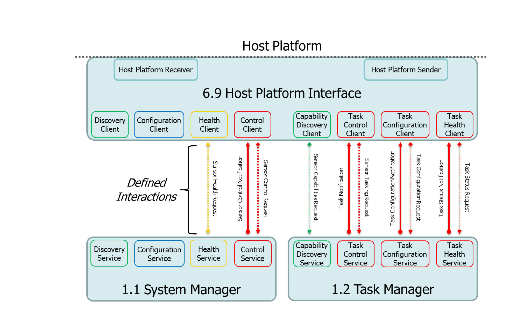

*Figure 46: Host Platform Interface Module Interactions ｜ 图 46：宿主平台接口模块交互*

Figure 46 illustrates the interfaces between the host platform interface and the management modules. The interaction groups shown are interactions bundled into functional groups for the sake of clarity. They are not an exhaustive list of all interactions necessary for command and control of the SOSA sensor, but a defined set of interactions needed to control externally the Radar, EW, and SIGINT sensor types. As an example of the functional bundling that was used to create the interaction groups, the Sensor Health Request interaction group encompasses the GetActiveFaults, GetBITResults, and GetSubsystemStatus interactions defined in Table 46.

图 46 展示宿主平台接口与管理各模块之间的各接口。所示各交互组，是为清晰起见把交互捆绑成的功能组。它们不是对 SOSA 传感器做指挥与控制所必需的全部交互的穷尽清单，而是一组为从外部控制雷达、电子战与信号情报三类传感器所需的、已定义的交互。作为用于形成各交互组的功能捆绑之例：传感器健康请求交互组涵盖表 46 中所定义的 GetActiveFaults、GetBITResults 与 GetSubsystemStatus 三项交互。

The names, descriptions, inputs, and outputs of the interactions between the host platform interface and the management modules are listed in Table 46.

宿主平台接口与管理各模块之间的各项交互，其名称、描述、输入与输出列于表 46。

**Table 46: Host Platform Interface Interactions ｜ 表 46：宿主平台接口交互**

| Host Platform Interface Interactions ／ 宿主平台接口交互 |||||||
|---|---|---|---|---|---|---|
| Interaction Name ／ 交互名 | Interaction Description ／ 交互描述 | Input DIV-2 Data Entities ／ 输入 DIV-2 数据实体 | Output DIV-2 Data Entities ／ 输出 DIV-2 数据实体 | 6.9 Host Platform Interface ／ 6.9 宿主平台接口 | 1.1 System Manager ／ 1.1 系统管理器 | 1.2 Task Manager ／ 1.2 任务管理器 |
| GetActiveFaults | Interaction to request and obtain a list of active faults in the sub-system. 请求并获取子系统内活动故障清单的交互。 | None | CommandStatus (CommandStatusType), FaultCode (FaultCodeType) | Uses ／ 使用 | Provides ／ 提供 | N/A ／ 不适用 |
| GetBITResults | Interaction that sends the results of a specified BIT. 发送某一指定 BIT 结果的交互。 | SubsystemID (SubsystemIDType) BIT_ID (BIT_IDType) | CommandStatus (CommandStatusType), BITResults (BITResultsType) | Uses ／ 使用 | Provides ／ 提供 | N/A ／ 不适用 |
| GetPlatformOrientation | Interaction sent to an Orientation Data component for retrieving the current orientation of the platform or vehicle. 发往某个姿态数据组件、用于取回平台或载具当前姿态的交互。 | None | Orientation (OrientationType), CommandStatus (CommandStatusType) | Uses ／ 使用 | Provides ／ 提供 | N/A ／ 不适用 |
| GetPlatformPosition | Interaction sent to a Position Data component for retrieving the current position of the platform. 发往某个位置数据组件、用于取回平台当前位置的交互。 | None | Position (PositionType), CommandStatus (CommandStatusType) | Uses ／ 使用 | Provides ／ 提供 | N/A ／ 不适用 |
| GetPlatformVelocity | Interaction sent to get a 3D velocity of a platform. NOTE: VICTORY specifies heading and speed, whereas OMS and STANAG 4586 specify velocities North, East, and Down. 用于获取平台三维速度的交互。 注：VICTORY 规定航向与速度，而 OMS 与 STANAG 4586 规定北、东、下三个方向的速度。 | None | DirectionOfTravel (DirectionOfTravelType), CommandStatus (CommandStatusType) | Uses ／ 使用 | Provides ／ 提供 | N/A ／ 不适用 |
| GetSARSensorCapabilities | Interaction that retrieves an installed SAR Capability, its configurable characteristics, and its controllability. 取回已安装的 SAR 能力、其可配置特性及其可控性的交互。 | None | SAR_Capability (SAR_CapabilityEnum), SAR_Subcapability (SAR_SubCapabilityEnum), CommandStatus (CommandStatusType) | Uses ／ 使用 | Provides ／ 提供 | N/A ／ 不适用 |
| GetSensorCalibrationResult | Interaction sent to a sensor to retrieve whether or not the most recent calibration of the sensor device was successful. 发往某个传感器、用以取回该传感器设备最近一次校准是否成功的交互。 | None | Result (CalibrationResultType), CommandStatus (CommandStatusType) | Uses ／ 使用 | Provides ／ 提供 | N/A ／ 不适用 |

> 转写说明：首行 `Host Platform Interface Interactions` 在原表中横跨全部 7 列，其余 6 格留空。`6.9 Host Platform Interface` 表头在原表中排为三行（`6.9 Host` / `Platform` / `Interface`），属表头折行，已用一个空格接成一行。
>
> 转写说明：原表 p.164 与续页续排，p.164 只有 GetActiveFaults 一行，续页接排 GetBITResults 至 GetSensorCalibrationResult 六行，共 7 个数据行。`Input DIV-2 Data Entities` 与 `Output DIV-2 Data Entities` 两列中，格内本是分条并列的数据实体（「实体名 + 换行 + 括号内类型」，条目之间以逗号分隔），故用 ` ` 连接；GetPlatformVelocity 行的说明格内是两段（正文 + `NOTE:` 段），用 ` ` 分段。
>
> 转写说明：`GetPlatformPosition` 行的 `Position (PositionType),` 与 `GetActiveFaults` 行的 `FaultCode (FaultCodeType)` 在原表中实体名与类型同处一行（未折行），照录为一行。
>
> 存疑：无（全部单元格清晰可读）。

<!-- 原书 p.164 ｜ PDF p.184 -->

<!-- 原书 p.165 ｜ PDF p.185 -->

<!-- 原书 p.166 ｜ PDF p.186 -->

<!-- 原书 p.167 ｜ PDF p.187 -->

<!-- 原书 p.168 ｜ PDF p.188 -->

<!-- 原书 p.169 ｜ PDF p.189 -->

<!-- 原书 p.170 ｜ PDF p.190 -->

<!-- 原书 p.171 ｜ PDF p.191 -->

#### 5.11 OSA Architecture Development/Evolution Plan OSA 架构开发／演进计划

Planned for a later version of the SOSA Technical Standard.

计划在 SOSA 技术标准的后续版本中给出。

<!-- 原书 p.172 ｜ PDF p.192 -->

## 附录 A StdV-1（适用标准）

> 分册文件：`SOSA参考架构技术标准-v1.0.2/06-appendix-a-stdv1.md`；原册题：Appendix A: StdV-1 (Applicable Standards) ｜ 附录 A：StdV-1（适用标准）

> 原书 p.173–173 ｜ PDF p.193–193

### A StdV-1 (Applicable Standards) ｜ A StdV-1（适用标准）

Planned for a later version of the SOSA Technical Standard.

计划在 SOSA 技术标准的后续版本中给出。

<!-- 原书 p.173 ｜ PDF p.193 -->

## 附录 B AV-2 集成词典

> 分册文件：`SOSA参考架构技术标准-v1.0.2/07-appendix-b-av2-dictionary.md`；原册题：Appendix B: AV-2 Integrated Dictionary ｜ 附录 B：AV-2 集成词典

> 原书 p.174–178 ｜ PDF p.194–198

The SOSA AV-2 Integrated Dictionary provides a unified set of definitions for terms that are either unique to the SOSA enterprise or may have different interpretations in different contexts. The SOSA AV-2 is not intended to be encyclopedic (not every term used in the SOSA Technical Standard is included; omitted are terms which are well understood by practitioners in the field, of for which there are widely-available definitions). The SOSA AV-2 is to be considered the single source of definitional truth for the SOSA enterprise.

SOSA AV-2 集成词典为那些 SOSA 企业所特有、或在不同语境下可能有不同解释的术语，提供一套统一的定义。SOSA AV-2 不打算做成百科式（SOSA 技术标准中所用的术语并非全部收入；凡本领域从业者已充分理解、或已有广为可得的定义者，均予略去）。SOSA AV-2 应视为 SOSA 企业在定义上的唯一真源。

**Table 47: AV-2 Integrated Dictionary (Master Glossary of SOSA Terminology) ｜ 表 47：AV-2 集成词典（SOSA 术语总表）**

| Term ／ 术语 | Definition ／ 定义 |
|---|---|
| Architecture ／ 架构 | A set of descriptive representations of the fundamental organization of a system embodied in its components, their relationships, to each other, and to the environment, and the principles guiding its design and evolution. 体现系统基本组织的一组描述性表达，该组织体现于系统的各组成部分、各部分相互之间及与环境之间的关系，以及指导其设计与演进的原则。 |
| Assignment ／ 分派 | A request from inside of the sensor system to a SOSA module to perform a mission-relevant function. 由传感器系统内部向某个 SOSA 模块发出的、要求其执行某项任务相关功能的请求。 |
| Behavior ／ 行为 | The response (output data and resulting interactions generated) provided by a sensor system or module based on a particular set of stimuli. 传感器系统或模块在特定一组激励之下所给出的响应（所生成的输出数据与由此产生的交互）。 |
| Capability ／ 能力 | A description of tasks or assignments a sensor system or module can do given its current health and configuration. 对传感器系统或模块在其当前健康与配置条件下所能完成的任务或分派的描述。 |
| Closed Interface ／ 封闭接口 | Privately controlled system/subsystem boundary descriptions that are not disclosed to the public or are unique to a single supplier. 由私有方控制的系统／子系统边界描述，不向公众公开，或为单一供应商所独有。 |
| Cohesion ／ 内聚 | How well the hardware elements and software components relate to the same abstraction and are necessary to implement that abstraction. 硬件元素与软件组件在何种程度上关联到同一抽象、并为实现该抽象所必需。 |
| Compatibility ／ 兼容性 | The ability of systems or elements to co-exist without conflict or impairment, or be integrated or used with another system of its type. 系统或元素无冲突、无损害地共存，或与其同类型的另一系统集成或一同使用的能力。 |
| Compliance ／ 符合程度 | Degree to which a system, element, or interface adheres to an architecture or standard. 系统、元素或接口依循某一架构或标准的程度。 |
| Configuration ／ 配置 | How a SOSA sensor, hardware element, software component, or SOSA module is “set up” to operate. SOSA 传感器、硬件元素、软件组件或 SOSA 模块为运行而被“设置”起来的方式。 |
| Conformance ／ 符合性 | Whether a sensor, hardware element, software component, SOSA module, or associated interface completely adheres to an architecture or standard; conformance is the limiting case of 100% compliance. 传感器、硬件元素、软件组件、SOSA 模块或相关接口是否完全依循某一架构或标准；符合性是符合程度达 100% 的极限情形。 |
| Coupling ／ 耦合 | The strength of logical interconnectedness between parts of a system, and the resulting impact that a change to one element has on other parts of a sensor. 系统各部分之间逻辑互连的强度，以及对某一元素的改动对传感器其他部分所产生的影响。 |
| Cross-sensor Cueing ／ 跨传感器引导 | Process whereby data or information from one sensor is used to direct (or bound) the target search of another sensor, regardless of whether the sensors are on the same vehicle or elsewhere. 用一个传感器的数据或信息去导引（或限定）另一传感器的目标搜索的过程，不论这两个传感器是否位于同一载具或别处。 |
| Data Model ／ 数据模型 | Depiction of the format and structure of the data elements and their logical inter-relationships, as documented in the DIV-1 (Conceptual Data Model), DIV-2 (Logical Data Model), and DIV-3 (Physical Data Model). 对数据元素的格式与结构及其逻辑相互关系的描述，如 DIV-1（概念数据模型）、DIV-2（逻辑数据模型）与 DIV-3（物理数据模型）所记载。 |
| Data Products ／ 数据产品 | Raw/unprocessed or minimally processed digital output, generally from a sensor, ideally structured to enable reuse (see Information Products). 未经处理或仅经最低限度处理的数字输出，一般来自传感器，理想情况下其结构应便于复用（见信息产品）。 |
| Data Rights ／ 数据权利 | An entity’s license rights to IP in the form of technical data and computer software. 某一实体对以技术数据与计算机软件形式存在的知识产权所享有的许可权利。 |
| Detection ／ 检测 | An observation that is determined to be differentiated from the ambient background (e.g., above a threshold for certain types of RF systems). 判定为与环境背景相区分的一次观测（例如对某些类型的射频系统而言，高于某一阈值）。 |
| Element ／ 元素 | A basic hardware, software, or logical unit, component, or constituent of a system or subsystem. 系统或子系统的基本硬件、软件或逻辑单元、组成部分或构成成分。 |
| Hardware Element ／ 硬件元素 | An all-encompassing term for hardware that is incorporated into a SOSA sensor. 对纳入 SOSA 传感器的硬件的一个统括性称谓。 |
| Health ／ 健康 | The collection of status, faults, and warnings describing the condition of a sensor system or module. 描述传感器系统或模块情形的状况、故障与告警的集合。 |
| Heartbeat ／ 心跳 | A periodic signal sent between hardware and/or software modules to indicate normal (or abnormal) operation. 在硬件和／或软件模块之间周期性发送、用以表明运行正常（或不正常）的信号。 |
| Information Products ／ 信息产品 | Processed or reduced digital output, generally from a Processing Exploitation and Dissemination (PED) or mission system, ideally structured to enable reuse (see Data Products). 经处理或已归约的数字输出，一般来自处理、利用与分发（PED）系统或任务系统，理想情况下其结构应便于复用（见数据产品）。 |
| Interaction ／ 交互 | The stimuli and behavioral responses between modules. 模块之间的激励与行为响应。 |
| Interface ／ 接口 | The region where two systems or elements interact. 两个系统或元素发生交互的界面区域。 |
| Interoperability ／ 互操作性 | The ability of systems, elements, or interfaces to provide data/information to – and accept the same from – other systems, and to use the data/information so exchanged to enable them to operate effectively together. 系统、元素或接口向其他系统提供数据／信息、并接受其他系统所提供的同类内容，且利用如此交换的数据／信息使彼此能够有效协同运行的能力。 |
| Logging ／ 日志记录 | The act of capturing data about the sensor, such as health, status, mode, and states in persistent storage for later retrieval and use. 把关于传感器的数据（如健康、状况、模式与状态）捕获到持久存储中、供日后取回与使用的行为。 |
| Metadata ／ 元数据 | Data about the data; ancillary information used to provide contextual information (e.g., position, orientation, timing, area of regard, and other state information). 关于数据的数据；用以提供语境信息的辅助信息（例如位置、姿态、授时、关注区域及其他状态信息）。 |
| Mode ／ 模式 | A description of the discrete condition of a sensor system, hardware element, software component, or SOSA module in which the expected behavior is known. Modes are well-defined and finite. 对传感器系统、硬件元素、软件组件或 SOSA 模块之离散状况的描述，在该状况下预期行为是已知的。模式是已良好定义且有限的。 |
| Model ／ 模型 | A representation of a system, element, or interface (and possibly its environment) often presented as a combination of drawings and text, or by using a modeling language. 系统、元素或接口（可能还有其环境）的一种表示，常以图与文字的组合呈现，或以建模语言表达。 |
| Modular Open Systems Approach (MOSA) ／ 模块化开放系统方法（MOSA） | The DoD’s approach to OSA. Based on five core elements including: establishing an enabling environment, employing a modular design, designation of key interfaces, use of open standards, and conformance testing. The preferred OSD acquisition term is Open Systems Architecture (OSA). DoD 对 OSA 所取的做法。基于五个核心要素：建立使能环境、采用模块化设计、指定关键接口、使用开放标准，以及符合性测试。OSD 采办语境中首选的用语是开放系统架构（OSA）。 |
| Modularity ／ 模块化 | The degree to which a system or element is composed of individually distinct physical and functional elements that are loosely coupled with well-defined interface boundaries. 系统或元素由各自独立的物理单元与功能单元构成、这些单元以定义良好的接口边界松散耦合的程度。 |
| Module ／ 模块 | An element of a system that has individually distinct boundaries that are well-defined interfaces and functional behaviors. A SOSA module is an architectural entity that has open, specified functional behaviors and interfaces, may be instantiated using hardware elements and/or software components, and conforms to the complete definition (functionality, behavior, and interfaces) as defined in the SOSA Technical Standard. 系统中的一个元素，具有各自独立、边界分明且已良好定义的接口与功能行为。SOSA 模块是一个架构实体，具有开放的、已规定的功能行为与接口，可用硬件元素和／或软件组件实例化，并符合 SOSA 技术标准所定义的完整定义（功能、行为与接口）。 |
| Navigation (Nav) Data ／ 导航（Nav）数据 | A general term for data related to position and velocity, possibly including acceleration and orientation. 与位置和速度相关的数据的一般称谓，可能包括加速度与姿态。 |
| Notification ／ 通知 | An interaction in which a sensor system or module reports the occurrence of an event when it occurs. 传感器系统或模块在事件发生时报告该事件已发生的一种交互。 |
| Open Architecture ／ 开放架构 | An open architecture is one in which stakeholders (or members of a community or open organization) have a say in the makeup and content of the architecture, and there exists a governance process to ensure that it is maintained, kept relevant, and meets the needs of the stakeholders. 开放架构是这样一种架构：利益相关方（或某一共同体、开放组织的成员）对架构的构成与内容有发言权，并且存在一套治理过程，以确保其得到维护、保持适用、并满足利益相关方的需要。 |
| Open Business Model ／ 开放业务模式 | Business approach which requires doing business transparently to leverage the collaborative innovation of numerous participants across the enterprise permitting shared risk, maximizing asset reuse, and reducing total ownership costs. 一种业务做法：需求以透明方式开展业务，以借助整个企业内众多参与者的协同创新，从而共担风险、最大化资产复用并降低总拥有成本。 |
| Open Interface ／ 开放接口 | An interface which conforms to an open standard (or architecture). 符合某一开放标准（或开放架构）的接口。 |
| Open Source ／ 开源 | Pertaining to or denoting software whose source code is available free-of-charge to the public to use, copy, modify, sublicense, or distribute. 指或表示这样一种软件：其源代码可免费提供给公众使用、复制、修改、再许可或分发。 |
| Open Standard ／ 开放标准 | A published standard in which stakeholders (or members of a community or open organization) have a voice in the makeup and content of the standard, and there exists a governance process to ensure that it is kept relevant and meets the needs of the stakeholders. 一种已发布的标准：其中利益相关方（或某一共同体、开放组织的成员）对标准的构成与内容有发言权，并且存在一套治理过程，以确保其保持适用并满足利益相关方的需要。 |
| Open Systems Architecture ／ 开放系统架构 | An architecture in which all components (modules) and their relationships (interfaces) are defined and documented in a way that is (1) accessible to all within the stakeholder community, (2) developed and governed by a consensus-driven body or bodies consisting of all interested parties, and (3) subject to conformance (or compliance) verification. 一种架构：其中全部组件（模块）及其关系（接口）以下述方式加以定义与记载：(1) 对利益相关方共同体内部的所有人皆可获取；(2) 由全体相关方组成、以共识驱动的一个或多个机构加以开发与治理；(3) 须接受符合性（或符合程度）验证。 |
| Platform ／ 平台 | Refers to one of three things, which are context-dependent: a device (comprised of sensors and supporting environment), vehicle (host), or computing infrastructure (comprising hardware and software). When the term is used, it must be preceded by something that indicates the context. 指三种事物之一，随语境而定：装置（由传感器与配套环境构成）、载具（宿主）或计算基础设施（由硬件与软件构成）。使用该词时，其前必须有指明语境的限定字样。 |
| Plug-and-Play ／ 即插即用 | The property of a system, hardware, or software element to recognize that a component has been introduced and subsequently use it without the need for manual device configuration or operator intervention (e.g., USB devices). 系统、硬件或软件元素所具有的一种属性：能识别出某组件已被接入，随后即可加以使用，无需手工进行设备配置或操作员介入（例如 USB 设备）。 |
| Plug-In Card ／ 插卡 | Any hardware element that is a circuit card that plugs into a backplane. A SOSA plug-in card is a circuit card assembly that also conforms to a SOSA slot profile. 任何插入背板的电路板卡形式的硬件元素。SOSA 插卡是一种同时符合某一 SOSA slot profile（槽位配置档）的电路卡组件。 |
| Portable ／ 可移植 | An attribute that describes the reuse of existing hardware or software elements (as opposed to the creation of new) when moving hardware or software elements from one environment (physical or computing) to another. 一种属性：描述在把硬件或软件元素从一个环境（物理环境或计算环境）移至另一个环境时，复用既有硬件或软件元素（而非新建）。 |
| Published Architecture (or Standard) ／ 已发布架构（或标准） | One for which the interfaces (data model and interchange protocols) are widely known, used, or available to the target audience. 其接口（数据模型与交换协议）对目标受众而言广为人知、广为使用或可获取的那一种架构（或标准）。 |
| Publish-Subscribe ／ 发布-订阅 | A kind of interaction in which one or more producers (publishers) make data available for sharing with zero or more consumers (subscribers). 一种交互：其中一个或多个生产者（发布方）使数据可供与零个或多个消费者（订阅方）共享。 |
| Real-time ／ 实时 | Pertaining to or consistent with meeting the data, information, and event needs of time-critical or deterministic processes (as embodied in specified time constraints/deadlines). 与满足时间关键或确定性过程对数据、信息与事件的需要相关，或与之相符（这些需要体现为所规定的时间约束／期限）。 |
| Reconfigure ／ 重配置 | Process by which a hardware, software, or system element is reversibly modified in response to a mission or operational need. 为回应某项任务需要或运行需要而对硬件、软件或系统元素作可逆改动所依的过程。 |
| Request-Response ／ 请求-响应 | A kind of interaction in which a client sends a request to a service, which acts upon the request, and replies with a response. 一种交互：其中一个客户向某项服务发送请求，该服务对请求作出处理，并回以一个响应。 |
| Resilience ／ 韧性 | The ability of a system to continue or return to normal operations in the event of some disruption, natural or man-made, inadvertent or deliberate, and to be effective with graceful and detectable degradation of function. 系统在发生某种中断（自然的或人为的、无意的或故意的）时能够继续或恢复正常运行，并以平顺且可检测的功能降级保持有效的能力。 |
| Reuse ／ 复用 | A benefit of standards-based module hardware or software components to be used again, for example, in a different system or environment from which it was designed, or to add new functionalities to a system with slight or no engineering development. 基于标准的模块化硬件或软件组件得以再次使用所带来的一项益处，例如用于与其设计时不同的系统或环境，或以极少乃至无需工程开发的方式为系统增添新功能。 |
| Safety-critical ／ 安全关键 | A condition, event, operation, process, or item whose mishap or degradation may result in loss of system, vehicle, mission, or human life. 一种情形、事件、运行、过程或物项，其事故或劣化可能导致系统、载具、任务或人员生命的损失。 |
| Scalable ／ 可扩展 | Ability of an architecture to be used (1) from large to small platforms or (2) with few to many hardware and software elements, platforms, etc. 架构得以 (1) 用于从大型到小型的平台，或 (2) 与从少到多的硬件与软件元素、平台等一同使用的能力。 |
| Secure ／ 安全防护 | The property of a system such that its design renders it largely protected/inviolable against acts designed to (or which may) impair its effectiveness and operation, and prevents unauthorized persons or systems from having access to data/information contained within. 系统的一种属性：其设计使系统在面对蓄意（或可能）损害其效能与运行的行为时大体不被攻破，并阻止未授权的人员或系统取得其中所含的数据／信息。 |
| Security Risk ／ 信息安全风险 | A measure of the extent to which an entity is threatened by a potential circumstance or event, and typically a function of: (1) the adverse impacts that would arise if the circumstance or event occurs; and (2) the likelihood of occurrence. 对某一实体受潜在情形或事件威胁程度的度量，通常为下列两项的函数：(1) 该情形或事件若发生将会带来的不利影响；(2) 发生的可能性。 |
| Sensor ／ 传感器 | A device or system that actively and/or passively estimates properties of another entity and produces quantitative data that will be subsequently processed or used (e.g., Radar, sonar, IR focal plane, seismometer, etc.) and consist of one or more sensor element(s) mounted within or on the same host platform. 一种装置或系统：主动和／或被动地估计另一实体的属性，并产生随后将被处理或使用的量化数据（例如雷达、声呐、红外焦平面、地震检波器等），且由一个或多个安装在同一宿主平台之内或之上的传感器元素构成。 |
| Software Applications ／ 软件应用 | A software executable designed to allow a user to complete tasks. 为使使用者能够完成任务而设计的一种软件可执行件。 |
| Software Component ／ 软件组件 | A unit of software that is incorporated into a SOSA sensor. 纳入 SOSA 传感器之中的一个软件单元。 |
| Standardized Interfaces ／ 标准化接口 | Interfaces for which the physical structure, electronic signaling, and/or logical (format, protocol) product are codified in the SOSA Consortium products. 其物理结构、电子信令和／或逻辑（格式、协议）产物已在 SOSA 联盟产品中成文规定的接口。 |
| State ／ 状态 | One of a set of top-level conditions from the operational lifecycle of a sensor system or part of a system. 传感器系统或系统某一部分在其运行生命周期中一组顶层状况中的一种。 |
| Status ／ 状况 | A description of the condition related to the performance or health of a sensor system or part of a system. 对与传感器系统或系统某一部分的性能或健康相关的情形的描述。 |
| Subsystem ／ 子系统 | See System. 见系统。 |
| System ／ 系统 | A group or collection of elements that together compose a useful capability. Systems can also relate to other systems in a system-of-systems context or be hierarchically arranged in system-subsystem combinations. A system in one context can be a subsystem in another. 一组或一批元素，共同构成一项有用的能力。系统也可在系统之系统（system-of-systems）语境中与其他系统相关联，或以系统-子系统组合的形式按层级排布。某一语境下的系统，在另一语境下可以是子系统。 |
| System Management ／ 系统管理 | Collection of functions and interfaces that ensures that the sensor operates as intended (e.g., configuration, control, signaling, health, and tasking functions). 确保传感器按预期运行的一组功能与接口（例如配置、控制、信令、健康与任务指派功能）。 |
| Target ／ 目标 | An entity of interest, possibly the result of a detection. 所关注的一个实体，可能是某次检测的结果。 |
| Task ／ 任务 | A request from outside of the sensor system to perform a mission-relevant function. 由传感器系统外部发出的、要求执行某项任务相关功能的请求。 |
| Verification ／ 验证 | The act of measuring/assessing conformance (or compliance, depending on the situation). 测量／评定符合性（或符合程度，视情形而定）的行为。 |

<!-- 存疑：引言段 "…practitioners in the field, of for which there are widely-available definitions)" 中的 "of for which" 系源文件原样（疑为 "of which"/"for which" 排印重复），按逐字照录保留，未作改动。 -->

> 本表 66 条，逐字照录；p.194 引言段中 `of for which` 系原书原样（疑为排印重复），未改。

<!-- 本册覆盖原书 p.174–178 ｜ PDF p.194–198 -->

## 附录 C 用例详细规定

> 分册文件：`SOSA参考架构技术标准-v1.0.2/08-appendix-c-use-case-details.md`；原册题：Appendix C: Use-Case Details ｜ 附录 C：用例详细规定

> 原书 p.179–179 ｜ PDF p.199–199

### C Use-Case Details ｜ C 用例详细规定

#### C.1 OV-1 (High Level Operational Concept) ｜ C.1 OV-1（高层运行概念）

SOSA Hardware Use-Cases

SOSA 硬件用例

The SOSA Hardware concepts are predicated on a set of architectural decisions that drive the overall development of the entire effort. The high-level use below is illustrative and provides an overview of all the relevant building blocks that encompass the Hardware portion of the SOSA standard. Each element in the use-case, both bubbles and lines, titles those specific building blocks and their connections. It is very important to note that each piece is a family that includes a number of types that differ in some respects and are similar in others. One of the underlying tenets not reflected in the diagram is the maximization of hardware module interoperability. With that in mind it is worth considering the connections below and that multiple hardware modules are capable of those connections Figure 47.

SOSA 硬件概念以一组架构决策为前提，这些决策驱动整个工作的总体开发。下列高层用例是示例性的，它给出涵盖 SOSA 标准硬件部分的全部相关构建块的概貌。用例中的每一个元素——无论是气泡还是连线——都标注了具体的构建块及其连接。务必注意：每一块都是一个“族”，其中包含若干类型，这些类型在某些方面彼此不同、在另一些方面又彼此相似。图中未体现的一条基本立论是硬件模块互操作性的最大化。考虑到这一点，值得细看上文的各项连接，以及多个硬件模块能够实现这些连接，见图 47。

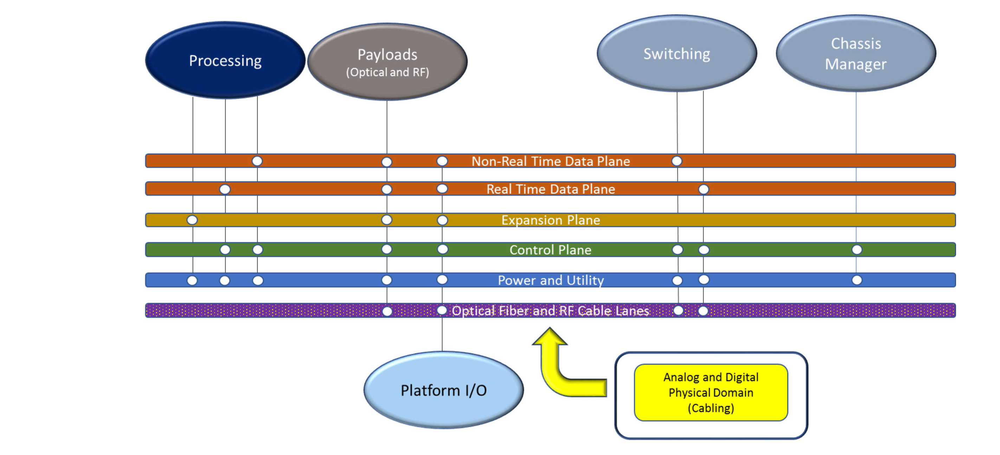

*Figure 47: High-Level SOSA Use-Case ｜ 图 47：SOSA 高层用例*

#### C.2 OV-2 (Operational Resource Flow) ｜ C.2 OV-2（运行资源流）

Planned for a later version of the SOSA Technical Standard.

计划在 SOSA 技术标准的后续版本中给出。

#### C.3 OV-5b (Operational Activity Model) ｜ C.3 OV-5b（运行活动模型）

Planned for a later version of the SOSA Technical Standard.

计划在 SOSA 技术标准的后续版本中给出。

<!-- 原书 p.179 ｜ PDF p.199 -->

## 附录 D DIV-2 与数据字典

> 分册文件：`SOSA参考架构技术标准-v1.0.2/09-appendix-d-div2-and-data-dictionary.md`；原册题：Appendix D: DIV-2 and Data Dictionary ｜ 附录 D：DIV-2 与数据字典

> 原书 p.180–181 ｜ PDF p.200–201

### D DIV-2 and Data Dictionary ｜ D DIV-2 与数据字典

#### D.1 SOSA Sensor RF Control (Distribution A) ｜ D.1 SOSA 传感器射频控制（分发 A）

See the sheet named “DIV-2” in the following Microsoft® Excel® document: SOSA_Sensor_RF_Control_DIV2_DIV3_20180806_Distro_A.xlsx located here (available to members only): https://www.opengroup.us/sosa/documents.php?action=show&dcat=&gdid=19642

见下列 Microsoft® Excel® 文档中名为“DIV-2”的工作表：SOSA_Sensor_RF_Control_DIV2_DIV3_20180806_Distro_A.xlsx，该文件在此处（仅向成员提供）：https://www.opengroup.us/sosa/documents.php?action=show&dcat=&gdid=19642

#### D.2 MORA Signal Layer ｜ D.2 MORA 信号层

See the sheets named “DIV-2 VICTORY Mgmt Dist-C”, “DIV-2 MORA Mgmt Dist-A”, and “DIV-2 MORA MDMs Dist-A” in the following Microsoft Excel document: SOSA_Signal_Layer_DIV-2_DIV-3_20180628_Distro_C.xlsx located here (available to members only): https://www.opengroup.us/SOSA/distro/d/protected/documents.php?action=show&dcat=&gdid=

见下列 Microsoft Excel 文档中名为“DIV-2 VICTORY Mgmt Dist-C”“DIV-2 MORA Mgmt Dist-A”与“DIV-2 MORA MDMs Dist-A”的工作表：SOSA_Signal_Layer_DIV-2_DIV-3_20180628_Distro_C.xlsx，该文件在此处（仅向成员提供）：https://www.opengroup.us/SOSA/distro/d/protected/documents.php?action=show&dcat=&gdid=

#### D.3 AMTI SAA Multi-Sensor Fusion Tracker ｜ D.3 AMTI SAA 多传感器融合跟踪器

See the sheets named “Tracker DIV-2” and “Object Definitions” in the following Microsoft Excel document: SOSA_DIV2_Tracker_Module_20180622_ITAR.xlsx located here (available to members only): https://www.opengroup.us/sosa/documents.php?action=show&dcat=&gdid=19643 Note: This file is currently marked “Possibly ITAR”, which requires resolution.

见下列 Microsoft Excel 文档中名为“Tracker DIV-2”与“Object Definitions”的工作表：SOSA_DIV2_Tracker_Module_20180622_ITAR.xlsx，该文件在此处（仅向成员提供）：https://www.opengroup.us/sosa/documents.php?action=show&dcat=&gdid=19643　注：该文件当前标注为“Possibly ITAR”（可能受《国际武器贸易条例》管制），此项待解决。

#### D.4 Common System Management Data Elements ｜ D.4 通用系统管理数据元素

See the sheets named “DIV-2 Common Sys Mgmt Dist-A” and “DIV-2 VICTORY Mgmt Dist-C” in the following Microsoft Excel document: SOSA_SystemManagement_DIV-2_20180622_Dist-C.xlsx

见下列 Microsoft Excel 文档中名为“DIV-2 Common Sys Mgmt Dist-A”与“DIV-2 VICTORY Mgmt Dist-C”的工作表：SOSA_SystemManagement_DIV-2_20180622_Dist-C.xlsx

<!-- 原书 p.180 ｜ PDF p.200 -->

located here (available to members only):

该文件在此处（仅向成员提供）：

https://www.opengroup.us/SOSA/distro/d/protected/documents.php?action=show&dcat=&gdid=

- Note: Although this section is titled “Common System Management Data Elements”, these data elements have only been formally accepted in relation to the interactions of modules 2.1, 2.2, and 2.3. No decision has been made as of this document to accept these data entities as the common solution for system management interactions for all modules or hardware elements.

- 注：尽管本节题名为“Common System Management Data Elements”（通用系统管理数据元素），这些数据元素仅就模块 2.1、2.2 与 2.3 的交互而言已被正式接受。截至本文件，尚未决定把这些数据实体接受为适用于全部模块或硬件元素的系统管理交互的通用解决方案。

- Note: This is marked distribution C because it contains references to common system management parameters from VICTORY. Much of the file is actually distribution A, and it may be possible that it can be generalized and made distribution A.

- 注：本件标注为分发 C，是因为其中引用了来自 VICTORY 的通用系统管理参数。该文件大部分内容实际属分发 A，有可能可以泛化并改为分发 A。

<!-- 原书 p.181 ｜ PDF p.201 -->

## 附录 E DIV-3（物理数据模型）

> 分册文件：`SOSA参考架构技术标准-v1.0.2/10-appendix-e-div3.md`；原册题：Appendix E: DIV-3 (Physical Data Model) ｜ 附录 E：DIV-3（物理数据模型）

> 原书 p.182–182 ｜ PDF p.202–202

### E DIV-3 (Physical Data Model) ｜ E DIV-3（物理数据模型）

#### E.1 SOSA Sensor RF Control (Distribution A) ｜ E.1 SOSA 传感器射频控制（分发 A）

The DIV-3 for RF control has not yet been approved by the SOSA Consortium and is included only for information purposes. See the sheet named “DIV-3” in the following Microsoft Excel document: SOSA_Sensor_RF_Control_DIV2_DIV3_20180806_Distro_A.xlsx located here (available to members only): https://www.opengroup.us/sosa/documents.php?action=show&dcat=&gdid=19642

射频控制的 DIV-3 尚未经 SOSA 联盟批准，此处仅供参考。见下列 Microsoft Excel 文档中名为“DIV-3”的工作表：SOSA_Sensor_RF_Control_DIV2_DIV3_20180806_Distro_A.xlsx，该文件在此处（仅向成员提供）：https://www.opengroup.us/sosa/documents.php?action=show&dcat=&gdid=19642

#### E.2 RF Signal Layer ｜ E.2 射频信号层

See the sheets named “DIV-3 VICTORY Mgmt Dist-C”, “DIV-3 MORA Mgmt Dist-A”, and “DIV-3 MORA MDMs Dist-A” in the following Microsoft Excel document: SOSA_Signal_Layer_DIV-2_DIV-3_20180628_Distro_C.xlsx located here (available to members only): https://www.opengroup.us/SOSA/distro/d/protected/documents.php?action=show&dcat=&gdid=

见下列 Microsoft Excel 文档中名为“DIV-3 VICTORY Mgmt Dist-C”“DIV-3 MORA Mgmt Dist-A”与“DIV-3 MORA MDMs Dist-A”的工作表：SOSA_Signal_Layer_DIV-2_DIV-3_20180628_Distro_C.xlsx，该文件在此处（仅向成员提供）：https://www.opengroup.us/SOSA/distro/d/protected/documents.php?action=show&dcat=&gdid=

<!-- 原书 p.182 ｜ PDF p.202 -->

## 附录 F 宿主载具／传感器连接器详细规定

> 分册文件：`SOSA参考架构技术标准-v1.0.2/11-appendix-f-connector-details.md`；原册题：Appendix F: Host Vehicle/Sensor Connector Details ｜ 附录 F：宿主载具／传感器连接器详细规定

> 原书 p.183–183 ｜ PDF p.203–203

### F Host Vehicle/Sensor Connector Details ｜ F 宿主载具／传感器连接器详细规定

Planned for a later version of the SOSA Technical Standard.

计划在 SOSA 技术标准的后续版本中给出。

<!-- 原书 p.183 ｜ PDF p.203 -->

## 附录 G 槽位配置档

> 分册文件：`SOSA参考架构技术标准-v1.0.2/12-appendix-g-slot-profiles.md`；原册题：Appendix G: Slot Profiles ｜ 附录 G：槽位配置档

> 原书 p.184–184 ｜ PDF p.204–204

### G Slot Profiles ｜ G 槽位配置档

Planned for a later version of the SOSA Technical Standard.

计划在 SOSA 技术标准的后续版本中给出。

<!-- 原书 p.184 ｜ PDF p.204 -->

## 附录 H 各模块逐一详细规定

> 分册文件：`SOSA参考架构技术标准-v1.0.2/13-appendix-h-module-details.md`；原册题：Appendix H: Module-by-Module Details ｜ 附录 H：各模块逐一详细规定

> 原书 p.185–185 ｜ PDF p.205–205

### H Module-by-Module Details ｜ H 各模块逐一详细规定

Planned for a later version of the SOSA Technical Standard.

计划在 SOSA 技术标准的后续版本中给出。

<!-- 原书 p.185 ｜ PDF p.205 -->

## 附录 I SOSA 背板示例

> 分册文件：`SOSA参考架构技术标准-v1.0.2/14-appendix-i-backplane-examples.md`；原册题：Appendix I: SOSA Backplane Examples ｜ 附录 I：SOSA 背板示例

> 原书 p.186–190 ｜ PDF p.206–210

### I SOSA Backplane Examples ｜ I SOSA 背板示例

The following examples illustrate how the SOSA hardware modules can be combined to create a 3U medium-sized, 3U large-sized, and 3U/6U hybrid backplane. Each example references a SOSA hardware module for each slot position on the backplane and then defines how each pipe in each slot is interconnected. The associated topologies should be the same in each SOSA backplane although the number and type of slots may vary based on platform constraints and mission requirements.

以下示例说明如何将 SOSA 硬件模块组合起来，构成 3U 中型、3U 大型与 3U/6U 混合背板。每个示例为背板上的每一槽位指定一个 SOSA 硬件模块，然后定义各槽位内每条管线（pipe）如何互连。尽管槽位的数量与类型可随平台约束与任务需求而变化，但各相关拓扑在每一块 SOSA 背板中宜保持相同。

#### I.1 3U Medium-Sized Backplane Example ｜ I.1 3U 中型背板示例

The 3U medium-sized backplane example includes 6 SLT3-PAY-1F1U1S1S1U1U2F1H-14.6.11-n payloads in Slots 1, 3, 4, 7, 8, and 9 that can be populated with RF transceivers and/or computing payloads (e.g., SBC, FPGA, GPGPU, etc.). ANSI/VITA 67.3 connectors with blindmate coaxial pins facilitate two-level maintenance and can be upgraded in the future to include blind-mate optical connectors to support high throughput applications such as Digital RF.

3U 中型背板示例在槽位 1、3、4、7、8 与 9 中包含 6 个 SLT3-PAY-1F1U1S1S1U1U2F1H-14.6.11-n 载荷，这些槽位可装载射频收发信机和／或计算载荷（例如 SBC、FPGA、GPGPU 等）。带盲插同轴引脚的 ANSI/VITA 67.3 连接器便于实现二级维修，且日后可升级为包含盲插光纤连接器，以支撑数字射频（Digital RF）一类高吞吐量应用。

The switched topology for the Ethernet control and data planes is provided on the same card in order to minimize the number of switch cards required and associated infrastructure overhead. Slot 2 uses a SLT3-SWH-4F1U7U1J-14.8.7-n switch which supports a blind-mate optical connector for Ethernet connections in/out of the chassis. Slot 2 is daisy chained with Slot 5 which uses a SLT3-SWH-6F1U7U-14.4.14 switch to support additional payloads. The PCIe Expansion Plane is connected between adjacent payloads in order to offload processing and support close coupling between cards comprising a single logical capability.

以太网控制平面与数据平面的交换拓扑设在同一块卡上，以尽量减少所需交换卡的数量及相关基础设施开销。槽位 2 使用 SLT3-SWH-4F1U7U1J-14.8.7-n 交换机，它支持一个盲插光纤连接器，用于进出机箱的以太网连接。槽位 2 与槽位 5 以菊花链相连，槽位 5 使用 SLT3-SWH-6F1U7U-14.4.14 交换机以支持更多载荷。PCIe 扩展平面连接在相邻载荷之间，以卸载处理负载，并支撑构成单一逻辑能力的各卡之间的紧耦合。

Slot 6 uses a SLT3x-TIM-2S1U22S1U2U1H-14.9.2-n radial clock module to provide timing to all of the payloads to enable phase-coherent operations. Radial distribution is achieved through the backplane using equal length traces to all terminating slots within the chassis. The radial clock module also includes an ANSI/VITA 67.3 connector with blind-mate coaxial pins to facilitate two-level maintenance.

槽位 6 使用 SLT3x-TIM-2S1U22S1U2U1H-14.9.2-n 径向时钟模块，为所有载荷提供定时，以实现相位相干工作。径向分发经由背板实现，采用等长走线连至机箱内所有终端槽位。该径向时钟模块还包含一个带盲插同轴引脚的 ANSI/VITA 67.3 连接器，以便于二级维修。

<!-- 原书 p.186 ｜ PDF p.206 -->

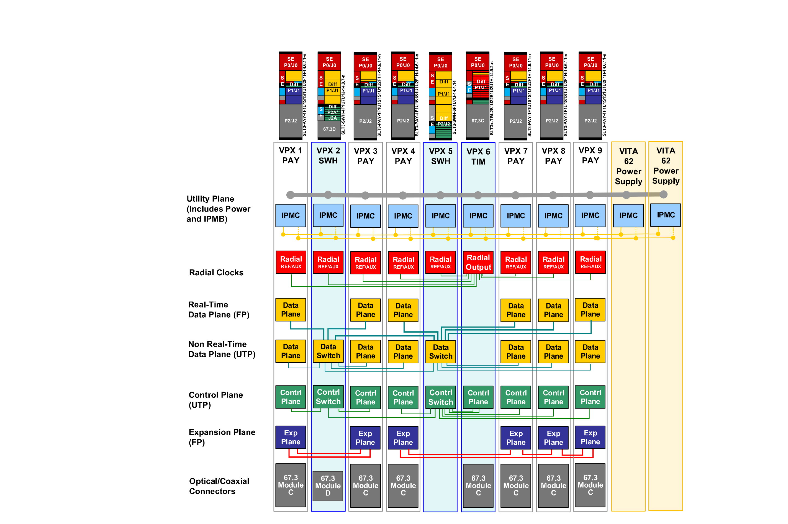

*Figure 48: 3U Medium-Sized Backplane Example ｜ 图 48：3U 中型背板示例*

#### I.2 3U Large-Sized Backplane Example ｜ I.2 3U 大型背板示例

The 3U large-sized backplane example includes 8 SLT3-PAY-1F1U1S1S1U1U2F1H-14.6.11-n payloads in Slots 4, 5, 6, 7, 11, 12, 13, and 14 that can be populated with RF transceivers and/or computing payloads (e.g., SBC, FPGA, GPGPU, etc.). ANSI/VITA 67.3 connectors with blindmate coaxial pins facilitate two-level maintenance and can be upgraded in the future to include blind-mate optical connectors to support high throughput applications such as Digital RF.

3U 大型背板示例在槽位 4、5、6、7、11、12、13 与 14 中包含 8 个 SLT3-PAY-1F1U1S1S1U1U2F1H-14.6.11-n 载荷，这些槽位可装载射频收发信机和／或计算载荷（例如 SBC、FPGA、GPGPU 等）。带盲插同轴引脚的 ANSI/VITA 67.3 连接器便于实现二级维修，且日后可升级为包含盲插光纤连接器，以支撑数字射频（Digital RF）一类高吞吐量应用。

Slot 9 uses a SLT3x-TIM-2S1U22S1U2U1H-14.9.2-n radial clock to provide timing to all of the payloads to enable phase-coherent operations. Radial distribution is achieved through the backplane using equal length traces to all terminating slots within the chassis. The radial clock slot also includes an ANSI/VITA 67.3 connector with blind-mate coaxial pins to facilitate twolevel maintenance.

槽位 9 使用 SLT3x-TIM-2S1U22S1U2U1H-14.9.2-n 径向时钟，为所有载荷提供定时，以实现相位相干工作。径向分发经由背板实现，采用等长走线连至机箱内所有终端槽位。该径向时钟槽位还包含一个带盲插同轴引脚的 ANSI/VITA 67.3 连接器，以便于二级维修。

Separate cards are used for the Ethernet control and data planes in order to maximize the number of payloads that can be supported by a single card, thus minimizing the number of inter-switch connections and associated bottlenecks. Slots 3 and 10 use a SLT3-SWH-6F1U7U-14.4.14 switch to establish the data plane switched fabric where the control plane lanes are repurposed to provide the second data plane connection to each payload slot. Slots 8 and 15 use a SLT3-SWH-6F8U-14.4.15 switch to establish the control plane switched fabric as well as provide Expansion Plane connectivity amongst all of the payloads.

以太网控制平面与数据平面使用各自独立的卡，以使单块卡所能支持的载荷数量最大化，从而尽量减少交换机之间的连接数量及相关瓶颈。槽位 3 与 10 使用 SLT3-SWH-6F1U7U-14.4.14 交换机建立数据平面的交换结构，其中控制平面的通道被改用作向每个载荷槽位提供第二条数据平面连接。槽位 8 与 15 使用 SLT3-SWH-6F8U-14.4.15 交换机建立控制平面的交换结构，并提供所有载荷之间的扩展平面连通性。

Slots 2 and 16 use SLT3-PAY-1F1F2U1TU1T1U1T-14.2.16 for SBCs with I/O and an XMC site that are routed out of the chassis. The I/O pins can be used to connect peripherals such as a

槽位 2 与 16 使用 SLT3-PAY-1F1F2U1TU1T1U1T-14.2.16，用于带 I/O 与 XMC 站位、且引出至机箱之外的 SBC。I/O 引脚可用于连接外设，例如

<!-- 原书 p.187 ｜ PDF p.207 -->

display, keyboard, and mouse. The XMC site can be used to customize the I/O for a particular system or platform. This approach allows the same SBC carrier card to be shared across platforms with host-specific tailoring accomplished with a custom XMC.

显示器、键盘与鼠标。XMC 站位可用于为特定系统或平台定制 I/O。这种做法使同一块 SBC 载卡能够跨平台共用，而宿主专用的剪裁则通过定制的 XMC 完成。

Slot 1 uses a SLT3-SWH-1F1S1S1U1U1K-14.8.8-n switch to route RF signals within and outside of the chassis. This approach enables payloads to share RF resources such as amplifier and antennas, and may be used in the future to distribute Local Oscillators (LOs) to enable LOcoherent operation across payloads. The RF switch slot also includes an ANSI/VITA 67.3 connector with blind-mate coaxial pins to facilitate two-level maintenance.

槽位 1 使用 SLT3-SWH-1F1S1S1U1U1K-14.8.8-n 交换机，为机箱之内与之外的射频信号选路。这种做法使载荷能够共用放大器、天线一类射频资源，且日后可用于分发本振（Local Oscillators，LOs），以实现跨载荷的本振相干工作。该射频交换槽位还包含一个带盲插同轴引脚的 ANSI/VITA 67.3 连接器，以便于二级维修。

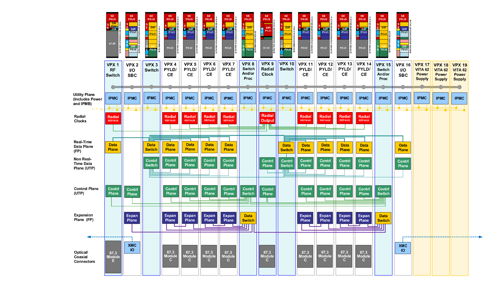

*Figure 49: 3U Large-Sized Backplane Example ｜ 图 49：3U 大型背板示例*

#### I.3 3U/6U Hybrid Backplane Example ｜ I.3 3U/6U 混合背板示例

The 3U/6U hybrid backplane example illustrates how 3U payloads can be shared across platforms and augmented with 6U payloads when additional RF or processing capability is required. A hybrid approach can also be applied when retrofitting/updating an existing 6U chassis in order to take advantage of the growing 3U ecosystem.

3U/6U 混合背板示例说明：3U 载荷如何能够跨平台共用，并在需要额外射频或处理能力时以 6U 载荷加以扩充。在对既有 6U 机箱进行改装／更新时，也可采用混合做法，以利用不断壮大的 3U 生态。

The 3U/6U hybrid backplane example includes 4 SLT3-PAY-1F1U1S1S1U1U2F1H-14.6.11-n payloads in Slots 8, 9, 10, and 11 and a SLT3-PAY-1F1U1S1S1U1U4F1J-14.6.13-n extended payload in Slot 12 that can be populated with RF transceivers and computing payloads (e.g., SBC, FPGA, GPGPU, etc.). ANSI/VITA 67.3 connectors with blind-mate coaxial pins facilitate two-level maintenance and can be upgraded in the future to include blind-mate optical connectors to support high throughput applications such as Digital RF.

3U/6U 混合背板示例在槽位 8、9、10 与 11 中包含 4 个 SLT3-PAY-1F1U1S1S1U1U2F1H-14.6.11-n 载荷，并在槽位 12 中包含一个 SLT3-PAY-1F1U1S1S1U1U4F1J-14.6.13-n 扩展载荷，这些槽位可装载射频收发信机与计算载荷（例如 SBC、FPGA、GPGPU 等）。带盲插同轴引脚的 ANSI/VITA 67.3 连接器便于实现二级维修，且日后可升级为包含盲插光纤连接器，以支撑数字射频（Digital RF）一类高吞吐量应用。

Slot 7 uses a SLT3x-TIM-2S1U22S1U2U1H-14.9.2-n radial clock to provide timing to all of the payloads to enable phase-coherent operations. Radial distribution is achieved through the

槽位 7 使用 SLT3x-TIM-2S1U22S1U2U1H-14.9.2-n 径向时钟，为所有载荷提供定时，以实现相位相干工作。径向分发经由

<!-- 原书 p.188 ｜ PDF p.208 -->

backplane using equal length traces to all terminating slots within the chassis. The radial clock slot also includes an ANSI/VITA 67.3 connector with blind-mate coaxial pins to facilitate twolevel maintenance.

背板实现，采用等长走线连至机箱内所有终端槽位。该径向时钟槽位还包含一个带盲插同轴引脚的 ANSI/VITA 67.3 连接器，以便于二级维修。

Slots 4 and 13 use SLT3-PAY-1F1F2U1TU1T1U1T-14.2.16 for SBCs with I/O and an XMC site that are routed out of the chassis. The I/O pins can be used to connect peripherals such as a display, keyboard, and mouse. The XMC site can be used to customize the I/O for a particular system or platform. This approach allows the same SBC carrier card to be shared across platforms with host-specific tailoring accomplished with a custom XMC. Additional I/O is provided by Slot 5 which uses SLT3-PAY-2U2U-14.2.17 to interface with the platform over platform-specific connections and the rest of the payload modules over standard expansion or data plane interfaces. Slot 1 uses SLT3-PAY-1F1F2U-14.2.4 to support legacy SBCs although this slot profile has been deprecated in the SOSA standard and is not recommended for new development.

槽位 4 与 13 使用 SLT3-PAY-1F1F2U1TU1T1U1T-14.2.16，用于带 I/O 与 XMC 站位、且引出至机箱之外的 SBC。I/O 引脚可用于连接外设，例如显示器、键盘与鼠标。XMC 站位可用于为特定系统或平台定制 I/O。这种做法使同一块 SBC 载卡能够跨平台共用，而宿主专用的剪裁则通过定制的 XMC 完成。额外的 I/O 由槽位 5 提供，该槽位使用 SLT3-PAY-2U2U-14.2.17，经平台专用连接与平台对接，并经标准扩展接口或数据平面接口与其余载荷模块对接。槽位 1 使用 SLT3-PAY-1F1F2U-14.2.4 以支持遗留 SBC，尽管该槽位配置档（slot profile）已在 SOSA 标准中弃用，不推荐用于新开发。

Slots 2 uses a SLT6-PAY-4F2Q1H4U1T1S1S1TU2U2T1H-10.6.4-n payload that can be populated with RF transceivers and/or computing payloads (e.g., SBC, FPGA, GPGPU, etc.). Slot 3 uses a SLT6-PAY-4F1Q1H4U1T1S1S1TU2U2T1H-10.6.3-n payload that can also be populated with RF transceivers and computing payloads but also includes I/O that is routed out of the chassis. The I/O pins can be used to connect peripherals such as a display and keyboard/mouse, while the XMC site can be used to customize the I/O for a particular system or platform. Both Slots 2 and 3 use ANSI/VITA 67.3 connectors with blind-mate coaxial pins to facilitate two-level maintenance that can be upgraded in the future to include blind-mate optical connectors to support high throughput applications such as Digital RF.

槽位 2 使用 SLT6-PAY-4F2Q1H4U1T1S1S1TU2U2T1H-10.6.4-n 载荷，可装载射频收发信机和／或计算载荷（例如 SBC、FPGA、GPGPU 等）。槽位 3 使用 SLT6-PAY-4F1Q1H4U1T1S1S1TU2U2T1H-10.6.3-n 载荷，同样可装载射频收发信机与计算载荷，但还包含引出至机箱之外的 I/O。I/O 引脚可用于连接外设，例如显示器与键盘／鼠标，而 XMC 站位可用于为特定系统或平台定制 I/O。槽位 2 与槽位 3 均使用带盲插同轴引脚的 ANSI/VITA 67.3 连接器，以便于二级维修，日后可升级为包含盲插光纤连接器，以支撑数字射频（Digital RF）一类高吞吐量应用。

The 3U/6U hybrid backplane example takes advantage of the additional pins available in 6U to provide the switched topology for the entire backplane in a single card. Slot 6 uses SLT6-SWH-14F16U1U15U1J-10.8.1-n to establish the Ethernet switched fabric for the control and data planes. This slot also supports a blind-mate optical connector for Ethernet connections in/out of the chassis. The PCIe Expansion Plane is connected between adjacent payloads in order to offload processing and support close coupling between cards comprising a single logical capability. The extended payload in Slot 12 can also serve as a data aggregator as it possesses an Expansion Plane connection to the payloads in Slots 8, 9, 10, and 11.

3U/6U 混合背板示例利用 6U 中可用的额外引脚，在单块卡上为整个背板提供交换拓扑。槽位 6 使用 SLT6-SWH-14F16U1U15U1J-10.8.1-n，建立控制平面与数据平面的以太网交换结构。该槽位还支持一个盲插光纤连接器，用于进出机箱的以太网连接。PCIe 扩展平面连接在相邻载荷之间，以卸载处理负载，并支撑构成单一逻辑能力的各卡之间的紧耦合。槽位 12 中的扩展载荷还可充当数据聚合器，因为它与槽位 8、9、10 与 11 中的载荷之间具有扩展平面连接。

<!-- 原书 p.189 ｜ PDF p.209 -->

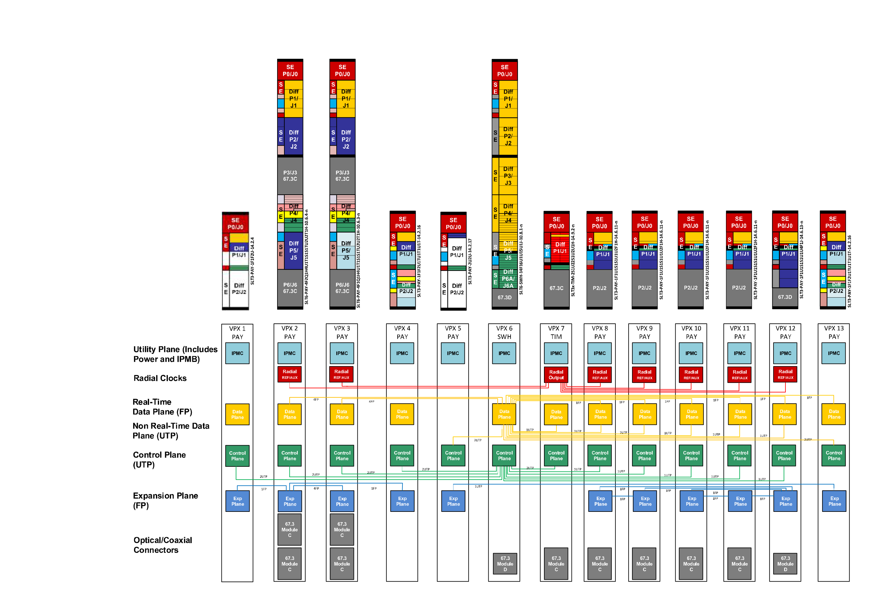

*Figure 50: 3U/6U Hybrid Backplane Example ｜ 图 50：3U/6U 混合背板示例*

<!-- 原书 p.190 ｜ PDF p.210 -->

## 缩略语与缩写

> 分册文件：`SOSA参考架构技术标准-v1.0.2/15-acronyms-and-abbreviations.md`；原册题：Acronyms & Abbreviations ｜ 缩略语与缩写

> 原书 p.191–194 ｜ PDF p.211–214

此节为全书最后一节，收全书使用的缩略语及其展开式（原书未编号为表，此处按其两列结构转作表）。

| Acronym ／ 缩写 | Expansion ／ 展开式 |
|---|---|
| 2LM | 2 Level Maintenance 二级维修 |
| ACK/NAK | Acknowledgement/Negative Acknowledgement 确认／否定确认 |
| AFLCMC | Air Force Life Cycle Management Center 空军生命周期管理中心 |
| AMTI | Air Moving Target Indicator 空中动目标指示 |
| API | Application Programming Interface 应用编程接口 |
| AWG | Architecture Working Group 架构工作组 |
| BIT | Built-In Test 机内自检 |
| BSP | Board Support Package 板级支持包 |
| C4ISR | Command, Control, Communications, Computers, Intelligence, Surveillance, and Reconnaissance 指挥、控制、通信、计算机、情报、监视与侦察 |
| CERDEC | Communications-Electronics Research, Development, and Engineering Center 通信-电子研究、开发与工程中心 |
| ChMC | Chassis Management Controller 机箱管理控制器 |
| CIK | Crypto Ignition Key 加密点火钥匙 |
| CMM | Chassis Manager Module 机箱管理模块 |
| COTS | Commercial Off-the-Shelf 商用现货 |
| CPLD | Complex Programmable Logic Device 复杂可编程逻辑器件 |
| CPU | Central Processing Unit 中央处理器 |
| DDS | Data Distribution Service 数据分发服务 |
| DoD | Department of Defense (United States) （美国）国防部 |
| DoDAF | Department of Defense Architecture Framework 国防部架构框架 |
| EARS | Export Administration Regulations 出口管理条例 |
| EFI | Extensible Firmware Interface 可扩展固件接口 |
| EIA | Electronic Industry Alliance 电子工业联盟 |
| EM | Electromagnetic 电磁 |
| EMC | Electromagnetic Compatibility 电磁兼容性 |
| EO/IR | Electro-Optical/Infrared 光电／红外 |
| ESM | Electronic Support Measure 电子支援措施 |
| EW | Electronic Warfare 电子战 |
| FAA | Federal Aviation Administration 美国联邦航空管理局 |
| FACE | Future Airborne Capability Environment 未来机载能力环境 |
| FOV | Field of View 视场 |
| FPGA | Field-Programmable Gate Array 现场可编程门阵列 |
| FRU | Field Replaceable Unit 现场可更换单元 |
| GMTI | Ground Moving Target Indicator 地面动目标指示 |
| GOTS | Government Off-The-Shelf 政府现货 |
| GPGPU | General-Purpose Graphics Processing Unit 通用图形处理单元 |
| GPIO | General-Purpose Input Output 通用输入输出 |
| GPU | Graphics Processing Unit 图形处理器 |
| HOST | Hardware Open Systems Technology 硬件开放系统技术 |
| HWG | Hardware Working Group 硬件工作组 |
| ICD | Interface Control Document 接口控制文件 |
| IP | Intellectual Property 知识产权 |
| IPMB | Intelligent Platform Management Bus 智能平台管理总线 |
| IPMC | Intelligent Platform Management Controller 智能平台管理控制器 |
| JTAG | Joint Test Action Group 联合测试行动组 |
| LRU | Line Replaceable Unit 航线可更换单元 |
| LVCMOS | Low Voltage Complementary Metal Oxide Semiconductor 低电压互补金属氧化物半导体 |
| LVDS | Low Voltage Differential Signal 低电压差分信号 |
| MDM | MORA Data Message MORA 数据消息 |
| MIB | Management Information Base 管理信息库 |
| MISB | Motion Imagery Standards Board 运动图像标准委员会 |
| ML2B | MORA Low Latency Bus MORA 低延迟总线 |
| MORA | Modular Open RF Architecture 模块化开放式射频架构 |
| MOSA | Modular Open Systems Approach 模块化开放系统方法 |
| NAVAIR | Naval Air System Command 海军航空系统司令部 |
| NAVSEA | Naval Sea Systems Command 海军海上系统司令部 |
| NEXT | Near End Cross Talk 近端串扰 |
| NEZ | No Emit Zone 无发射区 |
| NVMRO | Non-Volatile Memory Read Only 非易失存储器只读 |
| OMG | Object Management Group 对象管理组 |
| OMS | Open Mission Systems 开放任务系统 |
| OSA | Open Systems Architecture 开放系统架构 |
| OSD | The Office of the Secretary of Defense 国防部长办公室 |
| PCIe | Peripheral Computer Interface extended 扩展型外设计算机接口 |
| PED | Processing Exploitation and Dissemination 处理、利用与分发 |
| PEO | Program Executive Office 项目执行官办公室 |
| PPS | Pulse Per Second 每秒脉冲 |
| PSM | Power Supply Module 电源模块 |
| QoS | Quality of Service 服务质量 |
| RAS | Reliability, Availability, and Serviceability 可靠性、可用性与可服务性 |
| REI | Runtime Environment Interface 运行时环境接口 |
| REST | Representational State Transfer 表述性状态转移 |
| RF | Radio Frequency 射频 |
| RTE | Run-Time Environment 运行时环境 |
| RTM | Requirements Traceability Matrix 需求追溯矩阵 |
| SAA | Sense and Avoid 感知与避让 |
| SAE | Society of Automotive Engineers 汽车工程师学会 |
| SAR | Synthetic Aperture Radar 合成孔径雷达 |
| SBC | Single Board Computer 单板计算机 |
| SDK | Software Development Kit 软件开发套件 |
| SIGINT | Signals Intelligence 信号情报 |
| SMTI | Surface Moving Target Indicator 表面动目标指示 |
| SNMP | Simple Network Management Protocol 简单网络管理协议 |
| SOA | Service-Oriented Architecture 面向服务的架构 |
| SOAP | Simple Object Access Protocol 简单对象访问协议 |
| SOSA | Sensor Open Systems Architecture 传感器开放系统架构 |
| SSR | Solid State Relay 固态继电器 |
| STAP | Space-Time Adaptive Processing 空时自适应处理 |
| SWaP | Size, Weight, and Power 尺寸、重量与功耗 |
| TCP | Transmission Control Protocol 传输控制协议 |
| TIA | Telecommunications Industrial Association 电信工业协会 |
| TNC | Threaded Neill-Concelman 螺纹 Neill-Concelman 连接器 |
| TOA | Tactical Open Architecture 战术开放架构 |
| UAS | Unmanned Ariel System 无人 Ariel 系统 |
| UAV | Unmanned Aerial Vehicle 无人机 |
| UCI | UAS Command & Control Initiative UAS 指挥与控制倡议 |
| UDP | User Datagram Protocol 用户数据报协议 |
| UI | User Interface 用户界面 |
| UML | Unified Modeling Language 统一建模语言 |
| USAF | United States Air Force 美国空军 |
| USB | Universal Serial Bus 通用串行总线 |
| UUV | Unmanned Underwater Vehicle 无人水下航行器 |
| VDB | VICTORY Data Bus VICTORY 数据总线 |
| VICTORY | Vehicular Integration for C4ISR/EW Interoperability 面向 C4ISR/EW 互操作性的车载集成 |
| VM | Virtual Machine 虚拟机 |
| VSWR | Voltage Standing Wave Ratio 电压驻波比 |
| XMC | Express Mezzanine Card Express 夹层卡 |
| XML | eXtensible Markup Language 可扩展标记语言 |

> 说明：107 条缩写逐字照录。原书此处有不一致处（如 `NAVAIR` 作 System 而 `NAVSEA` 作 Systems、`GOTS` 作 Off-The-Shelf 而 `COTS` 作 Off-the-Shelf、`UAS` 作 Ariel），一律照录未改。

> **译注**：上述三处不一致，中文侧照字面译出、未代为订正：`System`／`Systems` 均译「系统」，`Off-The-Shelf`／`Off-the-Shelf` 均译「现货」（前者大小写差异在中文无从体现），`Ariel` 系 `Aerial` 之误拼，中文保留原字作「无人 Ariel 系统」；正文语境中的 `UAS` 仍按术语表 §13.5 作「无人机系统」。另有两条中文补词以便读通：`TNC` 的展开式原为接头型号名，中文补「连接器」；`（美国）国防部` 的括注置于「国防部」之前，与英文 `(United States)` 后置的语序不同。

<!-- 本册覆盖原书 p.191–194 ｜ PDF p.211–214 -->

## 附记：SOSA 与架构相关标准的符合性核查（非原文）

> 附记文件：分册目录下的 `附记-架构标准符合性核查.md`；核读所加，不属 SOSA 原文，也不属标准正文；不参与十六册对照与机械关。

> **本附记性质**：核读所加，不属 The Open Group 的标准正文，也不是译者注。SOSA 原文一字未动；附记只作外部判断，不参与十六册对照，也不在机械关射程内（六关脚本只核 `NN-` 开头的十六册）。

> **判据版本**：ISO/IEC/IEEE 42010:2022、ISO/IEC/IEEE 42020:2019、ISO/IEC/IEEE 42030:2019、ISO/IEC/IEEE 15288:2023，四份均取库内正本。DoDAF 2.02 正本不在库；凡涉 DoDAF 自身的规定，一律标「未核」，只用本库可查的旁证。

> **引用四档**：标准原文逐字／标准可支持的读法／按定义句作的举例／本附记的定性。凡属本附记自己下的定性，标「本附记判」；其余为对标准原文的转述。

> **底本与已知噪声**：库内 SOSA 转换件十六册，原书 214 页，PDF 无文字层。个别句有 OCR 噪声（§3.2 的 `lincorporates`、`Iature`、`e.8` 等）；凡噪声句只作转述，逐字引文取 OCR 清楚者。

### 一 结论

**第一，SOSA 没有声称符合任何架构标准，也没有把任何架构标准列为规范性引用。** §1.4「Normative References」整节只有一个词：*None.*（中译：无。）§1.3 还明文禁止以它作符合性依据：*"This is a Snapshot, not an approved standard. Do not specify or claim conformance to it."*（中译：本件是快照，不是已获批准的标准；不要按其规定，也不要声称对其符合。）它唯一点名的框架是 DoDAF 2.02，见 §3.1：*"The SOSA Architecture will be captured using the DoDAF Version 2.02 Viewpoint Models, chosen because the primary target audience is the US DoD, and DoDAF is (as of this writing) the prescribed framework."*（中译：SOSA 架构将采用 DoDAF 2.02 版的视角模型加以记载；之所以选择它，是因为主要目标受众是美国国防部，而 DoDAF 截至本文撰写时是指定的框架。）

**第二，按内容对照 42010:2022 第 6 章判，它不成立。** 十条 shall 里，一条基本满足、三条部分、六条不满足。缺口集中在架构描述装置：相关方与关切、相关方角度与方面体、视角规格、视图的版本与关切对应、视图组件与模型种类、对应关系与一致性分析、架构决策与理由。架构内容本身并不缺，模块、接口、原则、质量属性相当扎实。

**第三，这不是写错了，是同词不同轴。** SOSA 是「参考架构＋产品要求」的技术标准，其要求落到引脚、槽位、连接器、IPMB 这一层；42010 管架构描述的装置，42020 管组织的过程，15288 §6.4.4 管项目的过程。以 42010 量它，量到的是「若它要主张符合，缺哪些件」，不是「它违法」，因为它从未主张。

### 二 它给出了哪些架构制品

SOSA 的架构内容集中在 §3「参考架构描述」与 §4「架构定义」；附录里另有 AV-2、OV-1 与 DIV-2／DIV-3 三处。按 DoDAF 制品号清点如下。

| 制品 | 落点 | 状态 |
|---|---|---|
| CV-1 能力视图 | §3.1.1，图 3 | 有 |
| CV-2／CV-3 | 图 2 与 §3.1 节题引用 | 无。节题写「CV-1/CV-2 Objectives」，正文只有 CV-1 |
| AV-1 总览与摘要 | 图 2 引用「Target List of Products (in AV-1)」 | 无 |
| AV-2 集成词典 | 附录 B，66 条 | 有 |
| OV-1 高层运行概念 | 附录 C.1，图 47 | 有 |
| OV-2／OV-5b | 附录 C.2／C.3 | 未出，原文作 Planned |
| SV-1 系统接口描述 | §3.4，图 4／图 5 | 有 |
| SV-2／SV-3 | §4.4.1／§4.4.2 | 未出 |
| SvcV-1 服务上下文 | §3.9，图 6 与表 2（25 个模块） | 有 |
| SvcV-4 服务功能描述 | §4.1.1，表 5 | 有 |
| SvcV-2／SvcV-3a／SvcV-3b／SvcV-6 | §4.1.2／§4.1.3／§4.3.1 | 未出 |
| DIV-1 概念数据模型 | §4.2.1，图 12／图 13 | 有 |
| DIV-2 逻辑数据模型 | 附录 D，外置 xlsx，成员专用 | 有，外置 |
| DIV-3 物理数据模型 | 附录 E，外置 xlsx，原文注明尚未批准 | 部分 |
| StdV-1 适用标准 | 附录 A | 未出 |
| PV-* 项目视角 | — | 无 |

这张清单本身是一条判词：**它给的是架构、数据、接口三套视图，缺的是总览、适用标准、能力全量与运行资源流。** 缺的这四样，恰是 42010 §6.1 与 §6.2 放「目的、范围、假设、约束、相关方」的位置。AV-1 未做，是后面 6.1 与 6.2 缺件的结构性原因。

### 三 按 42010:2022 第 6 章逐条判

判的是「若它主张符合，能否成立」，不是「它必须符合」。42010 第 4 章明写：*"This document is designed such that 'tailoring' is neither required nor permitted for its use when claims of conformance are made."*（中译：本文件的设计使得：在提出符合性主张时，其使用既不要求也不允许「裁剪」。）所以即便日后想主张符合，也不能说「裁掉了相关方那一条」，只能把件补齐。

| 条款 | 要求 | SOSA 的证据 | 判定 |
|---|---|---|---|
| 6.1 标识与概述 | 识别所关注实体及其预期环境；含目的陈述；含标识与补充信息 | §3.5.1 指明主要对象是 SOSA 传感器；§3.5.3 给宿主平台与吊舱；§1.1 与 §1.2 给目标与愿景 | 基本满足。实体与环境清楚，目的散在多处、未单列成句 |
| 6.2 相关方 | 识别持基本关切的相关方；陈述资源限制或其他约束，并解释不符合项 | 仅 §1.2.2 列相关方群体，且那是《SOSA 业务指南》的读者范围；无限定陈述与不符合说明 | 不满足 |
| 6.3 相关方角度 | 识别角度，并与持有该角度的相关方关联 | 无 | 不满足 |
| 6.4 关切 | 识别关切，并与持有该关切的相关方关联 | 表 1 的十条质量属性、§3.2 的十五条原则，可当关切底本；未称关切，未与相关方关联 | 部分 |
| 6.5 方面体 | 识别方面体，并与关切关联 | 无 | 不满足 |
| 6.6 视角 | 纳入或引用所用每个视角；视角规格合第 8 章；每个关切至少由一个视角框定 | 全文 viewpoint 仅三见，都只作 DoDAF 视角模型的名字；无视角规格、无关切框定、无版本标识 | 不满足 |
| 6.7 视图 | 每个视角至少一个视图；每视图含版本标识、管控视角标识、组件与已知问题；每个关切至少由一个视图应对 | 有 CV-1、OV-1、SV-1、SvcV-1、SvcV-4、DIV-1 等视图；无逐视图版本与关切对应；已知问题按节记，原文作 Planned for a later version | 部分 |
| 6.8 视图组件 | 视图由组件构成；组件标识管控模型种类；无模型种类须给图例 | 未登记模型种类与图例。表 4 的角色、端点、符号表实务上就是图例，但未挂到任何视角上 | 不满足 |
| 6.9 对应关系 | 记录已知不一致；宜给一致性分析；须给对应关系清单与对应方法清单 | 无对应关系清单、无一致性分析、无已知不一致记录 | 不满足 |
| 6.10 决策与理由 | 记录基本架构决策；宜记已否决的备选与理由；须给每项必要决策的理由 | 只给选 DoDAF 的理由与十五条原则各自的 Rationale；无决策记录、无备选、无权衡 | 部分 |

把这张表竖着看，缺的是三件贯穿件：相关方到关切、关切到视角到视图、决策到理由。SOSA 成链的是另一条：组件到接口到规则。

补一条定位：42010 §6.1 注 1 专门给了参考架构的情形——*"For an AD intended to serve as a reference for another AD, the entity of interest is abstract, or a generalization of entities of interest, and the purpose of the AD is to express a reference architecture which could provide a basis for further ADs."*（中译：对于意在充当另一份架构描述的参考的架构描述，其所关注实体是抽象的，或者是对若干所关注实体的泛化，而该架构描述的目的是表达一种参考架构，可为后续架构描述提供基础。）SOSA 的定位与此同型，这一点它是对的。

### 四 若按第 7.1 条当架构描述框架读

SOSA 也可以读成「某领域的架构建模与描述约定」，那适用 42010 §7.1。须给的 ADF 标识与适用范围有、版本有、典型相关方弱（仅 §1.2.2）、典型关切弱（质量属性与原则）、框定这些关切的视角无规格；7.1.2 宜给的相关方角度、方面体、结构化形式体系、模型种类、图例、ADL、对应方法、视图方法，基本全无。

两种读法结论一致：**内容像架构，装置不像架构描述。**

### 五 按 15288:2023 §6.4.4 判

§6.4.4.1 给过程目的：*"The purpose of the system architecture definition process is to generate system architecture alternatives, select one or more alternative(s) that address stakeholder concerns and system requirements, and express this in consistent views and models."*（中译：系统架构定义过程的目的是生成系统架构备选方案，选择一个或多个应对利益相关方关注点和系统需求的备选方案，并在一致的视图与模型中表达该架构。）§6.4.4.2 列八条预期结果，逐条对 SOSA 如下。

| §6.4.4.2 预期结果 | SOSA 的对应证据 | 判定 |
|---|---|---|
| a) 按关键关切、语境与角度细化问题空间 | 前置册 Background 与 Approach 讲透了问题：烟囱式研制、无复用、成本与周期 | 部分。未按关切与角度结构化 |
| b) 与方针、指令、目标与约束对齐 | §1.1 一句「Aligned: consistent with DoD acquisition policy guidance」 | 部分 |
| c) 把关键概念、属性、行为、功能或约束分配到架构实体 | 表 2 的 25 个模块，加 §3.6 的聚合七准则 | 部分。无分配矩阵 |
| d) 已识别关切由架构应对 | 关切本身未识别 | 部分 |
| e) 架构元素对关键相关方需求与系统需求可追溯 | 15288 §6.4.4.2 e) 要求建立这类追溯；SOSA 无追溯矩阵 | 不满足 |
| f) 架构视图与模型 | 有，多个模型未出 | 部分 |
| g) 系统元素及其接口 | 模块表、交互类型表、槽位配置档、连接器与引脚表、Rule 体系 | 满足 |
| h) 使能系统或服务 | — | 不适用 |

过程目的里的生成备选与选择，在文档中只留一句痕迹：原则 #4 的 Implications 提到架构决策与权衡偏向留出成长余地的选项，原文 OCR 有噪声，此处转述。备选清单、否决理由、权衡记录，全文没有。本附记判：不能说它按 §6.4.4 走完，只能说它交付了该过程结果里视图、元素、接口那几项。

### 六 42020 与 42030 为什么不能直接判

42020:2019 管组织与项目的架构过程，符合性主体是组织与过程，不是一份已发布的标准文本。用一份标准去符合它，范畴不对。可说的只有一点：SOSA 图 2 画的那条链——Stakeholders、目标 CV-1／CV-2／CV-3、质量属性、架构原则、AV-2、SV-1 范围与系统定义、架构模式、模块与接口定义、多视角模型——在骨架上与 42020 §8.4.3 至 §8.4.9 同型。但 §8.4.6 的权衡空间与 §8.4.7 的候选架构，文中无任何记录：只见方法图，不见过程账。

42030:2019 是架构评估框架，SOSA 没有架构评估记录，其符合性对象是硬件元素与软件组件。故不适用，不展开。质量属性可当评估准则的素材，但可作素材不等于做过评估。

### 七 DoDAF 的名实之辨

SOSA 说以 DoDAF 2.02 视角模型记载，制品号对得上。制度层有三处要留神，凡涉 DoDAF 自身规定者标未核。

**一是形式体系。** DoDAF 以数据为中心，其受限词汇表由 DM2 建立。库内 42020 附录 H 的旁证是：*"DoDAF Meta Model (DM2) establishes and defines the constrained vocabulary to be used for architecture development, facilitating the understandability of the views and exchanging of data between collaborative environments."*（中译：DoDAF 元模型 DM2 建立并定义受限词汇表，以用于架构开发，便于理解各视图，并便于在协作环境之间交换数据。）SOSA 用的是自编 AV-2 术语表，不是 DM2；它是否算 DoDAF 合规架构，须回 DoDAF 正本才判得动。

**二是裁剪。** DoDAF 允许按用途裁剪，并非所有 DoDAF 所述模型都必须创建。此语本库 32 号报告引过官方原文，属二手，未回正本。就 SOSA 全文看，被裁掉的模型只写 later version，不写理由，这正撞 42010 §6.2 末两句：须陈述约束，须解释不符合项。

**三是 AV-1 缺位。** DoDAF 的 AV-1 装目的、范围、假设、约束与结论；42010 §6.1 与 §6.2 要的目的陈述、约束与不符合说明，在 DoDAF 路径上本该落在这里。图 2 写了 Target List of Products (in AV-1)，AV-1 却没出现。

### 八 术语与概念层的六处撞点

| 词 | SOSA 的用法 | 架构标准的用法 | 本附记判 |
|---|---|---|---|
| Architecture | AV-2 定义以「一组描述性表达」起头 | 42010 §5.2.2 把架构与架构描述分开：架构是实体在其环境中的基本概念或属性，架构描述是架构的表达 | 把描述当成了架构 |
| Reference Architecture | 全文无定义，AV-2 无条目 | 42010 §6.1 注 1 给出参考架构描述的情形 | 定位同型，核心词未定义 |
| architectural entity | §1.5.1 指 SOSA 模块 | 42020 §3.6 指被架构的那个事物；15288 §5.9 明说架构实体与系统元素是两个概念 | 撞名且错位。模块其实是系统元素 |
| Conformance | AV-2 定义组件、模块、接口「完全依附于某架构或标准」 | 42010 第 4 章分五种符合性情形；第 6 章要求不可裁剪 | 只到组件级，不到架构级 |
| view／viewpoint | 只作 DoDAF 制品名，无定义；全文 viewpoint 仅三见 | 42010 §3.7 与 §3.8 有定义；视角框定关切、管控视图 | 借名而不建制 |
| shall／should | §1.5.3 规定 shall 专用于陈述 Rule；§5.2.1 有一处未编号的 shall | 非架构标准条款，属文件编制纪律 | 纪律讲究，但有一处自相抵，可复查 |

还有一条不在表里：§2 说未在 AV-2 定义的词一律按《韦氏大学词典》解释。这一句把术语的最终解释权交给了通用词典，等于放弃与架构标准术语对齐的可能。它是自足的文件，不是可互操作的标准。

### 九 它做对了什么

1. **所关注实体与环境写得清楚**：传感器、宿主平台、吊舱三种布置，见 §3.5 与图 4、图 5。这正是 42010 §6.1 要的东西。
2. **参考架构的定位对**：抽象实体、为后续设计提供基础，与 42010 §6.1 注 1 同型。
3. **质量属性十条带定义、带本架构语境下的限定、带优先级**：表 1 题名写明按优先次序递减排列。42010 §6.4 不规定关切粒度，这十条可直接当关切底本。
4. **架构原则十五条，每条三段式 Statement、Rationale、Implications**：42010 §6.7 示例 2 明确把架构原则列为视图之外的信息部件，§5.2.12 又把架构原则列为理由可含的内容。这一块它靠得最近。
5. **模块聚合七准则**：可切分、接口复杂度最小、可独立运行、可独立测试、不暴露 IP、利于竞争性采购、封装快速变化。这是真正的切分判据，正是 42020 §8.4.7 形成候选架构时可用的成文规则。
6. **交互类型表与角色、端点、符号表**：实务上就是 42010 §6.8 说的图例，只是没登记成图例。
7. **说什么不说什么的 IP 边界**：§3.6 末句 *"specifies what the SOSA modules do, but not how they do it (IP and innovation are preserved)"*（中译：规定 SOSA 模块做什么、不规定怎么做，知识产权与创新得以保住）。这与 15288 §5.9 的「有效的架构尽可能与设计无关」同向。
8. **关键词体系分层**：Rule、Recommendation、Suggestion、Permission、Observation 五档，并要求可测，见各条 Conformance Methodology。做产品标准很得力，只是它不是架构描述的装置。
9. **缺口明写**：Planned for a later version 十余处。按 42010 §6.7 d) 的已知问题精神，这比隐去强；差在记在节上、不记在视图上，也没给理由。

### 十 用它的人该记住的三句话

- 当参考架构的素材与工程规则的样板用，可用：模块切分准则、质量属性与原则三段式、交互类型与端点角色表、Rule 与 Recommendation 的分层，都是现成的好料。
- 当符合 42010 的架构描述引，不可：它自己 §1.3 就禁止这样主张，内容上也缺六条 shall。
- 当架构符合性的论据用，不可：它的符合性对象是硬件元素、软件组件与接口，不是架构。

---

> **本附记的读数**（2026-11-14）：正文 3,647 汉字，四张对照表；所引条款号均已回库内正本核过，DoDAF 相关判断标未核。
