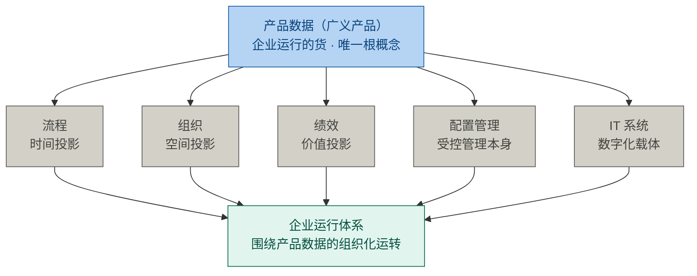
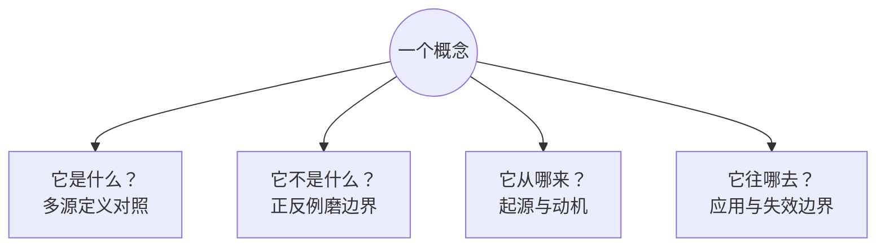

# 第1章 概念体系：学习能力的杠杆

## 1.1 引言

**误解现场。**

一个词，让两个项目停了工。

冰链科技造 M3 医疗温控箱。这天开会，议的是 M3 二代怎么分块。

产品开发经理赵刚把会拉起来："边界划了两个月。今天先把'架构'这词说清楚。"

产品经理林涛先钉死："架构就是模块怎么分。定了才好派活。"

嵌入式硬件工程师石军摇头："模块边界是设计的事。我说的是硬件架构：传感器、主控、通信怎么布。"

云端软件的吴浩接话："元件只是元素。系统架构在云端：服务边界、数据所有权。"

测试季昭皱眉："我按哪一层拆用例？验收判据挂在哪一层？"

制造侧的小周敲桌："架构对你们是张图，对我是一整条产线停不停。"

散会时，M3 二代的边界还是没划下来。

恒信集团做合同审批系统。这天在评改造方案。

产品开发经理曹峰把会议室占了："方案评了三个月。先把'架构'这两个字对齐，对不齐就没法评。"

业务方的郑亮先抱怨："我们公司的架构不行，审批链跨三个部门扯皮。"

系统架构师罗建纠正："你说的那是组织架构。系统架构是服务边界和数据所有权。"

开发组的苏婷追问："我那接口清单，按哪张图对齐？前端等着开工。"

运维王默补一句："还有部署架构呢？部署在哪、谁运维、上线怎么回滚，总得有人说。"

需求分析师顾言放下笔："停。'架构'在我们嘴里已经是五件事了。各自说清，你指哪一件。"

这一问，没人接得住。同一个词，两个世界，五张脸。问题不在人，在词。

把词当场对齐，就真懂"架构"了吗？就算十张脸都同意它指系统架构，再各答四问，多半答不齐。

**词可以当场对齐；概念要花功夫，才能真正拥有。**

**这一章的人和物。**

两间会议室，十二个人。

冰链六位：赵刚管项目，林涛管产品，石军管硬件，吴浩管云端，季昭管测试，小周管制造。

恒信六位：曹峰管项目，郑亮代表业务，罗建管系统架构，苏婷管开发，王默管运维，顾言管需求。

冰链手上那台 M3，是一个不到二十公斤的箱子：一块板子、一套固件、一个云端服务。恒信那套合同系统，是三百多条审批规则串起来的一条链。一硬一软，差得远。

**本章要回答什么。**

1. 一个词的说法不一致，为什么能把两个项目停上两三个月？把词当场对齐，是不是就够了？
2. 一个领域里真正要紧的概念是哪几个？我该先抓哪一个？
3. 把概念说准，凭什么算学习能力里回报最高的一步？
4. 同一个概念，我说到哪一层才算是说准了？只答得出定义，够不够？
5. 练到能判一个概念，要走哪几步？从哪儿找来第一个，又怎么验自己是不是真拿到了？

**本章的骨架。**

本章要立一句主张，交一把尺子。

> 把概念说准，是学习能力里回报最高的那一步。

这句话分两半：先说准该抓哪一个，再把它一级一级说到底。

凭什么说回报最高？因为学习产出是一道乘法，里头只有两项能让整条式子归零：方向（先抓错了词）与表征（概念没说准）。两场会失守的，正是这两项。

说到多深？同一个概念有四档深浅：表征、图式、心智模型、解释框架。本章把量深浅的那把尺交给你。

后面四节就是这四步：先抓哪一个，这副本事是什么，凭什么最要紧，怎么练到能判。

**这一章要用的词。**

- **概念**：由特性的独特组合形成的知识单元。你脑子里那个意思。
- **核心概念**：也叫枢纽。解释别的概念都要用到它，理解它自己却几乎不需要前置。
- **根概念**：不可再向下归约的源头概念，其余概念都由它导出。
- **基本原理**：原理这一侧的源头，把根概念里含着的道理写成一句明白话。
- **概念体系能力**：以概念为单位的压缩与组织能力。
- **根概念能力**：四件本事里管方向的那一件，先抓源头，再展结构。
- **表征**：现实事物在头脑中的代用品，最小单位是概念、名词、对象、关系与边界。
- **图式**：表征聚起来、认得出的一类结构。
- **心智模型**：会动的图式，能推演"如果这样，就会那样"。
- **解释框架**：对一整个领域的整套看法。
- **四问**：是什么、不是什么、从哪来、往哪去。
- **归零项**：乘法里一错就让后面全部作废的那两项。

## 1.2 概念一层套一层，先抓最里头的根

冰链那场会上，五个人各说各的"架构"。设若当时有人问一句：这条产线上，真正要紧的概念是哪几个？

答案会让人意外：很少。

一个领域里天天挂在嘴边的词有几百个，真正承重的只有几个。这几个不是平级的名词，它们一层套一层。

拿产品开发这一行看。质量、功能、接口、组件、架构，这些概念都重要，但它们都要靠另几个才说得清：要解释"质量"，得先说"需求"被满足到什么程度；要解释"接口"，得先说"系统"分成几块。

于是这张网有了层次。最外层是能说清的那些，往里是撑着别人的那些，最里头是撑着所有人的那几个。

概念一层套一层：**一般概念包含核心概念，核心概念包含根概念**。

这三层比的不是谁更重要，是看它站在网里的哪个位置。一个领域通常只有三到五个核心概念，一到三个根概念。层级越深，判据越严，数量越少。

凭什么说这些是"概念"，不是"词"？

标准里给过一条很紧的定义。

> **概念（concept）**：由特性的独特组合而形成的知识单元（ISO 1087:2019 §3.2.7，经研习报告转引，正本不在库）。
> 判据：可指称（一个词或短语）＋可界定（内涵与外延）。

这个定义里藏着三个角。中文"苹果"、英文 apple、日文 りんご，是三个名字，指向同一个意思；菜市场那颗真苹果，是它指向的东西。名字、意思、东西，三样不是一回事。

本章说的"概念"，是中间那个：它既不在嘴上，也不在物上。

章首两场会吵的正是中间这个角。嘴上说的是同一个名字，脑子里装的是各家的意思。

那概念从哪来？多数不是哪位天才发明的。有的像"零"，是人造的工具；有的是本来就在那里、被人揭开的规律；更多的是一群人反复吃同一个亏，才摸出做法，最后由标准写成条文。三种来路指向同一件事：**概念是共识，不是真理。**

还有一句更要紧：概念之所以要紧，不是因为它有定义，是因为没有它，一群人没法对"这是什么"说成同一句话。

一个团队连"返工"这个词都不认，管它叫"再改一版"，那么"返工要开单"这条规矩就无处安放。名字没了，话说不成，规矩也就立不起来。

三层里最该先动手的是最里头那一层：根概念。

> **根概念（root concept）**：领域中不可再向下归约的源头概念，其余概念（含核心概念）都由它导出。
> 四条判据：**原子性**（不可由域内其他概念定义）、**生成性**（其余概念从它派生）、**不可替代性**（去掉它，领域崩塌）、**递归性**（多个抽象层级反复生效）。

为什么先抓根？三条理由。

它是源头。根立住了，新来的概念有地方挂；挂得上的留下，挂不上的正好暴露网上的洞。

它管方向。根辨对了，往哪使劲才不错；根辨错了，上面每一层都跟着错。

它最省。根变动得慢，外围知识变动得快。花同样的功夫，立得越早越合算。

夹在中间的是核心概念，也叫枢纽。

> **核心概念（core concept / hub）**：解释领域内其他概念都要用到它，而理解它自己只需很少前置知识。判据是反事实检验：去掉它，这个领域还成立吗？

要解释"符合性"，得先解释"需求"；要解释"架构"，得先解释"系统"。"需求""系统"被反复调用，自己却几乎不需要前置，它们就是枢纽。

章首冰链那场会上，三个人各说各的"架构"，谁也没有先问一句"系统"指什么。枢纽没立住，边界就划不下去。

概念是网上的节点，原理是连接它们的边。"基线一经批准，变更须走受控流程"就是一条原理，把基线和变更连了起来。原理也有源头：不可再被推导的那几条，叫**基本原理**，它们是把根概念里本来就含着的道理，写成一句明白话。

说了半天，那个概念到底怎么找出来？三步。

第一步，收集候选，借现成的材料，二十分钟就够。翻教材目录、读术语表、看综述、问行家、问 AI。领域共同体已经替你把概念压缩过一遍，直接抄。

第二步，拿硬判据筛。词频高的、被别人的定义反复引用的、理解它需要前置最少的，以及最狠的一条：如果这个概念不存在，这个领域还成立吗？

第三步，往上挂。每学一个新概念，问一句"它挂在哪个枢纽下"。挂不上去，说明清单有漏洞。清单是活的，随理解加深增删。

要判"它是不是根"，还有一道更硬的手续：把四条判据逐条写下来，每条配上证据和出处，写成一条能被人逐句反驳的链。写不出这条链，说明你手上是"我觉得"，不是"我判得出"。

> 术语注：词频、被引用度、前置数是三条代理判据——用可数的量代替真正要判的东西，方便，但会骗人。

根概念长什么样？三个领域，各走一遍。

**高速信号传输，根是阻抗。** 同一块板子，跑十兆赫兹没事，跑到一百兆赫兹全是反射。不是芯片换了，是那条线的阻抗没管住。说起高速信号，人多半先想到速率、带宽，它们都是结果，根子在阻抗。

四条判据逐条过：阻抗由线宽、介质、间距决定，不依赖域内别的概念，原子；反射、串扰、衰减、时序都由它派生，生成；去掉它，信号完整性这门学问不成立，不可替代；从芯片引脚到整机，层层都要谈它，递归。

**产品开发，根是需求、系统、设计开发。** 很多人以为根是"质量"。可质量是需求被满足的程度，是派生的；也有人以为是"产品"，那只是一个交付物的名字。三个源头各答一问：需求回答"要什么"，系统回答"承载在什么上"，设计开发回答"怎么把它一级一级说到可实现"。

质量、功能、接口、组件、架构，都从这三者派生。恒信要评的改造方案、冰链要分的 M3 二代，说到底都挂在这三个概念上。

**企业运行体系，根是产品数据。** 有人说企业运行不就是跑流程吗？可流程是由"数据怎么流转"定义的，它不原子；去掉流程，数据还在，只是无序。

流程是产品数据按时间排出来的样子，组织是它按空间排出来的样子，绩效是它按价值算出来的样子。投影可以再造、可以重组，底下的东西不变。



> 图注：流程、组织、绩效是产品数据在时间、空间、价值三个维度上的投影；配置管理、IT 系统是它的受控管理与数字化载体。

同一个概念换个领域，位置就变。需求在产品开发这一域里是根，在企业运行这一域里只是核心；企业运行真正的根，是产品数据。第7章会把这条路走完。

三个示例是按四条判据判出来的，供对照，不是任何标准的条文。

## 1.3 概念体系能力：本事在织网，不在多

前面讲的是网的结构。现在讲在网里干活的本事。

> **概念体系能力（conceptual ability）**：以概念为单位的压缩与组织能力——识别枢纽 × 织关系 × 迁移 × 辨边界。

它是四件本事合成的。

| 本事 | 干什么 | 不练会怎样 |
|---|---|---|
| 识别枢纽 | 抓出决定其余部分的那几个概念 | 被细节淹没，分不清主次 |
| 织关系 | 把概念连成有结构的网 | 孤立记点，学一个丢一个 |
| 迁移 | 把网搬到新场景 | 绑定场景，换个题就失灵 |
| 辨边界 | 用反例划清适用与失效范围 | 只举正例，不知何时失效 |

四个词说的其实是同一件事的两头：往里收，认出枢纽、连成网；往外放，搬到别处、划清边界。

学习里最容易白费力气的地方，也正好在这两头：记了一堆点，却织不成网；学会一套套路，却搬不到新场景。

怎么知道这副本事练到哪了？三道关，一道比一道硬。

第一道，转述：找个陌生领域，三五句话讲清。讲不清，说明结构没成型；讲到卡壳处，说明边界没划清。

第二道，辨伪：举得出反例，划得清它何时失效。举不出反例，说明你只见过正例。而且得有人跟你对质才算数，自己跟自己辩不算。

第三道，迁移：换一个情境，换行业、换粒度，你还认得出同一个结构吗？

> 概念体系能力强，不是懂得多，而是组织得好。同样的信息量，有人堆成一盘散沙，有人织成一张网。

四件之外，还有一件管方向的：**根概念能力**，先抓源头，再展结构。它负责开口之前先站在哪儿，那四件负责说出来之后怎么组织。

怎么算练到了？给你一个当场能试的：二十分钟，对一个陌生领域说出一组根概念与核心概念清单，并且每一条都说得出理由。理由不必漂亮，但要能被反驳。

最后交代一句：这副本事今天比过去更值钱，原因只有一句——记忆和计算已经外包给机器，剩下的识别枢纽、织关系、迁移、辨边界，才是你自己的活。

机器记得比你多，算得比你快，也写得出你没读过的句子；但它不替你判断"这个词在这里指什么"。恒信那场会就是现成的例子：五个人嘴里五件事，机器替你分不出谁在说哪一件。

一条边界同时立在这里：**AI 是好帮手，不是判据。** 它可以给你候选清单，但候选要自己拿硬判据筛、自己拿理由辩护。它能替你收集，不能替你拥有。

## 1.4 把概念说准，管住两个归零项

这副本事凭什么说是回报最高的那一步？因为学习产出是一道乘法，而它两头各握着一个能让整条式子归零的开关。

### 1.4.1 学习产出是乘法，缺一项就归零

> 学习产出 = 根概念能力（方向）× 概念体系能力（力臂）× 学习投入（施力）× 实践场景（支点）

四项分工不同：方向决定往哪儿使劲，力臂决定同样的力气能撬动多少，施力是投入，支点是这道题落脚的真实任务。

关键在乘号。加号里的项可以互相补偿：这项弱一点、那项强一点，总分还过得去。乘号里不行，任何一项为零，整条式子就是零。

同一本书，同样每天两小时。一个人先翻目录，把目录里的词连成三句话，再从第一章读起；另一个人从第一页第一个公式开始背。

三个月后，两个人都读到第三章。头一个人说得出这本书在解决什么问题，第二个人说得出第一章讲了什么。

差距不是努力拉开的，是方向拉开的。后一个人的方向那一项接近零，后面的力气全乘在零上。

冰链和恒信那两场会就是这样：十张脸都在使劲，可各使各的方向。

### 1.4.2 力臂、施力、支点只放大，不指路

后三项性质一样：只负责放大，不负责指方向。

力臂，就是概念体系能力。同样一份材料，会组织的人拿走的是结构，不会组织的人拿走的是一堆点。

施力，就是学习投入。时间、注意力、练习量，缺一样，力臂再长也不动。

支点，就是实践场景。概念要落在真实任务上才使得上劲；只记不用，前面两样也一起白费。

它们放大的都是已经确定的东西。方向对了，力臂越长撬得越多；方向错了，力臂越长偏得越远。

| 先立骨架的人 | 只背结论的人 |
|---|---|
| 新概念迅速入网 | 学完就忘 |
| 跨场景自由迁移 | 换个题就失灵 |
| 识别得出概念偷换 | 分不清边界 |

所以四个部件里，最根本的不是力臂，是方向。

### 1.4.3 方向：挑错了词，全盘皆输

方向不是一次选定的，是三件事依次做的。

第一件，问这个领域里什么东西算存在。是产品、是数据、是流程，还是关系？这一问答错，上面全错。

第二件，抓不可再归约的源头，也就是刚才说的根。

第三件，展开成几个枢纽及其关系。

把"产品"当成企业运行的根，与把"产品数据"当成根，导出的是两张完全不同的网。

这一步有硬证据。二〇二六年，北京大学一个团队在《自然·通讯》上发表了一项研究，做的是"先学什么"这件事。

他们造了几类结构相同、连接方式不同的人工知识网络，找人来学。结果很清楚：少数节点占据大量连接的那种网最好学；均匀对称、没有主次的网反而难掌握。

更有说服力的是第二个实验。同一批知识，一组先学枢纽再学细节，一组先学边缘再学枢纽，还有一组随便学。进入完全相同的正式学习之后，先学枢纽那组的优势随时间越来越大，而且扩散到整张网，包括那些从没直接学过的纯细节节点。

脑成像也印证了：先学枢纽的人，脑子里维持着更稳的结构；先学边缘的人，早期也有结构，但很快散掉。

论文自己的边界也要说清两条。一，实验用的是抽象的知识网络，真实领域复杂得多，"哪儿是枢纽"仍然要靠手艺去找，这就是三步识别法要干的活。二，它测的是"预测"，不是"应用"；"能讲给外行听就算掌握了"是本书补上的一步，不是论文的结论。

还有一层是先有鸡还是先有蛋：先学枢纽的前提是知道枢纽在哪；面对完全陌生的领域，只能先靠二手信号取候选，边学边改。

### 1.4.4 一个词能说到多深：能力四级

方向选定了，接下来是说得有多准。同一个概念能说到好几个深度；说得浅，等于没说。

恒信那场评审会上，罗建把"架构"答了个滴水不漏：是什么、不是什么、从哪来、往哪去。可轮到"这个系统要不要拆"，他一个字也说不出来。不是他没准备，是他的本事只到第一级。

我们在脑子里操作的从来不是真实世界，是它的代用品。你思考的不是经济活动本身，是那些概念和指标；你理解的不是历史，是某种历史叙事。能做多大的事，取决于手里的代用品长成了什么样。

代用品有粗有细。能力四级，就是这四种粗细。

| 级 | 是什么 | 一句话判据 |
|---|---|---|
| ① 表征 | 现实事物在头脑中的代用品；最小单位是概念、名词、对象、关系和边界 | 能提取关键表征并画成关系图，才算入门 |
| ② 图式 | 表征聚起来、认得出的一类结构，一眼认得的套路 | 一块一块看；一听就知道这是哪一出，还能预判下一步 |
| ③ 心智模型 | 会动的图式，内部有变量、有因果、有反馈、有边界 | 能推演"如果这样就会那样"，说得出它何时失效 |
| ④ 解释框架 | 对整个领域的一整套看法 | 能判断什么值得相信，什么只是叙事包装 |

拿"架构"这一个概念走一遍这四级，看得最清楚。

第一级，说得出它指什么、不指什么。罗建做到了。

第二级，一看就知道眼前这件事是架构问题还是设计问题。章首十张脸做不到，他们把架构问题、设计问题、组织问题混在一张桌上谈。

第三级，能推。拆成两个服务之后，哪一条链会断、谁的审批会卡住，说得出因果。罗建做不到，所以他说"我得再看看"。

第四级，能判断。这一派讲的架构观，哪一部分能用，哪一部分只是包装。摸到这一级的人听人讲架构，问的是机制，不是立场。

四个例子摆在一起，是同一个概念的四张脸，不是四样东西。

顺带说一个近处的对照。喊"我们敏捷了"，是第一级；知道敏捷有几个仪式，是第二级；能推"迭代从两周改到一周，测试怎么变"，是第三级；能判断这套敏捷放在我们这种交付形态上成不成立，是第四级。

> 术语注：前三级的说法在认知科学里是通行的；第四级"解释框架"是课程作者的自命名，不是标准术语。本书借用它的分法，读者不必当成定论。

四级共用同一种能力，只是粗细不同。同样是识别枢纽，第一级是挑出最该先认的那几个概念，第四级是认出"这一派把什么当枢纽"。

本章的工具停在第一级。四问是第一级的工具，管的是把概念看准，不负责拿主意。

有一个可以自查的崩样：**能把一个概念的四问答全，却在一个真实的取舍面前说不出话——这不是表达问题，是能力层级问题。**

那上面三级谁来建？后面每一章都在建，只是你此前不知道它们各在哪一级。第3到第5章立领域概念，是表征；第2章的工程分层、第6第7章的结构与产品数据，是图式；第10到第12章建心智模型；第17、18章交付解释框架。

所以这本书不是一堆知识点，是同一种本事逐级往上练。

这四级里，前三级可以讲、可以写、可以画。第四级有一块讲不出来：老师傅调火候、老工程师看一眼就知道哪儿不对，那不是天赋，是在现场待久了长出来的。认下这条边界，比多背几条判据有用。

### 1.4.5 表征：第一级拿不到，上面全是零

"回报最高"还有第二层理由，就藏在这四级之间。

> **价值律**：**表征是 1，上面三级是 0**（本书命名。"1 和 0"说的是成不成立、以及量级，不是分数。）

先说"1 定成立"。第一级决定的是成不成立：概念指错了东西，上面三级再漂亮也是零。

一次评审会上，一个人把"验证"和"确认"当同义词用。他经验越足、材料做得越漂亮，整场错得越整齐。零点九乘零还是零。

再说"0 定量级"。上面三级决定的是能做多大事：从看准一个概念，到看出一套套路，到能推演，再到能判断什么值得相信。每加一级，同样一份信息能做的事翻着倍往上涨。

1 定成立，0 定量级。这就是第一级最便宜、也最不能省的原因。

两个归零项到齐了：方向管往哪使劲，表征管拿的是不是那个东西。两者都过，才轮到力臂与投入去放大。

于是有了两个坐标。一个是位次，一般、核心、根，回答该抓哪一个。一个是深度，表征、图式、心智模型、解释框架，回答说到多深。

```
深度·能力四级（说到多深）
 ④ 解释框架 │
 ③ 心智模型 │
 ② 图式     │
 ① 表征     │ ← 这是 1：它不成立，上面三级都是 0
            └─────────┼─────────┼─────────→ 位次（说准哪一个）
                   一般概念   核心概念   根概念
```

两根轴各管一件事。一个概念可以位次不低、深度很浅，也可以位次不高、深度很深。

罗建的"架构"是前一种：位次落在核心，深度只到表征。枢纽抓到了，话也答全了，本事只到第一级。

再看后一种：石军的"阻抗"，位次落在根，深度到了心智模型，他能推断电以后多久升到崩点。

两点一放，两轴的正交就看得见了。所以谈到任何一个概念，都该同时报出两个坐标。

> 术语注：位次轴上的三层与深度轴上的四级是两个量词，别混：论位次说"第几层"，论本事说"第几级"。

最后交代一句"概念"这个词。四级处理的东西，本书一律叫概念，比前面那条严谨定义宽：表征是现实事物在头脑中的代用品，图式是认得出的一类结构，心智模型是会动的图式，解释框架是对一整个领域的系统性看法。

**案例回场：答得全，却说不出该不该拆。**

恒信的评审会上，方案要过一道关：合同系统要不要拆成两个。

罗建先把"架构"答了一遍。它是什么，标准里写着：

> 一个实体在其环境中的基本概念或属性，以及用于该实体及其相关生存周期过程的实现和演化的管控原则（ISO/IEC/IEEE 42010:2022 §3.2）。

它不是什么：不是一张架构图，不是一次技术选型，不是组织架构。

它从哪来：从建筑学借入软件与系统领域，七十年代结构化设计、九十年代软件架构热，后由标准定稿。

它往哪去：管的是这个实体怎么被实现、怎么演进，含造它改它的过程；在不可逆决策做出之前用，在变更影响评估时用。

四条一条不差。

顾言问了一句："那这次拆不拆？"

罗建停了几秒："……我得再看看。"

顾言没催他，把那份标准翻到术语章："42010 那条定义，答的是这个实体是什么。这份描述管定义，不管决策。要判拆不拆，另有三件事：服务边界切在哪、数据归谁、拆完哪条链会断。这三件答不出来，方案写得再漂亮也过不了评。"

罗建把架构图合上："这三件我一件都答不上来。我手上只有定义，没有判据。"

他不是没准备。他手上的"架构"停在第一级：概念说准了，关系也画得出；顾言那三件事，一件都还没做。

**四问答得全，只是拿到了那个 1。**

## 1.5 拿四道问题，把一个概念问到底

怎么才算真拿住了一个概念？先看"假懂"：背得出原文，却举不出反例；不知道它何时失效；孤立记住，不知道谁跟它连着。真懂反过来：能用自己的话重述，能举正例也能举反例，知道它跟谁冲突、当初解决什么问题，讲给外行能懂，换个情境能用。

理论依据是一句老话：意义即用法。概念的意义不在字典里，在它的用法里。

**四道问题。**

把上面那些差别压成四道问题。



| 问 | 怎么问 | 为什么这么问 |
|---|---|---|
| 它是什么？ | 找三四个来源对照定义 | 定义差的那一点，往往就是本质 |
| 它不是什么？ | 找正例和反例，用反例磨边界 | 概念靠典型例子活，靠反例定型 |
| 它从哪来？ | 回到它被创造时的问题现场 | 知道它当初解决什么，才记得住 |
| 它往哪去？ | 挂在哪些流程上、被谁用、何时失效 | 掌握失效边界，才算真懂 |

四道都答全，才算拥有；只答得出第一道，只是见过。

问之前还有一步：先锁住词的身份。这个词出自哪部标准的哪个条款？术语章里定义它了吗？"概念"就是现成的例子：术语学标准里有正式定义，架构标准里却按通用语意用。

拿章首那个被吵翻天的概念练一遍。

- 它是什么：一个实体在其环境中的基本概念或属性，以及用于该实体及其相关生存周期过程的实现和演化的管控原则。
- 它不是什么：不是一张架构图，图会过时；不是一次技术选型；更不是组织架构、产品形态。
- 它从哪来：从建筑学借入软件与系统领域，七十年代结构化设计、九十年代软件架构热，后由标准定稿。
- 它往哪去：在不可逆决策做出之前用，在变更影响评估时用；失效边界是——组织架构、产品形态混进来时，它就说不清了。

答完四道，那两场吵架的解法已经出来了：他们吵的是各自不同的"它"。

**一圈五环。**

四道问题是尺子，尺子要有地方用。练这件事是一条能一圈一圈转的循环。

```
1 立枢纽 → 2 织关系 → 3 逼输出 → 4 勤校准 → 5 落实践 → 回到 1
```

每一圈，都用四道问题把那个概念再问一遍。

立枢纽：学新领域之前，花二十分钟找出最该先认的那几个。四问问不通的，算不上枢纽。

织关系：把枢纽之间的关系弄清楚，再填细节。关系没通，细节学一个丢一个。

逼输出：三五句话讲给外行，写成文档，做几道题。讲到哪儿卡住，就是哪一问没答完。

勤校准：随时准备推翻自己。四问里的"不是什么"和"往哪去"，就是校准用的两把尺。

落实践：在真实任务里用，做项目、审文档、解真问题。

最容易跳过的是第三、第四环，而它们恰好是刻意练习的要件：目标明确到能判对错，反馈快到能马上改。没有反馈的重复不叫练习，叫重复。

拿四问本身走一圈：立枢纽，评审是这一行的枢纽词；织关系，评审、验证、确认是什么关系；逼输出，讲给外行听；勤校准，有人挑战"评审不就是开个会吗"，你答不答得上；落实践，下一次评审会见一次用。

两条边界要交代。一是先立枢纽不是一刀切：陌生领域先找枢纽最划算，已有底子的领域一上来就跳枢纽反而漏掉细节。二是枢纽清单会变：燃素、以太都曾是各自时代的核心概念，后来被推翻。学核心概念是花最小力气把这一行几百年的共识接过来，可它是共识，不是真理。

**词汇病。**

四问答不出来，样子是有规律的。最常见三种。

| 病 | 症状 | 听过的那句话 |
|---|---|---|
| 说不出定义 | 用例子代替定义，问不到判据 | "评审就是开会过一遍" |
| 同词异义 | 同一个词，各指各的概念 | "架构就是模块怎么分" |
| 翻译伪朋友 | 英文原词不同，中文译名形近 | "验证过了就等于确认过了" |

病一，例子是插图，不是定义。要判断"一次不走流程的聊天算不算评审"，例子答不了，判据才答得了。

病二，同一个名字挂在不同人身上，就是不同的概念。治病的药不是问"架构是什么意思"，是问"你说的架构，指称的是哪一个"。

病三，评审、验证、确认三个动作，定义里用的词都不一样：评审用"确定"，验证与确认用"证实"。中文都带"评、验、认"，像近亲，其实不是。

比词更深的还有一种：概念没认错，却用在不该用的地方。那是"往哪去"没答全。

**概念档案。**

四问记住的是四个方向，不是一张能逐项打勾的清单。要查全，另备一样东西：概念档案。书末附录给每张核心概念配一张卡，把四问展开成固定几栏，一栏一栏填过去，漏在哪一栏一目了然。

一条规则：档案不必每栏都填，薄栏可省，但不可跳过。跳过的栏，往往是误解潜伏的地方。

**案例回场：先分清在谈哪一个。**

回到章首那两场会。这一次，屋里有人带了四问。

冰链那边，林涛说自己指的是产品架构，他关心模块怎么分；石军说他指的是硬件架构；吴浩说他指的是系统架构，服务边界与数据所有权。三个人把四问答完才看清：这是三个不同的所指。同一个实体只有一个架构，另两个是同一个系统的不同关注面。

恒信那边同样：郑亮说的是组织这个实体的架构；罗建、王默说的是本系统的两个关注面；苏婷要的是接口那一张视图。四问答下来，每个人都说清了自己指的那一件；先谈哪一个后谈哪一个，也就排得出来了。

散会时，郑亮把那叠审批单往前一推："三个月，十一场会，方案一页没改。这三个月不是花在方案上，是花在'架构'这一个词上。"

**没有人先把"在谈哪一个"问出来。**

**认知反转。**

回到章首那两场会。

其实十张脸都没有错。冰链的五张，产品、硬件、云端、测试、制造，各有各的立场；恒信的五张，组织、系统、接口、部署、点醒，也各有各的道理。错的是这两场会本身：一场没有把概念对齐的会，注定是一场各说各话的表演。

如果当时有人带着四问，会场会是另一个样子：

> "等一下，我们说的'架构'不是五件不同的事，是同一个架构的五张面孔。先各自答四问：它是什么、不是什么、从哪来、往哪去。产品架构看模块边界，硬件架构看元件布局，系统架构才管服务边界和数据所有权；组织架构则是另一个实体。"

本章的反转，比"一场各说各话的表演"更深一层：你不是不懂那个概念，你是还没拥有它。能把"架构"背出来、能画出架构图，都只是见过它；能回答它是什么、不是什么、从哪来、往哪去，才算拥有它。

顺手把一个更深的念头放进你口袋。如果连"架构"这么核心的枢纽词，都只是见过而非拥有，那你脑子里其他天天用的概念呢？你真正拥有几个？

**小结。**

本章不给你新概念，给你一副本事：概念体系能力，学习能力的杠杆。

说到底两句。一是挑对该先说准的那一个：先找根，再铺骨架。二是把那个概念从背得出说到用得上：说准是那个 1，能推演、能判断是它后面添的 0。

这两步看着便宜，却最不能省。概念没说准，后面花多大力气，都只是在把错的东西放大。

下一章，我们用这套坐标去量第一个领域概念：工程——它是什么，不是什么，以及为什么"用敏捷加持续集成"不等于"在做软件工程"。

## 附录

**A 概念总图**

```
主张：把概念说准，是学习能力里回报最高的那一步
  ├─ 一个现场 ──────── 一个词，让两个项目停了工；词能当场对齐，概念要花功夫拥有   §1.1
  ├─ 先抓哪一个 ────── 概念一层套一层：一般 ── 核心（枢纽）── 根（源头）          §1.2
  │      ├─ 凭什么叫它概念：知识单元；名字、意思、东西是三个角
  │      ├─ 为什么先抓根：源头（新东西靠它挂）／方向（管往哪使劲）／最省（根变得慢）
  │      └─ 怎么找：三步识别法（收集候选 → 硬判据 → 往上挂）＋一条能逐句反驳的链
  ├─ 这副本事是什么 ── 识别枢纽 × 织关系 × 迁移 × 辨边界；三关：转述、辨伪、迁移  §1.3
  │      └─ 管方向的那一件：根概念能力（先抓源头，再展结构）
  ├─ 凭什么最要紧 ──── 一道乘法；两个归零项：方向、表征                            §1.4
  │      ├─ 放大项：力臂、施力、支点，只放大，不指路                              §1.4.2
  │      ├─ 归零项一·方向：先抓哪一个（什么算存在 → 根 → 枢纽清单）                §1.4.3
  │      ├─ 深度轴：能力四级（表征 → 图式 → 心智模型 → 解释框架）                  §1.4.4
  │      └─ 归零项二·表征：表征是 1，上面三级是 0；位次 × 深度＝两个坐标            §1.4.5
  └─ 怎么练到能判 ──── 四问（是什么／不是什么／从哪来／往哪去）＋一圈五环           §1.5
         ├─ 三种词汇病：说不出定义／同词异义／翻译伪朋友
         └─ 查全：概念档案
```

**B 本章的能力级**

**第 ① 级为主**

- **表征**：把六个概念说准——概念、核心概念（枢纽）、根概念、基本原理、概念体系能力、根概念能力；用的工具是四问加一句词的身份核对。
- **图式**：给出两个可识别的结构——概念一层套一层（一般包含核心、核心包含根），能力四级（表征、图式、心智模型、解释框架），以及两轴合成的两个坐标。
- **心智模型**：给出三个能推演的机制——一道乘法与两个归零项、三步识别法加一条能逐句反驳的链、一圈五环。
- **解释框架**：本章不建此级，由第十七、十八章承担。

> 能答全四问，才算拥有；只能答第一问，只是见过。记住这条次序：表征是 1，上面三级是 0——1 定成立，0 定量级。

**C 自查 · 这些说法对吗？**

1. "概念就是专业术语，背熟定义就算懂了。"——**错**。懂是能答四问、能用、能迁移；背熟定义只是见过。
2. "概念体系能力＝懂得多。"——**错**。组织得好才关键；知识多不等于会抓枢纽。
3. "概念体系能力就是根概念能力，两个词是一回事。"——**错**。前者是全集，四件本事；后者只是管方向的那一件。
4. "力臂越长越好，投入越多产出越大。"——**错**。乘号里有两个归零项：方向与表征。
5. "先学细节再搭框架，殊途同归。"——**错**。先立枢纽，后面的学习越来越省力；先切细节，越来越吃力。
6. "把概念讲给外行听是浪费时间。"——**错**。转述是压缩测试，讲不清正好暴露缺口。
7. "四问答出'它是什么'就够了。"——**错**。答全四道才算拥有；答不出"不是什么""往哪去"，只是见过。
8. "核心概念一旦记住就不用再改。"——**错**。概念是共识不是真理，枢纽是起点，随时可修正。
9. "根概念就是最重要的概念。"——**错**。根是最源头的那一个，未必最重要——质量很重要，可它是派生的。

**D 练习**

1. 用四问量你工作里天天用的一个概念，看哪一问最薄。为什么最薄的那一问，恰恰是你最容易出错的地方？量完再报两个坐标：位次在哪一层，本事练到第几级？
2. 用三步识别法找出你领域的核心概念：收集候选、硬判据筛选，再试着把其中哪几个是根写成一条能被人反驳的链。
3. 把某个概念讲给一个完全外行的人，三五句话讲清。卡在哪一步？暴露了什么缺口？
4. 用那圈五环给最近一次学习做个体检：你停在第几环？下一环是什么？为什么卡在那儿？
5. 用四问重开章首那两场会：十张脸对"架构"各持所指，哪些是同一个所指、哪些不是？怎么让两个团队先各自对齐，再谈别的？
6. 拿你最近学到的一个概念做一次迁移测试：换一个行业、换一个粒度，这条判据还成立吗？

（答案要点见书末附录，与训练教材题卡同源）

**E 参考文献**

> **编号怎么读**：`[k]` 是本章内的文献序号；括注的 `R-xx` 是全书参考文献总表（附录 D）的编号，凭它可回总表查该条的完整说明与条款。

**标准**

- [1] **R-01** ISO 1087:2019 —— 概念定义依据（§3.2.7："由特性的独特组合而形成的知识单元"）
- [2] **R-04** ISO/IEC/IEEE 42010:2022 —— 架构定义（§1.4.5 章末案例、四问示范）
- [3] **R-08** ISO 10007:2017 —— 受控快照由军品工程实践固化（"凝结"一例）
- [4] **R-38** ISO 9000:2026（第 5 版）—— 评审、验证、确认（§3.11.2／§3.11.12／§3.11.14，伪朋友辨析）

**经典文献**

- [5] **R-43** 索绪尔《普通语言学教程》—— 符号＝能指＋所指；语言（langue）与言语（parole）
- [6] **R-44** 弗雷格《论涵义与指称》(1892) —— 符号→涵义→指称
- [7] **R-45** Xiangjuan Ren 等《Compressive learning scaffolds higher-order network structure to enhance human knowledge acquisition》（Nature Communications, 2026, DOI: 10.1038/s41467-026-75843-7）—— 压缩学习实验
- [8] **R-46** Bloom 教育目标分类学（Anderson & Krathwohl 修订版, 2001）—— "会用才算掌握"
- [9] **R-47** Roediger & Karpicke (2006) —— 测试效应
- [10] **R-48** Posner 等 (1982) —— 概念转变
- [11] **R-49** Whitehead《The Aims of Education》(1929) —— 惰性知识
- [12] **R-50** Lave & Wenger《Situated Learning》(1991) —— 情境学习
- [13] **R-51** Katz《Skills of an Effective Administrator》(1955) —— 概念技能（"概念体系能力"的管理学源头）
- [14] **R-66** 维特根斯坦《哲学研究》(1953) —— 意义即用法
- [15] **R-67** 库恩《科学革命的结构》(1962) —— 范式转换（共识不等于真理）
- [16] **R-68** Kahneman《思考，快与慢》(2011) —— 系统一／系统二
- [17] **R-78** Miller《The Magical Number Seven, Plus or Minus Two》（Psychological Review, 1956）—— 工作记忆容量的经典文献
- [18] **R-97** 万维钢《现代思维工具100讲》（得到 App 课程，第 38—47 讲）—— 工作记忆带宽与压缩单位、能力四级、参与度分级、迁移、默会知识边界
