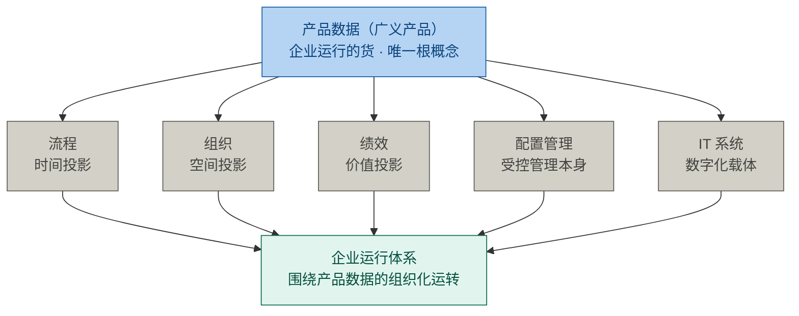
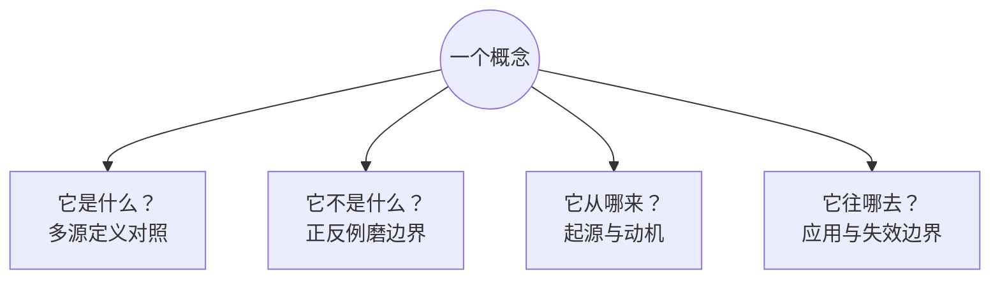

# 第1章 概念体系：学习能力的杠杆

## 1.1 引言

**误解现场。**

一个词，让两个项目停了工。

不是没人懂它。恰恰相反：屋里每个人都懂，而且各懂一套。

于是一间会议室里，同一个词吵了三个月，会开到第十一场；另一块白板上，那一截边界两个月没画出来。

恒信集团做合同审批系统。一份合同从起草到盖章，要在三个部门之间走一圈：业务先填，法务再看，财务最后盖章。系统管的就是这一圈。这天在评改造方案，方案里有一件要定的事：这套系统要不要拆成两个独立的系统——一个只存合同正文，一个只管审批流转。

产品开发经理曹峰把会议室占了："三个月了。今天先把"架构"这两个字对齐，对不齐就没法评。"

客户那边催了两次，合同上写着六月三十号上线。

业务方的郑亮先抱怨："我们公司的架构不行，审批链跨三个部门扯皮。"

系统架构师罗建纠正："你说的那是组织架构。系统架构是服务边界和数据所有权。"

开发组的苏婷追问："我那接口清单，按哪张图对齐？前端等着开工。"

运维王默补一句："还有部署架构呢？部署在哪、谁运维、上线怎么回滚，总得有人说。"

需求分析师顾言放下笔："停。"架构"在我们嘴里已经是四件事了。各自说清，你指哪一件。"

罗建说："我指系统架构。"

顾言没放过他："那你把它答全。是什么？不是什么？从哪来？往哪去？"

罗建答得一字不差。是什么——一个系统最基本的那些概念或属性，加上管它怎么实现、怎么演进的那几条原则。不是什么——不是一张图，不是一次选型，也不是组织架构。从哪来——从建筑学借来，七十年代进了结构化设计，九十年代软件架构热起来，最后由标准定了稿。往哪去——管的是这个系统怎么被实现、怎么演进，在不可逆的决定做出之前用。

四条一条不差。屋里有人点头。

定义这一关过了，方案还得往下走。顾言把话拉回桌上那张方案："那这次拆不拆？"

罗建停了几秒："……我得再看看。"

屋里没人接话。那份标准还摊在桌上，没人翻。

四问答全了，会还是没往前一步。换个说法：那个词对齐了，那个概念也说到位了，该做的判断还是没做出来。

**本章要回答什么。**

章题有两个词。概念体系，说的是这些概念一层套一层，织成一张网；学习能力的杠杆，说的是这张网只要有一处没说准，后面的力气就全乘在零上。

罗建四问答全了，词也没说错——他只是没再往下织。

1. 一个把四问答全的人，缺的到底是什么？
2. 一个领域里真正要紧的概念是哪几个，该先抓哪一个？
3. 同一个概念，说到哪一级才算说准了；我回去拿什么把它问到底？

本章要立一句主张，交一件工具。

> 把概念说准，是学习能力里回报最高的那一步。

## 1.2 杠杆：概念没抓准，力气乘在零上

同一本书，同样每天两小时，读三个月。

一个人先翻目录，问这本书要解决什么问题，把目录里的词连成三句话，再从第一章读起；另一个人从第一页第一个公式开始背。

三个月后，两个人都读到第三章。头一个人说得出这本书在解决什么问题，第二个人说得出第一章讲了什么。

差距不是努力拉开的。两个人的投入一样，场景一样，可一个人拿走的是一张地图，另一个人拿走的是一页笔记。

把这件事写成一道式子，是这样：

> 学习产出 = 根概念能力（方向）× 概念体系能力（力臂）× 学习投入（施力）× 实践场景（支点）

四项分工不同。方向决定往哪儿使劲；力臂决定同样的力气能撬动多少；施力是投入的时间与注意力；支点是这道题落脚的真实任务。

力臂这一项，就是**概念体系能力**：能在概念的梯子上往上走的那副本事。它由四件动作组成——识别枢纽、织关系、迁移、辨边界。识别枢纽管"抓哪个"，属位次那一步；后三件管"长到多高"，1.4 逐级展开。

还有一件管方向的：**根概念能力**，先抓源头，再展结构。它负责开口之前先站在哪儿。

关键在乘号。加号里的项可以互相补偿：这项弱一点、那项强一点，总分还过得去。乘号里不行，任何一项为零，整条式子就是零。

**两个归零项。**

这条式子里，有两处一错就全盘归零：**方向**与**表征**。方向由第一项（根概念能力）管，先抓哪个概念；表征不在这四项里，它管那个概念说得多准。其余三项只负责放大：方向对了，力臂越长撬动越多；方向错了，力臂越长偏得越远。

恒信那场会就是这样：屋里的人都在使劲，可各使各的方向。罗建的方向是对的——他抓的是系统架构；可他的表征只到第一级，判不了。

方向这一项，有硬证据。二〇二六年，北京大学一个团队在《自然·通讯》上发表了一项研究，做的是"先学什么"这件事。

他们用电脑造了几类知识网：每个点是一个知识点，连接方式不同；再找人来学。结果很清楚：少数节点占据大量连接的那种网最好学；均匀对称、没有主次的网反而难掌握。

更有说服力的是第二个实验。同一批知识，一组先学枢纽再学细节，一组先学边缘再学枢纽，还有一组随便学。学完再上正式课程，先学枢纽那组的优势随时间越来越大，还扩散到没直接学过的细节节点。

论文自己的边界也要说清两条。一，实验用的是抽象的知识网络，真实领域复杂得多，"哪儿是枢纽"仍然要靠手艺去找，这就是下一节三步识别法要干的活。二，它测的是"预测"，不是"应用"；"能讲给外行听就算掌握了"是这本书补上的一步，不是论文的结论。

顺带说一句：这副本事今天比过去更值钱。记忆和计算已经外包给机器，剩下的识别枢纽、织关系、迁移、辨边界，才是你自己的活。

机器记得比你多，算得比你快，但它不替你判断"这个概念在这里指什么"。恒信那场会就是现成的例子：五个人嘴里四件事，机器替你分不出谁在说哪一件。机器能背出的定义，比罗建还全；它也一样答不出"这次拆不拆"。

一条边界同时立在这里：**AI 是好帮手，不是判据。** 它可以给你候选清单，但候选要自己拿硬判据筛、自己拿理由辩护。它能替你收集，不能替你拥有。

两个归零项，一个管抓哪个，一个管说多准。接下来两节，一节一个。

## 1.3 体系：概念一层套一层，先抓根概念

先说先抓哪一个。冰链科技造 M3 医疗温控箱：一个不到二十公斤的箱子，里面一块板子、一套固件，外面连一个云端服务；医院拿它把疫苗从 2 度存到 8 度。那边也有一场会，开了两个月。

产品开发经理赵刚把会拉起来："边界划了两个月。今天先把"架构"这词说清楚。"

产品经理林涛先钉死："架构就是模块怎么分。定了才好派活。"

嵌入式硬件工程师石军摇头："模块边界是设计的事。我说的是硬件架构：传感器、主控、通信怎么布。"

测试季昭皱眉："我按哪一块拆用例？验收判据挂在哪一块的定义上？"

白板上画着 M3 二代的框图，分成三块：传感与控温、主控与通信、云端。边界那一段擦了又画，画了又擦。散会时，M3 二代的边界还是没划下来。云端软件的吴浩盯着服务边界，制造侧的小周盯着产线——边界一改，那条线要停。两个人一直没说话。

这一截空着的边界，为什么划不下来？这条产线上，真正要紧的概念是哪几个？

答案会让人意外：很少。

一个领域里天天挂在嘴边的词有几百个，真正承重的只有几个。这几个不是平级的名词，它们一层套一层。

拿产品开发这一行看。质量、功能、接口、组件、架构，这些概念都重要，但它们都要靠另几个才说得清：要解释"质量"，得先说"需求"被满足到什么程度；要解释"接口"，得先说"系统"分成几块。

于是这张网有了层次。最外层是能说清的那些，往里是撑着别人的那些，最里头是撑着所有人的那几个。

概念一层套一层：**一般概念包含核心概念，核心概念包含根概念**。

这三层不按重要性分，按它站在网里的位置分。一个领域通常只有三到五个核心概念，一到三个根概念。层级越深，判据越严，数量越少。

凭什么说这些是"概念"，不是"词"？标准里给过一条很紧的定义。

> **概念（concept）**：由特性的独特组合而形成的知识单元（ISO 1087:2019 §3.2.7）。
>
> 判据：
> - 可指称，一个词或短语；
> - 可界定，内涵与外延。

这个定义里藏着三个角。中文"苹果"、英文 apple、日文 りんご，是三个名字，指向同一个意思；菜市场那颗真苹果，是它指向的东西。名字、意思、东西，三样不是一回事。本章说的"概念"，是中间那个：它既不在嘴上，也不在物上。

开头那两场会吵的正是中间这个角。嘴上说的是同一个名字，脑子里装的是各家的意思。

那概念从哪来？多数不是哪位天才发明的。有的像"零"，是人造的工具；有的是被人揭开的规律；更多的是一群人反复吃同一个亏，最后写成条文。三种来路指向同一件事：**概念是共识，不是真理。**

还有一句更要紧：概念之所以要紧，不是因为它有定义，是因为没有它，一群人没法对"这是什么"说成同一句话。

一个团队连"返工"这个词都不认，管它叫"再改一版"，那么"返工要开单"这条规矩就无处安放。名字没了，话说不成，规矩也就立不起来。

三层里最该先动手的是最里头那一层：根概念。

> **根概念（root concept）**：领域中不可再向下归约的源头概念，其余概念都由它导出。
>
> 四条判据：
> - 原子性，不可由域内其他概念定义；
> - 生成性，其余概念从它派生；
> - 不可替代性，去掉它，领域崩塌；
> - 递归性，多个抽象层级反复生效。

**凭什么叫根概念。**

为什么先抓根概念？三条理由。

它是源头。根概念立住了，新来的概念有地方挂；挂得上的留下，挂不上的正好暴露网上的洞。

它管方向。根概念辨对了，往哪使劲才不错；辨错了，上面每一层都跟着错。

它最省。根概念变动得慢，外围知识变动得快。花同样的功夫，立得越早越合算。

夹在中间的是核心概念，也叫枢纽。

> **核心概念（core concept / hub）**：解释领域内其他概念都要用到它，而理解它自己只需很少前置知识。判据是反事实检验：去掉它，这个领域还成立吗？

要解释"符合性"，得先解释"需求"；要解释"架构"，得先解释"系统"。"需求""系统"被反复调用，自己却几乎不需要前置，它们就是枢纽。

前面冰链那场会上，三个人各说各的"架构"，谁也没有先问一句"系统"指什么。枢纽没立住，边界就划不下去。

概念是网上的节点，原理是连接它们的边。"基线一经批准，变更须走受控流程"就是一条原理，把基线和变更连了起来。原理也有源头：不可再被推导的那几条，叫**基本原理**，它们是把根概念里本来就含着的道理，写成一句明白话。

说了半天，那个概念到底怎么找出来？先有第 0 步，再三步。

第 0 步，问这个领域里什么东西算存在。是产品、是数据、是流程，还是关系？这一问答错，上面全错。候选不是凭感觉收集的，是由这个立场导出来的。

第一步，收集候选，借现成的材料，二十分钟就够。翻教材目录、读术语表、看综述、问行家、问 AI。领域共同体已经替你把概念压缩过一遍，直接抄。

第二步，拿硬判据筛。词频高的、被别人的定义反复引用的、理解它需要前置最少的，以及最狠的一条：如果这个概念不存在，这个领域还成立吗？

第三步，往上挂。筛出来的每一个，都问一句"它挂在哪个枢纽下"。挂不上去，说明清单有漏洞。清单是活的，随理解加深增删。

要判"它是不是根概念"，还有一道更硬的手续：把四条判据逐条写下来，每条配上证据和出处，写成一条能被人逐句反驳的链。写不出这条链，说明你手上是"我觉得"，不是"我判得出"。

> 术语注：词频、被引用度、前置数是三条代理判据——用可数的量代替真正要判的东西，方便，但会骗人。

根概念长什么样？三个领域，各走一遍。

**高速信号传输，根概念是阻抗。** 石军做过一块板子，十兆赫兹跑得好好的，加到一百兆赫兹，线上到处是反射，波形糊成一片。他先换了芯片，没用；最后发现是那条传输线的阻抗没管住。阻抗不是万用表量出来的电阻，是这条传输线对高频信号的总阻力。说起高速信号，人多半先想到速率、带宽，它们都是结果，根概念在阻抗。

四条判据逐条过：阻抗由线宽、介质、间距决定，不依赖别的概念——原子；反射、串扰都由它派生——生成；去掉它，信号完整性不成立——不可替代；从引脚到整机层层都要谈它——递归。

**产品开发，根概念是需求、系统、设计开发。** 冰链要定 M3 二代加不加"断电上报"，三个人吵了一下午。林涛先问：报什么、报给谁？这是需求。石军接着问：记在哪块板子上、走哪条链路？这是系统。吴浩再问：多久报一次，断网了先存还是先丢？这是设计开发。三个问题答完，这个功能才落得下去；答不全，做出来也是白做。

很多人以为根概念是"质量"。可质量是这些需求被满足的程度，是派生的；也有人以为是"产品"，那只是一个交付物的名字。

质量、功能、接口、组件、架构，都从这三者派生；架构挂在"系统"下面，是枢纽，接口、组件又挂在架构下面。

**企业运行体系，根概念是产品数据。** 小周在产线上最怕一件事：箱子做完了，查不到这一台用的是哪批料、谁装的、测过什么。物料、装配、测试、发货、安装，五道各留一条记录；这五条记录就是产品数据。

有人说企业运行不就是跑流程吗？可流程是这些记录按时间排出来的样子；组织是它们按部门与工位排出来的样子；绩效是按它们算出来的样子。去掉流程，记录还在，只是无序。



> 图注：流程、组织、绩效是产品数据在时间、空间、价值三个维度上的投影；配置管理、IT 系统是它的受控管理与数字化载体。

同一个概念换个领域，位置就变。需求在产品开发这一域里是根概念，在企业运行这一域里只是核心概念；企业运行真正的根概念，是产品数据。第7章会把这条路走完。

三个示例是按四条判据判出来的，供对照，不是任何标准的条文。

## 1.4 深度：概念能说到多深

先抓哪一个说完了，接下来是说到多深。深浅不是四种知识，是一条梯子：从一个概念，到几个概念连成的结构，到能在脑子里把它跑一遍，到一整套看法。说得浅，等于没说。

### 1.4.1 深浅从哪来：我们操作的不是世界

你思考的不是经济活动本身，是那些概念和指标；你理解的不是历史，是某种历史叙事。脑子里操作的是代用品，世界本身不在手上。

恒信桌上那张方案，就是系统的代用品。系统还没拆，谁也没见过拆完的样子；屋里的人只能对着这张纸判断。纸上写得越粗，能判断的越少：只写"拆成两个系统"，就只够吵；写到"合同正文与审批流分两个库、三处接口、哪一块归谁运维"，才够判。

代用品有粗有细。能做多大的事，取决于手里的代用品长成了什么样。这条梯子的四级，就是代用品的四种粗细：同样一个"架构"，有人手里只有一张图，有人手里是一整套能拿主意的判断。

### 1.4.2 浅的那一头：说得出，认得出

梯子的第一级，是**表征**：一个概念，连同它指的东西和它的边界。现实事物在头脑中的代用品，最小单位就是概念。

判据：说得出它指什么、不指什么，能把它跟相邻的概念分开。这一级要做的动作，是**认准一个概念**：在一堆词里先抓出要说的那一个。像查词典："疫苗"这一条你读得懂，知道它指什么、不指什么；可它怎么起作用、什么时候不管用，词条不告诉你。这一级只是术语表。

罗建的"架构"停在这一级。他能说出它是什么、不是什么，可要问"眼前这件事是架构问题还是设计问题"，他答不出。那两场会上的人，把架构问题、设计问题、组织问题混在一张桌上谈。

梯子的第二级，是**图式**：几个相互关联的概念，连成一个认得出的结构。概念不再是一个一个的，它们之间有了关系——谁包含谁、谁在谁前面、谁跟谁对不上。

判据：一眼认出这是哪一类，还能预判下一步。这一级要做的动作，是**织关系**：把概念一个一个连成结构。像你没去过那家医院，听人说过：一楼挂号，二楼抽血，三楼拿药。几个概念一连，脑子里就有了一张结构图：这是"先挂号再看病"的一类流程，下一步该去哪。

苏婷在这一级。她摊开接口清单，能一眼指出：这一条对系统架构第二块，那一条对部署；这种结构她认得。可再问"拆开之后这三条接口谁接、断了先补哪条"，她就得看罗建。认得图式，不等于判得了。

### 1.4.3 深的那一头：推得出，判得了

梯子的第三级，是**心智模型**：它不只是一套认得出的结构，还能在脑子里跑起来。给它一个条件，它就能告诉你结果——不用真上路，也知道刹不刹得住。跑得起来，是因为你知道里面哪几样在变、谁推着谁、出了岔子往哪儿回、到什么程度就不灵。

判据：给它一个条件，说得出结果；把"什么时候不灵"说死，这一步叫**辨边界**。像雨天开车：车速、跟车距离、路面湿滑，三个变量一起动；快了刹不住；雨大到一定程度，什么速度都别开。

石军在这一级上。他不用试板子：这条传输线跑到一百兆，波形会糊成一片，眼图塌掉，因为阻抗没控住；把线宽从五密耳加到六密耳，能撑到一百二。说得出因果，也说得出什么时候失效。

拿"架构"走一遍：拆开之后，哪一条链会断、谁的审批会卡住，说得出因果。罗建做不到，所以他说"我得再看看"。

梯子的第四级，是**解释框架**：把一整套图式与心智模型合起来，覆盖一个领域的关键问题，形成一派看法。

判据：能比较两套看法的解释力，判断什么值得相信、什么只是叙事包装。像两种讲历史的课：一种把改朝换代归到皇帝昏庸，一种归到气候与财政——各是一套模型，各有解释不了的地方。你不问哪套好听，问它解释了多少次改朝换代、在哪儿说不通。

这一级听人讲架构，问的是机制，不是立场：这一派讲的架构观，哪一部分能用，哪一部分只是包装。

顾言往这一级上走。有人讲"微服务拆得越细越好"，他不问这句话流不流行，问它放在恒信成不成立：审批跨三个部门、串行走，拆细了每加一跳就多一次交接。这条主张在别处成立，在这里不成立。

四件里，**迁移**是跨级的：把任何一级的东西搬到别的领域，看还认不认得。

四级摆在一起，是同一个概念的四张脸，不是四样东西。

### 1.4.4 深浅怎么分：能力四级

| 级 | 是什么 | 比下一级多了什么 | 一句话判据 |
|---|---|---|---|
| ① 表征 | 一个概念 | —— | 说得出它指什么、不指什么 |
| ② 图式 | 几个概念连成的结构 | 概念之间的关系 | 一眼认出哪一类，能预判下一步 |
| ③ 心智模型 | 能在脑子里跑起来的模型 | 变量、因果、反馈、边界 | 推得出"如果这样就会那样"，说得出何时失效 |
| ④ 解释框架 | 一整套图式与模型 | 覆盖一个领域的关键问题 | 比得出两套看法的解释力 |

四级不是四种知识，是同一条梯子的四级：每一级，都比下一级多出一样东西——关系、动、整片。

本章的工具停在第一级。四问是第一级的工具，管的是把概念看准，不负责拿主意。

有一种情况可以自查：**能把一个概念的四问答全，却在一个真实的取舍面前说不出话。这不是表达问题，是能力层级问题。**

那上面三级谁来建？后面每一章都在建：第2到第7章是表征与图式，第10到第12章是心智模型，第17、18章是解释框架。

前三级能讲、能写、能画。第四级有一块讲不出来：老师傅调火候、老工程师看一眼就知道哪儿不对，那不是天赋，是在现场待久了长出来的。

> 术语注：前三级的说法在认知科学里通行；第四级"解释框架"是课程作者的自命名，不是标准术语。

### 1.4.5 表征：最浅的一级，定的是成不成立

"回报最高"还有第二层理由，就藏在这四级之间。

> **价值律**：**表征是 1，上面三级是 0**（本书命名。"1 和 0"说的是成不成立、以及量级，不是分数。）

先说"1 定成立"。概念指错了东西，上面三级再漂亮也是零。

前言里那句话说的正是这一级：**掌握不了一门专业，多半原因是概念不清。** 本书反复讲的"把概念说准"，不是风格要求，是这条式子里最靠前的那个数。

一次评审会上，一个人把"验证"和"确认"当同义词用。他经验越足、材料做得越漂亮，整场错得越整齐。本钱再厚，乘上零还是零。

再说"0 定量级"。上面三级决定的是能做多大事：看准一个概念、看出一套套路、能推演、能判断什么值得相信；每加一级，同样一份信息能做的事翻着倍涨。

1 定成立，0 定量级。这就是第一级最便宜、也最不能省的原因。

回到罗建。顾言没催他，把那份标准翻到术语章："42010 那条定义，答的是这个实体是什么。这份描述管定义，不管决策。要判拆不拆，另有三件事。一是服务边界切在哪：哪些功能归这一块，哪些归那一块。二是数据归谁：合同正文和审批记录，各存一份还是共用一份。三是拆完哪条链会断。这三件答不出来，方案写得再漂亮也过不了评。"

罗建把架构图合上："这三件我一件都答不上来。我手上只有定义，没有判据。"

他不是没准备。他手上的"架构"停在第一级：概念说准了，关系也画得出；顾言那三件事，一件都还没做。**四问答得全，只是拿到了那个 1。**


于是有了两个坐标。一个是位次，一般概念、核心概念、根概念，回答该抓哪一个。一个是深度，表征、图式、心智模型、解释框架，回答说到多深。横轴是位次，纵轴是深度。

```
深度·能力四级（说到多深）
 ④ 解释框架 │
 ③ 心智模型 │
 ② 图式     │
 ① 表征     │ ← 这是 1：它不成立，上面三级都是 0
            └─────────┼─────────┼─────────→ 位次（说准哪一个）
                   一般概念   核心概念   根概念
```

两根轴各管一件事。一个概念可以位次不低、深度很浅，也可以位次不高、深度很深。

罗建的"架构"是前一种：位次落在核心概念，深度只到表征。枢纽抓到了，话也答全了，本事只到第一级。

再看后一种：石军的"阻抗"，位次落在根概念，深度到了心智模型，他能推这条线跑到多少兆会塌，也知道加宽多少能撑住。

两点一放，就看出两根轴各管一件事：位次管抓哪个，深度管说多准。所以谈到任何一个概念，都该同时报出两个坐标。

> 术语注：位次轴上的三层与深度轴上的四级是两个量词，别混：论位次说"第几层"，论本事说"第几级"。

还有一处用法要交代。前面 ISO 那条定义是术语学的用法；本书讲四级时，把表征、图式、心智模型、解释框架一律叫概念，比那条定义宽。

## 1.5 工具：把概念问到底

怎么才算真拿住了一个概念？先看"假懂"：背得出原文，却举不出反例；不知道它何时失效；孤立记住，不知道谁跟它连着。真懂反过来：能用自己的话重述，能举正例也能举反例。还知道它跟谁冲突、当初解决什么问题；讲给外行能懂，换个情境能用。

理论依据是一句老话：意义即用法。概念的意义不在字典里，在它的用法里。

**四道问题。**

把上面那些差别压成四道问题。



| 问 | 怎么问 | 为什么这么问 |
|---|---|---|
| 它是什么？ | 找三四个来源对照定义 | 定义差的那一点，往往就是本质 |
| 它不是什么？ | 找正例和反例，用反例磨边界 | 概念靠典型例子活，靠反例定型 |
| 它从哪来？ | 回到它被创造时的问题现场 | 知道它当初解决什么，才记得住 |
| 它往哪去？ | 挂在哪些流程上、被谁用、何时失效 | 掌握失效边界，才算真懂 |

四道都答全，才算拥有；只答得出第一道，只是见过。

四问答不出来，样子有规律，最常见三种。

**说不出定义**：用例子代替定义，比如"评审就是开会过一遍"。例子是插图，判据才答得了。

**同词异义**：同一个词各指各的概念，比如"架构就是模块怎么分"。治病的药不是问"架构是什么意思"，是问"你指哪一个"。

**翻译伪朋友**：英文原词不同，中文译名形近，比如"验证过了就等于确认过了"。评审用"确定"，验证与确认用"证实"；中文都带"评、验、认"，像近亲，其实不是。

比词更深的还有一种：概念没认错，却用在不该用的地方。那是"往哪去"没答全。

问之前还有一步：先锁住词的身份。这个词出自哪部标准的哪个条款？术语章里定义它了吗？"概念"就是现成的例子：术语学标准里有正式定义，架构标准里却按通用语意用。

拿那两场会上被吵翻天的概念练一遍。

- 它是什么：一个实体在其环境中的基本概念或属性，以及用于该实体及其相关生存周期过程的实现和演化的管控原则。
- 它不是什么：不是一张架构图，图会过时；不是一次技术选型；更不是组织架构、产品形态。
- 它从哪来：从建筑学借入软件与系统领域，七十年代结构化设计、九十年代软件架构热，后由标准定稿。
- 它往哪去：在不可逆决策做出之前用，在变更影响评估时用；失效边界是——组织架构、产品形态混进来时，它就说不清了。

答完四道，那两场吵架的解法已经出来了：他们吵的是各自不同的"它"。

四问记住的是四个方向，不是一张能逐项打勾的清单。要查全，书末附录给每张核心概念配一张卡，把四问展开成固定几栏；栏不必都填，但不可跳过。

**一圈一圈地问。**

四道问题是尺子，尺子要有地方用。练这件事是一条能一圈一圈转的循环。

```
1 立枢纽 → 2 织关系 → 3 逼输出 → 4 勤校准 → 5 落实践 → 回到 1
```

五环是练这副本事的循环，四件不各占一环，但每一步都在用它们：立枢纽用识别枢纽，织关系用织关系，勤校准用辨边界，落实践用迁移；第三环逼输出是另一件事——把结构压出来讲给人听，讲不清就说明前面没织成。每一圈，都用四道问题把那个概念再问一遍。

一圈走没走通，看三样：讲得清（三五句话让外行听懂）、驳得倒（举得出反例，说得出何时失效）、搬得走（换个行业、换个粒度，还认得出同一个结构）。这三样也正好倒着指认五环——讲不清是织关系没成，驳不倒是不敢碰边界，搬不走是没迁移。

最容易跳过的是第三、第四环，而它们恰好是刻意练习的要件：目标明确到能判对错，反馈快到能马上改。

两条边界：陌生领域先找枢纽最划算，已有底子的领域一上来就跳枢纽反而漏细节；枢纽清单也会变——燃素、以太都曾被推翻，共识不是真理。

**案例回场：先分清在谈哪一个。**

回到前面那两场会。这一次，屋里有人带了四问。

冰链那边，林涛说自己指的是产品架构，他关心模块怎么分；石军说他指的是硬件架构；吴浩说他指的是系统架构，服务边界与数据所有权。制造那边的小周不关心它们指哪一个，他只问一句：这条线停不停？三个人把四问答完才看清：这是三个不同的所指。同一个实体只有一个架构，另两个是同一个系统的不同关注面。

恒信那边同样：郑亮说的是组织这个实体的架构；罗建说的是系统架构，王默要的是部署架构；苏婷要的是接口那一张视图。

四问答下来，苏婷把接口清单摊开："我这份对的是系统架构那张图，三块。"王默拿过笔："部署架构我另画一张，跟这三层不是一回事。"顾言把两张纸并排一放："先谈系统架构，再谈部署。"

四十分钟，边界画出来了。

散会时，郑亮把那叠审批单往前一推："三个月，十一场会，方案一页没改。这三个月不是花在方案上，是花在"架构"这一个词上。"

**没有人先把"在谈哪一个"问出来。**

**认知反转。**

回到前面那两场会。

其实两间屋子里的人都没有错。冰链那边，产品、硬件、云端、测试、制造，各有各的立场；恒信这边，组织、系统、接口、部署、需求，也各有各的道理。错的是这两场会本身：一场没有把概念对齐的会，注定是一场各说各话的表演。

如果当时有人带着四问，会场会是另一个样子：

> "等一下，我们说的"架构"不是四件不同的事，是同一个架构的几张面孔。先各自答四问：它是什么、不是什么、从哪来、往哪去。产品架构看模块边界，硬件架构看元件布局，系统架构才管服务边界和数据所有权；组织架构则是另一个实体。"

本章的反转，比"一场各说各话的表演"更深一层：你不是不懂那个概念，你是还没拥有它。能把"架构"背出来、能画出架构图，都只是见过它；能回答它是什么、不是什么、从哪来、往哪去，才算拥有它。

罗建也没有错。他答得全，只是停在第一级；换一个背得更全的人坐那儿，一样判不了。

顺手把一个更深的念头放进你口袋。如果连"架构"这么核心的枢纽词，都只是见过而非拥有，那你脑子里其他天天用的概念呢？你真正拥有几个？

**小结。**

本章不给你新领域概念，给你一副本事：概念体系能力，学习能力的杠杆。

说到底两句。一是挑对该先说准的那一个：先找根概念，再铺骨架。二是把那个概念从背得出说到用得上：说准是那个 1，能推演、能判断是它后面添的 0。

这两步看着便宜，却最不能省。概念没说准，后面花多大力气，都只是在把错的东西放大。

下一章，我们用这套坐标去量第一个领域概念：工程。它是什么，不是什么，以及为什么"用敏捷加持续集成"不等于"在做软件工程"。

## 附录

**A 概念总图**

```
主张：把概念说准，是学习能力里回报最高的那一步
  ├─ 一个现场 ──────── 一个词让两个项目停了工；四问答全，会还是没往前走一步   §1.1
  ├─ 杠杆 ──────────── 一道乘法；两个归零项：方向、表征                        §1.2
  │      ├─ 力臂：概念体系能力（四件）＋管方向的根概念能力
  │      ├─ 两个归零项：方向（先抓错了概念）／表征（概念没说准）
  │      └─ 硬证据：先学枢纽的那一组，后来居上
  ├─ 体系 ──────────── 概念一层套一层：一般 ⊃ 核心 ⊃ 根概念                    §1.3
  │      ├─ 凭什么叫根概念：原子／生成／不可替代／递归
  │      ├─ 为什么先抓根概念：源头（新东西靠它挂）／方向（管往哪使劲）／最省（根概念变得慢）
  │      └─ 怎么找：问什么算存在 → 收候选 → 硬判据 → 往上挂
  ├─ 深度 ──────────── 一条梯子：一个概念 → 几个概念连成结构 → 能在脑子里跑一遍 → 一整套看法   §1.4
  │      ├─ 能力四级：每级一条判据（§1.4.4）
  │      └─ 价值律：表征是 1，上面三级是 0；位次 × 深度＝两坐标（§1.4.5）
  └─ 工具 ──────────── 四问（是什么／不是什么／从哪来／往哪去）＋一圈五环       §1.5
         ├─ 三种词汇病：说不出定义／同词异义／翻译伪朋友
         └─ 查全：概念档案
```

**B 本章的能力级**

**第 ① 级为主**

- **表征**：把六个概念说准——概念、核心概念、根概念、基本原理、概念体系能力、根概念能力；用的工具是四问加一句词的身份核对。
- **图式**：给出两个可识别的结构——概念一层套一层（一般概念包含核心概念、核心概念包含根概念），能力四级（表征、图式、心智模型、解释框架），以及两轴合成的两个坐标。
- **心智模型**：给出三个能推演的机制——一道乘法与两个归零项、三步识别法加一条能逐句反驳的链、一圈五环。
- **解释框架**：本章不建此级，由第十七、十八章承担。

> 能答全四问，才算拥有；只能答第一问，只是见过。记住这条次序：表征是 1，上面三级是 0——1 定成立，0 定量级。

**C 自查 · 这些说法对吗？**

1. "概念就是专业术语，背熟定义就算懂了。"——**错**。懂是能答四问、能用、能迁移；背熟定义只是见过。
2. "概念体系能力＝懂得多。"——**错**。组织得好才关键；知识多不等于会抓枢纽。
3. "概念体系能力就是根概念能力，两个词是一回事。"——**错**。前者是全集，四件本事；后者只是管方向的那一件。
4. "力臂越长越好，投入越多产出越大。"——**错**。乘号里有两个归零项：方向与表征。
5. "先学细节再搭框架，殊途同归。"——**错**。先立枢纽，后面的学习越来越省力；先切细节，越来越吃力。
6. "把概念讲给外行听是浪费时间。"——**错**。转述是压缩测试，讲不清正好暴露缺口。
7. "四问答出"它是什么"就够了。"——**错**。答全四道才算拥有；答不出"不是什么""往哪去"，只是见过。
8. "核心概念一旦记住就不用再改。"——**错**。概念是共识不是真理，枢纽是起点，随时可修正。
9. "根概念就是最重要的概念。"——**错**。根概念是最源头的那一个，未必最重要——质量很重要，可它是派生的。

**D 练习**

1. 用四问量你工作里天天用的一个概念，看哪一问最薄。为什么最薄的那一问，恰恰是你最容易出错的地方？量完再报两个坐标：位次在哪一层，本事练到第几级？
2. 用三步识别法找出你领域的核心概念：问什么算存在、收集候选、硬判据筛选，再试着把其中哪几个是根概念写成一条能被人反驳的链。
3. 把某个概念讲给一个完全外行的人，三五句话讲清。卡在哪一步？暴露了什么缺口？
4. 用那圈五环给最近一次学习做个体检：你停在第几环？下一环是什么？为什么卡在那儿？
5. 用四问重开前面那两场会：两间屋子里的人对"架构"各持所指，哪些是同一个所指、哪些不是？怎么让两个团队先各自对齐，再谈别的？
6. 拿你最近学到的一个概念做一次迁移测试：换一个行业、换一个粒度，这条判据还成立吗？

（答案要点见书末附录，与训练教材题卡同源）

**E 参考文献**

> **编号怎么读**：`[k]` 是本章内的文献序号；括注的 `R-xx` 是全书参考文献总表（附录 D）的编号，凭它可回总表查该条的完整说明与条款。

**标准**

- [1] **R-01** ISO 1087:2019 —— 概念定义依据（§3.2.7："由特性的独特组合而形成的知识单元"）
- [2] **R-04** ISO/IEC/IEEE 42010:2022 —— 架构定义（§1.4.5 章末案例、四问示范）
- [3] **R-08** ISO 10007:2017 —— 受控快照由军品工程实践固化
- [4] **R-38** ISO 9000:2026（第 5 版）—— 评审、验证、确认（§3.11.2／§3.11.12／§3.11.14，伪朋友辨析）

**经典文献**

- [5] **R-43** 索绪尔《普通语言学教程》—— 符号＝能指＋所指；语言（langue）与言语（parole）
- [6] **R-44** 弗雷格《论涵义与指称》(1892) —— 符号→涵义→指称
- [7] **R-45** Xiangjuan Ren 等《Compressive learning scaffolds higher-order network structure to enhance human knowledge acquisition》（Nature Communications, 2026, DOI: 10.1038/s41467-026-75843-7）—— 压缩学习实验
- [8] **R-46** Bloom 教育目标分类学（Anderson & Krathwohl 修订版, 2001）—— "会用才算掌握"
- [9] **R-47** Roediger & Karpicke (2006) —— 测试效应
- [10] **R-48** Posner 等 (1982) —— 概念转变
- [11] **R-49** Whitehead《The Aims of Education》(1929) —— 惰性知识
- [12] **R-50** Lave & Wenger《Situated Learning》(1991) —— 情境学习
- [13] **R-51** Katz《Skills of an Effective Administrator》(1955) —— 概念技能（"概念体系能力"的管理学源头）
- [14] **R-66** 维特根斯坦《哲学研究》(1953) —— 意义即用法
- [15] **R-67** 库恩《科学革命的结构》(1962) —— 范式转换（共识不等于真理）
- [16] **R-68** Kahneman《思考，快与慢》(2011) —— 系统一／系统二
- [17] **R-78** Miller《The Magical Number Seven, Plus or Minus Two》（Psychological Review, 1956）—— 工作记忆容量的经典文献
- [18] **R-97** 万维钢《现代思维工具100讲》（得到 App 课程，第 38—47 讲）—— 工作记忆带宽与压缩单位、能力四级、参与度分级、迁移、默会知识边界
