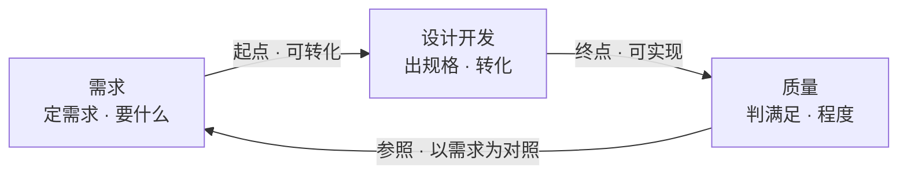

# 第3章 需求、设计开发、质量：产品开发的图式

---

## 3.1 引言

### 3.1.1 误解现场

周五下午四点，冰链科技的产品评审会开了两个小时，会议室里飘着咖啡和争论的气味。

产品经理林涛把一页参数对比表拍到桌上，指着其中一个数：

> "M3 的箱温精度做到 ±0.3℃，比竞品高出一档；断电保温 72 小时，竞品 48 小时；重量还轻了 2 公斤。这几条都落在可测量的固有特性上，符合性没有问题，质量这一关我看不出问题在哪。"

会议室里一片点头，有人还轻轻鼓了掌。

产品开发经理赵刚在产品评审结论栏里签下"通过"：

> "三个参数全线领先，三样都超出需求写的那一档。超了还算不好？质量这一关，我签字。"

只有坐在角落的测试季昭举起手：

> "那……判合格的标准是什么？写在哪份文件里？"

林涛摆摆手："技术方案都定了，判的标准后面自然会有。先定对外怎么讲。"

季昭张了张嘴，又闭上。会议继续。

如果你坐在这间会议室里，你大概也会点头。因为大多数人对质量和设计开发的直觉，和林涛一模一样：质量就是指标压过对手；设计开发就是做出技术方案，方案定了，后面的测试、采购、生产，都是自然会有的事。

这两个直觉，是本章要推翻的东西。错的不是林涛，错的是这两个词在他脑子里各有一个替身：质量被换成了"比对手强"，设计开发被换成了"把方案做出来"。替身从哪儿来、为什么早晚要露馅，是这一章要拆的两件事。

所以这一章只追一个问题：**字也签了，参数也比了，凭什么还是不算数**？下面六个问题，都是它的分身。

### 3.1.2 本章的人和物

这一章的事大多发生在冰链科技。评审桌上，产品经理林涛举着参数表，产品开发经理赵刚说"超了还算不好？质量这一关，我签字"；测试季昭问了一句"判合格的标准是什么，写在哪份文件里"，那句话被淹没了。

制造与供应链小周关心的是排产，系统工程师小张盯着"这三个词各自管什么"，嵌入式硬件石军与云端软件吴浩各守箱子与云端那一侧。

两样东西贯穿全章：冰链的 M3 温控箱，和恒信的合同审批系统。

### 3.1.3 本章要回答什么

读完本章，下面这几问，你应该答得出来。

1. 客户说"没有了"，还有哪些需求没说出来？漏掉的那条为什么最后变成返工？
2. 一份需求要写到什么程度，设计才可以开工？
3. "技术方案做完了"，为什么不算设计开发结束？还差哪些东西？
4. 参数比对手高，为什么不算质量好？
5. 质量好不好，能打成一个分数吗？打不了分，又拿什么判？
6. 进度不够，必须少做一条需求，少哪一条，谁说了算？

这几问合起来，问的是一件事：这三样东西，为什么非拆成三样、又非连成一套。

---

## 3.2 需求：要什么，说到能开工

### 3.2.1 需求：没说出口的也算

标准给需求下的定义只有一行：

> 需求：明示的、通常隐含的或必须履行的需求或期望。

这句话拿"需求"解释"需求"，读着绕，摆平它：一条需求可以是要什么，也可以是盼什么，它以三种方式出现，**三种地位相同，没有主次**——明示的说出来了；通常隐含的是惯例默认、没人说出口；必须履行的是法规规定的那一类。

本书把 requirement 一律作"需求"，标准的中译本作"要求"，同一个词，两个译法。

M3 三种形态全占。

明示的写在纸上。客户在合同里写明箱温波动不超过 ±0.5℃、箱门可单手打开。白纸黑字，谁都能看到，谁都赖不掉。

通常隐含的没人写，但行业默认。冷链箱要扛得住装卸时的磕碰，外壳不能有锐角划伤搬运工，电池要能撑过全程并显示余量。这几条没人写进合同，可你要是漏了，客户用的第一天就会认定这产品不行。

必须履行的是法规强制的那一类，无条件满足。疫苗运输的温度区间、断链即报废、异常要留痕报警，都写在法规与经营规范里。不满足，M3 连上市资格都没有。

**三种形态里最贵的是第二种**。它不会自己开口，要靠组织主动去挖。

> 没写下来的，也是需求。

标准还留了一个口子：为了达到高水平的顾客满意，有一种期望既不明示、也不是通常隐含、也不是必须履行，可能仍然要满足。它不算第四种形态，也不写进需求清单——它由确认去接：真实使用中顾客在意什么，那里见分晓（第8章）。

镜照一眼恒信：合同审批的明示需求是三个部门间流转审批，隐含需求是审批人能在手机上快速通过、离职审批人自动移交待办，必须履行的是合同数据按法规留档。

### 3.2.2 需要、期望、目的、目标，差在哪儿

往旁边看一层，有两组词最容易糊在一起。

需要和期望是内容，明示、隐含、必须履行是呈现方式。内容是你要的那件事本身，呈现方式说的是它怎么出现。

| 英文 | 中文 | 说的是 | M3 的例子 |
|---|---|---|---|
| need | 需要 | 硬性诉求，缺了会痛 | 疫苗不能坏 |
| expectation | 期望 | 软性诉求，缺了会失望 | 精度越高越好 |

一个需要可以明示，比如"我们要 72 小时保温"；也可以隐含，比如"要能扛磕碰"。一个期望同样两头都能落。两维交叉，才是需求的完整样子。

再往外一层，是目的、目标与需求。这三个词在中文里几乎可以互换，标准只给了后两个。

目的：系统为什么被研制的理由，在价值侧，可以不量化。

目标：要实现的结果；放到系统语境里，本书要求它可度量。

需求：系统自己要满足的那几条，要写成可判定的样子。

三者是**侧面不同，不是内外不同**。链条是目的展开成目标，目标转化成需求。

本书把目的单列成一个词，理由是这个理由必须有人签字、有人认账。标准没有给目的一个术语条目，也不要求写出一份叫目的的文档；它要求的是把战略问题或机会弄清楚。题在战略，落点在目的：战略说的是怎么赢，目的说的是为什么做。

落到 M3 身上：目的，让疫苗在冷链运输中一路不失活、安全送达；目标，到站活性不低于 95%；需求，箱温 -20℃~8℃ 内偏差不超过 ±0.5℃、断链 30 秒内告警。

目的缺位的时候，团队不会停下来等，而是照自己猜的那个目的往前冲。做得越完美，离真实目的越远。

### 3.2.3 案例进展①｜一条没人问过的需求

第七周，产品、研发、销售开联合评审。林涛的方案书标题是"M3：行业精度第一的冷链温控箱"。

他开口第一句："客户要的是精度，这条需求我们直接做到行业第一。"

销售小冯打断他："谁告诉你的？上周我跑了三个省的疾控中心，他们问的第一句全是——能不能塞进我们现有的疫苗运输车？你的箱子比现款大一圈，塞不进去。这条合同里没写，你也没问过。"

赵刚把笔放下了："这条，我们谁都没问过客户。"

会议室安静了。林涛愣住："合同里没写这条。"

"是没写。可他们所有人都在问，这就是通常隐含的那一类。"小冯说，"你立项前做过市场调研吗？"

林涛没做过。他的起点是一个点子：把精度做上去就能赢。

七周后方案推倒重来，尺寸、保温层厚度、供应链全部重做。

起点给错了需求，转化得越彻底，浪费得越彻底。

### 3.2.4 需求要可转化，交界才画得清

点子、灵感、想法，要经过市场调研、可行性分析、技术预研、客户需求识别，才变成确定的需求；设计开发从这份需求起算。

为什么必须插这一步？定义说输入是需求，而这份需求往往是研究的成果。一个没经过研究确认的点子，会被做成一个错误需求的完美实现。设计开发不会自己发现方向错了，它只管把给它的东西转化到底。

很多项目设计得很辛苦、产品没人要，根源不在终点没管好，而在起点没收好。错的不是施工，是拿到的那份需求本身就错了。

那这一关怎么算过？起点是一份需求被正式确立为设计输入的时刻，而它必须先过一条判据：**可转化**。

可转化有四条前提，一条都不能松。

完整：功能、性能，以及由产品性质导致的潜在失效后果，一个不缺。M3 不只是能制冷，还包括制冷失效时告警、断电后保温多久、结霜了怎么办。

无歧义：每条需求只能有一种理解。"精度要高"不是需求，"箱温波动不超过 ±0.5℃"才是。

不冲突：需求之间自洽。要低到 -20℃、又要断电保温 72 小时，两样都推厚保温层；可箱子还得塞进现有疫苗车，尺寸有上限。这要在需求阶段协调掉，不是等设计做完才发现。

隐含需求已识别：最容易被忽略的一条。它多半不在纸面上，可规格对不对，恰恰由它定。

这四条不是拍脑袋定的，是从定义本身反推出来的。需求有缺口，转化在残缺的输入上开工，输出必然残缺；有歧义，同一份输入生出多种理解；有冲突，满足 A 就违反 B；隐含需求没识别，方向就错了，验证全绿、确认全红。

所以"可转化"不需要更高的东西来撑，它就是从"设计开发是需求转化"这句话里长出来的。

还有一处常被问：市场调研、可行性研究、用户需求说明书这些文档，算不算设计开发？

概念上算，而且同构。定义不挑阶段：客户说"我要一台能低温运行的小型设备"，需求开发把它变成"箱温 -20℃~8℃、体积不超过 0.8 立方米"，这本身就是一次细化。

组织上可分可合。有的标准把需求确定和设计开发分成两条，不是因为需求开发不是转化，而是职责划分不同：一条面向顾客与市场，一条面向技术与实现。

实用判据只有一条：**特性有没有被规定**。需求开发阶段，客体还没确立，特性还不存在；设计开发阶段才开始把需求落到客体的固有特性上。

不管这些文档归哪一边，它们都是设计输入的来源。审核时"这些文档不在受控范围"是过不去的：可以不属于设计开发，但不能不受控、不可追溯。

---

## 3.3 设计开发：写到能造、能验

### 3.3.1 设计开发：需求怎么变细

标准给设计开发下的定义，几乎每个字都是关键词：

> 设计和开发：将某一客体的要求转换为该客体更详细要求的一组过程。

拆开看，四样各有讲究。

客体是被设计的东西。定义用"客体"，不用"产品"：设计开发的对象绝不限于硬件。M3 是客体，合同审批系统是客体，一条"疫苗出库流程"也可以是客体。

把过程设计开发落到最熟的那个例子上，就是工艺编制。图纸定下装配扭矩 15±2 N·m、密封无泄漏，这是构件做成什么样；工艺编制把它转成制造环节怎么做的可执行要求，输出工艺规程与工艺卡。

需求是输入，不是点子、灵感、创意。创意不表述为需求，就进不了这道门。目的和目标也不在门里，它们是门前的东西。

**转换是动词，也是灵魂**。输入与输出必须是不同的东西。流程走完，输出和输入一个样，那不是设计开发，那是走流程。

**更详细是唯一的判据**。定义没说更正确、更优化，只说更详细。设计开发的活是把需求展开、分解，落到能实现、能验证的粗细。方案好不好，由评审和验证把关，不是设计开发自己说了算。

这三个字拆开是三个可查的成分：更具体，按特性来定义，定量定性都行；更可实现，够下游直接执行；更可验证，落到特性上，让验证有对照。

最后那个成分要留神：更可验证只证明方向对，不能当终点。为什么不能，下面说终点的时候一次讲清。

这套判据在变更单上很好用。只改外观颜色、不产生任何新需求细节的变更，不构成设计开发，可以走快速通道。把温控从单路改成双路冗余，产生了新的可靠性需求、接口需求、测试需求，那是一次实打实的设计开发。

### 3.3.2 设计开发：每一级都在写细一层

定义还有一个注：输入那份需求比输出的更宽泛、更概括；一个项目里可以有若干个设计开发阶段。后一句让它层层往下走。

一只疫苗冷链箱，从客户需求到系统需求，到制冷子系统规格，到压缩机与温控板规格，到生产工艺要求——每一级都在做同一件事：把上一级的需求，变成下一级更详细的需求。

这中间有一级不是"更细的需求"。系统需求往下，先进系统架构定义：定住这个系统在它的场合里必须先说准的几个词、必须守住的那几条性质。它交出来的不是更细的需求，正是这几样。

所以"每一级都在做同一件事"要补一句：每级都在执行同一个定义；可架构那一段不是"更细"，是另一类。**同构，不等于同段**。架构那一段归第10章往后讲。

任何一级没做透，下游就在半成品上开工。

### 3.3.3 终点：止于可实现

设计开发什么时候算结束？绝大多数团队说技术方案做完就结束了。这个说法不能拍脑袋，得把候选终点一个个删掉。

拿确认通过当终点，错位：确认的对象是已经能用的客体，对照的是它针对特定预期用途的需求，而且发生在设计开发形式结束之后很久。

拿责任移交点当终点，那只是制度动作，不是定义内部的条件。

拿可验证当终点，**因果倒置**。

拿可实现当终点，才是定义内部唯一自然的终止条件。

"可验证"为什么不对，值得单独看，这是全书最要紧的一处推理。

验证是拿客观证据，证实规定的需求已经满足。注意：验证的对照物是规定需求，而规定需求正是设计开发的输出——它是明示的那一支，写在成文的东西上。

> 验证能发生，前提是手上有一份写下来的设计可对；设计开发走到哪一步，只决定你此刻对得着什么。

拿可验证当终点，等于让设计开发结束在验证的起跑线上。

倒置之外，还有更致命的一层。验证的证据可以是检验结果，也可以是替代计算、文件评审。那么几乎所有写清楚的需求都"可验证"，这条判据区分不了完成与未完成。

**终点只能落在可实现**：需求被细化到足以支撑客体实现、生产和服务提供可以直接执行，输出成为完整的规定需求。

落到实物上是什么样子？下游每个环节要用的方案，全部完成。

技术方案、物料采购方案、制造方案、测试方案、交付方案、部署方案、操作方案、运维方案。

这些不是彼此独立的几件事，是同一样东西的不同侧面：规定需求按下游环节切开，每一份是交给一个环节的那一段。

为什么技术方案不够？因为它只回答客体本身长什么样、怎么实现。它是这批方案里最先完成、最显眼的一个，也只是一个侧面。只做到它，下游连环停摆。

镜照一眼软件：合同审批系统的这批方案是技术、数据、接口、测试、部署、操作、运维、安全。名字换了一轮，少一份都不算完。

采购没有物料规格，也没有判合格的标准，停在原地；生产没有工艺依据，产线开不了工；测试没有判据，验证起不来——季昭章首问的"判合格的标准是什么"，问的正是这一份。交付、部署、操作、运维没有指令，产品出门就失联。

"可实现"这个词还容易引起误会，好像设计做完了东西就能跑。要分三层。

| 层次 | 谁给的 | 性质 |
|---|---|---|
| 原理可实现 | 技术方案 | 纸上走得通 |
| 方案可实现 | 方案全部配齐 | 设计开发的终点 |
| 事实可实现 | 验证与确认 | 终点之后的事 |

设计开发交出去的不是事实，是一份可信的可实现声明。方案齐备、逻辑自洽，靠评审、样机、仿真提高把握，最终裁决权在终点之后的验证与确认。守住这条线，就不会把"我们觉得能做"当成"我们做完了"。

### 3.3.4 案例进展②｜只交出技术方案

时间回到章首那场会之后。M3 的技术方案确实漂亮：双压缩机冗余、±0.3℃ 恒温、全数字监控。林涛拿着它宣布设计完成，产品进入等待量产。

量产准备会上，采购先问："压缩机按什么型号采？物料采购方案的接收准则是什么？"——没有。

小周顺着技术方案往下追。他翻到装配那页："装配工艺规程呢？产线上按哪份文件装、用什么工装？"林涛没接上。

他又翻到测试那节："低温密封测试的接收准则写在哪？不合格判到哪一档？"还是没接上。

季昭接着问："接收准则得对着规定需求写。规定需求又在哪份文件里？"——没人答得上来。

小张把技术方案翻回第一页："季昭问的那份规定需求，不是某一份文件，是每一级交出去的那一份。一条需求往下一级走，要答两问：下游做不做得出来、验的时候拿什么判。两问答得出，这一级才算细化到可实现。装配工艺规程和接收准则不是缺了某一两份方案，是这条链断了两级。"

小周接了一句，说产线排产照的就是制造方案和测试方案那两行；小张把这两行添进自己那份清单。

交付团队问："客户拿到箱子，怎么装、怎么部署、怎么培训？"——没有。

吴浩问："追溯平台的数据谁备份、App 断连了谁发现？运维方案里这两条写在哪？"——没有。

采购、工艺、测试、交付、运维一路问下来，八份方案只交出一份。会议室从"技术方案真漂亮"，跌进"我们离能交付还差得远"的沉默。

一直不怎么说话的石军说了一句："我们以为设计开发已经结束了。其实按这个定义，它连一半都没走完。"

> 还有哪个环节会在执行时反问"这到底怎么做"？有，就说明没结束。

---

## 3.4 质量：判出满足的程度

### 3.4.1 质量：固有特性满足需求的程度

第三个词，也是全章最容易被误解的一个。

> 质量：客体的一组固有特性满足需求的程度。

三个关键词，一个都不能松。

固有特性，是存在于客体本身的：功能、性能、材质。它与"赋予"相对——价格、品牌、交付时间都是赋予的，不算。它还划出一条线：做出来要花多少，是经济可承受性，进设计输入；卖多少钱，是定价，属于赋予特性，不进质量。

满足是一次判定，不是一道除法。特性达到需求规定的水平就是满足，达不到就是不满足。

程度是形容词：差、好、优秀。质量是被认定出来的，不是被计算出来的，靠验证与确认拿客观证据判定。

本书把 conformity 作"符合性"，标准的中译本作"合格"，指的都是这一件事。

这里藏着全书的一个方法时刻：判据主义——每个概念都配一条可检验的判据。质量的定义把"质量好"从一句主观印象，变成了这样一条判据。它可以争论、可以复核、可以裁决，靠的是测量、比对、检验这些客观证据。这一章后面几处划线，用的都是它。

还有一处常被忽略：定义里的需求是广义的，三种形态都在内；要衡量的时候，必须落到明示的那一支上。**定义宽，衡量窄**，这个落差正是需求必须显性化的根源。

### 3.4.2 质量怎么读：先定参照，再读程度

判质量的第一件事，是问拿什么当参照。

中文里最容易和"质量"混的，是"等级"和"符合性"。它们不是同一个意思的三种说法，是三个不同的问题。

| 词 | 回答什么 | 形态 |
|---|---|---|
| 符合性 | 满足了吗 | 二者取一 |
| 质量 | 满足到什么程度 | 差、好、优秀 |
| 等级 | 按哪套需求做的 | 档次 |

等级的定义是：对功能用途相同但需求不同的客体所做的类别或级别划分。

关键的反直觉在这里：**等级高不等于质量好**。高档车可以是差质量，功能设计有缺陷；低档车可以是好质量，它按自己的需求做到了极致。等级是按不同需求分类，质量是满足各自需求的程度。

M3 把精度做到行业第一，那是把等级定得高。如果需求只要 ±0.5℃，多出来的那 0.2℃ 对质量没有贡献。

走到头，就是**过度设计**的一条硬判据：特性超出需求范围的，不是质量加分，是只加成本不加质量。砍过度设计，是唯一既省时间又不伤质量的操作。

参照定下了，才谈得上读。认定分三步。

第一步，确定特性值。测量、检验、试验、评审、计算，手段不限，产出是客观证据。

第二步，与需求比对，判符合性。用什么判？接收准则——设计输出的那批方案里提前写好的判定标准。

第三步，认定满足程度。综合一组特性的符合情况，认定差、好、优秀。动作上就是验证与确认。

这里有一处要紧的不对称：单项是二者取一，整体是程度。一条特性，符合或不符合；一组特性合起来，才谈得上差、好、优秀。

整体程度按重要程度综合评价，关键特性优先：对预期目的至关重要的那些，权重最大。

接收准则落到纸面是什么样子？M3 的测试方案里要写清：箱温波动在 ±0.5℃ 以内判符合还是不符合，用什么设备测、测多久、抽多少样本、结论记在哪份记录上。

没有这几样，程度就出不来。你说 M3 质量好，拿什么证据？

所以季昭要的那份测试方案，必须占终点一席：没有接收准则，质量永远只能感觉，不能认定。

### 3.4.3 质量不能打成分数

那能不能干脆打个分，说 M3 质量 85 分？

标准给的是形容词——差、好、优秀——没有给分。理由在特性这一头：多维、彼此不同质，加不成一个数。

组织这一层可以造，但它是组织的度量，不是标准概念。打分等于三步：定权重、单项评分、加权汇总。三个前提缺一个，分就是假的：需求完整、特性规定完整、证据可靠。

最要命的一条是：**关键特性不能被摊平**。

把安全性、可靠性这种一票否决的特性摊进平均数，就会摊出一场假象——下面这场会就是。

质量评审会上，季昭拿着估算出的评分表："我给 M3 打 85 分——温度控制 92，保温 88，外壳做工 90，重量 70。"

石军问："权重怎么算的？"

"平均。"

石军指着表上一行小字："你把断电告警放进去了吗？"

"放了。当普通特性，权重一样，20 分里得 17 分。"

"断电告警是保命的。它不是平均数里的一项：它不合格，产品就不该上市。你把它摊进平均数，安全项只掉三分，被温度控制那 92 分补回来，最后 85 分——这 85 分是在替一个致命缺陷打掩护。"

季昭把断电告警单列出来，不进平均。

> 打分看起来比程度精确，可权重是拍的，精确就是假象。

### 3.4.4 进度不够，先砍哪条需求

读出结果之后，一定会撞上一个冲突：质量与进度。这场冲突是一场被误判的取舍。

先拆掉两个站不住的前提。

第一个：质量不是时间的函数。质量等于特性满足需求的程度，和花多少时间没有必然关系。多给三个月，质量不会自动变好。

第二个更深的：进度本身就是一种需求。交付时间和交付条件也是顾客需求的一部分。所以质量与进度，本质是同一份需求集合内部打架——功能与性能那一头，对上交付时间那一头。不是两个系统在拔河，是一份需求清单自己起了内讧。

解法不是二选一，是重新平衡这份清单。

第一步，判真伪。一半以上的"质量进度冲突"是估算失真、计划虚报、范围蔓延造成的假冲突。进度算错了却怪质量太慢的，改计划，不动质量。

第二步，用需求谈判，不用质量谈判。调整的是哪条可降、可删、可延，不是"质量原则"。必须走正式变更：书面、评审、通知利益相关方。口头"差不多就行"最危险，需求被悄悄换掉，验证与确认就在跟一个没被承认的靶子打。

第三步，分清可妥协与不可妥协。不可动的是必须履行的需求，安全、法规那一类，加上对预期目的至关重要的关键特性——断电告警就在这类。可动的是非关键特性、性能富余、过度设计。

第四步，**度量环节可缩不可砍**。先交付、验证确认后补，是最蠢的赶进度方式：砍掉度量等于不度量就宣布合格，风险全后移成现场返工。缩范围可以，砍掉不行。

三条禁忌，一条比一条贵：砍验证赶进度，风险后移；口头改需求，整条定义链失效；把降需求说成降质量，那是概念错——降低需求水平是合法变更，交付不满足已承诺需求的东西，才是真降质量。

正道只有一条：和利益相关方一起剪裁需求。为什么"一起"是硬要求？因为**需求的所有权在他们手里**，组织只是受托转化；单方面剪裁，等于拿别人的东西替别人做主。

**正确动作是排序，不是删减**；剪完还要留痕：剪了什么、谁决定的、哪天恢复，全记下来。剪掉的需求不是消失，是挂账，下一轮迭代就是现成的输入。

M3 的量产进度亮起红灯，逼出了第一次真正的剪裁。距首批交付还剩八周，制造方案、测试方案都还没影。

小周把产线日历摊开："装配工艺、低温密封测试、工装夹具，排进产线就要六周；压缩机供应商谈了两家，都卡在接收准则是什么。这两份方案一天不定，产线要的可实现需求就一天没落纸。"

会议室对面坐着疾控中心的刘主任。林涛硬着头皮开口："进度不够了，我们可能得砍掉一部分需求。"

"砍哪部分？"

"比如把箱门单手打开这条……"

刘主任打断他："不行。护士经常一手抱孩子一手开箱。这条是合同里明示的，也是保命的一条。"

"那 App 实时温度推送呢？"

"这个可以降级，两小时同步一次就行。但断电告警必须保留，那是保命的，不在可谈的范围里。砍了这一条，交出去的就是另一台产品。"

"还有重量再轻两公斤？"

刘主任笑了："那条本来就是你们销售自己吹出来的，我从没要过。超出需求范围的，砍。"

三十分钟，清单重新排了序。季昭在旁边记，每一条都写下谁决定、为什么、何时恢复。

散会后，季昭对林涛说："我们开产品会开了七周，问客户还有什么需求，他每次都说没有了。今天让他砍需求，他十分钟就把真正在意的全说出来了。"

---

## 3.5 需求、设计开发、质量，为什么拆不开

### 3.5.1 需求、设计开发、质量互相定义

把三个词放回一起看：需求是输入，定义要什么；设计开发是转化，把需求变成规定需求；质量是判定，认定固有特性满足需求的程度。

说它们撑得起核心概念这个位置，得看证据。

证据一，**定义互相引用，拆不开**。设计开发引用需求；质量引用需求和特性；定义又说需求通常按特性来定义。抽掉任何一个，另外两个都悬空。

证据二，**角色不可替代**。一个管输入、一个管转化、一个管判定，谁也替不了谁。

证据三，能推出领域里现有的方法。需求管理、需求评审、变更控制，从需求推出；设计输入与输出、评审、验证与确认，从设计开发加判定推出；质量控制、质量策划、质量改进，从质量推出。

再往外看，主流方法各有位置。V 模型为什么是 V？因为需求从哪一级分解下去，验证就得从哪一级收回来：左半边是需求逐级转化，右半边是判定逐级回收。IPD 为什么必须设评审点与决策点？因为判定不能等最后才看。

这些"为什么"都能从这三个词推出来，这就是核心概念和几个相关概念的区别。

但这里必须补一句刹车：这三个词长不出技术本体。

需求、设计开发、质量能推出的是如何组织做什么、如何证明做对了的全部方法；它们长不出牛顿定律，也长不出快速排序。分界只有一条，看问题的主语：主语是做不做得出、怎么做，归技术本体；主语是做没做对、值不值得、怎么保证，归这三个词。

### 3.5.2 需求与设计开发是根概念

层级上，三者同属核心概念这一层，但不完全平级。

需求与设计开发是根概念，**质量是派生的枢纽**——它被到处引用，却由需求与系统派生出来。最底下站着的是那两个根；质量架在其上，它判的正是设计开发一级一级交出来的那份规定需求。

> 本书对三者层级关系的凝练，不是任何标准的术语；标准只分别定义它们，不划定层级。

三个词到这里就位了。后面第4章到第18章，除了第9章回到工程师这个人，其余都是它们在不同方向上的展开。

### 3.5.3 认知反转

回到周五下午那场评审会。林涛拍着参数表说，符合性没有问题。

现在我们知道，他说错了一个字：他想说的**不是质量高，是等级高**。

M3 按更高的需求设计制造、精度行业第一，它是高档产品，等级高。可等级高不等于质量好。多出来的那 0.2℃ 对质量没有贡献，只贡献了成本和复杂度。

真正决定 M3 成不成的，是另外两件事，一件在终点，一件在起点。

**终点没守住**。团队只做了技术方案就宣布设计完成，下游的方案一份没有。季昭那句被淹没的问话不是无关紧要，它宣告设计开发没有结束。

**起点没收好**。林涛跳过研究，从"把精度做上去"的点子直接开工，七周浪费在一个没对过需求的方向上。

这些反转都从同一个动作出发：

> 把一个你以为懂、其实各指各的词，摆到定义面前；把一条你以为是流程的路径，从起点到终点重新走一遍。

画边界、解冲突用的工具，是第1章那套判据主义：每个概念都给一条可检验的判据。质量等于特性满足需求的程度，设计开发止于可实现，需求要过可转化。三个词从此合成一条能走的路径，"东西好不好"这一问也就有了可复核的依据。

---

## 小结

本章是需求、设计开发、质量的入场。三个词各自说准，再顺着一条路把它们用起来。

三个词里，最贵的是没人说出口的那一种需求；最难的是把"更详细"一路写到能造、能验；最容易被糊过去的是把质量当成除法。每个词各有一道关：需求要过可转化，设计开发要过可实现，质量要过得住参照。

三处交界各有落点：起点看需求可不可转化，终点看有没有到可实现，参照落在判定这一侧——对照物是需求，不是对手。

判定要证据和准则；冲突不是两件事拔河，是一份需求清单内部排序，排序要跟所有权人一起做。它们互相引用、推不翻，还能推出后面所有章节的方法。

下一章，我们看需求是怎么被开发出来的：需求工程。

产线计划本上，添了两行字：制造方案、测试方案。以前产线排不动，大家只说"八周做不完"，两份方案从不上纸；本章之后小周明白了：方案不落纸，设计就没到可实现，产线排得再满，也是空转。

---

## 附录

### A 本章概念总图

需求进设计，问的是可不可转化；设计交给质量，问的是可不可实现；判质量回过头对照需求，问的是拿哪一档当参照。

M3 本该走完这张图：定需求，箱温 -20℃~8℃、断链 30 秒告警；出规格，采购到运维的各份方案配齐；判满足，拿接收准则读程度。恒信走的是同一张图，只是把温度换成了审批流转。

### B 本章的能力级

第 ② 级为主。

**表征**——把"需求""设计开发""质量"说准：需求有明示、通常隐含、必须履行三种形态，还要与需要、期望、目的、目标分开；设计开发的输入是需求、动词是转换、判据是更详细；质量是固有特性满足需求的程度。

**图式**——三个词聚起来形成的结构：定需求、出规格、判满足这条路，以及路上的起点、终点与参照三处交界。

**心智模型**——三把能在新项目上跑一遍的判据：可转化、可实现、等级不是质量。

**解释框架**——本章不建，归第17、18章。

能答全四问，才算拥有；这把尺子现在装进你手里了。

用第1章 §1.4.3 的尺子量一下——表征、图式、心智模型、解释框架四级：本章把"需求""设计开发""质量"三个词从第 ① 级（表征）推到了第 ② 级（图式）。

### C 自查 · 这些说法对吗

1. "我们把参数做得比竞品高一倍，质量肯定没问题。"错。参数超出需求范围是等级高，是过度设计；质量是特性满足需求的程度。
2. "技术方案完成了，设计开发就结束了。"错。止于可实现，方案配齐才算；只到技术方案，下游连环停摆。
3. "质量进度冲突，砍掉测试先上线，后面再补。"错。验证与确认是质量的度量，可缩不可砍。
4. "客户没说要，我们就不用做。"错。通常隐含的也是需求，漏了就是缺陷；它没进文档，验证够不着，只有确认拦得住。
5. "这个变更只改个颜色，不用走设计流程。"对。输入输出同样详细，就是没发生设计开发；但把温控改成双路冗余，产生了新需求细节，就是设计开发。
6. "我们把'成为行业第一'写进规格，设计就知道怎么做了。"错。那是目的，回答为什么做；需求必须可判定。

### D 练习

1. 拿你手上的一个产品，指出其中一条"客户没说、行业默认"的需求。它是怎么被发现的？
2. 你们最近一次"设计完成"的宣布，是依据技术方案，还是依据方案配齐？缺的那几份，卡住了下游哪个环节？
3. 用"特性有没有被规定"这条判据，判断你们公司一项正在进行的工作，是需求开发还是设计开发。
4. 找一份测试方案，看它的接收准则能不能让两个人判出同一个结果。
5. 你们的质量评分里，有没有一条保命的特性被摊进了平均数？
6. 上一次进度不够时，砍的是需求还是质量？谁在场、记没记录？

### E 参考文献

- [1] **R-38** ISO 9000:2026 —— 需求、设计和开发、质量、等级、符合性、验证与确认、目标。
- [2] **R-03** ISO 9001:2015 —— 需求确定、设计开发、外部提供、生产和服务提供的受控条件。
- [3] **R-37** ISO/IEC/IEEE 15288:2023 —— 业务或任务分析、利益相关方需要与需求定义、系统需求定义、系统架构定义、设计定义。
- [4] GSP 附录 3（温湿度自动监测）与《疫苗管理法》 —— 疫苗冷链的温度、断链与异常报警要求。
- [5] **R-80** V 模型 —— 验证与确认的 V 形对应。
- [6] **R-81** IPD（集成产品开发）—— 技术评审点与决策检查点。
