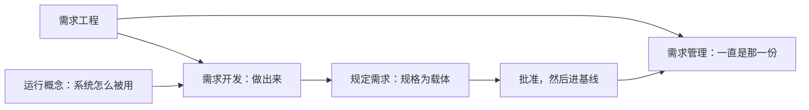

# 第4章 需求工程：把诉求变成需求规格

---

## 4.1 引言

### 4.1.1 误解现场

恒信集团合同审批系统启动后的第三周，管理层开了一次会。

IT 总监把一叠变更单推到桌子中间，说了一句后来被反复引用的话：

> "需求老是变。合同评审、财务对账、法务条款，改一版崩一版。我们要加强需求管理，谁负责？顾言，你来。"

顾言是需求分析师，系统工程师团队里专职做需求这一侧。

他没接这个活，先问了三个问题：

> "需求为什么会变？变之前，我们调研做了吗，把话问清了吗，写出来的每一条能当依据用吗？"

会议室安静了几秒。

总监皱起眉："这些不都是需求管理的一部分？管好了需求，自然就都做了。"

如果你坐在这间屋里，大概也会点头。

因为大多数人对需求的直觉和这位总监一样：需求乱，是管理没跟上；把管理做严，需求就稳了。

这个直觉错在一个词上。

它把一件创造性的活，包进了一件控制性的活里。钱于是全花在流程上，病还留在源头。

所以这一章只追一个问题：

流程加了，模板加了，需求还是改一版崩一版，为什么？

### 4.1.2 本章的人和物

这一章的事大多在恒信，少数在冰链。

开场是恒信第三周，一位不具名的 IT 总监拍板"我们要加强需求管理，谁负责"；需求分析师顾言把这活接了下来，系统架构师罗建、产品开发经理曹峰、运维王默、业务方郑亮、开发苏婷各从自己那一头看同一份合同需求。冰链那边，季昭、林涛、小张各问了一句。

### 4.1.3 本章要回答什么

读完本章，下面这几问，你应该答得出来。

1. 需求工程、需求开发、需求管理，三者是并列还是包含？
2. 需求总在变，该由开发负责，还是由管理负责？
3. 一条需求从哪来？客户随口说的一句话，凭什么当依据？
4. 需求规格里什么不能省？对着它，能做的是评审、验证，还是确认？
5. 一份需求改了六版，哪一版才算数？
6. 三百条需求都写对了，为什么还是不能被验收？

这几问合起来，问的是一件事：把诉求变成需求规格这一段，哪一步在决定成败。

---

## 4.2 需求工程：开发做出来，管理看住

### 4.2.1 两段并列，不是包含

需求工程分成两段，不是一段。

> 需求工程＝需求开发＋需求管理

前一段把利益相关方的需要与期望变成规定需求，走四个活动：获取、分析、规格说明、需求校核（评审）。

这一段是创造性的，从没有到有。

后一段对已定下来的规定需求做基线化的看管，也走四个活动：基线、变更控制、追溯、状态与度量。

这一段是控制性的，需求有了之后，让它一直是那一份。

一句话：开发负责做出来，管理负责让它一直是那一份。

两段的差别不在忙闲，在性质。

| | 需求开发 | 需求管理 |
|---|---|---|
| 性质 | 创造性：收集、分析、建模、写条文 | 控制性：冻结、变更、追溯、跟踪 |
| 回答什么 | 需求是什么，合理吗 | 需求定了吗，变了吗，谁改的 |
| 常见的坏法 | 来源没摸清，分析没做透 | 基线乱，变更失控 |

所以流行的那句"广义的需求管理包含需求开发"是错的。

把开发包进管理，会盖住一个事实：**需求是开发出来的，不是管出来的**。管理再严，开发没做好，一样出烂需求。

章首那场会，就是只谈管理、不谈开发的标本。

这种分法不是本书的发明。业内的能力模型把需求管理与需求开发列成两个并列的过程域，需求工程那族标准也按开发与管理两条线组织全篇。

本书只把这条线说得更死一点：两段并列，各有各的产物，谁也别替谁。

落地到组织上，两段常常不在一个人手里。开发落在做需求的那几个人身上，管理落在流程与配置那几条线上。

两边都缺的时候，先补哪一边？

先补开发。理由很实在：管理是对着一份东西管，那份东西本身不清楚，管得再严也只是把不清楚冻起来。

那需求工程凭什么配得上"工程"两个字？

因为它有方法，访谈、原型、排序、评审，每一步都有可指认的做法。有过程，每一步都有输入、输出、角色和准则。

有纪律，基线、变更控制、追溯写在纸面上，不靠谁的记性。还有一样：可复现，换个人来做，结果不会差太远。

### 4.2.2 案例进展①｜两段各欠了什么

会后，顾言做了两件事。

第一件，他把恒信需求库近三个月的变更记录调出来，逐条看。

四十七条变更里，二十九条不是需求变了，是当初就没说清。

合同评审什么时候启动，写的是"重要合同要审批"，可"重要"从没定义过；财务要的"对账报表"，统计范围也没说清。

第二件，他列了两张单子。一张开发欠账：没调研，没分析，没写可验证的条文。一张管理欠账：没基线，没变更流程，没追溯。

他把两张单子并排摊在桌上：

> "加强需求管理这件事，一半是补需求开发的课。管理能让一份需求一直是那一份，可它没办法让没说清的需求变清楚。说不清的，只有开发能补。"

罗建盯着那张开发欠账的单子看了半天：

> "这四个星期我们加了三道流程、两张模板，变更数一条没降。管理管的是'定了的需求不变形'，开发管的是'需求本身立得住'。"

他把话往下说："流程没错，是顺序反了。拿连'重要'都没定义的条目去开发，开发得越彻底，返工越彻底。"

两周后，顾言补了需求调研和需求池，建了第一版基线。罗建说需求稳了一点。不是需求变少了，是欠账开始还了。

诊断只有两问。"这条需求当初是谁提的、为什么提"答不上来，多半是开发欠账；"这一版是谁批的、上一版长什么样"答不上来，多半是管理欠账。

### 4.2.3 把诉求做出来，是一个圈

做出来这一段不是一个动作，是获取、分析、规格说明、校核走一圈。

| 活动 | 做什么 | 交什么 |
|---|---|---|
| 获取 | 访谈、调研、看竞品，把需要与期望收上来 | 利益相关方登记册、访谈记录 |
| 分析 | 澄清、分解、排序、建模、协商冲突 | 需求池、优先级表、业务规则清单 |
| 规格说明 | 把分析的结果写成能判定的条文 | 规格说明书、术语表、追溯矩阵初版 |
| 需求校核（评审） | 对着目标判断这份需求适不适宜、够不够、有没有用 | 评审报告、批准记录 |

这几步不是跑一遍就完，它是一个圈。分析时发现缺信息，回获取；规格时发现没问清，回分析。

为什么是圈？因为模糊的诉求不会一次被看清。

恒信那条"重要合同要审批"就是例子。访谈时对方说得斩钉截铁；分析时才发现"重要"没定义；回去再问，得到"金额五百万以上，或者三年期以上"。这才进得了规格。

分析这一道，做的是五件事：澄清一句含糊的话，分解一条父需求，排出先后，把关系画成模型，把几个部门的理解协商到一处。

排序值得单说一句，它决定的不是喜好，是"需求不够时砍哪条"。

恒信的"合同数据留档十年"是公司法强制。在必须、应该、可以、不要这四档里，它属必须；在基本型、期望型、兴奋型这三类里，它属基本型。

两套方法指向同一个结论：这条不在被砍的清单里。

冰链那边，季昭把这套排序用在了测试上。他先测基本型那几条，再测期望型；兴奋型放在最后，赶不上进度就不测。他的理由是：基本的没测过，测了别的也白测。

需求缺陷的代价常被低估。同一个缺陷，在需求阶段改是一分力气，到交付之后再改，代价高几十倍。

那个数出自需求工程那侧的整理，本书不逐条引，方向却稳：越晚发现越贵。

### 4.2.4 两段只在一处交接：批准，再进基线

两段之间只有一个接口：批准，然后进基线。

批之前，需求还在流动，改动归开发负责；批之后，需求冻结成基线，一切改动走变更，归管理负责。

接口不咬合，有两种坏法。

一种是两段各管一段，谁也不过问接口，需求在中间断掉：开发交出一堆条文，管理从没收到过一份正式版本。

另一种是管理越过接口去管开发，把还没定稿的东西先锁起来，结果是大家绕开流程改。

两种坏法长同一副样子：文件越攒越多，谁也说不出哪一版算数。

接口之外，两段各留凭证。

开发留登记册、访谈记录、需求池、规格、评审报告、批准记录。管理留基线登记、变更请求单、影响分析、评审报告、变更验证记录、追溯矩阵、状态报告。

这些不是给检查看的，是将来查得回的唯一凭据。

顾言在接口上踩过一次坑。开发那边把条文交上来了，管理这边没接，两边都以为对方在管，结果一个月里三次改动谁都没记录。后来补上一张基线登记表，接口才真的存在。

还有两条经验。变更日志只追加、不修改，审计时才调得出来。没有凭证的变更，等于没发生过。

顺序先对，问题才看得见。那"做出来"这一段，到底要做出什么？

---

## 4.3 需求开发：把话问清，写成规格

### 4.3.1 需求的来路：目标、法规、没说的话

第3章把需求分成明示的、通常隐含的、必须履行的三种形态，那是"它怎么出现"。

这里问的是另一件事：它从哪来。

来路有三条。

第一条是从目标转化。目的展开成目标，目标转化成需求，这是主流的来路。

这里钉一个用词：目标到需求是**转化**，不是分解。

分解是同类拆分，语义守恒，整体等于部分之和。目标回答"要实现什么结果"，需求回答"做成什么样"，两者不同类。

所以一条目标往往导出一组需求，导出的每一条都要判断。阈值是权衡出来的，不是从目标里分出来的。

第二条是从法规强制。

这一支属"必须履行"，组织就算没立过合规目标，这条需求照样成立。恒信"合同数据留档十年"是公司法强制，它不经过组织目标那道转化。

环境适应性那一支另立一类，归第5章。

第三条是从利益相关方的隐含需要。

做合同审批调研时，顾言访谈法务、财务、业务各三场，每次最后都问一句"还有别的吗"，得到的都是"没有了"。

直到财务随口说：

> "对了，我们月底要对账。合同要是二十五号之后才签，能不能算到下个月？"

顾言记下了。这句话暴露一条隐含需求：合同审批的统计归属月份规则。

没人把它写进任何文档，它是行业惯例默认；可要是漏了，月底对账会错，财务会认定这套系统不能用。

来路之上还有一层，容易漏。

组织的运行概念（ConOps）、战略与环境一变，概念、需要与需求就在各个层级上跟着演进。系统工程那族标准在概念与系统定义那一节讲的就是这件事。

换成本书的说法：需求不是从天上掉下来的，它头上有一层"这个组织打算怎么赢"。

这一层不是一份文件。它是一组视角和一组关切，散在战略、运行概念、市场判断里；落到纸上，是目的。

第3章说过一句，题在战略，落点在目的。战略说的是怎么赢，目的说的是为什么做。

这一层怎么取？三个动作就够了。先看组织今年要靠什么赢，再看这条需求服务哪一条赢法，答不上来的，问该找谁定。

答不上来的那一条，就先不进规格，它可以等。

本书把来路收束成三条，是为了用起来方便，不是说三条之外没有东西。

### 4.3.2 一条需求，凭什么当依据

先把两件事分开。**说出来了，就是规定需求**；能不能当依据，是另一回事。

标准在需求那条底下补了一句注：

> 规定的需求是明示的需求，例如写在成文信息中的需求。

要紧的是那个"例如"。写在成文信息里是最常见的明示方式，不是"规定"的条件。

说出来了就算，口头说的也算，它已经进了规定需求这个集合。

顺带说一句用词：本书把 requirement 一律作"需求"，标准的中译本作"要求"，同一个词两种译法。

规定需求是明示的那一支；这一支被单列出来，因为验证需要一个能对账的参照。

可它还不能当依据。

一句口头的话对不了账。"页面要快一点"是规定需求，快一点是几秒？"好用"怎么证明？

同一句话要从"说了"走到"能当依据"，得先过一道可判定，再占全四条。

可判定是四件：编号、对象与适用范围、断言、判定方法。一件不缺，这句话才立得住。

过了这一道，再量四条。头两条管这句话本身：**相关性**能回溯到目的，过得了必要性那一问；**可检验性**已明示，自带判定方法与准则。后两条管它算哪一份：**时效性**落在已冻结的那一版；**同一性**有唯一标识、被唯一引用。

这四条是本书的工作名，业内没有一套固定叫法。

恒信那句"重要合同要审批"是标本。它是明示的需求，也是规定需求，可它不可采。

可采条件里，它只对得上相关性："重要"有两种以上的理解，谁也没法拿它去验证。

把它规定成"金额五百万以上，或者三年期以上"，它才第一次能当依据。

苏婷拿这个办法试过自己手里那几条接口需求。可采条件一过，三条不合格：两条没有判定方法，一条查不到它属于哪一版。

可采条件里最容易过期的，是时效性。去年冻结的那一版，今年再拿它当依据，就不算数了，得先说清指的是哪一版。

这里要交代一句边界。一条需求好不好，另外还有几把尺子，本章不拿。

全不全归第5章；几条之间打不打架，第3章的可转化已经管了；追溯得回不回，§4.4.4 讲；先做哪一条，是分析那一步的排序。

本章只拿这一把：能不能当依据。

### 4.3.3 规格里什么不能省

一句话能当依据，一份规格才立得住。规格通常六章。

引言交代目的、范围、读者。总体描述给出产品视角与环境约束。功能需求逐条编号，一条一个断言。

非功能需求写性能、安全、可用性。外部接口画清与外部世界的边界。最后一章是验证方法，给每条需求配一条接收准则。

最后一章最容易被砍，而它正是"可检验"的兑现处。没有接收准则，需求就退化成愿望。

整份文档体系里有五份不能省，任何规模的项目一样：规格说明书、需求池、追溯矩阵、评审报告、基线。

规格是条文的家；需求池是统一入口，没有来源的需求不得入池；追溯矩阵是影响分析的依据；评审报告是校核的凭证；基线是变更的参照。

这几份之外还有一层最底下的东西，是素材。

访谈记录、调研笔记、竞品分析，这些可以不成正式文档，但原始记录要留。它们是追溯链的最底层，将来有人问"这条需求当初怎么来的"，只有它答得上。

还有一份常被当成附件的，是术语表。

它的用处不是好看，是让相关方对"这个系统是什么"用同一套话说。缺了它，评审会上三个人说的是三件事，条款再整齐也对不齐。

编号也一样。编号不是目的，可引用才是：一条需求要能指到"哪份文档、第几条"，指不到，追溯就是空谈。

规格往下走，不是直接进设计。中间还有一格：系统架构定义。

它交出来的不是更细的需求，是这个实体必须说准的几个词与必须守住的几条性质。那一格归第10到12章，本章只把它画在链上。

### 4.3.4 校核：对着一份规格评，不是确认

四个活动里的最后一个，名字叫需求校核，也叫需求评审，本章就叫它校核。

评审、验证、确认，三件事各有各的对照物。

| | 评审 | 验证 | 确认 |
|---|---|---|---|
| 定义 | 为达成既定目标，对客体的适宜性、充分性或有效性所作的确定 | 通过提供客观证据，证实规定需求已得到满足 | 通过提供客观证据，证实针对特定预期用途或应用的需求已得到满足 |
| 对照物 | 为它确立的目标 | 规定需求 | 特定预期用途或应用的需求 |
| 对象 | 工作产品，含文档与模型 | 实现出来的客体，或人工制品 | 已经能用的客体 |

需求文档是工作产品。

对它做的是评审与验证：评审判断这份需求适不适宜、够不够、有没有用；验证认定它满足"这份文档自身该满足的规定需求"，比如条目齐备、可判定，证据就是评审文件。

确认做不了。确认要在使用中兑现，那是第8章评审、验证、确认的事。

这一处为什么非分清不可？

因为一句话能不能被承诺，全看这里。

罗建后来把这条界画在了一页纸上：左边写"评审能做的"，右边写"确认才能做的"，中间一条竖线。他给这张纸起了个名字，叫"别签早了"。

把需求评审叫成需求确认，等于给一份还没实现的东西签了确认的字。评审会上说"确认通过"，验收时才发现用户要的不是这个，那句"确认通过"就成了将来扯皮的证据。

判据很直白。你手上这份东西，是做出来的客体，还是纸面上的工作产品？

是工作产品，能评审也能验证；要说"确认通过"，先把东西做出来，并且用起来。

季昭在冰链反问过：评审通过了，算不算验证过了？不算。评审对目标，验证对规定需求；两件事，两份记录。他手里那套测试台账，就是按这条界分栏的。

写也写完了，也校过了。可它被人悄悄改掉的时候，谁拦？

---

## 4.4 需求管理：看住基线，变更说得清

### 4.4.1 基线：从哪一版开始算变

基线就是开发与管理的那条分界线。

标准里管这一版叫配置基线：经批准的配置信息，它确定产品或服务在某一时间点上的特性，并作为生存周期内各项活动的参照。本书行文里简作"基线"，说全了是"被批准冻结的参照"——被批准、被冻结、被拿来当参照的那一版。

线左边是开发这一段，需求还在流动；线右边归管理，一切改动走变更控制。

所以基线管的是"变从哪儿算起"。

没有它，一切变化都不可言说。你没法说"从什么变到什么"，只能说"又改了一版"。

有了它，每次变更都能写成"从这一版到那一版，为什么改，谁批的"。

它也不是"最新那一版"。最新的一版可能谁都没批过，那只是一份比较好看的文件。

判据是三问：这版被批准了吗？被冻结了吗？生存周期拿它当参照吗？三问全过才是基线。

什么时候建基线，是策略，不是手气。

常见的做法是三层递进：项目启动时先立一份草案，需求评审通过后立第一版正式基线，进入设计开发后再按阶段加基线。

罗建第一次听到"建基线"时问过一句：建了以后改一个字是不是都要开会？顾言答，改一个字也要有请求单，但批的人是谁，可以按轻重分级定。

基线一多，就得有人管哪一份是当前的。这一句归配置管理，第15章讲透，本章只用它当分界线。

### 4.4.2 案例进展③｜文件名管版本，哪一版算数

恒信的合同需求改了六版。

v1 是没后缀的原稿，v2 以后靠文件名管版本："合同需求 最终版 v3.doc""合同需求 真最终版 v4.doc"。

后果是同一份合同的需求散在六个文件里，追溯矩阵建不起来，验证也没有参照。

苏婷写到接口那一半，对着六个文件名发愁：

> "我照着哪个版本写？接口这一半按 v4 的字段名写的，可 v6 里'合同状态'多出一个'已签章待归档'。六个文件三种说法，哪一版是批过的规格，我看不出来，数据库的表结构就定不下来。"

王默把发布记录也摊到桌上：

> "文件名记不下谁批的、为什么改。发布认的是可复现：哪个包配哪套环境参数，能复现出当时的运行形态才算数。你们这六个文件，连哪一版是基线都对不上，等于每次改动都没发生过。"

罗建终于承认："我们不是需求变太多，是这几份文件从来没立过基线。"

顾言把六份文件收进基线管理，之后每个变更都走变更流程。

六周后，变更失控率降了七成。需求也没少，只是每次变更都留下了痕迹。

这条边界钉住一句：**改名、留档，不等于受控**，也不等于版本管理。

版本管理要有三样：基线、变更控制、追溯。只做到留档，留下的是一串快照；哪一版算数、为什么改、影响到谁，一个都答不上来。

### 4.4.3 变更：走完一圈才算完

看住这一段的核心战场是变更。一条变更不是批一下就完，要从立案走到关闭。

六个节点，每一个都要可判定。

立案了吗？影响分析做了没有？评审判了没有？实施同步了没有？再验证过了没有？关闭时基线更新了吗？

哪一格答不上来，这条变更就在流程外流窜。

三条铁律，本书对变更纪律的凝练，可当场检验：无请求单不得变更，不做影响分析不得上会，验证不通过不得关闭。

走完整条路径长什么样？

恒信法务提出"电子签章的合同也走审批流"。这是一条变更请求。

影响分析反查追溯矩阵，查出审批状态机、签章模块、归档模块三处。评审通过，实施，同步规格与矩阵。

再验证"电子签章合同审批通过后进入归档"，关闭，更新基线。

一路留下一条请求单、一份影响分析、一份评审报告、一次再验证记录，最后是基线的一次更新。任何一环断了，这条变更就成了查无实据的暗改。

分级与时限属于组织级约定，本书给一组示例，不作判据。

微小变更由需求负责人批，一般变更由项目经理批，重大变更上评审组；规格完成后五个工作日内评审，影响分析三日，评审组五个工作日内决定。

要紧的不是这几个数，是每一步"以什么标准"必须写死。没写死，流程就是摆设。

曹峰问过一句：变更分级是不是越细越好？答案恰恰相反。分级细到没人记得住，就等于没有分级；能记住的三档，比写在纸上没人看的九档管用。

### 4.4.4 追溯：每次变更都查得回

追溯管两头。

往上游，一条需求要答得出它从哪来：哪一条目标，哪一条法规，哪一位利益相关方的话。

往下游，要答得出它到哪去：落到哪一节设计，哪一条测试，哪一次交付。

终极检验只有一条：任取一条需求，能不能双向走通。走不通，追溯矩阵就是一张漂亮的表格，不是追溯。

走通的样子很具体。拿"金额五百万以上须审批"这一条：往上游，它来自法务的合同管理办法；往下游，它落在审批状态机的门槛判断、校验模块的一条规则、测试用例里的一组边界值。三条线都指得出来，这条需求才算接住了。

恒信补上追溯矩阵之后，一次合同金额校验规则的变更，五分钟定位到十七条需求、三个模块。没有这张矩阵，这活要翻六个文件找两天。

基线与追溯是一体两面。基线给"变"一个参照原点，追溯给"变"一份影响清单。

没有基线，追溯无从谈起；没有追溯，基线一建立就失效。

王默给冰链的追溯矩阵加过一栏"在役版本"。他调过一次线上告警，查到根上发现是三个月前改的一条阈值，那条改动在矩阵里查不到，只能翻邮件。

到这里，两段都立住了。可还有一件事没解：流程走完了，三百条也逐条写对了，为什么还是凑不成一份能用的规格？

---

## 4.5 规格之前：先讲清系统怎么被用

### 4.5.1 案例进展④｜三百条规格，一条都验不了

恒信第一版规格写得飞快：三个月，约三百条。

评审会上，法务负责人翻了两页就问：

> "你们写'合同审批通过后自动通知利益相关方'。哪个利益相关方？审批链上有几个人？通知不到会怎样？这三问答不上来，这一条就不是能验收的需求，是一句表态。"

没人答得上。因为没人写过运行概念：法务、财务、业务三方怎么用这套系统审批一份合同，这段叙事从没落过纸。三百条都缺上下文。

曹峰翻了翻那三百条：

> "条款一条条都对，可凑在一起，说不清一份合同到底是怎么被用起来的。评审到这儿只能一条条过。我们要的不是三百条各自成立的条目，是一份看完能明白这系统怎么运转的运行概念。"

顾言花三周补运行概念：把一份两百万的采购合同从发起到归档写成一段过程，逐环节标角色、异常与应急。

郑亮陪他对审批链。对到一半，郑亮提醒："审批人要是离职了，谁接得上？这一格是空的。'异常'那一栏不写，上线第一个月就有人拿着纸质单子来找我们。"写到运行支持，王默补了一句：替代流程、备份、监控、谁升级，都得写进去。

写完，三百条里有一半要改写。先写条款、后补故事，顺序反了。

镜照一眼冰链。M3 的运行概念是"疫苗从出库到接种，全程温度不断链"。"运输车在高速上抛锚两小时"这一条应急，直接定下"断电保温七十二小时"这条硬需求。

运行概念里写不出来的场景，就是将来要出事故的场景。

这份运行概念是小张执笔的。她在每节末尾留一行"谁认"：签了字的那一段才算数。

冰链的另一面在需求管理。林涛在评审会上随口一句"精度差不多就行"，没有请求单，没有记录，一句口头变更把验证的靶子换掉了。

### 4.5.2 运行概念：一段讲被用的叙事

运行概念回答的是"系统将被怎么用"。

法务怎么审合同，财务怎么对账，业务怎么发起审批；这些叙事是规格的上下文。

它是需求工程里唯一一份叙事性的正式输出。别的文档都是条目和条款，只有它讲一段过程。

位置很讲究：分析之后，规格之前。整条链是业务目标、获取与分析、运行概念、规格、系统架构定义、设计。跳过运行概念直接写规格，等于从问题域一步跨进解空间，中间那段没了。条款越写越多，越是悬着。

一份运行概念通常六部分：引言，系统概述，运行环境，运行场景，利益相关方与角色，运行支持。

核心是运行场景，三种都要写。正常，比如一份合同走完审批全流程；异常，比如法务驳回、财务校验不过、审批人离职；应急，比如系统宕机时的线下替代流程。

六部分里最容易被跳过的，是运行支持。谁培训、谁维护、出问题谁升级，这几行写在最后，却决定上线那天有没有人接得住。

判据只有一个：让一个不熟悉这套系统的人读完，能不能画出审批流程图。画得出来就合格，画不出来就是故事没讲清。

它也有失效的时候。运行方式一眼看透的小系统可以省掉；场景越复杂、角色越多，越不能省。

判断该不该写，曹峰有一个土办法：把这套系统交给一个没参与过的人，问他第一步做什么。对方答得出，运行概念可以省；答不出，写。

运行概念还有一重身份，比"上下文"更要紧：它是确认判据的载体。

确认对照的是"针对特定预期用途或应用的需求"，而这份需求的正文，恰恰写在运行场景里，主体是隐含需要那一支。

没有它，确认就没有靶子。

### 4.5.3 认知反转

回到章首那场会。总监说"我们要加强需求管理"。现在可以把它说得更准。

需求工程是两段并列，不是一层套一层。

恒信的需求乱，一大半是开发的欠账。没调研，来源不清；没分析，"重要合同"没澄清；没写可验证的条文，三百条悬着。

这些欠账，管理补不了。

管理的严格补不了开发的欠账。需求乱，多半不是没人管，是没人做。

没人去问，没人把问来的话问清，没人写成能判读的条文，没人对着目标校一遍。这四件归提要求的人和做需求的人，加流程加不出来。

顾言补的三样东西，各自补在了正确的位置上。

运行概念补上问题域，先讲清怎么被用，再写条款。第一版基线补上参照原点，改名留档不是受控。变更流程补上痕迹，无请求单不得变更。

四处边界合起来，正好把两段各自要守的东西分开，也各挡一笔乱账：明示与可采挡住"说了就算"，谁的账挡住"一乱就加流程"，评审与验证确认挡住"评审当确认"，留档与受控挡住"改名当受控"。

一句一句问过去，这乱是哪一段的、缺的哪一样，就露出来了。

本章还改了两句流行话的说法。结论不动，换的是理由。

"说了不等于规定"：说出来了就是规定需求；可它当不了依据，缺的是可采，不是"不算需求"。

"需求评审就是需求确认"：需求文档能评审也能验证，做不了确认。

---

## 小结

本章讲需求是怎么被做出来的：需求工程把模糊的诉求做成一份能当依据的条文。

开发这一段负责做出来，获取、分析、规格说明、校核，以运行概念讲清问题域，以规格为载体，以规定需求为枢纽。

管理这一段负责让它一直是那一份，基线、变更、追溯、状态与度量。

两段并列，交接只在批准与基线那一处。

它磨开了四处边界：说出来了不等于能当依据；需求乱先分清是谁的账；需求文档做不了确认；改名不等于受控。

下一章看另一件事：需求要全到什么程度。功能、环境适应性、可实现性三类需求及其指标齐备，一份规格才算立全。

需求域那份产品数据，也在这几周补齐了。运行概念、第一版需求基线、变更流程，都是顾言一件件补起来的。第7章会看到，这些东西本身就是产品。

---

## 附录

### A 本章概念总图

运行概念在最前，它把问题域讲清；开发这一段把诉求做成规定需求；到了批准那一刻，需求进基线，剩下的归管理。

M3 走的是同一张图：运行概念写"疫苗出库到接种温度不断链"，规格写"偏差不超过半度"，基线之后每次改动走变更。恒信走的也是这张图，只是把温度换成了审批流转。

四处边界标在图上：明示与可采在开发出口，谁的账在两段之间，评审与验证确认在规格这一侧，留档与受控在基线这一侧。

### B 本章的能力级

第 ② 级为主。

**表征**——把"需求工程""需求开发""需求管理""规定需求""运行概念"说准：两段并列而非包含；规定需求是明示的那一支，成文不是构成条件；运行概念是唯一一份叙事性的正式输出。

**图式**——两段合成的结构：开发做出来，批准，进基线，管理让它一直是那一份；加上这条结构上的四处边界。

**心智模型**——欠账二分；可采四条件（相关性、可检验性、时效性、同一性）；变更从立案走到关闭那一圈，与三条铁律；运行概念的位置与失效边界。

**解释框架**——本章不建，归第17、18章。

能答全本章开头那几问，才算拥有：先分清"做出来"和"一直是那一份"，先补开发的课，再谈管理的严。

用第1章 §1.4.3 的尺子量一下：本章把"需求工程"从第 ① 级（表征）推到了第 ② 级（图式）。你现在看得出开发做出来、管理看住、两段只在批准与基线处交接这条结构，而不只是背得住那个并列式。

### C 自查 · 这些说法对吗

1. "需求管理包含需求开发，管好了需求自然就开发好了。"错。两段并列不是包含；开发是创造性，管理是控制性；需求是开发出来的，不是管出来的。
2. "客户说了'页面要快一点'，这算不上需求吧。"错。说出来了就是明示的需求，明示即规定。它缺的是可采：可采四条里只对得上相关性，没有判定方法，不可复现，也没有版本。
3. "需求写完开个评审会，就是确认通过了。"错。需求文档是工作产品，对它做的是评审与验证；确认要等有东西可用，并且用起来才做。
4. "需求变更多，说明需求管理没做好。"错。先分清是需求变了，还是当初没说清。后者是开发的欠账，加流程治不了。
5. "文件名改一改，版本就管起来了。"错。那是留档，不是受控。没有基线，变更说不清"从什么变到什么"。
6. "运行概念是给运营部门看的故事，跟开发没关系。"错。它是问题域那一侧的正式输出，也是确认判据的载体。跳过它直接写规格，条款就悬着。
7. "需求开发四个活动跑一遍就完。"错。它们是一个圈：分析发现缺信息回获取，规格发现问题回分析。

### D 练习

1. 用"开发做出来、管理让它一直是那一份"给恒信的困境做诊断：顾言列的两张单子分别是什么？你们团队最近一次需求混乱，属于哪一张？
2. 找一条你们公司"明示但不可采"的需求，也就是说了、却拿不出客观证据的那一条，把它改写成可采的条文。
3. 你最近一次写需求，有没有跳过分析直接进规格？跳过了，代价落在谁身上？
4. 你们团队的"需求评审"被叫成"需求确认"过吗？改口叫评审，签字那一刻的责任归属会有什么变化？
5. 你们当前项目的需求基线在哪？没有基线的话，最近一次变更"从什么变到什么"说得清吗？
6. 一次变更走完一圈要留下哪几样凭据？你们哪一环最常被跳过，跳过之后那条变更还查得到吗？

### E 参考文献

> **编号怎么读**：`[k]` 是本章内的文献序号；括注的 `R-xx` 是全书参考文献总表的编号，凭它可回总表查完整说明与条款。

- [1] **R-38** ISO 9000:2026（第 5 版）—— 需求（注 2：规定的需求是明示的需求，例如写在成文信息中的需求）、设计和开发、配置基线、评审、验证、确认。用于 §4.2.1／§4.3.2／§4.3.4／§4.4.1。
- [2] **R-37** ISO/IEC/IEEE 15288:2023 —— 概念与系统定义（组织的运行概念、战略与环境变更，概念、需要与需求在各层级演进）、业务或任务分析、利益相关方需要与需求定义、系统需求定义、系统架构定义、验证。用于 §4.3.1／§4.3.3／§4.5.2。
- [3] **R-12** ISO/IEC/IEEE 29148:2018（**库外·不可核**，库内无正本）—— 需求工程：开发与管理两条线；单条需求与需求集的特性；运行概念的展开去处。用于 §4.2.1／§4.5.2。
- [4] **R-13** IEEE 1362（**库外·不可核**，库内无正本）—— 运行概念 ConOps：结构六部分，运行场景为核心。用于 §4.5.2。
- [5] **R-18** CMMI（**库外·不可核**，库内无正本）—— 需求管理与需求开发是两个并列的过程域。用于 §4.2.1。
- [6] **R-29** IEEE 830-1998（**库外·不可核**，库内无正本）—— 软件需求规格说明书的推荐实践。用于 §4.3.3。
- [7] **R-14** IEEE 610.12-1990 —— 软件工程定义（经第2章转引）。用于 §4.2.1。
- [8] **R-69** MoSCoW（源自 DSDM）—— 需求优先级：必须、应该、可以、不要。用于 §4.2.3。
- [9] **R-70** Kano 模型（1984）—— 基本型、期望型、兴奋型。用于 §4.2.3。
- [10] **R-96** Boehm 与 Basili（**库外·不可核**，库内无正本）—— 缺陷发现越晚修复越贵；本书只取方向，不引倍数。用于 §4.2.3。
