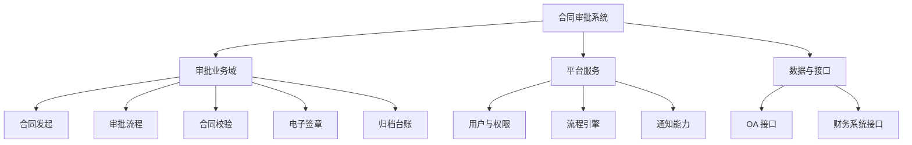
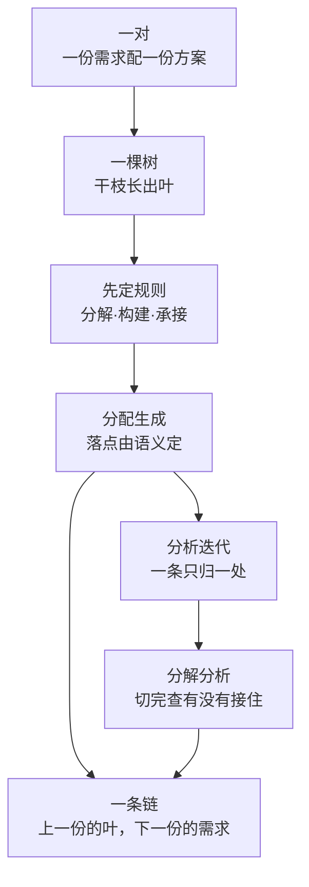

# 第6章 设计开发：需求与方案结对

---

## 6.1 引言

第5章把一份需求立全了：功能、环境适应性、可实现性，各有各的提出人，各有各的验证载体。立全之后是下一个问题：这份需求，怎么被用来造东西。

本章管的就是这一段，设计开发。它的样子可以一句话说清：一份需求配一份方案，结成一对。

一对之内先把规则定下来，再一条一条落。落下去的每一条，都要有一个能负责它的地方——后文把这个地方叫节点。上一对交出来的，就是下一对的输入。

### 6.1.1 误解现场

恒信集团，合同审批系统评审会，下午两点。

系统架构师罗建把《合同审批系统总体设计方案》投在幕布上，六十页。他为此写了两个月。

"这份方案覆盖了全部三百条需求，我按章节过一遍——"

需求分析师顾言问："它跟需求文档什么关系？"

"设计文档嘛，就是把需求写详细一点。"

法务部的人翻开打印稿，翻了十几页："审批链上，谁能驳回、谁不能？"

"在这里，第二十三页的流程图。"

顾言追问："那这条需求，落在方案哪个节点上？"

罗建翻回目录，又翻到附录，停了几秒："……图上没有它。"

运维的王默补了一句："那它部署在哪、监控什么、怎么回滚？"

罗建没翻到："这些后面会写。"

产品开发经理曹峰坐在后排，把六十页掂了掂："两个月、六十页、三百条需求，都在了。可我们要的是一份评审完就能开工的方案，不是一本要通读的书。"

顾言把打印稿合上："罗建，这不是一篇方案。这是一本小说。"

"一篇文章只能从头读到尾。可你的方案有五类读者：法务要看审批规则，财务要看校验和台账，业务要看怎么发起，开发要知道模块边界，运维要知道怎么部署。五个人的问题散在六十页里，谁也找不到自己那一枝。"

罗建没接话。他忽然发现，自己两个月里做的每件事都对：访谈做了、需求收了、方案写了、格式改了。可这份方案里没有一处位置，是留给"这条需求由谁负责"的。

### 6.1.2 本章的人和物

恒信这边六个人。系统架构师罗建，写成六十页方案的那个人；需求分析师顾言，把树和每一条的落脚处交给他的人；开发苏婷，照着叶节点开工的人。运维王默，数节点的人；产品开发经理曹峰，等着评审完开工的人；业务方郑亮，定红线的人。

冰链那边是石军，嵌入式硬件工程师。他们团队把一份结构文档叫作"架构定义"。

两个产品：恒信的合同审批系统，冰链的 M3 温控箱。

### 6.1.3 本章要回答什么

1. 一份方案要写成什么样子，才有人能拿它开工？
2. 一条需求落下去，落到哪个节点上，凭什么说落对了？
3. 落漏了、落重了，怎么在评审之前就查出来？
4. 这一对做完，下一对凭什么接得上？

---

## 6.2 有需求，就得有方案

### 6.2.1 对上是方案，对下是需求

设计开发的对象不是一份文档，是一对：一份需求文档，配一份方案文档。这一对，本书叫**文档结对**。

需求说"要什么"，方案说"怎么做"。上一层的需求靠下一层的方案承接；而这份方案接住了需求，转过身又成为更下一层的需求。

所以中间每一层，既是方案，又是需求。这不是文档的固有标签，是相对相邻那两份扮演的角色。

恒信这条链上，"系统需求"这一份，对上是方案，承接业务流程；对下是需求，驱动产品构成方案框架。同一份东西，两个身份。

一份的叶节点，就是下一份的需求。这句话是本章的地基，也是整条链接得上的原因。

### 6.2.2 一次求值：需求进，方案出

"由需求得到方案"这件事，记成一个函数最清楚：Y 等于 F 作用于 X。

X 是需求侧的叶节点，Y 是方案侧的节点，F 是三套规则：分解怎么切、构建怎么长、承接怎么落。

F 是每一对开工时先定的，不是通用教条，定法在 6.5.1。

结对是双向的。正向，由需求开发出方案；反向，由方案迭代需求——方案做下去发现需求切得不合用，就回头重切需求、调整承接。

"落定"也有个明示的口子。被承接的需求叶节点，以**规定需求**的形态落到目标节点上。写全按第4章的可判定四件套：有编号、有对象与适用范围、有断言、有判定方法。

停留在"大致知道归它管"，不算落定。这一条照第4章的口径：明示即规定；写没写成文，只决定它能不能被采信。

### 6.2.3 一条需求，只有一个去处

函数还有一条铁律：必须单值。

多条需求叶节点落到同一个节点上，没问题，那是聚合。一条需求叶节点归两个节点，函数就不成其为函数。

这条约束叫单承接：可多对一，不可一对多。

三条理由。

重复实现：同一段逻辑落到两个节点上，两个模块各写一遍，改一处漏一处。

验证没有唯一对象：这条需求对不对，该测哪个模块？一条落两处，验证就不知道该查谁。

变更找不全：需求改了，落一处只有一条路；落两处就要找齐两处，漏一处就是缺陷。

很多团队把方向搞反了：一条需求落好几个节点（这是违规），一个节点却只落一条需求（这是浪费了聚合）。

---

## 6.3 方案是一棵树，不是一篇文章

### 6.3.1 文章里没有位置

回到罗建那份六十页。它为什么失败？不是他写得不好，是他写得太像文章了。

一篇文章有三样东西，恰好是设计文档不能缺的。

不能定位。文章是线性流动的，从第二页读到第六十页。可"审批驳回的规则"在第几页？读者只能从头找起。

不能承接。下游开发拿到六十页，要知道负责哪一块、要满足哪些需求、做到什么程度算完。文章没有模块边界，开发只能通读一遍再自己揣摩，各揣各的边界，集成时必然撞车。

不能追溯。需求是会变的。一条需求改了，影响方案的哪几页？只能重读全文、靠人眼找相关性，找不全就漏改。

这三样合起来，其实是一件事：文章里没有"位置"。

没有位置，读者定不了位，开发接不了手，变更时找不到该改的地方。

评审会开到第四十分钟还在争"这条需求到底覆盖了没有"，不是大家不认真，是文章没给"覆盖"一个可定位的位置。

### 6.3.2 树的干枝管结构，叶节点管内容

树的回答，恰好是那三样。

从根往下分级，每一级收窄一层；分到某一级，节点上挂得住需求，那就是可承接的落点。

树的干枝上有两种节点。分类节点只负责组织，像文件夹，本身不含实体内容，"审批业务域""平台服务"是这一类。枝梢节点是框架骨架的终点，也是这一份框架里能接需求的那一级：需求至少落到这里；落得更高的干枝行不行，看语义（6.5.2）。一个枝梢节点可以落好几条。

再往下是叶节点，一条一条能独立搬走的内容。

于是树天然分成两半，各有一个名字。

**框架定义**管结构：从根到枝梢节点，叶只以枝梢的展开项露名；回答"结构是什么、承接了谁、往下分解出什么"。

**详细定义**管内容：各节点上的条目，回答"这个模块具体做什么、做到什么程度"；框架形态下只长在枝梢，到定义形态各级节点都带。

恒信那棵树，画出来是这样：

"审批流程"这个枝梢节点上长着四条叶节点：顺序审批、驳回回退、会签、超时提醒。每条都有编号、指标和验收标准。

叶节点不是漂着的，它长在枝梢节点上。这一句把结构与内容连成整体：只有干枝是空骨架，只有叶节点则散落一地。

### 6.3.3 同一棵树，停在哪个深度

按定义到多深，它有三个形态。

**框架**：根到枝梢节点，叶节点只以枝梢的展开项露个名字。

**概要**：根到叶节点，各级节点只到说明。

**定义**：概要充分，再加各节点的详细定义。

这一对实际交出去的东西，是各自最深、且够下游开工的那个形态；链尾一对只交到框架（6.6.3）。本书因此不把三档并成两档：把概要并进"框架"或并进"定义"，这一档都没了。

还有两处细节要紧。一是框架有阶。枝梢取树的哪一级，由这一次框架设计定；枝梢停得越靠上，这一阶就越高。因为枝梢就是承接的落点，阶越高，这一对承接时下游能提供的落点就越浅。

二是叶节点有三种身份：在框架里只是一条展开项，只有名字；到概要才成为树节点，带着说明；到定义才带着详细定义。

跟着来一条规矩：分解源判据附在这一次形态的最深一级。它管的是一句话——这个节点交出去之后，该展开成哪一类规格；链尾交框架形态时，就是每个枝梢节点各一枚。

最后一句要记住。叶不只是"最深的那一级"，它有判据：可独立定义、可独立验证、可独立分配、可独立追溯，与 6.4.1 的条目判据同一组。

所以"这棵树到哪一级为止"是一个判断，不是一个位置约定。

### 6.3.4 框架定义不是架构定义

很多方法论文档里，这棵树的文档被叫作"架构定义"。一棵树的形状，看上去就是架构。这个"听着顺耳"，是个词汇病。

按标准的说法，能用来表达架构的那份工作产品叫架构描述。可这棵树的文档本身不是架构描述，它是一份设计文档——设计侧对结构的规定。把一份设计文档叫"架构定义"，是习惯叫法；而"架构定义"作为一项工作，是第11章讲的那个过程。叫错在哪儿？在"架构"这两个字上——把架构的名字安到了设计文档上，再反过来拿它顶内容。

标准给架构的定义只有两样内容：实体在其环境中的基本概念或属性，加上管住这个实体及其相关生存周期过程怎么实现、怎么演化的管控原则。

它是这份内容，不是承载它的那份东西。框架定义是一份文档，架构是系统本身的那组概念、属性与原则。

镜照一眼冰链，同一个病换了世界。他们把那份结构文档直接叫"架构定义"：名字一听就重，架构都"定义"了，还动什么？于是文档再没人维护。等到第10章把架构说清楚，石军才明白，被叫作"架构定义"的只是一棵没长成的树。

真正那组概念与原则要从树的枝干走向里读出来，但那是读出来的判断，不是树本身。

边界也要说清，它有两层。文档这一层，框架定义不等于架构：一份是文档，一份是系统那组内容。描述这一层，框架定义可以是架构的一种描述，描述的是架构可以关乎的结构面。两层不打架：不等于，说的是文档与内容之别；可作描述，说的是描述与内容之通。

管住实现与演化的那一半是另一件事，归第11章与第15、16章讲。所以本章一律用框架定义这个名字：少一分误导，多一分老实。

---

## 6.4 能成树，也有装不下的

### 6.4.1 产品数据凭什么能成树

上一块回答文章为什么不行。这一问更根本：凭什么能长成树？产品数据这个词第7章才给定义，这里先用着。底下有三条依据。

第一，**能条目化**。设计的每一步产物，都要能被独立判定"是否被满足"。要判，就得有最小的判定单元。

那个单元就是条目，能独立定义、验证、分配、追溯。文章里没有它，段落不能被单独验证，也交不出去。

第二，**能成树**。分层是复杂系统的常态，层内耦合强、层间耦合弱。但"能组树"不是自动的：同一层的分组要同时满足三条，否则得到的不是树。

判据单维：同一层只用一个判据分组，不同时按职责与业务域。混着用，切出来的是一张格。

条目单归属：每条只归一个父节点。不满足，得到的是有向无环图——一条内容挂在两个父上，追溯到这里就分叉。

分组完备互斥：子层完整覆盖父层，且互不重叠。

第三，**能按多对一分配**。设计被建模成从需求域到方案域的映射。这条映射的形状，由两端与一条约束定下来。

定义域取需求侧的原子，也就是叶节点：粗粒度节点里含着好几条性质不同的需求，交出去没法判谁负责哪一部分。值域取方案侧当前能负责的实体——这一刻方案侧的叶节点还没产出。

约束就是那条单值：允许多对一，一个实体承担一族需求；不允许一对多，那是变更传播与重复实现。

### 6.4.2 树装不下的内容

这套方法有一个假设：需求或方案类的产品数据，都能组织成树。

假设成立，但依据是组织性的，不是内容性的。说"组织成树"，只保证每条内容有一个唯一的归属位置，不保证内容之间只有父子关系。

需求与方案的语义本质是图，有四类内容纯树放不下。

**横切**：一条约束影响多个分支，比如"可用性不低于百分之九十九点九"。处置是给它独立的树位置，用影响面标注勾连被影响的节点。

**共享**：一个定义被多处引用，比如"客户"贯穿多个流程。处置是归属到一处，其余引用，跨文档只记引用、不复制正文。

**多维**：同一批需求可按功能、场景、性能、利益相关方几个维度切。处置是选一个稳定的主维度作轴，其余降为节点属性。

**循环**：业务流程自调用、嵌套。处置是树按归属组织层级，调用关系记在节点内容里。

由此读出这套方法对树的读法：树是存储骨架，引用与追溯是关系载体。

承接因此有两种。归属式承接是功能性分配：一条叶节点落到一个节点，走单承接。横切式承接管非功能与约束：它留在独立分支作叶节点，本身仍有一个归属，但它影响多个节点，那层影响用标注表达，不算一对多。

还有一层边界：确认的判据与方针根本上不了链。这条产品数据链（6.6 讲）按派生关系生成，只承载明示的条目，所以它能支撑评审与验证，支撑不了确认。

### 6.4.3 案例进展①｜六十页文章变成一棵树

评审会散了之后，罗建回去熬了一夜。

他把六十页揉碎了，提炼成一页树：三个枝，十个枝梢节点。

第二天他把这一页拿给顾言看。顾言点头："好多了。现在你告诉我，法务关心的审批规则，在哪个枝上？"

罗建指向"审批流程"。

"那这个枝梢节点上，落了哪几条需求？"

罗建愣住了。树还只是一张图，枝梢上还没有叶节点。

"这就对了。"顾言说，"树还只是骨架。要变成方案，得把三百条需求一条一条落到枝梢节点上——落得准、落得全、落得能验证。"

"怎么落？先立骨架还是先切叶节点？"

"先把规则定死，再一个动作一个动作来。"顾言竖起一根手指，"第一个动作是分配生成。先学落，再学查，最后学长叶节点。"

---

## 6.5 先立规矩，再走动作

### 6.5.1 每一对先定规则

树是怎么长出来的？先定规则，再走动作。

三个动作不是三个先后的大阶段，是每一对都要走的功课。规则不是通用教条，是这一对自己的本钱。

规则由人主导，机器辅助：定各级节点的物理意义与父子关系、选主轴、定具体规则，都是判断性的活，没有机械算法。

三套规则按判据分：分解规则、构建规则、承接规则。归属分两侧。需求侧的分解与构建由首对制定、链上各对沿用，本对的需求树就是上一对的方案树；方案侧的构建与分解、以及承接规则，每对新立。

三套各有一条机械判据，都落在可查处上。分解规则管节点到叶节点，判据是单承接加语义原子性。构建规则管子节点到父节点，判据是覆盖完整加兄弟互斥。承接规则管叶节点到方案节点，判据是单承接加承载量，超限就触发节点拆分。

分解规则最要紧的一条：定的时候必须把消费方的语义范围带进来。

叶节点是给下游用的，消费方就是承接它的一方。四条考量。

消费方的语义范围——把消费方节点的物理意义作为制定输入，切点落在边界上，单承接由此直接保证，不靠试错去撞。

语义原子性——叶节点保有独立语义、可独立验证，防的是为迁就切法把语义切碎。

切不动不硬切——走两个出口：节点拆分，或者横切式承接。

随消费方演进——节点被新增或改进时，受影响的规则要随影响面复查修订。"先定"指的是对当前结构首次制定，不是一劳永逸。

父节点还要过三条自查：独立可定义，回答"这一组共同是什么"，不是清单拼接；非兜底，"其他""杂项"不合格；最小覆盖。收敛判据两条：覆盖完整；兄弟互斥。

最后是分工：切法与判据分家。切法回答按什么维度切，是领域经验，每对独有，必须业务化；判据回答切得好不好，是逻辑要求，全链通用，必须统一——不统一，分配就对不上账。账本语言落在组织级约定上：术语表、命名规则、验收模板、反模式案例库。次序容易搞反：先把词造对，规矩才立得住，术语表排在三套规则之前。

### 6.5.2 分配生成：从需求长出骨架

规则定完，进入干活。干活分两段：正式设计之前有一段准备，然后是循环。

准备做三件事：定规则；把存量材料结构化成树；处理能直接承接的叶节点。需要改进或新增才能接住的，留给正式设计；直接承接也要过覆盖检查，没通过退回。

**分配生成**是第一个动作：把需求叶节点落到方案侧能负责它的节点上，并为新增或改进的节点自下而上调树。

先纠正一处容易想错的：一条叶节点不一定落在枝梢节点上。

它落在下游能负责这条语义的那个节点上，是干枝还是枝梢，由语义定。"上游叶节点落下游枝梢"，只是"上游已到最深形态、下游只到框架"这一种完成度差下的样子。

所以落在哪儿是一次判断：判据是语义，不是位置。

恒信走到这一步，罗建手上有系统需求那批叶节点。下一棵树是产品构成方案框架：前端、审批引擎、合同台账、签章服务、通知服务。分配就是给每条叶节点找归宿，顺序审批归审批引擎，电子签章归签章服务。

方案框架本身就是分配长出来的。三步，优先级从高到低：直接承接，也就是复用的那一档，现有节点的语义已覆盖；改进后承接，扩展、拆分、合并后能接住，登记改进意图；新增承接，按需求语义与节点物理意义生成新节点。

新增或改进之后自下而上调树：归组子节点、修订各级父节点的物理意义，直到收敛。调树由人主导、机器辅助。

分配完要过三关。这三样是分配当下的自检；查出来的问题回 6.5.3。全覆盖：数一遍叶节点总数、再数一遍落上去的，数字对不上，就是有一条没落；漏下的那条不会自己冒出来，要么在覆盖检查里被抓住，要么一直漏到用户问起。单承接：每条只落一个节点。承载量：一个节点落两到五条较优，超过八条考虑拆分，但那是经验，判据永远是语义相关。

#### 案例进展②｜搬之前，先验叶节点

准备阶段那道关，罗建栽过一次。他把系统需求的叶节点往方案框架上搬。顾言拦住他："搬之前，叶节点验过了吗？父需求里"三年期以上要重点审"那条，你的叶节点齐吗？"

罗建回去一查：合同校验的叶节点只切了金额、条款、资格三个，期限校验漏了。

"这批叶节点是上一对交给你的，开工前就要验收。"顾言说，"漏一条，下层就不会做期限校验。将来五年期合同不走重点审，追溯回来就是这个洞。"

罗建补了期限校验，又删掉顺手多切的"合同打印"——那是设计，不是需求。

### 6.5.3 分析迭代：查出来，回哪里改

**分析迭代**是第二个动作：查分配生成的正确性，错了回哪一步修。迭代的对象主要是需求分解。

方向只有一条：节点是基准，需求是适配方。违规时重切需求，不迁就需求改框架。改进与新增不算违例——那是正向的承接设计，框架为承接切好的叶节点而生长；修正只在查出违规时发生。

因为分解规则预先定好了需求侧怎么切，切点带着消费方的语义范围，单承接天然成立；试错是兜底，不是常态。

仍出现一对多，先判类型。程序违规——规则没按四条考量定，回炉重定规则再重切。切不动的语义整体——走两个出口，节点拆分，或者横切式承接。

重切不是越切越细，语义原子性守着下界。

还有一片涟漪：改进不是局部操作。扩展、拆分、合并会影响已承接的其他需求，所以任何改进之后必须做影响面复查，失配就批量重分配或回退。不做，隐性失配会留到符合性审查才暴露。

#### 案例进展③｜一个悬空的叶节点

悬空叶节点是最常见的一种症状：一条叶节点，哪个节点都不像。

它只有两种可能，判据是"拆得开吗"。拆得开，是叶节点切粗了，该重切；拆不开，是树没长够，缺一个节点。

罗建手上那条"合同全文检索"拆不开——再拆就把"建索引""查索引"写进去了，那是设计不是需求。所以是树缺节点。

于是一步新增，方案框架多了"检索服务"。

王默在旁边听着："这根检索服务立住了，我运维就有得部署、有得监控了。一个节点，就是一样要上线伺候的东西。"

顾言点头："你的部署清单，就是这棵树的全覆盖检查。你数得清几样，树就长了几个节点。"

### 6.5.4 分解分析：切得出，也接得住

**分解分析**是第三个动作：节点按分解规则切成方案叶节点，再查这些叶节点有没有把承接的需求实现掉。

切点沿消费方节点的语义范围边界走。本对的消费方是下一对的承接结构，链尾对的消费方是构件设计方。"再分就失去独立语义"只是下界，切不动的整体不硬切。

切得对不对，过四查。覆盖完整：父里的每条要求叶节点都有对应，漏一条下层就不知道要支持它。不超出：顺手多长一条就是范围蔓延。逻辑一致："五百万以上重点审"和"所有合同一视同仁"不能并存。约束继承："留档十年"这类系统约束至少要有一条叶节点显式承接。

覆盖完整与不超出是姊妹对：一条防漏，一条防多。

第二个工作面是指标怎么跟着分。三种情况，按顺序判。

能拆就拆：四十八小时拆成发起、审批、签章、归档各段，串联相加不超父值。

拆不动就下放：工作温度这类没法拆，每个部件都得在区间内工作，同值继承。

算不清就传递：噪声是声源、路径、接收者三个环节的事，需求阶段没有结构数据，就在分解记录里标注"向下一层传递"，留到方案阶段算。

最漂亮也最危险的是第一类。冰链 M3 的"全程可靠度不低于零点九九"拆成三段相乘，硬件零点九九五、固件零点九九五、云端零点九九九，乘积约零点九八九，不够。数字一落纸，预算不够立刻暴露，就得回炉。

最怕的是第三种当成第二种，硬塞给一条叶节点，结果怎么都满足不了。

切完落好还没结束：分配只保证每条叶节点有归宿，不保证每个节点接住了。于是有本章最要紧的一道关——**覆盖检查**，该节点承接的所有需求的语义，包含于其叶节点语义之并。

没覆盖，就回分配调整承接，或回分解补叶节点。凡是落了承接的节点都要过。

落成文档动作，就是**符合性分析**：每个节点是否充分满足了它落着的全部需求，语义与指标两维。

语义三问。覆盖度：每条承接的需求，定义里都有对应处理吗？映射正确性：需求写"安全审计"、方案写"操作日志"，范围不同。具体性：说的是"通过某个机制满足某条需求"，还是"本节点满足上述需求"。

最后一句是空话。合格的写法：针对顺序审批，实现状态机驱动的审批流；针对金额校验，实现规则引擎，五百万以上进重点审，响应不超过一秒。

指标一维：方案不低于需求。需求两秒、方案一点八秒，满足；两点五秒是降级，要说明理由；根本没提，是丢失。最强的形式是把账算实：零点六加零点七加零点五，一点八秒。

时机：每一对做完、分解之后立刻做，不是末次总检查——越晚做，返工越贵。

#### 案例进展④｜重要合同的审批，没人认领

报到"审批引擎"，罗建卡住了。节点上落着顺序审批、金额校验那几条，可那条"重要合同要重点审"，触发条件是金额五百万以上或三年期以上，在审批引擎的定义里没有对应处理。

"那条需求哪去了？"

"我把它归到合同校验去了，校验过了就触发重点审……"

顾言摇头："那你看审批引擎的承接判据，有没有写'承接重点审触发'？"没有。校验触发只是触发，"进入重点审批流程"这个动作本身，没有节点认领。

郑亮坐直了，他是业务方："这条红线是我们定的。方案里没接住，业务上就是漏审。"

罗建补上承接判据：承接"重要合同触发重点审流程"，实现"校验结果到重点审路由"。

顾言合上本子："分配让每条叶节点有归宿，归宿了不等于接住了。"

## 6.6 一条链，一对一对往下接

### 6.6.1 上一份的叶节点，下一份的需求

前面四块讲一对之内。真实的设计不止一对。

恒信这个项目从头到尾是一条链。老总一句话，"合同审批要数字化"，是原始需求，还没被组织；先过一段入口加工，把它文本化、切分、澄清，加工成第一份产品数据。

链条最上头还有一格，常被跳过：先弄清要解决的是个什么问题。本章只用到它的输出。然后是利益相关方需求：顾言访谈法务、财务、业务，把"数字化"展开成各方需要的集合；落到业务流程，就是那棵树；再翻译成系统必须提供的能力，是系统需求。

系统需求往下本该先进一格，系统架构定义。那是第11章的过程名，与 6.3.4 批的那个错名不是一回事。它交出来的不是更细的需求，是这个系统必须先说准的几个词、必须守住的那几条性质。那一格归第10章往后，本章只把它画在链上。

再往后是产品构成方案框架，一份能交给构件设计方的构件骨架。

每相邻两份之间都是一个结对，每一对都走同样的路：骨架先行，填充并行。

先约定下层方案的框架树，长哪几根枝、每个节点叫什么；然后上下层并行填充。为什么骨架先行？悬空叶节点放在骨架阶段，第一天就会暴露；先长完叶节点再统一搬，它到最后才浮出来。

一对走完要六步：接需求、验就位、出方案、对需求、做裁决、签定稿。这六个名字不是另一套流程。头两步是需求就位：接进来，再验一遍，因为叶节点是上一对的产出。中间三步是分配生成：先出候选骨架，再拿叶节点去对，最后裁一个——目标树不会自己出现。最后一步是分解分析：切叶、查覆盖、确认、冻结基线，都在这里收口。分析迭代不占一步，它是回头查这三段的那道关。

#### 案例进展⑤｜一条线从老总画到开发

恒信第一次把整条链走通，顾言和罗建坐在白板前，从下往上推了一遍。

最顶层是老总的一句话。第二层是三方需求：法务要条款校验、财务要对账规则、业务要流程时效。第三层是业务流程。第四层是系统需求。第五层是产品构成方案框架。

顾言从"金额五百万要重点审"这条要求，一路画到"审批引擎"那个节点：

"一条需求，从老总嘴里到开发手里，过了四对结对。每一对都是一次分配生成、分析迭代、分解分析。中间任何一道断了，这条需求就丢了。"

罗建盯着那条线看了很久："所以它不是写出来的，是每一对走一遍动作、接力接出来的。"

### 6.6.2 链上只有分配步在做承接

"上一份的叶节点就是下一份的需求"，很顺手，但不是每一步都成立。

把相邻两份之间的步分一分，有三类，本书叫**链上三类步**。**分配步**：两侧叶节点不是同一批，须按映射定落点，业务流程到系统需求就是它。它做承接，值在这里求，单承接与覆盖检查在这里适用。

**整段搬入步**：两侧是同一批，由上游直接给出，利益相关方需求到业务流程概要就是它。它不做映射，活是长干枝，把上游节点的属性长成下游各级节点。

**形态轴步**：同一份数据在两个形态之间，业务流程概要到定义就是它。不是承接，不换数据，不换叶节点。

只在分配步求值。这条区分与"逐级分解"的界线在这儿：把三类步一律当承接，就会得出"上游第 N 级对下游第 N 减一级"这类说法——那是错的；落点由语义定，不由位置定。

顺带分清两个名字：承接规则管叶节点往哪个节点落；承接记录只备档"哪份上游由哪份下游收下"。本章的"承接"都指前者。

### 6.6.3 链尾交给构件设计方

先把一句常被说错的话立正：设计的终点是生产的起点，但不能说成"设计的终点是开发的起点"。设计与开发是同一件事的两种叫法，没有"设计完了才开始开发"这回事；本章说的"开发"，是团队里那个岗位的俗称，不是另一个阶段。

真正发生的是设计层级之间的换手。本章这条链走的是系统设计，它的终点是构件设计的起点。

最后一份产品构成方案框架只到框架落纸，它的枝梢节点就是构件设计方可直接消费的最小单元。

系统设计交出去的，是一份带分解源判据的节点清单。每个节点带两样：承接判据，说明承接了哪些需求；分解源判据，说明该展开成哪类规格。

分解源判据就是移交出去的规则接口。构件设计方接手的第一件功课，就是照着它把构件展开成规格。这仍是一次设计开发，只是执行者换了。

所以链尾的换手不是概念断裂，是执行接力。最后一刀怎么切由消费方的实现结构定，自然由构件设计方来切。覆盖在这里也升级了：前面是设计期自己查一遍，到这里是构件规格评审上的正式审查。追溯停在"需求、方案框架、节点"。

怎么算验收？框架树完整、每个枝梢节点的两样判据齐；分配与分解过掉全部自检与四查；切出来的叶节点原子、指标完整；追溯两头走得通。走不通处，就是树与树之间断了。

设计开发止于可实现。现在能看到它在树上的样子：叶节点切到可被单点落靠，节点具体到能被开发承接。可靠不靠写得长，靠每一对咬合得好。

### 6.6.4 认知反转

一个月后，恒信又开了一次方案评审会。还是那间会议室，还是那些人。

罗建投在幕布上的，不再是六十页，是三页：框架树、叶节点与映射表、三张自检表。

法务一秒钟定位到审批流程，找到驳回规则；财务翻到合同校验，看到对账规则；业务部的同事指着合同发起说，这就是我要的。

会开了一小时，散会。

回到章首那场会。你以为设计开发是"写方案"，质量取决于文笔和长度。这一章说的是另一回事：设计开发的单元是一对文档、不是一份，走的是三个动作、不是一支笔。

方案不是写出来的，是一条一条落出来的。

这一章要你带走的，不是一个结论，是一个动作：拿到一条需求，先问它落在哪个节点上。

答不出来，那份方案就还停在文章阶段。文章与树之间，差的不是长短，是有没有一处位置，留给"这条需求由谁负责"。

---

## 小结

本章回答的是"这份需求怎么被用来造东西"。

答案是一条链。设计开发的单元是一份需求配一份方案；一对之内，先定规则，再走分配生成、分析迭代、分解分析，把每一条需求落到一个能负责它的节点上。

每份文档都是树：干枝是框架定义，管结构与承接；叶节点是详细定义，管内容与验证。同一棵树按深度分框架、概要、定义三个形态，最深那个才是交出去的。

一条链上一份接一份，上一份的叶节点就是下一份的需求。只有分配步在做承接，链尾把带分解源判据的节点清单交给构件设计方——执行换手，概念不分。

下一章看这棵树长成什么：产品数据。再下一章，评审、验证与确认，三个看门人上场，本章的覆盖检查与符合性分析，在那个更完整的框架里落定。

苏婷的工作夹里多了一个"金额校验"的叶节点。以前她得追着罗建问"做到什么程度算完"；本章之后，答案写在叶节点上。

---

## 附录

### A 本章概念总图

- 一对：一份需求配一份方案，结对双向，由需求开发出方案、由方案迭代需求；一条需求只落一个节点。
- 一棵树：干枝是框架定义、叶节点是详细定义；按深度分三个形态，最深那个才交出去。
- 一条链：一对之内先定规则，再走三个动作；上一份的叶节点就是下一份的需求，只有分配步在做承接。

### B 本章的能力级

**第 ② 级为主**

- **表征**——把"需求-方案结对""框架定义""详细定义""分配生成""分析迭代""分解分析""符合性分析"说准：结对是一对文档；树有两半、三个形态；落点由语义定级；一条需求只有一个去处；
- **图式**——一次求值这条结构（需求进、方案出、规则先定）；每份文档一棵树（根到枝梢到叶节点）；三个形态与最深形态；一条链上的逐对接力；
- **心智模型**——为什么非得是树（能条目化、能成树、能按多对一分配，以及成树的那三条）；单承接为什么是单值性、违规两分支各回哪里修；指标三情形怎么判；改进的涟漪为什么要复查；
- **解释框架**——本章不建，由第17、18章承担。

> 能答全四问，才算拥有——你手里有了一对"需求-方案"，一个函数、一棵树一棵树往下走。

用第1章 §1.4.3 的尺子量一下：本章站在第 ② 级（图式），并指向第 ③ 级（心智模型）。结构你搭得出来了，至于这么拆对不对，要拿到具体场合里去判。

### C 自查 · 这些说法对吗？

1. "设计方案写得越详细越好，六十页比一页树强。"——**错**。文章不可定位、不可承接、不可追溯；没有结构的详细，只是堆砌。
2. "结对就是由需求开发出方案，需求侧等着就行。"——错。结对双向：方案做下去发现需求切得不合用，要回头重切。
3. "一条需求分给两个模块做，双保险。"——错。违反单承接，重复实现、验证没有唯一对象、变更找不全。
4. "分解规则应该全项目统一，一套切法拆所有结对。"——错。切法必须业务化；全链统一的是判据，不是切法。
5. "符合性分析写'本节点满足上述需求'就够了。"——错。那是空话；要说清用什么机制满足、指标多少。
6. "指标拆不动的就先不管。"——错。要标注"向下一层传递"，留到方案设计阶段再算。
7. "先把需求全部切完，再开始设计。"——错。骨架先行、填充并行；否则悬空的叶节点到最后才浮出来。
8. "分配生成、分析迭代、分解分析是三个先后的大阶段。"——错。它们是每一对都要走的功课，在循环里反复走。
9. "框架定义就是架构定义，一棵树的样子不就是架构吗。"——错。框架定义是一份文档，架构是系统那组基本概念或属性与管控原则。

### D 练习

1. 找一份你们团队最近的设计文档，判它是树还是文章。如果是文章，找出"不能定位""不能承接""不能追溯"各一个例子。
2. 把一个功能域画成框架树，标出分类节点与枝梢节点；给一个枝梢节点写出承接判据与分解源判据。
3. 用四查检验一批方案叶节点（对着它承接的需求叶节点看）：覆盖完整、不超出、逻辑一致、约束继承。每一查给出你查到的证据。
4. 取一条带指标的需求，把三种情形走一遍：可拆分、下放、暂不分解。写出判断和理由。
5. 找一条"不知道该归谁"的叶节点，判它是切粗了还是树缺节点，并说明判据。
6. 用覆盖检查核一个方案节点，再按"针对某条需求，本节点通过某个机制满足它，指标多少"落一句。
7. 解释框架定义与架构为什么不能混，并举一个你们团队"架构等于一份文档"的例子。
8. 给一段相邻产品数据判步型：分配步、整段搬入步，还是形态轴步？判完再说这一步该做什么。
9. 用第1章的四问法量"分配生成"：它是什么、不是什么、从哪来、往哪去？哪一问最薄？
10. 取一个文档结对走一遍六步，说明每一步对应哪个动作、各留下什么记录。

### E 参考文献

> **编号怎么读**：`[k]` 是本章内的文献序号；括注的 `R-xx` 是全书参考文献总表（附录 D）的编号，凭它可回总表查该条的完整说明与条款。

**标准**

- [1] **R-38** ISO 9000:2026 —— §3.3.11 设计和开发：*set of processes that transform requirements for an object into more detailed requirements for that object*（中译：将某一客体的要求转换为该客体更详细要求的一组过程）。
- [2] **R-38** ISO 9000:2026 —— §3.5.1 注 2：*A specified requirement is one that is stated, e.g. in documented information*（中译：规定的要求是明示的要求，例如写在成文信息中的要求）。本章"以规定需求的形态落定"一句据此。
- [3] **R-37** ISO/IEC/IEEE 15288:2023 —— §5.9 概念与系统定义，五过程链：业务或任务分析、利益相关方需要与需求定义、系统需求定义、系统架构定义、设计定义。**该节同时含"分配、划分并对齐"一句**（*the allocation, partitioning and alignment of architectural entities to system elements*）；旧稿记"§5.9 不含此三动词"，与正本相反，已改。
- [4] **R-37 同标准** —— §6.4.1 业务或任务分析（目的：定义总体性的战略问题或机会）、§6.4.4 系统架构定义（目的：应对利益相关方关注点）、§6.4.5 设计定义；§3.13 设计：*specification of system elements and their relationships, that is sufficiently complete to support a compliant implementation of the architecture*（中译：系统元素及其关系的规定，其完整程度足以支撑架构的合规实现）；§6.4.5.1 注 2（分配、划分、对齐三个动词的一手位）。
- [5] **R-37 同节** —— §5.9 的分工句：架构聚焦于适宜性、可行性与合意性，设计聚焦于与技术及其他设计元素的兼容性，以及构建与集成的可行性。旧稿作"适宜性、存续性、合意性"，已按正本改。
- [6] **R-04** ISO/IEC/IEEE 42010:2022 —— §3.2 架构：*fundamental concepts or properties of an entity in its environment and governing principles for the realization and evolution of this entity and its related life cycle processes*；§3.3 架构描述：*work product used to express an architecture*。
- [7] **R-12** ISO/IEC/IEEE 29148:2018 —— 单条需求的质量特性（单一、可验证、无歧义）。**库内无正本，条款号待核**，本章只在"条目化"一处作出处。
- [8] **R-03** ISO 9001:2015 —— §8.3.3 设计开发输入。**库外·不可核**，条款号照录。

**经典文献**

- [9] H. A. Simon《The Sciences of the Artificial》1996 第 7 章 —— 层级与近可分解性：复杂系统以层级结构存在，层内耦合强、层间耦合弱。
- [10] N. P. Suh《Axiomatic Design》2001 —— 设计被建模为从需求域到方案域的映射，映射不唯一时以独立性公理择优。

**本章底本**

- [11] **20 号研究报告 v2.1**《基于函数法落地设计与开发：需求与方案结对开发》—— 本章主底本：结对、树与三形态、三条依据与链上三类步、三套规则、三个动作与覆盖检查、链与链尾。
- [12] **01 号研究报告 v1.11** §6.5 —— 结对六步与组织级约定（术语表、命名规则、验收模板、反模式案例库）。

> 对照阅读：本章承接第3章"需求、设计开发、质量"、第4章"需求工程"、第5章"需求的完整性"，交给第7章"产品数据"、第8章"评审、验证与确认"。
