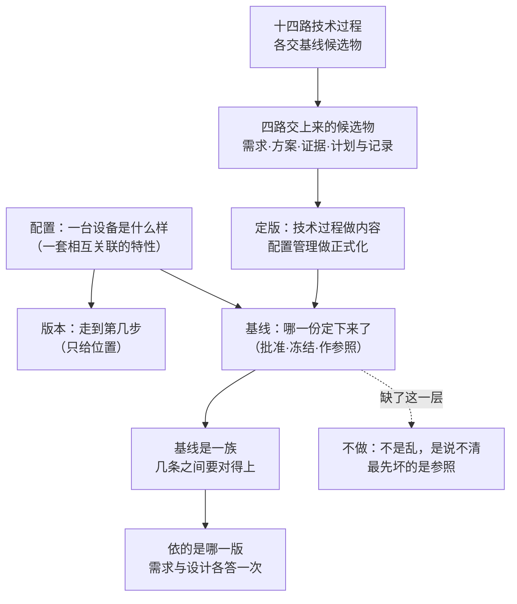

# 第9章 配置管理：让每一种内容都定得下来

## 9.1 引言

### 9.1.1 误解现场

疾控的审计员把三样东西并排推上桌：一台 M3 的样件、一张测试记录、一份交付清单。

"这一批，我要带走三样。烧进去的固件是哪一版，里面的温控参数是哪一版，这张测试记录对的是哪一版。"

会议室里没人马上接话。石军先说算法是六月定下来的。吴浩说云端采集参数上个月调过一次，只改了一个阈值。季昭把测试记录翻到结论页，说结论是他签的，上面写的是"按现行版本测试"。

"现行版本是哪一版？"审计员问。

季昭把记录往回翻了两页，没找到答案。那一栏写着"见随件清单"，而随件清单是三个月前那一批的。

林涛说了一句这不影响结论。赵刚问，客户那边要的也是这一批吗，还是要我们按报数那一版另出一份。审计员没有反驳，只把三样东西收回包里，说下一批再来看。

散会以后，小周在走廊里问石军，那台样件是按哪一版烧的。石军说，我记着。小周说，你也记着，我也记着，审计员不信我们记着。

小张在门口等了一会儿，把签页翻到最后一页："这一批的签页上，固件版本写了两版：一版是量产批的，一版是样件批的。报数用的是前一版，烧进样件的是后一版。"林涛说，先放一放，下一批再说。

季昭补了一句："我们这儿说改配置，十有八九就是调个参数。"

同一天，恒信那边也在为三个文件名吵架。合同审批系统的需求文件里躺着 `最终版 v3.doc` 和 `真最终版 v4.doc`，评审纪要引用的是后者，开发拿的是前者。顾言把两个名字并排放在屏幕上，说这不是两个版本，是两个文件名。

两处问的是同一件事：样件造出来了，会开过了，字也签了，可是没有一处能当场指出，定下来的是哪一份。

### 9.1.2 本章的人和物

这一章仍然是两家。冰链造温控箱，恒信做审批系统。

开口问话的是疾控来的审计员，做的是外部审计，不属于这两家。他只关心一件事：拿走的这一份，半年后能不能被别人重新核一遍。

冰链这边出场的是林涛（产品经理）、石军（嵌入式硬件）、吴浩（云端）、季昭（测试）、小周（制造）、赵刚（产品开发经理），加上小张（系统工程师，管整条链的受控与基线）。恒信那边是顾言（需求）、罗建（架构师）、王默（运维）。

### 9.1.3 本章要回答什么

读完本章，下面这几问，你应该答得出来。

1. 配置管理管的是哪几样，版本管理又管到哪儿？
2. 一份需求改到第三版，基线凭什么说得清该用哪一份？
3. 文件名带着 final、文件夹按日期排，为什么还不算基线？
4. 基线要几样才算立住，缺一样最先坏在哪一处？

这几问合起来，问的是一件事：造出来的需求、方案、记录、计划，从哪一刻起能被别人拿去当依据。

## 9.2 配置、版本、基线，答的不是一件事

一屋子人手上各有各的一份。在问"哪一份"之前，得先把三个词摆正：它们各答一件事，混着用，后面每一句都会跟着走偏。

### 9.2.1 配置是一套相互关联的特性

现场说"改一下配置"，十有八九指改参数：阈值调一调，开关翻一翻。这个用法在日常里没错，但它不是标准里那个"配置"。

> *Configuration: interrelated functional and physical characteristics of a product or service defined in configuration information.*（配置：在配置信息中规定的产品或服务的相互关联的功能特性和物理特性。ISO 9000:2026 §3.10.8）

照这条定义，配置是一套特性，不是一组设置。阈值是一个数，随时能改；"这条通道在零下二十度以下仍要保持连续性"是一条特性，定下来，产品就成了那个样子。

围着配置还有两个词。配置项是配置里被切出来单管的那一块，也就是满足某一最终使用功能的实体。配置信息是关于产品设计、实现、验证、运行与支持的那些要求，也就是把这套特性写下来的那一份。

三样本来连着：特性、实体、记录。把这一整套特性写成一份文件，那一份叫配置信息；从中间切出几块单独管，那几块叫配置项；而这两样说的都是同一件事，这台设备是什么样。设备是什么样，那就是配置。

一句译名提醒。国家标准把这一族词译作"技术状态"，技术状态项、技术状态信息、技术状态基线，说的是同一件事。

判据在这儿：你改的是那一个数，还是这台设备的样子。答"数"的进设置，答"样子"的才进配置。

### 9.2.2 选定之后，才算配置

不是产品身上的特性都进配置。外观、成本、交期、供应商、团队习惯，都是事实，但绝大多数不进来。

理由不是它们不重要，是这件事有代价：一旦进来，改其中一条就要走变更，要留痕，要通知拿着旧版干活的人。

所以进不进来，是一次判断：哪一组特性，值得被这样管起来。标准把这一步叫配置标识，它的第一步就是识别哪些系统元素与人工制品需要处于配置管理之下。

拿不准的时候问三句。它是产品自身的特性吗，不是过程的，不是组织的，也不只是某个人的做法？它在那一组相互关联的特性里吗，孤立的一项不构成配置？它被选定要管了吗，还是只是被顺手记了一笔？

第三问最容易出岔子，因为它把"选择"摆到了台面上。配置项不是从天上掉下来的，是被选出来的。选了就要有人担，没选就要承认它不归这套管。

> *… Items subject to configuration management usually include requirements, models, product and system elements, services, and baselines.*（受配置管理约束的项通常包括需求、模型、产品与系统元素、服务以及基线。ISO/IEC/IEEE 15288:2023 §6.3.5.3 b) 1) 注 5）

这条注值钱的地方在最后两个字：基线也是受管的项。也就是说，管起来的那批东西里头，连"哪几条基线"这一层，本身也能再被管一层。

选定之后要有一份清单，每一项答得出"它是什么、归谁管"。答不出的那一样，多半还只是某个人的习惯。

拿 M3 试一遍。温控通道在零下二十度以下保持连续，进；箱体的颜色，不进；供应商换了一家，多半不进，它进的是采购与验收那一侧的账。三样里只有第一样，改一次就要动下游一整串。

一句话：答不出"它在不在那份清单上、谁定的"，它就还没进配置。

### 9.2.3 版本只标先后，不给资格

版本最容易被当成进度。它只标先后。

标准没有给"版本"下定义，它把力气花在一件更硬的事上：架构描述里的各样构成物都得带版本标识，也就是让人看得出这是第几次。视角、视图、视图组件这三样，条下写的都是"应含版本标识"；描述框架、描述语言、模型种类这三处的主句也都是"应"。只有一处用"宜"：标准另有一条，前提是"当一份符合性描述中预期要有时"，这时版本标识列在"宜写明"的几样里。

> *Each architecture viewpoint shall include version identification as specified by the organization and/or project.*（每个架构视角应包含由组织和／或项目规定的版本标识。ISO/IEC/IEEE 42010:2022 §6.6）

版本最朴素的样子就是编号：给每一次改动一个号，让人一眼看出先后。软件界常见的"主.次.修订"三段式是行业惯例，不是标准条文；它给出来的是一件东西，位置。

位置只答一类问题："这批记录是哪一版采的""你看的是哪一版"。它答得出先后，答不出资格。最新版只是到目前走得最远的那一版；它有没有被批准，有没有被冻结，能不能拿来当依据，版本号一个字都不说。

还有一件常被混进来的：变体。行业里把同一时刻并存的几种形态叫作变体；版本是同一条线上先后几次改动。同一型号按客户要求做的两种配置，就是变体，同时存在，谁也不是谁的升级；同一型从 v2.1 走到 v2.3，走的是版本。

还有一层常被跳过：标识与版本不是一件事。标识给身份，让人指得准是"哪一个"；版本给先后，让人指得准是"第几次"。两样都有，才追得回去。只有文件名，两样都没有。

先问"这批是哪一版"，再问"凭什么可以拿它当依据"。

### 9.2.4 基线要批准、冻结、作参照

基线回答第三件事：哪一份是定下来的那一份。

> *Baseline: formally approved version of a configuration item, regardless of media, formally designated and fixed at a specific time during the configuration item's life cycle.*（基线：配置项不论介质如何、在配置项生存周期内的特定时刻被正式指定并固定的、经正式批准的版本。ISO/IEC/IEEE 15288:2023 §3.8）

> *Configuration baseline: approved configuration information that establishes the characteristics of a product or service at a point in time that serves as reference for activities throughout the life cycle of the product or service.*（配置基线：经批准的配置信息，它确定产品或服务在某一时间点上的特性，并作为该产品或服务生存周期内各项活动的参照。ISO 9000:2026 §3.10.12）

两句并排读，基线要三样，缺一样就散架。

批准给资格：从这一刻起，这一份可以当依据用。

冻结给状态：此后任何改动都是对这一版的偏离，都得走变更。没有冻结，批准只是一句好话。

参照给用途：别人引用、比对、追溯时指向它。

最容易漏的是第三样。冰链那次就是这样：会开了，字签了，记录归档了，然后七个人接着用各自电脑上那份顺手改过一点的。批准有，冻结也有，可它们落在哪一版上，没人指得出来。三样里缺的那一样，是参照。

恒信那边是同一件事的另一种样子。日期文件夹里的包是同一个目录，谁也不比谁正式；等到要回滚，才发现没有一个包被指定过。缺的不是批准那一下，是"某一包就是这一版"这个指定，也就是参照。

三样齐了，才算定下来了。

还有一条边界：基线承载的是明示的那一部分。评审与验证的判据都从这些明示的条目里来，基线撑得住这两样。确认要的那把尺子不在基线里：它问的是符不符合预期用途，而那把尺子在使用情境里。这条边界不影响本章的做法，但挡住一个很容易犯的错：把基线当成什么都能判的依据。这是本书的读法，标准没有写这一条。

## 案例进展①｜恒信：另存为 v2，回滚指不出来

合同审批系统上线半年，运维只有王默一个人。每次发布，他的做法是把构建产物扔进按日期命名的文件夹："2026-05-12""2026-05-18"。

合同管理模块改一次字段校验，他把新包扔进"2026-05-18"，上回那个"2026-05-12"里的旧包也没删，一起拷了进来。

两个月后，一个合同状态流转的缺陷暴露了。罗建说，回滚到上上个版本。王默打开"2026-05-18"，里面躺着两个包：`合同系统_final.zip` 和 `合同系统_final_2.zip`，分不清哪个是哪个。

"我们有版本号啊。"罗建说。

顾言把两个包的名字并排看了一遍："这里有三个东西被混成了一个：文件名、版本、基线。文件名的先后不是版本，版本要能精确指到哪一次完整构建。final_2 既不知道是哪次构建，也不知道批没批过，更不知道和上一版差在哪。它连版本都算不上，更谈不上基线。"

罗建看着那个文件夹："所以出问题要回滚，我连回滚到哪儿都指不出来。"

"对。"顾言说，"版本是回滚的地址，基线是变更的参照。你只有日期文件夹，地址和参照都没有。两个月前还能说的'变了什么'，两个月以后就说不清了。"

后来恒信补上了发布记录：一个包对应一个版本号、一个提交号、一版需求基线和一份变更记录。

从此"上上个版本"在恒信变成了一句可执行的指令。

## 9.3 内容分路交，基线分开立

三个词摆正了，接着要放掉一个错觉：以为基线只有一条。被下游拿去当依据的东西有几种，基线就有几条。

### 9.3.1 技术过程交的是基线候选物

标准里有一句几乎一模一样的注，重复了十四次。十四路技术过程，从最前面的业务或任务分析，到最后面的处置，都写着同样的前两句；其中十路还补一句，点名这一路交出的典型人工制品。下面这一份是验证过程那一路的，三句都在。

> *The configuration management process is used to establish and maintain configuration items and baselines. The verification process identifies candidates for the baseline, and then provides the artefacts to configuration management. For the verification process, the verification strategy is a typical artefact that is baselined.*（配置管理过程用来建立并维护配置项与基线。验证过程识别基线的候选对象，随后把人工制品提供给配置管理。对验证过程而言，验证策略是通常会被基线化的人工制品。ISO/IEC/IEEE 15288:2023 §6.4.9 注 17）

这一遍遍重复，说明的不是哪一路特殊，而是每一路都这样：做需求、做方案、做验证、排计划的那一方，就是交候选的那一方；收候选的只有一处。

这条句式还点出一件事：从集成过程往后，交出来的多半不是产品，是策略与计划。集成策略、验证策略、转换策略、确认策略、维护计划、生存周期保障计划、处置计划与记录，都是。策略变了，整套活动都得跟着变，所以它们同样是候选。

按交上来的东西归组，可以收成四路：需求类、方案类、证据类、计划与记录类。这是本书的归组：其中十二路正本点了名，业务或任务分析与运行那两路没点名交什么，本书按它们各自产出的东西，一并归进需求类与计划类。归组为了记得住，不是为了替代那十四路。

一处要提醒：十四路不是十四份产品。越靠前的路交出的是"要什么"，越靠后的路交出的是"怎么做的、做成了没有、以后怎么办"。同一条特性，会在几路上各留一份痕迹。

### 9.3.2 需求、方案、证据、计划，都进基线

四路各自点名。

需求类包括相关方需要、相关方需求、运行概念，以及系统需求。那是第4 章造出来的那一批。

方案类这一路，正本只给通则：架构定义、设计定义两处都没点名交什么；点名的只有实现过程，它交的是系统元素。这几样合起来，是第6 章和后面几章造的那一批。

证据类这一路，点了名的是分析过程，交出来的是分析结果或报告；验证与确认两路点名的，是各自的策略。那是第8 章刚判过的那一批。

计划与记录类包括集成、转换、确认的策略，维护与生存周期保障计划，处置计划与记录。

四路有一个共同点：它们都会被下游拿去当依据。需求是设计与验证的依据，方案是实现与测试的依据，证据是放行与验收的依据，策略是下一轮活动的依据。

拿冰链这一批走一遍。需求类里，那条"零下二十度以下保持连续"是相关方需要落到系统需求的产物。方案类里，加热功率与通道布置是设计描述。证据类里，那一轮测试记录与分析报告。计划与记录类里，验证策略与维护计划。

四路各有各的形态，用途却是同一种：别人拿它去判自己的活。

### 9.3.3 策略与计划，也是基线候选物

最容易漏的是第四路。理由很朴素：策略与计划看起来不像产品，像管理文书。

标准的注把这一条写死了：集成策略、验证策略、转换策略、确认策略，都是通常会被基线化的人工制品。一旦策略进了基线，改它就和改需求一样，要走变更。

试一次就明白。验证策略从抽检改成全检，测试工作量、交期、成本全变。它不是谁的私事，是下游所有人的依据。

反过来也成立：策略没进基线，改它就没人拦。某个下午有人把抽检改成全检，第二天测试组按新口径开工，交期承诺还是旧的。事后追，只能说"我们改了个策略"，没有人批过。

### 9.3.4 基线对不上账，下游就接不住

基线不止一条，接着要问的是：几条之间对不对得上。

需求基线里写着零下二十度以下保持连续，方案基线里那条通道的加热功率却是按零度算的，证据基线里的测试记录又是在零度工况下做的。三条各自都批准了，也各自都冻结了，可它们对不上。

对不上账，下游最先感觉到。设计拿需求来判依从，判出"符合"，做出来却过不了确认；测试按策略抽检，抽的却是被改过的那一版需求。

账不平还有一种更常见的样子：几条基线各自都在，可它们不是同一天定的。需求在三月定版，方案按二月那一版做的，证据按一月的策略抽的。三条都盖了章，凑到一起却不是一个故事。

所以基线立起来之后，还有一件常被跳过的事：几条之间的追溯要能走通。需求的一条，落到方案里是哪一条，证据里是哪一条，走不通就是账不平。

## 案例进展②｜冰链：版本标着，基线没有

审计员第二次来，带了一张纸，上面只有一个问题：这一批，按哪一版报数。

会议室里坐齐了七个人。石军说固件是 v2.3。吴浩说云端采集参数开会之前调过一次，阈值从两度调到一点五度。季昭说测试记录签的是 v2.2 那一批。

"v2.3 是哪天烧进去的？"审计员问。

"量产这一批都是 v2.3。"小周说，"可 v2.2 那批样件还在库里，编号只差一位。"

"那这张记录对的是哪一批？"

季昭把记录翻到封二："封二写的是批次号，可那一批的固件版本没写。当时 v2.3 还没出来。"

赵刚把报数表推过去："报数那一栏是我们填的，填的是出库批次，不是烧进去的固件版本。"

林涛把话收住："客户那边要的不是最新那一版，是我们报数用的那一版。所以现在两个问题叠在一起：版本号我们有，谁批的、批的是哪一版，我们答不出。"

审计员没有追问技术细节，只把纸推过去："下一批报数之前，把这三样写在一张纸上：这一批的固件版本、这个版本谁批的、什么时候批的。三样写不出来，我就只能按'未定版'记。"

散会以后，小张在库房门口拦住了小周："v2.2 那批样件的编号，要不要也单独贴一张纸？"小周说，要，就贴在箱子上，别贴在册子里。

## 9.4 定版，是把候选定成基线

上一块说清了基线是一族。这一块说那个把它们定下来的动作：这动作叫什么，谁做，做几件事，什么时候开始。

### 9.4.1 技术过程做内容，配置管理定版

> *… The content for the baselines is developed through the technical processes, but is formalised at a point in time through the configuration management process. Baselines form the basis for the next change.*（基线的内容通过技术过程形成，但通过配置管理过程在某一时点被正式化。基线构成下一次更改的基础。ISO/IEC/IEEE 15288:2023 §6.3.5.3 b) 4) 注 8）

这句话里有一个转折：需求、方案这些由技术过程做出来，正式化不在技术过程里。

本书把这一步叫定版：把一份候选定成基线。它不是新造的词，正本里就是 formalise。

定版含三样，前面已经拆过：批准、冻结、作参照。这是对"这一份"说的。对"这一次动作"还要加一样：留下记录，写明哪一份、谁认的、什么时候。记录缺一样，日后就说不清。

这几样记录在场上怎么用，冰链那一批给了例子。审计员要的不是"我们有版本"，是"这一份、谁认的、哪天"。三样写在一行字上，核的人一眼就能往下走；写不出来，他就只能按未定版记。

顺带划一条界：定版不等于技术评审。评审判的是这一份够不够好，定版管的是这一份的资格。评审合格是定版的常见前提，但不等于定版。一份评审合格的草稿仍然是草稿。

### 9.4.2 基线清单在准备阶段定下

什么时候建基线，不是碰运气的事，也不是等出了事再补。

标准的准备活动里写着：定角色、职责、问责与职权，定要建立哪些基线，定存储的位置与条件，定何时启动配置控制。

> *NOTE 1 This includes details covering: … c) the necessary baselines to be established; … e) the criteria or events for commencing configuration control and maintaining baselines of evolving configurations.*（注 1 这包括以下细节：……c) 需要建立的基线；……e) 启动配置控制并维护演进中配置的基线的准则或事件。ISO/IEC/IEEE 15288:2023 §6.3.5.3 a) 1)）

这几件最容易被跳过，因为它们不直接产出东西。可它一缺，后面几项就都成了临时应付：临时选配置项，临时定门槛，临时补记录。

建哪几条，跟着内容走。定不下来的时候问一句：这一份将来会被谁拿去当依据。答得出，它就值得有一条基线。

还有一件绑在一起的事，标准只要求"定出启动配置控制的准则或事件"，本书把这条准则说成一句话：受控与编写同时开始。需求在定稿之前就已经被人引用了。所以它不能等到定稿才进受控。中间那一段里，只要已经有人在照着它干活，它就已经牵动了别人的活。等定稿再改，别人就得跟着返工。

还有两件跟着一起来的账。一件是存放：存在哪儿、什么条件、什么介质，也得在准备阶段定。存错了地方，等于没存；权限开得太宽，等于谁都能改。另一件是留存：记录要一直留到生存周期之后，按协议、法规或行业惯例存档。

留存这一条常被当成行政规定，其实它管的是"事后还能不能查"。审计、追责、再研制，用的都是当时那一份。记录常常比产品活得久，因为问这些问题的人总在后头。

变更控制严到哪一档，可以按影响定；怎么定档、改了怎么走完一圈，归第4 章，本章只用一句：凡是已经有人在照着它干活的东西，哪怕它还叫草稿，也得先纳入受控范围。

### 9.4.3 候选挑得对，定版才做得成

本章最要紧的一条分工：挑候选的是一处，定版的是另一处。

按标准，技术过程做完自己的活，还有一件收尾动作：识别基线的候选对象，随后把人工制品交给配置管理。也就是说，挑候选的是做这一份内容的那一方，收下并定版的是配置管理。

这条分工常被读成交出去就不管了。它说的是另一件事：判断与定版分属两处。

现场那句"我们评审通过了，怎么还说不算"就有答案了：评审判的是内容，定版给的是资格。内容合格却没被收进基线，它仍然不是别人可以引的依据。

挑宽挑窄都要付账。挑宽了，一份清单上百条，条条都要过一次变更，这道手续就成摆设；挑窄了，最要紧的那一条没进来，等它出问题才发现没人管过。

挑得对不对，标准给不出数，只有一个问法管用：把这一份交出去，谁会停下来找它。答得出人、答得出用途，就该进来。

### 9.4.4 基线立住，才谈得上管变化

基线一旦立住，替下游挡掉的是一串麻烦。最常遇见的有这么几件。

让"改了"说得清。这两个字只有在有一个可指的上一版时才有内容。没有上一版，改了什么、改到哪儿、跟谁对得上，三问都落空。

让多层级同时改的时候有个共同的指认。技术过程在层级上递归、在时间上并发，上一级是哪一版必须有答案，否则分配与追溯失去共同对象。

让追溯走得通。需求、接口、分析结果、验证方法之间要能双向追溯，决策记录也一样，得有一版可指的描述作依托。

正本另给一个名字：产品基线。正本提到它只有一处，说的是"执行配置审核以建立产品基线"，没给它定义；"管的是能不能定型"是本书的读法。配置审核分功能与物理两项，两项做完，产品这一版才可以建立起来，与前面说的配置基线一前一后。产品基线这一条在本章只出现这一次；配置审核怎么判，归第18 章。

还有一件和基线绑在一起的事，常被读成"发版"。标准里，发布是授权使用：把某一版放出去，让它可以在特定用途上使用，带限制或不带限制。

这一句把"发出去"和"被认下来"分开了。把包推到服务器上，那叫部署；宣布这一版可以拿去干什么，那叫发布。前者是动作，后者是授权。没有定版的那一份，发布就只能是先发出去再说。

还有一笔最实的账：召回。有基线、有配置状态记帐（记录并报告配置信息与更改状态的那一笔账），出问题时能精确召回受影响的那些配置项；没有它们只能全量召回。两者成本差多少，本书给不出数，只能说是一个量级的差别；这是行业里的经验说法，不是标准条文。

**基线立住的用处，是让"上一版"这三个字有指认对象。** 它替下游省掉的不是手续，是一次次回头确认。

## 9.5 没有基线，坏的是说不清

上一块说了定版怎么做。这一块反过来看：不做会坏在哪，以及坏起来先坏哪一处。

### 9.5.1 预期结果反过来读，缺的是基线

标准把配置管理做成什么样子，写在它的预期结果里，一条一条数下来。这些预期结果全在一个引导句底下：配置管理过程成功实施的结果。

> *As a result of the successful performance of the configuration management process: a) system and system element configurations are managed; b) configuration baselines, including approved configurations, are maintained; c) changes to items under configuration management are controlled; d) configuration status information is available; e) required configuration audits are completed; f) system releases are approved.*（作为配置管理过程成功实施的结果：a) 系统与系统元素的配置得到管理；b) 配置基线（包括已批准的配置）得到维护；c) 纳入配置管理的项的更改得到控制；d) 配置状态信息可获取；e) 所需的配置审核得以完成；f) 系统发布得到批准。ISO/IEC/IEEE 15288:2023 §6.3.5.2）

一条一条反过来读，就是不做会怎样的清单。

配置得不到管理，谁在改、改成什么，没人说得清。基线得不到维护，哪一份是定下来的没有答案，引用只能凭记忆。更改得不到控制，改动绕过门口，事后才知道。状态信息不可获取，查不到现在是什么状态，也查不到曾经是什么状态。配置审核做不了，没有基线，配置审核没有比对的对象。发布得不到批准，没有可批的那一份，只能是先发出去再说。

这些结果有个共同点：不是乱，是说不清。现场往往不乱：每个人手上那份看起来都成立，每一条改动都有记录，每一次评审都有纪要。

乱是看得见的，说不清看不见。而看不见的坏更难办，因为它不触发任何人的警报。

这些结果里没有一条带"宜"，也没有一条留出"本项目不需要"的余地。它们写成的是过程成果，不是建议。

这些结果之间也不是平列。前面几条管配置与基线怎么受控，最后一条管发布批不批。没有基线可以维护，中间几条都失去对象；没有发布这一道授权，前面做的一切都停在内部。

### 9.5.2 有版本管理，没有基线

比完全没做更常见的，是做了一半，而且每一半都能报出成绩。

先交代一句。"版本管理"不是一个标准术语。第4 章把"看住基线、管住变更"那一套叫需求管理；这里用它，指的是另一套更窄的做法：有版本号、有提交记录、有发布节奏。

有标识、无控制：清单立起来了，可改动不进配置控制，清单上写的"当前版本"随时过期。有控制、无记帐：改动确实走门了，走完之后没人记录状态，问现在是什么状态要靠回忆。有记帐、无审核：日志记得很全，可没有人对着基线核一遍实物与文档。

这一型最要紧的特征，是三问里两问答得出、一问答不出：东西是什么样答得出，走到第几步答得出，哪一份是定下来的那一份答不出。

现场核对时，这一问要问得具体：批这一版的是谁，批的是哪一天，批的是不是手上这一份。三样答得出来，版本号之外还有定版；答不出来，版本号再整齐也只是刻度。

标准把这两件事分得很清楚：给唯一标识，是让它能被追溯；正式化，是另一件事。

> *Items are distinguished by unique identifiers or markings. The identifiers are in accordance with relevant standards and product sector conventions, such that the items under configuration control are unambiguously traceable to their specifications or equivalent, recorded descriptions.*（各项以唯一标识或标记区分。标识与相关标准和产品行业惯例一致，使处于配置控制之下的各项可以无歧义地追溯到其规格或等价物、已记录的描述。ISO/IEC/IEEE 15288:2023 §6.3.5.3 b) 3) 注 7）

所以"我们用了版本管理"这句话，同时与有配置管理和没有配置管理相容。它不能当判据用。

判据只有一条：说得出现在定下来的是哪一版、谁认下的、什么时候。

### 9.5.3 缺位按型分开，坏处不一样

说一句"我们没做配置管理"，信息量很低：它可能是没立清单，可能是立了清单却从没定过版，可能是定了版、改动却不进门，也可能样样都有、只是没人记没人核。四种情形，塌下来的地方各不一样。

缺标识：最先坏的是引用。指认不出某一条决策，也指认不出某一版视图，讨论只能靠"上次那个方案"。

缺基线：最先坏的是参照。评审与验证找不到对象，上一版谁批的、什么时候，答不出。

缺变更控制：最先坏的是影响评定。改动波及哪些下游，没人算。

缺配置状态记帐与配置审核：最先坏的是追责与发现。它是怎么变成这样的、谁核过实物，都答不出。

四类分开之后，现场核对就不必逐条全查：先问四句，哪一句答不出，缺的就是哪一类。

### 9.5.4 坏起来有先后，参照最先

四种情形不是同时塌的。第一处塌方落在哪儿，看的是哪一样被最先用到；而用得最早的，是参照。

理由是其余三类都靠它：没有哪一份是定下来的，追溯就断了起点，评审没有比对对象，变更也没有参照可依。

冰链那次就是这个顺序。第一批样件交出去时没人追问；三个月后审计员来问三个"哪一版"，答不出的是参照；再往后才是追溯与召回。

所以现场核对不必从最难的地方起。先查起点：上一版是哪一版，谁批的，什么时候。三问答不出，后面的账都是空的。

## 案例进展③｜冰链：季昭给测试记录加基线栏

审计员走后第二天，季昭把测试记录的模板改了一版。他在结论栏旁边加了一栏，栏头只写了两个字：基线。

栏里填三样：对哪一版测的，那一版谁批的，测的时候这一版处于什么状态。三样都填，才允许提交。

林涛看了一眼说，你这一栏补的不是手续，是别人敢不敢用你的结论。

三个月后，一次内部评审上就撞上了这句话。有人问，这批测试结论是对评审前那版做的，还是评审后那版？

季昭翻到那一栏，当场答了出来。

散会以后，小周问了一句，产线那份排产记录要不要也加一栏。小张说，要，签在"按哪一版做的"那个格子里。

## 9.6 基线说得出来，依从才立得住

到最后一块，把前五块交出来的东西用一次：一个人说"我依的是那一版"，这句话什么情况下才立得住。

### 9.6.1 依的是基线，不是最新版

设计说依从架构，这句话要成立，得先说得出依的是哪一版。

理由在定版那一步：架构描述交到设计手上之前，得先被定下来。定下来之后，它就成了一条基线。设计依的是那一条基线，不是最新那一份。

需求那一侧同理：设计吃的需求在需求基线里。架构一条线、需求一条线，两条都要有基线。

往深一层看，这条链上每一对相邻环节都是局部的甲方与乙方：需求对方案，方案对实现，实现对验收。要求在上游，兑现在下游；两者之间要有一个"认下来"的点，链才接得上。

一件常被忽略的事：两条线各答一次，依从这个声称才立得住。只答需求那一条，设计做出来符合需求，却可能与架构的约束背道而驰；只答架构那一条，架构内部一致，却做不出客户要的东西。

这也是标准为什么把设计定义的输入写成两样：一份是被架构化的需求，一份是架构本身。

### 9.6.2 需求与设计都答得出，依从才成立

现场的说法通常是"我们是按最新需求做的"。这句话有两个问题。

一是最新。最新只说明先后，不说明资格。评审没过的一版也可能最新；改到一半的一版更可能是最新。

二是只说了一份。设计同时吃着两样东西：规定需求与架构施加的约束。只答一份，另一份就成了隐含前提，出事时无从查找。

把两边都答出来，一句话就变成三句：依的是哪一版需求基线，依的是哪一版架构基线，这两版各是谁在什么时候认下的。三句都答得出，依从才立得住。

冰链这一批后来答得出来。依的是五月定版的需求基线，依的是四月定版的架构基线，两版都是评审之后由林涛认下的，时间写在同一张纸上。答出来之后，"依从"不再是一句表态，是一句可核的话。

### 9.6.3 认知反转

回到那间会议室。

三个月后审计员又来了。这次他带走的三样东西上，都写着同一行字：基线号、批准人、批准时间。

季昭说，那一行字是这三个月里补上去的；补的时候，他以为只是加一道手续。

这一栏起初确实像手续：多一栏格，多填三样，多一个人签字。三个月后它显出来的却是另一样东西，一个能指出去的名字。这一章要说的是同一件事：那条链上的人要的从来不是手续，是危急的时候，一句"就按这一版"能落到一份纸上。

这一章从头到尾做的事，是把"哪一份"这一问，从一句口头承诺变成一个动作。

配置管理不造需求，不造方案，不造记录，也不排计划。它做的是另一件事：把这些东西从某人手上那一份，变成某一天之后谁都能指得到的那一份。

所以它也不该被读成文书工作。文书工作是把做过的事记下来；它做的是让一件事在做过之后还能被认。

留一个问题给后面：一个工程师凭什么说他会做这些？那不是靠年头，也不是靠头衔。那是第10章的事。

---

## 小结

一章走到这里，可以收口了。

拿冰链那一批往回看，本章五块各拦得住一次：三词分开时看得出参数与特性不是一回事；分路时看得出四路都往这里交候选；定版时说得出现在定下来的是哪一版；反读时看得出缺的是哪一型；到最后一块，答得出依的是哪一版需求基线、哪一版架构基线。

一句话收口：配置管理不改你写下的东西，它做的是另一件事，给每一份写下过的东西定一个能被人指着说的那一版。

季昭那本测试记录上，多了一栏"基线"。这一栏补的不是手续，是别人敢不敢用他的结论。

还有半句：这一栏谁有权撤、撤了之后怎么问责，本章只答到"要有人认下"。撤的权限归第18章。

这一章也没有给出一张表，给的是一条判断：你手上这一份，定下来了没有，谁认下的，别人引用时指得到指不到。三问过一遍，答案在纸上，不在记性里。

---

## 附录

### A 本章概念总图

### B 本章的能力级

再用第1章 §1.4.3 那把尺子量一下：本章站在第 ③ 级（心智模型），底座铺到第 ② 级（图式）。

表征：说准六个词，配置、配置项、配置信息、版本、基线、定版。并分得开三对：配置与设置，版本与文件名，基线与最新版。

图式：三问对三词（是什么样、走到第几步、哪一份定下来了）；基线要三样（批准、冻结、参照）；基线跟着来料分四路，几条之间要对得上。

心智模型：一份交付物摆在面前，问得出它定下来了没有；听得出"有版本管理、没有配置管理"这一型；缺位时先查参照。

解释框架：本章不建此级。

收束句：**能答全三问，才算拥有**。一份需求、一份方案、一份记录摆在面前，你说得出它定下来了没有、谁认下的、别人引用时指得到指不到。

### C 自查 · 这些说法对吗？

1. "改了配置，就是把参数调了调。"不全对。参数是设置；配置是这套设备相互关联的特性。调参数不一定动配置。
2. "文件名带 final，就算定了。"错。文件名连版本都不是；版本要指到哪一次完整构建。
3. "版本号越新，越能当依据。"错。新只说明先后，资格来自批准、冻结与参照。
4. "评审通过了，就等于定版了。"错。评审判内容，定版给资格；评审合格的草稿仍是草稿。
5. "基线只有一条，就是产品那条。"错。四路来料各有各的基线，几条之间还要对得上。
6. "有版本管理，就算有配置管理。"错。这一型恰好是两问答得出、一问答不出。
7. "配置管理是文书工作。"错。文书工作记录做过的事；配置管理让做过的事还能被认。
8. "基线什么都能判。"错。它承载的是明示的那部分；确认的判据在使用情境里。

### D 练习

1. 拿你手上最近一份交付物，问三句：它是哪一版，谁认下的，别人引用时指向哪一份。三句里答不出的是哪一句。
2. 把你们团队"改配置"这个说法拆开：哪些改动动的是参数，哪些动的是设备的样子。
3. 给一个项目列基线清单：哪四路会有来料，每一路各建哪一条，谁挑候选、谁定版。
4. 找出你们最常用的那个文件名，看它能不能指到一次完整构建；不能的话，补齐三样：构建号、批准的基线、变更记录。
5. 用配置管理的预期结果给一个项目做反读，标出最先答不出的那一条。
6. 挑一场评审，把结论重写成三句：依的是哪一版需求基线、哪一版架构基线、各是谁在什么时候认下的。

### E 参考文献

> 编号怎么读：`[k]` 是本章内的文献序号；括注的 `R-xx` 是全书参考文献总表（附录 D）的编号。

**标准**

- [1] **R-37** ISO/IEC/IEEE 15288:2023：§3.8 基线；§6.3.5.1 配置管理过程目的；§6.3.5.2 预期结果（a)~f)）；§6.3.5.3 五项活动与各注（a) 1) 注 1、b) 1) 注 5、b) 3) 注 7、b) 4) 注 8、b) 6) 注 10、c) 注 12、d) 1) 注 18、d) 注 19、e) 4) 注 22）；§6.4.1~§6.4.14 各技术过程的基线候选注（十四口）；§6.4.5.1 目的；§6.4.5.3 b) 1)~2)。用于本章 9.2~9.6。
- [2] **R-38** ISO 9000:2026：§3.10.8 配置；§3.10.9 配置项；§3.10.10 配置信息；§3.10.11 配置状态纪实；§3.10.12 配置基线。用于本章 9.2。
- [3] **R-04** ISO/IEC/IEEE 42010:2022：§3.3 架构描述；§6.6~§6.8 版本标识；§6.10.1 决策记录的唯一标识与时间戳。用于本章 9.2.3、9.4.4。
- [4] **R-05** ISO/IEC/IEEE 42020:2019：§10.2 e) 架构描述处于配置控制之下；§10.4.2 h) 变更控制；§10.4.2 n) 以配置管理过程为指南；§10.4.4 m) 置入存储库；§6.4.2 k) 治理建配置控制管理机制。用于本章 9.4.4、9.6.2。
- [5] **R-08** ISO 10007:2017：配置管理指南。**库外·不可核**，只作行业出处指引，正文不引其条款。
- [6] **R-20/R-21** ISO/IEC/IEEE 24765、SemVer：版本与语义化版本。**库外·不可核**，本章不引其定义，只用行业惯例的说法。

**研习报告**

- [7] **04 号 v2.8**《配置管理概念研究报告》：§7 配置家族；§8 基线三特征；§10 配置×版本×基线；§12 五项活动；§13 三问；§14.1 三条铁律。本章概念侧底本。
- [8] **41 号 v1.5**《配置管理作用研究报告》：§2.3 三者对象；§3.1 供料与正式化；§6.1 判断—正式化—效力；§7 缺位反读；§11.2 十四个供料口。本章标准侧底本。
- [9] **17 号 v2.0**《设计与开发边界及三层基线治理研究报告》：三层基线的主说归第18章，本章只取基线是一族这一层。
- [10] **24 号 v1.14**《架构与设计边界研究报告》：被基线化的是描述，不是被描述物。
- [11] **11 号 v1.3**《工程师六项能力研究报告》：第 ⑥ 项可复现，本章是它的工程形态。
