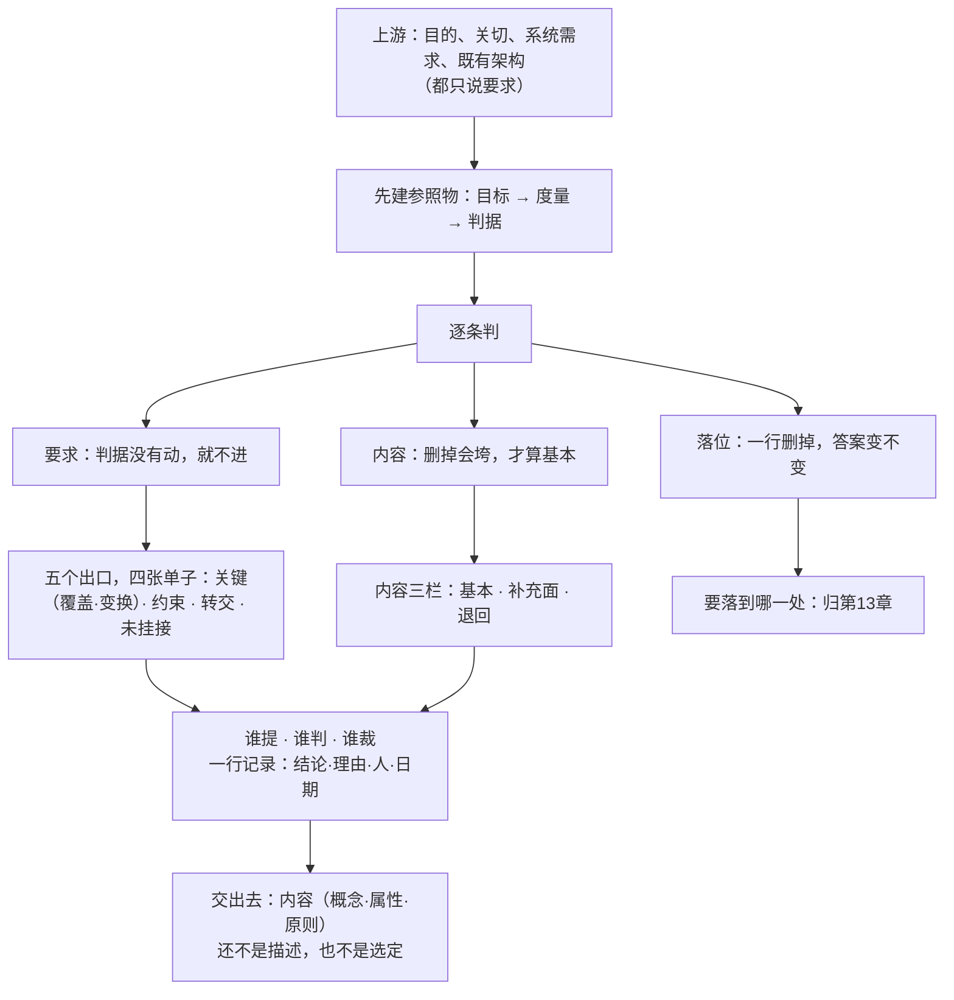

# 第12章 架构定义：把判断变成判据

## 12.1 引言

上一章把这份架构说成三样东西：概念、属性、原则，各写一份清单；末句留了一问：这几句内容，怎么从一组输入里长出来。这一章回答这一问。本章说的"标准"，指架构与系统工程那几本现行标准，具体出处见章末 E。

### 12.1.1 误解现场

冰链科技，同一间会议室，隔了一周。这回石军带了东西来：上一章那张四层方块图，画的是硬件、固件、云端、App，新加了两处标注；一页选型对比，要不要在箱内先判一次断链、还是等读数传上去再判，各写了一栏利弊。还有一页手写的老规矩，散会之后他一个人补的，字迹很挤，写的是温度数据归谁管、断链就算失效、升级不许搞坏已经出厂的箱子。

"这次准备得比上次齐。"石军说，"图有了，选型有了，规矩也写了。这次总该算是把架构定下来了吧。"

产品经理林涛先问了一句："预判这件事，跑在硬件上还是云端上？"

"两个都列了，还没定。"

"打算什么时候定？"

"看情况。"

林涛又问："这么改完，M3 还是 M3 吗？"

三个问题，石军一个都答不上来。

测试季昭补了一句："我该验的东西在哪。"

云端软件的吴浩接了一句，是复读那页老规矩："温度数据归追溯平台管，这条我记着。可这条界线，是谁划的。"

石军把三样东西收起来的时候说："我是从需求出发的。"

这句话听着没问题。问题就在这句话里。

### 12.1.2 本章的人和物

冰链做医疗冷链温控箱，M3 是其中一款。石军是嵌入式硬件工程师，带来三样东西；林涛做产品，三问都问在"定没定"上；季昭做验证与确认，要找能拿去验的东西。

吴浩做云端与 App，守着那条老规矩，问的是这条线谁划的；赵刚管产品开发全局，最后说了一句话；系统工程师小张读石军写下来的东西，专门挑说不清的地方。制造与批次的小周不在场上；产线上怎么造，这一章收成一条关切，到关切为止。

恒信做合同审批系统。罗建是系统架构师，上一轮画了四张图，四个对不上；顾言做需求，问话只一句，用了别人的东西，理据写在哪。

### 12.1.3 本章要回答什么

读完本章，下面这几问，你应该答得出来。

1. 上游给了一堆要求，为什么没有一条说得出这个实体是什么？
2. 判断为什么不能被推出来，只能先定？
3. 一条要求进不进架构，凭什么判？
4. 一条内容够不够格，凭什么判？
5. 判否的那些要求，最后去了哪儿？
6. 这几条内容写下来，交出去的是什么？

这几问合起来，问的是一件事：一句判下来的话，凭什么别人也能照着判。

## 12.2 判断只能做出来

石军那句话对了一半。需求确实在手上，可需求不是唯一在手上的东西，也不是每样都回答同一个问题。

### 12.2.1 上游给的是要求，不是判断

上游送来的东西，各回答一个问题。

目的回答这个实体为什么存在。它相对稳定，是后面所有取舍的参照，却只给参照、不给答案。标准没有要求写实体目的，这一处是本书补的。

关切回答谁在乎什么。客户在乎链条别断，产线在乎造得出来，运维在乎修得起。

系统需求回答技术上要满足什么。标准要求它可测、可追溯，并且不许暗示实现。

上一轮留下的架构、参考架构一类，回答别人家那类东西是怎么定的。标准把这类东西分别叫既有解与方针指令，本章一律当上游给的料。

四样话说得各不相同，合起来只有一句结论：没有一样在说这个实体根本上是什么，也没有一样在说它被允许怎么造、怎么变。这两句话，才是这一步要立的。

需求那一样最容易混。需求也可判，标准明写它要可测。标准紧接着又说，需求不应蕴含任何特定的实现。可测，判的是够不够；不许指向实现，就更说不出该怎么做。两头一夹，需求能告诉你达没达标，告诉不了你这个实体是什么。

关切更不服管。关切可以主观，可以彼此冲突，也可以永远写不成一句判据。"承运方不想被绑死"是关切，它推不出一条可控的性质。关切的去处是识别与框定，不是判准入。

### 12.2.2 判断推不出来，只能先定

往上、往下，两条路都试过。

往上推不过去。一个系统的行为，不在它的任何一个部件里。标准给系统的定义说的也是这件事：合起来才出现的行为与意义，在单个部件里找不到。把部件查得再细，也加不出那个合起来才有的东西。

往下推不过去，因为分解从来不唯一。同一套需求，换个团队、换个预算、换个供应商，长出来的方案就不一样。标准在解空间里用的动词是综合，不是推导。

两头都推不出来，只剩一条路：先定一个，定下它是什么。定了，下游才有东西可对。

这句话不是做法上的方便，是结构上的必然。整体才有的属性，只能由整体来定；分解又要有人先划一刀，后面才分得下去。

不做会怎样，有一条现成的路可以看。这一步没人做，它不会消失，只是换个地方存在：由第一个动手的人在他那一处顺手定掉，写进第一版方案，没有依据，也没有落款。

石军那一场就是。边缘预判最后落在箱内还是云端，会上没定。可固件总得写，他先按箱内算写了第一版；后来吴浩在云端那一侧又按上报之后算做了一套。两边都没错，合不起来。这不是沟通问题。两个人各自做的时候，手上都没有那两句话，只能各自先补一个。

### 12.2.3 框图、选型、老规矩都不是判断

石军带来那三样，一样一样看过去。

框图是表达的雏形。它画的是箱子里有什么、谁连着谁，属于"怎么读这份东西"那一侧，还没到"这东西是什么"。

选型是解空间里的一条路。走这条路还是走那条，要先知道哪些路算数——那正是这一步要先定的。

一页老规矩是几条界。界是要立的，可它立在什么基础上？"升级不许搞坏已出厂的箱子"这条，凭的是这个实体卖可追溯，不是凭谁觉得重要。

这页老规矩要立得住，得先有这个实体是什么、它被允许怎么造这两样。

到这里可以把本章要用的三样东西摆在一张表上：被判的是什么、对着什么判、判完是什么。

| 被判的东西 | 对着什么判 | 判完落在哪 |
|---|---|---|
| 一条要求 | 判据的某一项 | 进不进架构链 |
| 一条内容 | 删去后垮掉的那一句 | 够不够格当内容 |
| 一次落位 | 这一处要答的那一问 | 这一行留不留 |

三行里，第二行的参照物第11章已经给了：删去之后哪一句说不清。第三行的参照物也现成：这一处要答的那一问。缺的是第一行——判据的某一项，本章还没有判据。

## 12.3 判据先立：从目标长出来

缺的那一个参照物，得先建起来。它不是一个数，是一条链：先有目标，再有度量，再有判据。

### 12.3.1 目标写到能判为止

先说清楚这一步要写的那条目标是什么。标准把它叫架构目标：不是"把系统做好"，是就某几条关切或需求而言，把这个实体面对的问题推到某个状态。

一条目标要有三件。

坐标：就哪些关切、哪些需求、哪些质量属性而言。缺了坐标，目标就是口号——"提高可靠性"没说就哪一件事而言，谁都能说自己提高了。

宾语：哪一个问题、哪一个机会。一条目标管一个问题；两条互不相关的问题写进一条目标，是因为写的人还没分开。

方向：从什么状态推到什么状态。现状要抄原话，从问题描述里截一句，可以截短，不许改词，更不许另造。

三件齐了，目标才进得了评估：它判的是问题被解决到什么程度，不是这个架构成功不成功。标准里没有"架构的成功"这个词；架构只会被问合宜不合宜、站不站得住、值不值得要，成功属于系统与事业。这一点写不实，后面每条判据都会滑成"我们的架构达没达成目标"。

冰链那一条写成这样：就"全程不断链"与"出事能自证"而言，把"断链平均六小时才发现、索赔拿不出可采信读数链"这个状态，推到"任一时刻可判、三十分钟内叫到责任人"。三件都在，读的人知道该拿什么判它。

### 12.3.2 从目标到判据：度量与分层

目标给方向，判不了。要判，得把方向落成能取值的度量。这些度量、它们的分层、它们之间的关系，标准合起来给个名字：质量模型。

一条度量要写清三样：量什么、什么单位、怎么取。一次测得、统计得、还是抽样得，写法不一样，判的时候也不一样。写不出取法的，那不是度量，是形容词。

度量之间要分层：顶上几类质量特性，中间一层是被量的那些量，底下是能取值的度量。上一层由下哪几个合成，要写得出来；写不出来，这一层就是摆着看的。

度量之间还有关系。两两之间是同向、反向，还是互不影响，各写一句理由。这一栏最容易被跳过，而它恰恰是后面定权重的前提：只有互相牵制的两条，才谈得上谁让谁。

分层与关系的用处，是让一条判据长出来时不至于随手抓：这条判据量的是哪一层、它和谁互相牵制，写的人心里有数。

### 12.3.3 判据要能判，还要能指方向

一条判据，是因子加一个值或一个值域。因子是被量的那个量，值域是这次要求到哪儿。标准把从目标长出来的这一组叫关键成功准则；上一节那条叫架构目标，是它的来路。本章行文把这一组简称判据。

它要担两件事，缺一件就不成判据。

第一件，判问题被解决到什么程度。这一件人人都会写。

第二件，在两个备选之间指方向。这一件最常被漏。只写"达标与否"，那是验收条款；要能说"这两条路里，哪一条更接近目标"，判据才配叫判据。

另有两处要定。一是必过标记：不达即出局的那几条，单独标出来，它们是下限，不参与比。二是权重：只给互相牵制、又都须保留的那几条赋权，归一化，加总为一；不相牵制的不赋权。

这两处一混，就会把"更关键"读成"必须全过"。关键只是一个相对的说法：标准给的动作是区分较为关键的事项与不太关键的事项，并没有给一条条否决的门槛。

判据不是需求。需求判达标不达标，判据判问题解决到什么程度、以及两条路该往哪边走。同一件事可以两处都写，角色不同：目标进评估出达成度，需求进验证出达标与否。

到这里，缺的那个参照物立住了。

## 案例进展②｜恒信：判据没立，先不动笔

恒信那边，罗建把上一轮那四张图贴在工位上，贴了两个月。业务、数据、应用、技术，四张都画得规整，四个对不上。

这次的活是合同审批系统改一处：法务要求所有金额字段加上本币折算口径这一栏。上一轮罗建是直接开画的，这一回他没动笔。

他先列关切，一张纸上写了三行。

法务这一行：口径必须唯一，同一份合同在任何一张表里折算结果一致。

财务这一行：折算率有生效日期，跨期合同要能看到当时的口径。

法务又一行：录入时不能要求录入的人记住口径代码。

三行写完他看了一遍，发现第三行其实是一句需求，它说的是界面该怎么做，那是设计的事。他划掉第三行，改成"录入的人不需要懂折算规则"——界面上怎么摆归设计，要不要懂规则是这个系统的性质。

然后他去找素材。他没翻架构文档，那里没有可用的东西。他翻了两样：上一轮项目留下的追溯表模板，一份同类做法；集团层面那份数据口径管理规定，一份方针与指令。

两样都用了，各写一句适配理由。

用追溯表模板，因为它已把金额、口径、时间的字段留好；不一样的是把生效日期从行级提到版本级，这是改动，得记。

用集团那份规定，因为它定的折算顺序与本系统一致；不一样的是它只管年度报表，本系统要管到单笔合同，这一条也得记。

顾言走过来，问了那句他每次都会问的话："你用的这件既有做法，适配理由写在哪。"

罗建指了指纸上那两段。

那天他一笔没画。他自己也没想到，不画图这件事，对他来说才是这一轮最大的变化。

## 12.4 逐条判：要求、内容、落位

接下来一处一处判。被判的东西不同，判法也不同，换着用就出错。

### 12.4.1 要求：判据没有动，就不进

先判要求。这一处只问一件事：改了这条要求，哪一条判据的哪一项会跟着动。

两道填句，顺序不能换。

第一道，事前对着判据问：改动这条要求的哪一处，让哪一条判据的哪一项动到多少；不改的话，那条判据按现状判，是达成、不达成，还是判不了。填不出判据号，就是不触及任何判据，留一句痕迹就行。

第二道，事后对着内容问：这条要求由哪一条内容承接，还是须新立、须改动一条内容，抑或转交别的过程。

另有一个并列入口：强制项与外部给定约束。法规、合同、集团制度、平台边界，这些东西不进来比轻重，进来登记。它的身份是约束，不是可以取舍的一条；登记之后还要写清它传导成了哪条内容，否则这条约束就悬着。

三样不能当判据用：关切、目的、优先级。关切是坐标，不是尺；目的是实体为什么存在，不是这一次判什么；优先级最会骗人——高优先级里塞满只改文案的要求，低优先级里藏着逼出新接口的那一条。判据不含实现难度与成本，那是评估与决策的事。

判不出来的时候，走三个出口：真不关键；判据本身漏了一条；它其实是约束。三个都走不通，才写"判否"，并写一句理由。

还有两条否决。要求本身写着实现，比如"用某中间件"，那不是关键要求，是设计约束，转交设计并降为约束。两条要求互相冲突又没有仲裁的规矩，先交治理裁，不替它拍板。

### 12.4.2 内容：删掉会垮，才算基本

再判内容。一条内容指的是概念、属性、原则里的一条，不是标题。

这一处的参照物，第11章已经给过：删去它，哪一句话变得说不清，或者哪个量失去着落。同一处还留着一支填句，三个空依次是为谁判、作哪种判、删了之后哪句垮。补上一件：三种对象各有各的填法，不是三支判据。

概念填在理解侧，没有它，这个实体就说不成一套；作的是分类判定：这条做法算不算这个实体的一类。

属性填在掌控侧，填判据号；作的是度量判定：多大算达标。效用、成本、时间、风险这四条，是实体在它的环境里要付的，不是做架构这件事的进度与花费。四条里任一条实质动，就算动。实质的意思是越线或改选：越过一条事前立好的线，或者翻转一个已记录的决策。

原则也填判据号，作的是许可判定：允许怎么造、禁止什么；再补一问，这条许可管不管得住实现与演化。

还有一条纪律不许打折扣：过门只分栏，不删条。判为非基本的，进补充面，不进垃圾堆。删了它，后面的视图里就只剩基本内容，读的人看不见全貌。

还有一条：判的是条目，不是标题。"要高内聚低耦合"是一句标题，先得落成可填值、可指违例的条目，才进得了这道门。

### 12.4.3 落位：一行删掉，答案变不变

第三种判，宾语与前两种不同。

它的宾语是一次落位：一条内容，挂到某一处，写明以哪一种形式承载。形式有七种：概念、属性、特征、行为、功能、特性、约束（特性是能取值的量，特征是有没有的能力）。原则不在其中，由另一条单列，不分配到元素上。这一张是分配时用的形式表，不是内容分类；内容只有概念、属性、原则三类。

这一处的参照物，是这一处要答的那一问。判法只有一句：删掉这一行，这一处原来要答的那一问，答案会不会变。会变，这一行留下；不变，这一行就不必留。

它与"基本"是两道不同的判。基本判的是算不算这个实体的内容；相关判的是这一处要不要留这一行。由此两个推论。非基本的内容可以相关——环境条件、假设、约束，它们不是这个实体的本质特征，可缺了它们，这一处就答不上问。基本的内容在某一份模型上也可以不相关——某条内容很基本，可它不在这张图要答的那几问之内。

"某一处"这一样东西，本章不给名字，它的名字与切法归第13章。本章只用到"这一处要答的那一问"，够判了。

### 12.4.4 换着判：会漏掉一整类

三处换着用，坏法一种一种看。

拿判内容的参照物去判要求：要求被当成了内容，指标混进内容清单。清单越写越长，写的却不是这个实体是什么。

拿判落位的参照物去判要求：凡是现有内容已经答得上的，都被判成"没有新东西"，从追溯上退了出去。可它们仍然进架构链，仍然要被追。这一退，将来出了事，查不到这条要求曾经存在过。

拿判要求的参照物去判落位：只有撑着判据的那些行留了下来，环境、假设、约束这一批，本来就不是这个实体的本质特征，于是无处安放。图看着规整，缺的那一块却没人发现。

三种漏法的共同点是：漏掉的那一类，恰好没有对应的那一处判它。

所以这三处只说不能换，不说哪一处更严。它们量的本不是同一个东西，没有共同刻度。

## 12.5 判下来都有账

判完了，账要记。这一步最容易被跳过，也最容易出大事。

### 12.5.1 判过之后，每条要求都有去处

去向一共五个出口，分记在四张单子上：关键那张分覆盖、变换两栏，另三张是约束、转交、未挂接。

关键那一张再分两栏：覆盖，是现有内容已经答得上，写上内容编号；变换，是现有内容答不了，写上新立或改动哪一条，并写明变的是分类、度量还是许可。

约束：登记在约束栏，写传导成了哪条内容，不进关键表。

转交：挂不上判据、也不是约束，但属另一个过程，写过程名与一句理由。

未挂接：判据与约束都不沾，写一句理由，留在需求基线里。

还有一条常被误读：覆盖不算没判。一条要求被现有内容答住，它仍然进追溯表，仍然要能被找到。

去向登记至少四列：要求号、去向类别、落到哪儿、理由。后两列缺一列，这条要求就等于消失了。这五个出口是本书的操作化；标准只要求对关键、与架构相关的那批建追溯。

### 12.5.2 判否也留账，写一句理由

判否不等于出局。这是一条纪律，不是一句安慰。

判否的那一条，仍留在需求基线里，旁边写一句为什么不进。写不出这句理由的，通常不是判否，是还没人管。

还有一处是标准明写的义务：

> *An architecture description shall include a statement of known resource limitations or other constraints that prevented the description from addressing identified stakeholders and architecture concerns.*（中译：架构描述须写明有哪些已知的资源限制或其他约束，致使该描述未能应对已识别的相关方与架构关切。）——ISO/IEC/IEEE 42010:2022 §6.2

这一条挂在描述侧，可它的原料出在这一步：哪些关切没有内容管它，哪几条要求判否了、为什么。这一步不记，写描述的时候就没有东西可抄。

恒信那两条挨着提出来了。一条是单笔超过五十万的合同自动加一道复核，另一条是同一份合同在任何一张表里，金额的折算结果必须一致。头一条判否，因为五十万这个数改一改，系统还是这个系统。第二条进，因为一个多事实源的系统和一个单事实源的系统，是两回事。

两条挨着提，一条进一条不进，靠的不是谁更贵、谁听起来更严重。

### 12.5.3 补账：判否之后再查一遍

这一遍不重判，只查三处。

第一处，真不关键吗。这一条要求改一改，确实没有哪条判据会动——那它就是真不关键，留一句理由，收工。

第二处，判据漏了吗。这一条要求谁都答不上，可它明明很要紧——多半是判据集少了一条。这时候要回上游补判据，不在这一层争。

第三处，它其实是约束吗。有些要求不像判据，像门槛：必须满足，没得商量。那走约束那条路，登记，传导。

三处查完再判否，这个"否"才立得住。

石军那一页老规矩正好一漏一滥。漏的是客户怎么知道链条没断，通篇没有一条管告知；滥的是他原本想加的显示界面必须用蓝色，既不影响目的，也没人会违反。前者要回去补判据，后者判否、留一句理由就够。

## 12.6 判据立成内容：概念、属性、原则

账记完了，还差最后一件事：把判下来的话，立成别人拿得去用的条目。

### 12.6.1 内容先划范围：范围句的写法

先写一句范围：这次管到哪儿，不管的那一头归谁。标准把这一类范围条目叫关键特征。

一句范围要能指出两件事：管到哪一层、哪一段，以及不管的那一头归谁。写不出后半句的，它还是口号。

范围句不是每家都要。范围大、团队多、要跟人分清"哪些归我"的时候才要；小系统、一个团队、一次交付，写一句反而多事。它在标准里是按条件才要的一类，不是必备件。

范围定完，还有一件挂着：这条范围将来落到哪些单位、哪张视图去兑。这一栏本章写不了，它要等切法与视图，归第12、14章。

### 12.6.2 内容从需求变出来

内容不是从天上掉的，也不是把需求改写一遍。来路只有一条：从关键要求与约束出发，逐条问它要求说清什么。

答案只有三种。要分清类的，落成概念；要定值的，落成属性；要立许可的，落成原则。一条要求常常散成好几条，逐条各起一行，不许合并。

概念最容易漏。原因不难懂：关键要求多是"定值"和"立许可"，概念藏在词义里，不遇到同一个词两种理解，它就不显形。

触发问也只有一句：这条要求里，有没有一个词，不同的人理解不同。

冰链那几份清单上，真正起作用的概念只有几个：装箱、交付、断链、可追溯。这几个词先说准，后面的规矩才写得出。断链如果两个人一个理解成越界一次、一个理解成越界三十秒，那么每一条关于断链的规矩，都是两个人在说两件事。

概念不是从需求里抄来的，是被需求逼出来的。需求里没有"装箱"和"交付"这两个词，它们是做这一行的人造出来的。造出来之后，各方才能用同一套话谈这个系统。

它解决的不是我能不能说清，是我们能不能用同一套话说清。缺了它，相关方对这个实体是什么还说不到一处，后面两样连说都说不出口。

### 12.6.3 内容分栏：只留不删

一条内容要过三个问题，顺序不能倒。

第一个问题：它是不是概念、属性、原则这三类之一。三者都不是的，它可能是一句有价值的话，可能归设计，可能归项目管理，总之不归这里。

第二个问题：它填不填得出那支填句。第一个空填不出，它不属架构内容；第二个空填不出，它还不配当内容，只是一句有价值的话；第三个空填不出，它被判为不基本。

第三个问题：它算不算基本。这一问第11章讲过，本章只回指。

三种没过，处置不一样。不属架构内容的，退回或转交；还不配当内容的，记一句"有价值但不是内容"；判为不基本的，进补充面。

第三种最容易被做成删除。删不得：视图里只放基本内容，读的人看见的就不是全貌；将来要解释某一条为什么这么定，补充面正是依据。

分栏的结果是一张表：基本的一栏、补充面的一栏、退回的一栏。三栏都要留痕，第三栏尤其要留，它记的是"为什么这句话不是内容"。

## 案例进展①｜冰链：石军把判断写成老规矩

散会那天下午，石军没画图。他先问自己一句：我到底要把什么写下来。

他想起上一章的话：这一段要交的不是一摞决定，是一句关于它是什么的话，加几条它不许怎么造。于是他打开一个空白文档，写下标题"M3 老规矩"，然后一行一行往下写。

第一行是涵义的正面回答：

> M3 是一台从装箱到交付全程可追溯的医疗冷链温控箱；温控是它的手段，可追溯是它的目的。

下面接了三段，每段一条规矩，都从上面那句话里读得出来。

温度数据归谁管。采集端归固件，上传端归云端；两边各自记录时间戳，对不上时以采集端为准。他补了一句为什么：数据归属不定，追溯链就有两个源头。

断链就是失效。写这一条的时候他停了一下，把它念出声："从装货到交付，链条上任何一段缺失，这次运输就算失效，不管箱内温度多漂亮。凭什么？凭上面那句涵义，M3 卖的是可追溯，温控只是手段。拿掉可追溯，这台箱子就不是 M3 了。"

升级不许搞坏已出厂的箱子。新增传感器类型不得破坏已有的追溯链路，新固件必须能读旧批次的记录。

写完三段，他停下来看了一遍，发现自己做了一件跟以前不同的事：这一次他没有先画图，也没有列选型；他是先写它是什么，再从这一句里推出它不许怎么造。图可以后画，选型后选，这两样以前都是起点，今天成了后来的事。

那份文档他存了，一共一页。文件名不叫架构，叫"M3 老规矩"。

下班前，系统工程师小张过来看他写的那一页，读了两遍。她挑的不是哪一句写错了，是第三条缺的那一句："前两条都说清了管到哪儿：哪一端记、整条链算不算断。第三条只说升级不许搞坏已出厂的箱子，说的是不许，没说管到哪一批、哪一版固件。一条规矩说不出自己管到哪儿，旁人照着它判，判出来就是另一个范围。"

石军没答上来。他把那一页折起来，收进了抽屉。

## 12.7 谁提谁判谁裁

判据立住、内容立住，还剩一件事没有交代：这一页上的每一条，是谁的话、谁认下的。

### 12.7.1 相关方提，架构师判，治理裁

提、判、裁，不许压成一个动作。

提，是相关方做的，架构师本人也在相关方之列——他自己的判断也是从他那一处关切来的。提的产出是一份清单：谁在意什么，这一条对应哪一条关切。

判，是架构师或架构团队做的：动哪个量、往哪动、越没越线。判的产出是一段贡献分析，不是一句结论。

裁，是治理或有权限的那一处做的。裁不是投票。关切本来就可主观、可互相冲突，冲突总要有人收口；收口的产出是一行记录。

一行记录要有四件：结论、理由、人、日期。四件缺一件，这一行过三个月就作废——不是没人记得，是没人认。

还有一类人不会到场，却必须有人替他们说话：监管、下一代用户、将来的运维。沉默的一方由治理代持，代持这件事本身也要记下来。不记，等于这一条没人管。

判下来必须留痕，这一条不是形式。判的人走了，后来的人要复核，唯一的凭据就是那四件。

### 12.7.2 判完之后：交内容，不交描述

交了这么多，最后要交代一件事：交出去的到底是什么。

交出去的是内容：概念、属性、原则这三样写下来的一份东西。它是这个实体算什么、守到多少、什么不许的一组断言。

它不是架构描述。描述是另一侧的装置，要有读法、有对账，也要写明哪儿还没写；把内容按视角落成视图、写成一份别人读得懂的描述，是第15章的事。有一句话要记住：清单写完，不等于描述有了。

它也不是切分。这一条内容挂在哪一处才有人担，是第13章的事；本章只判到"这一处要答的那一问"，没给那一处起名字。

它更不是选定。这一章交出去的是摆好的条目，不是定下来的那一个；比、选、认下，归第14章。

还有一层账要落。这三样内容在第7章那套说法里找得着：产品数据有设计态、制造态、使用态三种存在，设计态里没有实物，开发产品就是开发产品数据。本章立出来的，是设计态产品数据里内容侧的那一支：是数据，不是实物，也还不是一份描述。

### 12.7.3 认知反转

回到开头那间会议室。

石军那天做的事，每一件都符合一个很顺的直觉：把需求拢一拢，把图补一补，把规矩写一写，架构就有了。

可那天整套动作里，有一件事没发生：没有人问过这个实体是什么，也没有任何一句被当面判过。

于是三样东西摆出来，三问都答不上：预判落在哪一端，判据没立，就判不出来。什么时候定，判据没立，就定不出早晚。还是不是 M3，内容没立，就答不了。

第二场不一样。他还是没有画图，可他做了三件事：把要判的东西列出来，给每一样配一个参照物，然后逐条判一次。做完这三件，那几句话才第一次成为别人拿得去用的东西。

所以这一章要翻的不在"做不做架构"。要翻的是这一句：**把判断变成判据，不是把标准定得更死，是每一句都指得出它在对着什么判**。

反转还有一半，藏在后面：这一步不是整理，是加东西。整理不产生内容。这一步必须产生内容：概念要造出来，属性要认出来，原则要加进去。

章末那句话是产品开发经理赵刚说的。他把工牌从脖子上摘下来放在桌上，说："咱们做了这么多年 M3，怎么被问到它是什么，一句话都说不上来。"

---

## 小结

架构定义是一个动作，不是一个定义。

这一章的入口，比一份需求宽得多。目的、关切、系统需求、既有架构，没有一样答得了这个实体是什么、它不许怎么造。

做起来分四件事。先建参照物：目标、度量、判据，一条一条长得出来。再逐条判：要求对着判据判进不进，内容对着删去那一句判够不够格，落位对着这一处要答的那一问判留不留。

判下来的都要有账：进、改、登记为约束、转交、未挂接，各有各的清单和一句理由。最后把判下来的话立成内容：概念、属性、原则三样，过门只分栏，不删条。

一句话收口：架构定义不是给架构下定义，是把上游给的那一堆要求，一条一条判成这个实体的话；每一句都指得出它在对着什么判。

留一个问题给后面：这几条内容挂在哪一处，才有人担？

---

## 附录

### A 本章概念总图

读法：上游那一层只给要求，本章的活是把要求变成内容；三处判各对着一个参照物，判完都要有账；最后交出去的是一组条目，不是一份描述。

### B 本章的能力级

用第1章 §1.4.3 那把尺子量：本章主级是第 ③ 级（心智模型），底座铺到第 ② 级（图式）。

表征：说准七样——架构目标、质量模型、判据、权重、三处准入、去向、内容三类。

图式：一条链（目标→度量→判据→分流→内容候选→分栏）＋四张清单＋内容过门三问。

心智模型：同一句话，说得出它该由哪一处判、对着什么判；换一个参照物，推得出会漏掉哪一类。

解释框架：本章不建此级。

收束句：**能答全四问，才算拥有**（四问见第1章）——三处准入各对着什么判，这一步答得出。

### C 自查 · 这些说法对吗？

1. "架构定义就是给架构下一个定义。"错。那是第11章做完的事；本章是一个动作，有输入、有产出、有次序。
2. "从需求出发就能推出架构。"不成立。需求判达标不达标，判不了这个实体是什么；判断只能先定。
3. "关切也是判据，多一条关切多一条标准。"错。关切是坐标与来源，可以主观、可以冲突，它的去处是识别、框定与评估。
4. "目的就是判据。"错。目的是实体为什么存在，它给方向不给尺子。
5. "改起来贵、改不动的就基本。"错。那是代理判据，既漏判也误纳。
6. "重要、优先级高就算关键。"错。优先级由相关方给，会塞满只改文案的要求；关键只看判据动没动。
7. "判否就是不要了。"错。判否仍留基线，写一句理由；写不出理由的，通常没人管。
8. "过门就是把不基本的内容筛掉。"错。只分栏不删条，非基本进补充面。
9. "三种对象用同一把尺就够了。"错。三处各有一个参照物，换着用会各漏一整类。
10. "准则写到达标与否就够了。"不成立。还要能指方向，否则它是验收条款。
11. "架构的成就是要判的。"错。标准里没有这个词；判的是问题被解决到什么程度。目标写成"把系统做好"，就还是这一路错。
12. "内容写完，架构描述就有了。"错。描述是另一侧的装置；清单写完不等于描述有了。

### D 练习

1. 把你们项目的一份要求清单摊开，逐条判去向：覆盖、变换、登记为约束、转交、未挂接。判完问一句：有没有一条是空的。
2. 挑一条目标，检查三件：坐标、宾语、方向。缺哪一件，补上去。
3. 拿一条要求，试着回答：改了它，哪一条判据的哪一项会动。答不出，先去看判据那一栏是不是空的。
4. 把你们写过的三条"必须遵守"，各问一句：违反了判得出吗？判不出的，它是愿望还是原则。
5. 给一份内容清单过三问：是不是三类之一、填不填得出那支填句、算不算基本。把判为不基本的收进补充面，不要删。
6. 找一行"内容挂到某一处"的记录，问：删掉这一行，那一处要答的那一问，答案会不会变。
7. 把一条要求拆成概念、属性、原则各一条，看会不会漏掉概念那一样。
8. 列一份判定记录：结论、理由、人、日期。四件齐不齐，齐了才叫判过。

### E 参考文献

> 编号怎么读：`[k]` 是本章内的文献序号；括注的 `R-xx` 是全书参考文献总表（附录 D）的编号。

**标准**

- [1] **R-04** ISO/IEC/IEEE 42010:2022：§3.2 架构定义句；§5.2.2 架构可以关乎的五类；§5.2.3 相关方与关切；§6.2 未应对声明；§6.10.1 决策选取的十三条。用于本章 12.2.1、11.5.2、11.7.1。
- [2] **R-05** ISO/IEC/IEEE 42020:2019：§8.4.3 问题空间；§8.4.4 a)~j) 从目标到评估准则的链条；§8.4.5 候选与目的陈述；§8.4.7 概念与原则；§8.5 工作产品。用于本章 12.3、11.4、11.6。
- [3] **R-37** ISO/IEC/IEEE 15288:2023：§3.26 问题；§3.36 需求；§6.4.4.1 架构定义过程的变换与备选；§6.4.4.2 关键与架构相关；§6.4.4.3 任务清单。用于本章 12.2、11.4。
- [4] **R-28** ISO/IEC/IEEE 42030:2019：§6.1.2 评估目标的四个槽；§4.2 注 3 事前立线（资料性）。用于本章 12.3.3、11.5.3，只作读法借用。
- [5] **R-38** ISO 9000:2026：§3.7.11 目标＝要实现的结果；§3.7.13 成功（组织义）。用于本章 12.3.1。

**研习报告**

- [6] **48 号 v3.26**《架构定义研究报告》：§2 三个定语的参照物；§4.4 架构目标的理解；§5 需求分流；§13 卡5~卡12 的做法。本章主家。
- [7] **35 号 v1.8**《架构定义与视图设计研究报告》：§四 目的与关切；§五 输入五组；§六 九步（本章取前三步）。
- [8] **42 号 v3.5**《架构研究报告》：§5.6 概念是共同陈述的条件；§5.2 目的不是第四张清单。
- [9] **37 号 v1.22**《架构视图口径研究报告》：定义句与术语旁证。
- [10] **32 号 v1.13**《架构视角与关切判据研究报告》：关切不是判据。
- [11] **39 号 v1.3**《架构师职责与产品数据研究报告》：提、判、裁的分工侧证。
