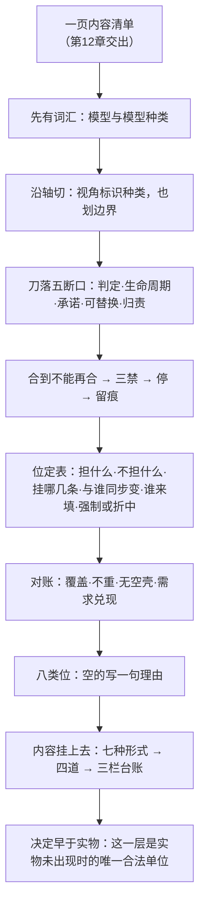

# 第13章 建模实体：把架构内容切成担得住的单位

## 13.1 引言

上一章把要求一条一条判成了内容：概念、属性、原则，各写一份清单。末句留了一问：这几条内容挂在哪一处，才有人担。这一章回答这一问。本章说的"标准"，指架构与系统工程那几本现行标准，具体出处见章末 E。

### 13.1.1 误解现场

冰链科技，还是那间会议室。这一回石军带来的东西很齐：一页内容清单，写得干干净净；一张四层方块图，硬件、固件、云端、App，每层底下都标了字。他把两页纸并排放在桌上，说："上次说的判据，我补了。这回内容都在清单上，一条不多，一条不少。"

产品经理林涛把清单拿过去，从上往下看。看到第三行，停住了。

"断链检测这一条，"他用手指点着，"挂在哪儿？"

"在固件里。"

"固件里哪一块？这块归谁担？"

石军愣了一下："做判定的那一块。"

"做判定的那块，和采样、告警是同一块还是分开的？分开的话，中间那条线谁保证不断？"

石军没答上来。

云端软件的吴浩接了一句："我这边也有一个。承运方数据接进来，清单上写着'不依赖对方在线'。可它挂在哪个位上？是挂在我这套接入服务上，还是挂在人家那一侧？两边都说得通，落下去就是两种做法。"

两个问题，一个都没答上来。

石军把清单收起来的时候说了一句："内容我都写对了。"

这句话没错。清单上的每一条都过了上一章那道门，都够格当内容。可一页都对的内容，仍然答不出"这一条落在哪一处、那一处归谁担、换掉它别处动不动"。

问题不在清单，在纸底下还缺一层。

### 13.1.2 本章的人和物

冰链做医疗冷链温控箱，M3 是其中一款。石军是嵌入式硬件工程师，这一回他带来的是内容清单与四层图；林涛做产品，问话都落在"落在哪一处"上；吴浩做云端与 App，问的是接口那一侧归谁。制造与批次的小周也在场，只问了一句物料依赖顺序：采集通道换供应商，判定逻辑跟不跟。问完就坐回去。

恒信做合同审批系统。罗建是系统架构师，手里也有一份清单，写得比冰链还细；顾言做需求，问话只有一句：这一条改动，会牵动哪几处。

两个团队面对的是同一个问题：内容有了，担内容的东西还没有。

### 13.1.3 本章要回答什么

读完本章，下面这几问，你应该答得出来。

1. 一份清单写得很齐，为什么还答不出"这一条内容落在哪一处"？
2. 切分的轴从哪里来，为什么不能按内容条目切？
3. 切出来的这一处，凭什么算能承担内容的一处？
4. 切法不止一种，凭什么换个人切出来的承担者也对得上？
5. 哪几类东西能立成承担者，哪几类不能？
6. 内容以什么形式挂到承担者上，将来凭什么核？

这几问合起来，问的是一件事：一页内容底下，那个担得起它的东西是怎么立起来的。

## 13.2 对架构实体切分，轴由模型种类定

石军那页清单答不出"挂在哪一处"，不是不用心。他手里一直没有一样东西：一张允许出现哪几类东西的词汇表。没有词汇，想画也画不出来。

### 13.2.1 模型先给词汇，架构实体才切得开

标准把模型说成一份抽象的表示。

> *abstract representation of an entity or collection of entities that provides the ability to portray, understand or predict the properties or characteristics of the entity or collection under conditions or situations of interest*（对某个实体或实体集合的抽象表示，能在关注的条件或情况下刻画、理解或预测该实体或集合的性质或特性。42020:2019 §3.13）

"表示"不是比喻：模型替那个东西站出来，让人在它还没造出来时讨论它。

模型种类紧接着给这份表示定规矩。标准说：*category of model distinguished by its key characteristics and modelling conventions*（按关键特性与建模约定区分的模型类别。42010:2022 §3.15）。它举了七个例子：功能模型、活动模型、结构模型、用例模型、地缘政治模型、分析模型、经济模型。七个里有两个跟架构无关，说明它是概念的举例，不是架构的清单。

模型种类的实质，是引入一套元素类型。*As viewpoints, model kinds and legends are specified and applied, additional AD elements are introduced*（视角、模型种类与图例一经规定与应用，即引入额外的架构描述元素。42010:2022 §5.2.9）标准举了两种构造：活动模型引入活动、输入、输出、控制、机制；用例模型引入前置条件、参与者、边界、系统。

换到冰链这一头看，这一步就是"这张图上允许出现哪几类东西"。允许功能、信息、接口、结构，图上才有这四种框；不允许的，比如"物料从哪来、什么时候到"，想画也画不出来，只能硬塞进功能里，后面全拧。

石军最初想在功能图上标"保温时段"，模板只有"备注"一列。他写进备注，三个月后查不出来——备注里的字不进检索。不是习惯问题，是词汇里没有这一栏位；要标，先加一列。

所以第一句话是：模型先给词汇，架构实体才切得开。

### 13.2.2 视角标识模型种类，也划定边界

有了词汇，还要知道从哪儿开始切、切到哪儿为止。这两件事由视角定。

标准在讲视图组件时说，每个组件受一个适用的模型种类或图例治理（42010:2022 §5.2.8）；视角要标识一个或多个模型种类或图例，并逐项写进规格，这一条在 §8.1 e)。标识不是定义：视角点名，种类定规矩。种类自己要有四件规格——约定、视图方法与对应方法、版本标识、信息来源。（42010:2022 §8.2）四件不齐，这根轴还只是"拟用"。

视角同时还划边界。每个视角以与外部实体的接口与交互界定上下文与边界，以确立其目的与范围。（42020:2019 §10.4.4 a)）一句话：视角定从哪切、切到哪、切出来要答哪几问；种类定用什么形状切。

两件事合起来，切分才说得准：

> 切分，是在某个视角下，沿它标识的模型种类这一根轴，对架构实体的构成做划分。

冰链的功能视角要答三问：谁在什么时候采样、超温怎么判、告警给谁。这三问把边界划在"从读数进，到告警出"这一段。结构视角要答的是另一件事：传感器和记录仪能不能换供应商。同一套硬件，换一个视角，边界就换了一条。

### 13.2.3 模型种类只给例子，标准不枚举

工程上常备的种类，大致是十五类。

| 种类 | 引入的元素 | 切出来的位担什么 |
|---|---|---|
| 功能分解 | 活动、分解关系、输入输出、条件 | 一次完整的变换 |
| 功能流／数据流 | 流、源、汇、携带物、条件 | 一次完整的传递 |
| 信息／数据模型 | 业务对象、属性、关系、生命周期 | 一份可独立引用、有唯一生命周期的信息 |
| 结构／组成 | 件、装配关系、约束 | 一次物理承担 |
| 接口 | 接口、操作或消息集、承诺、失败处理 | 一次对外承诺 |
| 行为／状态 | 状态、事件、转移、守卫 | 一段状态约定 |
| 时序／交互 | 生命线、消息、片段、条件 | 一次对话 |
| 部署／节点 | 节点、链路、分配 | 一处运行环境 |
| 组织／角色 | 角色、职责、汇报关系 | 一个可归责的岗位 |
| 能力 | 能力、能力依赖 | 一项对外能力 |
| 流程 | 步骤、角色、输入输出、控制 | 一次编排 |
| 决策与规则 | 规则、条件、动作、优先级 | 一张判定表 |
| 度量与指标 | 指标、公式、关系、取法 | 一处可量的指标 |
| 风险与失效 | 失效模式、后果、控制 | 一处风险 |
| 地点与空间 | 场所、区域、路径 | 一处地点 |

这张表有三句免责。第一，它不是标准清单：标准的例子只有七项，还混着架构外的模型。第二，它不保证互斥，也不保证穷尽。第三，写进项目文件时，要写成"本项目视角标识的种类"，并逐类补上四件规格。

最常混的一对，是功能分解与流程。功能分解答"做什么"，流程答"谁按什么次序做"。同一件事可以既有一条功能位、又有一条流程位——那是两根轴，允许，但要各挂各的编号。

标准自己还让了一句：本文件不要求使用任何特定的架构视角。（42010:2022 §6.6 注 1）常用种类是工程惯例，不是合规要求。

### 13.2.4 轴不同，位分开，跨轴走对应

一份架构可以有多根轴。同一套系统，按功能切一遍，按信息再切一遍，按部署再切一遍，都成立。

规矩只有一条：每根轴各自一份位，不共用编号。这半句是本书的规则。跨轴不合并，走对应关系；对应关系怎么建，标准给了方法（42010:2022 §6.9）。

不这么办，会有四种混法：一张图里两轴并用、一个位同时是活动又是数据、跨轴复用同号、同一份内容在两轴各切一次。后果只有一个：对账时说不清这一行算哪一处。

冰链有一处现成的例子。功能位1 管"读进来、判出来"；采集通道是结构位，管"传感器和记录仪能换供应商"。两个位都跟采样有关，却不是同一个承担者。判据只有一句：是不是同一个承担者？是，一个位多次露面，挂对应；不是，两个位，挂分配。

为了图好看把两个位并成一个，代价是：换硬件要改功能图，换功能要改结构图。

到这里，第一段路走完了：轴由视角标识的模型种类给，一根轴一份位，跨轴走对应。下一问是，沿轴切出来的这一处，凭什么算一处。

## 13.3 内容的承担者，靠责任、边界与替换

石军答不上"固件里哪一块"，真正缺的不是图，是"一块"的判据。他说的"做判定的那一块"，是一块电路板，还是一个功能？两者都能叫"那一块"，可担的事完全不同。

### 13.3.1 边界说得清，停得下来

先把这一处说清楚。

> 内容的承担者，是被架构实体身上某个离散构成单位在模型里的代表。说白了：它在某个模型种类下被单独切出，能单独指认、单独承担已分配内容、单独替换。
>
> 这一处，正式名叫**建模实体**（`modeled entity`），行文简称**位**；"承担者"是通名，说的是它担内容这件事。第12章说的"某一处"，就是这里。叫"位"是因为短，一句话指得出是哪一处；不是位置。
>
> 一句话要说在前面：这是对一个实体的构成做划分，不是说架构等于它的构成物。架构仍是那两样内容（第11章），位是内容落到的那一处。

白话：东西还没造出来的时候，把系统切成能单独派活、单独换掉、出事找得到人的最小责任块。"在模型里"是说它落在一份模型表的一行上，不是实物。

确定一处，要答得出六件事：种类、名字、边界、来路、承担、可替换性。种类是该模型种类的合法构造；名字要能指认，不是类别名或产品名；边界要说出从哪到哪、谁在外面；来路要说出谁要求它存在；承担要列出哪几条内容；可替换性要看换掉它改动关不关得住。

记录形态是一行至少三样：位名、边界、担哪条内容。三样写不出，那一行还不是位。

四条性质：可指认、可承担、可替换、离散——前三条对上头三句，离散是第四条。它们不是审美标准，是"决定早于实物"的影子。

常用三句：谁负责它？它从哪到哪？换掉它，谁会受连累？

三句里最容易糊的是第一句。"这块归固件组"不算答；要答到具体责任主体：一个岗位或团队。第二句要答到边：哪一段进、哪一段出。第三句要答到牵连：换掉它，是只动它，还是要动接口与测试。

一句判据收口：这一处立住了，等于说得出它担了什么；立错了，只说得清它长什么样。

### 13.3.2 责任落得下，替换得了

四条性质里，可承担与可替换是两条硬约束。

可承担，说的是这一处担得下一条内容。标准说：*Elements in the model of the architecture will represent things that exist as particular and discrete units.*（架构模型中的元素将表示作为特定且离散单元而存在的事物。42020:2019 §10.4.4 b) 注 1）离散是关键：一条原则派不给一个部门，一条"告警时延不超过 30 秒"也派不给"整个系统"，它们要落到某一处，才谈得上谁去做到。

可替换，说的是换掉它，改动关得在内部。这一条决定研发的余地。选型、换供应商、换技术路线，都是"用谁来实现"的决定；能不能换，就看底下有没有一层"承诺不变、填充可换"的稳定单位。

约束必须有落点，落点必须是单位。（48 号 §7.3，见章末 E）一条约束若落在"整个系统"上，就无法判违反——违反发生在哪一处？谁该被问？

冰链的采集通道就是这样。传感器和记录仪换供应商，这一处不变；换的是填充者。要是当初和"断链判定"并成一处，换传感器就要动判定。

### 13.3.3 内容的承担者不是件，也不是规格

日常说话里，"那一块"常常指一个件。这一章要把它和件分开。

标准分得很清楚：架构实体是"被架构的实体，或经受系统架构定义过程的实体"，系统元素是"系统中满足规定需求的离散部分"，两者代表两种不同的概念。（15288:2023 §5.9）件是能被造出来、采进来、验得了的东西；这一处是件还没出现时，用来承载判断与责任的那个名义单位。

一处判据：换个填充者，名字变不变。名字跟着件变，说明这一处是按件立的，不是按职责立的。"采集模块 A 型"是件；"采集通道"才是这一处。

也不是规格。型号、材料、尺寸、公差一出现，就滑到设计去了。标准说：*Sometimes the elements of the architecture entity are initially notional until Design Definition process … has occurred.*（有时，架构实体的元素在最初是概念性的，直至设计定义过程完成。42020:2019 §5.6）这句话给这一处留了一个位置：在设计定义之前，它不是实物；也正因为它不是实物，才换得掉。

三种常见的立错都出在这一步。把件当位：换个牌子这一处就没了。把内容当位："原则位""方针位"，是把负担当成了承担者。把关切当位：关切挂在视角与视图上，不挂在位上。

### 13.3.4 承担者不是内容，也不是设计元素

第三道要分清的是内容。

内容是被承担的东西，这一处是承担者。一条内容可以落在好几处上：一条"记录不得依赖承运方在线"的原则，会落到接口位1、信息位1、信息位3 上，每一处各长一条约束。反过来，一处也可以担好几条内容。这张多对多的对应表，就是后面分配表与追溯矩阵的用处。

第四道是设计元素。设计元素是这一处被变换之后的结果，归第17章讲。这里只留一句边界：这一处是"担什么"，设计元素是"造成什么"；两者之间是一次变换，不是一次细化。

三套名字也要分开，本章一律照下面这张表用。

| 词 | 指的是哪一侧 | 例 |
|---|---|---|
| 架构实体 | 被架构的那个事物 | 冰链 M3 这套温控与证据链 |
| 架构侧实体 | 要转换进设计的那批单位 | 功能位1、信息位1 |
| 描述元素（AD 元素） | 描述里的构件 | 视角、视图、视图组件、对应关系 |

裸写"实体"指代其中任何一个，都算混。这是术语纪律，不是文字洁癖：三个词各有各的判据，串了，后面每一步都会错位。

## 13.4 切法不唯一，内容要对得上账

到这里，一处的判据立住了。接下来是手艺活：沿轴切下去，切到哪儿停，怎么知道没切漏。

手艺活最怕两件事：一是凭手感切，两个人切出两套；二是切完不对账，看着整齐，底下有空位。

### 13.4.1 切之前先看来路

动手之前，桌上要有三张底表：内容清单（每条待落）、需求去向表（判完去了哪儿）、约束表（全局与局部）。缺一张，不动手。

有这三张底表，切的方向才不是"看着办"。位置从哪来，有两条正路。一条是从需求翻过来：需求变换成内容，再分配到这一处；或者需求直接分配到这一处。另一条是从规矩自己长出来：概念长结构，属性长分摊，原则长禁令。

概念长结构，是说立住"断链等于超温持续若干分钟"，就必然要有采样、判定、告警三处，以及"判定到告警"这一段接。属性长分摊，是说立住"告警时延不超过 30 秒"，就要摊到各段：采样、传输、判定与通知各担多少。原则长禁令，是说立住"记录不得依赖承运方在线"，每一个经手记录的地方各长一条约束。

这三条长法，落到操作上是一张倒推链：因为要成某件事，所以必须先有人做什么。

冰链那条链是这样的：要"断链在 30 秒内被发现"，先得有读数；光有读数不行，还得有人下结论；结论得送到人，否则 30 秒白算；事发后要能追、能索赔，就得把结论与读数送出去并存住。

倒推链有四条入链条件：一，指得到具体编号，只接受需求、目标、关切、目的四类；二，缺它那条判据的答案会变；三，落在"做什么"，不在"怎么做"；四，一行只登记一个环节。

最容易出错的是把手段写进理由那一栏。"用 4G 传数据"不是理由，是做法；它一进来，这一处就滑到结构或设计去了。

### 13.4.2 断口选对了，才切得开

一条轴切下去，刀落在哪里，由五个断口定。任一成立，就断开。

| 断口 | 问什么 |
|---|---|
| 判定 | 谁判、判什么、按什么线判，变了没有 |
| 生命周期 | 创建、变更、失效、删除的时机，变了没有 |
| 承诺 | 对外承诺什么，变了没有 |
| 可替换 | 换技术或供应商，改动能不能关在块内 |
| 归责 | 出事找谁、谁签，变了没有 |

判定与承诺两条有标准条款支撑（42020:2019 §10.4.4 a)、b)）；生命周期、可替换、归责三条是本书的读法。五条并列，不分主次。

还配一条单位判据：能被单独指认、单独承担、单独替换。四类"完整"各不一样。功能位是一次完整的变换（输入、输出、条件）；信息位是一个可独立引用、有唯一生命周期的业务对象；结构位是至少承担一条已分配内容；接口位是一次对外承诺（两端加操作或消息集）。

冰链的十位（见案例进展①），多半是这五个断口切出来的。功能位1 与功能位2 分开，断在判定：一个下结论，一个把结论送到人，谁判、判什么都不同。结构位1 从采集通道里分出来，断在可替换：传感器与记录仪可以换供应商，判定逻辑不能跟着换。

恒信的授权校验是另一个断口。它与判定分开，断在归责：判定错了找规则维护的人，越权了找授权的人。两条断口一分开，两个位就各自有主。

### 13.4.3 合不合，去掉看账变不变

切开之后还要回头合。合的办法只有一个：分别去掉，看同一问变不变。两处像不像一处，不看长得像不像，看它们是不是永远一起改、一起坏、同一个责任人。

合有三禁：不按内容条数切，不按组织部门切，不按技术选型切。第一条最要命——一条内容一个位，这一处就退化成内容的名字，有位无承载。第二条把组织当成了架构，组织一变，位就该变，可架构不随组织变。第三条把选型当成了切法，选型是一个点，点进设计描述。

切到哪儿停？所服务的准则已经答得出，就停，不追穷尽。标准对模型与视图说"限于那些足以应对的"（42020:2019 §10.4.4 首段）；本章把这条读法用到切分的粒度上，属本书读法。

留痕是最后一步。切法不唯一，所以要记下用了哪几条断口、为什么没选另一种切法。留痕的目的不是保证零分歧，是保证分歧可见。

排成程序是八步：摆三张底表，定主切轴与次序；按轴归堆，先编号不起名；合到不能再合；查该不该拆、该不该删；定界与命名；挂载与守恒核对；留痕。顺序不能倒：先合后拆。

这套程序的产物是位定表，六列数据：职责短语（担什么）｜不担什么｜挂载内容（编号）｜变更轴（与谁同步变）｜填充者（至少两个候选）｜切法档位（强制还是折中）。档位这一列是关键：强制的谁做都一样；折中的必须写理由，评审只审这一列。另有一张分配台账（三栏），见 12.6.3。

### 13.4.4 切完，账要对得上

切完不等于切对。要过四条账，合起来叫守恒四条。

| 账 | 判据 |
|---|---|
| 覆盖 | 没有一条已分配内容无位承担 |
| 不重 | 没有两位承担同一句（并引除外） |
| 无空壳 | 没有一个位一条内容也不担 |
| 需求兑现 | 每条变过的需求至少有一处兑现 |

覆盖与需求兑现，依据在标准的分配与追溯条款里（42020:2019 §10.4.4 e)、§8.4.9 c)）；不重与无空壳，依据在同一句分配的语义里。四条少一条，不算切完。

再加三条复核，不另立判据：不存在两个位总是同时变；不存在一个位担着两件互不相关的事；位名是职责名，换填充者、位名不变。

冰链对账的时候，露出来一处空位。"合规留痕"这条关切，视图答了"改不了、留得住"，可"留存年限"没有任何位承接。是内容没落下去。补法只有两条：补一条属性（温度记录的保存年限，挂在信息位1 上），或者转交档案管理。空位靠对账露出来，不靠看图。

对完账，这一章的第二段路也走完了：一处立住，切法收敛，四条账对得上。下一问是，切出来的都是些什么类。

## 案例进展①｜冰链：要求逐条落到承担者

隔了一周，石军又来了。这回他没带图，带的是一张空表。

"我按你说的，先摆三张底表。"他把内容清单、需求去向表、约束表摊开，"然后按变更轴归堆，先编号，不起名。"

第一堆是"判定"：读数进来、超温结论出去、超时要持续若干分钟。第二堆是"告警"：结论要送到人，按什么升级。第三堆是"交接"：扫码就生事件，不许补录。

"这三堆能不能合成一堆？"林涛问。

"分别去掉试过。"石军说，"去掉告警，'30 秒内发现'这一问立刻答不上；去掉交接，'每段有唯一责任人'答不上。合不了。"

编号到第四堆的时候，吴浩插了一句："承运方数据接进来这一段，算功能还是算接口？"

"算接口。"石军说，"它断在承诺：我们接收它的温度流，不承诺它的可靠性——承诺一变，这一处就得重立；换协议、换网关它不动，因为承诺面没变。"

林涛关心的是另一头："记录和证据包，为什么分成两个位？"

"断在生命周期。"石军把表转过去，"记录是一次生成永不改；证据包是运单关闭时封包。一个一直在长，一个到点封口，删改的时机不同。"

小周那一问，被石军写进了结构位的"不担什么"那一栏：采集通道不担判定逻辑，只担传感器与记录仪的更换。

一张表填到第十行，石军停下来，说了句："原来我不是不会画图，是没把'这一块归谁担'当回事。"

那张表落成三样：位、担什么、不担什么。十行，就是冰链 M3 的十位；下表只摘三行；另七位：功能位2、功能位3、信息位1～3、接口位2、关系位1。

| 位 | 担什么 | 不担什么 |
|---|---|---|
| 功能位1 采样与判定 | 读数进、超温结论出 | 不担告警、不担上报 |
| 接口位1 承运方数据接入 | 接收其温度流 | 不承诺对方在线与可靠 |
| 结构位1 采集通道 | 传感器与记录仪可换 | 不担判定逻辑 |

散会前，林涛问了一句："这十行，换个人来填，填得出一样的吗？"

石军想了想："填不出一样的名字，但断口和理由对得上。"

这句话，下一节要接。

## 13.5 内容的承担者，类别由担法定

十位切完，林涛问了一句："这些位是不是都一个样？"

不是。担的事不同，立的方式也不同。判一个位是哪一类，不看它画成方的还是圆的，看它担的那件事是什么。

### 13.5.1 类别不同，担法就不同

工程的惯用类别，大致是八种。八种不是标准枚举，是从"承担物有几种性质"归纳出来的。

| 类别 | 担什么 | 立住的判据 | 常见的误立 | 本项目 |
|---|---|---|---|---|
| 功能位 | 做一件事 | 说得出输入、输出、触发条件 | 型号、算法、模块划分 | 冰链 3／恒信 5 |
| 信息位 | 管住一份信息 | 说得出唯一权威源与标识 | 表名、索引、存储引擎 | 冰链 3／恒信 5 |
| 接口位 | 对一方承诺 | 说得出两端、承诺与拒绝 | 协议版本、报文格式 | 冰链 2／恒信 1 |
| 结构位 | 由什么构成、装在哪 | 说得出承担哪组物理职责 | 型号、材料牌号、尺寸 | 冰链 1／恒信 0 |
| 部署位 | 跑在哪、放在哪 | 说得出运行职责与环境条件 | 机型、可用区、镜像版本 | 冰链 0／恒信 0 |
| 行为／状态位 | 何时、什么状态下 | 说得出状态与迁移条件 | 代码里的状态枚举 | 冰链 0／恒信 0 |
| 角色／组织位 | 由谁来担 | 说得出权责边界 | 姓名、工号、办公室 | 冰链 0／恒信 0 |
| 能力／服务位 | 能提供什么 | 说得出能力边界与度量 | 引擎版本、模块清单 | 冰链 0／恒信 0 |

三条使用纪律。

第一条，这八类要写进项目的建模约定里——由各视角的模型种类允许的构造来定。不声明，就等于每人一套；换个人，就换一套位。

第二条，一份视图通常只用两三类。功能视角主要出功能位，信息视角主要出信息位。一次全上，说明视角没框住。

第三条，八类之内，一个位只能属于一类。若它非同时当功能位与结构位不可，那是两个位，用关系连起来。这一条是防"位变成万能框"最有效的一刀。

关系位不在这张表里数：它不是切出来的。一条关系背了内容、要以元素身份进表（这叫升格），才称关系位。冰链十位＝功能 3＋信息 3＋接口 2＋结构 1＋关系 1；恒信十二位＝功能 5＋信息 5＋接口 1＋关系 1。八类各差一位，差的就是它。

### 13.5.2 原则、属性、关切、关系、件，都进不了类别

也有几类东西，看着能立，其实立不成。

| 不能立的 | 它其实是什么 | 该在哪 |
|---|---|---|
| 原则、规则、方针 | 内容 | 挂到受它约束的位上，作为约束 |
| 属性、特性本身 | 形态 | 挂在位上 |
| 关切 | 读者的问 | 挂在视角与视图上 |
| 关系（流、触发、对应） | 模型单位，没有承担者 | 约束挂到关系上；要人负责时把它升格为关系位——两家的关系位1 都是这么来的（见 12.5.1 表后一段） |
| 系统元素、件 | 实现层 | 设计，作填充者 |

判据只有一句：它是不是"必须有人担"的那一处？不是，就回到这张表里找它真正的归属。

冰链有一处差点立错。"升级不许搞坏已经出厂的箱子"这条原则，石军最初想立一个"升级位"。可它不担事，是一条禁令；去处是长成约束，落到每个经手固件升级的位上。立成位，这一处就永远空着。

### 13.5.3 空着的类别，写一句理由

八类不必齐。冰链十位，九处落在四类里，另有一处关系位由关系升格；八类里其余四类空着，各写一句为什么。

部署位空着：部署视图这一轮没建，车载与云端节点只在结构位与接口位边界上露面。行为位空着：状态机并入功能位1，四个状态不单独立位。角色位空着：承运方、司机是外部方，调度岗在服务侧，都不改内部结构。能力位空着：对外出具已由接口位2 担了。

四句理由一写，读者就不会以为漏了；不写，下一个人会重找一遍，找完还是空的。

恒信十二位，十一处落在功能、信息、接口三类里，另有一处关系位由关系升格；八类里另外五类空着，理由各一句。两家的空类不一样，理由也不一样——这正是"空类要挂账"的用处：空的不是缺口，是这一套系统的边界。

## 案例进展②｜恒信：位摆开，空类写清理由

罗建的十二位，是按合同审核这条链摆开的。

功能位从归类到授权，五处：合同归类、必备条款核查、判定、例外处理、授权校验。信息位也是五处：合同、条款集、判定表、审核意见、留痕事件。接口位1 签章归档接口一处；关系位1 合同—授权级别一处。

顾言看完，问的还是他那句话："如果我把判定表的版本改一版，会牵动哪几处？"

"三处。"罗建指着表，"功能位3 判定要改，信息位3 判定表的版本要升，信息位5 留痕事件要多记一条；功能位5 授权校验不动。"

"你怎么知道授权不动？"

"因为它断在归责。"罗建说，"判定错了，找规则维护的人；越权了，找授权的人。两个断口，两处责任。"

顾言又问："为什么没有结构位？"

"合同审核是信息系统。物理构成怎么放，不改这套架构的判断；部署由平台侧统一，结构位与部署位都不立。不立不是漏，是这一层的边界——写一句理由，下一个人就不会重找。"

罗建把空着的五类各写了一句，附在表后。写完他说了一句："以前我以为架构就是把图画全，现在知道是把每一处归谁担写清。"

石军在冰链那边是另一种手感：他的十位里有一处结构位，因为他那套系统真有"换供应商"这个问题。两家的类别不一样，不是因为谁更全，是因为要担的事不一样。

## 13.6 内容换成形式，还要留账

位立住了，账也对上了。最后一件事：把清单上的内容，一条一条挂到这些位上去。

挂不是搬。清单上写的是"是什么"，挂上去要写成"这一处担成什么样、查的时候看什么"。

### 13.6.1 先选形式，再谈挂得住

一条内容挂上去，只有七种说法。

| 形式 | 说的是什么 | 冰链的例 |
|---|---|---|
| 概念 | 这一处算哪一类 | 属"判定"一类，不是"采集" |
| 属性 | 必须有这个性质 | 告警时延 |
| 特征 | 有没有某项能力 | 支持离线自证 |
| 行为 | 什么情况下怎么动 | 缺一条读数时进"持续观察"，不立刻判断 |
| 功能 | 做什么、输入输出是什么 | 读数序列进，超温结论与证据指针出 |
| 特性 | 这个性质到什么值 | p95 不超过 30 秒 |
| 约束 | 不许怎样 | 不得依赖承运方在线，不得改写原始读数 |

七样不是七条内容，是七种说法。同一个对象只用它真有的那几样：接口位没有"特征"，信息位没有"行为"。求齐，就是过度形式化。

第12章把这一步叫落位，审的是"一行删掉，答案变不变"；本章是同一个动作。这里的分配，是 42020:2019 §10.4.4 e) 的那个。第6章的"分配生成"是另一件事：需求落到方案节点上。

有一类内容不走这条路：原则。原则不分配到元素上，它由另一条单列。（第12章 §12.4.3）原则的执行形态是约束——一条"记录不得依赖承运方在线"，落到接口位1、信息位1、信息位3 上，各长一条约束。原则本身不占位；它要是占了位，位就空了。

还有三类东西不往位上挂。全局性约束，对所有位一律，写成一条并写明适用面，别给每个位复制一份。关切，挂在视角与视图上，不挂在位上。决策与理由，挂在描述里，它们与元素是链接关系，不是分配（42010:2022 §6.10.2）。

挂住了没有，三问：指名，说得出挂在哪一处；指形，说得出用七样里的哪一样；指核，说得出凭什么归它、查的时候看什么。三问全过，才算挂上；只过一两问，那是写过，不是挂上。

### 13.6.2 形式选对了，值也要对得上

挂上去的内容，要落成具体的值。这一步分四道。

第一道，选槽。在词汇表里选出该占的那一处。运单号这个例子，对应方法里点了三个名：温度记录、装箱单、运单号。

第二道，取值。每个值从信息源翻译过来。运单号取自装箱单；编号规则不在这里设计——那是设计定义过程的事。

第三道，对缝。说清按什么对上，记成立，或列出全部已知违例。温度记录挂在运单号上，不挂货上、不挂承运方上；"换承运方而运单号不变"，就是这条对应关系的验收条款。

第四道，挂承。说得出这一处承担了什么，或服务哪条被框定的关切。运单号承担"批次标识不随承运方改变"，对应关切"跨主体追溯不闭环"。

四道走完，是一张能看的表。

| 运单号 | 时间 | 温度℃ | 承运方 | 事件 |
|---|---|---|---|---|
| M3-0417 | 09:12 | 4.8 | 甲 | — |
| M3-0417 | 09:42 | 9.1 | 甲 | 超限读数 |
| M3-0417 | 09:52 | 9.4 | 甲 | 超限满十分钟，断链成立；30 秒内告警 |
| M3-0417 | 11:30 | 4.6 | 乙 | 承运方变更，运单号不变 |

表头五列是种类允许的构造；每一行是一个取值；"运单号不变、记录不断"是对应方法在实据上成立；"满十分钟才断链、断链后三十秒内告警"是两条属性在这一行上各落了一次。

有四问可以反向验：这条断链判定，凭什么满十分钟算、九分钟不算？告警凭什么三十秒内必须发出？承运方换了，这张表凭什么还认？运单号的值谁给的？四问答得出，才叫实例化过；有一问答不出，说明某处还是画上去的。

### 13.6.3 内容挂在位，账要分栏记

账分三栏：内容、位、组件。

| 内容（分配用的词表） | 位 | 视图组件 |
|---|---|---|
| 断链"超限持续够判据时长才算" | 功能位1 采样与判定 | 追溯视图的"告警"列 |
| "挂接与解挂都留痕" | 关系位1 记录—运单关系 | 追溯视图的"标识"列 |
| "同一事实只有一个权威源" | 两个写入点之间的关系 | 逻辑视图的"写入点"组件 |

三栏分开记，就不会把视图里的一个框，当成人担的那一处。视图元素不承接内容，它表达位；位承接内容。

一个位可以在多张视图露面。温度记录在信息视图里以信息位身份露面，在功能视图里是流的携带物，在接口视图里是承诺的宾语。三处露面，一个位，要挂一条对应关系：三处指的是同一个位，三处一致，不得各写一套留存与验真规则。

不挂会出什么事故？功能视图写"按记录归集"，接口视图写"按对方要求重编"——各自成立，合起来矛盾，联调才发现，两边却都已完成。

两个位长得像，是不是同一个？判据还是那一句：是不是同一个承担者。

### 13.6.4 认知反转

回到开头那间会议室。

石军那天的清单没有错。错在他以为清单写完就完了：清单列的是内容，底下还得有一层担得起它的东西；那一层不在纸上，在模型里。

第二回他带来的是十行表。三问都有了着落：断链检测落在功能位1；采样与告警分成两处，中间是"超温结论"这条流；换掉采集通道，判断逻辑不动。

这一章要翻的，不是"要不要切"，是这一句：**这一处不是把内容分个类，是实物还没出现的时候，唯一能把判断、分工、承诺与替换同时安放的那个单位。**

反转还有一半。位的四条性质不是谁规定的：决定要在实物之前做，所以要有名义对象；元素最初不是实物，所以不能是件；多专业并行，所以要有共同指认物；承诺要有承诺方，所以要能担事。四条事实，投下这四条性质。合起来只剩这一种对象。概念与属性可指认，担不了；件能担，却换不掉；关系没有承担者；规格是事后的话。

所以决定早于实物不是口号，是这一层非有不可的根据：架构先于实现，先的就是这一层。

---

## 小结

一页清单答不出"这一条落在哪一处"，缺的不是内容，是承担者。

这一章立的是这一层。它是什么：被架构实体身上一个离散构成单位在模型里的代表，能单独指认、单独承担、单独替换。它不是什么：不是件，不是规格，不是内容，也不是设计元素。

怎么立：先词汇，再定轴；轴由视角标识的模型种类给，一根轴一份位，跨轴走对应。刀落在五个断口上：判定、生命周期、承诺、可替换、归责，任一成立就断。切完合到不能再合，三条禁令守住，停在准则答得出为止，理由写下来。

立完要对账：覆盖、不重、无空壳、需求兑现。八类位不必齐，空的写一句理由。

最后把内容挂上去：七种说法选一种，四道落到值，三栏留账。原则不占位，它长成约束，逐处落下。

一句话收口：**架构内容要有承担者——一页清单能不能用，不看它列得多全，看每一条落下去有没有人担。**

留一个问题给后面：这些位怎么切、切到哪儿算守恒，都有了；可凭什么定下来的是这一种切法，什么时候定，谁认下？那是第14章的事。

---

## 附录

### A 本章概念总图

读法：上头是内容，下头是承担；中间是切分的手艺。八类与对账是两道检查口，最后落到"决定早于实物"。

### B 本章的能力级

用第1章 §1.4.3 那把尺子量：本章主级是第 ③ 级（心智模型），底座铺到第 ② 级（图式）。

表征：说准六个词——建模实体（位）、模型种类、轴、断口、守恒四条、分配。

图式：一条链（轴→单位→五断口→合→停→留痕）＋三张表（位定表、分配台账、八类分布表）。

心智模型：换一根轴，推得出会切出哪些位；换一个人来切，说得出差在哪一个断口、为什么。

解释框架：本章不建此级。

收束句：**一页清单摆在面前，你说得出每一条由谁承担、边界在哪、换掉它牵动谁**——答得出，才算拥有。

### C 自查 · 这些说法对吗？

1. "内容清单写完，架构就定了。"错。清单是内容的全集；内容底下还要有承担者，承担者不在清单上。
2. "切分就是把内容分个类。"错。切的对象是被架构实体的构成，不是内容条目；按内容条数切，位就退化成内容的名字。
3. "位就是模块。"错。模块是件，位是职责单位；换个填充者，位名不变。
4. "位就是设计元素。"错。设计元素是位被变换之后的结果，归设计定义过程。
5. "切法只有一种，切不对就是没学好。"错。切法不唯一；程序承诺的是分歧可见，不是零分歧。
6. "八类位必须凑齐。"错。八类不必齐，空的一类要写一句为什么现在不建。
7. "原则也要落到某个位上。"错。原则不分配到元素上；它长成约束，逐处落下。
8. "把需求原句抄到位上，就叫分配。"错。那是抄表；要写成这一处担成什么样、查的时候看什么。
9. "一个位只能出现在一张视图里。"错。一个位可以在多张视图露面，露面越多越要挂对应关系。
10. "位是人为约定，可有可无。"错。四条事实各投下一条性质，它是实物出现之前唯一能同时安放判断、分工、承诺与替换的单位。

### D 练习

1. 把你们项目的一页内容清单摊开，逐条问：这一条落在哪一处？答不出的，先记下来，别急着画图。
2. 挑一条要求，写出它的倒推链：因为要成什么事，所以必须先有人做什么。看看理由那一栏有没有一条写的是手段。
3. 拿一张现有的框图，数一数它混了几根轴：按做什么切、按用什么件切、按谁来做切，有没有混在同一页上。
4. 找两个"长得像"的框，问一句：是不是同一个承担者？是，挂对应；不是，挂分配。
5. 给一个位填六列：担什么、不担什么、挂哪几条、与谁同步变、谁来填、强制还是折中。填不出的那一列，就是还没想清的地方。
6. 用守恒四条给一份位表对账，看能不能指出一处空位或一处空壳。
7. 把一条原则拆成各位上的约束，数一数它落到几处；一处也没落的，这条原则还是口号。
8. 选一个位，让它在三张视图里各露面一次，写一条对应关系，说明三处指的是同一个位。

### E 参考文献

> 编号怎么读：`[k]` 是本章内的文献序号；括注的 `R-xx` 是全书参考文献总表（附录 D）的编号。

**标准**

- [1] **R-04** ISO/IEC/IEEE 42010:2022：§5.2.2 架构可以关乎的五类；§3.15 模型种类；§5.2.8 视角标识种类；§5.2.9 种类引入描述元素；§6.9 对应关系；§6.10.1 决策记录；§8.2 种类规格四件。用于本章 13.2、12.3.4、12.6.3。
- [2] **R-05** ISO/IEC/IEEE 42020:2019：§3.13 模型；§5.6 元素最初是概念性的（notional）；§10.4.4 a) 视角界定边界；§10.4.4 b) 识别实体种类；§10.4.4 e) 分配七样；§10.2 c) 完整到预期用途。用于本章 13.2、12.3、12.4、12.6。
- [3] **R-37** ISO/IEC/IEEE 15288:2023：§5.9 架构实体与系统元素是两种不同的概念。用于本章 13.3.3。

**研习报告**

- [4] **48 号 v3.27**《架构定义研究报告》：§6 模型与模型种类；§7 位（定义、四性质、三辨、七规则、守恒四条、八类、生成与规范化）；§8.12 位怎么落地；§9.28 分配项全表；§9.31 实体与描述元素；§9.33 各类位落在哪张图；§14.1／§14.2 两例编号。本章主家。
- [5] **35 号 v1.8**《架构定义与视图设计研究报告》：§13.2 位怎么生成四步、三栏与四道。
- [6] **14 号 v1.13**《产品数据研究报告》：§3.4 产品数据与架构的关系；§4.1 一个产品有两个存在。
- [7] **24 号 v1.4**《架构与设计边界研究报告》：位与设计元素的分界。
- [8] **37 号 v1.21**《架构视图口径研究报告》：位在视图里怎么露面。
- [9] **42 号 v1.0**《架构研究报告》：三张清单与两轴。
- [10] **38 号 v1.9**《架构权衡与架构决策研究报告》：切法是决定，决定要认下。
