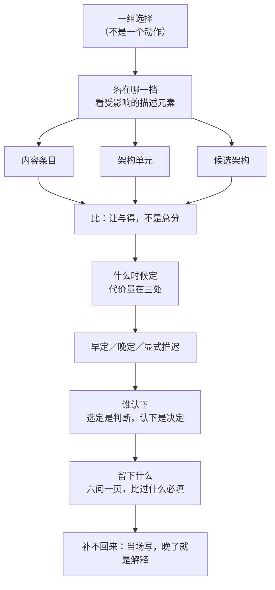

# 第13章 架构决策：凭什么定下来的是这一个

## 13.1 引言

上一章把内容落到了位上：每一处担什么、边界在哪、换掉它牵动谁，都写进了位定表。表填完，还有一件事没有交代——这些内容、这些位，是什么时候定下来的，凭什么定下来的是这一种切法。这件事在工程上天天发生，却很少被写下来。本章说的"标准"，指架构与系统工程那几本现行标准，出处见章末 E。

### 13.1.1 误解现场

恒信合同审批系统，业务方的郑亮把手机屏转过来。

"合同编号得改。电子签章平台那边的规则是'合同类型-年份-流水号'，跟咱们库里对不上。改个编号格式的事，今天就能上吧。"

系统架构师罗建看了一眼："上吧。这算什么架构决策。"

产品开发经理曹峰路过，听了半句没停步："改个字段而已，测试跑一遍就上，别拖了。"

当天下午，罗建把合同主表的编号字段改了，顺手给状态枚举加了两项，测试跑一遍正常，随即上线。

三个月后，账从三个地方同时找上来。财务对账对不上：编号按新规则重排之后，与归档的纸质合同对不上号。台账系统按旧规则解析，把同一份合同认成了三条。法务要查半年前那份作废合同当初是谁批的，关联键断了。

罗建还觉得冤："我就是改了个字段。"

顾言说了一句，会议室安静下来："你改的不是一个字段。你改的是这套系统的数据模型。"

那间屋子里，几个人把"决策"认成了别的东西：一次拍板、一次代码变更、一份文档产出。都不是标准写的那一件事——一组选择，加一份说明它的理据。问题不在罗建该不该改，在另一处：凭什么定下来的是这一个。可选的只有一条时，定下来不需要理由；把它与别的做法摆到一起，理由才非给不可。

### 13.1.2 本章的人和物

恒信这边六个人，各从自己那一头看这次改动。业务方的郑亮提的是规则对不上；产品开发经理曹峰催的是今天上线；系统架构师罗建判的是代码里几处引用；开发组的苏婷估的是接口契约；运维王默算的是回滚的后果；需求分析师顾言问的是值不值。

冰链那边两个人：云端软件的吴浩想给客户开一条直连，嵌入式硬件的石军只问了一句，这条直连绕过了谁。两个团队撞上的是同一件事——改动从一个"顺手"开始，落到后面才知道它不是顺手。

### 13.1.3 本章要回答什么

读完本章，下面这几问，你应该答得出来。

1. 改一个字段，算不算架构决策，按什么判它？
2. 一次代价很大的改动，就一定算架构决策吗？
3. 法规和外部平台已经定死的地方，还能怎么选？
4. 财务要月底对上账、业务方要今天上线，两边都不满意，这条决策就是错的吗？
5. 定下来这件事，谁说了算？
6. 一条决策要留下什么，半年后接手的人才用得起来？

这几问合起来，问的是一件事：凭什么定下来的是这一个，以及定完之后留下什么。

## 13.2 决策是一组选择

那间会议室错在只做了一个决定：把一个本来分成几条的东西，当成了一条。

### 13.2.1 一组选择，不是一次拍板

标准给架构决策下过一个定义。

> *An architecture decision is a collection of choices made in the overall context of an architecture.*（架构决策是在架构总体语境中所做选择的一个集合。42010:2022 §5.2.12）

两个词常被读丢。一个是"一组"：决策不是拍板那一下，是若干选择凑起来的。另一个是"整体语境"：离开架构整体的技术选型，不叫架构决策，叫技术选择。

恒信那次改动，事后可以拆成四条：编号由谁生成，状态枚举怎么划分，历史数据怎么迁移，对外接口给不给导出。四条各有各的理据，也各有各的知情者——生成规则归业务，枚举划分归法务，迁移归运维，导出归对接方。

罗建当时只写了一条："改编号格式"。四条被压成一条，四条的理由也就一起没了。

判据在这儿：一条决策拆得开、每条拆出来的选择说得出各自的凭什么，它才叫"一组选择"。拆不开，或者拆开之后说不出理由，那不是记录记漏了，是当初就没有做决策。一组选择被压成一条，丢的不只是字数，是几条理由各自的来路。

### 13.2.2 决策从备选走到记录

标准把这件事安排在一个过程里，名字叫决策管理过程。

> *The purpose of the decision management process is to provide a structured, analytical framework for objectively identifying, characterizing, and evaluating a set of alternatives for a decision at any point in the life cycle and select the most beneficial course of action.*（决策管理过程的目的是提供一个结构化、分析性的框架，以便在生存周期中的任何时点客观地识别、表征和评估一组决策备选方案，并选择最有益的行动方案。15288:2023 §6.3.3.1）

最常用的方法是权衡研究：把几条做法摆到同一组准则下，让各自的让步看得见。

过程跑完，有四件结果：需要备选分析的决策被识别出来；备选行动方案被评估；选出一个优选的行动方案；解决方案、决策理由和假设得到记录。

第四件值得停一下：标准没有让这个环节停在"选出"，它让这个环节走到"记下来"。记录不是事后补的手续，是这个过程自己的一件产出。

所以本章讲"记什么"，不是给工程加一道文书，是把标准已经写在过程里的那件产出拿回来。同一过程的另一处注里还写着这些数据拿去做什么：关键研究数据要管起来，用来告知决策者、在将来重新论证这个决策。重新论证四个字要紧——半年后有人问"当初为什么这么定"，靠的正是当时留下的那点东西。

### 13.2.3 决策应记，视角的理由只是宜记

同样一句话，标准在两处用了两种力度。

> *An AD shall record architecture decisions considered essential to the architecture of the entity of interest within the scope and intended purpose of the AD.*（架构描述应记录在该描述的范围和预期目的内、被认为对所关注实体的架构必不可少的架构决策。42010:2022 §6.10.1）

> *An AD should include or reference a rationale for each architecture viewpoint selected for use.*（架构描述宜包含或引用为其使用而选择的每个架构视角的理由。42010:2022 §6.10.2）

> *An AD shall include or reference rationale for each essential architecture decision.*（架构描述应包含或引用每项必不可少的架构决策的理由。42010:2022 §6.10.2）

记决策是"应"，记它的理由也是"应"；记视角的理由只是"宜"。同一份描述里，同样是记理由，一档强制、一档建议。

这个落差不是文字习惯。视角与它的规格都还在描述里，理由日后重建得起来；决策那一刻摆着的那几条做法，过了那一刻就没有第二处留着它们。标准把力度分在两档，分的是"还能不能补回来"。另有几处更细的"宜"，本章不展开。

**本书注**："能不能补回来"这条读法是本书的解释。标准只给了两档用词，没有写出理由。

### 13.2.4 技术选择，架构与设计都能定

有人以为按题材分：碰到技术归设计，谈概念归架构。标准不这么分。

标准列举架构决策时，把底层技术、适用模式、拟应用风格都列了进去，还列了一条"拟考虑的实现技术或其他实现方式的范围"。设计那一侧另有一条义务，要求记录关键设计决策及其理由。

同一件技术选择，架构与设计都能定。看三样。

看语境：它是不是在架构的整体语境里定的。定的是"这部分系统从此是什么、必须守到什么"，还是"这一版怎么实现"。

看具体度：定的是范围，还是某一个。标准允许架构选"实现技术的范围"；一旦写成"用某中间件"，就落到具体，落在设计那一侧了。

看记录载体：记在架构描述里，还是记在设计结果里。同一句话，记错地方，将来查的人就查不到。

冰链那次照这三样过一遍就清楚了：吴浩要开的直连，定的是数据所有权边界，属架构语境；定的是哪一类数据、经哪一条路径出去，属范围；它该记在架构描述里，不该记在某次接口变更的工单里。三样都指在同一侧。

三样合起来说的是分工，不是界限。标准还留了一句反向的话：

> *An effective architecture is as design-agnostic as possible to allow for maximum flexibility in the design trade space.*（有效的架构尽可能与设计无关，以在设计权衡空间中留出最大的灵活性。15288:2023 §5.9）

架构这一侧的责任是不替设计做决定；反过来说，也不能把凡是碰技术的都推给设计。架构与设计之间还带反馈：设计比选做不下去的时候，会回头跨架构与需求做权衡，把问题送回架构。所以它们不是一次切分，是两个来回走的站点。

## 案例进展①｜恒信：改一个字段的代价

那晚的回滚只做了一半。运维王默把记录摊开："代码能回滚。台账和财务不跟代码一起回滚，它们已经按新编号解析过了。要全回滚，得先把数据迁回去，账重对一遍。这条决策已经生效，回滚是在付第二遍代价——代价一半在动手，一半在重新发现。"

"我到现在也没想明白，"罗建说，"改之前我把引用这个字段的地方全查了一遍，十二处，都改了，测试也过了。为什么还会炸？"

顾言没直接答，反问了三句："合同编号这个字段归谁管？除了代码里那十二处引用，它还牵着哪几条关切？当初编号为什么这么编，有谁写过？"

罗建："还有谁？台账、财务、电子签章，都是对接方，改完通知一声就是了，这不还是一条代码变更？"

"它们不在你的代码里，可它们是这份数据模型的下游。"顾言说，"台账、财务、法务三家的关联键同时断，'账要能对上'这个目的就落空了。够不够格，看的是目的，不是代码里改了几处。"

苏婷负责对接方接口，插了一句："合同编号是接口契约里定义得最死的一个字段，台账、财务都拿它当关联键。改它之前得先看数据归属、看下游几家关切挂在这条线上。这不是我们能自己改的一处字段。"

罗建沉默了一会儿，问："那我怎么知道，一个改动是字段级还是数据模型级？"

"看它是不是一组选择。"顾言说，"你那天改的其实是四条：编号谁生成、状态怎么分、老数据怎么迁、对外给不给导出。写成一条'改编号格式'，四条的理由就都没了。它是架构决策，不是代码变更。"

第二天一早，罗建先去把台账、财务、法务三家下游逐个问了一遍。

## 13.3 决策落在哪一档

上一块把"一个决定"拆成了几条选择。接下来要问的是：这几条选择，落在架构的哪一档。

### 13.3.1 档位看受影响的描述元素

标准紧接着定义句，说了这些选择通常关乎什么。

> *These choices usually pertain to various AD elements, entity requirements, or environmental influences on the architecture.*（这些选择通常涉及各类架构描述元素、实体要求或对架构的环境影响。42010:2022 §5.2.12）

三类宾语：描述元素，包括视角、视图、视图组件与对应关系；实体要求，说的是这个实体从此必须守到什么；环境影响，是外部给定的条件。

标准还列了一串例子：架构概念、分层方案、底层技术、达成质量的策略、适用模式、拟应用风格、拟考虑的实现技术范围、拟考虑的选项集。这串里没有"选哪一套架构"——整套挑选是最后一项"选项集"那一档，藏在一个不显眼的位置。

例子不必逐个记。工程上要判的只有一件事：这一条落在哪一档。本书把宾语归三档，按一栏分。

判据不在标题上，在记录里。一份决策记录有一栏叫"受影响的描述元素"，填的是这条决策动了哪些描述元素。指向一条，对象是内容条目；指向一片，比如几个位、一条接口、一段边界，对象是架构单元；指向全部视图与内容，或者干脆写"本套"，才是候选架构。

这一栏填错，档位就错。有人把"改一个字段"填成"全部视图"，看着很重，实际是一条内容条目；也有人把整套架构的换法填成"接口位2"，看着很轻，实际换的是这一套。档位不靠感觉分，靠这一栏指到哪儿分。

挡在门外的还有一类东西，叫给定。标准把这类东西叫强制项，项目里跟着叫。法规、外部接口、平台边界，进的是约束栏，不参与比选。给定没有可选项，不叫决策。

给定也有要比的地方，比的是怎么落地它。法规要求全程温度记录留存，这是给定；箱内存七天加云端归档，还是全放云端，这才是要比的。把给定当决策，等于把一条法规拿去投票；把给定当挡箭牌，等于把落地方式也一起免了。

### 13.3.2 落到内容条目：定立不立

最小的那一档，是一条内容。

冰链那几条内容，各有一条决策跟着：一条原则立不立，比如"记录不得依赖承运方在线"；一个属性取多少，比如告警时延 p95 不超过三十秒；一个概念的边界画在哪，比如"断链"是越界一次就算，还是越界持续够时长才算。

这三条看着零碎，分量不轻，也最容易被漏记——因为它们小，写起来像备注。这一档占绝大多数：工程上的架构决策，多是"这条原则立不立""这个属性取多少"，不是"选哪套方案"。把所有决策都写成"选了方案甲"，等于把几十条小决策压成一条大决策；半年后没人说得清某条原则为什么这么定。

### 13.3.3 落到架构单元：定切与合

中间那一档，是一片。

这一档最典型的一条，是切法本身。第12章讲过怎么切、切到什么算守恒；这里要问的是另一件事：这一次为什么切成这一种。

冰链为这件事停了半个上午：断链判定要不要按传感器型号拆成三块？

石军的初稿是按型号拆：甲型一套判定、乙型一套、备用型一套，理由是各家的漂移不一样，阈值分开调更准。云端软件的吴浩问了一句：同一个箱子换了型号，判定的结论跟不跟。石军说跟——同一批货，不能因为换了传感器就判成两样。

这一问把初稿问住了。两种做法摆在桌上：按型号拆三块，各调各的阈值；或者切一块，型号差异压到采样那一侧去吸收。

争的不是哪一块更整齐，是换件的时候动哪儿。按型号拆，新上一个型号就要重开一处判定，改一次动三处；切一块，换件只动采样那一块，判定的判据不动。

最后定的是切一块，记录里那一栏填的是功能位1与功能位2。这一档还有一条：合也要定。两个位长得像，先问是不是同一个承担者；是，合成一个挂对应，不是，各立各的。合错了跟切错了一样，换一次要动两处。

切与合之外，这一档还包括：一条接口只做什么、一段边界画在哪、分层与风格选哪一种。它们的共同点是，动的不是一条内容，是一片位。

### 13.3.4 落到整套候选：定换不换

最大的那一档，是一整套。

冰链早期有过一次这样的选择：判定放在箱内，还是纯放云端。前者要算力、要电、要存储；后者省了硬件，可断网的时候既不能及时判定，也不能自持。两条各自成立，摆在一起就得选一条。

这一档的对象不是一条内容，也不是一片位，是全部视图与全部内容。选定的是"采用哪一整套"，不是"定下一个点"。所以这一档的记录里，"受影响的描述元素"那一栏通常写"本套"。

三个动作在这一档最容易混。权衡是评估的活，把两条摆在同一组准则下看各自让出什么；选定是架构定义过程的活，从摆出来的那几条里定下一条；认下是决策者与治理的活，签字、承担后果。三个动作可以由同一个人做，但记录里要分开写。

界线还剩一条要划清楚：不能"从设计空间里取出方案"。空间是一组判据，不是一个装方案的箱子；它说的是"在这一组准则之下，什么样的做法还算数"。候选是照着判据造出来的，不是从空间里捞出来的——捞上来的只会是上一次那个做法换个名字。

## 13.4 决策只摆让与得

对象指清了，接下来是比。权衡的俗称是此消彼长，说人话就是让与得：让出去什么，换回什么。比这件事，标准给了一句实话。

### 13.4.1 让与得，不比总分

> *The tradespace often does not include a solution that will completely satisfy the architecture objectives and stakeholder concerns.*（权衡空间往往不包含将完全满足架构目标与利益相关方关注点的解决方案。42020:2019 §8.4.6 注 2）

"往往不包含"这几个字很重要。它说的不是这一次运气不好、没找到，而是这一类比较里常常没有一条全都满足的。

于是"选对"这件事没有标准答案可兑现。要求一条决策保证选对，等于要求它在信息最不全的时刻，交出只有事后才能有的东西。

它能兑现的是另一件：让出去什么，换回什么。恒信那次改编号，三条候选各让出一笔：以事实源为中心，让出去的是三家下游的改造量，换回来的是口径干净；以审批流为中心，让出去的是重排的工，换回来的是流程顺；什么都不改，让出去的是这次不痛，换回来的是三个月后三处对不上账。这一层摆清楚，比打总分有用。

总分不是不能打，是打完没用：十个因素各打一分加起来，谁都能把权重调到想要的答案；摆让与得，权重反而不重要，读的人自己会算。

分到这儿还剩一层：一处做法内部的让与，与几套做法之间的让与，不是同一件事。前者是设计侧要处理的，后者才归架构。本章只说后者。

### 13.4.2 摆让与得之前，判据先立

摆之前，得先有尺。尺不是这一章立的：第11章已经把判据从目标长出来——目标、质量模型、关键成功准则、权重、评估准则，一条链下来。

这里要说的是另一件：目的不是那把尺。

目的有两义。一个是实体之意：这个系统为什么存在，它要替谁解决什么。另一个是作品之意：这份描述、这张视图拿它做什么。两义都重要，都不能当"够不够格"的尺。拿实体之意当尺，等于问这条做法符不符合这个系统的初衷，问不出大小；拿作品之意当尺，等于问它符不符合这份文档的用途，问错了对象。

尺是准则与因子：哪几个因子、要求到多少、越没越线。目的定的是方向，也就是这套准则为什么是这几个、不是别处那几个。权重也不是必需：把目标之间的权衡摆给相关方就够了，不必在数学上定出一个最佳；硬要算出唯一解，多半是把某一项权重偷偷调大。

被跳过最多的一步是筛。几条做法摆上来，先筛掉看不出差别的——两条让与得几乎一样，比了也白比。筛不是选：筛掉的不删，留在档里，将来条件一变可能重新有用；选才是从剩下的里面定一条。

### 13.4.3 摆候选，就是决策

摆谁进来，本身是一条决策。

标准给架构决策举例时，最后一项是"拟考虑选项集的选择"。这一项单列出来，说明范围这件事本身就是一条要记的决策。范围定窄了，后面评得再仔细，评的也只是同一件事的几种说法。

现状要在候选里。改动之所以发生，是因为现状至少有一条关切没满足；连现状都比不过，这一轮改动就还没想清楚。这一条最容易被漏，因为现状不用人提，它一直在那儿。

候选从哪儿来，工程上大致四类：互斥的几条做法里选一条；一处决定要分几处落，落法有几种；自研、采购、复用三条路并存，走哪条；一套架构供几个产品变体共用，变体之间怎么分叉。四类摆全，比只摆同一类的几个方案更接近真实。

摆够没有，标准还给了两个说法：呈现完全相同权衡的两条，不必都评；能"跨越"权衡空间的一组，才值得评。换句话说，摆上来的几条要在让与得上拉开距离，挤在一处的三条，等于只摆了一条。

## 13.5 代价定早晚

比完了，还有一件事没答：什么时候定。

### 13.5.1 贵只定早晚，不决准入

"改起来贵"这句话，在工程上被说得太多，而且常常一开口就说出来。它常被拿来当理由：这个太贵，先不动；那个不贵，随手改。

标准把它放在一处明确的位置：选取哪些决策要记下来的时候，"改起来很可能代价高昂"是候选判据之一。它管记不记，不管算不算。

本书把这条推远一步：贵只用来定早晚，不用来定准入。

理由在两头。一头是误纳：很贵，但与目的无关。换一个框架版本、跟上组织惯例的技术栈，改起来可能要半年，可它动不了这个系统的基本概念与属性。另一头是漏判：不贵，但承重。"日志须可被外部审计员独立读取"这句话，写下来只花一行，改起来也不费事，可它要是没了，这套系统的证据链就断在半路上。

这两头合起来就是承诺的不对称：收窄设计空间的收益是当下的，改起来的代价是往后的。所谓"贵只定早晚"，说的就是这件事——贵不贵不影响它算不算一条架构决策，只影响它今天定还是明年定。

### 13.5.2 代价量出早晚

代价不是模糊的一句"很贵"。本书把它量在三处：影响半径、信息成本、修改风险；每一处都能当面问答。

影响半径：这一改动到多少位。接口改签名，动的是接口位与调它的位；数据模型改一层，动的是所有引用它的位。

信息成本：要让这次改动成立，得重新查清多少事。恒信那次，罗建查了代码里十二处引用，可他没查台账、财务、法务三家的关联键——信息成本这一项，当初被算成了零。

修改风险：改了以后还回不回得来。代码能回滚，账不能回滚；同一件事的两个部分，风险不一样。

三项量完，早晚就有依据：都小，可以晚定，等信息更全；有一项大，就得早定，趁改动还便宜；大到无法承受，那就不是早晚问题，是要不要做的问题。

冰链那条数据所有权，三处都指高：影响半径横跨追溯、云端与客户系统，信息成本要重查接口契约与留存规则，修改风险是不可逆。恒信那条编号，罗建只量了代码这一侧：十二处引用都查了，可按位算的影响半径、按契约算的信息成本，一样也没量。

三项量完还要落成一句能写在纸上的话：这条为什么现在定。写成"因为很贵"不合格，要写成"因为再往后拖，迁移就得连账一起动"。

### 13.5.3 定不下就显式推迟

不是所有事都该现在定。可选的路有三条：早做、晚做、显式推迟。

第三条常被误会成"拖着不办"。差别在一个词：显式。

显式推迟要做三件事：说清这一轮为什么不定；说清什么时候、在什么条件下要重新拿出来；把这条连同理由记进未决的那一栏。三件做完，它不是没发生过，是排上了队。

不显式推迟的后果，第11章已经写过一侧：判否的那条要留账，写一句理由，否则下一个人会以为没人想过。这一侧同理：推迟的那条不留账，下一个人会以为没人发现。

关于推迟还有一句：不要用"保留选择权"给推迟找理由。推迟的收益是真的——晚一点定，信息更全；可它的代价也在同一处，承诺拖得越久，改动越贵。两笔账要一起算，只算前一笔，推迟就成了拖延。

## 案例进展②｜冰链：直连被拦下的那一刻

一家客户订了两千台 M3，提了个要求：我们要自己导出原始温度数据，接进自己的质管系统。云端软件的吴浩第一反应很顺："简单。给他们的质管系统开个直连，把原始数据推过去。"

石军拦住了他："数据从哪来？"

"追溯平台。不就是加个数据导出接口吗，不动架构。"

"数据所有权和接口契约在哪个域里？"石军又问，"这条直连，绕过谁？"

吴浩顿了一下："绕过追溯域。传感器到云端再到客户系统，不经过追溯平台。"

"你这一句'简单'，一条架构决策就做完了，还是最难反悔的那一档。它改的是数据所有权：传感器的原始数据开始直连客户系统，追溯平台对这批数据失去控制。三年后追溯出问题，谁负责？"

吴浩后背一凉。他刚才准备动手的那个"加个接口"，是这套系统里最不能反悔的一处。

"所以这不是接口问题，是一条架构决策，得连理据一起记下来。"他把直连划掉，"客户要导出数据，可以。但要走追溯域的受控导出通道，每次导出留痕。导出还是能导出，数据所有权这条线，谁都没动。"

石军点头："不可逆的决策不是不能做，是要在看清代价之后、用对的方式做。三样你自己说：动到多少处、要重查多少事、改完还回不回得来。"

吴浩想了想："动到追溯、云端、客户三处；接口契约和留存规则都得重查；改完回不去，原始数据一出去就收不回。"

"这就是量完了。"石军说，"接下来是记：这条决策的权属方是谁、与哪几条决策有牵连，都要写进记录。"

吴浩把那条直连写进了被否的那一栏，连同理由一起：原始数据直连客户系统，否；理由是追溯平台对这批数据失去控制，三年后追溯出问题无人可问。写完他问了一句："这条以后还会有人提吧。"

"会。"石军说，"所以理由要留住。别人过两年再提，得先看到当年为什么没走这条路。"

## 13.6 定完认下，否掉的做法要留

一条决策走到这里，还剩两件事：谁认下，留下什么。

### 13.6.1 选定是判断，认下是决定

把选定与认下分开，是这一章最后一道分界。判断是就着准则给出的：这一条站不站得住，哪几条越了线。判断由架构师做，也可以由评估做；建议是评估方交出来的那句话，倾向哪一条、为什么。

认下是另一件事：签字，承担后果，不一定由判断的人来做。冰链那条判定放箱内，判的是架构师，认的是质量负责人与货主；恒信那条判定表版本化，判的是架构团队，认的是法务与内控。

判断、建议、认下三件事合成一句话，后果很具体：没人说得清这条是谁认的。记录里"决策权属方或责任人"那一栏空着，这条决策就等于没人认领；风平浪静时看不出来，出了事要问责，第一句问的就是它。记住一句：记录不产生授权，签了字的那一行才算数。

### 13.6.2 留下的由项目立准则

哪些决策该进记录，标准没有替项目定。它给了一串候选判据，可以归成几组。

关乎要求与关切的，是架构上重要的要求、关键相关方、根本性关切。关乎投入与代价的，是作出或实施要投入大量精力、大额支出、改起来很可能代价高昂。关乎易变与否的，是对变更高度敏感、需要复杂推理。关乎来路的，是成为项目策划的基础、把假设换成已知。关乎挂靠的，是需求符合性、技术标准选择、系统脆弱性缓解。

这串后面跟了一句明确的自我限制：决策清单并非意在穷尽。同时它把另一件事交给组织与项目，用的是"宜"：自己确立选取重要决策的准则，并用理由支持。

所以"记哪些"不是一个可以照抄的答案，是一条要自己立的规矩。本书给一套可用的：看它改不改得动下游、有没有花掉大笔钱、是不是把一条假设换成了已知、与需求符合性或技术标准的选择挂不挂钩。中一条就进账。

另有一套三问，问的是约束了下游没有、代价是不是高过当时、别人是不是必须知道；那是判"记不记"的。本章那三问判的是"算不算"，档位只看记录里"受影响的描述元素"那一栏。两套问题分两头，不是两套标准。

进账之后，恒信的决策记在自己的架构决策台账上；追溯平台只属冰链，两域不混。台账长这样：冰链十一条、恒信五条，合起来十六条，压成七栏。

| 编号 | 档位 | 陈述 | 比过什么 | 受影响的描述元素 | 认下者 | 时间与结局 |
|---|---|---|---|---|---|---|
| M3-D01 | 候选架构 | 箱内判定、云端归档 | 纯云端，否：断网不能判、不能自持 | 本套 | 质量负责人＋货主 | 定／批／— |
| M3-D02 | 架构单元 | 接口位2 只查不推 | 双向推送，否：把承运方在线性绑进架构 | 接口位2、功能位2 | 架构师＋承运方会签 | 定／批／— |
| M3-D03 | 架构单元 | 断链判定切一块，不按型号再拆 | 按型号拆三块，否：改一次重开三处 | 功能位1、功能位2 | 架构师 | 定／批／— |
| M3-D04 | 架构单元 | 缓存责任改到箱内自持 | 原案云端负责，否：断网时云端不在场 | 信息位2、结构位1 | 质量负责人 | 定／批／改 |
| M3-D05 | 内容条目 | 断链＝越界且持续够时长 | 越界一次即断，否：告警满屏；持续三分钟，否：判晚了 | 功能位1、信息位1 | 架构师 | 定／批／— |
| M3-D06 | 内容条目 | 断电保温 72 小时、采样 30 秒 | 保温 48 小时，否；采样 60 秒，否：判不及时 | 结构位1、信息位1 | 质量负责人 | 定／批／— |
| M3-D07 | 内容条目 | 记录永不改，不设修改接口 | 可改加日志，否：能改记录的人也能改日志 | 信息位2、组件2 | 质量负责人 | 定／批／— |
| M3-D08 | 内容条目 | 换件不换链 | 换件时重建链，否：历史证据再也自证不了 | 功能位2、接口位1 | 架构师 | 定／批／— |
| M3-D09 | 给定（不进比选） | 留存是法规给的；落地＝箱内七天＋云端归档 | 给定不比；落地比全云端，否：断网拿不出记录 | 结构位1、信息位1 | 质量负责人 | 定／批／— |
| M3-D10 | 时点（非决策） | 司机端交互这一轮不设组件 | 这一轮就做，否：资源不够；永久不做，否：缺口不消 | 视图2 覆盖声明 | 架构师＋治理备案 | 记／—／— |
| M3-D11 | 不进 | 告警界面配色与字号 | 十条准则一条不中，且已具体到哪一个 | — | — | 转设计侧 |
| HX-D01 | 架构单元 | 判定表版本化、可审、可回滚 | 只留最新版，否：旧合同按新口径判，回滚不了 | 信息位3 | 法务＋内控 | 定／批／— |
| HX-D02 | 内容条目 | 合同状态只在一处登记 | 各表各存定期对账，否：总有一条是旧的 | 信息位1 | 法务负责人 | 定／批／— |
| HX-D03 | 内容条目 | 判定以判定表为准 | 以个人意见为准，否：口径不可审 | 信息位3、视图2 | 法务负责人 | 定／批／— |
| HX-D04 | 内容条目 | 必备条款缺失不得人工跳过 | 允许人工确认，否：留痕挡不住放行 | 功能位2、信息位3 | 法务＋合规 | 定／批／— |
| HX-D05 | 不进 | 授权引擎选某个办公自动化产品 | 已选到哪一个，不是范围 | — | — | 转设计侧 |

这张表有三处值得看。不进的那两条，档位栏写着"不进"，放进来是分工问题，不是不重要；有一条的时间戳写着"改"、一条写着"—"，改过的旧行不删，未定的留着空；"比过什么"这一栏，十六条里有十六格话，真空着的那一条，不是决策，是通知。

规模上有个经验值：十来个位的系统，十来条到二十条。全都写进去，台账就成了流水账；只写一条"选了方案甲"，几十条小决策一起沉底。

### 13.6.3 留下的要让人接得住

一条决策该记哪些内容，标准列了十一项，导语用的是"宜"：记录决策时，宜考虑下列信息——唯一标识、清晰陈述、权属方或责任人、约束与假设、挂关切、挂受影响的描述元素、链接理由、与其他决策的关系、后果、三枚时间戳、来源引用。

十一项照抄会写成一份表单。本书把它压成六问，一页纸放得下：这条决策叫什么；为什么会有它；当时考虑过哪些做法；定了哪一个、谁定的、什么时候；定了它影响什么；它有多难反悔、什么条件下要重审。

六问里有两问最容易被省。第一问看着多余，其实是索引：没有唯一标识，别的决策指不到这一条，项目计划也引不了它。第三问最容易空着。当初摆过什么、被否的为什么被否，这一栏空着通常不是记漏了，是当初没有比过；而它恰恰最值钱，半年后有人问"当初为什么不走那条路"，答案只在这里。

时间戳要三枚，不是一枚：作出、获批、修改各记一次。同一行可以改，改了留痕，旧行不删。这一条最像常识，也最常被违反——大多数台账只有"日期"一栏，写的是最后修改那天，于是"当初什么时候定的"永远查不出来。

恒信据此给自己立了一条：六问写不全的，不进评审。

### 13.6.4 认知反转

回到那间会议室。

三个月后那场复盘会开到第三个小时，罗建把当初那份改动单摊在桌上。上面只有一行字："合同编号格式改为合同类型-年份-流水号。"

他说了一句："我以为决策就是把事定下来那一刻。"

那一刻确实定下来了，也生效了。缺的是另外两样：当时摆着哪几条做法，谁认下的。

这一章从头到尾在做的事，是把"架构决策"这四个字拆开。拆开之后有四样东西掉出来：它是一组选择，不是一个动作；它落在架构的某一档上，不是悬在空中；它比的是让与得，不是优劣总分；它要有人认下，被否的那几条也要留下。

四样是同一件事的四个侧面：决策不是那一刻，是那一刻之后还能被查到的那一套。被否的那一栏，标准用的是"宜"，本书按必填要求——它是最值钱的那一栏。没有这一套，它也发生过，只是没人能再找到它。

判、切、评都能重做：判据还在，可以再判一次；守恒四条还在，可以再核一次；评估依据还在，可以再评一次。决策不能。被否掉的那几条做法，只在定下来的那一刻存在过。

所以它留给后人的从来不是结论，是当时凭什么。而它只能当场写下来——晚一步，写出来的就是解释。

---

## 小结

一章走到这里，可以收口了。

拿恒信那次往回看，五道关各拦得住一次：拆的时候能看出它是四条选择；判档位时那四条各归各档；比的时候看得出三条候选各让出什么；定时的时候三项代价都指高；记的时候"谁认下"那一栏会当场问住罗建。

一句话收口：架构决策留给下一个人的不是结论，是当时凭什么；而凭什么只能当场写下来。

吴浩的追溯平台接口清单上，多了一条：受控导出。数据所有权归哪个域、能不能对外给，以前没人当决策看；本章之后它进清单了。

还有半句：这道关谁有权撤，本章只答到"要有人认下"，撤的权限归治理。

留一个问题给后面：定下来的这些，怎么写成一页交得出去、让别人读得出同一个意思？那是第14章的事。

---

## 附录

### A 本章概念总图

### B 本章的能力级

用第1章 §1.4.3 那把尺子量：本章主级是第 ③ 级（心智模型），底座铺到第 ② 级（图式）。

表征：说准六个词——架构决策、决策记录、选定、认下、给定、让与得。

图式：一条链（拆分→定档→比→定时→认下→记）＋一处量法（代价量在三处）＋一张台账（决策台账）。

心智模型：换一处决策、换一个人来问，推得出它该记哪几栏、缺哪一栏会出什么事。

解释框架：本章不建此级。

收束句：**能答全这三问，才算拥有**——一条决策摆在面前，你说得出它落在哪一档、当初比过什么、谁认下的。

### C 自查 · 这些说法对吗？

1. "决策就是拍板那一下。"错。决策是一组选择加一份理据；拍板只是其中一步。
2. "只有一条路可走时也得记一条决策。"错。给定没有可选项，进约束栏；要比的是怎么落地它。
3. "改起来贵的，才算架构决策。"错。贵只管早晚，判准入看目的与准则。
4. "选不出最优，说明这一轮比得不对。"错。权衡空间往往没有全都满足的解。
5. "记录写厚一点更保险。"错。一页六问，写薄了下一任读不懂，写厚了没人读。
6. "事后补一份记录也一样。"错。补写出来的是解释，不是决定。
7. "被否掉的做法不用记。"错。它是"凭什么"的另一半；理据失效时，它是唯一能拿回来用的东西。

### D 练习

1. 拿你经手的最近一次"顺手改"，把它拆成几条选择，逐条写出各自的理据。
2. 给每一条填档位：受影响的描述元素指向一条、一片，还是本套？
3. 挑出属于"给定"的条目，改写成"怎么落地"的问题；再为一条决策补上被否掉的那几条，各写一句否决理由。
4. 用影响半径、信息成本、修改风险量一条决策，给出"现在定还是晚点定"的判断。
5. 找出你们台账里"谁定的"那一栏空着的条目，逐个补齐。
6. 把一条已有决策写成六问一页，看没参与的人接不接得住；再挑一条三年前的，看它的理据今天还成不成立。

### E 参考文献

> 编号怎么读：`[k]` 是本章内的文献序号；括注的 `R-xx` 是全书参考文献总表（附录 D）的编号。

**标准**

- [1] **R-04** ISO/IEC/IEEE 42010:2022：§5.2.12 架构决策与理由；§6.10.1 决策记录；§6.10.2 理由记录。用于本章 13.2、13.3、13.6。
- [2] **R-05** ISO/IEC/IEEE 42020:2019：§8.4.6 权衡空间；§5.6 设计权衡空间的最大灵活度；§9.4.8 注 1 两案相同不必都评、跨越空间才值得评。用于本章 13.2.4、13.4。
- [3] **R-37** ISO/IEC/IEEE 15288:2023：§6.3.3 决策管理过程；§6.4.4.1 选定候选；§6.4.5.3 b) 5) 注 8 跨架构与需求的权衡；§6.4.5.3 d) 3) 记录关键设计决策；§5.9 与设计无关。用于本章 13.2、13.4.1。
- [4] **R-28** ISO/IEC/IEEE 42030:2019：§3.4 注 1 判断与处置分列。用于本章 13.6.1。

**研习报告**

- [5] **48 号 v3.27**《架构定义研究报告》：§11.9 评估与决策；§11.10 决策的宾语；§12.1 件13 决策与理由。本章主家。
- [6] **38 号 v1.9**《架构权衡与架构决策研究报告》：§10.1 四条不对称；§11.4 与设计决策的三标志；§十四之二 十六条全录。本章口径底本。
- [7] **35 号 v1.8**《架构定义与视图设计研究报告》：§13.2 位与分配；四案例。
