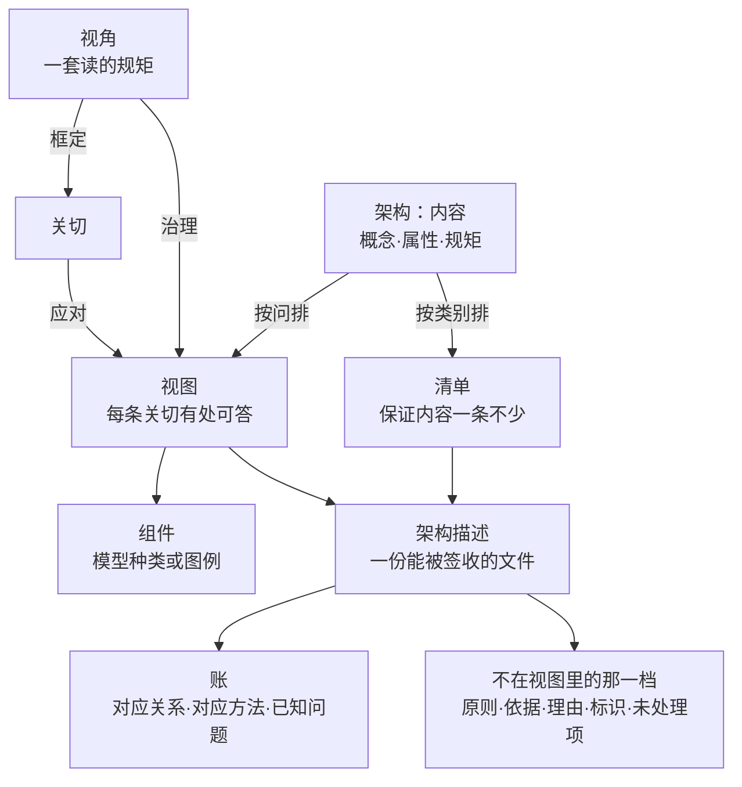

# 第13章 架构描述：把架构定义交出去

## 13.1 引言

上一章把选定与它的理由办完了：几条候选摆进同一个空间，按目的筛，选定，再连同理据记下来。定下来的东西还在自己手里：只有一份一份写下来、交出去，别人才接得住。

本章办的就是这一步：交出去的是哪一份，凭什么算交得出去。

### 13.1.1 误解现场

恒信合同审批平台的架构评审会，罗建主讲。他准备了一摞图，一共十五张。

曹峰先问："数据归属唯一在哪张图上？"罗建翻了翻，指着数据流向那一幅："这张。"

王默接着问："一份合同从发起到归档，跑在哪几张图上？中间哪些环节要盯着？"罗建把三张图并排摊开，讲了两分钟，讲到第三张时自己停了一下。三张图的泳道名各不相同。

郑亮问第三句："这版能不能保证月底对账？"罗建说："这个得看数据那边怎么落。"

会议室安静了几秒。顾言把手里那张纸推过去，问了三个问题：这张图按哪个视角画的？它框定谁的什么关切？这条关切从哪一条目的来？

三个问题，一个也没答上。

罗建不是没画。每一张他都下了功夫。问题在于，他画的是一摞图，交出去的也还是一摞图。

### 13.1.2 本章的人和物

恒信这边六个人：罗建、曹峰、王默、郑亮、顾言、苏婷。冰链那边六个人：石军、林涛、季昭、吴浩、小周、小陈。

本章要用的物也先点一遍：罗建那一摞图、顾言的三张白纸、石军那一页"M3 老规矩"、交出去之前那两张单子，还有两遍排完之后要交的那本账。

### 13.1.3 本章要回答什么

读完本章，下面这几问，你应该答得出来。

1. 架构清单一条不少，架构描述却还是没交出去，接手的人缺的是哪一条？
2. 同一份架构描述，两个人读出来的为什么不一样？
3. 架构描述里"有人要判的那件事"，凭什么规定它必须写进某一张视图？
4. 架构描述里的每一个记号，意思要写到哪里，两个人才读成一样？
5. 架构描述要建哪几类视图，为什么不能照惯例挑三张就画？
6. 交出去之前，架构描述要拿哪两张检查单逐条对过？

这几问合起来，问的是一件事：把架构定义交出去，交的到底是什么。

## 13.2 清单与视图，交出去不是同类东西

架构是内容，它没有份，没有版本，也没有署名。谁也不能把"概念"本身递给谁；能递的只有写着它的文件。所以本章问的"交出去"，从来不问能不能递，只问递过去之后，别人读出来的是不是同一个意思。

上一节那摞图，缺的不是功夫。缺的是另一样东西：这摞图里没有一处回答得出"我这条关切在哪份东西里"。

### 13.2.1 架构清单写全了，还是答不上问题

第11章立起了架构的内容：概念、属性、规矩。逐条列下来，就是一份清单。标准只要求"概念或属性"取其一；本书把它分列两行，是为了逐条准入方便。

清单能办成一件事：内容一条不少。每条有登记处，能逐条准入，也能分配到元素与接口上。这件事不轻，做不好，后面的视图就是空架子。

但清单答不了"被问起来"这件事。恒信那份清单上写着"数据归属唯一"，曹峰问的却是"在哪张图上"。

两句不是一回事。前一句说这件事成立，后一句说这件事写在哪一份里、由哪一份东西负责回答。

清单只有前一句。所以它能递出去，对方拿到的是字：每条都写着，可他没有地方问"我这条在哪"。

这里要挡住一个偷懒的答案：多列几栏不就完了。列栏解决的是"写得更细"，解决不了"谁负责答"。清单再细，它仍然按内容的类别排，不按问题排。

### 13.2.2 关切落在哪张视图，清单答不上

下游不是按类别来问的。清单按类别排：概念一类、属性一类、规矩一类。

恒信那三问按什么排？按"谁要判什么"。曹峰要判月底对账保不保证；王默要判出了事查不查得到；法务要判档案留不留得住。

这些"要判的一件事"，本书叫关切，也就是利益相关方要判的一件事。关切不是需求：关切是有人要判的一件事，需求是被确认下来、要照着做的那句话。

两者不能混。需求与架构内容之间是追溯关系，需求最后是在设计那一步分配到部件上的，它不写进视图。把需求当关切，本章就会写成需求工程第二讲，那是第4章与第6章的地盘。

一条关切总得有人接。接它的是视图。

清单上没有"这条关切由谁答"这一栏。所以答不上。反过来，这也给了清单一个合适的位置：它是内容的第一遍排法，按类别把家底登记清楚。它不该被要求去答"哪一份答哪一条"。

### 13.2.3 架构视图把内容按问题重排

视图做的事，是把内容按问题重新排一遍，让人能一条一条对上问。

重排之后多出三件事。

一是视图挂在某个视角下，先说清这类问题包含哪几条关切。视角不回答具体问题，它规定这一类问题该按什么格式答。

二是每个组件的记号先定死。读的人不用猜这一栏是什么意思，记号的意思写在规则里。

三是它要声明自己应了哪些关切、覆盖到实体的哪一部分。有意只覆盖一部分，也要写明。

三件事都做到，这份东西才叫视图。少一件，它还是一张纸。视角是什么、记号怎么定，下一块再讲；这里先记住，一张视图里必须有这三件。

所以视图不是另一种内容。它是同一批内容的第二遍排法。第一遍回答"我们有什么"，第二遍回答"谁问的那一条在哪"。

### 13.2.4 多数视图是表格，图不是判据

视图不等于图。标准不规定视图组件的形式化程度，记号由视角约定。

关系归图，集合与属性归表格。谁连着谁、先后怎么走，画出来最省事；一堆并列的条目、每条的取值与约束，表格最省事。

于是实际项目里，多数视图表现为一张表。恒信那十五张图里，能收进这份描述的十一张，一半以上是表。

判断一份东西是不是视图，不看它有没有图。三句话就够：它在一份描述里吗？它受某个视角治理吗？它的组件标了模型种类，或者给了图例吗？

这三问保的是"读得一样"。本书把"不同的人读出来是同一个意思"这件事叫同解，本章通篇说的就是它怎么落下来。

三句里有任何一句过不去，它就不是视图。它可能是目录页、是台账、是插图。这些都可以留，但收不进这份描述。

## 案例进展①｜恒信：图答不上问题

评审会第二天，顾言没开会。他给罗建三张白纸，页眉各写一个词：关切、视角、对账。

"你自己填。第一栏写关切：谁要什么，这条关切从哪条目的来。第二栏写视角：图按哪套约定画的，那套约定管什么、不管什么。第三栏写账：每条关切落到哪张视图上、拿什么去对。填得出来，说明你的图有主；填不出来，说明它们各自为政。这三栏不是表格，是判据。"

第一张纸好办。曹峰要月底对账不出岔，郑亮要审批链查得到人，法务要合同档案留得住，审计要出事追得到人。他先写下四条最硬的，又补了两行，写到第七行停住了。那一行写的是"平台运维可诊断"，可他说不出这条关切从哪条目的来。

第二张纸不好办。他得给每一行关切配一个视角，还要写下这个视角管什么、不管什么。写到一半他忽然发现，自己那摞图里有一张贴不上去。

那张图是流程总览。它画得最早：几条泳道横贯全页，每个节点都带编号。可它不对应任何一份约定，只是他为了讲清楚画的一张目录页。

"这张怎么办？"他把纸推过去。

顾言看了一眼："它不假。判它是不是视图，问三句：它在不在描述里？受不受某个视角管？组件标了模型种类没有、给没给图例？三句过不去，它是一张目录页。目录页可以留着，但它收不进这份描述。"

第三张纸最难。对账表要一行行对下去：这条关切从哪条目的来、靠哪条准则判、落到哪张视图、依据哪一件决策。前六行他都填满了。第三行填的是"月底对账不出岔"这一条：从客户那条合同目的来，按逐笔一致判，落在数据视角那一张，依据第 12 章那条编号规则。写到第七行，他停住了。

王默那天正好路过。他指着空着的那一格："平台运维可诊断，这条我以前提过三次，没人记。现在它有行了。"

罗建把那张流程总览从"视图"那一摞里抽出来，放到"附录"那一摞。他数了一遍：十五张里，收进这份描述的是十一张。贴不上的四张，一张是这张总览，另三张是凭习惯画的示意图，组件既没标模型种类，也没配图例。

## 13.3 读的规矩定下来，交出去读得一样

上一块说清了缺的那一半：同一批内容要按问题重排一遍。这一块讲重排之前必须先有的那样东西，也就是读的规矩。

### 13.3.1 架构视角就是读的规矩

视角是一组约定，也就是这一章反复说的那套读的规矩。它规定这类问题按哪套记号看、看哪些面、拿什么去对。

视角容易和两样东西混。一是立场：立场说的是谁怎么看，视角说的是按什么读。一个是人，一个是规则。同一个人可以换视角，换的不是他的立场，是那一类问题的答法。

二是视图：视角是规矩，视图是照规矩做出来的东西。规矩先订，东西后造。这个先后不是流程习惯，是标准写下的：视角可以充当架构师与其他相关方之间的契约，而且这份契约可以在任何详细的架构工作开始之前达成。

规矩写在它自己的规格里。写进规格，视角才有版本，才能入库，才能被别的工作拿去用。所以讲"写全"，讲的是把这份规格写全。

### 13.3.2 读的规矩要写全哪几样

标准给规格列了七项：相关方角度；它框定的关切；与这些关切相关的方面；持有这些关切的典型相关方；造视图时用的模型种类与图例；把视图内与组件之间的关系对上的对应方法；以及这个视角任何信息来源的引用。

这七项各管一件事：角度与方面管"从哪看、看哪些面"；关切管"答哪个问"；典型相关方管"给谁看"；模型种类与图例管"用哪套记号"；对应方法管"怎么缝"；引用管"从哪来"。

另有一条"宜"：宜标识造视图用的视图方法，以及模型种类。视图方法分三类：怎么开始、下一步做什么的构建方法；怎么读懂的解读方法；怎么检查、推理、评估的分析方法。

标准又给了三个词，过不了就不算合格：完整、精确、可验证。三个词一起看，意思是这份规格换个人拿去用，产得出同一个东西。

写不全会怎样？不是难看一点。缺角度与方面，读的人不知道该看哪些面；缺关切，谁也不知道这份东西该答哪几个问，覆盖与否无从判；缺典型相关方，做出来没人认领；缺模型种类与图例，记号由读者各猜一套；缺对应方法，对不上时没人说得出该怎么对。

本书把七项连同名称、版本、来源并成一张表来教。其中"必需的模型、元素、关系、约束与属性"一项是本书加的，标准没有这一行，出处留到本章末。

### 13.3.3 现成的规矩先用，没有再自己定

标准不规定任何特定的视角，也不规定任何特定的视角规格。所以每个项目那份视角清单，都得自己给出来。

给出来有四条路。

一是标准自带的框架视角集，比如企业、信息、计算、工程、技术这一组，每个视角都有自己的语言。

二是业界已有的视角目录。有的按视图类型分，有的给出四加一的视图模型，有的给出一套目录，还有社区维护的视角库。

三是架构描述框架与描述语言。一个描述框架的核心内容，本身就是一套预定义的视角库；用框架的人，视角的来路就在框架里。

四是按关切、角度与方面自己切。标准给的例子是结构、行为、功能、计划这组方面，以及战略、组织、运行、逻辑、物理、技术这组角度。

前三条是复用，第四条才是自建。所以纪律是：先穷尽复用，再谈自建。每次重新发明一套视角，同一种关切就会有几套话术，下游互相对不上。

还有一条边界：标准附录里"常用的视图"那份清单，列的是视图，不是视角清单。两边不许混。这些视图各自的治理视角，是另一件事。

### 13.3.4 规矩定下了，怎么用起来

四步。

一是纳入：描述里要包含或引用所用的每个视角，各自带版本标识，规格要合乎前面那七项。

二是照它造视图：视图按视角由组件组成，组件标明记号。

三是查：每个视图都要遵循它那个视角的约定。这一步最容易被跳过。规则定了没人查，等于没定。

四是记：把实际的相关方与视角所框定的关切之间的对应记下来。记下来之后还能往外走一步，把这个视角泛化、入库，成为组织标准。

要提醒一句：规矩先订，不等于决策做完才准动笔。两件事不必排死顺序，可以边造边改；订规矩与造视图，在一件工作里来回穿插。

## 13.4 交出去的视图，要应对哪些关切

规矩有了，接下来是照规矩做出来的东西。这一块四节，正是块一说的那几件事各讲一遍：每个组件标一套记号、一张视图要应下哪些关切、没有标准记号时怎么配图例、一张视图怎么造出来。

### 13.4.1 视图由若干组件拼成，各标记号

视图不是一个整块。它由若干组件组成，组件按它的视角来组织。组件是视图里可分的那一部分，也可以同时属于几张视图。本章说"记号"，指的是组件里那套符号；定这套符号的，是模型种类或者图例。

组件分两路。基于模型的，标明自己的模型种类。不基于模型的，配一份图例。图例是非正式记录，只说明这个组件里的记号怎么读。

每个组件都要有版本标识。

有形式语义的模型式组件歧义少一些，非模型式组件同样能有效使用；标准在这一层不设门槛。

这一条放开了一批做法。一段决策记录、一张对照表、几句说明怎么读这两张图的叙述，都可以是组件。它们不是模型的附庸，本身就算数。

反过来也要小心：组件不等于随便贴一张图。每个组件都得回答"它归哪个视角管、它的记号谁定的"。

### 13.4.2 视图要应对哪些关切

标准写了一对动词：视角框定关切，视图应对关切。框定是视角的事，应对是视图的事。

框定这件事，形象点说，是预先锁定答案的格式。视角事先说死这类问用哪些词、看哪些面、按什么记法、拿什么去核。锁定之前，一个问有一百种答法；锁定之后，只有合这套格式的才算在答这个问。

下面三条是硬要求。每条已识别的关切，至少有一个视角框定。每个相关方角度、每条关切、每个方面，至少有一张视图应对。每张视图都要遵循它那个视角的约定。

应对到什么程度，标准也写了：要应对它那个视角框定的全部关切，并覆盖实体的部分或全部。允许有意只覆盖一部分，写明即可。有时是依指令，有时是时间与资源有限，有时是这次工作的范围本来就窄。写明，读者才知道这是有意的，不是漏的。

反过来，什么样的情形叫"写下来了却没应对"？三种。视图没有治理它的视角；组件不服务于该视角框定的任何关切；视图之间对不上，却没有任何对应关系。三种都是账上的漏洞。

### 13.4.3 视图不用标准记号，就配图例

模型种类与图例要交代的是同一组内容：预期用途、术语、记法及其语法与语义、符号体系。

一个组件要能被读懂，先得说清这套记号是干什么用的、每个符号什么意思。

模型种类与图例都可以被一份描述里的多个视角使用。这一点很实用：一份图例定下来，几张视图都能照着读。

图例不是低配版。非模型式组件同样有效，差别只在歧义的多少，不在算不算数。

### 13.4.4 视图怎么造出来

四步：定型、建模、对齐、成件。

定型这一步，按这个视角与外部实体的接口和交互定语境与边界，确定它的目的与范围。它的产出就是视角规格，上一块已经讲透，这里只留一句回指。

建模这一步，识别要建模的实体种类与关系，识别具体实体，把概念、属性、行为、约束分配上去；再选一套模型，或者改一套、造一套。分配这一步常被当成绘图，其实它是"每条内容落到哪个元素上"，落不实的，就是空位。

对齐这一步，识别在视图里显现的风险与机遇，酌情回头改架构；使各模型与视图相互协调一致。视图不只是记录，它会反过来改架构。看到风险不回头改，视图就白画了。

成件这一步，按视角由模型组成视图，基于它生成或修改描述，按各阶段反馈修改，最后放进架构库。

这里也有次序，是同一张视图内部的次序：先订视角规格，再定记号与图例，再造模型与视图，最后核对覆盖。先把图画出来、再回头找视角挂上去，不合格。

## 案例进展②｜恒信与冰链：写下读的规矩

恒信那边，罗建把三张纸填完了，视角清单也补齐了。顾言说："别急着交。"

冰链这边，是另一幕。

嵌入式硬件工程师石军那页"M3 老规矩"，第11章写过。抬头一句"从装箱到交付全程可追溯"，底下三条：温度数据归谁管、断链就是失效、升级不许搞坏已出厂的箱子。

硬件组的新人问："师傅，这三条我照着做没问题。可'断链'怎么算？探头报一次超限就算，还是要持续多久？"

石军说："断链是事件，不是读数。探头报一次超限，那只是一个读数，得持续了才算。"

新人说："那我按十秒算一次断链，行不行？这页上没写，我只能自己猜。"

石军一愣。心里那条线是三十秒，这页上没写。

产品经理林涛路过，听了半句："你这不是三条规矩，是一份没写规格的视角。约定得写进规格，规格里那七项缺一样，别人就复现不出你那三条判断。第11章你写的是内容，这一页要补的是读法。"

石军没听过"视角规格"，但听懂了。照规格那七项填：名称"接口视角"；关切三条，断链要判得准、出事追得到、升级不弄坏已出厂的箱子；角度照运行、逻辑、物理；方面填信息。

填到"模型种类与图例"一栏，云端软件的吴浩替他补：温度时间序列的记法与符号表，他在用，从没起过名。

填到"对应方法"他停住了。

测试季昭从后面经过："这栏怎么了？"

"对应方法这一栏，我从来没写过。"石军说。

"你说给我听就行。温度记录跟装箱单怎么对上，就写这个。"

石军说："一批货一个箱号：温度记录按箱号挂到装箱单上。中途换了承运方，箱号不变、记录不断。"

季昭说："这些规矩，除了你还有谁按同一套办法查得出来？"他停了一下，"这一栏在规格七项里排第六。不写下来，换个人就对不成一样。写下来。"

石军写下第一条对应方法。这一栏填完，规格成形了，下一步挂进项目的描述框架。

他抬头说："原来我一直用的是自己那几条规矩。写进规格，它跟探头上那条线才是同一条。"

## 13.5 交出去常见的，就那么几类视图

视图一多，就要问一句：该出哪几类。标准在这件事上很克制，但也没让它没有着落。

### 13.5.1 常用视图只有那几类

标准给了一份"常用视图"的清单，七类：语境、概念、功能、逻辑、物理、技术、组织。它在标准里标为资料性，给的是常见做法。

前面那三处克制在这里同样管用。所以七类是常例，不是必须。一个项目到底该出哪几类，做法是反推。

先识别相关方与关切。再让每条关切至少被一个视角框定。每个视角至少有一张视图。每张视图应对它那个视角框定的全部关切，并记下已知问题。最后反向核一遍，每个角度、每条关切、每个方面都要至少被一张视图应对。

走完这几步，那份清单是从关切里推出来的，不是抄来的。抄来的清单有个通病：抄的时候对得上，用起来才发现缺的那一类正是本单位最要命的那一类。

### 13.5.2 各类视图写到哪儿停

| 一类 | 问什么 | 写到哪儿停 | 最容易滑出去 |
|---|---|---|---|
| 语境 | 外面给了什么条件 | 外部因素、驱动与被排除的路径 | 写成项目背景介绍，只罗列不追后果 |
| 概念 | 这次设计立在哪些思想上 | 驱动这次设计的外部思想与定位 | 当成总览图，把后几类先画一遍 |
| 功能 | 要做什么 | 功能组织与输入到输出的变换 | 当符合性判据，或写成模块清单 |
| 逻辑 | 业务上那些数据与变换是什么 | 业务语义：数据是什么、谁改、谁对齐 | 换成表示方式，或当成粗一点的物理 |
| 物理 | 落在哪些元素与接口上 | 元素、物理接口、安装与承载 | 写进型号、尺寸、材料，滑到设计 |
| 技术 | 由哪些技术门类实现 | 技术门类与接口约定 | 变成选型报告 |
| 组织 | 谁负责、谁有权 | 谁负责、谁有权、变更权归谁 | 画成汇报关系图，漏掉沉默方 |

一句话判据：写到"下游要不要拿它判"，就是这道线。再往下写，就不是描述的事了。设备侧同一道线是这样划的：语境视图写到冷链车与冷库给的供电、温区与时限，组织视图写到谁放行、谁签收、谁有权改；再往下，就是项目背景介绍和汇报关系图了。

两处最容易滑的，单说一句。逻辑滑到技术，是把业务语义换成了表示方式：逻辑层写"25 号之后签的合同归下个月"，技术层才写数据库事务与报文格式。物理滑到设计，是一出现型号、尺寸、材料、数量就过界：那些属设计定义。

### 13.5.3 每样内容不必都做成视图

原则、模式、风格可以留在视图之外，但仍然写在这份描述里。

三句话记住。视图里看不到原则，不算缺陷；描述里找不到原则，才是缺项；原则只写在描述里、视图上一条约束也没有，仍是缺项。

落到元素与接口层面的那条原则，必须在视图上看得出它被违反的样子。看不到，就没法被检。

所以不是每样内容都要做成视图。要升成视图的，是下游要拿它判的那部分。管变更、管评审、管发布的那几条原则，写在描述里就够了。

还有一层：把内容搬进视图，不等于把清单整张贴进去。视图的组件要受模型种类或图例管；一张表照原样贴进视图，元素与接口反而没了。

## 13.6 交出去之前，单子逐条对过

前面几块把描述里有什么说完了。这一块换一个角度：交出去之前，拿两张单子对一遍。要说清两张单子和本章那条判据的关系：单子对的是齐不齐，齐了不等于读得一样；所以对完单子，还要回到那句判据上再问一次。

### 13.6.1 动笔之前，手上有哪些单子

第一张单子，列动笔之前手上该有的东西。

一份关切清单，含相关方角度与方面。一份相关方清单，以及他们各自持有哪些关切。实体与环境、预期用途、这次工作的范围与深度。要表达的那批内容，这时还没分配到视图上。可复用的视角、模型种类、图例与视图方法。描述框架与它的元模型。建模模板、元模型规范与工具。要建模的实体与关系的种类。对账与验证的需要：谁看、看什么。上一轮留下的约束与未处理项。

这十样，缺了前四样，动笔就是凭印象；缺了第五到第七样，得先造工具；缺了最后一样，上一轮的坑会原样再踩一遍。

第十样最容易被当成虚话。上一轮的未处理项不是备忘，它是这一轮要接的活。接不住，同一个洞会在同一处再塌一次。

### 13.6.2 交出之前，单子上该有什么

第二张单子，列交出之前该交出的东西，也就是本章说的可交付物。

视角规格，写全那七项，外加视图方法。模型种类规格与图例。

视图：标识与补充信息、治理它的视角、组件、已知问题、版本标识。视图组件：版本与记号，可以跨视图复用。

对应关系清单。对应方法清单，以及每一条成立还是被违反。一致性分析，以及已知的不一致。视角、框架与模板的选择理据。视图与模型的用途、范围与深浅。视图中的已知问题：未决项、风险、例外、对偏离的说明。描述里不属于任何视图的那些信息。交付与使用记录、反馈回写。

另有两样必填，不在上面这串里。这两样常被当成虚话，其实它们决定这份东西能不能被信任：这份描述自己的标识与概述；未处理项与不符合项的声明。后者要写清哪些关切与相关方没能处理、为什么。它交代的不是做了什么，是没做什么、以及为什么。

还有一格要单独提：记录决策时，要写"决策权属方或决策责任人"。那一格不是一个格式要求，它是治理在描述里落款的地方。当时若没有人有权拍板，它就空着，而且补不回来。事后补上去的名字，不是当时拍板的人。

开发组的苏婷来拿这份描述，只问一句："哪几页是我真要照着做的？"

答案就在这张单子上：标了模型种类的那几处照着做，没标的照图例读。她说这一句，问的其实是接收方那一侧的事：一份描述交到开发手上，能照着做的只有标了模型种类的部分。

### 13.6.3 单子逐条过，过不去就补

两张单子对完，再逐条问一遍。十一条。

1. 每条关切，有没有至少一个视角框定它？
2. 每个相关方角度、每条关切、每个方面，有没有至少一张视图应对它？
3. 每个视角有没有至少一张视图？这些视图是否遵守该视角的约定？
4. 每个视图写明治理它的视角了吗？有版本标识吗？
5. 每个组件写明模型种类了吗？不用模型种类的，配图例了吗？
6. 对应关系清单在不在？每条参与的元素写明了吗？
7. 对应方法列了吗？每条是否成立、或者把已知的违反都记下来了吗？
8. 已知的不一致与视图内的已知问题记了吗？
9. 视角、框架与模板的选择理据记了吗？
10. 视图的用途、范围与深浅写了吗？有没有说明它是有意只覆盖一部分？
11. 未处理的关切与相关方，写明原因了吗？

十一条全过，这一份站得住。有哪一条过不去，回去补哪一条，不必重来。这十一问对的是单子上的条目；单子上另几样，模型种类规格、这份描述的标识与概述、交付与使用记录、决策权属方那一格，按单子直接查，不必再列成问。

这十一问要跟章末那份自查分开：十一问量的是描述，拿一份现成的东西来量；章末那份量的是你自己，问的是这些词你拿准了没有。

### 13.6.4 认知反转

本章开头那间会议室里的困惑，到这儿可以点名了。它由四层错位叠成。

第一层，把图当描述。图是组件里最显眼的一种，交图不等于交描述。

第二层，把清单当描述。清单是内容的第一遍排法，读法还没写下来。

第三层，把"写全了"当"读得一样"。写全是对自己说的，读得一样是对别人说的。

第四层，把"写下来"当"定死了"。写下来是为了查得下去、改得留痕，不是把话钉死。

把这四层翻过来，就是本章立的那几句：同一批内容排两遍，第一遍按类别是清单，第二遍按问是视图；两遍之间要有账；交出去之前逐条对。

四层其实是同一个念头：都以为交出去的是内容。

交出去的不是内容，是写着它的那份文件；那份文件之所以能交，是因为读的规矩写在了纸上。

回到全书那条线上。第10章问架构是什么，第11章问那句话从哪来，第12章问凭什么定下来的是这一个。本章问的是交出去的是哪一份、凭什么算交得出去。

这个反转要留下的，不是学会了几个词，是换一副眼光：一份东西交出去，交的不是你写了多少，是别人拿去能不能读出同一件事。

## 小结

本章办了一件事：把交出去的那一份说清楚。

那份文件里，清单管内容一条不少，视图管每条关切有处可答，中间靠那本账对上：对应关系、对应方法、已知问题。交出去之前，两张单子逐条过。

恒信那边，罗建最后放进架构库的不是一摞图，是两张单子加一份描述。记录里"决策权属方"那一格空着，他没有补。他后来跟人说，图是画给自己看的，这一份是拿来判的。

## 附录

### A 本章概念总图

一句话读这幅图：同一批内容排两遍，按类别一遍是清单，按问一遍是视图；视角框定关切、治理视图；两遍用账对上，装成一份能被签收的文件。

### B 本章的能力级

用第1章 §1.4.3 那把尺子量一下：本章以第 ③ 级为主。

- **表征**：描述侧八个词各就各位，架构描述、架构视角、视角规格、架构视图、视图组件、模型种类、图例、架构描述框架；四组近邻词分开，架构与架构描述、清单与视图、视图与图、利益相关方角度与方面体。
- **图式**：同一批内容的两遍排法；框定到应对这条链；七类各自答什么、往哪个方向推；造一张视图的四步。
- **心智模型**：一份架构描述的价值在于换个人读出来一样；它管的那两件事没有实物能验，所以读的规矩必须写死；账要交，账是分歧唯一露头的地方，也是治理落名的地方。
- **解释框架**：本章不建（归第17到第19章）。

第1章那四问答全，才算拥有。一份描述交出去，别人读得出同一个意思、查得下去、也追究得到人。

### C 自查 · 这些说法对吗？

1. "架构描述就是那摞图。"错。图只是组件里最显眼的一种形态；多数视图是一张表。
2. "架构清单能交，说明清单就是描述。"错。清单能递，递过去的是字；有标识、有用途、有读法，才成得了描述。
3. "架构本身有形态，能签收的是架构。"错。能签收、能入库、能版本化的是描述。
4. "一条关切可以谁也不管。"错。每条关切至少由一个视角框定，再由至少一张视图应对。
5. "视图就是画图。"错。视图是按问题重排过的内容，图只是其中一种表现。
6. "先画图，再找视角挂上去也行。"错。一张视图之内，生成次序不可颠倒。
7. "原则必须写进视图。"错。原则可以留在视图外；但落到元素与接口层面的那条，必须在视图上可检。
8. "需求写在哪张视图里，得在描述里写清。"错。视图应对关切，不装需求；需求与架构内容是追溯关系。
9. "决策权属方那一格空着，事后补个名字就行。"错。补上去的名字，不是当时拍板的人。

### D 练习

1. 拿你们最近一份叫"架构"的文档，问三句：它在一份描述里吗？受某个视角治理吗？组件标了模型种类或给了图例吗？
2. 找一份现成的视角规格，逐项数标准要求的那七项，指出缺哪几项，并说出缺了会怎样。
3. 取一份清单，挑出下游真要拿它判的三条，把这三条按问题重排成一张表，再补上"它应了哪几条关切"。
4. 按模板写一份视角规格，只写一页。写完自查一句：换个人拿着它，能不能产出同一张图。
5. 取一张你手上的视图，把组件分成"基于模型"与"不基于模型"两堆，给后一堆写图例。
6. 用本章那十一条自检量一份现成的描述，把过不去的条目列出来，并标出每条归哪一步补。
7. 挑一个具体系统，用反推那几步列出它该出哪几类视图；再指出哪一类你们从来没用过，为什么。
8. 翻一翻你们的决策记录，"决策权属方"那一格填的是谁？如果空着，说清为什么空。

### E 参考文献

> **编号怎么读**：`[k]` 是本章内的文献序号；括注的 `R-xx` 是全书参考文献总表（附录 D）的编号，凭它可回总表查该条的完整说明与条款。

**标准**

- [1] **R-04** ISO/IEC/IEEE 42010:2022（架构描述）：§3.2、§3.3（含注 2）、§3.7、§3.8、§3.14、§5.2.8、§6.1、§6.2、§6.6、§6.7（含 EXAMPLE 2 与注 1~3）、§6.8（含注 2）、§6.9.1~§6.9.3、§6.10.1、§8.1、§8.2、附录 B.2。
- [2] **R-05** ISO/IEC/IEEE 42020:2019（架构过程）：§5.6、§8.1、§8.2、§10.2 c)·d)、§10.4.3、§10.4.4、附录 E.4.2。
- [3] **R-37** ISO/IEC/IEEE 15288:2023（系统生存周期过程）：§3.13、§6.4.5.1、§6.4.5.3 b)。
