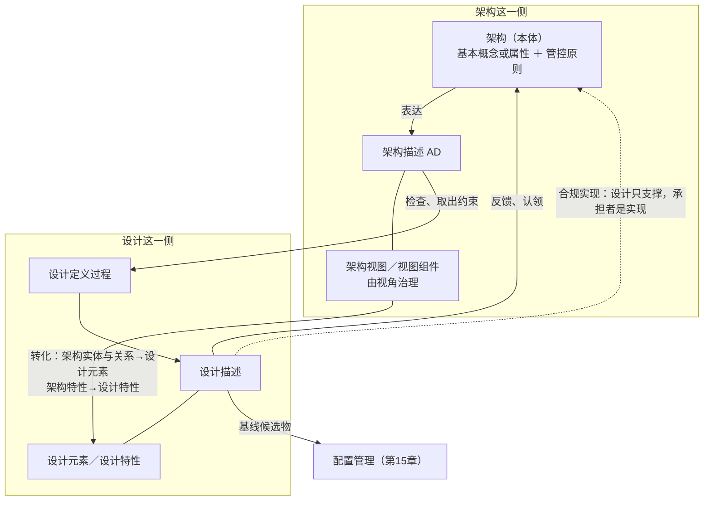

# 第14章 架构与设计：不是概要和详细

## 14.1 引言

上一章把"架构描述是什么、凭什么交得出去"办完了。一份描述交出去，接住它的是另一份描述——设计描述（系统设计描述）。这两份描述之间到底是什么关系？工程现场有一句现成的答案，人人会说：架构是粗一点的设计，我们只是把它做细。本章要纠正的就是这句话。它听着像常识，其实把两件不同的事误解成了一件。

### 14.1.1 误解现场

恒信合同平台的系统设计评审，开在架构基线冻结之后。

系统架构师罗建交出了他的架构描述。这一版是对过账的：视角有规格，关切有台账，元素有清单。签字那天他说了一句："架构这一站，走完了。"

接手的是设计组。开发组的苏婷站在投影前，讲合同签署链的设计描述：配置怎么配、签署链怎么编排、扩展点怎么留。讲到第二十分钟，运维王默抬头。

"我问一个运维的问题。"王默说，"哪些失效必须被监控、多久检出——这句话在哪儿？"

苏婷翻到监控那一节："我们设计了监控组件。"

"组件我看见了。"王默说，"我问的是判据：漏了什么算漏，多久算迟。你这条设计特性，取值和依据在哪一栏？"

业务方的郑亮接着问："业务方那句话——'月底账目对得上'。你的设计里，这句话落在哪个元素上？"

苏婷指着事件总线："编排层保证顺序，设计元素层面保证。"

"那是设计元素在保证顺序。"郑亮说，"我问的是那句'月底账目对得上'落在哪个元素上，出了偏差谁发现？"

顾言最后问的是苏婷："这版设计里新增了一条'与外部对账平台直连'。这条，在架构描述的哪张视图上？"

苏婷愣了一下："这个……是设计细化出来的。"

"细化出来的，"顾言重复了一遍，"还是新长出来的？"

罗建和苏婷对视了一眼，都想到了同一句话。这行里人人听过，而且说得理直气壮：架构不就是粗一点的设计吗。

顾言把笔放下："这句话我听过十年。它错在两处：架构和设计不是粗细之别，是两回事；做细时长出来的新东西，没人认领就不在任何人的账上。"

会议室静了几秒。苏婷每一问都答了一半——问题不在答得对不对，在她脑子里那张图上：架构在上半段，设计在下半段，中间只隔着一个"细"字。

### 14.1.2 本章的人和物

恒信这间会议室里六个人：罗建、苏婷、王默、郑亮、顾言，加上散会才到的曹峰；问话的三位各管一头：运维问判据，业务问落点，需求问归属。冰链那边四个人：石军、吴浩、林涛、小张。物四样：架构描述、设计描述、九条查过的表、交接清单。

### 14.1.3 本章要回答什么

读完本章，下面这几问，你应该答得出来。

1. 一份设计比架构描述细得多、两边都合格，凭什么说这是两类工作？
2. 一条内容要放进架构描述，得先满足哪几项要求？为什么一项也替不了另一项？
3. 架构发到设计组手上，收到文档就算接手了吗？
4. 设计里多出一条架构描述上没有的接口，这算出事，还是算正常？
5. 同一个方框，在架构描述里是零件，在设计描述里成了元素；它到底算哪一个？
6. 架构讲的是基本概念或属性，那图上画的每个元素，都得够"基本"吗？

这几问合起来，问的是一件事：交出去的是什么，接手的那一头拿到的是什么。

## 14.2 架构不是粗一点的设计

> 这一块先把名字分清，再看两边各自要答什么。答案不是哪个更细，是两边问的不是一件事。

### 14.2.1 设计定义是过程，设计描述是产物

设计这一侧有两个名字，一个指过程，一个指产物，不能互换。

**设计定义**是那件一直做下去的活。它要做的事，标准给它写的目的是这样一句：

> *The purpose of the design definition process is to provide sufficient detailed data and information about the system and its elements to realise the solution in accordance with the system requirements and architecture.*（设计定义过程的目的是提供关于系统及其元素的足够详细的数据与信息，以按照系统需求与架构实现解。）（ISO/IEC/IEEE 15288:2023 §6.4.5.1）

**设计描述**是那件活交出来的产物，与"系统设计描述"是同一份产物的两个叫法。（"设计开发"是另一个词，见第3章，与这里说的设计定义不是一回事。）

另有两个名字要用。**设计描述符**是一组设计特性加上它们的可能取值——"够不够细"就落在这里。**原子元素**是往下分到哪一层可以停的判据：判的不是深不深，是信息够不够。

名字摆开，一件事就清楚了：架构与设计各自有一份内容、一份描述；那条把两者排成一条线的"粗细"，在名字里找不到落脚点。

### 14.2.2 "粗一点的设计"错在哪

"架构就是粗一点的设计，我们只是把它做细。"这句话最容易被信，因为它有一半是真的。

设计的产物确实比架构详细，这一点不必否认。错在把形状当判据——真正要问的是：这条内容属于哪一类。把"细"当判据，会顺手推出三句更错的话。

第一句：设计方案是架构视图的细化。标准给的动词不是细化，是转化——细化把同一类东西写得更长，转化把一类东西换成另一类。

第二句：视图里画了元素与关系，所以视图就是设计。视图里的元素不是系统元素，甚至还不是架构实体：它是这份描述自己的零件，指向被描述的那个架构实体。

第三句：设计做完了就不需要架构了。反了——设计的完成判据本身就引用架构：一份设计够不够，问的是它撑不撑得起对架构的一次合规实现。

三句是同一个错的三种说法：都在拿粗细回答种类的问题。

### 14.2.3 架构和设计各自要答什么

把标准给两个过程写的两句目的并排放一次，差别比任何解释都直接。

> *The purpose of the system architecture definition process is to generate system architecture alternatives, select one or more alternative(s) that address stakeholder concerns and system requirements, and express this in consistent views and models.*（系统架构定义过程的目的是生成系统架构备选方案，选择一个或多个应对利益相关方关注点和系统需求的备选方案，并在一致的视图与模型中表达该架构。）（ISO/IEC/IEEE 15288:2023 §6.4.4.1）

两句都说"做方案"，要的东西不一样：一个要"生成、选择、表达"，一个要"足够详细的数据和信息"。差别还写在另一段里：

> *Architecture focuses on suitability, viability, and desirability, whereas design focuses on compatibility with technologies and other design elements and on feasibility of construction and integration. An effective architecture is as design-agnostic as possible to allow for maximum flexibility in the design trade space.*（架构聚焦于适宜性、存续性与合意性，而设计聚焦于与技术及其他设计元素的兼容性，以及构建与集成的可行性。有效的架构尽可能与设计无关，以便在设计权衡空间中获得最大灵活性。）（ISO/IEC/IEEE 15288:2023 §5.9）

翻成日常话：架构那一侧问的是**这个实体**——还算不算原来那个、这么造允不允许、能不能长久、合不合意；设计那一侧问的是**这份规格**——跟所用技术和其他设计元素兼容吗、造得出来吗、装得上吗。

还有一处能对读出来——设计要提供的是"实现级"的定义：

> *Design provides the 'implement-to' level of the definition, such as drawings and detailed design descriptions.*（设计提供定义的"实现级"，例如图样和详细设计描述。）（ISO/IEC/IEEE 15288:2023 §6.4.5.1 注 1）

深度这一档只挂设计一侧：设计要做到"足够完整，能拿去采购、能实现"；架构那一侧没有"更细"这条路——它只有一条限度：够表达架构意图就行；它有的是"该有的内容在不在"。所以写细一点，改善的只是设计那边那几件事。

### 14.2.4 架构那边是定义，设计那边是转换

正面答案在两段话里。这两段话用的动词不一样。

> *The system architecture definition activities **define a solution based on principles, concepts, and properties** logically related to and consistent with each other.*（系统架构定义活动基于彼此在逻辑上相关且一致的原则、概念和属性来定义解。）（ISO/IEC/IEEE 15288:2023 §6.4.4.1）

> *This process transforms architecture and requirements into a design of the system that can be realised.*（本过程将架构与需求转换为可实现的系统设计。）（ISO/IEC/IEEE 15288:2023 §6.4.5.1）

一个"定义"，一个"转换"。从需求指向架构的那条线上，标准没放"转换"这个动词。

那需求算什么？标准写得很清楚：

> *Confirmation is made that they are a necessary and sufficient response to stakeholder requirements and a necessary and sufficient input to other processes, in particular architecture and design.*（确认这些需求是对利益相关方需求的必要且充分的响应，并且是其他过程（尤其是架构过程与设计过程）必要且充分的输入。）（ISO/IEC/IEEE 15288:2023 §6.4.3.3 注 18）

需求是架构必要且充分的输入，不是原料。输入说的是"该给的都给了、够用了"；原料说的是"把它加工成另一个东西"。这一句不用引文也能验：假如架构能从需求推出来，同一份需求就该推出同一个架构。可同一份需求交给两家公司，做出来的架构完全不同、两家都合格——能在同一份输入上做出不同选择还都合格的，不是计算，是判断。

需求对两边都是输入：架构吃，设计也吃。差别在交出来的东西——架构交出一个解的定义，设计交出一份能拿去采购或实现的规格。

驱动设计的是需求，而且那批需求不是原样进来的。

> *The design definition process, on the other hand, is driven by requirements that have been vetted through evaluation with the architecture and more detailed analyses of feasibility.*（另一方面，设计定义过程由以下需求驱动：这些需求已通过结合架构的评估以及更详细的可行性分析得到审查。）（ISO/IEC/IEEE 15288:2023 §5.9）

收口：架构不在"需求—方案"那条链上（第6章讲过），也不是设计的上一档。它在设计的两头把关：开工之前需求要跟它过一遍，做完之后那份设计要拿它核一遍。

## 14.3 架构交出去了，接住的是约束

> 两头把关说清楚了，现在看那一段交接本身：从哪一步开始、中间转什么、到哪儿算完、以及这条路能不能往回走。

### 14.3.1 架构交出去之后，先检查

设计要开工，第一步不是把那份架构描述收下、归档、转发，是去里面检查、取出东西来。同版同年的系统工程手册把这一步写成一条准备活动："检查系统架构，以确定适用于系统设计的基本属性和概念，以及应指导设计及其演化的原则。"（不是标准条文）这句话的动词是**检查**，不是接收，也不是照做。

一处读法上的切法要说在前头。同版同年的手册把"系统架构说明"写成一份含设计决策与理由的件；本书不跟这一刀——本书按两个过程切：架构定义在前、设计定义在后，各有各的产物。两种切法都能自圆；读别处的材料时，先看它按哪一种切的。

从架构出发不是比喻。它是设计方主动去取三样：适用于本层的基本概念或属性、指导设计及其演化的原则、适用于本层的约束。取不出来的地方，就是交接的第一个缺口。

恒信那次评审上说得最直白。罗建交出去的是那份描述，厚厚一摞；可设计方该拿走的不是那摞纸，是约束。苏婷答不上那三问，根子不止读得不够仔细：另一头在她从来没有"取"这个动作——她以为发下来了，就等于接手了。

交文档不算交接，取到约束才算。

### 14.3.2 取到约束之后，转什么分什么

取完之后是三件事：两条转化，一条分配。

> 2) *Transform architectural entities and relationships into design elements.*（将架构实体与关系转换为设计元素。）（ISO/IEC/IEEE 15288:2023 §6.4.5.3 b) 2)）

> 3) *Transform architectural characteristics into design characteristics.*（将架构特性转换为设计特性。）（ISO/IEC/IEEE 15288:2023 §6.4.5.3 b) 3)）

两条转化旁边，标准加了一条注，把"转过去"的样子说清了：每一个架构实体与关系，都要映射到适当的设计元素上，这样才谈得上"架构目标都被设计接住了"。标准有的地方写"系统设计元素"，是同一个东西。转出来的那一侧长什么样，标准也给了例子：功能、行为、尺寸、材料、关键质量特性。第三件是分配。

> 1) *Allocate system requirements to system elements.*（将系统需求分配到系统元素。）（ISO/IEC/IEEE 15288:2023 §6.4.5.3 b) 1)）

标准给这条任务加了一条注：分配不是从零开始。

> *Some of the system requirements are often allocated to system elements during the system architecture definition process. The purpose of this task is to complete the allocation to the extent necessary to address all system requirements and architecture objectives.*（部分系统需求往往在系统架构定义过程中被分配到系统元素。本任务的目的是在应对所有系统需求与架构目标所需的程度上完成分配。）（ISO/IEC/IEEE 15288:2023 §6.4.5.3 注 4）

"与架构目标"这几个字不能丢。只对着需求分配，会分出一个"每条需求都有人认领"的设计，却整体偏离架构要守的那几条目标。对着架构目标分，才会发现"某一条目标找不到承担者"。恒信那次正是这一种：郑亮问"月底账目对得上落在哪个元素上"，苏婷指了编排层，需求有了主人；可"配置出来的孤岛必须可检出"这条架构目标，承担者是谁，谁也没说。

转不动的时候先判在哪一侧：架构侧没立住（那条特性本身不可判定），要回的是架构，不是补设计；设计侧没转（有元素，却没有特性落在它身上），补的是设计那一侧。

判据不是"细了没有"，是"转没转过去"。

### 14.3.3 交到能采购、能实现为止

设计定义到哪儿算做完？标准的答案落在一个动作上。

> 8) *Capture the design.*（捕获设计。）（ISO/IEC/IEEE 15288:2023 §6.4.5.3 b) 8)）

> *This includes the design description in a form that can be used to either procure or realise the system elements that comprise the system.*（这包括以可用于采购或实现构成系统的系统元素的形式给出的设计描述。）（ISO/IEC/IEEE 15288:2023 §6.4.5.3 注 12）

"以可用于采购或实现的形式"，这就是这道出口的名字。一份描述若停在"这里待定""取值后续确认"，就没过这道出口——它不叫"还不够细"，叫没做完。不过要看停在哪儿：取值没定，是设计这一侧没做完；判据本身没定，不是没做完，是没法判。

出口之前有几条能对上，本书归成四条：完备、一致、可追溯、描述符匹配。完备指"足够详细，到能拿去采购或实现为止"；一致指与视图里定义的架构实体对得上；可追溯指两头都追得到；第四条出自同版同年手册，不是标准条文。

分层分到哪一层可以停，另有一条判据：**原子元素**。一个系统元素若只需用黑盒描述其需求，又能明确地定下由什么来实现，就可以不再细化，直接决定买、造还是重用。它问的不是"分到第几层"，是"我手上的信息够不够"。信息充分性判据，不是深度判据；这一条也出自那份手册，不是标准条文。

### 14.3.4 交接从来是双向的

如果架构与设计是接力，架构交出去就算完。标准不是这么写——回流的通道它给了一条。

> *This process provides feedback to the system architecture definition process to consolidate or confirm the allocation, partitioning, and alignment of architectural entities to system elements that comprise the system.*（本过程向系统架构定义过程提供反馈，以整合或确认将架构实体分配、划分并对齐到构成系统的系统元素。）（ISO/IEC/IEEE 15288:2023 §6.4.5.1 注 2）

路上还有两件事，去向不同：一件回架构，一件往下交。回架构的那件叫**认领**：

| 情况 | 处置 |
|---|---|
| 架构确实漏了（这本是它该交代的事） | 回架构补一次识别 |
| 需求变了（新出现一条功能） | 把衍生需求纳入系统需求基线（本书读法：正本只给"衍生需求"与"系统需求基线"两处，合为一步是本书的处置口径） |

两条路都叫认领。设计会长出新东西，正常；不正常的是长出来的没主人。处置不难，难的是先认出它无主。

无主比违规更危险：违规有人拦，无主没人拦——它看上去只是一个"细化结果"。接口的旧说法"只细化不新增"已经废了：标准明写，可能需要识别并定义架构定义过程未予处理的附加接口。正确的说法分两半——接口的**约定**归架构（哪两个元素要连、这条连意味着什么），**具体怎么写**归设计（本书的说法）。设计可以新增接口，但新增的必须认领。

往下交的是基线候选物：设计识别它，配置管理收下它。设计依从的到底是哪一版，是下一章的事。

## 案例进展①｜恒信：文档交出去了，约束没取到

散场后顾言留下苏婷，摊开一张表。"你交上来的那一版，我按判据挨条查过。"他说，"差的三条都在这儿，条条卡在判据上。"

| 查什么 | 查到什么 | 结论 |
|---|---|---|
| 1 实体转化 | 设计里多了"与外部对账平台直连"，架构描述里没有这条 | 加戏一处 |
| 2 目标承担 | 架构目标"配置出来的孤岛必须可检出"——在谁身上是空的 | 缺承担者 |
| 3 描述符匹配 | 扩展点那条"什么算破坏性变更"，停在〈待定〉 | 未过出口 |

另六条略去不列，查法一样。顾言没在结论栏写"不合规"，他写的是条件性合规，三处补项各带责任方，期限空着。产品开发经理曹峰填了"月底"："判据你们定，日期我定。"

"为什么不直接打回去？"苏婷问。

"打回去之后，这三条判据谁来定？"顾言说，"三条里有两条，根不在你这儿——一条是架构漏识别，一条是判据没定。"

他指第一行："这条接口，架构那边根本没识别过。你说'细化出来的'，可它不在任何人的账上。"罗建推门进来，停了一下："这条不是违规，是我的架构没识别。"他在补项栏签了名字。

第三行他让苏婷自己填。苏婷卡了十分钟，抬头说："我填不下去，因为判据没定。"

"记下来：判据没定，不是没做完，是没法判。"顾言说，"前者要催进度，后者要回去把那条判据定下来。你们缺的不是工作量——架构交出去的时候，约束没有被取走。"

苏婷回去把约束抄成两栏：左栏"适用于本层的基本概念或属性"，右栏"指导设计及其演化的原则"。她后来说："我以为我们缺的是文档，其实缺的是那一次'取'。"

## 14.4 元素属于架构还是设计

> 交接的路说清了，看路上跑的东西。一块图上的方框、一根线、一个标签，它们各自属于哪一侧？这一块把元素分成四层、隔开两道界。

### 14.4.1 元素先分层，再谈属于谁

答错的人多半不是不认得方框，而是把不同层的东西放进了同一条线。先把层分开：

| 层 | 是什么 | 拿什么判它 |
|---|---|---|
| 描述层 | 架构描述元素：视图、视图组件、视角、模型种类、对应关系——图上那个框、那根线、那个标签 | 它遵守治理它的视角的约定吗 |
| 模型层 | 架构实体——模型里以特定而离散的单位存在的东西 | 它落实架构目标了吗 |
| 设计层 | 设计元素与设计特性 | 它撑得起对架构的一次合规实现吗 |
| 实现层 | 系统元素——可被实现以满足规定要求的离散部分 | 能不能造、买、复用 |

四层不是同一个东西的四种粗细：描述层是描述的零件，模型层是被描述的那个实体，设计层是实现方案的元素，实现层是真造出来的系统元素。两道界就藏在其中：

- 界一：描述自己的零件，与被描述的东西。
- 界二：架构实体，与系统元素。

界二有一条正本句子撑着，把它钉死了：

> *Note that an architecture entity (an entity being architected or one subject to the system architecture definition process) and a system element (a discrete part of a system that fulfils specified requirements) represent two different notions.*（注意，架构实体（被架构的实体，或经受系统架构定义过程的实体）与系统元素（系统中满足规定要求的离散部分）代表两种不同的概念。）（ISO/IEC/IEEE 15288:2023 §5.9）

这里要纠一处常见误判：说"元素只有设计才定"，是错的。架构定义过程的结果里本就包括"系统元素及其彼此的接口得到定义"这一项（这是过程成果，不是架构内容），只是接口在架构那侧只定到"足以传达架构意图与理解"的程度。

### 14.4.2 元素不必是实物

既然叫"实体"，那它总得是个实物吧？不必。标准在两处把这个误会堵掉了。

> *Sometimes the elements of the architecture entity are **initially notional** until Design Definition process … has occurred since this depends on the actual design(s) to be done.*（有时，架构实体的元素在最初是名义性的，直至设计定义过程……完成，因为这取决于实际要完成的设计。）（ISO/IEC/IEEE 42020:2019 §5.6）

> *Elements in the model of the architecture will represent things that exist as particular and discrete units. They are neither necessarily tangible objects nor visible items.*（架构模型中的元素将表示作为特定且离散单元而存在的事物，它们既不必是有形物体，也不必是可见条目。）（ISO/IEC/IEEE 42020:2019 §10.4.4 b) 注 1）

前一句里那个词，本章译作**名义的**（库内对照版译作"概念性的"，同一件事）：它现在有一个名字、有一个位置，但还没有确定由什么来实现，也不必是看得见的东西。

要害在时间上：架构实体与系统元素之间没有现成对应，对应靠设计这一步建立。所以"架构里画了五个块，实现时就一定是五个模块"，在架构那侧没有依据。至于一个实体对应几个设计元素，标准用的是"映射到"，没限个数：

> *each architectural entity … and relationship is **mapped into the appropriate system design elements** to help ensure that all the architectural objectives are addressed by the design.*（每个架构实体……和关系都映射到适当的系统设计元素，以帮助确保设计应对所有架构目标。）（ISO/IEC/IEEE 15288:2023 §6.4.5.3 注 5）

反过来，几个架构实体也可以落到同一个设计元素上。追溯要双向：往下追得到它落到哪儿，往上追得到它是哪条依据带下来的。

### 14.4.3 系统分解结构不是架构的产物

"属于哪一侧"这个问题，还有一样东西经常被算错：系统分解结构。标准把"建立适当的分解结构"写进了项目规划过程的任务里，旁边那条注把话说全了：典型的分解结构包括工作分解结构、功能分解结构、系统分解结构和组织分解结构。

第一，它的户口在项目规划过程，不在架构定义过程——它是规划台账，用来组织工作、分派责任、管理进度。第二，系统结构本身不必是层级。分解结构长成一棵树，是"台账要好查"逼出来的（这句是本书读法）——把"结构是树"当成系统的性质，就会看漏横切、共享、循环的关系。第三，产品分解结构不是标准术语，本书不用。

另有两处边界，都在物理视图一侧（物理视图是第13章讲的，画的是系统元素与物理接口的安排）：型号、尺寸、材料、数量、实例数一出现就属设计，物理视图只到"系统元素与物理接口的一种安排"为止；物理视图上的块不是台账上的节点，两者可以互相参照，却不是同一份东西。

### 14.4.4 元素之间，只有关系没有粗细

把前面几节立下的关系摆成一张表：

| 关系 | 一句话 |
|---|---|
| 表达 | 视图表达架构；架构描述是架构的表达 |
| 两种概念 | 架构实体与系统元素代表两种不同的概念 |
| 转化 | 架构实体与关系→设计元素；架构特性→设计特性 |
| 一致 | 设计要与模型和视图里定义的架构实体一致 |
| 双向追溯 | 设计特性与架构实体、接口、分析结果之间两头都追得到 |

五条里没有一条是粗细。把元素放对地方，靠的就是这五条。

## 案例进展②｜冰链：吴浩把取值与出处分开写

冰链那边，同样的缝，换了一个方向。石军把接口视角的规格挂进项目描述框架之后没几天，吴浩找上门来。他在做子系统那一层的设计，卡在一个地方。

"按你那条视角规格，我这层的降级状态该分几级？"云端软件的吴浩问。

石军没直接答："分几级该你定，还是该我这条视角规格定？"

吴浩回去翻那份规格，回来说："规格里只说'连续性不得中断'，没说分几级。"

"那它管不着你。它管的是'不能断'，不管分几级。"石军说。

吴浩回去把设计描述改了：降级状态定五级，然后在旁边补了两栏。一栏写"本层取值：五级"，一栏写"依据：接口视角规格第 4 条（连续性要求）"。

产品经理林涛后来看到这两栏，说了一句收尾的话："架构没管你的取值，但你的取值有了出处。"

两栏落在两个位置：一栏是设计特性，归设计；一栏是可追溯性映射，往上追到它必须守的约定。

## 14.5 基本只管架构这一侧

> 元素属于哪一侧分清了，紧接着就有一个必然被追问的问题：架构讲的是"基本概念或属性"，那图上画出来的每一个东西，是不是都得够"基本"？

答：不必。基本修饰的是架构的内容，不是描述上的每个元素。

### 14.5.1 基本管的是架构的内容

先看定义句，看"基本"这个词在句子里的位置：

> *architecture* — **fundamental** concepts or properties of an entity in its environment and **governing principles** for the realization and evolution of this entity and its related life cycle processes（架构——实体在其环境中的**基本**概念或属性，以及为实现和演化该实体及其相关生存周期过程的管控原则。）（ISO/IEC/IEEE 42010:2022 §3.2）

注意语法位置：它修饰的是"概念或属性"。它界定的是架构由哪些内容构成，管不到描述上画了什么。

视图的定义句里没有"基本"：判断一样东西是不是视图，问的是"它在不在描述里、受不受某个视角治理"，不问它基本不基本。

那"基本"到底问什么？它有两问（分法是本书读法）。概念那一问：缺了它，利益相关方还能不能就"这个系统是什么"说到一处——"断链"算越界一回还是算半分钟，两边说的不一样，这一问就没过。属性与原则那一问：拿掉它，这个实体还达得成目的吗——"要重视可靠性"判不了违规，"未过回归测试不得发版"能。

### 14.5.2 基本由视角定，不由图标定

既然不基本，那些元素靠什么站得住？答案在"关切—架构视角（下文简称视角）—视图"这条链上。

> *Each concern identified in accordance with 6.4 **shall be framed by at least one architecture viewpoint**.*（依据 6.4 识别的每个关切应由至少一个架构视角来框定。）（ISO/IEC/IEEE 42010:2022 §6.6）

视角的规格要列出它框定的关切；视图的组件要应对该视角框定的全部关切。三句是一条准入链：哪些关切够格，在视角这一环上裁。一旦某条关切被某个视角框定，这个视角下的元素就"为这条关切服务"，不再逐个接受"基本"的检验：视角这一关管的是"进不进得来"，够不够格由"基本"那两问管。

### 14.5.3 不必基本，不等于不必相关

那是不是画什么都行？不行。标准立着几条硬边界：视图必须是表达被架构实体之架构的信息部件，不是背景资料；组件必须应对其治理视角所框定的全部关切；还必须遵守该视角的约定。

标准还明许"非基本"的东西留在描述里：

> *Information parts not within any view could include overviews of the entity of interest, architecture principles, architecture patterns and architecture styles whose application spans more than one view; referenced bases for the architecture, such as domain or reference architectures; correspondences between views; and architecture rationale.*（不属于任何视图的信息部分可包括：所关注实体的概览；架构原则、架构模式，以及其适用跨越一个以上视图的架构风格；所引用的架构依据，如领域架构或参考架构；视图之间的对应关系；以及架构理由。）（ISO/IEC/IEEE 42010:2022 §6.7 示例 2）

这张单子里没有一条是"基本概念或属性"，它们照样是这份描述的正当组成部分。准确的说法是：元素要"为被框定的关切服务、并在该视角的约定内被解释"。这句话划掉的是"逐个图标都要过基本这一关"，守住的是"每个元素都要有它服务的关切"。

## 案例进展③｜冰链：一条新接口该去哪儿

吴浩那条接口，后来还是长出来了。子系统里两块元素确实要连，架构描述里没有这条线。他先按习惯在图上补了一笔，画完又停住——这一笔要是就这么留着，它就成了章首苏婷那条"细化出来的"，谁也不知道它是从哪儿冒出来的。

他列了张小单子，问三句：这条接口，架构识别过吗？没有。它是"架构漏了"，还是"需求变了"？两块元素本来就要连，是架构那一版没识别到。那它该回哪儿？回架构补一次识别。

他把这条报给石军。石军补进架构描述那一版，重新走了一次冻结。同一个月，恒信那边也长出来一样东西，性质不同：业务方新增"要能查到历史对账记录"，这是需求变了，不是架构漏了。苏婷按第二条路把衍生需求纳入系统需求基线，走变更流程。两条路都叫认领，分岔只在一句：是架构漏了，还是需求变了。

这三句后来被抄成三行，放在每份设计描述的末页。系统工程师小张把它收进自己那份交接清单——原有两栏，谁认、什么时候；她添了第三栏，专写依据。

"认领不是报一声就算。"小张说，"往下要追到它落在哪个元素上，往上要追到哪条依据带下来的。两头都写得出来，换个人拿着这张单子问，才答得上来。"

## 14.6 过了关，才算架构内容

> 前四块说的是同一件事的四个面。这一块把它们摆到一处，说清为什么三道关——准入、身份、目的——谁也替不了谁。

### 14.6.1 准入这一关，问元素进不进视图

这一关的对象是视图上的元素，判它的是描述这一侧的几条要求。标准的要求散在几处，归成六项：视角已纳入本描述；落在该视角框定的关切之内；由某个模型种类或图例治理；符合该视角与模型种类的约定；是架构描述元素；与其他元素的关系可被表达。这六项是本书归并，标准没有"六项"清单——它给的是散在几处的"应"，二十来句。

六项之外还有一条："由谁引入"要说得出来；追不到引入者又没有图例，它就只是画在图上的东西。

进不去视图不等于没地方去：描述可以包含不属于任何视图的其他信息，视角规格、对应关系、架构理由、实现细节各有各的家。真问题是不该上去的混了进去：描述塞满不承诺的东西，读者就不知道哪块是承诺。

### 14.6.2 身份这一关，问元素表达的是谁

这一关判的是它的身份：四层、两道界那张表。同一个方框可能落在四个位置上：描述自己的零件、被描述的架构实体、设计元素、系统元素。三句话最容易说错：视图上的元素就是系统元素（错，隔着两道界）；它是系统元素的泛化版（两者不是泛化关系，一个是理解单位，一个是实现单位）；架构已经定义了系统元素（半句对，过程成果不等于架构）。

### 14.6.3 目的这一关，再合起来看

这一关的对象是架构的内容，判它的只有目的：拿掉这一条，这个实体还达不达成自己的目的。这一关不认别的判据：不认粒度，不认层级，也不认"改起来贵不贵"。

三关是一件东西的三个面，不是三次重复：

| 关 | 对象 | 判它的东西 |
|---|---|---|
| 描述关（准入） | 视图上的元素 | 六项加"由谁引入"的追溯 |
| 实体关（身份） | 它表达的是谁 | 四层里它住哪一层 |
| 目的关 | 架构的内容 | 拿掉它，目的还达得成吗 |

混起来会出两种错：用"基本"要求每个图标，图里塞满大词，视图不再回答具体关切；用"画得出"当"够基本"，设计取值就成了架构内容。

落到手上是四句：服务哪条关切（答不出：不是视图元素）；按哪个图例被解释（答不出：补图例）；表达的是被架构实体的架构吗；排掉了什么。前三句属前两关，末一句属目的关。

### 14.6.4 认知反转

回到章首那间评审室。苏婷那三问，每一问都答了一半。你大概会替她说一句：设计确实比架构详细，说"做细了"不算错吧？这句话站不住，它把四件事混成了一件。

第一处，把种类当成粗细。两边判的对象不同：一边是这个实体，一边是这份规格。

第二处，把输入当成原料。需求是架构必要且充分的输入，不是被加工的原料；合成一句，就会得出"需求写细一点，架构就出来了"。

第三处，把接收当成交接：交出去的是文档，该拿走的是约束。第四处，把换手当成接力——设计长出新元素是正常的，不正常的是没人认领；而交接是双向的，接口可以新增，基线候选物要交出去。

本章要立的是三句最短的话：架构与设计不是一件事的两档精度，是两边各自要回答的事不同；架构不是从需求推出来的，需求是它必要且充分的输入；交出去的那一段不是接力，中间要把架构换成设计，做出来的东西还要回来过架构那一关。

用第1章 §1.4.3 那把尺子量一下：本章把"架构与设计"从第 ② 级推到第 ③ 级——现在能说出两边各要答什么、交接的第一步取什么、元素住在哪一层、三关各判什么。

## 小结

本章讲的是架构交出去的那一段路：从一份描述，到一份能拿去采购或实现的系统设计描述。

先把分界说准：不是粗细之别，是两边判的对象不同；深度只挂设计一侧，写细一点改善的只是设计那边那几件事。位置也不同：一边定义出一个解，一边把它连同需求转换成可实现的系统设计。

再把交接的动作立起来：入口是检查、取出约束，不是接收文档；中间是两条转化加一条分配，分配要同时对着系统需求和架构目标；出口是撑得起一次合规实现。交接是双向的，长出来的新东西必须被认领。

还把元素分了四层、隔开两道界：描述自己的零件与被描述的东西；架构实体与系统元素。架构实体不必是实物，也不必只对一个设计元素；系统分解结构不在这一侧。

最后回答那个必然被追问的问题：视图上的元素不必基本，基本只修饰架构的内容、只在视角这一环上起作用；不必基本，不等于不必相关。最后把三个问句摆在桌上：能不能进视图、它表达的是谁、拿掉它目的还达得成吗。三关各管一段。

回头看章首那间评审室：苏婷那三问答不上，不是不认真，是她把架构和设计摆成了一条线；拆成两边，问题就都能问了。

## 附录

### A 本章概念总图

### B 本章的能力级

第 ③ 级为主

- 表征：设计定义（过程）／设计描述（产物）／设计描述符／原子元素｜四个层名｜三组近邻词（架构与架构描述／架构实体与系统元素／设计元素与系统元素）｜设计开发与设计定义两个过程名
- 图式：四层两界图｜两边各自要答的事并排图｜准入判定链｜三关对应表
- 心智模型：两边判的对象不同｜转化不是细化（长出来的必须有主）｜基本只从视角这一环起作用｜三关不可互替
- 解释框架：本章不建此级，由第17到第19章承担

再用第1章 §1.4.3 那把尺子量一下：本章站在第 ③ 级（心智模型）。本章给你一张交接图，拿到一份设计描述，能顺着走一遍，指出它在哪一步把架构转丢了。

> **能答全四问，才算拥有**——架构和设计两样东西摆在你面前，你能说清这条内容属于哪一类、那个元素归哪一侧、它够不够格当架构内容。

### C 自查 · 这些说法对吗？

1. "写细一点，架构那一侧要答的两件也就答了。"（✗ 改善的只是设计那几件）
2. "需求是架构的原料，写细一点架构就出来了。"（✗）
3. "接手的第一步是接收文档，然后照着做。"（✗ 第一步是取约束）
4. "分配就是把需求分到元素上，让每条都有主。"（◐ 还要对着架构目标）
5. "设计里长出来的新元素，就地补上就行。"（✗ 要认领）
6. "接口只能细化，不能新增。"（✗ 设计可新增）
7. "视图上的元素就是系统元素。"（✗ 隔着两道界）
8. "架构实体必须是实物。"（✗ 也可以是名义的）
9. "系统分解结构是架构的产物。"（✗ 户口在项目规划过程）
10. "既然不必基本，那画什么都行。"（✗ 不必基本不等于不必相关）

### D 练习

1. 拿最近一份系统设计描述，把"这次从架构取到了哪几条约束"抄成两栏：左栏适用于本层的基本概念或属性，右栏指导设计及其演化的原则。抄不出来处就是交接的缺口。
2. 找出设计里"架构描述里没有、设计里却有"的东西，逐条判：是架构漏了，还是需求变了？
3. 挑一条架构特性，追它这一路：在架构那侧叫什么，在设计这侧变成哪几个设计特性，落到哪个元素、取值定在哪。
4. 用四层两界给项目上十个元素分一次层，看多少第一次分错。

### E 参考文献

> **编号怎么读**：`[k]` 是本章内文献序号；括注的 `R-xx` 是全书参考文献总表（附录 D）的编号。

**标准**

- [1] **R-04** ISO/IEC/IEEE 42010:2022《软件、系统与企业，架构描述》，§3.2 架构；§3.7 架构视图；§5.2.9；§6.6／§6.7＋示例 2；§8.1
- [2] **R-05** ISO/IEC/IEEE 42020:2019《架构过程》，§5.6；§10.4.4 b) 注 1；附录 E.2.1（架构即约束）
- [3] **R-37** ISO/IEC/IEEE 15288:2023《系统与软件工程，系统生存周期过程》，§3.13 设计；§3.47 系统元素；§5.2.2；§5.9；§6.3.1.3 任务 4) 与注 4；§6.4.3.3 注 18；§6.4.4.1；§6.4.4.2 g)；§6.4.5.1~§6.4.5.3（含注 1·2·4·5·10·12·19·20）

**经典文献**

- [4] **R-63** INCOSE《系统工程手册》（5.0 中文版，与 15288:2023 同版同年）—— 本章"检查系统架构"一句与原子元素两条件的出处
