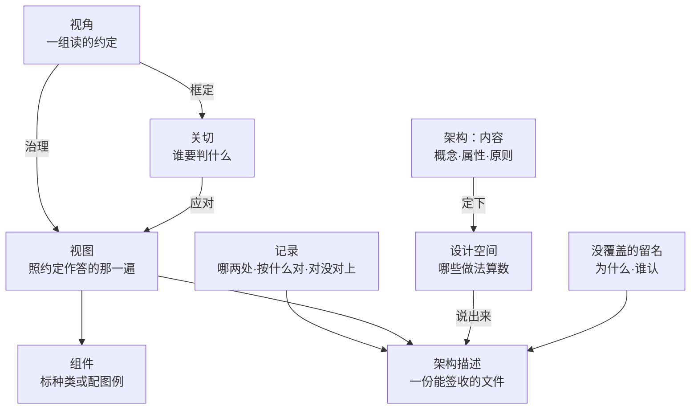

# 第15章 架构描述：用约定把设计空间说出来

上一章把选定和它的理由办完了：几条候选摆在一起，比过让与得，定下来的是哪一个，连同理据记进账。定下来的东西还在写它的人手里——别人要用，先得有一份交得出去的东西。

这一章办的就是这一份：它凭什么叫架构描述，又凭什么换一个人读出来还是同一片空间。

## 15.1 引言

### 15.1.1 误解现场

恒信的合同审批平台，架构评审会开在周四下午。罗建主讲，他带来一摞图，数到第十五张时，会议室里有人笑了一声。

曹峰先问："数据归属唯一这一条，在哪张图上？"

罗建翻了翻，指着一张数据流向图："这张。"

"这张图上哪儿写着“唯一”？"曹峰说，"我只看见两条线都往库里连。"

王默接着问："一份合同从发起到归档，跑在哪几张图上？中间哪几处要有人盯？"

罗建把三张图并排摊开，讲到第三张时自己停了：三张图的泳道名不一样，一张叫"部门"，一张叫"角色"，一张叫"岗位"。

郑亮问第三句："这版能不能保证月底对账？"

罗建说："这个得看数据那边怎么落。"

会议室安静了几秒。顾言把手里那张纸推过去，问了三句：这张图是按哪套约定画的？它框定的是谁的哪条关切——也就是谁非要判清楚的那件事？这条关切从哪一条目的来？

三句，一句也没答上。

罗建不是没画。每一张他都下了功夫，有几张改到凌晨。问题在于他画的是一摞图，交出去的也还是一摞图：每一张都好看，合起来没有人说得清这套系统到底是什么、什么算数。

散会时顾言说了一句话，被记进纪要：**这不是图的问题，是没有一处写明这些图该怎么读**。

### 15.1.2 本章的人和物

恒信这边六个人：罗建、曹峰、王默、郑亮、顾言、苏婷。冰链那边五人：石军、林涛、季昭、吴浩、小陈。小周在产线，这一章不落他。

本章要用的物也先点一遍：罗建那一摞图、会上顾言推过去的那一张纸、次日顾言给罗建的三张白纸、石军那页写着三条老规矩的纸、交出之前的两张单子，还有那一页记录——哪两处对不上、按什么对、有没有对上，都记在里面。

### 15.1.3 本章要回答什么

读完本章，下面这几问，你应该答得出来。

1. 架构描述说的是一片设计空间，还是其中已经选定的一种做法？
2. 交出去之前，这份描述要对着哪些单子逐条过？
3. 同一份描述，两个人读出的设计空间为什么会不一样？
4. 描述里先得立下哪套约定，别人才读得出同一片设计空间？
5. 描述里的一张表，要过哪几条才算一份视图？
6. 描述里两处说法对不上，按什么对，对没对上记在哪？
7. 图上的每个框、每条线，描述里由谁定它的意思？

这几问合起来，问的是一件事：设计空间写下来之后，凭什么换个人读还是同一片？

## 15.2 描述说的是整个设计空间

评审会散场时，苏婷问了一句最实在的话：那我们到底该交什么？这一块先回答“这份东西说的是什么”：不是一摞图，也不是一句话，是整个空间——以及凭什么说它被说出来了。

### 15.2.1 设计空间，要说成能核对的

架构描述，是用一组约定，把架构所确定的那片设计空间说出来的一份工作产品。标准那句说的是"表达一个架构"；把它落成"那片设计空间"，是本库的读法。

先交代"设计空间"。一个系统要满足的要求，做法往往不止一种。凡是与架构相容的做法，合起来就是这片空间——它不是一个方案，是"哪些做法还算数"的一整个集合。标准说得直白：架构下的是约束，约束加在可供设计使用的这片空间上。

所以描述要说的不是"我们打算怎么做"，是"做到什么算数、什么不许"。两句话一比就分得清：

| 写成什么 | 说的是什么 |
|---|---|
| 消息总线必须可替换 | 空间：把绑死在一款产品上的做法排除掉 |
| 用某款消息中间件 | 点：已经选定了一种做法 |

第二句不是描述的内容，那是设计。这条界在本章只划一句：描述说的是这个集合，落到某一个具体做法就是设计。完整的那条界归第17章。

"能核对"三个字是这一节的重点。曹峰问"在哪一张上"，问的是这条内容由哪一份负责答——而现在这一份答的是"这一条在不在"。这两种答法不是一回事：前者要有话能拿去做核对，后者只证明内容存在。写不成这样的句子，字数再多也只是说明。

### 15.2.2 空间不写下来，只在人脑子里

写下来这件事，理由不是留个档。空间没有实物：它在写下来之前，只存在于参与者各自的理解里；而谁的理解算数，没人说得清。

恒信有一条要求，曹峰心里有数，罗建的图上也有，可两个人数出来的不是同一条。散会后曹峰说了一句：我一直以为“唯一”是写在那张图上的，原来只在会上说过。

写下来的那部分才算数，这是全部理由。第11章把它叫名义与实得：名义上你说清了这片空间，实得是你写下来的那一些。没写下来的不是不存在，是不作数——这些只留在各人脑子里的理解，替所有人做了决定，却没有一行落款。

冰链那边能看见实得的样子。石军那页纸上抬头一句"从装箱到交付全程可追溯"，下面三条：温度数据归谁管、断链就是失效、升级不许搞坏已出厂的箱。看见这三条的人，都以为空间说清了。后来新人问了一句“断链怎么算”，才发现"失效"没有判据——那三条是内容；照它怎么读，要另写一套约定，下一块讲。

### 15.2.3 空间定到单个做法，就成设计

第三条界线更短：描述写到"单个做法"，就过界了。

同一条要求，写在两处，两处各自要对得住。描述里写"接口失败须重试，重试须幂等"，它对一切实现都成立，说的是空间；设计里写"重试三次、指数退避、上限三十秒"，它只对这一次实现成立，说的是一个点。

标准说，设计的规格要完整到足以支撑对该架构的一次合规实现——设计取走的是其中的一个点。取走了那个点，剩下的集合并没有消失，所以描述里那片空间仍然算数。反过来，描述里一旦出现型号、尺寸、某一款产品，空间就被悄悄缩成了一点。设计那一侧的规矩，归第17章。

评审会上那十五张图里，有两张写到了设计的层：一张写着某款消息中间件的牌子，一张列着三台服务器的型号。这两张仍算那份描述的一部分，只是那两处要划掉——位置对，写法越界了。划掉的内容不丢，它转到设计那一侧去写。

## 15.3 视角管视图的造与读

评审会那摞图里，能收进描述的那些仍然各画各的。这片空间不是一句话说得完的：它要按面分开说，按各人要判的事分开答。于是先得有一样东西——在画之前就说定的读法，也就是约定。这一块只讲那套约定；照约定做出来的东西，下一块讲；它里面那些记号怎么读，再往后一块。

### 15.3.1 视角先立，视图随后造

一群人画图，十个人十套画法：框代表什么、线代表什么、画到哪一层停，各有各的默认。默认不写下来，读的人只能猜；猜出来的东西，两个人不会是同一份。

所以先要有约定。架构视角就是这组约定：这类问题从哪几个面看、用哪套记号、答到哪一步算答完。它不回答问题，它规定这一类问题该怎么答。

照约定做出来的那一份东西，叫视图——描述里按要判的问题排的那一部分。第11章立过一句：描述要把边界与样子说出来。视角管的正是那句"样子"：不是画成什么样，是按什么画、按什么读。

约定还决定这片空间被看成什么样。同一片空间，按功能那套约定看，看见的是谁在什么时候做什么；按结构那套约定看，看见的是哪几块、能不能换。所以约定不只管怎么读，也管哪些面被说出来：没立的那一套约定，对应的那一面在这份描述里就等于没说。

约定与另两样容易混。一是谁在看：约定不等于谁站在哪儿看——同一个人可以换一套约定，换的是那一类问题的答法，不是他站的位置。二是视图：约定先订，产物后造。这个次序不是流程习惯。标准里有一句说明：视角可以当作写描述的人与读的人之间的契约，而且这份契约可以在详细的架构工作开始之前达成。

### 15.3.2 约定写不全，读的人只好猜

约定要写成一份规格。规格里缺哪一项，读的人就在那一处各猜一套。标准给规格列了七项，一项一项都要交代：

一、它落在哪些相关方角度上——战略、组织、运行、逻辑、物理、技术，这些是"从哪一头看"，不是"谁在看"；
二、它框定哪些关切，也就是拿它判的是哪几件事；
三、这些关切落在哪些方面，功能、结构、信息，还是别的面；
四、持有这些关切的典型相关方是谁；
五、造视图时用哪些模型种类，也就是用哪套建模语言；没有模型的，给一份图例，说明记号怎么读；
六、把几处说法对上的对应方法；
七、这套约定的信息来源。

前四项管给谁看、答哪个问；第五项管用哪套记号；第六项管对不上时怎么对；第七项管这套约定从哪来、凭什么信。

除了七项，还有一条"宜"——标准在这里用的是"宜"，不是"应"。宜写明造视图用的方法，以及一项以上模型种类。方法是三类——怎么开始、下一步做什么的构建方法；怎么读懂的解读方法；怎么查、怎么算的分析方法。可省，但省了要说明；这一项最常被省，省完读的人拿不到用法，只能自己摸。

七项齐不齐，有一条总判据：完整、精确、可验证。三样说的是同一件事的三个面——不缺项、不含糊、别人拿得去复核；合起来是：换一个人照它做，做出来的跟原作的人一样。

### 15.3.3 造和读视图的约定，多半是借的

从零切一套约定，是最贵的路，也是最少的走法——造视图、读视图，都得靠这套约定。现成的来路有三种：框架或描述语言自带的视角集，用它的项目，约定的来路就在那份框架里；业界现成的视角目录，有的按视图类型分，有的给出一套固定搭配；最后才是按关切、方面与角度自己切。

前两种是借，第三种是造；分不清时看一条——现成的那套能不能原样用，能就是借。所以顺序是：先穷尽能借的，再谈自己切。每自造一套，同一种关切就多一套话术，下游互相问不上。

借来之后还有一步：把它变成这一份描述里的约定。写清七项、挂上版本，才轮到别人拿它读。

还有一处要说清。标准附录里那份"常用视图"清单，列的是视图，不是视角清单；它给的是常例，不是必须。

它跟规格要写的七项也不是一回事：那是视图的种类，七项是约定的条文。

一个项目到底出哪几类，是从关切反推出来的：先认相关方与关切，再定约定，再问哪些约定至少得有一份照它做出来的东西。反推出来的这几类，合起来才够对这片空间；照着模板抄一份，就会少一面，少的那一面等于没说。

## 案例进展①｜恒信：图答不上问题

评审会第二天，顾言没开会。他给罗建三张白纸，页眉各写一个词：关切、视角、记录。

"你自己填。第一栏写关切：谁要判什么，这条关切从哪条目的来。第二栏写视角：图按哪套约定画的，那套约定管什么、不管什么。第三栏写：每条关切落到哪一份视图上、拿什么去对。"

第一张纸好办。郑亮要月底对账不出岔，曹峰要数据归属说得清，王默要合同档案留得住、出了事追得到人。罗建先写下四条最硬的，又补了两行，写到第七行停住。那一行写的是"平台运维可诊断"，他停了笔：这条关切从哪条目的来？答不上。

第二张纸不好办。他得给每一行关切配一套约定，还要写下这套约定管什么、不管什么。写到一半，他发现那摞图里有几张贴不上去——画得最早的那张流程总览，几条泳道横贯全页，每个节点都带编号，可它不对应任何一套约定。

"这张怎么办？"他把纸推过去。

顾言看了一眼："它不假。判它能不能收，先问一句：有没有一套约定管着它？没有，它就是一张导览页。导览页可以留在附录，收不进这份描述。"

第三张纸最难。记录表要一行一行对下去：这条关切从哪条目的来、按哪条约定判、落到哪张图上、依据哪些记录。前六行他都填满了。王默正好路过，指着空着的那一行："平台运维可诊断，这条我以前提过三次，没人记。现在它有行了。"

罗建把那张流程总览从"视图"那一摞里抽出来，放到附录那一摞。他数了一遍：十五张里，收进这份描述的是十一张。贴不上的四张，一张是这张总览，另三张是凭习惯画的示意图，既没有约定管着，也没有标明记号怎么读。

收到十一张之后，罗建第一次能说清一件事：这片空间里哪些做法算数、哪一条由谁判。这句话不是他一个人说的——别人照着同一套约定，也读得出来。

## 15.4 视图是照约定答问的那一份

约定把"哪几个面要看见"定下来了。收进来的那十一份，现在的问题从"收不收"变成"怎么读"——同一批内容，换一种排法，读者才能对着问。

### 15.4.1 清单管一条不少，视图管一问一答

先拿第12章交出来的那份清单比一比。那份清单里，概念、属性、原则各成一行。那份清单有一件事办得好——内容一条不少。每条有登记处，能逐条准入，判过的还能记下去向。

可清单答不上另一件事：这条问由谁答。

评审会上曹峰问"数据归属唯一在哪张图上"，清单能回答的是"这条内容在，第几行"；他问的是"哪一份东西负责答这一问"。两件事不是一回事：前一件说的是内容有没有，后一件说的是谁站出来答。清单只有前一句。

有人想过多列几栏就补上了：在这条后面加一列，写清归哪一份视图。列栏解决的是写得更细，解决不了谁负责答——清单按内容类别排，不按问题排；真要补，补的是"这一份视图答哪几问"。加再多列，它还是按类别排。

### 15.4.2 视图按要判的问题重排

视图做的事，是把同一批内容按要判的问题重新排一遍。

重排不是细化。差别要分清：细化是把内容写得再具体一点；重排是把同一条内容放到"谁要判什么"的位置上。一条要求写在清单里是"接口失败须重试"，写进视图是"在接口那一份里、失败那一栏、谁读了就能判"。清单里那句更细，视图里那句更可答。

重排之后，内容要落到具体处。先交代一个词：视图里能分开的那一部分，叫组件——它在图上常常就是一个框；视图是表的时候，一栏、一行、一格都可能是一个组件。落点有三处：

一、落在组件自己身上——它是这一块的一条属性，或者一个取值；

二、落在两个组件之间——它是一处关系、一个接口、一条流动；

三、落在一圈组件之外——它是环境给出的条件与约束。

落点选错，读者会在错的那一份上找它，找不到就说"没写"。

一条要判的事可以落到一份视图，也可以落到几份；一份视图也可以同时答几件事。这里没有一一对应：对不上的地方，靠记录去对，15.6 讲。15.2 说的"能核对"，是拿一条做法对着那句话判；两块记录之间那种"对不上"，是另一层。

### 15.4.3 算不算视图，看约定写没写

一摞图里，哪些能收进这份描述？三问。刚才顾言在评审会第二天问的那句，就是其中的第二问。

第一问：它在这份描述里吗？第二问：有没有一套约定管着它？第三问：它的组件标明了模型种类，或者配了图例吗？

三问过不去，它就不是视图——它可能是导览页、台账、插图。可以留在附录，收不进这份描述。

还有第四问，专门判"是不是这个架构的视图"：它里头有没有东西，体现着**被描述的那套系统**的概念、属性，或者它与环境的关系。前三问过、第四问不过的，那是一张图，不是这个架构的视图。

罗建那张流程总览就是前三问过不去：画得再细，没有一套约定管它。收进附录不是因为它错，是因为它答不了"这一问由谁答"。

### 15.4.4 视图多数做成表

多数视图形式上是一张表，不是一张画。

原因很实在：关系归图，集合与属性归表。谁连着谁、先后怎么走，画出来省事；一批并列的条目、每条的取值与约束，排成表省事。恒信那十一份里，一半以上是表。

这不影响它算不算视图。标准不管组件的形式化程度：用模型画的、用图例说明的，都算数；差点只在歧义多少。算不算视图，仍然只过 15.4.3 那几问——形式不决定身份。

## 15.5 记号怎么读，要写下来

上一块末尾落在四个字上：形式不决定身份。这一块往下走一层——收进描述的那些，里头的框、线、箭头、栏名，读的人凭什么不猜。

### 15.5.1 记号照模型画，就照模型读

先交代一个词。图上的框、线、箭头、栏目名，凡是要"照着读"的符号，本章叫记号。记号本身不带意思：一个方框可以是模块、可以是服务器、也可以是一处审批点，全看谁给它定过意思。

定它的路只有两条。一条是这套记号本来就来自某套模型——那就由那套模型说清它怎么读、能用它画什么。另一条是压根没有模型可依——那就单独写一份图例，把意思写在纸上。

哪一种都行，缺了不行。记号的意思留在写它的人脑子里，读的人就只能猜；猜出来的两套，在一张图上碰头就打架。

冰链那边有一例，是这一条的反面。吴浩管云端那一层，温度曲线怎么画、告警怎么标，他用一套自己的记号，用了一年多，从没起过名。后来写冰链那份接口视角的约定——也就是这一章说的视角规格——填到"用哪套记号"一栏时他愣了：这些记号画得出来，别人看不懂，也从来没写下来过。

### 15.5.2 没模型的记号，单配图例

图例是一份非正式的约定记录，给没有模型可依的那几份用，写四样：这套记号打算用来做什么、每个记号叫什么、每个记号什么意思、记号跟术语怎么对上。

一句话：读的人照着它，能把图上的记号翻回话。

图例不是低配版。有严格语法的模型歧义少一些，没模型的写法同样能有效使用；差别在歧义多少，不在算不算数。形式化到什么程度不设门槛，门槛只有一条：意思得写在纸上。

图例还有一个用得上之处：一份图例可以供几份视图共用。定下来一次，几张图都照着读——省下的不只是笔墨，是各处读法不一致的毛病。

### 15.5.3 记号没写清，人一走就断

写到什么程度算清？一条判据：读的人拿到这份东西，能不能在纸上查到这个记号的意思。

查得到，他不必找人；查不到，他只有一条路——回头问画图的人。问人这件事本身不错，错在这样就把记号绑在了人身上：人一走，或者只是换一班人，那一处就成了空白。

评审会后罗建补得很短。他没有重画收进来的那十一份，只在每一份开头加了两行：这份图用哪套记号、记号在哪儿查。加完他数了数：贴不上的那四张示意图，记号他一个也写不出来——那几张本来就没有约定，也就没有记号可写。它们被放进附录的时候，理由比"画得不够好"硬得多：不是视图。

记号定了，还只是每一份自己读得通。几份之间对不上怎么办，下一块说。

## 15.6 视图对不上、关切没覆盖

上一块末了那句是：记号定了，还只是每一份自己读得通。一份描述里不止一份，几份之间对不上的地方总会有；还有些地方压根没有。这一块说这两种缺口怎么记。

### 15.6.1 两处名字对不上，先写成一行

先交代这一页。记录是这份描述里的一页，上面两种行。对不上那一类，三样：哪两处、按什么对、对没对上；缺口那一类，另三样：哪一条没覆盖、为什么、谁认。罗建在那十一份开头加的两行，只让每一份自己读得通；这一页管的是它们之间。

对不上的情形有两种，都常见。一种是同一个东西两个名字：数据流向图叫"写入方"，接口表叫"数据源"，指的是同一处。另一种是同一件事两个结论：一处写"合同状态只有一份权威记录"，另一处画了两个写入点。

两种都不必当场裁判对错；第一步只做一件事：把这一对写下来，写成一行。

一行里写三样：哪两处、按什么对、对没对上。第三样先空着，下一节填。

这一步的用处是让分歧露头。描述里若有两处对不上而没人记，它会一路带到下游：集成的时候两边各按自己看到的做，做完才发现不是一回事。记下来，至少在下游动手之前，有人知道这儿还有一笔没对上。

### 15.6.2 对上的依据，也写在同一行

上一节说的是两处说法之间对不上；还有一类，是一条规矩在这份描述里守没守住——两类都记在同一页上。

"按什么对"这一栏要写出方法，不是写出判断。方法说的是：拿什么去比、比到什么算一致。

比如"数据归属唯一"那条，可以对的是写入点的数量；数量多于一处，就是被违反。再比如两份图里同一个接口的参数顺序，可以对的是接口表那一行；表里只有一个顺序，图里出现两个，就是被违反。

有了方法，结论只有两种：成立，或者被违反。成立的写一句"成立"；被违反的，把违反的地方一条不落写下来——写"大体对上"等于没记，因为它没法查。

这一节最容易被跳过，因为写起来像给自己找麻烦。可它换回来的是另一样东西：日后有人问"这两处为什么算对得上"，答案在纸上，不在某个人的记忆里。

### 15.6.3 没覆盖到的关切，要留名

第二种缺口不是对不上，是压根没有。有些相关方、有些关切，这份描述里没有对应的地方——可能时间不够，可能这次范围本来就窄，也可能压根没人提过。

这样的空白要留名。留名写三样：没覆盖的是哪一条、为什么没覆盖、谁认这个决定。

没留名的空白会被读成"这里没问题"。这是最贵的一种误读：读的人不会问，因为他以为你想过了；等你发现，往往是在出事之后。

恒信那条"平台运维可诊断"就是一处空白。王默提过三次，三次都没有落到任何一份图上。它后来有了行——那行不在图上，在这一页记录里：谁都知道这儿还差一处，差在哪儿，由谁认。

## 案例进展②｜冰链：老规矩补成规格

上一块说，“按什么对”那一栏写的是方法；冰链那边正是卡在这一栏上。

石军手上那页纸，前面提过：抬头一句"从装箱到交付全程可追溯"，下面三条。新来的小陈指着它问："师傅，这三条我照着做没问题。可'断链'怎么算？探头报一次超限就算，还是要持续多久？"

石军说："断链是事件，不是读数。探头报一次超限，那只是一个读数，得持续了才算。"

"那我按十秒算一次断链，行不行？这页上没写，我只能自己猜。"

石军一愣。心里那条线是三十秒，这页上没写。

林涛路过，听了半句："你这不是三条规矩，是一份没写规格的视角。约定得写进规格；规格里那七项缺一样，别人就复现不出你那三条判断。你原来写的只有内容，没写怎么判——这一页要补的就是读法。名称是抬头，不算那七项。"

石军没听过"视角规格"这四个字，但听懂了。他照七项填：名称写"接口视角"；关切三条——断链要判得准、出事追得到、升级不许弄坏已出厂的箱子；相关方角度填运行、逻辑、物理；方面填信息。

填到"用哪套记号"那一栏，吴浩替他补上：温度时间序列怎么画、告警怎么标。那是吴浩自己在用的一套画法，用了很久，从没起过名。

填到"对不上时按什么对"那一栏，他停住了。

季昭从后面经过："这栏怎么了？"

"这一栏我从来没写过。"石军说。

"你说给我听就行。温度记录跟装箱单怎么对上，就写这个。"

石军说："一批货一个箱号：温度记录按箱号挂到装箱单上。中途换了承运方，箱号不变，记录不断。"

季昭说："这些规矩，除了你还有谁按同一套办法查得出来？这一栏在七项里排第六。不写下来，换个人就对不成一样。"

他在这一栏写下第一条方法。能填的都填完，规格成了形；七项里还空着两栏——典型相关方、引用的出处——下一步挂进项目统一用的那套框架里。

他抬头说了一句：原来我一直用的是自己那几条规矩。写进规格，它跟探头上设的那个三十秒，才是同一条。

## 15.7 对着两张单子逐条过

记录齐了，就能交出去了吗？还差最后一道：交出去之前，对着单子逐条过。这一块给两张单子、一道检查，最后把这一章翻过来。三件事分工不同，不要混：动笔前那张看手上有没有，交件那张看纸上有什么，最后那道逐条看对不对得上。三套数各管一关，不互相折。

### 15.7.1 动笔之前，单子上的十样先备齐

先看第一张单子。

一、关切清单，连着相关方角度与方面；

二、相关方清单，以及各人持有哪些关切；

三、实体与环境、这份描述的预期用途、这次的范围与深浅；

四、要表达的那批内容，这时还没分到视图上；

五、可复用的约定、模型种类、图例与造视图的方法；

六、描述框架——这一个组织规定"描述该怎么排"的那套约定——以及它规定的那些模板；

七、建模模板、规范与工具；

八、要建模的实体与关系的种类；

九、对账与验证的需要，谁看、看什么；

十、上一轮留下的约束与没处理完的事。

缺前四样，动笔就是凭印象；缺第五到第七样，得先造工具；缺第八样，切出来的东西没有种类可归；缺第九样，不知道给谁看、拿什么核；缺第十样，上一轮的坑会原样再踩一遍。

第十样最容易被当成虚话。上一轮没处理完的事不是备忘，是这一轮要接的活。

### 15.7.2 交出的时候，单子逐条列清

第二张单子列的是交出时该交的东西：十一样，另加两样必填、一格落款，一共十四处。条数不同不相干——十四处是纸上要有的，十一条是逐条要问的。

视角规格，七项写全，外加造视图的方法；模型种类规格与图例；组件可以跨视图复用，复用的地方要写明。

视图，每份要有标识与补充信息、管着它的约定、组件、已知问题，以及版本标识；已知问题里未决、风险、例外、偏离各记各的。

对应关系清单，写清哪两处对得上；对应方法清单，写清按什么对、每条成立还是被违反；一致性分析，以及已知的不一致。这几样都落在同一页记录上：记录是它们的汇总页，不是另一样东西。

选这套约定、这套框架、这套模板的理由；视图的用途、范围与深浅；这份描述里不属于任何视图的信息；交付与使用的记录。

另有两样必填，常被当成虚话，却决定这份东西能不能被信任：这份描述自己的标识与概述；没处理的事与不符合项的声明，写清哪些相关方、哪些关切没能处理、为什么。

最后一处要单说：记录决策时，写清是谁认下这一条——这一格叫决策权属方。它不是格式要求，是治理在这份描述里落款的地方。当时若没有人有权拍板，它就空着，而且补不回来——事后补上去的名字，不是当时拍板的人。

开发组的苏婷来拿这份东西，只问一句："哪几页是我真要照着做的？"答案就在这张单子上：标明了模型种类的那几处照着做，没标明的照图例读。

### 15.7.3 过不去就补，不必重来

两张单子在手，交出去之前还有一道：十一条，逐条问一遍。这十一条查的是上面那张单子；单子上另几样，照单子直接看，不必再列成问。

一、每条关切，有没有至少一套约定框住它？

二、每个相关方角度、每条关切、每个方面，有没有至少一份视图应对它？

三、每套约定有没有至少一份视图？守不守，拿约定里写明的记法去比。

四、每份视图写明管着它的约定了吗？有版本标识吗？

五、每个组件标明模型种类了吗？没有种类的，配图例了吗？

六、对应关系清单在不在？每一行参与的两头写明了吗？

七、对应方法列了吗？每一条成立，还是把已知的违反都记下来？

八、已知的不一致与视图里的已知问题记了吗？

九、选这套约定、这套框架、这套模板的理由记了吗？

十、视图的用途、范围与深浅写了吗？有没有声明它是有意只覆盖一部分？

十一、没处理的相关方与关切，写明原因了吗？

另外，冰链那份规格里还空着两栏——典型相关方、引用的出处——交出去之前要补齐；补不齐的，按没覆盖的写法留名，写清为什么。

十一条全过，这份东西站得住。有哪一条过不去，回去补那一条，不必重来。这十一问量的是这一份东西；章末那份自查量的是你手上的那些词，两件事。

### 15.7.4 认知反转

开头那间会议室里的困惑——十五张图，三问一个也没答上——到这儿可以点名了。它由四层错位叠成。

第一层，把图当描述。图只是组件的一种画法，交了图不等于交了描述。

第二层，把清单当描述。清单是内容的第一遍排法，读法还没写下来。

第三层，把"写全了"当"读得一样"。写全是对自己说的，读得一样是对别人说的。

第四层，把"写下来"当"定死了"。写下来是为了查得下去、改得留痕，不是把话钉死。

四层其实是同一个念头：都以为交出去的是内容。

交出去的不是内容，是写着它的那份文件；那份文件之所以能交，是因为读的规矩写在了纸上。

回到全书那条线上。第11章问架构是什么，第12章问那句话从哪来，第13章问内容落在哪一处，第14章问凭什么定下来的是这一个。本章问的是：那片设计空间，凭什么算说出来了。

这个反转要留下的，不是学会了几个词，是换一副眼光：一份架构描述交出去，交的不是你写了多少，是别人拿去读出来的，是不是同一片设计空间。

## 小结

这一章办了一件事：把"交出去的那一份"说清楚。

那份文件里，清单管内容一条不少，视图管每条问有处可答，中间靠记录对上：哪两处对不上、按什么对、对没对上。交出之前，对着两张单子逐条过。

恒信那边，罗建最后放进架构库的不是一摞图，是两张单子加一份描述。记录里"决策权属方"那一格空着，他没有补。他后来跟人说，图是画给自己看的，这一份是拿来判的。

留一个问题给后面：这份交出去的东西，拿什么评、评到什么程度算够？那是第16章的事。

---

## 附录

### A 本章概念总图

一句话读这幅图：架构定下那片空间，约定说清怎么读，视图照约定作答，记录把对不上的地方露出来，没覆盖的留名——合起来才是那份能签收的描述。

### B 本章的能力级

用第1章 §1.4.3 那把尺子量一下：本章以第 ③ 级为主。

- **表征**：描述侧八个词各就各位——架构描述、架构视角、视角规格、架构视图、视图组件、模型种类、图例、对应关系。
- **图式**：同一批内容的两遍排法；约定到作答这条链；造一份视图的四步；两张单子与十一条。
- **心智模型**：描述的价值在于换个人读出来还是同一片设计空间；它管的那件事没有实物可验，所以读法必须写死在纸上。
- **解释框架**：本章不建，归第19到21章。

第1章那四问答全，才算拥有。一份描述交出去，别人读得出同一个意思、查得下去、也追究得到人。

### C 自查 · 这些说法对吗？

1. "架构描述就是那一摞图。"错。图只是组件的一种画法，多数视图是一张表。
2. "清单能交，说明清单就是描述。"错。清单能递，递过去的是字；有标识、有用途、有读法，才成得了描述。
3. "能签收的是架构。"错。能签收、能入库、能打版本的是描述。
4. "一条关切可以谁也不管。"错。每条关切至少由一套约定框住，再由至少一份视图应对。
5. "先画图，再找约定挂上去也行。"错。一份视图之内，约定先订、产物后造。
6. "记号看不懂是他不懂业务。"错。记号的意思得写在纸上，让人查得到。
7. "两处对不上，改到看着像就行。"错。按什么对要写出来，成立还是被违反要记下来。
8. "没覆盖的地方不提，省得惹麻烦。"错。空白不留名，会被读成"这里没问题"。
9. "记录里谁认下那一格空着，事后补个名字就行。"错。补上去的名字，不是当时拍板的人。

### D 练习

1. 拿你们最近一份叫"架构"的文档，问三句：它在一份描述里吗？有一套约定管着它吗？组件标了模型种类或者给了图例吗？
2. 找一份现成的视角规格，逐项数那七项，指出缺哪几项，并说出缺了会怎样。
3. 取一份清单，挑出下游真要拿它判的三条，按要判的问题排成一份表，再补上"它应了哪几条关切"。
4. 按七项写一份视角规格，只写一页。写完自查：换个人拿着它，能不能造出同一份东西。
5. 取一份你手上的视图，把组件分成"有模型"与"没模型"两堆，给后一堆写图例。
6. 用本章那十一问量一份现成的描述，把过不去的条目列出来，标出每条归哪一步补。
7. 挑一个具体系统，按关切反推它该出哪几类视图；再指出哪一类你们从来没用过，为什么。
8. 翻一翻你们的决策记录，"谁认下"那一格填的是谁？如果空着，说清为什么空。

### E 参考文献

> **编号怎么读**：每条前面的方括号是本章内的文献序号；后面加粗的 `R-xx` 是全书参考文献总表（附录 D）的编号，凭它可回总表查该条的完整说明与条款。

- [1] **R-04** ISO/IEC/IEEE 42010:2022（架构描述）：§3.3 描述与工作产品；§3.7 视图；§3.8 视角；§3.14 信息部件；§3.19 组件；§6.1~§6.10 描述成分；§8.1 视角规格七项；附录 D 用途。
- [2] **R-05** ISO/IEC/IEEE 42020:2019（架构过程）：§10.2 b) 预期用途（该节标题为 Outcomes，结果）；§10.4.4 建模与视图活动；附录 E 常用视图（资料性）。
- [3] **R-37** ISO/IEC/IEEE 15288:2023（系统生存周期过程）：§3.13 设计（design，名词）；§6.4.5 设计定义过程；§6.4.5.1；§6.4.5.3。
- [4] **30 号 v1.7**《架构描述核心概念研究报告》：描述的四个定义与判据。
- [5] **36 号 v1.7**《架构描述与架构视图价值研究报告》：§3.4 两轴、§3.5 三个动作、§3.6 清单的两个身份。
- [6] **37 号 v1.22**《架构视图口径研究报告》：七类视图与三张清单、视角规格写法。
- [7] **42 号 v3.5**《架构研究报告》：定义句、三张清单。
- [8] **48 号 v3.27**《架构定义研究报告》：§9.7、§9.24~§9.27、§10.7、§12.1。
