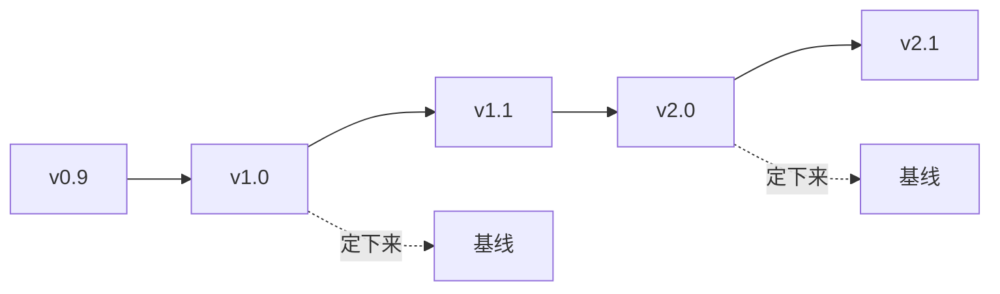
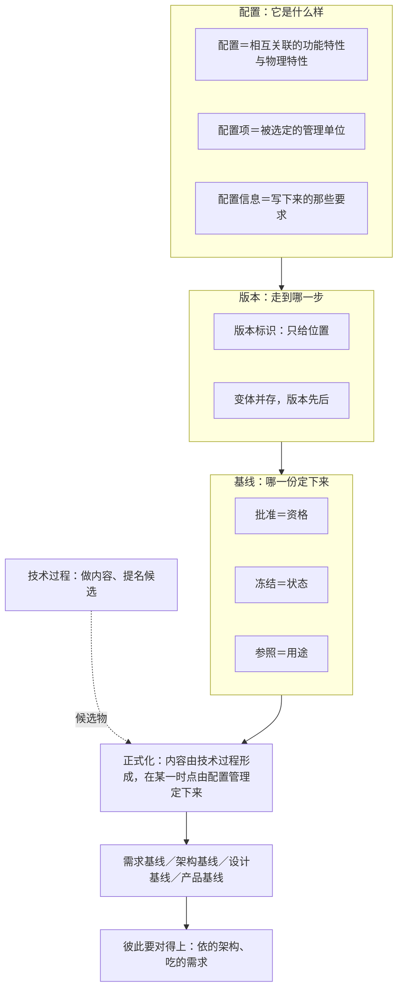

# 第15章 配置管理：让每一种内容都定得下来

## 15.1 引言

上一章把架构与设计之间那一段交接办完了：交出去的是约束，接住的是依从。

上一章留在桌上的问题只有一个：设计依从的到底是哪一版。本章办这一句。

另有两笔账记在本章。第4章说："基线一多，就得有人管哪一份是当前的。这一句归配置管理，第15章讲透。"第7章说："怎么选定、怎么受控，归第15章。"

工程现场对"配置管理"另有一套根深蒂固的说法：它是行政事务，管参数、存档、走流程；版本号标上了，就等于配置管理做好了。这套说法对不对，从 15.2 起逐条见分晓。

本章说"正本"，指的是库内那几份标准的原文。

### 15.1.1 误解现场

冰链 M3 二代的项目例会，开在接口视角规格挂进架构描述之后的第三周。

云端软件的吴浩把子系统设计描述摊在桌上，第一页就卡住了："我这层的降级状态分了五级，是照那份接口视角规格定的——可规格里没写五级，只写'连续性不得中断'。那我这一版，到底依的是哪一版架构？"

嵌入式硬件的石军翻出他那份："我这版是三月十四号定稿的。你看的是哪一版？"

"我按挂进去的那版抄的。"吴浩说，"不过上周又问过你一次，你说降级状态那条改了个说法。"

产品经理林涛把电脑转过来："规格现在有两份：三月十四号那版，和上周那版。设计组手上是后者，架构组的评审纪要写的是前者。"

系统工程师小张翻的是两份的签页："三月十四号这份有四个人的签字，上周那份只有一条修订记录，没有人签。"

制造侧的小周接了一句："产线上还烧着按三月十四号那版做的样件。"

林涛又想起一头："客户四月提的那条'断链要分两级告警'，需求清单上批过了，架构那份还是三月十四号的。"

会议室安静了几秒。测试季昭问的是最窄的一句："那我们说'二代的设计依从架构'，依的是哪一版？吃进去的需求又是哪一版？"

没人答得上来。不是没人知道，是这件事从来没有被谁定下来过：规格有两个说法、评审纪要和样件各认一版、需求清单还单独走在自己的线上。

每一份都真实存在、都拿得出手，可"哪一份是定下来的那一份"，谁也没定过。

产品开发经理赵刚在后排低声说了一句："卖出去时我们讲'全程可追溯、断链必告警'。今天连自己都追溯不清——这句话还怎么站得住。"

### 15.1.2 本章的人和物

冰链这间会议室里七个人：吴浩、石军、林涛、小张、小周、季昭、赵刚。桌上摊着六件东西：接口视角规格、架构描述、需求清单、评审纪要、产线台账、测试记录。

恒信那边三位：王默、罗建、顾言。他们栽的是同一个坑，案例进展① 里见。

### 15.1.3 本章要回答什么

读完本章，下面这几问，你应该答得出来。

1. 改一个参数，算配置变了吗？配置管理管的是这一条，还是那套相互关联的特性？
2. 版本号都标着，为什么评审还说你"没有配置管理"？
3. 需求批过基线、架构冻过一版，配置管理为什么还说对不上？
4. 评审通过了、字也签了，配置管理为什么还说这份草稿"没定下来"？
5. 架构与设计递过来的只是候选稿；配置管理收下后缺哪一件，这份内容就不算数？
6. 草稿与定下来那一版只差一个动作，配置管理这一件事，为什么不在技术过程里？
7. 每一份单看都成立，凑到一处就对不上：配置管理缺的是哪一步？
8. 不做配置管理，最先坏掉的是哪一处？
9. 设计说"我依从架构"，配置管理要让这句话成立，还得答得出哪一版需求？

这几问合起来，问的是一件事：你交出去的那一份，凭什么换个人接手还能用、还能查。

## 15.2 配置、版本和基线，各有各的位置

一屋子人手上各有各的一份。在说"哪一份算数"之前，得先把三个词摆正——它们各答一件事，混着用，后面每一句都会跟着走偏。

### 15.2.1 配置管的是产品什么样

现场说"改一下配置"，十有八九指的是改参数：阈值调一调、开关翻一翻。这个用法在日常里没错，但它不是标准里那个"配置"。

> *configuration: interrelated functional and physical characteristics of a product or service defined in configuration information.*（中译：配置，在配置信息中规定的产品（或服务）的相互关联的功能特性和物理特性。）

照这条定义，配置是**一套特性**，不是一套设置。阈值是可调的一个数；"这条通道在 −20℃ 以下仍要保持连续性"是一条特性——前者随时能改，后者一旦定下来，产品就成了那个样子。

围着这句话还有两个词。配置项，是配置里被切出来单管的那一块，即满足某一最终使用功能的实体。

配置信息，是关于产品设计、实现、验证、运行与支持的那些要求——把上面那套特性写下来的那一份。

三样东西本来就连着：特性、实体、记录。

一条译名提醒。国家标准把这一族词译作"技术状态"：技术状态项、技术状态信息、技术状态基线。看到"技术状态"，说的是同一件事。

那么架构这边有什么进得来？进得来的是架构描述，不是架构本身——架构是被描述出来的，能被选定、冻结、引用的，永远是承载它的那份东西。

问一句：你改的是那一个数，还是这台设备的样子。

### 15.2.2 什么算配置，选定才算

不是产品身上的特性都进配置。外观、成本、交期、供应商、团队习惯，都是事实，但绝大多数不进来。理由不是它们不重要，而是这件事有代价：一旦进来，改其中一条就要走变更、要留痕、要通知拿着旧版干活的人。

选择本身就是一次判断——哪一组特性，值得被这样管起来。

拿不准的时候问三句。它是产品自身的特性吗，不是过程的、不是组织的，也不只是某个人的做法？它在那一组相互关联的特性里吗，孤立的一项不构成配置？它被选定要管了吗？

第三问最容易出岔子，因为它把"选择"摆到了台面上：配置项不是从天上掉下来的，是被选出来的。

选定之后要有一份清单，每一项答得出"它是什么、归谁管"。

落到架构这一侧：按正本，架构定义过程只做一半，识别基线的候选对象（下文简称候选），随后把做出来的东西交给配置管理。

挑候选的是架构这一侧，收下候选的是配置管理。这条分工后面还要用两次，15.4.3 专门讲。

一句话：答不出"它在不在那份清单上、谁定的"，它就还只是某个人的习惯。

### 15.2.3 版本管的是走到哪一步

版本最容易被当成"进度"，它只标先后。

正本没给"版本"下定义，它把力气花在一件更硬的事上：架构描述的各样构成物都得带版本标识。

视角、视图、视图组件这三样构成物，条下都写了"应含版本标识"；描述框架与模型种类那两处说的是"宜含"，分量不同。

版本最朴素的样子就是编号，正本叫它版本标识、现场叫它版本号：给每一次改动一个号，让人一眼看出先后。软件界常见的"主.次.修订"三段式是业界惯例，不是标准条文；它给出来的是一件东西——位置。

位置只答一类问题："这批记录是哪一版采的""你看的是哪一版"。它答得出先后，答不出资格。最新版只是"到目前为止走得最远的一版"；它有没有被批准、有没有被冻结、能不能拿来当依据，版本号一个字都不说。

一横一竖：版本顺着时间一格一格排过去，基线在某一刻从这条线上竖着切一刀。

虚线那两笔是全部差别——刻度连续、彼此无差别；被切下来的那一个，是带资格的。

还有一件常被混进来的：变体。变体是同一时刻并存的几种形态；版本是同一条线上先后几次改动。

M3 有 −20℃ 与 2~8℃ 两种机型，它们是变体，同时存在，谁也不是谁的升级；−20℃ 那一型从 v2.1 走到 v2.3，走的是版本。

先问"这批是哪一版"，再问"凭什么算数"。第一问答得上、第二问答不上，就是后面要讲的那种状态。

### 15.2.4 基线要有人批、有人冻、有人照做

基线回答第三件事：哪一份是定下来的那一份。

> *baseline: formally approved version of a configuration item, regardless of media, formally designated and fixed at a specific time during the configuration item's life cycle.*（中译：基线，配置项不论介质如何、在配置项生存周期内的特定时刻被正式指定并固定的、经正式批准的版本。）

> *configuration baseline: approved configuration information that establishes the characteristics of a product or service at a point in time that serves as reference for activities throughout the life cycle of the product or service.*（中译：配置基线，经批准的配置信息，它确定产品或服务在某一时间点上的特性，并作为该产品或服务生存周期内各项活动的参照。）

两句话并排读，基线要三样，缺一个就散架。

**批准**给资格：从这一刻起，这一份可以当依据用。

**冻结**给状态：此后任何改动都是"对这一版的偏离"，都得走变更控制。这套管住改动入口的活，标准有些地方就叫它配置控制。没有冻结，批准只是一句好话。

**参照**给用途：别人引用、比对、追溯时指向它。没有参照，冻结也守不住。

最容易漏的是第三样。现场常见的场面是：会开了、字签了、文件归档了，然后大家接着用各自电脑上那份"顺手改过一点"的版本。

批准和冻结都有，参照没有，基线于是名存实亡。

架构这一侧最硬的一个例子，是交架构时附的那套凭据：接口定义基线、约束条目表、追溯矩阵、基线版本号。

四项合起来必须纳入配置管理，跟描述那一版**一起冻**（行业里把这一条叫同版冻结）——描述一动，照着旧条目做的设计就成了"依从一个已经作废的版本"，双方都觉得自己没错，账却对不上。

还有一条边界：基线承载的是**明示的**那一部分。评审与验证的判据都从这些明示的条目里来，基线撑得住；确认撑不住，它问的是"符不符合预期用途"，而那把尺子在使用情境里，不在基线里。这一层是本书的看法，不是标准原话。

这条边界不影响本章的做法，但挡住一个很容易犯的错：把基线当成什么都能判的东西。

---

## 案例进展①｜恒信：另存为 v2

合同审批系统上线半年，运维只有王默一个人。每次发布，他的做法是把构建产物扔进按日期命名的文件夹："2026-05-12""2026-05-18"。

合同管理模块改一次字段校验，他把新包打进"2026-05-18"，旧的懒得删。

两个月后，一个合同状态流转的缺陷暴露了。系统架构师罗建："回滚到上上个版本。"王默打开"2026-05-18"——里面躺着两个包："合同系统_final.zip"和"合同系统_final_2.zip"，分不清哪个是哪个。

"我们有版本号啊。"罗建说。

需求分析师顾言把两个包的名字并排看："你这里有三个东西被混成了一个：文件名、版本、基线。文件名的先后不是版本——版本要能精确指到'哪一次完整构建'：由哪个提交编译出来、含哪几条变更。final_2 既不知道是哪次构建，也不知道批没批过，更不知道和上一版差在哪。它连版本都算不上，更谈不上基线。"

罗建看着那个文件夹："所以出问题要回滚，我连回滚到哪儿都指不出来。"

"对。"顾言说，"版本是回滚的地址，基线是变更的参照。你只有日期文件夹，地址和参照都没有——两个月前还能说的'变了什么'，两个月以后就说不清了。"

后来恒信补上了发布记录：一个包对应一个版本号、一个提交号、一版需求基线和一份变更记录。

从此"上上个版本"在恒信变成了一句可执行的指令。

罗建翻这套文件时自己都笑了：第4章合同需求靠"v2.doc""最终版 v3.doc"管版本，如今系统部署靠 final_2.zip 管版本，同一个毛病换了个文件后缀，又犯了一遍。

---

## 15.3 配置管理管的，是每种内容的基线

三个词摆正了，接着要放掉一个错觉：以为基线只有一条，就是架构那一条。被下游引用的东西有几种，基线就有几条。这几种不是一套分类法。它们是正本在各自过程里点名的那几份；本书把它们合起来看，才把它们合称一族。

### 15.3.1 需求定下来，才有需求基线

第4章讲过需求那条线：批准之前归开发，批之后进基线，之后一切改动归管理。那里说的基线，就是需求基线。

再往上一层还有一条。利益相关方的需要与需求那一层也有自己的基线。正本在几个技术过程的注里逐条点了名：利益相关方的需要、利益相关方需求、运行概念（系统将被怎么用），通常是纳入基线的那几件；到了系统需求定义这一步，系统需求是通常被纳入基线的那一件。

看清一件事：这些基线不是同一个东西的几种叫法，是**不同内容的各自一份**。需求那一份被定下来，不等于架构那一份被定下来；反过来也一样。

所以"我们建基线了"这句话，得追问一句：建的是哪一条。答不出，就只建了其中一条，其余几条还散在各自的过程里。

### 15.3.2 架构定下来，才成架构基线

架构这一条线也一样。架构描述被选定、被冻结的那一版，才叫架构基线。正本把这一版叫"基线架构"，指的是那一时点上架构的定义；本章说架构基线，指的是承载这份定义的那一版描述——正本给这一版写过一句很准的话：充当同步关键点，用于架构的评审，也用于把架构作为参考提供出去。

有一处对象必须说准：被冻结的是描述，不是架构。架构无形而抽象，能被选定和冻结的永远是承载架构的那份东西；跟着一起进去的还有描述所依据的记录——架构描述与架构决策记录一并纳入配置管理。

两个用途正好对着下游那句问话。设计依的是哪一版？就是这个同步点上的那一版。

设计也一样：设计描述被选定、被冻结的那一版，才叫设计基线。三条线各有一份，各有各的名字。

还有一层常被忽略：它不是"写完再交出去管"。架构描述在写的过程中就已经被人引用了，设计等这一版开工，采购照上一版询价，评审按某一版出纪要。

若它到定稿才受控，中间那一段里所有的引用，引的都是一份还算不上数的东西。受控与编写同时开始，15.4.2 还要说一次。

### 15.3.3 产品基线管定型，配置基线管内容

正本讲基线时用了两个名字，各自对着一前一后两步。标准把配置基线写在一处"应该出现的结果"里：配置基线，包括已批准的配置，得到维护。它管的是受控内容本身。标准把产品基线写在活动的最后一步：执行配置及配置管理的验证活动与审核，以建立产品基线。它管的是"能不能定型"——审核做完了，产品这一版才可以建立起来，进入发布。

这一条底下还点了两种审核：功能配置审核看功能与性能能力，物理配置审核看实物与配置信息对不对得上；执行审核的仍是验证过程。

一步在前、一步在后，不要混着说。还有一套名字要交代清楚：功能基线、分配基线、产品基线这三分法，是行业惯例，不是标准术语——本章不按它组织全章。

听人讲"基线"，先问一句：他说的是内容受控那一步，还是产品定型那一步。

### 15.3.4 基线定了，彼此还得对得上

前面三节各说了一条线。

现在问一句：几条线各自的日子，对不对得上？这也是本章与第4章、第7章分家的地方。

几条线各自定住了，不等于合起来成立。设计手里那份架构是三月那一版、吃进去的需求是四月那一版，两边都"有基线"、都"批过"，合到一起却不成立：它依的是三月那版架构，做的却是四月才批下来的需求，中间那一段没人对过。

所以还差一样东西：**要建哪几条基线、各在什么准则或事件上建，本身得有人定**。正本把这件活放在配置管理的准备活动里，15.4.2 细说。

这几条基线不是"照做就好"的建议，是"不先定，后面全乱"的前件。

为什么必须被定？因为各条线各有各的时刻：需求批在立项之后，架构冻在评审那天，设计收在设计评审，验证证据落在测试收口。

这些时刻彼此不理会，可下游从来不是只依一条线——设计同时吃需求与架构。

一句话：每条线各有各的一份，还要有人让它们对得上。

---

## 案例进展②｜冰链：版本标着，基线没有

三季度末，客户那边的疾控审计。桌上摊着一份疫苗运输记录：四月运输，全程温度记录正常。

审计员说："请你们证明一件事：这批记录，是在哪一版固件下采集的？从那批之后，采集逻辑、断链判定有没有升过级？"

石军答得快："查一下这批设备当时跑的固件版本就行。"

查不清。升级记录上只有一句"已推送 v2.3"，没有"哪台设备、什么时间、从哪一版升到哪一版"的明细。采集算法还改过一次：v2.1 与 v2.3 的断链判定不一样，同一条温度记录算不算"断链"，取决于它是哪一版固件采出来的。

季昭把测试记录翻出来，一页一页对了一遍："同一份记录，落在这三个版本上过。测的是哪一版，我这儿也答不上来。"

小周翻开产线台账："出厂时每批烧的哪版固件，这儿都有账；出了厂，推送升过几回、哪批升了哪批没升，这边一概没有。"

石军觉得冤："我们有版本号啊：v2.1、v2.2、v2.3 都标着，升级也走了流程，季昭也验证过。这怎么就不算配置管理了？"

季昭问的是另一句："这批记录，是拿哪一版采的？"

"v2.1 到 v2.3 之间……"石军停住了。他答不出一个具体版本。

季昭说："版本号给的是位置，基线给的是资格。你的版本号都在。可没有哪一版是被批准、被冻结、被拿来当参照的——查得清改到第几步，查不清哪一版算数。"

小张把两份规格推到中间："我们每一段都说得出'我按哪一版做的'，没有一段说得出'那一版是谁批的、什么时候定的'。每条线上都有版本，可没有一条线上有一份定下来的。"

赵刚问了一句："客户那边要是问'这批是哪一版采的'，我们拿什么答？"

---

## 15.4 配置管理不产内容，只定基线

上一块说清了基线是一族。这一块说那个把它们定下来的动作：这动作叫什么、谁做、做几件事、什么时候开始。

### 15.4.1 正式化：把草稿定成基线

这一步的名字，正本里只有一个动词。

> *The content for the baselines is developed through the technical processes, but is formalised at a point in time through the configuration management process. Baselines form the basis for the next change.*（中译：基线的内容通过技术过程形成，但通过配置管理过程在某一时点被正式化。基线构成下一次更改的基础。）

这句话里有一个转折：内容由技术过程形成，**正式化不在技术过程里**。架构定义过程把内容做出来——概念、属性、规矩、视图、决策记录；它做不到的事只有一件：从哪一刻起，这一份算数。

那个动作归配置管理。本书给这个动作一个名字：**正式化**。它不是新造的词，正本里就是 formalise。这个名字含三样，是三处定义并排读出来的：一句说基线是"经正式批准、在特定时刻被指定并固定的版本"，一句说它"被当作生存周期内各项活动的参照"，再合上正本那句"在某一时点被正式化"——获批、冻结、作参照，缺一样都不成立。

同一个动作，宾语可以不同：对一份架构描述正式化，得到架构基线；对一份系统需求正式化，得到需求基线；对一份治理指令正式化，得到治理那一层的基线。

顺带划一条界：正式化不等于技术评审。评审评的是内容够不够好，正式化管的是这一份东西的资格。评审合格是正式化的常见前提，但不等于正式化：一份评审合格的草稿仍然是草稿，直到有人把它收进受控范围、固定下来。

反过来也成立：一份已经正式化的东西，内容上仍可能在下一轮评审里被推翻，那时走的是变更，不是重新正式化。

问一句"这一份是什么时候、通过哪个过程变成算数的那一份的"。答"写完就发下去了"，说明正式化从来没有发生过。

### 15.4.2 建哪几条基线，事先就得定

"什么时候建基线"不是碰运气的事，也不是等出了事再补。正本的准备活动里写着：定角色、职责、问责与职权，定要建立哪些基线，定存储的位置与条件，定何时启动配置控制、何时维护基线。

这几件事最容易被跳过，因为它不直接产出内容。可它一缺，后面几项就都成了临时应付：临时选配置项、临时定门槛、临时补记录。

定哪几条，跟着内容走。被下游引用的东西有几种，基线就有几条。定不下来的时候问一句：这一份将来会被谁拿去当依据？答得出，它就值得有一条基线。

还有一件绑在一起的事：受控与编写同时开始。架构描述在定稿之前就已经被人引用了。所以它不能等到定稿才进受控——中间那一段里，凡是有人在照着它干活，它就已经处在"别人会因此返工"的位置上。

由此带出一条纪律：改动不是"定稿之后才通知"，而是边写边通知；等到定稿再统一发布，等于让所有人先按一个会变的版本干了几个月。

变更控制严到哪一档，可以按影响定：控制的方式可以是登记、通知与版本标识，不必事事上升到评审；反过来，凡是已经有人在照着它干活的东西，哪怕它还叫草稿，也得先纳入受控范围。

### 15.4.3 候选由谁挑，基线由谁定

本章最要紧的一条分工，是分清哪一步谁做：挑候选的是一只手，定基线的是另一只手。

按正本，架构定义过程在做完自己的活之后，还有一件收尾动作：识别基线的候选对象，随后把做出来的东西交给配置管理。

设计定义过程照同一句式。也就是说：挑候选的是架构与设计，收下并正式化的是配置管理。

这条分工常被读成"架构交出去就不管了"。它说的是另一件事：判断与正式化分属两只手。架构侧能做的是判断——哪一份够格当候选、哪一份还不够；它做不了的事只有一件：从这一刻起，这一版算数。那要有批准的权威与受控的记录。

分清这一条，现场那句"我们评审通过了，怎么还说不算数"就有答案了：评审判的是内容，正式化给的是资格。

内容合格却没被收进基线，它仍然不是别人可以引的依据。

具体递过去的是什么？架构这一侧是架构描述本身，含各张视图与模型，加上架构决策记录与它的理据、各份清单；设计这一侧照同一句式。

那么，谁有权批这一版？这一问本章不答。它与"谁有权建立配置控制机制、谁裁定架构集合中的变更"是同一个问题，归架构治理，第16章讲。

本章只把候选挑出来、递过去。一份东西被拒了，先问它被拒在哪一环：内容不合格，还是没被收进基线——两件事的补救办法完全不同。

### 15.4.4 基线立住，才谈得上管住变化

基线一旦立住，替下游挡掉的是一串麻烦；底下这四件最常遇见。
**给变化一个参照原点。**"改了"这个词，只有在有一个可指的上一版时才有内容。没有参照，"改了"能指的东西太多：改了什么、改到哪儿、跟谁对得上，每一问都落空。可核的问句就三句：上一版是哪一版？谁批的？什么时候？三问任一答不出，参照就不存在。

**给并发一个交点。**技术过程在层级上递归、在时间上并发，多层级同时改的时候，"父架构是哪一版"必须有答案，否则分配与追溯失去共同对象。

**补上"交得出去"的另一半。**描述内容本身合格，只做到了其中一半；能不能让人确认"拿到的是算数的那一份"，靠的是把它置入受控的库、库里的条目处在配置控制之下。

**给追溯与决策记录一个可核的挂点。**架构实体与需求、接口、分析结果、验证方法之间的双向追溯要有地方可挂；决策记录也一样，它得有一版可指的描述作依托。

四件之外还有一笔最实的账，是召回。有基线、有状态记帐，出问题时能精确召回受影响的那些项；没有它们只能全量召回，把某一时段的所有东西一起退回去，成本差一个量级，还会顺手退掉不该退的改动，制造出新的问题。这一组对比是行业里的说法，不是标准条文。

还剩一层是时间尺度：早期重心偏"控制"，运行与维护阶段偏"取证"。由此有一条常被忽略的规矩：配置记录要维护到生存周期之后，按协议与法规存档——记录常常比产品活得久，因为审计与追责往往在后头。

这也是"存档"与配置管理看着像、却不一样的地方：存档的寿命通常跟着项目走，配置记录要跨过项目。

---

## 15.5 没有配置管理，会坏在哪

上一块说了它做了什么。这一块反过来看：不做会坏在哪，以及坏起来先坏哪一处。

### 15.5.1 不做，坏的不是乱，是说不清

把正本那几条预期结果一条一条反过来读，就是"不做会怎样"的清单。

配置得不到管理，谁在改、改成什么，没人说得清；基线得不到维护，"哪一版算数"没有答案，引用只能凭记忆；更改得不到控制，改动绕过门口，事后才知道。

配置状态信息不可获取，查不到现在是什么状态，也查不到曾经是什么状态；审核做不了，没有基线，审核没有比对的对象；发布得不到批准，没有可批的那一份，只能是"先发出去再说"。

这六条表现有个共同点：不是"乱"，是**说不清**。现场往往不乱：每个人手上那份看起来都成立，每一条改动都有记录，每一次评审都有纪要。

乱是看得见的，说不清看不见；而看不见的坏更难办，因为它不触发任何人的警报。

### 15.5.2 坏在半路，报出来的都是成绩

比"完全没做"更常见的，是做了一半，而且每一半都能报出成绩。这三种做法各自都能报出一套流程，翻开来各缺一环。

有标识、无控制：清单立起来了，可改动不进这道门，清单上写的"当前版本"随时过期。

有控制、无记帐：改动确实走门了，走完之后没人记录状态，问"现在是什么状态"要靠回忆。

有记帐、无审核：日志记得很全，可没有人对着基线核一遍实物与文档。

这三种有个共同特征：对外都说得出一套流程，对内却答不出"当前算数的是哪一版、凭什么是它"。

所以现场核对别问"有没有做配置管理"，问这五项活动里有哪一项没有真实发生：准备、配置标识、更改管理、配置状态记帐、验证与审核。说到底，这三种是整类都在、只缺一环；整类都缺的那种，下节说。

### 15.5.3 坏起来有先后，最先坏的是参照

缺位不是一个笼统的"没做"：它有几种形态，各有各的第一处塌方。

| 缺位形态 | 最先坏掉的一处 | 一句自检 |
|---|---|---|
| 无标识 | 引用——指认不出某一条决策，也指认不出某一版视图 | 上一轮讨论的是哪一版 |
| 无基线 | 参照——评审与验证找不到对象 | 上一版谁批的，什么时候 |
| 无变更控制 | 影响评定——改动波及哪些下游，没人算 | 这次改动波及哪些下游 |
| 无状态记帐与审核 | 追责与发现 | 它是怎么变成这样的，谁核过实物 |

四句话当场问一遍，哪一句答不出来，缺的就是哪一类。

这四类里，"无基线"那一类最先坏；而它最先坏掉的那一处，就是参照。因为其余三样都靠它：没有"哪一版算数"，追溯就断了起点，评审没有比对对象，变更也没有参照。

所以现场核对不必逐条全查，先查起点。

回到本章最要紧的那一句：不做配置管理的现场，第一个症状不是乱，是说不清；而且这种说不清有个特别的样子——每一份单看都成立，凑到一处才对不上号。

---

## 案例进展③｜冰链：季昭给测试记录加基线栏

审计过去一个月，季昭把测试记录的模板改了一处：在"结论"旁边加了一栏"基线"。

这一栏填三样：对哪一版测的、那一版是谁批的、测的时候这一版处于什么状态。第一次填的时候，测试组有人笑："这不就是多加一道手续。"

散会后小周问产线那份排产记录要不要也加一栏。小张说加，签在按哪一版做的那个格子里。

季昭没解释，只把审计员那句话抄在栏头——这批记录，是在哪一版固件下采集的。

三个月后，M3 二代的一次内部评审上，有人问："这批测试结论，是针对评审前那版描述做的，还是评审后改过的那版？"

会议室里安静了一下。上一次这样的问题，答案要翻半个小时的邮件。这一次季昭把测试记录翻开，指着那一栏："三月十四号那版，评审前定的基线，测完没动过。"

"这一栏补的是什么？"有人问。

"第14章问的是'设计依从的是哪一版'，到了测试这儿，同一个问题换了个样子：这份结论是对哪一版测的。"季昭说，"基线这一栏补上，这个问题当场就答得出来——也就是第9章那句话：你不在场，它照样接得住。"

林涛在会后说了一句："你这一栏补的不是手续，是别人敢不敢用你的结论。"

那位当初笑他的同事，第二个月把这一栏抄进了自己那份检查表。

---

## 15.6 依从哪一版，判断才站得住

现在可以回收第14章那一问了。但要答两次——两次都答得出，那句话才立得住。

### 15.6.1 架构这边，依的是哪一版

答案是架构基线：架构描述被选定并冻结的那一版。

前面引过正本给"基线架构"写的那句话：它充当同步关键点。设计依的，就是这一个同步点上的那一版。

这也解释了为什么"最新版"在这里格外危险。设计手里的版本如果比基线新，它依的就是一个还没被批准的版本；如果比基线旧，它依的就是一个已经作废的版本。

两种错都不在内容上，而在资格上。

这句话有个很具体的用法：评审要写清"按哪一版评的"，引用要写清"引的是哪一版"。纪要上只写"架构评审通过"，等于把一个同步关键点丢掉了；三个月后有人问"当时是按哪一版评的"，只能靠回忆。

### 15.6.2 需求那边，吃的是哪一版

只答架构那一半，还是不成立。

设计不是从架构里推出来的。正本把这件事说得清楚：设计定义过程由需求驱动，而且那批需求是**已经结合架构评估过、并做过更详细的可行性分析**的需求。

同一条线上还写着：这个过程把**架构与需求一起**转换成可实现的系统设计。

所以设计有两个输入。两样都要有基线：架构那一条给定它不许越过什么，需求那一条给定它要满足什么。这一句是本书把两处合起来说的。

只答得出其中一条，"我依从架构"这句话只说了半句。

这一半在真实现场最容易缺。因为架构那一条有人盯着——评审会上就摆在那里；需求那一条却在另一条线上走，改动的通知未必到设计手上。

等到设计按旧需求做完，回头才发现需求那版早就换了，两边都觉得自己没错。

补这一半的方法很朴素：设计文档里对每一条关键约束、每一条关键需求，各写一句"依据：哪一版、谁批的、什么时候"。

### 15.6.3 架构和需求都答得出，依从才成立

两半合起来，才是那句"依从"。

依从不是一个态度，是两处答复加一次对时：依的架构是哪一版、吃的需求是哪一版；两个版本各自定下来的时刻，要能放在一起看。

两条都对得上，"我依从架构"才第一次有了内容。

冰链那次评审上就有过这一幕。季昭答得出"三月十四号那版，评审前定的基线，测完没动过"；小张接着问了一句："架构那份定了，需求那份呢？"会议室又静了几秒。

那一问不是抬杠，是把半句话补全。

还有一件要说清的：这个"对得上"不是要求两条线同时定。真实项目里它们不会同时定，也不必同时定；要求的是——每次有人说"我依从"，他能把两处都指出来，而且这两处是彼此相容的那一对。

一句话：依从不是一句表态，是两句答复。

### 15.6.4 认知反转

本章要翻的直觉，是两个一起翻。

第一个是"配置管理是行政事务"——管参数、存档、走流程，谁做都一样，做不做都行。翻过来是：它是一套动作，把内容变成可以当依据的那一份。

这套动作不在技术过程里，技术过程做不了它；它没做的时候，技术过程产出的一切都停在草稿这一档上：交不出去、引不了、追不了。

把它当手续，赶工期时就会第一个砍掉它；把它当那套动作，就知道砍掉的是"别人还能不能接着用你的东西"。

第二个是"可复现就是把文档写全"。翻过来是：可复现说的不是文档写得全不全，而是一件东西的状态——有版本、有基线、改了说得清。

文档写得很全但版本对不上，出问题时照样召回不了；文档写得不多但位置摆正了，换个人照样接得住。

本章量的从来不是"写得够不够多"，而是"位置摆得对不对"。

顺带翻掉一个更小的直觉："这是配置管理员的事"。这门岗确实存在，管的是过程的运转；可本章讲的那些判断——哪一份够格当候选、哪一版该被正式化、这次改动该不该进门——做的人却是交出那份判断的人。

两个直觉一起翻过来，本章那句话才立得住：配置管理不产内容，它只把"哪一份是定下来的那一份"固定下来；而固定下来这件事，正是判断从一个人手里走到一份能被别人引用的东西上。

---

## 小结

本章讲的是一件不显眼、却决定别人能不能接着用你东西的事。

配置、版本、基线各答一问：它是什么样、走到哪一步、哪一份是定下来的那一份。版本只给位置，基线才给资格——批准、冻结、作参照，三样缺一就散架。

而基线不是一条。需求、架构、设计各有各的一份；被下游引用的东西有几种，基线就有几条。要建哪几条、各在什么准则或事件上建，本身得有人定。

几条线各自定住还不够，下游要同时依的那几份，时刻得对得上。

把它们定下来的那个动作叫正式化，不在任何一条线的技术过程里：内容由技术过程形成，正式化归配置管理。

挑候选的是架构与设计，收下并定下来的是配置管理；谁有权批这一版，归治理。

不做会坏在哪？不是乱，是说不清：每一份单看都成立，凑到一处才对不上号。

留给你的是一把两问的尺子：依的架构是哪一版，吃的需求是哪一版。两处都答得出，"我依从架构"这句话才有内容。

接下来谁有权批、他凭什么说了算，是下一章的事：架构治理给的不是判断，是效力。

---

## 附录

### A 本章概念总图

图注：横着从左到右，是三个词的位置顺序；竖着从上到下，是基线那三样；底下那一笔虚线，是内容这一侧只提名候选、把它定下来的是配置管理。

### B 本章的能力级

主级：第 ③ 级（心智模型），读完能推演六个为什么：为什么"最新版"当不了基线、为什么版本号标得再多也长不出一个基线、为什么"有版本管理、没有配置管理"更危险、为什么挑候选与定基线是两只手、为什么"定稿之后才受控"是错的、为什么每条线都立了自己的基线还不够。

底座铺到第 ② 级（图式）：一横一竖那张图、基线的三样、五项活动串成一条线。第 ① 级（表征）是入场券：配置、配置项、配置信息、版本与版本标识、基线、配置基线、产品基线、正式化、配置状态记帐、候选对象、功能配置审核、物理配置审核。

解释框架不建（归第17到第19章）。

能力落在两档上。工程能力那一侧，它是第9章第 ⑥ 项可复现意识的落地形态，管好自己交出去的那几份；架构能力那一侧，就是"让整套架构描述与决策记录受控、并让下游必须依据架构描述"——第9章那份能力清单里的一格。

两档不是两件事，是尺度：同一套动作，落在一份产物上是习惯，落在一整套描述上就是过程与制度。

再用第1章 §1.4.3 那把尺子量一下：本章站在第 ③ 级。本章给你的是一组位置和一条分工——拿到任何一份 v1/v2/final，你能说出它答的是哪个问题、缺的是哪一样；拿到任何一次"我依从"的声称，你能问出两句。

> **能答全四问，才算拥有**——你交出去的每一份内容，都答得出哪一份是定下来的、谁批的、什么时候；你不在场，它照样接得住。

### C 自查 · 这些说法对吗？

1. "配置就是那个参数设置页。"——不对。配置是相互关联的功能特性与物理特性；参数只是配置信息里的一个条目。
2. "配置项就是我们想管的那几样。"——差一步。配置项是被选定、有清单、有归属的那些。
3. "有版本号，配置管理就做好了。"——不对。有版本管理、没有配置管理，正是最常见的坏法。
4. "最新版就是基线。"——不对。基线是被批准、被冻结、作参照的那一版。
5. "基线建好以后就不许改了。"——不对。基线是下一次更改的基础。
6. "变体就是高一级的版本。"——不对。变体是空间，版本是时间。
7. "配置管理是定稿之后的事。"——不对。架构描述在过程中就处于配置控制之下。
8. "我们评审通过了，它当然就算数了。"——不对。评审过的是内容，算不算数要有正式化。
9. "配置管理是配置管理员的事。"——不对。它是每一个交出判断的人的事。
10. "配置审计就是内审。"——不对。配置审计的对象是配置项与产品、判据是基线。
11. "基线什么都能拿它比。"——不对。基线只承载明示的那一部分，确认那一侧撑不住。
12. "功能基线、分配基线、产品基线，标准里就这么分的。"——要标依据。这三样是行业惯例。
13. "配置管理是架构之后的下一步。"——不对。每个技术过程都在识别候选对象，它与前面各章并行。
14. "我们每条线都建了基线，就没问题了。"——还差一步。几条线各自定住，时刻还得对得上。
15. "设计依从架构基线，答完这一句就够了。"——不对。它的另一个输入是需求。

### D 练习

1. 一份设计描述上写着 V2.3，评审纪要写着"通过"。它进基线了吗？还缺什么？
2. "这一版改了告警阈值"与"这一版改了断链判定逻辑"，哪一句在说配置变了？
3. M3 的 −20℃ 机型从 v2.1 升到 v2.3，同时 2~8℃ 机型一直在 v2.0 上。这里有几条版本线、几个变体？
4. 现场答"按最新那版"，这个答案缺哪一样？
5. 架构侧通过了 AD v1.4，设计手里是 v1.3。设计算不算依从架构？补一句什么话就能判？
6. 恒信的 final_2.zip 属于哪一种"不做"？它和"完全没有版本号"坏在哪一处不一样？
7. 你的项目上，需求、架构、设计各有几条线？把它们定下来的时刻排一排，看哪两条差得最远。
8. 一份测试记录写着"结论：通过"。它缺哪一栏？

参考答案：

1. 没进。缺正式化——要有批准的权威、固定下来的时点、此后被当作参照。
2. 第二句。第一句改的是可调的一个数，第二句改的是设备的形态。
3. 两个变体、两条版本线；−20℃ 走到 v2.3，2~8℃ 停在 v2.0。
4. 缺"哪一版、谁批的、什么时候"——没有参照，"最新"不是答案。
5. 判不了。先要问 v1.3 是不是当时的基线、v1.4 有没有正式化。
6. "有版本管理、没有配置管理"。它更危险，因为看起来是做完的。
7. 没有标准答案，但答不出"哪两条差得最远"，说明那几条线还散在各自的过程里。
8. 缺"基线"一栏——对哪一版测的、谁批的、测的时候是什么状态。

### E 参考文献

> **编号怎么读**：`[k]` 是本章内的文献序号；括注的 `R-xx` 是全书参考文献总表（附录 D）的编号。

**标准**

- [1] **R-05** ISO/IEC/IEEE 42020:2019《架构过程》—— §10.2 e)；§10.4.2 h) n)；§10.4.4 m)；§3.19 注 1；§6.4.2 k)；附录 E.4.1.6 基线架构
- [2] **R-04** ISO/IEC/IEEE 42010:2022《架构描述》—— §3.3 工作产品；§5.3；§6.6~§6.8 版本标识；§6.10.1 决策记录
- [3] **R-37** ISO/IEC/IEEE 15288:2023《系统生存周期过程》—— §3.8 基线；§5.9；§6.3.5 配置管理过程；§6.4.4.3 e) 6) 与注 12；§6.4.5.1；§6.4.5.3 注 20；各技术过程「提供已选定用于基线的关键人工制品」条及其注
- [4] **R-38** ISO 9000:2026《质量管理 — 基础和术语》—— §3.10.8 配置／§3.10.9 配置项／§3.10.10 配置信息／§3.10.11 配置状态记帐／§3.10.12 配置基线；§3.12.1 审核
- [5] **R-42** ISO/IEC/IEEE 24748-7／SAE EIA-649／MIL-STD-973 —— 功能基线／分配基线三分法的行业出处（库外）

**经典文献**

- [6] **R-63** INCOSE《系统工程手册》第五版中文版—— 与 15288:2023 同版同年（旁证，非标准条文）
