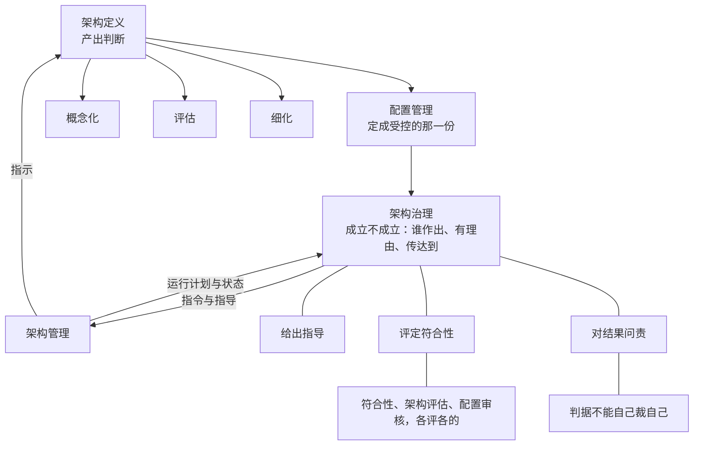

# 第16章 架构治理：立规矩，对结果问责

## 16.1 引言

上一章把每一份内容都定得下来了：哪一份是定下来的那一份，答得出来了。它留在桌上的最后一句话是：接下来谁有权批、他凭什么说了算，是下一章的事；架构治理给的不是判断，是效力。

本章把"效力"翻成一句白的：这条判断**管不管得住别人**。本章说"治理"，都是"架构治理"的简称。

### 16.1.1 误解现场

恒信的合同审批平台上线八个月，架构基线停在去年冬天。这天下午，业务方把一张变更单送到项目组：历史对账记录的查询年限，从两年放到五年。

曹峰（产品）觉得是小事：那条查询本来就摆在那儿，把年限改大就行；开发也说，改一个配置项，两天的事。

苏婷（设计）不同意。上个月需求分析师顾言拿九查表问过她"历史记录归谁管"，她抄过一句：数据归属唯一，这条是架构定下的，设计改不了。她说："这得看架构那边怎么办。"

罗建（架构）把架构描述翻出来。那一版是去年冬天评审通过、签过字、冻结的。改了这条，那一版就不再是那一版：下游按它做的设计、按它写的测试记录，都得跟着动。他说："我先看看。"

曹峰等了三天，没等到回话。他跑去问项目经理："这事谁说了算？"项目经理说："架构那边的意见。"曹峰再问："架构那个人是谁？"没有人答得上来。

不是谁在推诿。往下问是三件事：谁有权改这一版，罗建手里有架构描述，可他不管审批；按什么程序改，找谁评估、找谁同意、改完通知谁，都没有规矩；改了能不能成立，可有人问一句"你们凭什么这么改"，谁拿得出依据。

最后一件最要紧：把一个判断做清楚和让它成立，是两件事；后一件不归做判断的人管。

### 16.1.2 本章的人和物

恒信这一侧，曹峰看的是"要不要改、什么时候改"，苏婷看的是"这一改到我这一层还算不算同一个系统"，罗建看的是"我签过字的那一版还站不站得住"。冰链这一侧，嵌入式硬件工程师石军看的是"除了我，还有谁按同一套办法查得出来"，产品经理林涛看的是"出了事由谁定、谁担"。

系统工程师小张问的又是另一件事：这份规格自己按哪一版走，改完谁评它有没有被照办。两组人问的都不是技术，问的是同一件事：这一条成立不成立，由谁说了算。

### 16.1.3 本章要回答什么

读完本章，下面这几问，你应该答得出来。

1. 最懂的人做判断，签字的却是另一个人：为什么治理要把这两件事分成两处？
2. 治理发下去的规矩，凭什么管得住一个不做架构的人？
3. 一个机构叫"治理委员会"，可它一年只审不立；治理与审核差在哪儿？
4. 同样是查一遍，为什么治理的符合性评定不能替架构评估？
5. 一条改动批过了，改它的人还是不知道该找谁；治理和变更的边界在哪儿？
6. 上一次治理拦下了某件事，是什么时候？答不上来，说明它缺了什么？

这几问合起来，问的是一件事：规矩发下去了，凭什么一条就真的管得住。

## 16.2 治理、管理、架构定义，各站哪儿

> 块导读：先把位置站对。这一块答三件：治理是哪种事，它和"管理"差在哪儿，它和架构定义是什么关系。

### 16.2.1 治理是一套制度，也是一组动作

"治理"在中文里是个老词，到了工程语境里却常被当成新词。它在本书里要担两件事，而这两件事长在同一个词上。

第一件是一套制度。标准在资料性附录里说的是：架构治理是在组织范围内对架构进行管理和控制所依循的规程与取向。本书归成五样：机构与程序、治理计划、治理指令与指导、符合性状态报告、架构集合目标——后四样是标准明列的工作产品。

第二件是一组动作：准备并规划，监视、评定与控制，确立架构集合目标，作出治理决策，监视并评定符合性，评审指令与指导的实施。它答的是：这一刻谁作出决定、谁裁例外、谁去看有没有照办。

两件事不是两个概念，是一个词的两面，而且有先后：先反复地做那组动作，才沉淀出那套制度。**名词义是动词义的沉淀**，这一句是本章后面所有内容的地基。

一处词形提醒：`governing principles` 译管控原则（架构的内容，归第11章），`governance` 译治理（本章两义），`governs` 是那个"管住"的动词（第13章写"受某个视角治理"）。

中文"治理"也不是随手挑的译名，它在政策语境里就被定成这样，为的是与"管理"拉开距离：管理是执行，治理是定方向、立规矩、担责任。

### 16.2.2 治理平时做什么

上一节归的是那套制度，这一节归的是那组动作。标准把动作展开成六项，平列摆着，读者不好记；本章按它们各管的那一段归成三样：**给出指导、评定符合性、对结果问责**。这句归拢是本书做的，标准给的是六项平列。

给出指导那一组：识别应纳入治理的架构集合，建立角色、职责、问责、职权，建立指导原则与策略，并确立这一批架构要达成什么。评定符合性那一组：盯法规变化，建起管控变更的那道机制，看架构有没有照着指令走。对结果问责那一组：发布指令、指派责任、把够不着的决定往上送。

这几项活动是"必须做"的那一级，具体做法是"看情况做"的那一级，先后也可以调。所以治理不是一条流水线，是一组随时可以起用的动作；用哪几项，取决于你手上这件事动到了什么。

本书看下来，最容易被跳过的是"确立架构集合目标"：它不产出可执行的指令，产物是目标本身，在只关心进度的组里常被当成务虚，可没有它，"符合"就没有可比的对象。恒信那两年开过十几次会，从没定过这一批架构要达成什么。

其次是"评审指令与指导的实施"：一轮做完了，谁也不回头问"哪条没照办"。

### 16.2.3 治理和管理，差在范围与权限

本章说的"管理"，都指架构管理。这两个词天天连着说，说的却常常是同一件事：开会、审批、协调。要把它们分开，最省事的办法是把标准里那两句目的句并排读。

治理的目的是建立并保持架构集合中的架构与企业目标、策略、战略以及各相关架构之间的一致性；管理的目的是实施治理指令，及时、高效、有效达成架构集合的目标。

前一句动的是"对不对得上"，后一句动的是"做没做到"。再往下一层：治理守的是不变量（就是那几条不轻易动的：企业的目标、战略、架构的原则与红线），一动下游全部要重来；管理调的是框架内的变量，资源怎么排、进度怎么走、哪一版先做，调错了再调回来就是。

条文里也查得到，这一条比道理结实。同一套机制上，两者处处对得上：给出与实施，治理定原则与指令，管理去实施；评定分两级；问责一头设立、一头承担。

一句话：区别在范围与权限，关系是同一条流的两端。

这三处对照还解释一个常见现象：很多组织的"治理"其实是管理。因为第一端就断着：指令不是治理发的，是某次管理会议上顺口定的；符合性不是治理评的，是项目经理自己看的；问责没有设立过，出了事只能追到做事的人。恒信那年就是这样，曹峰签了"同意"，可他签的是买什么，不是谁定规矩。

### 16.2.4 治理不排在架构之后

最容易走错的一步，是先做架构、做完交上去审。

标准把这条路堵住了：各架构过程可并发执行，其间存在交互并随时间迭代；治理指令从治理那一侧流向管理，运行计划和状态则往回走。

注意那个流向。不是"架构做完了交给治理"，而是两条线并着走，还来回走。

讲架构定义的那一册标准，还留了两处对照：起手要"为支持组织的架构治理与架构管理工作做好准备并作出规划"，收尾要"为组织架构治理与管理工作提供支持"。**起手与收尾两处都要接治理**，中间那一段才由它自己走。本书再加一句读法（标准只给了分组）：治理不是架在核心过程之上的第四层，而是与核心过程并列的那一组。

位置站对了，接下来问的是：这处位置不做具体事，凭什么一直要有。

## 16.3 治理为什么非有不可

> 块导读：上一块把位置站对了；这一块答的是"它凭什么一直要做"。它保的是架构还符不符合目的；而目的会变、架构会偏，所以它不是一个审批环节，是一个持续的动作。

### 16.3.1 治理保的是架构还符不符合目的

标准里第一个该留意的字眼落在"保持"上：建立并保持一致性。"建立"是一次，"保持"是一直。为什么必须保持？因为两边都在动。

目的会变。标准讲实施架构评估的原因，第一条就落在"目的会变"上：确定所关注实体是否已经或正在以使其实现预期目的的方式被架构，或者它能否按适合新目的的方式予以改变。后半句就是"目的会变"。

架构也会偏。标准在细化过程那一节的预期结果下面挂了一条注：一致性是治理与管理之间、概念化与细化之间的共同责任；随着架构视图和模型在细化期间得到精化，早先建立起来的一致性有可能被削弱。细化一深、元素一多，早先对齐过的东西就会一点点磨掉，不是有人违规，是没有人看着。

标准把"治理做成了会看到什么"写成六条预期结果。六条分开看都平，配上一处现场就清楚。

头两条管目标与共识：架构集合的目标要能满足企业及其客户、供应商当前与预期的业务需要，关键利益相关方之间要对目的与目标保持共识。

中间两条管关切与决策：架构工作与决策要同企业关注点及语境关注点保持一致，有理由支撑的架构决策则由具有适当职权者作出并传达。

恒信那张纪要写着"会议决定"，没有名字、没有理由、没有传达对象。

末两条管架构之间：各架构与组织目标战略一致、彼此在必要时对齐。恒信买平台是为了数据干净，可它没回答"月底账目对得上"落在架构的哪一条上；合同系统与财务系统的编号规则，正是该对齐而没对齐的那一处。

头一组与末一组说的是状态，中间那一组说的是动作。本章讲的正是中间这一组。

标准把"由具有适当职权者作出并传达"写成预期结果，等于承认了一件事：一条判断成立不成立，不是判断本身的性质，是有人作出并传达的结果。

### 16.3.2 治理要一直做，不是一次批准

一致性不会自己保持，还有一层更硬的理由：做事的人有局部最优。

更快的交付、更熟悉的技术栈、更省事的接口，都是执行层的合理偏好。可它们的总和就是偏离。偏离不是哪一次失误攒出来的，是每一天攒出来的；它最麻烦的地方在于**没有一处会报警**，没有哪一环会突然变红，等看见的时候，往往是一整片已经不一样了。

所以它不是一次批准，是一组持续的动作。给出指导，是把规矩递出去、落到一份看得见的工作产品上，还要回头评审它，因为它会过时。评定符合性，是看有没有照办、把结果落成状态报告。对结果问责，是评出结果之后得有人担。恒信那边，曹峰每一次催的都是日期，从没催过这三样里的任何一样。

给出指导、评定符合性、对结果问责，这三样凭什么转得起来？因为"符合不符合"是可判定的，而可判定的前提是**同解**：读同一条规则的人，得能读出同一个意思。这一句本是讲视角与视图的，本章把它移过来用，这处移用是本书做的。移过来还要补一句：同解的前提是被定义的语言，也就是治理、管理、指令、符合性这几个词。

### 16.3.3 治理做得过头，也会失效

治理做多了会坏，做少了也会坏。

一个是过强：事事上会、审批周期长过交付节奏。后果不是团队变乖，是团队绕开，偏离从明处转入暗处，治理反而看不见。

一个是过弱：评审没有否决权、例外不登记、结论没人跟踪。后果是监督形同虚设，批准变成走过场。

两侧之间有一条很好用的自检：**上一次治理阻止了某件事发生，是什么时候**？答不上来，说明它已经只剩一个名字。

所以治理自身也要被管。标准那几项活动里本来就有"监视、评定和控制架构治理活动"，并且要求用评定与控制、决策管理、风险管理这三个过程来管治理自己。

一句话：治理是一条通路、一处问责、一份可查的记录。

既然治理得一直有人在，这一处的人到底做什么：做两件，立规矩、问责；评定符合性挂在问责这一件底下，它是问责前先要看清楚的那一眼。

## 16.4 立规矩：判据先定下来

> 块导读：位置与必要都说清了。这一块讲它做的第一件事：规矩不是一份文件，先把范围划出来，再把"什么算合格"定死，最后还要让它有版本。

### 16.4.1 规矩发出去之前，先划清管谁

治理往外递的东西叫治理指令与指导，它是下游唯一能拿到手的规矩；没有它，治理只存在于会议里。但第一件事不是写指令，是划范围：哪些架构归它管。范围没划清，"这条要不要上治理"就永远吵不完。

冰链那边，石军把接口的老规矩一笔一笔写下来，还加了一条要求：除我之外，还有谁按同一套办法查得出来。这条要求本身就是划范围。它说的不是"我说了算"，是"谁来查都得查得出来"。

恒信那边相反。那批人从来没做过这一组：没有谁把"数据归属唯一"写成一条指令发下去。于是出事那天，谁都能说自己按的那一套是对的。

### 16.4.2 判据不能自己裁自己

规矩立起来之后，最要紧的一条不是它说了什么，是**它能被谁改**。

分界只有一条：目的、原则、红线这一层的变更，只能由治理裁决。判据不能自己裁自己，否则它就不算判据，只算当前占上风的那个人的偏好。

恒信那一幕正是反例。同一件事，改编号在开发那儿定，改字段在数据那儿定（郑亮那次对账，两套编号就是这么来的），谁也说不出哪一条成立。这不是没有变更流程，是变更没有权威。这一条还有另一面：治理自己也有权限边界。够不着的事要往上送，报给企业决策那一层，并由它复核与传达。承认自己够不着，是治理能立得住的一部分。

### 16.4.3 规矩本身也有版本

最容易漏的一处是：规矩自己也是受控的东西。

指令会过时。标准在一轮收尾时要求的不是"照着办"，是收集教训、识别并选择要改的地方、把改动并入指令与指导。**指令本身可以被改，而且改动要有出处**。规矩一旦定了就再也不动，那不叫治理，那只是把规矩挂在墙上。

改过之后就有版本问题：修订前后是哪一版，它也进配置管理。这一层第15章讲过，本章只补一句：规矩有版本，"按哪一版规矩办"才答得出来。

一处现场。冰链那年冬天在接口视角规格里补的那一行，正属于这一层：它写清了这份规格将来由谁裁、要记什么。可那一行字自己按哪一版走，当时还是没人答得上。

### 16.4.4 评的是规矩有没有被照办

有了规矩，就得看有没有照办。而"评"这个字在这里最容易混：本章管的是其中一个，另外两个各归各章。这三样是本书并排看的，标准分在三处，从没并列成一组。

| 评的是什么 | 谁在评 | 结论去哪儿 |
|---|---|---|
| 符合性，有没有照治理指令与指导办 | 架构治理 | 修订指令、往上送 |
| 架构本身，好不好、达没达目的 | 架构评估过程 | 进架构的下一次细化 |
| 实物与记录，造出来的与记录对不对得上 | 配置审核 | 转成措施项处置 |

三样各评各的，一个不能替另一个。把配置审核说成"治理的符合性评定"，或者反过来，都是把两把尺子当成了一把。冰链断链之后评的是"这套架构还能不能达成目的"；那天现场那批货与记录对不对得上，是另一把尺子。

还有一处容易漏：架构特征有可能没能恰当转化为那个实体的设计或运行。说白了，架构写对了，东西不一定做对。所以符合性要一路查到实物上去，这一层留到 `16.5.4` 再讲透。

规矩立好了，要落到人身上：谁作出、谁传达、谁担。

## 16.5 问责：一个判断凭什么管住别人

> 块导读：上一块讲它立什么，这一块讲立完凭什么管用。三样东西凑齐，一条判断才成立；而这三样里，作出与传达都不在做判断的人手里。

### 16.5.1 管住别人，靠的是有人作出并传达

先把这个词说准。本章说一条判断的**效力**，指的是它管不管得住别人：别人不能违反它，要改它得走程序、由有权的那一处改。这个词是本书的用法——正本里没有它。

具体化就是那两句话：违反它的做法不予承认；要改它，得走程序。

为什么这一层要单说？把一条判断做清楚和让它成立，是两件事。前者靠本事：影响多大、几个方案、哪个划算，都摆得出来；后者靠另一处作出。一个组里，把一条判断做清楚的那个人，往往不是有权让这条判断成立的人。

放进整条链上看：架构定义产出判断；配置管理把判断定成受控的那一份；治理给这一份效力。前两段第11到15章做完，本章只做第三段。

第三段没做，会是什么样？第15章交过一句：谁有权批这一版，不归配置管理答。那一份被冻结的架构描述，写着日期、版本、谁批的，可没有一处写着谁有权动它。

标准在架构定义那一侧还留着一处口子：收口那一条要求"就架构定义取得一致意见"。它是那个过程自己的一步，可"一致"要跟谁取得，过程里没说。那一处正是治理要接的地方。

所以章首第一问的答案落在这一句：一条判断成立不成立，不由做判断的人定，得由另一处作出。那两句话说它一旦成立怎么起作用；它凭什么成立，看三样：有一个有权的人作出、这条判断有理由支撑、它被传达给要照做的人。

### 16.5.2 机制不是过程，问责不批日常变更

标准里有两条任务长得像，位置却分得很开。一条在治理那一侧：建立配置控制管理机制，以管控架构集合中的变更。另一条在管理那一侧：以配置管理过程为指南，管理架构的变更。

注意两条各动的是什么。治理建的是**机制**，这一类变更该由谁定、按什么程序定；管理动的是**过程**，这一条变更具体怎么走。机制不等于过程。

这一组区别是本书的读法（标准给的是两条分置的任务）。有一处当场可查：标准把治理展开成那么多活动，"作出治理决策"只占一项；"审批"只出现在"为治理计划取得批准与经费"那一类事务上，没有一条任务叫"审批变更"。治理不是每个变更的审批岗。

那么什么必须由治理定？**判据本身**。把要改的东西分三层。最上一层是目的、原则、红线，动它，整套架构的取舍前提都变了；中间一层是两边约好的目标与成功判据，改它要两边同时动。最下一层是某个产品上被正式化的那一份，门槛最低，走配置管理的流程，但记录最细。

落到案子上：冰链那条"连续性不得中断"在最上一层，恒信与对账平台之间约好的目标与判据在中间，那一份架构描述在最下一层。

这里必须写清一句：上面这三层是**本书的复合词，不是标准的术语**。标准里只有单数的"基线"。另有一套"功能基线／分配基线／产品基线"：前两样作为一套三分法，出处不在本书所依据的那几册标准里；"产品基线"与"配置基线"倒是正本里有的名字。它们与上面这三层是两条不同的轴，不能并着讲。

### 16.5.3 改架构本身，归治理那一处

本章最硬的一处在这里：谁能改架构本身。

答案不是"谁最懂"。恒信那年最该建却没建的，正是这一条机制。他们的变更走的是"谁发现问题谁提、项目经理定"，没有"这一类变更该由谁定"的规矩，于是编号归开发定、字段归数据定。

这一节要分清的是"谁能提"与"谁能定"：提，谁都能提；定，要落在有名有姓的那一处。也顺手把一处边界说清，本章问的是改架构本身，不是改某一份描述里的某一句；后者走配置管理的流程（第15章）。

一处对照。冰链那条"连续性不得中断"，与第11章讲的管控原则是同一层（第12章把这些原则按"强制项"处理）。动它，整套架构的取舍前提都变了。而那一份架构描述连同跟着冻结的记录，是三层里最靠下的，动它的门槛最低，记录最全。

第9章把工程师的能力列成六项，第四项是职业伦理：能力会放大你选择的规模，而方向由它定。落到制度上就是本章这一层——目的、原则、红线写在纸上，改它要走程序、要留名字。没有人看着的红线，等于没有红线。

### 16.5.4 问责要查到实物，不能停在架构

问责不是把评定结论写下来就算完。标准在符合性那一节留了一条注，本章前面引过一次，这里再往前走一步：既然架构写对了不等于东西做对，查的人就得能一路看到实物。

标准给了这个动作的正式说法：允许有适当职权者直接访问按设计构建、而该设计基于架构描述的实体，核对它符不符合指令所确立的义务。

这一步跟一份报告的分工值得分清：报告答的是"我们查过了，状态是这样"，直接访问答的是"我自己看得到"。两样都要；缺了后面这一样，报告就成了自说自话。

恒信那种"纪要写着会议决定、谁也查不了"的局面，缺的正是这一步。更常见的一种是：报告齐全、状态漂亮，可没有人真的去看过一次实物。冰链那边是另一路：测试的季昭在测试记录里补了"基线"那一栏，写着对哪一版测的、那一版谁批的；补完之后，疾控再问"你们这版凭什么是这一版"，答得出来了。

作出、理由、传达这三样，落到字面上就是四句：谁批的、按什么程序、改它走哪条路、依据是哪一条。答不出，多半不是治理做得差，是根本没有这一处。

## 16.6 假治理长什么样

> 块导读：最后一块不再讲新道理，只用前面四块的内容去认那些"看着像治理"的东西，然后把这一章交到你手上。

### 16.6.1 假在名字上：只有事后审，没有事前立

第一种假在名字上。一件事本来是管理——开会、排期、协调资源——被叫作治理；一处日常审批格被叫作治理委员会（本书称治理机构）。

判断不难：看它有没有"立规矩"那一半。一个机构只在事后审、从不事前立规矩，它就是审方，不是治理机构。

恒信那个季度开一次、随那套平台配下来的委员会就是标本：议程两条通报一条排期，没有一项是立规矩，也不产出指令与符合性状态报告。它做的只是审，而"立"从来没有发生过。

### 16.6.2 制度缺一样，治理就只剩一个名字

第二种假是缺位。缺位不是"做得差"，是某一类动作根本不存在。三种缺法各有各的样子。

缺配置管理：指令发了，可没有落款、没有版本、没有台账，公告没有牙。缺治理：台账很全，条目一条不少，可没有一处写着谁裁的。缺架构定义：会开得很勤，可没有内容可管，治的是一个空集。

三种缺法有一个共同的形态：**只有单向流程，没有可回退的参照**。指令往下走，没人回头核对；记录往上交，没人回头裁决。修起来的代价也不一样：缺内容，补的是架构定义；缺基线，补的是配置管理那道动作；缺机制，补的是权力与组织。

### 16.6.3 治理有没有用，拿一次变更问一遍

第三种假是"越早越好"。一条改动该不该进治理，看它动不动目的、原则、跨系统的约定；稍有改动就往上送，等于把治理的精力全耗在日常变更上。

前面这些判据可以压成五个问题，问一次变更就够。

一、它进范围了吗？二、谁有权定，写得出名字吗？三、依据是哪一条，目的、原则、强制项，还是"我熟"？四、谁该知道，要传达给谁、记在哪里？五、改这条要什么手续，和"改那个字段"一样吗？

恒信那次对五问的回答，是五个空。曹峰后来拿这五句挨个问过一遍，问完全场没有一个人说话。

五问答完，答案已经在那儿了。

### 16.6.4 认知反转

到这里，本章最反直觉的一句可以说了：一个组里把一条架构判断做清楚的人，往往不是有权让这条判断成立的人。这话听着不舒服，但它是分工，不是不信任。判断可以由最懂的人做，成立得由另一个位置上的人接。因为做判断的人总偏向自己的结论；让另一处来接下这一句，不是为了压住谁，是为了让这条判断对全组都成立。

所以治理不是多出来的一道手续。真正多出来的不是手续，是空转：会开了、字签了、流程走了，可没人说得清这一版谁有权改。

判断与效力，从本章起分家。往后再看到一份"已批准"的架构描述，你会多问四句：谁批的？按什么程序？改它要走哪条路？依据是哪一条？

## 案例进展①｜恒信：买回来的是工具，不是规矩

那年恒信的数据出了事：月底对账，合同系统和财务系统对不上。是业务方的郑亮先对出来的，他把两张对账单并排推到桌上核了三天，原因是两边的产品编号规则不一样。

"同一份合同，合同系统里是 2026-0417，财务那边是 HT-0417。差在编号，不差在数据。"

王默翻着运维台账接了一句："编号规则我也比过，两边各有一套，谁也没写进配置项。"

"这规矩谁定的？"没有人答得上来。

曹峰的方案很直接：买一套数据治理平台，五百万，配一个季度开一次的委员会。选型会上他签了"同意"。

平台上线半年，清洗效果确实有。可到第二年，王默把运维台账拿了出来：负载不到三成。

"我们买的是一套清洗工具，"他说，"它每天在跑，跑的是我们给它的活。可'谁定规矩'这件事，没人接。"

问题不在平台。这套系统能清洗数据，却答不了"数据归属唯一"由谁定、"编号规则"改了谁批、"两边对不上"按哪一条裁。

> "你们买的是一套清洗工具，不是规矩。他们那一组里有一项，是"把指导原则、策略和指令立起来"；你们买的不是那一项。谁定规矩、谁担最终责任，这两样不在同一个地方买。"
>
> ——顾言在会上说的。

## 案例进展②｜恒信：会开了，谁定的没说

季度委员会照开。议程三条：数据质量问题通报、下季度清洗重点、遗留事项。那一年开了四次，到年底王默翻纪要，翻出一个规律：每次都有决定，每次都没落款。

比如第三次定了一条：合同系统的产品编号以财务系统为准。纪要上写着"会议决定"，可这条决定是谁提的、依据哪一条、从哪天起生效，都没有写。两个月后两边又对不上：开发按纪要改了，财务说不知道。

曹峰去问项目经理："这条到底定了没有？"项目经理翻出纪要，指着"会议决定"四个字说："定了啊。"

"定了"和"成立"，在这里第一次显出区别。会开了、话说了、纪要写了，可没有人有权说"这条从现在起成立"，也就没有人担这条决定的后果。

第二年开春，恒信把委员会改了：议程从三条改成两条，一是审定架构原则与红线的变更，二是评审符合性状态报告；通报和排期挪出了会议室，回到周会上。

王默在改造后的第一次会上说：

> "以前我们开的是进度会，现在开的才是治理会。区别不在开几次，在议程第一条：这一条成立不成立、谁签的字。"

曹峰散会时多问了一句："那今天定的这条，谁写的？"项目经理把纪要递给他，第一行写着三个字："裁定人"，后面是他的名字。他愣了一下，签了。

## 案例进展③｜冰链：断链不是技术问题

M3 冷链那次断链，第一反应是查技术：探头坏了吗？网关掉线了吗？时间戳漂了吗？查了两周，技术上都对，报告初稿的结论是四个字：技术问题。

林涛把稿子退回来了。他问的不是技术，是三个问题。

> "这次断链，谁知道？""知道之后，谁有权决定这批货怎么办？""这个决定，记在哪一版上？"

三个问题，一个都没有答案。石军的老规矩写着"连续性不得中断"，可那是给设备定的；断链之后谁放行、谁签字担责，没有这一条。

于是结论改了：这不是技术问题，是框架级的问题——该有人管的那一层，没有人在管。林涛在报告末尾添了一句：

> "设备没坏。缺的是那条'谁定、谁裁、谁担'的线。"

石军把这三问抄在老规矩的首页上。有人问为什么抄，他说：

> "我这一辈子记的都是'怎么查得出来'；这三个问的是'谁说了算'——两样不是一回事，可它们得在一处。"

系统工程师小张也抄了一份，抄到末页她停住：

> "这份规格自己呢？改了谁批，批完谁评它有没有被照办？管着'谁裁'的那份东西要是自己不受控，它裁过的事，下一版就能推回去。光定谁裁，只答了前半句。"

没有人接这话。那年冬天，接口视角规格多了一行，是林涛加的："本规格的变更，由架构评审组裁定，须记录理由与影响范围。"

## 小结

本章走完，回到那句话：治理不替你做判断，它只决定你做出的那个判断管不管得住别人。

本章做了三件事。站位置：治理是那套制度，也是那套制度一直在做的动作；它守不变量，管理调变量；它与架构定义并行，不在架构之后。说理由：目的会变、架构会偏，偏离又是攒出来的，所以它是持续的动作，不是一次批准。给效力：一条判断成立不成立，不由做判断的人定；判据不能自己裁自己；机制不是过程。

暗线那一笔：那天下班前，罗建在自己的架构文档扉页上添了一行字，"不可逆的决策，过治理"。他以前以为架构师说了就算；本章之后他明白，这一条成立不成立，不由最懂的那一个人定。

那张"从两年放到五年"的变更单，到本章为止也没有谁签过字——本章要办的，就是让它今后有个去处。

## 附录

### A 本章概念总图

> **读这张图注意**：上面那条"架构定义 → 配置管理 → 架构治理"，说的是同一条判断走的三段，产出、定成那一份、成立不成立，不是三道工序。治理与管理那一层与架构定义并着走：指令往下流，运行计划与状态往回走。

### B 本章的能力级

① 表征：治理、管理、架构治理、架构管理四个词分得开；`governing`／`governance`／`governs` 三槽分得开；治理那四份工作产品报得出来。

② 图式：画得出"产出判断、定成那一份、成立不成立"三段；画得出治理与管理并行、指令与状态双向流动那两条线；说得出三层基线谁在上、谁在下。

③ 心智模型（本章主级）：推得出判断成立不成立不归做判断的人定、判据不能自己裁自己、机制不等于过程、一致性得一直保持。

解释框架不建（归第17到第19章）。

再用第1章 §1.4.3 那把尺子量一下：本章站在第 ③ 级。拿到一条"已批准"的架构决定，你能说出它成立不成立、缺的是哪一样；拿到一个叫"治理"的机构，你能指出它立过什么、评过什么、谁担过。

> **能答全四问，才算拥有**——拿到一条"已批准"的架构决定，答得出：谁批的／按什么程序／改它要走哪条路／依据是哪一条。

本章的能力落在哪里。第9章把工程师的能力列成六项，本章主要长的是第四项职业伦理，目的、原则、红线要有人守，改它要走程序；第六项可复现意识已在第15章长成配置与基线，本章接住那一项的下半截。

### C 自查 · 这些说法对吗？

| 说法 | 病 | 药 | 判据 |
|---|---|---|---|
| "治理就是把管理层再升一级" | 把治理当管理 | 治理守不变量、管理调变量 | 这话里有没有"给出指导"那一半 |
| "架构定完了，交给治理去审" | 把两条线读成串行 | 各过程可并发，指令与状态双向流动 | 指得出起手与收尾两处怎么接 |
| "治理委员会审批变更" | 把治理读成审批岗 | 机制不等于过程 | 这条变更按哪一版规矩办 |
| "基线就是最新那一版" | 混淆基线与版本 | 基线是被批准、被冻结、作参照的那一版 | 谁批准的这一版 |
| "架构合格了，系统就合格了" | 漏了实物那一层 | 光查架构的符合性可能不够 | 三种评各评过了吗 |
| "三层基线就是功能／分配／产品基线" | 两套三分法混讲 | 三层基线是本书复合词 | 说的是"谁有权改"，还是"成熟到哪一步" |
| "配置管理是治理的一只手" | 层级错位 | 配置管理是过程，治理建的是机制 | 机制与过程分得开吗 |
| "治理越早介入越好" | 把门槛当政绩 | 看它动不动目的、原则、跨系统约定 | 这条改动动到了哪一层 |
| "治理就是多开几个会" | 把动作当成机构 | 那些活动里"作出治理决策"只占一项 | 上一次治理会产出了哪一条指令 |
| "有版本号就算受控了" | 把版本当受控 | 受控要四句都答得出 | 这四句答得出几句 |
| "指令定了就不该再动" | 把规矩当成碑 | 收尾时要评审并修订指令 | 这条指令上一次被评审是什么时候 |

### D 练习

1. 找一个你们组里"已批准"的技术决定，写出四句：谁批的、按什么程序、改它要走哪条路、依据是哪一条。写不出的那一格，是谁的位置？

2. 翻出最近一次变更评审的纪要，用那五问逐条对一遍。

3. "我们建了治理机制"：请为制度那一套的各样各举一个实例；举不出的，写明缺哪一样。

4. 找一条"所有产品都要遵守"的规矩，问：这条规矩的判据是谁定的？如果它只是一个项目组自己定的，它算不算架构约束？

5. 你们组里有没有"开完会就定了"的事？判断它属于哪一类：管理决定，还是治理决定。

6. 用自己的话说清"治理"和"管理"的区别，不许用"掌舵""划桨"这类比方。

7. 找一条你们组里"改了但没人通知"的规矩，把该通知的人列出来，并写明依据。

8. 把你们最近一次往上送的决定找出来，写明：为什么要往上送、报到了哪里、结果谁传达。

9. 假设你们明天要建一个治理机构，写出它的第一条指令；再写出这条指令将来怎么被改。

10. 用本章说的那几类假给自己所在的组做一次体检，各举一个可能的例子，并写明判据。

参考答案：1. 写不出的那一格，通常不是"没人知道"，是"没有这一处"。2. 五问里最容易空的是第二问与第五问。3. 举不出的多是"指令与指导"，其余几样都可以事后补。

4. 判据定在哪一层，决定这条规矩管到哪儿。5. 看它动不动目的、原则、跨系统的约定。6. 治理守不变量、定判据；管理在框架里调资源与进度。

7. 往上送的理由是权限边界，不是难度。8. 第一条指令写清适用范围、谁作出、改它要走哪条路。9. 体检的落点是"上一次它阻止过什么"。

### E 参考文献

> **编号怎么读**：`[k]` 是本章内的文献序号；括注的 `R-xx` 是全书参考文献总表（附录 D）的编号，凭它可回总表查该条的完整说明与条款。

**标准**

- [1] **R-05** ISO/IEC/IEEE 42020:2019《软件、系统与企业：架构过程》（§5 总则与并发流向、§6 架构治理过程、§7 架构管理过程、§9 架构评估过程、§10.2 预期结果及其注、附录 G 资料性）
- [2] **R-37** ISO/IEC/IEEE 15288:2023《系统与软件工程：系统生存周期过程》（§3.8 基线、§6.3.5 配置管理过程、§6.4.4 系统架构定义过程）
- [3] **R-04** ISO/IEC/IEEE 42010:2022《架构描述》（§6.10 决策与理由；该条所列各项为"宜考虑"，非强制项）
- [4] **R-28** ISO/IEC/IEEE 42030:2019《架构评估》（评估原因，见引言）
- [5] **R-38** ISO 9000:2026《质量管理：基础和术语》（§3.10 配置与基线相关条、§3.12 审核）

**行业框架（库外·不可核，只作行业参考，不作定义权）**

- [6] The Open Group TOGAF 9.x；ISACA COBIT 2019；ISO 37000:2021；ISO 38500:2024。本章不引其条文；架构治理的规范主干在 42020 第 6 章，附录 G 为资料性说明。
