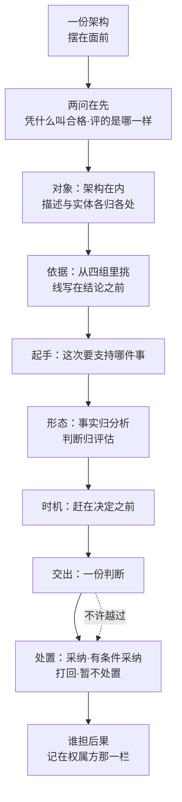

# 第16章 架构评估：判断不代替决定

## 16.1 引言

恒信是做合同审批的，那一版架构交出去之前，罗建召集了一次会。会开了三个小时，散会时没有人说出"凭什么叫它过"这句话的答案。这一章讲的就是这句话：先把它答得出来，再说清答完之后，还差谁的一句话。

### 16.1.1 误解现场

三张长桌拼起来，上面摊着一摞文档。目录、编号、图例、版本页，一样不缺。

罗建是这家的系统架构师，他把最后一页翻过去，说了这场会要定的事："这一版架构基线，冻不冻？冻了我就交设计。"

苏婷先开口。她是设计那一侧接手的人："我看了，文档齐。目录和图都在，比上一版多了两节。"顾言站评估这一侧，他翻到其中一页，指着一条约束问："这一条，你是拿哪一条判的？"苏婷停了一下："我就看它写没写。"顾言说："写没写，和它对不对，是一件事吗？"

屋里静了一会儿。王默管运维，他把运维那本台账推到桌子中间："上个月有两笔断链，是我们半夜捞出来的。这一版里，哪一页说它以后不会再断？"没有人接。郑亮管对账与数据，他补了一句："对账那边要的是可追溯。目录里倒是有一节叫'追溯'，可它写的是流程，不是判据。"

罗建把话收在一处："我问的是冻不冻。你们三个说的，是文档齐不齐。"他把笔放下，"文档齐这条我认。架构好不好，今天没有人判过。"

这场会没有白开。它办成了一件事：把"对过文档"和"判过架构"分开了。

### 16.1.2 本章的人和物

会上六个人，各站一个位置，谁都替不了谁。

罗建主持，要定的是冻不冻，手上却没有一份能拿去定的判断。顾言是需求分析师，这一场由他来立判据，活是把"凭什么叫合格"落在纸上。苏婷是接收方，她问的是哪几页真要照着做，问的是判断能不能落到手上。王默代表运行那一段，只关心判据里有没有"以后会不会再断"。郑亮代表对账与数据，要的是可追溯能落到判据上，不是落在一节的标题上。曹峰是产品开发经理，日期由他压；他不管判据怎么写，只问两件事：这么判要花多久，出了事谁担。

恒信这边，这一章要用的东西就三样：一份架构、交出去的那份描述、以及造出来的那个东西。

另一条线是冰链，做的是温控设备。它在本章只在"先出内容、后出视图"那一块出场，作镜照。

### 16.1.3 本章要回答什么

七问，落在下面六块里，一问接着一问。

一、一场评估，凭什么才算数？
二、这一场评的到底是哪一样？
三、凭什么叫它合格？
四、这一场该从哪儿起手？
五、判到哪一个层次，才不把事实和判断混成一样？
六、判断出晚了，会变成什么？
七、判完交出去的到底是什么？为什么它从来不等于"定了"？

七问答完，这一章要说的话就完了。

## 16.2 评估是判断：判据与对象都要先点明

一场评估要成立，得先在纸上定下两样：被评的是哪一样，凭什么叫它合格。这两样不在结论之前定下来，后面说什么都作不了数。凭什么叫它合格这一样，在这一块立住；被评的是哪一样，下一块整块说。

### 16.2.1 评估凭依据，不凭到场

标准给评估下过一个定义，句子很短。

> *judgment about one or more architectures (3.1) with respect to the specified evaluation objectives*（中译：就被指明的评估目标对一个或多个架构所作的判断）。——ISO/IEC/IEEE 42030:2019 §3.4

这句话里读得出三样，缺一样，这一场就不是评估：

| 要件 | 内容 | 缺了会怎样 |
|---|---|---|
| 客体 | 一个或多个架构 | 评的是谁，说不清 |
| 判据 | 被指明的评估目标 | 事后才想起来定标准 |
| 动作 | 判断 | 变成决定、批准或者认证 |

还有一样不属要件，缺了却判不动：结论要落得回它用的准则与证据。少了这一条，表填得再满也复核不了。

最要紧的是表里第三行那条边界：动作是判断。判断不是决定，不是批准，也不是认证。这几样各有各的去处；本章只展开处置那一头，在 16.7。

会开得再齐、人来得再全，都不构成评估。判断成立只看一件事：拿一套事先写明的依据，对一个指明的对象，作了一次说得清的判断。

### 16.2.2 边界：只判断，不处置

这个定义往外还有两条边，都在同一份标准的注里。

第一条边，处置在评估之外。

> *A decision regarding disposition of the architecture is usually outside the scope of an AE effort, although it could be done in conjunction with the AE effort.*（中译：关于架构处置的决定通常不在评估这一工作的范围之内，虽然它可以与评估一同做。）——ISO/IEC/IEEE 42030:2019 §3.4 注 1

同一注接着写：评估结果**往往**报给决策者，由他基于这些结果、**有时也基于评估未考虑的其他因素**作出处置。这就说明了两件事：处置权不在评估这一侧；而评估也拿不全处置要的信息。预算、时机、别的承诺，这些进不了评估目标，却实实在在决定定不定。

第二条边，评估可以不依赖成文描述。

> *This document does not require the existence or use of an architecture description when performing an architecture evaluation.*（中译：本标准不要求在实施架构评估时存在或使用架构描述。）——ISO/IEC/IEEE 42030:2019 §3.2 注 1

这一条容易被读成"描述没用了"，不是。它说的是：判断的成立不靠那份文件在不在场。有的评估够用的信息就在参与的人脑子里，专家评审、质量工作坊都是这样。描述在场是好事，第15章那一整章讲的就是怎么把它写好；但描述是证据之一，不是判断的前提。

把这两条边合起来看，这个动作的形状就清楚了：**只判断，不处置；不要求有成文描述在场。**

### 16.2.3 把意见变成判断，靠判据先行

为什么非要这么划？因为不这么划，"评估"两个字谁都能用。

会开完了，有人说"我觉得还行"，这也叫意见。意见的特点是：它能被说出口，但别人复算不出来。你问他凭哪一条，他答"经验"；再问一句，他答"看多了就知道"。这类话在屋里说得通，出了屋就不成立——换一个人来，拿不到同一套依据，只能信或者不信。

判断不一样。判断的特点是可复核。它靠四样东西立住，这四样都在结论之前摆出来：目标（这次判到什么算成）、因子（影响结果的那几个条件）、准则（被评对象须满足的条件或须通过的检验）、通过线（准则上那条线，过了算合格）。每条结论都要指得回它用的准则与证据。换一个人拿着同一套依据，算得出同一个结果。

标准对评估目标还有一条硬要求，专门用来堵住这件事：目标要用因子表述，还要写出这些因子的期望值或值域（42030 §6.1.2，全文见 16.4.1）。这一条逼你把"我觉得"翻译成"到不到线"。

这一步做完，评估才有一件东西可以交出去。没做完，交出去的是一句话；做完了，交出去的是一份能被人拿着往前走的东西。

到这里为止是干净的：判断能交出可复核的结论，但交不出处置。这两件事为什么必须是两件事，16.7 说。

## 16.3 评的对象错了，判断不成立

对象这一层要单独说清。说错了，依据再硬，判出来的东西也落不到地方。

### 16.3.1 判断的对象，先点明是架构

标准给评估定的宾语是架构。§1 那串用途里，前三处的宾语都是架构。

> *a) validate that architectures address the concerns of stakeholders; b) assess the quality of architectures with respect to their intended purpose; c) assess the value of architectures to their stakeholders*（中译：a) 核实架构应对了相关方关切；b) 就预期目的评架构质量；c) 评架构对相关方的价值。）——ISO/IEC/IEEE 42030:2019 §1

一句话：标准把评估的客体定在架构上。这不是说别的东西拿不进来，是说别的东西一旦拿进来，判的就已经不是架构了。第二样与第三样怎么进来、进来以后判的是什么，下一节说。

有一个词要先认清：架构实体。它指的是被架构的那个事物，不是数据模型里的实体，也不是描述里的元素。标准给它的定义句很短。

> *architecture entity: thing being characterized by an architecture (3.1)*（中译：架构实体：被一个架构刻画的事物。）——ISO/IEC/IEEE 42030:2019 §3.3

一个系统、一个子系统、一条产品线，都可以是架构实体。这个词在本章后面还会出现，每次指的都是"那个要被造出来的东西"。

### 16.3.2 描述与实体进得来，户口随对象换

第二样常被拉进来的是架构描述。它确实可以被评，但评它的那一步不在评估这一头。标准在范围那一节里把话说明白了。

> *This document addresses the evaluation of an architecture and not an evaluation of the architecture description's suitability. Matters concerning the evaluation of the architecture description fall within the scope of the architecture conceptualization and architecture elaboration processes as defined in ISO/IEC/IEEE 42020. However, it is sometimes the case that the architecture description is evaluated concurrently with the evaluation of the architecture itself.*（中译：本标准讲的是对一个架构的评估，**不是对架构描述适用性的评估**；描述的评估归 ISO/IEC/IEEE 42020 所定义的架构概念化过程与架构细化过程。然而，描述有时会与架构本身的评估同时进行。）——ISO/IEC/IEEE 42030:2019 §1

对应的一步在细化过程里，是"评定描述的适用性"（42020 §10.4.6 c)），那一节的注也写明：对描述的这项评定与架构评估分开，两者可以并行、会互相影响。

两把尺子量的不是一回事。评描述问的是"够不够"：它满足不满足架构描述标准的要求，满足不满足读它的人的需要。评架构问的是"值不值"：在那套声明过的目标下，它到了什么程度、值不值得要。同一份文件，可以写得很齐、却判不出架构好不好；也可以架构很好、写得很糟。

第三样，就是刚才认下的那个架构实体。它被拉来当客体的时候，判的对象换了：标准 §1 d) 说的是"判定架构实体是否达成其预期目的"。这一处判的是"用起来达不达预期目的"，属确认那一半；"造出来的东西合不合规定要求"那一半归验证。那两道判定第8章已经立过，本章只回指一句：这里判的是造出来的那个东西，不是那份架构（15288 §6.4.9.1、§6.4.11.1）。

三样并排看，各有各的户口：

| 评的是哪一样 | 依据是什么 | 户口在哪 |
|---|---|---|
| 架构 | 评估目标、因子、准则；参照含预期目的 | 评估范围之内（42030 §3.4） |
| 架构描述 | 符合性与适用性 | 细化过程（42020 §10.4.6 c)） |
| 架构实体 | 规定要求与预期用途 | 验证与确认（15288 §6.4.9.1、§6.4.11.1） |

### 16.3.3 对象错了，判断就作废

三样摆在一起，错法也就三种，每一种都在工程上见过。

第一种，拿描述合格冒充架构好。文档齐、目录全、图例在，于是会开完写一句"架构无异议"。恒信那一场，差一点就是这一种。它的病不在马虎，在于量错了对象：尺子对着文件，结论却写成了架构。

第二种，拿架构好冒充实体成。架构定得干净、判据立得住，于是有人推出一句"这套东西造出来没问题"。可架构说的是"按它造，这东西就会具备这些性质"（42020 §9.2 e) 注）。它承诺的是照着造会有，不是已经有了。造不造得出来、造出来达不达目的，要另判，判的对象是那个实体。

第三种，拿实体成冒充架构好。样品跑通、试点上线，于是说"这套架构是对的"。可样品通过只说明这一次按某个做法做成了，说明不了这套架构本身在预期目的下值不值得要。第8章那道分界在这里同样成立：一次合格，不等于对这个架构作过一次判断。
三种错法的共同点只有一句：**依据没有错，对象错了。** 而对象一错，结论既不能复核，也不能处置——你拿它去定任何事，都要先把它翻译回它本来的对象，翻回去的那一步，就是重新判一次。

评估这一侧能做的，是每次落笔前先答一句：这一场评的是哪一样。答得出，才谈依据。

### 案例进展①｜恒信：判断错在对象

会开到一半，顾言把笔放下，说了一句让屋里安静的话。

"我数了一下，我们这三个小时，对的是文档：目录、编号、图例、版本页，一样一样对过来。这些都对，也都该对。可我们没判过这个架构——文档齐是描述合格，架构好不好是另一件事。"

苏婷接了一句："刚才顾言问'这一条，你是拿哪一条判的'，我答的是'它写了'。写了，和不成立，是两件事。"说完她低下头，把那一页翻过去。

罗建没有打断。等她说完了，罗建把那一页推回去："所以今天这个'冻不冻'，我定不了。不是我不敢定，是我手上没有一样东西能拿去定。"

苏婷补了一句："我原来以为评估就是把文档过一遍。"王默接了一句："我那两笔断链，文档里一个字都没有。"郑亮说："对账要的是可追溯，可追溯在目录里是一节，在架构里得是一条判据。"

顾言最后说了一句，后来被记进会议纪要：「**评的不是文件齐不齐，是这套东西在它要待的场合里成不成。文件是我们自己写的，场合不是。**」

会散了。下一次会，他们改了一件事：先定这一场评的是哪一样，再决定拿什么判。

## 16.4 依据不在结论前，判断不成立

对象定了，第二件事是尺子。这一节要回答的只有一问：这一场的依据从哪儿来。

### 16.4.1 目标不写死，依据立不住

评估目标不是"这次评得好一点"，它有固定形状。标准用一条"shall"加四个分项把它钉住了。

> *Each AE objective shall: a) address one or more stakeholder concerns; b) address relevant business drivers and mission drivers; c) be expressed in terms of AE factors; and d) be expressed in terms of expected or desired values or value range for the AE factors, when applicable.*（中译：每条评估目标应：a) 应对一条或多条相关方关切；b) 应对相关业务驱动与任务驱动；c) 用评估因子表述；d) 适用时，用这些因子的**期望的或想要的**值、或值域表述。）——ISO/IEC/IEEE 42030:2019 §6.1.2

四件里最容易漏的是 d)。写到"要可靠、要可追溯"就停笔的，评估目标就没写成，因为那还只是关切的名字；写成 d) 才算立住：可追溯率不低于 99.5%。c) 和 d) 合起来干一件事，把形容词换成一个能算的数，或者一个能判的范围。

这里要把两个词分开，它们长得像，位置完全不同。

目的朝实体，答的是这个系统为什么存在。评估目标朝这一次评估，答的是判到什么算成。同一套架构，为了冻结基线评一次，和为了选型评一次，目的可以一样，评估目标必须两样——这是本书的读法。两份正本都承认这一点：42030 说的是"这些目标**可能并不对应**最初构思时的目标"（*These goals might not correspond to the original goals for the architecture when it was initially conceived*，§4.3.1）；42020 说得更直：评估目标**可以与构思时所用的目标不同**（*the evaluation objectives may be different from the objectives used in conceptualization*，§9.4.3）。

### 16.4.2 依据要挑，现成不能用

评估目标立住了，依据才有着落，但依据不是现成的。

依据不是一张正本里现成的总表。48 号报告把散在 42030 各节的依据归拢成四组〔报告读法〕，每一组都能指回条款；下面照它的归拢讲，但不当作标准原文。

评估工作自身：这次评的目的与范围、被评对象声明，管的是"我在评什么"。对象侧：架构目标、相关方关切、相关需求、预期目的、架构原则。评价者侧：评估目标、评估因子、准则与通过线、价值模型。程序侧：评估方法、可追溯性、工作产品与入库、评估者的职业判断。

四组不逐条往下写，因为照抄一遍也用不上——**能用的永远是挑出来的那几条。**

挑的规矩很简单：**这一场要支持的是哪一件事，就把与那件事有关的关切挑进来，各配一条准则和一条通过线。** 与那件事无关的，再好也不挑。

罗建第二天把这件事办成了一张表。表头六列，五行。这张表后来被苏婷收进项目册，照着填就能用。

表里第二列分价值侧与分析侧，这两个词先说清楚。价值侧判的是"相关方关切与架构目标被满足到什么程度"，分析侧判的是"相关方的需要与需求被满足到什么程度"（42020 §9.4.3 注 1）。两道尺子量的是两头。价值侧就是 16.5.3 的价值评估那一层，分析侧就是架构分析那一层；16.5.3 还要用一次，这里先认下来。

| 准则 | 属于哪一侧 | 通过线 | 证据来源 | 责任人 | 时机 |
|---|---|---|---|---|---|
| 可追溯：每笔审批追得到人、时、依据 | 价值侧 | 可追溯率不低于 99.5% | 抽样对账记录 | 郑亮 | 冻结前一次 |
| 例外必须留理由且可查 | 价值侧 | 抽五十单，理由栏齐全 | 抽查表 | 苏婷 | 冻结前一次 |
| 越权提交为零 | 价值侧 | 零次 | 路径可达性测试 | 顾言 | 冻结前一次 |
| 月底对账一次过 | 价值侧 | 一次过，返工不超过两项 | 对账演练记录 | 郑亮 | 冻结前一次 |
| 配置出来的孤岛可检出 | 分析侧 | 每次发布后三十分钟内检出 | 发布日志回放 | 王默 | 每次发布 |

表里"责任人"那一列要说明一句：写的是谁去取这份证据，不是谁判这条合不合格。评估这一侧自己也要取证据，两件事分开写。

这张表里三处值得看。一是**同一张表上价值侧与分析侧并存**，不必分两个本子。二是每条准则都带证据来源，指不出证据的那一条，等于没有通过线。三是**线在冻结之前定死，之后只在发布时复算**——前四行的时机是冻结前一次，第五行是每次发布。这一条不是格式，是 16.4.3 要说的那件事。

### 16.4.3 事后补的线，不算依据

挑准则的时候，最容易松的一处是那条线。线是数量的：99.5% 还是 99%？三十分钟还是两小时？写下来的那一刻，判的结果就定了大半。

所以线要写在结论前面。标准这里用的词很轻：

> *Pass/fail criteria could need to be established prior to performing the evaluation. These criteria could be defined in the AE plan or could be established by the organization as a matter of policy or directive.*（中译：合格／不合格准则可能需要在实施评估之前建立；这些准则可以在评估计划里定，也可以由组织以方针或指令的形式定。）——ISO/IEC/IEEE 42030:2019 §4.2 注 3

"可能需要"（*could need to be*）——它是指南，不是义务条款。但工程上仍然必须事先立，理由不在标准里，在算术里：**线只要可以事后定，结论就会向着已经想好的那一头靠。** 这一句是本书读法，不是标准原话；它成立的理由很朴素——先有结论、再挑线，人总能挑到一条让结论通过的线。

按这一条筛，有几样东西看着像依据，其实不算：

一是架构描述。它可以不在场（16.2.2 已经说过），在场时也只是证据，不是判据；拿它合格去顶架构好，就是 16.3.3 的头一种冒充。二是单一的"目的"。目的给方向，不给尺度：知道这个系统要为货主保住全程可追溯，判不出它到底到没到。三是事后才设的通过线，就是上面那一条。四是没登记过的偏好。有人心里有一条线，从没写下来，判完才拿出来用，那和事后设线是同一件事。

把这些剔掉，剩下的才算依据。剔的时候不必客气。**依据越少，判断越硬**——这一句是本书的话，正本没有。一条准则配一条证据，五条准则就能撑起一次冻结的判断；二十条含糊的关切撑不起任何一次。

### 案例进展②｜罗建：依据按决定倒着挑

罗建做那张表之前，先把要支持的事写在一张便签上，贴在屏幕边：**这一版架构基线，冻不冻；冻了交设计，设计照着做。**

然后他倒着挑。可追溯关系到"设计照着做会不会踩空"，挑；孤岛检出关系到"上线以后运维捞不捞得出来"，挑；例外留不留理由关系到法务与内控，挑；月底对账关系到业务方认不认，挑。跟这件事无关的那几条，他没写——虽然标准里有，虽然别的项目用过。

王默问了一句："挑这么几条，万一漏了哪条要紧的，出了事谁担？"

罗建说：「**正本对评估目标、对准则都用了"应"，那是真要求。它没要求的，是把每一条依据都用上——四组里挑哪几条，看这一次要定的是什么事；跟这件事无关的，再好也不挑。挑多了不是严谨，是把判断稀释了，最后谁也说不清哪一条才是承重的。**」

苏婷把这一句抄进了会议纪要。后来那张表被复制到另外两个项目，改的只有通过线与时机那两列。

## 16.5 判断是给决定用的

对象有了，依据挑好了，还剩下三件事：从哪儿起手、按什么次序走、判出来的东西分几层。这一节先说第一件。

### 16.5.1 先认清要定的事，再作判断

评估的起手不是"这套架构好不好"。这话听着别扭，因为判断的对象确实是架构。可"好不好"是一个没有边界的问题：好在哪一面、按哪几条、判到什么算好，全都悬在它后面。拿它起手，判出来的东西往往很全面，却很少有人拿得走。

过程标准给的是另一条路，写在评估活动的第一项里。

> *Formulate judgments to be made by architecture evaluation based on the potential decision(s) that can be supported by the architecture evaluation effort.*（中译：依据这次评估工作可能支持的那个决策，先拟定要作的判断。）——ISO/IEC/IEEE 42020:2019 §9.4.1 a)

一句话：**先把这次要支持的那件事认清，再定判什么。** 认清的不是答案，是那一问——要定什么、什么时候定、定了要担什么后果。恒信那一场要定的是"这一版架构基线冻不冻、冻了交设计"，一句话里三样都在：要定的是冻不冻；定在评审会散会前；定了之后设计照着它做，踩空由签字冻结的人担——日子可能是别人压的，担的还是签字的人。

认清这一问，判据才挑得出来，范围才画得出来，"判到什么算够"才有着落。不认清它，判据只能抄现成的通用模型，判出来的东西和这次要定的事接不上；接不上，最后就没有人拿它去定任何事。

所以标题那句"判断是给决定用的"，不是一句好听的话，它管着一件具体的事：**判断的范围与深度，由它服务的那个决定来定。**

### 16.5.2 判断有次序，不能跳着走

起手定了，往下走还有次序。42020 在评估过程里排了一串活动（§9.4.1~§9.4.10），本章压成一张表，只记每一步干什么。表里第 7、8 项要借 42030 的分层来讲，那是 16.5.3 的事。

| 序 | 活动 | 干什么 |
|---|---|---|
| 1 | 准备与计划 | 由待支持的那个决策倒推要作什么判断；定目的、范围、目标、详略；出评估计划 |
| 2 | 监控、评估与控制 | 贯穿全程，本身不下判断：报状态、查指令遵循、管风险、保持结果可追溯 |
| 3 | 确定评估目标与准则 | 准则分价值侧与分析侧；42020 §9.4.3 明许评估目标可不同于构思时所用 |
| 4 | 定方法并与目标准则整合 | 方法与目标必须对齐 |
| 5 | 建立测量技术、方法与工具 | 定下拿什么量、量到什么精度 |
| 6 | 收集与评审评估信息 | 定证据由谁提供、怎么核 |
| 7 | 分析架构概念与属性、评估相关方价值 | 架构分析与价值评估同批做，一个给事实、一个给判断 |
| 8 | 依评估结果刻画架构 | 下判断，也就是综合 |
| 9 | 形成发现与建议 | 发现要验证、评估影响、对接决策与里程碑 |
| 10 | 捕获与沟通结果 | 出报告、获批准、向决策者陈述、捕获回应、归档、必要时迭代 |

十项里有三处最容易跳。第一处是第 1 项，直接从"评一评架构"起手，跳过"支持哪个决策"。第二处是第 6 项，证据靠谁提供没定，判的时候临时找。第三处是第 10 项，报告写完就归档，没有向决策者陈述这一步，也没有捕获回应——判断交出去了，却不知道对方拿它定了什么。

这张表也算前面几节的落位图：16.5.1 讲的是第 1 项，16.4 讲的是第 3 项，16.5.3 讲的是第 7、8 项。前面是拆开看零件，这里是装上以后的样子。

走完十项，产出的东西是固定的四件，标准用的是 shall be produced。

> *The following work products shall be produced: architecture evaluation plan, architecture evaluation report, architecture value assessment results, and architecture analysis results.*（中译：应产出下列工作产品：架构评估计划、架构评估报告、架构价值评估结果、架构分析结果。）——ISO/IEC/IEEE 42020:2019 §9.5

这四件是交出去的。另有三样备查（这三样出自 48 号报告的归纳，正本此处只列四件）：结果的可追溯记录、计划的批准与资源记录、以及入库（进配置管理那一套）。**判断能不能被人复核，一半靠这三样。**

### 16.5.3 分析先给事实，才轮到判断

那张表的第 7、8 项，对应 42030 §4.3 给评估分的几层。分层只为一句话：**事实归分析，判断归评估。**

分析给的是"月度对账跑完要三十五分钟"这句话。它是事实，可以被测、被复现、被质疑。判断给的是"在这一条线上它不合格"：同一份记录，事实是三十分钟，线是三十分钟内，差一分钟就是不合格。它带立场：对着哪一套目标、用哪一条线。把前一句直接当结论用，等于跳过判断；把后一句写成事实的样子，等于让事实替人作决定。两种错都常见，且都不留痕迹。

42030 §4.3 给这几层各起了名字。评估综合把多份价值评估结果合起来，判评估目标达成到什么程度。价值评估判架构对相关方的价值，关切有没有被应对、目标有没有被满足。架构分析判的是手段性的事实，性能、极限、约束这些。三个名字各管一段，不能互相顶替。

分开的依据在标准的一张对照表里，两栏各一句话。

> *Value assessment — Results: Passes “judgment”; Architectural analysis — Results: Matters of Fact*（中译：价值评估——结果形态是判断；架构分析——结果形态是事实。）——ISO/IEC/IEEE 42030:2019 §4.5 表 1

几层摆好了，判断的形态就定了：**下判断之前，先有事实；下判断之后，还要综合。** 事实不齐就判，是猜；只到事实就停，是没有判。

第二次会开场，罗建把顺序改了。他没有先摊文档，先在白板上写了一行字：这次要定的是冻不冻，冻了交设计。写完他问了一句："这件事定了，谁担？"曹峰抬手："日子是我压的，我担。"罗建点头："日子你担，这一版我担。"说着把两个名字都写在那行字后面。

然后才轮到判据。顾言把那张表投到墙上，一行一行念。念到第四行，郑亮打断："'返工不超过两项'这条线，谁定的？"顾言答："那天我定的，写在表上，大家看过。这条线你要改，现在改，改完重判；判完了再改，就不算数了。"郑亮想了想："不改。"

苏婷问："那这次判完，就可以冻了？"罗建摇头："判完我拿到的是判断；冻不冻，我拿到判断以后再定。以前这两件事我一起做，做完谁也说不清哪一步是我判的、哪一步是我定的——记录上分开写，才追得回来。"

## 16.6 判断出晚了，就只剩追认

起手对了、次序也跟着走了，还有一件事决定这一遍判断值不值钱：它出在决定之前，还是之后。

### 16.6.1 架构内容先出，判断还来得及

工程上的常态不是"先把描述写全，再评"。标准自己也承认这一点，写在概念化过程的实施指南里；要分清，那个过程的主体是义务条款，"早期描述可以是草图""视图集不必完整"这几句在它的**注**里，属资料性。

> *Some of these early architecture descriptions can be little more than sketches. After doing several quick rounds of evaluation and conceptualization, there can then be a smaller number of viable architectures …*（中译：这些早期的架构描述，有的不过是草图；做过几轮快速的评估与概念化之后，可行的架构才会剩下少数几个。）——ISO/IEC/IEEE 42020:2019 §8.3 b)

同一节的 e) 说得更直接：这一阶段生成的视图集不必完整，因为**最小的一套视图可能就足以判定**所提的架构合不合用，细节留给细化过程去补。——ISO/IEC/IEEE 42020:2019 §8.3 e)

本书把这种走法叫"先出内容、后出视图"，属本书读法。它说的是：先把手上的内容立住，对着内容判合用不合用；视图是要出的，但此时它的任务是回答这一遍要判的那一问，不是把描述补齐。

冰链那边就是这么走的。石军是那边的嵌入式硬件工程师，他先把内容清单定下来，对着清单一页一页判合用不合用；到要比较两个候选时，才补了最小的一套视图——按 16.6.3 第三条（候选要摆到同一个桌上比），这一条一出现，读法就得先写下来。那一次他们确实是先写了读法，才补的视图。恒信这边反过来：文档先做齐，判的时候才发现对的全是文档。两家走的次序不同，结果也不同。

这里有一条要当心的说法：**后出的视图不是清单的升级版**。清单按内容的类别排，视图按要判的关切排，是两套排法（第15章立过），不是同一批字的新旧两版。所以"内容先行"不等于"以后再把清单画成图"。

### 16.6.2 补一条账，判断才交得出手

近路走得，但有一个坑必须当场补——这是"内容先行"这条路唯一不能省的地方。

清单判"合用不合用"是够的，它判不了的是另一问。坑在清单的结构上：清单按内容的类别排，它没有"这条关切有没有被应答"这一栏。所以同一份清单，判得出内容齐不齐，判不出关切应没应。评估里有几类用途——关切有没有被应对、价值够不够、目的达成没达成——全都要靠后一句。缺了它，评估就退化成一次内容完备性审查。

补的办法很土，一条一条对：把相关方的关切列成一栏，逐条问"有没有一条内容或一条原则在应答它"；有问无答的那一条，记成空位。空位不一定要补，但一定要留名。

冰链那一次补出了空位。其中一处是"司机端交互"：内容清单里没有，因为当时没人提；评估时被记了下来，写明本期不做、资源受限。坚持要写这一行的是小张，那边的系统工程师——她管的是整条链都签得上字。这一行不是欠账，是判断给自己划的界：没有它，下一次换人来判，会把"没覆盖"读成"已经安全"。

这一条账补完才算数：判断不只答了内容齐不齐，还答了关切应没应。

### 16.6.3 判断要换人复算，规则先写下来

还有一条要提前想：这一遍判断，将来会不会有第二个人来复算。

三种情形一出现，读法就得提前写死，视图要提到决定之前，哪怕只出一张。

一是判的人不止一批。今天这个组判，明年另一个组复核；读法没写下来，第二组读出来的是另一片。

二是要留据被审计。合规、监管、客户验收要查当初凭什么判，靠口头记忆撑不过三个月。

三是候选要摆在同一个桌上比。要比，就得让两个候选按同一套约定被读，否则比的不是候选，是两份文档的写法。

三条任一成立，那套先出内容、后出视图的从容就没了，得先把读法写下来。反过来，三条都不成立——一个组判、判完就散、不比候选——最小视图集确实够用。

判断出晚了会怎样，到这里可以说清了：**决定一旦先定下来，后面那一遍就不再是判断，是补手续。** 它也许照样开三天会、照样出报告，可判什么、按哪条判，都已经由那个决定定好了。追认的成本比判断低，作用也小得多：它唯一能办的事，是让已经定了的事看起来像判过。

所以"判断要赶在决定之前出"这句话，不是一句进度要求，它管的是这一遍判断还算不算判断。

## 16.7 判断只交结论，处置归决策者

前面五块把判断立住了：起手是那一问，依据是挑出来的，形态是事实在前、判断在后，时机是决定之前。剩下最后一件事，也是章题的后半句：判断交出去以后，谁来定。

### 16.7.1 处置接在判断后面

先说清"处置"指什么。它不是把东西处理掉，是**定下接下来按哪一条走**。

一次处置由三样构成。对象：架构里的某一处，或者这一套。权属方：谁有权作这个决定，记录里要有一栏。生效：从哪一刻起，别人引用的是这一版。这三样是本书列法；缺一样，这次处置就不成立——特别是权属方，那一栏空着，等于这条决定没有人认领，风平浪静看不出来，出事那天第一句问的就是它。

处置落到手上，只有四类，没有第五类：

| 类 | 内容 |
|---|---|
| 采纳 | 按这一版走，往下细化、冻结、交设计 |
| 有条件采纳 | 补几处、限期补，补到才放行 |
| 打回 | 退回架构侧改：改内容、改切法，甚至改判据 |
| 暂不处置 | 先挂着，等某个条件，并且把"暂不决定"记进未决议题 |

四类都要留痕，第四类尤其容易漏。把它写成"通过／不通过"两档，就等于把"有条件"和"挂着"这两类真实的处置挤掉了，而工程上这两种恰恰最多。

这四类是本书的读法，标准没有给这张表。标准只说了处置这件事归谁：关于架构处置的决定通常不在评估范围之内，评估结果报给决策者。而决策管理那一条给的是四件结果：过筛的决策被识别出来、备选被评估、选出一个优选的方案、方案与理由和假设得到记录（15288 §6.3.3）。

### 16.7.2 建议由评估交，处置由决策者作

三个动作在这一档最容易混，混了以后谁都说不清哪一步是谁做的。

判断由评估作：在这套依据下判到哪个程度。建议由评估交：倾向哪一条、为什么，它是评估这一侧的倾向，带名字。处置由决策者作：定下按哪一条走，并担后果。

三件事可以由同一个人做，但记录里要分开写。分不开的后果很具体：事后问责的时候，"当初谁定的"这一问会卡住，因为记录上只有一句"通过了"。

判断与建议可以写在同一个本子上，处置不行。标准把它们放在两处：决策记入架构描述（42010 §6.10.1 的"应"），理由另有一条管（§6.10.2）；评估的工作产品入库（42020 §9.3）。两本册子，各有各的下游——一个跟着架构走，一个进仓库备查。

越界也就三种样子：

一是把评估当决定。报告里出现"批准""同意执行"，等于评估这一侧替决策者拍了板。二是把决定当评估。会上说"就这么定了"，却没有一条判据、一句理由，事后无从复核。三是把评估意见写进架构内容。评估说"建议改接口"，这句话进了架构描述，就变成了架构内容，可它不是一条判过的内容，是评估意见。

越界的共同点还是一句：**动作串了位，责任就落了空。**

### 16.7.3 认知反转

评估做得最好的一次，恰恰是最容易出事的一次。

判据立得齐、证据取全、结论明确、屋里没有一个人反对——到这个时候，最顺口的一句是"那就这么定了吧"。这句话听着像效率，其实是把两个动作并成了一个。

为什么它危险？因为判断越扎实，越会让人忘记处置有它自己的门槛：谁有权定、定了担什么、生效从哪天算。而这些，评估一样也提供不了。它手上只有判据和证据。预算够不够、时机对不对、别的承诺能不能挤开——这些进不了评估目标，却扎扎实实地决定定不定。决策者有时还要基于评估没考虑的其他因素来定（42030 §3.4 注 1）。

所以"评估通过"这四个字，从来推不出"决定通过"。它推得的只有一句：在这套声明的目标下，判到了这个程度。

另一面也成立：评估做得再差，也不能拿"反正还要决策者拍板"来兜。判断糊，决策者就没有可依据的东西，最后只能凭印象定，而印象不会留下可复核的记录。两头都堵死，中间那一段才立得住：**判断把话说到能复核为止，处置把事定到有人担为止。**

## 小结

这一章从头到尾在做一件事：把"评"这个字立成一件有依据、有产出、有边界的活。

七问都答完了。第一问是"凭什么才算数"，答案在 16.2：拿一套事先写明的依据、对一个指明的对象作一次说得清的判断。评的是哪一样，得分清——架构在评估的范围里，描述的评定归细化过程，实体只判到预期目的，拿一样顶另一样就是冒充。

凭什么叫它合格，得在结论之前写死——目标、因子、准则、通过线，缺一条，结论就复不了算；线允许事后定，结论就一定向已经想好的那头靠——这一句是本书读法，不是标准原话。依据是挑出来的，不是现成的：标准给的是清单，挑哪几条由这次要支持的那件事定。

起手不是问"架构好不好"，是先认清要定的是哪件事。判之前先有事实，判之后还要综合，事实与判断不能互替。判断要赶在决定之前出——决定先定了，后面那一遍就不是判断，是补手续。最后一步，判断止于判断：交出去的是能复核的结论，不是批准。

一句记下来：**判断能交出去的，只是判断；能定下来的，从来是另一双手。**

## 附录

### A 本章概念总图

### B 本章的能力级

第 ③ 级为主。

表征：说准这几个词——评估、被评对象、评估目标、评估依据、评估准则、通过线、评估报告。其中"被评对象"在正文里叫"评的是哪一样"，是同一样东西；"评估依据"是四组里挑出来的那几条，正文里只叫"依据"；"评估准则"是其中带条件或检验的那几条。

图式：两问在先的一对；三样对象与各自户口的对照；四组依据与"怎么挑"；从要支持的那件事倒推的那次起手；事实与判断的分层；判在决定之前这条次序。

心智模型：评估是判断，不是开会、不是签字、也不是拍板；判据与对象得在结论之前点明，别人才复算得出同一个结果；判断交出去以后，定不定、谁担，在另一条线上。

解释框架：本章不建，留白。

再用第1章 §1.4.3 那把尺子量一下：**本章以第 ③ 级为主**。前面各章各交一件东西，本章交的是"怎么判那一件东西行不行"——判断立在前面各章交出的那些东西之上。

> **第1章那四问答全，才算拥有**——一份架构摆在面前，你说得出评的是哪一样、拿什么评、评完还差谁的一句话。

### C 自查 · 这些说法对吗？

一、"评估就是把评审会开得正式一点。" 错。评审对的是目标那一头（第8章立的三个参照之一），评估对的是架构本身；依据、过程、产出都不一样。

二、"文档齐了，架构就没问题。" 错。这是头一种冒充：拿描述合格顶架构好。

三、"判据越多越严谨。" 错。16.4.3 那一句：依据越少，判断越硬；案例进展② 里罗建说得更狠：挑多了是把判断稀释了。

四、"线可以等评完再定，反正心里有数。" 错。线一旦可以事后定，结论就向已经想好的那头靠。

五、"评估通过了，就可以开工。" 错。评估通过只推到"在这套目标下判到了什么程度"，开工要另一个人的处置。

六、"先有内容、后出视图，所以可以先判、不用管视图。" 半对。近路走得，但缺了"每条关切有没有被应答"那一条账，判得出内容齐不齐，判不出关切应没应。

### D 练习

一、拿你手上最近一次评审，写下三行：这场会要支持的是哪一件事？依据是哪几条、谁定的？会开完交出去的是哪几件东西？三行里写不出的那一行，就是这一章要补的那一块。

二、找一条你熟悉的判据，把它改写成"因子＋期望值"的样子。改不出来的，说明它现在还只是一个关切的名字。

三、写下你所在项目里"谁有权定这一版架构"的名字。如果写不出，那么下次出事时，"当初谁定的"这一问就不会有答案。

### E 参考文献

一、ISO/IEC/IEEE 42030:2019《软件、系统与企业 架构评估框架》：§1 范围与用途、§3.2 注 1、§3.3、§3.4 及其注 1、§4.2 注 3、§4.3、§4.3.1、§4.5 与表 1、§6.1.2。

二、ISO/IEC/IEEE 42020:2019《软件、系统与企业 架构过程》：§8.3 b) 与 e)、§9.2 e) 注、§9.3、§9.4 及其第 1 项、§9.4.3 注 1、§9.5、§10.4.6 c) 及其注。

三、ISO/IEC/IEEE 42010:2022《架构描述》：§6.10.1。

四、ISO/IEC/IEEE 15288:2023《系统生存周期过程》：§6.3.3、§6.4.9.1、§6.4.11.1。

五、本书第 48 号研究报告《架构定义研究报告》v3.27 §11.1~§11.12。
